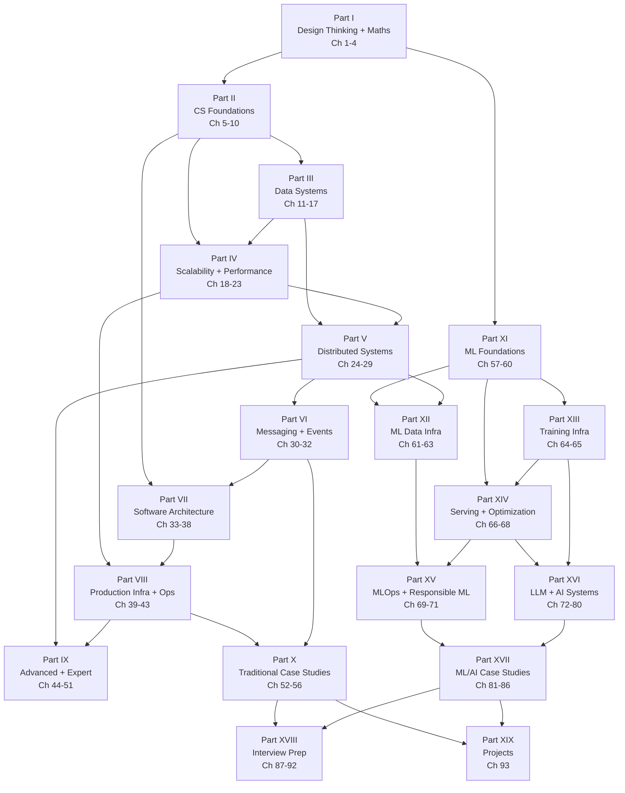
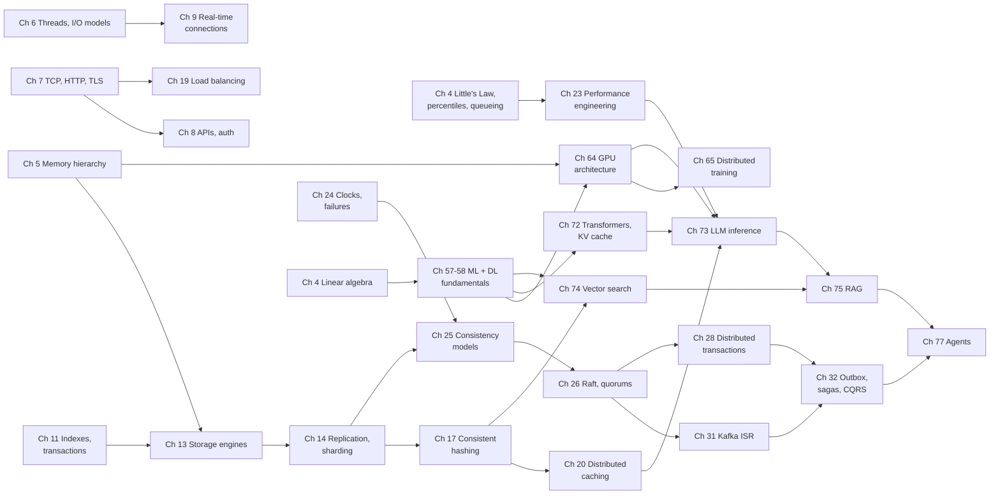

# 2. Concept Dependency Map

This map shows which chapters must be understood before others. It drives the reading order, the "Prerequisites" section of every chapter, and the weekly roadmap (Appendix E). An arrow `A --> B` means "A is a prerequisite of B".

## 2.1 Part-level dependency graph

**Figure P.1 — Part-level dependencies.**

**Reading the diagram.** Each box is a part of the book; arrows point from prerequisite to dependent. Two independent entry points exist after Part I: the traditional track (Parts II→X) and the ML track (Part XI onward). The ML track rejoins the traditional track at Part XII (data infrastructure needs distributed systems from Part V) and at Part XVI (LLM serving needs serving infrastructure from Parts IV and VIII via Part XIV). The interview and project parts sit at the end because they integrate everything.

## 2.2 Concept-level dependency graph (critical path)

**Figure P.2 — Critical concept path from first principles to LLM infrastructure.**

**Reading the diagram.** This is the longest chain of concepts the book builds. For example, to understand continuous batching and KV-cache paging in LLM inference (Ch 73) you need GPU memory hierarchy (Ch 64), the attention/KV-cache mechanism (Ch 72), queueing and tail-latency reasoning (Ch 4, Ch 23) and caching concepts (Ch 20). Agentic systems (Ch 77) depend on both RAG and on durable workflow patterns from event-driven architecture (Ch 32), because production agents are long-running, retryable workflows.

## 2.3 Chapter prerequisite table

**Table P.1 — Hard prerequisites per chapter** (soft prerequisites are named inside each chapter).

| Ch | Title | Hard prerequisites |
|---|---|---|
| 1 | What Is System Design? | — |
| 2 | How to Think Like a System Designer | 1 |
| 3 | Learning Method | 1 |
| 4 | Quantitative Foundations | — (high-school algebra) |
| 5 | Computer Architecture | 4 |
| 6 | Operating Systems | 5 |
| 7 | Networking Fundamentals | 4, 6 |
| 8 | Web Application Fundamentals | 7 |
| 9 | Real-Time Communication | 6, 7, 8 |
| 10 | Security Fundamentals | 7, 8 |
| 11 | Relational Databases | 4, 5 |
| 12 | NoSQL Databases | 11 |
| 13 | Storage Engine Internals | 5, 6, 11 |
| 14 | Database Scaling | 11, 12, 13 |
| 15 | Object/Block/File Storage | 5, 6, 14 |
| 16 | Search Systems | 11, 13, 14 |
| 17 | Data Structures for Scale | 4, 14 |
| 18 | Scalability | 2, 4, 8 |
| 19 | Load Balancing | 7, 18 |
| 20 | Caching | 5, 14, 18 |
| 21 | CDNs | 7, 20 |
| 22 | API and Traffic Management | 4, 8, 18 |
| 23 | Performance Engineering | 4, 6, 18 |
| 24 | Distributed Systems Fundamentals | 7, 14 |
| 25 | Consistency and Availability | 14, 24 |
| 26 | Consensus and Coordination | 24, 25 |
| 27 | Replication and Fault Tolerance | 14, 25, 26 |
| 28 | Distributed Transactions | 11, 26, 27 |
| 29 | Distributed Data Processing | 14, 24 |
| 30 | Messaging Fundamentals | 8, 24 |
| 31 | Kafka Deep Dive | 13, 26, 30 |
| 32 | Event-Driven Patterns | 28, 30, 31 |
| 33 | Architecture Patterns | 8, 30 |
| 34 | Microservices | 22, 32, 33 |
| 35 | Object-Oriented Design | — (basic programming) |
| 36 | SOLID | 35 |
| 37 | Design Patterns | 35, 36 |
| 38 | UML and LLD | 35–37 |
| 39 | Reliability and Resilience | 4, 22, 27 |
| 40 | Observability | 4, 34, 39 |
| 41 | Cloud Computing | 7, 15 |
| 42 | Containers and Kubernetes | 6, 41 |
| 43 | Deployment and Infrastructure | 42 |
| 44 | Multi-Region Systems | 25, 27, 39 |
| 45 | Advanced Consistency and BFT | 25, 26 |
| 46 | Distributed Scheduling | 26, 42 |
| 47 | Multi-Tenancy | 22, 42 |
| 48 | Edge and Serverless | 21, 41 |
| 49 | Large-Scale Data Infra and HPC | 15, 29 |
| 50 | Security Architecture and Privacy | 10, 34 |
| 51 | Cost and Sustainability | 41 |
| 52–56 | Traditional case studies | Parts I–VIII (each case lists specifics) |
| 57 | ML Fundamentals | 4 |
| 58 | Deep Learning Essentials | 57 |
| 59 | ML Lifecycle | 57 |
| 60 | ML System Architecture | 18, 30, 59 |
| 61 | Data Engineering for ML | 29, 60 |
| 62 | Feature Stores | 20, 61 |
| 63 | Data Labeling and Quality | 59, 61 |
| 64 | GPU Architecture | 5, 58 |
| 65 | Distributed Training | 7, 58, 64 |
| 66 | Model Serving | 19, 42, 60 |
| 67 | Model Optimization | 64, 66 |
| 68 | Recommendation Architecture | 62, 66, 74 (ANN preview) |
| 69 | MLOps | 43, 59, 66 |
| 70 | ML Monitoring | 40, 57, 69 |
| 71 | Responsible ML | 57, 69 |
| 72 | LLM Fundamentals | 4.9, 58 |
| 73 | LLM Inference | 23, 64, 66, 72 |
| 74 | Vector Search | 4.9, 16, 72 |
| 75 | RAG | 16, 73, 74 |
| 76 | LLM Adaptation | 65, 72 |
| 77 | Agents | 32, 75 |
| 78 | LLM Evaluation | 57, 75, 77 |
| 79 | Production AI Infrastructure | 47, 73, 78 |
| 80 | Large-Scale AI Infrastructure | 46, 65, 79 |
| 81–86 | ML/AI case studies | Parts XI–XVI (each case lists specifics) |
| 87–92 | Interview preparation | Part X and/or Part XVII |
| 93 | Projects | Per project (listed in project) |

## 2.4 Reading paths

| Goal | Path |
|---|---|
| Absolute beginner, traditional track | 1 → 3 → 4 → 5 → 6 → 7 → 8 → 11 → 18 → 19 → 20 → 30 → 33 → 52.1 |
| Interview in 8 weeks (experienced backend engineer) | 2, 4 (skim), 14, 17, 18–22, 24–27, 30–32, 34, 39, 52–56, 87–89, 91 |
| ML engineer moving into ML system design | 4.9–4.10, 57–60, 61–62, 64–66, 68–70, 81–85, 88, 92 |
| Backend engineer moving into AI infrastructure | 4, 23, 57–58, 64, 66, 72–75, 77–79, 86 |
| Staff/principal preparation | 28, 39, 44–51, 80, 88 (rubrics), 90 |
