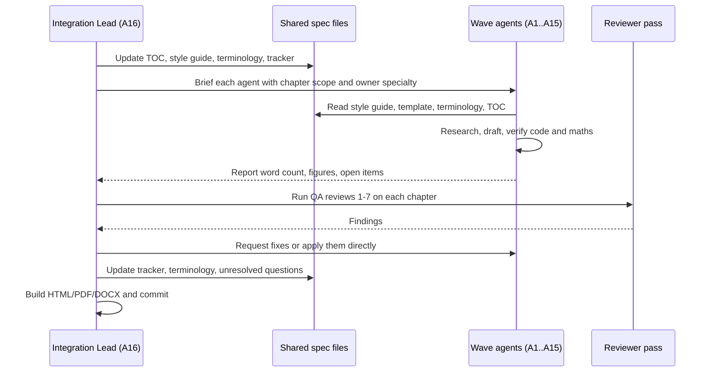

# 4. Agent Allocation Plan

The brief proposes sixteen specialised research agents. This plan assigns each a non-overlapping area of ownership, maps them to canonical chapters, and defines how outputs are integrated. In practice each chapter is drafted by a dedicated agent instance briefed with the owning agent's specialty; the integration lead (Agent 16) reviews every chapter.

## 4.1 Ownership matrix

**Table P.2 — Agent ownership.**

| Agent | Specialty | Owns chapters | Contributes to |
|---|---|---|---|
| A1 | Computer science foundations | 4, 5, 6, 7 | 9, 23, 64, Appendix F |
| A2 | Backend architecture | 8, 9, 33, 34, 35, 36, 37, 38 | 22, 52–56 |
| A3 | Database systems | 11, 12, 13, 14, 15, 16 | 28, 74 |
| A4 | Scalability and performance | 17, 18, 19, 20, 21, 22, 23 | 89 |
| A5 | Distributed systems | 24, 25, 26, 27, 28, 45 | 44, 46 |
| A6 | Messaging and event-driven architecture | 30, 31, 32 | 29, 77 |
| A7 | Cloud and production infrastructure | 39, 40, 41, 42, 43, 44, 47, 48, 51 | 46, 79 |
| A8 | ML foundations for system design | 57, 58, 59, 60 | 4.9, 92 |
| A9 | ML data infrastructure | 29, 61, 62, 63, 49 | 85.1 |
| A10 | ML training infrastructure | 64, 65, 46 | 80, 85.2 |
| A11 | ML serving and inference | 66, 67, 68 | 73, 85.3–85.4 |
| A12 | MLOps and ML platforms | 69, 70, 71 | 85 |
| A13 | LLM and AI system design | 72, 73, 74, 75, 76, 77, 78, 79, 80 | 86 |
| A14 | Industry architecture research | Industry callouts across all chapters; 52–56, 81–86 evidence review | Bibliography (App. B) |
| A15 | Interview preparation | 1 (§1.11), 2, 3, 87, 88, 89, 90, 91, 92 | Rubrics in all chapters |
| A16 | Quality and integration | Front matter, Appendices A, C, D, E, G, H, I; all reviews | Every chapter |
| (A10/A2 security) | Security specialist instance | 10, 50 | 47, 77 |
| (A2/A4 projects) | Projects specialist instance | 93 | `code/` |

## 4.2 Required outputs per agent (per the brief)

Every agent's chapter must contain: (1) topic/subtopic hierarchy, (2) detailed explanations, (3) prerequisites and dependencies, (4) formulas with worked calculations, (5) architecture diagrams, (6) real-world use cases, (7) publicly documented industry examples, (8) trade-offs, (9) failure scenarios, (10) interview questions, (11) hands-on exercises, (12) references. The chapter template enforces all twelve.

## 4.3 Coordination protocol

**Figure P.3 — Agent workflow per wave.**

**Reading the diagram.** The integration lead owns the shared specification files (TOC, style guide, terminology, tracker). Agents read them before writing, so conventions are fixed before drafting starts — this is what prevents the "concatenated agent outputs" problem. Agents report back asynchronously; the lead runs the review passes and either requests fixes or edits directly. The tracker is updated after each review so the project state survives across sessions.

## 4.4 Conflict resolution rules

1. Primary source beats secondary source; newer specification beats older (note the change).
2. If two chapters define a term differently, the glossary (`terminology.md`) wins and both chapters are edited.
3. If a topic appears in two chapters, the owner chapter holds the deep explanation; the other gives a two-to-four sentence summary and a cross-reference.
4. Disagreements that cannot be resolved from sources are documented as open questions, not silently picked.

## 4.5 Deduplication ownership

| Topic | Deep treatment | Summary + cross-reference only |
|---|---|---|
| Consistent hashing | 14.8 | 17, 19, 20, 27 |
| Bloom filters | 17.4 | 13.10 |
| WebSockets | 9.6 | 7.11 |
| Idempotency | 22.15 | 30, 32, 55.6 |
| Sagas | 32.7 | 28.6 |
| Distributed tracing | 40.6 | 34.9 |
| Quantization | 67 (general), 73 (LLM-specific) | 64 |
| Vector databases | 74 | 12.10, 75 |
| Spark | 29.5 | 61 |
| Capacity estimation | 89 | 2.11 (intro), every case study (applied) |
| Feature stores | 62 | 85.1 (case study) |
