# Appendix D — Architecture Diagram Collection

> Generated by `build/build.py` from every Mermaid diagram in the manuscript. Sources are in `diagrams/chNN/*.mmd`. Each figure links back to the chapter that explains it.

## Chapter 1 — What Is System Design?

**Figure 1.1 — PhotoShare v0: a single-server design.**


**Figure 1.2 — High-level design of the PhotoShare upload path.**


**Figure 1.3 — Low-level design of the upload component (class view).**

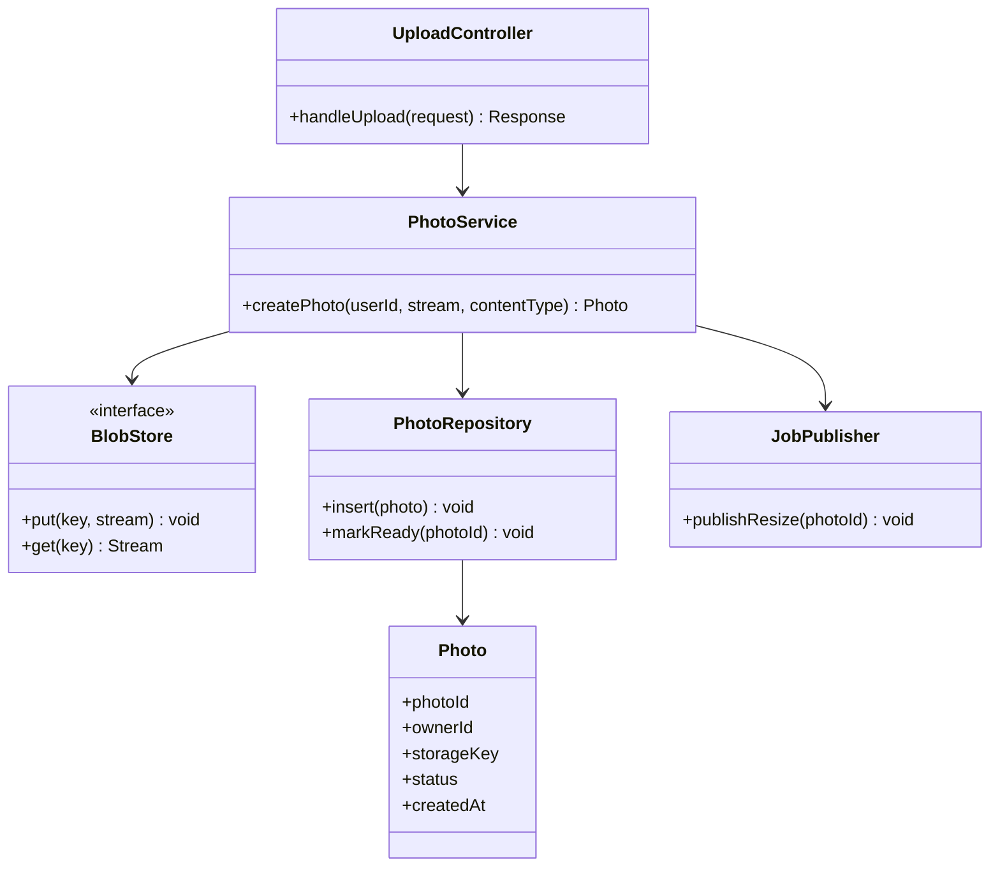

**Figure 1.4 — ADR lifecycle.**

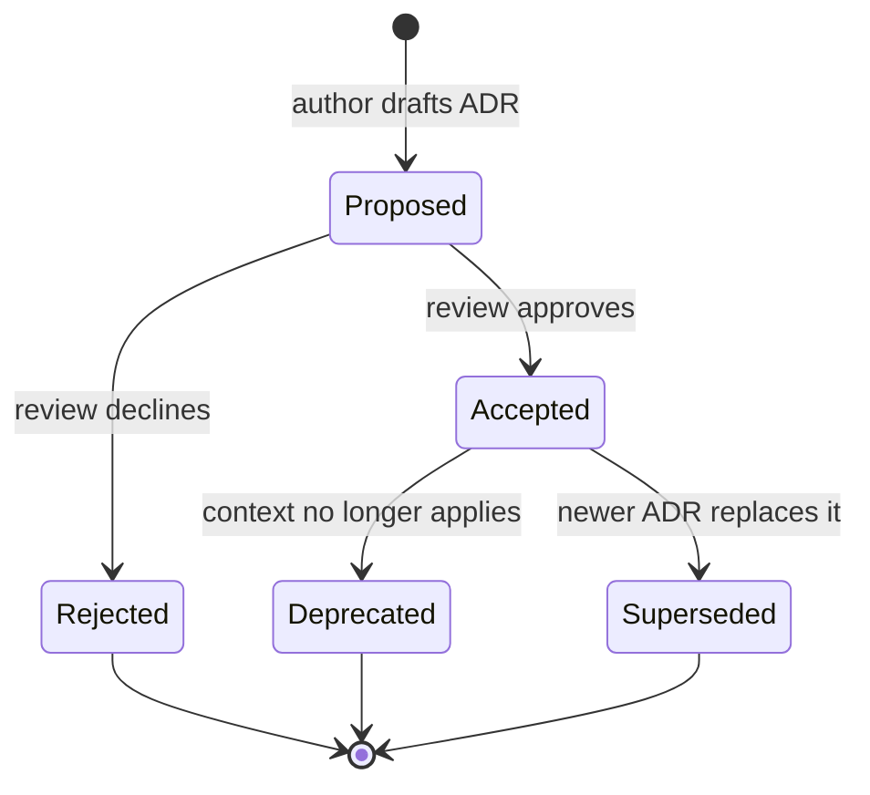

**Figure 1.5 — PhotoShare v1: stateless application tier and managed storage.**

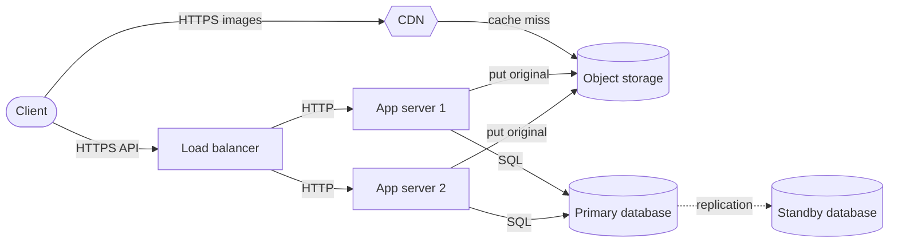

**Figure 1.6 — PhotoShare v2: cache, read replicas and asynchronous processing.**


**Figure 1.7 — PhotoShare v3: services, partitioned data and multi-zone deployment.**

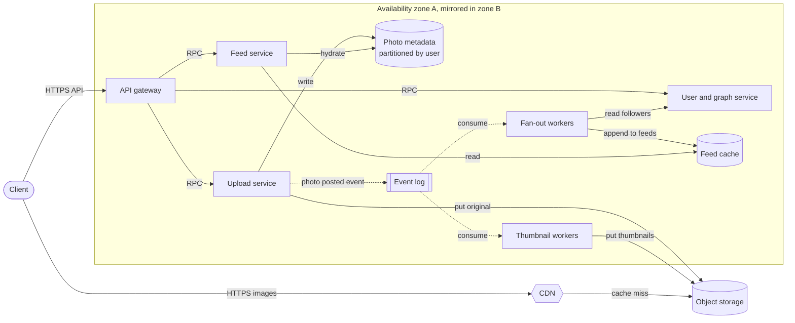

**Figure 1.8 — The life of a design in a typical engineering organization.**


**Figure 1.9 — A typical 45-minute system design interview.**

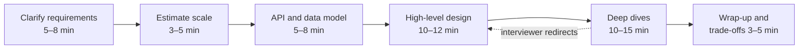

## Chapter 2 — How to Think Like a System Designer

**Figure 2.1 — The system designer's thinking loop.**

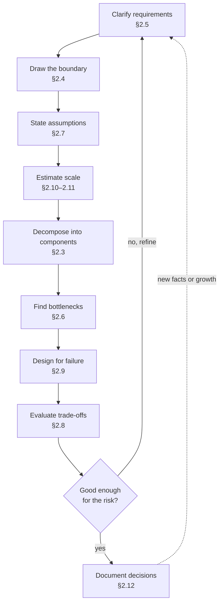

**Figure 2.2 — QuickBite first-pass decomposition.**


**Figure 2.3 — QuickBite system-context diagram.**

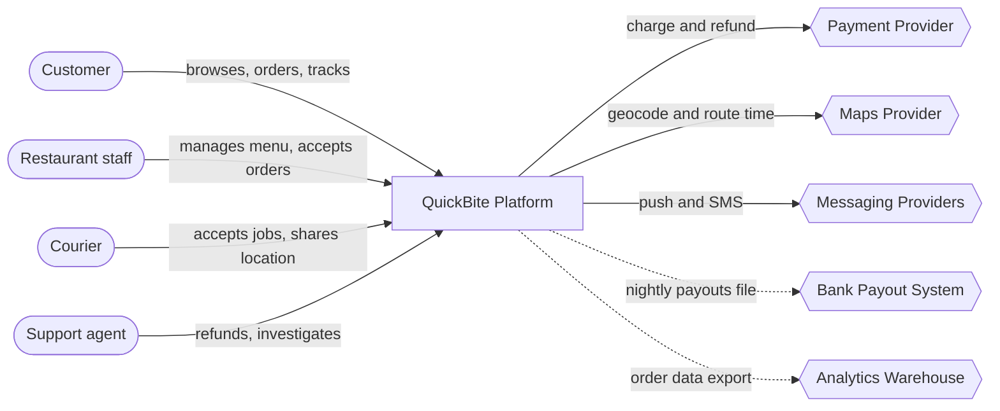

**Figure 2.4 — Finding the bottleneck with the USE method.**

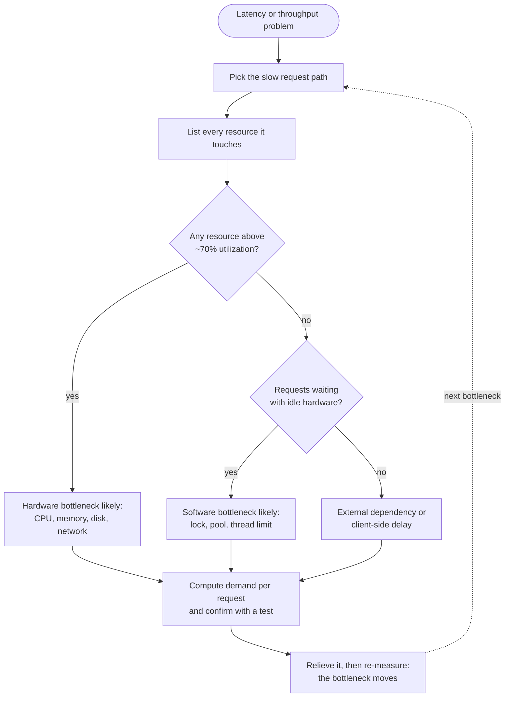

**Figure 2.5 — Choosing the decision process by reversibility.**

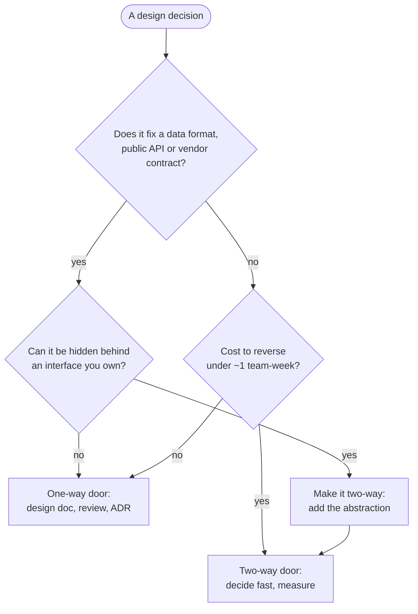

**Figure 2.6 — QuickBite checkout designed for failure.**

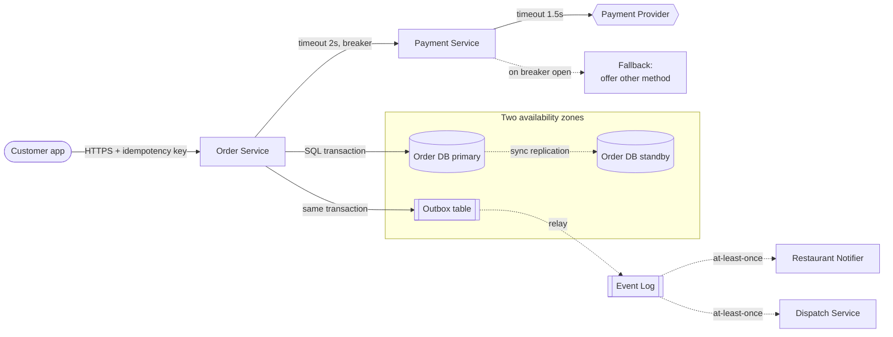

**Figure 2.7 — QuickBite C4 container view, after the §2.8 decision.**

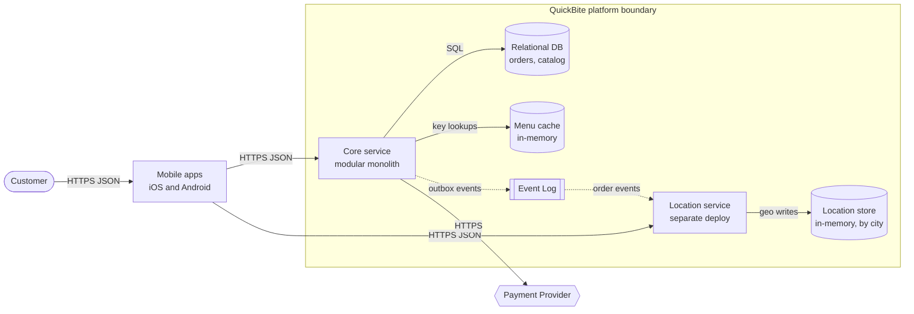

**Figure 2.8 — ADR life cycle.**

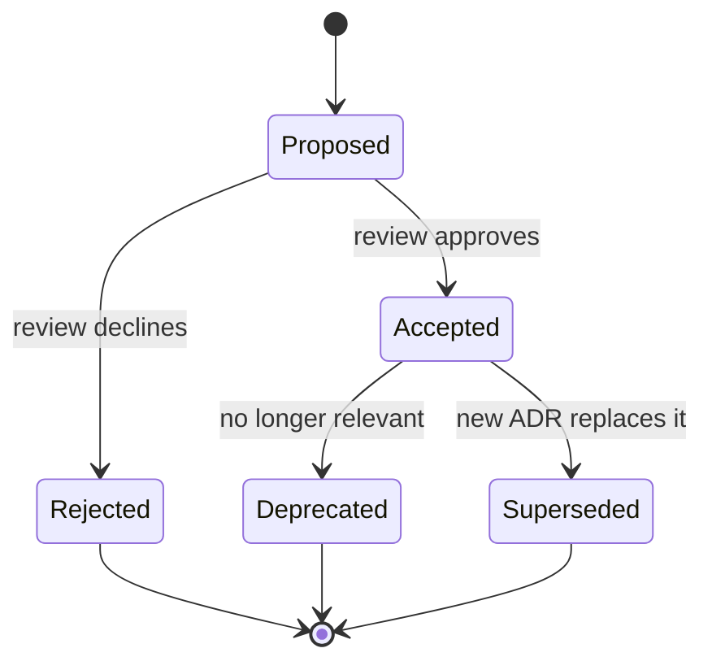

## Chapter 3 — The System Design Learning Method

**Figure 3.1 — The ten-step concept-mastery loop.**

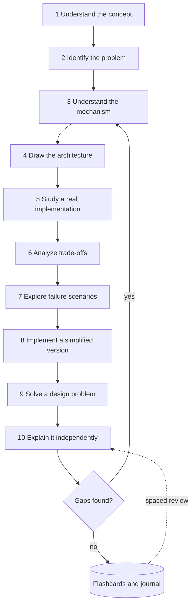

**Figure 3.2 — Consistent hashing in a client-routed distributed cache.**

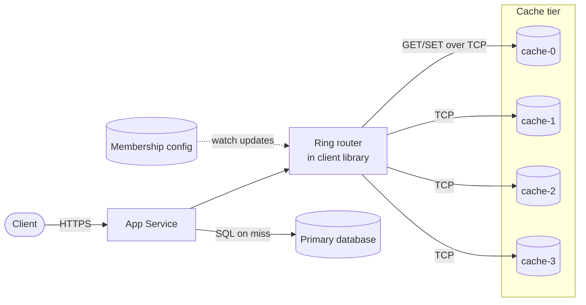

**Figure 3.3 — Session read when the primary owner has failed.**

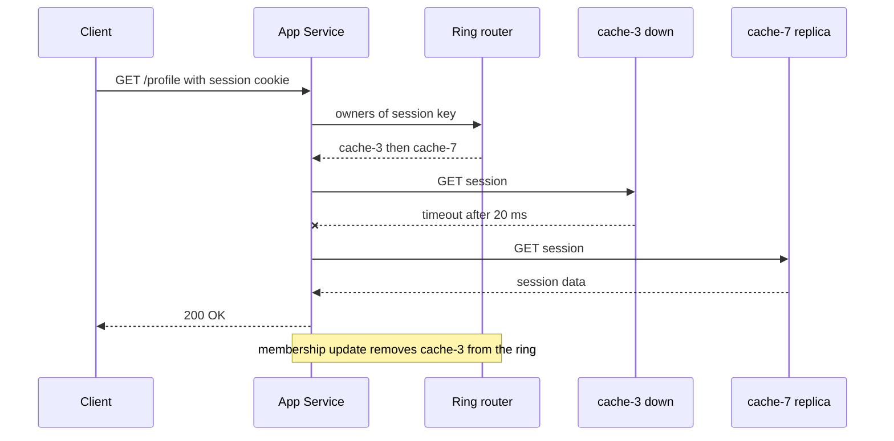

**Figure 3.4 — A five-box Leitner schedule for flashcards.**

```mermaid
stateDiagram-v2
  [*] --> Box0
  Box0 --> Box1: recalled
  Box1 --> Box2: recalled
  Box2 --> Box3: recalled
  Box3 --> Box4: recalled
  Box4 --> Box4: recalled
  Box1 --> Box0: forgot
  Box2 --> Box0: forgot
  Box3 --> Box0: forgot
  Box4 --> Box0: forgot
  Box0 --> Box0: forgot
  note right of Box0: review after 1 day
  note right of Box4: review after 35 days
```

**Figure 3.5 — The three-pass reading decision flow.**

```mermaid
flowchart TD
  P([Paper]) --> F["Pass 1: 5 to 10 min<br/>answer the five Cs"]
  F --> D1{Relevant to my goal?}
  D1 -->|no| A[(Reading log: one-line note)]
  D1 -->|yes| S["Pass 2: up to 1 h<br/>figures, claims, evidence"]
  S --> D2{Need to build or critique it?}
  D2 -->|no| A
  D2 -->|yes| T["Pass 3: re-implement mentally<br/>challenge assumptions"]
  T --> L["Feed loop steps 5 to 8"]
  L --> A
```

**Figure 3.6 — The 12-month beginner path (months shown as M01–M12).**

```mermaid
gantt
  title Beginner path through Book I
  dateFormat YYYY-MM-DD
  axisFormat M%m
  section Level 1
  Ch 1-4 foundations and method        :m1, 2027-01-01, 31d
  Ch 5-7 hardware OS networking        :m2, after m1, 28d
  Ch 8-10 web realtime security        :m3, after m2, 31d
  section Level 2
  Ch 11-12 and 17 data systems         :m4, after m3, 30d
  Ch 14-15 and 18-19 scaling           :m5, after m4, 31d
  Ch 20-22 and Ch 52 part 1            :m6, after m5, 30d
  section Level 3 core
  Ch 24-27 distributed systems         :m7, after m6, 31d
  Ch 29-32 data processing messaging   :m8, after m7, 31d
  Ch 33-38 architecture and LLD        :m9, after m8, 30d
  Ch 39-43 operations                  :m10, after m9, 31d
  section Integration
  Ch 52-56 case studies and Ch 93      :m11, after m10, 30d
  Ch 87-91 interviews and capstone     :m12, after m11, 31d
```

**Figure 3.7 — The postmortem study loop.**

```mermaid
flowchart LR
  R{{Public incident report}} --> T["Reconstruct the timeline"]
  T --> A["Draw the architecture<br/>mark the trigger point"]
  A --> CF["Separate trigger from<br/>contributing factors"]
  CF --> M["Map each factor to a chapter"]
  M --> P["Write the prevention<br/>you would have designed"]
  P --> G["Generalize to one rule"]
  G --> J[(Journal and flashcards)]
  J -.->|spaced review| A
```

## Chapter 4 — Quantitative Foundations for System Design

**Figure 4.1 — B-tree fan-out turns a billion keys into four levels.**

```mermaid
flowchart TD
  R["Root page<br/>~819 child pointers"] --> I1["Level 2 page 1"]
  R --> I2["Level 2 ...<br/>819 pages"]
  I1 --> J1["Level 3 page<br/>~670 thousand pages"]
  I1 --> J2["Level 3 ..."]
  J1 --> L1["Leaf page<br/>holds keys and row refs"]
  J1 --> L2["Leaf ...<br/>~1 billion keys total"]
  L1 --> DB[(Table rows on disk)]
  subgraph Cached["Usually cached in memory"]
    R
    I1
    I2
  end
```

**Figure 4.2 — Fan-out: the slowest leaf determines the response time.**

```mermaid
flowchart LR
  C([Client]) -->|HTTPS| R[Root service]
  R -->|RPC| L1[Leaf 1]
  R -->|RPC| L2[Leaf 2]
  R -->|RPC| L3["Leaf ..."]
  R -->|RPC| LN[Leaf N]
  L1 --> D1[(Partition 1)]
  L2 --> D2[(Partition 2)]
  LN --> DN[(Partition N)]
  LN -.->|slow reply| R
```

**Figure 4.3 — The M/M/1 queue.**

```mermaid
flowchart LR
  A([Arrivals rate λ]) -->|random gaps| Q[[FIFO queue<br/>Lq jobs waiting]]
  Q -->|next job| S["Server<br/>rate μ, busy fraction ρ"]
  S -->|completed| D([Departures rate λ])
```

**Figure 4.4 — One shared queue versus separate queues.**

```mermaid
flowchart LR
  subgraph Shared["M/M/2: one shared queue"]
    A1([Arrivals 80/s]) --> Q1[[Shared queue]]
    Q1 --> S1[Server A 50/s]
    Q1 --> S2[Server B 50/s]
  end
  subgraph Split["2 x M/M/1: separate queues"]
    A2([Arrivals 80/s]) -->|random split| Q2[[Queue A]]
    A2 -->|random split| Q3[[Queue B]]
    Q2 --> S3[Server A 50/s]
    Q3 --> S4[Server B 50/s]
  end
```

**Figure 4.5 — Choosing the boundary for Little's Law.**

```mermaid
flowchart LR
  C([Clients]) -->|HTTPS 250 RPS| LB[Load balancer]
  subgraph Instance["Boundary 1: one service instance"]
    T["Thread pool<br/>L = 20 busy threads"]
    P["DB connection pool<br/>holds conn 5 ms"]
    T --> P
  end
  LB -->|HTTP| T
  subgraph DBB["Boundary 2: database"]
    DB[(PostgreSQL)]
  end
  P -->|SQL| DB
```

**Figure 4.6 — Series, parallel and k-of-n availability.**

```mermaid
flowchart LR
  C([Client]) -->|HTTPS| LB["Load balancer<br/>A = 0.9999"]
  subgraph Parallel["Parallel: either node suffices"]
    W1["App node 1<br/>A = 0.99"]
    W2["App node 2<br/>A = 0.99"]
  end
  LB --> W1
  LB --> W2
  subgraph Quorum["2-of-3: majority must be up"]
    R1[(Replica 1)]
    R2[(Replica 2)]
    R3[(Replica 3)]
  end
  W1 -->|SQL| R1
  W2 -->|SQL| R1
  R1 -->|replicate| R2
  R1 -->|replicate| R3
```

**Figure 4.7 — The up–down cycle of a repairable component.**

```mermaid
stateDiagram-v2
  [*] --> Up
  Up --> Down : failure at rate 1/MTBF
  Down --> Up : repair at rate 1/MTTR
```

**Figure 4.8 — The replica-loss race for three-way replication.**

```mermaid
stateDiagram-v2
  [*] --> ThreeCopies
  ThreeCopies --> TwoCopies : any of 3 fails, rate 3λ
  TwoCopies --> ThreeCopies : re-replicated within T
  TwoCopies --> OneCopy : any of 2 fails, rate 2λ
  OneCopy --> TwoCopies : re-replicated within T
  OneCopy --> Lost : last copy fails, rate λ
  Lost --> [*]
```

**Figure 4.9 — Six recurring quantitative relationships.**

```mermaid
flowchart LR
  U[Utilization] -->|raises| TP[Throughput]
  U -->|raises sharply| LAT[Latency]
  B[Batch size] -->|raises| TP
  B -->|raises| LAT
  REP[Replica count] -->|raises| DUR[Durability]
  REP -->|raises| COST[Cost]
  MTTR[Repair time] -->|lowers| AV[Availability]
  MTTR -->|lowers| DUR
  ACC[Accuracy target] -->|raises| LAT
  ACC -->|raises| COST
```

## Chapter 5 — Computer Architecture

**Figure 5.1 — Inside a single-socket server.**

```mermaid
flowchart LR
  subgraph PKG["CPU package - one socket"]
    subgraph C0["Core 0"]
      R0[Registers] --> L1A["L1 instr + data"]
      L1A --> L2A[L2 cache]
    end
    subgraph C1["Core 1"]
      R1[Registers] --> L1B["L1 instr + data"]
      L1B --> L2B[L2 cache]
    end
    L3["Shared L3 cache"]
    MC[Memory controller]
    PCIE["PCIe controller"]
    L2A --> L3
    L2B --> L3
    L3 --> MC
    L3 --> PCIE
  end
  MC -->|DDR5 channels| DRAM[(DRAM - main memory)]
  PCIE -->|PCIe x4| NVME[(NVMe SSD)]
  PCIE -->|PCIe x16| NIC{{Network card}}
  PCIE -->|PCIe x16| GPU{{GPU accelerator}}
```

**Figure 5.2 — A pipelined core with a branch predictor.**

```mermaid
flowchart LR
  BP{Branch predictor} -->|predicted next PC| IF[Fetch]
  IF --> ID[Decode]
  ID --> EX[Execute]
  EX --> MEM["Memory access"]
  MEM --> WB["Write back"]
  ICACHE[(L1 instruction cache)] --> IF
  DCACHE[(L1 data cache)] <--> MEM
  EX -.->|mispredict: flush and refetch| BP
```

**Figure 5.3 — What happens on a load instruction.**

```mermaid
flowchart TD
  LD([Load from address A]) --> Q1{"In L1?"}
  Q1 -->|hit ~1 ns| DONE([Value to register])
  Q1 -->|miss| Q2{"In L2?"}
  Q2 -->|hit ~4 ns| FILL1[Copy line into L1]
  Q2 -->|miss| Q3{"In L3?"}
  Q3 -->|hit ~15 ns| FILL2[Copy line into L2 and L1]
  Q3 -->|miss| MEM[(DRAM ~100 ns)]
  MEM --> FILL3[Copy 64-byte line into caches]
  FILL1 --> DONE
  FILL2 --> DONE
  FILL3 --> DONE
```

**Figure 5.4 — MESI state transitions for one cache line in one core's cache.**

```mermaid
stateDiagram-v2
  [*] --> I
  I --> E: local read, no other copies
  I --> S: local read, other copies exist
  I --> M: local write, others invalidated
  E --> M: local write, no bus traffic
  E --> S: another core reads
  E --> I: another core writes
  S --> M: local write, others invalidated
  S --> I: another core writes
  M --> S: another core reads, write back first
  M --> I: another core writes, write back first
```

**Figure 5.5 — The memory and storage hierarchy (as of 2024–2025, approximate).**

```mermaid
flowchart TB
  REG["Registers<br/>~0.3 ns · ~1 KiB per core"] --> L1["L1 cache<br/>~1 ns · 32-64 KiB per core"]
  L1 --> L2["L2 cache<br/>~4 ns · 0.5-3 MiB per core"]
  L2 --> L3["L3 cache<br/>~15 ns · 8-500 MiB per chip"]
  L3 --> DRAM[("DRAM<br/>~100 ns · GBs to TBs")]
  DRAM --> SSD[("NVMe SSD<br/>~50-100 µs · TBs")]
  SSD --> HDD[("Hard disk<br/>~5-15 ms · 10-30 TB each")]
  HDD --> ARC[("Tape or archive storage<br/>seconds to hours · PBs")]
```

**Figure 5.6 — How an SSD handles an overwrite and garbage collection.**

```mermaid
flowchart LR
  H([Host writes logical block 42]) -->|NVMe command| FTL[Flash translation layer]
  FTL -->|program new page| OPEN[(Open block: free pages)]
  FTL -->|mark old page invalid| OLD[(Block with old copy)]
  FTL -->|update mapping 42 to new page| MAP[(Mapping table in DRAM)]
  GC[Garbage collector] -.->|pick block with fewest valid pages| OLD
  GC -.->|copy remaining valid pages| OPEN
  GC -.->|erase whole block| FREE[(Free block pool)]
  FREE -.-> OPEN
```

**Figure 5.7 — Reading a block from an NVMe SSD with DMA and an interrupt.**

```mermaid
sequenceDiagram
  participant App as Application thread
  participant K as Kernel driver
  participant SQ as Submission and completion queues in RAM
  participant D as NVMe controller
  App->>K: read syscall, thread blocks
  K->>SQ: write command with buffer address
  K->>D: ring doorbell register
  D->>SQ: fetch command via DMA
  D->>D: read flash pages, about 50-100 µs
  D->>SQ: DMA data into buffer, post completion entry
  D-->>K: MSI-X interrupt
  K->>App: wake thread, read returns
```

**Figure 5.8 — Diagnosing what limits a workload.**

```mermaid
flowchart TD
  S([Service is slow or saturated]) --> Q1{"CPU busy near 100%<br/>on the busy cores?"}
  Q1 -->|yes| Q2{"IPC low and cache<br/>misses high?"}
  Q2 -->|no| CPU[CPU-bound: optimize code or add cores]
  Q2 -->|yes| MEMB[Memory-bound: improve locality]
  Q1 -->|no| Q3{"Disk busy or high<br/>I/O wait and queue?"}
  Q3 -->|yes| IO[Storage-bound: cache, batch, faster device]
  Q3 -->|no| Q4{"Threads blocked on<br/>network or locks?"}
  Q4 -->|network| NET[Network or dependency bound]
  Q4 -->|locks| LOCK[Contention-bound: reduce shared state]
```

**Figure 5.9 — A two-socket NUMA server.**

```mermaid
flowchart LR
  subgraph N0["NUMA node 0"]
    S0["Socket 0<br/>cores + L3"] -->|DDR5| M0[(Local DRAM 0)]
    S0 -->|PCIe| NIC0{{NIC}}
  end
  subgraph N1["NUMA node 1"]
    S1["Socket 1<br/>cores + L3"] -->|DDR5| M1[(Local DRAM 1)]
    S1 -->|PCIe| SSD1[(NVMe SSD)]
  end
  S0 <-->|socket interconnect| S1
```

**Figure 5.10 — From hardware facts to design decisions.**

```mermaid
flowchart LR
  F1["Random I/O far slower<br/>than sequential"] --> D1["Append-only logs, LSM trees,<br/>large blocks, columnar files"]
  F2["Fixed cost per operation<br/>syscall, RTT, interrupt"] --> D2["Batching, pipelining,<br/>group commit"]
  F3["Each level ~3-1000x slower<br/>than the one above"] --> D3["Caching at every layer,<br/>keep working set in RAM"]
  F4["Cache lines and NUMA<br/>reward nearby data"] --> D4["Data locality: arrays, sharding,<br/>compute near data"]
  F5["Devices need many<br/>requests in flight"] --> D5["Async I/O, thread pools,<br/>queue depth"]
  F6["Shared written data<br/>does not scale across cores"] --> D6["Per-core state, shared-nothing,<br/>partitioning"]
```

## Chapter 6 — Operating Systems

**Figure 6.1 — Layout of a process's virtual address space on Linux x86-64.**

```mermaid
flowchart TB
  K["Kernel space<br/>upper half, kernel mode only"]
  ST["Stack<br/>grows downward"]
  MM["Memory-mapped region<br/>shared libraries, mmap files"]
  HP["Heap<br/>grows upward via brk or mmap"]
  BSS["BSS<br/>zero-initialized globals"]
  DATA["Data<br/>initialized globals"]
  TEXT["Text<br/>machine code, read-only"]
  K --- ST --- MM --- HP --- BSS --- DATA --- TEXT
```

**Figure 6.2 — Process state diagram.**

```mermaid
stateDiagram-v2
  [*] --> New
  New --> Ready: admitted
  Ready --> Running: dispatched by scheduler
  Running --> Ready: preempted or time slice expired
  Running --> Blocked: waits for I/O, lock or sleep
  Blocked --> Ready: event completes
  Running --> Terminated: exit
  Terminated --> [*]: parent reaps exit status
```

**Figure 6.3 — A context switch between two threads triggered by a timer interrupt.**

```mermaid
sequenceDiagram
  participant A as Thread A, user mode
  participant CPU as CPU core
  participant K as Kernel scheduler
  participant B as Thread B, user mode
  A->>CPU: executing instructions
  CPU-->>K: timer interrupt, switch to kernel mode
  K->>K: save A registers to A kernel stack
  K->>K: update A accounting, mark A Ready
  K->>K: pick next task, B
  K->>CPU: load B page table root if other process
  K->>K: restore B registers and stack pointer
  K->>B: return to user mode
  B->>CPU: executing instructions
```

**Figure 6.4 — Multi-level feedback queue decisions.**

```mermaid
flowchart TB
  N([New job]) --> Q0[Queue 0: highest priority<br/>short slice]
  Q0 --> D0{Allotment used up?}
  D0 -->|no, blocked for I/O| Q0
  D0 -->|yes| Q1[Queue 1: medium priority<br/>longer slice]
  Q1 --> D1{Allotment used up?}
  D1 -->|no| Q1
  D1 -->|yes| Q2[Queue 2: lowest priority<br/>longest slice]
  Q2 --> Q2
  T{{Boost timer every S ms}} -.->|move all jobs| Q0
```

**Figure 6.5 — Translating a virtual address: TLB, page walk and page fault.**

```mermaid
flowchart TB
  VA([CPU issues virtual address]) --> T{TLB hit?}
  T -->|yes, about 1 cycle| PA[Physical address<br/>to cache and RAM]
  T -->|no| W[Hardware page walk<br/>up to 4 memory reads]
  W --> P{Page present<br/>and permitted?}
  P -->|yes| F[Fill TLB entry] --> PA
  P -->|no| PF[Page fault:<br/>trap into kernel]
  PF --> V{Valid mapping?}
  V -->|no| SEG[Send SIGSEGV<br/>process usually dies]
  V -->|yes, page in RAM| MIN[Minor fault:<br/>update page table]
  V -->|yes, page on disk| MAJ[Major fault:<br/>block thread, read from disk]
  MAJ --> DISK[(SSD or HDD)]
  MIN --> RET[Retry the instruction]
  DISK --> RET
  RET --> VA
```

**Figure 6.6 — A `read()` system call that must wait for the disk.**

```mermaid
sequenceDiagram
  participant App as Application
  participant Lib as libc wrapper
  participant K as Kernel
  participant PC as Page cache
  participant D as Disk via driver
  App->>Lib: read fd, buf, 4096
  Lib->>K: syscall instruction, number in register
  K->>K: switch to kernel stack, validate fd and buffer
  K->>PC: look up file page
  PC->>D: miss, submit read request
  K->>K: block thread, schedule another
  D-->>K: interrupt, read complete
  K->>K: wake thread, mark Ready
  K->>App: copy data to user buffer, sysret, return bytes read
```

**Figure 6.7 — Two threads lose an update to a shared counter.**

```mermaid
sequenceDiagram
  participant T1 as Thread 1
  participant M as Shared counter in memory
  participant T2 as Thread 2
  Note over M: counter = 5
  T1->>M: read counter, gets 5
  T2->>M: read counter, gets 5
  T1->>T1: compute 5 + 1 = 6
  T2->>T2: compute 5 + 1 = 6
  T1->>M: write 6
  T2->>M: write 6
  Note over M: counter = 6, expected 7
```

**Figure 6.8 — Resource-allocation graph with a deadlock cycle.**

```mermaid
flowchart LR
  T1[Thread T1] -->|waits for| B[(Lock B)]
  B -->|held by| T2[Thread T2]
  T2 -->|waits for| A[(Lock A)]
  A -->|held by| T1
```

**Figure 6.9 — Priority inversion on Mars Pathfinder.**

```mermaid
sequenceDiagram
  participant L as Low: weather data task
  participant M as Medium: communications task
  participant H as High: bus management task
  participant W as Watchdog timer
  L->>L: lock information-bus mutex
  H->>H: wakes, tries to lock mutex, blocks on L
  M->>M: wakes, preempts L, runs for a long time
  Note over L: L cannot run, so cannot unlock
  W-->>H: H missed its deadline
  W-->>W: declare fault, reset whole spacecraft
```

**Figure 6.10 — An event loop on epoll.**

```mermaid
flowchart TB
  S([Start]) --> REG[Register listening socket<br/>with epoll]
  REG --> WAIT[epoll_wait: sleep until<br/>a socket is ready or timer due]
  WAIT --> READY{Which event?}
  READY -->|listening socket| ACC[accept new connection<br/>register it with epoll]
  READY -->|client readable| RD[read bytes, parse,<br/>compute small response]
  READY -->|client writable| WR[write pending bytes]
  READY -->|timer due| TM[run timer callback]
  RD --> SLOW{Slow or blocking<br/>work needed?}
  SLOW -->|no| WR
  SLOW -->|yes| POOL[[Worker thread pool]]
  POOL -.->|completion event| WAIT
  ACC --> WAIT
  WR --> WAIT
  TM --> WAIT
```

**Figure 6.11 — io_uring submission and completion rings.**

```mermaid
sequenceDiagram
  participant App as Application thread
  participant SQ as Submission ring, shared memory
  participant K as Kernel
  participant CQ as Completion ring, shared memory
  App->>SQ: write 32 request entries, no syscall
  App->>K: io_uring_enter once, submit 32
  K->>SQ: consume entries
  K-->>CQ: post completions as I/O finishes
  App->>CQ: read completion entries, no syscall
```

**Figure 6.12 — The write path from application to stable storage.**

```mermaid
flowchart LR
  APP[Application] -->|write| PC[Page cache<br/>dirty pages in RAM]
  PC -.->|background writeback<br/>about 30 s later| DC[Drive write cache<br/>often volatile]
  APP -->|fsync| PC
  PC -->|fsync forces write<br/>plus cache flush| DC
  DC --> MEDIA[(Stable media:<br/>NAND flash or platter)]
```

## Chapter 7 — Networking Fundamentals

**Figure 7.1 — Encapsulation down the sender's stack and decapsulation up the receiver's.**

```mermaid
flowchart LR
  subgraph Sender["Sender host"]
    A1["Application<br/>HTTP message"] --> T1["Transport<br/>TCP hdr + message"]
    T1 --> N1["Network<br/>IP hdr + segment"]
    N1 --> L1["Link<br/>Eth hdr + packet + FCS"]
  end
  subgraph Router["Router"]
    L2["Link<br/>strip and rebuild frame"] --> N2["Network<br/>read dest IP, TTL-1"]
    N2 --> L3["Link<br/>new Eth frame"]
  end
  subgraph Receiver["Receiver host"]
    L4["Link<br/>check FCS, strip"] --> N4["Network<br/>check dest IP, strip"]
    N4 --> T4["Transport<br/>find socket by 4-tuple"]
    T4 --> A4["Application<br/>read bytes"]
  end
  L1 -->|bits on wire| L2
  L3 -->|bits on wire| L4
```

**Figure 7.2 — BGP routing between autonomous systems, with an anycast prefix announced from two sites.**

```mermaid
flowchart LR
  U1([User in Paris]) --> ISP1[ISP AS 64500]
  U2([User in Tokyo]) --> ISP2[ISP AS 64501]
  ISP1 -->|BGP peering| T1[Transit AS 64510]
  ISP2 -->|BGP peering| T2[Transit AS 64511]
  T1 --- T2
  T1 -->|best path| E1["Edge site Frankfurt<br/>announces 198.51.100.0/24"]
  T2 -->|best path| E2["Edge site Osaka<br/>announces 198.51.100.0/24"]
  E1 --> O[(Origin datacenter)]
  E2 --> O
```

**Figure 7.3 — DNS resolution of www.example.com with an empty cache.**

```mermaid
sequenceDiagram
    autonumber
    participant App as Browser
    participant Stub as OS stub resolver
    participant Rec as Recursive resolver
    participant Root as Root server
    participant TLD as .com TLD server
    participant Auth as example.com authoritative
    App->>Stub: getaddrinfo www.example.com
    Stub->>Rec: recursive query A www.example.com
    Rec->>Root: iterative query A www.example.com
    Root-->>Rec: referral - NS records for .com plus glue
    Rec->>TLD: iterative query A www.example.com
    TLD-->>Rec: referral - NS records for example.com plus glue
    Rec->>Auth: iterative query A www.example.com
    Auth-->>Rec: answer A 192.0.2.10 TTL 300
    Rec-->>Stub: answer A 192.0.2.10 TTL 300
    Stub-->>App: address list
    Note over Rec: caches every record for its TTL
```

**Figure 7.4 — TCP three-way handshake followed by the first request.**

```mermaid
sequenceDiagram
    autonumber
    participant C as Client
    participant S as Server
    Note over S: LISTEN on port 443
    C->>S: SYN seq=x, options MSS, WScale, SACK-permitted
    Note over C: SYN_SENT
    S-->>C: SYN-ACK seq=y ack=x+1, server options
    Note over S: SYN_RECEIVED, half-open queue
    C->>S: ACK seq=x+1 ack=y+1
    Note over C,S: ESTABLISHED after 1 RTT for the client
    C->>S: data - first request bytes
    S-->>C: data - response bytes, ack
```

**Figure 7.5 — TCP four-way close and the TIME_WAIT state.**

```mermaid
sequenceDiagram
    autonumber
    participant A as Active closer
    participant P as Passive closer
    A->>P: FIN seq=u
    Note over A: FIN_WAIT_1
    P-->>A: ACK ack=u+1
    Note over P: CLOSE_WAIT - app may still send
    Note over A: FIN_WAIT_2
    P->>A: FIN seq=v
    Note over P: LAST_ACK
    A-->>P: ACK ack=v+1
    Note over A: TIME_WAIT for 2 x MSL
    Note over P: CLOSED
    Note over A: CLOSED after timer
```

**Figure 7.6 — Loss-based TCP congestion control states (Reno-style).**

```mermaid
stateDiagram-v2
    [*] --> SlowStart
    SlowStart --> CongestionAvoidance: cwnd reaches ssthresh
    SlowStart --> FastRecovery: 3 duplicate ACKs
    CongestionAvoidance --> FastRecovery: 3 duplicate ACKs, halve cwnd
    FastRecovery --> CongestionAvoidance: lost data acknowledged
    CongestionAvoidance --> SlowStart: RTO timeout, cwnd = 1
    FastRecovery --> SlowStart: RTO timeout, cwnd = 1
```

**Figure 7.7 — Protocol stacks for the three HTTP versions.**

```mermaid
flowchart TB
  subgraph H1["HTTP/1.1"]
    A1["HTTP/1.1 text messages"] --> B1["TLS 1.2 or 1.3"] --> C1["TCP"] --> D1["IP"]
  end
  subgraph H2["HTTP/2"]
    A2["HTTP/2 binary frames<br/>streams + HPACK"] --> B2["TLS 1.2 or 1.3"] --> C2["TCP"] --> D2["IP"]
  end
  subgraph H3["HTTP/3"]
    A3["HTTP/3 frames + QPACK"] --> C3["QUIC: streams, reliability,<br/>congestion control, TLS 1.3"] --> E3["UDP"] --> D3["IP"]
  end
```

**Figure 7.8 — TLS 1.3 full handshake (after the TCP handshake).**

```mermaid
sequenceDiagram
    autonumber
    participant C as Client
    participant S as Server
    C->>S: ClientHello - random, cipher suites, key_share, SNI, ALPN
    Note over S: chooses parameters, computes shared secret
    S-->>C: ServerHello - random, key_share
    S-->>C: encrypted EncryptedExtensions - ALPN result
    S-->>C: encrypted Certificate chain
    S-->>C: encrypted CertificateVerify - signature over transcript
    S-->>C: encrypted Finished - MAC over transcript
    Note over C: validates chain and hostname, checks signature
    C->>S: encrypted Finished
    C->>S: encrypted application data - HTTP request
    S-->>C: encrypted NewSessionTicket for resumption
    S-->>C: encrypted HTTP response
```

**Figure 7.9 — WebSocket opening handshake and framing.**

```mermaid
sequenceDiagram
    autonumber
    participant B as Browser
    participant S as Server
    B->>S: GET /chat HTTP/1.1, Upgrade websocket, Connection Upgrade
    Note right of B: Sec-WebSocket-Key dGhlIHNhbXBsZSBub25jZQ== and Version 13
    S-->>B: HTTP/1.1 101 Switching Protocols
    Note left of S: Sec-WebSocket-Accept s3pPLMBiTxaQ9kYGzzhZRbK+xOo=
    B->>S: masked text frame - hello
    S-->>B: text frame - welcome
    S-->>B: text frame - server push, unrequested
    B->>S: ping or close frame
```

**Figure 7.10 — Forward proxy versus reverse proxy.**

```mermaid
flowchart LR
  subgraph Corp["Client side network"]
    C1([Employee laptop]) -->|HTTP CONNECT| FP[Forward proxy]
    C2([Employee laptop]) -->|HTTP CONNECT| FP
  end
  FP -->|HTTPS| INET{{Internet sites}}
  U([Internet user]) -->|HTTPS| RP["Reverse proxy<br/>TLS termination, routing"]
  subgraph DC["Server side network"]
    RP -->|HTTP or gRPC| S1[App server 1]
    RP -->|HTTP or gRPC| S2[App server 2]
    S1 --> DB[(Database)]
    S2 --> DB
  end
```

**Figure 7.11 — Source NAT for an outbound connection.**

```mermaid
sequenceDiagram
    autonumber
    participant H as Host 10.0.1.5
    participant N as NAT gateway 203.0.113.7
    participant W as Web server 198.51.100.20
    H->>N: src 10.0.1.5 port 51000, dst 198.51.100.20 port 443
    Note over N: create mapping 10.0.1.5 port 51000 to public port 40001
    N->>W: src 203.0.113.7 port 40001, dst 198.51.100.20 port 443
    W-->>N: src 198.51.100.20 port 443, dst 203.0.113.7 port 40001
    Note over N: look up port 40001 in table
    N-->>H: src 198.51.100.20 port 443, dst 10.0.1.5 port 51000
```

**Figure 7.12 — A leaf–spine fabric with ECMP.**

```mermaid
flowchart TB
  subgraph Spine["Spine layer"]
    SP1[Spine 1]
    SP2[Spine 2]
    SP3[Spine 3]
    SP4[Spine 4]
  end
  subgraph Leaf["Leaf layer - top of rack"]
    L1[Leaf 1]
    L2[Leaf 2]
    L3[Leaf 3]
  end
  L1 --- SP1
  L1 --- SP2
  L1 --- SP3
  L1 --- SP4
  L2 --- SP1
  L2 --- SP2
  L2 --- SP3
  L2 --- SP4
  L3 --- SP1
  L3 --- SP2
  L3 --- SP3
  L3 --- SP4
  R1([Rack 1 servers]) --- L1
  R2([Rack 2 servers]) --- L2
  R3([Rack 3 servers]) --- L3
  L3 ---|uplink| EDGE{{Border routers to WAN}}
```

**Figure 7.13 — Loading https://www.example.com/ end to end.**

```mermaid
sequenceDiagram
    autonumber
    participant U as Browser
    participant R as Recursive resolver
    participant D as DNS hierarchy
    participant E as CDN edge reverse proxy
    participant O as Origin service
    U->>R: query A and AAAA www.example.com
    R->>D: iterative queries root, TLD, authoritative
    D-->>R: CNAME to CDN name, then A and AAAA, TTL 60
    R-->>U: addresses of nearest edge via anycast
    U->>E: TCP SYN
    E-->>U: SYN-ACK
    U->>E: ACK plus TLS ClientHello with SNI and ALPN h2
    E-->>U: ServerHello, certificate, Finished
    U->>E: Finished plus HTTP/2 GET / with HPACK headers
    alt cached at edge
        E-->>U: 200 OK from cache
    else cache miss
        E->>O: GET / over pooled HTTP/2 connection
        O-->>E: 200 OK HTML
        E-->>U: 200 OK HTML
    end
    U->>E: more GETs for CSS, JS, images on same connection
```

## Chapter 8 — Web Application Fundamentals

**Figure 8.1 — Three-tier client–server architecture.**

```mermaid
flowchart LR
  subgraph Clients
    B([Browser])
    M([Mobile app])
  end
  subgraph Edge
    LB["Load balancer (L7)"]
  end
  subgraph AppTier["Application tier - stateless"]
    A1[App server 1]
    A2[App server 2]
    A3[App server 3]
  end
  subgraph DataTier["Data tier - stateful"]
    C[(Cache)]
    DB[(Primary database)]
  end
  B -->|HTTPS| LB
  M -->|HTTPS| LB
  LB -->|HTTP| A1
  LB -->|HTTP| A2
  LB -->|HTTP| A3
  A1 -->|TCP| C
  A2 -->|TCP| DB
  A3 -->|TCP| DB
```

**Figure 8.2 — Backend-for-frontend aggregation.**

```mermaid
flowchart LR
  W([Web SPA]) -->|HTTPS JSON| BW[Web BFF]
  P([Mobile app]) -->|HTTPS JSON| BM[Mobile BFF]
  BW -->|gRPC| U[User service]
  BW -->|gRPC| O[Order service]
  BM -->|gRPC| U
  BM -->|gRPC| O
  BM -->|gRPC| R[Recommendation service]
  U --> UDB[(User DB)]
  O --> ODB[(Order DB)]
```

**Figure 8.3 — End-to-end lifecycle of one HTTPS API request.**

```mermaid
sequenceDiagram
  autonumber
  participant B as Browser
  participant R as DNS resolver
  participant L as Load balancer
  participant W as Web server
  participant A as Application
  participant C as Cache
  participant D as Database
  B->>R: Resolve shop.example.com
  R-->>B: A record 203.0.113.10, TTL 300 s
  B->>L: TCP SYN
  L-->>B: SYN-ACK, then ACK completes 1 RTT
  B->>L: TLS ClientHello
  L-->>B: ServerHello, certificate, Finished
  B->>L: GET /api/v1/orders/42 with cookie
  L->>W: Forward over pooled connection
  W->>A: Pass request via ASGI
  A->>A: Middleware - auth, rate limit, routing
  A->>C: GET order:42
  C-->>A: Miss
  A->>D: SELECT order 42 for this user
  D-->>A: One row
  A->>C: SET order:42 with TTL 60 s
  A-->>W: 200 OK, JSON body
  W-->>L: Response
  L-->>B: Response over TLS
```

**Figure 8.4 — N+1 resolution versus DataLoader batching.**

```mermaid
sequenceDiagram
  participant G as GraphQL executor
  participant L as DataLoader
  participant D as Database
  Note over G,D: Without batching
  G->>D: SELECT posts LIMIT 4
  G->>D: SELECT user WHERE id = 1
  G->>D: SELECT user WHERE id = 2
  G->>D: SELECT user WHERE id = 1
  G->>D: SELECT user WHERE id = 3
  Note over G,D: With DataLoader
  G->>D: SELECT posts LIMIT 4
  G->>L: load 1, load 2, load 1, load 3
  L->>L: Wait one tick, dedupe keys
  L->>D: SELECT users WHERE id IN 1, 2, 3
  D-->>L: 3 rows
  L-->>G: Resolve 4 promises
```

**Figure 8.5 — gRPC call mapped onto an HTTP/2 connection.**

```mermaid
flowchart LR
  subgraph ClientProcess["Client process"]
    APP[Application code] --> STUB[Generated stub]
  end
  subgraph Conn["One HTTP/2 connection over TLS"]
    S1[["Stream 1: GetOrder"]]
    S3[["Stream 3: WatchOrderStatus"]]
    S5[["Stream 5: GetOrder"]]
  end
  subgraph ServerProcess["Server process"]
    SRV[gRPC server runtime] --> IMPL[Service implementation]
  end
  STUB -->|HEADERS + DATA frames| S1
  STUB --> S3
  STUB --> S5
  S1 -->|length-prefixed protobuf| SRV
  S3 --> SRV
  S5 --> SRV
  IMPL --> DB[(Orders DB)]
```

**Figure 8.6 — Deadline propagation through a call chain.**

```mermaid
sequenceDiagram
  participant C as Client
  participant A as API service
  participant B as Pricing service
  participant D as Database
  C->>A: GetQuote, deadline now+300 ms
  A->>A: Auth and validation take 40 ms
  A->>B: GetPrice, deadline now+250 ms
  B->>D: Query with 200 ms statement timeout
  D-->>B: Rows after 30 ms
  B-->>A: Price after 45 ms
  A-->>C: Quote, total 95 ms
  Note over C,D: If B were slow, all three stop at the same absolute instant
```

**Figure 8.7 — Mixed versions during a rolling deployment.**

```mermaid
flowchart LR
  subgraph Producers
    P1["Producer v1<br/>writes fields 1-3"]
    P2["Producer v2<br/>writes fields 1-4"]
  end
  Q[["Topic or queue<br/>mixed v1 and v2 messages"]]
  subgraph Consumers
    C1["Consumer v1<br/>skips unknown field 4"]
    C2["Consumer v2<br/>defaults field 4 if absent"]
  end
  P1 -.->|v1 bytes| Q
  P2 -.->|v2 bytes| Q
  Q -.-> C1
  Q -.-> C2
```

**Figure 8.8 — Server-side session lookup.**

```mermaid
sequenceDiagram
  participant B as Browser
  participant A as App server
  participant S as Session store
  participant D as Database
  B->>A: POST /login with username and password
  A->>D: Fetch user and password hash
  D-->>A: User row
  A->>S: SET sess:8f2c with uid 42, TTL 3600 s
  A-->>B: 200 and Set-Cookie sid=8f2c, Secure, HttpOnly
  B->>A: GET /orders with Cookie sid=8f2c
  A->>S: GET sess:8f2c
  S-->>A: uid 42, roles
  A-->>B: 200 with the user's orders
  B->>A: POST /logout
  A->>S: DEL sess:8f2c
```

**Figure 8.9 — Relationship graph for a Zanzibar-style check.**

```mermaid
flowchart LR
  carol([user carol]) -->|member| sre[group sre]
  sre -->|member| eng[group eng]
  bob([user bob]) -->|member| eng
  eng -->|viewer| folder[folder eng]
  folder -->|parent of| doc[doc readme]
  alice([user alice]) -->|owner| doc
  doc --> D{"check: carol viewer of doc?"}
```

**Figure 8.10 — JWT validation pipeline.**

```mermaid
flowchart TD
  T([Bearer token]) --> P{"Three base64url parts?"}
  P -->|no| R1["401 invalid_token"]
  P -->|yes| A{"alg in allow-list?"}
  A -->|no| R1
  A -->|yes| K{"kid found in JWKS cache?"}
  K -->|no| F[Refresh JWKS from issuer]
  F --> K2{"kid found now?"}
  K2 -->|no| R1
  K2 -->|yes| S{"Signature valid?"}
  K -->|yes| S
  S -->|no| R1
  S -->|yes| C{"exp, nbf, iss, aud OK?"}
  C -->|no| R1
  C -->|yes| Z{"Required scope present?"}
  Z -->|no| R2["403 insufficient_scope"]
  Z -->|yes| OK[Call handler with claims]
```

**Figure 8.11 — OAuth 2.0 authorization code flow with PKCE.**

```mermaid
sequenceDiagram
  autonumber
  actor U as User
  participant C as Client app
  participant AS as Authorization server
  participant RS as Resource server API
  U->>C: Click Connect photos
  C->>C: Make code_verifier and S256 code_challenge, random state
  C->>AS: Redirect browser to /authorize with client_id, redirect_uri, scope, state, code_challenge
  AS->>U: Login page and consent screen
  U->>AS: Authenticate and approve scope photos.read
  AS->>C: Redirect to redirect_uri with code and state
  C->>C: Check state matches
  C->>AS: POST /token with code, redirect_uri, code_verifier
  AS->>AS: Verify SHA-256 of verifier equals stored challenge
  AS-->>C: access_token, refresh_token, expires_in
  C->>RS: GET /photos with Authorization Bearer token
  RS->>RS: Validate token, check scope
  RS-->>C: 200 photos
```

**Figure 8.12 — Lifecycle of an API version.**

```mermaid
stateDiagram-v2
  [*] --> Preview
  Preview --> Stable: contract frozen
  Stable --> Deprecated: successor GA, Deprecation header sent
  Deprecated --> Sunset: Sunset date reached
  Sunset --> [*]: returns 410 Gone
  Deprecated --> Stable: deprecation withdrawn
```

## Chapter 9 — Real-Time Communication

**Figure 9.1 — Short polling.**

```mermaid
sequenceDiagram
    participant C as Client
    participant S as API Server
    participant DB as Data Store
    C->>S: GET /updates?since=41
    S->>DB: read items after 41
    DB-->>S: none
    S-->>C: 204 No Content
    Note over C: wait T seconds
    C->>S: GET /updates?since=41
    S->>DB: read items after 41
    DB-->>S: none
    S-->>C: 204 No Content
    Note over DB: event 42 is written
    Note over C: wait T seconds
    C->>S: GET /updates?since=41
    S->>DB: read items after 41
    DB-->>S: item 42
    S-->>C: 200 OK items=[42] cursor=42
```

**Figure 9.2 — Long polling with cursors and a hold timeout.**

```mermaid
sequenceDiagram
    participant C as Client
    participant S as Poll Server
    participant B as Pub/Sub Broker
    C->>S: GET /poll?cursor=41
    Note over S: nothing after 41, park request
    S-->>C: 204 after hold timeout of 30 s
    C->>S: GET /poll?cursor=41
    Note over S: park request
    B--)S: event 42 for this user
    S-->>C: 200 OK items=[42] cursor=42
    C->>S: GET /poll?cursor=42
    B--)S: event 43 arrives in the gap
    Note over S: 43 is newer than 42, respond at once
    S-->>C: 200 OK items=[43] cursor=43
```

**Figure 9.3 — SSE streaming, disconnection and resumption with `Last-Event-ID`.**

```mermaid
sequenceDiagram
    participant C as Browser EventSource
    participant LB as Load Balancer
    participant S as SSE Server
    participant BUF as Event Buffer
    C->>LB: GET /events Accept text/event-stream
    LB->>S: forward request
    S-->>C: 200 OK Content-Type text/event-stream
    S-->>C: id 1042 data price 101.25
    S-->>C: id 1043 data price 101.40
    Note over C,S: network drops, TCP connection lost
    Note over C: wait retry interval of 5 s
    C->>LB: GET /events Last-Event-ID 1043
    LB->>S: forward, possibly to another server
    S->>BUF: read events after 1043
    BUF-->>S: 1044 and 1045
    S-->>C: id 1044, then id 1045, then live events
```

**Figure 9.4 — WebSocket opening handshake, message exchange, heartbeat and closing handshake.**

```mermaid
sequenceDiagram
    participant C as Client
    participant S as WebSocket Server
    C->>S: TCP and TLS handshake
    C->>S: GET /chat Upgrade websocket, Sec-WebSocket-Key
    S-->>C: 101 Switching Protocols, Sec-WebSocket-Accept
    Note over C,S: HTTP ends, WebSocket framing begins
    C->>S: Text frame, masked, join room 7
    S-->>C: Text frame, unmasked, welcome
    S-->>C: Text frame, new message in room 7
    C->>S: Text frame, masked, typing indicator
    S-->>C: Ping frame
    C->>S: Pong frame echoing ping payload
    S-->>C: Close frame, code 1001 going away
    C->>S: Close frame, echo code 1001
    Note over S: server closes TCP first and holds TIME_WAIT
```

**Figure 9.5 — Lifecycle of a WebSocket connection as seen by a gateway.**

```mermaid
stateDiagram-v2
    [*] --> Connecting: TCP and TLS accepted
    Connecting --> Open: valid upgrade, 101 sent
    Connecting --> Closed: bad Origin or auth, HTTP 401 or 403
    Open --> Open: data frames and ping pong
    Open --> Closing: Close frame sent or received
    Open --> Closed: pong timeout or TCP reset, code 1006
    Closing --> Closed: peer Close received or close timeout
    Closed --> [*]: release memory, unsubscribe, update presence
```

**Figure 9.6 — WebRTC session establishment: signaling, STUN, ICE and TURN fallback.**

```mermaid
sequenceDiagram
    participant A as Peer A
    participant SIG as Signaling Server
    participant ST as STUN or TURN Server
    participant B as Peer B
    A->>SIG: SDP offer over WebSocket
    SIG->>B: forward offer
    B->>SIG: SDP answer
    SIG->>A: forward answer
    A->>ST: STUN binding request
    ST-->>A: your public address is 203.0.113.5 port 40001
    B->>ST: STUN binding request
    ST-->>B: your public address is 198.51.100.7 port 50002
    A->>SIG: ICE candidates
    SIG->>B: ICE candidates
    A->>B: connectivity checks from both sides
    B->>A: connectivity checks from both sides
    Note over A,B: if a direct pair succeeds, DTLS then SRTP media flow peer to peer
    Note over A,ST: if all direct pairs fail, media is relayed through TURN
```

**Figure 9.7 — Mesh, SFU and MCU topologies for a four-person call.**

```mermaid
flowchart LR
    subgraph Mesh
      M1([P1]) <--> M2([P2])
      M1 <--> M3([P3])
      M1 <--> M4([P4])
      M2 <--> M3
      M2 <--> M4
      M3 <--> M4
    end
    subgraph SFU
      S1([P1]) <-->|1 up, 3 down| F[SFU forwards packets]
      S2([P2]) <--> F
      S3([P3]) <--> F
      S4([P4]) <--> F
    end
    subgraph MCU
      U1([P1]) <-->|1 up, 1 down| X[MCU decodes and mixes]
      U2([P2]) <--> X
      U3([P3]) <--> X
      U4([P4]) <--> X
    end
```

**Figure 9.8 — Mobile push architecture.**

```mermaid
flowchart LR
    subgraph Device
      APP([Mobile App]) --- OS[OS Push Daemon]
    end
    APP -->|1 register| OS
    OS -->|2 token| APP
    APP -->|3 upload token, HTTPS| API[App Backend API]
    API --> TOK[(Token Store)]
    EV[[Event Queue]] -.->|4 event| NS[Notification Service]
    NS --> TOK
    NS -->|5a HTTP/2 + JWT| APNS{{APNs}}
    NS -->|5b HTTPS v1 + OAuth| FCM{{FCM}}
    APNS -.->|6 best-effort delivery| OS
    FCM -.->|6 best-effort delivery| OS
    APNS -.->|410 Unregistered| NS
    FCM -.->|404 UNREGISTERED| NS
    APP -->|7 on open, sync from cursor| API
```

**Figure 9.9 — Architecture of a connection gateway fleet.**

```mermaid
flowchart LR
    C1([Web client]) -->|wss| LB
    C2([Mobile client]) -->|wss| LB
    LB["L4 Load Balancer<br/>least connections"] --> G1[Gateway 1]
    LB --> G2[Gateway 2]
    LB --> G3[Gateway N]
    G1 -->|validate token| AUTH[Auth Service]
    G1 -->|set user to gateway, TTL| REG[(Session and Presence<br/>Redis)]
    G2 --> REG
    G3 --> REG
    BUS[["Pub/Sub Backplane<br/>Redis sharded pub/sub"]] -.->|room and user topics| G1
    BUS -.-> G2
    BUS -.-> G3
    G1 -->|client commands, gRPC| CHAT[Chat Service]
    CHAT --> MSG[(Message Store)]
    CHAT -.->|publish room 7| BUS
    CHAT -.->|recipient offline| PUSH[Push Service]
    PUSH -.-> PROV{{APNs and FCM}}
```

**Figure 9.10 — Decision flowchart for choosing a real-time technique.**

```mermaid
flowchart TD
    A{App in foreground<br/>with a live connection?} -->|No| PUSH[Mobile or web push<br/>plus sync on open]
    A -->|Yes| B{Audio, video or<br/>peer-to-peer data?}
    B -->|Yes| RTC[WebRTC<br/>plus SFU for groups]
    B -->|No| C{Is staleness of<br/>T seconds acceptable<br/>and N/T affordable?}
    C -->|Yes| SP[Short polling<br/>with jitter and caching]
    C -->|No| D{Does the client send<br/>frequent low-latency<br/>messages too?}
    D -->|No| E{Do streaming responses<br/>survive your network path?}
    E -->|Yes| SSE[Server-Sent Events]
    E -->|No| LP[Long polling]
    D -->|Yes| F{Are WebSockets allowed<br/>end to end?}
    F -->|Yes| WS[WebSockets over wss]
    F -->|No| LP
```

## Chapter 10 — Security Fundamentals for System Designers

**Figure 10.1 — Data-flow diagram of a photo-sharing web application with trust boundaries.**

```mermaid
flowchart LR
  U([User browser])
  ADM([Admin user])
  subgraph Internet_Edge["Trust boundary 1: internet edge"]
    CDN["CDN and WAF"]
    LB["Load balancer (TLS)"]
  end
  subgraph App_Zone["Trust boundary 2: application VPC"]
    WEB[Web API service]
    WK[Thumbnail worker]
    Q[[Job queue]]
  end
  subgraph Data_Zone["Trust boundary 3: data subnet"]
    DB[(User and photo DB)]
    OBJ[(Object storage)]
  end
  PAY{{Payment provider}}
  U -->|HTTPS| CDN
  CDN -->|HTTPS| LB
  LB -->|HTTP over mTLS| WEB
  ADM -->|HTTPS via SSO proxy| WEB
  WEB -->|SQL over TLS| DB
  WEB -->|signed PUT URL| OBJ
  WEB -.->|enqueue job| Q
  Q -.->|consume job| WK
  WK -->|read and write images| OBJ
  WEB -->|HTTPS webhook| PAY
```

**Figure 10.2 — Simplified TLS 1.3 handshake: ephemeral key exchange plus signature.**

```mermaid
sequenceDiagram
  participant C as Client
  participant S as Server
  C->>S: ClientHello with ephemeral public key aG
  S->>C: ServerHello with ephemeral public key bG
  Note over C,S: Both compute shared secret abG and derive keys with HKDF
  S->>C: Certificate chain, encrypted
  S->>C: CertificateVerify, signature over transcript
  S->>C: Finished, MAC over transcript
  C->>C: Validate chain to trusted root and verify signature
  C->>S: Finished, MAC over transcript
  C->>S: Application data under AES-GCM session keys
```

**Figure 10.3 — HMAC request signing with replay protection.**

```mermaid
sequenceDiagram
  participant Cl as Client
  participant GW as API service
  participant NS as Nonce store
  Cl->>Cl: Build canonical request: method, path, timestamp, nonce, body hash
  Cl->>Cl: signature = HMAC-SHA256 of canonical request with shared key
  Cl->>GW: HTTPS request plus key ID, timestamp, nonce, signature
  GW->>GW: Look up key by key ID and check timestamp within 5 minutes
  GW->>GW: Recompute HMAC and compare in constant time
  GW->>NS: Insert nonce if absent, TTL 10 minutes
  NS-->>GW: Inserted or already present
  GW-->>Cl: 200 if new nonce, 401 if bad signature or replay
```

**Figure 10.4 — Certificate chain of trust and Certificate Transparency.**

```mermaid
flowchart TB
  ROOT["Root CA certificate<br/>in OS or browser trust store"]
  INT["Intermediate CA certificate"]
  LEAF["Leaf certificate<br/>api.example.com"]
  SRV[Web server holding leaf private key]
  CL([Client])
  CT[(Certificate Transparency logs)]
  MON[Domain owner monitor]
  ROOT -->|signs| INT
  INT -->|signs| LEAF
  LEAF -->|installed on| SRV
  SRV -->|TLS sends leaf and intermediate| CL
  CL -->|validates chain up to| ROOT
  INT -.->|submits precertificate| CT
  CT -.->|returns signed timestamp in leaf| LEAF
  MON -.->|watches for unexpected names| CT
```

**Figure 10.5 — Registration and login with salted Argon2id and a pepper.**

```mermaid
sequenceDiagram
  participant U as User
  participant A as Auth service
  participant K as KMS or HSM
  participant D as Credential DB
  U->>A: Register over TLS with username and password
  A->>A: Reject if in breached list or too short
  A->>K: HMAC password with pepper key
  K-->>A: Peppered value
  A->>A: Generate 16-byte salt and run Argon2id
  A->>D: Store algorithm, params, salt, hash
  U->>A: Login with username and password
  A->>D: Fetch algorithm, params, salt, hash
  A->>K: HMAC password with pepper key
  K-->>A: Peppered value
  A->>A: Recompute Argon2id and constant-time compare
  A-->>U: Session token on success, generic error on failure
```

**Figure 10.6 — A workload obtaining dynamic database credentials from a vault.**

```mermaid
sequenceDiagram
  participant W as Service pod
  participant P as Platform identity
  participant V as Secrets vault
  participant DB as Database
  participant L as Audit log
  P-->>W: Signed workload identity token
  W->>V: Authenticate with identity token
  V->>P: Verify token signature and claims
  V-->>W: Vault token scoped to policy orders-db-read
  W->>V: Request credentials for orders-db-read
  V->>DB: CREATE ROLE unique user with 1-hour expiry
  V-->>W: Username, password, lease 1 hour
  V-.->L: Record who requested which credential
  W->>DB: Connect with unique credentials
  W->>V: Renew lease before expiry
  V->>DB: At lease end revoke and drop user
```

**Figure 10.7 — Envelope encryption: write and read paths.**

```mermaid
sequenceDiagram
  participant App as Application
  participant KMS as KMS with KEK in HSM
  participant St as Object storage
  App->>KMS: GenerateDataKey for KEK-ID with encryption context
  KMS-->>App: Plaintext DEK and DEK wrapped by KEK
  App->>App: AES-256-GCM encrypt object with plaintext DEK
  App->>App: Erase plaintext DEK from memory
  App->>St: PUT ciphertext plus wrapped DEK and KEK-ID
  App->>St: GET object
  St-->>App: Ciphertext plus wrapped DEK
  App->>KMS: Decrypt wrapped DEK with same encryption context
  KMS->>KMS: Check IAM policy and log the call
  KMS-->>App: Plaintext DEK
  App->>App: Decrypt object locally and discard DEK
```

**Figure 10.8 — Zero-trust access in the style of BeyondCorp.**

```mermaid
flowchart LR
  subgraph Unprivileged["Any network: office, home, cafe"]
    EMP([Employee on managed laptop])
  end
  AP["Access proxy<br/>TLS, SSO, device cert"]
  ACE[Access control engine]
  INV[(Device inventory)]
  IDP[Identity provider]
  subgraph Apps["Internal applications"]
    APP1[Code review]
    APP2[HR system]
  end
  EMP -->|HTTPS with device certificate| AP
  AP -->|authenticate user| IDP
  AP -->|authorize request| ACE
  ACE -->|device trust tier| INV
  AP -->|mTLS, authorized request only| APP1
  AP -->|mTLS, authorized request only| APP2
  INV -.->|patch and posture updates| ACE
```

**Figure 10.9 — DDoS mitigation in layers.**

```mermaid
flowchart LR
  BOT([Botnet and reflectors])
  USR([Legitimate users])
  subgraph Edge["Anycast edge network"]
    SCR["Scrubbing: drop L3/L4 floods"]
    CDN["CDN cache and WAF<br/>rate limits, bot checks"]
  end
  subgraph Origin["Origin region"]
    LB["Load balancer<br/>SYN cookies, conn limits"]
    APP["App: per-user quotas,<br/>load shedding"]
    DB[(Database)]
  end
  BOT -->|floods| SCR
  USR -->|HTTPS| SCR
  SCR -->|clean traffic| CDN
  CDN -->|cache misses only| LB
  LB -->|HTTP| APP
  APP -->|bounded concurrency| DB
```

**Figure 10.10 — Tamper-evident audit logging pipeline.**

```mermaid
flowchart LR
  SVC[Services and IAM] -.->|events| Q[[Log stream]]
  Q -.->|batch| AGG[Log writer]
  AGG -->|append entry with prev hash| LOG[(Hash-chained log)]
  AGG -->|sign head hourly| KMS{{KMS signing key}}
  AGG -->|write signed head| WORM[(WORM bucket in separate account)]
  LOG -.->|replicate| WORM
  VER[Verifier job] -->|recompute chain| LOG
  VER -->|compare with signed heads| WORM
  VER -.->|alert on mismatch| SIEM[Security monitoring]
```
