# Appendix D — Architecture Diagram Collection

> Generated by `build/build.py` from every Mermaid diagram in the manuscript. Sources are in `diagrams/chNN/*.mmd`. Each figure links back to the chapter that explains it.

## Chapter 1 — What Is System Design?

**Figure 1.1 — PhotoShare v0: a single-server design.**

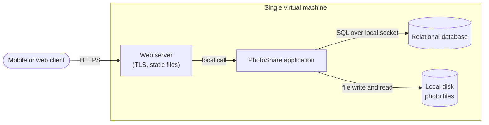

**Figure 1.2 — High-level design of the PhotoShare upload path.**

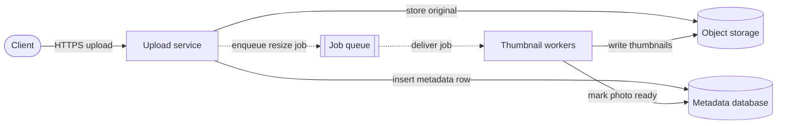

**Figure 1.3 — Low-level design of the upload component (class view).**

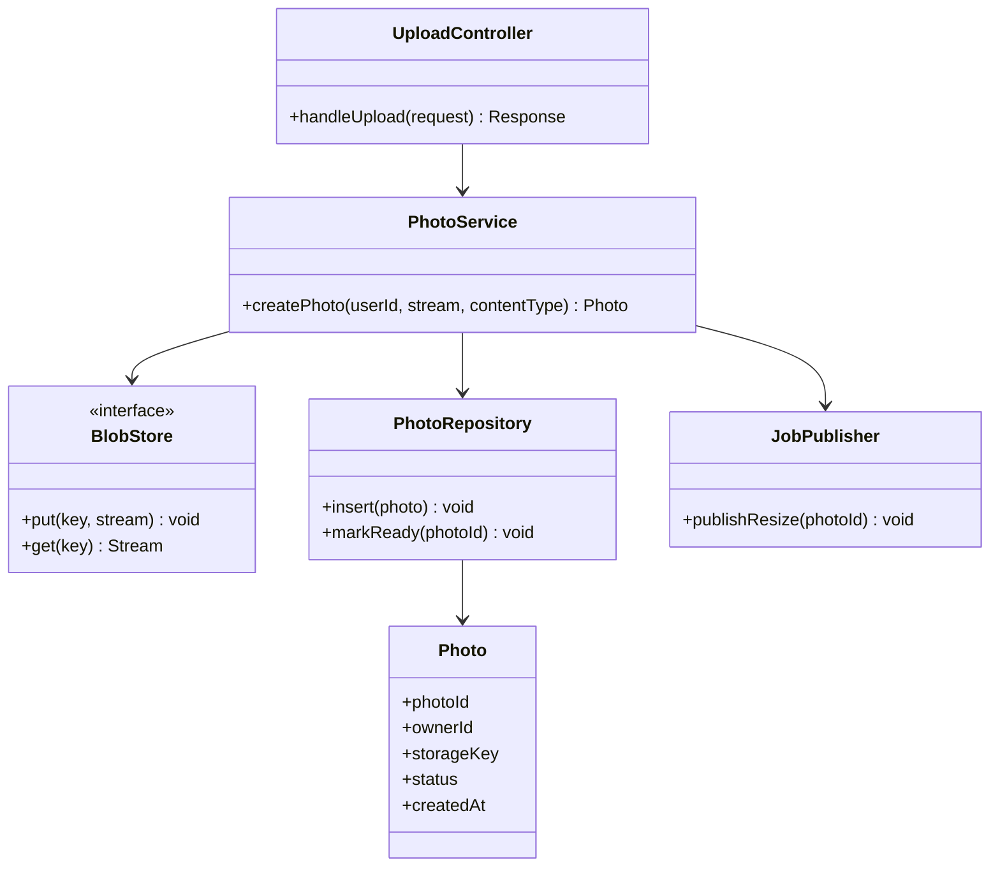

**Figure 1.4 — ADR lifecycle.**

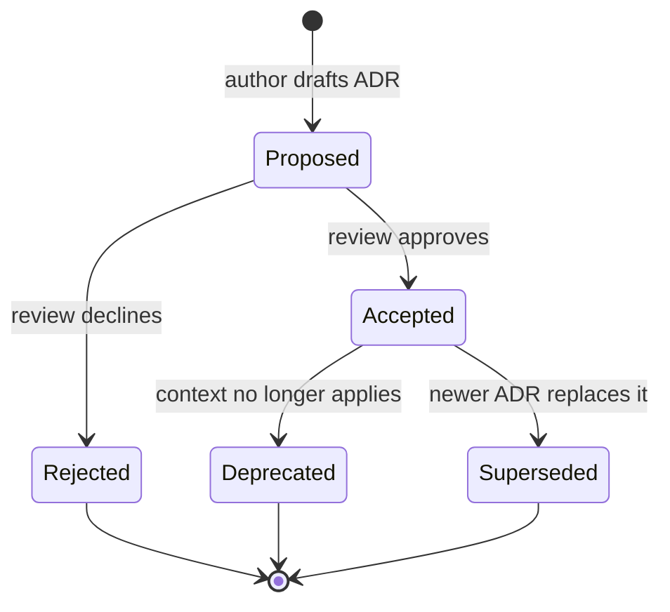

**Figure 1.5 — PhotoShare v1: stateless application tier and managed storage.**


**Figure 1.6 — PhotoShare v2: cache, read replicas and asynchronous processing.**

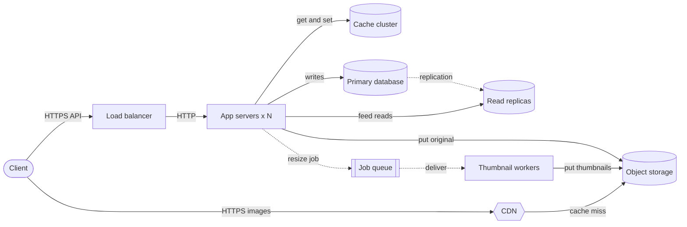

**Figure 1.7 — PhotoShare v3: services, partitioned data and multi-zone deployment.**


**Figure 1.8 — The life of a design in a typical engineering organization.**

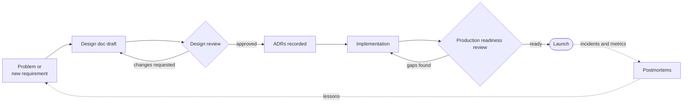

**Figure 1.9 — A typical 45-minute system design interview.**

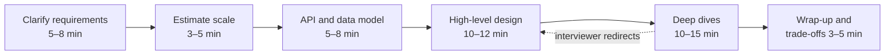

## Chapter 2 — How to Think Like a System Designer

**Figure 2.1 — The system designer's thinking loop.**

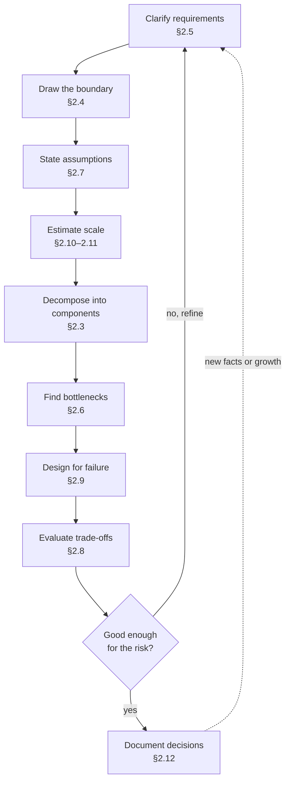

**Figure 2.2 — QuickBite first-pass decomposition.**

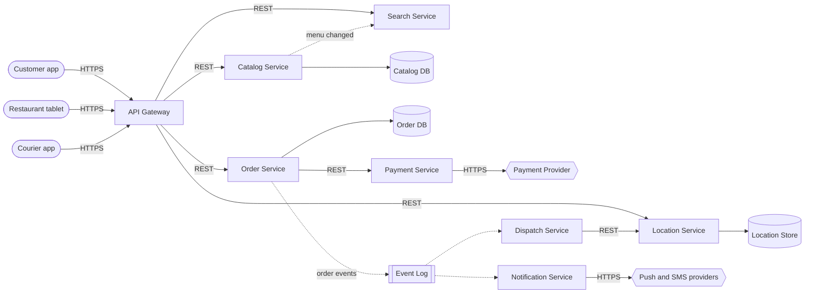

**Figure 2.3 — QuickBite system-context diagram.**


**Figure 2.4 — Finding the bottleneck with the USE method.**


**Figure 2.5 — Choosing the decision process by reversibility.**


**Figure 2.6 — QuickBite checkout designed for failure.**


**Figure 2.7 — QuickBite C4 container view, after the §2.8 decision.**


**Figure 2.8 — ADR life cycle.**

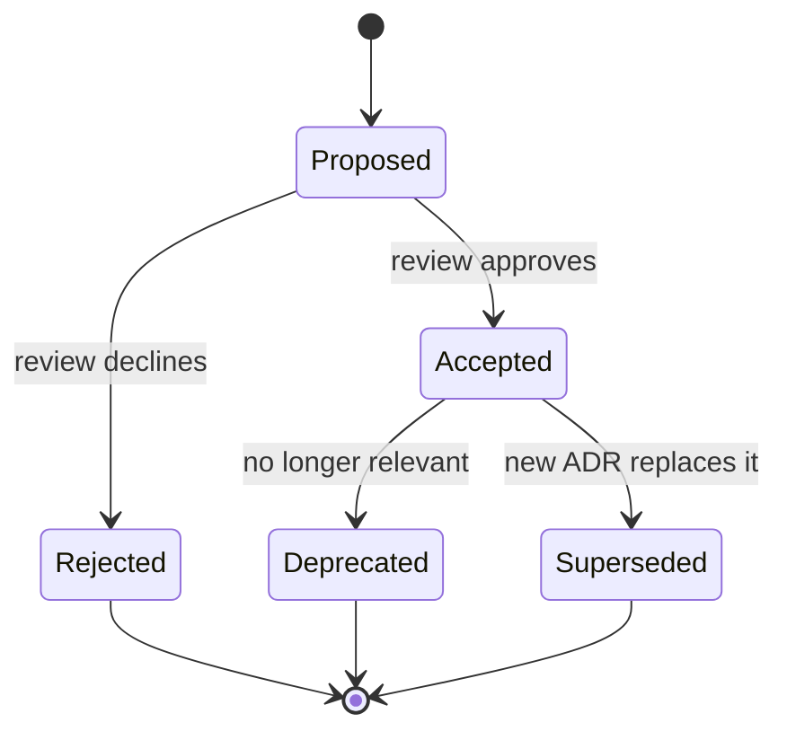

## Chapter 3 — The System Design Learning Method

**Figure 3.1 — The ten-step concept-mastery loop.**

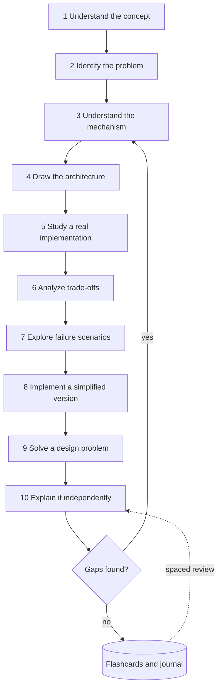

**Figure 3.2 — Consistent hashing in a client-routed distributed cache.**


**Figure 3.3 — Session read when the primary owner has failed.**

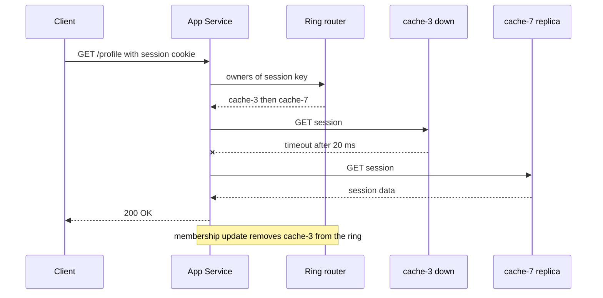

**Figure 3.4 — A five-box Leitner schedule for flashcards.**

```mermaid
stateDiagram-v2
  [*] --> Box0
  Box0 --> Box1: recalled
  Box1 --> Box2: recalled
  Box2 --> Box3: recalled
  Box3 --> Box4: recalled
  Box4 --> Box4: recalled
  Box1 --> Box0: forgot
  Box2 --> Box0: forgot
  Box3 --> Box0: forgot
  Box4 --> Box0: forgot
  Box0 --> Box0: forgot
  note right of Box0: review after 1 day
  note right of Box4: review after 35 days
```

**Figure 3.5 — The three-pass reading decision flow.**

```mermaid
flowchart TD
  P([Paper]) --> F["Pass 1: 5 to 10 min<br/>answer the five Cs"]
  F --> D1{Relevant to my goal?}
  D1 -->|no| A[(Reading log: one-line note)]
  D1 -->|yes| S["Pass 2: up to 1 h<br/>figures, claims, evidence"]
  S --> D2{Need to build or critique it?}
  D2 -->|no| A
  D2 -->|yes| T["Pass 3: re-implement mentally<br/>challenge assumptions"]
  T --> L["Feed loop steps 5 to 8"]
  L --> A
```

**Figure 3.6 — The 12-month beginner path (months shown as M01–M12).**

```mermaid
gantt
  title Beginner path through Book I
  dateFormat YYYY-MM-DD
  axisFormat M%m
  section Level 1
  Ch 1-4 foundations and method        :m1, 2027-01-01, 31d
  Ch 5-7 hardware OS networking        :m2, after m1, 28d
  Ch 8-10 web realtime security        :m3, after m2, 31d
  section Level 2
  Ch 11-12 and 17 data systems         :m4, after m3, 30d
  Ch 14-15 and 18-19 scaling           :m5, after m4, 31d
  Ch 20-22 and Ch 52 part 1            :m6, after m5, 30d
  section Level 3 core
  Ch 24-27 distributed systems         :m7, after m6, 31d
  Ch 29-32 data processing messaging   :m8, after m7, 31d
  Ch 33-38 architecture and LLD        :m9, after m8, 30d
  Ch 39-43 operations                  :m10, after m9, 31d
  section Integration
  Ch 52-56 case studies and Ch 93      :m11, after m10, 30d
  Ch 87-91 interviews and capstone     :m12, after m11, 31d
```

**Figure 3.7 — The postmortem study loop.**

```mermaid
flowchart LR
  R{{Public incident report}} --> T["Reconstruct the timeline"]
  T --> A["Draw the architecture<br/>mark the trigger point"]
  A --> CF["Separate trigger from<br/>contributing factors"]
  CF --> M["Map each factor to a chapter"]
  M --> P["Write the prevention<br/>you would have designed"]
  P --> G["Generalize to one rule"]
  G --> J[(Journal and flashcards)]
  J -.->|spaced review| A
```

## Chapter 4 — Quantitative Foundations for System Design

**Figure 4.1 — B-tree fan-out turns a billion keys into four levels.**

```mermaid
flowchart TD
  R["Root page<br/>~819 child pointers"] --> I1["Level 2 page 1"]
  R --> I2["Level 2 ...<br/>819 pages"]
  I1 --> J1["Level 3 page<br/>~670 thousand pages"]
  I1 --> J2["Level 3 ..."]
  J1 --> L1["Leaf page<br/>holds keys and row refs"]
  J1 --> L2["Leaf ...<br/>~1 billion keys total"]
  L1 --> DB[(Table rows on disk)]
  subgraph Cached["Usually cached in memory"]
    R
    I1
    I2
  end
```

**Figure 4.2 — Fan-out: the slowest leaf determines the response time.**

```mermaid
flowchart LR
  C([Client]) -->|HTTPS| R[Root service]
  R -->|RPC| L1[Leaf 1]
  R -->|RPC| L2[Leaf 2]
  R -->|RPC| L3["Leaf ..."]
  R -->|RPC| LN[Leaf N]
  L1 --> D1[(Partition 1)]
  L2 --> D2[(Partition 2)]
  LN --> DN[(Partition N)]
  LN -.->|slow reply| R
```

**Figure 4.3 — The M/M/1 queue.**

```mermaid
flowchart LR
  A([Arrivals rate λ]) -->|random gaps| Q[[FIFO queue<br/>Lq jobs waiting]]
  Q -->|next job| S["Server<br/>rate μ, busy fraction ρ"]
  S -->|completed| D([Departures rate λ])
```

**Figure 4.4 — One shared queue versus separate queues.**

```mermaid
flowchart LR
  subgraph Shared["M/M/2: one shared queue"]
    A1([Arrivals 80/s]) --> Q1[[Shared queue]]
    Q1 --> S1[Server A 50/s]
    Q1 --> S2[Server B 50/s]
  end
  subgraph Split["2 x M/M/1: separate queues"]
    A2([Arrivals 80/s]) -->|random split| Q2[[Queue A]]
    A2 -->|random split| Q3[[Queue B]]
    Q2 --> S3[Server A 50/s]
    Q3 --> S4[Server B 50/s]
  end
```

**Figure 4.5 — Choosing the boundary for Little's Law.**

```mermaid
flowchart LR
  C([Clients]) -->|HTTPS 250 RPS| LB[Load balancer]
  subgraph Instance["Boundary 1: one service instance"]
    T["Thread pool<br/>L = 20 busy threads"]
    P["DB connection pool<br/>holds conn 5 ms"]
    T --> P
  end
  LB -->|HTTP| T
  subgraph DBB["Boundary 2: database"]
    DB[(PostgreSQL)]
  end
  P -->|SQL| DB
```

**Figure 4.6 — Series, parallel and k-of-n availability.**

```mermaid
flowchart LR
  C([Client]) -->|HTTPS| LB["Load balancer<br/>A = 0.9999"]
  subgraph Parallel["Parallel: either node suffices"]
    W1["App node 1<br/>A = 0.99"]
    W2["App node 2<br/>A = 0.99"]
  end
  LB --> W1
  LB --> W2
  subgraph Quorum["2-of-3: majority must be up"]
    R1[(Replica 1)]
    R2[(Replica 2)]
    R3[(Replica 3)]
  end
  W1 -->|SQL| R1
  W2 -->|SQL| R1
  R1 -->|replicate| R2
  R1 -->|replicate| R3
```

**Figure 4.7 — The up–down cycle of a repairable component.**

```mermaid
stateDiagram-v2
  [*] --> Up
  Up --> Down : failure at rate 1/MTBF
  Down --> Up : repair at rate 1/MTTR
```

**Figure 4.8 — The replica-loss race for three-way replication.**

```mermaid
stateDiagram-v2
  [*] --> ThreeCopies
  ThreeCopies --> TwoCopies : any of 3 fails, rate 3λ
  TwoCopies --> ThreeCopies : re-replicated within T
  TwoCopies --> OneCopy : any of 2 fails, rate 2λ
  OneCopy --> TwoCopies : re-replicated within T
  OneCopy --> Lost : last copy fails, rate λ
  Lost --> [*]
```

**Figure 4.9 — Six recurring quantitative relationships.**

```mermaid
flowchart LR
  U[Utilization] -->|raises| TP[Throughput]
  U -->|raises sharply| LAT[Latency]
  B[Batch size] -->|raises| TP
  B -->|raises| LAT
  REP[Replica count] -->|raises| DUR[Durability]
  REP -->|raises| COST[Cost]
  MTTR[Repair time] -->|lowers| AV[Availability]
  MTTR -->|lowers| DUR
  ACC[Accuracy target] -->|raises| LAT
  ACC -->|raises| COST
```

## Chapter 5 — Computer Architecture

**Figure 5.1 — Inside a single-socket server.**

```mermaid
flowchart LR
  subgraph PKG["CPU package - one socket"]
    subgraph C0["Core 0"]
      R0[Registers] --> L1A["L1 instr + data"]
      L1A --> L2A[L2 cache]
    end
    subgraph C1["Core 1"]
      R1[Registers] --> L1B["L1 instr + data"]
      L1B --> L2B[L2 cache]
    end
    L3["Shared L3 cache"]
    MC[Memory controller]
    PCIE["PCIe controller"]
    L2A --> L3
    L2B --> L3
    L3 --> MC
    L3 --> PCIE
  end
  MC -->|DDR5 channels| DRAM[(DRAM - main memory)]
  PCIE -->|PCIe x4| NVME[(NVMe SSD)]
  PCIE -->|PCIe x16| NIC{{Network card}}
  PCIE -->|PCIe x16| GPU{{GPU accelerator}}
```

**Figure 5.2 — A pipelined core with a branch predictor.**

```mermaid
flowchart LR
  BP{Branch predictor} -->|predicted next PC| IF[Fetch]
  IF --> ID[Decode]
  ID --> EX[Execute]
  EX --> MEM["Memory access"]
  MEM --> WB["Write back"]
  ICACHE[(L1 instruction cache)] --> IF
  DCACHE[(L1 data cache)] <--> MEM
  EX -.->|mispredict: flush and refetch| BP
```

**Figure 5.3 — What happens on a load instruction.**

```mermaid
flowchart TD
  LD([Load from address A]) --> Q1{"In L1?"}
  Q1 -->|hit ~1 ns| DONE([Value to register])
  Q1 -->|miss| Q2{"In L2?"}
  Q2 -->|hit ~4 ns| FILL1[Copy line into L1]
  Q2 -->|miss| Q3{"In L3?"}
  Q3 -->|hit ~15 ns| FILL2[Copy line into L2 and L1]
  Q3 -->|miss| MEM[(DRAM ~100 ns)]
  MEM --> FILL3[Copy 64-byte line into caches]
  FILL1 --> DONE
  FILL2 --> DONE
  FILL3 --> DONE
```

**Figure 5.4 — MESI state transitions for one cache line in one core's cache.**

```mermaid
stateDiagram-v2
  [*] --> I
  I --> E: local read, no other copies
  I --> S: local read, other copies exist
  I --> M: local write, others invalidated
  E --> M: local write, no bus traffic
  E --> S: another core reads
  E --> I: another core writes
  S --> M: local write, others invalidated
  S --> I: another core writes
  M --> S: another core reads, write back first
  M --> I: another core writes, write back first
```

**Figure 5.5 — The memory and storage hierarchy (as of 2024–2025, approximate).**

```mermaid
flowchart TB
  REG["Registers<br/>~0.3 ns · ~1 KiB per core"] --> L1["L1 cache<br/>~1 ns · 32-64 KiB per core"]
  L1 --> L2["L2 cache<br/>~4 ns · 0.5-3 MiB per core"]
  L2 --> L3["L3 cache<br/>~15 ns · 8-500 MiB per chip"]
  L3 --> DRAM[("DRAM<br/>~100 ns · GBs to TBs")]
  DRAM --> SSD[("NVMe SSD<br/>~50-100 µs · TBs")]
  SSD --> HDD[("Hard disk<br/>~5-15 ms · 10-30 TB each")]
  HDD --> ARC[("Tape or archive storage<br/>seconds to hours · PBs")]
```

**Figure 5.6 — How an SSD handles an overwrite and garbage collection.**

```mermaid
flowchart LR
  H([Host writes logical block 42]) -->|NVMe command| FTL[Flash translation layer]
  FTL -->|program new page| OPEN[(Open block: free pages)]
  FTL -->|mark old page invalid| OLD[(Block with old copy)]
  FTL -->|update mapping 42 to new page| MAP[(Mapping table in DRAM)]
  GC[Garbage collector] -.->|pick block with fewest valid pages| OLD
  GC -.->|copy remaining valid pages| OPEN
  GC -.->|erase whole block| FREE[(Free block pool)]
  FREE -.-> OPEN
```

**Figure 5.7 — Reading a block from an NVMe SSD with DMA and an interrupt.**

```mermaid
sequenceDiagram
  participant App as Application thread
  participant K as Kernel driver
  participant SQ as Submission and completion queues in RAM
  participant D as NVMe controller
  App->>K: read syscall, thread blocks
  K->>SQ: write command with buffer address
  K->>D: ring doorbell register
  D->>SQ: fetch command via DMA
  D->>D: read flash pages, about 50-100 µs
  D->>SQ: DMA data into buffer, post completion entry
  D-->>K: MSI-X interrupt
  K->>App: wake thread, read returns
```

**Figure 5.8 — Diagnosing what limits a workload.**

```mermaid
flowchart TD
  S([Service is slow or saturated]) --> Q1{"CPU busy near 100%<br/>on the busy cores?"}
  Q1 -->|yes| Q2{"IPC low and cache<br/>misses high?"}
  Q2 -->|no| CPU[CPU-bound: optimize code or add cores]
  Q2 -->|yes| MEMB[Memory-bound: improve locality]
  Q1 -->|no| Q3{"Disk busy or high<br/>I/O wait and queue?"}
  Q3 -->|yes| IO[Storage-bound: cache, batch, faster device]
  Q3 -->|no| Q4{"Threads blocked on<br/>network or locks?"}
  Q4 -->|network| NET[Network or dependency bound]
  Q4 -->|locks| LOCK[Contention-bound: reduce shared state]
```

**Figure 5.9 — A two-socket NUMA server.**

```mermaid
flowchart LR
  subgraph N0["NUMA node 0"]
    S0["Socket 0<br/>cores + L3"] -->|DDR5| M0[(Local DRAM 0)]
    S0 -->|PCIe| NIC0{{NIC}}
  end
  subgraph N1["NUMA node 1"]
    S1["Socket 1<br/>cores + L3"] -->|DDR5| M1[(Local DRAM 1)]
    S1 -->|PCIe| SSD1[(NVMe SSD)]
  end
  S0 <-->|socket interconnect| S1
```

**Figure 5.10 — From hardware facts to design decisions.**

```mermaid
flowchart LR
  F1["Random I/O far slower<br/>than sequential"] --> D1["Append-only logs, LSM trees,<br/>large blocks, columnar files"]
  F2["Fixed cost per operation<br/>syscall, RTT, interrupt"] --> D2["Batching, pipelining,<br/>group commit"]
  F3["Each level ~3-1000x slower<br/>than the one above"] --> D3["Caching at every layer,<br/>keep working set in RAM"]
  F4["Cache lines and NUMA<br/>reward nearby data"] --> D4["Data locality: arrays, sharding,<br/>compute near data"]
  F5["Devices need many<br/>requests in flight"] --> D5["Async I/O, thread pools,<br/>queue depth"]
  F6["Shared written data<br/>does not scale across cores"] --> D6["Per-core state, shared-nothing,<br/>partitioning"]
```

## Chapter 6 — Operating Systems

**Figure 6.1 — Layout of a process's virtual address space on Linux x86-64.**

```mermaid
flowchart TB
  K["Kernel space<br/>upper half, kernel mode only"]
  ST["Stack<br/>grows downward"]
  MM["Memory-mapped region<br/>shared libraries, mmap files"]
  HP["Heap<br/>grows upward via brk or mmap"]
  BSS["BSS<br/>zero-initialized globals"]
  DATA["Data<br/>initialized globals"]
  TEXT["Text<br/>machine code, read-only"]
  K --- ST --- MM --- HP --- BSS --- DATA --- TEXT
```

**Figure 6.2 — Process state diagram.**

```mermaid
stateDiagram-v2
  [*] --> New
  New --> Ready: admitted
  Ready --> Running: dispatched by scheduler
  Running --> Ready: preempted or time slice expired
  Running --> Blocked: waits for I/O, lock or sleep
  Blocked --> Ready: event completes
  Running --> Terminated: exit
  Terminated --> [*]: parent reaps exit status
```

**Figure 6.3 — A context switch between two threads triggered by a timer interrupt.**

```mermaid
sequenceDiagram
  participant A as Thread A, user mode
  participant CPU as CPU core
  participant K as Kernel scheduler
  participant B as Thread B, user mode
  A->>CPU: executing instructions
  CPU-->>K: timer interrupt, switch to kernel mode
  K->>K: save A registers to A kernel stack
  K->>K: update A accounting, mark A Ready
  K->>K: pick next task, B
  K->>CPU: load B page table root if other process
  K->>K: restore B registers and stack pointer
  K->>B: return to user mode
  B->>CPU: executing instructions
```

**Figure 6.4 — Multi-level feedback queue decisions.**

```mermaid
flowchart TB
  N([New job]) --> Q0[Queue 0: highest priority<br/>short slice]
  Q0 --> D0{Allotment used up?}
  D0 -->|no, blocked for I/O| Q0
  D0 -->|yes| Q1[Queue 1: medium priority<br/>longer slice]
  Q1 --> D1{Allotment used up?}
  D1 -->|no| Q1
  D1 -->|yes| Q2[Queue 2: lowest priority<br/>longest slice]
  Q2 --> Q2
  T{{Boost timer every S ms}} -.->|move all jobs| Q0
```

**Figure 6.5 — Translating a virtual address: TLB, page walk and page fault.**

```mermaid
flowchart TB
  VA([CPU issues virtual address]) --> T{TLB hit?}
  T -->|yes, about 1 cycle| PA[Physical address<br/>to cache and RAM]
  T -->|no| W[Hardware page walk<br/>up to 4 memory reads]
  W --> P{Page present<br/>and permitted?}
  P -->|yes| F[Fill TLB entry] --> PA
  P -->|no| PF[Page fault:<br/>trap into kernel]
  PF --> V{Valid mapping?}
  V -->|no| SEG[Send SIGSEGV<br/>process usually dies]
  V -->|yes, page in RAM| MIN[Minor fault:<br/>update page table]
  V -->|yes, page on disk| MAJ[Major fault:<br/>block thread, read from disk]
  MAJ --> DISK[(SSD or HDD)]
  MIN --> RET[Retry the instruction]
  DISK --> RET
  RET --> VA
```

**Figure 6.6 — A `read()` system call that must wait for the disk.**

```mermaid
sequenceDiagram
  participant App as Application
  participant Lib as libc wrapper
  participant K as Kernel
  participant PC as Page cache
  participant D as Disk via driver
  App->>Lib: read fd, buf, 4096
  Lib->>K: syscall instruction, number in register
  K->>K: switch to kernel stack, validate fd and buffer
  K->>PC: look up file page
  PC->>D: miss, submit read request
  K->>K: block thread, schedule another
  D-->>K: interrupt, read complete
  K->>K: wake thread, mark Ready
  K->>App: copy data to user buffer, sysret, return bytes read
```

**Figure 6.7 — Two threads lose an update to a shared counter.**

```mermaid
sequenceDiagram
  participant T1 as Thread 1
  participant M as Shared counter in memory
  participant T2 as Thread 2
  Note over M: counter = 5
  T1->>M: read counter, gets 5
  T2->>M: read counter, gets 5
  T1->>T1: compute 5 + 1 = 6
  T2->>T2: compute 5 + 1 = 6
  T1->>M: write 6
  T2->>M: write 6
  Note over M: counter = 6, expected 7
```

**Figure 6.8 — Resource-allocation graph with a deadlock cycle.**

```mermaid
flowchart LR
  T1[Thread T1] -->|waits for| B[(Lock B)]
  B -->|held by| T2[Thread T2]
  T2 -->|waits for| A[(Lock A)]
  A -->|held by| T1
```

**Figure 6.9 — Priority inversion on Mars Pathfinder.**

```mermaid
sequenceDiagram
  participant L as Low: weather data task
  participant M as Medium: communications task
  participant H as High: bus management task
  participant W as Watchdog timer
  L->>L: lock information-bus mutex
  H->>H: wakes, tries to lock mutex, blocks on L
  M->>M: wakes, preempts L, runs for a long time
  Note over L: L cannot run, so cannot unlock
  W-->>H: H missed its deadline
  W-->>W: declare fault, reset whole spacecraft
```

**Figure 6.10 — An event loop on epoll.**

```mermaid
flowchart TB
  S([Start]) --> REG[Register listening socket<br/>with epoll]
  REG --> WAIT[epoll_wait: sleep until<br/>a socket is ready or timer due]
  WAIT --> READY{Which event?}
  READY -->|listening socket| ACC[accept new connection<br/>register it with epoll]
  READY -->|client readable| RD[read bytes, parse,<br/>compute small response]
  READY -->|client writable| WR[write pending bytes]
  READY -->|timer due| TM[run timer callback]
  RD --> SLOW{Slow or blocking<br/>work needed?}
  SLOW -->|no| WR
  SLOW -->|yes| POOL[[Worker thread pool]]
  POOL -.->|completion event| WAIT
  ACC --> WAIT
  WR --> WAIT
  TM --> WAIT
```

**Figure 6.11 — io_uring submission and completion rings.**

```mermaid
sequenceDiagram
  participant App as Application thread
  participant SQ as Submission ring, shared memory
  participant K as Kernel
  participant CQ as Completion ring, shared memory
  App->>SQ: write 32 request entries, no syscall
  App->>K: io_uring_enter once, submit 32
  K->>SQ: consume entries
  K-->>CQ: post completions as I/O finishes
  App->>CQ: read completion entries, no syscall
```

**Figure 6.12 — The write path from application to stable storage.**

```mermaid
flowchart LR
  APP[Application] -->|write| PC[Page cache<br/>dirty pages in RAM]
  PC -.->|background writeback<br/>about 30 s later| DC[Drive write cache<br/>often volatile]
  APP -->|fsync| PC
  PC -->|fsync forces write<br/>plus cache flush| DC
  DC --> MEDIA[(Stable media:<br/>NAND flash or platter)]
```

## Chapter 7 — Networking Fundamentals

**Figure 7.1 — Encapsulation down the sender's stack and decapsulation up the receiver's.**

```mermaid
flowchart LR
  subgraph Sender["Sender host"]
    A1["Application<br/>HTTP message"] --> T1["Transport<br/>TCP hdr + message"]
    T1 --> N1["Network<br/>IP hdr + segment"]
    N1 --> L1["Link<br/>Eth hdr + packet + FCS"]
  end
  subgraph Router["Router"]
    L2["Link<br/>strip and rebuild frame"] --> N2["Network<br/>read dest IP, TTL-1"]
    N2 --> L3["Link<br/>new Eth frame"]
  end
  subgraph Receiver["Receiver host"]
    L4["Link<br/>check FCS, strip"] --> N4["Network<br/>check dest IP, strip"]
    N4 --> T4["Transport<br/>find socket by 4-tuple"]
    T4 --> A4["Application<br/>read bytes"]
  end
  L1 -->|bits on wire| L2
  L3 -->|bits on wire| L4
```

**Figure 7.2 — BGP routing between autonomous systems, with an anycast prefix announced from two sites.**

```mermaid
flowchart LR
  U1([User in Paris]) --> ISP1[ISP AS 64500]
  U2([User in Tokyo]) --> ISP2[ISP AS 64501]
  ISP1 -->|BGP peering| T1[Transit AS 64510]
  ISP2 -->|BGP peering| T2[Transit AS 64511]
  T1 --- T2
  T1 -->|best path| E1["Edge site Frankfurt<br/>announces 198.51.100.0/24"]
  T2 -->|best path| E2["Edge site Osaka<br/>announces 198.51.100.0/24"]
  E1 --> O[(Origin datacenter)]
  E2 --> O
```

**Figure 7.3 — DNS resolution of www.example.com with an empty cache.**

```mermaid
sequenceDiagram
    autonumber
    participant App as Browser
    participant Stub as OS stub resolver
    participant Rec as Recursive resolver
    participant Root as Root server
    participant TLD as .com TLD server
    participant Auth as example.com authoritative
    App->>Stub: getaddrinfo www.example.com
    Stub->>Rec: recursive query A www.example.com
    Rec->>Root: iterative query A www.example.com
    Root-->>Rec: referral - NS records for .com plus glue
    Rec->>TLD: iterative query A www.example.com
    TLD-->>Rec: referral - NS records for example.com plus glue
    Rec->>Auth: iterative query A www.example.com
    Auth-->>Rec: answer A 192.0.2.10 TTL 300
    Rec-->>Stub: answer A 192.0.2.10 TTL 300
    Stub-->>App: address list
    Note over Rec: caches every record for its TTL
```

**Figure 7.4 — TCP three-way handshake followed by the first request.**

```mermaid
sequenceDiagram
    autonumber
    participant C as Client
    participant S as Server
    Note over S: LISTEN on port 443
    C->>S: SYN seq=x, options MSS, WScale, SACK-permitted
    Note over C: SYN_SENT
    S-->>C: SYN-ACK seq=y ack=x+1, server options
    Note over S: SYN_RECEIVED, half-open queue
    C->>S: ACK seq=x+1 ack=y+1
    Note over C,S: ESTABLISHED after 1 RTT for the client
    C->>S: data - first request bytes
    S-->>C: data - response bytes, ack
```

**Figure 7.5 — TCP four-way close and the TIME_WAIT state.**

```mermaid
sequenceDiagram
    autonumber
    participant A as Active closer
    participant P as Passive closer
    A->>P: FIN seq=u
    Note over A: FIN_WAIT_1
    P-->>A: ACK ack=u+1
    Note over P: CLOSE_WAIT - app may still send
    Note over A: FIN_WAIT_2
    P->>A: FIN seq=v
    Note over P: LAST_ACK
    A-->>P: ACK ack=v+1
    Note over A: TIME_WAIT for 2 x MSL
    Note over P: CLOSED
    Note over A: CLOSED after timer
```

**Figure 7.6 — Loss-based TCP congestion control states (Reno-style).**

```mermaid
stateDiagram-v2
    [*] --> SlowStart
    SlowStart --> CongestionAvoidance: cwnd reaches ssthresh
    SlowStart --> FastRecovery: 3 duplicate ACKs
    CongestionAvoidance --> FastRecovery: 3 duplicate ACKs, halve cwnd
    FastRecovery --> CongestionAvoidance: lost data acknowledged
    CongestionAvoidance --> SlowStart: RTO timeout, cwnd = 1
    FastRecovery --> SlowStart: RTO timeout, cwnd = 1
```

**Figure 7.7 — Protocol stacks for the three HTTP versions.**

```mermaid
flowchart TB
  subgraph H1["HTTP/1.1"]
    A1["HTTP/1.1 text messages"] --> B1["TLS 1.2 or 1.3"] --> C1["TCP"] --> D1["IP"]
  end
  subgraph H2["HTTP/2"]
    A2["HTTP/2 binary frames<br/>streams + HPACK"] --> B2["TLS 1.2 or 1.3"] --> C2["TCP"] --> D2["IP"]
  end
  subgraph H3["HTTP/3"]
    A3["HTTP/3 frames + QPACK"] --> C3["QUIC: streams, reliability,<br/>congestion control, TLS 1.3"] --> E3["UDP"] --> D3["IP"]
  end
```

**Figure 7.8 — TLS 1.3 full handshake (after the TCP handshake).**

```mermaid
sequenceDiagram
    autonumber
    participant C as Client
    participant S as Server
    C->>S: ClientHello - random, cipher suites, key_share, SNI, ALPN
    Note over S: chooses parameters, computes shared secret
    S-->>C: ServerHello - random, key_share
    S-->>C: encrypted EncryptedExtensions - ALPN result
    S-->>C: encrypted Certificate chain
    S-->>C: encrypted CertificateVerify - signature over transcript
    S-->>C: encrypted Finished - MAC over transcript
    Note over C: validates chain and hostname, checks signature
    C->>S: encrypted Finished
    C->>S: encrypted application data - HTTP request
    S-->>C: encrypted NewSessionTicket for resumption
    S-->>C: encrypted HTTP response
```

**Figure 7.9 — WebSocket opening handshake and framing.**

```mermaid
sequenceDiagram
    autonumber
    participant B as Browser
    participant S as Server
    B->>S: GET /chat HTTP/1.1, Upgrade websocket, Connection Upgrade
    Note right of B: Sec-WebSocket-Key dGhlIHNhbXBsZSBub25jZQ== and Version 13
    S-->>B: HTTP/1.1 101 Switching Protocols
    Note left of S: Sec-WebSocket-Accept s3pPLMBiTxaQ9kYGzzhZRbK+xOo=
    B->>S: masked text frame - hello
    S-->>B: text frame - welcome
    S-->>B: text frame - server push, unrequested
    B->>S: ping or close frame
```

**Figure 7.10 — Forward proxy versus reverse proxy.**

```mermaid
flowchart LR
  subgraph Corp["Client side network"]
    C1([Employee laptop]) -->|HTTP CONNECT| FP[Forward proxy]
    C2([Employee laptop]) -->|HTTP CONNECT| FP
  end
  FP -->|HTTPS| INET{{Internet sites}}
  U([Internet user]) -->|HTTPS| RP["Reverse proxy<br/>TLS termination, routing"]
  subgraph DC["Server side network"]
    RP -->|HTTP or gRPC| S1[App server 1]
    RP -->|HTTP or gRPC| S2[App server 2]
    S1 --> DB[(Database)]
    S2 --> DB
  end
```

**Figure 7.11 — Source NAT for an outbound connection.**

```mermaid
sequenceDiagram
    autonumber
    participant H as Host 10.0.1.5
    participant N as NAT gateway 203.0.113.7
    participant W as Web server 198.51.100.20
    H->>N: src 10.0.1.5 port 51000, dst 198.51.100.20 port 443
    Note over N: create mapping 10.0.1.5 port 51000 to public port 40001
    N->>W: src 203.0.113.7 port 40001, dst 198.51.100.20 port 443
    W-->>N: src 198.51.100.20 port 443, dst 203.0.113.7 port 40001
    Note over N: look up port 40001 in table
    N-->>H: src 198.51.100.20 port 443, dst 10.0.1.5 port 51000
```

**Figure 7.12 — A leaf–spine fabric with ECMP.**

```mermaid
flowchart TB
  subgraph Spine["Spine layer"]
    SP1[Spine 1]
    SP2[Spine 2]
    SP3[Spine 3]
    SP4[Spine 4]
  end
  subgraph Leaf["Leaf layer - top of rack"]
    L1[Leaf 1]
    L2[Leaf 2]
    L3[Leaf 3]
  end
  L1 --- SP1
  L1 --- SP2
  L1 --- SP3
  L1 --- SP4
  L2 --- SP1
  L2 --- SP2
  L2 --- SP3
  L2 --- SP4
  L3 --- SP1
  L3 --- SP2
  L3 --- SP3
  L3 --- SP4
  R1([Rack 1 servers]) --- L1
  R2([Rack 2 servers]) --- L2
  R3([Rack 3 servers]) --- L3
  L3 ---|uplink| EDGE{{Border routers to WAN}}
```

**Figure 7.13 — Loading https://www.example.com/ end to end.**

```mermaid
sequenceDiagram
    autonumber
    participant U as Browser
    participant R as Recursive resolver
    participant D as DNS hierarchy
    participant E as CDN edge reverse proxy
    participant O as Origin service
    U->>R: query A and AAAA www.example.com
    R->>D: iterative queries root, TLD, authoritative
    D-->>R: CNAME to CDN name, then A and AAAA, TTL 60
    R-->>U: addresses of nearest edge via anycast
    U->>E: TCP SYN
    E-->>U: SYN-ACK
    U->>E: ACK plus TLS ClientHello with SNI and ALPN h2
    E-->>U: ServerHello, certificate, Finished
    U->>E: Finished plus HTTP/2 GET / with HPACK headers
    alt cached at edge
        E-->>U: 200 OK from cache
    else cache miss
        E->>O: GET / over pooled HTTP/2 connection
        O-->>E: 200 OK HTML
        E-->>U: 200 OK HTML
    end
    U->>E: more GETs for CSS, JS, images on same connection
```

## Chapter 8 — Web Application Fundamentals

**Figure 8.1 — Three-tier client–server architecture.**

```mermaid
flowchart LR
  subgraph Clients
    B([Browser])
    M([Mobile app])
  end
  subgraph Edge
    LB["Load balancer (L7)"]
  end
  subgraph AppTier["Application tier - stateless"]
    A1[App server 1]
    A2[App server 2]
    A3[App server 3]
  end
  subgraph DataTier["Data tier - stateful"]
    C[(Cache)]
    DB[(Primary database)]
  end
  B -->|HTTPS| LB
  M -->|HTTPS| LB
  LB -->|HTTP| A1
  LB -->|HTTP| A2
  LB -->|HTTP| A3
  A1 -->|TCP| C
  A2 -->|TCP| DB
  A3 -->|TCP| DB
```

**Figure 8.2 — Backend-for-frontend aggregation.**

```mermaid
flowchart LR
  W([Web SPA]) -->|HTTPS JSON| BW[Web BFF]
  P([Mobile app]) -->|HTTPS JSON| BM[Mobile BFF]
  BW -->|gRPC| U[User service]
  BW -->|gRPC| O[Order service]
  BM -->|gRPC| U
  BM -->|gRPC| O
  BM -->|gRPC| R[Recommendation service]
  U --> UDB[(User DB)]
  O --> ODB[(Order DB)]
```

**Figure 8.3 — End-to-end lifecycle of one HTTPS API request.**

```mermaid
sequenceDiagram
  autonumber
  participant B as Browser
  participant R as DNS resolver
  participant L as Load balancer
  participant W as Web server
  participant A as Application
  participant C as Cache
  participant D as Database
  B->>R: Resolve shop.example.com
  R-->>B: A record 203.0.113.10, TTL 300 s
  B->>L: TCP SYN
  L-->>B: SYN-ACK, then ACK completes 1 RTT
  B->>L: TLS ClientHello
  L-->>B: ServerHello, certificate, Finished
  B->>L: GET /api/v1/orders/42 with cookie
  L->>W: Forward over pooled connection
  W->>A: Pass request via ASGI
  A->>A: Middleware - auth, rate limit, routing
  A->>C: GET order:42
  C-->>A: Miss
  A->>D: SELECT order 42 for this user
  D-->>A: One row
  A->>C: SET order:42 with TTL 60 s
  A-->>W: 200 OK, JSON body
  W-->>L: Response
  L-->>B: Response over TLS
```

**Figure 8.4 — N+1 resolution versus DataLoader batching.**

```mermaid
sequenceDiagram
  participant G as GraphQL executor
  participant L as DataLoader
  participant D as Database
  Note over G,D: Without batching
  G->>D: SELECT posts LIMIT 4
  G->>D: SELECT user WHERE id = 1
  G->>D: SELECT user WHERE id = 2
  G->>D: SELECT user WHERE id = 1
  G->>D: SELECT user WHERE id = 3
  Note over G,D: With DataLoader
  G->>D: SELECT posts LIMIT 4
  G->>L: load 1, load 2, load 1, load 3
  L->>L: Wait one tick, dedupe keys
  L->>D: SELECT users WHERE id IN 1, 2, 3
  D-->>L: 3 rows
  L-->>G: Resolve 4 promises
```

**Figure 8.5 — gRPC call mapped onto an HTTP/2 connection.**

```mermaid
flowchart LR
  subgraph ClientProcess["Client process"]
    APP[Application code] --> STUB[Generated stub]
  end
  subgraph Conn["One HTTP/2 connection over TLS"]
    S1[["Stream 1: GetOrder"]]
    S3[["Stream 3: WatchOrderStatus"]]
    S5[["Stream 5: GetOrder"]]
  end
  subgraph ServerProcess["Server process"]
    SRV[gRPC server runtime] --> IMPL[Service implementation]
  end
  STUB -->|HEADERS + DATA frames| S1
  STUB --> S3
  STUB --> S5
  S1 -->|length-prefixed protobuf| SRV
  S3 --> SRV
  S5 --> SRV
  IMPL --> DB[(Orders DB)]
```

**Figure 8.6 — Deadline propagation through a call chain.**

```mermaid
sequenceDiagram
  participant C as Client
  participant A as API service
  participant B as Pricing service
  participant D as Database
  C->>A: GetQuote, deadline now+300 ms
  A->>A: Auth and validation take 40 ms
  A->>B: GetPrice, deadline now+250 ms
  B->>D: Query with 200 ms statement timeout
  D-->>B: Rows after 30 ms
  B-->>A: Price after 45 ms
  A-->>C: Quote, total 95 ms
  Note over C,D: If B were slow, all three stop at the same absolute instant
```

**Figure 8.7 — Mixed versions during a rolling deployment.**

```mermaid
flowchart LR
  subgraph Producers
    P1["Producer v1<br/>writes fields 1-3"]
    P2["Producer v2<br/>writes fields 1-4"]
  end
  Q[["Topic or queue<br/>mixed v1 and v2 messages"]]
  subgraph Consumers
    C1["Consumer v1<br/>skips unknown field 4"]
    C2["Consumer v2<br/>defaults field 4 if absent"]
  end
  P1 -.->|v1 bytes| Q
  P2 -.->|v2 bytes| Q
  Q -.-> C1
  Q -.-> C2
```

**Figure 8.8 — Server-side session lookup.**

```mermaid
sequenceDiagram
  participant B as Browser
  participant A as App server
  participant S as Session store
  participant D as Database
  B->>A: POST /login with username and password
  A->>D: Fetch user and password hash
  D-->>A: User row
  A->>S: SET sess:8f2c with uid 42, TTL 3600 s
  A-->>B: 200 and Set-Cookie sid=8f2c, Secure, HttpOnly
  B->>A: GET /orders with Cookie sid=8f2c
  A->>S: GET sess:8f2c
  S-->>A: uid 42, roles
  A-->>B: 200 with the user's orders
  B->>A: POST /logout
  A->>S: DEL sess:8f2c
```

**Figure 8.9 — Relationship graph for a Zanzibar-style check.**

```mermaid
flowchart LR
  carol([user carol]) -->|member| sre[group sre]
  sre -->|member| eng[group eng]
  bob([user bob]) -->|member| eng
  eng -->|viewer| folder[folder eng]
  folder -->|parent of| doc[doc readme]
  alice([user alice]) -->|owner| doc
  doc --> D{"check: carol viewer of doc?"}
```

**Figure 8.10 — JWT validation pipeline.**

```mermaid
flowchart TD
  T([Bearer token]) --> P{"Three base64url parts?"}
  P -->|no| R1["401 invalid_token"]
  P -->|yes| A{"alg in allow-list?"}
  A -->|no| R1
  A -->|yes| K{"kid found in JWKS cache?"}
  K -->|no| F[Refresh JWKS from issuer]
  F --> K2{"kid found now?"}
  K2 -->|no| R1
  K2 -->|yes| S{"Signature valid?"}
  K -->|yes| S
  S -->|no| R1
  S -->|yes| C{"exp, nbf, iss, aud OK?"}
  C -->|no| R1
  C -->|yes| Z{"Required scope present?"}
  Z -->|no| R2["403 insufficient_scope"]
  Z -->|yes| OK[Call handler with claims]
```

**Figure 8.11 — OAuth 2.0 authorization code flow with PKCE.**

```mermaid
sequenceDiagram
  autonumber
  actor U as User
  participant C as Client app
  participant AS as Authorization server
  participant RS as Resource server API
  U->>C: Click Connect photos
  C->>C: Make code_verifier and S256 code_challenge, random state
  C->>AS: Redirect browser to /authorize with client_id, redirect_uri, scope, state, code_challenge
  AS->>U: Login page and consent screen
  U->>AS: Authenticate and approve scope photos.read
  AS->>C: Redirect to redirect_uri with code and state
  C->>C: Check state matches
  C->>AS: POST /token with code, redirect_uri, code_verifier
  AS->>AS: Verify SHA-256 of verifier equals stored challenge
  AS-->>C: access_token, refresh_token, expires_in
  C->>RS: GET /photos with Authorization Bearer token
  RS->>RS: Validate token, check scope
  RS-->>C: 200 photos
```

**Figure 8.12 — Lifecycle of an API version.**

```mermaid
stateDiagram-v2
  [*] --> Preview
  Preview --> Stable: contract frozen
  Stable --> Deprecated: successor GA, Deprecation header sent
  Deprecated --> Sunset: Sunset date reached
  Sunset --> [*]: returns 410 Gone
  Deprecated --> Stable: deprecation withdrawn
```

## Chapter 9 — Real-Time Communication

**Figure 9.1 — Short polling.**

```mermaid
sequenceDiagram
    participant C as Client
    participant S as API Server
    participant DB as Data Store
    C->>S: GET /updates?since=41
    S->>DB: read items after 41
    DB-->>S: none
    S-->>C: 204 No Content
    Note over C: wait T seconds
    C->>S: GET /updates?since=41
    S->>DB: read items after 41
    DB-->>S: none
    S-->>C: 204 No Content
    Note over DB: event 42 is written
    Note over C: wait T seconds
    C->>S: GET /updates?since=41
    S->>DB: read items after 41
    DB-->>S: item 42
    S-->>C: 200 OK items=[42] cursor=42
```

**Figure 9.2 — Long polling with cursors and a hold timeout.**

```mermaid
sequenceDiagram
    participant C as Client
    participant S as Poll Server
    participant B as Pub/Sub Broker
    C->>S: GET /poll?cursor=41
    Note over S: nothing after 41, park request
    S-->>C: 204 after hold timeout of 30 s
    C->>S: GET /poll?cursor=41
    Note over S: park request
    B--)S: event 42 for this user
    S-->>C: 200 OK items=[42] cursor=42
    C->>S: GET /poll?cursor=42
    B--)S: event 43 arrives in the gap
    Note over S: 43 is newer than 42, respond at once
    S-->>C: 200 OK items=[43] cursor=43
```

**Figure 9.3 — SSE streaming, disconnection and resumption with `Last-Event-ID`.**

```mermaid
sequenceDiagram
    participant C as Browser EventSource
    participant LB as Load Balancer
    participant S as SSE Server
    participant BUF as Event Buffer
    C->>LB: GET /events Accept text/event-stream
    LB->>S: forward request
    S-->>C: 200 OK Content-Type text/event-stream
    S-->>C: id 1042 data price 101.25
    S-->>C: id 1043 data price 101.40
    Note over C,S: network drops, TCP connection lost
    Note over C: wait retry interval of 5 s
    C->>LB: GET /events Last-Event-ID 1043
    LB->>S: forward, possibly to another server
    S->>BUF: read events after 1043
    BUF-->>S: 1044 and 1045
    S-->>C: id 1044, then id 1045, then live events
```

**Figure 9.4 — WebSocket opening handshake, message exchange, heartbeat and closing handshake.**

```mermaid
sequenceDiagram
    participant C as Client
    participant S as WebSocket Server
    C->>S: TCP and TLS handshake
    C->>S: GET /chat Upgrade websocket, Sec-WebSocket-Key
    S-->>C: 101 Switching Protocols, Sec-WebSocket-Accept
    Note over C,S: HTTP ends, WebSocket framing begins
    C->>S: Text frame, masked, join room 7
    S-->>C: Text frame, unmasked, welcome
    S-->>C: Text frame, new message in room 7
    C->>S: Text frame, masked, typing indicator
    S-->>C: Ping frame
    C->>S: Pong frame echoing ping payload
    S-->>C: Close frame, code 1001 going away
    C->>S: Close frame, echo code 1001
    Note over S: server closes TCP first and holds TIME_WAIT
```

**Figure 9.5 — Lifecycle of a WebSocket connection as seen by a gateway.**

```mermaid
stateDiagram-v2
    [*] --> Connecting: TCP and TLS accepted
    Connecting --> Open: valid upgrade, 101 sent
    Connecting --> Closed: bad Origin or auth, HTTP 401 or 403
    Open --> Open: data frames and ping pong
    Open --> Closing: Close frame sent or received
    Open --> Closed: pong timeout or TCP reset, code 1006
    Closing --> Closed: peer Close received or close timeout
    Closed --> [*]: release memory, unsubscribe, update presence
```

**Figure 9.6 — WebRTC session establishment: signaling, STUN, ICE and TURN fallback.**

```mermaid
sequenceDiagram
    participant A as Peer A
    participant SIG as Signaling Server
    participant ST as STUN or TURN Server
    participant B as Peer B
    A->>SIG: SDP offer over WebSocket
    SIG->>B: forward offer
    B->>SIG: SDP answer
    SIG->>A: forward answer
    A->>ST: STUN binding request
    ST-->>A: your public address is 203.0.113.5 port 40001
    B->>ST: STUN binding request
    ST-->>B: your public address is 198.51.100.7 port 50002
    A->>SIG: ICE candidates
    SIG->>B: ICE candidates
    A->>B: connectivity checks from both sides
    B->>A: connectivity checks from both sides
    Note over A,B: if a direct pair succeeds, DTLS then SRTP media flow peer to peer
    Note over A,ST: if all direct pairs fail, media is relayed through TURN
```

**Figure 9.7 — Mesh, SFU and MCU topologies for a four-person call.**

```mermaid
flowchart LR
    subgraph Mesh
      M1([P1]) <--> M2([P2])
      M1 <--> M3([P3])
      M1 <--> M4([P4])
      M2 <--> M3
      M2 <--> M4
      M3 <--> M4
    end
    subgraph SFU
      S1([P1]) <-->|1 up, 3 down| F[SFU forwards packets]
      S2([P2]) <--> F
      S3([P3]) <--> F
      S4([P4]) <--> F
    end
    subgraph MCU
      U1([P1]) <-->|1 up, 1 down| X[MCU decodes and mixes]
      U2([P2]) <--> X
      U3([P3]) <--> X
      U4([P4]) <--> X
    end
```

**Figure 9.8 — Mobile push architecture.**

```mermaid
flowchart LR
    subgraph Device
      APP([Mobile App]) --- OS[OS Push Daemon]
    end
    APP -->|1 register| OS
    OS -->|2 token| APP
    APP -->|3 upload token, HTTPS| API[App Backend API]
    API --> TOK[(Token Store)]
    EV[[Event Queue]] -.->|4 event| NS[Notification Service]
    NS --> TOK
    NS -->|5a HTTP/2 + JWT| APNS{{APNs}}
    NS -->|5b HTTPS v1 + OAuth| FCM{{FCM}}
    APNS -.->|6 best-effort delivery| OS
    FCM -.->|6 best-effort delivery| OS
    APNS -.->|410 Unregistered| NS
    FCM -.->|404 UNREGISTERED| NS
    APP -->|7 on open, sync from cursor| API
```

**Figure 9.9 — Architecture of a connection gateway fleet.**

```mermaid
flowchart LR
    C1([Web client]) -->|wss| LB
    C2([Mobile client]) -->|wss| LB
    LB["L4 Load Balancer<br/>least connections"] --> G1[Gateway 1]
    LB --> G2[Gateway 2]
    LB --> G3[Gateway N]
    G1 -->|validate token| AUTH[Auth Service]
    G1 -->|set user to gateway, TTL| REG[(Session and Presence<br/>Redis)]
    G2 --> REG
    G3 --> REG
    BUS[["Pub/Sub Backplane<br/>Redis sharded pub/sub"]] -.->|room and user topics| G1
    BUS -.-> G2
    BUS -.-> G3
    G1 -->|client commands, gRPC| CHAT[Chat Service]
    CHAT --> MSG[(Message Store)]
    CHAT -.->|publish room 7| BUS
    CHAT -.->|recipient offline| PUSH[Push Service]
    PUSH -.-> PROV{{APNs and FCM}}
```

**Figure 9.10 — Decision flowchart for choosing a real-time technique.**

```mermaid
flowchart TD
    A{App in foreground<br/>with a live connection?} -->|No| PUSH[Mobile or web push<br/>plus sync on open]
    A -->|Yes| B{Audio, video or<br/>peer-to-peer data?}
    B -->|Yes| RTC[WebRTC<br/>plus SFU for groups]
    B -->|No| C{Is staleness of<br/>T seconds acceptable<br/>and N/T affordable?}
    C -->|Yes| SP[Short polling<br/>with jitter and caching]
    C -->|No| D{Does the client send<br/>frequent low-latency<br/>messages too?}
    D -->|No| E{Do streaming responses<br/>survive your network path?}
    E -->|Yes| SSE[Server-Sent Events]
    E -->|No| LP[Long polling]
    D -->|Yes| F{Are WebSockets allowed<br/>end to end?}
    F -->|Yes| WS[WebSockets over wss]
    F -->|No| LP
```

## Chapter 10 — Security Fundamentals for System Designers

**Figure 10.1 — Data-flow diagram of a photo-sharing web application with trust boundaries.**

```mermaid
flowchart LR
  U([User browser])
  ADM([Admin user])
  subgraph Internet_Edge["Trust boundary 1: internet edge"]
    CDN["CDN and WAF"]
    LB["Load balancer (TLS)"]
  end
  subgraph App_Zone["Trust boundary 2: application VPC"]
    WEB[Web API service]
    WK[Thumbnail worker]
    Q[[Job queue]]
  end
  subgraph Data_Zone["Trust boundary 3: data subnet"]
    DB[(User and photo DB)]
    OBJ[(Object storage)]
  end
  PAY{{Payment provider}}
  U -->|HTTPS| CDN
  CDN -->|HTTPS| LB
  LB -->|HTTP over mTLS| WEB
  ADM -->|HTTPS via SSO proxy| WEB
  WEB -->|SQL over TLS| DB
  WEB -->|signed PUT URL| OBJ
  WEB -.->|enqueue job| Q
  Q -.->|consume job| WK
  WK -->|read and write images| OBJ
  WEB -->|HTTPS webhook| PAY
```

**Figure 10.2 — Simplified TLS 1.3 handshake: ephemeral key exchange plus signature.**

```mermaid
sequenceDiagram
  participant C as Client
  participant S as Server
  C->>S: ClientHello with ephemeral public key aG
  S->>C: ServerHello with ephemeral public key bG
  Note over C,S: Both compute shared secret abG and derive keys with HKDF
  S->>C: Certificate chain, encrypted
  S->>C: CertificateVerify, signature over transcript
  S->>C: Finished, MAC over transcript
  C->>C: Validate chain to trusted root and verify signature
  C->>S: Finished, MAC over transcript
  C->>S: Application data under AES-GCM session keys
```

**Figure 10.3 — HMAC request signing with replay protection.**

```mermaid
sequenceDiagram
  participant Cl as Client
  participant GW as API service
  participant NS as Nonce store
  Cl->>Cl: Build canonical request: method, path, timestamp, nonce, body hash
  Cl->>Cl: signature = HMAC-SHA256 of canonical request with shared key
  Cl->>GW: HTTPS request plus key ID, timestamp, nonce, signature
  GW->>GW: Look up key by key ID and check timestamp within 5 minutes
  GW->>GW: Recompute HMAC and compare in constant time
  GW->>NS: Insert nonce if absent, TTL 10 minutes
  NS-->>GW: Inserted or already present
  GW-->>Cl: 200 if new nonce, 401 if bad signature or replay
```

**Figure 10.4 — Certificate chain of trust and Certificate Transparency.**

```mermaid
flowchart TB
  ROOT["Root CA certificate<br/>in OS or browser trust store"]
  INT["Intermediate CA certificate"]
  LEAF["Leaf certificate<br/>api.example.com"]
  SRV[Web server holding leaf private key]
  CL([Client])
  CT[(Certificate Transparency logs)]
  MON[Domain owner monitor]
  ROOT -->|signs| INT
  INT -->|signs| LEAF
  LEAF -->|installed on| SRV
  SRV -->|TLS sends leaf and intermediate| CL
  CL -->|validates chain up to| ROOT
  INT -.->|submits precertificate| CT
  CT -.->|returns signed timestamp in leaf| LEAF
  MON -.->|watches for unexpected names| CT
```

**Figure 10.5 — Registration and login with salted Argon2id and a pepper.**

```mermaid
sequenceDiagram
  participant U as User
  participant A as Auth service
  participant K as KMS or HSM
  participant D as Credential DB
  U->>A: Register over TLS with username and password
  A->>A: Reject if in breached list or too short
  A->>K: HMAC password with pepper key
  K-->>A: Peppered value
  A->>A: Generate 16-byte salt and run Argon2id
  A->>D: Store algorithm, params, salt, hash
  U->>A: Login with username and password
  A->>D: Fetch algorithm, params, salt, hash
  A->>K: HMAC password with pepper key
  K-->>A: Peppered value
  A->>A: Recompute Argon2id and constant-time compare
  A-->>U: Session token on success, generic error on failure
```

**Figure 10.6 — A workload obtaining dynamic database credentials from a vault.**

```mermaid
sequenceDiagram
  participant W as Service pod
  participant P as Platform identity
  participant V as Secrets vault
  participant DB as Database
  participant L as Audit log
  P-->>W: Signed workload identity token
  W->>V: Authenticate with identity token
  V->>P: Verify token signature and claims
  V-->>W: Vault token scoped to policy orders-db-read
  W->>V: Request credentials for orders-db-read
  V->>DB: CREATE ROLE unique user with 1-hour expiry
  V-->>W: Username, password, lease 1 hour
  V-.->L: Record who requested which credential
  W->>DB: Connect with unique credentials
  W->>V: Renew lease before expiry
  V->>DB: At lease end revoke and drop user
```

**Figure 10.7 — Envelope encryption: write and read paths.**

```mermaid
sequenceDiagram
  participant App as Application
  participant KMS as KMS with KEK in HSM
  participant St as Object storage
  App->>KMS: GenerateDataKey for KEK-ID with encryption context
  KMS-->>App: Plaintext DEK and DEK wrapped by KEK
  App->>App: AES-256-GCM encrypt object with plaintext DEK
  App->>App: Erase plaintext DEK from memory
  App->>St: PUT ciphertext plus wrapped DEK and KEK-ID
  App->>St: GET object
  St-->>App: Ciphertext plus wrapped DEK
  App->>KMS: Decrypt wrapped DEK with same encryption context
  KMS->>KMS: Check IAM policy and log the call
  KMS-->>App: Plaintext DEK
  App->>App: Decrypt object locally and discard DEK
```

**Figure 10.8 — Zero-trust access in the style of BeyondCorp.**

```mermaid
flowchart LR
  subgraph Unprivileged["Any network: office, home, cafe"]
    EMP([Employee on managed laptop])
  end
  AP["Access proxy<br/>TLS, SSO, device cert"]
  ACE[Access control engine]
  INV[(Device inventory)]
  IDP[Identity provider]
  subgraph Apps["Internal applications"]
    APP1[Code review]
    APP2[HR system]
  end
  EMP -->|HTTPS with device certificate| AP
  AP -->|authenticate user| IDP
  AP -->|authorize request| ACE
  ACE -->|device trust tier| INV
  AP -->|mTLS, authorized request only| APP1
  AP -->|mTLS, authorized request only| APP2
  INV -.->|patch and posture updates| ACE
```

**Figure 10.9 — DDoS mitigation in layers.**

```mermaid
flowchart LR
  BOT([Botnet and reflectors])
  USR([Legitimate users])
  subgraph Edge["Anycast edge network"]
    SCR["Scrubbing: drop L3/L4 floods"]
    CDN["CDN cache and WAF<br/>rate limits, bot checks"]
  end
  subgraph Origin["Origin region"]
    LB["Load balancer<br/>SYN cookies, conn limits"]
    APP["App: per-user quotas,<br/>load shedding"]
    DB[(Database)]
  end
  BOT -->|floods| SCR
  USR -->|HTTPS| SCR
  SCR -->|clean traffic| CDN
  CDN -->|cache misses only| LB
  LB -->|HTTP| APP
  APP -->|bounded concurrency| DB
```

**Figure 10.10 — Tamper-evident audit logging pipeline.**

```mermaid
flowchart LR
  SVC[Services and IAM] -.->|events| Q[[Log stream]]
  Q -.->|batch| AGG[Log writer]
  AGG -->|append entry with prev hash| LOG[(Hash-chained log)]
  AGG -->|sign head hourly| KMS{{KMS signing key}}
  AGG -->|write signed head| WORM[(WORM bucket in separate account)]
  LOG -.->|replicate| WORM
  VER[Verifier job] -->|recompute chain| LOG
  VER -->|compare with signed heads| WORM
  VER -.->|alert on mismatch| SIEM[Security monitoring]
```

## Chapter 11 — Relational Databases

**Figure 11.1 — Decomposing the flat order export into BCNF tables.**

```mermaid
flowchart LR
  F["order_lines_flat<br/>key: order_id + product_id"] -->|"split FD1: 2NF"| OW["orders_wide<br/>key: order_id"]
  F -->|"split FD4: 2NF"| P[("products<br/>key: product_id")]
  F -->|"keep FD5"| OL[("order_lines<br/>key: order_id + product_id")]
  OW -->|"split FD2: 3NF"| O[("orders<br/>key: order_id")]
  OW -->|"split FD2: 3NF"| C[("customers<br/>key: customer_id")]
  OL -.->|"FK order_id"| O
  OL -.->|"FK product_id"| P
  O -.->|"FK customer_id"| C
```

**Figure 11.2 — Hash join: build on the smaller input, probe with the larger.**

```mermaid
flowchart LR
  subgraph Build["Phase 1: build"]
    C[(customers<br/>100k rows)] -->|"scan, hash customer_id"| H["In-memory hash table<br/>~5.7 MB"]
  end
  subgraph Probe["Phase 2: probe"]
    O[(orders<br/>79k matching rows)] -->|"scan, hash customer_id"| P["Probe each row"]
  end
  H -->|"lookup"| P
  P -->|"joined rows"| OUT["Parent operator<br/>HashAggregate"]
  H -.->|"if memory exceeded: spill partitions"| D[("Temp files")]
```

**Figure 11.3 — Secondary-index lookup paths in InnoDB and PostgreSQL.**

```mermaid
flowchart LR
  Q([Query: WHERE email = x])
  subgraph InnoDB["MySQL InnoDB"]
    S1["Secondary B+ tree<br/>email to customer_id"] -->|"PK value 4242"| CL[("Clustered B+ tree<br/>customer_id to full row")]
  end
  subgraph PG["PostgreSQL"]
    S2["B+ tree index<br/>email to TID"] -->|"TID page 17, slot 3"| HP[("Heap pages<br/>rows in insert order")]
  end
  Q -->|"descend"| S1
  Q -->|"descend"| S2
```

**Figure 11.4 — A B+ tree on `order_id` with three levels.**

```mermaid
flowchart TD
  R["Root page<br/>separators 400 · 800"] --> I1["Internal page<br/>100 · 250"]
  R --> I2["Internal page<br/>520 · 650"]
  R --> I3["Internal page<br/>900 · 1100"]
  I1 --> L1["Leaf: 1 … 99"]
  I1 --> L2["Leaf: 100 … 249"]
  I1 --> L3["Leaf: 250 … 399"]
  I2 --> L4["Leaf: 400 … 519"]
  L1 -->|"next leaf"| L2
  L2 -->|"next leaf"| L3
  L3 -->|"next leaf"| L4
  L2 --> H[("Heap rows or<br/>clustered row data")]
```

**Figure 11.5 — The executed plan tree for "revenue by city over the last day".**

```mermaid
flowchart BT
  SO["Seq Scan on orders<br/>filter: last day, not cancelled<br/>78,515 rows"] -->|"rows"| HJ["Hash Join<br/>o.customer_id = c.customer_id"]
  SC["Seq Scan on customers<br/>100,000 rows"] -->|"rows"| H["Hash<br/>build, 5.7 MB"]
  H -->|"hash table"| HJ
  HJ -->|"78,515 joined rows"| AG["HashAggregate<br/>group by city: 5 groups"]
  AG -->|"5 rows"| S["Sort<br/>by revenue desc"]
  S -->|"5 rows"| R([Client])
```

**Figure 11.6 — Non-repeatable read under READ COMMITTED.**

```mermaid
sequenceDiagram
  participant A as Txn A - report
  participant DB as Database
  participant B as Txn B - restock
  A->>DB: SELECT on_hand WHERE product 42
  DB-->>A: 10
  B->>DB: UPDATE on_hand = on_hand - 3
  B->>DB: COMMIT
  A->>DB: SELECT on_hand WHERE product 42
  DB-->>A: 7 under READ COMMITTED
  Note over A,DB: REPEATABLE READ returns 10 again: same snapshot
```

**Figure 11.7 — Lost update from an application-side read-modify-write.**

```mermaid
sequenceDiagram
  participant A as Txn A - checkout 1
  participant DB as Database
  participant B as Txn B - checkout 2
  A->>DB: SELECT on_hand - returns 10
  B->>DB: SELECT on_hand - returns 10
  A->>DB: UPDATE SET on_hand = 9
  A->>DB: COMMIT
  B->>DB: UPDATE SET on_hand = 9
  Note over B,DB: READ COMMITTED: succeeds, one sale lost
  Note over B,DB: PostgreSQL REPEATABLE READ: error, retry
  B->>DB: COMMIT or ROLLBACK
```

**Figure 11.8 — Write skew: both doctors go off call.**

```mermaid
sequenceDiagram
  participant A as Txn A - Alice
  participant DB as Database
  participant B as Txn B - Bob
  A->>DB: SELECT count WHERE on_call - returns 2
  B->>DB: SELECT count WHERE on_call - returns 2
  A->>DB: UPDATE alice SET on_call = false
  B->>DB: UPDATE bob SET on_call = false
  A->>DB: COMMIT - ok
  B->>DB: COMMIT
  Note over B,DB: REPEATABLE READ: ok, nobody on call
  Note over B,DB: SERIALIZABLE: aborted, retry sees 1
```

**Figure 11.9 — PostgreSQL version chain for product 42.**

```mermaid
flowchart LR
  IX["B+ tree index entry<br/>product_id 42 to TID 0,1"] --> V1["lp 1: on_hand 10<br/>xmin 993, xmax 994"]
  V1 -->|"t_ctid"| V2["lp 2: on_hand 9<br/>xmin 994, xmax 995"]
  V2 -->|"t_ctid"| V3["lp 3: on_hand 8<br/>xmin 995, xmax 0"]
  S1(["Snapshot taken before 994 commits"]) -.->|"sees"| V1
  S2(["Snapshot taken after 995 commits"]) -.->|"sees"| V3
  VAC["VACUUM"] -->|"reclaims lp 2,<br/>redirects lp 1 to lp 3"| V1
```

**Figure 11.10 — InnoDB current row and undo chain for product 42.**

```mermaid
flowchart LR
  CI[("Clustered index leaf<br/>on_hand 8, DB_TRX_ID 995")] -->|"DB_ROLL_PTR"| U2[["Undo record<br/>on_hand 9, trx 994"]]
  U2 -->|"roll pointer"| U1[["Undo record<br/>on_hand 10, trx 993"]]
  RV(["Read view that cannot see 995"]) -.->|"reconstructs"| U2
  PU["Purge thread"] -->|"discards when no read view needs"| U1
```

**Figure 11.11 — A deadlock between two checkouts, as reproduced on PostgreSQL 16.**

```mermaid
sequenceDiagram
  participant A as Txn A - cart 42 then 43
  participant DB as PostgreSQL
  participant B as Txn B - cart 43 then 42
  A->>DB: UPDATE inventory product 42
  B->>DB: UPDATE inventory product 43
  A->>DB: UPDATE inventory product 43
  Note over A,DB: A waits for B
  B->>DB: UPDATE inventory product 42
  Note over B,DB: B waits for A - cycle
  DB-->>A: ERROR deadlock detected after about 1 s
  DB-->>B: UPDATE 1, then COMMIT succeeds
```

**Figure 11.12 — Entity–relationship diagram of the order system.**

```mermaid
erDiagram
  CUSTOMERS ||--o{ ORDERS : places
  ORDERS ||--|{ ORDER_ITEMS : contains
  PRODUCTS ||--o{ ORDER_ITEMS : "appears in"
  PRODUCTS ||--|| INVENTORY : "stocked as"
  ORDERS ||--o{ PAYMENTS : "paid by"
  CUSTOMERS {
    bigint customer_id PK
    text email UK
    text full_name
    text city
  }
  PRODUCTS {
    bigint product_id PK
    text sku UK
    text name
    int price_cents
  }
  INVENTORY {
    bigint product_id PK, FK
    int on_hand
  }
  ORDERS {
    bigint order_id PK
    bigint customer_id FK
    text status
    text ship_to
    bigint total_cents
    text idempotency_key UK
    timestamptz created_at
  }
  ORDER_ITEMS {
    bigint order_id PK, FK
    smallint line_no PK
    bigint product_id FK
    int quantity
    int unit_price_cents
  }
  PAYMENTS {
    bigint payment_id PK
    bigint order_id FK
    bigint amount_cents
    text provider_ref UK
    text status
  }
```

## Chapter 12 — NoSQL Databases

**Figure 12.1 — Forces that produced NoSQL and the design responses.**

```mermaid
flowchart LR
  P1["Data and traffic beyond<br/>one server"] --> R1["Partition by key natively<br/>no cross-partition joins"]
  P2["Schema changes weekly"] --> R2["Self-describing records<br/>schema on read"]
  P3["Writes must survive<br/>node and network failure"] --> R3["Replicate, relax consistency<br/>reconcile later"]
  R1 --> F1[(Key-value)]
  R1 --> F3[(Wide-column)]
  R2 --> F2[(Document)]
  R2 --> F3
  R3 --> F1
  R3 --> F3
  P4["Specialized workloads<br/>graphs, metrics, text"] --> R4["Purpose-built engines"]
  R4 --> F4[(Graph)]
  R4 --> F5[(Time-series)]
  R4 --> F6[(Search and vector)]
```

**Figure 12.2 — DynamoDB data model and request path.**

```mermaid
flowchart LR
  C([Client]) -->|HTTPS| RR[Request router]
  RR -->|partition map lookup| MD[(Partition metadata)]
  RR -->|"hash of partition key"| L1
  RR -->|other keys| L2
  subgraph P1["Partition 1: Paxos group across 3 AZs"]
    L1["Leader replica<br/>CUST#c42: PROFILE, ORDER#..."]
    F1a[Replica AZ-b]
    F1b[Replica AZ-c]
  end
  subgraph P2["Partition 2"]
    L2["Leader replica<br/>ORDER#o901: #HEADER, ITEM#001.."]
  end
  L1 -->|replicate log, 2 of 3 ack| F1a
  L1 -->|replicate log| F1b
  L1 -.->|async propagation| GSI[(GSI partitions)]
  RR -.->|eventually consistent read| F1a
```

**Figure 12.3 — Single-table design with two global secondary indexes.**

```mermaid
flowchart TB
  subgraph Base["Base table, keyed PK + SK"]
    A["CUST#c42 | PROFILE"]
    B["EMAIL#ana@... | EMAIL"]
    H["ORDER#o901 | #HEADER"]
    I1["ORDER#o901 | ITEM#001"]
    I2["ORDER#o901 | ITEM#002"]
  end
  subgraph G1["GSI1: orders by customer"]
    G1a["CUST#c42 | ORDER#2026-10-28...#o901"]
  end
  subgraph G2["GSI2: sparse, unshipped by warehouse"]
    G2a["WH#w7 | 2026-10-28T09:15#o901"]
  end
  H -.->|projects header| G1a
  H -.->|only while unshipped| G2a
  S[Order service] -->|AP3 Query| H
  S -->|AP2 Query| G1a
  S -->|AP5 Query| G2a
```

**Figure 12.4 — Embedding versus referencing in a document model.**

```mermaid
flowchart LR
  subgraph Orders["orders collection"]
    O["order o901<br/>customer_id: c42<br/>items: [ {sku, qty, price}, ... ]<br/>shipping: {street, city}"]
  end
  subgraph Customers["customers collection"]
    CU["customer c42<br/>name, email"]
  end
  subgraph Products["products collection"]
    PR["product SKU-1<br/>title, specs, reviews_count"]
  end
  O -->|reference by customer_id| CU
  O -->|reference by sku| PR
  App([Application]) -->|"one read: order + items"| O
  App -.->|"second query or lookup"| PR
```

**Figure 12.5 — Bigtable data model: the Webtable example.**

```mermaid
flowchart LR
  R["Row key<br/>com.cnn.www"] --> CF1["Family contents:"]
  R --> CF2["Family anchor:"]
  CF1 --> V1["contents: at t6<br/>html v3"]
  CF1 --> V2["contents: at t5<br/>html v2"]
  CF2 --> Q1["anchor:cnnsi.com<br/>at t9 = CNN"]
  CF2 --> Q2["anchor:my.look.ca<br/>at t8 = CNN.com"]
  R2["Row key<br/>com.cnn.www/sports"] -.->|next row in sort order| T[["Tablet: com.cnn.* range"]]
  R -.-> T
```

**Figure 12.6 — Query-first modeling and partition placement in Cassandra.**

```mermaid
flowchart LR
  Q1["Q1: sensor readings<br/>for one day"] --> T1[("readings_by_sensor_day<br/>PK sensor_id, day / CK ts")]
  Q2["Q2: latest per site"] --> T2[("latest_by_site<br/>PK site_id / CK sensor_id")]
  W[Ingest service] -->|CQL write, LOCAL_QUORUM| CO[Coordinator node]
  CO -->|"token = Murmur3 of sensor_id, day"| N1[Replica 1]
  CO --> N2[Replica 2]
  CO -.->|hint stored if down| N3[Replica 3]
  N1 --- T1
  N2 --- T1
```

**Figure 12.7 — A property graph for fraud and social queries.**

```mermaid
flowchart LR
  A(["Person: Ana"]) -->|KNOWS since 2019| B(["Person: Ben"])
  B -->|KNOWS| C(["Person: Chen"])
  A -->|USES| D["Device: d-77"]
  C -->|USES| D
  A -->|OWNS| AC1[("Account: 1001")]
  C -->|OWNS| AC2[("Account: 2002")]
  AC1 -->|"TRANSFER amount 900"| AC2
  B -->|WORKS_AT| E{{"Company: Acme"}}
```

**Figure 12.8 — Prometheus TSDB write and storage path.**

```mermaid
flowchart LR
  T([Scrape targets]) -->|HTTP pull every 15 s| S[Scraper]
  S --> H["Head block in memory<br/>open chunks per series"]
  S -->|append| WAL[["Write-ahead log"]]
  H -->|"cut every 2 h"| B1[("Block 2 h<br/>chunks + index")]
  B1 -.->|compaction| B2[("Block 6 h, then larger")]
  B2 -.->|"older than retention: delete dir"| X{{Deleted}}
  Q([PromQL query]) -->|label match via postings| H
  Q --> B2
  B2 -.->|remote write| R[(Long-term store)]
```

**Figure 12.9 — Gorilla's per-sample encoding decisions.**

```mermaid
flowchart TB
  N[New sample t, v] --> DT{"Delta of delta D = 0?"}
  DT -->|yes| T0["Write 0, 1 bit"]
  DT -->|no| DR{"D within small range?"}
  DR -->|"-63..64"| T1["Write 10 + 7 bits"]
  DR -->|larger| T2["110 + 9, 1110 + 12<br/>or 1111 + 32 bits"]
  N --> X{"XOR with previous v = 0?"}
  X -->|yes| V0["Write 0, 1 bit"]
  X -->|no| W{"Fits previous<br/>zero window?"}
  W -->|yes| V1["10 + meaningful bits"]
  W -->|no| V2["11 + 5-bit lead + 6-bit len<br/>+ meaningful bits"]
```

**Figure 12.10 — Database selection flowchart.**

```mermaid
flowchart TB
  S([Start: access patterns and invariants]) --> Q1{"Multi-entity ACID or<br/>ad-hoc relational queries?"}
  Q1 -->|yes| Q2{"Fits one primary node<br/>with replicas?"}
  Q2 -->|yes| RDB[(Relational: PostgreSQL, MySQL)]
  Q2 -->|no| NS[(NewSQL: Spanner, CockroachDB, TiDB)]
  Q1 -->|no| Q3{"Dominant query shape?"}
  Q3 -->|"lookup by key"| Q4{"Sub-ms and loss-tolerant?"}
  Q4 -->|yes| KVM[(In-memory KV: Redis)]
  Q4 -->|no| KVD[(Durable KV: DynamoDB)]
  Q3 -->|"whole aggregate,<br/>varied shape"| DOC[(Document: MongoDB)]
  Q3 -->|"huge write rate,<br/>range within a key"| WC[(Wide-column: Cassandra)]
  Q3 -->|"multi-hop paths"| G[(Graph: Neo4j)]
  Q3 -->|"timestamped metrics"| TS[(Time-series: Prometheus)]
  Q3 -->|"text relevance"| SE[(Search: Elasticsearch)]
  Q3 -->|"semantic similarity"| VEC[(Vector index)]
```

**Figure 12.11 — Polyglot persistence in an e-commerce platform.**

```mermaid
flowchart LR
  C([Web and mobile clients]) -->|HTTPS| GW[API gateway]
  GW --> OS[Order service]
  GW --> CS[Catalog service]
  GW --> SS[Search service]
  GW --> RS[Recommendation service]
  OS -->|SQL transactions| PG[(PostgreSQL: orders, payments)]
  OS -->|get or set session, cart| RD[(Redis or DynamoDB: carts)]
  CS -->|documents| MG[(MongoDB: catalog)]
  PG -.->|CDC| K[["Kafka change log"]]
  MG -.->|CDC| K
  K -.->|index| ES[(Elasticsearch: search)]
  K -.->|project edges| NG[(Neo4j: co-purchase graph)]
  SS --> ES
  RS --> NG
  OS -.->|metrics| PR[(Prometheus)]
```

## Chapter 13 — Storage Engine Internals

**Figure 13.1 — A slotted page.**

```mermaid
flowchart LR
  subgraph PAGE["One 8 KiB page"]
    direction LR
    H["Header<br/>LSN, checksum,<br/>lower, upper"] --- S["Slot array<br/>slot 0, slot 1, slot 2<br/>grows rightward"]
    S --- F["Free space"]
    F --- R2["Record 2"]
    R2 --- R1["Record 1"]
    R1 --- R0["Record 0<br/>at end of page"]
  end
  IDX[(Index entry<br/>page 7, slot 1)] -->|names a slot| S
  S -.->|offset and length| R1
```

**Figure 13.2 — Buffer pool components and the page request path.**

```mermaid
flowchart LR
  T([Query thread]) -->|fetch page 42| PT[Page table<br/>page ID to frame]
  PT -->|hit: pin and return| FR[Frames<br/>pin count, dirty flag]
  PT -->|miss| RP[Replacer<br/>clock or LRU-K]
  RP -->|victim with pin 0| FR
  FR -->|dirty victim: flush| DM[Disk manager]
  WAL[[WAL buffer]] -->|log flushed to page LSN first| LOGF[(WAL files)]
  DM -->|read or write 8 KiB| DATA[(Data files)]
  BG[Background writer] -.->|flush dirty pages early| DM
```

**Figure 13.3 — WAL, commit and checkpoint timeline.**

```mermaid
sequenceDiagram
  participant T as Transaction
  participant BP as Buffer pool
  participant W as WAL file
  participant CK as Checkpointer
  participant D as Data files
  T->>BP: update row on page 7
  BP->>W: append LSN 100 update page 7
  Note over BP: page 7 dirty, pageLSN 100
  T->>W: append LSN 110 COMMIT
  W->>W: fsync up to LSN 110
  W-->>T: commit acknowledged
  CK->>W: LSN 120 BEGIN_CHECKPOINT<br/>dirty pages: 7 recLSN 100
  CK->>D: write page 7, WAL already durable past 100
  CK->>W: LSN 140 END_CHECKPOINT
  T->>BP: update page 9, LSN 150, no commit yet
  Note over T,D: crash: page 9 change lost from RAM, LSN 150 maybe in WAL
```

**Figure 13.4 — The three ARIES passes over the log.**

```mermaid
flowchart LR
  A["Oldest record of<br/>a loser transaction"] --- B["Smallest recLSN<br/>in dirty page table"]
  B --- C["Last checkpoint<br/>BEGIN, END"]
  C --- E["End of log<br/>crash point"]
  C ==>|1 Analysis forward| E
  B ==>|2 Redo forward, repeat history| E
  E -.->|3 Undo backward, write CLRs| A
```

**Figure 13.5 — A leaf page split propagating a separator to the parent.**

```mermaid
flowchart TB
  subgraph BEFORE["Before: insert key 35 into a full leaf"]
    P1["Parent: 30, 60"] --> L1["Leaf A: 30 32 34 36 38<br/>full"]
  end
  subgraph AFTER["After the split"]
    P2["Parent: 30, 35, 60"] --> L2["Leaf A: 30 32 34"]
    P2 --> L3["New leaf B: 35 36 38"]
    L2 -->|sibling link| L3
  end
  BEFORE ==>|allocate page, move upper half,<br/>add separator, log as one action| AFTER
```

**Figure 13.6 — Bitcask: an in-memory hash index over append-only files.**

```mermaid
flowchart LR
  C([Client]) -->|put k3 v9| ACT[[Active file<br/>append only]]
  C -->|get k1| KD[Keydir in RAM<br/>key to file, offset, size]
  KD -->|one positioned read| F1[(Immutable file 1)]
  ACT -->|after append: update entry| KD
  M[Merge process] -.->|copy live records| NEW[(Merged file<br/>plus hint file)]
  F1 -.->|read| M
  F2[(Immutable file 2)] -.->|read| M
```

**Figure 13.7 — LSM tree write path and levels.**

```mermaid
flowchart TB
  C([Client write]) -->|1 append| WAL[[WAL]]
  C -->|2 insert| MT[Active memtable<br/>skip list in RAM]
  MT -->|3 full: freeze| IMM[Immutable memtable]
  IMM -.->|4 flush: one sequential write| L0[(L0: SSTables<br/>key ranges overlap)]
  L0 -.->|5 compaction| L1[(L1: 256 MB<br/>non-overlapping files)]
  L1 -.->|compaction| L2[(L2: 2.56 GB)]
  L2 -.->|compaction| LN[(Last level: about 90%<br/>of all data)]
```

**Figure 13.8 — LSM point-lookup read path.**

```mermaid
flowchart TB
  Q([Get key k]) --> MEM{In memtables?}
  MEM -->|yes| R([Return value or tombstone])
  MEM -->|no| L0{Next L0 file:<br/>Bloom filter says maybe?}
  L0 -->|no, skip file| L0
  L0 -->|maybe| BLK[Index block, then data block<br/>block cache or disk]
  BLK -->|found| R
  BLK -->|false positive| L0
  L0 -->|L0 exhausted| LV{Level i: file covering k,<br/>Bloom says maybe?}
  LV -->|no: next level| LV
  LV -->|maybe| BLK2[Read one data block]
  BLK2 -->|found| R
  BLK2 -->|not found: next level| LV
  LV -->|all levels checked| NF([Not found])
```

**Figure 13.9 — Size-tiered versus leveled compaction.**

```mermaid
flowchart LR
  subgraph TIER["Size-tiered, T = 4"]
    direction TB
    A1[(64 MB)] & A2[(64 MB)] & A3[(64 MB)] & A4[(64 MB)] -.-> B1[(256 MB run<br/>merged from 4)]
    B1 & B2[(256 MB)] & B3[(256 MB)] & B4[(256 MB)] -.-> C1[(1 GB run<br/>merged from 4)]
  end
  subgraph LEVEL["Leveled, T = 10"]
    direction TB
    X1[(L1 file<br/>keys 100 to 199)] -.->|merge with overlapping<br/>about 10 files| Y1[(L2 files<br/>keys 100 to 199)]
    Y1 -.->|rewrite merged range| Y2[(New L2 files<br/>same key range)]
  end
```

**Figure 13.10 — InnoDB doublewrite protecting against a torn page.**

```mermaid
sequenceDiagram
  participant BP as Buffer pool
  participant DW as Doublewrite area
  participant TS as Tablespace files
  participant R as Crash recovery
  BP->>DW: write batch of dirty pages sequentially
  DW->>DW: fsync
  BP->>TS: write each page to its home location
  Note over TS: crash: page 7 torn, half old and half new
  R->>TS: read page 7, checksum fails
  R->>DW: fetch intact copy of page 7
  R->>TS: restore page 7, then apply redo log
```

**Figure 13.11 — Row-oriented versus column-oriented layout of the same table.**

```mermaid
flowchart TB
  subgraph ROW["Row store: one page holds whole rows"]
    R1["1, IN, 250, 2025-01-03"] --- R2["2, US, 120, 2025-01-03"] --- R3["3, IN, 75, 2025-01-04"]
  end
  subgraph COL["Column store: one file or chunk per column"]
    C1["id: 1, 2, 3"]
    C2["country: IN, US, IN<br/>dictionary + bit-packed"]
    C3["amount: 250, 120, 75"]
    C4["date: run-length encoded"]
  end
  Q([SUM amount WHERE country = IN]) -->|row store reads all fields| ROW
  Q -->|column store reads 2 of 4 columns| C2
  Q --> C3
```

## Chapter 14 — Database Scaling: Replication, Partitioning and Sharding

**Figure 14.1 — Primary–replica architecture with read/write splitting.**

```mermaid
flowchart LR
  C([Client]) -->|HTTPS| APP[App service]
  APP -->|SQL| PX["Proxy or driver<br/>read/write split"]
  PX -->|"writes and<br/>fresh reads"| P[(Primary)]
  PX -->|"reads"| R1[(Replica 1)]
  PX -->|"reads"| R2[(Replica 2)]
  P -.->|"WAL or binlog stream"| R1
  P -.->|"WAL or binlog stream"| R2
  R2 -.->|cascade| R3[(Replica 3<br/>other region)]
  MON[Lag monitor] -.->|poll positions| R1
  MON -.->|poll positions| R2
```

**Figure 14.2 — Commit paths under asynchronous, semi-synchronous and synchronous replication.**

```mermaid
sequenceDiagram
  participant C as Client
  participant P as Primary
  participant R as Replica
  Note over C,R: Asynchronous
  C->>P: COMMIT
  P->>P: write and flush local log
  P-->>C: OK
  P-)R: ship log records later
  Note over C,R: Semi-synchronous, MySQL AFTER_SYNC
  C->>P: COMMIT
  P->>P: write and flush binlog
  P->>R: send events
  R->>R: write relay log
  R-->>P: ACK received
  P->>P: commit in storage engine
  P-->>C: OK
  Note over C,R: Synchronous, PostgreSQL remote_apply
  C->>P: COMMIT
  P->>P: flush local WAL
  P->>R: stream WAL
  R->>R: flush and apply
  R-->>P: applied up to LSN
  P-->>C: OK
```

**Figure 14.3 — Two lag anomalies: lost own write and time going backwards.**

```mermaid
sequenceDiagram
  participant U as User
  participant P as Primary
  participant R1 as Replica 1, lag 0.1 s
  participant R2 as Replica 2, lag 5 s
  U->>P: update display name to Ada
  P-->>U: OK
  U->>R2: read profile
  R2-->>U: old name, own write missing
  Note over U,R2: violates read-your-writes
  U->>R1: read comment count
  R1-->>U: 12 comments
  U->>R2: refresh
  R2-->>U: 9 comments
  Note over U,R2: violates monotonic reads
```

**Figure 14.4 — Two-region multi-primary replication and a write conflict.**

```mermaid
flowchart LR
  subgraph US["Region us-east"]
    CU([US users]) -->|SQL writes| PU[(Primary US)]
  end
  subgraph EU["Region eu-west"]
    CE([EU users]) -->|SQL writes| PE[(Primary EU)]
  end
  PU -.->|"async changes,<br/>~80 ms RTT"| PE
  PE -.->|"async changes"| PU
  PU --> CR{"Same row changed<br/>on both sides?"}
  PE --> CR
  CR -->|no| AP[Apply change]
  CR -->|yes| RS["Resolve: LWW,<br/>merge or CRDT"]
```

**Figure 14.5 — Four ways to answer "which partition holds this key?".**

```mermaid
flowchart TB
  K([Key or row]) --> D{Scheme}
  D -->|range| RB["Sorted boundaries<br/>binary search"]
  D -->|hash| HF["h of key<br/>then hash range or mod P"]
  D -->|list| LT["Value to partition<br/>lookup table"]
  D -->|directory| DS[Directory service]
  DS --- DC[(Directory store<br/>replicated)]
  RB --> PM["Partition map:<br/>partition to node"]
  HF --> PM
  LT --> PM
  DS --> PM
  PM -->|SQL or KV request| N1[(Node A)]
  PM -->|SQL or KV request| N2[(Node B)]
  PM -->|SQL or KV request| N3[(Node C)]
```

**Figure 14.6 — Multi-tenant sharding with logical shards and a tenant directory.**

```mermaid
flowchart LR
  C([Client]) -->|HTTPS with tenant token| API[API service]
  API -->|tenant_id| RT["Shard router<br/>cached map"]
  DIR[(Tenant directory<br/>overrides plus map)] -.->|change notifications| RT
  RT -->|"hash to logical shard<br/>0 to 4095"| MAP{"Override for<br/>this tenant?"}
  MAP -->|no| SC["Shared cluster k<br/>owns many logical shards"]
  MAP -->|yes| DC["Dedicated cluster<br/>for one large tenant"]
  subgraph SC_G["Shared cluster k"]
    SC --> PK[(Primary)]
    PK -.->|async| RK[(Replica)]
  end
  subgraph DC_G["Dedicated cluster"]
    DC --> PD[(Primary)]
    PD -.->|async| RD[(Replica)]
  end
```

**Figure 14.7 — A ring with three nodes and two vnodes each.**

```mermaid
flowchart LR
  A1["A vn0<br/>pos 0.05"] --> B1["B vn0<br/>pos 0.22"]
  B1 --> C1["C vn0<br/>pos 0.31"]
  C1 --> A2["A vn1<br/>pos 0.48"]
  A2 --> C2["C vn1<br/>pos 0.63"]
  C2 --> B2["B vn1<br/>pos 0.86"]
  B2 -->|wraps past 1.0| A1
  K1(["key x<br/>h = 0.40"]) -.->|walk clockwise| A2
  K2(["key y<br/>h = 0.95"]) -.->|walk clockwise, wrap| A1
  K3(["key z<br/>h = 0.70"]) -.->|walk clockwise| B2
```

**Figure 14.8 — Online resharding as a state machine.**

```mermaid
stateDiagram-v2
  [*] --> Provisioned
  Provisioned --> Capturing: start CDC or dual writes
  Capturing --> Backfilling: snapshot at position P
  Backfilling --> CatchingUp: copy done
  CatchingUp --> Verifying: lag below threshold
  Verifying --> CatchingUp: mismatch found and fixed
  Verifying --> ReadsSwitched: checksums match
  ReadsSwitched --> WritesSwitched: brief write freeze and fence source
  ReadsSwitched --> Verifying: errors, roll reads back
  WritesSwitched --> Provisioned: rollback via reverse stream
  WritesSwitched --> CleanedUp: rollback window over
  CleanedUp --> [*]
```

**Figure 14.9 — Salting a hot counter across partitions.**

```mermaid
flowchart LR
  W1([Like events]) -->|"increment, random suffix"| SW[Write path]
  SW -->|"post:991 suffix 0"| P0[(Partition 0)]
  SW -->|"post:991 suffix 1"| P1[(Partition 1)]
  SW -->|"post:991 suffix s-1"| PS[(Partition s-1)]
  R1([Viewers]) -->|read count| CA[(Cache, TTL 1 s)]
  CA -->|"miss: sum s sub-keys"| AG[Aggregator]
  AG -->|parallel reads| P0
  AG -->|parallel reads| P1
  AG -->|parallel reads| PS
```

**Figure 14.10 — Local versus global secondary index for a query on `status`.**

```mermaid
flowchart TB
  subgraph LOCAL["Local index: scatter-gather"]
    QL([Query status = open]) --> CO[Coordinator]
    CO -->|query| L1[(Partition 1<br/>rows plus local index)]
    CO -->|query| L2[(Partition 2<br/>rows plus local index)]
    CO -->|query| L3[(Partition 3<br/>rows plus local index)]
  end
  subgraph GLOBAL["Global index: targeted read, async maintenance"]
    QG([Query status = open]) --> IX[(Index partition<br/>for values a to m)]
    IX -->|"primary keys"| FE[Fetch rows]
    FE --> D1[(Data partition 1)]
    FE --> D3[(Data partition 3)]
    D1 -.->|async index update| IX
    D3 -.->|async index update| IX
  end
```

**Figure 14.11 — Two-phase commit across two shards (preview of Chapter 28).**

```mermaid
sequenceDiagram
  participant A as App
  participant T as Coordinator
  participant S1 as Shard 1
  participant S2 as Shard 2
  A->>T: transfer 100 from acct 7 to acct 9
  T->>S1: PREPARE debit acct 7
  T->>S2: PREPARE credit acct 9
  S1-->>T: vote YES, locks held
  S2-->>T: vote YES, locks held
  T->>T: durably log COMMIT decision
  T->>S1: COMMIT
  T->>S2: COMMIT
  S1-->>T: done
  S2-->>T: done
  T-->>A: committed
  Note over T,S2: if the coordinator dies after PREPARE, shards wait holding locks
```

**Figure 14.12 — PgBouncer in transaction-pooling mode.**

```mermaid
flowchart LR
  subgraph APPS["300 app pods, pools of 20"]
    A1[Pod 1]
    A2[Pod 2]
    AN[Pod 300]
  end
  A1 -->|"20 client conns"| PB["PgBouncer<br/>pool_mode=transaction"]
  A2 -->|"20 client conns"| PB
  AN -->|"20 client conns"| PB
  PB -->|"about 60 server conns"| PG[(PostgreSQL primary)]
  PB -.->|"queue when pool busy"| WQ[[Waiting clients]]
```

**Figure 14.13 — Vitess architecture.**

```mermaid
flowchart LR
  APP([Application]) -->|"MySQL protocol or gRPC"| VG["VTGate<br/>stateless router"]
  TOPO[("Topology service<br/>etcd, ZooKeeper or Consul")] -.->|"keyspaces, shards, tablets"| VG
  subgraph S1["Shard -80"]
    VT1["VTTablet"] --> M1[(MySQL primary)]
    VT1R["VTTablet"] --> M1R[(MySQL replica)]
    M1 -.->|binlog replication| M1R
  end
  subgraph S2["Shard 80-"]
    VT2["VTTablet"] --> M2[(MySQL primary)]
    VT2R["VTTablet"] --> M2R[(MySQL replica)]
    M2 -.->|binlog replication| M2R
  end
  VG -->|gRPC| VT1
  VG -->|gRPC| VT1R
  VG -->|gRPC| VT2
  VG -->|gRPC| VT2R
  CTL["vtctld and VTOrc<br/>admin and failover"] -.-> TOPO
  CTL -.-> VT1
  CTL -.-> VT2
```

## Chapter 15 — Object, Block and File Storage

**Figure 15.1 — Three storage interfaces over shared disks.**

```mermaid
flowchart LR
  subgraph Host["Application host"]
    DBE[Database engine] --> FS[Local file system]
    APP2[Batch job]
    APP3[Web service]
  end
  FS -->|NVMe or iSCSI blocks| BV[("Block volume<br/>one zone")]
  APP2 -->|NFS ops on paths| NAS[File server]
  NAS --> FSD[("Shared file system")]
  APP3 -->|HTTPS PUT GET| OBJ[Object store front end]
  OBJ --> OBD[("Objects<br/>multi-zone")]
```

**Figure 15.2 — Generic S3-style object store (illustrative).**

```mermaid
flowchart LR
  C([Client]) -->|HTTPS signed request| FE[Front end<br/>auth and routing]
  FE -->|key lookup or commit| IDX[Metadata index<br/>partitioned by key range]
  IDX --> MDB[(Index partitions<br/>replicated)]
  FE -->|where to write| PL[Placement service]
  SN -.->|capacity and health| PL
  FE -->|stream fragments| SN[(Storage nodes<br/>disks across zones)]
  BG[[Background: repair,<br/>scrub, GC, lifecycle]] -.-> SN
  BG -.-> IDX
```

**Figure 15.3 — PUT then GET in an S3-style store (illustrative).**

```mermaid
sequenceDiagram
  participant C as Client
  participant FE as Front end
  participant PL as Placement
  participant SN as Storage nodes
  participant IX as Index partition
  C->>FE: PUT /b/k body
  FE->>PL: choose nodes for 14 fragments
  PL-->>FE: node list across zones
  FE->>SN: write fragments in parallel
  SN-->>FE: durable acks
  FE->>IX: commit k to version v2
  IX-->>FE: committed
  FE-->>C: 200 OK ETag
  C->>FE: GET /b/k
  FE->>IX: lookup k
  IX-->>FE: v2 and fragment map
  FE->>SN: read any 10 fragments
  SN-->>FE: fragment data
  FE-->>C: 200 OK body
```

**Figure 15.4 — GFS write with a lease-holding primary.**

```mermaid
sequenceDiagram
  participant C as Client
  participant M as Master
  participant P as Primary
  participant S1 as Secondary A
  participant S2 as Secondary B
  C->>M: which replicas hold chunk 7, who has the lease
  M-->>C: primary P, secondaries A and B
  C->>S1: push data
  S1->>P: forward data
  P->>S2: forward data
  C->>P: write request
  P->>P: assign serial number, apply
  P->>S1: apply in serial order
  P->>S2: apply in serial order
  S1-->>P: done
  S2-->>P: done
  P-->>C: success or error
```

**Figure 15.5 — HDFS with NameNode high availability.**

```mermaid
flowchart TB
  C([Client]) -->|metadata RPC| ANN[Active NameNode]
  ANN -->|write edits| JN[[JournalNode quorum<br/>3 or 5 nodes]]
  JN -.->|tail edits| SNN[Standby NameNode]
  ZK[(ZooKeeper)] -.->|election and fencing| ANN
  ZK -.-> SNN
  C -->|read and write blocks| DN[(DataNodes<br/>128 MB blocks x3)]
  DN -.->|heartbeats and block reports| ANN
  DN -.-> SNN
```

**Figure 15.6 — An RS(10,4) stripe across 14 failure domains.**

```mermaid
flowchart LR
  OBJ([Object block 640 MB]) --> ENC[Encoder RS 10,4]
  subgraph Data["10 data fragments, 64 MB each"]
    D1[(D1 rack 1)]
    D2[(D2 rack 2)]
    DX[("D3 to D9<br/>racks 3 to 9")]
    D10[(D10 rack 10)]
  end
  subgraph Parity["4 parity fragments"]
    P1[(P1 rack 11)]
    P2[(P2 rack 12)]
    P3[(P3 rack 13)]
    P4[(P4 rack 14)]
  end
  ENC --> Data
  ENC --> Parity
```

**Figure 15.7 — Azure-style LRC(12,2,2) stripe.**

```mermaid
flowchart TB
  subgraph G1["Local group 1"]
    X1[(x1 to x6)] --> PX[(local parity px)]
  end
  subgraph G2["Local group 2"]
    Y1[(y1 to y6)] --> PY[(local parity py)]
  end
  X1 --> GP[(global parities p1 p2)]
  Y1 --> GP
```

**Figure 15.8 — Layered, partitioned file-system metadata (after Tectonic).**

```mermaid
flowchart LR
  C([Client library]) -->|resolve path| MS[Stateless metadata service]
  MS --> NL[(Name layer<br/>dir ID + name to ID)]
  MS --> FL[(File layer<br/>file ID to blocks)]
  MS --> BL[(Block layer<br/>block to chunk locations)]
  C -->|read and write chunks| CS[(Chunk store nodes)]
```

**Figure 15.9 — Multipart upload sequence.**

```mermaid
sequenceDiagram
  participant C as Client
  participant API as Object store API
  participant SN as Storage nodes
  C->>API: CreateMultipartUpload b/k
  API-->>C: uploadId
  par parallel parts
    C->>API: UploadPart 1 with uploadId
    API->>SN: store part 1
    API-->>C: ETag 1
  and
    C->>API: UploadPart 2 with uploadId
    API->>SN: store part 2
    API-->>C: ETag 2
  end
  C->>API: CompleteMultipartUpload list of parts and ETags
  API-->>C: 200 OK object visible
```

**Figure 15.10 — A lifecycle policy for log objects.**

```mermaid
stateDiagram-v2
  [*] --> Hot : PUT
  Hot --> Warm : age 30 days
  Warm --> Archive : age 90 days
  Archive --> Expired : age 365 days
  Archive --> Hot : restore request, hours
  Expired --> [*]
```

## Chapter 16 — Search Systems

**Figure 16.1 — The two paths of a search system.**

```mermaid
flowchart LR
  subgraph Indexing path
    SRC[(Product database)] -.->|CDC events| K[[Kafka topic]]
    K -.->|consume| IX[Indexer service]
    IX -->|analyze + bulk write| IDX[(Inverted index segments)]
  end
  subgraph Query path
    U([Shopper]) -->|HTTPS query| API[Search API]
    API -->|analyze query| QP[Query planner]
    QP -->|postings lookup| IDX
    IDX -->|candidate docs| RK[BM25 ranker + top-k]
    RK -->|ranked IDs + snippets| API
  end
```

**Figure 16.2 — Dictionary, postings lists and positions.**

```mermaid
flowchart LR
  subgraph Dictionary
    T1["cancelling<br/>df=2"]
    T2["headphone<br/>df=6"]
    T3["noise<br/>df=3"]
    T4["wireless<br/>df=4"]
  end
  subgraph Postings lists
    P1["1 → pos 7<br/>4 → pos 5"]
    P2["1, 2, 3, 5, 7, 8<br/>with tf and positions"]
    P3["1 → pos 6<br/>4 → pos 4<br/>7 → pos 10"]
    P4["1, 3, 4, 6<br/>with tf and positions"]
  end
  T1 --> P1
  T2 --> P2
  T3 --> P3
  T4 --> P4
  P1 -.->|docID| DS[(Stored documents)]
  P3 -.->|docID| DS
```

**Figure 16.3 — An analysis chain applied at index time and at query time.**

```mermaid
flowchart LR
  D(["Doc: Noise-Cancelling<br/>Headphones and Earbuds"]) --> CF[Char filters<br/>strip HTML, map chars]
  Q(["Query: noise cancelling<br/>headphone"]) --> CF2[Same char filters]
  CF --> TK[Tokenizer<br/>Unicode word boundaries]
  CF2 --> TK2[Same tokenizer]
  TK --> TF[Token filters<br/>lowercase, stop, stem]
  TK2 --> TF2[Same token filters<br/>+ query synonyms]
  TF -->|terms + positions| IDX[(Inverted index)]
  TF2 -->|term lookups| IDX
```

**Figure 16.4 — Ranked query pipeline inside one shard.**

```mermaid
flowchart LR
  Q([Analyzed query terms]) --> IT[Postings iterators<br/>one per term]
  IT -->|advance with<br/>block max scores| WAND{Can doc beat<br/>k-th best score?}
  WAND -->|no: skip block| IT
  WAND -->|yes| SC[Compute BM25<br/>+ field boosts]
  SC --> HEAP[(Top-k min-heap)]
  HEAP -->|k best docIDs| RR[Optional rescoring<br/>of top candidates]
  RR --> OUT([Shard result])
```

**Figure 16.5 — Lifecycle of a Lucene segment.**

```mermaid
stateDiagram-v2
  [*] --> Buffered: index document
  Buffered --> Searchable: refresh writes segment
  Searchable --> Committed: commit fsyncs files
  Searchable --> Merging: selected by merge policy
  Committed --> Merging: selected by merge policy
  Merging --> Deleted: merged segment replaces it
  Deleted --> [*]: files removed when unreferenced
```

**Figure 16.6 — Document partitioning versus term partitioning.**

```mermaid
flowchart TB
  subgraph DP[Document partitioning]
    C1([Query: noise headphones]) -->|fan out to all| S1[Shard A<br/>docs 1 to 4M<br/>all terms]
    C1 -->|fan out to all| S2[Shard B<br/>docs 4M to 8M<br/>all terms]
    S1 -->|local top-k| M1[Merge top-k]
    S2 -->|local top-k| M1
  end
  subgraph TP[Term partitioning]
    C2([Query: noise headphones]) -->|terms a to m| T1[Shard X<br/>headphone postings<br/>all docs]
    C2 -->|terms n to z| T2[Shard Y<br/>noise postings<br/>all docs]
    T1 -->|full postings list| J[Intersect and score]
    T2 -->|full postings list| J
  end
```

**Figure 16.7 — Query-then-fetch across three shards.**

```mermaid
sequenceDiagram
  participant C as Client
  participant CO as Coordinating node
  participant A as Shard A copy
  participant B as Shard B copy
  participant D as Shard C copy
  C->>CO: search q, from 0, size 10
  par Query phase
    CO->>A: query q, top 10
    CO->>B: query q, top 10
    CO->>D: query q, top 10
  end
  A-->>CO: 10 docIDs and scores
  B-->>CO: 10 docIDs and scores
  D-->>CO: 10 docIDs and scores
  CO->>CO: merge 30 entries, keep global top 10
  par Fetch phase
    CO->>A: fetch docs 3 and 17
    CO->>D: fetch docs 5, 8 and others
  end
  A-->>CO: stored fields and highlights
  D-->>CO: stored fields and highlights
  CO-->>C: 10 ranked results
```

**Figure 16.8 — A three-zone Elasticsearch cluster with two primaries and one replica each.**

```mermaid
flowchart TB
  C([Search API service]) -->|HTTPS REST| CO[Coordinating nodes]
  subgraph Zone A
    M1[Master-eligible 1]
    D1[(Data node 1<br/>P0, R1)]
  end
  subgraph Zone B
    M2[Master-eligible 2<br/>elected master]
    D2[(Data node 2<br/>P1)]
  end
  subgraph Zone C
    M3[Master-eligible 3]
    D3[(Data node 3<br/>R0)]
  end
  CO -->|transport RPC| D1
  CO -->|transport RPC| D2
  CO -->|transport RPC| D3
  M2 -.->|publish cluster state| D1
  M2 -.->|publish cluster state| D3
  M2 -.->|publish cluster state| M1
  M2 -.->|publish cluster state| M3
```

**Figure 16.9 — Indexing one document with one replica.**

```mermaid
sequenceDiagram
  participant C as Client
  participant CO as Coordinating node
  participant P as Primary shard
  participant R as Replica shard
  C->>CO: index doc 42
  CO->>CO: shard = hash of routing mod primaries
  CO->>P: forward request
  P->>P: validate, assign seq no, add to Lucene buffer
  P->>P: append to translog, fsync
  P->>R: replicate operation with seq no
  R->>R: add to Lucene buffer, append translog, fsync
  R-->>P: ack
  P-->>CO: success on all in-sync copies
  CO-->>C: 201 Created
  Note over P,R: searchable only after the next refresh
```

**Figure 16.10 — A trie with top-2 completions stored at each node.**

```mermaid
flowchart TB
  R((root)) -->|h| H["h<br/>top: headphones 9200,<br/>hdmi cable 5300"]
  H -->|e| HE["he<br/>top: headphones 9200,<br/>headphones wireless 4100"]
  H -->|d| HD["hd<br/>top: hdmi cable 5300"]
  H -->|a| HA["ha<br/>top: hair dryer 4800,<br/>hard drive 3900"]
  HE -->|a| HEA["hea<br/>top: headphones 9200,<br/>headphones wireless 4100"]
  HEA -->|t| HEAT["heat<br/>top: heated blanket 2100"]
```

**Figure 16.11 — Autocomplete: offline build and online serving.**

```mermaid
flowchart LR
  subgraph Offline
    LOG[[Query log stream]] -.->|hourly batch| AGG[Aggregate and filter<br/>counts, decay, blocklist]
    AGG -.->|build| BLD[Trie or FST builder]
    BLD -.->|versioned snapshot| OBJ[(Object storage)]
  end
  subgraph Online
    U([User typing]) -->|HTTPS prefix| CDN{{CDN cache<br/>short prefixes}}
    CDN -->|miss| SVC[Suggest service<br/>in-memory index]
    OBJ -.->|load and swap| SVC
  end
  U -.->|selected or submitted query| LOG
```

**Figure 16.12 — Near-real-time indexing pipeline with CDC and Kafka.**

```mermaid
flowchart LR
  APP[Catalog service] -->|SQL transaction| DB[(PostgreSQL)]
  DB -.->|WAL via logical decoding| CDC[Debezium CDC]
  CDC -.->|keyed by product ID| K[[Kafka topic<br/>product changes]]
  K -.->|consume in order<br/>per partition| IDXR[Indexer service]
  IDXR -->|lookup prices, stock| ENR[(Enrichment stores)]
  IDXR -->|bulk API,<br/>external version| ALIAS{{Alias products}}
  ALIAS --> V2[(Index products_v2)]
  K -.->|replay from offset 0| REB[Rebuild job]
  REB -.->|bulk load| V3[(Index products_v3)]
```

**Figure 16.13 — Hybrid retrieval (preview of Chapters 74–75).**

```mermaid
flowchart LR
  Q([Query]) --> BM[BM25 over<br/>inverted index]
  Q --> EMB[Embedding model]
  EMB --> ANN[ANN search over<br/>vector index]
  BM -->|top 100 by score| RRF[Reciprocal rank fusion]
  ANN -->|top 100 by similarity| RRF
  RRF -->|top 50| RER[Cross-encoder reranker]
  RER --> OUT([Top 10 results])
```

## Chapter 17 — Data Structures and Algorithms for Scale

**Figure 17.1 — Uniform hashing versus hash flooding.**

```mermaid
flowchart LR
  subgraph Normal["Ordinary keys"]
    K1([user:1]) --> H1[MurmurHash3]
    K2([user:2]) --> H1
    K3([user:3]) --> H1
  end
  H1 -->|h mod B = 17| B17[(Bucket 17)]
  H1 -->|h mod B = 803| B803[(Bucket 803)]
  H1 -->|h mod B = 412| B412[(Bucket 412)]
  subgraph Flood["Attacker-chosen keys"]
    A1([crafted key 1]) --> H2[Unkeyed hash]
    A2([crafted key 2]) --> H2
    A3([crafted key n]) --> H2
  end
  H2 -->|all collide| B5[(Bucket 5: chain of n keys)]
  B5 --> CPU{{CPU cost grows as n squared}}
```

**Figure 17.2 — Inserting and querying a Bloom filter with k = 3.**

```mermaid
flowchart LR
  I([insert alice]) --> HI["k = 3 hashes<br/>positions 2, 7, 13"]
  HI -->|set bits| BA[("Bit array, m = 16<br/>1 at 2, 5, 7, 9, 13")]
  Q1([query bob]) --> HQ1["positions 5, 9, 13"]
  HQ1 -->|read bits| BA
  BA --> D1{All k bits = 1?}
  D1 -->|yes| MAYBE["Probably present<br/>confirm in database"]
  Q2([query carol]) --> HQ2["positions 1, 7, 9"]
  HQ2 -->|read bits| BA
  D1 -->|no| NO["Definitely absent<br/>skip the lookup"]
  MAYBE --> DB[(Authoritative store)]
```

**Figure 17.3 — Bloom filters on the read path of an LSM-tree storage engine.**

```mermaid
sequenceDiagram
  participant C as Client
  participant E as Storage engine
  participant M as Memtable
  participant F as Bloom filters in RAM
  participant D as SSTables on disk
  C->>E: GET user:42
  E->>M: lookup user:42
  M-->>E: not found
  E->>F: test SSTable 1 to 10
  F-->>E: 9 say absent, SSTable 7 says maybe
  E->>D: read index block and data block of SSTable 7
  D-->>E: row found
  E-->>C: value
```

**Figure 17.4 — Inserting into a full cuckoo filter by relocation.**

```mermaid
flowchart LR
  X([insert x]) --> FP["fingerprint fp_x<br/>i1 = 12, i2 = 12 XOR h of fp_x = 40"]
  FP --> D1{Free slot in<br/>bucket 12 or 40?}
  D1 -->|yes| ST[(Store fp_x)]
  D1 -->|no| K1["Evict fp_y from bucket 40<br/>put fp_x in its slot"]
  K1 --> K2["Move fp_y to its alternate:<br/>40 XOR h of fp_y = 7"]
  K2 --> D2{Free slot<br/>in bucket 7?}
  D2 -->|yes| ST
  D2 -->|no, kick again| K1
  K2 -.->|after 500 kicks| FULL{{Table full: resize or reject}}
```

**Figure 17.5 — The HyperLogLog update and estimate path.**

```mermaid
flowchart LR
  X([item: user-81723]) --> H["64-bit hash"]
  H --> SPLIT{"Split bits"}
  SPLIT -->|first p bits| J["register index j<br/>0 to m - 1"]
  SPLIT -->|remaining bits| R["rho = position<br/>of first 1-bit"]
  J --> UPD["M j = max of M j and rho"]
  R --> UPD
  UPD --> REG[("m registers<br/>6 bits each")]
  REG -->|harmonic mean| EST["E = alpha m^2 / sum 2^-M j"]
  REG2[("Sketch from server 2")] -.->|register-wise max| REG
  EST --> OUT([Estimated distinct count])
```

**Figure 17.6 — A Count-Min sketch with d = 3 rows.**

```mermaid
flowchart LR
  X([update: /page/42 +1]) --> H1["h1 gives column 5"]
  X --> H2["h2 gives column 1"]
  X --> H3["h3 gives column 9"]
  H1 -->|increment| R1[("Row 1: w counters")]
  H2 -->|increment| R2[("Row 2: w counters")]
  H3 -->|increment| R3[("Row 3: w counters")]
  Q([query: /page/42]) -.->|read 3 counters| R1
  Q -.->|read| R2
  Q -.->|read| R3
  R1 --> MIN["estimate = min of 3 counters"]
  R2 --> MIN
  R3 --> MIN
```

**Figure 17.7 — A distributed top-k pipeline.**

```mermaid
flowchart LR
  E([Click events]) -->|produce| K[[Event log, 32 partitions]]
  K -->|consume| W1["Worker 1: CMS + top-k heap"]
  K -->|consume| W2["Worker 2: CMS + top-k heap"]
  K -->|consume| W3["Worker n: CMS + top-k heap"]
  W1 -.->|every 10 s: sketch + candidates| AGG["Aggregator: add sketches,<br/>re-rank union of candidates"]
  W2 -.->|every 10 s| AGG
  W3 -.->|every 10 s| AGG
  AGG -->|write top 100| ST[(Trending store)]
  API([Trending API]) -->|read| ST
```

**Figure 17.8 — A skip list with three levels; the bold path finds 40.**

```mermaid
flowchart LR
  H["head<br/>levels 1-3"]
  N10["10<br/>levels 1-2"]
  N20["20<br/>level 1"]
  N30["30<br/>levels 1-3"]
  N40["40<br/>level 1"]
  N50["50<br/>levels 1-2"]
  E["end"]
  H ==>|L3| N30
  N30 -->|L3| E
  H -->|L2| N10
  N10 -->|L2| N30
  N30 -->|L2| N50
  N50 -->|L2| E
  H -->|L1| N10
  N10 -->|L1| N20
  N20 -->|L1| N30
  N30 ==>|L1| N40
  N40 -->|L1| N50
  N50 -->|L1| E
```

**Figure 17.9 — A Merkle tree over four records and the inclusion proof for record C.**

```mermaid
flowchart TD
  ROOT["Root = H of H_AB and H_CD"] --> HAB["H_AB = H of H_A and H_B<br/>sent as proof item 2"]
  ROOT --> HCD["H_CD = H of H_C and H_D<br/>recomputed by verifier"]
  HAB --> HA["H_A = H of record A"]
  HAB --> HB["H_B = H of record B"]
  HCD --> HC["H_C = H of record C<br/>recomputed by verifier"]
  HCD --> HD["H_D = H of record D<br/>sent as proof item 1"]
  HC --> RC[(Record C)]
```

**Figure 17.10 — Merkle-tree anti-entropy between two replicas.**

```mermaid
sequenceDiagram
  participant A as Replica A
  participant B as Replica B
  A->>B: root hash for token range 0 to 2^20
  B-->>A: mismatch, my children are X and Y
  A->>A: left child equals X, right child differs from Y
  A->>B: compare children of right subtree
  B-->>A: hashes for next level
  Note over A,B: repeat for about 20 levels, only along differing paths
  A->>B: leaf 777777 differs
  B-->>A: stream rows in leaf range 777777
  A->>A: apply newer versions by timestamp
```

**Figure 17.11 — Geohash refinement: each character narrows the cell.**

```mermaid
flowchart TD
  W["World: 2 ranges<br/>lon -180 to 180, lat -90 to 90"] -->|first 5 bits| C1["9<br/>about 5,000 x 5,000 km"]
  C1 -->|next 5 bits| C2["9q<br/>about 1,250 x 620 km"]
  C2 -->|next 5 bits| C3["9q8<br/>about 156 x 156 km"]
  C3 -->|next 5 bits| C4["9q8y<br/>about 39 x 19 km"]
  C4 -->|next 5 bits| C5["9q8yy<br/>about 4.9 x 4.9 km"]
  C5 -->|next 5 bits| C6["9q8yyk<br/>about 1.2 x 0.6 km"]
  C6 --> IDX[("Index: key = geohash,<br/>value = driver IDs")]
```

**Figure 17.12 — An adaptive quadtree: dense areas split further.**

```mermaid
flowchart TD
  R["Root: whole city<br/>capacity exceeded, split"] --> NW["NW: suburbs<br/>40 points, leaf"]
  R --> NE["NE: downtown<br/>split again"]
  R --> SW["SW: park<br/>3 points, leaf"]
  R --> SE["SE: airport<br/>70 points, leaf"]
  NE --> NE1["NE-NW: 95 points, leaf"]
  NE --> NE2["NE-NE: financial district<br/>split again"]
  NE --> NE3["NE-SW: 60 points, leaf"]
  NE --> NE4["NE-SE: 88 points, leaf"]
  NE2 --> D1["4 leaves of about 90 points each"]
```

**Figure 17.13 — A nearby-drivers service built on a cell index.**

```mermaid
flowchart LR
  D([Driver apps]) -->|GPS every 4 s over HTTPS| LS[Location service]
  LS -->|compute cell ID| GI[("Geo index: cell to drivers,<br/>sharded by region")]
  LS -.->|append| LOG[[Location stream]]
  R([Rider app]) -->|nearby request| QS[Query service]
  QS -->|cover circle with cells| GI
  GI -->|candidate drivers| QS
  QS -->|exact distance filter,<br/>rank by ETA| R
  LOG -.->|rebuild after failure| GI
```

**Figure 17.14 — The Snowflake 64-bit ID layout.**

```mermaid
flowchart LR
  S["bit 63<br/>sign: always 0"] --- T["bits 62 to 22<br/>41-bit timestamp<br/>ms since custom epoch"]
  T --- M["bits 21 to 12<br/>10-bit machine ID<br/>5 datacenter + 5 worker"]
  M --- Q["bits 11 to 0<br/>12-bit sequence<br/>per ms, per machine"]
```

**Figure 17.15 — Flickr-style ticket servers.**

```mermaid
flowchart LR
  A1[App server 1] -->|SQL: REPLACE INTO, LAST_INSERT_ID| T1[("Ticket DB odd<br/>1, 3, 5, ...")]
  A2[App server 2] -->|SQL| T2[("Ticket DB even<br/>2, 4, 6, ...")]
  A1 -->|on failure| T2
  A2 -->|on failure| T1
  A1 -->|insert row with ID| S[(Sharded databases)]
  A2 -->|insert row with ID| S
```

**Figure 17.16 — A trie holding sync, syntax, system and scale.**

```mermaid
flowchart TD
  R((root)) -->|s| S[s]
  S -->|y| SY[sy]
  S -->|c| SC["sc ... scale"]
  SY -->|n| SYN[syn]
  SY -->|s| SYS["sys ... system"]
  SYN -->|c| SYNC["sync (end, weight 60)"]
  SYN -->|t| SYNT["synt ... syntax"]
```

## Chapter 18 — Scalability

**Figure 18.1 — Vertical versus horizontal scaling.**

```mermaid
flowchart LR
  subgraph V["Vertical: one bigger node"]
    C1([Clients]) -->|HTTPS| BIG["App node<br/>8 to 64 cores"]
    BIG -->|SQL| DB1[(Database)]
  end
  subgraph H["Horizontal: more identical nodes"]
    C2([Clients]) -->|HTTPS| LB[Load balancer]
    LB -->|HTTP| A1[App node 1]
    LB -->|HTTP| A2[App node 2]
    LB -->|HTTP| AN[App node N]
    A1 -->|SQL| DB2[(Shared database)]
    A2 -->|SQL| DB2
    AN -->|SQL| DB2
  end
```

**Figure 18.2 — Sticky sessions versus an externalized session store.**

```mermaid
flowchart LR
  subgraph S["Sticky: state in instance memory"]
    U1([User A]) -->|"HTTPS, cookie srv=1"| LB1[Load balancer]
    LB1 -->|always| I1["Instance 1<br/>sessions in RAM"]
    LB1 -.->|other users| I2["Instance 2<br/>sessions in RAM"]
  end
  subgraph E["Stateless: state in a store"]
    U2([User A]) -->|"HTTPS, session ID"| LB2[Load balancer]
    LB2 -->|any| J1[Instance 1]
    LB2 -->|any| J2[Instance 2]
    J1 -->|GET session| SS[("Session store<br/>replicated")]
    J2 -->|GET session| SS
  end
```

**Figure 18.3 — Layers of load distribution.**

```mermaid
flowchart TB
  C([Clients]) -->|DNS query| G{{"DNS or global LB<br/>picks a region"}}
  C -->|HTTPS| L4["L4 load balancer<br/>TCP, per connection"]
  L4 -->|TCP| L7["L7 load balancers<br/>HTTP, per request"]
  L7 -->|HTTP| S1[Service A pods]
  S1 -->|"gRPC, client-side LB"| S2[Service B pods]
  S2 -->|SQL| DB[(Database)]
```

**Figure 18.4 — The shared-resource funnel.**

```mermaid
flowchart LR
  LB[Load balancer] -->|HTTP| P1[Pod 1]
  LB -->|HTTP| P2[Pod 2]
  LB -->|HTTP| PN[Pod 60]
  P1 -->|SQL| PB["Connection pooler"]
  P2 -->|SQL| PB
  PN -->|SQL| PB
  PB -->|SQL| DB[("Primary DB<br/>hot row: promo counter")]
  P1 -.->|invalidate| P2
  P2 -.->|invalidate| PN
```

**Figure 18.5 — The autoscaling control loop.**

```mermaid
flowchart LR
  P[Pods serving traffic] -.->|"CPU, RPS samples"| M[(Metrics pipeline)]
  M -.->|"averages, every 15 s"| H[Autoscaler]
  H -->|"set replicas"| D[Deployment controller]
  D -->|"create pods"| SCH[Scheduler]
  SCH -->|"no free node"| CA[Node autoscaler]
  CA -->|"new VM, 1-3 min"| SCH
  SCH -->|"place pod"| NEW["New pod: start,<br/>readiness, warm-up"]
  NEW -->|"ready"| LB[Load balancer]
  LB -->|traffic| P
```

**Figure 18.6 — Two hundred pods against one connection limit.**

```mermaid
flowchart LR
  subgraph K["API deployment, HPA 14 to 200 pods"]
    A1["Pod 1<br/>pool 20"]
    A2["Pod 2<br/>pool 20"]
    AN["Pod 200<br/>pool 20"]
  end
  W["Workers<br/>10 pods x 5"] -->|"50 conns"| PG
  A1 -->|"20 conns"| PG[("PostgreSQL primary<br/>max_connections 500")]
  A2 -->|"20 conns"| PG
  AN -.->|"refused: too many clients"| PG
  A1 -.->|"alternative: via pooler"| PB["PgBouncer<br/>transaction mode"]
  PB -.->|"40 server conns"| PG
```

**Figure 18.7 — The scale cube applied to QuickBite.**

```mermaid
flowchart TB
  O["One monolith,<br/>one database"] -->|"X: clone"| X["N identical app nodes<br/>plus read replicas"]
  O -->|"Y: split by function"| Y["Catalog, orders, dispatch,<br/>location services"]
  O -->|"Z: split by customer key"| Z["Cells per country or city<br/>each with its own data"]
  X --> ALL["X within Y within Z:<br/>cloned pods of each service<br/>in each regional cell"]
  Y --> ALL
  Z --> ALL
```

**Figure 18.8 — The capacity planning loop.**

```mermaid
flowchart LR
  F["Forecast demand<br/>organic + launches"] --> L["Load test:<br/>capacity per node at SLO"]
  L --> M["Model: nodes =<br/>peak / capacity x headroom"]
  M --> R["Add redundancy:<br/>N+2 or zone loss"]
  R --> P["Provision, allowing<br/>for lead time"]
  P --> O[(Utilization and<br/>demand history)]
  O -.->|"monthly review"| F
  O -.->|"tripwire crossed"| D["Architecture change:<br/>next scaling axis"]
```

**Figure 18.9 — Stage S1: 1,000 DAU.**

```mermaid
flowchart LR
  C([Apps]) -->|HTTPS| LB[Managed load balancer]
  LB -->|HTTP| A1["Monolith<br/>zone a"]
  LB -->|HTTP| A2["Monolith<br/>zone b"]
  A1 -->|SQL| DB[("Managed PostgreSQL<br/>daily backups")]
  A2 -->|SQL| DB
  A1 -->|HTTPS| PAY{{Payment provider}}
  A2 -->|"HTTPS, images"| OS[(Object storage)]
```

**Figure 18.10 — Stage S2: 20,000 DAU (one city).**

```mermaid
flowchart LR
  C([Apps]) -->|HTTPS images| CDN[CDN]
  CDN -->|origin fetch| OS[(Object storage)]
  C -->|HTTPS API| LB[Load balancer]
  LB -->|HTTP| A1["Monolith<br/>zone a"]
  LB -->|HTTP| A2["Monolith<br/>zone b"]
  A1 -->|SQL| PG[("PostgreSQL primary")]
  A2 -->|SQL| PG
  PG -.->|"replication"| SB[("Standby<br/>zone b")]
  A1 -.->|jobs| Q[[Job queue]]
  Q -.-> W["Worker: notifications,<br/>payouts"]
```

**Figure 18.11 — Stage S3: 200,000 DAU (one region).**

```mermaid
flowchart LR
  C([Apps]) -->|HTTPS| LB[Load balancer]
  LB -->|HTTP| API["API pods, 3 zones<br/>autoscaled 3 to 6"]
  API -->|"GET, SET"| R[("In-memory store:<br/>menu cache, sessions,<br/>courier locations")]
  API -->|SQL| PB[PgBouncer]
  PB -->|SQL| PG[("Primary")]
  PG -.->|replication| SB[("Standby")]
  PG -.->|replication| RR[("Read replica:<br/>reports")]
  API -.->|jobs| Q[[Queue]] -.-> W[Workers]
```

**Figure 18.12 — Stage S4: 2,000,000 DAU (one country).**

```mermaid
flowchart LR
  C([Apps]) -->|HTTPS| LB[L7 load balancers]
  LB -->|HTTP| CORE["Core service pods<br/>18 zone-safe"]
  LB -->|"HTTP, WebSocket"| LOC["Location service pods"]
  CORE -->|GET| MC[("Menu cache")]
  CORE -->|SQL| PB[PgBouncer]
  PB -->|SQL| PG[("Orders primary<br/>+ standby + 2 replicas")]
  LOC -->|"SET, GET"| LS[("Location store<br/>partitioned by city")]
  CORE -.->|order events| EV[[Event log]]
  EV -.->|"courier on order"| LOC
```

**Figure 18.13 — Stage S5: 10,000,000 DAU (several countries).**

```mermaid
flowchart TB
  C([Apps]) -->|DNS| GR{{"Geo DNS and<br/>global load balancer"}}
  GR -->|HTTPS| CA["Cell A: S4 stack<br/>21 core pods"]
  GR -->|HTTPS| CB["Cell B: S4 stack<br/>21 core pods"]
  GR -->|HTTPS| CN["Cells C and D"]
  CA -->|SQL| DA[("Orders, region A")]
  CB -->|SQL| DB[("Orders, region B")]
  CA -->|lookup| DIR[("Global account<br/>directory")]
  CB -->|lookup| DIR
  CA -.->|events| WH[(Analytics warehouse)]
  CB -.->|events| WH
```

## Chapter 19 — Load Balancing

**Figure 19.1 — An L4 balancer forwards flows; an L7 balancer terminates connections and routes requests.**

```mermaid
flowchart LR
  C([Client]) -->|TCP SYN to VIP| L4["L4 balancer<br/>5-tuple hash, conntrack"]
  L4 -->|same flow, packets rewritten| P1[L7 proxy 1]
  L4 -->|other flows| P2[L7 proxy 2]
  P1 -->|HTTP/2 /api/search| S1[Search service]
  P1 -->|HTTP/2 /api/cart| S2[Cart service]
  P2 -->|HTTP/2 /api/search| S1
  P2 -->|HTTP/2 /api/cart| S2
  S2 --> DB[(Cart database)]
```

**Figure 19.2 — Full-proxy (NAT) forwarding versus direct server return.**

```mermaid
sequenceDiagram
  participant C as Client
  participant LB as Load balancer
  participant B as Backend
  Note over C,B: Full proxy or NAT: both directions cross the balancer
  C->>LB: request to VIP
  LB->>B: request, destination rewritten
  B->>LB: response
  LB->>C: response, source rewritten to VIP
  Note over C,B: DSR: only requests cross the balancer
  C->>LB: request to VIP
  LB->>B: request encapsulated or MAC-rewritten
  B->>C: response sent directly from VIP on loopback
```

**Figure 19.3 — Herd behavior with stale load information, and how two random choices avoid it.**

```mermaid
flowchart LR
  subgraph Stale["Least loaded from a stale report"]
    B1[Balancer 1] -->|all pick S3| S3[Server 3<br/>reported 2 in flight]
    B2[Balancer 2] -->|all pick S3| S3
    B3[Balancer 3] -->|all pick S3| S3
    R[[Load report<br/>every 2 s]] -.->|stale view| B1
    R -.-> B2
    R -.-> B3
  end
  subgraph P2C["Power of two choices"]
    D1[Balancer 1] -->|sample S1 and S3| T3[Server 3]
    D2[Balancer 2] -->|sample S2 and S4| T2[Server 2]
    D3[Balancer 3] -->|sample S1 and S4| T4[Server 4]
  end
```

**Figure 19.4 — Maglev: ECMP spreads packets over balancer machines; each machine maps flows to backends with the same lookup table.**

```mermaid
flowchart LR
  C([Clients]) -->|packets to VIP| RT{{"Router<br/>ECMP over Maglevs"}}
  RT --> M1["Maglev 1<br/>conntrack + table"]
  RT --> M2["Maglev 2<br/>conntrack + table"]
  M1 -->|GRE encapsulated| B1[Backend 1]
  M1 -->|GRE encapsulated| B2[Backend 2]
  M2 -->|GRE encapsulated| B2
  M2 -->|GRE encapsulated| B3[Backend 3]
  B1 -.->|direct return| C
  B2 -.->|direct return| C
  B3 -.->|direct return| C
  M1 -->|BGP announce VIP| RT
  M2 -->|BGP announce VIP| RT
```

**Figure 19.5 — Health state of one backend as seen by the balancer.**

```mermaid
stateDiagram-v2
  [*] --> Unhealthy
  Unhealthy --> Recovering: probe succeeds
  Recovering --> Healthy: R successes in a row
  Recovering --> Unhealthy: probe fails
  Healthy --> Suspect: probe fails
  Suspect --> Healthy: probe succeeds
  Suspect --> Unhealthy: F failures in a row
  Healthy --> Ejected: outlier detection trips
  Ejected --> Healthy: ejection time expires
  Healthy --> Draining: deregistered
  Draining --> [*]: connections closed or timeout
```

**Figure 19.6 — Balancer-inserted affinity cookie.**

```mermaid
sequenceDiagram
  participant C as Browser
  participant LB as L7 balancer
  participant A as Backend A
  participant B as Backend B
  C->>LB: GET /cart, no affinity cookie
  LB->>A: chosen by least request
  A-->>LB: 200 OK
  LB-->>C: 200 OK, Set-Cookie srv=A
  C->>LB: POST /cart/items, cookie srv=A
  LB->>A: cookie names A
  Note over LB,A: A fails health checks
  C->>LB: GET /cart, cookie srv=A
  LB->>B: A unavailable, rebalance
  LB-->>C: 200 OK, Set-Cookie srv=B, cart state lost
```

**Figure 19.7 — Active–passive versus active–active balancer tiers.**

```mermaid
flowchart LR
  subgraph AP["Active-passive"]
    C1([Clients]) -->|VIP| A1[LB active]
    A1 -.->|VRRP adverts| P1[LB standby]
    A1 --> S1[Backends]
    P1 -.->|takes VIP on failure| S1
  end
  subgraph AA["Active-active"]
    C2([Clients]) -->|ECMP or anycast| R{{Router}}
    R --> X1[LB 1]
    R --> X2[LB 2]
    R --> X3[LB 3]
    X1 --> S2[Backends]
    X2 --> S2
    X3 --> S2
  end
```

**Figure 19.8 — VRRP failover between two balancers.**

```mermaid
sequenceDiagram
  participant A as LB1 priority 200
  participant B as LB2 priority 100
  participant SW as LAN switch
  A->>SW: VRRP advertisement every 1 s
  SW->>B: advertisement, LB1 alive
  Note over A: LB1 crashes
  Note over B: no advert for Master_Down_Interval
  B->>SW: gratuitous ARP, VIP now at LB2 MAC
  B->>SW: VRRP advertisement every 1 s
  Note over SW: traffic to VIP now reaches LB2
```

**Figure 19.9 — A layered, redundant front end.**

```mermaid
flowchart LR
  C([Clients]) -->|DNS query| DNS{{GSLB DNS}}
  C -->|anycast VIP| E1[Edge site A]
  C -->|anycast VIP| E2[Edge site B]
  E1 -->|ECMP| L4A[L4 Maglev tier]
  L4A -->|consistent hash| L7A[L7 proxy tier]
  L7A -->|least request| SVC[Service backends]
  E2 -->|ECMP| L4B[L4 tier site B]
  L4B --> L7B[L7 tier site B]
  L7B --> SVC
  SVC --> DB[(Data stores)]
```

**Figure 19.10 — DNS-based global server load balancing.**

```mermaid
flowchart LR
  C([Client]) -->|query api.example.com| RR[Recursive resolver]
  RR -->|query with ECS subnet| G{{GSLB authoritative DNS}}
  HC[Health and latency probes] -.->|region status| G
  G -->|"A record: region VIP, TTL 30 s"| RR
  RR -->|cached answer| C
  C -->|HTTPS| R1[Region EU balancers]
  C -.->|after failover| R2[Region US balancers]
```

**Figure 19.11 — Four places to put the balancing decision.**

```mermaid
flowchart TB
  subgraph Proxy["Proxy"]
    A1[Client] --> P1[Shared L7 proxy] --> B1[Backends]
  end
  subgraph Library["Client library"]
    A2["Client + gRPC LB policy"] --> B2[Backends]
    D2[(Service registry)] -.->|endpoints| A2
  end
  subgraph Sidecar["Service-mesh sidecar"]
    A3[Client] -->|localhost| E3[Envoy sidecar] --> B3[Backends]
    CP3[Mesh control plane] -.->|xDS config| E3
  end
  subgraph Lookaside["Lookaside"]
    A4[Client] --> B4[Backends]
    LA4[Lookaside LB service] -.->|backend list and weights| A4
    B4 -.->|load reports| LA4
  end
```

## Chapter 20 — Caching

**Figure 20.1 — The hit and miss paths of a cache in front of a database.**

```mermaid
flowchart LR
  C([Client]) -->|HTTPS| S[App service]
  S -->|1 GET key| R[(Cache<br/>RAM, about 0.3 ms)]
  R -->|2a hit: value| S
  S -->|2b miss: SQL query| DB[(Database<br/>2 to 20 ms)]
  DB -->|3 rows| S
  S -.->|4 SET key value TTL| R
```

**Figure 20.2 — Cache layers from the client to the database.**

```mermaid
flowchart LR
  C([Browser or app<br/>HTTP cache]) -->|HTTPS| CDN{{CDN edge<br/>Chapter 21}}
  CDN -->|cache miss| GW[API gateway<br/>response cache]
  GW --> S[App service<br/>in-process L1]
  S -->|TCP RESP| R[(Remote cache L2<br/>Redis or Memcached)]
  S -->|SQL on miss| DB[(Database<br/>buffer pool, §13.4)]
  DB --> DISK[(Disk<br/>OS page cache)]
```

**Figure 20.3 — Redis's event loop with I/O threads.**

```mermaid
flowchart LR
  C1([Client A]) -->|RESP over TCP| IO1[I/O thread 1<br/>read and parse]
  C2([Client B]) -->|RESP over TCP| IO2[I/O thread 2<br/>read and parse]
  IO1 -->|parsed command| M[Main thread<br/>execute commands in order]
  IO2 -->|parsed command| M
  M -->|lookup and mutate| KS[(Keyspace<br/>hash table in RAM)]
  M -->|reply buffers| IO1
  M -.->|free large values, fsync| BIO[Background threads]
  M -.->|fork for RDB or AOF rewrite| CH[Child process]
```

**Figure 20.4 — Redis Cluster: hash slots, redirects and replicas.**

```mermaid
flowchart LR
  C([Cluster-aware client<br/>slot map cache]) -->|"GET user:42, slot 9334"| P2[Primary B<br/>slots 5461-10922]
  C -->|stale map: wrong node| P1[Primary A<br/>slots 0-5460]
  P1 -->|MOVED 9334 to B| C
  P3[Primary C<br/>slots 10923-16383]
  P1 -.->|async replication| R1[(Replica A1)]
  P2 -.->|async replication| R2[(Replica B1)]
  P3 -.->|async replication| R3[(Replica C1)]
  P1 <-.->|gossip cluster bus| P2
  P2 <-.->|gossip cluster bus| P3
```

**Figure 20.5 — Memcached's slab allocator and per-class LRUs.**

```mermaid
flowchart LR
  SET([set key, 110-byte item]) --> PICK{Smallest class<br/>with chunk at least 110 B}
  PICK -->|class 2| C2[Slab class 2<br/>120-byte chunks]
  C2 --> PG1[1 MB page<br/>8,738 chunks]
  C2 --> LRU2[Class 2 LRU<br/>HOT, WARM, COLD]
  C1[Slab class 1<br/>96-byte chunks] --> PG0[1 MB page]
  C3[Slab class 3<br/>152-byte chunks] --> PG2[1 MB page]
  LRU2 -.->|class full: evict COLD tail| C2
  AUTO[Slab rebalancer] -.->|move pages between classes| C3
```

**Figure 20.6 — Cache-aside read and write paths.**

```mermaid
sequenceDiagram
  participant A as App
  participant R as Cache
  participant D as Database
  A->>R: GET user:42
  R-->>A: miss
  A->>D: SELECT row 42
  D-->>A: row v1
  A->>R: SET user:42 v1 with TTL
  Note over A,D: later, a write
  A->>D: UPDATE row 42 to v2
  D-->>A: committed
  A->>R: DEL user:42
```

**Figure 20.7 — The stale-set race in cache-aside.**

```mermaid
sequenceDiagram
  participant R1 as Reader
  participant C as Cache
  participant D as Database
  participant W as Writer
  R1->>C: GET k
  C-->>R1: miss
  R1->>D: SELECT k
  D-->>R1: v1
  W->>D: UPDATE k to v2
  D-->>W: committed
  W->>C: DEL k
  R1->>C: SET k v1
  Note over C: cache holds v1 until TTL, database holds v2
```

**Figure 20.8 — Read-through.**

```mermaid
sequenceDiagram
  participant A as App
  participant L as Cache with loader
  participant D as Database
  A->>L: get user:42
  L->>L: lookup misses
  L->>D: loader reads row 42
  D-->>L: row v1
  L->>L: store v1 with TTL
  L-->>A: v1
  A->>L: get user:42 again
  L-->>A: v1 from memory
```

**Figure 20.9 — Write-through.**

```mermaid
sequenceDiagram
  participant A as App
  participant L as Cache layer
  participant D as Database
  A->>L: put user:42 v2
  L->>D: UPDATE row 42 to v2
  D-->>L: committed
  L->>L: store v2
  L-->>A: ok
  A->>L: get user:42
  L-->>A: v2, fresh
```

**Figure 20.10 — Write-back.**

```mermaid
sequenceDiagram
  participant A as App
  participant L as Cache with dirty set
  participant D as Database
  A->>L: put counter:7 plus 1
  L-->>A: ok, 0.2 ms
  A->>L: put counter:7 plus 1
  L-->>A: ok
  Note over L: flush every 5 s, coalescing writes
  L-)D: UPDATE counter 7 by 2 in one batch
  D--)L: committed
  L->>L: mark clean
```

**Figure 20.11 — Write-around.**

```mermaid
sequenceDiagram
  participant A as App
  participant R as Cache
  participant D as Database
  A->>D: INSERT log row 9001
  D-->>A: committed
  A->>R: DEL row:9001 if present
  Note over R: nothing new is cached on write
  A->>R: GET row:9001 on first read
  R-->>A: miss
  A->>D: SELECT row 9001
  D-->>A: row
  A->>R: SET row:9001 with TTL
```

**Figure 20.12 — W-TinyLFU: window, admission filter and segmented main cache.**

```mermaid
flowchart LR
  REQ([Access key]) -->|record| CMS[[Frequency sketch<br/>4-bit Count-Min, aged]]
  REQ -->|miss: insert| WIN[Window LRU<br/>1% of capacity]
  WIN -->|window victim = candidate| ADM{TinyLFU admission<br/>freq candidate above<br/>freq victim?}
  CMS -.->|estimates| ADM
  ADM -->|yes: admit| PROB[Probation SLRU<br/>20% of main]
  ADM -->|no| DROP([Candidate dropped])
  PROB -->|hit: promote| PROT[Protected SLRU<br/>80% of main]
  PROT -->|overflow: demote| PROB
  PROB -->|victim on admission| EV([Evicted])
```

**Figure 20.13 — CDC-driven invalidation across regions (after Facebook's mcsqueal).**

```mermaid
flowchart LR
  W([Web server]) -->|SQL write| DB[(MySQL primary)]
  DB -->|commit log| SQ[Invalidation daemon<br/>tails log, extracts keys]
  SQ -.->|batched deletes| MR[Delete router<br/>mcrouter]
  MR -.->|DEL keys| C1[(Cache cluster 1)]
  MR -.->|DEL keys| C2[(Cache cluster 2)]
  DB -->|replication| RDB[(Replica, other region)]
  RDB -->|commit log| SQ2[Invalidation daemon<br/>in that region]
  SQ2 -.->|DEL keys| C3[(Region 2 caches)]
```

**Figure 20.14 — Stampede protection with a lease: one recompute, others wait or serve stale.**

```mermaid
sequenceDiagram
  participant A as Client A
  participant B as Client B
  participant C as Cache
  participant D as Database
  A->>C: GET k
  C-->>A: miss, lease token 7
  B->>C: GET k
  C-->>B: miss, no token, retry in 50 ms
  A->>D: expensive query
  D-->>A: v2
  A->>C: SET k v2 with token 7
  C-->>A: stored
  B->>C: GET k after backoff
  C-->>B: v2 hit
```

**Figure 20.15 — Defenses against cache penetration.**

```mermaid
flowchart LR
  C([Client]) -->|GET item 98765| S[App service]
  S --> BF{Bloom filter<br/>may exist?}
  BF -->|definitely absent| NF([404, no backend work])
  BF -->|maybe| R[(Cache)]
  R -->|hit, value or NULL marker| S
  R -->|miss| DB[(Database)]
  DB -->|not found| NEG[Store NULL marker<br/>TTL 60 s]
  NEG -.-> R
  DB -->|row| S
```

**Figure 20.16 — Hot-key mitigation with L1 caches and replicated keys.**

```mermaid
flowchart LR
  U([Clients]) -->|HTTPS| LB[Load balancer]
  LB --> S1[App 1<br/>L1 TTL 1 s]
  LB --> S2[App 2<br/>L1 TTL 1 s]
  LB --> S3[App n<br/>L1 TTL 1 s]
  S1 -->|L1 miss: GET post:7 copy 0| N1[(Cache node A)]
  S2 -->|L1 miss: GET post:7 copy 1| N2[(Cache node B)]
  S3 -->|L1 miss: GET post:7 copy 2| N3[(Cache node C)]
  HK[[Hot-key detector<br/>Count-Min top-k]] -.->|mark post:7 hot| S1
  HK -.->|mark hot| S2
  HK -.->|mark hot| S3
```

## Chapter 21 — Content Delivery Networks

**Figure 21.1 — A CDN: users, PoPs, mid-tier and origin.**

```mermaid
flowchart LR
  U1([User in Sydney]) -->|HTTPS| P1
  U2([User in Paris]) -->|HTTPS| P2
  subgraph P1["PoP Sydney"]
    L1[L4 load balancer] --> S1[Cache servers]
  end
  subgraph P2["PoP Paris"]
    L2[L4 load balancer] --> S2[Cache servers]
  end
  S1 -->|miss| M1[Mid-tier Singapore]
  S2 -->|miss| M2[Mid-tier Frankfurt]
  M1 -->|miss| SH[Origin shield Virginia]
  M2 -->|miss| SH
  SH -->|miss, HTTPS| O[(Origin: object storage<br/>or app servers)]
  CTL[CDN control plane] -.->|config, purges| P1
  CTL -.->|config, purges| P2
```

**Figure 21.2 — Request routing with DNS mapping versus anycast.**

```mermaid
flowchart TB
  subgraph DNSMode["DNS-based mapping"]
    C1([Client]) -->|1 query| R1[Recursive resolver]
    R1 -->|2 query + client subnet| A1{{CDN authoritative DNS}}
    MAP[Mapping system] -.->|measurements, load| A1
    A1 -->|3 IP of chosen PoP, TTL 20 s| R1
    R1 -->|4 answer| C1
    C1 -->|5 HTTPS to unicast IP| PA[PoP A]
  end
  subgraph AnyMode["Anycast"]
    C2([Client]) -->|1 query| R2[Recursive resolver]
    R2 -->|2 same IP for everyone| C2
    C2 -->|3 HTTPS to anycast IP| BGP{BGP best path}
    BGP --> PB[Nearest PoP B]
    BGP -.->|if B withdraws| PC[Next PoP C]
  end
```

**Figure 21.3 — A cache hit and a cache miss at an edge PoP.**

```mermaid
sequenceDiagram
  participant C as Client
  participant E as Edge PoP
  participant S as Origin shield
  participant O as Origin
  C->>E: GET /p/42.jpg over TLS, nearby
  alt Hit and fresh
    E-->>C: 200 OK, Age 120, from cache
  else Miss at edge
    E->>S: GET /p/42.jpg over warm connection
    alt Hit at shield
      S-->>E: 200 OK
    else Miss at shield
      S->>O: GET /p/42.jpg
      O-->>S: 200 OK, Cache-Control, ETag
      S-->>E: 200 OK
    end
    E->>E: store under cache key
    E-->>C: 200 OK, streamed as it arrives
  end
```

**Figure 21.4 — Origin traffic without and with a shield.**

```mermaid
flowchart LR
  subgraph NoShield["Without shield"]
    A1[PoP Tokyo] -->|miss| O1[(Origin)]
    A2[PoP Paris] -->|miss| O1
    A3[PoP Lima] -->|miss| O1
  end
  subgraph WithShield["With shield"]
    B1[PoP Tokyo] -->|miss| SH[Shield near origin]
    B2[PoP Paris] -->|miss| SH
    B3[PoP Lima] -->|miss| SH
    SH -->|one fetch, collapsed| O2[(Origin)]
  end
```

**Figure 21.5 — Life of a cached response at the edge.**

```mermaid
stateDiagram-v2
  [*] --> Fresh: stored after 200 OK
  Fresh --> Fresh: hit, served from cache
  Fresh --> Stale: age reaches s-maxage
  Stale --> Revalidating: request arrives
  Stale --> Evicted: LRU pressure
  Revalidating --> Fresh: 304, reset age
  Revalidating --> Fresh: 200, new body
  Revalidating --> ServedStale: origin 5xx, within stale-if-error
  ServedStale --> Revalidating: retry later
  Fresh --> Evicted: purge
  Evicted --> [*]
```

**Figure 21.6 — Tag-based purge propagation.**

```mermaid
sequenceDiagram
  participant App as PhotoShare app
  participant API as CDN purge API
  participant Bus as CDN control plane
  participant P1 as PoP Tokyo
  participant P2 as PoP Paris
  App->>API: POST purge tag photo-42
  API-->>App: 200 accepted, purge id
  API-)Bus: publish purge photo-42
  Bus-)P1: purge photo-42
  Bus-)P2: purge photo-42
  P1->>P1: drop or mark stale all keys tagged photo-42
  P2->>P2: drop or mark stale all keys tagged photo-42
  Note over P1,P2: next request misses and refetches
```

**Figure 21.7 — Dynamic site acceleration.**

```mermaid
sequenceDiagram
  participant C as Client, Sydney
  participant E as Edge, Sydney
  participant O as Origin, Virginia
  Note over E,O: pooled TLS connections, open for hours
  C->>E: TCP SYN, 10 ms RTT
  E-->>C: SYN-ACK
  C->>E: TLS 1.3 handshake, 1 RTT
  E-->>C: handshake done
  C->>E: POST /api/like
  E->>O: forward on warm connection, 200 ms RTT
  O-->>E: 200 OK
  E-->>C: 200 OK
```

**Figure 21.8 — HLS and DASH structure on a CDN.**

```mermaid
flowchart TB
  P([Player]) -->|1 GET master.m3u8 or .mpd| CDN[CDN edge]
  P -->|2 GET 720p/playlist.m3u8| CDN
  P -->|3 GET 720p/seg_101.m4s| CDN
  P -->|4 GET 1080p/seg_102.m4s| CDN
  CDN -->|miss| SH[Shield]
  SH -->|miss| PKG[Packager]
  ENC[Encoder: ladder of renditions] -.->|CMAF segments| PKG
  PKG -->|store VOD| OS[(Object storage)]
```

**Figure 21.9 — The ABR control loop.**

```mermaid
flowchart LR
  NET{{Network path}} -->|segment bytes| DL[Downloader]
  DL -->|throughput sample| EST[Throughput estimator]
  DL -->|adds seconds| BUF[(Playback buffer)]
  BUF -->|drains in real time| PLAY[Decoder and screen]
  BUF -->|buffer level| ABR{ABR rule}
  EST -->|estimate| ABR
  ABR -->|next rendition| DL
```

**Figure 21.10 — Open Connect: control plane in the cloud, bytes from the ISP.**

```mermaid
flowchart LR
  C([Netflix client]) -->|1 browse, press play| AWS[Control plane in AWS]
  AWS -->|2 URLs of chosen OCAs| C
  C -->|3 HTTPS video segments| OCA1[Embedded OCA in ISP]
  C -.->|fallback| OCA2[OCA at exchange point]
  S3[(Origin storage in AWS)] -.->|off-peak fill window| OCA2
  OCA2 -.->|tier fill| OCA1
  OCA1 -.->|health, cache contents| AWS
```

## Chapter 22 — API and Traffic Management

**Figure 22.1 — Layered rate limiting for the PhotoShare API.**

```mermaid
flowchart LR
  C([Third-party app<br/>SDK self-pacing]) -->|HTTPS| EDGE["CDN and WAF<br/>per-IP flood limits"]
  EDGE -->|HTTPS| GW["API gateway<br/>per-key and per-tenant quotas"]
  GW -->|check and count| RL[(Shared counters<br/>Redis)]
  GW -->|HTTP| UP["Upload service<br/>cost-based limit"]
  UP -->|SQL| DB[(Metadata DB)]
  UP -.->|async| Q[[Thumbnail queue]]
  GW -->|429 plus Retry-After| C
```

**Figure 22.2 — Token bucket admission decision.**

```mermaid
flowchart LR
  R([Request for key k]) --> F["Refill lazily<br/>tokens += elapsed x r, cap b"]
  F --> D{tokens at least cost?}
  D -->|yes| A["Subtract cost<br/>admit request"]
  D -->|no| X["Reject 429<br/>Retry-After = deficit / r"]
  A --> S[(Store tokens, last)]
  X --> S
```

**Figure 22.3 — Leaky bucket as a queue versus as a meter.**

```mermaid
flowchart LR
  subgraph AsQueue["Leaky bucket as a queue"]
    A1([Bursty arrivals]) --> B1[[FIFO buffer size Q]]
    B1 -->|drain at rate r| S1[Downstream]
    B1 -->|buffer full| X1[Drop]
  end
  subgraph AsMeter["Leaky bucket as a meter - GCRA"]
    A2([Bursty arrivals]) --> M2{"Arrived after<br/>TAT minus tau?"}
    M2 -->|yes, TAT += T| S2[Downstream]
    M2 -->|no| X2[Reject 429]
  end
```

**Figure 22.4 — The fixed-window boundary burst.**

```mermaid
flowchart LR
  subgraph W1["Window 1: 00:00 to 00:59"]
    A["00:00 to 00:58<br/>0 requests"] --> B["00:59<br/>100 requests, count 100"]
  end
  subgraph W2["Window 2: 01:00 to 01:59"]
    C["01:00<br/>counter reset, 100 more"] --> D["01:01 to 01:59<br/>all rejected"]
  end
  B -->|boundary| C
```

**Figure 22.5 — The read-modify-write race in a shared counter.**

```mermaid
sequenceDiagram
  participant G1 as Gateway 1
  participant G2 as Gateway 2
  participant R as Redis
  G1->>R: GET count - returns 99
  G2->>R: GET count - returns 99
  Note over G1,G2: both see 99, below limit 100
  G1->>R: SET count 100
  G2->>R: SET count 100
  Note over R: two requests admitted, count shows 100
```

**Figure 22.6 — Centralized rate limiting with an atomic script.**

```mermaid
sequenceDiagram
  participant C as Client
  participant G as Gateway node
  participant R as Redis shard for key
  participant S as Upload service
  C->>G: POST /v1/photos with API key
  G->>R: EVALSHA token_bucket key 10 20 1
  R-->>G: allowed 1, retry_after 0
  G->>S: forward request
  S-->>G: 201 Created
  G-->>C: 201 plus RateLimit headers
  C->>G: next request, bucket empty
  G->>R: EVALSHA token_bucket key 10 20 1
  R-->>G: allowed 0, retry_after 0.1
  G-->>C: 429 Retry-After 1
```

**Figure 22.7 — Local enforcement with synchronization or quota leases.**

```mermaid
flowchart LR
  LB[Load balancer] --> N1["Gateway 1<br/>local bucket"]
  LB --> N2["Gateway 2<br/>local bucket"]
  LB --> N3["Gateway N<br/>local bucket"]
  N1 -.->|demand report every delta| CO["Quota coordinator"]
  N2 -.->|demand report| CO
  N3 -.->|demand report| CO
  CO -.->|new allowance| N1
  CO -.->|new allowance| N2
  CO -.->|new allowance| N3
  CO --> ST[(Quota state)]
```

**Figure 22.8 — Overload control at a service: priority shedding and an adaptive queue.**

```mermaid
flowchart LR
  C([Requests with<br/>criticality tag]) --> AC{"Utilization above<br/>shed threshold?"}
  AC -->|no| Q[[Request queue]]
  AC -->|yes, sheddable| R503[Reject 503 fast]
  AC -->|yes, critical| Q
  Q --> M{"Queue non-empty<br/>for 100 ms?"}
  M -->|no: FIFO, max wait 100 ms| W[Worker pool]
  M -->|yes: LIFO, max wait 5 ms| W
  Q -->|wait limit exceeded| R503
  W --> DB[(Data store)]
```

**Figure 22.9 — Backpressure through a processing pipeline.**

```mermaid
flowchart LR
  P[Producer service] -->|push up to n items| B1[[Bounded buffer 100]]
  B1 --> T[Transformer]
  T -->|push| B2[[Bounded buffer 100]]
  B2 --> K[Sink writer]
  K -->|writes| DB[(Database)]
  K -.->|request n| T
  T -.->|request n| P
```

**Figure 22.10 — Deadline propagation through the PhotoShare Pro purchase path.**

```mermaid
sequenceDiagram
  participant A as Mobile app
  participant G as API gateway
  participant O as Order service
  participant P as Payment service
  participant X as Payment provider
  A->>G: POST /subscriptions, timeout 1000 ms
  Note over G: budget 1000, spends 20, keeps 10
  G->>O: deadline in 970 ms
  Note over O: DB and fraud check 120, keeps 20
  O->>P: deadline in 830 ms
  Note over P: spends 30, keeps 20
  P->>X: charge, timeout 780 ms
  X--xP: no answer by 780 ms
  P-->>O: 504, outcome unknown
  O-->>G: 503 with retry hint
  G-->>A: 503 within 1000 ms
```

**Figure 22.11 — Retry amplification in a four-layer call graph.**

```mermaid
flowchart LR
  U([User request]) --> L1["App SDK<br/>3 attempts"]
  L1 -->|up to 3| L2["API gateway<br/>3 attempts each"]
  L2 -->|up to 9| L3["Feed service<br/>3 attempts each"]
  L3 -->|up to 27| L4["Profile service<br/>3 attempts each"]
  L4 -->|up to 81| DB[(Overloaded database)]
```

**Figure 22.12 — Circuit breaker state machine.**

```mermaid
stateDiagram-v2
  [*] --> Closed
  Closed --> Closed: success or failure below threshold
  Closed --> Open: failure rate at or above threshold
  Open --> Open: calls fail fast
  Open --> HalfOpen: cool-down elapsed
  HalfOpen --> Closed: all trial calls succeed
  HalfOpen --> Open: any trial call fails
```

**Figure 22.13 — Bulkheads isolating dependencies in the feed service.**

```mermaid
flowchart LR
  C([Requests]) --> F[Feed service]
  F --> P1["Pool A: 10<br/>profile calls"]
  F --> P2["Pool B: 25<br/>recommendation calls"]
  F --> P3["Pool C: 15<br/>payment-status calls"]
  P1 -->|gRPC| S1[Profile service]
  P2 -->|gRPC| S2[Recommendation service]
  P3 -->|HTTPS| S3[Payments service]
  S2 -.->|slow: 3 s| X[Pool B full, fail fast]
```

**Figure 22.14 — An idempotent purchase retried after a lost response.**

```mermaid
sequenceDiagram
  participant A as Mobile app
  participant S as Subscription API
  participant K as Key store
  participant P as Payment provider
  A->>A: key = new UUID, saved with the cart
  A->>S: POST /subscriptions, Idempotency-Key k1
  S->>K: insert k1 in_progress with fingerprint
  S->>P: charge, provider key k1
  P-->>S: charged ch_9
  S->>K: k1 completed, store 201 and body
  S--xA: response lost - network drop
  A->>S: retry POST, same key k1
  S->>K: lookup k1
  K-->>S: completed, fingerprint matches
  S-->>A: stored 201 with charge ch_9
```

**Figure 22.15 — Lifecycle of an idempotency-key record.**

```mermaid
stateDiagram-v2
  [*] --> InProgress: first request claims key
  InProgress --> Completed: work and response commit atomically
  InProgress --> InProgress: concurrent duplicate gets 409
  InProgress --> InProgress: lease expired, retry takes over
  Completed --> Completed: retry gets stored response
  Completed --> Completed: different body gets 422
  Completed --> [*]: retention TTL expires
```

## Chapter 23 — Performance Engineering

**Figure 23.1 — The USE method procedure.**

```mermaid
flowchart TD
  S([Start: performance complaint]) --> ID[Identify resources:<br/>hardware and software]
  ID --> CH[Choose next resource]
  CH --> E{Errors present?}
  E -->|yes| INV[Investigate discovery]
  E -->|no| U{High utilization?}
  U -->|yes| INV
  U -->|no| SA{Saturation present?}
  SA -->|yes| INV
  SA -->|no| ALL{All resources checked?}
  INV --> OK{Problem explained?}
  OK -->|yes| DONE([Fix, then re-measure])
  OK -->|no| ALL
  ALL -->|no| CH
  ALL -->|yes| OUT[Bottleneck is external<br/>or in the workload]
```

**Figure 23.2 — Workflow from symptom to cause.**

```mermaid
flowchart TD
  SYM([Symptom: SLO burn or user report]) --> SCOPE[Scope it: which endpoint,<br/>which percentile, since when?]
  SCOPE --> CHG{Correlates with a<br/>deploy, config or traffic change?}
  CHG -->|yes| ROLL[Roll back or bisect the change]
  CHG -->|no| RED[RED per service in the call graph]
  RED --> SVC[Slowest contributing service]
  SVC --> USE[USE on its resources]
  USE --> SAT{Resource saturated?}
  SAT -->|CPU busy| ON[On-CPU profile:<br/>flame graph]
  SAT -->|nothing busy| OFF["Off-CPU profile, traces,<br/>lock and pool waits"]
  SAT -->|memory or GC| MEM[Allocation profile, GC logs]
  ON --> HYP[Hypothesis and fix]
  OFF --> HYP
  MEM --> HYP
  ROLL --> VER
  HYP --> VER[Verify with load test<br/>and production percentiles]
  VER -.->|not fixed| SCOPE
```

**Figure 23.3 — From samples to a flame graph.**

```mermaid
flowchart LR
  APP[Running service] -->|timer interrupt 99 Hz| PERF["Sampler<br/>perf, eBPF, py-spy,<br/>async-profiler"]
  PERF -->|raw stacks| RAW[(Profile file)]
  RAW --> SYM[Symbolize:<br/>addresses to names]
  SYM --> COL["Collapse: one line per<br/>unique stack + count"]
  COL --> FG[Flame graph SVG]
  FG --> ENG([Engineer: widest<br/>plateaus first])
```

**Figure 23.4 — On-CPU and off-CPU thread states.**

```mermaid
stateDiagram-v2
  [*] --> Runnable
  Runnable --> OnCPU: scheduled
  OnCPU --> Runnable: preempted or quota throttled
  OnCPU --> BlockedIO: read, write, RPC wait
  OnCPU --> BlockedLock: mutex or pool wait
  OnCPU --> Sleeping: timer, poll
  BlockedIO --> Runnable: I/O completes
  BlockedLock --> Runnable: lock released
  Sleeping --> Runnable: wakeup
  OnCPU --> [*]: request done
```

**Figure 23.5 — Open and closed load generators.**

```mermaid
flowchart LR
  subgraph Open["Open model"]
    SCH([Arrival schedule<br/>λ requests/s]) -->|HTTP, never waits| SUT1[System under test]
    SUT1 -.->|responses recorded| REC1[(Latency histogram)]
  end
  subgraph Closed["Closed model"]
    U([N users]) -->|request| SUT2[System under test]
    SUT2 -->|response| TH[Think time Z]
    TH -->|next request| U
    SUT2 -.-> REC2[(Latency histogram)]
  end
```

**Figure 23.6 — How a closed-loop tester omits the stall.**

```mermaid
sequenceDiagram
  participant G as Load generator
  participant S as Server
  Note over G,S: Plan: one request every 2 ms
  G->>S: request 1 at t=0
  S-->>G: reply at t=1 ms
  G->>S: request 2 at t=2 ms
  Note over S: stall 1.5 s
  Note over G: requests due at 4, 6, 8 ms... never sent
  S-->>G: reply at t=1502 ms
  Note over G: records ONE slow sample
  G->>S: request 3 at t=1502 ms
  S-->>G: reply at t=1503 ms
```

**Figure 23.7 — Where variability enters a request.**

```mermaid
flowchart LR
  C([Client]) -->|TCP| LB[Load balancer]
  LB -->|"loss: 200 ms RTO"| APP[Service instance]
  APP -->|RPC| DEP[Dependency]
  DEP --> DB[(Storage)]
  N1["Noisy neighbor,<br/>CPU quota throttling"] -.-> APP
  N2["GC pause, JIT,<br/>lock convoy"] -.-> APP
  N3["Queueing behind<br/>a large request"] -.-> DEP
  N4["Compaction, SSD GC,<br/>backups, log rotation"] -.-> DB
```

**Figure 23.8 — A hedged request.**

```mermaid
sequenceDiagram
  participant C as Client
  participant A as Replica A
  participant B as Replica B
  C->>A: GET key
  Note over A: GC pause
  Note over C: no reply within d = p95
  C->>B: GET key (hedge)
  B-->>C: value
  C-)A: cancel (best effort)
  A-->>C: late value, discarded
```

**Figure 23.9 — Tied requests with cross-server cancellation.**

```mermaid
sequenceDiagram
  participant C as Client
  participant A as Server A
  participant B as Server B
  C->>A: req tied to B
  C->>B: req tied to A, after ~1 ms
  Note over A: dequeues first
  A-)B: cancel req
  Note over B: removes queued copy
  A-->>C: response
```

**Figure 23.10 — A batcher with size and time triggers.**

```mermaid
flowchart LR
  P([Producers]) -->|items at rate λ| BUF[[Batch buffer]]
  BUF --> D{"Size ≥ B_max<br/>or age ≥ T_max?"}
  D -->|yes| SEND[Flush one batch:<br/>cost t0 + B·t1]
  D -->|no| BUF
  SEND -->|one RPC or write| SINK[(Broker or disk)]
```

**Figure 23.11 — Generational heap.**

```mermaid
flowchart LR
  A([Allocation]) -->|bump pointer| E[Eden]
  E -->|minor GC: copy live| SV[Survivor spaces]
  SV -->|survives N collections| OLD[Old generation]
  E -.->|dead objects| FREE([Reclaimed])
  OLD -->|major or concurrent GC| FREE
  OLD -.->|write barrier records<br/>old-to-young refs| CARD[[Card table]]
```

**Figure 23.12 — Capacity modeling workflow.**

```mermaid
flowchart LR
  B["Steady-state runs<br/>at N = 1, 2, 4 ... 64"] --> M[(Throughput per N)]
  M --> F["Fit USL:<br/>γ, α, β"]
  F --> V{Residuals small,<br/>N* inside range?}
  V -->|no| B
  V -->|yes| K["Peak N* and X_max;<br/>choose operating point"]
  K --> FL["Fleet size: peak RPS,<br/>growth, headroom, zones"]
  FL -.->|production telemetry| M
```
