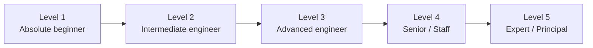
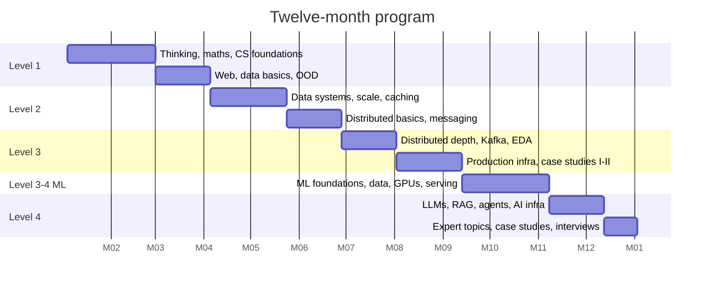

# Appendix E — Learning Roadmap and Proficiency Levels

> **Deliverable 3.** This appendix turns the 93 chapters into a schedule. It defines five proficiency levels, what you must know and be able to do at each, and week-by-week milestones for three tracks: the full 12-month program, a 16-week interview track, and a 24-week ML/AI infrastructure track for working engineers.

## E.1 How to use this roadmap

1. Find your starting level with the self-assessment in §E.3. Do not skip a level because a topic "sounds familiar" — the readiness criteria test whether you can *explain and apply* a concept, not whether you recognize its name.
2. Pick a track (§E.4–E.6). Each week lists chapters, a hands-on task and a checkpoint. Budget the stated hours; if a week overruns, extend it rather than skipping the exercise — implementation is where understanding consolidates (Ch 3, §3.7).
3. At the end of every month, run the month's **milestone review**: answer the knowledge checkpoints of each chapter from memory, redraw the month's key architecture diagrams without notes, and solve one design challenge aloud in 45 minutes.
4. Record progress in a design journal (template in Ch 3, §3.10).

## E.2 The five proficiency levels

**Figure E.1 — Proficiency ladder.**

**Reading the diagram.** The levels are cumulative: each assumes every competency of the previous one. The arrows are not time-boxed — a strong backend engineer may already sit at Level 3 for traditional systems but at Level 1 for ML infrastructure. Assess each track (A: traditional, B: ML/AI) separately.

### Level 1 — Absolute beginner

| Dimension | Definition |
|---|---|
| **Required knowledge** | Ch 1–8, 11, 35. What a client, server, API, database, process, thread, IP address, DNS lookup and HTTP request are; functional vs non-functional requirements; powers of ten and basic percentiles. |
| **Expected competencies** | Trace one HTTP request from browser to database and back, naming every hop. Write a CRUD REST API with a relational database. Model a simple domain in tables with primary/foreign keys. Do a back-of-the-envelope estimate of requests per second from daily active users. |
| **Practical projects** | P-01 REST API service; P-02 URL shortener (single node). |
| **Architecture exercises** | Draw a single-server web app; then add a load balancer and a second app server and explain what breaks (sessions). |
| **Interview readiness** | Not yet ready for system design rounds. Can answer "what happens when you type a URL?" thoroughly. |
| **Explain independently** | TCP vs UDP; what an index is and why it speeds reads but slows writes; what latency vs throughput mean; why HTTPS needs certificates. |

### Level 2 — Intermediate engineer

| Dimension | Definition |
|---|---|
| **Required knowledge** | Ch 9–10, 12, 14, 17–22, 24, 30, 33, 36–37, 57. Replication, sharding, consistent hashing, caching patterns, CDNs, load-balancing algorithms, rate limiting, queues and pub/sub, monolith vs microservices, ML basics. |
| **Expected competencies** | Turn a vague prompt into numbered FRs/NFRs with targets. Estimate storage, bandwidth and RPS with peak factors. Choose SQL vs NoSQL with justification. Add a cache and explain invalidation and stampede protection. Design a rate limiter and pick an algorithm. |
| **Practical projects** | P-03 Redis cache; P-04 rate limiter; P-05 load-balancer simulation; P-06 message queue. |
| **Architecture exercises** | URL shortener, Pastebin, rate limiter and notification system (Ch 52) at 10⁷ DAU. |
| **Interview readiness** | Can complete an entry-level (new-grad / mid-level) system design round: correct high-level architecture, reasonable estimates, identifies the main bottleneck. |
| **Explain independently** | Cache-aside vs write-through; why sharding needs a good key; at-least-once delivery and why consumers must be idempotent; Little's Law applied to a thread pool. |

### Level 3 — Advanced engineer

| Dimension | Definition |
|---|---|
| **Required knowledge** | Ch 13, 15–16, 23, 25–27, 29, 31–32, 34, 38–43, 58–62, 66. Storage engines, consistency models, Raft, quorums, Kafka internals, outbox/saga/CQRS, observability, Kubernetes, CI/CD, ML lifecycle, feature stores, model serving. |
| **Expected competencies** | Design a complete distributed application with explicit consistency choices, failure handling and observability. Explain a database's write path down to WAL and fsync. Design an ML system from problem formulation to online serving with a feature store. |
| **Practical projects** | P-07 distributed KV store; P-08 replicated DB simulation; P-09 notification service; P-10 real-time chat; P-11 distributed job scheduler. |
| **Architecture exercises** | All of Ch 52–53; ML case studies 81.5 (product recommendation) and 82.3 (spam detection). |
| **Interview readiness** | Passes a senior-level (L5/E5 equivalent) traditional round and a mid-level ML system design round: deep-dives on request, quantifies trade-offs, discusses failure modes unprompted. |
| **Explain independently** | Raft leader election and log matching; why `R + W > N` gives read-your-writes only under certain conditions; Kafka ISR and `acks=all`; point-in-time feature joins and training–serving skew. |

### Level 4 — Senior / Staff engineer

| Dimension | Definition |
|---|---|
| **Required knowledge** | Ch 28, 44, 46–48, 50–51, 63–65, 67–80. Distributed transactions, multi-region design, cluster scheduling, multi-tenancy, security architecture, cost; GPU performance, distributed training, model optimization, recommendation architecture, MLOps, LLM inference, RAG, agents, AI platforms. |
| **Expected competencies** | Make and defend architecture decisions spanning teams: multi-region active–active, tenant isolation, SLOs and error budgets, cost models. Size a GPU fleet for training and for LLM serving from first principles. Design a RAG or agent platform with evaluation, guardrails and observability. |
| **Practical projects** | P-12 event-driven microservices; P-13 real-time analytics pipeline; P-14 recommendation engine; P-15 distributed ML inference; P-18 production RAG; P-19 scalable LLM inference. |
| **Architecture exercises** | All of Ch 54–56 and 81–86. Write a design document with ADRs for one case study and have it reviewed. |
| **Interview readiness** | Passes staff-level rounds: drives the conversation, scopes ambiguity, prioritizes the hardest sub-problem, connects technical choices to business, cost and organizational constraints. |
| **Explain independently** | Spanner commit-wait; why cells limit blast radius; ZeRO stage 3 memory math; continuous batching and PagedAttention; when RAG beats fine-tuning; how to evaluate an agent. |

### Level 5 — Expert / Principal architect

| Dimension | Definition |
|---|---|
| **Required knowledge** | Ch 45, 49, 80 plus the primary papers cited across Parts V, IX, XIII and XVI. Theory (FLP, CAP proofs, BFT bounds, consistency hierarchies, scaling laws) and practice at 10⁴–10⁵ machine scale. |
| **Expected competencies** | Set multi-year technical direction; evaluate novel systems from papers; reason about organization-wide failure domains, reliability economics and sustainability; design platforms other teams build on. |
| **Practical projects** | P-16 distributed training platform; P-17 multi-tenant feature store; P-20 multi-agent orchestration platform. |
| **Architecture exercises** | Critique a published architecture (e.g., a Dynamo, Spanner or PagedAttention paper) and propose a design for a changed constraint. Lead a postmortem-driven redesign. |
| **Interview readiness** | Principal-level: articulates long-term trade-offs, migration strategy, organizational design (Conway's law), and the economics of the platform. |
| **Explain independently** | Why consensus is impossible in a fully asynchronous system with one crash failure and how real systems sidestep it; goodput at 16k-GPU scale; the cost/latency frontier of an LLM product. |

## E.3 Self-assessment

Score yourself 0–2 on each statement (0 = cannot, 1 = with notes, 2 = from memory, aloud, in under five minutes). Start at the first level where your total is below 14 of 20.

**Table E.1 — Placement self-assessment.**

| Level | Ten statements to score |
|---|---|
| 1 | Explain DNS resolution · TCP handshake · HTTP request/response · process vs thread · what an index is · primary/foreign keys · REST verbs and status codes · latency vs throughput · p99 · RPS from DAU |
| 2 | Cache-aside and invalidation · consistent hashing · token bucket · L4 vs L7 load balancing · replication lag · sharding keys · at-least-once delivery · CDN pull vs push · SQL vs NoSQL choice · precision vs recall |
| 3 | Raft election · quorum math · Kafka partitions/ISR · outbox pattern · LSM vs B-tree · Kubernetes control plane · SLO/error budget · feature store PIT join · dynamic batching · canary analysis |
| 4 | 2PC failure modes · multi-region active–active · tenant isolation options · cost model of a service · data/tensor/pipeline parallelism · KV-cache memory · RAG evaluation · agent guardrails · model routing · DRF scheduling |
| 5 | FLP intuition · linearizability vs serializability · PBFT bound · TrueTime · ZeRO-3 communication · MFU at scale · scaling laws · disaggregated serving · failure rates at 10k GPUs · multi-year platform migration |

## E.4 Track 1 — Full 12-month program (beginner to Level 4)

**Budget:** 10–12 hours per week · 52 weeks · Levels 1 → 4. Each week: read (≈ 60%), implement or exercise (≈ 30%), recall and explain (≈ 10%).

**Figure E.2 — Twelve-month program at a glance.**

**Reading the diagram.** Bars are sequential phases; the dates are an example start (any Monday works). Levels overlap at the boundaries because review weeks consolidate the previous level while starting the next. The ML phase begins only after production infrastructure because serving, MLOps and AI-infrastructure chapters assume Kubernetes, observability and deployment knowledge.

**Table E.2 — Weekly milestones, 12-month program.**

| Wk | Chapters | Hands-on task | Checkpoint |
|---|---|---|---|
| 1 | 1, 3 | Set up design journal and flashcard deck | Explain FR vs NFR with three examples each |
| 2 | 2 | Write requirements + context diagram for a food-ordering app | Present it in 10 minutes |
| 3 | 4 (§4.3–4.9) | Estimation drills: 20 powers-of-ten problems | Score ≥ 18/20 |
| 4 | 4 (§4.10–4.18) | Simulate an M/M/1 queue in Python; compare with formula | Explain why latency explodes near 100% utilization |
| 5 | 5 | Cache-stride benchmark | Draw the memory hierarchy with latencies from memory |
| 6 | 6 | Race condition + mutex fix; event-loop echo server | Explain epoll vs thread-per-connection |
| 7 | 7 | `dig`, `curl -w`, Wireshark on a TLS handshake | Narrate "type a URL" end to end |
| 8 | Review | Redo checkpoints Ch 1–7 | **Month 2 milestone review** |
| 9 | 8 | P-01 REST API with pagination and JWT | Defend cursor vs offset pagination |
| 10 | 11 | Schema design + `EXPLAIN` on indexed vs unindexed queries | Explain B+ tree lookups in I/Os |
| 11 | 35, 36 | Refactor a small codebase with SOLID | Class diagram from memory |
| 12 | 9, 10 | SSE + WebSocket demo; password hashing | Choose a real-time technique for 3 scenarios |
| 13 | Review | P-02 URL shortener (single node) | **Level 1 exit**: self-assessment ≥ 14 |
| 14 | 12 | Model one domain in a document DB and a wide-column DB | SQL vs NoSQL decision for 5 prompts |
| 15 | 13 | Toy LSM tree (memtable + SSTables + compaction) | Draw write path with WAL |
| 16 | 14 | Consistent-hashing ring with virtual nodes | Keys moved when adding a node |
| 17 | 15, 16 | Inverted index + BM25 in Python | Explain erasure coding overhead |
| 18 | 17 | Bloom filter, HyperLogLog, Snowflake IDs | False-positive-rate calculation |
| 19 | 18, 19 | P-05 load-balancer simulation | Power-of-two-choices intuition |
| 20 | 20, 21 | P-03 Redis cache-aside with stampede protection | Five caching patterns from memory |
| 21 | 22 | P-04 distributed rate limiter | Token bucket parameters for a given SLA |
| 22 | 23 | Load test with `wrk`/`k6`; find the bottleneck | Explain coordinated omission |
| 23 | 24 | Lamport and vector clocks implementation | Two partial-failure stories |
| 24 | 30 | P-06 message queue with acks and DLQ | Delivery semantics table from memory |
| 25 | 33, 37 | Implement 6 design patterns | Monolith vs microservices debate |
| 26 | Review | Ch 52.1–52.4 case studies | **Level 2 exit** + **Month 6 milestone** |
| 27 | 25 | Jepsen-style anomaly hunt on a toy store | Consistency hierarchy diagram |
| 28 | 26 | Raft (election + log replication) — MIT 6.5840 style | Explain fencing tokens |
| 29 | 27, 28 | P-07 distributed KV store with quorums | 2PC failure walkthrough |
| 30 | 29, 31 | Kafka locally: partitions, consumer groups, lag | Partition count sizing |
| 31 | 32, 34 | Outbox + saga demo | Choreography vs orchestration |
| 32 | 38 | Four LLD problems (parking lot, elevator, LRU, vending) | 45-min LLD mock |
| 33 | 39, 40 | SLOs, burn-rate alerts, OpenTelemetry tracing | Error-budget policy |
| 34 | 41, 42 | Deploy P-01 to Kubernetes with HPA | Kubernetes control-plane walk-through |
| 35 | 43 | CI/CD with canary; Terraform a VPC | Rollback plan |
| 36 | 52, 53 | P-09 notification service; P-10 chat | Two 45-min mocks |
| 37 | 54, 55 | YouTube, Uber, payment system cases | Two 45-min mocks |
| 38 | Review | 56 + P-11 job scheduler | **Level 3 exit (Track A)** |
| 39 | 57 | Train/evaluate a classifier; compute all metrics | Precision/recall trade-off for fraud |
| 40 | 58, 59 | Small MLP in PyTorch; memory math | ML lifecycle diagram |
| 41 | 60, 61 | Batch + streaming feature pipeline | Lambda vs Kappa |
| 42 | 62, 63 | Feast feature store with PIT join | Training–serving skew causes |
| 43 | 64 | Roofline analysis of a matmul | Compute- vs memory-bound |
| 44 | 65 | DDP on 2 GPUs (or simulated); FLOPs estimate | 6ND estimate for a model |
| 45 | 66, 67 | Serve a model with dynamic batching; quantize it | Batch size vs latency curve |
| 46 | 68–71 | P-14 two-tower recommender; drift monitor | Multi-stage funnel sizing |
| 47 | 72 | Implement attention + KV cache in NumPy | KV-cache size for a 70B model |
| 48 | 73 | Run vLLM; measure TTFT/TPOT vs concurrency | Continuous batching explanation |
| 49 | 74, 75 | P-18 production RAG with hybrid search + reranking | Retrieval metrics |
| 50 | 76–78 | Agent with tool calling, guardrails and eval set | Prompt-injection defenses |
| 51 | 79, 80, 81–86 (2 cases) | Model gateway with token-based rate limits | Two ML/AI mocks |
| 52 | 87–92 | Full mock loop: 2 traditional + 2 ML/AI | **Level 4 readiness review** |

Level 5 content (Ch 45, 49, 80 deep dives, primary-paper reading) is a continuing program after week 52: one paper and one design critique per week.

## E.5 Track 2 — 16-week interview track (Level 2–3 engineer → senior interviews)

**Budget:** 12–15 hours/week. Assumes Level 2 fundamentals.

**Table E.3 — Interview track.**

| Wk | Focus | Chapters | Practice |
|---|---|---|---|
| 1 | Framework and estimation | 2, 4, 87, 88, 89 | 30 estimation drills |
| 2 | Data systems refresh | 11, 12, 14 | Q-T-01 … Q-T-04 |
| 3 | Caching, CDN, LB | 19, 20, 21 | Q-T-05 … Q-T-08 |
| 4 | Traffic management | 22, 17 | Rate limiter + URL shortener mocks |
| 5 | Distributed core | 24, 25, 26 | KV-store mock |
| 6 | Replication and transactions | 27, 28 | Payment-system mock |
| 7 | Messaging | 30, 31, 32 | Notification-system mock |
| 8 | Microservices and reliability | 34, 39, 40 | Mid-point mock with a peer |
| 9 | Social systems | 53 | News feed, chat, Twitter mocks |
| 10 | Media and files | 54 | YouTube, Dropbox mocks |
| 11 | Location and commerce | 55 | Uber, ticketing mocks |
| 12 | Data platforms | 56, 16 | Search, logging mocks |
| 13 | Senior depth | 44, 47 | Multi-region mock |
| 14 | Company preparation | 90 | Company-specific mocks |
| 15 | Practice library sweep | 91 | 10 timed questions |
| 16 | Final review | Summaries of all above | 3 full mocks; rubric self-score ≥ "Hire" |

## E.6 Track 3 — 24-week ML/AI infrastructure track (software engineer → ML/AI systems)

**Budget:** 10–12 hours/week. Assumes Level 3 on Track A.

**Table E.4 — ML/AI track.**

| Wk | Chapters | Deliverable |
|---|---|---|
| 1–2 | 4.9, 57 | Metrics notebook; A/B test sample-size calculator |
| 3 | 58 | PyTorch MLP; parameter/activation memory worksheet |
| 4 | 59, 60 | Architecture diagram of an end-to-end ML system |
| 5–6 | 61, 29 | Lakehouse table + streaming feature job |
| 7 | 62, 63 | Feature store with PIT-correct training set |
| 8–9 | 64 | GPU profiling exercise; roofline worksheet |
| 10–11 | 65 | Multi-GPU training run; parallelism plan for a 70B model |
| 12 | 66 | Model server with dynamic batching and autoscaling |
| 13 | 67 | Quantization + ONNX/TensorRT comparison |
| 14 | 68 | Two-tower retrieval + ranker |
| 15 | 69, 70 | CI/CD/CT pipeline with drift-triggered retraining |
| 16 | 71 | Fairness audit and model card |
| 17 | 72 | Transformer from scratch (small) |
| 18–19 | 73 | LLM serving benchmark; capacity plan |
| 20 | 74, 75 | Production RAG with evaluation harness |
| 21 | 76, 77 | LoRA fine-tune; tool-using agent |
| 22 | 78, 79 | Eval pipeline; model gateway with routing and fallback |
| 23 | 80, 81–85 | Two case studies written as design docs |
| 24 | 86, 92 | Four ML/AI mock interviews |

## E.7 Monthly milestone review template

1. **Recall:** answer every knowledge-checkpoint question for the month's chapters without notes; mark misses for spaced repetition.
2. **Redraw:** reproduce the month's three most important architecture diagrams from memory; compare with the book.
3. **Quantify:** solve three estimation problems from Ch 89 in under five minutes each.
4. **Design:** solve one design challenge aloud in 45 minutes; self-score with the Ch 88 rubric.
5. **Build:** demo the month's project to someone else, including one injected failure.
6. **Reflect:** write half a page in the design journal — what is still unclear, which open question to research next.
