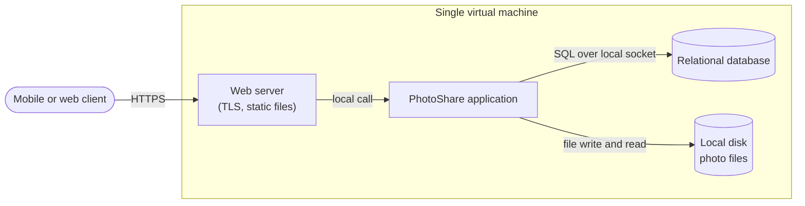
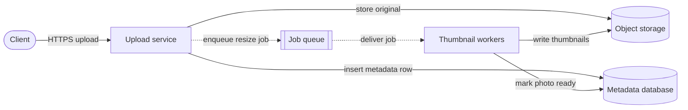
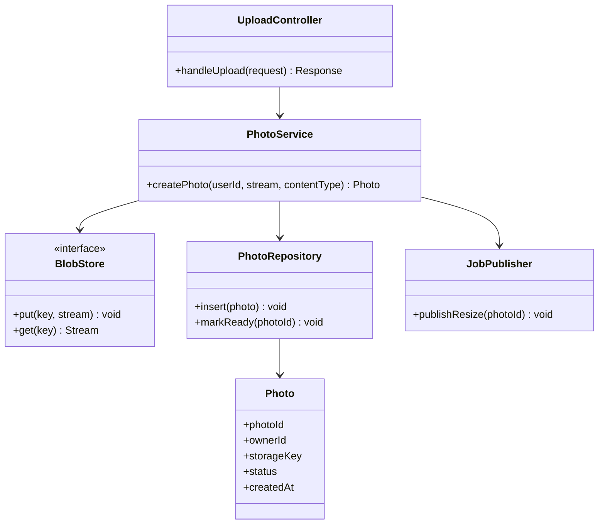
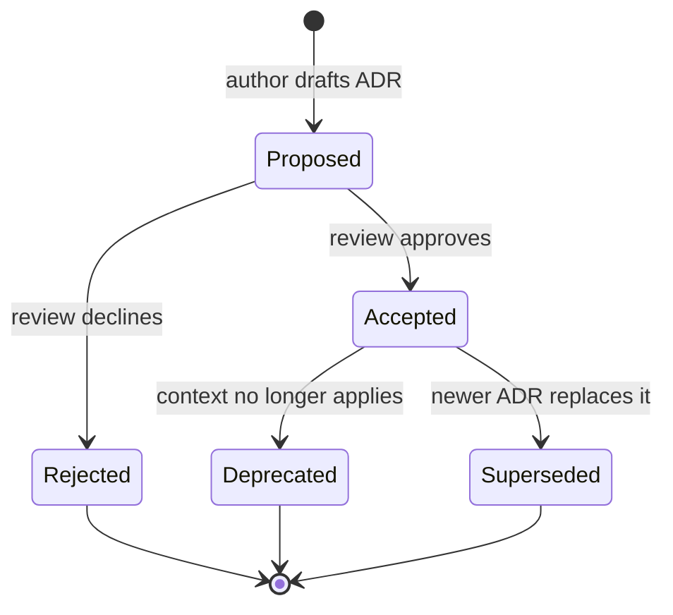
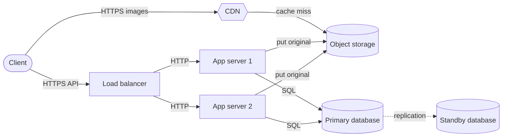
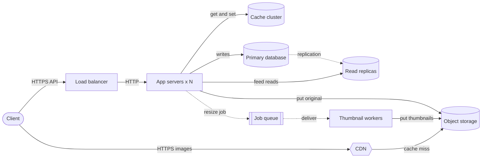
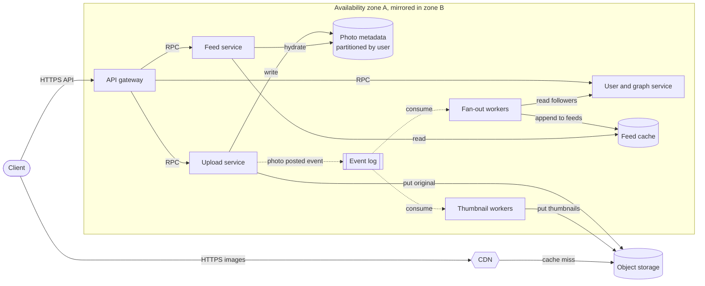
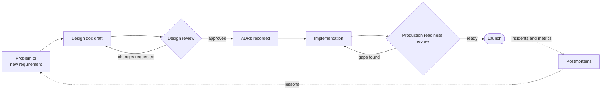
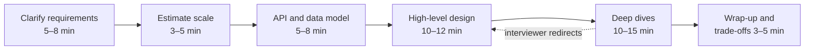

# Chapter 1 — What Is System Design?

> **Level:** 1 · **Track:** Shared · **Estimated reading time:** 3.5 h

Every application you have ever used — a photo app, a bank, a search engine — is two things at once. It is *code*, which tells a computer what to do, and it is a *system*, which decides where that code runs, where its data lives, how many copies of each exist, what happens when a machine dies at 3 a.m., and how the whole thing keeps working when ten times more people show up next month. This chapter is about the second thing.

We will follow one fictional product through the whole chapter: **PhotoShare**, a simple photo-sharing app in which people upload photos, follow friends and scroll a feed. PhotoShare starts life on a single rented server with a thousand users. By the end of the chapter it serves ten million daily users across multiple machines and data centers. At every stage you will see *why* the design had to change, *which requirement* forced the change, and *what it cost*. That progression — requirements forcing decisions, decisions carrying costs — is system design.

## 1.1 Learning objectives

After this chapter you should be able to:

- Define *system design*, *software architecture*, *high-level design* and *low-level design*, and explain how they differ and overlap.
- Distinguish functional requirements from non-functional requirements, and write each in a testable form.
- Name at least fifteen quality attributes ("-ilities"), state a measurable metric for each, and identify common tensions between them.
- Convert an availability target (for example 99.9%) into an allowed-downtime budget, and compute the availability of components in series.
- Estimate average and peak request rates, storage growth and network egress from a user count, using explicit assumptions.
- Write an Architecture Decision Record (ADR) in Nygard's format and use a weighted decision matrix to compare options.
- Explain why early architectural decisions are expensive to reverse, using a concrete migration-cost calculation.
- Describe how design documents, design reviews and RFC processes work in industry.
- Describe the structure of a 45–60-minute system design interview and what interviewers evaluate.
- Recognize and avoid the twelve most common beginner mistakes in system design.

## 1.2 Prerequisites

This chapter assumes no prior system design knowledge. Helpful but not required:

- Basic programming in any language — so that "a function", "a class" and "a web request" are familiar words.
- A rough idea of what happens when a browser loads a web page — treated fully in §8.5 (The request–response lifecycle end to end); here we only need "a client sends a request, a server sends a response".
- A rough idea of what a database is — treated fully in Ch 11 (Relational Databases); here we only need "a program that stores data durably and answers queries about it".

Every other term is defined when it first appears.

## 1.3 Definition of system design

### 1.3.1 What a "system" is

::: definition
**Definition — System.** A set of interacting **components** (programs, machines, data stores, networks and people) that together deliver a capability no single component delivers alone. Components interact only through **interfaces**: agreed formats and protocols for exchanging requests, responses and data.
:::

::: definition
**Definition — Component.** A unit of a system with a clear responsibility and an interface — for example a web service, a database, a cache, a message queue, a load balancer or a third-party payment provider.
:::

#### First-principles explanation

Think of a busy restaurant. A single recipe is like a single function in code: it turns inputs (ingredients) into an output (a dish). But a restaurant is not a recipe. It is a *system*: a front-of-house that takes orders, a ticket rail that queues them, stations for grill and salad, a walk-in fridge (storage), a dishwasher (cleanup), a manager who notices when the grill cook is overwhelmed, and a supplier who delivers flour every Tuesday. The food can be excellent and the restaurant can still fail — because orders get lost, the fridge breaks, or Saturday night brings three times more guests than the kitchen can handle.

Software is the same. The code that resizes a photo can be perfect, and PhotoShare can still fail because the disk filled up, the only server rebooted during a deploy, or a celebrity's post caused a thousand times the normal traffic in ten seconds.

### 1.3.2 System design

::: definition
**Definition — System design.** The process of deciding the components of a software system, their responsibilities, their interfaces, how data flows and is stored between them, and how they are deployed — so that the system meets its functional requirements *and* its non-functional requirements (performance, scalability, availability, durability, security, cost and others) under stated assumptions about load and failure. The output of the process is also called the *system design*: a set of decisions, diagrams and documents.
:::

Two parts of the definition deserve emphasis.

1. **"So that it meets its requirements."** A design is never good or bad in the abstract — only good or bad *for a stated set of requirements*. A single server is an excellent design for 1,000 users and a terrible one for 10 million.
2. **"Under stated assumptions about load and failure."** Designers must say out loud how much traffic they expect and what kinds of failure they expect to survive. A design that is silent about these is not finished.

#### Why does this exist?

For most of computing history, a program ran on one machine. Today almost any useful service must handle more data, more users and more failure than one machine can. A modern commodity server fails on the order of once every few years; a fleet of thousands therefore sees failures every day [Barroso et al. 2018]. Users are spread across continents, and light in optical fiber needs roughly 5 ms per 1,000 km one way, so a single location cannot be fast for everyone (see §7.15 (Latency, bandwidth, BDP, packet loss)). Regulations require some data to stay in certain countries. Each of these forces pushes the system apart into multiple components, and the moment you have multiple components you must decide how they divide the work, how they talk, and what happens when one of them stops. System design exists because those decisions are hard to get right, expensive to get wrong and impossible to avoid.

#### How it works internally

System design is iterative, but in practice most designers follow a loop like this:

1. **Understand the problem.** Who are the users? What must the system do (functional requirements, §1.6)? How well must it do it (non-functional requirements, §1.7)?
2. **Quantify.** Estimate users, request rates, data sizes and growth (back-of-the-envelope estimation; see §2.11 and Ch 89).
3. **Propose a simple design.** Start with the smallest design that could work: a client, a service, a database.
4. **Stress the design against the requirements.** Where does it break first — CPU, memory, disk, network, a single point of failure, a consistency rule? (See §2.6 (Identifying bottlenecks).)
5. **Evolve the design.** Add or change components to fix the weakest point, noting what each change costs.
6. **Record decisions** and their rationale (ADRs, §1.8), and communicate the design (design docs, §1.10).
7. **Validate in production** with monitoring, load tests and incidents, and feed what you learn back into step 1.

#### Architecture diagram

Here is PhotoShare on launch day. Everything runs on one rented virtual machine.

**Figure 1.1 — PhotoShare v0: a single-server design.**



**Reading the diagram.**

- **Components.** A *client* (the mobile app or browser), a *web server* that terminates HTTPS and serves static files, the *PhotoShare application* (business logic: sign-up, upload, feed), a *relational database* holding users, follows and photo metadata, and the *local disk* holding the photo files themselves.
- **Protocols.** The client speaks HTTPS to the web server. Inside the machine, the application talks to the database over a local socket using SQL and reads and writes photo files through the operating system's file system.
- **Direction of data flow.** Uploads flow left to right: client → web server → application → database row plus file on disk. Feed requests flow the same way and responses return along the same path.
- **Synchronous vs asynchronous.** Every arrow is solid: every step is synchronous. The client waits while the application stores the photo and generates any thumbnails.
- **Storage boundaries.** All state — rows and files — lives on one machine's disk. The *subgraph* is the deployment boundary: everything inside shares one fate.
- **Failure points.** The virtual machine is a **single point of failure (SPOF)**: if it reboots, crashes, or its disk fails, PhotoShare is completely down, and photos may be lost if there is no backup.
- **Scaling options.** The only option without redesign is **vertical scaling** — renting a bigger machine (see §18.3). That buys time but has a ceiling and does not remove the SPOF.

This design is not a mistake. For a launch with 1,000 users it is the *right* design: cheap, simple, and easy to change. The rest of the chapter shows which requirements eventually break it.

#### Mathematical foundations

The first quantitative question in any design is "how much load?" The simplest useful formula converts daily activity into a request rate.

::: formula
**Average and peak request rate**

$$\text{RPS}_{\text{avg}} = \frac{\text{DAU} \times r}{86{,}400} \qquad \text{RPS}_{\text{peak}} = k \times \text{RPS}_{\text{avg}}$$

| Symbol | Meaning | Units |
|---|---|---|
| $\text{RPS}_{\text{avg}}$ | Average request rate over a day | requests/second |
| $\text{DAU}$ | Daily active users | users |
| $r$ | Requests (of the type being estimated) per user per day | requests/user/day |
| $86{,}400$ | Seconds in a day | seconds/day |
| $k$ | Peak factor: ratio of the busiest period's rate to the daily average (dimensionless; 2–5 is a common assumption for consumer apps) | — |
| $\text{RPS}_{\text{peak}}$ | Request rate during the busiest period | requests/second |
:::

**RPS** (requests per second) is the canonical unit in this book; you will also see **QPS** (queries per second) used as a synonym.

::: example
**Worked example — PhotoShare on launch day.**

Assumptions (stated, as always): 1,000 DAU; each user views 50 photos per day; peak factor $k = 3$.

1. Daily photo views: $1{,}000 \times 50 = 50{,}000$ views/day.
2. Average rate: $50{,}000 / 86{,}400 \approx 0.58$ RPS.
3. Peak rate: $3 \times 0.58 \approx 1.7$ RPS.

**Interpretation.** Under two requests per second at peak. A single small virtual machine running an ordinary web framework typically handles hundreds of such requests per second (an order-of-magnitude assumption; measure your own stack, see §23.10).

**Engineering implication.** Any design more complex than Figure 1.1 would be *over-engineering* at this scale: more cost, more moving parts, more ways to fail, and no benefit users can feel.
:::

#### Code example

Estimation is arithmetic, but writing it as a tiny program makes your assumptions explicit and easy to change. The same script is reused in §1.9 when PhotoShare grows.

```python
"""Back-of-the-envelope estimator for the PhotoShare running example.

Uses SI units: 1 MB = 10**6 bytes, 1 TB = 10**12 bytes.
"""
from dataclasses import dataclass

SECONDS_PER_DAY = 86_400


@dataclass
class Workload:
    dau: int                  # daily active users
    views_per_user: float     # photo views per user per day
    uploads_per_user: float   # photo uploads per user per day
    stored_bytes_per_upload: int  # original + thumbnails, bytes
    served_bytes_per_view: int    # bytes sent to the client per view
    peak_factor: float = 3.0      # peak-hour rate / daily average rate


def estimate(w: Workload) -> dict:
    views_per_day = w.dau * w.views_per_user
    uploads_per_day = w.dau * w.uploads_per_user
    read_rps = views_per_day / SECONDS_PER_DAY
    write_rps = uploads_per_day / SECONDS_PER_DAY
    storage_per_day = uploads_per_day * w.stored_bytes_per_upload
    egress_bits_per_s = views_per_day * w.served_bytes_per_view * 8 / SECONDS_PER_DAY
    return {
        "read_rps_avg": read_rps,
        "read_rps_peak": read_rps * w.peak_factor,
        "write_rps_avg": write_rps,
        "write_rps_peak": write_rps * w.peak_factor,
        "storage_TB_per_day": storage_per_day / 1e12,
        "storage_PB_per_year": storage_per_day * 365 / 1e15,
        "egress_Gbps_avg": egress_bits_per_s / 1e9,
        "egress_Gbps_peak": egress_bits_per_s * w.peak_factor / 1e9,
    }


if __name__ == "__main__":
    for label, dau in [("v0 launch", 1_000), ("v3 scale", 10_000_000)]:
        w = Workload(dau=dau, views_per_user=50, uploads_per_user=0.2,
                     stored_bytes_per_upload=2_500_000,
                     served_bytes_per_view=200_000)
        print(label)
        for key, value in estimate(w).items():
            print(f"  {key:>20}: {value:,.3f}")
```

What to notice:

- Every assumption is a named field with a unit in the comment. When a reviewer disagrees with "50 views per user", they change one number, not your reasoning.
- The peak factor is explicit. Systems are sized for the peak, not the average.
- Egress is converted from bytes to **bits** (`* 8`) because network links are rated in bits per second.
- Running it prints about 0.58 average read RPS for v0 and about 5,787 average (17,361 peak) read RPS, 5 TB/day of new storage and about 9.3 Gbit/s average egress for v3. Those v3 numbers drive most of §1.9.

#### Real-world industry applications

::: industry
**Instagram (2011).** About a year after launch, Instagram's engineering team published a description of its stack: a load balancer in front of Django application servers, PostgreSQL for data (partitioned across multiple database instances, with replicas in a different availability zone), Redis and Memcached for feeds and caching, photos stored in Amazon S3 and served through a CDN, and a task queue for asynchronous work. Their stated principles were to keep things simple, avoid reinventing the wheel, and use proven technologies. The problem (rapid growth with a tiny team) drove an architecture built mostly from well-understood, managed components rather than custom infrastructure. The trade-off: less control and some vendor dependence, in exchange for a very small operations burden.
*Evidence: Primary* — [Instagram Engineering 2011]
:::

#### Advantages and disadvantages

Treating design as an explicit activity — rather than letting structure emerge from whatever code is written first — has a clear profile. **Advantages:** problems are found on a whiteboard instead of in production; trade-offs are chosen deliberately; teams share a mental model; costs are predictable. **Disadvantages:** design takes time; designs made with poor information can be confidently wrong; and heavy upfront design can delay learning from real users. The practical answer is *proportionate* design: spend design effort in proportion to how expensive a decision would be to reverse (§1.8, §2.8).

#### Failure scenarios

**Table 1.1 — Failure scenarios for the design process itself.**

| What goes wrong | Why | Detection | Recovery | Prevention |
|---|---|---|---|---|
| System collapses under launch traffic | Load never estimated; peak factor ignored | Latency and error rate spike; saturated CPU or connections | Emergency vertical scaling; shed load | Estimate peak load before launch (§1.3.2); load-test |
| Total outage when one machine fails | Single point of failure nobody named | Health checks fail; users report outage | Restore from backup onto a new machine | List SPOFs in every design review (§1.10) |
| Months spent building infrastructure for users who never arrive | Design sized for imagined scale | Low utilization; slipped launch | Simplify; delete unused components | Design for 10× current load, not 1,000× |
| Nobody remembers why a component exists | Decisions not recorded | Repeated debates; fear of changing anything | Reconstruct history from commits and people | ADRs (§1.8) |

#### Common misconceptions

::: mistake
**"System design means drawing boxes and arrows."** The diagram is the *output*. The substance is the reasoning: which requirements forced each box, what each arrow carries, what happens when each box fails, and what the design costs. A beautiful diagram with no requirements and no numbers is decoration.
:::

::: mistake
**"System design only matters at Google scale."** A three-person startup still chooses where its data lives, how it backs up, and what happens during a deploy. The decisions are smaller, but the cost of getting the *irreversible* ones wrong (data model, identifiers, storage location of user files) is felt at every scale.
:::

## 1.4 Software architecture

### 1.4.1 What architecture is

::: definition
**Definition — Software architecture.** "The set of structures needed to reason about the system, which comprise software elements, relations among them, and properties of both" [Bass et al. 2021]. The international standard for architecture description defines it as the fundamental concepts or properties of a system in its environment, embodied in its elements, relationships, and in the principles of its design and evolution [ISO/IEC/IEEE 42010].
:::

#### First-principles explanation

Return to the restaurant. Its *architecture* is not the color of the napkins; it is the set of decisions that would be painful to change once the doors open: where the kitchen sits relative to the dining room, how many burners there are, whether orders go through a single ticket rail or directly to stations, whether there is a walk-in fridge or daily deliveries. You can change the menu weekly; moving the kitchen means closing for months.

Martin Fowler summarized the same idea for software: architecture is about "the important stuff — whatever that is", meaning the decisions that are hard to change and that the team must share an understanding of [Fowler 2003]. The parenthetical "whatever that is" is honest: what counts as architectural depends on the system. For PhotoShare, *where photo files live* is architectural (changing it means migrating terabytes); *which image-resizing library we call* is usually not.

#### Why does this exist?

Large systems are built by many people over many years. Without a shared structure, each person optimizes locally and the whole becomes inconsistent: three ways to authenticate, four copies of the user table, no one able to say what happens if the cache is down. Architecture exists to (1) make the system understandable enough to reason about, (2) make the most important qualities — performance, availability, security, modifiability — achievable by design rather than by luck, and (3) let teams work in parallel along stable boundaries.

#### How it works internally

An architecture is described by several **views**, because no single picture answers every question. Kruchten's influential "4+1" model proposes four views plus scenarios that tie them together [Kruchten 1995]:

1. **Logical view** — the main abstractions and their responsibilities (users, photos, feeds, follows).
2. **Process view** — what runs concurrently, and how runtime components communicate (requests, queues, threads).
3. **Development view** — how the code is organized into modules, packages and repositories, and which teams own them.
4. **Physical view** — which machines, data centers and networks the software is deployed on.
5. **+1: Scenarios** — a few important use cases ("a user uploads a photo") traced through all four views to validate them.

The C4 model (context, containers, components, code) is a more recent, lightweight alternative used widely in industry; it is covered in §2.12 (Architecture documentation).

Architectures also follow recognizable **styles** or **patterns** — layered, monolithic, modular monolith, microservices, event-driven, serverless — each a reusable answer to a recurring set of forces. They are the subject of Ch 33 (Architecture Patterns) and Ch 34 (Microservices).

::: concept
**Conway's law.** Melvin Conway observed in 1968 that organizations which design systems are constrained to produce designs that copy the organization's communication structure [Conway 1968]. If three teams build a compiler, you tend to get a three-pass compiler. Architecture and team structure therefore co-evolve: choosing service boundaries is partly choosing team boundaries, and vice versa (see §34.3 (Service boundaries)).
:::

### 1.4.2 Architecture, system design and design: how the words relate

The terms overlap heavily, and different companies use them differently. The working distinction used in this book is in Table 1.2.

**Table 1.2 — Overlapping disciplines: architecture, system design and low-level design.**

| Aspect | Software architecture | System design | Low-level design |
|---|---|---|---|
| What it is | The significant, hard-to-change structures of a system | Choosing components, data flow and deployment to meet requirements at scale | Internal structure of one component |
| Typical questions | Monolith or services? Which quality attributes dominate? | How many servers? Which database? Where to cache? What if a node fails? | Which classes, interfaces, algorithms, schemas? |
| Unit of reasoning | Elements, relations, properties | Services, stores, networks, traffic, failures | Classes, functions, tables, state machines |
| Time horizon | Years | Months to years | Weeks to months |
| Typical artifacts | Architecture views, principles, ADRs | Design docs, capacity estimates, deployment diagrams | Class/sequence diagrams, API specs, schema DDL |
| Where in this book | Ch 33–34 | Most of Book I; case studies Ch 52–56 | Ch 35–38 |

In everyday industry usage, "system design" usually means the distributed-systems end of architecture: servers, databases, caches, queues, networks and their failure modes. "Software architecture" is the broader discipline that also includes code-level structure and organizational concerns. This book treats system design as the large-scale, runtime-focused part of architecture.

#### Real-world industry applications

::: industry
**Architecture as a role.** Many companies do not have a job titled "architect"; architectural decisions are made by senior and staff engineers through design documents and reviews (§1.10). Others have dedicated architects who own cross-team standards. In both models the activity is the same — identifying the hard-to-change decisions and making them deliberately — but the accountability differs.
*Evidence: Illustrative* — a general description of common industry practice, not a claim about any specific company.
:::

#### Advantages and disadvantages

An explicit architecture makes systems understandable, supports parallel work, and lets you predict quality attributes before building. Its costs are upfront effort, the risk of an "ivory-tower" architecture that ignores implementation realities, and rigidity if the architecture is enforced long after the requirements that justified it have changed.

#### Failure scenarios

**Table 1.3 — Architecture-level failure scenarios.**

| What goes wrong | Why | Detection | Recovery | Prevention |
|---|---|---|---|---|
| "Big ball of mud" — every module depends on every other | No agreed structure; boundaries eroded under deadline pressure | Small changes break distant features; slow builds | Incremental refactoring toward modules (§33.5) | Explicit module boundaries; dependency checks in CI |
| Architecture on paper differs from reality | Diagrams never updated | New engineers' mental model is wrong; incidents surprise everyone | Re-derive diagrams from deployment config and traces | Keep diagrams next to code; review in design reviews |
| Distributed monolith | Split into services without splitting data or ownership | Every release requires coordinating many services | Merge services or re-cut boundaries | Draw boundaries around data ownership (§34.11, §34.14) |

#### Common misconceptions

::: mistake
**"Architecture is decided once, at the start."** Requirements change, traffic grows, teams reorganize. Good architecture is *evolved* deliberately, with decisions revisited when their context changes — which is exactly why ADRs record the context (§1.8).
:::

## 1.5 High-level vs low-level design

### 1.5.1 Definitions

::: definition
**Definition — High-level design (HLD).** A description of a system as a set of major components (services, data stores, queues, caches, external dependencies), their responsibilities, the interfaces and protocols between them, data flows, and deployment topology — at a level of detail where each component is a box whose internals are not yet specified.
:::

::: definition
**Definition — Low-level design (LLD).** A description of the internals of one component: its modules, classes or functions, data structures, algorithms, database schemas, API request and response formats, error handling and state transitions — at a level of detail from which an engineer can write code.
:::

#### First-principles explanation

A city planner decides where the roads, the water mains and the power substations go, and how much traffic and water each must carry. That is high-level design. An architect then draws the plumbing for one particular building: pipe diameters, which tap connects to which riser, where the shut-off valves are. That is low-level design. Both are design; they answer different questions at different zoom levels, and a good HLD makes the LLD of each part *possible* without dictating it.

#### Why does this exist?

Splitting design by zoom level lets the most consequential decisions (where data lives, how components communicate, how the system survives failures) be made and reviewed first, by people looking at the whole. It then lets each team design its component in detail independently, as long as it respects the interfaces the HLD fixed.

#### How it works internally

1. The HLD fixes **boundaries and contracts**: which component owns which data and exposes which API.
2. Each component's LLD fills in **internals**: classes, schemas, algorithms, concurrency.
3. LLD work frequently discovers problems the HLD missed (an operation that needs data from two owners; an API that cannot be made idempotent). These flow back to revise the HLD — design is a conversation between zoom levels, not a waterfall.

#### Architecture diagram

The HLD of PhotoShare's upload path at a later stage (detailed in §1.9) looks like this.

**Figure 1.2 — High-level design of the PhotoShare upload path.**



**Reading the diagram.**

- **Components.** The *upload service* accepts photos; *object storage* holds the image bytes; the *metadata database* holds rows describing each photo (owner, time, status, storage key); the *job queue* buffers work; *thumbnail workers* produce smaller versions of each photo.
- **Protocols.** HTTPS from the client; the object store is typically accessed over an HTTP API; the database over its wire protocol (SQL); the queue over the broker's protocol.
- **Direction and sync/async.** Solid arrows are synchronous: the client waits while the original is stored and the metadata row inserted. Dotted arrows are asynchronous: the resize job is enqueued and processed later, so the client gets a response without waiting for thumbnails.
- **Storage boundaries.** Two stores with different jobs: large immutable blobs in object storage, small mutable rows in the database.
- **Failure points.** If the queue is unavailable, uploads can still succeed but thumbnails are delayed; if workers crash, jobs remain in the queue and are retried. A crash *between* storing the original and inserting the row leaves an orphaned object — a consistency gap the LLD must handle (for example, by a periodic cleanup job).
- **Scaling options.** Upload service and workers scale horizontally by adding instances; the queue absorbs bursts so workers can be sized for average rather than peak load.

Notice what the HLD does *not* say: how the upload service validates file types, which class generates storage keys, or what the table columns are. That is LLD.

**Figure 1.3 — Low-level design of the upload component (class view).**



**Reading the diagram.**

- **Components.** `UploadController` handles HTTP concerns (parsing, authentication result, response codes). `PhotoService` holds the business rule "store bytes, record metadata, request thumbnails". `BlobStore` is an *interface*, so the same code can target local disk in tests and object storage in production. `PhotoRepository` wraps database access. `JobPublisher` wraps the queue. `Photo` is the data record.
- **Direction.** Arrows show dependency: the controller depends on the service, which depends on three abstractions. Nothing depends on the controller.
- **Sync/async and storage boundaries.** All calls in this diagram are synchronous in-process calls; the asynchrony from Figure 1.2 is hidden behind `JobPublisher`.
- **Failure points.** `createPhoto` performs three external operations that can each fail; the LLD must define ordering (store bytes first, then the row, then the job) and compensation (a cleanup for orphaned objects). A `status` field (`PENDING` → `READY`) makes partial progress visible.
- **Scaling options.** Scaling is not decided here; this component is stateless, which is what allows the HLD to run many copies of it. Object-oriented principles behind this structure are covered in Ch 35 (Object-Oriented Design) and Ch 36 (SOLID Principles).

#### Alternatives and trade-offs

**Table 1.4 — High-level design vs low-level design.**

| Aspect | High-level design | Low-level design |
|---|---|---|
| What it is | Components, data flows, deployment | Internals of one component |
| How it works | Boxes, arrows, contracts, capacity numbers | Classes, schemas, algorithms, state machines |
| Main concern | Quality attributes: scale, availability, latency, cost | Correctness, clarity, testability, extensibility |
| Typical diagrams | Flowchart/deployment, sequence across services | Class, sequence within a service, state, ER |
| Cost of a wrong decision | High — often needs data migration | Lower — usually a refactor within one team |
| Who reviews | Senior engineers across teams | The owning team |
| Interview format | "Design Instagram" (Ch 87–88, 91) | "Design a parking lot" (Ch 38) |
| Choose this zoom when | Deciding what to build and where it runs | Deciding how one part is written |

#### Common misconceptions

::: mistake
**"HLD is for architects, LLD is for junior engineers."** Both require skill. A clumsy LLD (no idempotency, no error handling, a schema that cannot be indexed) can sink a sound HLD. Senior engineers move fluidly between levels — and recognizing *when* an LLD detail is actually an HLD concern (for example, a schema choice that blocks partitioning, see §14.7) is a hallmark of seniority.
:::

::: mistake
**"Once the HLD is approved, it is fixed."** LLD routinely uncovers HLD flaws. Treat the HLD as a hypothesis that implementation tests.
:::

## 1.6 Functional requirements

### 1.6.1 What functional requirements are and how to write them

::: definition
**Definition — Functional requirement (FR).** A statement of a behavior the system must provide: an input, action or event, and the observable result. Functional requirements describe *what* the system does — for example, "a signed-in user can upload a JPEG or PNG photo up to 20 MB, and it appears in their followers' feeds".
:::

#### First-principles explanation

A restaurant's functional requirements are its menu and services: it serves pasta, takes reservations, offers takeaway. They say nothing about how fast the food arrives or how many guests fit — those are non-functional (§1.7). If you forget a functional requirement ("we also do delivery"), you build the wrong kitchen.

#### Why does this exist?

Every design decision is justified by some requirement. If you do not write the functional requirements down, two things happen: the team builds features nobody needs (and designs infrastructure for them), and it misses features that change the design fundamentally. "Users can delete their account and all their photos" sounds minor, but it forces you to be able to *find and erase every copy* of a user's data — in replicas, caches, backups, CDN edges and analytics pipelines — which is an architectural property, not a button.

#### How it works internally

1. **Identify actors.** Who interacts with the system? For PhotoShare: viewers, posters, moderators, advertisers, internal services.
2. **List use cases** per actor, as verb phrases: *upload photo*, *follow user*, *view feed*, *like photo*, *report photo*.
3. **Make each one testable**: specify inputs, limits and the observable outcome. "Upload photos" becomes "upload a JPEG/PNG/HEIC up to 20 MB; on success, return a photo ID within the latency target".
4. **Prioritize** — for example with **MoSCoW**: *Must*, *Should*, *Could*, *Won't (this time)*.
5. **Write the non-goals.** An explicit "out of scope" list prevents the design from silently growing.
6. **Sketch the API.** A rough interface for each must-have use case (detailed API design is §8.6) catches ambiguities early.

**Table 1.5 — PhotoShare functional requirements (v1 scope).**

| ID | Requirement (testable form) | Priority |
|---|---|---|
| FR-1 | A user can sign up and sign in with email and password | Must |
| FR-2 | A signed-in user can upload a JPEG, PNG or HEIC photo up to 20 MB with an optional caption up to 2,200 characters | Must |
| FR-3 | A user can follow and unfollow another user | Must |
| FR-4 | A user can view a home feed of photos from followed users, newest first, 20 per page | Must |
| FR-5 | A user can like a photo and see the like count | Should |
| FR-6 | A user can delete a photo; it disappears from all feeds | Must |
| FR-7 | A user can delete their account and all associated data | Must (legal) |
| FR-8 | A user can comment on a photo | Could |
| — | Video, direct messages, stories, search, ads | Won't (v1 non-goals) |

An API sketch for the must-haves might read:

```text
POST   /v1/photos                 (multipart: image, caption)  -> 201 {photoId}
DELETE /v1/photos/{photoId}                                    -> 204
PUT    /v1/users/{userId}/followers/me                         -> 204
DELETE /v1/users/{userId}/followers/me                         -> 204
GET    /v1/feed?cursor={cursor}&limit=20                       -> 200 {items, nextCursor}
```

What to notice:

- The feed uses a **cursor** rather than a page number, because new photos arrive constantly and page numbers would skip or repeat items (pagination is detailed in §8.6).
- Follow is modeled as an idempotent `PUT`: repeating it has no further effect, which makes client retries safe (see §22.15 (Idempotency)).

#### Failure scenarios

**Table 1.6 — Functional-requirement failure scenarios.**

| What goes wrong | Why | Detection | Recovery | Prevention |
|---|---|---|---|---|
| A late "small" feature forces redesign | Requirement with architectural impact discovered late (e.g., account deletion, data export) | Feature estimate is months, not days | Retrofit data inventory and deletion pipeline | Ask about lifecycle, legal and admin use cases up front |
| Scope creep | No non-goals list | Design keeps growing; launch slips | Re-prioritize with MoSCoW | Write non-goals explicitly |
| Ambiguous requirement built two ways | "Feed" never defined (chronological? ranked?) | Teams' implementations disagree | Agree a definition; rework one side | Testable phrasing with examples |

#### Common misconceptions

::: mistake
**"Functional requirements are the product manager's job, not the designer's."** Product managers own *which* features matter; designers must interrogate each feature for architectural consequences. "Newest first" and "ranked by relevance" are one word apart in a requirements document and an entire ML system apart in architecture (see Ch 68 (Recommendation and Ranking Systems Architecture)).
:::

## 1.7 Non-functional requirements (the "-ilities" catalog)

### 1.7.1 What non-functional requirements are

::: definition
**Definition — Non-functional requirement (NFR).** A requirement on *how well* the system performs its functions, or on constraints under which it operates, expressed as a measurable target — for example "p99 feed latency ≤ 300 ms at 2,000 RPS" or "monthly availability ≥ 99.9%". NFRs are also called **quality attributes** or, informally, the **"-ilities"** (scalability, availability, durability, …).
:::

#### First-principles explanation

Two restaurants can serve the identical menu. One seats 20 and serves each dish in 40 minutes; the other seats 400 and serves each dish in 12 minutes, never runs out of bread, and passes every health inspection. Same functional requirements, completely different buildings, staff and suppliers. The difference is non-functional — and it is the non-functional requirements that determine the *architecture*.

#### Why does this exist?

Functional requirements can usually be met by a single program on a single machine. It is the non-functional requirements — serve 17,000 requests per second, never lose a photo, survive a data-center outage, cost less than \$0.01 per user per month — that force systems to be distributed, replicated, cached and partitioned. Bass, Clements and Kazman make this the central thesis of software architecture: architecture is driven primarily by quality attributes, not by functionality [Bass et al. 2021]. Kleppmann similarly frames reliability, scalability and maintainability as the three central concerns when building data-intensive applications [Kleppmann 2017].

#### How it works internally

An NFR is only useful if it is **measurable**. Vague words — "fast", "scalable", "highly available" — cannot be tested and therefore cannot guide decisions. A reliable technique is the **quality attribute scenario** [Bass et al. 2021], which has six parts:

1. **Source** — who or what generates the stimulus (users, an attacker, a failing disk).
2. **Stimulus** — the event (a feed request, a node crash, a login attempt).
3. **Environment** — the conditions (normal load, peak load, during a deploy).
4. **Artifact** — the part of the system affected (feed service, metadata database).
5. **Response** — what the system does.
6. **Response measure** — the number that decides pass or fail.

*Example:* "**When** an availability zone fails (source/stimulus) **during** peak traffic (environment), the PhotoShare feed service (artifact) continues serving requests from the remaining zones (response) with **no more than 60 seconds** of elevated errors and **p99 latency ≤ 500 ms** after failover (response measure)."

In production, measurable NFRs become **service level indicators (SLIs)** — the measured quantity, such as the fraction of successful requests — and **service level objectives (SLOs)** — the target value for an SLI over a window [Beyer et al. 2016]. A **service level agreement (SLA)** is a contract with consequences (often financial) if an SLO-like target is missed. These are developed fully in §39.6 (SLI, SLO, SLA) and §39.7 (Error budgets).

::: definition
**Definition — Percentile latency (p50, p95, p99, p99.9).** The latency value below which the given percentage of requests fall. If p99 latency is 300 ms, 99% of requests completed in 300 ms or less and 1% took longer. p50 is the median.
:::

Percentiles matter more than averages because users experience the slow requests, and a single page that fans out to many backend calls is slowed by the *slowest* of them [Dean and Barroso 2013] (fan-out amplification is quantified in §4.8).

### 1.7.2 The catalog

The catalog is split into qualities observable while the system runs (Table 1.7) and qualities that matter as the system is built, changed and paid for (Table 1.8). Each row gives a measurable metric and a PhotoShare target.

**Table 1.7 — Runtime quality attributes.**

| Attribute | What it means | Typical metric | PhotoShare example target | Deep dive |
|---|---|---|---|---|
| Latency (performance) | Time to complete one operation | p50/p99 in ms | Feed API p99 ≤ 300 ms | §4.8, Ch 23 |
| Throughput | Work completed per unit time | RPS; MB/s | 2,000 feed RPS at peak | Ch 23 |
| Scalability | Ability to handle more load by adding resources | Cost or nodes per 1,000 RPS as load grows | 10× users with ≤ 10× cost | Ch 18 |
| Availability | Fraction of time the system serves correctly | % successful requests per 30 days | ≥ 99.9% monthly | §4.14, Ch 39 |
| Reliability | Probability of correct operation over time | Error rate; MTBF | < 0.1% failed uploads | Ch 39 |
| Durability | Probability stored data is not lost | Annual object-loss probability | No acknowledged photo lost | §4.16, Ch 15 |
| Consistency | Guarantees about what reads see after writes | Model name; staleness bound in s | Own uploads visible to self immediately; to followers within 5 s | Ch 25 |
| Fault tolerance / resilience | Continued service despite component failure | Failures tolerated; recovery time | Survive loss of one zone | Ch 27, Ch 39 |
| Recoverability (disaster recovery) | Ability to restore after disaster | RTO (time to restore); RPO (data loss window) | RTO 4 h; RPO 15 min | §39.8 |
| Security | Protection of confidentiality, integrity, availability | Vulnerability count; time to patch; auth coverage | All traffic TLS; private photos never served to non-followers | Ch 10, Ch 50 |
| Privacy | Appropriate handling of personal data | Deletion completed within N days; data minimized | Account deletion propagates in ≤ 30 days | Ch 50 |
| Usability / accessibility | Ease and inclusiveness of use | Task success rate; accessibility conformance level | Screen-reader alt text on all photos | — |
| Elasticity | Speed of adapting capacity to load | Time to add capacity | Scale out in ≤ 5 min | §42.12 |

**Table 1.8 — Development-time and business quality attributes.**

| Attribute | What it means | Typical metric | PhotoShare example target | Deep dive |
|---|---|---|---|---|
| Maintainability | Ease of understanding and fixing | Time to fix a bug; onboarding time | New engineer ships in week 1 | Ch 35–36 |
| Modifiability / extensibility | Ease of adding features | Number of modules touched per feature | Adding video touches ≤ 3 services | Ch 33 |
| Testability | Ease of verifying behavior | Test coverage of critical paths; test run time | Full test suite ≤ 10 min | Ch 36 |
| Deployability | Ease and safety of releasing | Deploy frequency; change-failure rate | Daily deploys; rollback ≤ 5 min | Ch 43 |
| Observability | Ability to understand internal state from outputs | % of requests traced; time to diagnose | Every request has a trace ID | Ch 40 |
| Operability | Ease of running in production | Pages per week; manual steps per release | ≤ 2 pages per on-call week | Ch 39 |
| Interoperability | Ability to work with other systems | Supported standards and API versions | Public API with versioning | §8.15 |
| Portability | Ability to run in other environments | Effort to move cloud or region | Containerized services | Ch 41–42 |
| Compliance | Conformance to laws and standards | Audit findings | EU users' data stored in the EU | Ch 50 |
| Cost efficiency | Resources consumed per unit of value | \$ per 1,000 requests; \$ per user per month | ≤ \$0.01 per MAU per month | Ch 51 |
| Sustainability | Energy and carbon per unit of work | kWh or gCO₂e per request | Track and report | Ch 51 |

The international quality-model standard ISO/IEC 25010 organizes many of these attributes into a formal hierarchy of characteristics and sub-characteristics; it is a useful checklist when you suspect you have forgotten a category [ISO/IEC 25010].

#### Mathematical foundations

Availability is the NFR most often stated as a number, and the number hides a surprisingly strict budget.

::: formula
**Availability and downtime budget**

$$A = \frac{\text{MTBF}}{\text{MTBF} + \text{MTTR}} \qquad D = (1 - A) \times T$$

| Symbol | Meaning | Units |
|---|---|---|
| $A$ | Availability: fraction of time the service is up (dimensionless, 0–1) | — |
| $\text{MTBF}$ | Mean time between failures | hours |
| $\text{MTTR}$ | Mean time to repair (restore service) | hours |
| $D$ | Allowed downtime in the period | minutes (or hours) |
| $T$ | Length of the period | minutes (or hours) |
:::

**Table 1.9 — Downtime budgets for common availability targets.**

| Availability | Downtime per 30-day month | Downtime per 365-day year |
|---|---|---|
| 99% ("two nines") | 7.2 h | 3.65 days |
| 99.9% ("three nines") | 43.2 min | 8.76 h |
| 99.95% | 21.6 min | 4.38 h |
| 99.99% ("four nines") | 4.32 min | 52.6 min |
| 99.999% ("five nines") | 25.9 s | 5.26 min |

::: example
**Worked example — What does 99.9% allow, and can PhotoShare v0 meet it?**

1. Minutes in a 30-day month: $30 \times 24 \times 60 = 43{,}200$ min.
2. Allowed downtime at 99.9%: $(1 - 0.999) \times 43{,}200 = 0.001 \times 43{,}200 = 43.2$ min.
3. PhotoShare v0 (Figure 1.1) is deployed by stopping the application, copying new code and restarting: assume 3 minutes per deploy, and 5 deploys per week ≈ 21.7 deploys per month, giving $21.7 \times 3 \approx 65$ min of planned downtime.
4. Add one unplanned VM failure per quarter with an MTTR of 2 hours, averaging 40 min per month.
5. Total expected downtime ≈ $65 + 40 = 105$ min per month, so $A \approx 1 - 105/43{,}200 \approx 0.9976$, i.e. 99.76%.

**Interpretation.** v0 misses 99.9% by more than a factor of two, *before any traffic growth*.

**Engineering implication.** Meeting 99.9% requires removing deploy downtime (multiple instances behind a load balancer, rolling deploys — §43.4) and shortening MTTR (automatic failover). An availability target, not request volume, is what first forces PhotoShare off a single server.
:::

When a request must pass through several components in sequence, *all* must be up, so availabilities multiply.

::: formula
**Availability of components in series (independent failures)**

$$A_{\text{series}} = \prod_{i=1}^{n} A_i$$

| Symbol | Meaning | Units |
|---|---|---|
| $A_{\text{series}}$ | Availability of the whole request path | — |
| $A_i$ | Availability of component $i$ | — |
| $n$ | Number of components the request depends on | count |
:::

::: example
**Worked example — A three-tier request path.**

A feed request passes through a load balancer ($A = 0.9999$), the feed service ($A = 0.9995$) and the database ($A = 0.9995$).

1. $A_{\text{series}} = 0.9999 \times 0.9995 \times 0.9995$.
2. $0.9995 \times 0.9995 = 0.99900025$.
3. $0.99900025 \times 0.9999 \approx 0.99890$.

**Interpretation.** About 99.89% — *below* 99.9%, even though every component individually exceeds it.

**Engineering implication.** Every synchronous dependency you add lowers availability. Designers counter this with redundancy (parallel components; $A_{\text{parallel}} = 1 - \prod (1 - A_i)$ under independence), caching, and making non-critical dependencies asynchronous or optional. The full arithmetic, including the danger of assuming independence, is in §4.14.
:::

#### Code example

SLOs are increasingly written as configuration that monitoring systems evaluate automatically. The following is illustrative, not the syntax of any specific tool.

```yaml
# illustrative SLO specification for the PhotoShare feed service
service: feed-api
slos:
  - name: feed-availability
    sli: "fraction of GET /v1/feed requests returning non-5xx"
    objective: 0.999          # 99.9 %
    window: 30d               # rolling 30-day window
  - name: feed-latency
    sli: "fraction of GET /v1/feed requests completing in <= 300 ms"
    objective: 0.99           # i.e. p99 <= 300 ms
    window: 30d
```

What to notice:

- A latency SLO is expressed as "the fraction of requests faster than a threshold", which is equivalent to a percentile target and easier to aggregate across servers.
- The window matters: 99.9% over 30 days allows a single 43-minute outage; 99.9% over every 5-minute window allows almost none.

#### Real-world industry applications

::: industry
**Google SRE and error budgets.** Google's Site Reliability Engineering book argues that 100% is the wrong reliability target for almost everything: users cannot tell the difference beyond a point (their own networks and devices are less reliable), and each additional nine costs disproportionately more. Instead, teams agree an SLO, and the gap between the SLO and 100% becomes an **error budget** that can be "spent" on risky launches; when the budget is exhausted, releases slow down in favor of reliability work.
*Evidence: Primary* — [Beyer et al. 2016]
:::

### 1.7.3 NFRs pull against each other

Quality attributes conflict. Improving one usually costs another, and *naming* the conflict is the heart of design reasoning.

**Table 1.10 — Common tensions between quality attributes.**

| Tension | Why they conflict | Typical resolution | Deep dive |
|---|---|---|---|
| Consistency vs availability (under network partition) | Replicas that cannot communicate must either refuse requests or risk divergent answers | Choose per operation: strong for payments, eventual for like counts | Ch 25 |
| Latency vs consistency (even without partitions) | Coordinating replicas adds round trips | Read from nearby replica; accept bounded staleness | §25.9 (PACELC) |
| Durability vs write latency | Waiting for multiple disks or zones to confirm takes time | Synchronous replication to a quorum; async to remote region | Ch 27 |
| Availability vs cost | Redundancy means paying for idle capacity | Match nines to business value | Ch 39, Ch 51 |
| Security vs usability | Extra checks add friction | Risk-based authentication | Ch 10 |
| Simplicity (operability) vs scalability | Each scaling technique adds components | Scale only the measured bottleneck | Ch 18 |
| Performance vs modifiability | Optimized code is specialized and harder to change | Optimize hot paths only, after profiling | Ch 23 |

#### Failure scenarios

**Table 1.11 — Non-functional-requirement failure scenarios.**

| What goes wrong | Why | Detection | Recovery | Prevention |
|---|---|---|---|---|
| System is "fast" in tests, slow for users | Averages measured instead of tail percentiles | p99 dashboards; user complaints | Find tail causes (GC, slow dependencies) | Specify and test p99, not mean |
| Gold-plated availability | 99.999% demanded without business case | Cost far above budget | Renegotiate SLO | Tie each nine to business impact |
| Data loss despite "replication" | Durability never specified; replicas asynchronous; backups untested | Restore fails during incident | Partial recovery from logs | State RPO; test restores regularly |
| Privacy breach via forgotten copy | Deletion requirement ignored caches, logs, backups | Audit or regulator finding | Purge pipelines | Data inventory; deletion as an NFR |

#### Common misconceptions

::: mistake
**"The system must be highly available, scalable and fast."** This is not a requirement; it is a wish. Every system wants these. A requirement has a number, a percentile, a window and a load level: "99.9% of feed requests per 30 days return successfully; p99 ≤ 300 ms at 2,000 RPS".
:::

::: mistake
**"Availability and reliability are the same thing."** Availability is the fraction of time the system is *up*; reliability is the probability it operates *correctly* over a period. A system that is up but returns wrong feeds is available and unreliable. See §39.3.
:::

::: mistake
**"Aim for 100%."** A 100% target is unachievable, makes every change frighteningly risky, and leaves no error budget for shipping features [Beyer et al. 2016].
:::

## 1.8 Architectural decision-making and ADRs

### 1.8.1 Architectural decisions

::: definition
**Definition — Architectural decision.** A design choice that addresses an architecturally significant requirement — one that affects structure, quality attributes, interfaces or technology in a way that is costly to change later. Examples: choosing a relational database over a key-value store; storing files in object storage; making photo processing asynchronous.
:::

::: definition
**Definition — Architecture Decision Record (ADR).** A short document that captures one architectural decision: its context, the decision itself, its status, and its consequences. ADRs are numbered, kept in sequence (often in the code repository), and never edited to reverse a decision — a new ADR *supersedes* the old one [Nygard 2011].
:::

#### First-principles explanation

A court does not just announce "guilty" or "not guilty"; it publishes the reasoning, so later judges can tell whether a new case is similar enough for the ruling to apply. An ADR is a judgment with its reasoning attached. Two years from now, an engineer wondering "why on earth are thumbnails generated asynchronously?" can read the ADR, see that the context was "synchronous resizing pushed upload p99 to 4 seconds", and decide whether that context still holds.

#### Why does this exist?

Without records, architectural knowledge lives in people's heads and leaves when they do. Nygard described the resulting dilemma for a newcomer facing an unexplained decision: either *blindly accept* it (and keep something that may no longer make sense) or *blindly change* it (and possibly break a quality attribute the decision was protecting) [Nygard 2011]. ADRs make a third option possible: read the context, then decide.

#### How it works internally

A disciplined decision process looks like this:

1. **Identify the driver.** Which requirement or problem forces a decision now? (For PhotoShare: "the local disk is 80% full and v1 must reach 99.9% availability.")
2. **Assess reversibility.** Is this a cheap-to-reverse ("two-way door") or expensive-to-reverse ("one-way door") decision? Spend effort proportionally (developed in §2.8).
3. **Enumerate options** — at least two plus "do nothing".
4. **Choose criteria** from the NFRs (§1.7) and weight them.
5. **Evaluate** options against criteria — qualitatively, with a decision matrix, or with a prototype or benchmark when the numbers are uncertain.
6. **Decide and record** the decision as an ADR with status *Proposed*, circulate it, and move it to *Accepted* after review.
7. **Revisit** when the context changes, writing a new ADR that *supersedes* the old one.

#### Architecture diagram

**Figure 1.4 — ADR lifecycle.**



**Reading the diagram.**

- **Components (states).** Each box is the *status* field of an ADR. Nygard's original format lists proposed, accepted, deprecated and superseded; *Rejected* is a common extension that preserves the record of options the team declined.
- **Transitions.** An ADR starts as *Proposed* and becomes *Accepted* or *Rejected* through review. An accepted ADR is never edited to say the opposite; it becomes *Deprecated* (no longer relevant) or *Superseded* (with a link to the replacing ADR).
- **Direction and sync/async.** This is a state machine, not a data flow; all transitions are human decisions, made asynchronously over days.
- **Storage boundaries.** ADRs typically live as Markdown files in the same repository as the code they govern, so they are versioned and reviewed like code.
- **Failure points.** The common failure is an ADR stuck in *Proposed* forever, or an accepted ADR silently contradicted by code. Design reviews (§1.10) check for both.
- **Scaling options.** At organization scale, teams keep per-repository ADR logs plus a shared log for cross-cutting decisions.

#### Mathematical foundations

When several criteria matter, a **weighted decision matrix** makes the trade-off explicit and arguable.

::: formula
**Weighted decision score**

$$S_j = \sum_{i=1}^{m} w_i \, s_{ij}, \qquad \sum_{i=1}^{m} w_i = 1$$

| Symbol | Meaning | Units |
|---|---|---|
| $S_j$ | Total score of option $j$ | points (same scale as $s_{ij}$) |
| $w_i$ | Weight of criterion $i$ (importance; sums to 1) | — |
| $s_{ij}$ | Score of option $j$ on criterion $i$ (here 1 = poor, 5 = excellent) | points |
| $m$ | Number of criteria | count |
:::

::: example
**Worked example — Where should PhotoShare store photo files?**

Options: (A) keep files on each application server's local disk; (B) a shared network file server (NFS); (C) managed object storage.

**Table 1.12 — Decision matrix for photo storage.**

| Criterion | Weight | A: Local disk | B: NFS server | C: Object storage |
|---|---|---|---|---|
| Durability | 0.30 | 1 | 3 | 5 |
| Scalability | 0.25 | 1 | 2 | 5 |
| Operability | 0.20 | 3 | 2 | 5 |
| Cost | 0.15 | 5 | 3 | 3 |
| Latency | 0.10 | 5 | 4 | 3 |

1. $S_A = 0.30(1) + 0.25(1) + 0.20(3) + 0.15(5) + 0.10(5) = 0.30 + 0.25 + 0.60 + 0.75 + 0.50 = 2.40$.
2. $S_B = 0.30(3) + 0.25(2) + 0.20(2) + 0.15(3) + 0.10(4) = 0.90 + 0.50 + 0.40 + 0.45 + 0.40 = 2.65$.
3. $S_C = 0.30(5) + 0.25(5) + 0.20(5) + 0.15(3) + 0.10(3) = 1.50 + 1.25 + 1.00 + 0.45 + 0.30 = 4.50$.

**Interpretation.** Object storage wins clearly. A *sensitivity check* matters more than the totals. Suppose a cost-conscious reviewer doubles cost's weight to 0.30 and halves durability's to 0.15:

4. $S_A = 0.15(1) + 0.25(1) + 0.20(3) + 0.30(5) + 0.10(5) = 0.15 + 0.25 + 0.60 + 1.50 + 0.50 = 3.00$.
5. $S_B = 0.15(3) + 0.25(2) + 0.20(2) + 0.30(3) + 0.10(4) = 0.45 + 0.50 + 0.40 + 0.90 + 0.40 = 2.65$.
6. $S_C = 0.15(5) + 0.25(5) + 0.20(5) + 0.30(3) + 0.10(3) = 0.75 + 1.25 + 1.00 + 0.90 + 0.30 = 4.20$.

C still wins by more than a point, so the ranking is robust to this disagreement.

**Engineering implication.** The matrix does not make the decision; it exposes *which weights* would have to change for the decision to flip, so that reviewers argue about priorities rather than conclusions. Scores of 1–5 are judgments; where a number can be measured (latency, cost per TB), measure it.
:::

#### Code example

Here is the ADR that records the decision. ADRs are plain Markdown; the block below uses the `text` tag so its content is shown verbatim.

```text
# ADR-0003: Store photo binaries in managed object storage

Status: Accepted (2026-03-14). Supersedes ADR-0001 "Store photos on local disk".
Deciders: PhotoShare backend team. Reviewed in design review DR-12.

## Context
- v0 stores photo files on the single VM's local disk (ADR-0001).
- The disk is 80% full; uploads add ~50 GB/day at 100,000 DAU (§1.9 estimate).
- v1 must meet 99.9% monthly availability, which requires at least two
  stateless application servers behind a load balancer. Files on one
  server's local disk are invisible to the other servers.
- There is no off-machine copy of photos; a disk failure loses all photos.

## Decision
Store every original and thumbnail in managed object storage under the key
photos/{photoId}/{variant}. Application servers keep no photo files locally.
Clients download images through the CDN, never directly from app servers.

## Options considered
A. Local disk per server - rejected: blocks horizontal scaling; no durability.
B. Shared NFS server - rejected: new single point of failure; we would
   operate replication and backups ourselves.
C. Managed object storage - chosen (decision matrix score 4.50 vs 2.65, 2.40).

## Consequences
+ Application servers become stateless and can be added or replaced freely.
+ Durability and capacity are the provider's responsibility.
- Upload path gains a network hop (~tens of ms to the object store).
- Storage cost becomes a per-GB monthly bill that grows with users; add a
  lifecycle policy to move old originals to a colder tier (see Ch 15).
- One-time migration of existing files (~2 TB); plan a dual-read period.
- Vendor-specific API; wrap it behind the BlobStore interface (Figure 1.3).
```

What to notice:

- **Context is factual and dated**; it includes the numbers that made the decision necessary. When those numbers change, the ADR tells you the decision may need revisiting.
- **Consequences list negatives**, not only benefits. An ADR with no downsides is advocacy, not a record.
- **Supersession** is explicit in both directions: ADR-0001 should be updated only to change its status to "Superseded by ADR-0003".
- Nygard's original format is Title, Status, Context, Decision, Consequences [Nygard 2011]; "Options considered" and "Deciders" are widely used extensions.

#### Real-world industry applications

::: industry
**Lightweight ADRs in open-source and public-sector projects.** After Nygard's 2011 post, the format spread widely; many public repositories contain an ADR numbered 0001 titled "Record architecture decisions", whose decision is simply to adopt ADRs for the project. The appeal is low cost: a page of Markdown reviewed in the same pull-request workflow as code.
*Evidence: Secondary* — [Nygard 2011] and the many public repositories that adopt its format; the specific spread is an observation, not a measured statistic.
:::

#### Advantages and disadvantages

**Advantages:** cheap to write; versioned with the code; preserves the *why*; speeds onboarding; prevents re-litigating settled questions; forces explicit consequences. **Disadvantages:** only as good as team discipline; can become bureaucratic if required for trivial choices; a large ADR log needs an index to remain navigable.

#### Alternatives and trade-offs

ADRs complement rather than replace design documents (§1.10): a design doc explores a whole problem and may produce several decisions; each significant decision is then distilled into an ADR. Wikis are easier to browse but drift from the code. Commit messages capture *what* changed but rarely the alternatives rejected.

#### Failure scenarios

**Table 1.13 — Decision-making failure scenarios.**

| What goes wrong | Why | Detection | Recovery | Prevention |
|---|---|---|---|---|
| Decision re-litigated every quarter | Rationale not recorded | Same debate in multiple meetings | Write the ADR retroactively | ADR for every one-way-door decision |
| Analysis paralysis | Treating a reversible choice as irreversible | Weeks of debate on a library choice | Time-box; pick and move on | Classify reversibility first (§2.8) |
| Decision by loudest voice | Criteria never made explicit | Dissenters disengage; later regret | Re-open with an explicit matrix | Agree criteria and weights before scoring |
| Stale ADR misleads | Context changed, ADR not superseded | Code contradicts accepted ADR | Write a superseding ADR | Review ADR log in design reviews |

#### Common misconceptions

::: mistake
**"The decision matrix decides."** It structures judgment; it does not replace it. Weights encode values, and a team can make any option win by adjusting them. Its value is making those values visible.
:::

## 1.9 Why system design matters (cost of wrong decisions)

### 1.9.1 Decisions differ in their cost of reversal

::: concept
**The asymmetry of design decisions.** Most code-level decisions are cheap to reverse: rename a function, swap a library, redeploy. A few decisions are very expensive to reverse because *data* has been written in their shape: where files live, the primary key format, the partitioning key, the consistency model clients rely on, the public API contract. The job of system design is to spot the expensive few early and decide them deliberately, while keeping everything else cheap to change.
:::

#### First-principles explanation

Moving furniture is easy; moving a load-bearing wall after the house is built is not. Data is software's load-bearing wall: once billions of rows or petabytes of files exist in a particular shape, changing that shape means a migration that runs for days or months while the system stays live.

#### Why does this exist?

Bad design shows up as cost in four currencies: **money** (over-provisioned or emergency hardware), **time** (migrations that consume a team for a quarter), **user trust** (outages, data loss) and **opportunity** (features not built because engineers are fighting fires). Boehm and Basili summarized decades of industry data with the widely quoted observation that fixing a problem after delivery is often far more expensive than fixing it during requirements and design [Boehm and Basili 2001]; the exact multiplier varies greatly between studies and projects, but the direction is consistent.

The opposite error — **over-engineering** — has the same currencies. Building a 50-service architecture for 1,000 users spends money and time on problems that do not yet exist, and makes the system harder to change when you learn what users actually want.

#### How it works internally — PhotoShare grows up

We now evolve PhotoShare from Figure 1.1 through three more stages. Each stage is triggered by a specific requirement that the previous design cannot meet. All estimates come from the script in §1.3.2 with the same assumptions (50 photo views and 0.2 uploads per user per day; 2.5 MB stored per upload; 200 KB served per view; peak factor 3), plus one more: each user loads the feed about 5 times per day, so feed API requests are one-tenth of photo views.

**Stage 1 — 100,000 DAU: separate state from compute.** Two requirements break v0. The 99.9% availability target cannot be met with deploy downtime (§1.7.2 worked example), and uploads now add $100{,}000 \times 0.2 \times 2.5\text{ MB} = 50$ GB per day to a single local disk. ADR-0003 (§1.8) moves files to object storage; a managed database with a standby replica replaces the local one; two stateless application servers sit behind a load balancer; images are served through a CDN.

**Figure 1.5 — PhotoShare v1: stateless application tier and managed storage.**



**Reading the diagram.**

- **Components.** A *load balancer* spreads API requests across two identical *app servers* (see Ch 19 (Load Balancing)). A *primary database* holds metadata, with a *standby* ready to take over. *Object storage* holds image bytes; a *CDN* (an external network of edge caches, drawn as a hexagon) serves images close to users (see Ch 21).
- **Protocols.** HTTPS from clients; plain HTTP inside the private network (or HTTPS, depending on the security model, §10.10); SQL to the database; the object store's HTTP API.
- **Direction and sync/async.** API calls and image fetches are synchronous. Replication from primary to standby is drawn dotted: it is commonly asynchronous, so the standby may lag slightly (replication modes are covered in §14.4).
- **Storage boundaries.** App servers are now **stateless**: they hold no data that cannot be lost. All state lives in the database and object storage. This is what allows any app server to serve any request.
- **Failure points.** Losing one app server halves capacity but keeps the service up. The primary database is still critical: failover to the standby takes time and, with asynchronous replication, may lose the last few seconds of writes.
- **Scaling options.** Add app servers horizontally; scale the database vertically for now.

**Stage 2 — 1,000,000 DAU: protect the database.** Feed API traffic is now $1{,}000{,}000 \times 5 / 86{,}400 \approx 58$ RPS average and about 174 RPS at peak — modest — but each feed request runs a join across follows and photos, and the database CPU is the bottleneck. Synchronous thumbnail generation pushes upload p99 above 3 seconds. Two additions fix this: a **cache** for feeds, sessions and hot metadata (Ch 20), plus **read replicas** for queries that tolerate slight staleness (§14.3); and an **asynchronous job queue** so uploads return as soon as the original is stored (Figure 1.2; Ch 30).

**Figure 1.6 — PhotoShare v2: cache, read replicas and asynchronous processing.**



**Reading the diagram.**

- **Components.** New: a *cache cluster* (in-memory key-value store), *read replicas* of the database, a *job queue* and *thumbnail workers*.
- **Protocols.** The cache uses its own lightweight protocol over TCP; the queue uses the broker's protocol.
- **Direction and sync/async.** Feed reads check the cache first (cache-aside, §20.7) and fall back to a replica on a miss. Uploads are synchronous only until the original is stored and the row written; resizing happens asynchronously (dotted arrows).
- **Storage boundaries.** Data now exists in up to four places — primary, replicas, cache, object storage — so **consistency** becomes a design question: a user who just uploaded may not see the photo if their next read hits a lagging replica. The consistency target in Table 1.7 ("own uploads visible to self immediately") is met by routing a user's reads of their own profile to the primary for a short time after a write (read-your-writes, §25.6).
- **Failure points.** A cache outage sends all reads to the replicas at once and can overload them (a *cache avalanche*, §20.13). A poisoned job that always crashes a worker must be moved aside to a dead-letter queue (§30.11).
- **Scaling options.** App servers and workers scale horizontally; replicas scale reads; the primary still takes every write.

**Stage 3 — 10,000,000 DAU: scale every tier and survive a zone failure.** The estimator now gives about 5,800 average and 17,400 peak photo views per second, about 1,700 peak feed API RPS, 5 TB of new photo data per day (1.8 PB per year before replication) and about 9.3 Gbit/s of average image egress (28 Gbit/s at peak). The availability target rises to "survive loss of one availability zone". The design splits into a few services along clear data-ownership lines, partitions the metadata database by user ID (Ch 14), precomputes feeds asynchronously when a photo is posted (*fan-out on write*, examined in §53.3), and runs in at least two zones.

**Figure 1.7 — PhotoShare v3: services, partitioned data and multi-zone deployment.**



**Reading the diagram.**

- **Components.** An *API gateway* authenticates and routes requests (§34.6). The *upload*, *feed* and *user and graph* services each own their data. An *event log* (Ch 31) records "photo posted" events; *fan-out workers* insert the new photo ID into each follower's precomputed feed in the *feed cache*; *thumbnail workers* consume the same events. Photo metadata is **partitioned** by user ID across many database nodes.
- **Protocols.** HTTPS at the edge; internal RPC (for example gRPC, §8.8) between gateway and services; the event log's protocol for producers and consumers.
- **Direction and sync/async.** The read path (gateway → feed service → feed cache → metadata) is synchronous and short. The write path returns once the original and metadata are stored; everything else — thumbnails, fan-out — happens asynchronously from the event log, so a user with 100,000 followers does not make the upload slow.
- **Storage boundaries.** Object storage and the CDN are regional or global managed services outside the zone boundary; metadata, the event log and the feed cache are replicated across zones.
- **Failure points.** Loss of a zone: traffic shifts to the mirror zone, which must have spare capacity (≥ 50% headroom with two zones). Fan-out lag: followers see new photos seconds late — acceptable under the "within 5 s" consistency NFR, and visible as event-log consumer lag in monitoring (Ch 40). Celebrity accounts with tens of millions of followers make fan-out on write too expensive; a hybrid with *fan-out on read* for those accounts is the standard fix (§53.3).
- **Scaling options.** Every service is stateless and scales horizontally; metadata scales by adding partitions; the event log by adding partitions and consumers; the CDN absorbs image egress.

**Table 1.14 — PhotoShare stages, triggers and costs.**

| Stage | DAU | Trigger (broken requirement) | Key changes | New cost or complexity |
|---|---|---|---|---|
| v0 (Fig. 1.1) | 1,000 | — | One VM | SPOF; no backups |
| v1 (Fig. 1.5) | 100,000 | 99.9% availability; disk filling | LB, stateless app servers, managed DB plus standby, object storage, CDN | Network hops; managed-service bills; failover semantics |
| v2 (Fig. 1.6) | 1,000,000 | DB CPU saturated; upload p99 > 3 s | Cache, read replicas, job queue, workers | Stale reads; cache invalidation; queue operations |
| v3 (Fig. 1.7) | 10,000,000 | Zone-failure tolerance; write volume; 28 Gbit/s egress | Services, partitioned metadata, event log, precomputed feeds, multi-zone | Distributed-systems failure modes; more teams and on-call |

#### Mathematical foundations

::: example
**Worked example — The cost of one wrong early decision.**

Suppose PhotoShare had *not* written ADR-0003 and kept files on application-server disks until 1,000,000 DAU, by which time roughly 100 days at 0.5 TB/day had accumulated about 50 TB.

1. Data to move: $50\text{ TB} = 50 \times 10^{12}$ bytes $= 4 \times 10^{14}$ bits.
2. Available copy bandwidth, without starving production traffic: assume 1 Gbit/s $= 10^{9}$ bit/s.
3. Copy time: $4 \times 10^{14} / 10^{9} = 4 \times 10^{5}$ s $\approx 111$ h $\approx 4.6$ days of continuous copying.
4. Meanwhile 0.5 TB/day of new uploads keeps arriving, so the migration also needs dual-writes, verification checksums, a cut-over plan and a rollback plan — realistically several engineer-weeks, plus risk of data loss.

**Interpretation.** Making the decision at v1 with 2 TB took a few hours of copying; deferring it made it 25× larger and turned it into a project.

**Engineering implication.** Decisions about *where data lives* should be made early and on purpose, even when the system is small. Decisions about *how much compute you run* can safely wait.
:::

#### Real-world industry applications

::: industry
**Knight Capital (2012).** On 1 August 2012, Knight Capital deployed new trading code to its order-routing servers using a manual process; one of eight servers did not receive the new code, and a repurposed configuration flag activated long-unused legacy logic on that server. In about 45 minutes the firm executed millions of unintended trades and lost more than \$460 million. The U.S. Securities and Exchange Commission's subsequent order cites, among other failures, the lack of adequate technical controls and written procedures for deployment. The lesson for designers: deployability and operability (Table 1.8) are architectural qualities, not afterthoughts — dead code, reused flags and manual deploys are design decisions with consequences.
*Evidence: Primary* — [SEC 2013]
:::

::: industry
**A counter that outgrew its integer.** In December 2014 YouTube reported that the view count of the music video "Gangnam Style" had exceeded the maximum value of a signed 32-bit integer (2,147,483,647), and that the counter had been upgraded to a 64-bit integer. Choosing the width of an identifier or counter is a tiny decision on day one and a data migration years later.
*Evidence: Secondary* — widely reported at the time; primary source to be confirmed (see §1.19).
:::

#### Failure scenarios

**Table 1.15 — Costly design failure patterns.**

| What goes wrong | Why | Detection | Recovery | Prevention |
|---|---|---|---|---|
| Stateful app servers block scaling | Files or sessions stored locally | New servers serve 404s or log users out | Move state to shared stores; migration | Stateless services by default (§18.5) |
| Identifier overflow | 32-bit IDs or counters | Inserts fail at about 2.1 billion | Emergency schema migration | 64-bit or globally unique IDs (§17.10) |
| Premature microservices | Splitting before boundaries are understood | Every feature touches many services | Merge into a modular monolith | Start with a modular monolith (§33.5) |
| Unplanned celebrity load | Design assumed uniform users | Hot partitions; fan-out lag | Special-case heavy users | Ask about skew in requirements (§14.10) |

#### Common misconceptions

::: mistake
**"We can always fix the architecture later."** You can always fix *code* later. Fixing data shape, storage location and public contracts later costs migrations that grow with the data. Decide those deliberately; defer the rest.
:::

## 1.10 How system design is practiced in industry

### 1.10.1 Design documents

::: definition
**Definition — Design document (design doc).** A written proposal, produced before significant implementation, that states a problem, its goals and non-goals, a proposed design, the alternatives considered, and cross-cutting concerns (security, privacy, operations, cost), so that others can review it while changes are still cheap.
:::

#### First-principles explanation

Before a building is constructed, its drawings are circulated to the structural engineer, the fire inspector and the client. Each reads for different risks, and each objection costs an eraser rather than a demolition crew. A design doc is the software equivalent: the cheapest place to find a design flaw is in a document.

#### How it works internally

Practice varies, but a widely cited public description of Google's design-doc culture describes informal documents, written in a collaborative editor, typically containing [Ubl 2020]:

1. **Context and scope** — the landscape the system lives in and what is being built.
2. **Goals and non-goals** — including explicit things the system will *not* do.
3. **The actual design** — often with a system-context diagram, APIs and data storage, emphasizing trade-offs rather than implementation detail.
4. **Alternatives considered** — and why they were rejected.
5. **Cross-cutting concerns** — security, privacy, observability and similar.

The same source describes larger design docs of roughly 10–20 pages and shorter "mini design docs" for smaller changes. *Software Engineering at Google* likewise treats design docs as a standard documentation type [Winters et al. 2020]. Amazon is publicly known for narrative documents instead of slide decks, including the "PR/FAQ" (a mock press release and FAQ written before building a product) described by two former Amazon executives [Bryar and Carr 2021].

### 1.10.2 Design reviews and production readiness

A **design review** is a meeting or asynchronous comment thread in which experienced engineers outside the authoring team challenge a design doc. Reviewers typically probe: Are the requirements and numbers right? What are the single points of failure? What happens under 10× load? How is it deployed and rolled back? How is it monitored? What does it cost? Is there a simpler design?

Close to launch, many organizations run a **production readiness review (PRR)**: a checklist-based assessment that a service is operable — monitoring, alerting, capacity, runbooks, on-call — before it receives production traffic. Google's SRE book describes PRRs as part of how SRE teams engage with services [Beyer et al. 2016]. After incidents, **blameless postmortems** (§39.12) feed lessons back into future designs.

**Figure 1.8 — The life of a design in a typical engineering organization.**



**Reading the diagram.**

- **Components.** Activities (rectangles), gates where a decision is made (diamonds) and the launch milestone (stadium).
- **Direction.** Work flows left to right from problem to launch, with two loops back: review feedback to the doc, and readiness gaps to implementation.
- **Sync/async.** Solid arrows are the planned path. Dotted arrows are the slower, asynchronous feedback from production — incidents and metrics — that eventually create new problems to design for.
- **Storage boundaries.** The durable artifacts are the design doc, the ADRs and the postmortems; together they form the organization's architectural memory.
- **Failure points.** Skipping the review gate (designs built unreviewed), a review that becomes a rubber stamp, or postmortem lessons that never feed back into designs.
- **Scaling options.** Large organizations scale review capacity with tiered reviews: lightweight team review for reversible changes, cross-org architecture review for one-way-door decisions.

### 1.10.3 RFC processes

The term **RFC** ("Request for Comments") comes from the Internet's standards process; RFC 1, "Host Software", was written by Steve Crocker in 1969 [Crocker 1969], and the IETF's current standards process is itself defined in an RFC [Bradner 1996]. Many open-source projects run public proposal processes in the same spirit: Python Enhancement Proposals (PEPs) [Python PEP 1], Rust RFCs [Rust RFCs] and Kubernetes Enhancement Proposals (KEPs) [Kubernetes KEPs]. Inside companies, "RFC" usually means a design doc circulated widely for comment before a decision, often across teams.

**Table 1.16 — Design artifacts compared.**

| Aspect | Design doc | ADR | RFC (company or open source) | PRR |
|---|---|---|---|---|
| What it is | Proposal for a whole design | Record of one decision | Proposal circulated for broad comment | Operability checklist |
| When | Before implementation | At decision time | Before cross-team or public change | Before launch |
| Length | 1–20 pages | ~1 page | 2–20 pages | Checklist |
| Audience | Team plus reviewers | Future maintainers | Whole organization or community | Operators and SRE |
| Output | Approved design | Durable rationale | Consensus decision | Launch go/no-go |
| Choose when | Non-trivial new system or change | Any one-way-door decision | Change affects many teams or users | New service or major change |

#### Real-world industry applications

::: industry
**Open-source RFCs as public design reviews.** In the Rust and Python projects, any significant language change is proposed as a document in a public repository, discussed in the open, and accepted or rejected by a designated team, leaving a permanent record of the rationale and alternatives. They are among the best freely available corpora of real design reasoning — and good reading practice (see §3.5).
*Evidence: Primary* — [Python PEP 1]; [Rust RFCs]
:::

#### Failure scenarios

**Table 1.17 — Design-process failure scenarios.**

| What goes wrong | Why | Detection | Recovery | Prevention |
|---|---|---|---|---|
| Review as rubber stamp | Reviewers lack time or context | Incidents in "reviewed" systems | Postmortem identifies missed risk | Named reviewers with explicit checklists |
| Design by committee | Every reviewer's preference absorbed | Bloated design; slipped dates | Author re-asserts goals and non-goals | Clear decision owner |
| Doc written after the fact | Process seen as paperwork | Doc describes code, lists no alternatives | Treat as documentation, not review | Review before implementation starts |

## 1.11 How system design interviews work

### 1.11.1 Format

::: definition
**Definition — System design interview.** A 45–60-minute interview in which a candidate designs a system from an open-ended prompt (for example, "design a photo-sharing service") in conversation with an interviewer, who evaluates the candidate's process, technical judgment and communication rather than a single correct answer.
:::

#### First-principles explanation

The interview is a compressed design review in which you are the author and the interviewer is a friendly but probing reviewer. There is no single correct answer because real design has none; what is being assessed is whether you would be a good person to have in a real design review.

#### How it works internally

Formats differ between companies and levels (Ch 90 separates verified public information from general advice), but most follow a shape like Figure 1.9. Popular preparation guides describe a similar sequence — understand the problem and scope, propose a high-level design, dive deep, wrap up [Xu 2020].

**Figure 1.9 — A typical 45-minute system design interview.**



**Reading the diagram.**

- **Components.** Six phases, each with a suggested time budget for a 45-minute slot.
- **Direction.** Left to right. The dotted arrow shows that deep dives often send you back to revise the high-level design — that is expected, not a failure.
- **What each phase produces.** A short list of FRs and numeric NFRs; a few key numbers (peak RPS, storage per year); a handful of API calls and core tables; a diagram like Figure 1.6 or 1.7; a deep analysis of one or two components (feed generation, partitioning, consistency); a summary of bottlenecks, failure modes and what you would do next.
- **Failure points.** Spending 20 minutes on requirements, or jumping to the diagram with no requirements at all; going silent; designing for scale nobody asked for.
- **Scaling to longer formats.** In a 60-minute slot, the extra time usually goes to deep dives.

#### What interviewers evaluate

**Table 1.18 — Interview signals: weak vs strong.**

| Signal | Weak | Strong |
|---|---|---|
| Requirements | Starts drawing immediately | Asks targeted questions; states FRs, numeric NFRs and non-goals |
| Estimation | Skips, or computes to six digits | Order-of-magnitude numbers that drive decisions |
| Design | Lists technologies by name | Explains what each component is for and why it is needed |
| Trade-offs | "X is the best" | "X gives A at the cost of B; given our NFRs, that's acceptable" |
| Depth | Shallow everywhere | Deep on the hardest part of *this* problem |
| Failure thinking | Assumes nothing breaks | Names SPOFs, failure modes and recovery |
| Communication | Monologue or silence | Thinks aloud, checks in, adapts to hints |

Expectations rise with level: a junior candidate is expected to produce a working design with guidance; a senior candidate to drive the conversation and identify the hard parts unprompted; a staff-level candidate to reason about evolution, organizational and cost concerns, and multiple viable designs (rubrics by level are in Ch 88).

::: tip
**Interview tip — the first two minutes.** For "design PhotoShare", a strong opening sounds like: *"Let me confirm scope: upload, follow, and a home feed of followed users' photos — chronological, not ranked? I'll leave out video, search and messaging. For scale, shall I assume around 10 million daily users, read-heavy — maybe 50 views per upload? And for quality targets: feed p99 under a few hundred milliseconds, uploads must never be lost, and a few seconds of delay before followers see a new photo is fine?"* In thirty seconds you have stated FRs, non-goals, scale, read/write ratio, latency, durability and consistency — and given the interviewer a chance to redirect.
:::

Variants include **low-level/object-oriented design** interviews (Ch 38), **ML system design** interviews (Ch 92), and product-flavored versus infrastructure-flavored prompts. Full preparation is in Book III (Ch 87–92).

## 1.12 Common beginner mistakes

Most beginner mistakes are versions of one error: *designing without stating requirements and numbers*. Table 1.19 lists the twelve most common.

**Table 1.19 — Common beginner mistakes and their fixes.**

| # | Mistake | Symptom | Fix | See |
|---|---|---|---|---|
| 1 | Jumping to a solution | Diagram before requirements | Spend the first minutes on FRs and NFRs | §1.6–1.7 |
| 2 | Vague NFRs | "Fast and scalable" | Numbers, percentiles, windows | §1.7 |
| 3 | No estimation | Arbitrary component counts | Back-of-the-envelope RPS, storage, bandwidth | §1.3.2, Ch 89 |
| 4 | Over-engineering | Microservices, Kafka and sharding for 1,000 users | Design for ~10× current load; evolve | §1.9 |
| 5 | Buzzword architecture | Technologies named, purpose unexplained | Justify every box by a requirement | §1.3 |
| 6 | Ignoring failure | No answer to "what if this node dies?" | Name SPOFs; add redundancy where the NFR demands it | Ch 39 |
| 7 | Averages instead of tails | p99 never mentioned | Specify and reason in percentiles | §1.7.1, §4.8 |
| 8 | Stateful app servers | Sessions or files on local disk | Push state into shared stores | §18.5 |
| 9 | One database for everything, forever | DB is every bottleneck | Cache, replicas, partitioning — when measured | Ch 14, Ch 20 |
| 10 | Silent trade-offs | Only advantages stated | Always name the cost of each choice | §1.7.3 |
| 11 | Forgetting the data lifecycle | No deletion, retention or backup plan | Treat deletion, backup and retention as requirements | §1.6, §39.9 |
| 12 | Forgetting operations | No monitoring, deploy or rollback story | Include observability and deployability | Ch 40, Ch 43 |

::: mistake
**The two-sided trap.** Mistakes 4 and 9 are opposites, and beginners often swing from one to the other. The cure for both is the same: let *measured or estimated* load and *stated* requirements decide when each component is added. Figure 1.1 was right for v0; Figure 1.7 was right for v3; neither is right for the other.
:::

::: recommendation
**A five-question self-check before any design discussion.** (1) What must it do? (2) How well — in numbers? (3) How big — in RPS, bytes and growth? (4) What fails, and what happens then? (5) What did I give up, and why is that acceptable?
:::

## 1.13 Summary and revision notes

::: summary
- **System design** is deciding components, responsibilities, interfaces, data flow, storage and deployment so a system meets functional *and* non-functional requirements under stated load and failure assumptions. A design is only good relative to its requirements.
- **Software architecture** is the set of significant, hard-to-change structures of a system; system design is its large-scale, runtime-focused part. Describe architecture with multiple views (4+1, C4).
- **HLD** fixes components, boundaries and contracts; **LLD** fixes the internals of one component. Design moves between the two levels.
- **Functional requirements** say what the system does; write them testably, prioritize them, and list non-goals. Some "small" FRs (account deletion) have large architectural consequences.
- **Non-functional requirements** say how well; they drive the architecture. Make them measurable (number, percentile, window, load) using quality attribute scenarios, SLIs and SLOs.
- 99.9% availability allows 43.2 minutes of downtime per 30 days; components in series multiply availabilities, so each synchronous dependency lowers the total.
- Quality attributes conflict (consistency vs availability, durability vs latency, availability vs cost). Name the tension and choose per operation.
- Record one-way-door decisions as **ADRs** (title, status, context, decision, consequences); supersede, never rewrite. Use weighted matrices to make priorities explicit.
- Decisions about **where data lives and in what shape** are expensive to reverse; decisions about compute quantity are cheap. Avoid both under- and over-engineering.
- Industry practice: **design docs** → **design review** → ADRs → implementation → **production readiness review** → launch → **postmortems**; RFC processes broaden review.
- Interviews compress a design review into 45–60 minutes: requirements, estimation, API and data, high-level design, deep dives, trade-offs.
:::

## 1.14 Knowledge checkpoint

1. In one sentence each, define *system design* and *software architecture*.
2. Why is "a single server" a good design for PhotoShare v0 but a bad one for v3?
3. Give two things that belong in an HLD and two that belong in an LLD.
4. Rewrite "uploads should be fast" as a measurable NFR.
5. What are the six parts of a quality attribute scenario?
6. How much downtime does 99.95% availability allow in a 30-day month?
7. Three components with availabilities 0.999, 0.999 and 0.9999 are in series. What is the path's availability?
8. Distinguish availability from reliability with an example.
9. Distinguish an SLI, an SLO and an SLA.
10. What are the five sections of Nygard's ADR format?
11. Why is an accepted ADR superseded rather than edited?
12. A product has 2 million DAU, each making 30 API requests per day, with peak factor 3. Estimate average and peak RPS.
13. Which PhotoShare requirement first forced the move off a single server — load or availability? Why?
14. Name the five typical sections of a design doc as described in public accounts of Google's practice.
15. Name four of the twelve beginner mistakes in Table 1.19 and the fix for each.

<details><summary>Answers</summary>

1. System design: choosing components, interfaces, data flow, storage and deployment so a system meets its functional and non-functional requirements under stated load and failure. Software architecture: the set of structures needed to reason about a system — its elements, their relations and the properties of both [Bass et al. 2021].
2. At 1,000 DAU the peak load is about 1.7 RPS and simplicity dominates. At 10 million DAU the load (about 17,400 photo views per second at peak, 5 TB/day of new data), the zone-failure requirement and the 99.9% availability target all exceed what one machine — itself a single point of failure — can deliver.
3. HLD: the list of services and data stores; the protocol and sync/async nature of each interaction (also deployment topology, data ownership). LLD: class structure and interfaces; table schemas and indexes (also algorithms, error handling, state machines).
4. For example: "For photos up to 20 MB under normal load at up to 70 uploads per second, 99% of uploads return a photo ID within 2 s, measured server-side over a 30-day window."
5. Source, stimulus, environment, artifact, response, response measure.
6. $(1 - 0.9995) \times 43{,}200 = 21.6$ minutes.
7. $0.999 \times 0.999 \times 0.9999 = 0.998001 \times 0.9999 \approx 0.99790$, about 99.79%.
8. Availability is the fraction of time the system is up and serving; reliability is the probability it operates correctly over a period. A feed service that responds quickly but sometimes shows other users' private photos is available but unreliable (and insecure).
9. SLI: the measured quantity (fraction of successful requests). SLO: the target for that SLI over a window (≥ 99.9% per 30 days). SLA: a contract with consequences if a stated target is missed.
10. Title, Status, Context, Decision, Consequences.
11. So that the historical reasoning remains intact: future readers can see what was decided, under what context, and what replaced it. Editing would erase the record of why the earlier choice was once right.
12. Requests/day $= 2 \times 10^6 \times 30 = 6 \times 10^7$; average $= 6 \times 10^7 / 86{,}400 \approx 694$ RPS; peak $\approx 3 \times 694 \approx 2{,}083$ RPS.
13. Availability. At 100,000 DAU the load was still small, but deploy downtime plus occasional VM failures gave roughly 99.76%, below the 99.9% target; only multiple stateless servers behind a load balancer remove deploy downtime and the single point of failure.
14. Context and scope; goals and non-goals; the actual design; alternatives considered; cross-cutting concerns [Ubl 2020].
15. Any four, e.g. jumping to a solution → clarify FRs and NFRs first; vague NFRs → add numbers, percentiles and windows; over-engineering → design for about 10× current load and evolve; ignoring failure → name SPOFs and the recovery path.
</details>

## 1.15 Interview questions

### Basic

**Q1. What is the difference between functional and non-functional requirements? Give an example of each for a URL shortener.**

**Answer.** Functional requirements describe behavior — what the system does: "given a long URL, return a short code; visiting the short URL redirects to the long one". Non-functional requirements describe quality — how well, under what constraints, with numbers: "redirects complete with p99 ≤ 50 ms server-side at 10,000 RPS; the service is available 99.95% per month; a created mapping is never lost". The NFRs drive the design: the latency and read volume suggest caching (Ch 20), and the durability requirement suggests a replicated store (Ch 27). The full design is in §52.1.

**Q2. What is a single point of failure, and how would you find them in a design?**

**Answer.** A component whose failure alone makes the whole system (or a critical function) unavailable. Trace each critical request path end to end and, for every component on it, ask "if this one instance disappears now, what happens?". Typical SPOFs are a lone database primary, a single load balancer, one availability zone, a shared configuration service, and a person who is the only one able to deploy. Removing a SPOF usually means redundancy plus automatic failover, but each removal costs money and complexity, so remove the ones the availability NFR requires.

### Intermediate

**Q3. Your product manager asks for "five nines". How do you respond?**

**Answer.** First translate: 99.999% allows about 26 seconds of downtime per 30-day month — less than a typical database failover and less than most deploy rollbacks. Then ask what the business impact of downtime actually is and which user journeys need the target (checkout, perhaps; profile editing, probably not). Explain the cost: multi-zone or multi-region active–active deployment, automated failover, rigorous change management, and every synchronous dependency must itself exceed five nines because availabilities multiply in series. Propose per-journey SLOs (for example 99.95% for checkout, 99.9% elsewhere) with an error budget, and revisit with data [Beyer et al. 2016].

**Q4. When would you introduce a cache, and what new problems does it bring?**

**Answer.** When measurements or estimates show a read-heavy workload where a backing store is the bottleneck or too slow for the latency NFR, and where data can tolerate some staleness or be invalidated reliably — as at PhotoShare v2 (Figure 1.6). New problems: stale reads and invalidation (§20.10); cold-start and stampedes when popular keys expire together (§20.11); a cache outage overwhelming the database (§20.13); memory cost; and a new component to operate. State the expected hit ratio and what happens on a miss and on cache failure.

### Advanced

**Q5. Walk through how you would evolve a single-server photo-sharing app to 10 million DAU. What triggers each change?**

**Answer.** Estimate first: at 10 million DAU with 50 views and 0.2 uploads per user per day, about 5,800 average and 17,400 peak photo views per second, about 1,700 peak feed API RPS, 5 TB/day of new data and about 28 Gbit/s peak egress. Then evolve by trigger, not by fashion. (1) Availability target and disk growth → stateless app servers behind a load balancer, managed database with standby, object storage and CDN; data location is decided early because it is expensive to change later. (2) Database CPU and upload latency → cache with cache-aside, read replicas with read-your-writes routing, async thumbnail jobs. (3) Zone-failure tolerance and write volume → services split by data ownership, metadata partitioned by user ID, an event log driving fan-out-on-write feed precomputation with a fan-out-on-read path for celebrity accounts, and multi-zone deployment with capacity headroom. At each stage, name the new failure modes (stale reads, cache avalanche, consumer lag, hot partitions) and how you would observe them.

**Q6. Two senior engineers disagree about whether to adopt a new distributed database. How would you drive the decision?**

**Answer.** Classify reversibility first: a primary datastore holding production data is a one-way door, so it deserves a design doc and review. Agree the decision drivers (specific NFRs with numbers), criteria and weights *before* scoring options, including "do nothing" and an incremental option (for example partitioning the existing database). Replace opinion with evidence where possible: a time-boxed prototype under representative load, failure-injection tests, and an estimate of migration and operational cost (team skills, on-call burden). Score with a weighted matrix, run a sensitivity check to see which weight changes would flip the result, and record the outcome as an ADR with explicit negative consequences and the conditions under which it should be revisited. The goal is a decision both engineers can commit to even if one disagrees.

## 1.16 Practical exercises

1. **Run and extend the estimator.** Run the §1.3.2 script. Add fields for feed API requests (5 per user per day) and replication factor (3), and print API RPS and replicated storage per year for 1 million and 10 million DAU.
2. **Write NFRs.** Pick an app you use daily. Write five measurable NFRs, one of them as a full six-part quality attribute scenario.
3. **Availability arithmetic.** A request path has a CDN (99.99%), API gateway (99.95%), service (99.9%) and database (99.95%). Compute the path availability and the monthly downtime it implies. Which component would you make redundant first, and why?
4. **Write an ADR.** Write ADR-0004 for PhotoShare: "Generate thumbnails asynchronously". Include context with numbers, at least two options considered, and at least two negative consequences.
5. **Read a real design record.** Choose one accepted Python PEP or Rust RFC. Identify its context, decision, alternatives and consequences, and compare its structure with Nygard's ADR format.

## 1.17 Design challenges

1. **PhotoShare goes private.** Add the requirement "accounts can be private; only approved followers can see their photos". Which components in Figure 1.7 change? How do you stop the CDN from serving private photos to anyone with the URL? (Hint: signed URLs with short TTLs; see Ch 21.)
2. **PhotoShare in two regions.** EU regulators require EU users' photos and metadata to stay in the EU. Sketch the changes to Figure 1.7, list the new failure modes, and state which NFR tensions from Table 1.10 become sharper. (See Ch 44.)
3. **Cost ceiling.** The business caps infrastructure cost at \$0.01 per monthly active user per month. Using the v3 numbers, identify the two largest cost drivers (consider storage growth and egress) and propose design changes — storage tiers, image formats, CDN cache hit ratio — with estimated savings. (See Ch 51.)

## 1.18 References

1. Barroso, L. A., Hölzle, U., Ranganathan, P. *The Datacenter as a Computer: Designing Warehouse-Scale Machines*, 3rd ed. Morgan & Claypool, 2018.
2. Bass, L., Clements, P., Kazman, R. *Software Architecture in Practice*, 4th ed. Addison-Wesley, 2021.
3. Beyer, B., Jones, C., Petoff, J., Murphy, N. R. (eds.). *Site Reliability Engineering: How Google Runs Production Systems*. O'Reilly Media, 2016. https://sre.google/sre-book/table-of-contents/
4. Boehm, B., Basili, V. R. "Software Defect Reduction Top 10 List." *IEEE Computer*, 34(1), 2001.
5. Bradner, S. *The Internet Standards Process — Revision 3*. RFC 2026, IETF, 1996. https://www.rfc-editor.org/rfc/rfc2026
6. Bryar, C., Carr, B. *Working Backwards: Insights, Stories, and Secrets from Inside Amazon*. St. Martin's Press, 2021.
7. Conway, M. E. "How Do Committees Invent?" *Datamation*, 14(4), 1968.
8. Crocker, S. *Host Software*. RFC 1, 1969. https://www.rfc-editor.org/rfc/rfc1
9. Dean, J., Barroso, L. A. "The Tail at Scale." *Communications of the ACM*, 56(2), 2013.
10. Fowler, M. "Who Needs an Architect?" *IEEE Software*, 20(5), 2003.
11. Instagram Engineering. "What Powers Instagram: Hundreds of Instances, Dozens of Technologies." Instagram Engineering blog, 2011. https://instagram-engineering.com/what-powers-instagram-hundreds-of-instances-dozens-of-technologies-adf2e22da2ad
12. ISO/IEC 25010. *Systems and software engineering — Systems and software Quality Requirements and Evaluation (SQuaRE) — Product quality model*. ISO/IEC, 2011; revised 2023.
13. ISO/IEC/IEEE 42010. *Software, systems and enterprise — Architecture description*. ISO/IEC/IEEE, 2011; revised 2022.
14. Kleppmann, M. *Designing Data-Intensive Applications*. O'Reilly Media, 2017.
15. Kruchten, P. "Architectural Blueprints — The '4+1' View Model of Software Architecture." *IEEE Software*, 12(6), 1995.
16. Kubernetes Authors. *Kubernetes Enhancement Proposals (KEPs)*. GitHub. https://github.com/kubernetes/enhancements
17. Nygard, M. "Documenting Architecture Decisions." Cognitect blog, 15 November 2011. https://cognitect.com/blog/2011/11/15/documenting-architecture-decisions
18. Warsaw, B., Hylton, J., Goodger, D., Coghlan, A. *PEP 1 — PEP Purpose and Guidelines*. Python Software Foundation. https://peps.python.org/pep-0001/
19. The Rust Project. *Rust RFCs*. GitHub. https://github.com/rust-lang/rfcs
20. U.S. Securities and Exchange Commission. *In the Matter of Knight Capital Americas LLC* (administrative proceeding order). SEC, 2013.
21. Ubl, M. "Design Docs at Google." *Industrial Empathy*, 2020. https://www.industrialempathy.com/posts/design-docs-at-google/
22. Winters, T., Manshreck, T., Wright, H. *Software Engineering at Google: Lessons Learned from Programming Over Time*. O'Reilly Media, 2020.
23. Xu, A. *System Design Interview – An Insider's Guide*. Independently published, 2020.

## 1.19 Open verification items

- [Nygard 2011] and [Ubl 2020]: URLs could not be fetched from the authoring environment (network-restricted); existence and dates confirmed only via search results. Re-check URLs and the Ubl page-length claim ("roughly 10–20 pages"; "mini design docs").
- [SEC 2013]: confirm release number and URL of the Knight Capital order, and the figures "one of eight servers", "about 45 minutes" and "more than \$460 million".
- YouTube "Gangnam Style" 32-bit counter (December 2014): locate a primary source (YouTube/Google post) or keep as Secondary.
- [Instagram Engineering 2011]: confirm the specific stack details summarized in §1.3.2 against the original post.
- [Boehm and Basili 2001]: confirm wording of the after-delivery cost-of-fix item; the commonly quoted "100×" multiplier is deliberately not stated.
- [ISO/IEC 25010] and [ISO/IEC/IEEE 42010]: confirm exact current titles of the 2023 and 2022 revisions.
- [Barroso et al. 2018]: confirm a citable passage on server failure frequency in large fleets supporting §1.3.2.
- [Warsaw et al.]: confirm current PEP 1 author list.
