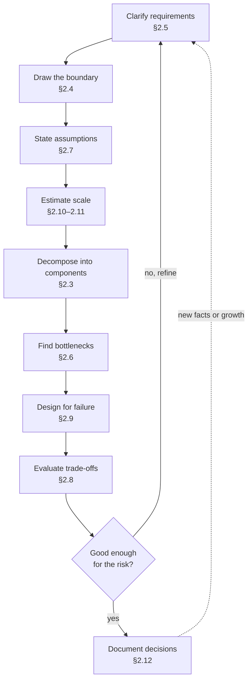
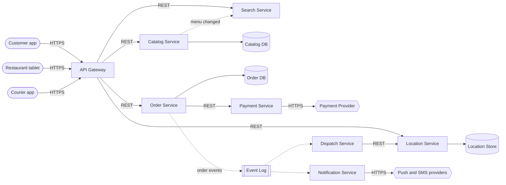
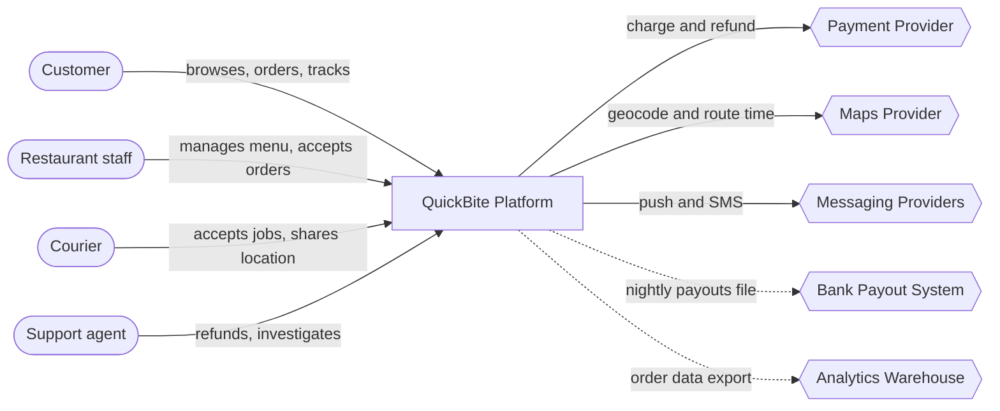
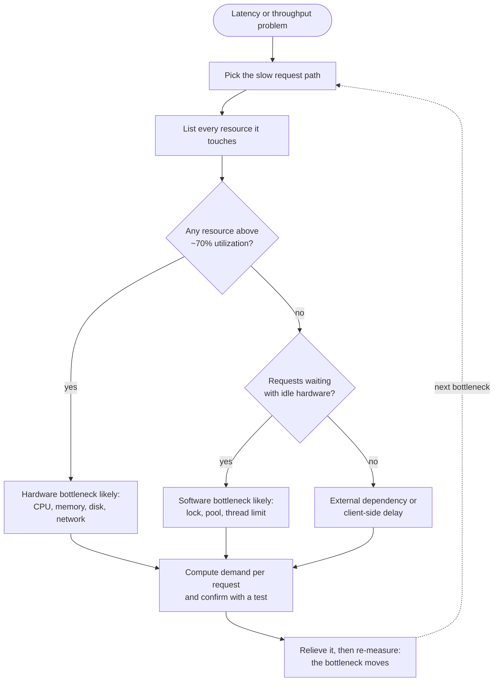
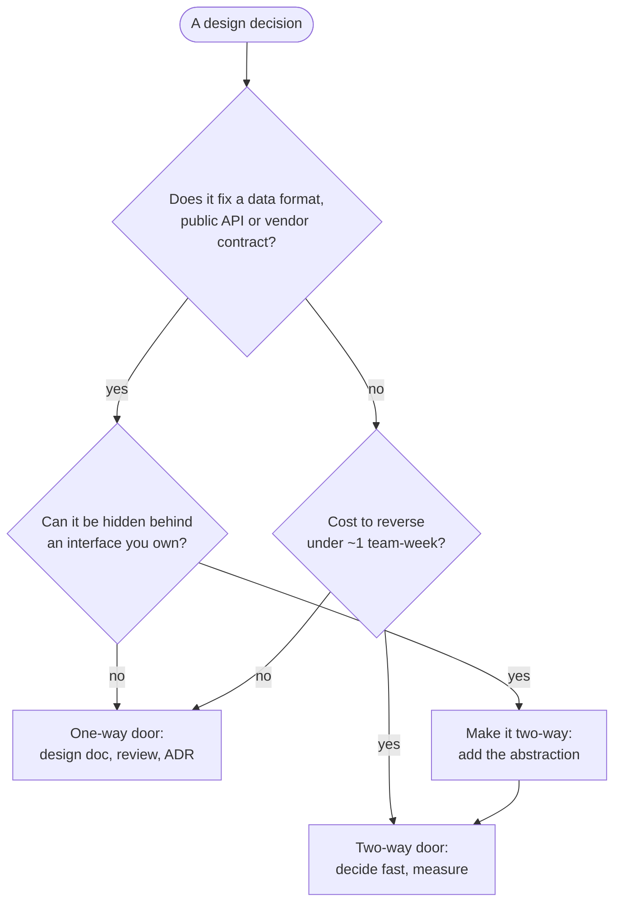
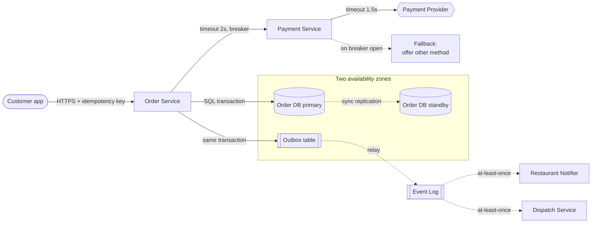
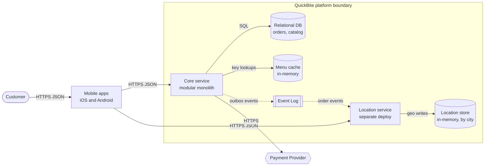
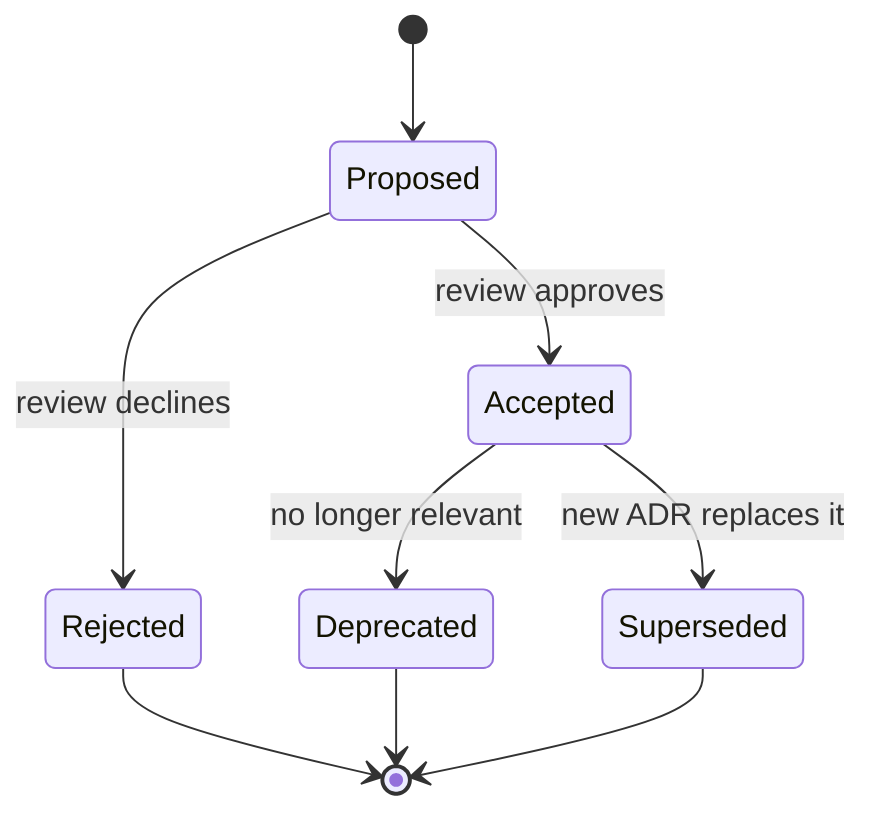

# Chapter 2 — How to Think Like a System Designer

> **Level:** 1–2 · **Track:** Shared · **Estimated reading time:** 3 h

Chapter 1 told you *what* system design is. This chapter is about *how* experienced designers think while they do it. It does not cover specific technologies (databases, caches, message brokers). Those come in Parts II–VI. What you get here is a set of thinking tools that apply to every design problem in this book, whether it is a URL shortener, a payment system or a large-language-model serving platform.

To keep the tools concrete, the whole chapter follows one running problem from a vague request to a documented architecture:

::: example
**Running problem — QuickBite.** A start-up asks you to "build the backend for our food-delivery app." Customers browse nearby restaurants, put dishes in a cart, pay, and watch a courier bring the food. Restaurants receive orders on a tablet and mark them ready. Couriers receive delivery jobs on a phone and share their location while driving. QuickBite runs in one country today and wants to grow.

QuickBite is a hypothetical company invented for teaching. Every number attached to it in this chapter is an assumption we make and state openly. None of them is a measurement of any real food-delivery company.
:::

## 2.1 Learning objectives

After this chapter you should be able to:

- **Decompose** a product description into components with clear responsibilities, using cohesion, coupling and data ownership as criteria.
- **Draw** a system-context diagram that separates what you are building from the people and external systems it depends on.
- **Elicit, quantify and negotiate** functional and non-functional requirements, turning vague wishes ("fast", "real-time", "never down") into testable numbers.
- **Identify the bottleneck** of a request path using the resource model (CPU, memory, disk, network, locks and other software resources), the utilization law and Little's Law.
- **State assumptions** explicitly, rank them by how much the design depends on them, and plan how to check them.
- **Evaluate trade-offs** with a weighted decision matrix, and judge how much process a decision needs by asking whether it is reversible (a "two-way door") or not (a "one-way door").
- **Design for failure** by listing failure modes, limiting blast radius and computing the availability of a dependency chain.
- **Reason about scale** in orders of magnitude, and predict which parts of a design break at 10×, 100× and 1000× the load.
- **Perform** a complete back-of-the-envelope capacity estimate with explicit arithmetic.
- **Document** an architecture with the C4 model, a design document and Architecture Decision Records (ADRs).

## 2.2 Prerequisites

- Functional vs non-functional requirements — §1.6 and §1.7. This chapter turns them into numbers and negotiates them.
- High-level vs low-level design — §1.5. Decomposition here stays at the high level.
- Powers of ten and units (KB vs KiB) — §4.3 and §4.5. Every estimate in §2.10 and §2.11 depends on them. This chapter uses SI prefixes throughout (1 KB = 10³ bytes, 1 GB = 10⁹ bytes).
- A rough idea of what a server, a database and a network request are. No deeper knowledge is assumed. Every other term is defined when first used.

Helpful but optional: Little's Law (§4.11) and availability arithmetic (§4.14). This chapter introduces both informally and points forward to the full treatment.

## 2.3 Decomposition into components

### 2.3.1 The thinking loop and where decomposition fits

Before the first tool, look at the whole process. Experienced designers do not move in a straight line from requirements to boxes and arrows. They work in a loop. They make a rough pass through every concern, find the riskiest part, and go round again at higher resolution. The sections of this chapter are the tools used at each step of that loop. They are presented one at a time for teaching, but in practice you switch between them constantly.

**Figure 2.1 — The system designer's thinking loop.**



**Reading the diagram.** Each rectangle is a thinking activity, labeled with the section that teaches it. It is not a software component. Solid arrows show the usual order within one pass. The diamond is the decision every designer makes at the end of a pass: is the design good enough *for the risk involved*? A prototype for ten users clears that bar after one rough pass. A payment system may need many passes. The "no, refine" edge returns to requirements because a weak design is very often caused by a misunderstood requirement. The dotted arrow from documentation back to requirements is asynchronous: weeks or months later, production data or business growth disproves an assumption and starts the loop again. Nothing in this loop "fails" in the software sense. The failure to watch for is getting stuck, for example by polishing component diagrams (§2.3) before estimating scale (§2.11). The way to avoid that is to time-box each pass.

### 2.3.2 What decomposition is

::: definition
**Definition — Decomposition.** Dividing a system into smaller parts (**components**) so that each part has one clear responsibility, a well-defined interface, and as few dependencies on other parts as possible. Each part can then be understood, built, scaled and changed mostly on its own.
:::

#### First-principles explanation

Think of a restaurant kitchen. Nobody "does the cooking." There is a grill station, a fry station, a pastry station and a pass where plates are checked before they leave. Each station has its own tools and ingredients and gets work through a narrow interface: the ticket. When the fryer breaks, the grill keeps working. When dessert orders double, you add a pastry cook without touching the grill.

Software decomposition works the same way. You split a big, fuzzy problem ("the food-delivery backend") into parts. Each part answers one question well ("what is on the menu?", "where is the courier?"). The parts interact through narrow, explicit interfaces, usually an API or a message.

#### Why does this exist?

A system nobody can hold in their head cannot be reasoned about. Decomposition gives you four concrete benefits:

1. **Comprehension.** One component fits in one engineer's head.
2. **Independent scaling.** In QuickBite, courier location updates arrive thousands of times per second, but restaurants edit menus a few times per day. Separating them lets each be scaled on its own terms.
3. **Failure isolation.** A bug in the recommendation feature should not stop customers from paying.
4. **Team autonomy.** Different teams can own different components. Conway's observation that organizations produce designs that copy their own communication structures [Conway 1968] means team boundaries and component boundaries end up shaping each other whether you plan it or not.

David Parnas made the classic argument for *how* to choose the parts. Divide a system so that each module hides a design decision that is likely to change, rather than by the steps of a processing flowchart [Parnas 1972]. That principle, **information hiding**, is still the best single test of a good boundary.

#### How it works internally

A practical decomposition procedure:

1. **List the nouns and verbs.** From the product description: *customer, restaurant, menu, dish, cart, order, payment, courier, delivery, location, notification*. Verbs: *browse, search, add to cart, place order, pay, accept, prepare, assign, pick up, track, deliver, rate*.
2. **Group by data ownership.** Ask "who is the single source of truth for this data?" Menus belong with restaurants. Orders and their states belong together. Courier locations are a separate, high-volume stream.
3. **Group by rate of change and load profile.** Things that change at very different speeds, or see very different traffic, usually belong apart. Menus are read-heavy and rarely written. Location is write-heavy and short-lived.
4. **Group by consistency need.** Money movements need strong guarantees: no double charges. The display of a courier's position can tolerate being a few seconds stale.
5. **Name each component with one sentence of responsibility.** If the sentence needs "and", consider splitting it.
6. **Draw the interactions.** Mark each one as synchronous (the caller waits) or asynchronous (the caller hands off a message and moves on).
7. **Check against scenarios.** Walk the top three user journeys through the diagram. Every step must have exactly one owner.

Applying this to QuickBite gives the components in Table 2.1.

**Table 2.1 — QuickBite components and their single responsibilities.**

| Component | Responsibility (one sentence) | Owns data | Load profile | Consistency need |
|---|---|---|---|---|
| API gateway | Authenticates clients and routes requests | None (stateless) | All traffic | n/a |
| Catalog service | Serves restaurants, menus and prices | Restaurants, menus | Read-heavy | Minutes of staleness OK |
| Search service | Finds restaurants by location, cuisine, text | Search index (derived) | Read-heavy | Derived, can lag |
| Order service | Owns the life cycle of an order | Orders, order items | Moderate writes | Strong |
| Payment service | Charges and refunds via a payment provider | Payment records | Low volume | Strong, idempotent |
| Dispatch service | Assigns couriers to ready orders | Assignments | Bursty | Strong per assignment |
| Location service | Ingests and serves courier positions | Recent positions | Write-heavy | Seconds of staleness OK |
| Notification service | Sends push, SMS and email | Delivery log | Bursty, async | At-least-once |

#### Architecture diagram

**Figure 2.2 — QuickBite first-pass decomposition.**



**Reading the diagram.** Three client types (stadiums) reach the system only through the **API gateway** over HTTPS. The gateway is stateless, so it scales horizontally behind a load balancer (Chapter 19). Solid arrows are synchronous request/response calls. Placing an order calls the order service, which calls the payment service, which calls the external **payment provider** (hexagon). That chain is the critical path, and every link in it can fail (§2.9). Dotted arrows are asynchronous. Once an order is committed, the order service publishes an event to the **event log** (subroutine shape; see Chapter 30). The dispatch and notification services consume it at their own pace, so a slow SMS provider cannot slow down checkout. Each cylinder is a storage boundary owned by exactly one service. No service reads another service's database, which keeps data ownership clear (§34.11). The catalog service pushes menu changes asynchronously to the search service, whose index is a *derived* copy that may lag by seconds. The location store is the heaviest write path, as §2.11 will show, so it scales independently, for example with an in-memory store partitioned by city. Likely failure points: the payment provider (external, outside your control), the order database (single source of truth) and the event log (if it stops, dispatch stops). Each needs a mitigation in §2.9.

::: note
**Components are logical, not deployment units.** Figure 2.2 shows *logical* components. On day one, QuickBite might deploy all of them as one process: a **modular monolith** (§33.5). Decomposition decides where the *boundaries* are. Deployment decides how many *processes* there are. §2.8 makes that second decision with a decision matrix.
:::

#### Real-world industry applications

::: industry
**Amazon's move to services.** In a 2006 interview, Amazon's CTO Werner Vogels described how Amazon's early monolithic application was restructured into services. Each service owned its data and could only be reached through a published interface. Direct database access between teams was ruled out. He linked this to team ownership ("you build it, you run it"). The design choice was data ownership behind interfaces, the same rule used in Figure 2.2. The trade-off he acknowledged was added operational and coordination complexity in exchange for team independence and scalability.
*Evidence: Primary* — [Gray 2006]
:::

#### Advantages and disadvantages

Good decomposition makes reasoning, scaling, failure isolation and team ownership easier. It also has costs. Every boundary that crosses a network turns a function call (~nanoseconds) into a remote call (~0.5 ms or more within a datacenter, see §4.17), and that call can fail independently. Data split across components loses cross-component transactions (Chapter 28). Too many components multiply operational load: more deployments, dashboards and on-call rotations.

#### Alternatives and trade-offs

**Table 2.2 — Ways to choose component boundaries.**

| Approach | Splits by | Works well when | Main risk |
|---|---|---|---|
| By technical layer | UI / logic / data | Small systems, one team | Every feature change touches every layer |
| By business capability | Orders, catalog, payments | Most product systems | Needs domain understanding up front |
| By volatility (Parnas) | Decisions likely to change | Long-lived systems | Requires predicting change |
| By load profile | Read-heavy vs write-heavy | Very uneven traffic | Can fragment one domain concept |
| By domain-driven bounded context | Consistent language and model | Large organizations | Heavy analysis cost (§34.4–34.5) |

In practice you combine them. QuickBite splits by business capability first, then splits *location* out of *dispatch* because of its very different load profile.

#### Failure scenarios

**Table 2.3 — Decomposition failure scenarios.**

| What goes wrong | Why | Detection | Recovery | Prevention |
|---|---|---|---|---|
| Distributed monolith | Services share a database or must deploy together | Every release touches many services; cross-service schema locks | Merge tightly coupled services | Enforce data ownership; review coupling |
| Chatty interfaces | Boundary cuts through a hot loop | One user request causes dozens of internal calls; high p99 | Batch calls or move the boundary | Walk scenarios through the diagram before building |
| Orphan responsibility | No component owns a step, e.g. refunds | Bugs bounced between teams | Assign an owner explicitly | Step 7 of the procedure: one owner per step |
| Premature split | Boundaries drawn before the domain is understood | Frequent cross-boundary changes | Re-merge into a modular monolith | Start coarse; split when evidence appears |

#### Common misconceptions

::: mistake
**"More components means a better design."** The number of boxes is not a quality measure. A good decomposition has *few, cohesive* components with *narrow* interfaces. A useful test: if two components change together in most pull requests, they are probably one component.
:::

::: mistake
**"Decompose by technology."** "The Redis service" or "the Kafka service" are not responsibilities. Components are named after what they do for the business ("location service"). The technology they use is an internal detail that may change.
:::

## 2.4 System boundaries and context diagrams

### 2.4.1 Boundaries and the context diagram

::: definition
**Definition — System boundary.** The line that separates what you are designing and are responsible for from everything outside it: users, other teams' systems and third-party services. You control what is inside. You can only *depend on* what is outside.
:::

::: definition
**Definition — Context diagram.** A diagram that shows the whole system as a single box, surrounded by the people (actors) and external systems that interact with it, with each interaction labeled. Context diagrams come from structured analysis [DeMarco 1979] and are Level 1 of the C4 model [Brown C4].
:::

#### First-principles explanation

Before renovating a house, a builder walks the property line. Fences, the street, the neighbor's tree and the water main are not part of the job, but every one of them constrains it. A context diagram is that walk around the property line. It answers three questions before any internal design starts: *who uses this?*, *what does it depend on?* and *what is not our job?*

#### Why does this exist?

Many expensive design failures are scope failures, not technical ones. A team builds a payment system and finds out late that tax calculation was expected. Or it assumes an external maps API can take 10,000 requests per second when the contract allows 100. Drawing the boundary early brings these surprises to the surface while they are still cheap to fix. It also gives non-engineers, such as product managers, legal and finance, a diagram they can actually check.

#### How it works internally

1. Draw your system as one box. Resist the urge to draw its insides.
2. Around it, place every **actor** (human role) and every **external system**.
3. Label each interaction with *what* flows (not *how*): "places orders", "sends card charge".
4. For every external system, note three facts: its **availability promise** (its SLA, see §39.6), its **rate limits** and its **latency**. These numbers are inherited constraints you do not control.
5. Write down what is explicitly **out of scope**.

#### Architecture diagram

**Figure 2.3 — QuickBite system-context diagram.**



**Reading the diagram.** The single rectangle is the whole QuickBite platform, deliberately shown with no internal detail. Four human actors (stadiums) interact with it. Note the **support agent**, an actor often forgotten in first drafts, who needs refund and investigation tools. Five external systems (hexagons) sit outside the boundary. Solid arrows are synchronous, user-facing interactions. A customer waits while a card charge happens, so the payment provider's latency and availability become part of QuickBite's own checkout latency and availability. Dotted arrows are asynchronous batch flows. Payouts to restaurants and data exports run nightly and can be retried without users noticing. Each hexagon is a failure point outside your control. The maps provider is especially dangerous because both search (delivery-time estimates) and dispatch depend on it. Hexagons also bring rate limits and per-call costs, so scaling QuickBite may be limited by *contracts* rather than by servers.

::: example
**Worked example — Inherited constraints from the boundary.** Suppose the maps provider's contract allows 500 requests per second and charges \$0.005 per route-time request. (These figures are assumptions for QuickBite, not any real provider's price list.)

1. If every restaurant listing in search results needs a live route-time estimate, and search peaks at 2,000 requests per second showing 20 restaurants each, QuickBite would need 2,000 × 20 = 40,000 route requests per second.
2. That is 40,000 / 500 = 80 times the contract limit.
3. Cost at that rate for one peak hour: 40,000 × 3,600 × \$0.005 = \$720,000.

**Interpretation.** Calling the maps provider per listing is impossible, regardless of how good the internal architecture is. **Engineering implication:** estimate delivery times internally, for example from precomputed travel-time grids per city zone, and call the provider only once per *placed order*. The boundary diagram exposed this constraint before any code was written.
:::

#### Real-world industry applications

::: industry
**C4 system-context diagrams.** Simon Brown's C4 model makes the system-context diagram its first and most abstract level. It recommends showing the software system as one box with its users and the other software systems it depends on, and states that the diagram should be understandable by non-technical stakeholders.
*Evidence: Primary* — [Brown C4]
:::

#### Failure scenarios and misconceptions

**Table 2.4 — Boundary failure scenarios.**

| What goes wrong | Why | Detection | Recovery | Prevention |
|---|---|---|---|---|
| Hidden dependency outage | An external system was never listed | Incident traced to an unlisted vendor | Add fallback; add it to the diagram | Inventory every outbound call |
| Rate-limit wall | Vendor limits not read | HTTP 429 errors at peak | Cache, batch, negotiate a higher tier | Step 4: record limits per external system |
| Scope creep | Boundary never agreed | Late "but we assumed you'd do X" | Re-plan | Explicit out-of-scope list signed off |

::: mistake
**"External systems are always available."** A third-party SaaS API typically promises somewhere between 99.9% and 99.99% availability, as of 2026. At 99.9% that is up to about 43 minutes of downtime per 30-day month. Your design must decide what QuickBite does during those minutes (§2.9).
:::

## 2.5 Understanding and negotiating requirements

### 2.5.1 Eliciting and negotiating requirements

::: definition
**Definition — Requirement.** A statement of what the system must do (a **functional requirement**, e.g. "a customer can cancel an order before the restaurant accepts it") or how well it must do it (a **non-functional requirement**, e.g. "99% of order placements complete within 800 ms"). A requirement is **testable** if you could write an automated check or a measurement that proves it is met.
:::

#### First-principles explanation

A customer asks a tailor for "a nice suit." A bad tailor starts cutting. A good tailor asks: for what occasion? Which climate? What budget? Ready by when? The good tailor is not being difficult. "Nice" can mean a hundred different suits, and only one of them is what the customer actually wants. Requirements gathering is the tailor's questions. **Negotiation** is the conversation that follows: "a hand-stitched suit by Friday for that budget is not possible, but a made-to-measure one is."

#### Why does this exist?

Vague requirements cause two opposite failures. **Under-engineering** builds a system that falls over on launch day because nobody asked how many users would arrive. **Over-engineering** spends six months building multi-region active–active replication for a product with 200 users, because someone said "it must never go down." Both come from the same root cause: a requirement nobody turned into a number.

Requirements also conflict. "Show the courier's exact position in real time" pushes against "keep infrastructure costs under budget" and "protect courier privacy." Someone has to decide how those conflicts are resolved, and the designer's job is to make that decision *visible and deliberate*.

#### How it works internally

A reliable elicitation and negotiation procedure:

1. **Identify users and their top journeys.** For QuickBite: *browse and order*, *track delivery*, *restaurant accepts and prepares*, *courier delivers*.
2. **Write functional requirements as user-observable behaviors**, and rank them with **MoSCoW** priorities: Must, Should, Could, Won't (this time).
3. **For each journey, ask the "-ility" questions** (§1.7): How many users? How fast? How available? How consistent? How durable? How secure? What does it cost?
4. **Quantify every non-functional requirement** as a metric, a threshold and a measurement window. "Fast" becomes "p99 < 800 ms measured over 5-minute windows". The notation p99 means the 99th percentile: 99% of requests are faster than this value (§4.8).
5. **Differentiate by journey.** Availability and latency targets rarely need to be uniform. Checkout deserves a stricter target than the restaurant's sales-history report.
6. **Surface conflicts and negotiate.** For each expensive requirement, show its cost and offer a cheaper alternative that still meets the underlying need.
7. **Record what was agreed, and what was explicitly rejected.**

**Table 2.5 — QuickBite requirements after negotiation.**

| ID | Requirement (as first stated) | Negotiated, testable version | Priority |
|---|---|---|---|
| F1 | "Customers can order food" | Customer can place an order of 1–30 items from one restaurant and pay by card or wallet | Must |
| F2 | "Real-time tracking" | Courier position shown on a map, refreshed every 5 s; position at most 10 s old at p95 | Must |
| F3 | "Restaurants get orders instantly" | New order appears on the restaurant tablet within 5 s at p99 | Must |
| F4 | "Smart recommendations" | Deferred to phase 2; phase 1 shows "popular near you" | Won't (now) |
| N1 | "Never goes down" | Order placement available 99.95% per 30-day month; browsing 99.9% | Must |
| N2 | "Fast" | Place-order p99 < 800 ms excluding payment-provider time; browse p99 < 300 ms | Must |
| N3 | "Never lose an order" | Once the customer sees "order confirmed", the order survives the loss of any single node or zone (RPO = 0 for orders) | Must |
| N4 | "Never double-charge" | Each order is charged at most once, even if the client retries (idempotency, §22.15) | Must |
| N5 | "Menus always correct" | Menu or price changes visible to customers within 60 s; price is re-checked at order time | Should |

Notice what negotiation did to N1. "Never goes down" is impossible: no system reaches 100%. It was also unnecessary for most features. The negotiated version gives each journey its own target and makes the target measurable. RPO in N3 is the *recovery point objective*, the amount of recent data you may lose in a disaster (§39.8).

#### Mathematical foundations

The most useful number in a negotiation is the downtime a target actually allows.

::: formula
**Allowed downtime for an availability target**

$$T_{down} = (1 - A) \times T_{period}$$

| Symbol | Meaning | Units |
|---|---|---|
| $T_{down}$ | Maximum downtime allowed in the period | minutes |
| $A$ | Availability target, as a fraction | dimensionless (e.g. 0.9995) |
| $T_{period}$ | Length of the measurement period | minutes |
:::

::: example
**Worked example — What "three and a half nines" buys QuickBite.** A 30-day month has 30 × 24 × 60 = 43,200 minutes.

1. Browsing at 99.9%: $T_{down}$ = (1 − 0.999) × 43,200 = 0.001 × 43,200 = **43.2 minutes per month**.
2. Order placement at 99.95%: (1 − 0.9995) × 43,200 = 0.0005 × 43,200 = **21.6 minutes per month**.
3. A naive "five nines" (99.999%): 0.00001 × 43,200 = **0.43 minutes**, about 26 seconds per month.

**Interpretation.** Twenty-six seconds a month is less than the time a person takes to notice an alert, open a laptop and log in. Five nines requires fully automated detection and failover across independent zones or regions, which multiplies cost and complexity. **Engineering implication:** for a regional food-delivery start-up, 99.95% on checkout is ambitious but reachable with redundancy inside one region (§39.4). Five nines would be over-engineering, and the payment provider's own availability probably caps the achievable number anyway (§2.9).
:::

#### Real-world industry applications

::: industry
**Service level objectives at Google.** Google's Site Reliability Engineering book argues that 100% is the wrong reliability target for almost everything. Users cannot tell the difference between very high availability and 100%, because their own devices and networks are less reliable than that. Each extra nine costs a lot. Google's practice is to agree an explicit **service level objective (SLO)** with product owners and treat the remaining unreliability as an **error budget** to be spent on releasing features. This is requirement negotiation turned into an ongoing process (§39.6–39.7).
*Evidence: Primary* — [Beyer et al. 2016]
:::

#### Advantages, alternatives and trade-offs

Up-front negotiation costs meeting time, and stakeholders may not know the answers yet. When they do not, do not block. Make an assumption (§2.7), label it, and design so that it is cheap to change if wrong. In interviews, spend roughly the first five to ten minutes of a 45-minute session on requirements. In industry, requirements live in a design document (§2.12) and get re-negotiated as data arrives.

#### Failure scenarios

**Table 2.6 — Requirements failure scenarios.**

| What goes wrong | Why | Detection | Recovery | Prevention |
|---|---|---|---|---|
| Launch-day overload | Peak load never quantified | Errors and latency spike at launch | Emergency scaling, load shedding (§22.9) | Ask "how many, at peak?" |
| Gold-plating | "Never down" accepted literally | Cost far exceeds the budget; delivery late | Simplify | Translate every adjective into a number |
| Silent conflict | Two stakeholders want contradictory things | Rework after review | Escalate with options and costs | Step 6: surface conflicts explicitly |
| Uniform targets | One SLO applied to all features | Expensive redundancy on unimportant paths | Tier the features | Step 5: differentiate by journey |

#### Common misconceptions

::: mistake
**"Requirements are given to the designer."** In practice they are *discovered and negotiated* by the designer together with stakeholders. A designer who only takes orders will build exactly the wrong thing, very efficiently.
:::

::: tip
**Interview tip.** Say your negotiated requirements out loud and write them on the board as numbers: "I'll assume 2 million daily active users, checkout at 99.95%, tracking refreshed every 5 seconds — does that match what you have in mind?" Interviewers reward this because it shows you design *to a target*, not by habit.
:::

## 2.6 Identifying bottlenecks

### 2.6.1 The resource model and the bottleneck

::: definition
**Definition — Bottleneck.** The resource whose capacity limits the throughput of the whole system for a given workload. Throughput cannot rise above the bottleneck's capacity no matter how much the other resources are improved. Formally, it is the resource with the highest **service demand** per request (defined below).
:::

#### First-principles explanation

Picture a highway that narrows from four lanes to one for a bridge. Widening the highway before or after the bridge to eight lanes changes nothing: cars still cross the bridge one lane at a time. The bridge is the bottleneck. Worse, traffic does not slow down evenly. It piles up in a queue *in front of* the bridge. That is why a system near its bottleneck shows rising latency long before it shows errors.

Two consequences follow, and they explain most performance work:

1. **Improving a non-bottleneck resource gives zero improvement in throughput.** Faster CPUs do not help if the database disk is the limit.
2. **Fixing the bottleneck moves it.** Once the bridge is widened, the next narrowest point becomes the new bottleneck. Performance work is a sequence of "find the bottleneck, relieve it, find the next one."

#### Why does this exist?

Systems are made of finite resources. When a QuickBite lunch rush arrives, the first resource to run out decides whether customers see a spinner or an error. If you cannot name that resource, you will add capacity in the wrong place, and pay for servers that make no difference.

#### How it works internally: the resource model

Every request consumes a small amount of several **resources**. The classical hardware four plus one software category cover almost every case:

**Table 2.7 — The resource model.**

| Resource | What a request consumes | Utilization signal | Saturation signal | Typical relief |
|---|---|---|---|---|
| CPU | Cycles for parsing, serialization, business logic, encryption | % busy per core | Run-queue length > core count | Optimize hot code, cache results, add cores or nodes |
| Memory | Working set, buffers, caches, per-connection state | % used | Swapping, OOM kills, GC pauses | Reduce footprint, add RAM, partition data |
| Disk | Reads and writes (IOPS), bytes per second, fsync latency | % time busy, IOPS used vs limit | Long I/O queue, rising await time | Cache, batch writes, faster media, partition |
| Network | Bytes in and out, packets, connections | Bandwidth used vs link capacity | Dropped packets, retransmits | Compress, CDN, bigger links, keep traffic local |
| Locks and other software resources | Exclusive access to a row, mutex, thread, connection-pool slot, file handle | Fraction of time held | Waiters queued; pool exhausted | Shorten hold time, finer-grained locks, bigger pools, partition the hot item |

The last row is the one beginners miss. A **software resource**, such as a database row lock, a thread pool or a connection pool, is just as finite as a CPU. It can be the bottleneck while every hardware dashboard shows idle machines.

The standard diagnostic method is Brendan Gregg's **USE method**: for every resource, check **U**tilization, **S**aturation and **E**rrors [Gregg USE]. Figure 2.4 turns it into a procedure.

**Figure 2.4 — Finding the bottleneck with the USE method.**



**Reading the diagram.** This is a reasoning procedure, not a running system. You start from a symptom (stadium) and pick one slow request path, because bottlenecks are workload-specific: browsing and ordering have different ones. The first decision checks hardware utilization. Around 70% is a common warning threshold, because queueing delay grows steeply as utilization approaches 100% (§4.10). The second decision is the key diagnostic insight: *requests are waiting while the hardware is idle*. This almost always means a software resource such as a lock or a pool is saturated. If neither applies, the time is being spent outside your servers, for example in a third-party API or on a slow mobile network. Every branch leads to the same discipline: compute the demand per request and confirm the hypothesis with a measurement or load test (Chapter 23). The dotted edge back to the start is the loop that never ends: relieving one bottleneck exposes the next.

#### Mathematical foundations

Two laws from operational analysis of computer systems [Denning and Buzen 1978] are enough to find most bottlenecks with arithmetic alone.

::: formula
**Service demand, the utilization law and the bottleneck bound**

$$D_i = V_i \times S_i \qquad U_i = X \times D_i \qquad X_{max} = \frac{c_i}{D_{max}}$$

| Symbol | Meaning | Units |
|---|---|---|
| $D_i$ | Service demand: total busy time one request places on resource $i$ | seconds per request |
| $V_i$ | Visits: how many times one request uses resource $i$ | visits per request |
| $S_i$ | Service time per visit to resource $i$ | seconds per visit |
| $U_i$ | Utilization of resource $i$, per unit of capacity | fraction (0–1) |
| $X$ | System throughput | requests per second |
| $c_i$ | Number of parallel units of resource $i$ (e.g. cores) | units |
| $X_{max}$ | Maximum throughput, set by the resource with the largest demand per unit | requests per second |

The utilization law for a resource with $c_i$ parallel units is $U_i = X \times D_i / c_i$. The bottleneck is the resource with the largest $D_i / c_i$.
:::

::: formula
**Little's Law (concurrency)**

$$L = \lambda \times W$$

| Symbol | Meaning | Units |
|---|---|---|
| $L$ | Average number of requests in the system (or holding a resource) at once | requests |
| $\lambda$ | Average arrival rate | requests per second |
| $W$ | Average time each request spends in the system (or holds the resource) | seconds |

Little's Law holds for any stable system, regardless of the arrival pattern [Little 1961]. Full treatment in §4.11.
:::

::: example
**Worked example — Finding QuickBite's checkout bottleneck.**

*Situation.* At dinner peak QuickBite receives 60 order placements per second (this number is derived in §2.11). Customers complain that checkout sometimes spins for 5 seconds and then fails, yet CPU dashboards show the database at only 25% utilization. The order transaction, as first written, does this:

1. Begin a database transaction.
2. Insert the order and its items.
3. Update the restaurant's row in `restaurant_load` to increment `open_orders` (used to stop accepting orders when a kitchen is overwhelmed). This takes a **row lock** until commit.
4. Call the payment service, which calls the payment provider. Average 300 ms.
5. Commit.

Measured per-order demands (assumed values for the exercise):

**Table 2.8 — Per-order resource demand in the checkout path.**

| Resource | Demand per order $D_i$ | Parallel units $c_i$ | $D_i / c_i$ | Max orders/s = $1 / (D_i/c_i)$ | Utilization at 60/s |
|---|---|---|---|---|---|
| API tier CPU | 8 ms | 32 cores | 0.25 ms | 4,000 | 60 × 0.25 ms = 1.5% |
| Database CPU | 5 ms | 8 cores | 0.625 ms | 1,600 | 3.8% |
| Database WAL disk (fsync) | 2 ms | 1 device | 2 ms | 500 | 12% |
| Network (25 KB per order, 10 Gbps link) | 0.02 ms | 1 link | 0.02 ms | 50,000 | 0.1% |
| DB connection pool (20 connections) | 320 ms held | 20 | 16 ms | 62.5 | 96% |
| Row lock on one popular restaurant | 320 ms held | 1 | 320 ms | 3.1 | see below |

*Step 1 — Hardware.* Every hardware resource is far below 70% utilization. The largest is the WAL disk at 12%, so hardware is not the bottleneck. Following Figure 2.4, "requests waiting with idle hardware" points to a software resource.

*Step 2 — Connection pool, by Little's Law.* Each order holds a database connection from step 1 to step 5: about 300 ms of payment time plus about 20 ms of database work, so $W$ = 0.32 s. Then $L$ = λ × W = 60 × 0.32 = **19.2 connections busy on average**, out of a pool of 20. Utilization is 19.2 / 20 = 96%. Any burst above 62.5 orders/s (20 / 0.32) makes requests queue for a connection, and queueing at 96% utilization is severe (§4.10).

*Step 3 — The row lock.* A celebrity chef's restaurant runs a promotion and receives 8 orders per second. Each order holds that restaurant's row lock for 0.32 s, so the row can serve at most 1 / 0.32 = **3.1 orders per second**. Arrivals (8/s) exceed capacity (3.1/s), so the queue grows without bound until requests time out at 5 s. That matches the complaint exactly. This is the bottleneck for that workload: a single **hot row**.

*Step 4 — Relieve it.* Move the slow external call *out of* the database transaction. First authorize the payment, keyed by an idempotency key so retries cannot double-charge (§22.15). Then run a short transaction (insert order, update counter, commit) of about 15 ms. Then capture the payment, or publish an event to do so asynchronously.

*Step 5 — Re-compute.* Hold time $W$ drops from 0.32 s to 0.015 s.

- Pool: $L$ = 60 × 0.015 = **0.9 connections busy**, which is 4.5% of the pool.
- Hot row: maximum 1 / 0.015 ≈ **66 orders/s per restaurant**, comfortably above 8.
- The bottleneck has moved. It is now the WAL disk at 500 orders/s, about 8× headroom over today's peak. That is the next thing to watch as QuickBite grows (group commit and partitioning address it, §13.5 and Chapter 14).

**Interpretation.** Adding database servers or CPUs would have cost money and fixed nothing: the limit was a lock held during a network call. **Engineering implication:** never hold a lock or a pooled connection across a call to a slow or external system. In general, *hold time multiplied by arrival rate* (Little's Law) tells you how many units of any software resource you need.
:::

#### Code example

A short, runnable script that turns the table above into a bottleneck report. Use it to check your own estimates.

```python
# Bottleneck finder using the utilization law (U = X * D / c).
resources = {
    # name: (demand per request in seconds, parallel units)
    "api_cpu":   (0.008, 32),
    "db_cpu":    (0.005, 8),
    "wal_disk":  (0.002, 1),
    "network":   (0.00002, 1),
    "db_pool":   (0.320, 20),
    "hot_row":   (0.320, 1),
}
arrival_rate = 60.0  # requests per second

for name, (demand, units) in sorted(
        resources.items(), key=lambda kv: kv[1][0] / kv[1][1], reverse=True):
    max_x = units / demand
    util = arrival_rate * demand / units
    flag = "SATURATED" if util >= 1 else ("HOT" if util >= 0.7 else "ok")
    print(f"{name:9s} max={max_x:9.1f}/s  util@{arrival_rate:.0f}/s={util:7.1%}  {flag}")
```

What to notice:

- Resources are sorted by $D_i / c_i$, so the first line printed is the bottleneck.
- `hot_row` shows a utilization above 100% (1920%) at 60/s, because the script applies the *whole* arrival rate to one row. That is the worst case where every order goes to a single restaurant. In the worked example only 8/s hit the hot row, which still exceeds its 3.1/s capacity. Edit the script to model per-key arrival rates.
- Changing `0.320` to `0.015` for the pool and the row reproduces Step 5 and shows the bottleneck moving to `wal_disk`.

#### Real-world industry applications

::: industry
**The USE method at Netflix and beyond.** Brendan Gregg developed the USE method while working on performance analysis and has published it, together with per-operating-system checklists, as a way to find resource bottlenecks quickly without guessing. It explicitly includes software resources such as mutex locks, thread pools and file descriptors alongside CPUs, memory, disks and network interfaces.
*Evidence: Primary* — [Gregg USE], [Gregg 2020]
:::

#### Alternatives and trade-offs

The USE method is resource-centric. Its complement is the **RED method** (Rate, Errors, Duration per service), which is request-centric and better for spotting *which* service is slow in a microservice graph. The two work well together (§23.3). Profiling (§23.4) finds *which code* consumes a resource. Load testing (§23.5) confirms a bottleneck hypothesis empirically. The arithmetic above tells you where to point those tools.

#### Failure scenarios

**Table 2.9 — Bottleneck-analysis failure scenarios.**

| What goes wrong | Why | Detection | Recovery | Prevention |
|---|---|---|---|---|
| Scaling the wrong tier | Added servers to a non-bottleneck | Throughput unchanged after scaling | Re-run USE analysis | Compute demand per resource first |
| Hot key or hot row | Skewed popularity, e.g. a viral restaurant | One key's latency far above the others | Shorten hold time, shard the counter | Model per-key rates, not just totals |
| Pool exhaustion | Long hold times, often across remote calls | "Timeout acquiring connection" errors with idle DB | Move remote calls out of transactions | Little's Law sizing |
| Retry amplification | Clients retry into a saturated resource | Load rises as success rate falls | Retry budgets, backoff with jitter (§22.12) | Cap retries; shed load |

#### Common misconceptions

::: mistake
**"Low CPU means the system has spare capacity."** CPU is one resource of five. QuickBite's checkout failed with every machine mostly idle, because the bottleneck was a lock. Always check software resources when latency is high and utilization is low.
:::

::: mistake
**"Averages are enough."** A system can be fine on average and saturated on one hot key, one shard or one minute of the day. Bottleneck analysis must use *peak* rates and *per-partition* rates (§14.10).
:::

## 2.7 Making and stating assumptions

### 2.7.1 The assumption register

::: definition
**Definition — Design assumption.** A belief about the workload, the environment or the business that the design depends on but that has not yet been verified, for example "80% of requests are reads" or "the payment provider responds within 1 s at p99". An assumption is **stated** when it is written down with its value, its source, your confidence in it and how it will be checked.
:::

#### First-principles explanation

A weather forecaster does not refuse to forecast because tomorrow is unknown. She says "70% chance of rain," which is an explicit, checkable statement of uncertainty. System designers face the same situation: you never have all the facts before you must design. The professional response is not to wait. It is to assume *out loud*, so that everyone can see which parts of the design rest on which beliefs.

#### Why does this exist?

Every design rests on assumptions anyway. The only choice is whether they are visible. Hidden assumptions are dangerous because nobody checks them, and when one turns out wrong, nobody knows which parts of the design must change. Stated assumptions turn surprises into planned decision points.

#### How it works internally

1. **Write each assumption as a number with a source.** "2 M daily active users (marketing forecast for year 1)."
2. **Rate confidence**: high (measured), medium (comparable data exists), low (guess).
3. **Do a sensitivity check.** Ask: *if this is wrong by 10×, does the design change?* Assumptions where the answer is "yes" are **load-bearing**.
4. **Attach a check and a tripwire** to every load-bearing assumption: how you will verify it, and the observed value that will trigger a redesign.
5. **Prefer designs that are robust to the assumptions you are least sure of.**

**Table 2.10 — QuickBite assumption register (excerpt).**

| ID | Assumption | Value | Source | Confidence | Load-bearing? | Check and tripwire |
|---|---|---|---|---|---|---|
| A1 | Daily active users | 2 M | Business forecast | Low | Yes: sizes every tier | Weekly DAU dashboard; redesign review at 5 M |
| A2 | Orders per DAU per day | 0.25 | Industry intuition | Low | Yes: order DB and payments | Measure in beta |
| A3 | Busiest hour share of daily orders | 20% | Assumed dinner peak | Medium | Yes: peak sizing | Hourly order histogram |
| A4 | Courier location update interval | 4 s | Product decision | High | Yes: location write load | Config value, reviewed with product |
| A5 | Payment provider p99 latency | 1 s | Vendor documentation | Medium | Moderate: timeouts, pools | Client-side latency histogram |
| A6 | Average menu size | 100 items × 1 KB | Sample of 50 menus | Medium | No: menus fit in memory even at 10× | Catalog size metric |

The sensitivity column is the payoff. A6 is not load-bearing: all menus total about 5 GB (§2.11), and 50 GB would still fit in a small cache cluster, so being 10× wrong changes nothing structural. A4 *is* load-bearing: halving the interval to 2 s doubles the heaviest write path in the system.

::: example
**Worked example — Sensitivity of the location tier to assumption A4.** Peak active couriers are assumed to be 20,000.

1. Update interval 4 s: 20,000 / 4 = **5,000 writes/s**.
2. Product asks for 1 s "for smoother maps": 20,000 / 1 = **20,000 writes/s**, 4× the load.
3. At an assumed 200 bytes per update including protocol overhead, ingress rises from 5,000 × 200 = 1 MB/s to 20,000 × 200 = 4 MB/s. That is modest for the network, but 4× the write operations for the store.

**Interpretation.** Network bandwidth is not the issue. The *write rate* to the location store is. **Engineering implication:** keep the 4 s interval on the server and have the client app *interpolate* the marker's movement between updates. Customers see smooth motion at a quarter of the cost. The assumption register made this negotiation possible because the cost of the request was visible immediately.
:::

::: industry
**Assumptions in published design-review practice.** Google's internal design-doc culture, as described by a Google engineer, asks authors to state context, goals and *non-goals*, and to discuss alternatives and trade-offs, so that reviewers can challenge the premises behind a design and not only its mechanics.
*Evidence: Secondary* — [Ubl 2020]
:::

#### Failure scenarios and misconceptions

**Table 2.11 — Assumption failure scenarios.**

| What goes wrong | Why | Detection | Recovery | Prevention |
|---|---|---|---|---|
| Stale assumption | The world changed, e.g. a new market launched | Metrics drift past the tripwire | Run the redesign review | Tripwires on load-bearing assumptions |
| Assumption mistaken for fact | Repeated until nobody remembers it was a guess | Nobody can name its source | Re-label and re-check | "Source" and "confidence" columns |
| Average-case assumption | Peak and skew ignored | Outages at peaks or on hot keys | Add peak and skew factors | Always state a peak factor |

::: mistake
**"Stating assumptions shows you don't know the answer."** The opposite is true. In interviews and design reviews, explicit assumptions signal seniority. They show you know *which* unknowns matter and have a plan for each one.
:::

## 2.8 Evaluating trade-offs

### 2.8.1 Weighted decision matrices

::: definition
**Definition — Trade-off.** A situation where improving one desired property of a system makes another worse. Examples: lower latency at higher cost, stronger consistency at lower availability during network partitions, faster delivery at higher operational risk. Every design decision is a trade-off. If you cannot name what an option makes worse, you have not understood it yet.
:::

#### First-principles explanation

Buying a car means trading price against comfort, fuel economy against power, cargo space against parking ease. No car wins on everything. A sensible buyer decides *which properties matter most to them*, scores the candidates, and also notices how hard the choice is to undo: leasing for a year is easy to reverse, buying a car and selling it a month later loses money. System design decisions have exactly the same two dimensions, **weighted fit** and **reversibility**.

#### Why does this exist?

Without a method, design decisions are made by whoever argues loudest or by habit ("we always use X"). A structured method makes the criteria and their importance explicit. It lets people disagree about *weights* (a business question) separately from *scores* (an engineering question), and it leaves a record for the ADR (§2.12).

#### How it works internally: the weighted decision matrix

1. List the **options**, including "do nothing" or "the simplest thing" where it makes sense.
2. List the **criteria** that come from the requirements (§2.5), not from personal taste.
3. Assign **weights** that sum to 1 (or 100%), agreed with stakeholders.
4. **Score** each option against each criterion on a fixed scale, e.g. 1–5, with a one-line justification per score.
5. Compute weighted totals.
6. Run a **sensitivity check**: does the winner change if a weight moves by ±10 percentage points? If it does, the decision is close and the deciding factor should be discussed explicitly.
7. Check **reversibility** before committing (below).

This is a lightweight form of the concept-selection matrices used in engineering design, such as Pugh's method [Pugh 1991].

::: formula
**Weighted decision score**

$$S_j = \sum_{i=1}^{n} w_i \times s_{ij}, \qquad \sum_{i=1}^{n} w_i = 1$$

| Symbol | Meaning | Units |
|---|---|---|
| $S_j$ | Total weighted score of option $j$ | score points (same scale as $s_{ij}$) |
| $w_i$ | Weight of criterion $i$ | fraction (0–1) |
| $s_{ij}$ | Score of option $j$ on criterion $i$ | score points, e.g. 1–5 |
| $n$ | Number of criteria | count |
:::

::: example
**Worked example — Modular monolith or microservices for QuickBite v1?** The team is eight engineers and must launch in four months. Criteria and weights come from Table 2.5 and from business constraints.

**Table 2.12 — Weighted decision matrix for QuickBite's deployment architecture.**

| Criterion | Weight | Modular monolith | Microservices (8 services) |
|---|---|---|---|
| Time to launch with 8 engineers | 0.30 | 5 | 2 |
| Operational simplicity | 0.20 | 5 | 2 |
| Independent scaling of hot paths | 0.20 | 3 | 5 |
| Failure isolation | 0.15 | 3 | 4 |
| Team autonomy as headcount grows | 0.15 | 3 | 5 |
| **Weighted total** | **1.00** | **3.90** | **3.35** |

Arithmetic for the monolith: 0.30×5 + 0.20×5 + 0.20×3 + 0.15×3 + 0.15×3 = 1.50 + 1.00 + 0.60 + 0.45 + 0.45 = **3.90**.
For microservices: 0.30×2 + 0.20×2 + 0.20×5 + 0.15×4 + 0.15×5 = 0.60 + 0.40 + 1.00 + 0.60 + 0.75 = **3.35**.

*Sensitivity.* Move 10 points of weight from time-to-launch to independent scaling (0.20 and 0.30). Monolith: 0.20×5 + 0.20×5 + 0.30×3 + 0.45 + 0.45 = 1.00 + 1.00 + 0.90 + 0.90 = **3.80**. Microservices: 0.20×2 + 0.20×2 + 0.30×5 + 0.60 + 0.75 = 0.40 + 0.40 + 1.50 + 1.35 = **3.65**. The monolith still wins, so the result is robust to a reasonable disagreement about weights.

*A hybrid surfaces.* The one criterion where the monolith loses badly is independent scaling, and §2.11 shows that the location path dominates write load. Deploying the **location service separately** and everything else as a modular monolith captures most of the scaling benefit at a fraction of the operational cost.

**Interpretation.** The matrix did not "decide". It made the reasoning inspectable and revealed a better third option. **Engineering implication:** record the matrix and the sensitivity result in the ADR, and name the trigger for revisiting it, for example "more than 30 engineers or more than 3 teams blocked on shared releases."
:::

### 2.8.2 Reversibility: one-way and two-way doors

The matrix measures *fit*. It says nothing about the *cost of being wrong*. In his 2015 letter to shareholders, Jeff Bezos distinguished **Type 1** decisions, which are consequential and irreversible or nearly so ("one-way doors") and deserve slow, careful deliberation, from **Type 2** decisions, which are reversible ("two-way doors") and should be made quickly by individuals or small groups with good judgment. He warned that large organizations tend to apply the heavyweight Type 1 process to Type 2 decisions, and that this causes slowness and too little experimentation [Bezos 2016].

In architecture, reversibility is mostly about **data and contracts**. Code behind a stable interface is cheap to change. Data formats that have accumulated years of records, and public APIs that thousands of clients depend on, are not.

**Figure 2.5 — Choosing the decision process by reversibility.**



**Reading the diagram.** A decision (stadium) passes through up to three questions (diamonds). The first asks whether the decision fixes something that is costly to change later: stored data formats, public APIs, multi-year vendor contracts. If it does, the second asks whether an interface you own can hide it. A repository layer in front of the database, or an internal payment service in front of the payment provider, turns a one-way door into a two-way one (box T2). That is often the best move available. Decisions that fix nothing durable, and are cheap to reverse, are two-way doors: decide quickly and let measurement correct you. Everything else is a one-way door and earns the full process: a design document, a review and an ADR (§2.12). The "~1 team-week" threshold is a heuristic. Calibrate it to your organization. There is no software data flow here. The failure mode this procedure prevents is organizational: spending weeks debating a two-way door, or rushing a one-way door.

**Table 2.13 — QuickBite decisions classified by reversibility.**

| Decision | Door | Why |
|---|---|---|
| Web framework for the catalog service | Two-way | Internal; can be rewritten behind the same API |
| Cache eviction policy | Two-way | A configuration change |
| Primary key and ID format for orders | One-way | Embedded in receipts, URLs, partner systems, years of data |
| Public order-status API shape for restaurant POS partners | One-way | External clients depend on it; versioning needed (§8.15) |
| Payment provider | One-way unless abstracted | Stored payment tokens are provider-specific |
| Monolith vs separate location service | Mostly two-way | Modular boundaries make extraction later feasible |

::: industry
**Amazon's Type 1 / Type 2 decisions.** The two-door model comes from Amazon's 2015 shareholder letter. Bezos presented it as a way for a growing company to keep moving fast: reserve heavyweight deliberation for irreversible choices and push reversible ones down to small groups.
*Evidence: Primary* — [Bezos 2016]
:::

#### Alternatives, failure scenarios and misconceptions

Alternatives to a weighted matrix include simple **pros/cons lists** (fine for two-way doors), **Pugh matrices** (score relative to a baseline option, [Pugh 1991]) and formal methods such as the **Architecture Tradeoff Analysis Method (ATAM)** for large systems, which ties quality-attribute scenarios to architectural decisions [Bass et al. 2021].

**Table 2.14 — Trade-off evaluation failure scenarios.**

| What goes wrong | Why | Detection | Recovery | Prevention |
|---|---|---|---|---|
| Matrix theatre | Scores reverse-engineered to justify a choice already made | Justifications are vague | Re-score independently | Have two people score blind |
| Missing option | The best option was never listed | A reviewer proposes it late | Add and re-score | Always include "simplest thing" and a hybrid |
| Analysis paralysis on a two-way door | One process for every decision | Weeks of debate on reversible items | Time-box; pick and measure | Classify reversibility first |
| Rushed one-way door | Treated like a quick choice | Expensive migration later | Migration project | Figure 2.5 before deciding |

::: mistake
**"There is a best architecture."** There is only a best architecture *for a set of weighted requirements and constraints*. Change the team size, the deadline or the load, and the winner changes. This is why the requirements and assumptions behind a decision must be recorded alongside it.
:::

## 2.9 Designing for failure

### 2.9.1 Failure as a normal event

::: definition
**Definition — Designing for failure.** Treating component failure as a *normal, expected event* rather than an exception. For every component and dependency, the design states what happens when it is slow, returns errors or disappears, and makes sure the **blast radius** (the set of users and features affected) is as small as possible.
:::

#### First-principles explanation

Aircraft are not designed on the assumption that engines never fail. They are designed to fly on one engine. Buildings have fire doors that confine a fire to one section. Designing for failure applies the same idea to software: accept that every part *will* fail at some point, and decide in advance how the rest of the system keeps working.

#### Why does this exist?

At scale, failure is a matter of arithmetic, not bad luck. With 1,000 servers that each fail on average once every three years, the fleet sees roughly one failure a day (1,000 / (3 × 365) ≈ 0.9). Networks drop packets, disks wear out, deploys ship bugs and third parties have outages. James Hamilton's widely cited guidance for internet-scale services starts from this premise: expect failures, and design every component so that failures are handled automatically and without drama [Hamilton 2007]. The "fallacies of distributed computing," such as "the network is reliable," catalog the assumptions that make systems brittle (§24.5).

#### How it works internally

A failure-mode walk-through, sometimes called a lightweight **failure mode and effects analysis (FMEA)**:

1. For each component and each arrow in the decomposition diagram, ask: *what if it is down? Slow? Returning wrong data?*
2. Decide the **desired behavior**: fail fast, retry, degrade gracefully or queue for later.
3. Apply standard mechanisms: **timeouts** on every remote call, **retries with backoff and jitter** only for idempotent operations, **circuit breakers** to stop calling a failing dependency, **bulkheads** to isolate resource pools (all in Chapter 22), **redundancy** across zones (§39.4) and **asynchrony** to take non-essential work off the critical path.
4. Remove things from the **critical path**, the chain of synchronous calls a user must wait for. Each item removed from it raises availability (formula below).

**Figure 2.6 — QuickBite checkout designed for failure.**



**Reading the diagram.** The customer's request carries an **idempotency key**, so a retry after a network error cannot create a second order or a second charge (requirement N4). The synchronous critical path is customer → order service → payment service → payment provider. Each hop has an explicit **timeout**, and the payment call sits behind a **circuit breaker**. If the provider is failing, the breaker opens and the customer is offered another payment method within milliseconds, instead of waiting for timeouts (dotted fallback). The order database runs inside a subgraph spanning two **availability zones**: a primary with a synchronously replicated standby, which meets N3 (RPO = 0). Instead of calling the restaurant notifier and dispatch directly, the order service writes an event to an **outbox table** in the same transaction as the order (§32.5). A relay then publishes it to the event log. Restaurant notification and dispatch are therefore *off the critical path*: if either is down, orders still succeed, and the events are delivered when they recover (at-least-once, so consumers must be idempotent, §32.10). Remaining single points of failure to watch: the payment provider (mitigated by the fallback, or by a second provider later) and the event-log relay (mitigated by running two relays).

::: formula
**Availability of components in series**

$$A_{series} = \prod_{i=1}^{n} A_i$$

| Symbol | Meaning | Units |
|---|---|---|
| $A_{series}$ | Availability of a request path that needs *all* $n$ components | fraction (0–1) |
| $A_i$ | Availability of component $i$ | fraction (0–1) |
| $n$ | Number of components on the synchronous path | count |

This assumes independent failures. Parallel (redundant) components and correlated failures are treated in §4.14.
:::

::: example
**Worked example — Taking the restaurant notifier off the critical path.** Assumed monthly availabilities: order service 99.95%, order DB 99.95%, payment provider 99.9%, restaurant notifier 99.9%.

1. Notifier called synchronously during checkout: 0.9995 × 0.9995 × 0.999 × 0.999 = 0.9990 × 0.9980 ≈ **0.9970**, i.e. 99.70%. That allows 0.003 × 43,200 ≈ **130 minutes** of checkout failure per month.
2. Notifier asynchronous via the outbox: 0.9995 × 0.9995 × 0.999 ≈ 0.9990 × 0.999 ≈ **0.9980**, i.e. 99.80%, about **86 minutes** per month.
3. Requirement N1 is 99.95%, or 21.6 minutes. Even the improved path misses it, because the payment provider alone allows 43 minutes.

**Interpretation.** A series chain can never be more available than its weakest link, and every extra synchronous dependency lowers the total. **Engineering implication:** either renegotiate N1 to exclude provider outages (a common SLO definition), or add a second payment provider in parallel. With two independent providers at 99.9% each, the pair is unavailable only when both fail: 1 − (0.001 × 0.001) = 99.9999%. This is a one-way-door-sized decision for a start-up (contracts, token migration), so it goes through Figure 2.5.
:::

::: industry
**Netflix's Chaos Monkey.** Netflix publicly described the "Simian Army," starting with Chaos Monkey, a tool that randomly terminates production instances during business hours. Because engineers know instances will disappear, they must build services that tolerate it, and weaknesses are found while engineers are at work rather than at 3 a.m. This is designing for failure enforced by continuous practice (§39.11).
*Evidence: Primary* — [Izrailevsky and Tseitlin 2011]
:::

**Table 2.15 — Failure scenarios for QuickBite checkout.**

| What goes wrong | Why | Detection | Recovery | Prevention |
|---|---|---|---|---|
| Payment provider outage | External dependency | Error rate on provider calls; breaker opens | Fallback method; queue payment capture | Second provider; breaker |
| Duplicate order on retry | Client retried after a timeout | Two orders with the same cart and customer | Refund the duplicate | Idempotency key (N4) |
| Order DB primary lost | Hardware or zone failure | Health checks, replication monitor | Automatic failover to standby | Synchronous standby in another zone |
| Event relay stalls | Bug or crash | Outbox backlog age metric | Restart; events retained in outbox | Two relays; alert on backlog age |
| Retry storm | Many clients retry at once | Load spikes as success falls | Shed load, open breakers | Exponential backoff with jitter, retry budgets |

::: mistake
**"Redundancy alone makes a system reliable."** Two replicas that share a power supply, a configuration push or a software bug fail together. Redundancy only helps against *independent* failures, so look for correlated ones: same zone, same deploy, same dependency.
:::

## 2.10 Reasoning about scale

### 2.10.1 Orders of magnitude

::: definition
**Definition — Order of magnitude.** A factor of ten. Two quantities differ by *k* orders of magnitude when their ratio is about $10^k$. Reasoning in orders of magnitude means estimating only the *power of ten* of a quantity (is it 10, 1,000 or 1,000,000 requests per second?) because that, not the exact value, decides the architecture.
:::

#### First-principles explanation

Cooking dinner for 4 people, for 40 and for 4,000 are not the same task done more times. For 4 you use your home kitchen. For 40 you need a rented hall, borrowed pans and helpers. For 4,000 you need an industrial kitchen, refrigerated trucks, food-safety inspections and shift managers. Each 10× step changes the *kind* of solution, not just its size. Software behaves the same way, and this is why experienced designers first ask "what order of magnitude?"

#### Why does this exist?

Most design choices are insensitive to a factor of 2 but sensitive to a factor of 10. A single PostgreSQL primary comfortably handles QuickBite's 60 orders per second. At 600 it needs careful tuning and read replicas. At 6,000 it likely needs partitioning (Chapter 14). Knowing the order of magnitude tells you which of these architectures you are in, and how far you are from the next one.

#### How it works internally

1. Estimate the key rates and sizes to within a factor of about 3 (§2.11).
2. Compare them with reference capacities (Table 2.17 and §4.17) to find which tier is closest to a limit.
3. For each 10× step of growth, ask which components hit a *qualitatively* new problem.

**Table 2.16 — What changes for QuickBite at each order of magnitude.**

| Scale | Orders/day | Peak orders/s | What breaks or changes | Typical response |
|---|---|---|---|---|
| 1× (one city) | 5,000 | ~0.6 | Nothing; one server and one DB suffice | Modular monolith, managed DB with standby |
| 10× (region) | 50,000 | ~6 | Browse reads dominate; menu queries load the DB | Cache menus, CDN for images (Chapters 20–21) |
| 100× (country) | 500,000 | ~60 | Location writes (~5,000/s); hot restaurants; payment pool sizing | Separate location store; short transactions; async events |
| 1000× (multi-country) | 5,000,000 | ~600 | Single order-DB write limits; data residency laws; multi-region latency | Partition orders by city or region; regional cells (§33.12, Chapter 44) |

::: example
**Worked example — Where does QuickBite's single order database run out?** From §2.6 the WAL disk caps the order DB at about 500 orders/s, assuming 2 ms of fsync demand per order.

1. At 100× (today's design point) peak is 60 orders/s: utilization = 60 / 500 = 12%.
2. At 1000× peak is 600 orders/s: 600 / 500 = 120%, so the database saturates.
3. Group commit, which flushes many transactions in one fsync, might cut per-order disk demand 4× (an assumed factor), giving 2,000 orders/s capacity and 30% utilization at 1000×. That buys roughly one more order of magnitude.

**Interpretation.** The current design has about 8× headroom on its most constrained resource. **Engineering implication:** no partitioning work is needed now (that would be over-engineering), but partitioning by city should be *designed* before order volume reaches about 5× today's level, giving time to build it.
:::

::: industry
**"Design for 10× growth, plan to rewrite before 100×."** Jeff Dean of Google has given talks on building large distributed systems in which he advises designing for about ten times the current scale while expecting a significant redesign before about a hundred times. The point is that one architecture rarely spans more than one or two orders of magnitude gracefully.
*Evidence: Secondary* — talk slides; see Open verification items. [Dean 2009]
:::

::: mistake
**"Design for Google scale from day one."** Designing QuickBite v1 for 1000× its launch load would cost months of extra work, and the assumptions it relied on would likely be wrong by the time that scale arrived. Design for the next order of magnitude, keep the one after that *possible*, and use tripwires (§2.7) to know when to start.
:::

## 2.11 Back-of-the-envelope capacity estimation

### 2.11.1 The estimation method

::: definition
**Definition — Back-of-the-envelope estimation.** A quick calculation, done with round numbers and stated assumptions, that gives the order of magnitude of a system's load and resource needs (requests per second, storage, bandwidth, memory, number of nodes). The aim is to be within a factor of about 2–3 of the truth with a few minutes of arithmetic. This section introduces the method. Chapter 89 is the full handbook.
:::

#### First-principles explanation

Enrico Fermi famously estimated quantities such as the number of piano tuners in Chicago by multiplying a chain of reasonable guesses: population, households with pianos, tunings per year, tunings a tuner can do. The individual errors partly cancel out, and the answer lands near the right power of ten. Capacity estimation is the same technique applied to users, requests and bytes.

#### Why does this exist?

Estimation tells you *which architecture you are in* (§2.10) before you spend money. It also exposes surprises early. In QuickBite's case, the largest write load turns out to be courier GPS updates, not orders, a fact that reshapes the decomposition.

#### How it works internally

1. Write down the assumptions (they come from the register in §2.7).
2. Convert daily volumes to an **average rate**, then to a **peak rate**.
3. Multiply by **per-request sizes** to get bandwidth, and by **retention** and **copies** to get storage.
4. Divide peak load by **per-node capacity at a target utilization** to get node counts, then add spare capacity for failures.
5. Round sensibly, compare against reference capacities, and name the dominant cost or bottleneck.

::: formula
**Average and peak request rate**

$$R_{avg} = \frac{U \times a}{86{,}400} \qquad R_{peak} = \frac{U \times a \times h}{3{,}600} \times b$$

| Symbol | Meaning | Units |
|---|---|---|
| $R_{avg}$ | Average request rate over a day | requests/s |
| $R_{peak}$ | Design peak request rate | requests/s |
| $U$ | Daily active users | users |
| $a$ | Actions of this type per user per day | requests/user/day |
| $h$ | Share of daily volume in the busiest hour | fraction |
| $b$ | Burst factor above the busiest-hour average | dimensionless |
| 86,400 / 3,600 | Seconds per day / per hour | s |
:::

::: formula
**Storage and node count**

$$S = n_{day} \times s \times T \times k \qquad N = \left\lceil \frac{R_{peak}}{c \times u} \right\rceil + N_{spare}$$

| Symbol | Meaning | Units |
|---|---|---|
| $S$ | Total storage needed | bytes |
| $n_{day}$ | Records created per day | records/day |
| $s$ | Size per record, including indexes and overhead | bytes |
| $T$ | Retention period | days |
| $k$ | Number of stored copies (replication) | dimensionless |
| $N$ | Nodes needed | nodes |
| $c$ | Throughput one node sustains | requests/s |
| $u$ | Target utilization, leaving headroom for queueing (§4.10) | fraction |
| $N_{spare}$ | Extra nodes so a failure or deploy does not overload the rest | nodes |
:::

**Table 2.17 — Rough reference capacities for estimation (order of magnitude only, as of 2026).**

| Resource | Rough capacity | Note |
|---|---|---|
| Round trip within one datacenter | ~0.5 ms | See §4.17 and Appendix F for dated values |
| Round trip across a continent | ~50–100 ms | Bounded by the speed of light in fiber |
| Stateless API node, simple JSON requests | ~10³ RPS | Varies by 10× with language and work per request |
| Relational DB primary, simple indexed writes | ~10³–10⁴ writes/s | Depends on fsync, schema, hardware |
| In-memory key-value store node | ~10⁵ ops/s | Small values, pipelining helps |
| 1 Gbps network link | 125 MB/s | 1 Gbps ÷ 8 bits per byte |

These numbers are deliberately rough. Measure your own system before relying on any of them.

::: example
**Worked example — Full capacity estimate for QuickBite (the 100× design point).** SI units throughout (1 KB = 10³ bytes).

*Assumptions (from Table 2.10, plus new ones marked "new").* U = 2,000,000 DAU. Orders a = 0.25 per DAU per day. Browse reads 30 per DAU per day (new). Busiest-hour share h = 0.20 for both. Burst factor b = 2 (new; covers promotions). 20,000 couriers active at peak, updating every 4 s. Order record 2 KB including items and status history (new). Average browse response 20 KB with images served separately by a CDN (new).

**Step 1 — Orders.**
- Daily: 2,000,000 × 0.25 = **500,000 orders/day**.
- Average: 500,000 / 86,400 ≈ **5.8 orders/s**.
- Busiest hour: 500,000 × 0.20 = 100,000 orders in one hour; 100,000 / 3,600 ≈ 27.8 orders/s.
- Design peak: 27.8 × 2 ≈ 55.6, rounded up to **60 orders/s**. This is the figure used in §2.6.

**Step 2 — Browse reads.**
- Daily: 2,000,000 × 30 = 60,000,000 reads/day. Average: 60,000,000 / 86,400 ≈ **694 RPS**.
- Busiest hour: 60,000,000 × 0.20 / 3,600 ≈ 3,333 RPS. Design peak: × 2 ≈ **7,000 RPS** (rounded up).
- Read-to-order ratio at peak: 7,000 / 60 ≈ 117:1. Browsing is read-heavy and highly cacheable.

**Step 3 — Courier locations and tracking.**
- Writes at peak: 20,000 / 4 s = **5,000 writes/s**. That is about 83× the order write rate, so this is the dominant write path.
- Orders in the delivery leg at once, by Little's Law (§2.6): arrivals 27.8 orders/s × 900 s average delivery leg (15 min, new assumption) ≈ **25,000 orders**.
- Tracking reads: if half of those customers have the app open and it refreshes every 5 s, 25,000 × 0.5 / 5 = **2,500 reads/s**.

**Step 4 — Storage.**
- Orders: 500,000 × 2 KB = 1 GB/day. Over 5 years: 1 GB × 365 × 5 ≈ 1.8 TB. Add 50% for indexes: ≈ 2.7 TB. Two copies (primary + standby): **≈ 5.5 TB**. One database server can hold this.
- Locations: assume 6,000 couriers active on average across the day, giving 6,000 / 4 = 1,500 writes/s. Per day: 1,500 × 86,400 = 129.6 million points. At 100 bytes each: ≈ 13 GB/day. Keep 30 days hot: 13 × 30 ≈ **390 GB**, then downsample to an archive.
- Menus: 50,000 restaurants × 100 items × 1 KB = **5 GB**, small enough to cache entirely in memory (§20.3).

**Step 5 — Bandwidth.**
- Browse egress at peak: 7,000 × 20 KB = 140 MB/s = 140 × 8 = **1.12 Gbps**, which needs more than one 1 Gbps link or a load balancer tier with 10 Gbps links.
- Location ingress: 5,000 × 200 bytes = 1 MB/s = **8 Mbps**, negligible.

**Step 6 — API nodes for browsing.** With c = 1,000 RPS per node, u = 0.6 and N_spare = 2 (one zone or one deploy batch down): 7,000 / (1,000 × 0.6) = 11.7, rounded up to 12, plus 2 = **14 nodes**.

**Step 7 — Interpretation.**

**Table 2.18 — QuickBite estimate summary (100× design point).**

| Quantity | Value | Dominant consequence |
|---|---|---|
| Peak orders | 60/s | One relational primary is enough (§2.6: ~500/s limit) |
| Peak browse reads | 7,000 RPS | Cache menus; ~14 API nodes |
| Peak location writes | 5,000/s | Separate, in-memory, partitioned location store |
| Tracking reads | 2,500/s | Serve from the location store, not the order DB |
| Order storage (5 years, 2 copies) | ~5.5 TB | Single DB cluster fine; plan partitioning at ~5× |
| Location storage (30 days hot) | ~390 GB | Time-partitioned; expire old data with a TTL |
| Peak egress (API, excluding images) | ~1.1 Gbps | CDN for images; 10 Gbps load balancer links |

**Engineering implication.** The estimate confirms the decomposition in Figure 2.2. It also justifies the one deviation from the monolith in §2.8: location must scale independently because it carries about 83× the write rate of orders. Nothing here needs partitioning yet, and that is as important to know as what does.
:::

::: mistake
**"Estimation needs precise numbers."** Round aggressively: 86,400 ≈ 10⁵ seconds per day is fine for a first pass. What matters is stating assumptions, keeping units consistent and reaching the right power of ten. Spending ten minutes on the third significant digit while never computing peak load is the classic mistake.
:::

## 2.12 Architecture documentation

### 2.12.1 Structure and rationale

::: definition
**Definition — Architecture documentation.** The written and diagrammed record of a system's structure and of the decisions that shaped it. It is written so that people who were not in the room (new team members, reviewers, your future self) can understand *what* the system is and *why* it is that way.
:::

#### First-principles explanation

A map of a city at one scale cannot answer every question. You need a country map to see where the city is, a city map to see districts, and a street map to find a door. Architecture documentation works the same way: diagrams at several zoom levels for *structure*, and a logbook of decisions for *reasons*. Without the logbook, the next team sees a strange design choice and "fixes" it, reintroducing the problem it solved.

#### Why does this exist?

Knowledge in heads leaves when people do. Design decisions also tend to be revisited endlessly when their reasons are not written down. Three lightweight artifacts cover most needs:

**Table 2.19 — Three architecture documentation artifacts.**

| Artifact | Answers | Written when | Lifetime |
|---|---|---|---|
| C4 diagrams | What are the parts and how do they connect, at each zoom level? | Before building; updated as the system changes | Living |
| Design document | What problem, what design, what alternatives, what risks? | Before a significant piece of work | Snapshot, then archived |
| Architecture Decision Record (ADR) | What did we decide, in what context, with what consequences? | At each significant decision | Immutable; superseded, never edited |

### 2.12.2 The C4 model

The **C4 model**, created by Simon Brown, describes a software system at four zoom levels [Brown C4]:

1. **Context.** The system as one box, with its users and external systems (Figure 2.3).
2. **Containers.** The separately deployable or runnable units (applications, databases, queues) and the technologies and protocols between them. In C4, "container" means a runtime unit, not specifically a Docker container.
3. **Components.** The major building blocks inside one container.
4. **Code.** Classes and functions. This level is usually generated from code or skipped.

This book draws C4 views with standard flowchart diagrams rather than an experimental C4 diagram syntax (see the style guide).

**Figure 2.7 — QuickBite C4 container view, after the §2.8 decision.**



**Reading the diagram.** This is C4 level 2 for QuickBite after the trade-off decision in §2.8. The **mobile apps** are containers too, because they are separately deployed runtime units. The subgraph is the platform's deployment boundary, matching the single box in Figure 2.3. The **core service** is the modular monolith: catalog, orders, payments, dispatch and notifications run in one process with internal module boundaries from Table 2.1. It talks SQL to the relational database (storage boundary for orders and catalog) and does key lookups against an in-memory **menu cache**, which keeps 7,000 browse RPS off the database (§2.11). The **location service** is deployed separately because of its 5,000 writes/s. It stores positions in an in-memory store partitioned by city and learns which courier is on which order from asynchronous order events (dotted). Synchronous paths (solid) are user-facing. Asynchronous paths (dotted) tolerate delay. Failure points match §2.9: the payment provider (external), the relational DB (standby in a second zone) and the event log. Scaling options: add core-service nodes horizontally, add location-store partitions per city, and later extract further modules into services if the tripwires from §2.7 fire.

### 2.12.3 Design documents

A **design document** (also called an RFC or a tech spec) is written *before* significant work, so that reviewers can find problems while changes are still cheap. Google engineers describe a widely copied structure: context and scope, goals and non-goals, the design itself, alternatives considered, and cross-cutting concerns such as security, privacy and observability [Ubl 2020]. A minimal skeleton:

```text
Title, author(s), reviewers, status, date
1. Context and scope        - what exists today, what problem we solve
2. Goals and non-goals      - testable requirements (Table 2.5 style)
3. Assumptions              - register with confidence and tripwires (Table 2.10)
4. Estimates                - capacity numbers (Table 2.18)
5. Design                   - C4 context and container diagrams; APIs; data model
6. Alternatives considered  - decision matrix, reversibility (Table 2.12, Figure 2.5)
7. Failure modes            - FMEA table (Table 2.15)
8. Cross-cutting concerns   - security, privacy, observability, cost
9. Rollout and migration    - phases, flags, rollback plan
10. Open questions
```

What to notice:

- Sections 2–7 map directly onto the thinking tools of this chapter. A design document is the written output of the thinking loop in Figure 2.1.
- "Non-goals" and "Alternatives considered" are the sections reviewers value most, because they show what was rejected and why.

### 2.12.4 Architecture Decision Records

An **Architecture Decision Record (ADR)** is a short text file recording *one* significant decision. Michael Nygard's original format has five parts: title, status, context, decision and consequences [Nygard 2011]. ADRs are numbered, stored in the code repository next to the code they affect, and never edited after acceptance. A changed decision gets a *new* ADR that **supersedes** the old one, so the history of reasoning is preserved.

```text
ADR-007: Deploy the location service separately from the core monolith

Status: Accepted (2026-10-30). Supersedes: none.

Context: Peak location writes are estimated at 5,000/s, about 83x peak order
writes (design doc section 4). The core service is a modular monolith chosen
by weighted matrix (score 3.90 vs 3.35 for microservices; robust to +/-10 pt
weight changes). Location is the only module whose load profile differs by
more than 10x from the rest.

Decision: Run the location module as its own deployable service with its own
in-memory, city-partitioned store. All other modules remain in the monolith.

Consequences: (+) location scales independently; a location outage cannot
block checkout. (-) one more deployment pipeline and on-call surface; courier
assignment data reaches it asynchronously, with seconds of lag.
Revisit if: engineering headcount exceeds 30, or another module's peak load
exceeds 1,000 writes/s.
```

What to notice:

- The **context** carries the numbers and assumptions. Without them, a future reader cannot tell whether the decision is still valid.
- **Consequences** list the downsides honestly. An ADR with only positives is a sales pitch, not a record.
- "Revisit if" turns the assumption tripwires of §2.7 into an explicit trigger.

**Figure 2.8 — ADR life cycle.**



**Reading the diagram.** Each state is the *status* field of an ADR, not a running software component. An ADR starts as **Proposed**, often in a pull request, so that review happens with the usual code-review tooling. Review moves it to **Accepted** or **Rejected**. Rejected ADRs are kept, because knowing an option was considered and declined saves future debate. An accepted ADR is never rewritten. When circumstances change it becomes **Superseded**, with a link to the new ADR, or **Deprecated** if the thing it governed no longer exists. All transitions are human, asynchronous actions. The failure mode is decay: ADRs that are never updated to Superseded make the record misleading, so check ADR status during design reviews.

::: industry
**ADRs and C4 in practice.** Nygard's 2011 post proposed ADRs as a lightweight alternative to large architecture documents that nobody reads, and the format has since spread widely, with open-source templates and tooling. Simon Brown's C4 model is likewise published openly with notation guidance and is used to standardize diagrams across teams.
*Evidence: Primary* — [Nygard 2011], [Brown C4]
:::

**Table 2.20 — Documentation failure scenarios.**

| What goes wrong | Why | Detection | Recovery | Prevention |
|---|---|---|---|---|
| Diagram drift | Diagrams not updated with the code | New joiners find components missing | Redraw from the running system | Diagrams in the repo; review with code changes |
| Lost rationale | Decisions made in chat or meetings | "Why is it like this?" has no answer | Write retroactive ADRs | ADR required for one-way doors |
| Unreadable tome | 80-page document nobody reads | No review comments | Split into C4 views plus ADRs | Keep docs short; link out to details |

::: mistake
**"Documentation slows us down."** Writing an ADR takes about half an hour. Re-arguing an undocumented decision, or reversing it by accident, costs days. Document one-way doors always and two-way doors only when they are surprising.
:::

## 2.13 Summary and revision notes

::: summary
- **Design is a loop, not a line** (Figure 2.1): requirements → boundary → assumptions → estimates → decomposition → bottlenecks → failure → trade-offs → documentation, repeated at higher resolution until the design is good enough *for the risk*.
- **Decompose** by business capability, data ownership, load profile and likely change (information hiding). One sentence of responsibility per component. One owner per data store.
- **Draw the boundary first.** External systems bring availability, latency, rate limits and costs you do not control. QuickBite's maps contract ruled out per-listing route calls before any code existed.
- **Turn adjectives into numbers.** "Never down" became 99.95% for checkout (21.6 min/month). "Real-time" became a 5 s refresh with at most 10 s staleness.
- **The bottleneck is the resource with the largest demand per unit of capacity.** Check CPU, memory, disk, network *and* software resources (locks, pools). Utilization law: $U = X \times D / c$. Little's Law: $L = \lambda W$. QuickBite's checkout was limited by a row lock held across a payment call, not by hardware.
- **State assumptions** with source, confidence, sensitivity and a tripwire. A load-bearing assumption is one where a 10× error changes the design.
- **Evaluate trade-offs** with a weighted matrix plus a sensitivity check. Then classify reversibility: one-way doors get deliberation and an ADR, two-way doors get speed.
- **Design for failure.** Timeouts, idempotent retries, circuit breakers, redundancy across zones, and moving work off the critical path. A series path's availability is the product of its parts.
- **Think in orders of magnitude.** Each 10× brings qualitatively new problems. Design for the next 10×, keep the following one possible.
- **Estimate on the back of an envelope.** Average → peak → bandwidth → storage → nodes. QuickBite's heaviest write path is courier location (5,000/s), about 83× its order writes.
- **Document** structure with C4 (context, containers, components, code), plans with design docs, and decisions with immutable, superseding ADRs.
:::

## 2.14 Knowledge checkpoint

1. Name four criteria for choosing component boundaries.
2. What does a context diagram deliberately leave out, and why?
3. Convert "the site must be fast" into a testable requirement.
4. How many minutes of downtime per 30-day month does 99.95% allow?
5. Which five resource categories make up the resource model?
6. A database is at 20% CPU but requests time out waiting. What class of bottleneck is most likely?
7. Each request holds a pooled connection for 250 ms and 100 requests/s arrive. How many connections are busy on average?
8. What makes an assumption "load-bearing"?
9. Why run a sensitivity check on a weighted decision matrix?
10. Give one example each of a one-way door and a two-way door in system design.
11. Three components in series each have 99.9% availability. What is the path's availability?
12. 1 million DAU each perform 50 reads per day, 15% of them in the busiest hour. What is the busiest-hour read rate?
13. What are the four levels of the C4 model?
14. Why is an accepted ADR never edited?

<details><summary>Answers</summary>

1. Business capability, data ownership, load profile or rate of change, consistency need, and likely future change (information hiding). Any four.
2. The system's internal structure. It focuses attention on actors, external dependencies and scope, and stays readable for non-technical stakeholders.
3. For example: "p99 latency of the search endpoint below 300 ms, measured over 5-minute windows at up to 7,000 RPS."
4. (1 − 0.9995) × 43,200 = 21.6 minutes.
5. CPU, memory, disk, network, and locks or other software resources (pools, threads, file handles).
6. A software resource: a lock, a connection pool or a thread pool. Requests are waiting while hardware is idle.
7. L = λW = 100 × 0.25 = 25 connections.
8. If it were wrong by about 10×, the design would have to change.
9. To learn whether the winner depends on a contested weight. If small weight changes flip the result, the decision is close and the deciding factor must be discussed explicitly.
10. One-way: the order ID format, a public partner API, the stored data model. Two-way: a cache eviction policy, an internal framework behind a stable API.
11. 0.999³ ≈ 0.997, i.e. 99.7%.
12. 1,000,000 × 50 × 0.15 / 3,600 ≈ 2,083 RPS (before any burst factor).
13. Context, Containers, Components, Code.
14. To preserve the history of reasoning. A changed decision gets a new ADR that supersedes the old one, so readers can see what was believed when.
</details>

## 2.15 Interview questions

### Basic

**Q1. You are asked to "design a food-delivery app." What do you do in the first five minutes?**

**Answer.** Clarify before designing. Name the users (customers, restaurants, couriers, support) and the top journeys. Agree the functional scope and say explicitly what is out of scope. Then quantify: daily active users, orders per day, peak factor, latency targets per journey, availability for checkout, and consistency needs ("no double charges"). State the assumptions you are making and confirm them with the interviewer. Finish with a quick estimate (orders/s, reads/s, location writes/s) so that the architecture you draw is sized to a target.

**Q2. What is a bottleneck, and why does adding servers sometimes not help?**

**Answer.** It is the resource with the largest demand per unit of capacity. It caps throughput for the whole path. Adding capacity anywhere else changes nothing, as with widening a highway before a one-lane bridge. Servers add CPU and memory, but if the limit is a database disk, a hot row lock or a connection pool, throughput stays the same. Find it with the USE method and the utilization law before scaling anything.

### Intermediate

**Q3. Checkout latency is high at peak but every server's CPU is below 30%. Walk through your diagnosis.**

**Answer.** Low utilization with high latency points to waiting on a software resource or an external dependency. Look at per-hop latencies in traces. Check pool wait times, lock waits in the database and the latency of external calls. Apply Little's Law to pools: busy connections = arrival rate × hold time. A common cause is holding a transaction (and therefore a row lock and a connection) across a remote payment call. That gives long hold times, pool exhaustion and hot-row queues. The fix is to shorten the critical section: do the external call outside the transaction, use an idempotency key, and keep transactions to milliseconds. Re-measure afterwards, because the bottleneck moves.

**Q4. How do you decide between a modular monolith and microservices for a new product?**

**Answer.** Derive criteria from requirements and constraints: time to market, team size, operational maturity, independent scaling needs, failure isolation. Weight and score them, and run a sensitivity check. For a small team with a deadline, a modular monolith usually wins. Then look for components whose load profile differs by an order of magnitude or more (QuickBite's location service) and extract only those. Note reversibility: well-kept module boundaries make later extraction a two-way door. Record the decision and its revisit triggers in an ADR.

### Advanced

**Q5. Your checkout SLO is 99.95%, but the payment provider guarantees only 99.9%. What are your options?**

**Answer.** In series, the path cannot beat its weakest link, so 99.95% is unreachable as stated. Options: (1) redefine the SLO to exclude declared third-party outages, which is common but must be agreed with the business; (2) add a second provider in parallel, giving roughly 1 − 0.001² for independent failures, at the cost of contracts, token handling and reconciliation, a one-way door; (3) accept the order and defer payment capture (authorize later, queue retries) for trusted customers, trading fraud risk for availability; (4) graceful degradation, such as offering alternative payment methods when the breaker opens. Present the costs and reversibility of each and let the business choose.

**Q6. QuickBite expands from one country to ten. What changes, and what would you do first?**

**Answer.** That is roughly 10×, so expect qualitative change. Order writes reach ~600/s and saturate the single primary's WAL disk (§2.10). Data residency laws may require in-country storage. Cross-continent round trips of ~100 ms hurt latency. Payment providers differ by country. First, re-run the estimate and assumption register. Then partition by geography into regional cells, each with its own order database and location store, which addresses scale, residency, blast radius and latency together. Keep a thin global layer for identity and routing only. Treat the partition key (region or city) as a one-way door with a full design doc. Migrate incrementally, one country per cell, with rollback plans.

## 2.16 Practical exercises

1. **Context diagram.** Draw a system-context diagram for a ride-hailing app. List every external system with an assumed SLA, rate limit and latency, and write three out-of-scope statements.
2. **Requirements negotiation.** Rewrite these as testable requirements and propose a cheaper acceptable alternative for each: "instant search", "zero data loss", "global availability".
3. **Bottleneck arithmetic.** Edit the script in §2.6 so that 10% of orders go to the single most popular restaurant. At what total order rate does the hot row saturate with a 320 ms hold time? With 15 ms?
4. **Estimation.** Repeat the §2.11 estimate for 20 M DAU and a 2 s location update interval. Which tier changes order of magnitude first?
5. **ADR.** Write an ADR for QuickBite's choice of an idempotency-key scheme for payments, including consequences and revisit triggers.

## 2.17 Design challenges

1. **Grocery delivery variant.** QuickBite adds grocery delivery: orders of 40–100 items, with stock levels that change constantly and substitutions. Rework Table 2.1, the assumption register and the bottleneck analysis. Where does inventory consistency create new locks or hot rows, and how do you keep them short?
2. **Holiday surge.** On one public holiday per year, orders spike to 8× the normal dinner peak for three hours. Compare three strategies: over-provision permanently, autoscale, or queue orders with a "your order is being placed" experience. Use a weighted decision matrix and classify each strategy's reversibility. Estimate the cost difference, stating your price assumptions.

## 2.18 References

1. Bass, L., Clements, P., Kazman, R. *Software Architecture in Practice*, 4th ed. Addison-Wesley, 2021.
2. Beyer, B., Jones, C., Petoff, J., Murphy, N. R. (eds.). *Site Reliability Engineering: How Google Runs Production Systems*. O'Reilly Media, 2016. https://sre.google/sre-book/table-of-contents/
3. Bezos, J. *2015 Letter to Shareholders*. Amazon.com, Inc., 2016 (published with the 2015 annual report).
4. Brown, S. *The C4 model for visualising software architecture*. c4model.com, accessed 2026. https://c4model.com
5. Conway, M. E. *How Do Committees Invent?* Datamation 14(4), 1968.
6. Dean, J. *Designs, Lessons and Advice from Building Large Distributed Systems*. Keynote, LADIS Workshop, 2009.
7. DeMarco, T. *Structured Analysis and System Specification*. Yourdon Press, 1979.
8. Denning, P. J., Buzen, J. P. *The Operational Analysis of Queueing Network Models*. ACM Computing Surveys 10(3), 1978.
9. Gray, J. *A Conversation with Werner Vogels: Learning from the Amazon Technology Platform*. ACM Queue 4(4), 2006.
10. Gregg, B. *The USE Method*. brendangregg.com. https://www.brendangregg.com/usemethod.html
11. Gregg, B. *Systems Performance: Enterprise and the Cloud*, 2nd ed. Addison-Wesley, 2020.
12. Hamilton, J. *On Designing and Deploying Internet-Scale Services*. Proceedings of the 21st Large Installation System Administration Conference (LISA '07), USENIX, 2007.
13. Izrailevsky, Y., Tseitlin, A. *The Netflix Simian Army*. Netflix Technology Blog, 2011.
14. Little, J. D. C. *A Proof for the Queuing Formula: L = λW*. Operations Research 9(3), 1961.
15. Nygard, M. *Documenting Architecture Decisions*. Cognitect blog, 2011. https://cognitect.com/blog/2011/11/15/documenting-architecture-decisions
16. Parnas, D. L. *On the Criteria To Be Used in Decomposing Systems into Modules*. Communications of the ACM 15(12), 1972.
17. Pugh, S. *Total Design: Integrated Methods for Successful Product Engineering*. Addison-Wesley, 1991.
18. Ubl, M. *Design Docs at Google*. Industrial Empathy (blog), 2020. https://www.industrialempathy.com/posts/design-docs-at-google/

## 2.19 Open verification items

- **[Bezos 2016]** The exact wording and canonical URL (Amazon IR site or SEC exhibit) of the Type 1 / Type 2, "one-way / two-way door" passage. The chapter paraphrases it. sec.gov could not be reached from the authoring session.
- **[Dean 2009]** Confirm that the "design for ~10× growth, plan to rewrite before ~100×" advice appears in the LADIS 2009 keynote slides and not only in other Dean talks (e.g. Stanford, 2007). Hence the label is *Secondary*.
- **[Ubl 2020]** Confirm the publication year and URL. Only secondary summaries were checked.
- **[Gray 2006]** Confirm that "you build it, you run it" and the no-direct-database-access rule appear in this interview.
- **[DeMarco 1979]** The first edition is dated 1978 or 1979 depending on the source.
- **[Izrailevsky and Tseitlin 2011]** Confirm authors and date of the Netflix blog post.
- Table 2.17 capacities and the "99.9–99.99% third-party SLA" range are rough, as of 2026. Reconcile them with Appendix F and §4.17.
- The style guide asks for longer runnable programs in `code/ch02/`. The §2.6 script is short and was not copied there.
