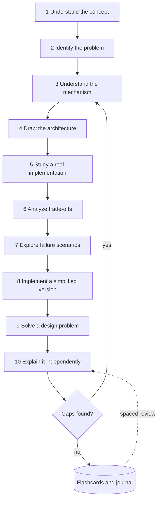
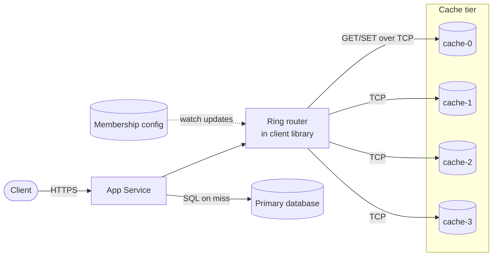
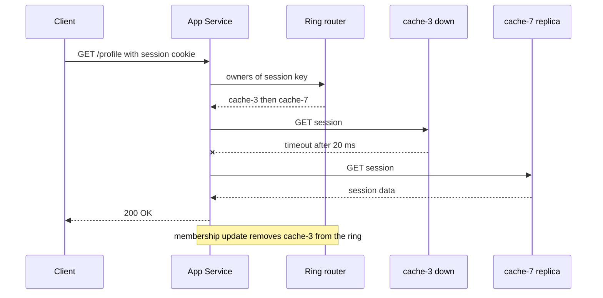
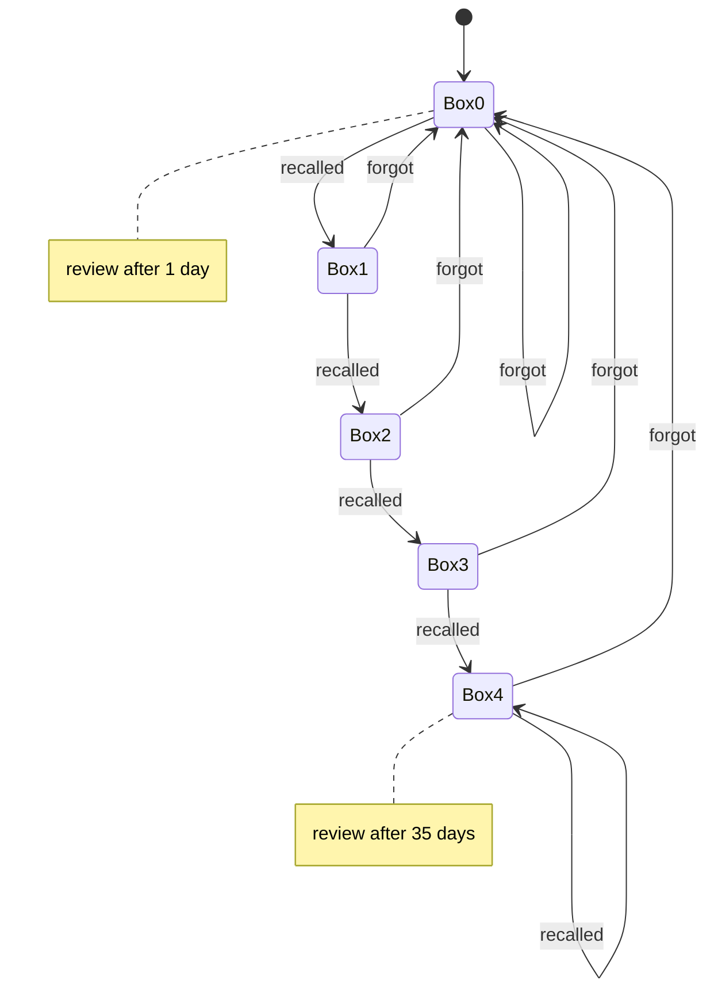
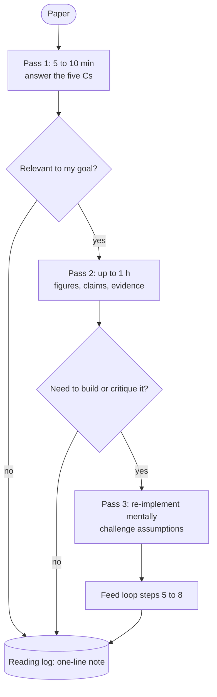
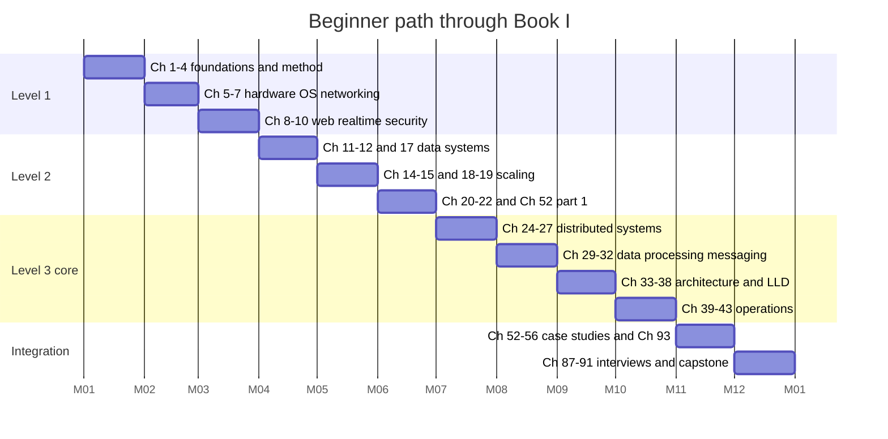
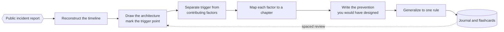

# Chapter 3 — The System Design Learning Method

> **Level:** 1 · **Track:** Shared · **Estimated reading time:** 3.5 h

System design is a large field. This book covers it in 93 chapters, and the field keeps changing while you read. No one masters it by reading straight through once. Engineers who become strong designers usually have two things: a deep stock of well-understood building blocks, and a reliable way to add new blocks. This chapter gives you that way. It is a *method*, so it applies to every later chapter, from B-trees (Chapter 11) to LLM inference (Chapter 73).

## 3.1 Learning objectives

After this chapter you should be able to:

- Apply the ten-step concept-mastery loop to any system-design concept and produce the artifact each step requires.
- Explain, with evidence, why retrieval practice and spaced practice beat rereading and highlighting, and schedule reviews to match.
- Read a systems paper using Keshav's three-pass method and judge an engineering blog post's claims by the strength of its evidence.
- Draw a reference architecture from memory, score it against a checklist, and repair the gaps.
- Scope a simplified implementation that keeps the core mechanism and leaves out production concerns.
- Follow a 12-month beginner path through this book, or build a gap-driven plan if you are already experienced.
- Track your progress with a self-assessment rubric, flashcards and a design journal.

## 3.2 Prerequisites

- **What system design is** — §1.3–§1.5. You need to know what counts as a "concept" or "building block" before you can learn concepts methodically.
- **Trade-off reasoning** — §2.8. Step 6 of the loop asks you to analyze trade-offs. Chapter 2 gives you the vocabulary.
- **Basic Python** — enough to read a 60-line program with a class, a list and a dictionary. Sections 3.3 and 3.4 contain short runnable programs.
- **Hashing (informal)** — you should know that a hash function maps any input to a fixed-size number. Chapter 17 (§17.3) covers hashing in depth; you do not need it yet.

## 3.3 The ten-step concept-mastery loop

### 3.3.1 Why a loop rather than a reading list

::: definition
**Definition — Concept-mastery loop.** A fixed sequence of ten learning activities applied to one system-design concept. Each activity produces a concrete artifact (a definition, a diagram, a program, a design). The concept counts as mastered only when you can rebuild every artifact without notes.
:::

#### First-principles explanation

Think about learning to cook one dish well. Reading the recipe tells you what the dish is. Knowing why each ingredient is there tells you what goes wrong if you leave one out. Watching a chef shows you technique. But you only really know the dish after you have cooked it yourself, burned it once, fixed it, and then cooked it for someone else without the recipe in front of you. The loop applies the same idea to a concept such as caching or consistent hashing.

#### Why does this exist?

Most engineers learn system design by *exposure*: they read blog posts, watch videos and skim chapters. Exposure feels productive because the material seems familiar on the second reading. Familiarity is not the same as the ability to *use* a concept. Learning researchers call this mismatch an illusion of competence. Rereading and highlighting are among the least effective study techniques measured [Dunlosky et al. 2013]. A design interview or a design review asks you to *produce*: choose a mechanism, draw it, estimate it and defend it. The loop makes production the main activity.

#### How it works internally

**Table 3.1 — The ten steps, the question each answers, and the artifact each produces.**

| # | Step | Question it answers | Artifact | Typical time (L1–L2) |
|---|---|---|---|---|
| 1 | Understand the concept | What is it, in one precise sentence? | Definition in your own words | 15 min |
| 2 | Identify the problem it solves | What breaks without it? | A "before" scenario with numbers | 20 min |
| 3 | Understand the mechanism | How does it work, step by step? | Numbered mechanism description | 45 min |
| 4 | Draw the architecture | Where does it sit and what talks to it? | Diagram drawn from memory | 20 min |
| 5 | Study an actual implementation | How did a real system build it? | Notes on one paper, docs page or codebase | 60–120 min |
| 6 | Analyze trade-offs | What does it cost, and versus what? | Comparison table against alternatives | 30 min |
| 7 | Explore failure scenarios | How does it break? | Failure table (what, why, detect, recover, prevent) | 30 min |
| 8 | Implement a simplified version | Can I build the core? | Runnable program of 50–300 lines with a measurement | 2–4 h |
| 9 | Solve a design problem | Can I use it in context? | A small design that uses the concept | 45–60 min |
| 10 | Explain it independently | Can I teach it without notes? | 2–5 minute spoken or written explanation | 15 min |

A full pass takes about 6–10 hours for one substantial concept. Plan for that. A concept such as "HTTP status codes" does not need all ten steps. A concept such as consistent hashing, Raft or the KV cache does.

The steps are ordered so that each one gives the next one something to work with. You cannot weigh trade-offs (6) until you know the mechanism (3). You should not implement (8) before you know the failure modes (7), because the failures tell you what your simulation must be able to show. Step 10 then checks all the earlier steps. Wherever your explanation falters, you return to that step. That return is why it is a loop and not a line.

**Figure 3.1 — The ten-step concept-mastery loop.**



**Reading the diagram.** The ten rectangles are learning activities, done in order. The solid arrows mean "finish this before starting the next". The decision node after step 10 is your self-test. If you cannot explain some part without notes, you go back to step 3 (mechanism), because most gaps turn out to be gaps in the mechanism. If you can, the concept goes into long-term storage: the cylinder represents your flashcard deck and design journal (§3.10). The dotted arrow is asynchronous. Days or weeks later, a scheduled review asks you to repeat step 10 from memory. The weak point in this process is skipping steps 7 and 8, which feel optional but are where most understanding is built. To scale the method across a whole book, run several concepts' loops interleaved, not one after another (§3.4.5).

#### Common misconceptions

::: mistake
**Misconception — "I understood it when I read it, so I know it."** Understanding while reading is recognition: the text is in front of you and gives you the cues. Using a concept in a design is recall: you have to bring it up with no cues. Only steps 4, 8, 9 and 10 test recall. If you skip them, you will not know what you are unable to do.
:::

### 3.3.2 The loop demonstrated: consistent hashing

The rest of §3.3 runs one concept through all ten steps. It shows the artifacts at the depth we expect from you. We use **consistent hashing** because it is compact enough for one section and still has a real mechanism, real failure modes and real implementations. Chapter 14 (§14.8) and Chapter 20 (§20.14) treat it in full. Treat what follows as a sample of how to study, not the canonical treatment.

#### Step 1 — Understand the concept

::: definition
**Definition — Consistent hashing.** A way of assigning keys to nodes so that, when a node is added or removed, only about $K/N$ of the $K$ keys change owner, where $N$ is the number of nodes. Both keys and nodes are hashed onto the same circular number space (the **ring**). Each key belongs to the first node found by moving clockwise from the key's position [Karger et al. 1997].
:::

**Self-check artifact:** one sentence in your own words, with no jargon you cannot define. For example: "It spreads keys over servers so that adding a server moves only that server's fair share of keys."

#### Step 2 — Identify the problem it solves

Suppose you run four cache nodes and route each key with `node = hash(key) mod 4`. Traffic grows, so you add a fifth node and the rule becomes `hash(key) mod 5`. For most keys, `hash mod 4` and `hash mod 5` point to different nodes. Those keys now live on the wrong node, so nearly every request misses the cache and falls through to the database at the very moment you were trying to add capacity.

::: formula
**Fraction of keys remapped when growing from $N$ to $N+1$ nodes**

$$f_{\text{mod}} = 1 - \frac{1}{N+1} = \frac{N}{N+1} \qquad\qquad f_{\text{ring}} \approx \frac{1}{N+1}$$

| Symbol | Meaning | Units |
|---|---|---|
| $N$ | Number of nodes before the change | nodes |
| $f_{\text{mod}}$ | Expected fraction of keys whose owner changes under `hash mod N` (uniform hashing) | dimensionless (0–1) |
| $f_{\text{ring}}$ | Expected fraction of keys whose owner changes under consistent hashing | dimensionless (0–1) |
:::

The $f_{\text{mod}}$ result comes from a simple observation. A key stays on the same node only if `h mod N` equals `h mod (N+1)`. For uniformly distributed hashes, that happens for about $1/(N+1)$ of keys. Under consistent hashing, the new node takes over only the keys that fall in its arcs of the ring. On average that is its fair share, $1/(N+1)$.

::: example
**Worked example — Adding a fifth cache node.**

1. Setup: $N = 4$, $K = 100{,}000{,}000$ cached keys, cache hit ratio 95 %, and 50,000 reads per second (RPS) reach the cache tier.
2. Naive scheme: $f_{\text{mod}} = 4/5 = 0.80$. About $0.80 \times 10^8 = 8 \times 10^7$ keys are now on the wrong node.
3. Ring scheme: $f_{\text{ring}} = 1/5 = 0.20$. About $2 \times 10^7$ keys move. They move only *to the new node*, which starts out empty.
4. Database impact right after the change, before the cache refills. Under mod-N, about 80 % of reads miss, plus the normal 5 % on the rest. The database sees about $0.80 \times 50{,}000 + 0.05 \times 0.20 \times 50{,}000 = 40{,}000 + 500 = 40{,}500$ RPS instead of the usual $0.05 \times 50{,}000 = 2{,}500$ RPS. That is a 16× surge. Under the ring, about 20 % of reads miss, plus the normal 5 % on the remaining traffic. The database sees about $0.20 \times 50{,}000 + 0.05 \times 0.80 \times 50{,}000 = 10{,}000 + 2{,}000 = 12{,}000$ RPS, a 4.8× surge.

**Interpretation.** Both schemes cause a miss spike. Consistent hashing makes it about 3.4× smaller ($40{,}500 / 12{,}000$) and limits it to one node's share of keys.
**Engineering implication.** If your database can absorb about 12,000 RPS, consistent hashing lets you add cache nodes without an outage. With mod-N you would need to warm the new layout ahead of time or add nodes only during low traffic. Chapter 20 (§20.11, cache stampede) covers the remaining spike.
:::

**Self-check artifact:** a "before" scenario with numbers, like the one above.

#### Step 3 — Understand the mechanism

1. Pick a hash function that maps strings to integers in $[0, 2^{m})$. Treat that range as a circle in which $2^{m}-1$ is next to $0$.
2. For each node, compute $V$ positions by hashing distinct labels such as `"cache-2#vn17"`. Each position is a **virtual node** (vnode). Store all $N \times V$ positions in a sorted array, each mapped to its physical node.
3. To look up a key, hash it and binary-search the sorted array for the first position greater than the key's hash. If there is none, wrap around to index 0. The node that owns that position owns the key. A lookup costs $O(\log(NV))$.
4. To add a node, insert its $V$ positions. Each one takes over the arc between its predecessor and itself. Every other key keeps its owner.
5. To remove a node, delete its positions. Each of its arcs goes to the next position clockwise. Because the vnodes are scattered around the ring, the removed node's load is spread over many survivors instead of all landing on one neighbor.
6. For replication, walk clockwise and collect the first $R$ *distinct physical* nodes. Dynamo calls this list the **preference list** [DeCandia et al. 2007].

Why do virtual nodes matter? With $V = 1$, each node owns one arc, and arc lengths from $N$ random points vary widely. One node can easily own two or three times its fair share. With $V$ vnodes, each node's load is the sum of $V$ arcs, and sums of many random lengths stay close to the average. The relative spread shrinks roughly in proportion to $1/\sqrt{V}$. Step 8 measures this.

#### Step 4 — Draw the architecture

Close the book and draw where consistent hashing sits in a distributed cache. Then compare your drawing with Figure 3.2.

**Figure 3.2 — Consistent hashing in a client-routed distributed cache.**



**Reading the diagram.** A client calls the app service over HTTPS. Inside the app service, a client library holds the ring: the sorted vnode positions and their owners. It is in-process, so a lookup is a binary search in memory, typically microseconds. The ring router sends each `GET`/`SET` to exactly one cache node over a TCP connection, such as the Memcached or Redis protocol. All of these are synchronous calls. On a miss, the app service reads the primary database over SQL and fills the cache (cache-aside, §20.7). The dotted arrow from the membership config is asynchronous. A coordination service or config file tells every app instance when nodes join or leave (§26.8–§26.9). There are two storage boundaries: the in-memory cache tier, which is disposable, and the database, which is durable. Failure points: a cache node that dies sends its keys to clockwise successors and causes a miss spike, and app instances that see *different* membership send the same key to different nodes. To scale, add cache nodes (each takes about $1/(N+1)$ of the keys) or raise $V$ to even out the load.

**Self-check artifact:** your own drawing, annotated with which calls are synchronous and where state lives. If your drawing left out the membership channel, you have found your first gap. Section 3.6 explains how to score drawings like this.

#### Step 5 — Study an actual implementation

Now read how real systems built it. Pick *one* primary source and read it with the three-pass method (§3.5). For consistent hashing, three sources are worth knowing:

::: industry
**Akamai and the original paper.** Karger and colleagues introduced consistent hashing to spread web-cache load without hot spots, in a setting where different clients may see different sets of caches. Their paper defines the properties a good scheme needs. Two of them are *balance*, meaning keys spread evenly, and *monotonicity*, meaning that adding a cache moves keys only onto the new cache, never between old caches. The paper also uses multiple copies of each cache point on the circle to improve balance, which is the idea behind virtual nodes.
*Evidence: Primary* — [Karger et al. 1997]
:::

::: industry
**Amazon Dynamo.** Dynamo partitions its key space with consistent hashing and assigns each physical node several virtual nodes. This lets a more powerful machine take more vnodes, and it spreads a failed node's load over many survivors. Each key is replicated on the first $R$ distinct physical nodes clockwise, its preference list (the paper calls this count $N$). The paper compares three strategies for placing tokens. It reports that dividing the ring into equal-sized partitions, decoupled from node placement, gave the best load balance and the smallest membership metadata.
*Evidence: Primary* — [DeCandia et al. 2007]
:::

::: industry
**Apache Cassandra.** Cassandra's original design hashes keys onto a ring with an order-preserving hash function and assigns each node one position. The paper acknowledges the load imbalance this causes. It handles the imbalance by analyzing load on the ring and moving lightly loaded nodes so they take load from heavily loaded ones.
*Evidence: Primary* — [Lakshman and Malik 2010]
:::

When you read an implementation, write down where it *departs* from the textbook mechanism and why. Departures are usually the most instructive part. Dynamo moved from random tokens to fixed equal-sized partitions because random tokens made bootstrapping and archiving slow. That is an operational reason, not an algorithmic one, and only a real implementation would show it to you.

#### Step 6 — Analyze trade-offs

**Table 3.2 — Key-to-node assignment schemes compared.**

| Dimension | `hash mod N` | Ring + virtual nodes | Rendezvous (HRW) hashing | Jump consistent hash |
|---|---|---|---|---|
| What it is | Modulo of key hash | Keys and vnodes on a circle | Each key picks the node with the highest score `hash(key, node)` | Arithmetic function from key to bucket number |
| Keys moved on add | ~$N/(N+1)$ | ~$1/(N+1)$ | ~$1/(N+1)$ | ~$1/(N+1)$ |
| Lookup cost | $O(1)$ | $O(\log NV)$ | $O(N)$ (scores every node) | $O(\log N)$, no table |
| Memory | None | $O(NV)$ positions | $O(N)$ node list | None |
| Load balance | Excellent | Good; improves with $V$ | Excellent | Excellent |
| Arbitrary node removal | Remaps almost everything | Yes | Yes | No; buckets must be numbered $0..N-1$ and removed from the end |
| Weighted nodes | Awkward | Natural (more vnodes) | Possible with weighted scores | No |
| Choose when | $N$ never changes | General-purpose caches and stores | Small $N$, simple code | Storage shards that only grow |

Sources: [Karger et al. 1997], [Thaler and Ravishankar 1998], [Lamping and Veach 2014]. Two further variants are worth knowing by name. **Maglev hashing** builds a fixed-size lookup table for $O(1)$ lookups in load balancers and accepts a little extra disruption in exchange [Eisenbud et al. 2016]. **Consistent hashing with bounded loads** caps every node at $(1+\varepsilon)$ times the average load and sends overflow keys clockwise [Mirrokni et al. 2018].

**Self-check artifact:** a table like Table 3.2 written from memory, plus one sentence saying which scheme you would pick for a 6-node Redis cache and why.

#### Step 7 — Explore failure scenarios

**Table 3.3 — Failure scenarios for consistent hashing.**

| What goes wrong | Why | Detection | Recovery | Prevention |
|---|---|---|---|---|
| One node overloaded | Too few vnodes, so arcs are uneven | Per-node RPS and memory skew | Add vnodes to the others; rebalance | $V \ge 100$; bounded-load variant |
| Hot key | One key gets a large share of traffic; hashing cannot split one key | Top-K key metrics (§17.6) | Replicate the hot key; add a local cache tier | Key splitting, request coalescing (§20.15) |
| Successor overload after node death | With $V=1$, the clockwise neighbor inherits *all* of the dead node's keys | Neighbor CPU and miss-ratio spike | Bring up a replacement node | Virtual nodes spread the load over many successors |
| Split views of membership | Clients update membership at different times | Same key read from two nodes; inconsistent reads | Converge config; flush the affected range | Single source of truth with watches; versioned ring |
| Miss storm on resize | New node starts cold | Database RPS spike | Rate-limit fills; serve stale data | Pre-warm; add nodes off-peak; stampede protection (§20.11) |
| Poor hash function | Clustering of positions | Skewed arc lengths at build time | Change the hash, which remaps everything | Use a well-mixed hash (e.g., MurmurHash, xxHash, MD5 truncated) |

The split-view row is the one beginners miss. The algorithm assumes every client has the same ring. Keeping that true is a distributed-systems problem in its own right, and you will meet it again in Chapter 26.

#### Step 8 — Implement a simplified version

Keep the mechanism and leave out everything else: no networking, no replication, no persistence. The goal is a program that lets you *see* the two properties you studied, minimal movement and load balance.

```python
"""Simplified consistent-hashing ring with virtual nodes (teaching version)."""
import bisect
import hashlib
from collections import Counter


def h(key: str) -> int:
    """Map a string to a 64-bit integer position on the ring."""
    digest = hashlib.md5(key.encode("utf-8")).digest()
    return int.from_bytes(digest[:8], "big")


class HashRing:
    def __init__(self, nodes=(), vnodes: int = 100):
        self.vnodes = vnodes
        self._positions = []   # sorted ring positions
        self._owner = {}       # position -> physical node name
        for node in nodes:
            self.add_node(node)

    def add_node(self, node: str) -> None:
        for i in range(self.vnodes):
            pos = h(f"{node}#vn{i}")
            bisect.insort(self._positions, pos)
            self._owner[pos] = node

    def remove_node(self, node: str) -> None:
        for i in range(self.vnodes):
            pos = h(f"{node}#vn{i}")
            self._positions.remove(pos)
            del self._owner[pos]

    def get_node(self, key: str) -> str:
        """Return the first node clockwise from the key's position."""
        if not self._positions:
            raise LookupError("ring is empty")
        idx = bisect.bisect_right(self._positions, h(key))
        if idx == len(self._positions):  # wrap around past the top
            idx = 0
        return self._owner[self._positions[idx]]


def mod_n_node(key: str, nodes: list) -> str:
    """The naive scheme: hash(key) mod N."""
    return nodes[h(key) % len(nodes)]


if __name__ == "__main__":
    keys = [f"user:{i}" for i in range(100_000)]
    before = [f"cache-{i}" for i in range(4)]
    after = before + ["cache-4"]

    moved = sum(mod_n_node(k, before) != mod_n_node(k, after) for k in keys)
    print(f"mod-N : {moved / len(keys):.1%} of keys moved (4 -> 5 nodes)")

    for v in (1, 100):
        ring = HashRing(before, vnodes=v)
        old = {k: ring.get_node(k) for k in keys}
        ring.add_node("cache-4")
        moved = sum(old[k] != ring.get_node(k) for k in keys)
        load = Counter(ring.get_node(k) for k in keys)
        spread = max(load.values()) / (len(keys) / len(after))
        print(f"ring vnodes={v:<3}: {moved / len(keys):.1%} moved, "
              f"busiest node at {spread:.2f}x the mean load")
```

Running it with Python 3.8 or later prints:

```text
mod-N : 79.9% of keys moved (4 -> 5 nodes)
ring vnodes=1  : 24.4% moved, busiest node at 2.60x the mean load
ring vnodes=100: 21.4% moved, busiest node at 1.08x the mean load
```

What to notice:

- `h()` uses MD5 only as a *mixing* function, which is fine here because nothing depends on it being cryptographically secure. Python's built-in `hash()` is randomized per process for strings, so two app instances would build different rings. That is exactly the split-view failure from Table 3.3, reproduced by accident.
- `bisect_right` plus the wrap-around check *is* the clockwise walk. Those two lines are the whole algorithm.
- The measurement agrees with the formula. Mod-N moved 79.9 % against a predicted 80 %. The ring moved about 20 % (21.4 % with 100 vnodes).
- With one vnode per node, the busiest node carries 2.6× its fair share. With 100 vnodes it carries 1.08×. You have now *seen* why virtual nodes exist, which is worth more than reading it.
- `bisect.insort` costs $O(NV)$ per insert. That is fine at this scale. A production ring would rebuild a sorted array once per membership change.

#### Step 9 — Solve a design problem

Use the concept inside a small design. **Problem:** a session store for 20 million concurrently active users. Each session is about 2 KB. Reads run at 200,000 RPS and writes at 20,000 RPS. A cache node may fail without logging out more than about 10 % of users.

A sketch of the solution. Data volume is $2 \times 10^7 \times 2\,\text{KB} = 40\,\text{GB}$ (SI units). With replication factor 2 that is 80 GB. Ten nodes with 16 GB of usable memory each hold it with headroom. Assign keys with a ring of 10 nodes × 150 vnodes. Write each session to the first two distinct physical nodes clockwise. If one node dies, its share (~10 %) has a replica on many different successors thanks to the vnodes, so no user is logged out and no single successor doubles its load. Figure 3.3 shows the read path during that failure.

**Figure 3.3 — Session read when the primary owner has failed.**



**Reading the diagram.** The participants are the client, the app service, the in-process ring router, the failed owner (cache-3) and the second replica on the preference list (cache-7). All arrows are synchronous request/response calls. The client uses HTTPS, and the app talks to the cache nodes over TCP. The crossed arrow is the failure: the call to cache-3 times out after a short, explicit deadline (§22.11). The app then tries the next node on the preference list. The cost to the user is one timeout of added latency, here 20 ms. The note shows the asynchronous repair: once failure detection (§27.10) removes cache-3, the router stops trying it and the extra latency goes away. The storage boundary is the cache tier, and each session lives on two nodes. To scale, add nodes. Each one takes about $1/(N+1)$ of the sessions.

#### Step 10 — Explain it independently

Close everything. Set a timer for three minutes and explain consistent hashing aloud, or in writing, to an imagined colleague who knows what a hash function is but nothing else. A good explanation covers five beats:

1. **The problem**: mod-N remaps about $N/(N+1)$ of keys when $N$ changes.
2. **The trick**: put nodes and keys on the same ring and walk clockwise.
3. **The consequence**: only about $1/(N+1)$ of keys move, and only to or from the changed node.
4. **The refinement**: virtual nodes fix uneven arcs and spread failure load.
5. **The limits**: it does nothing for hot keys, and every client must share the same membership view.

Record yourself if you can. Then mark each beat as "fluent", "hesitant" or "missing". Each beat you marked "hesitant" or "missing" sends you back to the matching step: beats 1–2 to steps 2–3, beat 4 to step 8, beat 5 to step 7. Then turn the shaky beats into flashcards (§3.10.2).

::: recommendation
**Recommendation — Keep the artifacts.** Store all ten artifacts for each concept in one folder or journal entry (§3.10.3). Months later, rebuilding a concept from your own artifacts is far quicker than the first loop was. That folder becomes your personal edition of this book.
:::

## 3.4 Active recall, spaced repetition, the Feynman technique, interleaving and deliberate practice

The loop tells you *what* to do with a concept. This section explains *how to practice* so that what you learn lasts. The techniques come from cognitive psychology. They were tested mostly on facts, vocabulary, science texts and mathematics, not on architecture, so applying them to system design is a reasonable extrapolation rather than a measured result.

### 3.4.1 What the evidence says, in one table

Dunlosky and colleagues reviewed ten widely used study techniques. They rated each one's *utility* by how well it generalized across learners, materials and test conditions [Dunlosky et al. 2013].

**Table 3.4 — Study techniques by rated utility, and their system-design form.**

| Technique | Rated utility | System-design form |
|---|---|---|
| Practice testing (retrieval practice) | High | Flashcards; drawing from memory; mock design sessions |
| Distributed practice (spacing) | High | Scheduled reviews days and weeks apart (§3.4.3) |
| Elaborative interrogation | Moderate | Asking "why does Dynamo use vnodes rather than one token?" |
| Self-explanation | Moderate | Step 10 of the loop; the Feynman technique (§3.4.4) |
| Interleaved practice | Moderate | Mixing caching, queuing and replication problems in one session |
| Summarization | Low | Writing chapter summaries (useful only with good training) |
| Highlighting / underlining | Low | Marking up PDFs |
| Keyword mnemonic | Low | Acronyms for lists of terms |
| Imagery for text | Low | Picturing a text's content |
| Rereading | Low | Reading a chapter a second time |

The ratings of the top five are the ones that matter. The two techniques that feel most like studying, highlighting and rereading, rated low. The two that feel most like being tested, practice testing and spacing, rated high.

::: concept
**Key insight — Learning versus performance.** How well you do *during* practice is a poor guide to how much you are learning. Conditions that make practice feel harder, such as spacing, interleaving and testing yourself before you feel ready, often produce better long-term retention. Bjork called these **desirable difficulties** [Bjork 1994]; see [Soderstrom and Bjork 2015] for a review. If a study session felt smooth and easy, be suspicious of it.
:::

### 3.4.2 Active recall (retrieval practice)

::: definition
**Definition — Active recall.** Deliberately retrieving information from memory without looking at the source, for example by answering a question, drawing a diagram or explaining aloud. Its measured benefit for later retention is called the **testing effect**.
:::

In a well-known experiment, students read short prose passages under one of three schedules. They either studied four times (SSSS), studied three times and then took one free-recall test (SSST), or studied once and took three tests (STTT). On a test five minutes later, more studying gave better recall. On a test one week later, the order reversed. The repeated-testing group recalled about 61 % of the idea units, against about 40 % for the repeated-study group, even though the testing group had seen the text only once [Roediger and Karpicke 2006]. A later study found that retrieval practice also beat building concept maps, an "active" elaborative technique, on a test of meaningful learning [Karpicke and Blunt 2011].

**Applied to system design.** Every reading session should end with retrieval: close the book, and write or draw what you just learned. The checkpoints at the end of each chapter in this book exist for this reason. Answer them before you open the `<details>` block.

### 3.4.3 Spaced repetition

::: definition
**Definition — Spaced repetition.** Reviewing material at increasing intervals, so that each review happens around the time you would otherwise begin to forget it. The underlying finding, that spacing study sessions apart beats massing them together, is the **spacing effect**.
:::

The spacing effect is one of the oldest results in experimental psychology. It goes back to Ebbinghaus's experiments on himself in the 1880s [Ebbinghaus 1885/1913]. A meta-analysis of hundreds of comparisons confirmed that spaced practice beats massed practice for verbal recall [Cepeda et al. 2006]. A follow-up study asked *how far apart* reviews should be. The best gap between study sessions depended on how long you need to remember the material. Expressed as a fraction of that retention interval, the best gap was about 20–40 % for a one-week retention interval and fell to about 5–10 % for a one-year interval [Cepeda et al. 2008].

The practical form of spaced repetition is the **Leitner system**: flashcards move through numbered boxes. A correct answer promotes a card to the next box, which is reviewed less often. A wrong answer sends it back to box 0. Software such as Anki automates the same idea with adaptive intervals.

**Figure 3.4 — A five-box Leitner schedule for flashcards.**



**Reading the diagram.** Each state is a box with its own review interval: 1, 3, 7, 16 and 35 days for boxes 0 to 4. The intervals are a reasonable starting point, not an empirically optimal set. Each transition is one review. "Recalled" moves a card one box up, and the top box keeps it there. "Forgot" sends it back to box 0. Data flows one card at a time. All of the state is the box number and due date per card, so a spreadsheet is enough storage. The failure point is a backlog: if you skip a week, the reviews that were due pile up. The fix is to cap new cards per day, not to skip reviews. The schedule scales because mastered cards cost one review every five weeks or so.

The scheduler itself is small enough to build in a few minutes, which makes it a good first "simplified implementation" (§3.7):

```python
"""Minimal Leitner-box scheduler for system-design flashcards."""
from dataclasses import dataclass, field
from datetime import date, timedelta

INTERVALS = [1, 3, 7, 16, 35]  # days until next review, per box (box 0..4)


@dataclass
class Card:
    prompt: str
    box: int = 0
    due: date = field(default_factory=date.today)

    def review(self, recalled: bool, today: date) -> None:
        # Success promotes one box; failure sends the card back to box 0.
        self.box = min(self.box + 1, len(INTERVALS) - 1) if recalled else 0
        self.due = today + timedelta(days=INTERVALS[self.box])


def due_cards(cards, today):
    return [c for c in cards if c.due <= today]


if __name__ == "__main__":
    start = date(2026, 1, 5)
    card = Card("Why do virtual nodes reduce load imbalance?", due=start)
    today = start
    for ok in [True, True, False, True, True, True]:
        card.review(ok, today)
        print(f"{today}  recalled={ok!s:<5} -> box {card.box}, next {card.due}")
        today = card.due
```

Output:

```text
2026-01-05  recalled=True  -> box 1, next 2026-01-08
2026-01-08  recalled=True  -> box 2, next 2026-01-15
2026-01-15  recalled=False -> box 0, next 2026-01-16
2026-01-16  recalled=True  -> box 1, next 2026-01-19
2026-01-19  recalled=True  -> box 2, next 2026-01-26
2026-01-26  recalled=True  -> box 3, next 2026-02-11
```

What to notice:

- `field(default_factory=date.today)` matters. A plain `date.today()` default would be evaluated once, when the class is defined, and every card would share that date. This is the kind of bug you only find by building the thing.
- One failure on 15 January wipes out two promotions. That is harsh by design: a card you forgot needs to be relearned, not just reviewed.
- After six reviews spread over five weeks, the card is due in 16 days. Spaced repetition costs little per item, and the cost keeps falling.

::: example
**Worked example — Daily review load.** You add 5 new cards per study day, 5 days a week, for a year: about $5 \times 5 \times 52 = 1{,}300$ cards. In the steady state, assume 70 % of cards sit in boxes 3–4 (reviewed about every 16–35 days, call it every 25 days), 20 % in box 2 (every 7 days) and 10 % in boxes 0–1 (every 2 days on average). Daily reviews ≈ $1{,}300 \times (0.70/25 + 0.20/7 + 0.10/2) = 1{,}300 \times (0.028 + 0.029 + 0.050) \approx 139$ cards. At about 8 seconds per card that is roughly 19 minutes a day.
**Interpretation.** A year of system-design vocabulary stays fresh for under 20 minutes a day, *if* most cards are mastered. **Implication.** Keep cards atomic so they move up the boxes quickly. Cards that bounce between boxes 0 and 1 dominate the load, so rewrite or split them.
:::

### 3.4.4 The Feynman technique (self-explanation)

The "Feynman technique" is a popular name for a four-step routine. You pick a concept, explain it in plain language as if to a newcomer, find the places where your explanation breaks down or falls back on jargon, and go back to the source to fix those places. Richard Feynman did not publish this method under that name. The label was attached later. The research behind it is the work on **self-explanation**: learners who explain material to themselves while studying understand it better than those who only read it [Chi et al. 1994]. Dunlosky and colleagues rated self-explanation and elaborative interrogation as having moderate utility [Dunlosky et al. 2013].

In system design, the routine is step 10 of the loop, plus one rule: **every "it just handles that" is a gap.** If your explanation of Kafka says "the broker handles durability", you have not explained durability. You have named it. Push until you reach a mechanism, such as "the leader waits for in-sync replicas to append the record before acknowledging when `acks=all`" (§31.6, §31.9).

### 3.4.5 Interleaving

::: definition
**Definition — Interleaving.** Mixing different kinds of problems or concepts within one practice session (A B C A C B), instead of finishing all practice on one kind before moving to the next (AAA BBB CCC, called **blocking**).
:::

In one study, students who practiced mixed (shuffled) mathematics problems did worse during practice but much better on a delayed test than students who practiced in blocks [Rohrer and Taylor 2007]. Interleaving also helped people learn to tell categories apart, such as painters' styles, even though most participants *believed* blocking had worked better for them [Kornell and Bjork 2008].

A design problem never tells you which chapter it comes from. Interleaving trains the skill that matters most in a real design: noticing *which* tool a situation calls for. In practice, once you have studied caching, queues and replication, practice with mixed questions such as "this read path is slow; is it a cache problem, a fan-out problem, or a replication-lag problem?" instead of ten caching questions in a row.

### 3.4.6 Deliberate practice

::: definition
**Definition — Deliberate practice.** Effortful practice designed to improve performance. It targets specific weaknesses, has clear goals, gives immediate feedback and is usually guided by a teacher or coach [Ericsson et al. 1993].
:::

Ericsson and colleagues argued that differences in expert performance largely reflect accumulated deliberate practice. Later work found the picture more mixed. A meta-analysis found that deliberate practice explained about 12 % of the variance in performance across domains, and less in education and professions than in games, music and sports [Macnamara et al. 2014]. The honest conclusion is this: practice that targets weaknesses and comes with feedback helps, but hours alone do not guarantee expertise.

For a system designer, the scarce ingredient is **feedback**. You can get it from mock interviews with a scoring rubric (Chapter 88), from design reviews by senior engineers (§3.9.2), from comparing your design with published ones (Chapters 52–56), and from running your own simplified implementation to see whether it behaves as you predicted.

::: mistake
**Misconception — "I'm a visual learner, so I should only watch videos."** Matching instruction to self-reported "learning styles" has not been shown to improve outcomes in properly designed experiments [Pashler et al. 2008]. Diagrams do help with system design, but because the *subject* is spatial and structural, not because of your learning style. Everyone should draw.
:::

## 3.5 Reading papers and engineering blogs

Step 5 of the loop sends you to primary sources. In system design, those are mostly conference papers (SOSP, OSDI, NSDI, USENIX ATC, VLDB, SIGMOD), official documentation and company engineering blogs. Each needs a different way of reading.

### 3.5.1 Keshav's three-pass method

Keshav's two-page note is the standard advice for reading systems papers. Read a paper in up to three passes, and decide after each pass whether the next one is worth the time [Keshav 2007].

1. **First pass (about 5–10 minutes).** Read the title, abstract and introduction. Read the section headings and nothing under them. Glance at any mathematics, then read the conclusions and scan the references. Afterwards, you should be able to answer the **five Cs**: *Category* (what type of paper is it?), *Context* (which other work does it build on?), *Correctness* (do the assumptions look valid?), *Contributions* (what is new?) and *Clarity* (is it well written?).
2. **Second pass (up to about an hour).** Read carefully but skip proofs. Study the figures, graphs and axes. Mark the references you have not read. Afterwards, you should be able to summarize the paper's main thrust, with evidence, to someone else.
3. **Third pass (about 4–5 hours for a beginner, about an hour for an experienced reader).** Virtually re-implement the paper. Make the same assumptions, recreate the work, and compare your version with the authors'. This pass exposes hidden assumptions and missing citations.

**Figure 3.5 — The three-pass reading decision flow.**



**Reading the diagram.** A paper enters at the top. Each rectangle is a pass with a time budget, and each diamond is a decision to stop or go deeper. Every path ends at the reading log, the cylinder. Even a paper you rejected after five minutes gets a one-line note, so you will not reread it by accident. Only the third pass feeds steps 5–8 of the loop. The usual failure is starting at the third pass: reading page one in detail and giving up on page four. To scale this across many papers, do many first passes and only a few third passes. For most engineers, about one paper in five deserves the third.

When you apply the method to a *systems* paper, add two questions to the five Cs. **What was the workload?** Dynamo's design follows from Amazon's shopping-cart writes, which had to be "always writeable". **What did they choose not to provide?** GFS gave up a POSIX-compatible interface and offered relaxed consistency [Ghemawat et al. 2003]. A paper's non-goals tell you as much as its goals.

**Table 3.5 — A starter reading list mapped to this book.**

| Paper | Read with | Why this one first |
|---|---|---|
| Lamport, *Time, Clocks, and the Ordering of Events* [Lamport 1978] | §24.10 | Short; defines "happened-before" |
| *The Google File System* [Ghemawat et al. 2003] | §15.5 | Clear workload-driven trade-offs |
| *MapReduce* [Dean and Ghemawat 2004] | §29.4 | Simple model; good first third-pass paper |
| *Dynamo* [DeCandia et al. 2007] | §14.8, §27.7 | Assembles many chapter concepts in one design |
| *The Chubby Lock Service* [Burrows 2006] | §26.14 | Engineering lessons, not just algorithms |
| *ZooKeeper* [Hunt et al. 2010] | §26.8 | Coordination as a service |
| *Kafka* [Kreps et al. 2011] | §31.3 | The log as a central abstraction |
| *Raft* [Ongaro and Ousterhout 2014] | §26.7 | Written explicitly to be understandable |
| *The Tail at Scale* [Dean and Barroso 2013] | §23.6–§23.7 | Magazine-length; shapes how you think about latency |
| *Spanner* [Corbett et al. 2012] | §28.8 | Advanced; read after Chapters 25–26 |

### 3.5.2 Reading engineering blogs critically

Company engineering blogs are where the field's current practice gets written down. They are also written to recruit engineers and to promote the company, and they rarely go through peer review. Read them as **evidence of what one team did under its own constraints**, not as recommendations for you.

**Table 3.6 — Critical-reading checklist for engineering posts.**

| Ask | Why | Red flag |
|---|---|---|
| What was the workload and scale? | Solutions depend on the workload | No numbers at all, or only "massive scale" |
| What was the baseline? | A speed-up needs something to compare against | "10× faster" with no stated "than what" |
| What did they try that failed? | Shows what the real constraint was | Only a success story |
| What did it cost? | Every choice costs something | No downsides mentioned |
| When was it written? | Systems and versions change | No date; describes a deprecated version |
| Can it be checked? | Separates evidence from narrative | No benchmark method; no code; no follow-up |
| Who benefits from you believing it? | Vendor posts sell products | "Our product solved it" with no alternatives considered |

This book uses the same discipline in its **evidence labels** (§9 of the style guide): Primary, Secondary or Illustrative. Label your own notes the same way. A claim you read in a conference talk summary is Secondary, even if it sounds authoritative.

## 3.6 Drawing architecture from memory

### 3.6.1 Why drawing from memory works

Drawing a system from memory is retrieval practice (§3.4.2) on structured material. It also builds what Chase and Simon called **chunks**. In their studies, chess masters reconstructed real game positions from a brief glance far better than novices. On random piece placements, the masters' advantage largely disappeared [Chase and Simon 1973]. Their expertise was stored as meaningful patterns, not as better raw memory. Reference architectures are the chunks of system design: "CDN → load balancer → stateless service → cache → primary/replica database", or "producer → partitioned log → consumer group". Once each of these is a single chunk, your working memory is free to reason about what is *different* in the problem in front of you.

### 3.6.2 The protocol

1. **Choose a target**: a figure from a chapter you finished at least two days ago.
2. **Draw blind for 10 minutes** on paper or a whiteboard. Use the book's shapes (§6 of the style guide): stadiums for clients, rectangles for services, cylinders for stores, subroutine shapes for queues.
3. **Annotate edges**: protocol, synchronous or asynchronous, direction.
4. **Compare** with the source and score your drawing with Table 3.7.
5. **Write the diff**: every missing component and every wrong edge becomes a flashcard.
6. **Redraw** after the next spacing interval (3 days, then 7, then 16).

**Table 3.7 — Scoring rubric for a drawing from memory (0–2 points each, 12 maximum).**

| Criterion | 0 | 1 | 2 |
|---|---|---|---|
| Components | Major pieces missing | All major pieces present | Also includes supporting pieces (config, discovery, monitoring) |
| Data flow | Arrows missing or wrong | Correct direction | Read and write paths distinguished |
| Sync vs async | Not marked | Partly marked | Every edge correct |
| Protocols | None | Some | Every edge labeled |
| Storage boundaries | Unclear where state lives | Stores shown | Durability of each store stated |
| Failure points | None marked | One marked | Each single point of failure plus its mitigation |

A score of 10–12 on a figure means you can use that architecture fluently. Below 7 means you should go back to loop step 3 for the components you missed.

::: tip
**Interview tip.** Interviewers do not score how pretty your diagram is. They notice whether you mark the read and write paths separately and whether you can point at the single points of failure without being asked. Those are the two highest-value rows of Table 3.7, and both can be trained.
:::

## 3.7 Building simplified implementations

### 3.7.1 Why build at all

Feynman's blackboard at the time of his death carried the line "What I cannot create, I do not understand." Building a small version of a mechanism forces you to make every decision the prose glossed over: what happens on wrap-around, what a timeout returns, which component owns a piece of state. The consistent-hashing ring in §3.3 and the Leitner scheduler in §3.4.3 each surfaced a bug that reading would not have, a process-randomized `hash()` and a shared default date.

### 3.7.2 Scoping rules

1. **Keep the mechanism; fake the environment.** Simulate the network with function calls and the clock with a counter. Simulate disks with dictionaries.
2. **One file, under 300 lines.** If it grows past that, you are building a product, not a learning model.
3. **Build in a measurement.** Every simplified implementation should print a number that tests a claim from the chapter: keys moved, hit ratio, p99 latency, messages lost.
4. **Inject one failure.** Kill a node, drop a message or skew a clock, then check whether the behavior matches Step 7's failure table.
5. **Compare with a real system afterwards.** Read the corresponding part of a real codebase or its documentation and list three things it does that yours does not. That list is your map to production concerns.

**Table 3.8 — Simplified implementations that pay off, by chapter.**

| Build | Chapter | The measurement that proves it works |
|---|---|---|
| LRU cache with TTL | §20.8–§20.9, §38.10 | Hit ratio against cache size on a Zipf-like key stream |
| Token-bucket rate limiter | §22.4 | Accepted rate converges to the refill rate |
| Consistent-hash ring | §14.8 | Keys moved ≈ $1/(N+1)$; max/mean load against vnode count |
| Bloom filter | §17.4 | Measured false-positive rate matches the formula |
| Append-only log with offsets | §31.3, §31.8 | Consumer restarts from its committed offset |
| Leader election with leases | §26.5, §26.11 | At most one leader per lease epoch under clock skew |
| Raft log replication (simulated network) | §26.7 | No committed entry lost when a minority of nodes crash |
| Retry with exponential backoff and jitter | §22.12 | Load on a recovering server, with and without jitter |

Chapter 93 turns several of these into full projects with deployment, testing and monitoring. The simplified versions here are the step before that.

::: warning
**Warning — The toy-to-production gap.** A 100-line Raft simulation that passes your tests is not a correct Raft. Consensus implementations fail in rare interleavings of events that small tests seldom reach, which is why Jepsen-style testing exists (§25.11). Treat your build as a model of the mechanism, never as evidence that the real problem is easy.
:::

## 3.8 Beginner methodology: a 12-month path

This path is for readers starting at Level 1: you can program, but you have not designed distributed systems. It assumes 8–10 hours a week. That is enough for about four full concept loops a month plus lighter reading. The target is **Level 2 by month 6 and Level 3 on core Book I material by month 12**. Levels 4 and 5 (senior/staff, principal) depend on production experience that no reading plan can replace. Part IX and §3.9 are where you go next.

**Figure 3.6 — The 12-month beginner path (months shown as M01–M12).**



**Reading the diagram.** Each bar is one month of study, and bars run one after another. The `after` dependencies mean that each block assumes you have finished the one before it. The calendar dates are placeholders, so read the axis as month numbers. The three sections match the proficiency levels you should reach by the end of each phase. The fourth section, Integration, combines everything rather than adding new material. The common failure is slipping in months 7–8. Distributed systems is the steepest part of the path, so plan for those two months to take three. There are two ways to scale the plan. At 15+ hours a week, the whole path fits in about eight months. An ML-track reader can swap month 9 for Chapters 57–60 and month 10 for Chapters 66 and 72–75.

**Table 3.9 — Month-by-month plan with loop targets and milestones.**

| Month | Chapters | Full-loop concepts (examples) | Milestone artifact |
|---|---|---|---|
| 1 | 1–4 | Latency vs throughput; Little's Law; availability arithmetic | Flashcard deck started; first design journal entry |
| 2 | 5–7 | Memory hierarchy; event loops; TCP handshake; DNS | Request lifecycle drawn from memory (§8.5 preview) |
| 3 | 8–10 | REST design; OAuth 2.0 flow; TLS; threat model | API spec for a URL shortener (§52.1) |
| 4 | 11–12, 17 | B+ tree index; isolation levels; Bloom filter | Bloom filter build (Table 3.8) |
| 5 | 14–15, 18–19 | Replication lag; consistent hashing; L4 vs L7 balancing | Hash ring build (§3.3) |
| 6 | 20–22; 52.1–52.3 | Cache-aside; cache stampede; token bucket | **L2 checkpoint**: rate limiter design (§52.3), timed at 45 min |
| 7 | 24–27 | Lamport clocks; linearizability; Raft; quorums | Raft election simulation |
| 8 | 29–32 | Partitioned log; consumer groups; outbox; saga | Log with offsets build |
| 9 | 33–38 | Modular monolith; bounded contexts; LLD of an LRU cache | LLD exercise from §38.10 |
| 10 | 39–43 | SLOs and error budgets; tracing; canary releases | One postmortem study (§3.9.3) |
| 11 | 52–56; 93.1–93.2 | Five case studies through all 16 template sections | One beginner project from Ch 93 deployed |
| 12 | 87–89, 91 | Estimation drills; interview pacing | **L3 checkpoint**: three mock interviews scored with the Ch 88 rubric |

Chapters 13, 16, 23 and 28 and all of Part IX are **deferred to year two**. They are L3–L5 material that builds on everything above. Read their introductions when a case study points to them, but do not run full loops on them yet.

::: recommendation
**Recommendation — The weekly rhythm.** Use two weekday sessions of 2 hours for loop steps 1–7 on one concept, and one weekend session of 3 hours for steps 8–9. Do 15–20 minutes of flashcards on five days. Close the week with a 30-minute review: one drawing from memory of a concept from last month and one journal entry. This rhythm builds in spacing, interleaving and retrieval without any extra planning.
:::

## 3.9 Advanced methodology for experienced engineers

If you already build production systems, you do not need a path from Chapter 1. You need to know **where your gaps are**. Experience tends to be deep in the systems you have run and thin everywhere else. A payments engineer may know idempotency keys (§22.15) and sagas very well and know little about CDNs or GPU serving.

### 3.9.1 Gap analysis

Rate yourself from 0 to 4 on each of the book's 19 parts, where 0 means "cannot define the main terms" and 4 means "could teach it and have operated it in production". Set a target for each part from your role or the job you want. Then rank the parts by weighted gap.

::: formula
**Gap priority**

$$P_i = (T_i - C_i) \times W_i$$

| Symbol | Meaning | Units |
|---|---|---|
| $P_i$ | Priority score for part $i$ | points (0–12) |
| $T_i$ | Target proficiency for part $i$ | 0–4 scale |
| $C_i$ | Current self-rated proficiency (use 0 if $C_i > T_i$ would make $P_i$ negative) | 0–4 scale |
| $W_i$ | Relevance weight: 1 = nice to have, 2 = useful, 3 = essential for role | dimensionless (1–3) |
:::

::: example
**Worked example — A backend engineer moving to an infrastructure role.**

**Table 3.10 — Gap-analysis scores for one engineer.**

| Part | $T$ | $C$ | $W$ | $P = (T-C) \times W$ |
|---|---|---|---|---|
| V Distributed systems | 4 | 2 | 3 | $2 \times 3 = 6$ |
| VIII Operations | 4 | 3 | 3 | $1 \times 3 = 3$ |
| IV Scalability and performance | 3 | 2 | 2 | $1 \times 2 = 2$ |
| XIII Training infrastructure | 2 | 0 | 1 | $2 \times 1 = 2$ |

**Interpretation.** Part V comes first with a score of 6, three times any other part. Parts IV and XIII tie at 2. Their gaps differ, but weighting by relevance brings them level. **Implication.** Spend the next quarter on Chapters 24–28 with full loops, and keep the others to first-pass reading. Re-rate yourself each quarter, because a self-rating is only a guess until a design review or a mock interview tests it.
:::

### 3.9.2 Design reviews as a learning instrument

Design reviews (§1.10) are deliberate practice with expert feedback already built in. Use them on purpose. **As an author**, write a design document for a real change and ask reviewers to challenge specific sections, such as failure modes or capacity numbers. **As a reviewer**, read others' designs with Table 3.7 and Table 3.3 in mind, and write at least one question about failure handling and one about cost. **As an observer**, sit in on reviews outside your team. Hearing how senior engineers question a design teaches you what to ask before you can answer it yourself. After each review, write down in your journal one thing you would have missed.

### 3.9.3 Postmortem study

Production incidents are the most honest record of how systems fail. Many organizations publish blameless postmortems. The SRE book describes postmortem culture as a way to learn from failure without assigning blame [Beyer et al. 2016]. Curated collections, such as Dan Luu's public list of postmortems, make it easy to find many of them [Luu, post-mortems]. Research that analyzes failures across many systems shows patterns that single reports cannot. One study of failures in distributed data-intensive systems found that most catastrophic failures came from incorrect handling of non-fatal errors that the software had already signaled [Yuan et al. 2014]. A study of hundreds of public cloud outage reports cataloged their root causes and how far their impact spread [Gunawi et al. 2016].

**Figure 3.7 — The postmortem study loop.**



**Reading the diagram.** The hexagon is an external source, a published report. Each rectangle is an analysis step, done in order. The two most valuable steps are drawing the architecture yourself, since reports rarely include a complete diagram, and separating the *trigger* (what started it) from the *contributing factors* (why it spread and why recovery was slow). Mapping each factor to a chapter turns an anecdote into a lesson you can review. The rule you generalize goes into durable storage, your journal and flashcards. The dotted arrow is a spaced review in which you redraw the architecture from memory. The failure point in this process is stopping at the trigger. "Someone typed the wrong command" is never the whole story.

::: industry
**Amazon S3, US-EAST-1, February 2017.** While debugging a billing-system issue, an engineer ran an established playbook command meant to remove a small number of servers. An input was entered incorrectly, and a much larger set of servers was removed, including servers supporting two S3 subsystems: the index subsystem and the placement subsystem. Both needed a full restart, which took longer than expected because those subsystems had not been fully restarted in years while S3 had grown substantially. In response, AWS changed the tool to remove capacity more slowly and to refuse to take any subsystem below its minimum required capacity. It also prioritized splitting the index subsystem into smaller cells. **Lessons mapped to chapters:** guard rails on operational tools (§43.3), blast-radius reduction with cells (§33.12, Chapter 44), and recovery time as a design property (§39.8).
*Evidence: Primary* — [AWS 2017]
:::

### 3.9.4 Reading production incident reports critically

Published reports are edited for a public audience and tend to leave out organizational causes and near misses. Read them with Table 3.6 in mind. Separate **what the report states** from **what you infer**. Look for the **detection gap**, the time from trigger to first alert, which is often more instructive than the bug. Ask what the incident shows about the **design**, not the operator: why could one command remove so much capacity? One report a week gives you about 50 failure case studies a year, and that breadth is a large part of what distinguishes a Level 4 engineer.

## 3.10 Tracking progress

### 3.10.1 Self-assessment rubric

Rate yourself each quarter on the seven dimensions below, and ask a peer or mentor to rate you as well. A large gap between their rating and yours is itself useful information.

**Table 3.11 — Self-assessment rubric mapped to the five proficiency levels.**

| Dimension | L1 Beginner | L2 Intermediate | L3 Advanced | L4 Senior/Staff | L5 Principal |
|---|---|---|---|---|---|
| Concept knowledge | Defines core terms | Explains building blocks | Explains internals | Knows edge cases and variants | Shapes how the field uses the concepts |
| Mechanism depth | Describes what it does | Describes how, step by step | Implements a simplified version | Debugs production behavior | Designs new mechanisms |
| Trade-off reasoning | Names one pro and one con | Compares two options | Compares options with numbers | Weighs cost, organization and time | Sets direction for many teams |
| Estimation | Needs a template | Estimates RPS and storage | Estimates the bottleneck resource | Builds a capacity model | Owns fleet-level planning |
| Failure reasoning | Rarely considers failure | Lists failure modes | Designs detection and recovery | Limits the blast radius | Sets reliability strategy |
| Communication | Describes components | Draws a clear diagram | Leads a 45-minute design discussion | Runs design reviews | Writes standards others adopt |
| Implementation | Follows tutorials | Builds small services | Builds simplified distributed mechanisms | Ships and operates such systems | Builds platforms others build on |

Appendix E gives the full definitions of the levels. Your overall level is roughly the level reached by your *weakest* three dimensions, not your strongest, because a design is only as strong as its weakest reasoning.

### 3.10.2 Flashcard templates

Make each card **atomic** (one fact or one relationship) and prefer **why** and **when** cards over **what** cards. Six card types cover most of system design:

```text
[DEFINITION]  Q: Define linearizability in one sentence.
[MECHANISM]   Q: In a hash ring, which node owns key k?  (answer in two steps)
[NUMBER]      Q: Rough round-trip time within one datacenter? (cite Appendix F, with year)
[TRADE-OFF]   Q: When would you choose jump hash over a ring with vnodes?
[FAILURE]     Q: A cache node dies under mod-N hashing. What happens to the database, and why?
[DIAGRAM]     Q: Draw cache-aside read and write paths. (check against Fig. 20.x)
```

Each card should also record its source section (for example `src: §3.3 step 6`), so a failed card leads you straight to the material it came from.

### 3.10.3 Design journal template

```text
Date:              Concept / problem:              Loop steps completed: 1-10
1. One-sentence definition (from memory):
2. Problem it solves, with a number:
3. Mechanism in 5 steps or fewer:
4. Drawing score (Table 3.7): __ / 12   Missing:
5. Source studied + evidence label:
6. Best alternative and when I would pick it:
7. Scariest failure mode and its mitigation:
8. Build: repo/file + the measurement it printed:
9. Design problem used in + what I would change next time:
10. Explanation beats fluent / hesitant / missing:
Cards created:                    Next review date:
```

### 3.10.4 The concept tracker

**Table 3.12 — Concept tracker (example rows).**

| Concept | Section | Steps done | Drawing score | Last review | Next review | Confidence (1–5) |
|---|---|---|---|---|---|---|
| Consistent hashing | §14.8 | 1–10 | 11/12 | 2027-05-03 | 2027-05-19 | 4 |
| Raft leader election | §26.7 | 1–7 | 8/12 | 2027-07-10 | 2027-07-13 | 2 |
| Cache stampede | §20.11 | 1–4, 6–7 | 9/12 | 2027-06-02 | 2027-06-09 | 3 |

Look at the tracker every week. Three numbers tell you whether the method is working: **flashcard retention**, meaning the fraction recalled on review, where around 85–90 % is a healthy target; **average drawing score**, which should rise over a quarter; and **loops completed per month**, about four on the beginner path. If retention falls below about 80 %, you are adding cards faster than you are learning them. Slow down. If drawing scores stall, put more time into loop step 3.

## 3.11 Summary and revision notes

::: summary
- Mastery means you can **produce** the concept without notes: define it, draw it, build it, use it and explain it. Recognizing it when you read it does not count.
- The **ten-step loop** turns each concept into ten artifacts. Step 10 (explain independently) checks the other nine, and any gap sends you back to step 3.
- Consistent hashing shows the loop's value. The formula predicts that ~80 % of keys move under mod-N and ~20 % under a ring when going from 4 to 5 nodes. A 60-line build confirmed it and showed that virtual nodes cut the busiest node's load from 2.6× to 1.08× the mean.
- **Retrieval practice** and **spacing** have the strongest evidence. Rereading and highlighting have the weakest [Dunlosky et al. 2013]. Self-explanation and interleaving have moderate support. Deliberate practice helps, but it explains only part of the differences in expertise.
- Read papers in **three passes** [Keshav 2007]. Read blogs as evidence of one team's choices under their own constraints, and label every claim Primary, Secondary or Illustrative.
- **Drawing from memory** builds chunks. Score your drawings out of 12 on components, flows, sync/async, protocols, storage and failure points.
- **Simplified implementations** keep the mechanism, fake the environment, print a measurement and inject a failure.
- Beginners: follow the 12-month path to reach L2 by month 6 and L3 on core Book I material by month 12. Experienced engineers: rank gaps with $P = (T - C) \times W$, use design reviews as deliberate practice and study one incident report a week.
- Track flashcard retention (~85–90 %), drawing scores and loops per month. Judge your level by your weakest dimensions.
:::

## 3.12 Knowledge checkpoint

1. What artifact does each of loop steps 2, 4, 8 and 10 produce?
2. Why does the loop return to step 3, not step 1, when step 10 reveals a gap?
3. Using the formula, what fraction of keys move when a mod-N cluster grows from 9 to 10 nodes? And under consistent hashing?
4. Why does Python's built-in `hash()` make a poor ring hash for a multi-process service?
5. Name two techniques Dunlosky et al. rated high utility and two they rated low.
6. In Roediger and Karpicke's experiment, which condition did best at five minutes and which at one week?
7. According to Cepeda et al. (2008), does the best review gap, as a fraction of the retention interval, grow or shrink as the retention interval gets longer?
8. What is the difference between interleaved and blocked practice, and why does interleaving suit system design?
9. List Keshav's five Cs.
10. Which pass of the three-pass method feeds loop steps 5–8, and roughly how long does it take a beginner?
11. Give three questions from the blog-reading checklist.
12. What did Chase and Simon's random-position condition show about expertise?
13. State four scoping rules for a simplified implementation.
14. Compute the gap priority for a part with target 3, current 1 and weight 2.
15. In a postmortem study, why separate the trigger from the contributing factors?
16. Your flashcard retention has fallen to 72 %. What should you change?

<details><summary>Answers</summary>

1. Step 2: a "before" scenario with numbers. Step 4: a diagram drawn from memory. Step 8: a runnable program that prints a measurement. Step 10: a 2–5 minute explanation given without notes.
2. Most gaps in an explanation are gaps in the mechanism. The definition (step 1) is rarely what is missing.
3. Mod-N: $N/(N+1) = 9/10 = 90\%$. Consistent hashing: about $1/(N+1) = 10\%$.
4. Python randomizes `hash()` for strings in each process, so different processes would build different rings. That is a split-view failure.
5. High: practice testing and distributed practice. Low: any two of rereading, highlighting, summarization, keyword mnemonic and imagery for text.
6. At five minutes, repeated study (SSSS) did best. At one week, repeated testing (STTT) did best, about 61 % against 40 %.
7. It shrinks: from about 20–40 % for a one-week interval to about 5–10 % for a one-year interval.
8. Interleaving mixes problem types within a session, while blocking finishes one type before starting the next. Real design problems do not say which tool they need, and interleaving trains you to choose.
9. Category, Context, Correctness, Contributions, Clarity.
10. The third pass, which takes about 4–5 hours for a beginner.
11. Any three of: What was the workload and scale? What was the baseline? What failed? What did it cost? When was it written? Can it be checked? Who benefits?
12. On random positions, the masters' advantage largely disappeared. Their expertise was stored as meaningful patterns (chunks), not as better general memory.
13. Keep the mechanism and fake the environment; one file under 300 lines; build in a measurement; inject one failure; compare with a real system afterwards.
14. $P = (3 - 1) \times 2 = 4$.
15. The trigger explains how the incident started. The contributing factors explain why it spread and why recovery was slow, and those are what design can change.
16. Add fewer new cards, and rewrite or split the cards that keep falling back to box 0. Cards that are too big or vague cause most of the failures.
</details>

## 3.13 Interview questions

Interviewers sometimes ask how you learn, especially for senior roles. The concept used to demonstrate the loop, consistent hashing, also comes up often in interviews.

### Basic

**Q1. How do you get up to speed on a technology you have never used?** **Answer.** Describe a method, not a list of resources: find the problem it solves and what came before it; first-pass the official architecture docs or paper; draw the architecture from memory and check it; build a toy that measures something you care about; read its known failure modes or incident reports; and write a one-page summary for your team, which exposes what you do not yet understand.

**Q2. Why does `hash(key) mod N` cause problems when you add a cache node?** **Answer.** With uniform hashing, about $N/(N+1)$ of keys change owner, so most of the cache misses at once and the load falls on the database. Consistent hashing moves only about $1/(N+1)$ of keys, all of them to the new node.

### Intermediate

**Q3. What do virtual nodes fix in consistent hashing, and what do they cost?** **Answer.** With one position per node, arc lengths vary widely, so one node can carry two or three times its share. A dead node's whole load also lands on a single successor. With $V$ vnodes per node, load evens out, the spread shrinking roughly as $1/\sqrt{V}$, and failure load is spread over many nodes. The costs are $O(NV)$ memory for the ring, larger membership metadata and more key ranges to manage during rebalancing.

**Q4. Tell me about a postmortem you learned from.** **Answer.** Choose a public report, such as the 2017 S3 disruption. Describe the trigger (a mistyped input to a capacity-removal command), the contributing factors (no minimum-capacity safeguard, and subsystems that had not been fully restarted in years at their current scale), and the design changes (slower removal, capacity floors, cell partitioning). Then say what you changed in your own work because of it.

### Advanced

**Q5. Your organization's design reviews keep missing failure modes that later cause incidents. How would you change the process?** **Answer.** Require a failure table in the design template (what goes wrong, why, detection, recovery, prevention); give one reviewer the explicit failure-hunting role; link each design to postmortems of similar architectures; and track whether later incidents were or were not anticipated in the design. That is deliberate practice at team scale, with feedback from real outcomes.

**Q6. A ring-based cache shows one node at 3× average CPU even with 200 vnodes per node. Diagnose it.** **Answer.** With 200 vnodes, the ring itself should keep the busiest node within roughly 10 % of the mean, so look elsewhere. The likely causes are a hot key, which hashing cannot split; clients with inconsistent membership sending one range to the wrong node; or a heterogeneous node, such as a smaller instance or a noisy neighbor. Check top-K key metrics and compare ring versions across clients. Fixes include replicating hot keys, adding a local cache tier, bounded-load hashing and versioned membership.

## 3.14 Practical exercises

1. **Run the loop.** Take the cache-aside pattern (§20.7) through all ten steps. Turn in the ten artifacts, and use the journal template (§3.10.3) for at least one of them.
2. **Extend the ring.** Add `get_nodes(key, r)` to the §3.3 `HashRing` so that it returns $r$ distinct physical nodes. Measure the fraction of keys whose replica set changes when you remove a node.
3. **Measure the vnode curve.** For $V \in \{1, 10, 50, 100, 500\}$, plot max/mean load across 10 nodes. Check whether the excess over 1.0 shrinks roughly as $1/\sqrt{V}$.
4. **Three passes.** Read the Dynamo paper with Keshav's method. Turn in the five Cs after pass 1, a one-paragraph summary after pass 2, and, after pass 3, a list of three assumptions that would not hold for a bank ledger.
5. **Critique a post.** Choose a recent engineering blog post about a migration. Score it against Table 3.6 and rewrite its main claim with an evidence label.

## 3.15 Design challenges

1. **Design your own learning system.** Treat your next six months of study as a system. State requirements (hours per week, target level), components (deck, journal, tracker, build repository), data flows (reading → artifacts → cards → reviews) and failure modes (backlog, burnout, illusion of competence). Add detection and recovery for each failure mode.
2. **A team incident library.** Design a lightweight internal system in which engineers log public and internal postmortems, tag them with this book's chapters and receive spaced "redraw this architecture" prompts. Estimate storage and request rates for an organization of 2,000 engineers.
3. **Gap-driven onboarding.** Design a 90-day onboarding plan for an experienced engineer joining an ML-infrastructure team from a web-backend background. Use the gap formula, Table 3.11 and specific chapters from Book II.

## 3.16 References

1. Beyer, B., Jones, C., Petoff, J., Murphy, N. R. (eds.). *Site Reliability Engineering: How Google Runs Production Systems* (Ch. 15, "Postmortem Culture: Learning from Failure"). O'Reilly, 2016. https://sre.google/sre-book/postmortem-culture/
2. Bjork, R. A. *Memory and metamemory considerations in the training of human beings*. In J. Metcalfe and A. P. Shimamura (eds.), *Metacognition: Knowing about Knowing*, MIT Press, 1994.
3. Burrows, M. *The Chubby Lock Service for Loosely-Coupled Distributed Systems*. OSDI, 2006.
4. Cepeda, N. J., Pashler, H., Vul, E., Wixted, J. T., Rohrer, D. *Distributed Practice in Verbal Recall Tasks: A Review and Quantitative Synthesis*. Psychological Bulletin 132(3), 2006.
5. Cepeda, N. J., Vul, E., Rohrer, D., Wixted, J. T., Pashler, H. *Spacing Effects in Learning: A Temporal Ridgeline of Optimal Retention*. Psychological Science 19(11), 2008. https://pubmed.ncbi.nlm.nih.gov/19076480/
6. Chase, W. G., Simon, H. A. *Perception in Chess*. Cognitive Psychology 4(1), 1973.
7. Chi, M. T. H., de Leeuw, N., Chiu, M.-H., LaVancher, C. *Eliciting Self-Explanations Improves Understanding*. Cognitive Science 18(3), 1994.
8. Corbett, J. C., et al. *Spanner: Google's Globally-Distributed Database*. OSDI, 2012.
9. Dean, J., Barroso, L. A. *The Tail at Scale*. Communications of the ACM 56(2), 2013.
10. Dean, J., Ghemawat, S. *MapReduce: Simplified Data Processing on Large Clusters*. OSDI, 2004.
11. DeCandia, G., et al. *Dynamo: Amazon's Highly Available Key-value Store*. SOSP, 2007.
12. Dunlosky, J., Rawson, K. A., Marsh, E. J., Nathan, M. J., Willingham, D. T. *Improving Students' Learning With Effective Learning Techniques: Promising Directions From Cognitive and Educational Psychology*. Psychological Science in the Public Interest 14(1), 2013.
13. Ebbinghaus, H. *Memory: A Contribution to Experimental Psychology* (trans. H. A. Ruger and C. E. Bussenius). Teachers College, Columbia University, 1913 (German original 1885).
14. Eisenbud, D. E., et al. *Maglev: A Fast and Reliable Software Network Load Balancer*. NSDI, 2016.
15. Ericsson, K. A., Krampe, R. T., Tesch-Römer, C. *The Role of Deliberate Practice in the Acquisition of Expert Performance*. Psychological Review 100(3), 1993.
16. Ghemawat, S., Gobioff, H., Leung, S.-T. *The Google File System*. SOSP, 2003.
17. Gunawi, H. S., et al. *Why Does the Cloud Stop Computing? Lessons from Hundreds of Service Outages*. ACM SoCC, 2016.
18. Hunt, P., Konar, M., Junqueira, F. P., Reed, B. *ZooKeeper: Wait-free Coordination for Internet-scale Systems*. USENIX ATC, 2010.
19. Karger, D., Lehman, E., Leighton, T., Panigrahy, R., Levine, M., Lewin, D. *Consistent Hashing and Random Trees: Distributed Caching Protocols for Relieving Hot Spots on the World Wide Web*. ACM STOC, 1997.
20. Karpicke, J. D., Blunt, J. R. *Retrieval Practice Produces More Learning than Elaborative Studying with Concept Mapping*. Science 331(6018), 2011.
21. Keshav, S. *How to Read a Paper*. ACM SIGCOMM Computer Communication Review 37(3), 2007.
22. Kornell, N., Bjork, R. A. *Learning Concepts and Categories: Is Spacing the "Enemy of Induction"?* Psychological Science 19(6), 2008.
23. Kreps, J., Narkhede, N., Rao, J. *Kafka: a Distributed Messaging System for Log Processing*. NetDB Workshop, 2011.
24. Lakshman, A., Malik, P. *Cassandra: A Decentralized Structured Storage System*. ACM SIGOPS Operating Systems Review 44(2), 2010.
25. Lamping, J., Veach, E. *A Fast, Minimal Memory, Consistent Hash Algorithm*. arXiv:1406.2294, 2014. https://arxiv.org/abs/1406.2294
26. Lamport, L. *Time, Clocks, and the Ordering of Events in a Distributed System*. Communications of the ACM 21(7), 1978.
27. Luu, D. *A collection of postmortems* (GitHub repository). https://github.com/danluu/post-mortems
28. Macnamara, B. N., Hambrick, D. Z., Oswald, F. L. *Deliberate Practice and Performance in Music, Games, Sports, Education, and Professions: A Meta-Analysis*. Psychological Science 25(8), 2014.
29. Mirrokni, V., Thorup, M., Zadimoghaddam, M. *Consistent Hashing with Bounded Loads*. ACM-SIAM SODA, 2018. https://arxiv.org/abs/1608.01350
30. Ongaro, D., Ousterhout, J. *In Search of an Understandable Consensus Algorithm*. USENIX ATC, 2014.
31. Pashler, H., McDaniel, M., Rohrer, D., Bjork, R. *Learning Styles: Concepts and Evidence*. Psychological Science in the Public Interest 9(3), 2008.
32. Roediger, H. L., Karpicke, J. D. *Test-Enhanced Learning: Taking Memory Tests Improves Long-Term Retention*. Psychological Science 17(3), 2006.
33. Rohrer, D., Taylor, K. *The Shuffling of Mathematics Problems Improves Learning*. Instructional Science 35, 2007.
34. Soderstrom, N. C., Bjork, R. A. *Learning Versus Performance: An Integrative Review*. Perspectives on Psychological Science 10(2), 2015.
35. Thaler, D. G., Ravishankar, C. V. *Using Name-Based Mappings to Increase Hit Rates*. IEEE/ACM Transactions on Networking 6(1), 1998.
36. Yuan, D., et al. *Simple Testing Can Prevent Most Critical Failures: An Analysis of Production Failures in Distributed Data-Intensive Systems*. OSDI, 2014.
37. Amazon Web Services [AWS 2017]. *Summary of the Amazon S3 Service Disruption in the Northern Virginia (US-EAST-1) Region*. 2017. https://aws.amazon.com/message/41926/

## 3.17 Open verification items

- [AWS 2017] URL and wording of the S3 post-event summary could not be fetched from this environment (network restriction); the summary in §3.9.3 is from the author's knowledge of the report and should be checked against the primary text.
- Roediger and Karpicke (2006) Experiment 2 one-week figures (~61 % STTT vs ~40 % SSSS) were confirmed only through secondary summaries; verify against the paper's Figure/Results.
- Macnamara et al. (2014): headline 12 % of variance confirmed; the domain ordering (lower in education and professions than in games, music, sports) is from memory and should be checked.
- Attribution of "What I cannot create, I do not understand" to Feynman's blackboard (Caltech Archives, 1988): widely documented; add an archival citation if one is required.
- Leitner intervals (1, 3, 7, 16, 35 days) are a teaching choice, not an empirically derived schedule; the text says so.
- The "~1/√V" load-spread scaling is stated as an approximation; it is now derived in §14.8.4 (UQ-012, resolved).
