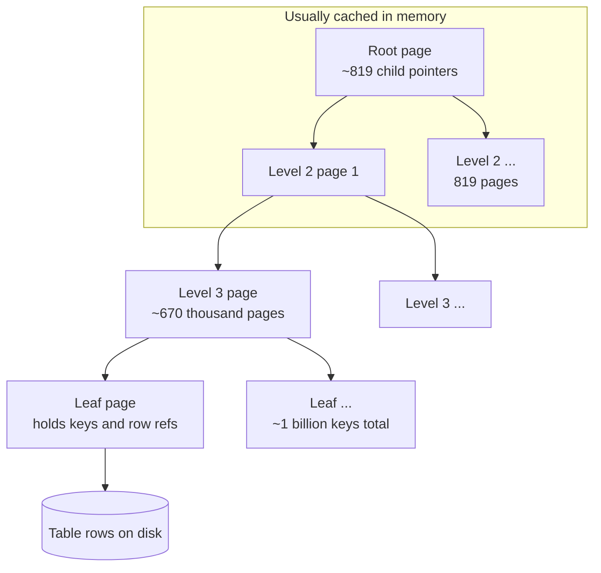
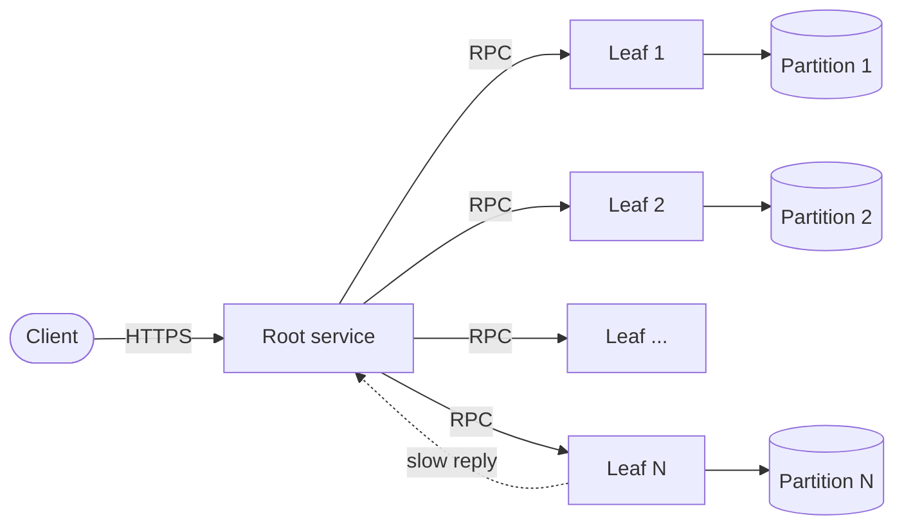
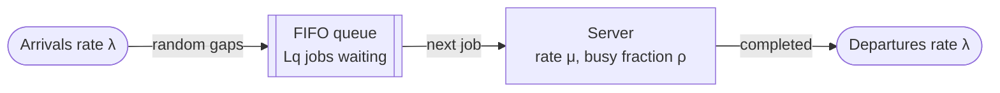
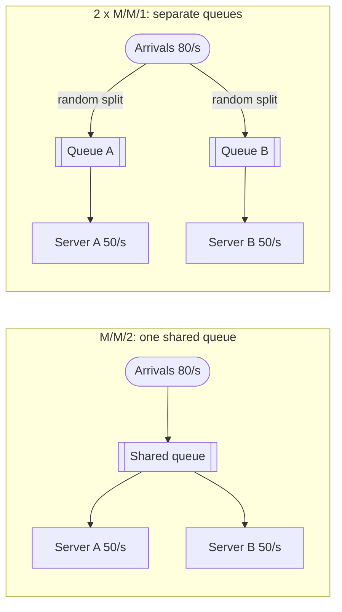
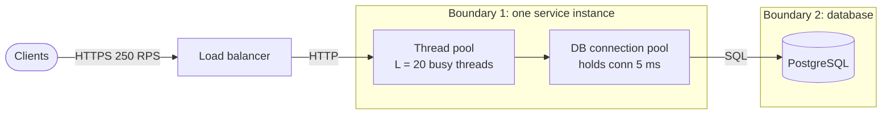
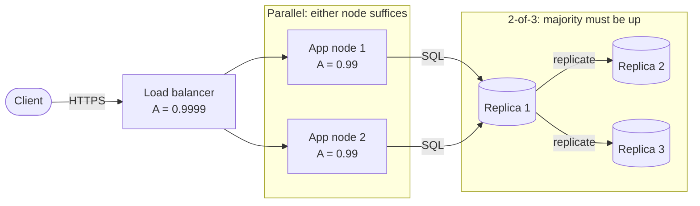
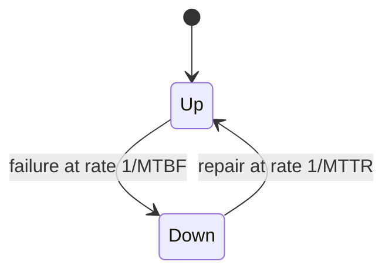
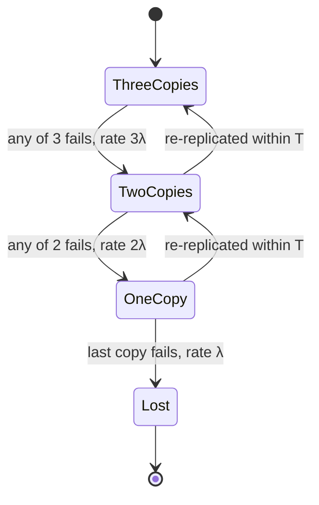
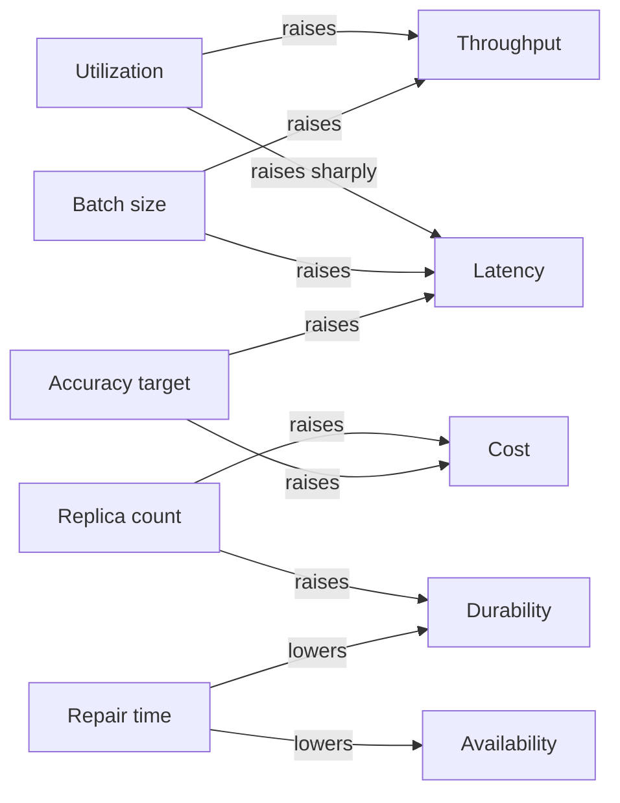

# Chapter 4 — Quantitative Foundations for System Design

> **Level:** 1–3 · **Track:** Shared · **Estimated reading time:** 6 h

System design is often presented as a drawing exercise: boxes, arrows, a cache here, a queue there. The drawing is the easy part. What separates a design that works from one that merely looks plausible is *arithmetic*. How many machines? How much memory? What happens to latency when traffic doubles? How many nines does the whole system get when every component has three? How likely is it that all three replicas of a file die before you notice the first one is gone?

This chapter gives you the mathematical toolkit to answer those questions, assuming only high-school algebra. Each formula comes with an analogy, its units, a fully worked example and its engineering implication. Short Python programs check formulas against simulation — a habit worth keeping: never trust a formula you have not seen agree with reality at least once.

The tools are grouped into four clusters:

- **Number sense** (§4.3–§4.5): exponents, logarithms and units, the arithmetic of "how big" and "how fast".
- **Uncertainty** (§4.6–§4.9): probability, statistics, percentiles and the small amount of linear algebra you need before the ML chapters.
- **Performance laws** (§4.10–§4.13): queueing theory, Little's Law, Amdahl's and Gustafson's laws and the Universal Scalability Law.
- **Dependability** (§4.14–§4.16): availability, reliability and durability arithmetic.

The chapter closes with the latency numbers that anchor estimation (§4.17) and with the six quantitative relationships that recur throughout the rest of the book (§4.18).

## 4.1 Learning objectives

After this chapter you should be able to:

- Convert fluently between powers of two and powers of ten, and between bits, bytes, SI prefixes and binary prefixes, stating which convention you use.
- Use logarithms to explain why binary search and B-trees need so few steps, and compute the height of a B-tree for a given fan-out and data size.
- Calculate the probability that at least one of $N$ components fails, the expected number of failures, and the binomial probability of exactly $k$ failures.
- Compute mean, median, variance, standard deviation and percentiles from a sample, and explain why the mean is misleading for heavy-tailed latency distributions.
- Quantify tail-latency amplification under fan-out using $P(\text{all fast}) = p^N$.
- Compute a dot product, a cosine similarity and the floating-point cost of a matrix multiplication.
- Apply the M/M/1 formulas to predict how latency grows with utilization, and explain why a shared queue beats separate queues.
- Size thread pools and database connection pools with Little's Law.
- Predict the limits of parallel speedup with Amdahl's Law, Gustafson's Law and the Universal Scalability Law.
- Compute the availability of components in series, in parallel and in $k$-of-$n$ configurations, and convert availability targets to downtime budgets.
- Relate MTBF, MTTR, failure rate and availability, and estimate the annual probability of data loss for a replicated store.
- Use dated latency reference numbers to sanity-check designs, and reason quantitatively about six recurring trade-offs.

## 4.2 Prerequisites

- High-school algebra: fractions, exponents, solving a linear equation — every formula in the chapter is built from these.
- The vocabulary of latency, throughput and availability from §1.7 (Non-functional requirements) — this chapter makes those words measurable.
- Orders-of-magnitude reasoning from §2.10 (Reasoning about scale) — helpful but not required; this chapter supplies the underlying mathematics.
- A Python 3 interpreter (3.10 or later) if you want to run the code examples. All examples use only the standard library.

## 4.3 Exponents, powers of two and powers of ten

### 4.3.1 What an exponent is

::: definition
**Definition — Exponent.** In $b^n$, the **base** $b$ is multiplied by itself $n$ times; $n$ is the **exponent** (or power). By convention $b^0 = 1$ and $b^{-n} = 1/b^n$.
:::

#### First-principles explanation

Imagine folding a sheet of paper in half repeatedly. After one fold it is 2 layers thick, after two folds 4 layers, after three folds 8. Each fold *doubles* the count, so after $n$ folds there are $2^n$ layers. After 10 folds you have 1,024 layers; after 20 folds, about a million. Exponential growth is the arithmetic of repeated multiplication, and computers are full of it, because every extra bit in an address or identifier doubles the number of values it can represent.

Three rules do almost all the work in estimation:

::: formula
**Laws of exponents**

$$b^m \times b^n = b^{m+n} \qquad \frac{b^m}{b^n} = b^{m-n} \qquad (b^m)^n = b^{mn}$$

| Symbol | Meaning | Units |
|---|---|---|
| $b$ | Base (2 for binary quantities, 10 for decimal) | dimensionless |
| $m, n$ | Exponents | dimensionless |
:::

::: example
**Worked example — Multiplying large numbers by adding exponents.** A service handles $2 \times 10^4$ requests per second (RPS). How many requests is that per day?

1. Seconds per day: $86{,}400 \approx 8.64 \times 10^4$.
2. Multiply the mantissas: $2 \times 8.64 = 17.28$.
3. Add the exponents: $10^4 \times 10^4 = 10^{8}$.
4. Result: $17.28 \times 10^8 = 1.728 \times 10^9$ requests per day.

**Interpretation.** About 1.7 billion requests per day. **Engineering implication.** If each request writes a 1 KB log line, that is $1.7 \times 10^9 \times 10^3 = 1.7 \times 10^{12}$ bytes, roughly 1.7 TB of logs per day — a number that immediately tells you logs need their own retention and sampling plan.
:::

### 4.3.2 Powers of two

Memory addresses, identifiers, hash spaces and page sizes are all powers of two because hardware is built from binary switches. The key coincidence that makes mental arithmetic possible is

$$2^{10} = 1{,}024 \approx 10^3.$$

Every additional factor of $2^{10}$ is therefore "about another factor of a thousand".

**Table 4.1 — Powers of two that every engineer should recognize.**

| Power | Exact value | Approximately | Binary prefix | Typical meaning |
|---|---|---|---|---|
| $2^{10}$ | 1,024 | one thousand ($10^3$) | kibi (Ki) | 1 KiB of memory |
| $2^{16}$ | 65,536 | 65 thousand | — | Number of TCP/UDP port numbers; max of a 16-bit unsigned integer + 1 |
| $2^{20}$ | 1,048,576 | one million ($10^6$) | mebi (Mi) | 1 MiB |
| $2^{30}$ | 1,073,741,824 | one billion ($10^9$) | gibi (Gi) | 1 GiB |
| $2^{32}$ | 4,294,967,296 | 4.3 billion | — | IPv4 address space; 32-bit ID space |
| $2^{40}$ | 1,099,511,627,776 | one trillion ($10^{12}$) | tebi (Ti) | 1 TiB |
| $2^{50}$ | 1,125,899,906,842,624 | one quadrillion ($10^{15}$) | pebi (Pi) | 1 PiB |
| $2^{60}$ | 1,152,921,504,606,846,976 | one quintillion ($10^{18}$) | exbi (Ei) | 1 EiB |
| $2^{64}$ | 18,446,744,073,709,551,616 | $1.8 \times 10^{19}$ | — | 64-bit ID or hash space |

Notice that the approximation drifts: $2^{10}$ is 2.4% larger than $10^3$, but $2^{40}$ is 10% larger than $10^{12}$ and $2^{60}$ is 15% larger than $10^{18}$. For estimation this is fine; for billing or capacity contracts it is not (see §4.5.2).

::: example
**Worked example — How long until a 32-bit ID runs out?** A table uses a 32-bit unsigned integer as its auto-increment primary key and receives 10,000 inserts per second.

1. ID space: $2^{32} = 4{,}294{,}967{,}296$ values.
2. Seconds to exhaust: $4{,}294{,}967{,}296 / 10{,}000 = 429{,}497$ s.
3. Convert to days: $429{,}497 / 86{,}400 \approx 4.97$ days.

**Interpretation.** Under five days. Even at 100 inserts per second the space lasts only about 497 days. **Engineering implication.** Use 64-bit identifiers for any table that grows without bound; at 10,000 inserts per second a 64-bit space lasts $1.8 \times 10^{19} / 10^4 \approx 1.8 \times 10^{15}$ s, roughly 58 million years. Unique ID generation is covered in §17.10.
:::

### 4.3.3 Powers of ten and scientific notation

**Scientific notation** writes a number as a mantissa between 1 and 10 times a power of ten: 86,400 becomes $8.64 \times 10^4$. In estimation you usually round the mantissa to one significant figure and keep only the exponent honest. Being off by a factor of 2 rarely changes a design decision; being off by a factor of 1,000 always does. The **order of magnitude** of a number is its power of ten, and most back-of-the-envelope reasoning (§2.11, Chapter 89) is order-of-magnitude reasoning.

## 4.4 Logarithms

### 4.4.1 What a logarithm is

::: definition
**Definition — Logarithm.** The logarithm base $b$ of $x$, written $\log_b x$, is the exponent to which $b$ must be raised to give $x$: if $b^y = x$ then $y = \log_b x$.
:::

#### First-principles explanation

A logarithm answers the question "how many times do I have to multiply (or divide) to get there?". Go back to the folded paper: if you want 1,024 layers, how many folds? $\log_2 1024 = 10$. Turn it around: if you have a phone book of 1,024 pages and open it in the middle, then in the middle of the correct half, and so on, how many openings until you reach one page? Also 10. A logarithm counts *halvings*. That is the reason logarithms appear wherever a data structure repeatedly cuts the search space: binary search, balanced trees, B-trees, skip lists, consistent-hash rings with binary-searched tokens.

#### Why does this exist?

Data sets grow multiplicatively (thousands, millions, billions), and the cost of searching them should not. Logarithms convert the multiplicative growth of $n$ into the additive growth of the step count: multiplying $n$ by 1,000 adds only about 10 steps to a binary search.

### 4.4.2 Rules and change of base

::: formula
**Logarithm rules and change of base**

$$\log_b(xy) = \log_b x + \log_b y \qquad \log_b(x^k) = k \log_b x \qquad \log_b x = \frac{\ln x}{\ln b} = \frac{\log_{10} x}{\log_{10} b}$$

| Symbol | Meaning | Units |
|---|---|---|
| $b$ | Base of the logarithm ($b > 0$, $b \neq 1$) | dimensionless |
| $x, y$ | Positive numbers | dimensionless |
| $k$ | Any real exponent | dimensionless |
| $\ln$ | Natural logarithm, base $e \approx 2.71828$ | — |
:::

The change-of-base rule means you only need one logarithm on your calculator. Two handy constants: $\log_2 10 \approx 3.32$ and $\log_{10} 2 \approx 0.301$.

::: example
**Worked example — Binary search over one billion keys.** How many comparisons does binary search need to find a key among $n = 10^9$ sorted keys?

1. We need $\log_2(10^9)$.
2. Change of base: $\log_2(10^9) = 9 \times \log_2 10 = 9 \times 3.32 = 29.9$.
3. Round up: 30 comparisons.

**Interpretation.** Thirty comparisons to search a billion items; a linear scan needs on average 500 million. **Engineering implication.** Each comparison in RAM costs on the order of 100 ns if it misses the CPU cache (§4.17), so 30 comparisons take roughly 3 µs. A sorted array or balanced tree in memory is fast enough for almost any lookup workload; the problem only becomes hard when each step requires a disk read, which is exactly the problem B-trees solve.
:::

### 4.4.3 B-tree fan-out: why databases need only three or four disk reads

A binary tree halves the search space at each node, so a billion keys need about 30 levels. If each level is a random disk read, 30 reads is far too slow. A **B-tree** (detailed in §11.8 and §13.6) instead stores hundreds of keys per node, sized to fill one disk page, so each node splits the search space into hundreds of ranges [Bayer and McCreight 1972]. The number of children per node is the **fan-out** $f$.

::: formula
**Height of a B-tree**

$$h = \left\lceil \log_f n \right\rceil = \left\lceil \frac{\log n}{\log f} \right\rceil$$

| Symbol | Meaning | Units |
|---|---|---|
| $h$ | Number of levels from root to leaf (page reads per lookup if nothing is cached) | levels |
| $n$ | Number of keys indexed | keys |
| $f$ | Fan-out: child pointers per internal node | children/node |
| $\lceil \cdot \rceil$ | Ceiling: round up to the next integer | — |
:::

The derivation is the same counting argument as the paper folds: one root reaches $f$ children, which reach $f^2$ grandchildren, so $h$ levels reach $f^h$ leaves. We need $f^h \geq n$, so $h \geq \log_f n$.

::: example
**Worked example — Fan-out of a 16 KiB page.** A database uses 16 KiB pages (16,384 bytes). Each index entry in an internal node is an 8-byte key plus an 8-byte child pointer = 16 bytes. Assume 20% of each page goes to headers and free space. How tall is the index on $10^9$ keys?

1. Usable bytes per page: $16{,}384 \times 0.8 = 13{,}107$ bytes.
2. Fan-out: $f = 13{,}107 / 16 \approx 819$ children per node.
3. Height: $\log_{819}(10^9) = \dfrac{\log_{10} 10^9}{\log_{10} 819} = \dfrac{9}{2.913} = 3.09$.
4. Round up: $h = 4$ levels.
5. Compare: with $f = 1{,}000$ the height would be exactly $9/3 = 3$; a binary tree needs 30.

**Interpretation.** Four page reads locate any one of a billion keys. **Engineering implication.** The top two levels contain only $1 + 819 = 820$ pages, about 13 MiB, which fits easily in the buffer pool (§13.4). In practice a point lookup therefore costs one or two real I/Os, around 0.1–0.2 ms on an NVMe SSD (§4.17). Larger keys shrink fan-out: a 100-byte string key gives $f \approx 13{,}107/108 \approx 121$ and $h = \lceil 9/2.083 \rceil = 5$. Short keys are an index-design decision with measurable latency consequences.
:::

**Figure 4.1 — B-tree fan-out turns a billion keys into four levels.**



**Reading the diagram.** Each rectangle is one fixed-size page. A lookup flows top-down synchronously: read the root, binary-search its keys in memory, follow one child pointer, repeat. The number of pages per level multiplies by the fan-out (1 → 819 → about 670,000 → leaves), so the count of *levels* grows only logarithmically. The `Cached` subgraph marks the storage boundary that matters: pages above it are in RAM and cost nanoseconds to microseconds, pages below it may require a disk read. The failure point is a cold cache after a restart, when every level costs an I/O. Scaling the data by another factor of 819 adds only one level.

::: mistake
**Mistake — "Logarithmic means constant, so the base doesn't matter."** Thirty dependent SSD reads at ~100 µs is 3 ms; four is 0.4 ms. The fan-out changes the constant by an order of magnitude.
:::

## 4.5 Units: bits, bytes, rates and prefixes

### 4.5.1 Bits versus bytes

::: definition
**Definition — Bit and byte.** A **bit** (symbol b) is a single binary digit, 0 or 1. A **byte** (symbol B) is 8 bits. Storage and memory are conventionally measured in bytes; network link speeds are conventionally measured in bits per second (bps).
:::

The lowercase/uppercase distinction is load-bearing: 1 Gbps (gigabit per second) is one-eighth of 1 GB/s (gigabyte per second). Mixing them up produces an error of exactly 8×, which is large enough to invalidate a design and small enough to escape notice.

::: formula
**Converting link speed to byte throughput**

$$R_{\text{B/s}} = \frac{R_{\text{bps}}}{8} \qquad t_{\text{transfer}} = \frac{8 \times S}{R_{\text{bps}}}$$

| Symbol | Meaning | Units |
|---|---|---|
| $R_{\text{bps}}$ | Link rate | bits/second |
| $R_{\text{B/s}}$ | The same rate expressed in bytes | bytes/second |
| $S$ | Amount of data to transfer | bytes |
| $t_{\text{transfer}}$ | Ideal transfer time, ignoring protocol overhead and congestion | seconds |
:::

::: example
**Worked example — Copying 1 TB across a 1 Gbps link.**

1. Convert data to bits: $1\ \text{TB} = 10^{12}$ bytes $= 8 \times 10^{12}$ bits.
2. Divide by the rate: $8 \times 10^{12} / 10^9 = 8{,}000$ s.
3. Convert to hours: $8{,}000 / 3{,}600 \approx 2.2$ h.
4. At 10 Gbps: $800$ s $\approx 13$ min.

**Interpretation.** Even a "fast" link takes hours to move a terabyte; real transfers are slower because TCP/IP headers, TLS and congestion reduce goodput, commonly by 5–10% or more. **Engineering implication.** Rebuilding a failed 20 TB storage node over a single 10 Gbps link takes at least $8 \times 2 \times 10^{13}/10^{10} = 16{,}000$ s, about 4.4 hours. That repair window feeds directly into the durability calculations of §4.16, and it is why distributed stores spread re-replication across many source nodes in parallel.
:::

### 4.5.2 SI versus binary prefixes

Two systems of prefixes coexist. The **SI (decimal) prefixes** k, M, G, T, P, E mean $10^3, 10^6, 10^9, \ldots$ exactly. The **binary prefixes** Ki, Mi, Gi, Ti, Pi, Ei, standardized by the IEC (now in IEC 80000-13) [IEC 80000-13], mean $2^{10}, 2^{20}, 2^{30}, \ldots$ exactly. Operating systems, memory vendors and disk vendors have historically used "GB" for both, which causes the classic "missing" capacity on a new drive.

**Table 4.2 — SI versus binary prefixes.**

| SI name | SI value | Binary name | Binary value | Binary/SI ratio |
|---|---|---|---|---|
| kilobyte (KB or kB) | $10^3$ | kibibyte (KiB) | $2^{10}$ | 1.024 |
| megabyte (MB) | $10^6$ | mebibyte (MiB) | $2^{20}$ | 1.049 |
| gigabyte (GB) | $10^9$ | gibibyte (GiB) | $2^{30}$ | 1.074 |
| terabyte (TB) | $10^{12}$ | tebibyte (TiB) | $2^{40}$ | 1.100 |
| petabyte (PB) | $10^{15}$ | pebibyte (PiB) | $2^{50}$ | 1.126 |
| exabyte (EB) | $10^{18}$ | exbibyte (EiB) | $2^{60}$ | 1.153 |

**Book convention.** Following `terminology.md`, this book uses KB/MB/GB/TB = $10^3$/$10^6$/$10^9$/$10^{12}$ bytes for estimation and KiB/MiB/GiB when power-of-two precision matters (page sizes, memory allocation). Network rates are always decimal: 1 Gbps $= 10^9$ bits/s.

::: example
**Worked example — The "missing" 7% on a new drive.** A drive sold as 1 TB is shown by an operating system as "931 GB".

1. The vendor means SI: $10^{12}$ bytes.
2. The operating system divides by $2^{30}$ but labels the result "GB": $10^{12} / 1{,}073{,}741{,}824 = 931.3$.
3. So the drive holds 931.3 GiB, and nothing is missing.

**Interpretation.** A 6.9% labeling discrepancy at the tera scale, growing to 12.6% at peta and 15.3% at exa. **Engineering implication.** In a capacity plan for 5 PB of data, confusing PB with PiB means under-provisioning by $5 \times 0.126 = 0.63$ PB. State your units in every capacity document.
:::

### 4.5.3 Rates and time conversions

Most capacity estimates start from a daily or monthly volume and must become a per-second rate, because servers are sized per second.

**Table 4.3 — Time conversions used in estimation.**

| Period | Seconds (exact) | Handy approximation |
|---|---|---|
| 1 minute | 60 | — |
| 1 hour | 3,600 | $3.6 \times 10^3$ |
| 1 day | 86,400 | $\approx 10^5$ (overestimates seconds by 16%) |
| 1 week | 604,800 | $\approx 6 \times 10^5$ |
| 1 month (30 days) | 2,592,000 | $\approx 2.6 \times 10^6$ |
| 1 year (365 days) | 31,536,000 | $\approx \pi \times 10^7$ |

::: formula
**Average and peak rate from a daily volume**

$$\bar{\lambda} = \frac{V_{\text{day}}}{86{,}400} \qquad \lambda_{\text{peak}} = k \times \bar{\lambda}$$

| Symbol | Meaning | Units |
|---|---|---|
| $V_{\text{day}}$ | Events (requests, writes, messages) per day | events/day |
| $\bar{\lambda}$ | Average rate | events/second |
| $k$ | Peak-to-average ratio, measured or assumed (often 2–10 for consumer traffic) | dimensionless |
| $\lambda_{\text{peak}}$ | Rate the system must be sized for | events/second |
:::

::: example
**Worked example — 100 million requests per day.**

1. Average: $10^8 / 86{,}400 = 1{,}157$ RPS.
2. Shortcut check: $10^8 / 10^5 = 1{,}000$ RPS (16% low, acceptable for a first pass).
3. Assume a peak-to-average ratio $k = 3$: $\lambda_{\text{peak}} \approx 3{,}500$ RPS.

**Interpretation.** "100 million a day" sounds enormous but is a few thousand requests per second at peak. **Engineering implication.** A few application servers can carry this request rate; the harder questions are usually storage growth and tail latency, not raw request rate. The peak factor $k$ is an assumption that must be stated and, once the system is live, measured.
:::

## 4.6 Probability essentials

### 4.6.1 Probability, complement and independence

::: definition
**Definition — Probability.** A number between 0 and 1 that measures how likely an event is: 0 means impossible, 1 means certain. If an experiment is repeated many times, the probability of event $A$, written $P(A)$, is the long-run fraction of repetitions in which $A$ happens.
:::

#### First-principles explanation

Think of a fleet as a bag of marbles: if 1 in 1,000 is red, a blind draw is red with probability 0.001. Probability in system design is about the *fleet*: a disk with a 2% annual failure probability is rare on its own and a daily event among 100,000 disks.

Two rules carry most of the weight. The **complement rule**: $P(\text{not } A) = 1 - P(A)$; computing "nothing goes wrong" is often far easier than enumerating what can. **Independence**: $A$ and $B$ are independent if knowing one happened tells you nothing about the other; then, and *only* then, $P(A \text{ and } B) = P(A) \times P(B)$. Disks in different datacenters fail nearly independently; disks sharing a power supply do not.

::: formula
**Probability that at least one of $N$ independent components fails**

$$P(\text{at least one fails}) = 1 - (1 - p)^N$$

| Symbol | Meaning | Units |
|---|---|---|
| $p$ | Probability that a single component fails during the period of interest | dimensionless (0–1) |
| $N$ | Number of independent components | count |
| $(1-p)^N$ | Probability that *none* fails (complement, multiplied $N$ times by independence) | dimensionless |
:::

**Derivation.** One component survives with probability $1 - p$. By independence, all $N$ survive with probability $(1-p)\times(1-p)\times\cdots = (1-p)^N$. "At least one fails" is the complement of "all survive". A useful approximation for small $p$: $(1-p)^N \approx e^{-Np}$, so $P(\text{at least one}) \approx 1 - e^{-Np}$, and when $Np \ll 1$ this is simply $\approx Np$.

::: example
**Worked example — At least one of 1,000 servers fails today.** Each server independently fails on a given day with probability $p = 0.001$ (one failure per thousand server-days). The fleet has $N = 1{,}000$ servers.

1. Probability one server survives the day: $1 - 0.001 = 0.999$.
2. Probability all survive: $0.999^{1000}$. Using the approximation: $e^{-1000 \times 0.001} = e^{-1} = 0.368$. (Exact: 0.3677.)
3. Probability at least one fails: $1 - 0.368 = 0.632$.

**Interpretation.** A component that almost never fails individually produces a failure on 63% of days at fleet scale. At $N = 10{,}000$ the probability is $1 - e^{-10} > 0.9999$: a failure *every* day. **Engineering implication.** At scale, failure is not an exception to handle but a steady background rate to design for. This is the quantitative core of "design for failure" (§2.9): automation must detect and replace failed nodes without human intervention, because humans cannot be paged every day for routine events.
:::

### 4.6.2 Union and intersection

::: formula
**Union (inclusion–exclusion) and intersection**

$$P(A \cup B) = P(A) + P(B) - P(A \cap B) \qquad P(A \cap B) = P(A) \times P(B \mid A)$$

| Symbol | Meaning | Units |
|---|---|---|
| $P(A \cup B)$ | Probability that $A$ or $B$ (or both) happens | dimensionless |
| $P(A \cap B)$ | Probability that both happen | dimensionless |
| $P(B \mid A)$ | Conditional probability of $B$ given that $A$ happened; equals $P(B)$ when independent | dimensionless |
:::

The subtraction in the union rule avoids counting "both" twice. The conditional form of the intersection rule is how correlation enters: if two replicas share a rack, $P(B \mid A)$ — the probability that the second fails *given* that the first did — can be many times larger than $P(B)$.

::: example
**Worked example — Two dependencies, independent versus correlated.** A request needs both a cache and a database. On a given day, the cache has an outage with probability 0.01 and the database with probability 0.02.

1. If independent: $P(\text{both}) = 0.01 \times 0.02 = 0.0002$.
2. $P(\text{either}) = 0.01 + 0.02 - 0.0002 = 0.0298$.
3. Now suppose they share a network switch, so that given a cache outage the database is also out with probability 0.5: $P(\text{both}) = 0.01 \times 0.5 = 0.005$ — 25 times the independent value.

**Interpretation.** The probability of "something breaks" barely changes, but the probability of "both break together" rises 25×. **Engineering implication.** Redundancy arithmetic (§4.14, §4.16) assumes independence. Every shared dependency — a rack, a power feed, a software version, a configuration push — breaks that assumption, which is why real systems spread replicas across failure domains.
:::

### 4.6.3 Expected value

::: definition
**Definition — Expected value.** The probability-weighted average outcome of a random quantity $X$: $E[X] = \sum_i x_i \, P(X = x_i)$. It is the long-run average over many repetitions.
:::

::: formula
**Expected value and linearity of expectation**

$$E[X] = \sum_i x_i\,P(X = x_i) \qquad E[X_1 + X_2 + \cdots + X_N] = E[X_1] + \cdots + E[X_N]$$

| Symbol | Meaning | Units |
|---|---|---|
| $X$ | A random quantity (failures, latency, cost) | units of the quantity |
| $x_i$ | A possible value of $X$ | units of the quantity |
| $P(X = x_i)$ | Probability of that value | dimensionless |
:::

Linearity is powerful because it holds *even when the components are not independent*. The expected number of failed servers is $N \times p$ whatever the correlation.

::: example
**Worked example — Expected cost of a retry policy.** A call fails with probability 0.05 and is retried once on failure. What is the expected number of calls per request?

1. Outcomes: 1 call with probability 0.95; 2 calls with probability 0.05.
2. $E[\text{calls}] = 1 \times 0.95 + 2 \times 0.05 = 0.95 + 0.10 = 1.05$.

**Interpretation.** Retries add 5% load in normal operation. But if a dependency is degraded so that 50% of calls fail, the same policy gives $1 \times 0.5 + 2 \times 0.5 = 1.5$ calls per request — a 50% load increase on the struggling dependency. **Engineering implication.** Retries amplify load precisely when the system is weakest. Retry budgets (§22.12) cap this expected amplification.
:::

### 4.6.4 The binomial distribution

When there are $N$ independent trials, each "failing" with probability $p$, the number of failures $K$ follows a **binomial distribution**.

::: formula
**Binomial probability of exactly $k$ failures**

$$P(K = k) = \binom{N}{k} p^k (1-p)^{N-k}, \qquad \binom{N}{k} = \frac{N!}{k!\,(N-k)!}, \qquad E[K] = Np$$

| Symbol | Meaning | Units |
|---|---|---|
| $N$ | Number of independent components (trials) | count |
| $k$ | Number of failures we ask about | count |
| $p$ | Per-component failure probability in the period | dimensionless |
| $\binom{N}{k}$ | Number of ways to choose which $k$ components fail ("$N$ choose $k$") | count |
| $E[K]$ | Expected number of failures | count |
:::

**Derivation.** One specific set of $k$ failures and $N-k$ survivals has probability $p^k(1-p)^{N-k}$ by independence. There are $\binom{N}{k}$ such sets, and they are mutually exclusive, so we add them.

::: example
**Worked example — How many spare servers are enough?** Continuing the fleet of $N = 1{,}000$ servers with daily failure probability $p = 0.001$:

1. Expected failures per day: $E[K] = 1000 \times 0.001 = 1$.
2. $P(K = 0) = 0.999^{1000} = 0.3677$.
3. $P(K = 1) = 1000 \times 0.001 \times 0.999^{999} = 0.3681$.
4. $P(K = 2) = \binom{1000}{2} \times 0.001^2 \times 0.999^{998} = 499{,}500 \times 10^{-6} \times 0.3685 = 0.1840$.
5. $P(K \geq 3) = 1 - 0.3677 - 0.3681 - 0.1840 = 0.0802$.

**Interpretation.** On about 8% of days — roughly 29 days per year — three or more servers fail. **Engineering implication.** Provisioning spare capacity for "the average day" (one failure) leaves you short on one day in twelve. Capacity headroom should be chosen against a percentile of the failure distribution, not its mean.
:::

## 4.7 Statistics: describing measurements

Probability reasons forward from a model to predictions. **Statistics** reasons backward from measurements (latency samples, failure logs) to a description of what is happening.

### 4.7.1 Mean and median

::: definition
**Definition — Mean and median.** The **mean** (arithmetic average) of $n$ values is their sum divided by $n$. The **median** is the middle value after sorting (the average of the two middle values when $n$ is even); half of the values are at or below it.
:::

#### First-principles explanation

If nine people in a café each earn 50,000 a year and a billionaire walks in, the mean income in the room jumps to over 100 million while the median does not move. The mean is sensitive to every value, including extreme ones; the median is sensitive only to rank. Latency data behave like the café: most requests are quick, a few are extremely slow, and the slow ones drag the mean.

::: formula
**Mean, variance and standard deviation**

$$\bar{x} = \frac{1}{n}\sum_{i=1}^{n} x_i \qquad \sigma^2 = \frac{1}{n}\sum_{i=1}^{n}(x_i - \bar{x})^2 \qquad \sigma = \sqrt{\sigma^2}$$

| Symbol | Meaning | Units |
|---|---|---|
| $x_i$ | The $i$-th measurement | e.g. ms |
| $n$ | Number of measurements | count |
| $\bar{x}$ | Mean | same as $x$ (ms) |
| $\sigma^2$ | Variance: average squared distance from the mean | ms² |
| $\sigma$ | Standard deviation: typical distance from the mean | ms |
:::

This is the *population* variance (divide by $n$). When estimating the variance of a larger population from a sample, statisticians divide by $n - 1$ instead (the *sample* variance); for the large samples typical of latency monitoring the difference is negligible.

::: example
**Worked example — Ten latency measurements with one outlier.** Measured latencies in ms: 12, 15, 11, 14, 13, 16, 12, 18, 14, 250.

1. Sum: $12+15+11+14+13+16+12+18+14+250 = 375$. Mean: $375/10 = 37.5$ ms.
2. Sorted: 11, 12, 12, 13, 14, 14, 15, 16, 18, 250. Median: average of 5th and 6th values $= (14 + 14)/2 = 14$ ms.
3. Squared deviations from 37.5: $(12-37.5)^2 = 650.25$; similarly 506.25, 702.25, 552.25, 600.25, 462.25, 650.25, 380.25, 552.25, and $(250-37.5)^2 = 45{,}156.25$. Sum $= 50{,}212.5$.
4. Variance: $50{,}212.5 / 10 = 5{,}021.25$ ms². Standard deviation: $\sqrt{5021.25} = 70.9$ ms.
5. Without the outlier: mean 13.9 ms, median 14 ms, standard deviation 2.1 ms.

**Interpretation.** One slow request in ten makes the mean 2.7 times the median and inflates the standard deviation 34-fold. The mean (37.5 ms) describes *no actual request*: nine were under 20 ms and one was 250 ms. **Engineering implication.** Report latency as percentiles (§4.8), not as mean ± standard deviation. Mean and standard deviation summarize a distribution well only when it is roughly symmetric and thin-tailed, which latency almost never is.
:::

### 4.7.2 Distributions: normal, exponential, log-normal and Pareto

A **probability distribution** describes how likely each value is. Four shapes cover most of what you will meet.

The **normal (Gaussian) distribution** is the symmetric bell curve. It arises when many small independent effects add up. About 68% of values lie within $1\sigma$ of the mean, 95% within $2\sigma$ and 99.7% within $3\sigma$. Extreme values are vanishingly rare: a $6\sigma$ event has probability around $10^{-9}$.

The **exponential distribution** describes the time between independent random events occurring at a constant average rate $\lambda$, such as request arrivals from many independent users, or failures of a component that does not age. Its mean is $1/\lambda$ and $P(T > t) = e^{-\lambda t}$. It is **memoryless**: having waited 5 seconds tells you nothing about how much longer you will wait. It underpins queueing theory (§4.10) and reliability theory (§4.15).

The **log-normal distribution** describes a quantity whose *logarithm* is normal — the result of many small *multiplicative* effects. Request latency often looks roughly log-normal: a long right tail, with the mean above the median. If $\ln X$ has mean $\mu$ and standard deviation $s$, then the median of $X$ is $e^{\mu}$ and the mean is $e^{\mu + s^2/2}$.

The **Pareto (power-law) distribution** has $P(X > x) = (x_m / x)^{\alpha}$ for $x \geq x_m$. Its tail decays polynomially, not exponentially, so extreme values are far more common than a normal model predicts. File sizes, object popularity, and per-user activity are frequently described as heavy-tailed (Harchol-Balter 2013 discusses heavy-tailed job sizes in depth). With $\alpha \approx 1.16$ you get the "80/20 rule": the top 20% of items account for 80% of the total. For $\alpha \leq 1$ the mean is infinite; for $\alpha \leq 2$ the variance is infinite, so sample averages never settle down.

::: formula
**Tail formulas for three skewed distributions**

$$\text{Exponential: } P(T > t) = e^{-\lambda t},\ E[T] = \frac{1}{\lambda} \qquad \text{Log-normal: median} = e^{\mu},\ \text{mean} = e^{\mu + s^2/2} \qquad \text{Pareto: } P(X > x) = \left(\frac{x_m}{x}\right)^{\alpha}$$

| Symbol | Meaning | Units |
|---|---|---|
| $\lambda$ | Event rate of the exponential distribution | events/second |
| $t$ | Elapsed time | seconds |
| $\mu, s$ | Mean and standard deviation of $\ln X$ for a log-normal $X$ | ln of the unit of $X$ |
| $x_m$ | Pareto minimum (scale) value | unit of $X$ (e.g. bytes) |
| $\alpha$ | Pareto tail index: smaller means heavier tail | dimensionless |
:::

**Table 4.4 — Four distributions and where they appear in systems.**

| Distribution | Shape | Tail | Typical system quantity | Mean vs median |
|---|---|---|---|---|
| Normal | Symmetric bell | Very thin ($e^{-x^2}$) | Aggregates of many small effects; measurement noise | Equal |
| Exponential | Decaying from zero | Thin ($e^{-x}$) | Inter-arrival times; failures of non-aging parts | Mean ≈ 1.44 × median |
| Log-normal | Right-skewed | Moderately heavy | Request latency, service times | Mean > median |
| Pareto | Right-skewed, power law | Heavy (polynomial) | File sizes, key popularity, user activity | Mean ≫ median (may be infinite) |

::: example
**Worked example — Mean versus median for a log-normal latency.** Suppose $\ln(\text{latency in ms})$ has mean $\mu = \ln 20 = 2.996$ and standard deviation $s = 1.0$.

1. Median: $e^{\mu} = 20$ ms.
2. Mean: $e^{\mu + s^2/2} = e^{2.996 + 0.5} = 20 \times e^{0.5} = 20 \times 1.649 = 33.0$ ms.
3. The 99th percentile of a normal variable is $\mu + 2.326\,s$, so p99 $= e^{2.996 + 2.326} = 20 \times e^{2.326} = 20 \times 10.24 = 205$ ms.

**Interpretation.** The p99 is about 10 times the median, and the mean sits 65% above the median. **Engineering implication.** If you set a timeout at the mean (33 ms) you will time out nearly one request in three: $\ln 33 - \ln 20 = 0.50$, which is $0.5\,s$ above $\mu$, and a normal variable exceeds $\mu + 0.5\,s$ with probability 0.31. The Python example in §4.8.2 samples this exact distribution and confirms these values empirically.
:::

### 4.7.3 Why averages lie

Averages mislead in four recurring ways: **skew** (the mean is pulled toward the tail, as above); **time aggregation** (a day-long average of 50 ms can hide a 10-minute window at 2 s); **averaging percentiles** (a fleet p99 is not the mean of per-host p99s — merge histograms instead, §4.8.3); and **averaging over users** (if 1% of users send 50% of requests, per-request and per-user averages can tell opposite stories).

::: mistake
**Mistake — "Average latency is 40 ms, so we meet our 100 ms SLO."** An SLO is about the fraction of requests that are fast enough. A mean of 40 ms is compatible with 10% of requests taking over a second. SLOs are written in percentiles (§39.6) for exactly this reason.
:::

## 4.8 Percentiles and tail latency

### 4.8.1 Definition

::: definition
**Definition — Percentile.** The $q$-th percentile of a set of measurements is the value at or below which $q$% of the measurements fall. Latency percentiles are written **p50** (the median), **p95**, **p99** and **p99.9** (also written p999): the 50th, 95th, 99th and 99.9th percentiles.
:::

#### First-principles explanation

Line up 1,000 runners by finishing time: the p50 is the 500th runner's time, the p99 the 990th's, the p99.9 the 999th's. Percentiles describe what a *fraction of requests* experiences — if your p99 is 2 s, one request in a hundred is painfully slow, and a page making 50 requests will often hit one (§4.8.4).

The region above roughly p99 is called the **tail**, and **tail latency** is the study of why those requests are slow and how to make them faster. Causes include garbage-collection pauses, queueing behind a large request, background compaction, cache misses, retransmitted packets and noisy neighbors [Dean and Barroso 2013].

### 4.8.2 Computing percentiles from samples

The simplest definition is the **nearest-rank method**.

::: formula
**Nearest-rank percentile**

$$r = \left\lceil \frac{q}{100} \times n \right\rceil, \qquad \text{p}q = x_{(r)}$$

| Symbol | Meaning | Units |
|---|---|---|
| $q$ | Desired percentile, $0 < q \leq 100$ | percent |
| $n$ | Number of samples | count |
| $r$ | 1-based rank in the sorted list | position |
| $x_{(r)}$ | The $r$-th smallest sample | e.g. ms |
:::

Other definitions interpolate between neighboring samples (NumPy's default does); they differ noticeably only when $n$ is small. With 10 samples, a "p99" is just the maximum, which is why a p99 needs at least several hundred samples and a p99.9 several thousand to mean anything.

::: example
**Worked example — Percentiles of the ten measurements from §4.7.1.** Sorted: 11, 12, 12, 13, 14, 14, 15, 16, 18, 250.

1. p50: $r = \lceil 0.50 \times 10 \rceil = 5$ → 14 ms.
2. p90: $r = \lceil 0.90 \times 10 \rceil = 9$ → 18 ms.
3. p95: $r = \lceil 0.95 \times 10 \rceil = \lceil 9.5 \rceil = 10$ → 250 ms.

**Interpretation.** p90 and p95 differ by a factor of 14 because with ten samples they land on different single observations. **Engineering implication.** Always report the sample count alongside a high percentile, and alert on percentiles computed over windows large enough to contain hundreds of tail samples.
:::

The following program samples the log-normal distribution of §4.7.2, computes percentiles, and then checks the fan-out formula of §4.8.4 by simulation.

```python
import math
import random
import statistics

def percentile_nearest_rank(samples, p):
    """Return the p-th percentile (0 < p <= 100) using the nearest-rank method."""
    if not samples:
        raise ValueError("no samples")
    ordered = sorted(samples)
    rank = math.ceil(p / 100 * len(ordered))   # 1-based rank
    return ordered[max(rank, 1) - 1]

random.seed(42)
# Log-normal latencies: median ~20 ms, heavy right tail (sigma = 1.0)
latencies_ms = [random.lognormvariate(math.log(20), 1.0) for _ in range(100_000)]

print(f"mean   = {statistics.fmean(latencies_ms):7.1f} ms")
for p in (50, 90, 99, 99.9):
    print(f"p{p:<5} = {percentile_nearest_rank(latencies_ms, p):7.1f} ms")

# Fan-out: a request waits for the slowest of N parallel calls
p99 = percentile_nearest_rank(latencies_ms, 99)
for n in (1, 10, 100):
    trials = 20_000
    slow = sum(
        max(random.choice(latencies_ms) for _ in range(n)) > p99
        for _ in range(trials)
    )
    print(f"N={n:>3}: simulated P(slow) = {slow/trials:.3f}, "
          f"formula 1 - 0.99^N = {1 - 0.99**n:.3f}")
```

Output (Python 3.13):

```text
mean   =    32.9 ms
p50    =    20.0 ms
p90    =    72.2 ms
p99    =   201.3 ms
p99.9  =   428.4 ms
N=  1: simulated P(slow) = 0.010, formula 1 - 0.99^N = 0.010
N= 10: simulated P(slow) = 0.093, formula 1 - 0.99^N = 0.096
N=100: simulated P(slow) = 0.637, formula 1 - 0.99^N = 0.634
```

What to notice:

- The simulated mean (32.9 ms), median (20.0 ms) and p99 (201 ms) match the closed-form values of §4.7.2 (33.0, 20 and 205 ms) within sampling error.
- `max(...)` models a request that must wait for *all* of its parallel sub-requests; the simulated probability of exceeding the single-server p99 matches $1 - 0.99^N$.
- Sorting 100,000 samples is fine offline, but production systems cannot keep every sample; they use histograms.

### 4.8.3 Histograms

A **histogram** counts how many samples fall into each of a fixed set of buckets. It uses constant memory regardless of request volume, and two histograms with identical buckets can be merged by adding counts, which makes fleet-wide percentiles possible. Percentiles are read from the cumulative counts, with an error no larger than the bucket width. Libraries such as HdrHistogram use buckets whose width grows with the value (logarithmic or log-linear buckets) so that *relative* error stays bounded across many orders of magnitude [Tene, HdrHistogram].

::: example
**Worked example — p99 and p99.9 from a histogram.** 10,000 requests are counted into buckets (ms): [0,10): 6,000; [10,20): 2,500; [20,50): 1,000; [50,100): 350; [100,200): 120; [200,500): 25; [500,1000): 5.

1. Cumulative counts: 6,000; 8,500; 9,500; 9,850; 9,970; 9,995; 10,000.
2. p99 is rank $0.99 \times 10{,}000 = 9{,}900$. The cumulative count first reaches 9,900 in the [100,200) bucket (9,850 → 9,970).
3. Interpolate linearly inside the bucket: $(9{,}900 - 9{,}850)/120 = 0.417$ of the way through, so p99 $\approx 100 + 0.417 \times 100 = 142$ ms.
4. p99.9 is rank 9,990, inside [200,500) (9,970 → 9,995): $(9{,}990 - 9{,}970)/25 = 0.8$, so p99.9 $\approx 200 + 0.8 \times 300 = 440$ ms.

**Interpretation.** The true p99 is somewhere in [100, 200) ms; interpolation assumes samples are spread evenly inside the bucket. **Engineering implication.** Bucket boundaries should be densest where your SLO thresholds lie. If the SLO is "p99 < 150 ms", a bucket edge exactly at 150 ms lets you count SLO violations exactly rather than estimate them.
:::

### 4.8.4 Fan-out amplification

Modern requests are rarely served by one machine. A search query may be scattered to hundreds of index partitions (§16.7); a page render may call dozens of microservices. If a request must wait for *all* of its $N$ sub-requests, then it is slow whenever *any* of them is slow.

**Figure 4.2 — Fan-out: the slowest leaf determines the response time.**



**Reading the diagram.** The client sends one HTTPS request to a root service, which issues $N$ parallel RPCs to leaf services, each owning one data partition (the cylinders mark storage boundaries). All arrows are synchronous request/response except the dotted arrow, which highlights the one leaf whose reply arrives late. The root cannot answer until every leaf replies (or a deadline fires), so the response time is the *maximum* of $N$ leaf latencies. Every leaf is a failure point for the whole request. Scaling out by adding partitions increases $N$ and therefore makes the tail *worse* unless tail-tolerant techniques are used.

::: formula
**Probability that a fan-out request is fast**

$$P(\text{all } N \text{ fast}) = p^N \qquad P(\text{at least one slow}) = 1 - p^N \qquad p_{\text{required}} = P_{\text{target}}^{1/N}$$

| Symbol | Meaning | Units |
|---|---|---|
| $p$ | Probability that one leaf responds within the threshold (e.g. 0.99 at the leaf's p99) | dimensionless |
| $N$ | Number of parallel sub-requests the root must wait for | count |
| $P_{\text{target}}$ | Desired probability that the whole request is fast | dimensionless |
| $p_{\text{required}}$ | Per-leaf probability needed to meet $P_{\text{target}}$ | dimensionless |
:::

This is the complement rule of §4.6.1 again, assuming leaf latencies are independent.

::: example
**Worked example — 100-way fan-out.** Each leaf answers within 10 ms with probability 0.99 (its p99 is 10 ms). The root fans out to $N = 100$ leaves.

1. $P(\text{all fast}) = 0.99^{100} = 0.366$.
2. $P(\text{at least one slow}) = 1 - 0.366 = 0.634$.
3. For 99% of root requests to be fast we need $p = 0.99^{1/100} = 0.99990$: every leaf must meet the 10 ms threshold at its p99.99.
4. With $N = 10$: $0.99^{10} = 0.904$, so 9.6% of requests are slow.

**Interpretation.** A leaf p99 becomes the root's p37 or so: 63% of user requests see at least one slow leaf. This is the example Dean and Barroso use to open *The Tail at Scale*: with a one-in-a-hundred chance of a slow leaf, 63% of 100-way fan-out requests are slow [Dean and Barroso 2013]. **Engineering implication.** In fan-out architectures you must engineer the leaf p99.9 or p99.99, not the leaf p99, or use tail-tolerant techniques that break the $p^N$ law.
:::

#### Real-world industry applications

::: industry
**Google — tail-tolerant techniques.** Dean and Barroso describe how large fan-out services at Google tolerate latency variability instead of trying to eliminate it. **Hedged requests** send a second copy of a request to another replica if the first has not answered within, for example, the 95th-percentile expected latency, and use whichever reply arrives first; **tied requests** enqueue the request on two servers and let the first to start cancel the other. They report a benchmark reading 1,000 keys from 100 BigTable servers in which hedging after 10 ms cut the p99.9 latency from 1,800 ms to 74 ms while sending only about 2% more requests. Trade-off: hedging spends a little extra load to cut the tail, and must be disabled or rate-limited under overload so it does not amplify it. Chapter 23 (§23.6–§23.7) covers implementation.
*Evidence: Primary* — [Dean and Barroso 2013]
:::

Two further traps are covered in Chapter 23: computing a fleet p99 by averaging per-host p99s (merge histograms instead, §4.8.3), and **coordinated omission**, where a load generator that waits for slow replies stops sending during slow periods and so under-samples the tail (§23.5).

::: mistake
**Mistake — "Our p99 is fine, so only 1% of users suffer."** If a user session issues 100 requests, the probability that the session contains at least one request slower than p99 is $1 - 0.99^{100} = 63\%$. Percentiles are per request; user experience is per session.
:::

## 4.9 Basic linear algebra

This section is a preparation for the ML chapters (Part XI onward), where embeddings, similarity search and matrix multiplication dominate cost. You need only three ideas: vectors, the dot product and matrix multiplication.

### 4.9.1 Vectors

::: definition
**Definition — Vector.** An ordered list of $d$ numbers, $\mathbf{a} = (a_1, a_2, \ldots, a_d)$, where $d$ is the **dimension**. Geometrically, a vector is an arrow from the origin to a point in $d$-dimensional space; its **length** (or norm) is $\lVert \mathbf{a} \rVert = \sqrt{a_1^2 + \cdots + a_d^2}$.
:::

#### First-principles explanation

A map location is a 2-dimensional vector (latitude, longitude); a song might be a 3-dimensional vector (tempo, loudness, acousticness). An ML **embedding** is the same idea with hundreds or thousands of learned dimensions, arranged so that similar items point in similar directions. "Find similar items" becomes "find nearby arrows" (Chapter 74).

### 4.9.2 Dot product and cosine similarity

::: formula
**Dot product and cosine similarity**

$$\mathbf{a} \cdot \mathbf{b} = \sum_{i=1}^{d} a_i b_i \qquad \cos\theta = \frac{\mathbf{a} \cdot \mathbf{b}}{\lVert \mathbf{a} \rVert\,\lVert \mathbf{b} \rVert}$$

| Symbol | Meaning | Units |
|---|---|---|
| $\mathbf{a}, \mathbf{b}$ | Two vectors of the same dimension | (embedding units; dimensionless) |
| $d$ | Dimension | count |
| $a_i, b_i$ | $i$-th components | dimensionless |
| $\lVert \mathbf{a} \rVert$ | Length of $\mathbf{a}$ | dimensionless |
| $\theta$ | Angle between the vectors | radians or degrees |
| $\cos\theta$ | Cosine similarity: 1 = same direction, 0 = unrelated (perpendicular), −1 = opposite | dimensionless |
:::

The dot product multiplies matching components and adds the results. Dividing by both lengths removes the effect of magnitude, so cosine similarity measures *direction only*. If vectors are normalized to length 1 in advance (common for embeddings), cosine similarity *is* the dot product, which is cheaper to compute.

::: example
**Worked example — Which document is closest to the query?** Query $\mathbf{q} = (1, 2, 2)$; document $\mathbf{a} = (2, 1, 2)$; document $\mathbf{b} = (2, 4, 4)$.

1. $\mathbf{q} \cdot \mathbf{a} = 1 \times 2 + 2 \times 1 + 2 \times 2 = 2 + 2 + 4 = 8$.
2. $\lVert \mathbf{q} \rVert = \sqrt{1 + 4 + 4} = 3$; $\lVert \mathbf{a} \rVert = \sqrt{4 + 1 + 4} = 3$.
3. $\cos\theta_{qa} = 8 / (3 \times 3) = 0.889$ (an angle of about 27°).
4. $\mathbf{q} \cdot \mathbf{b} = 2 + 8 + 8 = 18$; $\lVert \mathbf{b} \rVert = \sqrt{4 + 16 + 16} = 6$; $\cos\theta_{qb} = 18 / (3 \times 6) = 1.0$.

**Interpretation.** $\mathbf{b}$ is exactly twice $\mathbf{q}$, so it points the same way: cosine 1.0. The raw dot product (18 vs 8) also prefers $\mathbf{b}$ but would be fooled by long vectors in general. **Engineering implication.** Choose the similarity metric the embedding model was trained with; normalize vectors once at ingestion so that serving-time similarity is a plain dot product.
:::

### 4.9.3 Matrices and the cost of matrix multiplication

::: definition
**Definition — Matrix.** A rectangular grid of numbers with $m$ rows and $n$ columns (an $m \times n$ matrix). A set of $n$ embeddings of dimension $d$ is naturally stored as an $n \times d$ matrix, one embedding per row.
:::

Multiplying an $m \times k$ matrix $A$ by a $k \times n$ matrix $B$ produces an $m \times n$ matrix $C$ in which each entry $C_{ij}$ is the dot product of row $i$ of $A$ with column $j$ of $B$. Each of the $m \times n$ entries is a dot product of length $k$.

::: formula
**Cost of matrix multiplication**

$$\text{FLOPs} = 2\,m\,n\,k \qquad \text{arithmetic intensity} = \frac{\text{FLOPs}}{\text{bytes moved}}$$

| Symbol | Meaning | Units |
|---|---|---|
| $m, k$ | Rows and columns of $A$ | count |
| $k, n$ | Rows and columns of $B$ (inner dimension $k$ must match) | count |
| FLOPs | Floating-point operations: one multiply and one add per term | operations |
| bytes moved | Data read from and written to memory | bytes |
| arithmetic intensity | FLOPs per byte; low values mean memory-bandwidth-bound, high values compute-bound | FLOP/byte |
:::

::: example
**Worked example — Brute-force similarity search and the value of batching.**

*Part A: one query against one million embeddings.* $n = 10^6$ embeddings of dimension $d = 768$ stored as 4-byte floats.

1. Storage: $10^6 \times 768 \times 4 = 3.07 \times 10^9$ bytes ≈ 3.1 GB.
2. Compute: one dot product per embedding, $10^6 \times 768 = 7.68 \times 10^8$ multiply-adds = $1.54 \times 10^9$ FLOPs.
3. Intensity: $1.54 \times 10^9 / 3.07 \times 10^9 = 0.5$ FLOP/byte — every float is loaded once and used once.
4. If memory delivers 20 GB/s to this computation (an illustrative figure), scanning takes $3.07 / 20 = 0.15$ s per query, regardless of how fast the arithmetic is.

*Part B: a neural-network layer.* Multiply a batch of $m$ inputs ($m \times 4096$) by a $4096 \times 4096$ weight matrix stored in 2-byte (16-bit) floats.

1. Weights: $4096 \times 4096 \times 2 = 33.5$ MB.
2. With $m = 1$: FLOPs $= 2 \times 1 \times 4096 \times 4096 = 3.36 \times 10^7$, intensity ≈ $3.36 \times 10^7 / 3.36 \times 10^7 = 1$ FLOP/byte.
3. With $m = 32$: FLOPs $= 2 \times 32 \times 4096 \times 4096 = 1.07 \times 10^9$; the weights are read once for the whole batch, so intensity ≈ 32 FLOP/byte.

**Interpretation.** Brute-force search and single-request inference are *memory-bound*: the processor waits for data. Batching reuses each loaded weight for many inputs and raises arithmetic intensity proportionally. **Engineering implication.** At a million vectors and many queries per second, brute force is too slow, which motivates approximate nearest neighbor (ANN) indexes (Chapter 74). For model serving, batching is the main lever for throughput — at a latency cost quantified in §4.18.6.
:::

```python
import math

def dot(a, b):
    return sum(x * y for x, y in zip(a, b, strict=True))

def norm(a):
    return math.sqrt(dot(a, a))

def cosine_similarity(a, b):
    return dot(a, b) / (norm(a) * norm(b))

def matmul(A, B):
    """Naive matrix multiply: (m x k) times (k x n) -> (m x n)."""
    m, k, n = len(A), len(B), len(B[0])
    assert all(len(row) == k for row in A), "inner dimensions must match"
    return [[sum(A[i][t] * B[t][j] for t in range(k)) for j in range(n)]
            for i in range(m)]

query = [1, 2, 2]
docs = {"doc_a": [2, 1, 2], "doc_b": [2, 4, 4], "doc_c": [-2, 1, 0]}
for name, vec in docs.items():
    print(f"{name}: dot = {dot(query, vec):3d}, cosine = {cosine_similarity(query, vec):.3f}")

# Score all documents at once: (1 x 3) query times (3 x 3) matrix of doc columns
D = [list(col) for col in zip(*docs.values())]   # 3 x 3, one document per column
print("scores via matmul:", matmul([query], D)[0])
```

Output:

```text
doc_a: dot =   8, cosine = 0.889
doc_b: dot =  18, cosine = 1.000
doc_c: dot =   0, cosine = 0.000
scores via matmul: [8, 18, 0]
```

What to notice:

- `zip(..., strict=True)` (Python 3.10+) raises an error if dimensions differ, a cheap guard against mixing embeddings from different models.
- `doc_c` is perpendicular to the query (dot product 0): unrelated, not opposite.
- Scoring many documents is one matrix multiplication. The triple loop in `matmul` performs exactly $m \times n \times k$ multiply-adds; production libraries (BLAS, GPU kernels) do the same arithmetic but reorganize it to reuse data in caches.

## 4.10 Queueing theory

### 4.10.1 Vocabulary

::: definition
**Definition — Queueing system.** A model in which **jobs** (requests, messages, packets) arrive at a **service center**, wait in a **queue** if all **servers** are busy, receive service, and depart. The **arrival rate** $\lambda$ is the average number of jobs arriving per second; the **service rate** $\mu$ is the average number of jobs one server can complete per second when it is never idle, so the average **service time** is $S = 1/\mu$.
:::

#### First-principles explanation

Picture a supermarket checkout. Customers arrive at random and take a random time to serve. When the cashier is idle half the time, a queue rarely forms; when the cashier is busy 95% of the time, a long queue is routine, although the cashier is not technically overloaded. **Waiting is caused by variability, and its effect grows without bound as utilization approaches 100%.** With perfectly regular arrivals and service, a cashier at 99% would never have a queue. Every CPU core, disk, thread, connection and network link in a design is a checkout.

#### Why does this exist?

Capacity plans that ignore queueing assume a server at 90% utilization performs like one at 50%. It does not. Queueing theory, begun by Erlang for telephone exchanges and developed for computer systems from the 1960s onward [Kleinrock 1975; Harchol-Balter 2013], quantifies how much worse it is.

**Kendall notation** names queue models as A/S/c: arrival process / service-time distribution / number of servers. "M" stands for *Markovian* (memoryless): Poisson arrivals, meaning exponentially distributed gaps between arrivals (§4.7.2), or exponentially distributed service times. **M/M/1** is the simplest model: random arrivals, random service, one server, first-come-first-served, unlimited queue.

### 4.10.2 The M/M/1 queue

**Figure 4.3 — The M/M/1 queue.**



**Reading the diagram.** Jobs flow left to right. Arrivals come from many independent clients at average rate $\lambda$ (requests/s); the queue (subroutine shape) is a buffer, typically in memory, with no limit in this model; the single server processes one job at a time at average rate $\mu$. In steady state, departures equal arrivals ($\lambda$), so throughput is set by demand, not by the server, as long as $\lambda < \mu$. The failure point is the queue itself: if $\lambda \geq \mu$ it grows without bound until memory or timeouts intervene. Scaling options are a faster server (raise $\mu$), more servers (M/M/c, §4.10.4) or less demand (caching, load shedding).

::: formula
**M/M/1 results**

$$\rho = \frac{\lambda}{\mu} \qquad W = \frac{1}{\mu - \lambda} = \frac{S}{1 - \rho} \qquad W_q = \frac{\rho}{\mu - \lambda} \qquad L = \frac{\rho}{1 - \rho} \qquad L_q = \frac{\rho^2}{1 - \rho}$$

| Symbol | Meaning | Units |
|---|---|---|
| $\lambda$ | Average arrival rate | jobs/second |
| $\mu$ | Average service rate of the server | jobs/second |
| $S = 1/\mu$ | Average service time | seconds |
| $\rho$ | Utilization: fraction of time the server is busy (must be $< 1$) | dimensionless |
| $W$ | Average time in system (waiting + service), i.e. response time | seconds |
| $W_q$ | Average time waiting in the queue before service starts | seconds |
| $L$ | Average number of jobs in the system | jobs |
| $L_q$ | Average number of jobs waiting in the queue | jobs |
:::

**Derivation sketch.** Because arrivals are memoryless, the number of jobs in the system behaves like a random walk that steps up at rate $\lambda$ and down at rate $\mu$. Balancing the flow between neighboring states gives $P(n \text{ jobs}) = (1 - \rho)\rho^n$, a geometric distribution. Its mean is $L = \rho/(1-\rho)$. Little's Law (§4.11) then gives $W = L/\lambda = 1/(\mu - \lambda)$. A further useful fact: in M/M/1 the response time itself is exponentially distributed with rate $\mu - \lambda$, so its $q$-th percentile is $W \times \ln\frac{1}{1 - q}$; the p99 is $W \times \ln 100 = 4.6\,W$ [Harchol-Balter 2013].

::: example
**Worked example — One server at increasing load.** A service handles requests in 10 ms on average ($\mu = 100$/s).

1. At $\lambda = 50$/s: $\rho = 0.5$; $W = 1/(100 - 50) = 0.020$ s = 20 ms; $L = 0.5/0.5 = 1$ request.
2. At $\lambda = 80$/s: $\rho = 0.8$; $W = 1/20 = 50$ ms; $L = 0.8/0.2 = 4$.
3. At $\lambda = 90$/s: $\rho = 0.9$; $W = 1/10 = 100$ ms; $L = 9$; $L_q = 0.81/0.1 = 8.1$; p99 $= 4.605 \times 100 \approx 461$ ms.
4. At $\lambda = 99$/s: $\rho = 0.99$; $W = 1/1 = 1{,}000$ ms.

**Interpretation.** Going from 50% to 90% utilization (1.8× the traffic) multiplies mean latency by 5, and the last 9% of traffic (90 → 99/s) multiplies it by another 10. **Engineering implication.** Plan latency-sensitive services to run at moderate utilization at peak — often 50–70% for interactive work — and reserve high utilization for batch work whose latency nobody waits for.
:::

**Table 4.5 — M/M/1 response time as a multiple of service time.**

| Utilization $\rho$ | $W / S = 1/(1-\rho)$ | $W$ when $S$ = 10 ms | Jobs in system $L$ | p99 when $S$ = 10 ms |
|---|---|---|---|---|
| 0.50 | 2 | 20 ms | 1 | 92 ms |
| 0.70 | 3.3 | 33 ms | 2.3 | 154 ms |
| 0.80 | 5 | 50 ms | 4 | 230 ms |
| 0.90 | 10 | 100 ms | 9 | 461 ms |
| 0.95 | 20 | 200 ms | 19 | 921 ms |
| 0.99 | 100 | 1,000 ms | 99 | 4,605 ms |

### 4.10.3 Why latency explodes near 100% utilization

The factor $1/(1 - \rho)$ is the whole story. The distance to saturation, $1 - \rho$, is in the denominator, so each halving of the remaining headroom doubles the latency: 0.8 → 0.9 doubles $W$, 0.9 → 0.95 doubles it again, and so on. The curve is the familiar "hockey stick". Two practical consequences follow:

- **Small traffic increases near saturation cause large latency increases.** A service at 90% that sees a 5% traffic spike moves to 94.5%, and its mean latency nearly doubles.
- **Overload is not graceful.** At $\rho \geq 1$ there is no steady state: the queue grows for as long as the overload lasts, and every request that joins it waits for all earlier ones. Bounded queues, timeouts and load shedding (§22.9) exist to convert unbounded latency into fast, explicit rejection.

The M/M/1 model assumes exponential service times. Real service times can be more or less variable; the general **Pollaczek–Khinchine** formula for the M/G/1 queue shows that mean queueing delay is proportional to $(1 + C_S^2)/2$, where $C_S$ is the coefficient of variation (standard deviation divided by mean) of the service time [Harchol-Balter 2013]. Exponential service has $C_S = 1$; perfectly constant service ($C_S = 0$) halves the queueing delay; heavy-tailed service ($C_S \gg 1$) multiplies it. The $1/(1-\rho)$ explosion is present in all of them.

The following simulation checks the M/M/1 formula. It uses the recurrence "a job starts when it arrives or when the previous job finishes, whichever is later".

```python
import random

def simulate_mm1(lam, mu, n_customers=200_000, seed=1):
    """Simulate a FIFO single-server queue with Poisson arrivals and
    exponential service times. Returns mean time in system (seconds)."""
    rng = random.Random(seed)
    arrival = 0.0          # arrival time of current customer
    server_free_at = 0.0   # time at which the server finishes its current job
    total_time = 0.0
    for _ in range(n_customers):
        arrival += rng.expovariate(lam)            # next arrival
        start = max(arrival, server_free_at)       # wait if server busy
        server_free_at = start + rng.expovariate(mu)
        total_time += server_free_at - arrival     # queueing + service
    return total_time / n_customers

mu = 100.0  # server completes 100 requests/s on average (10 ms each)
print(" rho   formula W (ms)   simulated W (ms)")
for lam in (50, 80, 90, 95, 99):
    formula = 1 / (mu - lam)
    sim = simulate_mm1(lam, mu)
    print(f"{lam/mu:4.2f}   {formula*1000:12.1f}   {sim*1000:14.1f}")
```

Output:

```text
 rho   formula W (ms)   simulated W (ms)
0.50           20.0             20.0
0.80           50.0             49.7
0.90          100.0             98.6
0.95          200.0            220.4
0.99         1000.0           1059.1
```

What to notice:

- At moderate utilization 200,000 simulated requests match the formula to within about 1%.
- Near saturation the simulation is noisy (±6–10% here) even with 200,000 requests: the queue drifts through long busy periods, so averages converge slowly. Load tests near saturation need long runs for the same reason.
- `max(arrival, server_free_at)` is the entire queueing mechanism: waiting happens only when a job arrives before the previous one finishes.

### 4.10.4 Multiple servers: M/M/c intuition

With $c$ identical servers sharing **one queue** (M/M/c), a job waits only if all $c$ servers are busy. The probability of waiting is given by the **Erlang C** formula; utilization is $\rho = \lambda/(c\mu)$.

::: formula
**M/M/c (Erlang C)**

$$a = \frac{\lambda}{\mu}, \quad \rho = \frac{a}{c}, \quad P_{\text{wait}} = \frac{\dfrac{a^c}{c!\,(1-\rho)}}{\displaystyle\sum_{k=0}^{c-1}\frac{a^k}{k!} + \frac{a^c}{c!\,(1-\rho)}}, \quad W = \frac{P_{\text{wait}}}{c\mu - \lambda} + \frac{1}{\mu}$$

| Symbol | Meaning | Units |
|---|---|---|
| $c$ | Number of servers sharing one queue | count |
| $\mu$ | Service rate of *each* server | jobs/second |
| $a$ | Offered load: average number of busy servers | servers (Erlangs) |
| $\rho$ | Per-server utilization ($<1$) | dimensionless |
| $P_{\text{wait}}$ | Probability an arriving job finds all servers busy | dimensionless |
| $W$ | Mean response time | seconds |
:::

**Figure 4.4 — One shared queue versus separate queues.**



**Reading the diagram.** Both subgraphs have the same hardware (two servers at 50 jobs/s) and the same demand (80 jobs/s, $\rho = 0.8$). On the left, any idle server takes the next job from a shared queue. On the right, each job is assigned to a server's private queue at arrival, so one queue can hold waiting jobs while the other server sits idle. All paths are synchronous hand-offs. The failure point on the right is *imbalance*; the scaling lesson is that pooling beats partitioning for latency.

::: example
**Worked example — Pooling.** $\lambda = 80$/s; compare three designs with 100 jobs/s of total capacity.

1. *One fast server* (M/M/1, $\mu = 100$): $W = 1/(100 - 80) = 50$ ms.
2. *Two slow servers, separate queues* (each M/M/1 with $\lambda = 40$, $\mu = 50$): $W = 1/(50-40) = 100$ ms.
3. *Two slow servers, shared queue* (M/M/2, $\mu = 50$): $a = 80/50 = 1.6$, $\rho = 0.8$. Numerator: $a^2/(2!\,(1-0.8)) = 2.56/0.4 = 6.4$. Denominator: $1 + 1.6 + 6.4 = 9$. $P_{\text{wait}} = 6.4/9 = 0.711$. $W = 0.711/(100-80) + 1/50 = 0.0356 + 0.020 = 55.6$ ms.

**Interpretation.** The shared queue (55.6 ms) is nearly as good as one server twice as fast (50 ms) and almost twice as good as separate queues (100 ms) on identical hardware. **Engineering implication.** Prefer a shared work queue (one listen socket feeding a pool of workers, one broker topic with competing consumers) over static assignment. Load-balancing algorithms such as least-connections and power-of-two-choices (§19.4) approximate a shared queue across machines.
:::

```python
import math

def erlang_c(c, lam, mu):
    """Probability that an arriving request must wait (M/M/c, Erlang C)."""
    a = lam / mu                 # offered load in "servers' worth" of work
    rho = a / c                  # per-server utilization
    if rho >= 1:
        return 1.0
    top = a**c / (math.factorial(c) * (1 - rho))
    bottom = sum(a**k / math.factorial(k) for k in range(c)) + top
    return top / bottom

def mmc_response_time(c, lam, mu):
    """Mean time in system W for an M/M/c queue (seconds)."""
    wait = erlang_c(c, lam, mu) / (c * mu - lam)
    return wait + 1 / mu

lam = 80.0
print(f"One fast server  (M/M/1, mu=100): W = {mmc_response_time(1, lam, 100)*1000:.1f} ms")
print(f"Two slow servers, shared queue (M/M/2, mu=50 each): "
      f"W = {mmc_response_time(2, lam, 50)*1000:.1f} ms")
print(f"Two slow servers, separate queues (2 x M/M/1, mu=50, lam=40 each): "
      f"W = {mmc_response_time(1, lam/2, 50)*1000:.1f} ms")
```

Output:

```text
One fast server  (M/M/1, mu=100): W = 50.0 ms
Two slow servers, shared queue (M/M/2, mu=50 each): W = 55.6 ms
Two slow servers, separate queues (2 x M/M/1, mu=50, lam=40 each): W = 100.0 ms
```

What to notice: with $c = 1$ the Erlang C function reduces to $P_{\text{wait}} = \rho$ and $W = 1/(\mu - \lambda)$, so the same code covers M/M/1. The `rho >= 1` guard reflects that no steady state exists at or above saturation.

::: mistake
**Mistake — "We are at 85% CPU, so we have 15% headroom."** Headroom in *throughput* is 15%, but latency at 85% is already $1/(1-0.85) = 6.7$ times the service time in an M/M/1 model, and every further point of load costs more latency than the last. Express headroom as the latency you will have at the forecast peak, not as spare percentage.
:::

## 4.11 Little's Law

### 4.11.1 Statement and intuition

::: definition
**Definition — Little's Law.** For any stable system observed over a long period, the average number of items in the system equals the average arrival rate multiplied by the average time each item spends in the system: $L = \lambda W$ [Little 1961].
:::

#### First-principles explanation

A café serves 20 customers per hour, and each customer stays for 30 minutes on average. How many customers are inside at a typical moment? Every hour 20 people come in, each contributing half an hour of "presence", so the café accumulates $20 \times 0.5 = 10$ customer-hours of presence per hour: on average 10 people are inside. That is all Little's Law says. Remarkably, it does not depend on the arrival pattern, the service-time distribution, the number of servers or the scheduling order. It needs only that the system is stable (what goes in eventually comes out) and that the three quantities are long-run averages measured over the same boundary.

::: formula
**Little's Law**

$$L = \lambda \times W$$

| Symbol | Meaning | Units |
|---|---|---|
| $L$ | Average number of items in the system (concurrency, occupancy, in-flight requests) | items |
| $\lambda$ | Average arrival rate (equals throughput in a stable system) | items/second |
| $W$ | Average time an item spends inside the system boundary | seconds |
:::

**Derivation intuition.** Plot the number of items inside the system, $N(t)$, over a long interval of length $T$. The area under that curve can be computed two ways. Summed vertically, it is (average height) × (width) $= L \times T$. Summed horizontally, each item contributes a horizontal strip as long as its stay, so the area is (number of items) × (average stay) $= \lambda T \times W$. Equating the two gives $L T = \lambda T W$, i.e. $L = \lambda W$. Little's 1961 paper made this argument rigorous.

Because the law holds for *any* boundary, you can draw the boundary around a thread pool, a connection pool, a broker topic, a whole datacenter or a single CPU, and solve for whichever of the three quantities you do not know.

**Figure 4.5 — Choosing the boundary for Little's Law.**



**Reading the diagram.** Clients send HTTPS requests to a load balancer, which forwards plain HTTP to a service instance. Inside the instance (boundary 1) each request occupies a worker thread for its whole duration, and briefly borrows a database connection to issue SQL to PostgreSQL (boundary 2, the storage boundary). All calls are synchronous. Little's Law applies separately to each boundary: threads in use = request rate × request duration; connections in use = query rate × connection hold time. The failure point is any pool whose occupancy $L$ approaches its size, because requests then queue for a thread or connection. Scaling options are more instances (spreading $\lambda$), shorter hold times (reducing $W$) or larger pools (raising the limit on $L$).

### 4.11.2 Capacity planning examples

::: example
**Worked example 1 — Sizing a thread pool.** A service receives 2,000 RPS at peak, spread across 8 instances. Each request holds a worker thread for 80 ms on average (mostly waiting on downstream calls).

1. Per-instance arrival rate: $\lambda = 2{,}000 / 8 = 250$ RPS.
2. Average busy threads: $L = \lambda W = 250 \times 0.080 = 20$ threads.
3. A pool of exactly 20 would run at 100% utilization and queue without bound (§4.10). Treat the pool as an M/M/c system with $c$ threads, $\mu = 1/0.08 = 12.5$/s per thread and $a = 20$.
4. Using the Erlang C code of §4.10.4: with $c = 25$ ($\rho = 0.80$), 20.9% of requests wait for a thread and mean latency is 83.4 ms; with $c = 30$ ($\rho = 0.67$), 2.5% wait and latency is 80.2 ms; with $c = 35$, 0.16% wait.

**Interpretation.** Little's Law gives the *average* concurrency (20); queueing theory tells you how much headroom above it buys acceptable waiting. **Engineering implication.** Size the pool around 30 threads per instance, and re-derive it whenever $W$ changes: if a downstream dependency slows from 80 ms to 400 ms, required concurrency jumps to $250 \times 0.4 = 100$ threads, and a 30-thread pool saturates. That is why per-dependency timeouts and bulkheads (§22.11, §22.14) are capacity mechanisms, not just error handling.
:::

::: example
**Worked example 2 — Sizing a database connection pool.** 30 application instances together issue 1,200 queries per second. Each query holds a connection for 5 ms (network round trip plus execution).

1. Connections in use, fleet-wide: $L = 1{,}200 \times 0.005 = 6$ connections on average.
2. Per instance: $\lambda = 1{,}200/30 = 40$ queries/s, so $L = 40 \times 0.005 = 0.2$ connections.
3. A common default of 10 connections per instance opens $30 \times 10 = 300$ connections to serve an average demand of 6.
4. Incident case: a missing index makes queries take 500 ms. Now $L = 1{,}200 \times 0.5 = 600$ connections are needed — more than the 300 that exist, so requests queue for connections, threads block, and the outage spreads upstream.

**Interpretation.** The pool is 50× oversized in normal operation and still too small during the incident. **Engineering implication.** Oversized pools are not free: in PostgreSQL each connection is a separate server process with its own memory, so hundreds of mostly idle connections waste database resources and let a slow-query incident push far more concurrent work onto an already struggling database. A small pool (here perhaps 2–3 per instance) or a central pooler such as PgBouncer (§14.13), combined with query timeouts, caps concurrency at the database where it matters.
:::

::: example
**Worked example 3 — Inferring latency from a backlog.** A message broker topic holds a backlog of 5,000 messages, and consumers process 1,000 messages per second while producers add messages at the same rate.

1. Rearranging Little's Law: $W = L / \lambda = 5{,}000 / 1{,}000 = 5$ s.

**Interpretation.** Each message spends about 5 s waiting in the topic before processing. **Engineering implication.** Consumer lag measured in *messages* (the metric most brokers expose) converts to lag in *seconds* — the metric users care about — by dividing by throughput. Alert on the latter.
:::

::: mistake
**Mistake — Mixing boundaries.** Little's Law requires that $L$, $\lambda$ and $W$ are measured on the *same* boundary. Using end-to-end request latency (which includes time spent in the database) with the occupancy of the application thread pool is correct only if threads are held for the entire request. If an asynchronous framework releases the thread while waiting for I/O, the thread-holding time $W$ is much smaller than request latency.
:::

## 4.12 Amdahl's Law and Gustafson's Law

### 4.12.1 Amdahl's Law

::: definition
**Definition — Speedup.** The ratio of the time a job takes on one processor (or node) to the time it takes on $N$: $S(N) = T(1)/T(N)$. Perfect, **linear** speedup is $S(N) = N$.
:::

#### First-principles explanation

Eight friends cook a dinner. Chopping vegetables parallelizes beautifully: eight people chop eight times faster. But the oven takes 40 minutes no matter how many cooks there are. However many friends you add, dinner cannot take less than 40 minutes. Gene Amdahl made this argument in 1967 about parallel computers [Amdahl 1967]: the part of a job that cannot be parallelized sets a hard ceiling on speedup.

::: formula
**Amdahl's Law (fixed problem size)**

$$S(N) = \frac{1}{(1 - p) + \dfrac{p}{N}} \qquad \lim_{N \to \infty} S(N) = \frac{1}{1 - p}$$

| Symbol | Meaning | Units |
|---|---|---|
| $p$ | Fraction of the single-processor run time that can be parallelized | dimensionless (0–1) |
| $1 - p$ | Serial fraction | dimensionless |
| $N$ | Number of processors, cores or nodes | count |
| $S(N)$ | Speedup relative to one processor | dimensionless (×) |
:::

**Derivation.** Normalize the one-processor time to 1. The serial part still takes $1 - p$; the parallel part takes $p/N$ on $N$ processors. Speedup is the old time (1) divided by the new time.

::: example
**Worked example — A 95% parallel job.** A batch job spends 5% of its time in a single-threaded setup phase and 95% in work that splits perfectly across cores.

1. On 8 cores: $S = 1/(0.05 + 0.95/8) = 1/(0.05 + 0.11875) = 1/0.16875 = 5.93$.
2. On 64 cores: $S = 1/(0.05 + 0.01484) = 1/0.06484 = 15.4$.
3. Ceiling: $1/0.05 = 20$, however many cores.
4. Efficiency on 64 cores: $15.4/64 = 24\%$.

**Interpretation.** Moving from 8 to 64 cores (8× the hardware) improves speed only 2.6×. **Engineering implication.** Before buying more parallelism, measure and shrink the serial fraction: a single-threaded coordinator, a global lock, a sequential merge step. Cutting the serial fraction from 5% to 1% raises the ceiling from 20 to 100.
:::

### 4.12.2 Gustafson's Law

Amdahl assumes a *fixed* problem. In practice, when engineers get more machines they usually tackle *bigger* problems — more data, higher resolution, larger models — in the same wall-clock time. John Gustafson observed in 1988 that under this assumption the serial part stays roughly constant while the parallel part grows with $N$ [Gustafson 1988].

::: formula
**Gustafson's Law (scaled problem size)**

$$S_{\text{scaled}}(N) = (1 - p) + p\,N = N - (1 - p)(N - 1)$$

| Symbol | Meaning | Units |
|---|---|---|
| $p$ | Fraction of the *parallel run's* time spent in parallel work | dimensionless |
| $1 - p$ | Fraction of the parallel run's time that is serial | dimensionless |
| $N$ | Number of processors | count |
| $S_{\text{scaled}}$ | How much more work is completed in the same time than one processor could do | dimensionless (×) |
:::

::: example
**Worked example — The same 5% serial fraction, scaled.** On 64 processors a job spends 5% of its wall-clock time in serial work.

1. $S_{\text{scaled}} = 0.05 + 0.95 \times 64 = 0.05 + 60.8 = 60.85$.

**Interpretation.** 64 processors complete about 61 times as much work as one would in the same time, versus Amdahl's 15.4 for a fixed problem. The laws do not contradict each other; they answer different questions ("how much faster?" vs "how much bigger?"). **Engineering implication.** Horizontal scaling of data-parallel systems (MapReduce, Spark, distributed training) mostly lives in Gustafson's world: more nodes handle more data. Latency-sensitive single requests live in Amdahl's world: more nodes do not make one request much faster.
:::

## 4.13 The Universal Scalability Law

### 4.13.1 Beyond Amdahl: coordination costs

Amdahl's Law predicts that adding nodes never *hurts*: throughput keeps rising toward a ceiling. Real systems often get *slower* past some size. Neil Gunther's **Universal Scalability Law** (USL) explains why by adding a second penalty: **coherency** (or crosstalk), the cost of nodes keeping each other consistent [Gunther 2007].

#### First-principles explanation

Return to the kitchen. Contention is the queue for the single oven (Amdahl's serial part). Coherency is the time cooks spend *talking to each other* — "did you already salt this?". If every cook must check with every other cook, the number of conversations grows like $N(N-1)$, roughly $N^2$. With few cooks this is negligible; with many it dominates, and adding a cook makes dinner later.

::: formula
**Universal Scalability Law**

$$C(N) = \frac{N}{1 + \alpha(N - 1) + \beta N (N - 1)} \qquad N^{*} = \sqrt{\frac{1 - \alpha}{\beta}}$$

| Symbol | Meaning | Units |
|---|---|---|
| $N$ | Number of nodes, cores, threads or concurrent users | count |
| $C(N)$ | Relative capacity: throughput at $N$ divided by throughput at 1 | dimensionless (×) |
| $\alpha$ | Contention coefficient: serialization on shared resources (queues, locks) | dimensionless (0–1) |
| $\beta$ | Coherency coefficient: pairwise coordination cost (cache coherence, consensus, data exchange) | dimensionless (≥ 0) |
| $N^{*}$ | Concurrency at which throughput peaks | count |
:::

Gunther's later work writes the coefficients as $\sigma$ (contention) and $\kappa$ (coherency); the formula is the same. With $\beta = 0$ the USL reduces exactly to Amdahl's Law with serial fraction $\alpha$. $N^*$ comes from setting the derivative of $C(N)$ to zero.

::: example
**Worked example — Where adding nodes stops helping.** A clustered service is measured and fitted with $\alpha = 0.05$ and $\beta = 0.001$.

1. $C(8) = 8 / (1 + 0.05 \times 7 + 0.001 \times 8 \times 7) = 8 / (1 + 0.35 + 0.056) = 8/1.406 = 5.69$.
2. $C(32) = 32 / (1 + 1.55 + 0.992) = 32/3.542 = 9.03$.
3. $C(64) = 64 / (1 + 3.15 + 4.032) = 64/8.182 = 7.82$.
4. Peak: $N^* = \sqrt{(1 - 0.05)/0.001} = \sqrt{950} = 30.8$ nodes.

**Interpretation.** Throughput peaks around 31 nodes at about 9× a single node; doubling to 64 nodes *loses* 13% of throughput. Amdahl with the same $\alpha$ predicts 15.4× at 64 nodes. **Engineering implication.** If load tests show throughput flattening and then falling as you add nodes or threads, look for coherency costs: all-to-all communication, cache-line ping-pong, distributed locks, broadcast invalidation. The cure is architectural (partitioning so that nodes rarely coordinate), not more hardware.
:::

```python
import math

def amdahl(p, n):
    """Speedup with n processors when fraction p of the work is parallel."""
    return 1 / ((1 - p) + p / n)

def gustafson(p, n):
    """Scaled speedup when the parallel part grows with n."""
    return (1 - p) + p * n

def usl(n, alpha, beta):
    """Relative capacity C(n) under the Universal Scalability Law."""
    return n / (1 + alpha * (n - 1) + beta * n * (n - 1))

p, alpha, beta = 0.95, 0.05, 0.001
print("   N  Amdahl  Gustafson   USL")
for n in (1, 2, 4, 8, 16, 32, 64, 128):
    print(f"{n:4d}  {amdahl(p, n):6.2f}  {gustafson(p, n):9.2f}  {usl(n, alpha, beta):5.2f}")
n_star = math.sqrt((1 - alpha) / beta)
print(f"USL peak at N* = {n_star:.1f}; Amdahl ceiling = {1/(1-p):.0f}")
```

**Table 4.6 — Output: three scaling models with a 5% serial fraction.**

| N | Amdahl | Gustafson | USL ($\alpha$=0.05, $\beta$=0.001) |
|---|---|---|---|
| 1 | 1.00 | 1.00 | 1.00 |
| 2 | 1.90 | 1.95 | 1.90 |
| 4 | 3.48 | 3.85 | 3.44 |
| 8 | 5.93 | 7.65 | 5.69 |
| 16 | 9.14 | 15.25 | 8.04 |
| 32 | 12.55 | 30.45 | 9.03 |
| 64 | 15.42 | 60.85 | 7.82 |
| 128 | 17.41 | 121.65 | 5.42 |

The program also prints `USL peak at N* = 30.8; Amdahl ceiling = 20`. What to notice: the three columns agree for small $N$, which is why a few measurements at low concurrency cannot distinguish the models. Measure out to the concurrency you intend to run. In practice the USL coefficients are fitted by regression to throughput measured at several values of $N$ [Gunther 2007]; Chapter 23 (§23.10) shows the workflow.

::: mistake
**Mistake — Extrapolating linear scaling from a small test.** "Two nodes gave 1.9×, so 100 nodes will give 95×." Every model in Table 4.6 is nearly linear at $N = 2$. Contention and coherency only show up at scale, so linear extrapolation is the most common way capacity plans fail.
:::

## 4.14 Availability arithmetic

### 4.14.1 Nines and downtime budgets

::: definition
**Definition — Availability.** The fraction of time (or of requests) for which a system serves correctly: $A = \text{uptime}/(\text{uptime} + \text{downtime})$, or, request-based, $A = \text{successful requests} / \text{valid requests}$. It is commonly quoted in "nines": 99.9% is "three nines".
:::

**Table 4.7 — Nines and the downtime they allow (365-day year, 30-day month, 7-day week).**

| Availability | Nines | Downtime per year | Downtime per month | Downtime per week |
|---|---|---|---|---|
| 90% | 1 | 36.5 days | 72 h | 16.8 h |
| 99% | 2 | 3.65 days (87.6 h) | 7.2 h | 1.68 h |
| 99.9% | 3 | 8.76 h | 43.2 min | 10.1 min |
| 99.95% | 3.5 | 4.38 h | 21.6 min | 5.04 min |
| 99.99% | 4 | 52.6 min | 4.32 min | 60.5 s |
| 99.999% | 5 | 5.26 min | 25.9 s | 6.05 s |
| 99.9999% | 6 | 31.5 s | 2.59 s | 0.60 s |

::: formula
**Downtime budget**

$$D = (1 - A) \times T$$

| Symbol | Meaning | Units |
|---|---|---|
| $A$ | Availability target | dimensionless |
| $T$ | Length of the period | minutes (or any time unit) |
| $D$ | Allowed downtime in the period (the error budget, in time) | same unit as $T$ |
:::

::: example
**Worked example — What four nines allows.** Target $A = 99.99\%$ over a 30-day month.

1. $T = 30 \times 24 \times 60 = 43{,}200$ min.
2. $D = 0.0001 \times 43{,}200 = 4.32$ min.

**Interpretation.** Four minutes and 19 seconds per month, total. **Engineering implication.** A human cannot be paged, wake up, log in and diagnose in four minutes. Four nines therefore implies *automated* detection and failover; five nines (26 s/month) implies the failover itself must be nearly invisible. Each additional nine changes the architecture, not just the effort.
:::

::: industry
**Google SRE — error budgets.** Google's SRE practice turns an availability SLO into an **error budget** equal to $1 - \text{SLO}$: a 99.9% SLO allows 0.1% of requests (or time) to fail. While budget remains, teams may ship risky changes; when it is exhausted, releases slow until reliability recovers. The SRE book also argues that 100% is the wrong target, because users cannot distinguish the last nines from failures in their own devices and networks, while each extra nine costs disproportionately more. Error budgets are covered in §39.7.
*Evidence: Primary* — [Beyer et al. 2016]
:::

### 4.14.2 Series and parallel composition

**Figure 4.6 — Series, parallel and k-of-n availability.**



**Reading the diagram.** A request flows synchronously left to right: HTTPS from the client to a single load balancer, then to *either* application node, then over SQL to the current leader replica (Replica 1), which replicates each write to the other two and needs a majority (2 of 3) of replicas up to serve, as consensus-based stores do (§26.4); if the leader fails, a surviving replica is elected in its place. The three stages are in **series**: the request fails if any stage fails. Within the middle stage the two nodes are in **parallel**: the stage fails only if both fail. The cylinders are the storage boundary. The single load balancer is the obvious single point of failure; the scaling and availability option is to make it redundant too (§19.8).

::: formula
**Series, parallel and k-of-n availability (independent failures)**

$$A_{\text{series}} = \prod_{i=1}^{n} A_i \qquad A_{\text{parallel}} = 1 - \prod_{i=1}^{n} (1 - A_i) \qquad A_{k\text{-of-}n} = \sum_{j=k}^{n} \binom{n}{j} A^j (1 - A)^{n-j}$$

| Symbol | Meaning | Units |
|---|---|---|
| $A_i$ | Availability of component $i$ | dimensionless |
| $\prod$ | Product over all components | — |
| $n$ | Number of components | count |
| $k$ | Minimum number of identical components that must be up | count |
| $A$ | Availability of each identical component (k-of-n case) | dimensionless |
:::

**Derivation.** *Series:* the system is up only if every component is up; with independence, multiply. *Parallel:* the system is down only if every component is down; the probability all are down is $\prod(1 - A_i)$, and availability is its complement. *k-of-n:* the number of up components is binomial (§4.6.4); add the probabilities of $k, k+1, \ldots, n$ components up.

::: example
**Worked example — Composing the system of Figure 4.6.**

1. *Series of three single components* first, for intuition: LB 99.99%, one app node 99.95%, one database 99.9%: $0.9999 \times 0.9995 \times 0.999 = 0.99840$, i.e. 99.84%, about 14.0 h of downtime per year — worse than the weakest component.
2. *Parallel app tier:* two nodes at 99%: $1 - (0.01)^2 = 1 - 0.0001 = 0.9999$.
3. *2-of-3 database:* $A = 0.99$: $\binom{3}{2}(0.99)^2(0.01) + (0.99)^3 = 3 \times 0.9801 \times 0.01 + 0.970299 = 0.029403 + 0.970299 = 0.999702$.
4. *Whole system in series:* $0.9999 \times 0.9999 \times 0.999702 = 0.999502$, about 4.4 h of downtime per year.

**Interpretation.** Series composition always lowers availability; redundancy raises it dramatically — two 99% nodes give 99.99%. **Engineering implication.** A request path through 10 services, each 99.9% available, is at most $0.999^{10} = 99.0\%$ available. Long synchronous call chains are an availability liability, which is one argument for asynchronous decoupling (Part VI) and for keeping critical paths short.
:::

```python
from math import comb, prod

def series(*avail):
    """All components must be up (assumes independent failures)."""
    return prod(avail)

def parallel(*avail):
    """At least one component must be up (independent failures)."""
    return 1 - prod(1 - a for a in avail)

def k_of_n(k, n, a):
    """At least k of n identical, independent components must be up."""
    return sum(comb(n, i) * a**i * (1 - a)**(n - i) for i in range(k, n + 1))

def downtime_per_year(a, hours_per_year=365 * 24):
    return (1 - a) * hours_per_year

web_tier = parallel(0.99, 0.99)          # two app nodes behind a load balancer
db_quorum = k_of_n(2, 3, 0.99)           # 2-of-3 replicated database
system = series(0.9999, web_tier, db_quorum)   # LB -> web tier -> DB

for name, a in [("web tier", web_tier), ("db 2-of-3", db_quorum), ("system", system)]:
    print(f"{name:10s} A = {a:.6f}  downtime = {downtime_per_year(a):6.2f} h/year")
```

Output:

```text
web tier   A = 0.999900  downtime =   0.88 h/year
db 2-of-3  A = 0.999702  downtime =   2.61 h/year
system     A = 0.999502  downtime =   4.36 h/year
```

What to notice: `series`, `parallel` and `k_of_n` compose — the result of one can be fed into another to model any tree of components. Every function assumes independent failures, so the outputs are *upper bounds* on what a real system with shared dependencies achieves.

::: warning
**Warning — Redundancy arithmetic is only as good as its independence assumption.** Two app nodes deployed by the same bad configuration push fail together; three replicas on one power feed fail together. Also, parallel redundancy requires *failover to work*: if detecting a failure and rerouting takes 30 s, each failure still costs 30 s of errors. Model failover time explicitly, and place replicas in separate failure domains (racks, zones, regions; §39.4).
:::

## 4.15 Reliability: MTBF, MTTR and failure rates

### 4.15.1 Definitions

::: definition
**Definition — Reliability, MTBF, MTTR and failure rate.** **Reliability** $R(t)$ is the probability that a component operates without failure for a period of length $t$. The **mean time between failures (MTBF)** is the average operating time from the end of one repair to the next failure (for non-repairable parts the same quantity is called **MTTF**, mean time to failure). The **mean time to repair (MTTR)** is the average time from failure to restored service, including detection, diagnosis and repair. The **failure rate** $\lambda$ is the average number of failures per unit of operating time.
:::

#### First-principles explanation

Availability asks "what fraction of the time is it working?". Reliability asks "how likely is it to keep working for the next hour (or day, or job)?". A car that breaks down every week but is fixed in five minutes by the roadside is highly *available* and poorly *reliable*; a car that never breaks down for a year but then spends a month in the garage is the opposite. Both properties matter, for different users (§4.18.2).

::: formula
**Reliability and availability from MTBF and MTTR**

$$\lambda = \frac{1}{\text{MTBF}} \qquad R(t) = e^{-\lambda t} \qquad A = \frac{\text{MTBF}}{\text{MTBF} + \text{MTTR}} \qquad \text{AFR} = 1 - e^{-8760/\text{MTTF}}$$

| Symbol | Meaning | Units |
|---|---|---|
| MTBF | Mean operating time between failures | hours |
| MTTR | Mean time to repair (detect + diagnose + fix + restore) | hours |
| MTTF | Mean time to failure of a non-repairable part | hours |
| $\lambda$ | Constant failure rate | failures/hour |
| $t$ | Mission time: the period we need it to survive | hours |
| $R(t)$ | Probability of no failure during $t$ | dimensionless |
| $A$ | Steady-state availability | dimensionless |
| AFR | Annualized failure rate: probability a part fails within a year (8,760 h) | dimensionless (often %) |
:::

**Derivation.** $R(t) = e^{-\lambda t}$ follows from assuming a *constant* failure rate: failures are random events with no memory of age, so the time to failure is exponentially distributed (§4.7.2) with mean $1/\lambda = \text{MTBF}$. Availability is the long-run fraction of each up–down cycle spent up: MTBF out of MTBF + MTTR. The constant-rate assumption is a simplification: real hardware follows a "bathtub curve" with higher failure rates in early life (infant mortality) and at wear-out, and is roughly constant in between.

**Figure 4.7 — The up–down cycle of a repairable component.**



**Reading the diagram.** The component alternates between two states. It stays `Up` for an exponentially distributed time with mean MTBF, then moves to `Down`, where it stays for a repair time with mean MTTR. There is no data flow or protocol; the arrows are state transitions. Availability is the fraction of time spent in `Up`. The two levers are visible: make failures rarer (longer MTBF) or make repair faster (shorter MTTR). In distributed systems the second is usually cheaper — automatic failover turns an MTTR of hours into seconds.

::: example
**Worked example — Two ways to get a nine.** A server has MTBF = 1,000 h and MTTR = 1 h.

1. $A = 1000/(1000 + 1) = 0.99900$ (three nines).
2. Option 1, double MTBF to 2,000 h (better hardware): $A = 2000/2001 = 0.99950$.
3. Option 2, cut MTTR to 6 min = 0.1 h (automated failover): $A = 1000/1000.1 = 0.99990$ (four nines).
4. Reliability over a 100-hour batch job: $R(100) = e^{-100/1000} = e^{-0.1} = 0.905$. Over one MTBF: $R(1000) = e^{-1} = 0.368$.

**Interpretation.** A 10× reduction in MTTR buys a full nine; a 2× increase in MTBF buys half of one. Note that only 37% of components survive to their MTBF: "mean time" is not "typical time". **Engineering implication.** Invest in detection and automated recovery (health checks, failover, restarts) before investing in more expensive hardware. For long jobs, reliability matters more than availability: a 100-hour job on this server fails about 10% of the time, so it needs checkpointing.
:::

::: example
**Worked example — Disk failures in a fleet.** A disk datasheet quotes MTTF = 1,000,000 h. The fleet has 10,000 disks.

1. $\text{AFR} = 1 - e^{-8760/1{,}000{,}000} = 1 - e^{-0.00876} = 0.0087 = 0.87\%$.
2. Expected failures per year: $10{,}000 \times 0.0087 = 87$, about 1.7 per week.

**Interpretation.** A "million-hour" disk still fails nearly twice a week in a 10,000-disk fleet. **Engineering implication.** Field studies have found real-world replacement rates substantially above datasheet AFRs — Schroeder and Gibson report annual replacement rates typically exceeding 1% and commonly 2–4% across the large populations they studied [Schroeder and Gibson 2007]. Plan with measured fleet data, and use a pessimistic AFR (for example 2–4%) when you have none.
:::

## 4.16 Durability and replication

### 4.16.1 Durability as a probability

::: definition
**Definition — Durability.** The probability that data, once acknowledged as written, is not lost over a given period (usually a year). It is quoted in nines like availability: "eleven nines of durability" means an annual loss probability of $10^{-11}$ per object.
:::

Durability and availability are different: a storage system can be unavailable for an hour (you cannot read your data) without losing anything, and it can be available while silently having lost an object. Data is lost when *every* copy is destroyed before the system notices and repairs the first loss. Durability is therefore a race between failure and repair.

**Figure 4.8 — The replica-loss race for three-way replication.**



**Reading the diagram.** States count the surviving copies of one piece of data. Each copy fails independently at rate $\lambda$, so the rate of leaving a state is (copies) × $\lambda$. A failed copy is re-created from a survivor in an average repair time $T$, which is dominated by detection time and by copy bandwidth (§4.5.1). `Lost` is absorbing: there is no way back. Data is lost only if two more failures occur while the group is still degraded. The failure point is a long repair window; the scaling lever is parallel re-replication, which shrinks $T$.

::: formula
**Approximate annual probability of losing an $n$-way replicated item**

$$P_{\text{loss/yr}} \approx n!\;\lambda^{n}\;T^{\,n-1} \times H \qquad \text{valid when } \lambda T \ll 1$$

| Symbol | Meaning | Units |
|---|---|---|
| $n$ | Number of replicas | count |
| $\lambda$ | Per-replica failure rate (AFR / 8,760 for small AFR) | failures/hour |
| $T$ | Mean time to detect and re-replicate a lost copy | hours |
| $H$ | Hours per year (8,760) | hours/year |
| $P_{\text{loss/yr}}$ | Annual probability that all $n$ replicas are lost | dimensionless |
:::

**Derivation (three replicas).** First failures in the group occur at rate $3\lambda$. Given a first failure, one of the two survivors fails before repair with probability about $2\lambda T$, and then the last survivor fails before *its* repair completes with probability about $\lambda T$. Multiply: loss rate $\approx 3\lambda \times 2\lambda T \times \lambda T = 6\lambda^3 T^2$ per hour, and multiply by 8,760 for a year. The same chain for $n$ replicas gives $n!\,\lambda^n T^{n-1}$. This is the standard approximation from a Markov model with one repair at a time and independent failures.

::: example
**Worked example — How many replicas, and how fast must repair be?** Disks have AFR = 2%, so $\lambda = 0.02/8760 = 2.28 \times 10^{-6}$ per hour. Repair takes $T = 24$ h, so $\lambda T = 5.48 \times 10^{-5}$.

1. One replica: $P \approx \text{AFR} = 2 \times 10^{-2}$.
2. Two replicas: $2\lambda^2 T \times 8760 = 2 \times 0.02 \times \lambda T = 0.04 \times 5.48 \times 10^{-5} = 2.2 \times 10^{-6}$.
3. Three replicas: $6\lambda^3T^2 \times 8760 = 3 \times 0.02 \times 2(\lambda T)^2 = 0.06 \times 2 \times 3.00 \times 10^{-9} = 3.6 \times 10^{-10}$.
4. Fleet view: with $10^6$ independent three-replica groups, expected losses are $10^6 \times 3.6 \times 10^{-10} = 3.6 \times 10^{-4}$ groups per year.
5. Slower repair, $T = 168$ h (one week): $\lambda T = 3.84 \times 10^{-4}$; three-replica loss $= 0.06 \times 2 \times (3.84 \times 10^{-4})^2 = 1.8 \times 10^{-8}$, which is $7^2 = 49$ times worse.

**Interpretation.** Each extra replica multiplies durability by roughly $1/(\lambda T)$, here about four orders of magnitude, and for three replicas loss probability grows with the *square* of the repair time. **Engineering implication.** Fast, parallel re-replication is as important as the replica count. These numbers are, however, optimistic upper bounds on durability: they assume independence. In practice correlated failures — a rack losing power, a bad firmware batch, a datacenter-wide event, a software bug that deletes all copies — dominate data loss, which is why durable stores spread replicas across failure domains, keep backups outside the replication system, and checksum data to catch silent corruption (§13.12, §39.9).
:::

**Table 4.8 — Annual loss probability per item (AFR 2%, independent failures).**

| Replicas | $T$ = 1 h | $T$ = 24 h | $T$ = 168 h |
|---|---|---|---|
| 1 | $2 \times 10^{-2}$ | $2 \times 10^{-2}$ | $2 \times 10^{-2}$ |
| 2 | $9.1 \times 10^{-8}$ | $2.2 \times 10^{-6}$ | $1.5 \times 10^{-5}$ |
| 3 | $6.3 \times 10^{-13}$ | $3.6 \times 10^{-10}$ | $1.8 \times 10^{-8}$ |

::: industry
**Correlated failures in real storage fleets.** Ford et al. analyzed a year of availability data from Google's distributed storage and found that failures are often correlated — many nodes failing together in bursts, for example after power or network events — and that models assuming independence can overestimate durability by orders of magnitude; their models incorporate correlated failures and placement across failure domains [Ford et al. 2010]. Cidon et al. showed that with random replica placement across a large cluster, almost *any* simultaneous failure of three nodes destroys some chunk, and proposed limiting the number of distinct replica sets ("copysets") to reduce the frequency of loss events [Cidon et al. 2013]. Amazon S3 documentation states that S3 is designed for 99.999999999% (eleven nines) annual durability of objects, achieved by storing data redundantly across multiple devices and facilities [AWS S3 documentation]. Replication and erasure coding are compared in §15.6.
*Evidence: Primary* — [Ford et al. 2010; Cidon et al. 2013; AWS S3 documentation]
:::

## 4.17 Latency numbers every engineer should know

### 4.17.1 The table and its history

A table of hardware and network latencies popularized by Jeff Dean around 2009–2010, building on a similar table by Peter Norvig, is the standard estimation reference [Dean 2009; Norvig]. Its value lies in the *ratios* between rows, which change far more slowly than the absolute numbers. Since then SSDs have replaced disks for latency-sensitive data and datacenter networks have moved to 25–100 Gbps and beyond, while memory latency has barely moved. Treat every number as an order-of-magnitude anchor and measure your own hardware.

**Table 4.9 — Latency reference numbers (approximate; era-dependent).**

| Operation | Classic value (as circulated c. 2010) | Approximate order of magnitude, as of 2025 | Notes |
|---|---|---|---|
| L1 cache reference | 0.5 ns | ~1 ns | A few CPU cycles |
| Branch mispredict | 5 ns | ~5 ns | Pipeline flush |
| L2 cache reference | 7 ns | ~3–5 ns | |
| Mutex lock/unlock (uncontended) | 25 ns | ~10–25 ns | Contended locks cost far more |
| Main memory reference | 100 ns | ~80–120 ns | Has changed little in 15 years |
| Compress 1 KB with a fast compressor (Zippy/Snappy) | 3 µs | ~1–3 µs | |
| Send 1 KB over a network link | 10 µs (1 Gbps) | ~1 µs (10 Gbps) | Serialization time only |
| Read 4 KB randomly from SSD | 150 µs (SATA era) | ~50–100 µs (NVMe) | |
| Read 1 MB sequentially from memory | 250 µs | ~50–100 µs | One thread; depends on bandwidth per core |
| Round trip within one datacenter | 500 µs | ~50–500 µs | Kernel bypass can be much lower |
| Read 1 MB sequentially from SSD | 1 ms | ~0.15–0.3 ms (NVMe) | |
| Disk (HDD) seek | 10 ms | ~4–10 ms | Mechanical; unchanged |
| Read 1 MB sequentially from HDD | 20 ms | ~5 ms | ~200 MB/s sequential |
| Packet round trip California ↔ Netherlands | 150 ms | ~140–150 ms | Bounded by the speed of light in fiber |

The modern column is this book's order-of-magnitude estimate for commodity server hardware as of 2025, not a benchmark result; ranges reflect variation across hardware generations. Colin Scott's interactive version of the table extrapolates the values year by year [Scott].

#### Physics sets the floor

Light in optical fiber travels at about two-thirds of its vacuum speed, roughly 200,000 km/s, or 5 µs per km. The great-circle distance from California to the Netherlands is about 8,800 km, so the round trip cannot take less than $2 \times 8{,}800 / 200{,}000 = 0.088$ s = 88 ms, even with perfect routing. No engineering removes that floor; only moving data closer (caching, CDNs, replicas in more regions; Chapters 21 and 44) does.

::: example
**Worked example — Reading 1 GB from four places, using the classic column.**

1. From memory: $1{,}000 \times 250$ µs $= 0.25$ s.
2. From SSD (sequential): $1{,}000 \times 1$ ms $= 1$ s.
3. From HDD (sequential): $1{,}000 \times 20$ ms $= 20$ s.
4. Over a 1 Gbps network: $8 \times 10^9 / 10^9 = 8$ s.
5. From HDD with a seek per 4 KB block (random): $250{,}000$ blocks $\times$ 10 ms $= 2{,}500$ s ≈ 42 min.

**Interpretation.** Memory, SSD, network and disk span two orders of magnitude for sequential access, and random disk access is another two orders slower than sequential. **Engineering implication.** Design data layouts for sequential access (log-structured storage, §13.7; columnar files, §13.13), keep hot working sets in memory (Chapter 20), and count cross-region round trips on every user-facing path: five sequential 150 ms round trips is already 750 ms.
:::

## 4.18 Quantitative relationships that recur in system design

The formulas of this chapter are not independent facts. They describe six trade-offs you will meet in almost every later chapter.

**Figure 4.9 — Six recurring quantitative relationships.**



**Reading the diagram.** This is a conceptual map, not a data flow: there are no protocols or storage boundaries. Left-hand nodes are design levers, right-hand nodes are outcomes, and each arrow gives the direction of the effect. Most levers improve one outcome while worsening another — that is what makes them trade-offs. The subsections below quantify each arrow.

### 4.18.1 Latency ↔ throughput

In a *closed* system, where a fixed number of clients each wait for a reply before sending the next request, Little's Law gives throughput $X = N/R$: concurrency divided by latency. In an *open* system, where requests arrive regardless of how fast earlier ones finish, raising throughput toward capacity raises latency by $1/(1-\rho)$ (§4.10).

::: example
**Worked example — One connection versus many.** A client sends requests one at a time over one connection. Each request spends 1.9 ms on the network round trip and 0.1 ms of server processing, so the server can complete at most 10,000 requests/s, and an unloaded request takes $R = 2$ ms.

1. One connection: $X = N/R = 1/0.002 = 500$ requests/s, no matter how powerful the server is. The server is 5% utilized.
2. Sixteen concurrent connections: ignoring queueing, $X = 16/0.002 = 8{,}000$ requests/s. But the server would then be 80% utilized, and by the M/M/1 approximation its 0.1 ms becomes $0.1/(1-0.8) = 0.5$ ms. Solving $X = 16/R$ and $R = 1.9 + 0.1/(1 - X/10{,}000)$ ms together gives $X \approx 7{,}100$ requests/s and $R \approx 2.25$ ms.
3. Sixty-four connections: the naive $64/0.002 = 32{,}000$ requests/s exceeds capacity, so $X$ approaches 10,000 requests/s and Little's Law forces $R = N/X = 64/10{,}000 = 6.4$ ms. The extra 4.4 ms is pure queueing.

**Interpretation.** Throughput is limited by concurrency × (1 / latency) and by capacity; latency rises as throughput approaches capacity. **Engineering implication.** If throughput is low while servers are idle, the bottleneck is client concurrency or round trips (fix with pooling, pipelining, batching); if latency is high while servers are busy, the bottleneck is capacity.
:::

### 4.18.2 Availability ↔ reliability

::: example
**Worked example — More available, less reliable.** System X fails once a day (MTBF = 24 h) but recovers in 1 s. System Y fails once a year (MTBF = 8,760 h) but takes a day to recover.

1. $A_X = 86{,}400 / 86{,}401 = 0.999988$ (almost five nines).
2. $A_Y = 8{,}760 / 8{,}784 = 0.99727$ (under three nines).
3. Probability of completing a 6-hour job without interruption: $R_X(6) = e^{-6/24} = 0.78$; $R_Y(6) = e^{-6/8760} = 0.9993$.

**Interpretation.** X is far more available; Y is far more reliable. **Engineering implication.** Interactive services with retries care about availability; long-running jobs, transactions and stateful sessions care about reliability. Choose the metric that matches what the user experiences, and design accordingly (checkpointing for jobs, fast failover for services).
:::

### 4.18.3 Replication ↔ durability (and cost and write latency)

From §4.16, each extra replica improves durability by about $1/(\lambda T)$ but costs a full copy of storage and, for synchronous replication, adds the slowest acknowledgment to every write.

::: example
**Worked example — Paying for nines.** With AFR 2% and $T = 24$ h (Table 4.8):

1. Two replicas: $2.2 \times 10^{-6}$ annual loss probability, 2× storage.
2. Three replicas: $3.6 \times 10^{-10}$, 3× storage: 50% more storage for about 6,000× better durability.
3. Synchronous write to 3 replicas waiting for all: if each replica acknowledges within 5 ms with probability 0.99, all three do with probability $0.99^3 = 0.970$ — the fan-out law of §4.8.4 applied to writes. Waiting for 2 of 3 (a quorum) instead: $3 \times 0.99^2 \times 0.01 + 0.99^3 = 0.9997$.

**Interpretation.** Durability is cheap in storage relative to what it buys, but synchronous replication taxes the write tail. **Engineering implication.** Quorum writes (§27.8) capture most of the durability while hiding the slowest replica; erasure coding (§15.6) reaches comparable durability with less storage at the cost of more expensive repair.
:::

### 4.18.4 Accuracy ↔ latency

Many computations can trade correctness for speed: sampling, approximate algorithms, smaller models, fewer candidates. The statistical baseline is the **standard error** of a mean estimated from $n$ samples, $\sigma/\sqrt{n}$.

::: formula
**Standard error of a sample mean**

$$\text{SE} = \frac{\sigma}{\sqrt{n}}$$

| Symbol | Meaning | Units |
|---|---|---|
| $\sigma$ | Standard deviation of the quantity being measured | units of the quantity |
| $n$ | Number of independent samples | count |
| SE | Typical error of the estimated mean | units of the quantity |
:::

::: example
**Worked example — The square-root tax.** Latency has $\sigma = 50$ ms. A monitoring job estimates mean latency from samples.

1. $n = 100$: SE $= 50/\sqrt{100} = 5$ ms.
2. $n = 10{,}000$: SE $= 50/100 = 0.5$ ms.

**Interpretation.** Ten times the accuracy costs a hundred times the samples, and so a hundred times the processing time. **Engineering implication.** The same diminishing returns appear elsewhere: an ANN index searched more exhaustively gains recall slowly while latency grows roughly in proportion to the work done (Chapter 74); a ranking stage that scores 5,000 candidates at, say, 20 µs each spends 100 ms versus 10 ms for 500 (an illustrative cost). Decide the accuracy the product needs, then buy exactly that much.
:::

### 4.18.5 GPU utilization ↔ throughput

For ML workloads, throughput is governed by how much of the accelerator's peak arithmetic is actually used. The **model FLOPs utilization (MFU)** is the achieved model FLOP/s divided by peak FLOP/s. A dense transformer forward pass costs roughly $2P$ FLOPs per token for a model with $P$ parameters [Kaplan et al. 2020].

::: formula
**Compute-bound token throughput**

$$X_{\text{tokens}} = \frac{\text{MFU} \times F_{\text{peak}}}{2P}$$

| Symbol | Meaning | Units |
|---|---|---|
| $F_{\text{peak}}$ | Peak accelerator throughput at the precision used | FLOP/s |
| MFU | Model FLOPs utilization | dimensionless (0–1) |
| $P$ | Model parameters | count |
| $2P$ | Forward-pass FLOPs per token (approximation) | FLOP/token |
| $X_{\text{tokens}}$ | Tokens processed per second per accelerator | tokens/s |
:::

::: example
**Worked example — Utilization is money.** A hypothetical accelerator has $F_{\text{peak}} = 10^{15}$ FLOP/s (1,000 TFLOP/s, the order of magnitude of data-center GPUs at 16-bit precision as of 2024–2025). The model has $P = 7 \times 10^9$ parameters, so $2P = 1.4 \times 10^{10}$ FLOP/token.

1. At MFU = 40%: $X = 0.4 \times 10^{15} / 1.4 \times 10^{10} = 28{,}571$ tokens/s.
2. At MFU = 20%: $X = 14{,}286$ tokens/s.

**Interpretation.** Halving utilization halves throughput and doubles the cost per token on the same hardware. **Engineering implication.** Training clusters push MFU as high as possible because they are batch work. Online inference cannot run accelerators at 100% busy for the queueing reasons of §4.10 — latency explodes — so serving systems balance utilization against latency SLOs (Chapters 64, 66 and 73).
:::

### 4.18.6 Batch size ↔ latency

Batching amortizes a fixed per-batch cost (kernel launch, loading weights from memory, a network round trip, a disk flush) across many items. A simple model: a batch of $B$ items takes $T(B) = t_0 + B\,t_1$.

::: formula
**Batching model**

$$T(B) = t_0 + B\,t_1 \qquad X(B) = \frac{B}{t_0 + B\,t_1} \qquad W_{\text{fill}} \approx \frac{B - 1}{2\lambda}$$

| Symbol | Meaning | Units |
|---|---|---|
| $B$ | Batch size | items |
| $t_0$ | Fixed cost per batch | seconds |
| $t_1$ | Marginal cost per item | seconds/item |
| $T(B)$ | Time to process one batch | seconds |
| $X(B)$ | Throughput | items/second |
| $\lambda$ | Arrival rate of items | items/second |
| $W_{\text{fill}}$ | Average time an item waits for its batch to fill | seconds |
:::

::: example
**Worked example — Choosing a batch size.** An inference server has $t_0 = 8$ ms and $t_1 = 0.5$ ms per request; requests arrive at $\lambda = 1{,}000$/s.

1. $B = 1$: $T = 8.5$ ms; $X = 1/0.0085 = 118$/s — far below demand.
2. $B = 8$: $T = 12$ ms; $X = 8/0.012 = 667$/s — still below demand.
3. $B = 32$: $T = 24$ ms; $X = 32/0.024 = 1{,}333$/s — meets demand; average fill wait $\approx 31/2000 = 15.5$ ms, so latency ≈ 15.5 + 24 ≈ 40 ms.
4. $B = 64$: $T = 40$ ms; $X = 1{,}600$/s; fill wait $\approx 63/2000 = 31.5$ ms; latency ≈ 72 ms.

**Interpretation.** Throughput rises toward the ceiling $1/t_1 = 2{,}000$/s with diminishing returns, while latency rises roughly linearly with $B$. **Engineering implication.** Choose the *smallest* batch that meets throughput with headroom, and cap the fill wait with a timeout (dynamic batching) so that low-traffic periods do not wait for full batches. In memory-bound LLM decoding the effect is even stronger: if each decoding step must stream all $7 \times 10^9 \times 2$ bytes = 14 GB of weights from memory at a hypothetical 3 TB/s, a step takes about 4.7 ms whether it serves 1 or 32 sequences, so batch 32 yields about $32/0.0047 \approx 6{,}800$ tokens/s instead of about 210 (ignoring attention-cache traffic; Chapter 73).
:::

**Table 4.10 — The six relationships at a glance.**

| Relationship | Governing formula | One-line rule |
|---|---|---|
| Latency ↔ throughput | $X = N/R$; $W = S/(1-\rho)$ | More concurrency raises throughput until queueing raises latency |
| Availability ↔ reliability | $A = \text{MTBF}/(\text{MTBF}+\text{MTTR})$; $R(t) = e^{-t/\text{MTBF}}$ | Fast repair buys availability; only rare failure buys reliability |
| Replication ↔ durability | $P_{\text{loss}} \approx n!\lambda^nT^{n-1}H$ | Each replica adds ~$1/(\lambda T)$; repair speed matters as much |
| Accuracy ↔ latency | $\text{SE} = \sigma/\sqrt{n}$ | 10× accuracy often costs 100× work |
| GPU utilization ↔ throughput | $X = \text{MFU} \cdot F_{\text{peak}}/(2P)$ | Throughput and cost per token scale with utilization |
| Batch size ↔ latency | $X = B/(t_0 + Bt_1)$ | Batching buys throughput with latency |

## 4.19 Summary and revision notes

::: summary
- **Powers and logs.** $2^{10} \approx 10^3$; carry exponents exactly and mantissas roughly. Logarithms count halvings: binary search over $10^9$ keys takes 30 steps; a B-tree with fan-out ~800 needs 4 levels, and the top levels are cached.
- **Units.** Network rates are bits/s, storage is bytes: divide by 8. KB/MB/GB are decimal, KiB/MiB/GiB binary; the gap is 7% at tera and 13% at peta. One day ≈ 86,400 s ≈ $10^5$ s.
- **Probability.** $P(\text{at least one of } N \text{ fails}) = 1 - (1-p)^N \approx 1 - e^{-Np}$. Expected values add even without independence. The binomial distribution gives the chance of exactly $k$ failures — size spares against its tail, not its mean.
- **Statistics.** Latency is right-skewed (log-normal or heavier); the mean is pulled up by the tail and describes no real request. Report percentiles with sample counts; never average percentiles — merge histograms.
- **Tail at scale.** Fan-out to $N$ leaves: $P(\text{all fast}) = p^N$. With $N = 100$ and leaf p99, 63% of requests are slow; leaves must be engineered at p99.99 or use hedged/tied requests.
- **Linear algebra.** Cosine similarity compares directions; a matrix multiply costs $2mnk$ FLOPs; brute-force vector search and batch-1 inference are memory-bound; batching raises arithmetic intensity.
- **Queueing.** M/M/1: $W = 1/(\mu - \lambda) = S/(1-\rho)$. Latency doubles each time the remaining headroom halves. Shared queues (M/M/c) beat separate queues on identical hardware.
- **Little's Law.** $L = \lambda W$ on any stable boundary: size thread pools and connection pools from rate × hold time, then add queueing headroom; convert backlog to delay with $W = L/\lambda$.
- **Scaling laws.** Amdahl: ceiling $1/(1-p)$ for fixed problems. Gustafson: near-linear for growing problems. USL adds coherency $\beta$, producing a throughput peak at $N^* = \sqrt{(1-\alpha)/\beta}$ and retrograde scaling beyond it.
- **Availability.** Series multiplies availabilities (always worse than the weakest); parallel multiplies unavailabilities; k-of-n is binomial. Four nines = 4.3 min/month and demands automated recovery. All of it assumes independence.
- **Reliability.** $A = \text{MTBF}/(\text{MTBF}+\text{MTTR})$; $R(t) = e^{-t/\text{MTBF}}$. Cutting MTTR is usually the cheapest nine. Only 37% of parts survive to their MTBF.
- **Durability.** Annual loss $\approx n!\lambda^nT^{n-1} \times 8760$: each replica buys ~$1/(\lambda T)$, and repair time enters squared for three replicas. Correlated failures dominate real loss.
- **Latency numbers.** Memory ~100 ns, NVMe random read ~tens of µs, datacenter round trip ~0.1–0.5 ms, cross-continent round trip ~100+ ms (physics floor ~5 µs/km of fiber). Use ratios; date your numbers.
- **Trade-offs.** Throughput costs latency near saturation; fast repair buys availability, not reliability; replicas buy durability with storage and write tail; accuracy costs work at a square-root rate; utilization sets cost per token; batching buys throughput with latency.
:::

## 4.20 Knowledge checkpoint

1. Roughly how many bytes is $2^{40}$ bytes, and what is its binary-prefix name?
2. How many levels does a B-tree with fan-out 500 need to index $10^{9}$ keys?
3. A 25 Gbps link must copy 50 TB. What is the minimum transfer time?
4. Each of 500 independent servers fails on a given day with probability 0.002. What is the probability that at least one fails today, and the expected number of failures?
5. Why is the median often a better summary of latency than the mean?
6. Using the nearest-rank method, what is the p90 of 1, 2, 3, 4, 5, 6, 7, 8, 9, 100?
7. A root service fans out to 20 leaves, each fast with probability 0.995. What fraction of root requests are fast?
8. Compute the cosine similarity of $(3, 4)$ and $(4, 3)$.
9. An M/M/1 server has a service time of 5 ms. What is the mean response time at 60% and at 95% utilization?
10. A service processes 400 RPS and each request holds a thread for 150 ms. What is the average number of busy threads?
11. A job is 90% parallelizable. What is its maximum speedup under Amdahl's Law, and its speedup on 10 cores?
12. In the USL, what physical effect does $\beta$ model, and what happens to throughput when $\beta > 0$ and $N$ grows large?
13. A request path calls five services in series, each 99.95% available. What is the path availability, and how much downtime per 30-day month does it allow?
14. A component has MTBF = 500 h and MTTR = 30 min. What is its availability?
15. Why does halving the re-replication time improve the durability of a three-replica system by about 4×?
16. Why is a round trip between California and the Netherlands never faster than about 88 ms?

<details>
<summary>Answers</summary>

1. $2^{40} = 1{,}099{,}511{,}627{,}776 \approx 1.1 \times 10^{12}$ bytes; one tebibyte (TiB).
2. $\log_{500} 10^9 = 9/\log_{10}500 = 9/2.699 = 3.33$, so 4 levels.
3. $50 \times 10^{12} \times 8 / (25 \times 10^9) = 16{,}000$ s ≈ 4.4 h (before protocol overhead).
4. $1 - 0.998^{500} \approx 1 - e^{-1} = 0.632$; expected failures $500 \times 0.002 = 1$.
5. Latency is right-skewed; a few very slow requests pull the mean up so that it describes no actual request, while the median reflects the typical request and is robust to outliers.
6. Rank $\lceil 0.9 \times 10 \rceil = 9$; the 9th value is 9.
7. $0.995^{20} = 0.905$, so about 90.5% fast and 9.5% slow.
8. Dot $= 12 + 12 = 24$; both lengths are 5; cosine $= 24/25 = 0.96$.
9. $W = S/(1-\rho)$: $5/0.4 = 12.5$ ms at 60%; $5/0.05 = 100$ ms at 95%.
10. $L = 400 \times 0.15 = 60$ threads (size the pool above this for queueing headroom).
11. Ceiling $1/0.1 = 10$; on 10 cores $1/(0.1 + 0.09) = 5.26$.
12. Coherency: pairwise coordination such as cache coherence, consensus or data exchange, growing like $N^2$. Throughput peaks at $N^*$ and then declines (retrograde scaling).
13. $0.9995^5 = 0.99750$; downtime $0.0025 \times 43{,}200 = 108$ min per month.
14. $500/500.5 = 0.999$ (three nines).
15. For three replicas annual loss probability is proportional to $T^2$, so halving $T$ divides it by $2^2 = 4$.
16. The great-circle distance is about 8,800 km; light in fiber travels about 200,000 km/s; $2 \times 8{,}800/200{,}000 = 88$ ms. Real routes are longer, so measured RTTs are higher.

</details>

## 4.21 Interview questions

### Basic

**Q1. Your service averages 50 ms latency. Is that enough to say it meets a "p99 under 200 ms" SLO?**
**Answer.** No. The mean says nothing about the tail: a right-skewed distribution can have a 50 ms mean with several percent of requests above 200 ms. You need the p99 itself, computed from a histogram over a window with enough samples (hundreds of requests in the tail), and you should check it at fine time resolution so that bad minutes are not averaged away.

**Q2. Estimate the average and peak RPS for 500 million requests per day.**
**Answer.** $5 \times 10^8 / 86{,}400 \approx 5{,}800$ RPS on average (or ~5,000 using $10^5$ s/day). With an assumed peak-to-average ratio of 2–3, plan for roughly 12,000–17,000 RPS, and say the ratio is an assumption to be replaced by measurement.

**Q3. Two independent replicas each have 99% availability. What is the availability of the pair, and what assumptions are you making?**
**Answer.** $1 - 0.01^2 = 99.99\%$. Assumptions: failures are independent (no shared rack, power, network, deployment or software bug), failover is instantaneous and automatic, and either replica alone can carry the full load. Each assumption, if false, lowers the real number.

### Intermediate

**Q4. A database server is at 70% CPU and the team wants to consolidate to fewer servers to reach 90%. What would you tell them?**
**Answer.** In an M/M/1 approximation, response time scales as $1/(1-\rho)$: going from 0.7 to 0.9 triples queueing-inclusive latency ($3.3\times$ to $10\times$ the service time), and the tail grows proportionally (M/M/1 p99 ≈ 4.6× mean). For a latency-sensitive OLTP database that is usually unacceptable; for batch analytics it may be fine. I would model the latency at the forecast *peak* after consolidation, and keep enough headroom to absorb a replica failure as well.

**Q5. How would you size the connection pool for 40 application instances that together run 3,000 queries/s with a mean connection hold time of 4 ms?**
**Answer.** Little's Law: $L = 3{,}000 \times 0.004 = 12$ connections busy on average across the fleet, 0.3 per instance. A small per-instance pool (2–4) or a shared pooler with on the order of 20–40 server connections gives queueing headroom. The important parts are a query timeout and a cap at the database, because if hold time rises to 200 ms during an incident, demand becomes 600 connections and an uncapped fleet would overload the database.

**Q6. A search service fans out to 50 partitions. Leaf p99 is 20 ms. What will the root p99 roughly look like, and what would you do?**
**Answer.** $P(\text{all under 20 ms}) = 0.99^{50} = 0.605$, so 40% of root requests exceed 20 ms; the root p99 will be set by roughly the leaf p99.98 ($0.99^{1/50} \approx 0.9998$), which may be many times 20 ms. Remedies: reduce leaf variability (GC tuning, isolation from background work), hedged or tied requests, per-leaf deadlines with partial results, and fewer, larger partitions if that is feasible.

### Advanced

**Q7. Load tests show throughput rising to 16 nodes, flat at 32, and falling at 64. Explain using a model, and say what you would investigate.**
**Answer.** This is retrograde scaling, which Amdahl's Law cannot produce but the USL can: a non-zero coherency term $\beta N(N-1)$ grows quadratically and eventually dominates. Fitting $\alpha$ and $\beta$ to the measurements gives $N^* = \sqrt{(1-\alpha)/\beta}$ near 32. I would look for all-to-all interactions: distributed locks, cache invalidation broadcasts, gossip or membership traffic, cross-partition transactions, hot shared rows. The remedy is to partition so that most work needs no coordination, not to add nodes.

**Q8. Design the replication policy for a storage system targeting $10^{-9}$ annual loss probability per object with disks at AFR 3%.**
**Answer.** $\lambda = 0.03/8760 = 3.4 \times 10^{-6}$/h. Two replicas with $T = 1$ h give $2 \times 0.03 \times \lambda T \approx 2 \times 10^{-7}$ — not enough. Three replicas with $T = 24$ h give $3 \times 0.03 \times 2(\lambda T)^2 = 0.09 \times 2 \times (8.2 \times 10^{-5})^2 \approx 1.2 \times 10^{-9}$ — borderline, so I would cut repair time (parallel re-replication across many nodes, fast detection) to a few hours, which gives roughly $10^{-11}$–$10^{-10}$. Then I would state the caveat: the independent-failure model is optimistic, so I would place replicas in distinct failure domains, consider erasure coding across zones for cost, add end-to-end checksums and scrubbing for silent corruption, and keep backups against logical deletion.

**Q9. An LLM serving team reports 25% MFU and asks whether to raise batch size. How do you reason about it?**
**Answer.** Throughput scales with MFU, so raising utilization lowers cost per token. In the decode phase, each step is memory-bandwidth-bound (all weights are streamed per step), so larger batches amortize that fixed cost and raise throughput nearly linearly until compute or KV-cache memory becomes the limit. But per-request latency rises: batch formation time grows with $B/\lambda$, and step time grows once compute-bound. I would plot throughput and p99 time per output token against batch size, pick the largest batch that keeps p99 within the SLO, use dynamic batching with a maximum wait, and keep utilization below the knee of the queueing curve for bursty traffic.

## 4.22 Practical exercises

1. **Percentiles versus means.** Modify the §4.8.2 program to use $\sigma = 0.5$ and $\sigma = 1.5$ for the log-normal. Record mean, p50, p99 and p99.9 for each, and explain how the ratio p99/p50 changes. Check against $e^{2.326\sigma}$.
2. **Coordinated omission.** Write a load generator that sends a request, waits for the reply, then sends the next (closed loop), against a simulated server that pauses for 1 s every 10 s. Compare the p99 it records with that of an open-loop generator that sends at a fixed rate and measures latency from the *intended* send time.
3. **M/M/1 versus M/D/1.** Change `simulate_mm1` so that service times are constant (always $1/\mu$). Verify that mean waiting time in the queue halves, as the Pollaczek–Khinchine formula predicts.
4. **Pool sizing.** Using `erlang_c`, find the smallest thread pool for $\lambda = 500$ RPS and mean hold time 40 ms such that fewer than 1% of requests wait for a thread. Then repeat for a hold time of 200 ms.
5. **Availability of your own system.** List every synchronous dependency on the critical path of a service you know, estimate each one's availability, and compute the series availability with the calculator. Which single change raises it most?
6. **USL fitting.** Measure throughput of a local service (or a multithreaded program) at 1, 2, 4, 8, 16 and 32 threads. Fit $\alpha$ and $\beta$ by minimizing squared error over a grid, and predict $N^*$.

## 4.23 Design challenges

1. **Fan-out search tier.** You must build a search tier over 2 billion documents with a root p99 of 150 ms. Each leaf can hold 20 million documents and has a p50 of 15 ms and a p99 of 60 ms. Determine the number of leaves, the probability that a root request waits on at least one leaf slower than 60 ms, and a design (replication, hedging, deadlines, partial results) that meets the SLO. Show the arithmetic for every step.
2. **Four-nines checkout.** A checkout path calls an API gateway, an order service, a payment service and a database. The payment provider offers 99.95%. Can the path meet 99.99%? If not, what architectural changes (asynchronous capture, retries with idempotency keys, a second provider in parallel) change the arithmetic, and what new failure modes do they introduce?
3. **Durable object store on a budget.** Design the redundancy scheme for 10 PB of user data with a target of $10^{-11}$ annual loss probability per object, using drives with an assumed 2–4% AFR and a 10 Gbps network per node. Compute repair times, compare three-way replication with an erasure code of your choice (see §15.6 for the arithmetic), and identify which correlated failures your model ignores.

## 4.24 References

1. Amdahl, G. M. "Validity of the Single Processor Approach to Achieving Large Scale Computing Capabilities." *AFIPS Spring Joint Computer Conference Proceedings*, vol. 30, pp. 483–485, 1967.
2. Amazon Web Services. *Amazon S3 User Guide — Data protection in Amazon S3*. AWS documentation, accessed 2026.
3. Bayer, R., McCreight, E. "Organization and Maintenance of Large Ordered Indices." *Acta Informatica* 1(3):173–189, 1972.
4. Beyer, B., Jones, C., Petoff, J., Murphy, N. R. (eds.). *Site Reliability Engineering: How Google Runs Production Systems*. O'Reilly Media, 2016. https://sre.google/sre-book/table-of-contents/
5. Cidon, A., Rumble, S., Stutsman, R., Katti, S., Ousterhout, J., Rosenblum, M. "Copysets: Reducing the Frequency of Data Loss in Cloud Storage." *USENIX Annual Technical Conference (ATC)*, 2013.
6. Dean, J. "Designs, Lessons and Advice from Building Large Distributed Systems." Keynote, *LADIS Workshop*, 2009.
7. Dean, J., Barroso, L. A. "The Tail at Scale." *Communications of the ACM* 56(2):74–80, 2013.
8. Ford, D., Labelle, F., Popovici, F. I., Stokely, M., Truong, V.-A., Barroso, L., Grimes, C., Quinlan, S. "Availability in Globally Distributed Storage Systems." *USENIX Symposium on Operating Systems Design and Implementation (OSDI)*, 2010.
9. Gunther, N. J. *Guerrilla Capacity Planning: A Tactical Approach to Planning for Highly Scalable Applications and Services*. Springer, 2007.
10. Gustafson, J. L. "Reevaluating Amdahl's Law." *Communications of the ACM* 31(5):532–533, 1988.
11. Harchol-Balter, M. *Performance Modeling and Design of Computer Systems: Queueing Theory in Action*. Cambridge University Press, 2013.
12. International Electrotechnical Commission. *IEC 80000-13: Quantities and units — Part 13: Information science and technology*. IEC, 2008.
13. Kaplan, J., McCandlish, S., Henighan, T., Brown, T. B., Chess, B., Child, R., Gray, S., Radford, A., Wu, J., Amodei, D. "Scaling Laws for Neural Language Models." arXiv:2001.08361, 2020. https://arxiv.org/abs/2001.08361
14. Kleinrock, L. *Queueing Systems, Volume 1: Theory*. Wiley, 1975.
15. Little, J. D. C. "A Proof for the Queuing Formula: L = λW." *Operations Research* 9(3):383–387, 1961.
16. Norvig, P. "Teach Yourself Programming in Ten Years." Essay with table of approximate timings. https://norvig.com/21-days.html
17. Schroeder, B., Gibson, G. A. "Disk Failures in the Real World: What Does an MTTF of 1,000,000 Hours Mean to You?" *USENIX Conference on File and Storage Technologies (FAST)*, 2007.
18. Scott, C. "Latency Numbers Every Programmer Should Know" (interactive, extrapolated by year). https://colin-scott.github.io/personal_website/research/interactive_latency.html
19. Tene, G. *HdrHistogram: A High Dynamic Range Histogram*. http://hdrhistogram.org/

## 4.25 Open verification items

- Dean and Barroso (2013) hedged-request benchmark figures (p99.9 from 1,800 ms to 74 ms with ~2% extra requests, 1,000 keys over 100 BigTable servers): confirm exact numbers and wording against the CACM article.
- Schroeder and Gibson (2007) field replacement rates ("typically exceeding 1%, 2–4% common"): confirm against the paper's abstract.
- Table 4.9 "classic" column: the circulated versions differ (e.g., 1 KB vs 2 KB network send; 20 ms vs 30 ms for 1 MB sequential disk read; SSD rows were added later than Dean's 2009 talk). Verify each value against Dean's LADIS 2009 slides and Norvig's essay, and attribute row by row.
- Table 4.9 "as of 2025" column is the author's order-of-magnitude estimate; validate against current vendor specifications or measurements before publication.
- AWS S3 durability statement: confirm current wording and add the documentation URL.
- Gunther's notation ($\sigma$, $\kappa$ in later work vs $\alpha$, $\beta$ in *Guerrilla Capacity Planning*): confirm which notation the 2007 book uses.
- IEC 80000-13: confirm the current edition year.
- Copy runnable programs to `code/ch04/` per style guide §8 (not done by this author; out of scope for this file).
