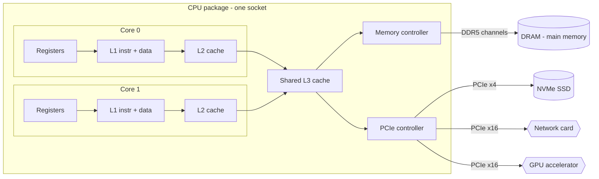
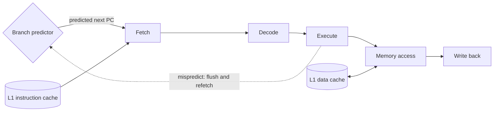
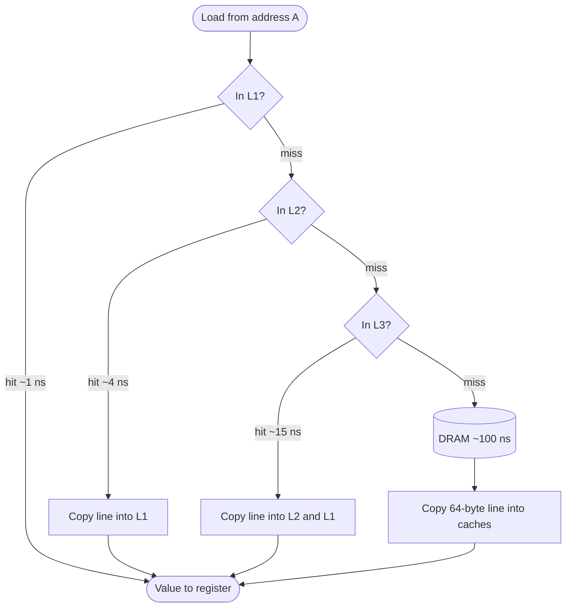
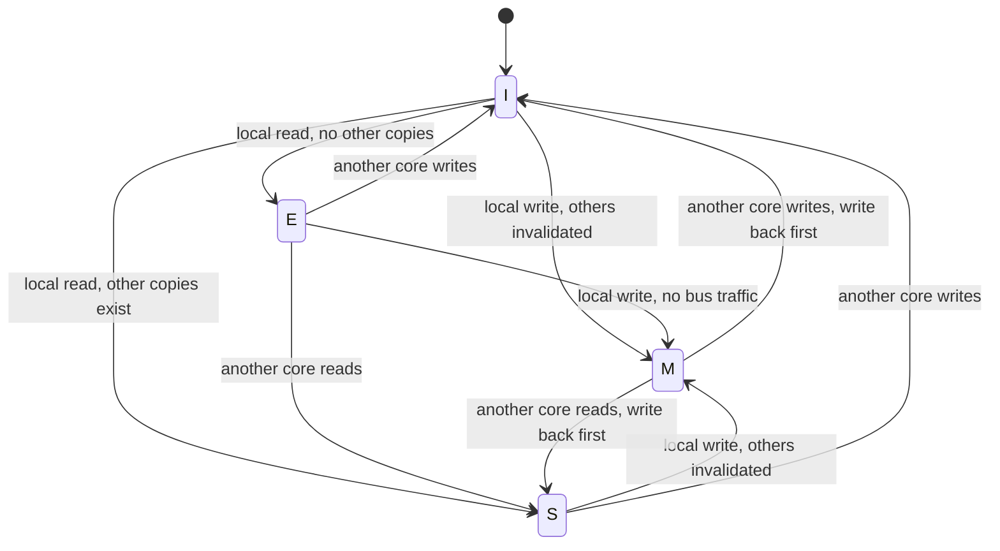
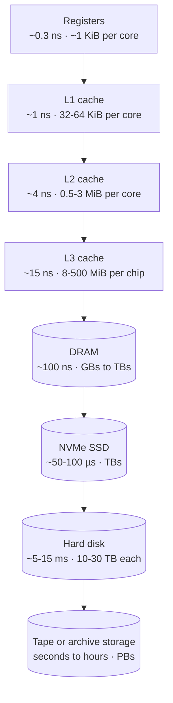
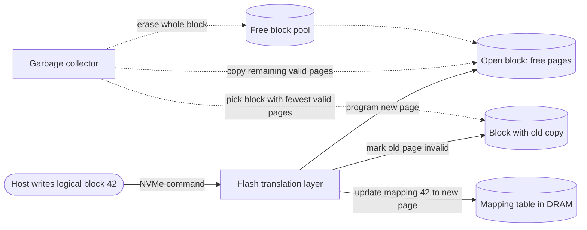
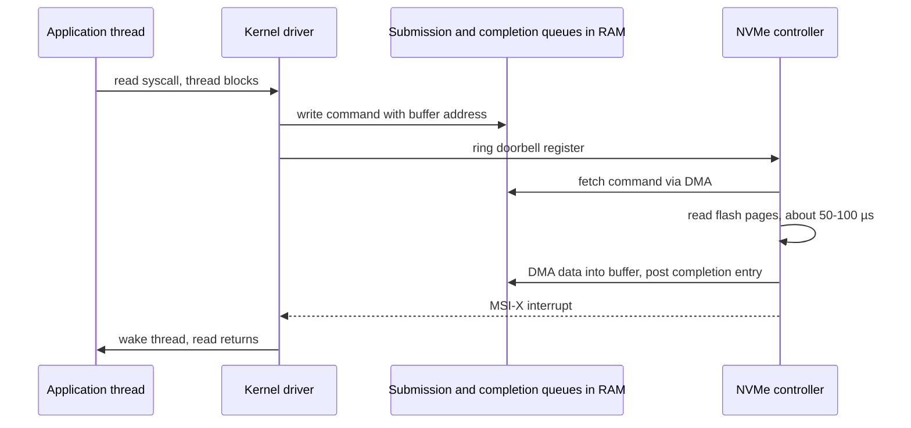
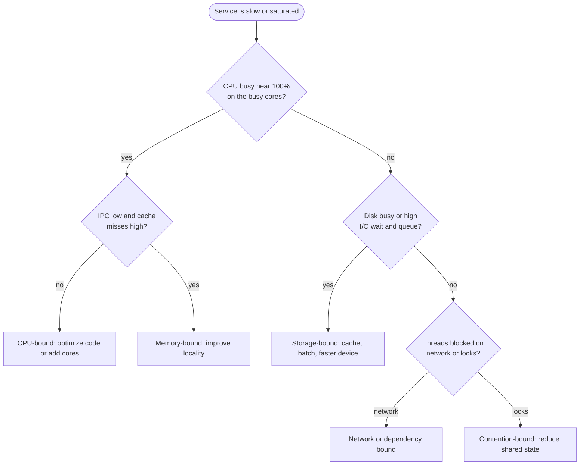
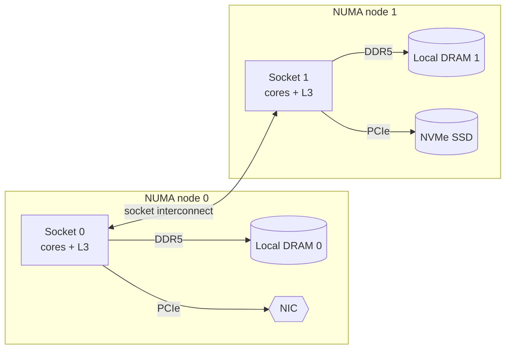
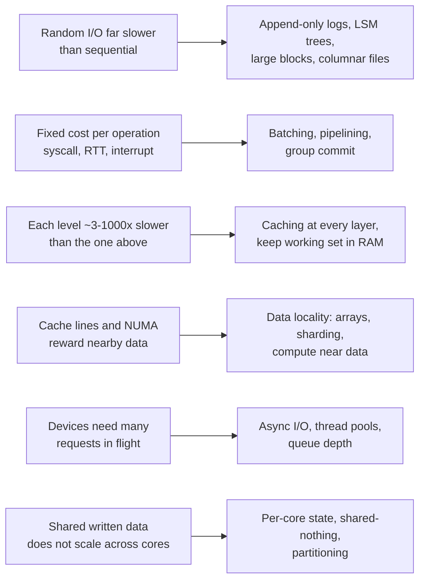

# Chapter 5 — Computer Architecture

> **Level:** 1 · **Track:** Shared · **Estimated reading time:** 3 h

Every distributed system, however large, is built out of single machines. When a database is "slow", a queue "backs up" or a service "needs more threads", the real cause almost always comes down to one of a small number of physical facts: it takes about 100 ns to fetch a value from main memory, a spinning disk can perform only about 100 random reads per second, a network card can only move so many bytes per second, and a CPU core can do useful work only when its data is close at hand. This chapter teaches those facts from the ground up. You need no prior knowledge of hardware. By the end you will be able to explain *why* system designers favor sequential I/O, batching, caching and data locality, and you will be able to back those preferences with numbers.

Throughout the chapter we use decimal units for estimation (KB, MB, GB = 10³, 10⁶, 10⁹ bytes) and binary units where hardware is built in powers of two (KiB, MiB, GiB = 2¹⁰, 2²⁰, 2³⁰ bytes), for example cache sizes and page sizes. Hardware numbers are labeled "as of <year>, approximate". They change every product generation, so learn the **orders of magnitude and the ratios**, which are far more stable than any single figure.

## 5.1 Learning objectives

After this chapter you should be able to:

- Describe what a CPU core does on every clock cycle, and explain pipelining, branch prediction, superscalar and out-of-order execution, and simultaneous multithreading (hyperthreading) in plain language.
- Calculate CPU execution time from instruction count, cycles per instruction and clock rate, and estimate the cost of branch mispredictions.
- Explain how L1, L2 and L3 caches, cache lines and associativity work, and calculate average memory access time for a multi-level cache.
- Explain cache coherence using the MESI protocol, recognize false sharing in code, and fix it.
- Draw the memory hierarchy from registers to archival storage with dated latency, capacity and cost figures.
- Calculate hard disk access time from seek time, rotational latency and transfer time, and explain why random I/O on a disk is hundreds of times slower than sequential I/O.
- Explain how flash SSDs store data (pages, blocks, erase-before-write), what write amplification is, and why NVMe outperforms SATA.
- Compare programmed I/O, interrupts, DMA, polling and kernel bypass.
- Diagnose whether a workload is CPU-bound or I/O-bound and size a thread pool accordingly.
- Estimate how long it takes to scan 1 GB from RAM, SSD, HDD or the network, and explain the difference between latency and bandwidth.
- Explain NUMA and its effect on multi-socket servers.
- Explain what SIMD and hardware accelerators do and when they matter.
- Map hardware facts to system design decisions: sequential I/O, batching, caching, data locality and queue depth.

## 5.2 Prerequisites

- Powers of two and powers of ten — §4.3 (cache sizes, addresses and capacities are powers of two).
- Units: bits, bytes, rates and prefixes — §4.5 (we convert between ns, µs, ms and between MB/s and Gbit/s constantly).
- Little's Law — §4.11 (we use it to relate queue depth, latency and throughput for memory and SSDs).
- Latency numbers every engineer should know — §4.17 (this chapter explains the hardware *behind* those numbers).
- Basic programming in any language; the code examples use C and Python, and every line that matters is explained.

## 5.3 The CPU: cores, registers, clock and the instruction pipeline

### 5.3.1 What a CPU does

::: definition
**Definition — Central processing unit (CPU).** The hardware that executes a program's **instructions**: simple operations such as "add these two numbers", "load a value from memory address X", or "if this value is zero, jump to instruction Y". A modern CPU package contains several independent **cores**, each of which can execute its own stream of instructions.
:::

#### First-principles explanation

Imagine a restaurant kitchen. The **chef** is a CPU core. The **recipe** is the program: a numbered list of small steps. The chef's **two hands and the cutting board** are the **registers**, a tiny number of slots holding the values being worked on right now. The **counter beside the stove** is the cache, the **walk-in fridge** at the back of the kitchen is main memory (RAM), and the **supplier's warehouse across town** is the disk. The chef works at astonishing speed with whatever is in hand, but any trip to the fridge or the warehouse stops the cooking. Most of the techniques in this chapter are tricks for keeping the chef's hands full.

The analogy also explains cores: a kitchen with eight chefs, each following their own recipe, can prepare eight dishes at once — provided they do not keep reaching for the same pan.

#### Why does this exist?

Early computers ran one instruction at a time and memory was about as fast as the processor. Since the 1980s processor speed has grown much faster than memory speed — the so-called **memory wall** [Hennessy & Patterson 2017, ch. 2]. Every feature in a modern core (caches, pipelines, prediction, out-of-order execution) exists to keep a very fast execution engine busy despite slow memory and unpredictable control flow.

#### How it works internally

At its simplest a core repeats the **fetch–decode–execute cycle**:

1. **Fetch.** Read the next instruction from memory at the address held in the **program counter** (PC) register.
2. **Decode.** Work out what the instruction means: which operation, which registers, which memory address.
3. **Execute.** Perform the operation in an execution unit — the **arithmetic logic unit** (ALU) for integer maths, the floating-point unit for decimals, the load/store unit for memory.
4. **Memory access.** If the instruction reads or writes memory, do so (via the caches, §5.4).
5. **Write back.** Store the result in the destination register and advance the program counter (or jump, if the instruction was a branch).

**Figure 5.1 — Inside a single-socket server.**



**Reading the diagram.** The package (the chip you hold in your hand) contains several **cores**; we show two, but server parts in 2025 carry anywhere from 8 to well over 100. Each core has private **registers**, a private **L1 cache** split into an instruction half and a data half, and usually a private **L2 cache**. All cores share an **L3 cache**, which connects to the **memory controller** and the **PCIe controller**. The memory controller drives several **DDR5 channels** to the DRAM modules (main memory). The PCIe controller connects storage (NVMe SSDs), the network card and accelerators such as GPUs over **PCIe lanes** (x4 = four lanes, x16 = sixteen). Arrows point outward from the core because the core initiates requests; data flows back along the same path. All of these paths are synchronous from the core's point of view (an instruction waits for its load), except device I/O, which is asynchronous via DMA and interrupts (§5.7). Every arrow is a potential bottleneck: the further right you go, the higher the latency and the lower the bandwidth per byte of capacity. The storage boundary that matters most is the one between DRAM (volatile, lost on power failure) and the SSD (persistent). The machine scales up by adding cores, memory channels, sockets (§5.10) and PCIe devices; beyond that you scale out across machines, which is the subject of most of this book.

### 5.3.2 Registers, the clock and the "iron law" of performance

::: definition
**Definition — Register.** A tiny, extremely fast storage slot inside a core, typically 64 bits wide for general-purpose registers. x86-64 exposes 16 general-purpose integer registers to programs; ARMv8-A (AArch64) exposes 31. Reading a register costs essentially nothing beyond the instruction that uses it.
:::

::: definition
**Definition — Clock rate.** The frequency at which a core's internal circuitry steps from one state to the next, measured in hertz (cycles per second). A 4 GHz core has a **cycle time** of 1 / (4 × 10⁹) s = 0.25 ns.
:::

The clock is like a metronome in the kitchen: on every tick each part of the core can advance its work by one step. For decades chip makers raised clock rates every year. Around 2005 this stopped: higher frequencies needed more voltage, and power (and therefore heat) grows faster than linearly with voltage and frequency. Clock rates have hovered around 2–6 GHz since (as of 2025, approximate), so the industry turned to doing **more work per cycle** and putting **more cores** on each chip [Hennessy & Patterson 2017, ch. 1]. This "end of free speed-ups" is why concurrency and horizontal scaling dominate modern system design.

How long a program takes is governed by three numbers multiplied together.

::: formula
**CPU execution time (the "iron law")**

$$T_{CPU} = N_{instr} \times CPI \times t_{cycle} = \frac{N_{instr} \times CPI}{f}$$

| Symbol | Meaning | Units |
|---|---|---|
| $T_{CPU}$ | CPU time to run the program | seconds |
| $N_{instr}$ | Number of instructions executed | instructions |
| $CPI$ | Average clock cycles per instruction (its inverse is IPC, instructions per cycle) | cycles/instruction |
| $t_{cycle}$ | Duration of one clock cycle | seconds/cycle |
| $f$ | Clock frequency, $1/t_{cycle}$ | cycles/second (Hz) |
:::

::: example
**Worked example — Running a program and paying for mispredicted branches.**

A program executes $N_{instr} = 4 \times 10^9$ instructions on a 4 GHz core ($t_{cycle} = 0.25$ ns) at an average CPI of 0.5 (the core completes two instructions per cycle on average).

1. $T_{CPU} = 4 \times 10^9 \times 0.5 \times 0.25 \times 10^{-9}\,\text{s} = 0.5$ s.

Now suppose 20% of instructions are branches, 5% of those branches are mispredicted (§5.3.4), and each misprediction costs 15 cycles.

2. Extra CPI from mispredictions $= 0.20 \times 0.05 \times 15 = 0.15$ cycles per instruction.
3. New CPI $= 0.5 + 0.15 = 0.65$.
4. New $T_{CPU} = 4 \times 10^9 \times 0.65 \times 0.25 \times 10^{-9} = 0.65$ s.

Cross-check: $4 \times 10^9 \times 0.2 \times 0.05 = 4 \times 10^7$ mispredictions $\times$ 15 cycles $= 6 \times 10^8$ cycles $= 6 \times 10^8 \times 0.25$ ns $= 0.15$ s extra. ✓

**Interpretation.** One branch in a hundred instructions going the "wrong way" costs 30% of the run time. **Engineering implication.** Raw clock speed is only one of three factors; CPI — which depends on caches, branches and dependencies — usually varies far more between two versions of the same code than clock rate varies between two CPUs.
:::

### 5.3.3 The instruction pipeline

::: definition
**Definition — Instruction pipeline.** A technique in which the core splits instruction execution into stages and works on different stages of several consecutive instructions at the same time, like an assembly line.
:::

#### First-principles explanation

A laundry has a washer, a dryer and a folding table. Doing one load start-to-finish before starting the next wastes the washer while the dryer runs. Instead you start load 2 in the washer the moment load 1 moves to the dryer. Each load still takes as long as before (its **latency** is unchanged), but a load *finishes* far more often (its **throughput** rises). A CPU pipeline is the same idea applied to instructions. This distinction between latency and throughput recurs at every level of system design (§5.12).

#### How it works internally

The classic teaching pipeline has five stages: instruction fetch (IF), instruction decode (ID), execute (EX), memory access (MEM) and write back (WB) [Hennessy & Patterson 2017, appendix C]. Real cores have between roughly 10 and 20 stages (as of 2025, approximate), but the principle is identical.

**Table 5.1 — Five instructions flowing through a five-stage pipeline.**

| Cycle → | 1 | 2 | 3 | 4 | 5 | 6 | 7 | 8 | 9 |
|---|---|---|---|---|---|---|---|---|---|
| Instruction 1 | IF | ID | EX | MEM | WB | | | | |
| Instruction 2 | | IF | ID | EX | MEM | WB | | | |
| Instruction 3 | | | IF | ID | EX | MEM | WB | | |
| Instruction 4 | | | | IF | ID | EX | MEM | WB | |
| Instruction 5 | | | | | IF | ID | EX | MEM | WB |

Without pipelining, five instructions would take 5 × 5 = 25 cycles. With it they take 9 cycles, and once the pipeline is full one instruction completes **every** cycle. Each individual instruction still takes 5 cycles.

**Figure 5.2 — A pipelined core with a branch predictor.**



**Reading the diagram.** Instructions move left to right through five stages; each arrow is a hand-off on a clock edge, so the whole chain is synchronous. The **fetch** stage reads instructions from the **L1 instruction cache**; the **memory** stage reads and writes the **L1 data cache** (bidirectional arrow). The **branch predictor** tells fetch which instruction comes next before the core actually knows. The dotted arrow is the failure path: when the execute stage discovers that a branch went the other way, the work in all earlier stages is wrong and is thrown away (flushed), and fetching restarts from the correct address. Pipelines fail to deliver one instruction per cycle when an instruction needs a result not yet produced (a **data hazard**), when two instructions need the same unit (a **structural hazard**), or when the next instruction is unknown (a **control hazard**). Designers scale this structure by making it wider (§5.3.5) rather than much deeper, because deeper pipelines make each misprediction more expensive.

### 5.3.4 Branch prediction

::: definition
**Definition — Branch prediction.** Hardware that guesses the outcome of a conditional jump (a **branch**, e.g. an `if` or a loop condition) before it is computed, so that the pipeline can keep fetching instructions. A wrong guess is a **misprediction** and forces a pipeline flush.
:::

A long pipeline needs to know which instruction to fetch next on every cycle, but a branch's outcome is only known several stages later. Waiting would leave the pipeline empty for 10–20 cycles at every `if`, and typical code has a branch every five to ten instructions. So the core *guesses*. Modern predictors record the recent history of each branch and of the branches before it, and are right well over 95% of the time on typical code (approximate; it depends heavily on the program) [Hennessy & Patterson 2017, ch. 3]. A misprediction costs roughly 15–20 cycles on recent high-performance x86 cores (as of 2025, approximate).

The practical lesson: **predictable code runs faster**. Loops over sorted data, or code whose `if` almost always goes the same way, mispredict rarely. A filter over random data where each element passes with 50% probability mispredicts about half the time. Compilers can sometimes replace such branches with branch-free "conditional move" instructions, and data-processing engines often sort or partition data first precisely to make branches predictable.

### 5.3.5 Superscalar and out-of-order execution (intuition)

::: definition
**Definition — Superscalar execution.** A core that can issue and complete more than one instruction per cycle by having several execution units working in parallel.
:::

::: definition
**Definition — Out-of-order (OoO) execution.** A technique in which the core executes instructions as soon as their inputs are ready rather than strictly in program order, while still making the results *appear* in program order (it **retires** them in order).
:::

Back to the kitchen. A good chef reading a recipe does not stand idle while the water boils; they skip ahead to chopping onions, which does not depend on the water, and come back when the pot is ready. That is out-of-order execution. And a chef with two hands and several burners can sear, stir and plate in the same moment; that is superscalar execution.

Internally, the core decodes a window of upcoming instructions — several hundred on recent high-end cores (as of 2025, approximate) — into a buffer called the **reorder buffer**. Each instruction waits in a **scheduler** until its inputs are ready, then dispatches to any free execution unit. Results are held until every earlier instruction has completed and are then retired in order, which preserves the illusion of sequential execution for the programmer. The key algorithmic idea dates to Tomasulo's work at IBM in 1967 [Tomasulo 1967].

Why does this matter to a system designer? Because the main thing OoO hides is **memory latency**. If a loop issues ten independent loads, an OoO core can have all ten outstanding at once and pay roughly one memory latency instead of ten. If each load depends on the previous one — walking a linked list, chasing pointers through a tree — nothing can overlap and the core pays the full latency every time. This is why arrays usually beat linked lists by a wide margin in practice, even when asymptotic complexity is identical, and why B-trees with wide nodes (§11.8) beat binary trees on real hardware.

### 5.3.6 Multiple cores and simultaneous multithreading (hyperthreading)

::: definition
**Definition — Multi-core processor.** A single chip containing several complete cores, each with its own pipeline and private caches, sharing the last-level cache and memory.
:::

::: definition
**Definition — Simultaneous multithreading (SMT).** A technique in which one physical core runs two (occasionally more) instruction streams at once, interleaving them through the same execution units. Intel markets its implementation as **Hyper-Threading Technology**. Each stream appears to the operating system as a separate **logical CPU** (or **hardware thread**).
:::

Even with out-of-order execution, a single thread often leaves execution units idle — for example while waiting for a cache miss. SMT gives the core a second recipe to work from: when thread A stalls, the core issues instructions from thread B. The core duplicates only the per-thread state (registers, program counter) and shares nearly everything else, so the extra silicon is small. The benefit depends heavily on the workload. Intel's original description reported gains of up to about 30% on some server benchmarks [Marr et al. 2002]; workloads that already saturate the execution units or the caches may gain nothing or even slow down, because two threads now compete for the same L1 and L2.

Three consequences for system design:

- **A "vCPU" in the cloud is usually a hardware thread, not a core.** On most x86 instance types at the major cloud providers, two vCPUs share one physical core (as of 2025; check your provider's documentation per instance family). Do not assume 16 vCPUs give 16 cores' worth of throughput.
- **Benchmarks must state whether SMT is on.** Doubling thread count from 8 to 16 on an 8-core, 16-thread machine will not double CPU-bound throughput.
- **Security.** Because SMT siblings share caches and execution units, they can leak information to each other through timing side channels. Some operators disable SMT for multi-tenant isolation, and some recent client CPUs ship without it (as of 2024).

#### Failure scenarios

**Table 5.2 — CPU-level failure scenarios.**

| What goes wrong | Why | Detection | Recovery | Prevention |
|---|---|---|---|---|
| Service throughput flat after doubling vCPUs | vCPUs were SMT siblings; the workload saturates execution units | Per-core utilization near 100%; IPC drops as threads are added | Size by physical cores; scale out | Benchmark with physical-core counts in mind |
| Hot loop far slower on production data than in tests | Test data was sorted or uniform; production data makes branches unpredictable | `perf stat` shows high branch-miss rate | Sort/partition input; use branch-free code | Benchmark on realistic data distributions |
| Throttled CPU under sustained load | Thermal or power limits lower the clock rate | Clock frequency drops in telemetry | Improve cooling; spread load | Capacity-plan at sustained, not turbo, frequency |

#### Common misconceptions

::: mistake
**"A higher GHz number means a faster CPU."** Clock rate is only one factor in the iron law. A 3 GHz core with an IPC of 4 completes more work than a 4 GHz core with an IPC of 2. Compare CPUs on benchmarks of your own workload.
:::

::: mistake
**"The CPU runs my code one line at a time, in order."** It overlaps dozens to hundreds of instructions and executes them out of order; only the *visible* results are in order. That is why independent operations can be nearly free while dependent chains are slow.
:::

## 5.4 CPU caches

### 5.4.1 Why caches exist

::: definition
**Definition — CPU cache.** A small, fast memory built from SRAM (static RAM) on the processor chip that holds copies of recently used main-memory data, so that most loads and stores do not have to wait for DRAM.
:::

#### First-principles explanation

Picture a researcher in a library. The book on the **desk** is instantly available. The **shelf behind the chair** holds a few dozen books and takes a few seconds to reach. The **library stacks** on the same floor take a minute. The **off-site depository** takes a day. The researcher keeps the books they are using right now on the desk and the ones they will probably need soon on the shelf. When they fetch a book from the stacks, they bring back its neighbors too, because research tends to move along the shelf.

A CPU cache is that desk and shelf. It works because programs exhibit **locality of reference**:

- **Temporal locality** — data used recently is likely to be used again soon (a loop counter, a hot configuration object).
- **Spatial locality** — data near recently used data is likely to be used soon (the next element of an array, the next field of a struct).

#### Why does this exist?

A DRAM access costs about 80–120 ns (as of 2025, approximate), which at 4 GHz is 320–480 cycles. A core that could issue several instructions per cycle would spend almost all of its time waiting. Making all of main memory as fast as a register is physically impossible: fast memory (SRAM) needs about six transistors per bit, sits on the expensive processor die, and the longer the wires to it, the slower it gets. So designers build a **hierarchy**: tiny and very fast near the core, larger and slower further away.

### 5.4.2 Cache levels

**Table 5.3 — Typical CPU cache levels (as of 2024–2025, approximate; sizes and latencies vary by product).**

| Level | Typical size | Shared by | Latency (cycles) | Latency at ~4 GHz | Analogy |
|---|---|---|---|---|---|
| Registers | Tens of 64-bit values visible per thread | One hardware thread | 0–1 | < 0.3 ns | Hands |
| L1 data | 32–64 KiB | One core | ~4–6 | ~1–1.5 ns | Desk |
| L2 | 0.5–3 MiB | One core (usually) | ~12–18 | ~3–5 ns | Shelf behind you |
| L3 (last-level cache) | 8 MiB to several hundred MiB | All cores on the chip or chiplet | ~40–80 | ~10–20 ns | Stacks on your floor |
| DRAM | GBs to TBs | Whole socket (or machine) | ~300–500 | ~80–120 ns | Off-site depository |

Sources for the ranges: vendor optimization manuals and independent measurements summarized in [Hennessy & Patterson 2017, ch. 2] and [Drepper 2007]; check `lscpu` on your own machine. The machine on which this chapter's examples were tested reports 48 KiB L1d and 2 MiB L2 per core.

**Figure 5.3 — What happens on a load instruction.**



**Reading the diagram.** A load instruction checks each level in turn. A **hit** returns the data at that level's latency; a **miss** passes the request to the next level. When the data finally arrives it is copied into the faster levels so the next access hits (this is temporal locality at work), possibly **evicting** some other line to make room. Each step is synchronous for the instruction that needs the value, but an out-of-order core keeps running independent instructions while it waits, and several misses can be outstanding at once (§5.9.2). The storage boundary is between L3 (on chip, SRAM) and DRAM (off chip). The main failure mode is a **miss storm**: a working set larger than the caches turns most loads into 100 ns trips. The way to scale is not a bigger cache — you cannot buy one — but a smaller, denser working set and access patterns the hardware can predict.

### 5.4.3 Cache lines and locality

::: definition
**Definition — Cache line.** The fixed-size unit in which data moves between memory and caches. On x86-64 and most ARM server cores a line is 64 bytes; some designs (for example Apple's M-series cores) use 128 bytes (as of 2024). A load of a single byte brings its whole line into the cache.
:::

Because a whole line arrives at once, reading the first element of an array also brings in the next seven 8-byte elements "for free". Hardware **prefetchers** go further: when they detect that you are walking through memory in a regular pattern, they start fetching the next lines before you ask. Sequential access is therefore the best case in the entire memory system, and random access the worst.

#### Code example — row-major vs column-major traversal

```c
/* traverse.c — build: gcc -O2 -std=c11 traverse.c -o traverse */
#define _POSIX_C_SOURCE 199309L
#include <stdio.h>
#include <stdlib.h>
#include <time.h>

#define N 8192                 /* 8192 x 8192 ints = 256 MiB */

static double now(void) {
    struct timespec t;
    clock_gettime(CLOCK_MONOTONIC, &t);
    return t.tv_sec + t.tv_nsec / 1e9;
}

int main(void) {
    int *m = malloc((size_t)N * N * sizeof *m);
    if (!m) return 1;
    for (size_t i = 0; i < (size_t)N * N; i++) m[i] = 1;

    long long sum = 0;
    double t0 = now();
    for (size_t r = 0; r < N; r++)          /* row-major: consecutive addresses */
        for (size_t c = 0; c < N; c++)
            sum += m[r * N + c];
    double t1 = now();
    for (size_t c = 0; c < N; c++)          /* column-major: jumps of N*4 bytes */
        for (size_t r = 0; r < N; r++)
            sum += m[r * N + c];
    double t2 = now();

    printf("row-major:    %.3f s\n", t1 - t0);
    printf("column-major: %.3f s\n", t2 - t1);
    printf("checksum: %lld\n", sum);         /* stops the compiler deleting loops */
    free(m);
    return 0;
}
```

What to notice:

- Both loops add exactly the same 67,108,864 integers; only the **order** differs.
- The row-major loop touches consecutive 4-byte integers, so each 64-byte line serves 16 additions and the prefetcher streams lines ahead of time.
- The column-major loop jumps 8192 × 4 = 32,768 bytes between consecutive accesses, so every access lands on a different line and, because the matrix is 256 MiB, most of those lines have been evicted before the loop comes back for their neighbors.
- On the test machine (a cloud x86-64 VM, 2026) the row-major loop took 0.038 s and the column-major loop 0.667 s — about **17× slower** for identical arithmetic. Your ratio will differ, but the direction will not.
- `sum` is printed so that the optimizing compiler cannot prove the loops are useless and delete them — a classic benchmarking pitfall (§23.5).

### 5.4.4 Associativity: where a line may live

A cache must find a line quickly, so it cannot search every slot. Instead the memory address decides which **set** (group of slots) a line may occupy.

::: definition
**Definition — Set-associative cache.** A cache divided into $S$ sets of $W$ slots (**ways**). A line at a given address may be stored in any of the $W$ ways of exactly one set. $W = 1$ is a **direct-mapped** cache; a cache with a single set holding every line is **fully associative**.
:::

The analogy is a coat check with numbered racks. Your ticket number decides the rack (the set); within the rack your coat can go on any free hook (any way). If many guests' tickets map to the same rack, that rack overflows even though others are empty — a **conflict miss**.

::: formula
**Address decomposition in a set-associative cache**

$$S = \frac{C}{B \times W}, \qquad \text{offset bits} = \log_2 B, \qquad \text{index bits} = \log_2 S$$

$$\text{set index} = \left\lfloor \frac{A}{B} \right\rfloor \bmod S, \qquad \text{tag} = \left\lfloor \frac{A}{B \times S} \right\rfloor$$

| Symbol | Meaning | Units |
|---|---|---|
| $C$ | Cache capacity | bytes |
| $B$ | Line (block) size | bytes |
| $W$ | Associativity (ways per set) | lines |
| $S$ | Number of sets | sets |
| $A$ | Memory address | byte address |
| tag | High-order address bits stored with the line to identify it | — |
:::

::: example
**Worked example — Where does address 0x12345 go in a 32 KiB, 8-way cache with 64-byte lines?**

1. Sets: $S = 32\,768 / (64 \times 8) = 32\,768 / 512 = 64$ sets.
2. Offset bits $= \log_2 64 = 6$; index bits $= \log_2 64 = 6$.
3. Address $A = \text{0x12345} = 74\,565$.
4. Offset within the line $= 74\,565 \bmod 64 = 74\,565 - 1165 \times 64 = 74\,565 - 74\,560 = 5$.
5. Line number $= \lfloor 74\,565 / 64 \rfloor = 1165$; set index $= 1165 \bmod 64 = 1165 - 18 \times 64 = 13$.
6. Tag $= \lfloor 1165 / 64 \rfloor = 18$ (0x12).

Check in binary: 0x12345 = `0001 0010 0011 0100 0101`; the low 6 bits `000101` = 5 ✓, the next 6 bits `001101` = 13 ✓, the remaining bits `10010` = 18 ✓.

**Interpretation.** Addresses that differ by a multiple of $B \times S = 64 \times 64 = 4096$ bytes land in the **same set**. **Engineering implication.** A loop that strides through memory in steps of exactly 4 KiB (for example, reading one field from each of many page-aligned 4 KiB records) can use only one set — 8 lines, 512 bytes — of a 32 KiB cache. Power-of-two strides are a known performance trap; padding a row or record by one cache line often removes it [Drepper 2007, §6.2].
:::

### 5.4.5 Average memory access time

::: formula
**Average memory access time (AMAT), applied recursively to each level**

$$AMAT = t_{L1} + m_{L1} \times \bigl(t_{L2} + m_{L2} \times (t_{L3} + m_{L3} \times t_{mem})\bigr)$$

| Symbol | Meaning | Units |
|---|---|---|
| $t_{L1}, t_{L2}, t_{L3}$ | Hit time at each cache level | ns |
| $t_{mem}$ | DRAM access time | ns |
| $m_{L1}$ | Fraction of all accesses that miss L1 | dimensionless (0–1) |
| $m_{L2}, m_{L3}$ | **Local** miss rate: fraction of accesses *reaching* that level that miss it | dimensionless (0–1) |
:::

The same formula, with two levels, is the **effective access time** of any cache in front of a slower store: $EAT = h \times t_{hit} + (1-h) \times t_{miss}$, where $h$ is the hit ratio. You will use it again for application caches (§20.3).

::: example
**Worked example — Good locality versus poor locality.**

Assume $t_{L1} = 1$ ns, $t_{L2} = 4$ ns, $t_{L3} = 15$ ns, $t_{mem} = 90$ ns.

*Good locality* (array scans, small hot data): $m_{L1} = 0.05$, $m_{L2} = 0.20$, $m_{L3} = 0.30$.

1. L3 term: $15 + 0.30 \times 90 = 15 + 27 = 42$ ns.
2. L2 term: $4 + 0.20 \times 42 = 4 + 8.4 = 12.4$ ns.
3. AMAT $= 1 + 0.05 \times 12.4 = 1 + 0.62 = 1.62$ ns.

*Poor locality* (random lookups in a large hash table): $m_{L1} = 0.30$, $m_{L2} = 0.60$, $m_{L3} = 0.70$.

1. L3 term: $15 + 0.70 \times 90 = 15 + 63 = 78$ ns.
2. L2 term: $4 + 0.60 \times 78 = 4 + 46.8 = 50.8$ ns.
3. AMAT $= 1 + 0.30 \times 50.8 = 1 + 15.24 = 16.24$ ns.

**Interpretation.** The same hardware delivers memory ten times slower on average for the second workload. **Engineering implication.** Data layout (compact structs, arrays instead of pointer-linked nodes, hot fields grouped together) can change performance by an order of magnitude without changing the algorithm. The application-level twin of this example: raising a cache hit ratio from 90% to 99% in front of a 100 µs SSD read, with a 1 µs hit, cuts effective access time from $0.9 \times 1 + 0.1 \times 100 = 10.9$ µs to $0.99 \times 1 + 0.01 \times 100 = 1.99$ µs, about 5.5× faster.
:::

### 5.4.6 Cache coherence and the MESI protocol

::: definition
**Definition — Cache coherence.** The guarantee that all cores observe a single, consistent sequence of values for each memory location, even though each core keeps private copies in its own caches.
:::

Suppose cores 0 and 1 both cache the variable `x`. Core 0 writes `x = 5`. If core 1 keeps reading its stale copy, the program breaks. Coherence protocols prevent this by tracking, for every cached line, which cores hold it and whether it has been changed. The textbook protocol is **MESI**, named after the four states a line can be in within one core's cache [Papamarcos & Patel 1984; Sorin, Hill & Wood 2011]:

- **Modified (M)** — this core has the only copy and has changed it; memory is stale. The core must write the line back before anyone else may use it.
- **Exclusive (E)** — this core has the only copy, and it matches memory. The core may write to it without telling anyone.
- **Shared (S)** — several cores may hold read-only copies that match memory.
- **Invalid (I)** — this cache does not hold a valid copy.

The analogy is a shared document with a single "edit pen". Anyone may hold a read-only photocopy (Shared). To write, you must collect every photocopy and shred it (invalidate them), then you hold the pen (Modified). Real processors use extensions — Intel describes MESIF, AMD MOESI — that add states to reduce memory traffic, but the core idea is the same.

**Figure 5.4 — MESI state transitions for one cache line in one core's cache.**



**Reading the diagram.** Each box is the state of *one* 64-byte line in *one* core's cache; every core runs this machine independently for every line. "Local" events come from this core's own instructions; "another core" events arrive as coherence messages over the on-chip interconnect (a ring or mesh linking cores, caches and memory controllers) or, between sockets, over the socket-to-socket link. Transitions caused by our own reads and writes are synchronous with the instruction; invalidations and write-backs triggered by other cores arrive asynchronously. Note the two expensive arcs: moving from Shared to Modified requires invalidating every other copy and waiting for acknowledgments, and a remote read of a Modified line forces a write-back. When two cores repeatedly write the same line, it ping-pongs between their caches, each transfer costing tens of nanoseconds on one chip and more across sockets. Coherence traffic is the reason "just add cores" stops scaling for shared, frequently written data.

### 5.4.7 False sharing

::: definition
**Definition — False sharing.** A performance problem in which threads on different cores write to *different* variables that happen to sit in the *same* cache line, so the coherence protocol bounces the line between cores as if they were sharing data.
:::

Coherence works at the granularity of a whole line, not a variable. Two counters 8 bytes apart, each updated by its own thread, look to the hardware exactly like one heavily contended variable. The program is logically correct and has no locks, yet it scales *negatively*.

#### Code example — demonstrating and fixing false sharing in C

```c
/* false_sharing.c — build: gcc -O2 -std=c11 -pthread false_sharing.c -o fs */
#define _POSIX_C_SOURCE 199309L
#include <pthread.h>
#include <stdalign.h>
#include <stdatomic.h>
#include <stdint.h>
#include <stdio.h>
#include <time.h>

#define ITERATIONS 50000000ULL   /* 5 x 10^7 increments per thread */
#define CACHE_LINE 64            /* x86-64 line size; check yours */

/* Variant A: two counters 8 bytes apart -> same cache line. */
struct packed {
    _Atomic uint64_t a;
    _Atomic uint64_t b;
};

/* Variant B: each counter starts its own 64-byte cache line. */
struct padded {
    alignas(CACHE_LINE) _Atomic uint64_t a;
    alignas(CACHE_LINE) _Atomic uint64_t b;
};

static struct packed P;
static struct padded Q;

static void *worker(void *arg) {
    _Atomic uint64_t *counter = arg;
    for (uint64_t i = 0; i < ITERATIONS; i++)
        atomic_fetch_add_explicit(counter, 1, memory_order_relaxed);
    return NULL;
}

static double run(_Atomic uint64_t *x, _Atomic uint64_t *y) {
    struct timespec t0, t1;
    pthread_t ta, tb;
    clock_gettime(CLOCK_MONOTONIC, &t0);
    pthread_create(&ta, NULL, worker, (void *)x);
    pthread_create(&tb, NULL, worker, (void *)y);
    pthread_join(ta, NULL);
    pthread_join(tb, NULL);
    clock_gettime(CLOCK_MONOTONIC, &t1);
    return (double)(t1.tv_sec - t0.tv_sec) + (t1.tv_nsec - t0.tv_nsec) / 1e9;
}

int main(void) {
    printf("gap between counters: packed=%td B, padded=%td B\n",
           (char *)&P.b - (char *)&P.a, (char *)&Q.b - (char *)&Q.a);
    printf("packed (false sharing): %.2f s\n", run(&P.a, &P.b));
    printf("padded (separate lines): %.2f s\n", run(&Q.a, &Q.b));
    return 0;
}
```

What to notice:

- Each thread touches **only its own counter**; there is no logical sharing and no lock.
- In `struct packed` the counters are 8 bytes apart, so they share a 64-byte line. In `struct padded`, `alignas(64)` forces each counter onto its own line (the struct grows from 16 to 128 bytes).
- `atomic_fetch_add_explicit` compiles to a locked read-modify-write instruction, which requires the core to hold the line in the Modified state — every increment by one thread therefore steals the line from the other.
- On the 4-vCPU test VM (2026), three runs gave 1.57–1.69 s for the packed layout versus 0.31–0.34 s for the padded layout: about **5× slower purely because of memory layout**. With plain (non-atomic) increments, the effect is smaller and noisier because store buffers and compiler optimizations hide part of it — another reason to measure rather than assume.
- The fix costs memory (112 wasted bytes here). Pad only data that is genuinely written by different threads at high frequency: per-thread counters, queue head and tail indices, per-core statistics.

#### Real-world industry applications

::: industry
**LMAX Disruptor (low-latency financial exchange).** LMAX built an inter-thread messaging library for its trading platform and found that the head and tail sequence counters of a queue, written by different threads, suffered false sharing. The Disruptor pads its sequence counters to occupy their own cache lines and avoids locks on the hot path; the authors attribute a large part of its throughput advantage over conventional bounded queues to this "mechanical sympathy" with the cache hierarchy. Trade-off: padded structures waste memory and the design assumes a known line size.
*Evidence: Primary* — [Thompson et al. 2011]
:::

::: industry
**Netflix (JVM service on larger cloud instances).** When Netflix moved a stateless Java service to an instance type with three times the vCPUs, throughput rose only about 25% instead of the expected ~3×. Using hardware performance counters, engineers traced the problem to cache-line contention inside the JVM's type-checking code — first false sharing, then, after a workaround, true sharing of a frequently written cache field. Fixing it brought throughput close to the expected scaling. Trade-off: diagnosing it required low-level counters that are not exposed on every cloud instance type.
*Evidence: Primary* — [Filanovsky & Sane 2022]
:::

Runtimes offer help: Java's internal `@Contended` annotation, C++17's `std::hardware_destructive_interference_size`, and explicit padding fields in Go and Rust.

#### Advantages and disadvantages of caches

Caches make the common case (good locality) almost as fast as registers, with no effort from the programmer. Their disadvantages are that performance becomes **data-dependent and hard to predict**, that coherence traffic limits how well shared, written data scales across cores, and that shared caches create interference between unrelated workloads — one tenant's large scan can evict another tenant's hot data (the **noisy neighbor** problem, Ch 47).

#### Failure scenarios

**Table 5.4 — Cache-related failure scenarios.**

| What goes wrong | Why | Detection | Recovery | Prevention |
|---|---|---|---|---|
| Throughput falls as threads are added | False sharing or a hot shared counter | `perf c2c` on Linux; high cross-core cache-to-cache transfers | Pad or shard per-thread state | Per-thread or per-core data; aggregate occasionally |
| Latency spikes when a batch job runs on the same host | Batch job's scan evicts the service's working set from shared L3 | LLC miss rate rises in sync with the batch job | Move the job; pin to other cores | Cache partitioning (e.g., Intel RDT) or separate hosts |
| Mysterious slowdown at certain array sizes | Power-of-two stride causes conflict misses in one set | Performance cliff at sizes like 4096 or 8192 | Pad rows/records | Avoid power-of-two strides in hot loops |
| Pointer-heavy structure slow despite good big-O | Each hop is a dependent cache miss | Low IPC, high cache-miss counts | Switch to arrays / B-tree-like wide nodes | Design data structures for locality |

#### Common misconceptions

::: mistake
**"Lock-free code always scales."** Lock-free code still writes to shared cache lines. If many cores update the same atomic counter, the line ping-pongs between them and throughput can be *lower* than with one thread. Scalable designs avoid shared writes altogether (per-core counters, sharded state).
:::

::: mistake
**"Caches only matter to C programmers."** Every language runs on the same hardware. Java object headers, Python object pointers and Go slices all have cache footprints; the gap between "array of values" and "array of pointers to objects" is often several-fold in any language.
:::

## 5.5 RAM and the memory hierarchy

### 5.5.1 Main memory (DRAM)

::: definition
**Definition — DRAM (dynamic random-access memory).** The technology used for main memory. Each bit is stored as charge in a tiny capacitor that leaks and must be **refreshed** every few tens of milliseconds. DRAM is **volatile**: its contents are lost when power is removed.
:::

DRAM uses one transistor and one capacitor per bit, versus about six transistors for the SRAM in caches, so it is far denser and cheaper — but slower. Memory chips sit on modules (DIMMs) that plug into **channels**, each an independent 64-bit data path to the CPU's memory controller (DDR5 splits each module's path into two 32-bit subchannels, still 64 bits in total). Inside a chip, bits are arranged in banks of rows and columns; reading a row that is already "open" is faster than opening a new one, which is one more reason sequential access is cheaper than random access [Drepper 2007, §2]. Servers use **ECC** (error-correcting code) memory, which stores extra check bits to correct single-bit errors.

### 5.5.2 The memory hierarchy

::: definition
**Definition — Memory hierarchy.** The layered arrangement of storage technologies in a computer, from small, fast and expensive per byte (registers, caches) to large, slow and cheap per byte (disks, tape), in which each level acts as a cache for the level below it.
:::

**Figure 5.5 — The memory and storage hierarchy (as of 2024–2025, approximate).**



**Reading the diagram.** Read it top to bottom as "faster, smaller, costlier per byte" turning into "slower, larger, cheaper per byte". Each arrow means "misses at this level are served by the next level". The levels above DRAM are managed by hardware automatically; the boundary between DRAM and SSD is managed by software — the operating system's page cache (§6.6) or your database's buffer pool (§13.4). The most important storage boundary is **volatility**: everything from DRAM upward vanishes on power loss, so durability requires reaching the SSD, disk or a remote replica (§6.14). Each step down costs roughly 3–1000× in latency. Systems "scale" this pyramid by keeping the working set as high up as possible: more RAM to cache hot data, SSDs instead of disks for random access, and disks or object storage only for cold, sequentially read data.

**Table 5.5 — Memory hierarchy numbers (as of 2024–2025, approximate; prices are volatile).**

| Level | Typical capacity | Random-access latency | Sequential bandwidth | Approx. cost per GB | Persistent? |
|---|---|---|---|---|---|
| L1 / L2 / L3 cache | KiB to hundreds of MiB | ~1 / ~4 / ~15 ns | Hundreds of GB/s per core (L1) | Not sold separately | No |
| DRAM (DDR5) | 16 GB – several TB per server | ~80–120 ns | ~38 GB/s per DDR5-4800 channel; ~300–600 GB/s per socket | ~$2–5 | No |
| NVMe SSD (TLC flash) | 1–30+ TB | ~50–100 µs read | ~3–7 GB/s (PCIe 4.0 x4); ~10–14 GB/s (PCIe 5.0 x4) | ~$0.05–0.15 | Yes |
| SATA SSD | 0.25–8 TB | ~80–150 µs read | ~0.55 GB/s | ~$0.05–0.10 | Yes |
| HDD (7200 RPM) | 4–30+ TB | ~5–15 ms | ~0.15–0.28 GB/s | ~$0.015–0.03 | Yes |
| LTO-9 tape | 18 TB native per cartridge | Seconds to minutes (mount, wind) | ~0.4 GB/s native | < $0.01 | Yes |

Sources: interface limits from the DDR5, PCIe and SATA specifications (bandwidth arithmetic in §5.9); device ranges from vendor datasheets of the period; LTO-9 figures from the LTO Program; general structure from [Hennessy & Patterson 2017, ch. 2] and [Bryant & O'Hallaron 2015, ch. 6]. Prices are retail/street approximations for 2024 and changed sharply in 2025–2026 for DRAM and flash; treat them as ratios, not quotes.

The ratios are the lesson: DRAM costs roughly 30–100× more per GB than flash, and flash roughly 3–5× more than disk, while latency falls by about 1,000× from DRAM to flash and 100× again from flash to disk. Choosing where data lives is an economic decision as much as a technical one.

## 5.6 Storage devices

### 5.6.1 Hard disk drives (HDDs)

::: definition
**Definition — Hard disk drive (HDD).** A storage device that records data magnetically on spinning platters, read and written by heads mounted on a moving arm (the **actuator**). Data is organized in concentric **tracks** divided into **sectors** of 512 or 4096 bytes.
:::

#### First-principles explanation

Think of a record player. To play a particular song, you lift the arm and move it to the right groove (the **seek**), then wait for the start of the song to come round under the needle (**rotational latency**), then listen to the song (**transfer**). Moving the arm and waiting for the platter take milliseconds — millions of CPU cycles — whereas reading the data once the head is in place is fast. An HDD rewards you for reading long runs of adjacent data and punishes you for jumping around.

::: formula
**HDD access time**

$$T_{access} = T_{seek} + T_{rot} + T_{transfer}, \qquad T_{rot} = \frac{1}{2} \times \frac{60}{RPM}, \qquad T_{transfer} = \frac{S}{R}$$

$$IOPS_{random} \approx \frac{1}{T_{access}}$$

| Symbol | Meaning | Units |
|---|---|---|
| $T_{seek}$ | Average time to move the head to the target track | ms |
| $T_{rot}$ | Average rotational latency: half a revolution | ms |
| $RPM$ | Spindle speed | revolutions per minute |
| $S$ | Size of the request | bytes |
| $R$ | Sustained media transfer rate | bytes/second |
| $IOPS_{random}$ | Random I/O operations per second for one outstanding request | operations/second |
:::

::: example
**Worked example — Random versus sequential reads on a 7200 RPM disk.**

Assume $T_{seek} = 8.5$ ms (a typical desktop-class average), $R = 200$ MB/s (as of 2024, approximate; outer tracks are faster than inner tracks).

1. One revolution: $60 / 7200 = 0.008\,33$ s $= 8.33$ ms, so $T_{rot} = 8.33 / 2 = 4.17$ ms.
2. Transfer of a 4 KiB block: $4096 / (200 \times 10^6) = 2.05 \times 10^{-5}$ s $= 0.02$ ms.
3. Random 4 KiB read: $T_{access} = 8.5 + 4.17 + 0.02 = 12.69$ ms.
4. Random IOPS $\approx 1 / 0.012\,69 \approx 79$ operations/s, so random throughput $= 79 \times 4096 \approx 0.32$ MB/s.
5. Sequential throughput $\approx 200$ MB/s, which is $200 / 0.32 \approx 620\times$ the random throughput.
6. Reading 100 MB contiguously after one positioning: $12.67 + (10^8 / 2 \times 10^8) \times 1000 = 12.67 + 500 = 512.67$ ms, an effective $10^8 / 0.512\,67 \approx 195$ MB/s — 97.5% of the maximum.

**Interpretation.** For small random reads, 99.8% of the time is mechanical positioning ($12.67 / 12.69$). **Engineering implication.** On disks, design for large sequential transfers: append-only logs, LSM trees (§13.8), large blocks in distributed file systems (§15.5) and batch scans. Even a 15,000 RPM enterprise disk ($T_{rot} = 2$ ms, seek ≈ 3.5 ms) reaches only about $1 / 0.0055 \approx 180$ random IOPS.
:::

HDDs remain the cheapest online storage per byte (Table 5.5), so they still hold most of the world's bulk data in object stores and backup systems — where access is overwhelmingly sequential [Ruemmler & Wilkes 1994].

### 5.6.2 Solid-state drives (SSDs) and flash memory

::: definition
**Definition — Solid-state drive (SSD).** A storage device with no moving parts that stores data in **NAND flash** memory cells, managed by an on-board controller running a **flash translation layer** (FTL).
:::

Flash is fast to read and has no seek time, but it has three peculiar rules that shape everything about SSD behavior [Agrawal et al. 2008]:

1. **Read and write in pages.** The smallest unit you can read or program (write) is a **page**, typically 4–16 KiB (as of 2024, approximate).
2. **Erase in blocks.** A page cannot be overwritten in place. It must first be erased, and erasure works only on a whole **erase block** of hundreds of pages (several MiB in modern chips).
3. **Cells wear out.** Each block survives a limited number of program/erase (P/E) cycles — on the order of 1,000–3,000 for TLC (three bits per cell) flash and fewer for QLC (four bits per cell) (as of 2024, approximate; vendors rarely publish exact figures).

The analogy is a notebook written in pen. You cannot rub out one line; to reuse a page you must tear out a whole chapter, and the binding can only take so many tear-outs. So when you "update" a line, you write the new version on a fresh page and cross out the old one. Periodically you copy the still-valid lines from a messy chapter to a fresh one and tear the old chapter out. That is exactly what an SSD controller does.

**Figure 5.6 — How an SSD handles an overwrite and garbage collection.**



**Reading the diagram.** The host addresses data by **logical block address** (LBA); the FTL translates LBAs to physical flash pages using a mapping table held in the SSD's own DRAM (backed up to flash). An overwrite from the host (solid arrows, synchronous with the write command) becomes "program a fresh page, then repoint the mapping", and the old page is merely marked invalid. In the background (dotted arrows, asynchronous), the **garbage collector** chooses a block with few valid pages, copies the survivors elsewhere and erases the block, returning it to the free pool. The failure point is garbage collection under sustained random writes: when free blocks run out, the host's writes wait behind GC, producing latency spikes. Drives mitigate this with **over-provisioning** (spare capacity invisible to the host) and the host helps with **TRIM**/deallocate commands that tell the drive which pages no longer hold useful data. The mapping table is also why SSDs need power-loss protection capacitors in enterprise models.

### 5.6.3 Write amplification and endurance

::: formula
**Write amplification factor and drive lifetime**

$$WAF = \frac{\text{bytes written to flash}}{\text{bytes written by the host}}, \qquad \text{Lifetime (days)} \approx \frac{C \times PE}{W_{host} \times WAF}$$

| Symbol | Meaning | Units |
|---|---|---|
| $WAF$ | Write amplification factor (≥ 1 for a drive without compression) | dimensionless |
| $C$ | Raw flash capacity | bytes |
| $PE$ | Rated program/erase cycles per block | cycles |
| $W_{host}$ | Host write volume per day | bytes/day |
:::

::: example
**Worked example — How long will this SSD last?**

A 1 TB TLC SSD, assumed rating $PE = 3000$ cycles, so total flash write budget $= 10^{12} \times 3000 = 3 \times 10^{15}$ bytes $= 3$ PB. A database writes $W_{host} = 500$ GB/day (0.5 drive writes per day).

1. With sequential, log-structured writes, $WAF \approx 2.5$: flash writes $= 500 \times 2.5 = 1250$ GB/day $= 1.25$ TB/day. Lifetime $= 3000 \text{ TB} / 1.25 \text{ TB/day} = 2400$ days $\approx 6.6$ years.
2. With small random in-place updates on a nearly full drive, $WAF \approx 5$: flash writes $= 2.5$ TB/day. Lifetime $= 3000 / 2.5 = 1200$ days $\approx 3.3$ years.

**Interpretation.** The same host workload wears the drive out twice as fast purely because of the write *pattern*. **Engineering implication.** Write amplification compounds: an LSM tree's own compaction (§13.11) multiplies with the SSD's internal WAF. Prefer large, sequential, aligned writes; leave free space (or over-provisioning) on write-heavy drives; and monitor the drive's wear indicators (SMART / NVMe health log).
:::

### 5.6.4 SATA versus NVMe

SSDs first plugged into the same **SATA** interface designed for hard disks. SATA III signals at 6 Gbit/s, and after its 8b/10b line encoding (10 bits on the wire per data byte) delivers at most 600 MB/s; real drives reach about 550 MB/s. Its command protocol, AHCI, offers **one command queue of 32 entries** — ample for a disk that can do 100 operations per second, but a straitjacket for flash that can do hundreds of thousands.

**NVMe** (Non-Volatile Memory Express) is a protocol designed for flash that attaches drives directly to **PCIe** lanes. It supports up to about 65,535 I/O queues, each up to 65,536 commands deep [NVM Express Base Specification], so every CPU core can have its own submission and completion queue pair with no locking between cores. A PCIe 4.0 x4 link carries roughly 7.9 GB/s of payload after encoding (16 GT/s × 4 lanes × 128/130 ÷ 8 ≈ 7.9 GB/s), and fast drives deliver about 7 GB/s sequential and around a million random 4 KiB reads per second at high queue depth (as of 2024, approximate).

### 5.6.5 IOPS, throughput and queue depth

::: definition
**Definition — IOPS.** Input/output operations per second: the number of independent read or write requests a device completes per second, quoted for a stated request size (usually 4 KiB) and **queue depth** (number of requests outstanding at once).
:::

::: formula
**Little's Law applied to a storage device**

$$IOPS = \frac{QD}{L}, \qquad \text{Throughput} = IOPS \times S$$

| Symbol | Meaning | Units |
|---|---|---|
| $QD$ | Average number of requests outstanding (queue depth) | requests |
| $L$ | Average latency per request | seconds |
| $S$ | Request size | bytes |
:::

::: example
**Worked example — Why a single-threaded reader cannot exploit an NVMe SSD.**

An NVMe SSD has a random-read latency of $L = 80$ µs.

1. One request at a time ($QD = 1$): $IOPS = 1 / (80 \times 10^{-6}) = 12\,500$; throughput $= 12\,500 \times 4096 = 51.2$ MB/s.
2. To reach the drive's rated $10^6$ IOPS: $QD = IOPS \times L = 10^6 \times 80 \times 10^{-6} = 80$ requests outstanding.

**Interpretation.** A program that issues one blocking read, waits, then issues the next will use about 1% of a fast SSD. **Engineering implication.** To use modern storage you need **concurrency in the I/O path**: many threads, asynchronous I/O (io_uring, §6.13), or batched requests. The same law governs memory (§5.9.2) and network connections (§7.15).
:::

### 5.6.6 Persistent memory and newer tiers

**Persistent memory** (PMem) is byte-addressable like DRAM — the CPU reads it with ordinary load instructions — but keeps its contents without power. The best-known product, Intel Optane persistent memory, offered larger capacities than DRAM at read latencies of a few hundred nanoseconds (approximate); Intel announced in 2022 that it was winding the business down. The ideas survive in capacitor-backed DRAM inside storage controllers and in **CXL** (Compute Express Link), which attaches extra memory over the PCIe physical layer at somewhat higher latency than local DRAM. Programming persistent memory requires explicit cache-line flushes and fences, because data still in a volatile CPU cache is not durable.

**Table 5.6 — Storage device comparison (as of 2024–2025, approximate).**

| | HDD | SATA SSD | NVMe SSD | Persistent memory / CXL memory |
|---|---|---|---|---|
| What it is | Spinning magnetic platters | Flash behind a disk-era interface | Flash on PCIe with a flash-native protocol | Byte-addressable memory on the memory bus or CXL |
| How it works | Mechanical seek + rotation | FTL, 1 queue × 32 commands | FTL, up to ~64K queues | CPU loads/stores |
| Advantages | Cheapest per TB; good sequential speed | Drop-in replacement for disks | Very high IOPS and bandwidth | Nanosecond-scale access, large capacity |
| Disadvantages | ~100 random IOPS; mechanical failure | Interface caps at ~550 MB/s | Wear-out; GC latency spikes | Niche, costly; Optane discontinued |
| Performance | ~80–200 IOPS; ~0.2 GB/s | ~50–100K IOPS; 0.55 GB/s | ~0.5–1.5M IOPS; 3–14 GB/s | ~100s ns latency |
| Cost per GB | ~$0.02 | ~$0.05–0.10 | ~$0.05–0.15 | Above DRAM-adjacent tiers |
| Choose when | Cold, bulk, sequential data | Legacy servers, budget | Databases, logs, anything random-access | Very large in-memory datasets; specialized logging |

#### Real-world industry applications

::: industry
**Apache Kafka (append-only log on ordinary disks).** Kafka's designers observed that sequential disk throughput is hundreds of times higher than random-access throughput and that the operating system's page cache already keeps recently written data in RAM. Kafka therefore stores each partition as an append-only file, reads and writes it sequentially, and relies on the page cache rather than an in-process cache, which lets brokers sustain high throughput even on hard disks. Trade-off: the design favors sequential consumers; random lookups by key are not what it is for.
*Evidence: Primary* — [Apache Kafka Documentation, Design]
:::

#### Failure scenarios

**Table 5.7 — Storage failure scenarios.**

| What goes wrong | Why | Detection | Recovery | Prevention |
|---|---|---|---|---|
| p99 write latency spikes on a busy SSD | Garbage collection when free blocks are exhausted | Latency spikes correlate with sustained writes | Throttle writes; free space | Over-provision; TRIM; sequential writes |
| SSD wears out early | High write amplification from small random writes | SMART "percentage used" climbs fast | Replace drive; rebuild replica | Log-structured writes; endurance-rated drives |
| Database slow after moving from SSD to cheaper HDD tier | Random-access workload on ~100 IOPS devices | Queue depth high, low throughput, high await | Move back; add cache | Match the device to the access pattern |
| Data lost after power failure despite successful write | Data was still in volatile cache (OS, drive) | Corruption on restart | Restore from replica/backup | `fsync` and drives with power-loss protection (§6.14) |

::: mistake
**"SSDs make access patterns irrelevant."** Sequential I/O on an SSD is still faster than random I/O, writes are amplified by small random updates, and a single blocking thread cannot exploit the device's parallelism. SSDs shrink the penalty for randomness from ~600× to a few times; they do not remove it.
:::

## 5.7 I/O operations

::: definition
**Definition — I/O (input/output).** Any transfer of data between the CPU/memory and a device outside it: storage, network cards, GPUs, keyboards. A **device controller** on each device does the physical work; the CPU communicates with it through **device registers** and shared memory.
:::

The central question of I/O design is: *what does the CPU do while a slow device works?* Back in the kitchen, ordering from the supplier can be handled four ways. You can stand at the phone repeating "is it ready yet?" (**polling**). You can do something else and let the supplier ring a bell when the delivery arrives (**interrupts**). You can have the supplier's driver carry the goods straight into the fridge without you lifting a box (**DMA**). Or, for the busiest restaurants, you can bypass the front office entirely and deal with the driver directly (**kernel bypass**).

### 5.7.1 Programmed I/O

In **programmed I/O** (PIO) the CPU itself moves every word between the device and memory, reading and writing device registers in a loop. It is simple and still used for tiny, infrequent transfers (configuring a device), but for bulk data it wastes the most expensive resource in the machine — CPU cycles — on copying.

### 5.7.2 Interrupts

An **interrupt** is a hardware signal from a device that makes the CPU suspend its current work, run a short **interrupt handler** in the kernel, and then resume. The CPU starts an operation, goes off to run other threads, and is notified on completion. Modern PCIe devices raise **message-signaled interrupts** (MSI-X), which can be steered to a specific core. Interrupts are efficient when events are rare, but each one costs on the order of a microsecond or more of CPU time (handler entry, cache pollution, possible context switch; approximate). At millions of events per second — a single 10 Gbit/s link can deliver up to about 14.9 million minimum-size Ethernet frames per second (10¹⁰ bit/s ÷ (84 bytes × 8) on the wire, counting preamble and inter-frame gap) — one interrupt per packet would overwhelm the CPU.

### 5.7.3 Direct memory access (DMA)

::: definition
**Definition — Direct memory access (DMA).** A mechanism that lets a device controller read from or write to main memory directly, without the CPU copying each word; the CPU only sets up the transfer and is told when it finishes.
:::

**Figure 5.7 — Reading a block from an NVMe SSD with DMA and an interrupt.**



**Reading the diagram.** Four participants: the application thread, the kernel's NVMe driver, the command queues living in ordinary RAM, and the SSD's controller. The application's `read` system call is synchronous *for the thread* — it blocks — but the CPU core is free to run other threads in the meantime. The kernel writes a command describing the request and the destination buffer into a submission queue in memory, then writes to a **doorbell** register on the device over PCIe. From then on the device does the work: it fetches the command, reads flash, and **DMAs** the data straight into the buffer — no CPU copying. Finally it posts a completion entry and raises an interrupt (dashed arrow: asynchronous notification). The storage boundary is crossed only by the device. Failure points: the device may time out (the driver resets it and fails the I/O), and a buggy device with unrestricted DMA could overwrite arbitrary memory, which is why servers use an **IOMMU** to restrict which addresses each device may access. Scaling comes from many queue pairs (one per core) and many outstanding commands (§5.6.5).

### 5.7.4 Polling and interrupt coalescing

When events are very frequent, **polling** — a core repeatedly checking a completion queue — is cheaper than taking an interrupt per event, at the cost of burning a core even when idle. Practical systems mix the two. Network cards **coalesce** interrupts (one interrupt per batch of packets or per few microseconds), and Linux's NAPI network subsystem switches from interrupts to polling under load, then back again when traffic subsides. This is the batching principle of §5.12 appearing inside the kernel. How programs see all this — blocking calls versus non-blocking interfaces such as `epoll` and `io_uring` — is covered in §6.13; underneath, the device always works in parallel with the CPU, and software's job is to keep enough requests in flight.

### 5.7.5 Kernel bypass (introduction)

For each I/O, the conventional path crosses the user/kernel boundary, runs generic driver code, and often copies data between kernel and user buffers. At 10–100 Gbit/s or a million IOPS, those per-operation costs (each a few hundred nanoseconds to microseconds) become the bottleneck. **Kernel bypass** lets an application drive the device directly from user space:

- **DPDK** (Data Plane Development Kit) — user-space network drivers that poll NIC queues; used in software routers, load balancers and packet processors [DPDK Documentation].
- **SPDK** (Storage Performance Development Kit) — the same approach for NVMe storage [SPDK Documentation].
- **RDMA** (remote direct memory access) — network cards that read and write a *remote* machine's memory without involving the remote CPU, used in HPC and some databases and ML clusters (Ch 49, Ch 65).
- **io_uring** (Linux 5.1, 2019) — not a full bypass, but shared submission/completion rings between application and kernel that remove most per-operation system calls and can poll [Axboe 2019].

Bypass trades generality, security isolation and operational simplicity for raw speed: you dedicate cores to polling, give up the kernel's TCP stack or file system, and take on more of the driver's responsibilities. Most services never need it; network appliances, exchanges and storage engines sometimes do.

**Table 5.8 — I/O mechanisms compared.**

| Mechanism | CPU cost per transfer | Latency | Best for | Drawback |
|---|---|---|---|---|
| Programmed I/O | Very high (CPU copies every word) | Low for tiny transfers | Device configuration | Wastes CPU on bulk data |
| Interrupt-driven + DMA | Low per byte; ~µs per interrupt | Adds interrupt + wake-up time | General-purpose I/O | Interrupt storms at high event rates |
| Polling | A dedicated core, even when idle | Lowest | Very high event rates | Burns CPU and power |
| Coalescing / hybrid (NAPI) | Low | Slightly higher for single events | Network stacks under variable load | Tuning trade-off between latency and CPU |
| Kernel bypass (DPDK/SPDK/RDMA) | Lowest per operation | Lowest | Packet processing, storage engines, HPC | Complexity; loses kernel features |

## 5.8 CPU-bound versus I/O-bound workloads

::: definition
**Definition — CPU-bound and I/O-bound.** A workload is **CPU-bound** when its speed is limited by how fast the processor can execute instructions; giving it a faster CPU or more cores speeds it up. It is **I/O-bound** when it spends most of its time waiting for storage or the network; a faster CPU barely helps, but more concurrency or faster devices do. A related category, **memory-bound**, is limited by memory latency or bandwidth (§5.9) — the CPU looks "busy" but is mostly stalled.
:::

A cook who spends all day chopping is CPU-bound: hire more cooks. A cook who spends all day waiting for deliveries is I/O-bound: hiring more cooks only adds more people waiting — what helps is ordering many deliveries at once, or keeping stock closer to hand (caching).

### 5.8.1 How to tell

**Figure 5.8 — Diagnosing what limits a workload.**



**Reading the diagram.** Start at the top with a symptom and walk the decisions using measurements, not guesses. CPU utilization per core (not the machine average, which hides one saturated core) separates "computing" from "waiting". Among busy CPUs, instructions per cycle and cache-miss counters (from `perf stat` on Linux) separate genuine computation from stalls on memory. Among idle CPUs, disk utilization and queue length (`iostat -x`) reveal storage limits, and thread dumps or off-CPU profiles reveal whether threads wait on network calls to dependencies or on locks. Each leaf names a different remedy; applying the wrong one (more threads for a CPU-bound service, a faster CPU for an I/O-bound one) wastes money. This is the resource model of §2.6 applied to one machine; the systematic version is Brendan Gregg's USE method (§23.3) [Gregg 2020].

**Table 5.9 — Signals that distinguish CPU-bound from I/O-bound workloads.**

| Signal | CPU-bound | I/O-bound |
|---|---|---|
| Per-core CPU utilization | Near 100% in user time | Low or moderate |
| `time` output for a command | user + sys ≈ real (× cores used) | real ≫ user + sys |
| Effect of a faster CPU | Proportional speed-up | Little effect |
| Effect of more threads | Helps up to the core count, then hurts | Helps until the device or dependency saturates |
| Typical examples | Compression, encryption, image resizing, JSON parsing at scale, model inference on CPU | Database queries over the network, file servers, API gateways, web crawlers |

A caution about the Linux `%iowait` metric: it reports idle time during which some I/O was outstanding. It is a hint, not a measure of I/O capacity; a fully busy CPU can hide I/O waits, and on multi-core machines the number is easy to misread [Gregg 2020].

### 5.8.2 Why it matters for thread pools

::: formula
**Thread pool sizing heuristic** [Goetz et al. 2006, §8.2]

$$N_{threads} = N_{cores} \times U_{target} \times \left(1 + \frac{W}{C}\right)$$

| Symbol | Meaning | Units |
|---|---|---|
| $N_{threads}$ | Threads in the pool | threads |
| $N_{cores}$ | Cores available to the pool | cores |
| $U_{target}$ | Target CPU utilization (0–1) | dimensionless |
| $W$ | Average time a task spends waiting (I/O, remote calls) | seconds |
| $C$ | Average CPU time per task | seconds |
:::

::: example
**Worked example — Sizing pools for two services on an 8-core machine.**

1. *Image-thumbnail service* (CPU-bound): $W \approx 0$, so $N = 8 \times 1 \times (1 + 0) = 8$ threads. Goetz et al. suggest $N_{cores} + 1$ to cover the occasional page fault. Using 64 threads would add context switches and cache thrashing, not throughput.
2. *Order API* (I/O-bound): each request uses $C = 5$ ms of CPU and waits $W = 50$ ms on the database. At $U_{target} = 1$: $N = 8 \times (1 + 50/5) = 8 \times 11 = 88$ threads. At $U_{target} = 0.8$, leaving headroom: $8 \times 0.8 \times 11 = 70.4 \approx 70$ threads.
3. Maximum throughput of the order API is set by CPU: $8 \text{ cores} / 5 \text{ ms} = 1600$ requests/s at 100% CPU. Little's Law check: $1600 \text{ req/s} \times 55 \text{ ms} = 88$ requests in flight ✓.

**Interpretation.** The I/O-bound service needs about 11× more threads than cores, because each thread spends 10/11 of its life waiting. **Engineering implication.** The formula assumes the dependency can absorb the load: 88 concurrent requests need about 88 database connections (§14.13). If the database saturates first, more threads only lengthen its queue. Event loops and async runtimes (§6.15) achieve the same concurrency with far fewer threads.
:::

::: mistake
**"Python threads speed up CPU-bound work."** In CPython the global interpreter lock (GIL) lets only one thread execute Python bytecode at a time, so threads help I/O-bound Python code but not pure-Python CPU-bound code; use processes or native extensions (such as numpy) that release the lock. Free-threaded CPython builds exist experimentally since Python 3.13 (as of 2025), which may change this advice over time.
:::

## 5.9 Memory latency and bandwidth

### 5.9.1 Two different numbers

::: definition
**Definition — Latency and bandwidth (hardware).** **Latency** is the time from issuing one request to receiving its first byte (for example, ~100 ns for a DRAM load). **Bandwidth** is the maximum rate at which data can be moved once transfers are flowing (for example, ~38 GB/s for one DDR5-4800 channel). Achieved bandwidth is **throughput**.
:::

A motorway is the usual picture: latency is how long one car takes to drive from A to B; bandwidth is how many cars per hour the road can carry. Adding lanes raises bandwidth but does not make any single car arrive sooner. For hardware, latency improves slowly (DRAM latency has changed little in two decades), while bandwidth improves steadily with more channels and faster signaling [Hennessy & Patterson 2017, ch. 2]. Designs that need bandwidth can buy it; designs that need low latency must avoid the trip altogether — by caching, prefetching or co-locating data.

::: formula
**Peak DRAM bandwidth**

$$BW_{peak} = R_{transfer} \times W_{bus} \times N_{channels}$$

| Symbol | Meaning | Units |
|---|---|---|
| $R_{transfer}$ | Data transfers per second per channel (the "4800" in DDR5-4800) | transfers/second (MT/s) |
| $W_{bus}$ | Width of a channel's data path: 8 bytes (64 bits) | bytes/transfer |
| $N_{channels}$ | Populated memory channels | channels |
:::

::: example
**Worked example — How much bandwidth does a server socket have?**

1. One DDR5-4800 channel: $4800 \times 10^6 \times 8 = 38.4 \times 10^9$ B/s $= 38.4$ GB/s.
2. A socket with 8 channels: $8 \times 38.4 = 307.2$ GB/s. With 12 channels (as on some 2023–2024 server CPUs): $12 \times 38.4 = 460.8$ GB/s.

**Interpretation.** These are theoretical peaks; sustained throughput on streaming benchmarks is typically 70–90% of peak (approximate). **Engineering implication.** Leaving channels unpopulated to save money (four DIMMs in an eight-channel server) halves memory bandwidth — a common, invisible misconfiguration for analytics and ML workloads.
:::

### 5.9.2 Why one core cannot use all the bandwidth: Little's Law in memory

Bandwidth is only achieved if enough requests are in flight to cover the latency — the same law as for SSDs (§5.6.5).

::: example
**Worked example — Memory-level parallelism.**

Each core can track a limited number of outstanding L1 misses — on the order of 10–20 on recent x86 cores (as of 2024, approximate; hardware prefetchers into L2 add more). Assume 12 outstanding 64-byte misses and 100 ns latency.

1. Bytes in flight $= 12 \times 64 = 768$ B.
2. Throughput $= 768 \text{ B} / 100 \text{ ns} = 7.68$ B/ns $= 7.68$ GB/s.
3. To saturate an 8-channel socket at 307.2 GB/s with a loaded latency of ~110 ns: bytes in flight $= 307.2 \times 10^9 \times 110 \times 10^{-9} = 33\,792$ B $= 528$ cache lines.

**Interpretation.** One thread doing demand loads tops out well below the socket's bandwidth; it takes many cores — or very effective prefetching — to keep 500+ lines in flight. **Engineering implication.** Memory-bound jobs (scans, aggregations, embedding lookups) scale with cores *until* the memory channels saturate, then stop, however many more cores you add. Pointer chasing is worst of all: with one outstanding miss, throughput is $64 \text{ B} / 100 \text{ ns} = 0.64$ GB/s.
:::

### 5.9.3 Worked examples: scanning 1 GB

The single most useful exercise in this chapter is estimating how long it takes to read 1 GB ($10^9$ bytes) from each place it might live.

::: example
**Worked example — Time to read 1 GB (as of 2024–2025, approximate rates).**

Sequential reads: $T = 10^9 \text{ B} / \text{throughput}$.

1. DRAM, one thread streaming at ~10 GB/s: $10^9 / 10^{10} = 0.1$ s $= 100$ ms. Whole socket at ~200 GB/s achieved: 5 ms.
2. NVMe SSD (PCIe 4.0) at ~7 GB/s: $10^9 / (7 \times 10^9) \approx 0.143$ s $= 143$ ms.
3. SATA SSD at ~550 MB/s: $10^9 / (5.5 \times 10^8) \approx 1.82$ s.
4. HDD at ~200 MB/s: $10^9 / (2 \times 10^8) = 5$ s.
5. Network at 1 / 10 / 100 Gbit/s ($= 0.125$ / $1.25$ / $12.5$ GB/s): 8 s / 0.8 s / 0.08 s, before protocol overhead of a few percent.

Random reads: the same gigabyte read as many small, dependent requests.

6. DRAM, random 64-byte lines, one at a time: $10^9 / 64 = 15\,625\,000$ lines $\times$ 100 ns $= 1.5625$ s — about 16× slower than streaming the same memory.
7. NVMe, random 4 KiB reads at QD 1: $10^9 / 4096 \approx 244\,141$ reads $\times$ 80 µs $\approx 19.5$ s. At QD 80 (~$10^6$ IOPS): $244\,141 / 10^6 \approx 0.24$ s.
8. HDD, random 4 KiB reads: $244\,141 \times 12.69$ ms $\approx 3098$ s $\approx 51.6$ minutes.

**Interpretation.** Between the best case (5 ms) and the worst (52 minutes) lies a factor of about 600,000 — for the *same* gigabyte. **Engineering implication.** The access pattern matters as much as the device: random HDD access is 620× slower than sequential HDD access, and random DRAM access is slower than sequential NVMe access. This is why databases build indexes that turn scans into a few targeted reads, why analytics systems store columns contiguously, and why caches exist at every level.
:::

**Table 5.10 — Time to read 1 GB, summary (as of 2024–2025, approximate).**

| Source and pattern | Rate or latency assumed | Time |
|---|---|---|
| DRAM, all cores streaming | ~200 GB/s | ~5 ms |
| DRAM, one thread streaming | ~10 GB/s | ~0.1 s |
| NVMe SSD, sequential | ~7 GB/s | ~0.14 s |
| 10 Gbit/s network | 1.25 GB/s | ~0.8 s |
| DRAM, dependent random 64 B reads | 100 ns each | ~1.6 s |
| SATA SSD, sequential | 0.55 GB/s | ~1.8 s |
| HDD, sequential | 0.2 GB/s | ~5 s |
| NVMe SSD, random 4 KiB, QD 1 | 80 µs each | ~20 s |
| HDD, random 4 KiB | 12.7 ms each | ~52 min |

### 5.9.4 Latency numbers, then and now

Jeff Dean's list of "numbers everyone should know", presented in 2009 and building on a similar table by Peter Norvig, is the best-known summary of these facts [Dean 2009; Norvig 2001]. §4.17 discusses it in full; Table 5.11 shows how the hardware-specific entries compare with this chapter's figures.

**Table 5.11 — Classic latency numbers versus approximate 2024–2025 values.**

| Operation | Dean 2009 | Approx. 2024–2025 (this chapter) | What changed |
|---|---|---|---|
| L1 cache reference | 0.5 ns | ~1 ns | About the same in cycles; clocks stalled near 3–5 GHz |
| Branch mispredict | 5 ns | ~4–5 ns (15–20 cycles) | Little change |
| L2 cache reference | 7 ns | ~3–5 ns | Somewhat faster |
| Main memory reference | 100 ns | ~80–120 ns | Essentially unchanged |
| Read 1 MB sequentially from memory | 250 µs | ~50–100 µs per thread | Bandwidth grew ~3–5× |
| Disk seek | 10 ms | ~4–10 ms | Mechanics barely changed |
| Read 1 MB sequentially from disk | 20 ms | ~5 ms | Higher areal density |
| Random read from SSD | Not in 2009 list (150 µs in later versions) | ~50–100 µs | SSDs became mainstream |
| Read 1 MB sequentially from NVMe SSD | Not in 2009 list (1 ms for SSD in later versions) | ~0.15–0.3 ms | New tier |

Versions of Dean's list differ slightly in individual entries; the durable lesson is the *shape*: memory latency stuck, bandwidth up, disks still mechanical, flash filling the gap between them.

## 5.10 NUMA

::: definition
**Definition — NUMA (non-uniform memory access).** A memory architecture in which each processor socket (or each chiplet group within a socket) has its own directly attached memory. A core can access all memory in the machine, but accessing its **local** memory is faster than accessing **remote** memory attached to another socket.
:::

Picture two kitchens joined by a corridor, each with its own fridge. A chef can fetch from either fridge, but the far one takes noticeably longer and the corridor can get crowded. NUMA exists because a single shared memory controller cannot scale to dozens of cores and hundreds of GB/s; attaching memory to each socket multiplies total bandwidth, at the price of uneven latency [Lameter 2013].

**Figure 5.9 — A two-socket NUMA server.**



**Reading the diagram.** Each socket, with its cores, its L3 cache, its memory channels and its PCIe devices, forms a **NUMA node**. A core on socket 0 reaches DRAM 0 directly; to reach DRAM 1 its request travels over the **socket-to-socket interconnect** (Intel UPI, AMD Infinity Fabric), adding latency — remote accesses commonly cost about 1.5–2× local ones (as of 2024, approximate; Linux reports relative distances via `numactl --hardware`, typically 10 for local and around 20 or more for remote). Devices are local to one node as well: packets arriving on a NIC attached to socket 0 are cheapest to process on socket 0's cores. The interconnect is shared and carries coherence traffic too, so it is both a latency penalty and a bandwidth bottleneck. Failure points are performance failures — a process whose threads run on node 1 while its memory sits on node 0. Scaling within the machine means keeping threads, their memory and their devices on the same node.

::: example
**Worked example — The cost of ignoring NUMA.**

Assume local DRAM latency 80 ns and remote 140 ns.

1. Two sockets, memory placed without regard to which node will use it: about half of accesses are remote. Average $= 0.5 \times 80 + 0.5 \times 140 = 40 + 70 = 110$ ns, 37.5% worse than all-local.
2. Four sockets, memory interleaved evenly: 75% remote. Average $= 0.25 \times 80 + 0.75 \times 140 = 20 + 105 = 125$ ns, 56% worse.

**Interpretation.** For memory-bound work, NUMA-unaware placement directly inflates latency and congests the interconnect. **Engineering implication.** On large servers, pin latency-sensitive processes to one node (`numactl --cpunodebind=0 --membind=0`), run one process per node rather than one huge process, or prefer smaller single-socket instances. Cloud VMs that span sockets expose NUMA topology too.
:::

::: industry
**MySQL "swap insanity" on two-socket servers.** Jeremy Cole described MySQL servers with a buffer pool sized for the whole machine's RAM that nevertheless swapped to disk. Linux's default policy allocated memory from the local node of the allocating thread, so one NUMA node filled up while the other had free memory, and the kernel swapped instead of using the remote node. His recommended remedy was to start MySQL with memory interleaved across nodes (`numactl --interleave=all`), accepting uniformly higher latency in exchange for predictable behavior; later MySQL versions added an option to interleave the buffer pool.
*Evidence: Primary* — [Cole 2010]
:::

::: mistake
**"All RAM in a server is equally fast."** On multi-socket and many-chiplet servers it is not. Check `lscpu` and `numactl --hardware` before benchmarking, and keep the benchmark's threads and memory on the same node or document that you did not.
:::

## 5.11 SIMD and accelerators

### 5.11.1 SIMD

::: definition
**Definition — SIMD (single instruction, multiple data).** CPU instructions that apply the same operation to several data elements packed into one wide **vector register** at once — for example, adding eight pairs of 32-bit floats in a single instruction.
:::

Instead of a cook slicing one carrot at a time, SIMD is a mandoline that slices eight at once with a single stroke. It pays off when the same operation runs over large arrays of uniform data: image and audio processing, compression, checksums, string search, database column scans and machine-learning arithmetic.

**Table 5.12 — Common SIMD instruction sets (as of 2025).**

| Instruction set | Platform | Register width | 32-bit floats per instruction |
|---|---|---|---|
| SSE family | x86 | 128 bits | 4 |
| AVX / AVX2 | x86 | 256 bits | 8 |
| AVX-512 | x86 (many server parts) | 512 bits | 16 |
| NEON (Advanced SIMD) | ARM | 128 bits | 4 |
| SVE / SVE2 | ARM (some server parts) | 128–2048 bits, implementation-defined | 4–64 |

You rarely write SIMD instructions by hand. Compilers **auto-vectorize** simple loops, and libraries such as numpy, BLAS and database engines ship vectorized kernels. Your job is to give them data they can vectorize: contiguous arrays of one type, not lists of objects. The database research system MonetDB/X100 showed that processing data in cache-sized *vectors* of column values, rather than one row at a time, cut interpretation overhead and enabled SIMD, which shaped modern vectorized analytics engines [Boncz et al. 2005].

```python
"""simd.py — interpreted loop vs vectorized (SIMD-backed) numpy."""
import time
import numpy as np

n = 10_000_000
a = np.random.rand(n).astype(np.float32)
b = np.random.rand(n).astype(np.float32)

t0 = time.perf_counter()
out = [0.0] * n
for i in range(n):                 # one element at a time, interpreted
    out[i] = a[i] * b[i] + 1.0
t1 = time.perf_counter()
c = a * b + 1.0                    # whole-array ops in compiled, SIMD loops
t2 = time.perf_counter()

print(f"python loop: {t1 - t0:.2f} s")
print(f"numpy:       {t2 - t1:.4f} s  ({(t1 - t0) / (t2 - t1):.0f}x faster)")
```

What to notice:

- Both versions compute the same 10 million results.
- The speed-up (about 20× on the test VM in 2026; often larger) comes from two sources: removing the interpreter's per-element overhead, and SIMD in numpy's compiled loops. Do not attribute it all to SIMD.
- `a * b + 1.0` makes two passes over memory and allocates a temporary array; at this size the vectorized version is limited by memory bandwidth (§5.9), not arithmetic.

### 5.11.2 Accelerators

When one kind of computation dominates a workload, it can pay to build or buy hardware specialized for it:

- **GPUs** — thousands of simple arithmetic lanes and very high-bandwidth memory (HBM), designed for massively parallel, regular computation. They dominate ML training and inference. Chapter 64 covers their architecture, the roofline model [Williams et al. 2009] and the compute-bound versus memory-bound distinction in depth.
- **TPUs and other ML ASICs** — chips built around large matrix-multiply units [Jouppi et al. 2017].
- **Fixed-function units inside the CPU** — AES and SHA instructions make TLS encryption cheap; compression and cryptography offload engines exist on some server CPUs and NICs.
- **SmartNICs / DPUs and FPGAs** — network cards with programmable processors that offload packet processing, storage virtualization or encryption from the host CPU.

The design question is always whether the workload is large and regular enough to justify specialized hardware, and whether data can reach it fast enough — an accelerator starved by PCIe or by CPU-side data preparation delivers a fraction of its rated speed.

## 5.12 Throughput versus latency at the hardware level

### 5.12.1 The pattern underneath everything

Every component in this chapter shows the same trade-off. A **pipeline** raises instruction throughput without shortening any instruction. **Out-of-order** cores and **memory-level parallelism** raise memory throughput by keeping many misses in flight. **NVMe queues** raise IOPS by keeping dozens of requests outstanding. **Interrupt coalescing** raises packet throughput by delaying notifications. In each case Little's Law ($L = \lambda W$, §4.11) holds: to get throughput $\lambda$ from a resource with latency $W$, you need $L = \lambda W$ operations in flight. Latency is mostly fixed by physics; throughput is bought with parallelism and batching.

::: formula
**Throughput with batching (fixed plus per-item cost)**

$$X(B) = \frac{B}{F + B \times v}, \qquad T_{batch}(B) = F + B \times v, \qquad X_{max} = \frac{1}{v}$$

| Symbol | Meaning | Units |
|---|---|---|
| $B$ | Items per batch | items |
| $F$ | Fixed cost per operation (system call, device round trip, interrupt, network RTT) | seconds |
| $v$ | Variable cost per item | seconds/item |
| $X(B)$ | Throughput at batch size $B$ | items/second |
| $T_{batch}(B)$ | Time to complete one batch | seconds |
:::

::: example
**Worked example — Batching small writes.**

Writing 100-byte records to a log, each write call has fixed cost $F = 50$ µs and per-record cost $v = 0.1$ µs.

1. $B = 1$: $X = 1 / 50.1 \text{ µs} \approx 19\,960$ records/s; each write completes in 50.1 µs.
2. $B = 100$: $T = 50 + 100 \times 0.1 = 60$ µs; $X = 100 / 60 \text{ µs} \approx 1.67$ million records/s.
3. $B = 1000$: $T = 50 + 100 = 150$ µs; $X = 1000 / 150 \text{ µs} \approx 6.67$ million records/s.
4. Ceiling: $X_{max} = 1 / 0.1 \text{ µs} = 10$ million records/s.

**Interpretation.** Batching 100 records multiplies throughput by about 84× while raising per-batch latency only from 50 µs to 60 µs; going to 1000 gains another 4× in throughput but per-batch latency rises 2.5×, plus the time spent *waiting* for the batch to fill. **Engineering implication.** Batch until the fixed cost is amortized (a few times $F/v$ items), then stop; bound the wait with a timer. Kafka producers (`linger.ms`, §31.6), group commit in databases (§13.5) and dynamic batching in model serving (Ch 66) all implement this curve.
:::

### 5.12.2 How hardware facts drive system design decisions

**Figure 5.10 — From hardware facts to design decisions.**



**Reading the diagram.** Each row pairs a physical fact (left) with the design principle it forces (right); arrows mean "therefore". None of these is a fashion — each follows from numbers you calculated in this chapter. The same principles reappear at datacenter scale: a cross-region network round trip is to a datacenter what a DRAM miss is to a core, so caching, batching, locality and parallelism return in Part IV (scalability, caching, CDNs) and Part V (distributed systems). When a design violates one of these pairs — chatty per-item network calls, random writes to disks, a global counter updated by every core — it usually fails at scale for precisely the reason on the left.

**Table 5.13 — Hardware facts and the design decisions they drive.**

| Hardware fact (§) | Design decision | Examples in this book |
|---|---|---|
| Sequential ≫ random on HDD (~620×) and still better on SSD (§5.6) | Write sequentially; read in large chunks | Write-ahead logs (§13.5), LSM trees (§13.8), Kafka (§31.13) |
| Fixed cost per operation (§5.7, §5.12) | Batch and pipeline | Kafka batching (§31.6), HTTP/2 multiplexing (§7.9), dynamic batching (Ch 66) |
| Memory hierarchy steps of 3–1000× (§5.5) | Cache hot data close to its consumer | Buffer pools (§13.4), Redis (§20.6), CDNs (Ch 21) |
| Cache lines, prefetching, NUMA (§5.4, §5.10) | Keep related data together and near the compute | Columnar storage (§13.13), data locality in Spark (§29.7) |
| Devices need queue depth (§5.6.5) | Concurrency in the I/O path | io_uring and event loops (§6.13), connection pools (§7.16) |
| Coherence makes shared writes expensive (§5.4.6) | Avoid shared mutable state; partition it | Shard-per-core designs, partitioned databases (Ch 14) |
| DRAM is volatile (§5.5) | Durability needs persistent media or replicas | fsync (§6.14), replication (Ch 27) |

::: industry
**ScyllaDB and the Seastar framework (shard-per-core).** ScyllaDB, a Cassandra-compatible database, is built on the Seastar framework, which runs one thread per core, partitions data so that each core owns its shard, and passes messages between cores instead of sharing locked data structures. The design avoids cache-line contention and lock overhead and keeps each core's data in its own caches and local NUMA memory. Trade-off: everything must be asynchronous, and skewed keys can overload a single core.
*Evidence: Primary* — [Seastar Documentation]
:::

::: recommendation
**Mechanical sympathy in practice.** (1) Estimate before you build: write down the latency and bandwidth of each hop. (2) Prefer arrays and contiguous layouts for hot data. (3) Turn many small operations into fewer large ones. (4) Keep enough requests in flight to use your devices. (5) Do not share frequently written data across cores or machines. (6) Measure with hardware counters (`perf`) before and after; intuition about hardware is often wrong.
:::

::: tip
**Interview tip.** When an interviewer asks "why is X fast?" (Kafka, Redis, a columnar database), the answer almost always maps onto one row of Table 5.13. Say the hardware fact and its number first, then the design choice.
:::

## 5.13 Summary and revision notes

::: summary
- A CPU core repeatedly fetches, decodes and executes instructions. Execution time = instructions × CPI × cycle time; clock rates stalled near 3–5 GHz around 2005, so performance now comes from more work per cycle and more cores.
- Pipelining, superscalar issue and out-of-order execution raise throughput by overlapping instructions; branch prediction keeps the pipeline fed. Mispredictions (~15–20 cycles) and dependent memory accesses are what slow cores down.
- SMT (hyperthreading) shares one core between two hardware threads; a cloud vCPU is usually one such thread, not a full core.
- Caches (L1 ~1 ns, L2 ~4 ns, L3 ~15 ns, DRAM ~100 ns; as of 2024–2025, approximate) exploit temporal and spatial locality. Data moves in 64-byte cache lines; sequential access is the best case and pointer chasing the worst.
- AMAT = hit time + miss rate × miss penalty, applied level by level; layout alone can change it 10×.
- MESI keeps caches coherent per line; writes to one line from several cores cause ping-pong. False sharing is unrelated variables in one line; fix it with padding or per-thread data.
- The memory hierarchy spans ~1 ns to ~10 ms and about 1000× in cost per GB; DRAM and above are volatile.
- HDD access = seek + rotational latency + transfer; ~80–200 random IOPS versus ~200 MB/s sequential (~620× gap for 4 KiB reads).
- Flash writes pages, erases blocks and wears out; the FTL remaps writes, garbage-collects and causes write amplification. NVMe's many deep queues unlock flash parallelism that SATA's single 32-entry queue cannot.
- IOPS = queue depth / latency: fast devices need many requests in flight.
- I/O evolves from programmed I/O to interrupts + DMA to polling and kernel bypass as event rates rise.
- CPU-bound work needs ~one thread per core; I/O-bound work needs about N_cores × (1 + W/C) threads, limited by downstream capacity.
- Latency barely improves; bandwidth does. Peak DRAM bandwidth = transfer rate × 8 bytes × channels; achieving it needs hundreds of misses in flight.
- NUMA makes remote memory ~1.5–2× slower; keep threads, memory and devices on one node.
- SIMD and accelerators speed up regular, data-parallel work if data is contiguous and can be fed fast enough.
- Hardware facts drive design: sequential I/O, batching, caching, data locality, concurrency in the I/O path, and no shared mutable hot spots.
:::

## 5.14 Knowledge checkpoint

1. Using the iron law, what happens to execution time if CPI rises from 0.5 to 0.75 at a fixed clock rate and instruction count?
2. Why does a deeper pipeline make branch mispredictions more expensive?
3. Why can an out-of-order core hide the latency of ten independent loads but not ten loads in a linked list?
4. What is the difference between temporal and spatial locality? Give one example of each.
5. In a 32 KiB, 8-way cache with 64-byte lines, how many sets are there, and why are addresses 4 KiB apart a problem?
6. Compute AMAT for $t_{L1} = 1$ ns, $m_{L1} = 0.1$, and a flat 50 ns penalty for every L1 miss.
7. Name the four MESI states and say which one allows a write without any coherence traffic.
8. Two threads increment separate counters and get slower when you add the second thread. What is the likely cause and the fix?
9. A 5400 RPM disk has an average seek of 10 ms. What is its average rotational latency and approximate random-read IOPS for small blocks?
10. Why can a flash SSD not overwrite a page in place, and what does the FTL do instead?
11. A device has 100 µs latency. What queue depth is needed for 400,000 IOPS?
12. What is DMA and what problem does it solve?
13. A service's `time` output shows real = 10 s, user + sys = 0.5 s. Is it CPU-bound or I/O-bound? What would you change first?
14. What is the peak bandwidth of six DDR5-5600 channels?
15. On a two-socket server, local latency is 90 ns and remote 150 ns. What is the average latency if 30% of accesses are remote?

<details><summary>Answers</summary>

1. Time rises by 50% (0.75 / 0.5 = 1.5), because time is proportional to CPI.
2. The branch outcome is known later in a deeper pipeline, so more stages hold wrongly fetched instructions that must be flushed; more cycles are lost per misprediction.
3. Independent loads can all be issued and outstanding at once, overlapping their latency. In a linked list each address is known only after the previous load returns, so the latencies add up serially.
4. Temporal: reusing the same data soon (a loop counter, a hot config value). Spatial: using nearby data soon (the next array element, adjacent struct fields).
5. $32\,768 / (64 \times 8) = 64$ sets. Addresses $64 \times 64 = 4096$ bytes apart map to the same set, so a 4 KiB stride can use only 8 lines (one set) and suffers conflict misses.
6. $1 + 0.1 \times 50 = 6$ ns.
7. Modified, Exclusive, Shared, Invalid. Writes to an Exclusive line (moving it to Modified) need no bus/interconnect traffic; a line already in Modified also needs none.
8. False sharing: both counters are in one cache line, which ping-pongs between cores. Pad each counter to its own 64-byte line or keep per-thread counters and combine them at the end.
9. One revolution $= 60 / 5400 = 11.1$ ms; average rotational latency $= 5.56$ ms. Access ≈ $10 + 5.56 \approx 15.6$ ms, so ≈ $1 / 0.0156 \approx 64$ IOPS.
10. Flash must be erased before being reprogrammed, and erase works only on whole blocks of many pages. The FTL writes the new data to a free page, updates its logical-to-physical map, marks the old page invalid and later garbage-collects blocks.
11. $QD = 400\,000 \times 100 \times 10^{-6} = 40$ outstanding requests.
12. Direct memory access lets a device copy data to or from RAM itself; the CPU only sets up the transfer and handles the completion, so CPU cycles are not spent copying bytes.
13. I/O-bound (or waiting on something): the CPU was busy only 5% of the time. Find what it waits on — disk, network or locks — and add concurrency, caching or batching rather than a faster CPU.
14. $5600 \times 10^6 \times 8 \times 6 = 268.8 \times 10^9$ B/s $= 268.8$ GB/s.
15. $0.7 \times 90 + 0.3 \times 150 = 63 + 45 = 108$ ns.
</details>

## 5.15 Interview questions

### Basic

**Q1. Why is reading data sequentially faster than reading it randomly, on both disks and memory?** **Answer.** On an HDD a random read pays a seek (~4–10 ms) and half a rotation (~4 ms at 7200 RPM) for every request, while a sequential read pays them once and then streams at ~200 MB/s — about 620× faster for 4 KiB requests. In memory, data arrives in 64-byte cache lines and hardware prefetchers detect sequential patterns and fetch ahead, so sequential reads hit in cache while random reads each pay ~100 ns of DRAM latency. SSDs narrow the gap but still favor large sequential I/O.

**Q2. What is a cache line and why should a programmer care?** **Answer.** The 64-byte (on most x86 and ARM servers) unit in which data moves between memory and caches. It means neighbors of anything you read are nearly free (so arrays and compact structs are fast), and that coherence works per line, so threads writing different variables in the same line interfere (false sharing).

### Intermediate

**Q3. You moved a service from an 8-vCPU to a 32-vCPU instance and throughput rose only 30%. What could explain this, and how would you investigate?** **Answer.** Candidates: (1) the service is limited by something other than CPU — a database, a lock, a single-threaded component (check per-thread CPU, thread dumps); (2) contention on shared cache lines (atomic counters, false sharing, a JVM internal structure) — check with `perf c2c` or cache-miss counters; (3) NUMA effects if the larger instance spans sockets; (4) vCPUs are hyperthreads, so 32 vCPUs are 16 cores. Measure per-core utilization and IPC before and after, then test hypotheses one by one. Netflix's published 2022 case was exactly this pattern, caused by cache-line sharing in the JVM.

**Q4. How would you size a thread pool for a service that calls a database?** **Answer.** Measure CPU time per request $C$ and wait time $W$. Start with $N = N_{cores} \times U \times (1 + W/C)$; e.g., 8 cores, $C = 5$ ms, $W = 50$ ms gives ~88 threads at full utilization. Then cap it by the downstream: the database connection pool and the database's own capacity. Validate with a load test, watching p99 latency and CPU; if latency rises without throughput gain, the pool is too large. For very high concurrency, consider async I/O instead.

### Advanced

**Q5. Explain why Kafka can sustain high throughput even on hard disks.** **Answer.** Each partition is an append-only log, so writes are sequential (no seeks). Reads by consumers are also mostly sequential and usually served from the OS page cache because recently written data is still in RAM. Producers and brokers batch many messages per request, amortizing per-request fixed costs (Table 5.13). Data is sent from page cache to socket without copying through user space (zero-copy, §31.13). Each design choice maps to a hardware fact: sequential ≫ random, fixed per-operation costs, and DRAM ≫ disk.

**Q6. Design the counters for a metrics library that must record 50 million increments per second across 64 cores.** **Answer.** A single shared atomic counter would ping-pong one cache line between 64 cores and cap at a few tens of millions of updates per second or less, with heavy cross-core traffic. Instead, give each core (or thread) its own counter, each padded to its own cache line (or grouped per core in a per-core region), and increment it with plain or relaxed atomic operations. A reader sums all slots when scraping — reads are rare, so their cost is irrelevant. This trades a little memory (64 lines × 64 B = 4 KiB per counter) and slightly stale reads for near-linear scaling. Keep each core's slots on its own NUMA node. This is the same "partition, don't share" principle used by shard-per-core databases.

## 5.16 Practical exercises

1. **Cache-line stride benchmark (Python + numpy).** Run the program below. Plot nanoseconds per element against stride. Explain why the cost per element rises until the stride reaches about 64–128 bytes and then levels off, and why total time stays roughly constant for strides up to 64 bytes.

```python
"""stride.py — how access stride affects time per element touched.

Run: python3 stride.py   (needs numpy)
"""
import time
import numpy as np

N_BYTES = 256 * 1024 * 1024            # 256 MiB buffer, far larger than any L3
data = np.ones(N_BYTES // 8, dtype=np.int64)   # 8-byte elements

def ns_per_element(stride_elems: int, repeats: int = 3) -> float:
    view = data[::stride_elems]          # strided view, no copy
    best = float("inf")
    for _ in range(repeats):
        t0 = time.perf_counter()
        view.sum()                       # touches every element of the view
        best = min(best, time.perf_counter() - t0)
    return best / view.size * 1e9

print(f"{'stride (B)':>10} {'elements':>12} {'ns/element':>11}")
for stride in [1, 2, 4, 8, 16, 32, 64, 128, 512]:
    n = data[::stride].size
    print(f"{stride * 8:>10} {n:>12,} {ns_per_element(stride):>11.2f}")
```

   What to notice: up to a 64-byte stride every cache line is still fetched, so total time is dominated by moving 256 MiB from DRAM and the time *per element* grows as fewer elements share each line; beyond 64 bytes each element costs one line fetch (plus adjacent-line prefetch effects up to ~128 bytes). On the test VM the cost rose from ~0.7 ns/element at an 8-byte stride to ~7 ns/element at 256 bytes and above.

2. **False sharing.** Compile and run `false_sharing.c` from §5.4.7. Then change `CACHE_LINE` to 32 and 128 and explain the results. Finally, run the packed version with both threads pinned to the same core (`taskset -c 0 ./fs`) and explain why the penalty disappears.
3. **Disk and SSD.** Using `fio`, measure random 4 KiB read IOPS at queue depths 1, 4, 16 and 64 on a scratch file on your SSD. Check that IOPS ≈ QD / latency until the device saturates.
4. **CPU-bound or I/O-bound?** Run a compression job (`gzip` on a large file) and a script that downloads 100 URLs sequentially, each under `time`. Compare real versus user + sys and watch `vmstat 1` during each.
5. **Topology tour.** On a Linux machine, record the output of `lscpu`, `lscpu -C` (cache sizes and line size) and `numactl --hardware`. Draw your own version of Figure 5.1 with real numbers.

## 5.17 Design challenges

1. **Log-structured key-value store on HDDs.** You must store 20 TB of 1 KB values on HDDs with 50,000 writes/s and 5,000 random reads/s. Estimate how many disks a random-write design would need versus an append-only log with an in-memory index, and what the memory cost of the index would be.
2. **Analytics scan budget.** Analysts want to scan a 2 TB table in under 10 seconds. Using Table 5.10, decide whether this is feasible from NVMe on one machine, from RAM on one machine, or only across a cluster, and how many nodes and what storage format (row or column) you would choose.
3. **Low-latency order gateway.** A trading gateway must handle 2 million messages/s with p99 under 20 µs on one server. Choose between interrupts, polling and kernel bypass for the NIC; decide thread-to-core and NUMA placement; and explain how you would avoid false sharing between the receive and send threads.

## 5.18 References

1. Agrawal, N., Prabhakaran, V., Wobber, T., Davis, J. D., Manasse, M., Panigrahy, R. *Design Tradeoffs for SSD Performance*. USENIX Annual Technical Conference, 2008.
2. Apache Software Foundation. *Apache Kafka Documentation — Design*. https://kafka.apache.org/documentation/#design
3. Axboe, J. *Efficient IO with io_uring*. 2019. https://kernel.dk/io_uring.pdf
4. Boncz, P., Zukowski, M., Nes, N. *MonetDB/X100: Hyper-Pipelining Query Execution*. CIDR, 2005.
5. Bryant, R. E., O'Hallaron, D. R. *Computer Systems: A Programmer's Perspective*, 3rd ed. Pearson, 2015.
6. Cole, J. *The MySQL "swap insanity" problem and the effects of the NUMA architecture*. Blog post, 2010.
7. Dean, J. *Designs, Lessons and Advice from Building Large Distributed Systems*. Keynote, LADIS Workshop, 2009.
8. DPDK Project. *Data Plane Development Kit Documentation*. https://doc.dpdk.org/
9. Drepper, U. *What Every Programmer Should Know About Memory*. Red Hat, 2007. https://www.akkadia.org/drepper/cpumemory.pdf
10. Filanovsky, V., Sane, H. *Seeing through hardware counters: a journey to threefold performance increase*. Netflix Technology Blog, 2022.
11. Goetz, B., Peierls, T., Bloch, J., Bowbeer, J., Holmes, D., Lea, D. *Java Concurrency in Practice*. Addison-Wesley, 2006.
12. Gregg, B. *Systems Performance: Enterprise and the Cloud*, 2nd ed. Addison-Wesley, 2020.
13. Hennessy, J. L., Patterson, D. A. *Computer Architecture: A Quantitative Approach*, 6th ed. Morgan Kaufmann, 2017.
14. Jouppi, N. P., et al. *In-Datacenter Performance Analysis of a Tensor Processing Unit*. ISCA, 2017.
15. Lameter, C. *NUMA (Non-Uniform Memory Access): An Overview*. ACM Queue 11(7), 2013.
16. LTO Program. *LTO technology specifications (LTO-9)*. https://www.lto.org/
17. Marr, D. T., Binns, F., Hill, D. L., Hinton, G., Koufaty, D. A., Miller, J. A., Upton, M. *Hyper-Threading Technology Architecture and Microarchitecture*. Intel Technology Journal 6(1), 2002.
18. Norvig, P. *Teach Yourself Programming in Ten Years*. 2001. https://norvig.com/21-days.html
19. NVM Express, Inc. *NVM Express Base Specification*. https://nvmexpress.org/specifications/
20. Papamarcos, M. S., Patel, J. H. *A Low-Overhead Coherence Solution for Multiprocessors with Private Cache Memories*. ISCA, 1984.
21. Ruemmler, C., Wilkes, J. *An Introduction to Disk Drive Modeling*. IEEE Computer 27(3), 1994.
22. Seastar Project. *Seastar Documentation*. https://seastar.io/
23. Sorin, D. J., Hill, M. D., Wood, D. A. *A Primer on Memory Consistency and Cache Coherence*. Morgan & Claypool, 2011.
24. SPDK Project. *Storage Performance Development Kit Documentation*. https://spdk.io/
25. Thompson, M., Farley, D., Barker, M., Gee, P., Stewart, A. *Disruptor: High performance alternative to bounded queues for exchanging data between concurrent threads*. LMAX, 2011. https://lmax-exchange.github.io/disruptor/
26. Tomasulo, R. M. *An Efficient Algorithm for Exploiting Multiple Arithmetic Units*. IBM Journal of Research and Development 11(1), 1967.
27. Williams, S., Waterman, A., Patterson, D. *Roofline: An Insightful Visual Performance Model for Multicore Architectures*. Communications of the ACM 52(4), 2009.

## 5.19 Open verification items

- Cost per GB in Table 5.5 and Table 5.6 reflects approximate 2024 street prices; DRAM and NAND prices moved sharply in 2025–2026. Re-check before publication.
- Exact URLs for [Dean 2009] (LADIS keynote slides), [Cole 2010] and [Filanovsky & Sane 2022] are omitted pending verification; confirm the specific entries of Dean's list (versions differ, e.g. 20 ms vs 30 ms for 1 MB from disk).
- Confirm the "up to ~30%" Hyper-Threading gain against [Marr et al. 2002] and the MySQL release that added buffer-pool NUMA interleaving.
- Cite a primary source (Intel investor communication, 2022) for the Optane wind-down.
- Microarchitectural ranges (branch-mispredict penalty 15–20 cycles; 10–20 outstanding L1 misses per core; reorder buffer "several hundred" entries) should be checked against current Intel/AMD/Arm optimization manuals.
- TLC endurance of 1,000–3,000 P/E cycles is a commonly quoted range, not a vendor specification.
- Status of free-threaded CPython (experimental from 3.13) may have changed.
