# Chapter 6 — Operating Systems

> **Level:** 1–2 · **Track:** Shared · **Estimated reading time:** 3 h

Every service you will design in this book, whether a URL shortener, a Kafka broker or an LLM inference server, is in the end a set of processes running on an operating system. The operating system decides which of them runs, how much memory each one sees, how its bytes reach the network card and the disk, and what happens when two of them touch the same data at once. When a service is "slow for no reason", the reason is often here: a context-switch storm, a page-fault spike, a thread pool sized for 200 that is serving 20,000 connections, or an `fsync` that took 400 ms. This chapter gives you the vocabulary and the mental models to see those problems, estimate them with numbers, and choose designs that avoid them.

## 6.1 Learning objectives

After this chapter you should be able to:

- Explain what a process and a thread are, draw the process state diagram, and list what the kernel stores in a process control block.
- Describe the steps of a context switch and estimate both its direct cost and its indirect cache cost.
- Compare FCFS, round robin, priority, MLFQ and Linux's CFS/EEVDF schedulers, and calculate turnaround and response times for a small workload.
- Trace a memory access through the TLB, page table and page-fault handler, and calculate effective access time and TLB reach.
- Explain what a system call is, why it costs more than a function call, and how batching and vDSO reduce that cost.
- Distinguish concurrency from parallelism and identify a race condition and its critical section in code.
- Choose between a mutex, semaphore, condition variable, atomic/CAS operation, read-write lock and lock-free structure, and explain the ABA problem.
- State the four Coffman conditions, apply prevention, avoidance and detection to deadlock, and explain priority inversion using the Mars Pathfinder incident.
- Compare blocking, non-blocking, multiplexed (`select`/`poll`/`epoll`/`kqueue`) and completion-based (`io_uring`) I/O, and explain the C10K problem.
- Write a crash-safe file update using `fsync` correctly and name the common durability pitfalls.
- Compare thread-per-request, event loop, actor, goroutine and async/await concurrency models and size a server's memory for a target number of concurrent connections.

## 6.2 Prerequisites

- CPU cores, registers and caches — §5.3–§5.4 (context-switch cost is mostly a cache story).
- RAM and the memory hierarchy — §5.5 and §5.9 (virtual memory sits on top of it).
- Storage devices and I/O with DMA and interrupts — §5.6–§5.7 (I/O models and `fsync` depend on them).
- Little's Law — §4.11 (used to size thread pools and connection counts).
- Amdahl's Law — §4.12 (limits on parallel speed-up).
- Powers of two and binary prefixes — §4.3 and §4.5 (page sizes and address spaces are powers of two). In this chapter, **KiB/MiB/GiB** (powers of two) are used for page sizes, stacks and address spaces; **KB/MB/GB** (powers of ten) for rough capacity estimates.

## 6.3 Processes and threads

### 6.3.1 What an operating system is for

::: definition
**Definition — Operating system (OS).** The software layer that manages a computer's hardware (CPU, memory, storage, network) and provides running programs with safe, shared, abstract access to it. The privileged core of the OS that runs with full hardware access is the **kernel**.
:::

#### First-principles explanation

Think of a busy shared kitchen. Many cooks (programs) want the same stoves (CPU cores), counter space (memory) and fridge (disk). The kitchen manager (the kernel) gives each cook a private-looking workstation, rotates stove time fairly, and is the only person allowed to touch the gas valves (the hardware).

The OS provides three big illusions, which is how *Operating Systems: Three Easy Pieces* organizes the subject [Arpaci-Dusseau 2018]:

1. **Virtualization** — each program believes it has its own CPU and its own large, private memory.
2. **Concurrency** — many things appear to happen at once, safely.
3. **Persistence** — data survives power loss, through file systems.

#### Why does this exist?

Running several programs at once (**multiprogramming**) keeps the CPU busy while one program waits for I/O, but creates three problems: programs could overwrite each other's memory, one could hog the CPU forever, and each would have to drive the hardware itself. The kernel solves all three by being the single trusted intermediary. The CPU enforces this with **privilege levels**: user code runs in **user mode** and cannot execute privileged instructions or touch kernel memory; the kernel runs in **kernel mode** (on x86-64, ring 0 versus ring 3).

### 6.3.2 The process and its address space

::: definition
**Definition — Process.** A running instance of a program: its code, its private **virtual address space**, one or more threads of execution, and the OS resources it holds (open files, sockets, signal handlers, credentials).
:::

::: definition
**Definition — Address space.** The range of memory addresses a process can use. On Linux x86-64 with 4-level page tables, user space spans 2⁴⁷ bytes = 128 TiB of *virtual* addresses; the kernel occupies the upper half and is not accessible from user mode.
:::

A program is a recipe on disk; a process is a cook following it, with their own bench and progress marker. Every process sees the same layout of its private memory (Figure 6.1).

**Figure 6.1 — Layout of a process's virtual address space on Linux x86-64.**

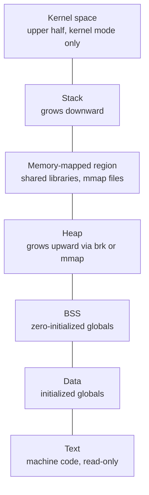

**Reading the diagram.** High addresses are at the top. **Text** holds the program's instructions, mapped read-only so a stray write crashes rather than corrupts. **Data** and **BSS** hold global variables. The **heap** (`malloc`/`new`) grows upward; the **stack** (call frames, locals; one per thread) grows downward. The **memory-mapped region** holds shared libraries and `mmap`ed files (§6.6.6). The gap between heap and stack is *unbacked*: no physical memory is used until a page is touched. The **kernel** region is mapped into every process but protected by the CPU's privilege check. Failure points: a stack overflowing into its guard page (a crash) and a heap growing until memory runs out (§6.6.4). There are no network edges or storage boundaries: this is one process's view of memory.

### 6.3.3 The process control block

::: definition
**Definition — Process control block (PCB).** The kernel data structure that records everything needed to stop a process and later resume it exactly where it left off. In Linux it is `struct task_struct`.
:::

The PCB is the cook's clipboard. It typically contains [Silberschatz et al. 2018]:

- **Identity:** process ID (PID), parent PID, user and group IDs.
- **State:** new, ready, running, blocked, terminated (§6.3.4).
- **CPU context:** saved program counter, stack pointer and general-purpose registers (on Linux these are saved on the task's kernel stack and in `thread_struct`).
- **Scheduling information:** priority, nice value, accumulated CPU time, which run queue it is on.
- **Memory-management information:** a pointer to the page tables and the list of mapped regions (Linux `mm_struct`).
- **I/O and file information:** the table of open file descriptors, current directory.
- **Signal information:** pending signals and installed handlers.
- **Accounting:** CPU time used, start time, resource limits.

On Linux, each thread is also a `task_struct`; threads of one process point at the same `mm_struct` and file table. A `task_struct` is several kilobytes, and each task also has a 16 KiB kernel stack on x86-64 (as of Linux 6.x), so 10,000 threads cost roughly 200 MB of kernel memory before their user-space stacks are counted.

### 6.3.4 Process states

::: definition
**Definition — Process state.** The scheduling status of a process (or thread): whether it is running on a CPU, ready and waiting for a CPU, or blocked waiting for an event.
:::

**Figure 6.2 — Process state diagram.**

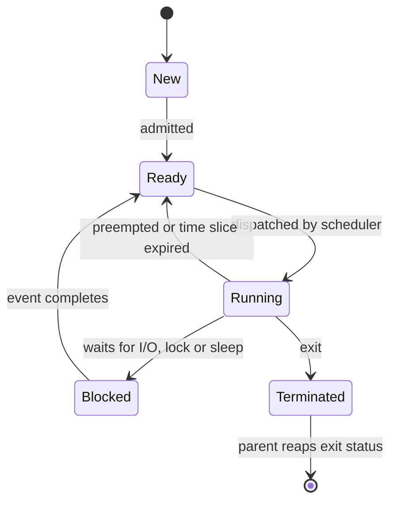

**Reading the diagram.** A process is **New** while the kernel builds its PCB and address space, then **Ready**: runnable but waiting for a CPU. The scheduler (§6.5) **dispatches** one ready task per core to **Running**. A running process leaves the CPU in three ways: it is **preempted** (slice expired or a higher-priority task woke) and returns to Ready; it waits for something not yet available (disk, network packet, lock, timer) and becomes **Blocked**; or it **exits**. When the awaited event occurs, usually signaled by a hardware interrupt (§5.7), the process returns to Ready, *not* straight to Running. A **Terminated** process whose parent has not collected its exit status is a **zombie**. Every transition is made by the kernel.

Linux reports these states in `ps` and `top` with single letters: **R** (running *or* ready, Linux does not distinguish them), **S** (interruptible sleep, the normal blocked state), **D** (uninterruptible sleep, usually waiting on disk or network file system I/O, cannot be killed until the I/O completes), **T** (stopped by a signal or debugger) and **Z** (zombie). On Linux, tasks in **D** count toward the **load average** along with R tasks, which is why a server with a hung NFS mount can show a load average of 200 while its CPUs are idle [Gregg 2020].

### 6.3.5 Threads

::: definition
**Definition — Thread.** An independent sequence of execution within a process, with its own program counter, registers and stack, sharing the process's address space, heap, globals and open files with the process's other threads.
:::

If a process is a cook with a private workstation, threads are several cooks *sharing one workstation*: they pass ingredients instantly (shared memory) but can reach for the same knife at once (a race condition, §6.9).

#### How it works internally

1. A process starts with one thread (the **main thread**).
2. Creating a thread (`pthread_create`, `new Thread()`, `threading.Thread`) asks the kernel, on Linux via the `clone()` system call, to create a new schedulable task that *shares* the address space and file table instead of copying them.
3. The runtime allocates a new **user-space stack** for the thread (by default 8 MiB of *virtual* address space for glibc threads on Linux, taken from `ulimit -s`; 1 MiB for Java platform threads on 64-bit Linux, as of JDK 21) plus a **guard page** below it to catch overflow.
4. The kernel scheduler sees each thread as an independent task. Two threads of one process can run truly simultaneously on two cores.

Linux uses a **1:1 threading model**: every user thread is one kernel task. Go goroutines, Erlang processes and Java virtual threads multiplex many lightweight user-space threads onto a few kernel threads (an **M:N model**, §6.15). New processes are created with `fork()`, a near-copy of the caller made cheap by copy-on-write (§6.6.5), usually followed by `exec()` to load a new program.

**Table 6.1 — Processes versus threads.**

| Aspect | Process | Thread |
|---|---|---|
| Address space | Private | Shared with sibling threads |
| Creation cost (Linux, order of magnitude) | Tens to hundreds of µs (`fork`+`exec` more) | ~10 µs or less |
| Communication | IPC: pipes, sockets, shared memory (§6.12) | Direct reads/writes to shared memory |
| Isolation | Strong: a crash or wild pointer affects only itself | Weak: one bad thread can crash all |
| Context-switch cost | Higher: may change page tables | Lower: same page tables |
| Memory overhead | Full set of page tables and mappings | Stack + kernel task (~16 KiB kernel stack) |
| Typical use | Isolation between services, browser tabs, worker pools (e.g. PostgreSQL backends) | Parallelism inside one service (e.g. Java/Go servers) |
| Choose when | Faults must be contained, or code is not thread-safe | Tasks share large data and need low-latency communication |

The creation-cost figures are orders of magnitude, not benchmarks; measure on your own hardware.

#### Real-world industry applications

::: industry
**PostgreSQL versus MySQL.** PostgreSQL forks one backend *process* per client connection, containing faults at the cost of per-connection memory, which is why large deployments put a pooler such as PgBouncer in front (§14.13). MySQL uses one *thread* per connection inside a single process: cheaper connections, shared fate.
*Evidence: Primary* — [PostgreSQL Docs: Architectural Fundamentals]; [MySQL Docs: Connection Interfaces]
:::

#### Failure scenarios

| What goes wrong | Why | Detection | Recovery | Prevention |
|---|---|---|---|---|
| Zombie processes accumulate until no PIDs are left | Parent never calls `wait()`; in containers, the app runs as PID 1 and does not reap orphans | `ps` shows many `Z` entries; `fork` fails with `EAGAIN` | Restart the parent | Reap children; run a minimal init (e.g. `tini`) as PID 1 in containers |
| Load average 200 but CPU idle | Many tasks in **D** state on hung storage or NFS | `ps -eo stat` shows `D`; `/proc/<pid>/stack` | Fix storage; reboot if stuck | Timeouts on network file systems; monitor I/O latency |

#### Common misconceptions

::: mistake
**"Threads are free."** Each costs a kernel task, kernel stack, user stack and scheduling work. Ten thousand threads is feasible; a million kernel threads on one machine is not (§6.15.6).
:::


## 6.4 Context switching and its cost

::: definition
**Definition — Context switch.** The kernel operation that stops one thread running on a CPU core, saves its CPU state into its PCB, and loads the saved state of another thread so that it resumes where it left off.
:::

### First-principles explanation

Switching between two books, noting your page is quick; reloading the plot into your head is what costs. Likewise, saving and loading registers is quick; the expensive part is that the new thread finds the CPU's caches full of the *old* thread's data. Switching exists because a core runs one thread at a time: pausing a thread that waits for a 10 ms disk read lets the core do useful work meanwhile.

### How it works internally

A switch is triggered in one of two ways. A **voluntary** switch happens when the running thread blocks (reads from an empty socket, waits for a lock, sleeps). An **involuntary** switch happens when the kernel preempts the thread, usually because a periodic **timer interrupt** found its time slice used up or a higher-priority thread became ready.

**Figure 6.3 — A context switch between two threads triggered by a timer interrupt.**

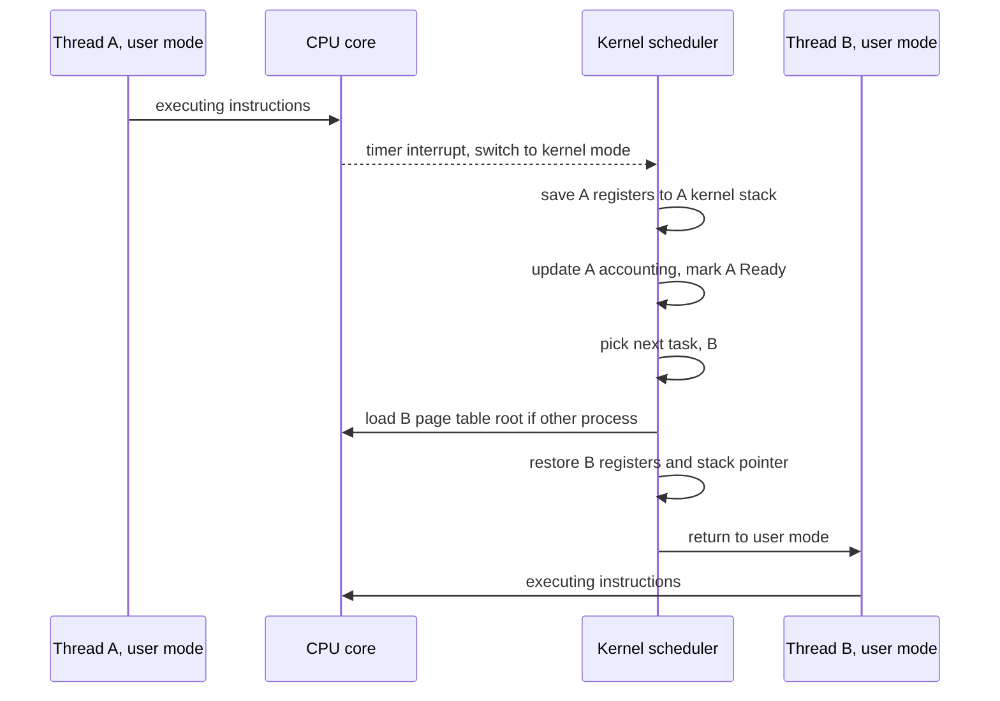

**Reading the diagram.** The dotted arrow is asynchronous: the timer interrupt arrives regardless of what A is doing and forces the CPU into kernel mode, saving A's instruction pointer and stack pointer. Solid arrows are synchronous steps on the same core. The kernel saves A's remaining registers, returns A to the Ready queue and asks the scheduling policy (§6.5) for the next task. If B belongs to a *different process*, the kernel loads B's page-table root (on x86-64, the `CR3` register); **process-context identifiers (PCIDs)** let TLB entries of different processes coexist, avoiding a full TLB flush. B's registers are restored and the CPU returns to user mode. No storage or network is involved; the failure point is performance: too-frequent switches leave the core in the kernel and refilling caches.

### Mathematical foundations

There are two costs.

- **Direct cost** — the kernel instructions above: entering the kernel, saving and restoring registers, running the scheduler, switching page tables. On modern x86-64 Linux this is roughly **1–5 µs** per switch (as of the 2020s; it varies with CPU, kernel version and security mitigations such as those for Spectre and Meltdown).
- **Indirect cost** — after the switch the incoming thread's data and instructions are no longer in the L1/L2 caches (§5.4) and its address translations are no longer in the TLB (§6.6.3), so it runs slowly until they are reloaded. This can exceed the direct cost by one or two orders of magnitude for threads with large working sets [Li et al. 2007].

::: formula
**Context-switch overhead fraction**

$$f = \frac{C}{Q + C}$$

| Symbol | Meaning | Units |
|---|---|---|
| $f$ | Fraction of CPU time lost to switching | dimensionless (0–1) |
| $C$ | Effective cost of one switch, direct + indirect | µs |
| $Q$ | Average time a thread runs between switches | µs |
:::

::: formula
**Cache refill estimate (indirect cost)**

$$C_{\text{refill}} \approx \frac{W}{L} \times \frac{t_{\text{miss}}}{M}$$

| Symbol | Meaning | Units |
|---|---|---|
| $C_{\text{refill}}$ | Time spent reloading the working set after a switch | ns |
| $W$ | Working set that was evicted | bytes |
| $L$ | Cache line size (64 on x86-64 and most ARM servers) | bytes/line |
| $t_{\text{miss}}$ | Latency of one miss to the next memory level | ns |
| $M$ | Memory-level parallelism: misses overlapped in flight | dimensionless (≥ 1) |
:::

::: example
**Worked example — When does switching hurt?**

*Case 1: CPU-bound batch job.* A thread runs a full 4 ms slice ($Q = 4000$ µs) and the direct switch cost is $C = 3$ µs.
$f = 3 / (4000 + 3) = 0.00075$, i.e. **0.075 %** of CPU time. Negligible.

*Case 2: the same switch, but the thread's 1 MiB working set was evicted to DRAM.* $W = 1{,}048{,}576$ bytes, $L = 64$ bytes, so $W/L = 16{,}384$ lines. Take $t_{\text{miss}} = 90$ ns to DRAM and $M = 8$ overlapping misses:
$C_{\text{refill}} = 16{,}384 \times 90 / 8 = 184{,}320$ ns ≈ **184 µs**, about 60× the direct cost.

*Case 3: a chatty server.* Threads handle tiny requests and block on the network every 20 µs ($Q = 20$ µs). With a modest 10 µs effective switch cost (direct plus a small refill), $f = 10 / (20 + 10) = 0.33$: **a third of the CPU goes to switching**.

**Interpretation.** Context switches are cheap when threads run for milliseconds and expensive when they run for microseconds. **Engineering implication:** for high-rate, short-request workloads, prefer designs that do many small units of work per switch: event loops (§6.13), batching (§23.8), fewer threads than cores-times-a-small-factor for CPU-bound pools, and pinning hot threads to cores.
:::

### How to observe it

- `vmstat 1` — the `cs` column is context switches per second for the whole machine. Tens of thousands per second per core is normal for a busy server; hundreds of thousands per core deserves investigation.
- `pidstat -w 1` or `/proc/<pid>/status` — per-task voluntary switches (blocking: lock contention, small I/Os) versus involuntary ones (preemption: CPU contention). If thread migrations between NUMA sockets are frequent, pin threads (§5.10).
- `perf sched` and `perf stat -e context-switches,cpu-migrations` for detailed analysis [Gregg 2020].

::: mistake
**"A context switch costs a few microseconds, so it never matters."** The few microseconds is only the direct cost. The cache and TLB refill afterwards can cost far more, and it appears in your profile as "slow application code", not as kernel time.
:::

## 6.5 CPU scheduling

::: definition
**Definition — CPU scheduler.** The part of the kernel that decides which ready thread runs next on each core and for how long. The rule it follows is the **scheduling policy**; the mechanism that performs the switch is the dispatcher (§6.4).
:::

### First-principles explanation

A doctor with a waiting room is a scheduler. Strict arrival order leaves a 2-minute renewal stuck behind a 60-minute consultation; quickest-first minimizes average waiting but may leave the long case waiting all day; 10 minutes each in rotation means nobody waits long to be *seen*, but long cases finish later. Every CPU scheduling policy is one of these trade-offs. It optimizes some mix of:

- **Turnaround time** — arrival to completion; matters for batch work.
- **Response time** — arrival to first run; matters for interactive work and request handlers.
- **Throughput**, **fairness** (each thread, user or container gets its share) and **utilization**.

These conflict: shortest-job-first minimizes turnaround but is unfair to long jobs; rapid rotation minimizes response time but adds switching overhead.

### 6.5.1 First-come, first-served (FCFS)

Run jobs to completion in arrival order. Simple, but suffers the **convoy effect**: short jobs queue behind a long one. **Shortest job first (SJF)** and its preemptive form **STCF** are optimal for average turnaround but need job lengths in advance, which a general-purpose OS does not have [Arpaci-Dusseau 2018].

### 6.5.2 Round robin (RR)

Run each ready thread for a fixed **time slice** (**quantum**), then move it to the back of the queue. RR gives good response time and cannot starve anyone, but too short a slice wastes time switching (§6.4) and too long a slice degenerates into FCFS. General-purpose systems use roughly 1–10 ms.

::: formula
**Average turnaround and response time**

$$\bar{T}_{\text{turn}} = \frac{1}{n}\sum_{i=1}^{n}\left(T^{\,i}_{\text{completion}} - T^{\,i}_{\text{arrival}}\right) \qquad \bar{T}_{\text{resp}} = \frac{1}{n}\sum_{i=1}^{n}\left(T^{\,i}_{\text{first run}} - T^{\,i}_{\text{arrival}}\right)$$

| Symbol | Meaning | Units |
|---|---|---|
| $n$ | Number of jobs | jobs |
| $T^{\,i}_{\text{arrival}}$ | Time job $i$ became ready | ms |
| $T^{\,i}_{\text{first run}}$ | Time job $i$ first got a CPU | ms |
| $T^{\,i}_{\text{completion}}$ | Time job $i$ finished | ms |
:::

::: example
**Worked example — FCFS vs SJF vs RR on one core.** Three jobs arrive at $t = 0$: A needs 100 ms of CPU, B needs 10 ms, C needs 10 ms. Ignore switching cost.

*FCFS (order A, B, C).* Completions: A = 100, B = 110, C = 120. Average turnaround = (100 + 110 + 120)/3 = **110 ms**. First runs: A = 0, B = 100, C = 110; average response = **70 ms**.

*SJF (order B, C, A).* Completions: B = 10, C = 20, A = 120. Average turnaround = (10 + 20 + 120)/3 = **50 ms**. Average response = (0 + 10 + 20)/3 = **10 ms**.

*RR, 10 ms slice.* A runs 0–10, B 10–20 (done), C 20–30 (done), then A alone 30–120. Average turnaround = (120 + 20 + 30)/3 ≈ **56.7 ms**. Average response = (0 + 10 + 20)/3 = **10 ms**.

**Interpretation.** RR matches SJF's response time and comes close to its turnaround *without knowing job lengths*. FCFS is more than twice as bad on turnaround because two short jobs waited behind a long one. **Engineering implication:** the same convoy effect appears in application queues: one slow request type in a shared FIFO worker pool inflates latency for every fast request. Separate queues or pools per request class (bulkheads, §22.14) apply this lesson at the service level.
:::

### 6.5.3 Priority scheduling

Each thread has a priority; the highest-priority ready thread runs. This lets important work (an audio driver, a heartbeat thread) preempt bulk work, but low-priority threads can **starve**: wait forever because higher-priority work keeps arriving. The classic remedy is **aging**: gradually raise the priority of threads that have waited a long time. Priorities also create **priority inversion** with locks (§6.11.5).

### 6.5.4 Multi-level feedback queue (MLFQ)

MLFQ, first described for the CTSS time-sharing system in 1962 by Corbató and colleagues, learns a thread's behavior instead of requiring it to be declared. It keeps several RR queues at different priority levels and applies five rules, as formulated in OSTEP [Arpaci-Dusseau 2018]:

1. If priority(A) > priority(B), A runs.
2. If priority(A) = priority(B), A and B run round robin.
3. A new job starts at the highest priority.
4. Once a job uses up its time allotment at a level, however many times it gave up the CPU, its priority drops one level.
5. After some period S, move every job back to the top queue (a **priority boost**).

**Figure 6.4 — Multi-level feedback queue decisions.**

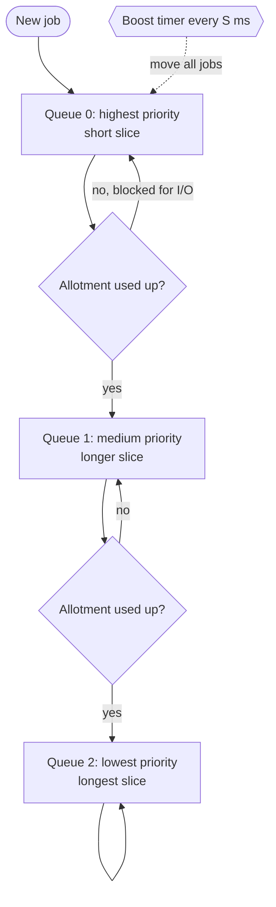

**Reading the diagram.** Rectangles are run queues; the highest non-empty queue is served (rule 1), round robin within it (rule 2). New jobs enter Queue 0 (rule 3). Interactive jobs block for I/O before exhausting their allotment and stay high, so they respond fast; CPU-bound jobs sink to lower queues with longer slices (rule 4). The dotted arrow is the asynchronous priority boost (rule 5), which prevents starvation of the bottom queue. Counting *total* allotment used stops a program gaming the scheduler by yielding just before its slice expires. Variants of MLFQ underlie the schedulers of BSD derivatives, Solaris and Windows [Arpaci-Dusseau 2018].

### 6.5.5 Linux: CFS and EEVDF

Linux's normal scheduling class (`SCHED_NORMAL`, also called `SCHED_OTHER`) aims at **proportional-share fairness**: each runnable thread should get a share of CPU proportional to its **weight**, which is derived from its **nice value** (−20 = highest weight, +19 = lowest).

**CFS (Completely Fair Scheduler)** was the default from Linux 2.6.23 (2007) until Linux 6.6 (2023). It tracks for each thread a **virtual runtime** (`vruntime`): actual CPU time scaled inversely by weight. It keeps runnable threads in a red-black tree ordered by `vruntime` and always runs the thread that has had the least weighted CPU, so picking the next thread costs $O(\log n)$ [Linux Docs: CFS].

**EEVDF (Earliest Eligible Virtual Deadline First)** replaced CFS's selection logic in Linux 6.6 (October 2023), based on an algorithm by Stoica and Abdel-Wahab [Stoica & Abdel-Wahab 1995]. Each thread has a **lag**: CPU time owed minus time received. Threads with non-negative lag are **eligible**; among them EEVDF runs the one with the earliest **virtual deadline** (roughly eligible time plus requested slice divided by weight). Fairness is kept, and latency-sensitive threads that request shorter slices get a principled advantage instead of hand-tuned heuristics [Linux Docs: EEVDF; Corbet 2023]. The default base slice is about 0.75 ms (as of Linux 6.6–6.x, scaled up on many-CPU machines).

Linux also has **real-time** classes (`SCHED_FIFO`, `SCHED_RR`, priorities 1–99) that always preempt normal threads, `SCHED_DEADLINE` for tasks with explicit runtime and period guarantees, and, from Linux 6.12 (2024), **sched_ext**, which lets a scheduling policy be loaded as a BPF program [Linux man-pages: sched(7)].

::: formula
**Proportional CPU share**

$$s_i = \frac{w_i}{\sum_{j \in R} w_j}$$

| Symbol | Meaning | Units |
|---|---|---|
| $s_i$ | Fraction of one core's time thread $i$ receives when all threads in $R$ compete | dimensionless (0–1) |
| $w_i$ | Weight of thread $i$, from its nice value (nice 0 = 1024; each nice step changes weight by about 1.25×) | dimensionless |
| $R$ | Set of runnable threads competing on that core | — |
:::

::: example
**Worked example — Nice values.** Two CPU-bound threads share one core. Thread X has nice 0 (weight 1024); thread Y has nice 5 (weight 335, from the kernel's weight table).
$s_X = 1024 / (1024 + 335) = 1024 / 1359 ≈ 0.753$; $s_Y ≈ 0.247$.
**Interpretation.** Five nice levels give roughly a 3:1 split, consistent with the rule of thumb that each nice step shifts about 10 % of CPU between two competing threads. **Engineering implication:** to keep a log-compaction or backup job from hurting request latency on the same machine, running it at nice 10–19 is a cheap first step; cgroup CPU weights do the same for whole containers.
:::

**Table 6.2 — CPU scheduling policies compared.**

| Policy | How it works | Advantages | Disadvantages | Choose when |
|---|---|---|---|---|
| FCFS | Run in arrival order to completion | Simple, no switching | Convoy effect; poor response time | Batch queues of similar-sized jobs |
| SJF / STCF | Shortest (remaining) job first | Optimal average turnaround | Needs job lengths; starves long jobs | Job sizes known (some batch systems) |
| Round robin | Fixed slice, rotate | Good response time; no starvation | Switching overhead; poor turnaround for equal jobs | Time-sharing with similar priorities |
| Priority | Highest priority runs | Important work goes first | Starvation; priority inversion | Real-time and control systems |
| MLFQ | Priority queues; demote CPU hogs; periodic boost | Learns behavior; good interactivity | Many tuning knobs | General-purpose desktops and servers |
| CFS / EEVDF (Linux) | Weighted fair share by virtual runtime; EEVDF adds lag and virtual deadlines | Fair, scalable, tunable by nice and cgroups | Fairness is not latency; complex | Default on Linux servers (as of 2026) |

#### Real-world industry applications

::: industry
**CPU limits in containers cause throttling.** Kubernetes CPU limits use CFS **bandwidth control**: a cgroup gets a CPU-time quota per period (default 100 ms, `cpu.max` in cgroup v2). A service limited to 1 CPU with 4 busy threads uses its quota in 25 ms and is **throttled** for the remaining 75 ms, delaying in-flight requests even on an idle node. `nr_throttled` in `cpu.stat` reveals it. Mitigations: raise or remove limits for latency-critical services, or size thread pools to the limit rather than the host's cores (§42.13).
*Evidence: Primary* — [Linux Docs: CFS Bandwidth Control]
:::

#### Common misconceptions

::: mistake
**"Nice -20 makes my latency-sensitive service fast."** Nice changes the *share* of CPU under contention; on a machine that is not CPU-saturated it has almost no effect. For latency, keep runnable threads below core count and avoid CPU throttling.
:::

## 6.6 Virtual memory, paging and the page cache

### 6.6.1 The idea of virtual memory

::: definition
**Definition — Virtual memory.** A mechanism in which every address a program uses is a **virtual address** that the hardware's **memory-management unit (MMU)** translates, using tables maintained by the kernel, into a **physical address** in RAM, or into a fault if no valid mapping exists.
:::

#### First-principles explanation

A hotel guest is told "you are in room 12"; the front desk's private sheet for that guest says room 12 is physically room 407. Two guests can both have "room 12", luggage can be moved without telling the guest, and a guest asking for a room not on their sheet is stopped at the desk. Virtual memory gives each process exactly this, and so delivers **isolation** (separate tables), **convenience** (the same layout for everyone, Figure 6.1) and **flexibility** (memory allocated lazily, shared, mapped to files or moved to disk).

### 6.6.2 Paging and page tables

Memory is divided into fixed-size blocks: **pages** in virtual memory and **frames** in physical memory, typically **4 KiB** on x86-64 and most ARM servers. A virtual address is split into a **virtual page number** and an **offset** within the page. The kernel keeps a **page table** per process that maps virtual page numbers to physical frame numbers, plus permission bits: *present*, *writable*, *user-accessible*, *no-execute*, and *accessed*/*dirty* flags that the hardware sets so the kernel knows which pages were used or modified.

A flat table for 128 TiB of virtual space would need 2³⁵ entries, far too large. So the table is a **multi-level tree**: on x86-64 with 4-level paging, the 48-bit address is split into four 9-bit indices (one per level) and a 12-bit offset (9 + 9 + 9 + 9 + 12 = 48). Only the branches actually used are allocated. Newer CPUs support 5-level paging (57-bit addresses) for very large-memory machines.

### 6.6.3 The TLB

Walking a four-level tree means up to four extra memory reads for every load or store, which would make every memory access several times slower. The **translation lookaside buffer (TLB)** is a small cache inside the CPU core that holds recent virtual-to-physical translations. Typical server cores have tens of entries in the first-level TLB and roughly 1,000–3,000 entries in a second-level TLB (as of 2020s x86-64 and ARM designs; consult your CPU's documentation).

**Figure 6.5 — Translating a virtual address: TLB, page walk and page fault.**

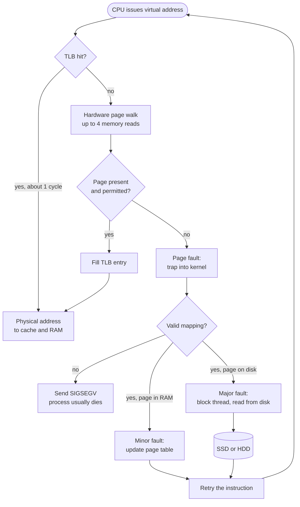

**Reading the diagram.** Every load, store and instruction fetch starts at the top. A **TLB hit** makes translation essentially free. On a **miss**, the MMU hardware walks the page table; if the entry is present and permitted, the TLB is filled. Otherwise the CPU raises a **page fault**, a synchronous trap into the kernel. An invalid address (null pointer, write to read-only code) gets **SIGSEGV**. A valid page already in RAM (a shared library page, a fresh zero page on first touch) is a cheap **minor fault**: the kernel just fills in the entry. A page that must come from storage (a file page or a swapped-out page) is a **major fault**: the thread blocks while the disk is read, the storage boundary in this figure. Then the instruction is retried. The failure point that matters is the major-fault path, which turns a 100 ns access into a 100 µs (SSD) to 10 ms (HDD) wait.

::: formula
**TLB reach**

$$R_{\text{TLB}} = E \times P$$

| Symbol | Meaning | Units |
|---|---|---|
| $R_{\text{TLB}}$ | Amount of memory addressable without a TLB miss | bytes |
| $E$ | Number of TLB entries | entries |
| $P$ | Page size per entry | bytes |
:::

::: formula
**Effective memory access time with page faults**

$$\text{EAT} = (1 - p) \times t_{\text{mem}} + p \times t_{\text{fault}}$$

| Symbol | Meaning | Units |
|---|---|---|
| EAT | Average time per memory access | ns |
| $p$ | Probability that an access causes a major page fault | dimensionless (0–1) |
| $t_{\text{mem}}$ | Time for an access with no fault | ns |
| $t_{\text{fault}}$ | Time to service a major fault, including the disk read | ns |
:::

::: example
**Worked example — Why huge pages and why swapping hurts.**

*TLB reach.* A core with $E = 1{,}536$ second-level entries and 4 KiB pages has $R = 1{,}536 \times 4 = 6{,}144$ KiB = **6 MiB**. A database with a 64 GiB in-memory buffer pool touching memory randomly will miss in the TLB on most accesses. With 2 MiB **huge pages**, the same entries cover $1{,}536 \times 2$ MiB = **3 GiB**, 512× more. This is why databases and JVMs often use explicit huge pages.

*Page faults.* Let $t_{\text{mem}} = 100$ ns and a major fault from an NVMe SSD take $t_{\text{fault}} = 100$ µs = 100,000 ns. If one access in 10,000 faults ($p = 10^{-4}$):
EAT $= 0.9999 \times 100 + 0.0001 \times 100{,}000 = 99.99 + 10 ≈$ **110 ns**, a 10 % slowdown.
To keep the slowdown under 10 % with a 10 ms HDD ($t_{\text{fault}} = 10^7$ ns), we need $p \times 10^7 < 10$, i.e. $p < 10^{-6}$: **fewer than one fault per million accesses**.

**Interpretation.** Even rare major faults dominate the average. **Engineering implication:** a latency-sensitive service must keep its working set in RAM. When the working set exceeds RAM and the system swaps heavily (**thrashing**), throughput collapses by orders of magnitude rather than degrading gracefully.
:::

### 6.6.4 Demand paging and overcommit

Linux allocates physical memory lazily: `malloc(1 GiB)` reserves only virtual addresses, and frames are assigned on first touch. It also **overcommits** by default, promising more virtual memory than exists. When the bet fails, the **OOM killer** kills a process, typically the largest, with SIGKILL; a container exceeding its cgroup limit (`memory.max`) is killed the same way (§42.3). Watch **resident set size** (RSS, physical pages in use), not virtual size.

### 6.6.5 Copy-on-write

When `fork()` creates a child, the kernel shares all the parent's pages with the child and marks them read-only in both. The first write by either side triggers a fault, and only then is that one page copied. This makes `fork` fast and allows a process to take a consistent **snapshot** of its memory cheaply.

::: industry
**Redis background snapshots.** Redis calls `fork()` to snapshot; the child writes its frozen copy-on-write view to disk while the parent keeps serving writes. Overhead is proportional to pages modified meanwhile, up to twice the dataset for write-heavy instances. Redis recommends disabling **Transparent Huge Pages**, because then one small write copies a 2 MiB page instead of 4 KiB, causing latency spikes.
*Evidence: Primary* — [Redis Docs: Persistence]; [Redis Docs: Latency diagnosis]
:::

### 6.6.6 The page cache and mmap

::: definition
**Definition — Page cache.** The kernel's in-RAM cache of file contents, organized in pages. Reads are served from it when possible; writes normally modify pages in it (marking them **dirty**) and return immediately, with the kernel writing them back to storage later.
:::

Linux uses almost all otherwise-free RAM as page cache, so `free` reports little "free" memory on a healthy server; watch "available" instead. By default dirty pages are written back by kernel threads after they have been dirty for about 30 s, checked every 5 s (`vm.dirty_expire_centisecs = 3000`, `vm.dirty_writeback_centisecs = 500`, as of Linux 6.x) or sooner under memory pressure. The consequence for durability is in §6.14.

**`mmap`** maps a file directly into a process's address space: reading the memory reads the file through the page cache, with no `read()` system call and no copy into a user buffer. It is elegant for read-mostly data (shared libraries are loaded this way), but it hides I/O inside ordinary memory accesses: any pointer dereference may block on a major fault, I/O errors arrive as a `SIGBUS` signal instead of an error code, and the kernel, not the application, decides what to evict. Crotty, Leis and Pavlo argue that for these reasons database systems should usually manage their own buffer pool instead of relying on `mmap` [Crotty et al. 2022] (see §13.4).

::: industry
**Apache Kafka relies on the page cache.** Kafka brokers append to log files and let the OS page cache hold recent data instead of caching messages in the JVM, avoiding double caching, surviving process restarts and keeping heaps small. Consumers of recent data are served from the page cache via `sendfile`, without copying through user space (§31.13).
*Evidence: Primary* — [Apache Kafka Docs: Design, Persistence]
:::

### 6.6.7 Swapping

**Swapping** moves rarely used **anonymous** pages (heap and stack, with no file behind them) to disk so their frames can be reused; clean file-backed pages are simply dropped and re-read later. Modest swap moves idle memory out of the way; swapping a working set is thrashing. Many latency-sensitive deployments disable swap or set `vm.swappiness` low.

#### Failure scenarios

| What goes wrong | Why | Detection | Recovery | Prevention |
|---|---|---|---|---|
| Process killed with exit code 137, no error log | OOM killer or cgroup limit sent SIGKILL | `dmesg` "Out of memory: Killed process"; container `OOMKilled` status | Restart with more memory | Set memory limits above peak RSS; bound caches and queues |
| Latency rises 100× under load | Working set exceeds RAM; major faults or swap thrashing | `vmstat` `si`/`so` columns; major-fault counters (`sar -B`) | Add RAM or shed load | Capacity plan working set; avoid swap for latency tiers |
| "Free memory is 1 %" alert fires constantly | Page cache is counted as used | Compare with "available" | None needed | Alert on available memory and major faults instead |


## 6.7 System calls and the kernel/user boundary

::: definition
**Definition — System call (syscall).** A controlled entry from user mode into the kernel to request a privileged service, such as reading a file, sending on a socket, allocating memory or creating a process. Linux x86-64 has a few hundred system calls, each identified by a number [Linux man-pages: syscalls(2)].
:::

### First-principles explanation

A bank customer cannot walk into the vault; they hand a slip through one narrow window where every request is checked. A system call is that window, and library functions such as `printf` or Python's `open()` are wrappers that fill in the slip.

### How it works internally

**Figure 6.6 — A `read()` system call that must wait for the disk.**

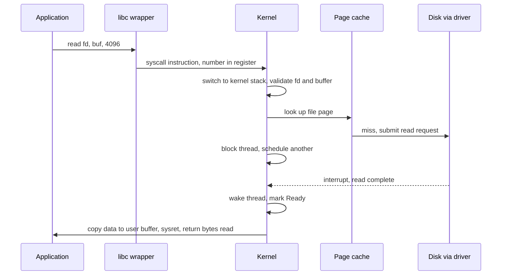

**Reading the diagram.** The library wrapper puts the system-call number and arguments in registers and executes the `syscall` instruction, entering the kernel at a fixed entry point, the only way in. The kernel *validates* everything, since user code can pass any value: is the descriptor open, does the buffer lie in the caller's memory? On a page-cache hit (§6.6.6) it copies the data and returns within about a microsecond. On a miss it submits a request across the storage boundary and the thread **blocks** (a voluntary context switch). The dotted arrow is the device's asynchronous completion interrupt; the thread becomes Ready, runs again, and the kernel copies the data out and returns. Failure points: bad arguments return `EBADF` or `EFAULT`, device errors `EIO`, and a signal can interrupt a slow call with `EINTR`, which callers must retry.

### What it costs

A trivial system call costs on the order of **100 ns to a few hundred ns** on modern x86-64 Linux, against about 1–5 ns for a function call (as of the 2020s). The cost rose in 2018 when **kernel page-table isolation (KPTI)**, the Meltdown mitigation, began switching page tables on every kernel entry on affected CPUs. A rough Python measurement on this chapter's test VM found `os.getppid()` at about 190 ns per call against about 50 ns for a built-in function call.

Three techniques reduce syscall cost:

1. **Batching** — do more per call: `readv`/`writev` for scatter/gather I/O, `sendmmsg` for many UDP datagrams, larger buffers.
2. **vDSO (virtual dynamic shared object)** — the kernel maps a small read-only library into every process so that some calls, notably `clock_gettime` and `gettimeofday`, run entirely in user mode by reading kernel-maintained data.
3. **Shared-memory rings** — `io_uring` (§6.13.5) lets the application queue many I/O requests in memory shared with the kernel, submitting them with one system call or, in polled mode, none.

To observe system calls, `strace -c -p <pid>` counts and times them (with heavy overhead); `perf trace` and eBPF tools such as `syscount` are cheaper [Gregg 2020].

::: mistake
**"Calling `write()` means my data is on disk."** `write()` returns when the data is in the page cache. It is durable only after a successful `fsync()` (§6.14.3).
:::

## 6.8 Concurrency versus parallelism

::: definition
**Definition — Concurrency and parallelism.** **Concurrency** is the *structuring* of a program as multiple tasks whose lifetimes overlap, so that progress on one does not wait for the others to finish. **Parallelism** is the *simultaneous execution* of multiple computations on multiple hardware units (cores, CPUs, GPUs).
:::

One cook juggling three dishes, stirring one while another simmers, is concurrent but not parallel. Three cooks each making one dish are parallel. Rob Pike's summary: concurrency is about *dealing with* many things at once; parallelism is about *doing* many things at once [Pike 2012].

**I/O-bound** work (a web server waiting on databases) needs concurrency: thousands of requests in flight, mostly waiting, which one core can serve with an event loop (§6.13). **CPU-bound** work (image encoding) needs parallelism, with speed-up limited by the serial fraction (Amdahl's Law, §4.12). Concurrency alone gives no CPU speed-up.

CPython's **global interpreter lock (GIL)** is the standard illustration: Python threads are concurrent, and overlap well while waiting on I/O, but only one executes Python bytecode at a time, so CPU-bound Python code gains nothing from threads. Use processes (`multiprocessing`), native extensions that release the GIL, or the optional free-threaded build of CPython (experimental in 3.13, officially supported but not the default in 3.14, as of 2026) for CPU parallelism.

## 6.9 Race conditions and critical sections

::: definition
**Definition — Race condition.** A bug in which the result of a program depends on the relative timing or interleaving of concurrent operations on shared state. A **data race** is the specific case where two threads access the same memory location concurrently, at least one access is a write, and nothing orders them.
:::

::: definition
**Definition — Critical section.** A region of code that accesses shared state and must not be executed by more than one thread at a time. Guaranteeing this is **mutual exclusion**.
:::

### First-principles explanation

Two people deposit $50 at the same moment into a shared account holding $100, at different cash machines. Each machine reads $100, adds $50 and writes $150; the correct balance is $200. Neither machine erred alone: the bug is the *interleaving* of read, modify and write, the **lost update**.

**Figure 6.7 — Two threads lose an update to a shared counter.**

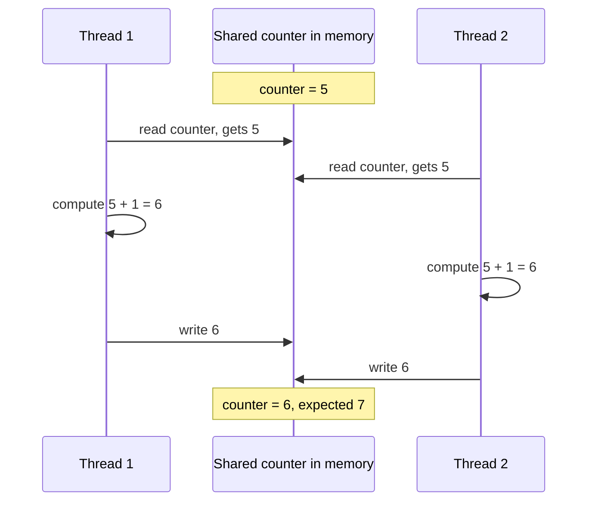

**Reading the diagram.** Each arrow is a synchronous step, but the two threads' steps interleave in an order chosen by the scheduler and hardware. Both read before either writes, so one increment is lost. The critical section is *read, compute, write*; making it indivisible, with a lock or one atomic instruction, removes the bug. The same failure occurs across machines when two service instances read-modify-write a database row (§11.13, §26.13).

### Code example

The Python program below makes the race visible. `counter += 1` in CPython is not atomic, but the GIL makes the bad interleaving rare, so `time.sleep(0)` deliberately yields the CPU between the read and the write, exactly where a preemption could occur.

```python
"""Lost updates: a read-modify-write race, then the fix with a mutex."""
import threading
import time

N_THREADS = 4
N_INCREMENTS = 10_000

counter = 0
lock = threading.Lock()


def unsafe_increment() -> None:
    global counter
    for _ in range(N_INCREMENTS):
        current = counter      # 1. read
        time.sleep(0)          # widen the window: yield the CPU (see note)
        counter = current + 1  # 2. modify + 3. write


def safe_increment() -> None:
    global counter
    for _ in range(N_INCREMENTS):
        with lock:             # critical section starts
            current = counter
            time.sleep(0)
            counter = current + 1
                               # critical section ends (lock released)


def run(worker) -> int:
    global counter
    counter = 0
    threads = [threading.Thread(target=worker) for _ in range(N_THREADS)]
    for t in threads:
        t.start()
    for t in threads:
        t.join()
    return counter


if __name__ == "__main__":
    expected = N_THREADS * N_INCREMENTS
    print(f"expected       = {expected}")
    print(f"without a lock = {run(unsafe_increment)}")
    print(f"with a lock    = {run(safe_increment)}")
```

A run on CPython 3.13 printed `expected = 40000`, `without a lock = 10000` and `with a lock = 40000`; the unsafe count varies between runs.

What to notice:

- The unsafe version loses about three quarters of the increments: writes overwrite each other.
- `with lock:` makes read-compute-write a critical section: correct, but threads now take turns.
- Removing `time.sleep(0)` makes the race *rarer*, not absent. Tests that pass "most of the time" are the hallmark of races.

The Go version needs no artificial delay, because goroutines run in parallel on multiple cores:

```go
// Three counters incremented by many goroutines: racy, mutex, atomic.
package main

import (
	"fmt"
	"sync"
	"sync/atomic"
)

const goroutines = 8
const increments = 100_000

func main() {
	var wg sync.WaitGroup

	// 1. Racy: counter++ is a read-modify-write, not one indivisible step.
	racy := 0
	for g := 0; g < goroutines; g++ {
		wg.Add(1)
		go func() {
			defer wg.Done()
			for i := 0; i < increments; i++ {
				racy++
			}
		}()
	}
	wg.Wait()

	// 2. Mutex: only one goroutine at a time inside the critical section.
	var mu sync.Mutex
	locked := 0
	for g := 0; g < goroutines; g++ {
		wg.Add(1)
		go func() {
			defer wg.Done()
			for i := 0; i < increments; i++ {
				mu.Lock()
				locked++
				mu.Unlock()
			}
		}()
	}
	wg.Wait()

	// 3. Atomic: the hardware performs the increment indivisibly.
	var atomicCount atomic.Int64
	for g := 0; g < goroutines; g++ {
		wg.Add(1)
		go func() {
			defer wg.Done()
			for i := 0; i < increments; i++ {
				atomicCount.Add(1)
			}
		}()
	}
	wg.Wait()

	fmt.Println("expected:", goroutines*increments)
	fmt.Println("racy:    ", racy)
	fmt.Println("mutex:   ", locked)
	fmt.Println("atomic:  ", atomicCount.Load())
}
```

On a 4-core VM with Go 1.24, `go run .` printed `racy: 493557` against `expected: 800000`; the mutex and atomic counters were exact.

What to notice:

- `go run -race .` runs Go's **race detector**, which reports `WARNING: DATA RACE` with both stack traces; use `-race` in CI [Go Docs: Data Race Detector].
- `atomic.Int64` (Go 1.19+) is one locked hardware instruction, usually faster than a mutex for a single counter; for two or more variables, use a mutex.
- In Go, Java and C/C++, racy programs have weak or undefined semantics: compilers and CPUs may reorder or cache values [Go Docs: Memory Model].

::: mistake
**"It is only a counter; a small error is fine."** The same pattern guards bank balances, inventory counts, rate-limit tokens and "is this seat booked?" flags. Treat every read-modify-write of shared state as a critical section, or replace it with a single atomic operation.
:::

## 6.10 Synchronization primitives

Each primitive below answers a specific coordination problem. Table 6.3 at the end of the section compares them.

### 6.10.1 Mutexes and spinlocks

::: definition
**Definition — Mutex (mutual-exclusion lock).** An object with two operations, `lock` and `unlock`, guaranteeing that at most one thread holds it at a time. A thread that calls `lock` while another holds it waits.
:::

A mutex is the key to a single-occupancy bathroom. A **spinlock** waits by looping, burning CPU but reacting within nanoseconds; it suits tiny kernel critical sections. A **blocking mutex** puts the waiter to sleep (§6.4) and wakes it on unlock. Linux builds mutexes on **futexes**: an uncontended lock is one atomic instruction in user space; only under contention does the thread call `futex()` to sleep in the kernel [Franke et al. 2002]. Most mutexes spin briefly, then sleep. Uncontended locks cost tens of nanoseconds; contended ones cost microseconds of context switching.

### 6.10.2 Semaphores

::: definition
**Definition — Semaphore.** An integer counter with two atomic operations introduced by Dijkstra: **wait** (P, or *acquire*) decrements it and blocks if the result would be negative; **signal** (V, or *release*) increments it and wakes a waiter [Dijkstra 1965].
:::

A semaphore initialized to *N* is a car park with *N* spaces: the natural tool for **limiting concurrency**, such as at most 20 database connections or 4 concurrent inferences on one GPU. Unlike a mutex, any thread may signal it, so it has no owner and cannot support priority inheritance (§6.11.5).

### 6.10.3 Condition variables

::: definition
**Definition — Condition variable.** A queue of threads waiting for some condition on shared state to become true, always used together with a mutex. `wait` atomically releases the mutex and sleeps; `notify` (`signal`) wakes one waiter and `notify_all` (`broadcast`) wakes all.
:::

A mutex answers "only one at a time"; a condition variable answers "wait until something is true", such as "the queue is not empty". The bounded buffer below is the canonical example: producers wait while the buffer is full, consumers while it is empty.

```python
"""A bounded buffer (producer/consumer) built from one mutex and two condition variables."""
import threading
from collections import deque


class BoundedBuffer:
    def __init__(self, capacity: int) -> None:
        self.capacity = capacity
        self.items = deque()
        self.lock = threading.Lock()
        self.not_full = threading.Condition(self.lock)   # producers wait here
        self.not_empty = threading.Condition(self.lock)  # consumers wait here

    def put(self, item) -> None:
        with self.lock:
            while len(self.items) == self.capacity:      # while, not if
                self.not_full.wait()                     # releases lock while asleep
            self.items.append(item)
            self.not_empty.notify()                      # wake one consumer

    def get(self):
        with self.lock:
            while not self.items:
                self.not_empty.wait()
            item = self.items.popleft()
            self.not_full.notify()                       # wake one producer
            return item


if __name__ == "__main__":
    buf = BoundedBuffer(capacity=8)
    N_PRODUCERS, PER_PRODUCER = 3, 10_000
    results = []

    def producer(pid: int) -> None:
        for i in range(PER_PRODUCER):
            buf.put((pid, i))

    def consumer() -> None:
        for _ in range(N_PRODUCERS * PER_PRODUCER):
            results.append(buf.get())

    threads = [threading.Thread(target=producer, args=(p,)) for p in range(N_PRODUCERS)]
    threads.append(threading.Thread(target=consumer))
    for t in threads:
        t.start()
    for t in threads:
        t.join()
    print("consumed:", len(results), "unique:", len(set(results)))
```

Output: `consumed: 30000 unique: 30000`.

What to notice:

- The condition is re-checked in a **`while` loop**: under **Mesa semantics**, used by almost every real system, a woken thread only becomes runnable, and another thread may take the item first; **spurious wake-ups** are also allowed [Lampson & Redell 1980].
- `wait()` releases the lock while sleeping and reacquires it before returning.
- The bounded capacity is **backpressure** (§22.10): producers slow to the consumer's pace instead of exhausting memory. Python's `queue.Queue` works this way.

### 6.10.4 Atomics and compare-and-swap

::: definition
**Definition — Compare-and-swap (CAS).** An atomic CPU instruction that, in one indivisible step, compares a memory location with an expected value and, only if they are equal, replaces it with a new value, reporting whether it succeeded. On x86-64 it is `LOCK CMPXCHG`; ARMv8.1 and later provide `CAS`, and earlier ARM uses load-linked/store-conditional pairs.
:::

Atomic instructions (atomic add, exchange, CAS) make a single read-modify-write indivisible in hardware, with no lock and no sleeping. CAS is the building block for everything else: to apply any update, read the current value, compute the new one, and CAS it in; if another thread changed the value meanwhile, the CAS fails and you retry.

```java
import java.util.concurrent.atomic.AtomicLong;

/** A lock-free "max seen so far" tracker built from a compare-and-swap retry loop. */
public class CasCounter {
    private final AtomicLong max = new AtomicLong(Long.MIN_VALUE);
    private final AtomicLong retries = new AtomicLong();

    void offer(long candidate) {
        while (true) {
            long current = max.get();                       // 1. read
            if (candidate <= current) return;               // nothing to do
            if (max.compareAndSet(current, candidate)) {    // 2. swap only if unchanged
                return;
            }
            retries.incrementAndGet();                      // 3. someone beat us: retry
        }
    }

    public static void main(String[] args) throws InterruptedException {
        CasCounter tracker = new CasCounter();
        Thread[] workers = new Thread[4];
        for (int t = 0; t < workers.length; t++) {
            final int id = t;
            workers[t] = new Thread(() -> {
                for (long i = 0; i < 1_000_000; i++) {
                    tracker.offer(i * workers.length + id);
                }
            });
            workers[t].start();
        }
        for (Thread w : workers) w.join();
        System.out.println("max     = " + tracker.max.get());   // 3999999
        System.out.println("retries = " + tracker.retries.get());
    }
}
```

On JDK 21 with 4 threads this printed `max = 3999999` and several hundred thousand retries.

What to notice:

- No thread blocks; a failed CAS means another thread made progress. This is **lock-free** progress.
- Each retry bounced a cache line between cores (§5.4); under heavy contention a CAS loop can be slower than a mutex.
- Atomics also impose **memory ordering**: writes before an atomic store become visible to threads that observe it. Plain variables have no such guarantee.

### 6.10.5 Read-write locks

A **read-write lock** allows many concurrent readers or one writer. It helps when reads dominate *and* critical sections are long, such as a routing table. Caveats: every reader updates the lock's shared counter, so for very short reads on many cores it can be slower than a mutex; and readers can starve writers unless the lock is **writer-preferring**. For read-mostly data, **copy-on-write snapshots** (readers load an atomic pointer to an immutable version; writers swap in a new one) and Linux's **read-copy-update (RCU)** avoid reader locking entirely.

### 6.10.6 Lock-free data structures and the ABA problem

A **lock-free** data structure guarantees that some thread always makes progress, even if others are paused mid-operation; a **wait-free** one guarantees that *every* thread finishes in a bounded number of steps [Herlihy & Shavit 2012]. The classic example is the **Treiber stack** [Treiber 1986]: `push` reads the current top, sets the new node's `next` to it, and CASes the top from old to new.

The **ABA problem** breaks naive CAS designs. CAS checks only that the value *looks* the same, not that it *is* unchanged:

1. Thread 1 reads top = A (with A.next = B) and is preempted before its CAS(top, A → B).
2. Thread 2 pops A, pops B, frees B, then pushes A back (or a new node reusing A's memory). Top is A again, but A.next is now something else.
3. Thread 1 resumes; CAS(top, A → B) *succeeds*, because top equals A, and installs the freed node B as the top. The stack is corrupted.

Remedies: pair the pointer with a **version counter** and CAS both together (a tagged pointer); use **hazard pointers** [Michael 2004] or **epoch-based reclamation** so memory is not reused while any thread may hold a reference; or rely on garbage collection, which prevents node reuse while referenced. In practice, use tested concurrent collections (`java.util.concurrent`, Go channels, Rust's `crossbeam`) rather than writing your own.

**Table 6.3 — Synchronization primitives compared.**

| Primitive | Problem it solves | Waiting behavior | Typical cost (uncontended) | Pitfalls | Choose when |
|---|---|---|---|---|---|
| Spinlock | Mutual exclusion for tiny sections | Busy-waits | ~10–20 ns | Wastes CPU; terrible if holder is preempted | Kernel code, sections of a few instructions |
| Mutex | Mutual exclusion | Spin briefly, then sleep | ~20–50 ns | Deadlock, contention, priority inversion | Default for protecting shared state |
| Semaphore | Limit concurrency to N | Sleeps | Similar to mutex | No ownership; easy to miscount | Connection or resource pools |
| Condition variable | Wait until a predicate holds | Sleeps, releases mutex | Similar to mutex | Must loop on predicate; lost wake-ups | Queues, producer/consumer |
| Atomic / CAS | Single-variable read-modify-write | Never sleeps; may retry | ~5–20 ns; more when contended | Only one variable; ABA; ordering subtleties | Counters, flags, pointers |
| Read-write lock | Many readers, rare writers | Sleeps | Higher than mutex | Writer starvation; reader-counter contention | Long read-mostly sections |
| Lock-free structure | Progress without locks | Never sleeps | Varies | ABA; memory reclamation; very hard to verify | Proven library implementations only |

Costs are orders of magnitude on current x86-64 servers (as of the 2020s) and grow sharply under contention, when cache lines move between cores.

## 6.11 Deadlock, livelock, starvation and priority inversion

### 6.11.1 Deadlock and the Coffman conditions

::: definition
**Definition — Deadlock.** A state in which each thread in a set is waiting for a resource held by another thread in the same set, so none can ever proceed.
:::

Four cars at a four-way junction, each waiting for the car on its right, will never move. Deadlock requires all four of these conditions at once [Coffman et al. 1971; Tanenbaum & Bos 2014]:

1. **Mutual exclusion** — a resource can be held by only one thread at a time.
2. **Hold and wait** — a thread holds at least one resource while waiting for another.
3. **No preemption** — a resource cannot be forcibly taken away; it is released only voluntarily.
4. **Circular wait** — there is a cycle of threads, each waiting for a resource held by the next.

**Figure 6.8 — Resource-allocation graph with a deadlock cycle.**

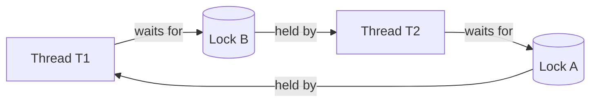

**Reading the diagram.** Rectangles are threads, cylinders are locks. Thread → lock means "waits for"; lock → thread means "is held by". Following the arrows from T1 returns to T1: a **cycle**. With single-instance resources such as locks, a cycle is necessary and sufficient for deadlock, which is how deadlock detectors, including those in databases (§11.15), work. Every edge is a synchronous blocking wait; breaking any one edge removes the deadlock.

The code below produces exactly this cycle. Because a real deadlock would hang forever, it uses `acquire(timeout=...)` to detect the situation:

```python
"""Two threads take two locks in opposite order -> deadlock (detected via timeout)."""
import threading
import time

lock_a = threading.Lock()
lock_b = threading.Lock()


def worker(name: str, first: threading.Lock, second: threading.Lock) -> None:
    with first:
        time.sleep(0.1)                       # make the bad interleaving very likely
        if second.acquire(timeout=1.0):       # a real program would block forever
            second.release()
            print(f"{name}: finished")
        else:
            print(f"{name}: gave up after 1 s -- probable deadlock")


t1 = threading.Thread(target=worker, args=("T1", lock_a, lock_b))
t2 = threading.Thread(target=worker, args=("T2", lock_b, lock_a))  # opposite order!
t1.start(); t2.start(); t1.join(); t2.join()

# Fix: impose a global lock order (always A before B) and the cycle cannot form.
t1 = threading.Thread(target=worker, args=("T1", lock_a, lock_b))
t2 = threading.Thread(target=worker, args=("T2", lock_a, lock_b))
t1.start(); t2.start(); t1.join(); t2.join()
```

Typical output: `T1: gave up after 1 s -- probable deadlock`, `T2: finished`, `T1: finished`, `T2: finished`.

What to notice:

- In the first run each thread holds one lock and wants the other. When T1 gives up and releases A, T2 can finish: the timeout broke **hold and wait**, which is how databases resolve deadlocks by aborting a victim transaction.
- In the second run both threads take A before B. No cycle can form, so no timeout is needed.

### 6.11.2 Handling deadlock: prevention, avoidance, detection

**Prevention** makes one Coffman condition impossible by design:

- *Circular wait:* define a global **lock ordering** (by address, by ID, by level) and always acquire locks in that order. This is the most practical technique.
- *Hold and wait:* acquire all needed locks at once, or use `tryLock` and release everything on failure.
- *No preemption:* use timeouts so a waiting thread gives up what it holds.
- *Mutual exclusion:* avoid locks entirely: immutable data, lock-free structures, or one owner thread per piece of state (actors, §6.15.3).

**Avoidance** refuses requests that *could* lead to deadlock. Dijkstra's **banker's algorithm** grants a resource only if some order still exists in which every thread can obtain its declared maximum and finish (a **safe state**) [Dijkstra 1965]; needing maximum demands in advance makes it rare in practice.

**Detection and recovery** lets deadlocks happen, finds cycles in the wait-for graph and aborts a victim, as databases do. For applications, a **thread dump** (`jstack`, Go's `SIGQUIT` dump) shows each thread's held and awaited locks.

### 6.11.3 Livelock

In a **livelock**, threads keep reacting to each other without progress, like two people in a corridor stepping aside the same way again and again; threads that `tryLock`, fail, release and retry in lock-step do the same. The fix is **randomized backoff**, as with retry jitter (§22.12).

### 6.11.4 Starvation

In **starvation**, a thread waits indefinitely because others are always preferred: low priority under strict priority scheduling, writers under a reader-preferring lock, a thread that always loses an unfair lock. Remedies are fairness policies: FIFO locks (Java's `new ReentrantLock(true)`), aging, priority boosts. Fair locks cost throughput, since each handoff to a sleeping thread is a context switch, so most locks default to unfair.

### 6.11.5 Priority inversion

::: definition
**Definition — Priority inversion.** A situation in which a high-priority thread is blocked waiting for a lock held by a low-priority thread, while a medium-priority thread, which needs no lock, preempts the low-priority one, so the high-priority thread effectively runs at the lowest priority.
:::

### 6.11.6 Case study: Mars Pathfinder, 1997

**Figure 6.9 — Priority inversion on Mars Pathfinder.**

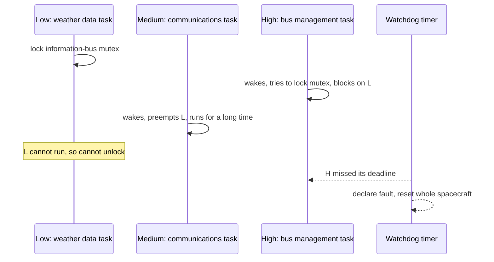

**Reading the diagram.** Three tasks share one CPU under strict priorities, and one mutex guards a shared memory area, the information bus. The low-priority weather task takes the mutex; the high-priority bus task blocks on it, normally briefly. The medium-priority communications task, which needs no mutex, preempts the low task, so the mutex is never released and the high task waits as long as the medium task runs. The dotted arrows are asynchronous: a watchdog saw that the high-priority work had not completed in time and reset the computer. Failure point: the mutex. Fix: priority inheritance.

::: industry
**Mars Pathfinder, July 1997.** Days after landing on 4 July 1997, the Pathfinder lander began suffering total system resets, losing data each time. JPL engineers reproduced the problem on an identical ground system and traced it to priority inversion on a mutex in the VxWorks real-time operating system. The mutex had been created with **priority inheritance** disabled. Priority inheritance temporarily raises a lock holder to the priority of the highest thread waiting for it, so the low task would have run at high priority, released the lock quickly, and not been preempted by the medium task [Sha et al. 1990]. Because the team had left debugging facilities enabled in the flight software, they could change the mutex's initialization parameter remotely; after the patch was uploaded the resets stopped. The lessons: real-time systems need priority-inheritance (or priority-ceiling) locks, and the ability to diagnose and patch in production is a design requirement, not a luxury.
*Evidence: Primary* — account by Glenn Reeves, JPL software team lead [Reeves 1997], as summarized by Mike Jones [Jones 1997]
:::

Priority inversion also appears in servers, when a background job holds a lock, pool slot or database row lock that user-facing requests need.

**Table 6.4 — Liveness failures compared.**

| Failure | What it looks like | Threads are | Root cause | Detection | Fix |
|---|---|---|---|---|---|
| Deadlock | Requests hang forever; CPU idle | Blocked | Cycle of waits (all four Coffman conditions) | Thread dump shows lock cycle | Lock ordering, timeouts, victim abort |
| Livelock | CPU busy, no progress | Running | Symmetric retry reactions | High CPU with zero throughput | Randomized backoff |
| Starvation | Some requests never finish; others are fine | Ready or blocked | Unfair scheduling or locking | Per-class latency; wait-time histograms | Fair locks, aging, quotas |
| Priority inversion | High-priority work delayed by low-priority work | High blocked; medium running | Lock held by low-priority thread | Latency spikes correlated with background jobs | Priority inheritance or ceiling; avoid sharing locks across priorities |

## 6.12 Inter-process communication

Processes have private address spaces (§6.3.2), so they cooperate through kernel-provided channels, trading speed, structure and reach.

- **Pipes** — a one-way byte stream through a kernel buffer (64 KiB by default on Linux), as in `grep error log | wc -l`; *named pipes* (FIFOs) let unrelated processes connect. A writer to a full pipe blocks: built-in backpressure.
- **Unix domain sockets** — the socket API on one machine, addressed by a file path; bidirectional, and able to pass file descriptors. Docker's API and local database connections use them; they skip the TCP/IP stack.
- **TCP/UDP sockets** — slower locally, but the same code works across machines (§7.7).
- **Shared memory** — processes map the same physical pages (`shm_open` + `mmap`). Fastest, with no system calls after setup, but the processes must synchronize themselves. PostgreSQL's shared buffer pool uses it.
- **Message queues** — POSIX `mq_open` keeps discrete, prioritized messages in the kernel, locally; distributed brokers (Chapter 30) generalize the idea.
- **Signals** — asynchronous notifications carrying only a number: `SIGTERM` (please exit), `SIGKILL` (exit now, uncatchable), `SIGINT` (Ctrl-C), `SIGHUP` (often "reload"), `SIGCHLD` (child exited). Handlers interrupt the program anywhere, so they may call only **async-signal-safe** functions; set a flag and act in the main loop [Linux man-pages: signal(7)]. Kubernetes sends `SIGTERM`, waits a grace period (30 s by default), then `SIGKILL`, so services must handle `SIGTERM` to drain gracefully (§42.7.4).

**Table 6.5 — IPC mechanisms compared.**

| Mechanism | Direction | Data model | Speed (local) | Scope | Synchronization | Choose when |
|---|---|---|---|---|---|---|
| Pipe / FIFO | One-way | Byte stream | Fast | Same machine (pipe: related processes) | Built in (blocking) | Streaming between parent and child, shell pipelines |
| Unix domain socket | Two-way | Stream or datagram | Fast | Same machine | Built in | Local client–server, sidecars, passing file descriptors |
| TCP socket | Two-way | Stream | Moderate | Network | Built in | Anything that may later run on another machine |
| Shared memory | Any | Raw bytes | Fastest | Same machine | Do it yourself | Very high throughput, low latency, large shared data |
| POSIX message queue | One-way | Discrete messages | Fast | Same machine | Built in | Small prioritized messages between local processes |
| Signal | One-way | A number | Fast | Same machine | Asynchronous | Lifecycle control: stop, reload, child exit |

## 6.13 I/O models: from blocking to io_uring

A network server spends most of its life waiting. The **I/O model** decides what a thread does while it waits, and so how many connections one machine can hold.

### 6.13.1 Blocking and non-blocking I/O

With **blocking I/O**, `read()` on a socket with no data puts the thread to sleep until data arrives: simple code, but one thread per waiting connection. With **non-blocking I/O** (`O_NONBLOCK`), `read()` returns `EAGAIN` immediately when there is no data, so one thread can juggle many sockets, but it needs a way to sleep until *any* of them is ready rather than spinning.

### 6.13.2 I/O multiplexing: select, poll, epoll, kqueue

**I/O multiplexing** lets one thread ask the kernel: "here are my sockets; sleep until at least one can be read or written without blocking, and tell me which." These are **readiness** notifications.

- **`select`** (4.2BSD) passes descriptor bitmaps on every call, is limited to descriptors below `FD_SETSIZE` (1,024 on Linux/glibc), and scans all of them: $O(n)$ work per wake-up.
- **`poll`** uses an array, removing the limit, but still scans all $n$.
- **`epoll`** (Linux 2.6) registers interest once (`epoll_ctl`); the kernel maintains a ready list, and `epoll_wait` returns only ready descriptors, so cost scales with *ready*, not watched, descriptors [Linux man-pages: epoll(7)].
- **`kqueue`** (FreeBSD 4.1, 2000; also macOS) scales the same way and also covers files, signals, timers and processes [Lemon 2001].

**Level-triggered** notification keeps reporting a socket while data remains; **edge-triggered** reports only new arrivals, so the program must read until `EAGAIN`. Readiness has a blind spot: regular files are always "ready" yet reads can block on disk, which is why Node.js's libuv runs file operations on a thread pool (4 threads by default) [Node.js Docs: Don't Block the Event Loop].

### 6.13.3 The C10K problem

In 1999 Dan Kegel's web page *The C10K problem* asked how one server could handle ten thousand simultaneous clients, when the hardware clearly could but the software could not [Kegel 1999]. Thread-per-connection hit memory and scheduling limits, and `select`/`poll` spent their time rescanning idle sockets. Kegel surveyed the strategies (thread per client, readiness notification, asynchronous completion); the eventual answer was event-driven servers on `epoll`/`kqueue`, the architecture of nginx, HAProxy, Node.js and Redis. Today a tuned server holds millions of mostly idle connections (see §9.9).

### 6.13.4 The event loop

::: definition
**Definition — Event loop.** A single thread that repeatedly waits for events (ready sockets, expired timers, completed tasks) using an I/O multiplexing call, and dispatches each event to a short, non-blocking handler.
:::

**Figure 6.10 — An event loop on epoll.**

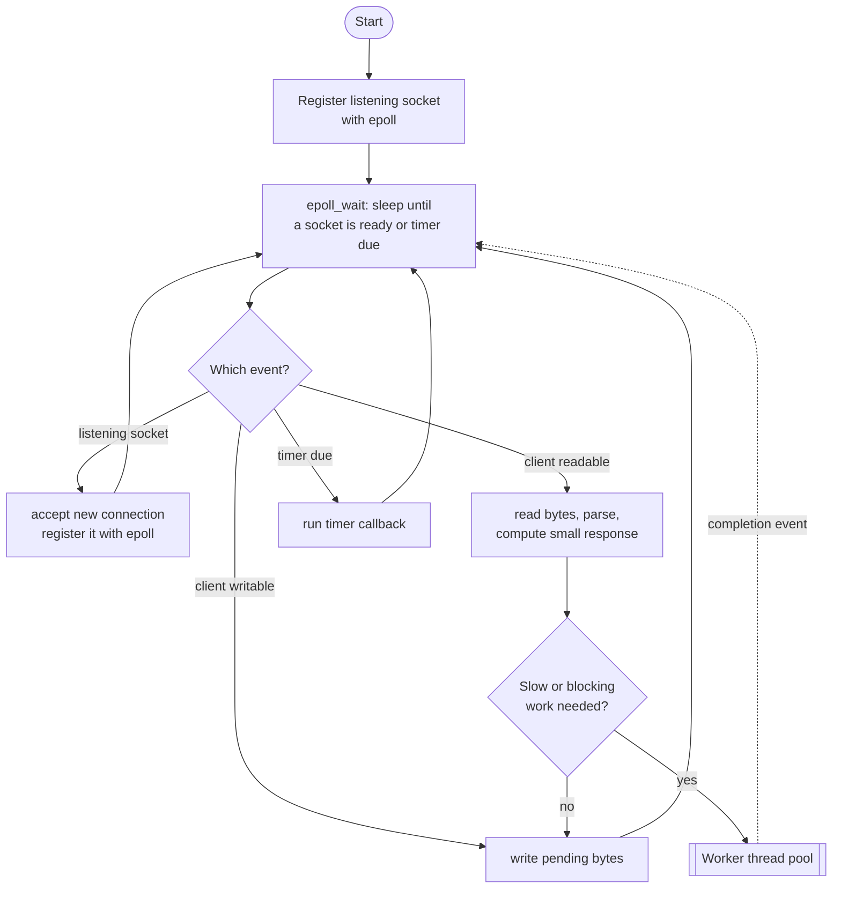

**Reading the diagram.** One thread sleeps in `epoll_wait`, the only place it may block, and dispatches each ready event: accept a connection, read and parse a request, flush output, run a timer. Handlers must be short. Blocking or CPU-heavy work (disk reads, password hashing, a synchronous database driver) goes to a **worker pool**, whose completion returns asynchronously as a new event (dotted arrow). The failure point is a slow handler: while one callback runs for 200 ms, *every* connection on the loop waits 200 ms. To use more cores, run one loop per core (nginx workers, `SO_REUSEPORT`, Node.js cluster).

The Python program below is a complete event-loop echo server. On Linux, `selectors.DefaultSelector` uses `epoll`; on macOS, `kqueue`.

```python
"""A single-threaded echo server: one event loop, many connections.

On Linux, selectors.DefaultSelector is backed by epoll; on macOS/BSD by kqueue.
"""
import selectors
import socket

sel = selectors.DefaultSelector()


def accept(server: socket.socket) -> None:
    conn, _addr = server.accept()              # ready, so this will not block
    conn.setblocking(False)
    sel.register(conn, selectors.EVENT_READ, handle)


def handle(conn: socket.socket) -> None:
    data = conn.recv(4096)                     # ready, so this will not block
    if data:
        conn.sendall(data)                     # simplification: assumes the send buffer has room
    else:                                      # empty read = peer closed
        sel.unregister(conn)
        conn.close()


def serve(host: str = "127.0.0.1", port: int = 9000) -> None:
    server = socket.socket(socket.AF_INET, socket.SOCK_STREAM)
    server.setsockopt(socket.SOL_SOCKET, socket.SO_REUSEADDR, 1)
    server.bind((host, port))
    server.listen(1024)
    server.setblocking(False)
    sel.register(server, selectors.EVENT_READ, accept)
    print(f"selector = {type(sel).__name__}; listening on {host}:{port}")
    while True:                                # THE event loop
        for key, _mask in sel.select():        # block until >= 1 socket is ready
            callback = key.data
            callback(key.fileobj)              # run the handler; it must not block


if __name__ == "__main__":
    serve()
```

Connect with `nc 127.0.0.1 9000` from several terminals; in testing it printed `selector = EpollSelector` and served 200 concurrent clients correctly.

What to notice:

- There is exactly one blocking call, `sel.select()`. Everything else runs only when the kernel has said it will not block.
- `sendall` on a non-blocking socket can still fail if the client is slow to read; a production server keeps a per-connection output buffer and registers for `EVENT_WRITE`. Frameworks handle this for you.

### 6.13.5 Completion-based I/O and io_uring

Readiness APIs need one system call to learn a socket is ready and another to read it. **Completion-based** APIs instead let the application *submit* an operation and later be told it is *complete* (Windows I/O completion ports; Linux's older AIO worked well only for `O_DIRECT` files).

**io_uring**, added in Linux 5.1 (2019) by Jens Axboe, provides two ring buffers in memory shared between application and kernel: a **submission queue (SQ)** and a **completion queue (CQ)** [Axboe 2019].

**Figure 6.11 — io_uring submission and completion rings.**

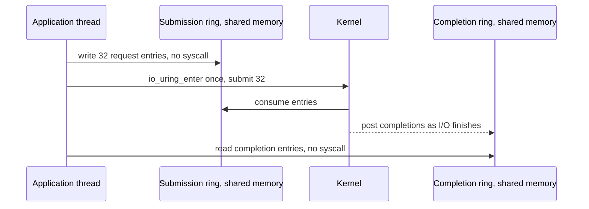

**Reading the diagram.** The application writes request entries (opcode, descriptor, buffer, user tag) into the shared submission ring with plain memory writes, then submits any number with *one* `io_uring_enter` call. The kernel performs them, files and sockets alike, and posts results asynchronously to the completion ring (dotted arrow), possibly out of order; the tag matches results to requests. Reaping completions needs no system call, and in **SQPOLL** mode a kernel thread polls the submission ring so submission needs none either. Costs: a more complex programming model and a large new kernel attack surface. Google reported in 2023 that most kernel exploits submitted to its bug-bounty program involved io_uring and that it had restricted io_uring on ChromeOS, Android apps and its production servers [Google Security Blog 2023]; some container runtimes block it by default.

**Table 6.6 — I/O models compared.**

| Model | How it works | Advantages | Disadvantages | Scales to | Choose when |
|---|---|---|---|---|---|
| Blocking, thread per connection | Each thread blocks in `read`/`write` | Simplest code; natural stack traces | Memory and switching per connection | Thousands of connections | Moderate concurrency; blocking libraries |
| Non-blocking + busy polling | Loop calling `read` until not `EAGAIN` | Lowest latency on a dedicated core | Burns a full core | Few connections | Kernel-bypass and trading systems |
| `select` / `poll` | Readiness for a set passed each call | Portable | $O(n)$ per call; `select` limited to 1,024 | Hundreds | Small tools, portability |
| `epoll` / `kqueue` | Register once; wait for ready list | $O(\text{ready})$; mature | Readiness only; files still block | Millions of sockets | Network servers on Linux/BSD |
| `io_uring` | Shared submission/completion rings | Batching; async files and sockets; few syscalls | Newer; security restrictions; complex | Very high IOPS | Storage engines, proxies on modern Linux |

## 6.14 File systems, journaling and fsync

### 6.14.1 What a file system does

A **file system** turns an array of numbered disk blocks into named, hierarchical files. Each file has an **inode** holding metadata (size, owner, permissions, timestamps) and the locations of its data blocks; a **directory** maps names to inode numbers. Creating `/data/log.txt` touches several structures: a new inode, the free-block bitmap, data blocks and the parent directory.

### 6.14.2 Crash consistency and journaling

A crash midway through those updates can leave a directory entry pointing at an uninitialized inode; older file systems needed a full-disk `fsck`, taking hours on large disks. A **journaling** file system uses a **write-ahead log** (§13.5): record the intended changes in a journal, commit, then apply them in place; after a crash, replay committed entries in seconds. ext4 offers three modes: **`data=journal`** (data and metadata both journaled: safest, slowest), **`data=ordered`** (the default: only metadata journaled, but data blocks are written before the metadata that points at them) and **`data=writeback`** (metadata only, no ordering: a crash can expose stale data). XFS journals metadata. **Copy-on-write** file systems such as ZFS and Btrfs never overwrite in place: they write new blocks and atomically switch a root pointer.

Journaling protects the file system's *own* structures. It does **not** make your application's data durable at any particular moment.

### 6.14.3 fsync and durability

**Figure 6.12 — The write path from application to stable storage.**


**Reading the diagram.** `write()` copies data into the page cache and returns; nothing is on disk yet. The dotted arrow is asynchronous background writeback (§6.6.6), roughly 30 s later by default. `fsync(fd)` is the synchronous path: it writes the file's dirty pages and metadata, waits for the device, and issues a **cache flush** so the drive's volatile write cache reaches stable media, the storage boundary that matters. Enterprise SSDs with **power-loss protection** capacitors can treat their cache as stable. Failure points: a crash loses dirty pages, a drive that ignores flushes loses its cache, and a writeback I/O error can lose data silently.

Durability pitfalls, each of which has caused real data loss:

1. **`write()` is not durable.** Without `fsync` (or `fdatasync`, which skips non-essential metadata), a crash loses acknowledged writes.
2. **The directory needs `fsync` too.** Creating or renaming a file changes the *directory*, which must also be synced [Linux man-pages: fsync(2); Pillai et al. 2014].
3. **"Write temp, then rename" needs `fsync` before the rename**, or a crash can leave the new name pointing at an empty file.
4. **`fsync` errors are not retryable.** On Linux a failed writeback may mark pages clean, so a second `fsync` can succeed although the data was lost. After the 2018 "fsyncgate" investigation, PostgreSQL crashes and recovers from its write-ahead log on any `fsync` failure [PostgreSQL Wiki: Fsync Errors; Rebello et al. 2020].
5. **macOS `fsync` does not flush the drive cache**; use `fcntl(fd, F_FULLFSYNC)` [Apple: fsync(2) man page].
6. **`O_DIRECT` is not `O_SYNC`**: bypassing the page cache does not make writes durable.
7. **Torn writes**: a crash mid-write can leave half-old, half-new sectors; databases detect this with checksums (§13.12).

The program below replaces a file atomically and durably on POSIX systems:

```python
"""Atomically and durably replace a file on a POSIX system (Linux, macOS)."""
import os


def durable_replace(path: str, data: bytes) -> None:
    directory = os.path.dirname(os.path.abspath(path))
    tmp_path = path + ".tmp"

    fd = os.open(tmp_path, os.O_WRONLY | os.O_CREAT | os.O_TRUNC, 0o644)
    try:
        view = memoryview(data)
        while view:                          # write() may write fewer bytes than asked
            written = os.write(fd, view)
            view = view[written:]
        os.fsync(fd)                         # 1. file contents reach stable storage
    finally:
        os.close(fd)

    os.replace(tmp_path, path)               # 2. atomic rename over the old file

    dir_fd = os.open(directory, os.O_RDONLY)
    try:
        os.fsync(dir_fd)                     # 3. the rename itself (a directory entry) is durable
    finally:
        os.close(dir_fd)


if __name__ == "__main__":
    durable_replace("config.json", b'{"version": 2}\n')
    with open("config.json", "rb") as f:
        print(f.read())
```

What to notice:

- Readers see the complete old or complete new file, never a mixture: `os.replace` is an atomic rename within one file system.
- Skipping step 1 risks an empty file under the new name; skipping step 3 risks the old file reappearing after a crash.
- If `os.fsync` raises, the function propagates the exception rather than retrying (pitfall 4). On macOS, add `fcntl.fcntl(fd, fcntl.F_FULLFSYNC)` for power-loss durability.

::: formula
**Group-commit throughput**

$$X = \frac{B}{t_{\text{fsync}}}$$

| Symbol | Meaning | Units |
|---|---|---|
| $X$ | Maximum durable commits per second on one log | commits/s |
| $B$ | Commits made durable by one `fsync` (batch size) | commits |
| $t_{\text{fsync}}$ | Latency of one `fsync` | s |
:::

::: example
**Worked example — Why databases batch fsyncs.** An SSD without power-loss protection takes $t_{\text{fsync}} = 2$ ms (0.002 s) per `fsync`.
One commit per `fsync`: $X = 1 / 0.002 =$ **500 commits/s**, no matter how fast the CPU is.
**Group commit** waits briefly to collect concurrent commits into one `fsync`. With $B = 50$: $X = 50 / 0.002 =$ **25,000 commits/s**, at the price of up to a couple of milliseconds of extra latency per commit.
**Interpretation.** Durable write throughput is set by fsync latency, not bandwidth. **Engineering implication:** databases batch commits into one log flush, and drives with power-loss protection raise the ceiling further. When a vendor quotes "100,000 writes per second", ask how many `fsync`s that included.
:::

**Table 6.7 — Durability options for a write.**

| Option | What is guaranteed at return | Relative cost | Choose when |
|---|---|---|---|
| `write()` only | Data in page cache; lost on power failure or kernel crash | Lowest | Caches, temporary data, data you can regenerate |
| `write()` + `fdatasync()` | Data and size metadata on stable storage | High (one device flush) | Write-ahead logs and append-only files |
| `write()` + `fsync()` | Data and all metadata on stable storage | High | General durable files |
| + `fsync()` on directory | The file's name and existence are durable | Additional flush | Newly created or renamed files |
| `O_DSYNC` / `O_SYNC` on open | Every `write` behaves as if followed by `fdatasync` / `fsync` | Highest per write | Small, critical, infrequent writes |
| Replication instead of local fsync | Data in RAM on several machines | Network round trip | Distributed logs that accept correlated-failure risk (§27.3) |

## 6.15 Concurrency models in practice

The five models below answer one question differently: *what represents a waiting request, and what does it cost?*

### 6.15.1 Thread per request

Each request gets an OS thread (usually from a pool) running blocking code start to finish: classic Tomcat servlets, Apache httpd's worker model, threaded Python WSGI servers. **Strengths:** sequential code, readable stack traces, parallelism across cores. **Weaknesses:** each waiting request costs a whole thread, capping concurrency by memory and switching overhead, and a slow dependency can tie up every pool thread.

### 6.15.2 Event loop (Node.js, nginx, Redis)

One thread runs an event loop (§6.13.4); a waiting request costs a small state object and a callback. Node.js runs JavaScript on one libuv loop; nginx runs one loop per worker process; Redis executes commands on one main thread, making each command trivially atomic. **Strengths:** tiny per-connection cost, no locks for loop-owned state. **Weaknesses:** one core per loop, and any blocking callback stalls every connection [Node.js Docs: Don't Block the Event Loop].

### 6.15.3 Actors (Erlang/OTP, Akka)

An **actor** is an isolated unit of state with a **mailbox**; actors share no memory, communicate only by asynchronous messages and process one message at a time, so their state has no data races [Hewitt et al. 1973]. Erlang processes, scheduled by the BEAM virtual machine with one scheduler thread per core, take a few hundred machine words each at creation [Erlang Docs: Efficiency Guide]. Erlang/OTP adds **supervision trees** that restart crashed actors ("let it crash") [Armstrong 2003]; Akka brings the model to the JVM. **Weaknesses:** unbounded mailboxes, extra plumbing for request/response, and hard reasoning about ordering across actors.

::: industry
**WhatsApp on Erlang.** WhatsApp built its messaging servers on Erlang/FreeBSD and reported in a 2012 engineering blog post more than two million simultaneous TCP connections on a single server, attributing it to lightweight Erlang processes and kernel tuning.
*Evidence: Primary* — [WhatsApp Blog 2012]
:::

### 6.15.4 Goroutines (Go)

Go multiplexes **goroutines** onto `GOMAXPROCS` OS threads (by default the number of usable CPUs). A goroutine starts with a 2 KiB stack that grows on demand. On network I/O the runtime parks the goroutine and registers the socket with its **netpoller** (built on `epoll`/`kqueue`), so blocking-style code gets event-loop efficiency; since Go 1.14 long-running goroutines can also be preempted. **Weaknesses:** shared memory still allows races and deadlocks (§6.9), and leaked goroutines accumulate silently. Java's **virtual threads** (JDK 21, 2023) apply the same idea to the JVM [OpenJDK JEP 444].

### 6.15.5 async/await (Python asyncio, JavaScript, C#, Rust)

**async/await** is syntax for event-loop code that reads sequentially. An `async` function is a **coroutine**; each `await` is a point where it may suspend and return control to the loop. Scheduling is **cooperative**: coroutines yield only at `await`.

```python
"""10,000 concurrent 'requests', one thread, about one second."""
import asyncio
import time


async def handle_request(i: int) -> int:
    await asyncio.sleep(1.0)        # stands in for a 1 s network call; yields to the loop
    return i


async def main() -> None:
    start = time.perf_counter()
    results = await asyncio.gather(*(handle_request(i) for i in range(10_000)))
    elapsed = time.perf_counter() - start
    print(f"{len(results)} requests finished in {elapsed:.2f} s on one thread")


asyncio.run(main())
```

Output in testing: `10000 requests finished in 1.09 s on one thread`.

What to notice:

- 10,000 one-second waits overlap on one thread: this is concurrency without parallelism (§6.8).
- Replace `await asyncio.sleep(1.0)` with `time.sleep(1.0)` and the program takes about 10,000 seconds: one blocking call inside a coroutine blocks the whole loop.
- async is "contagious": a function that awaits must itself be `async`, so libraries split into synchronous and asynchronous versions (the "function color" problem).

### 6.15.6 Comparison and capacity

**Table 6.8 — Concurrency models compared.**

| Aspect | Thread per request | Event loop | Actors | Goroutines / virtual threads | async/await |
|---|---|---|---|---|---|
| Unit of concurrency | OS thread | Callback + state | Actor with mailbox | Runtime-managed thread | Coroutine |
| Memory per waiting request (order of magnitude) | 64 KiB–1 MiB touched stack + kernel task | ~1 KiB or less | ~1–3 KB | ~2–8 KiB | ~1–2 KiB |
| Scheduling | Preemptive, kernel | Cooperative, one thread | Runtime, per message | Runtime, mostly preemptive | Cooperative at `await` |
| Uses multiple cores | Yes | No (run one loop per core) | Yes | Yes | Only with multiple loops or executors |
| Shared-state safety | Locks needed | Safe within the loop | Safe by isolation | Locks or channels needed | Safe within one loop |
| Main failure mode | Thread exhaustion; context switching | Blocking the loop | Mailbox overflow | Goroutine leaks; races | Accidental blocking call |
| Code style | Sequential, blocking | Callbacks or promises | Message handlers | Sequential, blocking | Sequential with `await` |
| Examples | Tomcat, Apache httpd, Django with threads | nginx, Node.js, Redis | Erlang/OTP, Akka | Go servers, Java 21 virtual threads | FastAPI, aiohttp, Rust Tokio |
| Choose when | Moderate concurrency, blocking libraries | Many connections, light per-request CPU | Fault isolation, many stateful entities | High concurrency with simple code | High I/O concurrency in Python/JS/Rust |

Memory figures are orders of magnitude for planning (as of 2026 runtimes), not measurements; measure your own service's resident memory per connection.

::: formula
**Memory for concurrent connections**

$$M_{\text{total}} = N \times (m_{\text{unit}} + m_{\text{conn}})$$

| Symbol | Meaning | Units |
|---|---|---|
| $M_{\text{total}}$ | Memory needed for concurrency overhead | bytes |
| $N$ | Concurrent connections (or in-flight requests) | connections |
| $m_{\text{unit}}$ | Resident memory per concurrency unit (thread stack + kernel task, or coroutine) | bytes |
| $m_{\text{conn}}$ | Per-connection buffers (socket buffers, TLS state, request object) | bytes |
:::

::: example
**Worked example — 10,000 and 100,000 connections.** A chat gateway must hold $N = 10{,}000$ mostly idle WebSocket connections. Assume $m_{\text{conn}} = 20$ KB of socket buffers and TLS state per connection in every model.

*Thread per connection (Java platform threads).* Each thread reserves 1 MiB of virtual stack, but only touched pages are resident; assume 64 KiB touched + 16 KiB kernel stack + ~8 KiB other kernel state ≈ 88 KB. $M = 10{,}000 \times (88 + 20)$ KB = **1.08 GB**. Workable, though with 10,000 schedulable threads.
*Goroutines.* Assume 8 KiB per goroutine (≈ 8 KB). $M = 10{,}000 \times (8 + 20)$ KB = **280 MB**.

Now scale to $N = 100{,}000$: threads need **10.8 GB** plus 100,000 kernel tasks (beyond typical `pids.max` and thread limits, and every wake-up is a context switch); goroutines need **2.8 GB**; an event loop with ~1 KB per connection needs about **2.1 GB**, dominated by socket buffers.

**Interpretation.** Thread-per-connection works at thousands of connections and becomes the bottleneck at hundreds of thousands, where per-connection buffers also start to dominate. **Engineering implication:** for connection-heavy services (gateways, push, chat; §9.9) choose event loops, goroutines or virtual threads; for CPU-heavy work, core count matters more than the model.
:::

::: formula
**Thread-pool sizing**

$$N_{\text{threads}} = \lambda \times W \qquad \text{and, for mixed CPU/I/O work,} \qquad N_{\text{threads}} \approx N_{\text{cpu}} \times U \times \left(1 + \frac{T_{\text{wait}}}{T_{\text{cpu}}}\right)$$

| Symbol | Meaning | Units |
|---|---|---|
| $N_{\text{threads}}$ | Threads needed to sustain the load | threads |
| $\lambda$ | Request arrival rate | requests/s |
| $W$ | Time a request occupies a thread | s |
| $N_{\text{cpu}}$ | Available cores | cores |
| $U$ | Target CPU utilization | dimensionless (0–1) |
| $T_{\text{wait}}$, $T_{\text{cpu}}$ | Per-request time spent waiting and computing | ms |
:::

::: example
**Worked example — Sizing a blocking service.** A service receives $\lambda = 2{,}000$ requests/s; each request spends 10 ms on CPU and 90 ms waiting for a database ($W = 0.1$ s).
Little's Law (§4.11): $N_{\text{threads}} = 2{,}000 \times 0.1 =$ **200 threads** in use on average.
CPU check: $2{,}000 \times 0.010$ s = 20 core-seconds per second, so at least **20 cores**. With $N_{\text{cpu}} = 32$, $U = 0.7$: $N_{\text{threads}} ≈ 32 \times 0.7 \times (1 + 90/10) = 224$, consistent with 200 [Goetz et al. 2006].
**Interpretation.** 200–250 threads is reasonable here. If the database slows to 900 ms, the same load needs $2{,}000 \times 0.91 ≈ 1{,}820$ threads: a fixed pool of 250 saturates and requests queue. **Engineering implication:** bound the pool and the queue, set timeouts on downstream calls (§22.11), and shed load rather than letting a slow dependency consume every thread.
:::

::: mistake
**"Async is faster."** async/await and event loops do not make individual operations faster; they make *waiting* cheaper, so more requests can wait at once. For CPU-bound work they are no better than threads, and a single misplaced blocking call makes them much worse.
:::

## 6.16 Summary and revision notes

::: summary
- A **process** is a running program with a private address space; a **thread** is an execution context sharing its process's memory. The PCB (`task_struct`) stores everything needed to resume. States: New → Ready ⇄ Running → Blocked → Ready → … → Terminated.
- A **context switch** costs ~1–5 µs directly, but cache and TLB refill can cost 10–100× more. Overhead fraction $f = C/(Q + C)$: it matters when threads run only microseconds between switches.
- **Scheduling** trades turnaround, response time and fairness. RR fixes FCFS's convoy effect; MLFQ learns interactivity; Linux uses weighted fair sharing (CFS from 2.6.23, EEVDF from 6.6). CPU quotas in containers can throttle a service even when the host is idle.
- **Virtual memory** translates addresses through page tables cached in the TLB. TLB reach = entries × page size; huge pages extend it. Major page faults cost 100 µs–10 ms, so even rare faults dominate average access time. The **page cache** holds file data; `mmap` maps it into memory; copy-on-write makes `fork` cheap.
- A **system call** costs ~100 ns or more versus ~1 ns for a function call; batch, use vDSO, or use shared rings (`io_uring`).
- **Concurrency** is about structure and overlapping waits; **parallelism** is simultaneous execution. Neither implies the other.
- A **race condition** is a timing-dependent bug; protect every read-modify-write of shared state as a **critical section**, and run race detectors in CI.
- Mutex for exclusion; semaphore to limit concurrency; condition variable (in a `while` loop) to wait for a predicate; atomics/CAS for single-word updates; read-write locks for long read-mostly sections; lock-free structures only from proven libraries, minding ABA.
- **Deadlock** needs all four Coffman conditions; break circular wait with lock ordering. Livelock → randomized backoff; starvation → fairness; priority inversion → priority inheritance (Mars Pathfinder, 1997).
- IPC: pipes, sockets, shared memory (fastest), message queues, signals (handle `SIGTERM`).
- I/O: blocking needs a thread per connection; `epoll`/`kqueue` readiness notification solved C10K; `io_uring` adds batched completion-based I/O. An event loop must never block.
- `write()` is not durable. Use `fsync` on the file *and* its directory, treat `fsync` errors as fatal, and batch commits (group commit $X = B/t_{\text{fsync}}$).
- Thread-per-request is simple but costs ~100 KB per connection; event loops, goroutines, virtual threads and async/await make waiting cheap. Size pools with Little's Law and bound them.
:::

## 6.17 Knowledge checkpoint

1. What is the difference between a program, a process and a thread?
2. Name five pieces of information stored in a PCB.
3. Why does a process go from Blocked to Ready rather than directly to Running?
4. Distinguish the direct and indirect costs of a context switch.
5. Three jobs of 100, 10 and 10 ms arrive together. What is the average turnaround time under FCFS (in that order) and under SJF?
6. How does a CPU limit in a container cause latency spikes on an idle host?
7. Calculate the TLB reach of 2,048 entries with 4 KiB pages and with 2 MiB pages.
8. What is the difference between a minor and a major page fault?
9. Why must a condition-variable wait be inside a `while` loop?
10. Describe the ABA problem in one or two sentences and give one remedy.
11. List the four Coffman conditions and the most practical way to break one.
12. Why does `epoll` not help with reading regular files?
13. List the three steps to durably replace a file and the consequence of skipping each.
14. A service handles 1,000 requests/s, each holding a thread for 250 ms. How many threads are busy on average?

<details><summary>Answers</summary>

1. A program is an executable file; a process is a running instance with its own address space and resources; a thread is one execution context (registers, stack) inside a process, sharing its memory.
2. Any five of: PID and parent PID, state, saved registers and program counter, scheduling priority and accounting, page-table pointer and memory map, open file table, signal handlers, credentials, resource limits.
3. The event that unblocked it does not mean a CPU is free; it must be chosen by the scheduler like any other ready task.
4. Direct: kernel work to save and restore state and choose the next task (~1–5 µs). Indirect: slower execution afterwards because caches and TLB hold the previous thread's state.
5. FCFS: completions 100, 110, 120 → average 110 ms. SJF: 10, 20, 120 → average 50 ms.
6. CFS bandwidth control gives the cgroup a quota per period (default 100 ms). Several threads exhaust it early and the cgroup is throttled for the rest of the period, delaying requests regardless of host load.
7. 2,048 × 4 KiB = 8 MiB; 2,048 × 2 MiB = 4 GiB.
8. A minor fault needs no I/O (page already in RAM, or a fresh zero page); a major fault reads from storage and blocks the thread for 100 µs–10 ms.
9. Under Mesa semantics another thread may change the state before the woken waiter reacquires the lock, and spurious wake-ups are allowed.
10. A CAS succeeds because a location again holds value A, although it changed to B and back in between, so the CAS acts on stale assumptions. Remedies: version-tagged pointers, hazard pointers, epoch-based reclamation.
11. Mutual exclusion, hold and wait, no preemption, circular wait. Break circular wait with a global lock order.
12. Regular files are always reported ready, yet reads can block on disk. Use a thread pool or `io_uring`.
13. `fsync` the temporary file (else the new name may point at empty data), rename atomically (else readers may see a partial file), `fsync` the directory (else the old file may reappear after a crash).
14. Little's Law: 1,000 × 0.25 = 250 threads.
</details>

## 6.18 Interview questions

### Basic

**Q1. What is the difference between a process and a thread, and when would you choose processes?**
**Answer.** A process has its own address space; threads share their process's memory and file descriptors but have their own stacks and registers. Threads communicate cheaply and switch faster; processes isolate faults. Choose processes for isolation (untrusted code, non-thread-safe libraries, PostgreSQL backends) or to bypass a GIL; threads for low-latency sharing of large in-memory state.

**Q2. What is a race condition? Give an example and two fixes.**
**Answer.** A bug whose outcome depends on the interleaving of concurrent operations; e.g. two threads both read 5 and both write 6. Fixes: a mutex around the read-modify-write, or one atomic operation (atomic add, CAS loop); across services, transactions or conditional writes. Tests rarely reveal races, so use race detectors.

**Q3. What is a deadlock and how do you prevent it in application code?**
**Answer.** A cycle of threads each waiting for a resource held by the next, requiring all four Coffman conditions. Acquire locks in one global order, never hold locks across I/O or unknown callbacks, use `tryLock` with timeouts, and prefer single-owner state or message passing. Detect with thread dumps.

### Intermediate

**Q4. Your service's p99 latency doubled after you increased the worker pool from 64 to 2,000 threads on a 16-core machine. Why might that be?**
**Answer.** If the work is CPU-bound, 2,000 runnable threads on 16 cores each wait behind ~125 others; involuntary switches multiply and evict caches, so throughput falls while queueing grows, and lock contention rises. Check `vmstat` (cs, run queue), voluntary versus involuntary switches and lock profiles. Size the pool with Little's Law and the CPU/wait ratio, with a bounded queue and load shedding. If the work is I/O-bound, async or virtual threads are cheaper than a huge pool.

**Q5. Explain how an event loop serves 10,000 connections on one thread, and what breaks it.**
**Answer.** Non-blocking sockets are registered with `epoll`/`kqueue`; the loop sleeps in one wait call and runs short handlers for the ready sockets, so a waiting connection costs a small state object, not a thread. It breaks when a handler blocks or burns CPU (synchronous DB driver, large JSON parse, file I/O), stalling every connection. Mitigations: worker pools, one loop per core, event-loop-lag monitoring.

**Q6. A database acknowledges writes after `write()` but before `fsync()`. What can go wrong, and how do real databases make commits durable but fast?**
**Answer.** A crash loses data still in the page cache, so acknowledged commits vanish. Durable systems append to a write-ahead log and `fdatasync` before acknowledging, using group commit to amortize flushes ($X = B/t_{\text{fsync}}$); they `fsync` directories after creating files, treat `fsync` errors as fatal, and use drives with power-loss protection. Alternatively, replicate to other machines before acknowledging, trading flush latency for a network round trip and correlated-failure risk.

### Advanced

**Q7. Explain priority inversion with a real example and how to prevent it, including outside real-time systems.**
**Answer.** A high-priority task blocks on a lock held by a low-priority task, which a medium-priority task preempts, so the high task waits indefinitely. Mars Pathfinder (1997) reset repeatedly because a VxWorks mutex shared by a low-priority weather task and a high-priority bus task lacked priority inheritance; JPL enabled it remotely. Prevention: priority inheritance or ceiling locks, no locks shared across priority levels, short critical sections. In servers, isolate pools and resources so background jobs cannot hold what user traffic needs.

**Q8. Compare epoll and io_uring. When would you adopt io_uring?**
**Answer.** `epoll` is readiness-based: it says a socket can be read, then a separate call reads it, and file reads can still block. `io_uring` is completion-based, with shared submission and completion rings, giving batching, asynchronous file I/O and, with SQPOLL, near-zero system calls. Adopt it for high-IOPS storage engines or proxies where syscall overhead is a measured bottleneck, accepting complexity, kernel-version dependence and security restrictions. For typical web services, `epoll` via a mature runtime is enough.

**Q9. Design the concurrency model for a WebSocket gateway holding 1 million mostly idle connections across a fleet. Justify it with numbers.**
**Answer.** Thread-per-connection at ~100 KB each needs ~100 GB and a million kernel tasks: impractical. An event loop or goroutines at ~1–8 KB plus ~20 KB of socket and TLS buffers needs ~25–30 GB in total; spread it over, say, 10 nodes × 100,000 connections so one node loss affects 10 %. Run one loop per core (or Go with GOMAXPROCS = cores), raise file-descriptor limits, size socket buffers deliberately, push heavy work to other services via queues, and drain connections gradually on `SIGTERM` to avoid reconnect storms (§9.9).

## 6.19 Practical exercises

1. **Watch process states.** Run `sleep 100 &`, a CPU loop (`yes > /dev/null &`) and `cat` reading from a terminal. Use `ps -o pid,stat,wchan:20,cmd` to identify R and S states. Kill the parent of a child that has exited without being reaped and observe the zombie.
2. **Measure a context switch.** Run the following ping-pong program, once normally and once pinned to one core with `taskset -c 0`. Explain the difference. On one test VM for this chapter, it gave about 24 µs per round trip unpinned and about 4 µs pinned, because cross-core wake-ups add inter-processor interrupts and idle-state exits.

```python
"""Two processes bounce one byte over a pair of pipes (POSIX only: uses fork).

Each round trip forces at least two blocking reads and wake-ups, so the
time per round trip upper-bounds the cost of two context switches plus
four system calls and Python interpreter overhead.
"""
import os
import time

ROUNDS = 100_000

parent_to_child_r, parent_to_child_w = os.pipe()
child_to_parent_r, child_to_parent_w = os.pipe()

pid = os.fork()
if pid == 0:                                    # child process
    for _ in range(ROUNDS):
        os.read(parent_to_child_r, 1)           # block until parent writes
        os.write(child_to_parent_w, b"x")       # wake the parent
    os._exit(0)

start = time.perf_counter()
for _ in range(ROUNDS):
    os.write(parent_to_child_w, b"x")           # wake the child
    os.read(child_to_parent_r, 1)               # block until child answers
elapsed = time.perf_counter() - start
os.waitpid(pid, 0)
print(f"{elapsed / ROUNDS * 1e6:.1f} us per round trip")
```

3. **Find the race.** Run the Go program in §6.9 with `go run -race .`. Then write a version that uses a channel owned by one goroutine instead of a mutex, and confirm the race detector is silent.
4. **Break the event loop.** Add `time.sleep(2)` inside `handle()` in the echo server of §6.13.4, connect three clients, and measure how long the third waits. Fix it by moving the slow work to a `concurrent.futures.ThreadPoolExecutor`.
5. **Count system calls.** Run `strace -c python3 -c "open('/etc/hostname').read()"` and then the same for a program that copies a 100 MB file using 1-byte reads versus 64 KiB reads. Relate the time difference to §6.7.
6. **Durability check.** Write a program that appends 10,000 small records with and without `fsync` after each, and with one `fsync` per 100 records. Compute the commits per second and compare with the group-commit formula in §6.14.3.

## 6.20 Design challenges

1. **Log-ingestion agent.** Design a host agent that tails 500 log files, batches lines, and ships them to a remote collector at 50 MB/s, surviving agent restarts without losing or duplicating more than one batch. Decide: threads versus event loop versus `io_uring`; how offsets are made durable (`fsync` strategy and cost); how backpressure works when the collector is slow; how the agent behaves when the disk fills. Justify each choice with numbers from this chapter.
2. **Multi-tenant job runner.** Design a single-machine runner for untrusted user jobs that guarantees each tenant a fair CPU share and a memory cap, and kills runaway jobs without affecting others. Discuss processes versus threads, cgroup CPU weights versus quotas (and throttling), OOM behavior, signals for graceful termination, and how to prevent a tenant from starving others through a shared lock or file system. Relate to §47.
3. **In-memory rate limiter.** Design a per-API-key rate limiter inside a service handling 200,000 requests/s on 32 cores. Compare a global mutex-protected map, a sharded map with per-shard locks, per-core counters merged periodically, and atomic CAS on token buckets. Estimate contention, explain where false sharing appears (§5.4), and state which you would ship and why (see §22.4).

## 6.21 References

1. Arpaci-Dusseau, R. H., and Arpaci-Dusseau, A. C. *Operating Systems: Three Easy Pieces*. Arpaci-Dusseau Books, 2018 (v1.00; free online). https://ostep.org
2. Silberschatz, A., Galvin, P. B., and Gagne, G. *Operating System Concepts*, 10th ed. Wiley, 2018.
3. Tanenbaum, A. S., and Bos, H. *Modern Operating Systems*, 4th ed. Pearson, 2014.
4. Kegel, D. *The C10K problem*. Web page, first published 1999. http://www.kegel.com/c10k.html
5. Axboe, J. *Efficient IO with io_uring*. 2019. https://kernel.dk/io_uring.pdf
6. Linux man-pages project. `syscalls(2)`, `sched(7)`, `signal(7)`, `epoll(7)`, `fsync(2)`, `mmap(2)`, `futex(2)`, `io_uring(7)`, `pipe(7)`. https://man7.org/linux/man-pages/
7. Linux kernel documentation. *CFS Scheduler*; *EEVDF Scheduler*; *CFS Bandwidth Control*. https://docs.kernel.org/scheduler/
8. Stoica, I., and Abdel-Wahab, H. *Earliest Eligible Virtual Deadline First: A Flexible and Accurate Mechanism for Proportional Share Resource Allocation*. Technical Report TR-95-22, Old Dominion University, 1995.
9. Corbet, J. "An EEVDF CPU scheduler for Linux." LWN.net, 2023. https://lwn.net/Articles/925371/
10. Gregg, B. *Systems Performance: Enterprise and the Cloud*, 2nd ed. Addison-Wesley, 2020.
11. Li, C., Ding, C., and Shen, K. "Quantifying the Cost of Context Switch." *Workshop on Experimental Computer Science (ExpCS)*, 2007.
12. Franke, H., Russell, R., and Kirkwood, M. "Fuss, Futexes and Furwocks: Fast Userlevel Locking in Linux." *Ottawa Linux Symposium*, 2002.
13. Dijkstra, E. W. *Cooperating Sequential Processes* (EWD 123). Technological University, Eindhoven, 1965.
14. Lampson, B. W., and Redell, D. D. "Experience with Processes and Monitors in Mesa." *Communications of the ACM* 23(2), 1980.
15. Herlihy, M., and Shavit, N. *The Art of Multiprocessor Programming*, revised 1st ed. Morgan Kaufmann, 2012.
16. Treiber, R. K. *Systems Programming: Coping with Parallelism*. IBM Research Report RJ 5118, 1986.
17. Michael, M. M. "Hazard Pointers: Safe Memory Reclamation for Lock-Free Objects." *IEEE Transactions on Parallel and Distributed Systems* 15(6), 2004.
18. Coffman, E. G., Elphick, M. J., and Shoshani, A. "System Deadlocks." *ACM Computing Surveys* 3(2), 1971.
19. Sha, L., Rajkumar, R., and Lehoczky, J. P. "Priority Inheritance Protocols: An Approach to Real-Time Synchronization." *IEEE Transactions on Computers* 39(9), 1990.
20. Reeves, G. E. "What really happened on Mars?" Email account, December 1997; reproduced at https://www.cs.cornell.edu/courses/cs614/1999sp/papers/pathfinder.html
21. Jones, M. B. "What really happened on Mars Rover Pathfinder." *The RISKS Digest* 19(49), 1997.
22. Lemon, J. "Kqueue: A Generic and Scalable Event Notification Facility." *USENIX Annual Technical Conference, FREENIX Track*, 2001.
23. Pillai, T. S., et al. "All File Systems Are Not Created Equal: On the Complexity of Crafting Crash-Consistent Applications." *OSDI*, 2014.
24. Rebello, A., et al. "Can Applications Recover from fsync Failures?" *USENIX Annual Technical Conference*, 2020.
25. PostgreSQL Wiki. *Fsync Errors*. https://wiki.postgresql.org/wiki/Fsync_Errors
26. Crotty, A., Leis, V., and Pavlo, A. "Are You Sure You Want to Use MMAP in Your Database Management System?" *CIDR*, 2022.
27. Apache Kafka. *Documentation: Design — Persistence*. https://kafka.apache.org/documentation/#persistence
28. Redis. *Redis persistence* and *Diagnosing latency issues*. https://redis.io/docs/
29. PostgreSQL. *Documentation: Architectural Fundamentals*. https://www.postgresql.org/docs/current/tutorial-arch.html
30. MySQL. *MySQL 8.0 Reference Manual: Connection Interfaces*. https://dev.mysql.com/doc/
31. Pike, R. "Concurrency is not Parallelism." Talk, Heroku Waza conference, 2012.
32. The Go Authors. *Data Race Detector* and *The Go Memory Model*. https://go.dev/doc/articles/race_detector, https://go.dev/ref/mem
33. Node.js. *Don't Block the Event Loop (or the Worker Pool)*. https://nodejs.org/en/learn/asynchronous-work/dont-block-the-event-loop
34. Google Security Blog. "Learnings from kCTF VRP's 42 Linux kernel exploits submissions." 2023. https://security.googleblog.com/
35. Apple. `fsync(2)` macOS manual page.
36. Hewitt, C., Bishop, P., and Steiger, R. "A Universal Modular ACTOR Formalism for Artificial Intelligence." *IJCAI*, 1973.
37. Armstrong, J. *Making Reliable Distributed Systems in the Presence of Software Errors*. PhD thesis, Royal Institute of Technology (KTH), Stockholm, 2003.
38. Erlang/OTP. *Efficiency Guide: Processes*. https://www.erlang.org/doc/
39. WhatsApp. "1 million is so 2011." WhatsApp Blog, January 2012.
40. OpenJDK. *JEP 444: Virtual Threads*. 2023. https://openjdk.org/jeps/444
41. Goetz, B., et al. *Java Concurrency in Practice*. Addison-Wesley, 2006.

## 6.22 Open verification items

- Exact LWN article URL and date for [Corbet 2023] (lwn.net was unreachable from the authoring environment). EEVDF merge in 6.6 and the 0.75 ms × (1 + log2 ncpus) base slice were confirmed against the v6.6 scheduler pull request and commit e4ec3318; whether later 6.x releases changed the default is not verified.
- Magnitude of indirect context-switch cost reported by [Li et al. 2007]; direct-cost range 1–5 µs on current hardware.
- Mars Pathfinder details (task names, watchdog mechanism, remote patch via on-board interpreter) against Reeves's original text; Cornell mirror URL.
- Google Security Blog 2023 io_uring statistics and the exact scope of the restriction; full article URL.
- WhatsApp 2012 "2 million connections" blog post URL and wording.
- Erlang process initial size ("a few hundred words") for the current OTP release; Python 3.14 free-threading status.
- Whether Dijkstra's banker's algorithm should be cited to EWD 123 or EWD 108.
- MySQL "Connection Interfaces" page title for thread-per-connection.
- TLB entry counts (1,000–3,000 second-level entries) for current server CPUs.
