# Chapter 7 — Networking Fundamentals

> **Level:** 1–2 · **Track:** Shared · **Estimated reading time:** 5 h

Every system in this book is a set of computers that talk to each other. A database replica talks to its primary, a browser talks to a load balancer, and a model server streams tokens to a phone. Whenever two computers talk, the network sets hard limits on how fast they can do it, how often it fails, and what it costs. Those limits come from physics (the speed of light), from economics (the cost of bandwidth), and from decades-old protocol decisions that you cannot change. You can design around them only if you understand them.

This chapter builds the network up from nothing. We start with the layered model that lets thousands of independently built protocols cooperate, then follow a single request down through addressing, routing, name resolution, transport, security and application protocols. We finish by tracing everything that happens when you type a URL into a browser. Throughout, the goal is quantitative intuition: by the end you should be able to estimate, with arithmetic, how long a request will take and why.

## 7.1 Learning objectives

After this chapter you should be able to:

- Explain the OSI and TCP/IP layer models and describe how **encapsulation** wraps application data in transport, network and link headers.
- Read and compute IPv4 and IPv6 CIDR blocks: network address, broadcast address, usable host count and whether an address falls in a subnet.
- Describe how packets are routed inside a network and between autonomous systems with BGP, and explain how anycast steers users to a nearby server.
- Draw the DNS resolution sequence (stub, recursive resolver, root, TLD, authoritative), name the common record types, and reason about TTLs and the limits of DNS-based load balancing.
- Explain TCP's three-way handshake, four-way close, TIME_WAIT, sequence numbers, retransmission, flow control and congestion control (slow start, AIMD, CUBIC, BBR), and identify head-of-line blocking.
- Decide when UDP is the right transport and what you must rebuild on top of it.
- Compare HTTP/1.1, HTTP/2 and HTTP/3 (over QUIC) and justify a choice for a given workload.
- Sequence the TLS 1.3 handshake, explain certificate validation, and state the security caveats of 0-RTT.
- Distinguish forward proxies from reverse proxies, and explain NAT, firewalls and cloud security groups.
- Decompose latency into propagation, transmission, queuing and processing delay; compute the bandwidth-delay product; and apply the Mathis formula to estimate TCP throughput under loss.
- Quantify the cost of connection setup and size a connection pool.
- Describe leaf–spine (Clos) datacenter fabrics and why east–west traffic dominates modern datacenters.

## 7.2 Prerequisites

- Units: bits vs bytes, SI prefixes, rates — §4.5 (every calculation here converts between bits per second and bytes).
- Percentiles and tail latency — §4.8 (network latency is heavy-tailed; averages mislead).
- Little's Law — §4.11 (used to size connection pools in §7.16).
- Latency numbers every engineer should know — §4.17 (this chapter derives several of them).
- Processes, sockets as file descriptors, and I/O models (blocking, epoll) — §6.7 and §6.13 (a TCP connection is a kernel object your process reads and writes).

No prior networking knowledge is assumed.

## 7.3 OSI and TCP/IP models

### 7.3.1 The postal analogy

Imagine you want to send a letter to a friend in another country. You write the letter (the content). You put it in an envelope and write your friend's name on it. The post office puts your envelope into a mail sack addressed to a sorting center in the destination city. The mail sack goes into a truck, then a plane, then another truck. At each sorting center, a worker reads only the sack label, not your letter, and decides where it goes next. At the far end, the sack is opened, the envelope is delivered to the right house, and your friend opens it and reads the letter.

Three ideas in this story are the foundation of all computer networking:

1. **Layering.** Each participant does one job and trusts the others to do theirs. The letter writer does not care whether the mail flies or sails. The truck driver does not read letters.
2. **Encapsulation.** Each layer wraps the thing it was given in its own envelope with its own address, and the matching layer at the far end unwraps it.
3. **Hop-by-hop forwarding.** Intermediate sorting centers look only at the outer address and forward toward the destination. They do not need the whole route in advance.

Computer networks work the same way. Your application writes bytes. The operating system wraps them in a **segment** with port numbers (which program on the machine), then in a **packet** with IP addresses (which machine on the planet), then in a **frame** with hardware addresses (which device on this particular wire). Routers along the way read the packet header and forward it, and the receiving machine unwraps each layer in reverse.

::: definition
**Definition — Protocol.** A set of rules two parties agree on for exchanging messages: message formats, the meaning of each field, and the actions each side takes on sending, receiving or timing out. A **protocol stack** is a set of protocols layered so that each uses the service provided by the layer below and offers a service to the layer above.
:::

::: definition
**Definition — Encapsulation.** The process by which each layer of the stack prepends its own header (and sometimes appends a trailer) to the data unit handed down by the layer above, treating that data unit as an opaque payload. **Decapsulation** is the reverse at the receiver.
:::

#### Why does this exist?

In the 1970s, every computer vendor had its own networking scheme, and machines from different vendors could not talk. Layering solved two problems. First, it made **interoperability** possible: if two vendors implement the same protocol at a layer, their machines can communicate regardless of what is above or below. Second, it made **independent evolution** possible: Wi-Fi replaced Ethernet cables at the bottom and HTTP/3 replaced HTTP/1.1 at the top, while IP in the middle stayed the same. This "narrow waist" design, with many link technologies below and many applications above one common Internet Protocol, is the main reason the Internet scaled from a few dozen hosts in 1970 to billions of devices.

### 7.3.2 The two models

There are two reference models you will hear about. The **OSI model** (Open Systems Interconnection), standardized by ISO in the early 1980s, has seven layers. It is a teaching vocabulary; the OSI protocol suite itself lost to TCP/IP in the market. The **TCP/IP model** (also called the Internet model) has four or five layers and describes the protocols the Internet actually runs. Engineers mix the vocabularies freely: "an L4 load balancer" uses the OSI number for the transport layer, and "an L7 proxy" uses the OSI number for the application layer.

**Table 7.1 — OSI and TCP/IP layers compared.**

| OSI layer | TCP/IP layer | Job | Example protocols | Data unit (PDU) | Address used |
|---|---|---|---|---|---|
| 7 Application | Application | Meaning of messages for a specific application | HTTP, DNS, SMTP, gRPC | Message | URL, hostname |
| 6 Presentation | (folded into application) | Encoding, compression, encryption | TLS*, JSON, Protobuf | — | — |
| 5 Session | (folded into application) | Dialogue management, resumption | TLS sessions*, RPC sessions | — | — |
| 4 Transport | Transport | Process-to-process delivery; reliability; flow and congestion control | TCP, UDP, QUIC** | Segment (TCP), datagram (UDP) | Port number |
| 3 Network | Internet | Host-to-host delivery across many networks | IPv4, IPv6, ICMP | Packet | IP address |
| 2 Data link | Link | Delivery across one physical network segment | Ethernet, Wi-Fi (802.11) | Frame | MAC address |
| 1 Physical | Link (or separate physical layer) | Bits as voltages, light or radio | Copper, fiber, radio | Bit/symbol | — |

\*TLS does not fit cleanly: it runs on top of TCP but below HTTP, so people place it at 5, 6 or "4.5". \*\*QUIC runs on top of UDP yet provides transport services (reliability, streams, congestion control), so it is a transport protocol implemented in user space.

Do not memorize the OSI layers 5 and 6 as separate things that exist in real stacks; they do not. What matters in practice is the five-layer view: physical, link, network, transport, application. This is the organizing structure of the standard textbook treatment [Kurose and Ross 2021], which is the recommended companion for this chapter.

### 7.3.3 How encapsulation works internally

Follow one HTTP request from a browser to a web server.

1. **Application.** The browser produces the bytes `GET /index.html HTTP/1.1\r\nHost: example.com\r\n\r\n` (about 40 bytes) and calls `write()` on a socket.
2. **Transport.** The kernel's TCP implementation copies the bytes into the socket's send buffer, splits them into segments no larger than the **maximum segment size (MSS)**, and prepends a 20-byte TCP header (up to 60 bytes with options) containing source port (say 52,814), destination port 443, a sequence number, an acknowledgment number, flags and a window size.
3. **Network.** IP prepends a 20-byte IPv4 header (or a 40-byte IPv6 header) containing source and destination IP addresses, a time-to-live (TTL, renamed "hop limit" in IPv6) counter, and the protocol number of the payload (6 for TCP, 17 for UDP).
4. **Link.** The network interface driver looks up the MAC address of the next hop (the local router) using ARP (IPv4) or Neighbor Discovery (IPv6), and prepends a 14-byte Ethernet header (destination MAC, source MAC, EtherType) and appends a 4-byte frame check sequence (a CRC for error detection).
5. **Physical.** The network card serializes the frame onto the wire as electrical or optical symbols.
6. **Each router** receives the frame, checks the CRC, strips the Ethernet header, reads the IP destination, decrements the TTL, looks up the next hop, and wraps the packet in a *new* link-layer frame for the next link. The IP packet travels end to end; link-layer frames live for one hop only.
7. **The server** decapsulates in reverse: the NIC checks the frame, IP checks the destination address, TCP uses the (source IP, source port, destination IP, destination port) **4-tuple** to find the right socket, and the application reads the original bytes.

**Figure 7.1 — Encapsulation down the sender's stack and decapsulation up the receiver's.**

```mermaid
flowchart LR
  subgraph Sender["Sender host"]
    A1["Application<br/>HTTP message"] --> T1["Transport<br/>TCP hdr + message"]
    T1 --> N1["Network<br/>IP hdr + segment"]
    N1 --> L1["Link<br/>Eth hdr + packet + FCS"]
  end
  subgraph Router["Router"]
    L2["Link<br/>strip and rebuild frame"] --> N2["Network<br/>read dest IP, TTL-1"]
    N2 --> L3["Link<br/>new Eth frame"]
  end
  subgraph Receiver["Receiver host"]
    L4["Link<br/>check FCS, strip"] --> N4["Network<br/>check dest IP, strip"]
    N4 --> T4["Transport<br/>find socket by 4-tuple"]
    T4 --> A4["Application<br/>read bytes"]
  end
  L1 -->|bits on wire| L2
  L3 -->|bits on wire| L4
```

**Reading the diagram.** The left group is the sending host; data flows down its stack, gaining one header per layer. The middle group is a single router: it operates only up to the network layer, stripping the incoming Ethernet frame, reading and modifying the IP header (decrementing TTL), and building a fresh frame for the outgoing link. The right group is the receiving host, where data flows up and each layer removes its own header. All arrows are synchronous hand-offs within the same packet's journey; nothing here is queued asynchronously except inside each device's transmit buffer, which is a failure point (buffers overflow and drop packets, see §7.15). Storage boundaries are absent: the network stores nothing durably. To scale, you add links and routers; the layered design means hosts need not change.

#### Mathematical foundations: header overhead

::: formula
**Protocol efficiency (goodput fraction)**

$$\eta = \frac{P}{P + H}$$

| Symbol | Meaning | Units |
|---|---|---|
| $\eta$ | Fraction of transmitted bytes that are application payload | dimensionless (0–1) |
| $P$ | Application payload bytes per frame | bytes |
| $H$ | Total per-frame overhead from all layers (headers, trailers, and on Ethernet the preamble and inter-frame gap) | bytes |
:::

::: example
**Worked example — How much of a gigabit link carries your data?**

A standard Ethernet **maximum transmission unit (MTU)** is 1,500 bytes: the largest IP packet a frame can carry. Inside that, IPv4 uses 20 bytes and TCP 20 bytes, plus 12 bytes for the commonly enabled TCP timestamp option.

1. TCP payload per packet: $1500 - 20 - 20 - 12 = 1448$ bytes.
2. On-the-wire cost per frame: 1,500 (packet) + 14 (Ethernet header) + 4 (FCS) + 8 (preamble) + 12 (inter-frame gap) = 1,538 bytes.
3. Efficiency: $\eta = 1448 / 1538 \approx 0.941$.
4. Maximum TCP goodput on 1 Gbps Ethernet: $0.941 \times 1000 \approx 941$ Mbps.

Interpretation: about 6% of a full-size frame is overhead. Now consider a tiny 40-byte request carried in one packet: the wire cost is $40 + 20 + 32 + 38 = 130$ bytes, so efficiency is $40/130 \approx 31\%$.

Engineering implication: small messages are dominated by header cost (and, more importantly, by per-packet processing cost in CPUs and switches). This is one reason systems **batch** small writes (§23.8) and why the 941 Mbps "real" ceiling of gigabit Ethernet is a well-known measurement in `iperf` tests.
:::

#### Common misconceptions

::: mistake
**"Layer 7 means HTTP and Layer 4 means TCP, so a Layer 4 device cannot see anything about HTTP."** Roughly right, but the numbers are labels for *what a device inspects*, not for physical boxes. A "Layer 4 load balancer" makes decisions using IP addresses and ports; a "Layer 7 load balancer" parses HTTP and can route on path or header. Both receive the full packet (§19.3).
:::

## 7.4 IP addressing, IPv4/IPv6, subnets and CIDR

### 7.4.1 What an IP address is

::: definition
**Definition — IP address.** A numeric identifier assigned to a network interface that the Internet Protocol uses to deliver packets. An **IPv4** address is 32 bits, written as four decimal octets (`203.0.113.25`) [RFC 791]. An **IPv6** address is 128 bits, written as eight groups of four hexadecimal digits separated by colons (`2001:db8:0:1::25`) [RFC 8200].
:::

#### First-principles explanation

A postal address is hierarchical: country, city, street, house number. A sorting center in another country only needs to read the country to forward the letter; only the local post office reads the house number. IP addresses are hierarchical in the same way, but the split point is flexible. The leading bits form the **network prefix** (which network), and the trailing bits identify the **host** within that network. Routers far away only need the prefix.

#### Why does this exist?

Routers must decide where to send every packet in nanoseconds. If they had to store a route for every one of billions of devices, their tables would not fit in fast memory. Grouping addresses into prefixes lets a router store one entry for millions of hosts. The original 1981 scheme fixed the split at 8, 16 or 24 bits ("classes A, B, C"), which wasted addresses: an organization needing 300 addresses had to take a class B with 65,536. **Classless Inter-Domain Routing (CIDR)**, introduced in 1993 and specified today in RFC 4632, allows the split at any bit.

### 7.4.2 CIDR notation and subnet arithmetic

::: definition
**Definition — CIDR block.** An address range written as `address/prefix-length`, for example `192.168.10.64/26`. The prefix length $n$ says that the first $n$ bits identify the network; the remaining $32-n$ bits (IPv4) or $128-n$ bits (IPv6) identify hosts. The **subnet mask** is the same information as a dotted number with $n$ one-bits followed by zeros (`/26` = `255.255.255.192`).
:::

::: formula
**Addresses in a CIDR block**

$$N_{\text{addr}} = 2^{\,W-n} \qquad N_{\text{hosts,IPv4}} = 2^{\,32-n} - 2$$

| Symbol | Meaning | Units |
|---|---|---|
| $N_{\text{addr}}$ | Total addresses in the block | addresses |
| $W$ | Address width: 32 for IPv4, 128 for IPv6 | bits |
| $n$ | Prefix length | bits |
| $N_{\text{hosts,IPv4}}$ | Assignable IPv4 hosts on a traditional subnet: subtract the **network address** (all host bits 0) and the **broadcast address** (all host bits 1) | addresses |
:::

The "−2" applies to ordinary IPv4 LAN subnets. Point-to-point `/31` links (RFC 3021) and single-host `/32` routes are exceptions, and cloud providers reserve more: AWS reserves five addresses in every VPC subnet (network, VPC router, DNS, one reserved for future use, broadcast), as of 2025 [AWS Docs: VPC subnets].

::: example
**Worked example 1 — Which subnet is 192.168.10.77/26 in?**

1. A `/26` leaves $32 - 26 = 6$ host bits, so each subnet holds $2^6 = 64$ addresses.
2. The mask is 26 one-bits: `11111111.11111111.11111111.11000000` = `255.255.255.192`.
3. Only the last octet is split. Subnets start at multiples of 64 in that octet: .0, .64, .128, .192.
4. 77 lies between 64 and 127, so the network address is **192.168.10.64**.
5. Broadcast address: last address of the block = 64 + 64 − 1 = **192.168.10.127**.
6. Usable hosts: **192.168.10.65 – 192.168.10.126**, which is $64 - 2 = 62$ hosts.

Bitwise check: 77 = `01001101`; AND with mask `11000000` gives `01000000` = 64. Correct.
:::

::: example
**Worked example 2 — Carving a cloud VPC into subnets.**

You are given the VPC range `10.0.0.0/16` and want equal subnets across three availability zones, each with public and private tiers (six subnets), leaving room to grow.

1. The VPC has $2^{32-16} = 65{,}536$ addresses.
2. Choose `/20` subnets: $2^{20-16} = 16$ subnets of $2^{12} = 4{,}096$ addresses each. Six are used now; ten remain for growth.
3. With `/20`, the third octet advances in steps of $4096 / 256 = 16$: `10.0.0.0/20`, `10.0.16.0/20`, `10.0.32.0/20`, … , `10.0.240.0/20`.
4. Usable per subnet on AWS: $4096 - 5 = 4{,}091$.
5. Membership test: is `10.0.37.200` in `10.0.32.0/20`? The block covers third-octet values 32–47 (32 + 16 − 1). 37 is in that range, so **yes**; its range is `10.0.32.0`–`10.0.47.255`.

Interpretation: a `/20` per subnet sounds generous, but container platforms that give every pod its own VPC address (for example, the AWS VPC CNI for Kubernetes) can consume thousands of addresses per subnet. Running out of IPs in a subnet is a common production incident; size for pods, not for nodes (Ch 42).
:::

::: example
**Worked example 3 — Do two networks overlap?**

Team A uses `10.0.0.0/16` (10.0.0.0–10.0.255.255). Team B uses `10.0.128.0/17` (10.0.128.0–10.0.255.255). B's range lies entirely inside A's, so the two VPCs **overlap** and cannot be peered or connected with simple routing: a packet to 10.0.200.1 would be ambiguous. Engineering implication: allocate non-overlapping RFC 1918 ranges centrally (an IP address management plan) *before* teams create networks; renumbering later is painful.
:::

**Table 7.2 — CIDR quick reference (IPv4).**

| Prefix | Mask | Addresses | Typical use |
|---|---|---|---|
| /8 | 255.0.0.0 | 16,777,216 | Large private network (10.0.0.0/8) |
| /16 | 255.255.0.0 | 65,536 | A cloud VPC |
| /20 | 255.255.240.0 | 4,096 | A large subnet per availability zone |
| /24 | 255.255.255.0 | 256 | Classic LAN; smallest prefix widely accepted in global BGP |
| /26 | 255.255.255.192 | 64 | Small subnet |
| /30 | 255.255.255.252 | 4 | Legacy point-to-point link (2 usable) |
| /31 | 255.255.255.254 | 2 | Point-to-point link (RFC 3021, both usable) |
| /32 | 255.255.255.255 | 1 | A single host route |

### 7.4.3 Private and special-purpose ranges

Some ranges are reserved and never routed on the public Internet. The most important are the **private** ranges of RFC 1918, which any organization may reuse internally; they reach the Internet only through NAT (§7.13).

**Table 7.3 — Special-purpose address ranges.**

| Range | Size | Purpose |
|---|---|---|
| 10.0.0.0/8 | 16,777,216 | Private (RFC 1918) |
| 172.16.0.0/12 | 1,048,576 | Private (RFC 1918): 172.16.0.0–172.31.255.255 |
| 192.168.0.0/16 | 65,536 | Private (RFC 1918), common in homes |
| 100.64.0.0/10 | 4,194,304 | Shared address space for carrier-grade NAT (RFC 6598) |
| 127.0.0.0/8 | 16,777,216 | Loopback (`127.0.0.1` = this machine) |
| 169.254.0.0/16 | 65,536 | Link-local; cloud instance metadata services commonly live at `169.254.169.254` |
| 192.0.2.0/24, 198.51.100.0/24, 203.0.113.0/24 | 256 each | Documentation examples (RFC 5737); used in this book |
| `::1/128` | 1 | IPv6 loopback |
| `fe80::/10` | — | IPv6 link-local |
| `fc00::/7` | — | IPv6 unique local addresses (RFC 4193), the IPv6 analog of private space |
| `2000::/3` | — | IPv6 global unicast |
| `2001:db8::/32` | — | IPv6 documentation (RFC 3849) |

### 7.4.4 IPv4 exhaustion and IPv6

IPv4 offers $2^{32} \approx 4.29$ billion addresses, fewer than the number of connected devices. The regional Internet registries ran out of freely allocatable IPv4 space during the 2010s, and IPv4 addresses are now bought and sold. Two responses coexist: NAT (§7.13), which lets many devices share one public address, and IPv6, which offers $2^{128} \approx 3.4 \times 10^{38}$ addresses.

IPv6 makes several other changes [RFC 8200]:

- **Fixed 40-byte header** with optional extension headers, simpler for hardware to parse.
- **No fragmentation by routers.** Only the sender fragments; routers send an ICMPv6 "Packet Too Big" message instead, so path MTU discovery is mandatory.
- **No header checksum** (the link and transport layers already check).
- **Standard /64 subnets.** A single LAN gets $2^{64}$ addresses, enough for hosts to self-assign addresses (SLAAC). A typical site receives a `/48`, which holds $2^{64-48} = 65{,}536$ `/64` subnets.
- **Notation shortcuts.** Leading zeros in a group may be dropped, and one run of all-zero groups may be replaced by `::`. So `2001:0db8:0000:0000:0000:0000:0000:0025` is `2001:db8::25`.

Clients with both IPv4 and IPv6 use **Happy Eyeballs** (RFC 8305): they start connecting over IPv6 and, if that has not succeeded within a short delay (around 250 ms is recommended), race an IPv4 attempt, using whichever connects first. This prevents broken IPv6 paths from adding seconds of delay.

::: mistake
**"Private addresses are a security feature."** RFC 1918 ranges are not routed on the Internet, which incidentally makes hosts unreachable from outside without NAT rules. But reachability is not access control: a compromised host inside the network reaches them freely. Use firewalls and authentication (§7.14, §10.10), not address choice, for security.
:::

## 7.5 Routing basics, BGP and anycast

### 7.5.1 Forwarding and longest-prefix match

::: definition
**Definition — Routing and forwarding.** **Forwarding** is the per-packet act of choosing an outgoing interface for a packet based on its destination address and the **forwarding table**. **Routing** is the control-plane process of building those tables by exchanging reachability information with other routers.
:::

Each router holds a table of prefixes and next hops. When a packet arrives, the router selects the **most specific** (longest) prefix that contains the destination. This rule is called **longest-prefix match**.

::: example
**Worked example — Longest-prefix match.**

A router has these entries:

| Prefix | Next hop |
|---|---|
| 0.0.0.0/0 (default route) | ISP uplink |
| 10.0.0.0/8 | Core router A |
| 10.1.0.0/16 | Core router B |
| 10.1.2.0/24 | Access switch C |

- Destination `10.1.2.3` matches /0, /8, /16 and /24. Longest is /24, so it goes to **C**.
- `10.1.9.9` matches /0, /8, /16: goes to **B**.
- `10.200.0.1` matches /0 and /8: goes to **A**.
- `8.8.8.8` matches only /0: goes to the **ISP uplink**.

Engineering implication: longest-prefix match lets operators override broad routes with specific ones. It also lets an attacker or a misconfiguration hijack traffic by announcing a *more specific* prefix than the legitimate owner, as the industry example below shows.
:::

When several equally good next hops exist, routers use **equal-cost multi-path (ECMP)** routing: they hash each packet's flow identifiers (the 5-tuple of protocol, source and destination address and port) to pick one path. All packets of one flow take the same path, which avoids reordering, while different flows spread across paths. ECMP is the foundation of datacenter fabrics (§7.17) and of horizontally scaled load balancers (§19.8).

### 7.5.2 Interior and exterior routing

The Internet is a network of networks. Each independently operated network, such as an ISP, a cloud provider or a large enterprise, is an **autonomous system (AS)** identified by an AS number (ASN). Routing happens at two levels:

- **Interior gateway protocols** (OSPF, IS-IS) run *inside* an AS. They compute shortest paths using link costs, converge in seconds or less, and assume everyone is cooperative.
- **The Border Gateway Protocol (BGP)**, version 4 (RFC 4271), runs *between* ASes. It is the protocol that holds the Internet together.

::: definition
**Definition — BGP.** A **path-vector** routing protocol in which neighboring routers (peers) exchange, over a TCP session on port 179, announcements of the form "prefix P is reachable via AS path [X, Y, Z]". Each AS chooses among the paths it hears according to its own **policy**, then re-announces its chosen path (with its own ASN prepended) to the peers its policy allows.
:::

#### How BGP works internally

1. Two routers in different ASes open a TCP connection on port 179 and exchange OPEN messages.
2. Each sends UPDATE messages announcing prefixes it can reach, with attributes including the **AS path** (the list of ASes traversed), the next hop, and preference hints.
3. Each router stores all received paths, then chooses one best path per prefix. The decision is policy-first: a network prefers routes learned from paying customers over routes from peers, and peers over upstream providers it pays. Only after policy does it prefer the shortest AS path, and then a series of tie-breakers.
4. The router installs the best path in its forwarding table and announces it onward, prepending its own ASN. Loops are prevented because a router rejects any path that already contains its own ASN.
5. When a route disappears, a WITHDRAW propagates. Convergence across the Internet can take seconds to minutes.

Two consequences matter for system designers. First, **BGP picks paths by business policy, not latency**: traffic between two cities may detour through a third. Second, **BGP trusts announcements by default**. The Resource Public Key Infrastructure (RPKI) lets prefix owners publish cryptographically signed statements of which ASN may originate their prefixes, and route-origin validation is increasingly deployed, but it is not universal.

### 7.5.3 Anycast

::: definition
**Definition — Anycast.** An addressing scheme in which the same IP prefix is announced via BGP from many locations at once. Each client's packets are routed to whichever announcing location is "closest" according to BGP path selection.
:::

Analogy: a national emergency phone number connects you to your nearest dispatch center, not to a single central office. You dial the same number everywhere.

Anycast is how the DNS root servers, public resolvers such as `8.8.8.8` and `1.1.1.1`, and most CDNs (§21.3) put one address in front of hundreds of sites. Its strengths are automatic proximity, natural absorption of distributed denial-of-service (DDoS) traffic across many sites (§10.11), and failover by **withdrawal**: if a site fails, it stops announcing the prefix, and BGP reroutes clients to the next-nearest site.

Its weaknesses follow from BGP. "Closest" means best by BGP policy, which usually but not always correlates with lowest latency. And because routing can change mid-connection, a long-lived TCP connection can suddenly have its packets delivered to a different site that has no state for it. For this reason anycast was first popular for short UDP exchanges such as DNS; operators that use it for TCP rely on route stability in practice and design for the occasional reset.

**Figure 7.2 — BGP routing between autonomous systems, with an anycast prefix announced from two sites.**

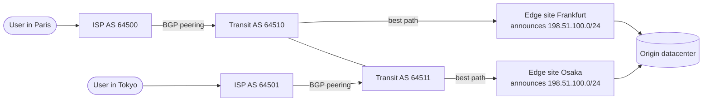

**Reading the diagram.** Two users (stadiums) reach their ISPs, which are separate autonomous systems connected to transit providers by BGP sessions. Two edge sites announce the *same* prefix, `198.51.100.0/24`. The Paris user's ISP hears the shortest policy-preferred path via Frankfurt, and the Tokyo user's ISP hears a path via Osaka, so the same destination address is served from different continents. Traffic flows synchronously left to right for requests (responses return along a path that may differ, because Internet routing is asymmetric). The origin datacenter is the storage boundary; the edges may cache (§21.4). Failure points: if Frankfurt withdraws its announcement, Paris traffic reconverges toward Osaka (or another site) within seconds to minutes, and in-flight TCP connections break. Scaling: add more announcing sites.

#### Real-world industry applications

::: industry
**Facebook, 4 October 2021.** During routine maintenance, a command intended to assess backbone capacity unintentionally disconnected Facebook's backbone, and a bug in an audit tool failed to stop it. Facebook's DNS servers are designed to withdraw their BGP anycast announcements when they cannot reach the datacenters, as a health safeguard. With the backbone gone, every DNS site withdrew at once, so `facebook.com` and related names could not be resolved anywhere. The outage lasted roughly six hours, and recovery was slowed because internal tools depended on the same network. Lesson: a health-driven withdrawal that is correct for one site can become a global outage when all sites share a failure; build in "never withdraw the last route" guards and out-of-band access.
*Evidence: Primary* — [Janardhan 2021]
:::

::: industry
**YouTube prefix hijack, February 2008.** Pakistan Telecom, intending to block YouTube domestically, announced a more-specific `/24` covering YouTube's address space. Its upstream provider propagated the announcement globally, and by longest-prefix match much of the Internet sent YouTube traffic to Pakistan for about two hours. The incident is a standard case study for BGP's trust model and motivates prefix filtering and RPKI.
*Evidence: Secondary* — [RIPE NCC 2008]
:::

#### Failure scenarios

**Table 7.4 — Routing failure scenarios.**

| What goes wrong | Why | Detection | Recovery | Prevention |
|---|---|---|---|---|
| Route leak or hijack | A network announces prefixes it does not own, or re-announces routes against policy | External BGP monitors; sudden traffic shifts; latency jumps | Contact upstreams; announce more-specific prefixes | RPKI origin validation, prefix filters, max-prefix limits |
| Self-inflicted withdrawal | Health checks or automation withdraw all announcements simultaneously | Global reachability probes fail | Out-of-band access to re-announce | Guard rails preventing withdrawal of the last route; staged changes |
| Slow convergence | BGP path exploration after a failure | Elevated loss for seconds to minutes | Wait; fail over at a higher layer (DNS, client retry) | Multiple upstreams; BFD for fast failure detection |
| Anycast connection resets | Route change moves an in-flight TCP flow to another site | Spikes in TCP resets during route changes | Client retries | Short-lived connections; stable announcements |

## 7.6 DNS: the Internet's directory

### 7.6.1 What DNS is and why it exists

::: definition
**Definition — Domain Name System (DNS).** A hierarchical, distributed database that maps human-readable **domain names** (such as `www.example.com`) to data, most often IP addresses, and the protocol used to query it [RFC 1034; RFC 1035].
:::

#### First-principles explanation

People remember names; routers need numbers. In the early ARPANET, every host downloaded a single file, `HOSTS.TXT`, listing every name and address. As the network grew, that file became too large, changed too often, and depended on one central maintainer. DNS replaced it with a **delegated hierarchy**, much like a library catalog split across buildings: the front desk (the **root**) does not know where every book is, but it knows which building holds each subject (the **top-level domains** such as `.com`), and each building knows which room holds each shelf (the **authoritative servers** for `example.com`). Responsibility for each zone is delegated to whoever owns it, so no one party maintains everything.

#### The cast of characters

- **Stub resolver.** A small library in your operating system. It does not do the work itself; it asks a recursive resolver and waits.
- **Recursive resolver** (also called a caching or full-service resolver). Run by your ISP, your company, or a public service such as `8.8.8.8` or `1.1.1.1`. It chases the answer through the hierarchy on your behalf and caches the results.
- **Root name servers.** Thirteen named server identities (`a.root-servers.net` through `m.root-servers.net`), each replicated via anycast (§7.5.3) to many physical instances worldwide. They know where each top-level domain's servers are.
- **TLD name servers.** Authoritative for a top-level domain such as `.com` or `.uk`. They know the name servers for each second-level domain.
- **Authoritative name servers.** Hold the actual records for a zone such as `example.com`. Managed DNS providers and cloud DNS services operate these for most companies.

### 7.6.2 Recursive versus iterative resolution

There are two query styles. In a **recursive query**, the client asks "give me the final answer", and the server must either return it or an error. Your stub resolver sends recursive queries to the recursive resolver. In an **iterative query**, the server returns the best information it has, often a **referral** ("I don't know, but ask these servers"), and the asker continues. Recursive resolvers send iterative queries to root, TLD and authoritative servers.

**Figure 7.3 — DNS resolution of www.example.com with an empty cache.**

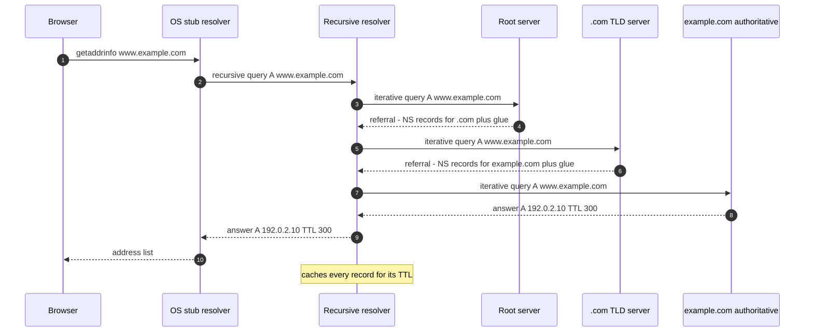

**Reading the diagram.** Six participants appear from left to right: the application, the operating system's stub resolver, the recursive resolver, and three levels of authoritative servers. Steps 1–2 are the recursive part: the stub asks once and waits. Steps 3–8 are iterative: the resolver walks down the hierarchy, receiving referrals (dashed return arrows) from the root and the TLD, each containing the name-server (NS) records for the next level and **glue** records giving those servers' IP addresses. Step 8 is the final answer, here an A record with a 300-second TTL. All exchanges are synchronous request/response, normally over UDP port 53. The resolver's cache is the storage boundary: once populated, steps 3–8 are skipped for every client of that resolver until the TTL expires, and the root and TLD referrals are cached for much longer (typically days). Failure points: any server not responding forces a timeout and retry against another listed server (each zone must have at least two). Scaling comes from caching and from anycast replication of the root and TLD servers. (The address 192.0.2.10 is a documentation address used for illustration.)

#### Mathematical foundations: what a cold lookup costs

::: example
**Worked example — Cold versus warm DNS lookup.**

Assume the client is 5 ms from its recursive resolver, and the resolver is 20 ms from the root instance, 30 ms from the TLD server and 40 ms from the authoritative server (all round-trip times).

1. Cold cache: $5 + 20 + 30 + 40 = 95$ ms before the browser can even open a connection.
2. Root and TLD referrals cached (typical, since they have long TTLs) but the name itself expired: $5 + 40 = 45$ ms.
3. Fully warm at the resolver: 5 ms.
4. Cached in the operating system or browser: effectively 0 ms.

Interpretation: almost all real lookups hit case 3 or 4, which is why DNS feels free. The cold path matters for rarely visited domains, for very low TTLs, and for every new third-party domain a page references. Engineering implication: minimize the number of distinct hostnames on a critical path, and use `<link rel="dns-prefetch">` or `preconnect` hints for domains you know you will need.
:::

### 7.6.3 Record types

**Table 7.5 — Common DNS record types.**

| Type | Maps a name to | Example | Typical use |
|---|---|---|---|
| A | An IPv4 address | `www.example.com. 300 IN A 192.0.2.10` | Host address |
| AAAA | An IPv6 address | `www.example.com. 300 IN AAAA 2001:db8::10` | Host address over IPv6 |
| CNAME | Another name (an alias) | `shop.example.com. 3600 IN CNAME shops.saas-provider.example.` | Point your name at a provider's hostname |
| MX | A mail server name, with priority | `example.com. 3600 IN MX 10 mail1.example.com.` | Email delivery (lower number = preferred) |
| NS | The authoritative name servers of a zone | `example.com. 86400 IN NS ns1.dnsprovider.example.` | Delegation |
| TXT | Arbitrary text | `example.com. 300 IN TXT "v=spf1 include:_spf.mailer.example -all"` | Domain ownership proofs, SPF, DKIM, DMARC |
| SRV | Host and port for a service, with priority and weight | `_sip._tcp.example.com. 300 IN SRV 10 60 5060 sip1.example.com.` | Service discovery (RFC 2782); used by SIP, XMPP, some service meshes |
| SOA | Zone metadata: primary server, serial, timers, negative-caching TTL | — | Zone administration |
| PTR | A name, for reverse lookup of an address | `10.2.0.192.in-addr.arpa. PTR www.example.com.` | Logs, mail server checks |
| CAA | Which certificate authorities may issue for the domain | `example.com. CAA 0 issue "letsencrypt.org"` | Restricting certificate issuance (§7.10) |
| HTTPS / SVCB | Connection parameters: ALPN protocols, ports, address hints | `example.com. HTTPS 1 . alpn="h3,h2"` | Advertising HTTP/3 before the first connection (RFC 9460) |

Three rules trip people up. First, a **CNAME cannot coexist with other records at the same name**, so you cannot put a CNAME at the zone apex (`example.com` itself, which must hold SOA and NS records). DNS providers offer non-standard "ALIAS" or "CNAME flattening" features to work around this. Second, every record in a response carries its own TTL. Third, MX and SRV records point to *names*, never directly to addresses.

### 7.6.4 TTL and caching

::: definition
**Definition — DNS time to live (TTL).** A per-record value, in seconds, that tells any cache how long it may reuse the record before asking again. **Negative caching** stores "this name does not exist" (NXDOMAIN) answers for a duration derived from the zone's SOA record [RFC 2308].
:::

Caches exist at several levels: the browser, the operating system, the recursive resolver, and sometimes in application runtimes. (Some runtimes have historically cached DNS answers far longer than the TTL, or forever, by default; the Java Virtual Machine's behavior depends on configuration and security manager settings, so check your runtime.)

TTL is a trade-off between **agility** (how quickly a change takes effect) and **load and latency** (how often resolvers must re-query). Short TTLs (30–60 s) let you fail over quickly but raise query volume and the fraction of slow cold lookups. Long TTLs (hours to a day) are efficient but make changes slow.

::: example
**Worked example — How long does a DNS failover really take?**

Your record has TTL 300 s, and your health checker takes 30 s (three failed probes, 10 s apart) to declare the primary site dead and update DNS.

1. Detection: 30 s.
2. Worst-case cache staleness: a resolver that refreshed one second before the update keeps serving the old answer for up to 300 s.
3. Worst-case total for well-behaved resolvers: $30 + 300 = 330$ s, about 5.5 minutes. The average client re-queries halfway through the TTL, so the mean is about $30 + 150 = 180$ s.
4. Clients holding open connections are not affected by DNS at all: they keep sending to the dead address until their connections fail and they reconnect.
5. Misbehaving caches that enforce a minimum TTL or ignore it extend the tail indefinitely.

Engineering implication: DNS failover is a *minutes-scale* mechanism. If you need seconds, put a stable address in front (an anycast virtual IP or a load balancer, §19.8) and fail over behind it.
:::

Before a planned migration, lower the TTL well in advance. If the old TTL is 86,400 s (one day), you must lower it at least one day before the cut-over, because resolvers that cached the record just before you changed it will not re-query for a day.

### 7.6.5 DNS-based load balancing and its limits

Because a DNS answer can differ per query, DNS is the coarsest and cheapest load balancer:

- **Round-robin DNS.** Return several A records, rotating their order. Clients typically try the first.
- **Weighted answers.** Return each address in proportion to configured weights.
- **Geo-DNS / latency-based DNS.** Answer based on the resolver's (or, with the EDNS Client Subnet extension, the client's) location, pointing users to a nearby region (Ch 44, §19.9).
- **Health-checked DNS.** Remove addresses whose health checks fail.

The limits are fundamental, not implementation details:

1. **Caching defeats fine control.** A large resolver (an ISP serving millions of users) caches one answer and hands it to all its clients for the TTL, so "1/N of queries" is not "1/N of users".
2. **Resolver location is not client location.** Geo-DNS sees the recursive resolver's address. A user in Singapore using a resolver in the US may be sent to the US region, unless EDNS Client Subnet is supported.
3. **Failover speed is bounded by TTL** and by stale clients, as computed above.
4. **No load awareness.** DNS does not see connection counts or server latency; it picks before the connection exists.
5. **Clients behave inconsistently.** Some try only the first address; some try all; some pin forever.

DNS is therefore used to pick a **region or site**, and real load balancers distribute connections *within* the site (Chapter 19).

#### Transport details

DNS normally uses UDP port 53 because a query and a response each fit in one datagram, avoiding a handshake. Classic DNS limited UDP responses to 512 bytes; the EDNS(0) extension (RFC 6891) lets clients advertise larger buffers, and current operational guidance favors about 1,232 bytes to avoid IP fragmentation. If a response is too large, the server sets the truncation (TC) bit and the client retries over TCP. Zone transfers between servers use TCP. Encrypted variants exist: DNS over TLS (port 853, RFC 7858) and DNS over HTTPS (RFC 8484), which hide queries from on-path observers.

#### Failure scenarios

**Table 7.6 — DNS failure scenarios.**

| What goes wrong | Why | Detection | Recovery | Prevention |
|---|---|---|---|---|
| Authoritative provider outage | DDoS or provider failure; all NS records at one provider | Resolution failures from external probes | Wait, or change NS at the registrar (slow: TLD TTLs are long) | Two independent DNS providers serving the same zone |
| Stale records after migration | TTL was long when you changed the record | Traffic still reaching old addresses | Keep old endpoint alive until TTL × 2 has passed | Lower TTL in advance of planned changes |
| Resolver overload / latency | Too many lookups per request; no local caching | High p99 on connection setup; resolver timeouts | Add local caching resolver | Cache in-process with TTL respect; reuse connections |
| Negative-cache trap | Name queried before it was created; NXDOMAIN cached | "Works for me, not for them" | Wait out SOA negative TTL | Create records before announcing names |
| Split-horizon mismatch | Internal and external views of a zone differ | Errors only inside or only outside the network | Fix the view | Test both views in deployment checks |

::: mistake
**"Changing a DNS record takes 24–48 hours to propagate."** DNS does not propagate; caches *expire*. A change is visible to a given resolver as soon as its cached copy's TTL runs out. The folklore "48 hours" comes from long TTLs, especially on NS records at the TLD.
:::

## 7.7 TCP: reliable byte streams over an unreliable network

### 7.7.1 What TCP provides

IP is a **best-effort** service: packets may be lost, duplicated, delayed or delivered out of order, and IP will not tell you. Most applications want the opposite: a reliable, ordered pipe of bytes. The **Transmission Control Protocol** builds that pipe on top of IP [RFC 9293].

::: definition
**Definition — TCP.** A connection-oriented transport protocol that provides a reliable, ordered, full-duplex **byte stream** between two endpoints identified by (IP address, port) pairs. It achieves reliability with sequence numbers, acknowledgments and retransmission; it protects a slow receiver with **flow control**; and it protects the network with **congestion control**.
:::

#### First-principles explanation

Imagine mailing a 300-page manuscript one page per envelope through an unreliable postal service. To make sure your editor gets every page in order, you would number each page, ask the editor to send back postcards saying "I have everything up to page 57", and resend any page not acknowledged within a reasonable time. You would also avoid sending all 300 pages at once if the editor's desk is small (flow control) or if the post office is visibly overwhelmed (congestion control). That is TCP. The one twist is that TCP numbers **bytes**, not pages: the stream has no message boundaries, so an application that writes "hello" and then "world" may receive "hellowor" and "ld". Application protocols must add their own framing (a length prefix or a delimiter).

### 7.7.2 The segment

Every TCP segment carries a header of 20 bytes plus up to 40 bytes of options. The fields you will reason about most are:

- **Source and destination ports** (16 bits each). Together with the IP addresses they form the connection's 4-tuple.
- **Sequence number** (32 bits). The stream offset of the first payload byte in this segment, relative to a random **initial sequence number (ISN)**.
- **Acknowledgment number** (32 bits). The next byte the sender of this segment expects to receive: "I have everything before this".
- **Flags.** SYN (synchronize, opens a connection), ACK (acknowledgment field valid), FIN (no more data from me), RST (abort), PSH, URG, plus ECE/CWR for explicit congestion notification.
- **Window** (16 bits). How many more bytes the sender of this segment is willing to receive (flow control, §7.7.6).
- **Options.** MSS, window scale, selective acknowledgments (SACK) and timestamps, mostly negotiated in the handshake.

### 7.7.3 The three-way handshake

Before data flows, both sides must agree that the connection exists and learn each other's initial sequence numbers. Each ISN is chosen randomly so that stray segments from an old connection, or an off-path attacker, are unlikely to fall into the valid window.

**Figure 7.4 — TCP three-way handshake followed by the first request.**

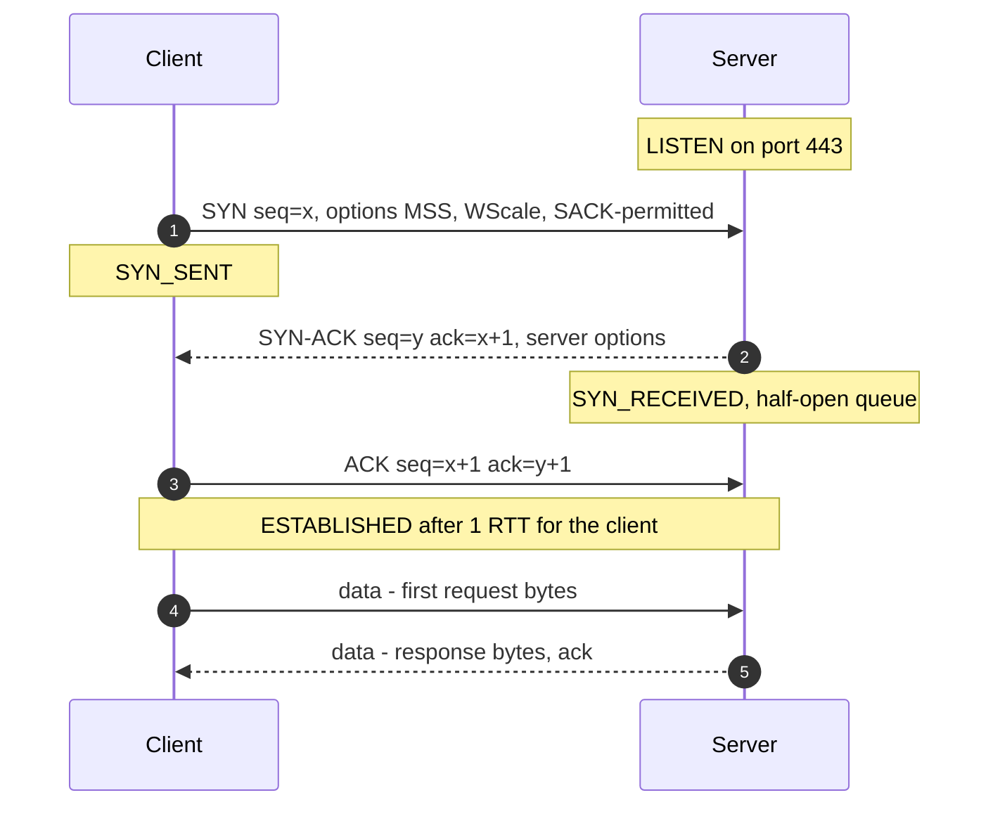

**Reading the diagram.** Two participants: the client, which actively opens, and the server, which is listening. Step 1 is the SYN, carrying the client's random ISN $x$ and its option offers. Step 2, the SYN-ACK, acknowledges $x+1$ (a SYN consumes one sequence number) and carries the server's own ISN $y$. Step 3 completes the handshake. The client may send data immediately after step 3, so the handshake costs the client **one round-trip time (RTT)** before its request can leave; the server sees the request 1.5 RTTs after the client began. All exchanges are synchronous. The server's half-open queue (connections between steps 2 and 3) is a failure point: a **SYN flood** attack fills it with spoofed SYNs, which servers counter with **SYN cookies**, encoding the connection state in the ISN instead of storing it. Scaling: the server's accept queue (`listen` backlog) must be sized for connection bursts.

TCP Fast Open (RFC 7413) lets a returning client put data in the SYN using a cookie from a previous connection, saving one RTT, but middlebox interference and replay concerns have limited its deployment. QUIC (§7.9.4) achieves the same goal more robustly.

### 7.7.4 The four-way close and TIME_WAIT

TCP is full-duplex, so each direction closes independently. Each side sends a FIN when it has no more data, and the other acknowledges it.

**Figure 7.5 — TCP four-way close and the TIME_WAIT state.**

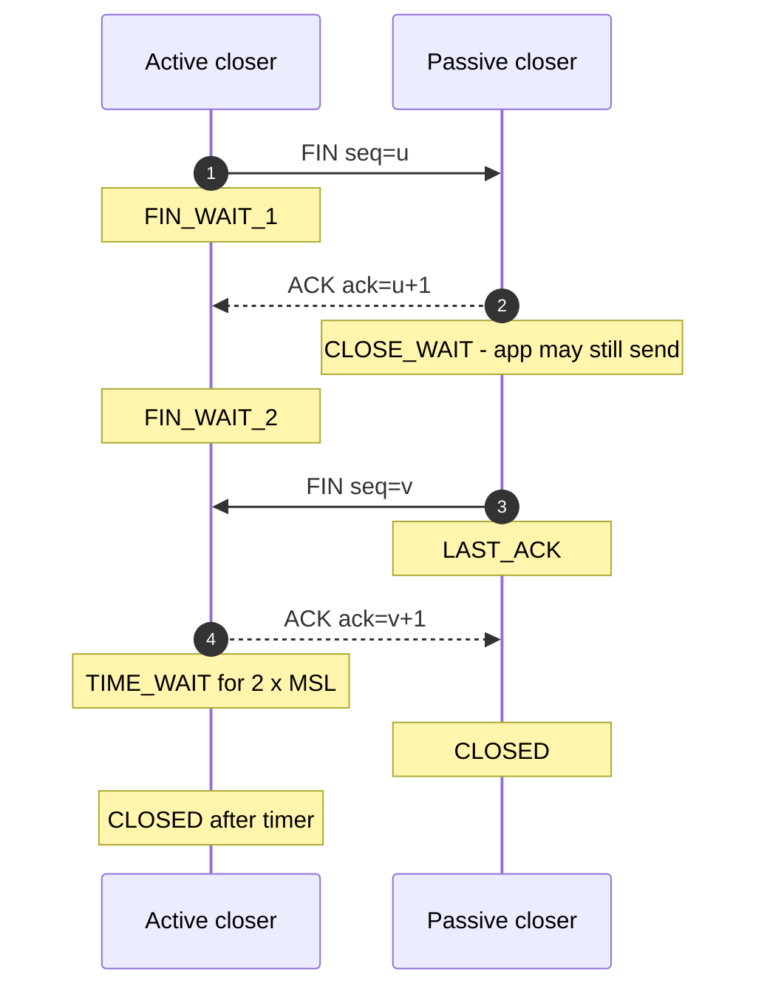

**Reading the diagram.** The **active closer** is whichever side calls `close()` first; the other is the **passive closer**. Steps 1–2 close the active side's direction; the passive side enters CLOSE_WAIT and may keep sending until its application also closes (a pile-up of CLOSE_WAIT sockets is the classic symptom of an application that forgets to close connections). Steps 3–4 close the other direction. Steps 2 and 3 are often combined into one segment, making the close effectively three segments. The active closer then waits in **TIME_WAIT** for twice the **maximum segment lifetime (MSL)**. All steps are synchronous; RST is the abrupt alternative that skips all of this and discards unsent data.

TIME_WAIT exists for two reasons. First, if the final ACK (step 4) is lost, the passive side will retransmit its FIN, and the active side must still be around to re-acknowledge it. Second, it ensures that delayed segments from this connection have died out before a new connection with the same 4-tuple can be created and misinterpret them. RFC 793 set MSL to two minutes; Linux hard-codes TIME_WAIT at 60 seconds.

::: example
**Worked example — Ephemeral port exhaustion from TIME_WAIT.**

A service opens a new TCP connection for every request to one backend (one destination IP and port) and closes it afterward, so the service is the active closer.

1. Each connection needs a unique source port. Linux's default ephemeral port range is 32,768–60,999: $60{,}999 - 32{,}768 + 1 = 28{,}232$ ports.
2. Each closed connection holds its port in TIME_WAIT for 60 s.
3. Sustainable new-connection rate to that single destination: $28{,}232 / 60 \approx 470$ connections per second.
4. At 1,000 requests per second with one connection per request, ports run out after about $28{,}232 / 1{,}000 \approx 28$ s, and `connect()` starts failing with `EADDRNOTAVAIL`.

Interpretation: TIME_WAIT is not a bug, but opening a connection per request is. Fixes, in order of preference: reuse connections with keep-alive and pooling (§7.16); add destination IPs or ports (each distinct 4-tuple has its own port space); widen the ephemeral range; enable `net.ipv4.tcp_tw_reuse` for outgoing connections. Never use the long-removed `tcp_tw_recycle`, which broke clients behind NAT.
:::

### 7.7.5 Sequence numbers, acknowledgments and retransmission

TCP uses **cumulative acknowledgments**: ACK number $N$ means "I have all bytes before $N$". The sender keeps every unacknowledged byte in its send buffer and retransmits on one of two signals:

1. **Retransmission timeout (RTO).** If no ACK arrives within a timeout computed from measured RTTs, the sender retransmits the oldest unacknowledged segment, doubles the timeout (**exponential backoff**), and treats the event as severe congestion.
2. **Fast retransmit.** If the receiver gets a segment out of order, it immediately re-sends its last ACK. Three **duplicate ACKs** strongly suggest a single lost segment with later ones still arriving, so the sender retransmits at once without waiting for the timer [RFC 5681].

**Selective acknowledgments (SACK)** let the receiver report exactly which blocks beyond the gap it holds, so the sender retransmits only what is missing.

::: formula
**Retransmission timeout (RFC 6298)**

On each new RTT sample $R$ (after the first):

$$\text{RTTVAR} \leftarrow (1-\beta)\,\text{RTTVAR} + \beta\,|\text{SRTT} - R|$$
$$\text{SRTT} \leftarrow (1-\alpha)\,\text{SRTT} + \alpha\,R$$
$$\text{RTO} = \text{SRTT} + \max(G,\ 4\,\text{RTTVAR})$$

| Symbol | Meaning | Units |
|---|---|---|
| $R$ | Latest measured round-trip time | ms |
| SRTT | Smoothed (exponentially averaged) RTT | ms |
| RTTVAR | Smoothed RTT variation | ms |
| $\alpha, \beta$ | Smoothing gains, $1/8$ and $1/4$ | dimensionless |
| $G$ | Clock granularity | ms |
| RTO | Retransmission timeout; RFC 6298 says round up to at least 1 s | ms |
:::

::: example
**Worked example — Computing an RTO.**

Current state: SRTT = 100 ms, RTTVAR = 10 ms. A new sample arrives: $R = 140$ ms. Assume $G$ is negligible.

1. RTTVAR $= 0.75 \times 10 + 0.25 \times |100 - 140| = 7.5 + 10 = 17.5$ ms (computed with the *old* SRTT, as the RFC requires).
2. SRTT $= 0.875 \times 100 + 0.125 \times 140 = 87.5 + 17.5 = 105$ ms.
3. RTO $= 105 + 4 \times 17.5 = 175$ ms.
4. RFC 6298 rounds this up to its 1 s minimum; Linux uses a 200 ms minimum, so Linux would wait 200 ms.

Interpretation: inside a datacenter, where RTTs are around 0.1–0.5 ms, a single timeout-driven retransmission costs 200 ms, hundreds of times the normal latency. This is why one lost packet can dominate p99 latency for small RPCs (§23.6), and why datacenter operators tune minimum RTOs down and work hard to avoid drops.
:::

### 7.7.6 Flow control and the receive window

**Flow control** prevents a fast sender from overflowing a slow receiver. Each ACK advertises the **receive window** (`rwnd`): the free space in the receiver's socket buffer. The sender never has more than `rwnd` unacknowledged bytes outstanding. If the application stops reading, the buffer fills, the advertised window drops to zero, and the sender pauses, probing periodically until the window reopens. Flow control is how TCP provides **backpressure** end to end (§22.10).

The header's window field is 16 bits, so it can express at most 65,535 bytes. That is far too small for fast long-distance links (see the bandwidth-delay product in §7.15), so the **window scale** option (RFC 7323), negotiated in the SYN, multiplies the window by $2^{s}$ for $s \le 14$, allowing windows up to about 1 GiB ($65{,}535 \times 2^{14} = 1{,}073{,}725{,}440$ bytes).

### 7.7.7 Congestion control

Flow control protects the receiver. **Congestion control** protects the network. In October 1986, the early Internet suffered **congestion collapse**: throughput between Lawrence Berkeley Laboratory and UC Berkeley fell from 32 kbps to 40 bps [Jacobson 1988] because senders retransmitted aggressively into already-full queues, so most bandwidth carried duplicate packets that were then dropped. Van Jacobson's 1988 algorithms, refined into today's RFC 5681, made each sender infer congestion and back off.

::: definition
**Definition — Congestion window (cwnd).** A sender-side limit, in bytes or segments, on unacknowledged data in flight, based on the sender's estimate of what the network path can absorb. The sender may have at most $\min(\text{cwnd}, \text{rwnd})$ bytes outstanding.
:::

#### How classic congestion control works

1. **Slow start.** A new connection starts with a small initial window (10 segments, about 14.6 KB, per RFC 6928) and increases cwnd by one segment for every segment acknowledged. That **doubles cwnd every RTT**: "slow" only in comparison with sending everything at once.
2. When cwnd reaches the **slow-start threshold** (`ssthresh`), the sender switches to **congestion avoidance**: it adds about one segment per RTT (**additive increase**).
3. On a loss detected by three duplicate ACKs, the sender halves cwnd (**multiplicative decrease**), sets ssthresh to the new value, retransmits, and continues in congestion avoidance via **fast recovery**.
4. On a retransmission timeout, the sender assumes something severe happened, sets ssthresh to half the flight size, resets cwnd to one segment, and re-enters slow start.

Steps 2 and 3 together are **AIMD (additive increase, multiplicative decrease)**. It produces the familiar sawtooth of cwnd over time, and it has a beautiful property: multiple AIMD flows sharing a bottleneck converge toward an equal share.

**Figure 7.6 — Loss-based TCP congestion control states (Reno-style).**

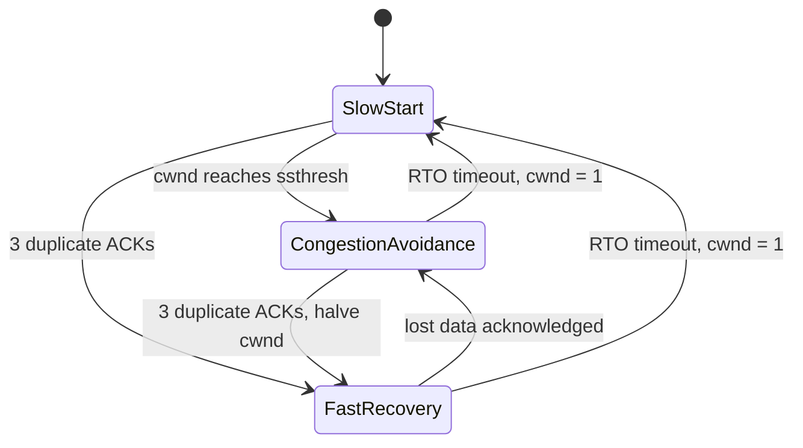

**Reading the diagram.** Each box is a sender state. A connection begins in slow start, where cwnd doubles each RTT. Reaching ssthresh moves it to congestion avoidance (linear growth). Three duplicate ACKs, a mild loss signal, move it to fast recovery with cwnd halved; once the lost data is acknowledged, it returns to congestion avoidance. A timeout, the severe signal, sends it all the way back to slow start with cwnd of one segment. All transitions are driven by asynchronous events (ACK arrivals and timers) on the sender. Failure point: repeated timeouts on a lossy path keep the connection in slow start with exponentially growing RTOs, which users experience as a "hung" transfer.

::: example
**Worked example — How many RTTs does slow start need for 1 MB?**

Assume MSS = 1,460 bytes, initial cwnd = 10 segments, no loss, a large receive window, and ignore delayed ACKs.

1. Segments needed: $1{,}000{,}000 / 1{,}460 \approx 685$.
2. Segments sent per round (RTT): 10, 20, 40, 80, 160, 320, 640.
3. Cumulative: 10, 30, 70, 150, 310, 630, 1,270.
4. After 6 rounds, 630 < 685; the 7th round finishes the transfer. So **7 RTTs** of data transfer.
5. At an 80 ms RTT that is $7 \times 80 = 560$ ms, plus 1 RTT of TCP handshake and 1 RTT of TLS 1.3 handshake (§7.10): $9 \times 80 = 720$ ms in total, regardless of whether the link is 100 Mbps or 10 Gbps.

Interpretation: for small and medium transfers on long paths, **latency, not bandwidth, determines download time**. A 10× faster link barely helps; reducing RTT (a CDN edge close to the user, §21.3) or reusing a connection whose cwnd is already large (§7.16) helps enormously.
:::

#### CUBIC

On fast long-distance paths, Reno's "add one segment per RTT" is painfully slow to regain a large window after a loss: after a loss halves a 10,000-segment window, regaining the missing 5,000 segments at one segment per 100 ms RTT takes $5{,}000 \times 0.1 = 500$ s. **CUBIC** [Ha et al. 2008; RFC 9438] replaces linear growth with a cubic function of *time since the last loss*, independent of RTT. It has been Linux's default since 2006 and is the default in most operating systems today.

::: formula
**CUBIC window growth**

$$W(t) = C\,(t - K)^3 + W_{\max}, \qquad K = \sqrt[3]{\frac{W_{\max}\,(1-\beta)}{C}}$$

| Symbol | Meaning | Units |
|---|---|---|
| $W(t)$ | Congestion window $t$ seconds after the last loss | segments |
| $W_{\max}$ | Window just before the last loss | segments |
| $\beta$ | Multiplicative decrease factor; window becomes $\beta W_{\max}$ after loss (0.7) | dimensionless |
| $C$ | Scaling constant (0.4) | segments/s³ |
| $K$ | Time to climb back to $W_{\max}$ | s |
:::

::: example
**Worked example — CUBIC recovery time.**

Suppose $W_{\max} = 100$ segments when a loss occurs.

1. After the loss: $W(0) = 0.7 \times 100 = 70$ segments. Check with the formula: $K^3 = 100 \times 0.3 / 0.4 = 75$, so $K = \sqrt[3]{75} \approx 4.22$ s, and $W(0) = 0.4 \times (-4.22)^3 + 100 = 0.4 \times (-75) + 100 = 70$. Consistent.
2. Growth is fast at first, flattens as $t \to K$ (the curve is cautious near the window where loss last occurred), and reaches 100 segments at $t \approx 4.22$ s.
3. Beyond $K$ the window accelerates again, probing for newly available bandwidth.

Interpretation: recovery time depends on $W_{\max}$ and constants, not on RTT, so long-RTT flows are not penalized as much as under Reno. The plateau around $W_{\max}$ keeps CUBIC near the last known-good operating point.
:::

#### BBR

Loss-based algorithms (Reno, CUBIC) treat packet loss as *the* congestion signal. That has two problems. On paths with large buffers, they keep filling the queue until it overflows, adding hundreds of milliseconds of queuing delay (**bufferbloat**, §7.15). On paths with random loss unrelated to congestion (wireless, long-haul links), they back off when they should not.

**BBR** (Bottleneck Bandwidth and Round-trip propagation time) [Cardwell et al. 2016] instead builds an explicit model of the path. It continuously estimates the **bottleneck bandwidth** (the maximum recent delivery rate) and the **minimum RTT** (the propagation delay with empty queues). It then paces packets at the estimated bandwidth and keeps roughly one bandwidth-delay product in flight, periodically probing slightly above that rate to discover more bandwidth and periodically draining the queue to re-measure minimum RTT.

**Table 7.7 — Congestion control algorithms compared.**

| Aspect | Reno (AIMD) | CUBIC | BBR (v1) |
|---|---|---|---|
| Congestion signal | Packet loss | Packet loss | Measured bandwidth and RTT model |
| Growth function | +1 MSS per RTT | Cubic in time since last loss | Pacing at estimated bottleneck rate, with probing |
| Response to loss | Halve cwnd | Multiply by 0.7 | Largely ignores isolated loss |
| Queue occupancy | Fills buffers until loss | Fills buffers until loss | Aims for little standing queue |
| Strength | Simple, fair among equals | Good on high-BDP paths; default almost everywhere | Low latency; high throughput with random loss |
| Weakness | Slow on high-BDP paths | Bufferbloat; collapses with random loss | Fairness issues versus loss-based flows; retransmissions with shallow buffers |
| Where used | Teaching baseline | Linux, Windows, macOS defaults | Google services, available in Linux since 4.9 |

::: industry
**BBR at Google.** Google reported deploying BBR on its B4 inter-datacenter backbone, where it delivered 2–25× higher throughput than CUBIC, and on YouTube and google.com traffic, where it reduced median RTT (by reducing queuing) while improving throughput. Later work (BBRv2/v3) addresses fairness and loss-sensitivity issues found in BBRv1.
*Evidence: Primary* — [Cardwell et al. 2016]
:::

### 7.7.8 Nagle's algorithm and delayed ACKs

In 1984, John Nagle observed that interactive programs sending one keystroke per write produced 41-byte packets (40 bytes of headers, 1 byte of data), wasting bandwidth. **Nagle's algorithm** (RFC 896) says: if there is unacknowledged data in flight, buffer small writes until either the ACK arrives or a full segment accumulates.

Separately, receivers use **delayed ACKs**: they wait briefly (up to 500 ms by RFC 1122; Linux uses about 40 ms or more) hoping to piggyback the ACK on response data or to acknowledge two segments at once.

Each idea is reasonable; together they cause a notorious stall. A client writes a request header (small write 1), then the body (small write 2), then waits for a response. Write 1 is sent. Nagle holds write 2 until write 1 is acknowledged. The server cannot respond before it has the whole request, so it has nothing to piggyback on and delays its ACK. The pair sit idle for the delayed-ACK timer, adding tens of milliseconds to every request. The fixes are to assemble the full message and write it once, or to set the `TCP_NODELAY` socket option, which disables Nagle. Almost every RPC framework and database driver sets `TCP_NODELAY` by default.

### 7.7.9 Head-of-line blocking

**Head-of-line (HOL) blocking** occurs when an item at the front of a queue holds up everything behind it. TCP guarantees in-order delivery of one byte stream, so if segment 5 is lost and segments 6–20 arrive, the receiving kernel holds 6–20 in its buffer and the application can read nothing until segment 5's retransmission arrives, at least one RTT later. If the application multiplexed several independent requests over that connection (HTTP/2, §7.9.3), all of them stall because of one packet that belonged to only one of them. This is the central motivation for QUIC (§7.9.4), which provides independent streams with no cross-stream HOL blocking.

### 7.7.10 Code example: a TCP echo server and client

```python
# echo_server.py — a minimal, runnable TCP echo server (Python 3.8+).
import socket

HOST, PORT = "127.0.0.1", 9000

with socket.socket(socket.AF_INET, socket.SOCK_STREAM) as srv:
    srv.setsockopt(socket.SOL_SOCKET, socket.SO_REUSEADDR, 1)  # rebind despite TIME_WAIT
    srv.bind((HOST, PORT))
    srv.listen(128)                         # backlog of completed handshakes
    print(f"listening on {HOST}:{PORT}")
    while True:
        conn, addr = srv.accept()           # handshake already done by the kernel
        with conn:
            conn.setsockopt(socket.IPPROTO_TCP, socket.TCP_NODELAY, 1)
            while True:
                data = conn.recv(4096)      # may return fewer bytes than were sent
                if not data:                # empty read: peer sent FIN
                    break
                conn.sendall(data)          # loops until every byte is queued
```

```python
# echo_client.py — measures connect time and one request/response round trip.
import socket, time

t0 = time.perf_counter()
s = socket.create_connection(("127.0.0.1", 9000))   # SYN, SYN-ACK, ACK
t1 = time.perf_counter()
s.sendall(b"hello")
reply = s.recv(4096)
t2 = time.perf_counter()
s.close()                                             # client is active closer: TIME_WAIT here
print(reply, f"connect={1e3*(t1-t0):.3f} ms  rtt={1e3*(t2-t1):.3f} ms")
```

What to notice:

- `accept()` returns only after the kernel has completed the three-way handshake; your application never sees SYNs.
- `recv(4096)` returns *up to* 4,096 bytes. TCP is a byte stream, so a real protocol must loop until a complete message has arrived, using a length prefix or delimiter.
- `recv` returning `b""` is how the application learns that the peer sent FIN.
- `SO_REUSEADDR` lets a restarted server bind its port while old connections linger in TIME_WAIT.
- The server handles one client at a time; production servers use threads, an event loop (§6.13) or `asyncio`.
- Over loopback, both timings will be tens of microseconds; the same client against a server 80 ms away would show about 80 ms for each.

#### Failure scenarios

**Table 7.8 — TCP failure scenarios.**

| What goes wrong | Why | Detection | Recovery | Prevention |
|---|---|---|---|---|
| Ephemeral port exhaustion | Connection per request; TIME_WAIT holds ports | `EADDRNOTAVAIL`; many TIME_WAIT sockets in `ss -s` | Reuse connections; `tcp_tw_reuse` | Pooling and keep-alive (§7.16) |
| CLOSE_WAIT leak | Application never closes sockets after peer FIN | Growing CLOSE_WAIT count; file-descriptor exhaustion | Restart process; fix code | Close in `finally`/context managers; timeouts |
| Half-open connection | Peer crashed or a NAT/firewall dropped state; no FIN sent | Writes hang or eventually reset; reads block forever | Application-level timeouts; reconnect | TCP keep-alive or application heartbeats; read deadlines |
| Retransmission-driven tail latency | Packet loss; minimum RTO of 200 ms+ | p99 spikes; `nstat` retransmission counters | — | Avoid drops; hedged requests (§23.7) |
| Nagle/delayed-ACK stall | Multiple small writes per request | Latency floor of about 40 ms on small requests | Set `TCP_NODELAY` | Write whole messages; framework defaults |
| SYN flood | Spoofed SYNs fill the half-open queue | Many SYN_RECV sockets | SYN cookies | SYN cookies on by default; DDoS protection |

::: mistake
**"TCP guarantees my message was processed."** An ACK means the peer's *kernel* received the bytes into a buffer, not that the application read them, let alone acted on them or wrote them durably. If the server crashes after ACKing, the data is gone. End-to-end confirmation must come from the application (§24.14, the end-to-end argument).
:::

::: mistake
**"A TCP connection notices immediately when the other side dies."** If the peer vanishes without sending FIN or RST (power loss, cable cut, a firewall silently dropping state), an idle connection looks healthy indefinitely. TCP keep-alive probes default to starting after two hours of idleness on Linux. Always set application-level timeouts.
:::

## 7.8 UDP and when to use it

::: definition
**Definition — UDP.** The User Datagram Protocol [RFC 768] is a connectionless transport protocol that adds only port numbers, a length and a checksum to IP. Its 8-byte header provides process-to-process delivery of individual **datagrams** with no handshake, no acknowledgments, no retransmission, no ordering, and no flow or congestion control.
:::

If TCP is registered mail with numbered pages and receipts, UDP is a postcard: cheap, immediate, and with no guarantee it arrives or that two postcards arrive in order. UDP does preserve message boundaries: one `sendto()` produces one datagram, and the receiver gets exactly that datagram or nothing.

### Why does this exist?

Some applications are hurt more by TCP's guarantees than helped:

- **Request/response with tiny messages.** A DNS query fits in one packet. A TCP handshake would triple the latency; if the reply is lost, the client simply asks again.
- **Real-time media and games.** A voice packet that arrives 300 ms late is useless; it is better to skip it than to stall the stream waiting for a retransmission (TCP's head-of-line blocking).
- **Custom transports.** QUIC (§7.9.4) implements its own reliability, streams and congestion control *on top of* UDP, because UDP passes through existing firewalls and NATs and can be implemented in user space without kernel changes.
- **Multicast and broadcast**, such as DHCP address assignment and market-data feeds, which TCP's one-to-one connections cannot express.
- **High-volume, loss-tolerant telemetry**, such as StatsD metrics, where an occasional lost sample does not matter.

**Table 7.9 — TCP versus UDP.**

| Aspect | TCP | UDP |
|---|---|---|
| What it is | Reliable, ordered byte stream | Unreliable datagrams |
| Connection setup | 3-way handshake (1 RTT) | None |
| Header | 20–60 bytes | 8 bytes |
| Reliability and ordering | Yes, via sequence numbers and retransmission | No |
| Message boundaries | No (byte stream) | Yes (one datagram = one message) |
| Flow and congestion control | Yes | No; application's responsibility |
| Head-of-line blocking | Yes, within the stream | No |
| State on server | Per connection | None required |
| Typical uses | HTTP/1.1, HTTP/2, databases, RPC | DNS, VoIP, games, QUIC/HTTP/3, DHCP, telemetry |
| Choose when | You need every byte, in order, and can tolerate setup cost | Timeliness beats completeness, or you are building your own transport |

### What you must rebuild on UDP

Choosing UDP moves responsibilities into your application: detecting loss (sequence numbers), deciding whether to retransmit, reordering, splitting messages to fit the path MTU (a UDP datagram larger than the MTU gets fragmented by IP, and losing any fragment loses the whole datagram), and above all **congestion control**. A UDP application that sends at a fixed high rate regardless of loss harms every other flow on the path; RFC 8085 gives guidelines for responsible UDP use.

::: warning
**UDP amplification attacks.** Because UDP has no handshake, an attacker can forge the source address of a small request so that a server sends a much larger response to the victim. Open DNS resolvers, NTP and memcached servers exposed over UDP have been abused for very large DDoS attacks. Never expose UDP services that send responses much larger than requests to the Internet without rate limiting and source validation (§10.11).
:::

## 7.9 HTTP/1.1, HTTP/2, HTTP/3 and QUIC

### 7.9.1 HTTP semantics

The **Hypertext Transfer Protocol** is a request/response application protocol. A client sends a request with a **method** (GET, POST, PUT, DELETE, …), a **target** (path), **header fields** (metadata such as `Host`, `Content-Type`, `Cache-Control`) and an optional body. The server answers with a **status code** (200 OK, 301 redirect, 404 not found, 503 unavailable, …), headers and an optional body. RFC 9110 defines these **semantics** separately from how they are encoded on the wire, and three wire versions coexist: HTTP/1.1 [RFC 9112], HTTP/2 [RFC 9113] and HTTP/3 [RFC 9114]. Your application code sees the same methods, headers and status codes whichever version carries them. API design on top of HTTP is covered in §8.6. For a performance-oriented treatment of everything in this section, see [Grigorik 2013].

### 7.9.2 HTTP/1.1: text, keep-alive and pipelining

HTTP/1.1 messages are human-readable text:

```text
GET /index.html HTTP/1.1
Host: www.example.com
User-Agent: curl/8.5.0
Accept: */*

```

The response begins `HTTP/1.1 200 OK`, followed by headers, a blank line and the body. The body's end is marked by `Content-Length` or by **chunked transfer encoding**.

HTTP/1.0 opened a new TCP connection per request. HTTP/1.1 made **persistent connections** (keep-alive) the default: after a response, the connection stays open for the next request, saving a TCP (and TLS) handshake and keeping the warmed-up congestion window.

The remaining problem is that one connection carries **one request at a time**. HTTP/1.1 defined **pipelining**, sending several requests without waiting, but responses must return in request order, so one slow response blocks all those behind it (application-level head-of-line blocking). Buggy intermediaries and that HOL problem meant browsers never enabled pipelining by default. Browsers instead open **multiple parallel connections**, typically six per host, and sites used to "shard" assets across hostnames to get more. Each extra connection costs handshakes, server memory and separate slow starts, and connections compete with each other for bandwidth.

### 7.9.3 HTTP/2: binary framing and multiplexing

HTTP/2 (originally RFC 7540 in 2015, now RFC 9113) keeps HTTP semantics but changes the wire format.

#### How it works internally

1. **Binary framing.** Each message is split into **frames** with a 9-byte header giving length, type (HEADERS, DATA, SETTINGS, WINDOW_UPDATE, RST_STREAM, GOAWAY, PING, …), flags and a **stream identifier**.
2. **Streams and multiplexing.** Each request/response pair is a **stream** with its own ID (odd numbers for client-initiated streams). Frames from many streams interleave on one TCP connection, so a slow response no longer blocks others at the HTTP layer. One connection per origin replaces six.
3. **Header compression with HPACK** [RFC 7541]. Requests repeat nearly identical headers (cookies, user agent). HPACK keeps a **static table** of 61 common header fields and a **dynamic table** of recently sent ones on both ends, so repeated headers are sent as small integer indexes; new values may be Huffman-coded. HPACK avoids the compression side-channel attacks (CRIME) that made general-purpose compression of headers unsafe.
4. **Per-stream and connection flow control** with WINDOW_UPDATE frames, so one large download cannot starve other streams of buffer space.
5. **Stream cancellation** with RST_STREAM, without closing the connection.

Two features have faded. The original priority tree was complex and inconsistently implemented, and RFC 9113 deprecates it in favor of the simpler scheme in RFC 9218. **Server push**, which let servers send resources before they were requested, proved hard to use well; major browsers have removed support.

#### The TCP head-of-line problem remains

HTTP/2 removed head-of-line blocking at the HTTP layer, but all streams still share one TCP byte stream. A single lost packet stalls *every* stream until it is retransmitted (§7.7.9). On a clean network HTTP/2's single connection beats six HTTP/1.1 connections; at loss rates of a few percent, typical of poor mobile networks, it can do worse, because six independent connections each suffer only their own losses.

### 7.9.4 QUIC and HTTP/3

**QUIC** [RFC 9000] is a general-purpose transport protocol, developed first at Google and standardized by the IETF in 2021, that runs over UDP. **HTTP/3** [RFC 9114] is HTTP mapped onto QUIC.

#### Why does this exist?

Three problems could not be fixed inside TCP. First, TCP's head-of-line blocking is inherent in its single ordered stream. Second, a secure connection costs two sequential handshakes (TCP, then TLS). Third, TCP lives in operating-system kernels and is inspected and sometimes rewritten by **middleboxes** (firewalls, NATs, load balancers), so new TCP features take a decade to deploy, a problem called **ossification**. Building on UDP, implementing the transport in user space, and encrypting nearly all transport headers solves all three.

#### How it works internally

1. **Integrated handshake.** QUIC carries the TLS 1.3 handshake inside its own packets [RFC 9001]. Transport and cryptographic setup happen together in **1 RTT**; a resumed connection can send application data in its first flight (**0-RTT**, with the caveats in §7.10.4).
2. **Independent streams.** Reliability and ordering are per stream. A lost packet delays only the streams whose data it carried.
3. **Connection IDs.** A QUIC connection is identified by connection IDs chosen by the endpoints, not by the IP/port 4-tuple. When a phone moves from Wi-Fi to cellular and its IP address changes, the connection **migrates** without a new handshake.
4. **Encrypted headers.** Packet numbers and most transport metadata are encrypted, so middleboxes cannot depend on (and ossify) them.
5. **Better loss recovery.** Packet numbers are never reused (a retransmission gets a new number), which removes TCP's ambiguity about whether an ACK refers to the original or the retransmission [RFC 9002].
6. **QPACK** [RFC 9204] replaces HPACK, because HPACK assumes in-order delivery of headers, which independent streams no longer guarantee.

Clients learn that a server supports HTTP/3 from an `Alt-Svc` response header on an earlier HTTP/2 connection, or from a DNS HTTPS record (§7.6.3), and fall back to HTTP/2 over TCP when UDP is blocked, as it is on some enterprise networks.

**Figure 7.7 — Protocol stacks for the three HTTP versions.**

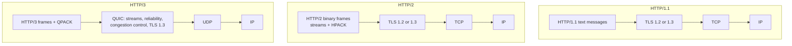

**Reading the diagram.** Each column is one protocol stack, top (application) to bottom (network). In HTTP/1.1 and HTTP/2, the security layer (TLS) sits between HTTP and TCP, and reliability lives in the kernel's TCP. HTTP/2 changes only the top box: binary framing and multiplexed streams over a single TCP connection. In HTTP/3, QUIC absorbs the jobs of both TCP and TLS and runs over UDP, so the stream abstraction moves into the transport and loss on one stream no longer blocks others. Arrows represent encapsulation (synchronous hand-off of each message down the stack). Failure point specific to HTTP/3: networks that block or throttle UDP, handled by falling back to HTTP/2. Scaling consideration: QUIC runs in user space and encrypts every packet individually, so it has historically cost more server CPU per byte than kernel TCP with TLS; implementations close the gap with UDP segmentation offload and batching.

**Table 7.10 — HTTP/1.1, HTTP/2 and HTTP/3 compared.**

| Aspect | HTTP/1.1 | HTTP/2 | HTTP/3 |
|---|---|---|---|
| Specification | RFC 9112 | RFC 9113 | RFC 9114 (over QUIC, RFC 9000) |
| Encoding | Text | Binary frames | Binary frames |
| Transport | TCP | TCP | QUIC over UDP |
| Concurrency per connection | One request at a time | Many multiplexed streams | Many independent streams |
| Head-of-line blocking | HTTP layer and TCP | TCP layer only | None across streams |
| Header compression | None | HPACK | QPACK |
| Encryption | Optional (TLS) | Effectively required by browsers | Always (TLS 1.3 built in) |
| New-connection setup with TLS 1.3 | 2 RTT (TCP + TLS) | 2 RTT | 1 RTT; 0 RTT on resumption |
| Connection migration | No | No | Yes, via connection IDs |
| Debuggability | Plain text with telnet or curl | Needs tools | Needs tools and decrypting keys |
| Choose when | Simple clients, internal tooling, legacy | Default for APIs and gRPC; most traffic | Mobile and lossy networks, latency-sensitive web traffic |

::: recommendation
**Choosing an HTTP version.** Terminate HTTP/2 (and HTTP/3 where your load balancer or CDN supports it) at the edge for browsers and mobile clients. Inside a datacenter, HTTP/2 over long-lived connections (for example, gRPC, §8.8) is the common default: loss is rare, so TCP HOL blocking matters little, while kernel TCP is cheap and mature. Do not hand-roll HTTP/3 between internal services without a measured reason.
:::

::: mistake
**"HTTP/2 is always faster than HTTP/1.1."** HTTP/2 wins in most browser workloads because it removes connection limits and compresses headers. But one connection means one congestion window and one point of HOL blocking: under heavy loss, or when a single connection's cwnd is the bottleneck for bulk transfer, several HTTP/1.1 connections can outperform it. Measure on your traffic.
:::

## 7.10 TLS 1.3 and HTTPS

### 7.10.1 What TLS provides

::: definition
**Definition — Transport Layer Security (TLS).** A protocol that gives two communicating applications **confidentiality** (eavesdroppers cannot read the data), **integrity** (tampering is detected) and **authentication** (at least the server proves its identity, usually with an X.509 certificate). **HTTPS** is HTTP carried over TLS, on TCP port 443 by default. TLS 1.3 is specified in RFC 8446 (2018).
:::

Analogy: before discussing secrets with a stranger on the phone, you check their government-issued ID (the certificate, vouched for by a trusted issuer), then the two of you agree on a code that only you two know, without ever saying it aloud on the line (a **key exchange**), and from then on you speak only in that code and seal every sentence so changes would be noticed (authenticated encryption).

The cryptography itself (Diffie–Hellman, signatures, AEAD ciphers) is covered in §10.4. Here we focus on the round trips and their operational consequences.

### 7.10.2 The TLS 1.3 handshake

TLS 1.2 needed **two** round trips before application data could flow. TLS 1.3 needs **one**, because the client guesses the key-exchange group the server will accept and sends its key share in the very first message.

**Figure 7.8 — TLS 1.3 full handshake (after the TCP handshake).**

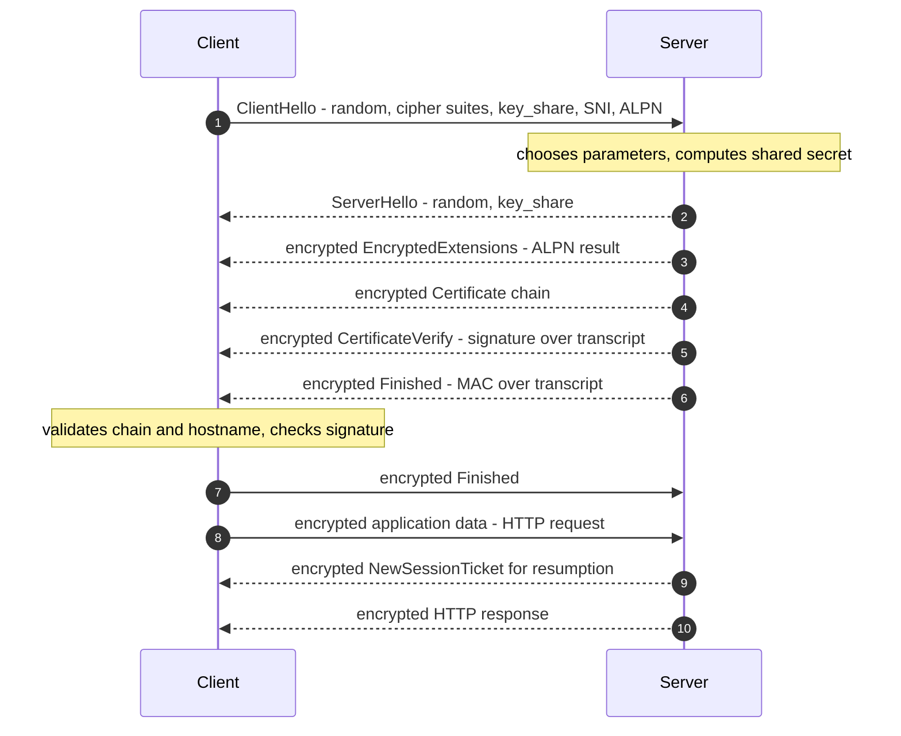

**Reading the diagram.** Step 1, the **ClientHello**, carries a random nonce, the cipher suites the client supports, its ephemeral Diffie–Hellman **key share**, the **Server Name Indication (SNI)** naming the host it wants (so one IP address can serve many sites), and the **ALPN** list of application protocols it speaks (`h2`, `http/1.1`). Steps 2–6 are the server's single flight. From the ServerHello onward, both sides can derive handshake keys, so everything after it, including the certificate, is encrypted (in TLS 1.2 the certificate traveled in clear text). CertificateVerify proves the server holds the private key for the certificate; Finished proves nobody tampered with the handshake. In step 7 the client sends its Finished and, in step 8, its first request, all after **one RTT**. Steps 9–10 arrive later: a session ticket for faster resumption, and the response. Everything is synchronous request/response over the already-established TCP connection. Failure points: certificate validation (expired, wrong name, untrusted issuer) aborts the handshake; mismatched protocol versions or cipher suites fail at step 2. Scaling consideration: the server's signature in step 5 is the main CPU cost of a handshake, which is a reason to reuse connections (§7.16) and resume sessions.

### 7.10.3 Certificates and the chain of trust

A **certificate** binds a public key to one or more names (in the Subject Alternative Name field), with a validity period, signed by a **certificate authority (CA)**. Browsers and operating systems ship a **root store** of trusted root CAs. Servers send their own (**leaf**) certificate plus **intermediate** certificates; the client builds a chain from leaf to a trusted root and checks:

1. each signature in the chain verifies with the issuer's public key;
2. the current time is within every certificate's validity period;
3. the requested hostname matches a name in the leaf;
4. the certificate has not been revoked (via OCSP or CRLs, imperfectly in practice); and
5. publicly trusted certificates appear in Certificate Transparency logs, as major browsers require.

Operationally, the most common TLS outage is mundane: **an expired certificate**. Publicly trusted certificates have a maximum lifetime of 398 days as of 2025, and the CA/Browser Forum has adopted a schedule to shorten it further over the coming years; ACME-based automation (as popularized by Let's Encrypt) is the only sane response. Monitor expiry dates of every certificate, including internal ones.

**Mutual TLS (mTLS)**, in which the client also presents a certificate, is the standard way to authenticate services to each other inside a zero-trust network (§10.10). PKI design — issuance, revocation and private CAs — is covered in §10.5.

**Table 7.11 — TLS 1.2 versus TLS 1.3.**

| Aspect | TLS 1.2 (RFC 5246) | TLS 1.3 (RFC 8446) |
|---|---|---|
| Full handshake | 2 RTT | 1 RTT |
| Resumption | 1 RTT | 1 RTT, or 0-RTT with early data |
| Key exchange | RSA key transport or (EC)DHE | (EC)DHE only, so forward secrecy is mandatory |
| Cipher suites | Many, including weak legacy options | Five AEAD suites |
| Certificate visibility | Sent in clear text | Encrypted |
| Removed features | — | RSA key transport, static DH, CBC-mode ciphers, compression, renegotiation |

**Forward secrecy** means that stealing a server's long-term private key later does not let an attacker decrypt previously recorded sessions, because each session's keys came from ephemeral Diffie–Hellman values that were discarded.

### 7.10.4 0-RTT and its caveats

With a session ticket from a previous connection, a TLS 1.3 client can send **early data** in its first flight, encrypted under a key derived from the resumption pre-shared key. Combined with QUIC, a returning client can deliver a request with zero round trips of setup. Two caveats make 0-RTT dangerous if used carelessly [RFC 8446 §8]:

1. **Replay.** An attacker who records the first flight can resend it, and the server may process the early data twice. TLS cannot fully prevent this across a distributed server fleet.
2. **Weaker forward secrecy for early data**, which is protected only by the resumption key, not by fresh ephemeral key exchange.

The rule: accept 0-RTT only for **idempotent, safe requests** (GET without side effects). Servers and CDNs that support it typically restrict it to such methods, and HTTP defines the `Early-Data` header and the 425 (Too Early) status code (RFC 8470) so origins can reject replay-unsafe early requests. Never let a payment or any non-idempotent POST ride in 0-RTT (see idempotency keys, §22.15).

::: mistake
**"TLS is too slow to use internally."** With TLS 1.3, a handshake costs one RTT (sub-millisecond inside a datacenter) and some CPU, and modern CPUs encrypt with AES-GCM at several GB/s per core using hardware instructions. With connection reuse, the steady-state cost is small. The exceptions are extreme-throughput paths, where kernel TLS and NIC offload exist for exactly this reason.
:::

## 7.11 WebSockets (introduction)

HTTP is client-initiated: the server cannot speak until asked. Chat, live dashboards, collaborative editors and multiplayer games need the server to push data whenever it has some. **WebSocket** [RFC 6455] provides a persistent, full-duplex, message-oriented channel between browser and server, created by **upgrading** an HTTP/1.1 connection.

**Figure 7.9 — WebSocket opening handshake and framing.**

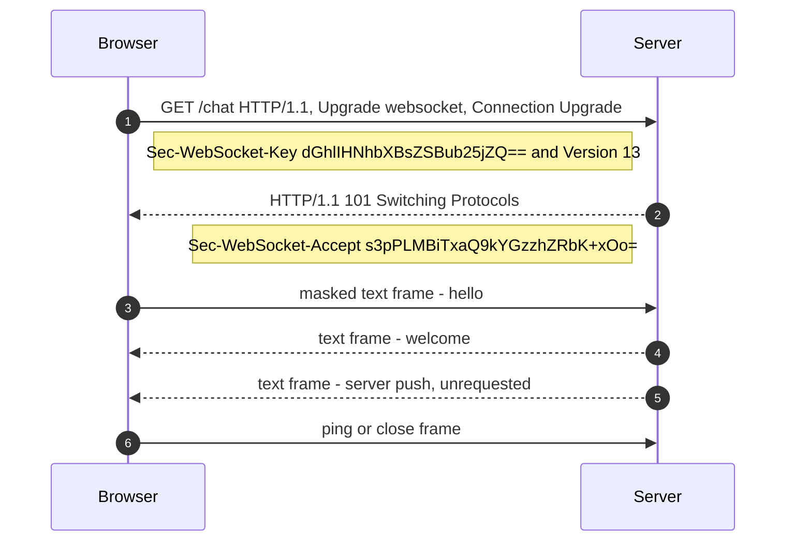

**Reading the diagram.** Steps 1–2 are an ordinary HTTP/1.1 exchange over an existing TCP (usually TLS) connection. The client sends a random base64 key; the server proves it understood the WebSocket protocol by returning `Sec-WebSocket-Accept`, the base64-encoded SHA-1 hash of the key concatenated with the fixed GUID `258EAFA5-E914-47DA-95CA-C5AB0DC85B11` (the values shown are the example from RFC 6455). After the `101` response the same TCP connection carries WebSocket **frames** in both directions, at any time (steps 3–6): either side may send without being asked, so the arrows are asynchronous in the application sense. Frames from client to server are **masked** with a random 4-byte key to stop malicious pages from crafting bytes that confuse caching proxies. Control frames (ping, pong, close) keep the connection alive and close it cleanly. Failure points: intermediaries with idle timeouts (load balancers commonly default to around 60 s) silently kill quiet connections, so applications send periodic pings; and every connection pins state to one server, which complicates deploys and load balancing.

The full design space (long polling, Server-Sent Events, WebSockets at scale, sticky routing, presence) is Chapter 9. WebSockets can also run over HTTP/2 (RFC 8441) and HTTP/3 (RFC 9220) using an extended CONNECT method.

## 7.12 Forward proxies and reverse proxies

::: definition
**Definition — Proxy.** An intermediary that terminates a client's connection and opens its own connection onward, relaying requests and responses. A **forward proxy** acts on behalf of **clients** and is chosen by them (or their network administrator). A **reverse proxy** acts on behalf of **servers** and is chosen by the site operator; clients usually do not know it exists.
:::

Analogy: a forward proxy is your personal assistant who places all your calls, so callees see the assistant's number. A reverse proxy is a company switchboard: callers dial one number and the receptionist routes them to the right employee, who never has to expose a direct line.

**Figure 7.10 — Forward proxy versus reverse proxy.**

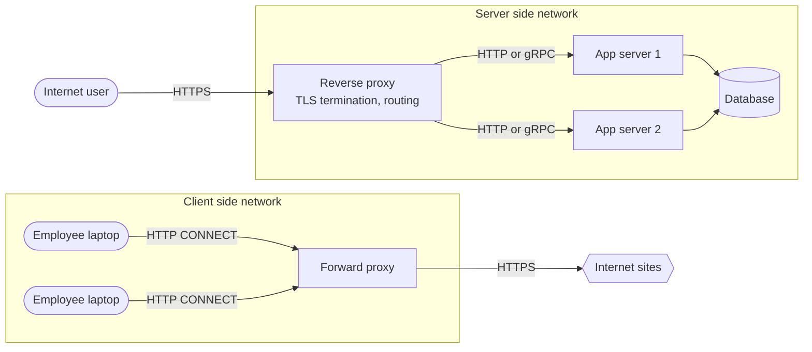

**Reading the diagram.** On the left, client machines inside an organization send all outbound traffic through a forward proxy, using the HTTP `CONNECT` method to tunnel TLS connections; destination sites see the proxy's address. On the right, Internet users connect to a reverse proxy, which terminates TLS, inspects HTTP and forwards each request to one of several application servers over internal HTTP or gRPC; users see only the proxy. Both paths are synchronous request/response. The database behind the app servers is the storage boundary. Failure points: each proxy is a single point of failure unless replicated behind anycast, ECMP or DNS (§19.8). Scaling: reverse proxies scale horizontally and absorb connection-handling work (TLS, slow clients) so app servers do not have to.

**Table 7.12 — Forward and reverse proxies compared.**

| Aspect | Forward proxy | Reverse proxy |
|---|---|---|
| Acts for | Clients | Servers |
| Configured by | Client or client's network | Service operator |
| Hides | Client identity from servers | Server topology from clients |
| Typical functions | Egress filtering, caching, auditing, access control, anonymity | TLS termination, load balancing, routing by path or host, caching, compression, rate limiting, WAF, request buffering |
| Examples | Squid, corporate secure web gateways, egress proxies in VPCs | NGINX, HAProxy, Envoy, cloud load balancers, CDNs, API gateways |
| System-design relevance | Controlled egress from private networks | Nearly every web architecture's front door |

A reverse proxy that distributes load is a **load balancer** (Chapter 19); one that adds authentication, quotas and API management is an **API gateway** (§34.6); one deployed beside every service instance is a **sidecar** in a **service mesh**. Proxies that terminate TCP also shield back-ends from slow clients: the proxy buffers a slowly uploaded request and hands the application a complete one, so the application's limited workers are not tied up for seconds.

::: warning
**The client IP problem.** Behind a reverse proxy, the application sees the proxy's IP as the source. Proxies pass the original address in the `X-Forwarded-For` or standard `Forwarded` header (RFC 7239), or at L4 via the PROXY protocol. Trust these headers only when they were set by your own proxy; otherwise clients can forge them to evade rate limits or IP allow-lists.
:::

## 7.13 NAT

::: definition
**Definition — Network Address Translation (NAT).** A function, usually in a router or gateway, that rewrites the source and/or destination IP addresses (and usually ports) of packets as they pass, keeping a **translation table** so that replies can be rewritten back. The most common form, **source NAT with port translation** (NAPT, often just "NAT"), lets many hosts with private addresses share one public address [RFC 3022].
:::

Analogy: an office building with one street address and a mailroom. Outgoing letters carry the building's return address with an internal "room code" written on them; when replies come back with that code, the mailroom forwards them to the right room. A letter that arrives with no room code the mailroom has issued has nowhere to go.

**Figure 7.11 — Source NAT for an outbound connection.**

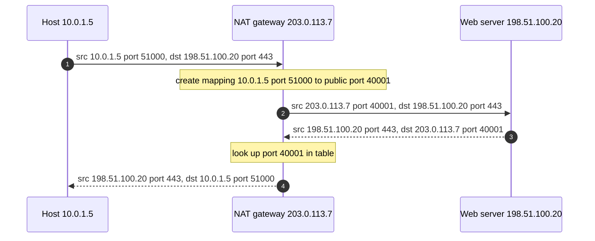

**Reading the diagram.** A private host (left) opens a connection to a public server (right) through a NAT gateway (middle). In step 1 the packet carries the host's private address. The NAT rewrites the source to its own public address and a free public port, recording the mapping (steps 2–3). The server replies to the public address (step 4), and the NAT reverses the translation using the table (steps 5–6). All traffic is synchronous and flows through the same NAT in both directions: the NAT is **stateful**, which makes it a failure point (if it restarts or the mapping times out, existing connections die) and a scaling limit (ports per destination).

### Consequences for system design

- **Inbound connections are impossible by default**, because no mapping exists until the inside host sends first. Peer-to-peer systems (WebRTC, §9.7) use STUN to discover their public mapping and fall back to TURN relays when NAT behavior prevents direct connections.
- **Mappings time out.** Idle UDP mappings may expire in tens of seconds and TCP mappings in minutes to hours, depending on the device. Long-lived idle connections need keep-alives shorter than the NAT timeout, or they become half-open (§7.7).
- **Port exhaustion.** A single public IP has about 64,000 usable ports per destination (IP, port, protocol). AWS documents a NAT gateway limit of 55,000 simultaneous connections per assigned IP address to each unique destination, raisable by assigning more IPs (as of 2025) [AWS Docs: NAT gateways]. A fleet of services calling one external API through one NAT IP can exhaust this; connection pooling and more NAT IPs fix it.
- **Carrier-grade NAT (CGNAT)**: mobile and some fixed ISPs place many subscribers behind shared addresses from `100.64.0.0/10`. Thousands of users can share one public IP, so **IP-based rate limiting and blocking punish innocent users**.
- **Cost.** Managed cloud NAT gateways usually charge per gigabyte processed; routing bulk traffic to cloud storage through them instead of private endpoints is a common surprise on the bill.

## 7.14 Firewalls and security groups

::: definition
**Definition — Firewall.** A device or software function that permits or denies traffic according to rules. A **stateless** (packet-filter) firewall evaluates each packet independently against rules on addresses, ports and protocol. A **stateful** firewall tracks connections, so a reply to an allowed outbound connection is automatically permitted. **Application-layer firewalls**, including web application firewalls (WAFs), parse protocols such as HTTP to block malicious requests.
:::

Cloud providers expose two common forms. A **security group** (AWS, similar constructs elsewhere) is a stateful, allow-only rule set attached to a network interface or instance. A **network ACL** is a stateless, ordered allow-and-deny rule list attached to a subnet. Because NACLs are stateless, you must explicitly allow return traffic, typically to the client's ephemeral port range, which is a frequent source of "connection hangs" misconfigurations.

**Table 7.13 — Firewall mechanisms compared.**

| Aspect | Stateless ACL | Stateful firewall / security group | Web application firewall |
|---|---|---|---|
| Inspects | Packet headers | Headers plus connection state | HTTP requests (L7) |
| Return traffic | Must be explicitly allowed | Allowed automatically | N/A (proxy) |
| Rule style | Ordered allow/deny | Usually allow-only | Signatures, rate rules, custom logic |
| Cost of state | None | Connection table (can be exhausted) | Full proxying |
| Typical placement | Subnet boundary | Each instance or interface | In front of web apps, often at the CDN |
| Choose when | Coarse subnet guardrails | Default micro-segmentation between tiers | Blocking injection, bots, abusive patterns |

### Practical rules

1. **Default deny.** Allow only the ports and sources each tier needs: the load balancer may reach the app tier on port 8080; only the app tier may reach the database on 5432.
2. **Reference groups, not addresses.** Security groups can name other groups as sources ("allow from sg-app"), which keeps rules correct as instances scale in and out.
3. **Firewalls are one layer of defense in depth.** Combine them with authentication and encryption (mTLS, §10.10); a network position is not an identity.
4. **Watch the state table.** Stateful devices track every connection; a flood of connections (legitimate or attack) can exhaust their tables and drop everything. Linux's `conntrack` table is a common culprit on busy proxies.
5. **Silent drops cause timeouts, rejections cause fast failure.** A firewall that drops packets makes clients wait for a timeout; one that sends RST or ICMP unreachable fails fast. Choose deliberately.

## 7.15 Latency, bandwidth, the bandwidth-delay product and packet loss

### 7.15.1 The four components of latency

Think of a highway. **Bandwidth** is the number of lanes: how many cars per second can pass a point. **Latency** is how long one car takes to travel from entrance to exit. Adding lanes does not make the drive shorter. A packet's one-way delay through each hop is the sum of four parts.

::: definition
**Definition — Components of network delay.** **Propagation delay**: time for a signal to travel the physical distance. **Transmission (serialization) delay**: time to push all of a packet's bits onto the link. **Queuing delay**: time spent waiting in buffers behind other packets. **Processing delay**: time for a device to examine headers, look up routes and copy the packet.
:::

::: formula
**One-hop delay**

$$d_{\text{hop}} = \underbrace{\frac{D}{v}}_{\text{propagation}} + \underbrace{\frac{L}{R}}_{\text{transmission}} + d_{\text{queue}} + d_{\text{proc}}$$

| Symbol | Meaning | Units |
|---|---|---|
| $D$ | Physical length of the link | m (or km) |
| $v$ | Signal speed in the medium: about $2 \times 10^8$ m/s in optical fiber (roughly two-thirds of $c$) | m/s |
| $L$ | Packet size | bits |
| $R$ | Link rate (bandwidth) | bits/s |
| $d_{\text{queue}}$ | Queuing delay: bytes waiting ahead ÷ link rate | s |
| $d_{\text{proc}}$ | Processing delay: microseconds in software, sub-microsecond in switch hardware | s |
:::

**Table 7.14 — Delay components at a glance.**

| Component | Depends on | Typical magnitude | How to reduce it |
|---|---|---|---|
| Propagation | Distance, medium | ~5 µs per km of fiber; tens of ms across oceans | Move closer: CDNs, edge, regional replicas |
| Transmission | Packet size, link rate | 12 µs for 1,500 B at 1 Gbps; 1.2 µs at 10 Gbps | Faster links, smaller packets |
| Queuing | Load, buffer size | 0 to hundreds of ms | Lower utilization, AQM, BBR |
| Processing | Device and software path | ~µs (hardware) to tens of µs (software) | Kernel bypass, offloads, fewer hops |

::: example
**Worked example 1 — The speed-of-light floor from New York to London.**

The great-circle distance between New York and London is about 5,570 km.

1. One-way propagation in fiber: $5{,}570 \text{ km} / 200{,}000 \text{ km/s} = 0.02785$ s = 27.85 ms.
2. Round-trip time: $2 \times 27.85 = 55.7$ ms.
3. Even in a vacuum at $c \approx 299{,}792$ km/s, the RTT would be $2 \times 5{,}570 / 299{,}792 \approx 37.2$ ms.
4. Real cables do not follow the great circle, and routers, transmission and queuing add more, so measured RTTs are noticeably higher than 55.7 ms (often in the 70 ms range).

Interpretation: no engineering can make a New York–London round trip faster than about 56 ms over fiber. A user in London calling a single-region service in New York pays at least that on every round trip, and a page needing five sequential round trips pays at least 280 ms. Engineering implication: for global users, reduce round trips (connection reuse, TLS 1.3, QUIC) and move content and computation closer (CDNs, Ch 21; multi-region, Ch 44).
:::

::: example
**Worked example 2 — Transmission versus propagation.**

Send one 1,500-byte packet ($L = 12{,}000$ bits).

- On a 10 Mbps link: $12{,}000 / 10^7 = 1.2$ ms.
- On a 1 Gbps link: $12{,}000 / 10^9 = 12$ µs.
- On a 100 Gbps link: $12{,}000 / 10^{11} = 120$ ns.

Compare with propagation across a 100 m datacenter cable: $100 / (2 \times 10^8) = 0.5$ µs. Interpretation: on slow access links, serialization dominates; on fast datacenter links, serialization becomes negligible and per-hop processing and software stacks dominate.
:::

::: example
**Worked example 3 — Bufferbloat.**

A home router has a 10 MB buffer in front of a 1 Gbps uplink. When a large upload fills that buffer, a newly arriving packet waits behind $10 \times 10^6 \times 8 = 8 \times 10^7$ bits, so its queuing delay is $8 \times 10^7 / 10^9 = 0.08$ s = 80 ms. On a 20 Mbps uplink the same buffer would add $8 \times 10^7 / (2 \times 10^7) = 4$ s. Loss-based congestion control (CUBIC) keeps such buffers full, so a video call alongside a big upload suffers seconds of lag. Fixes: active queue management (CoDel, FQ-CoDel) on the bottleneck, and delay-aware congestion control such as BBR.
:::

### 7.15.2 Throughput and the bandwidth-delay product

A reliable sender can only have a window's worth of unacknowledged data in flight; it then waits for ACKs, which take one RTT. So:

::: formula
**Window-limited throughput and the bandwidth-delay product (BDP)**

$$\text{Throughput} \le \frac{W}{\text{RTT}} \qquad\qquad \text{BDP} = R \times \text{RTT}$$

| Symbol | Meaning | Units |
|---|---|---|
| $W$ | Effective window, $\min(\text{cwnd}, \text{rwnd})$ | bytes |
| RTT | Round-trip time | s |
| $R$ | Bottleneck link rate | bits/s (divide by 8 for bytes/s) |
| BDP | Data that must be in flight to keep the link full | bits or bytes |
:::

::: example
**Worked example — BDP for a 10 Gbps, 80 ms path.**

1. BDP $= 10 \times 10^9 \text{ bits/s} \times 0.080 \text{ s} = 8 \times 10^8$ bits.
2. In bytes: $8 \times 10^8 / 8 = 10^8$ bytes = **100 MB**.
3. Without window scaling, $W$ is at most 65,535 bytes, giving throughput $\le 65{,}535 \times 8 / 0.08 \approx 6.55$ Mbps, about 0.07% of the link.
4. To fill the link, the receiver must advertise (and the sender buffer) about 100 MB per connection: window scaling must be on and kernel buffer limits (`net.ipv4.tcp_rmem` and `tcp_wmem` maximums on Linux) must be at least that large.

Interpretation: on "long fat networks", a single TCP connection is limited by buffers and window, not by the link. Engineering implication: bulk cross-region transfers (backups, replication, dataset copies) need tuned buffers, parallel streams, or both.
:::

### 7.15.3 Packet loss and the Mathis formula

Loss hurts TCP twice: each lost packet must be retransmitted, and each loss signal halves (Reno) or cuts (CUBIC) the congestion window. For loss-based congestion avoidance with random loss probability $p$, Mathis, Semke, Mahdavi and Ott derived a simple upper bound on steady-state throughput [Mathis et al. 1997].

::: formula
**Mathis throughput formula**

$$\text{Throughput} \le \frac{\text{MSS}}{\text{RTT}} \times \frac{C}{\sqrt{p}}$$

| Symbol | Meaning | Units |
|---|---|---|
| MSS | Maximum segment size | bits (or bytes, for bytes/s) |
| RTT | Round-trip time | s |
| $p$ | Packet loss probability | dimensionless |
| $C$ | Constant, $\sqrt{3/2} \approx 1.22$ for periodic loss with every packet ACKed | dimensionless |
:::

::: example
**Worked example — Loss caps a long-distance connection.**

MSS = 1,460 bytes = 11,680 bits; RTT = 80 ms.

1. $\text{MSS}/\text{RTT} = 11{,}680 / 0.08 = 146{,}000$ bits/s.
2. With $p = 10^{-4}$ (0.01% loss): $C/\sqrt{p} = 1.22 / 0.01 = 122$, so throughput $\le 146{,}000 \times 122 \approx 17.8$ Mbps.
3. With $p = 10^{-6}$: $C/\sqrt{p} = 1{,}220$, so throughput $\le 178$ Mbps.
4. To reach 10 Gbps: $\sqrt{p} = 1.22 \times 146{,}000 / 10^{10} \approx 1.79 \times 10^{-5}$, so $p \approx 3.2 \times 10^{-10}$, about one loss in three billion packets.

Interpretation: throughput falls with $1/\text{RTT}$ and $1/\sqrt{p}$, independent of link speed. A tiny 0.01% loss caps a single transcontinental CUBIC- or Reno-style flow at under 20 Mbps on a 10 Gbps link. Engineering implications: (a) find and fix lossy links, which are often a dirty optic or a bad cable; (b) reduce RTT; (c) for bulk transfers, use parallel connections or a model-based algorithm such as BBR that does not treat random loss as congestion. The formula is an approximation for loss-based algorithms in congestion avoidance; it does not describe BBR, short flows still in slow start, or timeout-dominated regimes.
:::

## 7.16 Connection pooling and keep-alive

### 7.16.1 The cost of a new connection

Before the first byte of a response can arrive over a new HTTPS connection, the client pays for DNS, the TCP handshake, the TLS handshake, and the request itself.

**Table 7.15 — Round trips before the first response byte (DNS cached).**

| Stack | Setup RTTs | Request RTT | Total | At RTT 80 ms | At RTT 0.5 ms (same datacenter) |
|---|---|---|---|---|---|
| HTTP over TCP, no TLS | 1 | 1 | 2 | 160 ms | 1.0 ms |
| HTTPS, TCP + TLS 1.2 | 1 + 2 | 1 | 4 | 320 ms | 2.0 ms |
| HTTPS, TCP + TLS 1.3 | 1 + 1 | 1 | 3 | 240 ms | 1.5 ms |
| HTTP/3, QUIC first connection | 1 | 1 | 2 | 160 ms | 1.0 ms |
| HTTP/3, QUIC 0-RTT resumption | 0 | 1 | 1 | 80 ms | 0.5 ms |
| Any stack, reused connection | 0 | 1 | 1 | 80 ms | 0.5 ms |

Round trips are only part of the cost. Each new connection also burns CPU (the TLS asymmetric cryptography is the expensive part), allocates kernel and proxy memory, starts in slow start with a small congestion window (§7.7.7), and leaves a TIME_WAIT entry when closed (§7.7.4).

::: example
**Worked example — Reusing connections to a cross-region dependency.**

Service A in Virginia calls service B in Oregon (RTT about 70 ms) 200 times per second. Each call takes 10 ms of server time.

1. New TCP + TLS 1.3 connection per call: latency ≈ $3 \times 70 + 10 = 220$ ms per call.
2. Reused connection: $1 \times 70 + 10 = 80$ ms per call, a 2.75× reduction.
3. Handshake work avoided: 200 TLS handshakes per second, each involving a signature on B and verification on A.
4. Ports: with per-call connections and A as active closer, $200 \times 60 = 12{,}000$ sockets sit in TIME_WAIT at any time, about 43% of the 28,232 default ephemeral ports.

Interpretation: connection reuse is not a micro-optimization; it changes latency by a factor of nearly three and removes a scaling cliff.
:::

### 7.16.2 Sizing a pool with Little's Law

A **connection pool** keeps a set of open connections that callers borrow and return. For protocols that carry one request at a time per connection (HTTP/1.1, most database protocols), the number of connections in use equals the number of requests in flight, which Little's Law gives directly (§4.11).

::: formula
**Connections needed for a one-request-per-connection protocol**

$$N = \lambda \times W$$

| Symbol | Meaning | Units |
|---|---|---|
| $N$ | Average connections busy | connections |
| $\lambda$ | Request rate | requests/s |
| $W$ | Time a request holds a connection (network RTT plus server time) | s |
:::

::: example
**Worked example — Database pool sizing.**

An application server issues 2,000 queries per second; each holds a connection for 5 ms on average (0.5 ms RTT plus 4.5 ms of query execution).

1. $N = 2{,}000 \times 0.005 = 10$ busy connections on average.
2. Add headroom for bursts and tail latency: if p99 hold time is 25 ms, bursts can need $2{,}000 \times 0.025 = 50$. A pool of 20–50 is reasonable.
3. With 40 application servers each holding a pool of 50, the database must accept 2,000 connections. Many databases degrade with thousands of connections (PostgreSQL uses a process per connection), which is why connection proxies such as PgBouncer sit in between (Chapter 14).

Interpretation: size pools from rate × hold time, not by guessing; and remember pools multiply across instances.
:::

### 7.16.3 Keep-alive pitfalls

- **Idle-timeout races.** If the server (or a load balancer) closes idle connections after 60 s and the client's pool keeps them for 90 s, the client will occasionally send a request on a connection the server has just closed, getting a reset. Set client idle timeouts **shorter** than every server-side timeout along the path, and retry idempotent requests on this specific failure.
- **Stale connections after failover.** Long-lived connections keep talking to an old backend after DNS changes, so set a maximum connection lifetime.
- **Load imbalance with multiplexed protocols.** An HTTP/2 or gRPC client may send all its traffic over one long-lived connection to one backend; an L4 load balancer balances connections, not requests, so new backends receive nothing. Use L7 (request-level) load balancing or client-side balancing, and cap connection age so connections periodically redistribute (§19.10).
- **TCP keep-alive is not HTTP keep-alive.** HTTP keep-alive means "reuse this connection for more requests". TCP keep-alive sends empty probes on an idle connection to detect dead peers and refresh NAT and firewall state.

## 7.17 Datacenter networking

### 7.17.1 From trees to leaf–spine

Traditional enterprise networks were **trees**: servers connect to access switches, which connect to aggregation switches, which connect to a pair of large core routers. Trees suit **north–south** traffic (between users outside and servers inside). Modern applications are different: a single user request fans out to dozens of internal services, caches and databases, and batch jobs shuffle terabytes between servers. Most bytes now flow **east–west**, server to server inside the datacenter. In a tree, east–west traffic converges on the few links near the top, which become the bottleneck, and the expensive core routers become both a cost and a failure concentration.

::: definition
**Definition — Leaf–spine (folded Clos) network.** A two-tier topology in which every **leaf** (top-of-rack) switch connects to every **spine** switch, and servers attach only to leaves. Any two servers on different leaves are exactly two switch hops apart (leaf → spine → leaf), and traffic is spread across all spines with ECMP. It is a form of the multistage **Clos network**, first described by Charles Clos in 1953 for telephone switching. Larger fabrics add a third tier.
:::

**Figure 7.12 — A leaf–spine fabric with ECMP.**

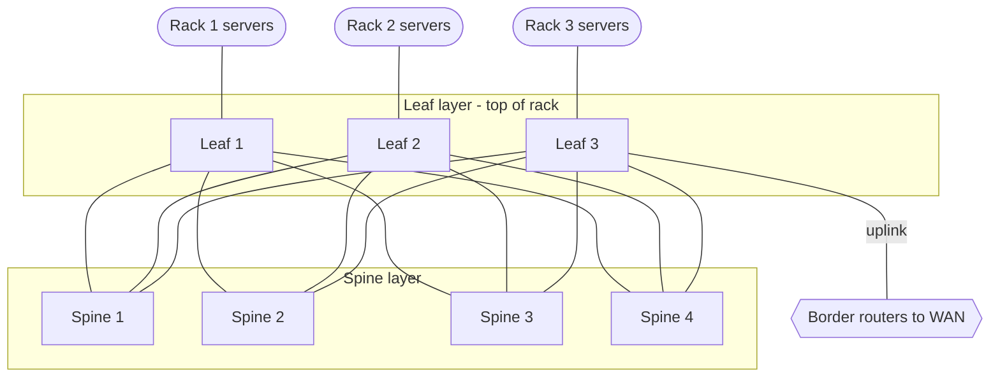

**Reading the diagram.** Servers in each rack connect to their leaf switch. Every leaf has one uplink to every spine (a full bipartite mesh), so a flow from rack 1 to rack 3 has four equal-cost two-hop paths, and leaves pick among them by hashing each flow's 5-tuple (ECMP). Spines never connect to each other or to servers. One leaf (or a dedicated pair) connects to border routers for north–south traffic. Links are undirected because traffic flows both ways; all forwarding is synchronous hardware switching. Failure points: losing a spine removes one quarter of cross-rack capacity rather than isolating anything; losing a leaf isolates its rack, which is why critical services spread replicas across racks. Scaling: add spines for more bandwidth, add leaves (up to the spine port count) for more racks.

::: formula
**Oversubscription ratio at a leaf**

$$\text{Oversubscription} = \frac{\text{total server-facing bandwidth}}{\text{total uplink bandwidth}}$$

| Symbol | Meaning | Units |
|---|---|---|
| Server-facing bandwidth | Sum of the leaf's downlink port speeds | Gbps |
| Uplink bandwidth | Sum of the leaf's spine-facing port speeds | Gbps |
:::

::: example
**Worked example — Sizing a leaf–spine fabric.**

Each leaf has 48 × 25 Gbps server ports and 6 × 100 Gbps uplinks; each spine has 64 × 100 Gbps ports.

1. Downlink: $48 \times 25 = 1{,}200$ Gbps. Uplink: $6 \times 100 = 600$ Gbps.
2. Oversubscription: $1{,}200 / 600 = 2{:}1$. If every server sends cross-rack at full rate, each gets at most 12.5 Gbps.
3. Each leaf uses one port on each of 6 spines, so there are 6 spines. Each spine has 64 ports, so at most 64 leaves.
4. Maximum servers: $64 \times 48 = 3{,}072$.
5. Total leaf-to-spine capacity: $64 \text{ leaves} \times 600 \text{ Gbps} = 38.4$ Tbps. The **bisection bandwidth** (capacity between any half of the leaves and the other half) is $32 \times 600 = 19.2$ Tbps.

Interpretation: oversubscription is a cost lever. 1:1 ("non-blocking") fabrics cost more uplinks and spines; 3:1 is acceptable for workloads that are mostly rack-local. Larger fabrics add a third tier of switches to go beyond the port count of one spine.
:::

::: industry
**Google Jupiter.** Google's SIGCOMM 2015 paper describes a decade of five datacenter network generations, culminating in Jupiter. Instead of buying ever-larger proprietary routers, Google built multistage Clos topologies from many small switches using commodity merchant silicon, managed them with centralized, software-defined control rather than traditional distributed routing protocols, and scaled capacity about 100× over ten years to more than 1 Pbps of bisection bandwidth. The paper's argument (that bandwidth demand from east–west traffic grows faster than any single box can, so the network must scale out like the servers) is now standard practice across large datacenter operators.
*Evidence: Primary* — [Singh et al. 2015]
:::

### 7.17.2 Datacenter-specific problems

- **Incast.** When a client fans a request out to 100 servers that all reply at the same instant, the replies converge on one leaf port, overflow its shallow buffer, and drop packets. The dropped flows wait for a 200 ms minimum RTO in a network whose RTT is about 100 µs, producing extreme tail latency (§23.6). Mitigations: limit fan-out concurrency, jittered responses, smaller minimum RTOs, and ECN-based congestion control such as DCTCP.
- **ECMP hash collisions.** Two elephant flows hashed onto the same spine link share it while other links sit idle. Flowlet switching, packet spraying and adaptive routing reduce this.
- **Gray failures.** A link that drops 1% of packets is worse than a dead one, because routing still uses it while TCP throughput collapses (recall the Mathis formula). Operators monitor per-link error counters and drain suspect links automatically.

## 7.18 What happens when you type a URL

Everything in this chapter appears in the life of one request. Suppose you type `https://www.example.com/` into a browser on a laptop connected by Wi-Fi at home, with a cold DNS cache, and the site is served by a CDN edge 20 ms away (RTT) with HTTP/2.

**Figure 7.13 — Loading https://www.example.com/ end to end.**

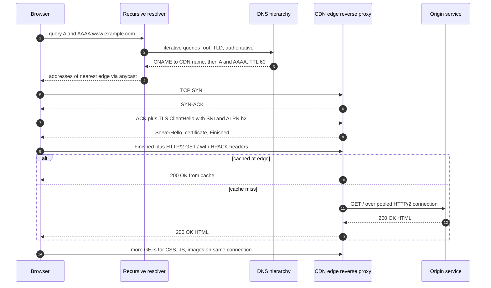

**Reading the diagram.** Steps 1–4: the browser (via the operating system stub) asks a recursive resolver, which walks the DNS hierarchy (§7.6); the authoritative server returns a CNAME pointing into the CDN, whose own authoritative servers answer with an anycast address (§7.5.3). Steps 5–7: the TCP handshake (§7.7.3), with the TLS ClientHello piggybacked on the final ACK. Step 8: the server's TLS 1.3 flight (§7.10.2), including the certificate the browser validates. Step 9: the client's Finished and the first HTTP/2 request, with ALPN having selected `h2` (§7.9.3). Steps 10–13: the edge serves from cache or fetches from the origin over a pre-warmed, pooled connection (§7.16), so the user does not pay the origin's handshakes. Step 14: subresources reuse the same multiplexed connection. All steps are synchronous; the edge cache and origin are the storage boundaries. Failure points include DNS (every step depends on it), certificate validity, and the origin path on cache misses.

### 7.18.1 Steps the diagram leaves out

Figure 7.13 shows the protocol messages. Several steps happen around them:

1. **Before any network traffic**, the browser parses the URL into scheme (`https`, so port 443), host and path, applies its HSTS list (which may force HTTPS), and checks its HTTP cache and any existing connection to the origin. A reused connection skips steps 1–9 of the figure entirely.
2. **Choosing an address (§7.4).** With both AAAA and A answers, Happy Eyeballs tries IPv6 first and races IPv4 if needed.
3. **The first hop (§7.3).** The destination is off-subnet, so the laptop frames the packet for its default gateway, learning the gateway's MAC address with ARP or Neighbor Discovery.
4. **NAT (§7.13).** For IPv4, the home router rewrites the private source address (for example `192.168.1.23`) to its public address and records the mapping; the ISP may add carrier-grade NAT.
5. **Routing (§7.5).** ISP routers forward by longest-prefix match, and BGP delivers the anycast destination to a nearby edge site.
6. **Edge admission (§7.14, Chapter 19).** DDoS filtering and an L4 load balancer (ECMP plus consistent hashing) pick the server running the reverse proxy.
7. **Behind the edge (§8.5, Chapter 21).** On a cache miss, the origin's reverse proxy routes the request to an application server, which may call caches and databases across a leaf–spine fabric (§7.17).
8. **After the response.** The browser discovers CSS, JavaScript and images and fetches them as concurrent streams on the same connection, ramping up under slow start (§7.7.7). An `Alt-Svc` header may advertise HTTP/3 for later connections.

::: example
**Worked example — Time to first byte budget.**

Assume: 5 ms RTT to the resolver; resolver needs root, TLD and authoritative lookups costing 15, 20 and 30 ms, plus 25 ms for the CDN's authoritative servers; 20 ms RTT to the edge; 2 ms edge processing on a cache hit.

1. DNS: $5 + 15 + 20 + 30 + 25 = 95$ ms (cold); 5 ms warm.
2. TCP handshake: 20 ms.
3. TLS 1.3 handshake: 20 ms.
4. Request and first response byte: $20 + 2 = 22$ ms.
5. Total cold: $95 + 20 + 20 + 22 = 157$ ms. Warm DNS: $5 + 62 = 67$ ms. Reused connection: 22 ms.
6. On a cache miss with the origin 70 ms from the edge over a pooled connection, add $70 + $ origin processing (say 30 ms) = 100 ms.

Interpretation: on a cold visit, connection setup (DNS, TCP, TLS) is most of the time to first byte, and the server's own work is a small slice. This is why the biggest wins for global latency are fewer round trips and shorter round trips, not faster servers.
:::

## 7.19 Summary and revision notes

::: summary
- **Layering and encapsulation.** Each layer adds its own header: application message → TCP segment or UDP datagram (ports) → IP packet (addresses) → link frame (MAC). Routers rewrite link frames at every hop; IP packets travel end to end.
- **Addressing.** IPv4 is 32 bits, IPv6 is 128. CIDR `/n` leaves $2^{32-n}$ IPv4 addresses (minus 2 on ordinary subnets; minus 5 on AWS). Private ranges: 10/8, 172.16/12, 192.168/16. Plan non-overlapping ranges before networks need to connect.
- **Routing.** Forwarding uses longest-prefix match. BGP connects autonomous systems by policy, not latency, and trusts announcements by default. Anycast announces one prefix from many sites to steer users to a nearby one.
- **DNS.** Stub → recursive resolver (recursive query) → root → TLD → authoritative (iterative queries). Caches expire by TTL; nothing "propagates". DNS load balancing picks sites, not servers, and fails over in minutes.
- **TCP.** 1-RTT handshake; four-way close; the active closer holds TIME_WAIT (60 s on Linux), which can exhaust ephemeral ports. Reliability via sequence numbers, cumulative ACKs, fast retransmit and RTO (200 ms minimum on Linux). Flow control uses the receive window; congestion control uses cwnd: slow start doubles per RTT, AIMD halves on loss, CUBIC grows by a cubic of time, BBR paces at measured bandwidth. One lost segment blocks the whole stream (head-of-line blocking). Set `TCP_NODELAY` for RPC.
- **UDP.** 8-byte header, no setup, no reliability. Use it when timeliness beats completeness or to build your own transport; you then own congestion control.
- **HTTP.** 1.1: one request at a time per connection, about six connections per host. 2: binary frames, multiplexed streams, HPACK, but TCP HOL blocking. 3: QUIC over UDP with independent streams, built-in TLS 1.3, 1-RTT (0-RTT on resumption) setup and connection migration.
- **TLS 1.3.** 1-RTT handshake, encrypted certificates, mandatory forward secrecy. 0-RTT early data is replayable: use only for idempotent requests. Expired certificates are the most common TLS outage; automate renewal.
- **Middle of the network.** Forward proxies act for clients; reverse proxies act for servers (TLS termination, routing, load balancing). NAT shares public IPs, blocks unsolicited inbound traffic, and has finite ports per destination. Security groups are stateful; network ACLs are stateless.
- **Numbers.** Fiber propagation is about 5 µs/km; NY–London RTT is at least 56 ms. BDP $= R \times \text{RTT}$: 10 Gbps × 80 ms = 100 MB in flight. Mathis: throughput $\le (\text{MSS}/\text{RTT}) \times 1.22/\sqrt{p}$, so 0.01% loss caps an 80 ms flow near 18 Mbps.
- **Connections.** A new HTTPS connection with TLS 1.3 costs 3 RTTs to first byte, versus 1 on a reused connection. Pool connections; size pools with $N = \lambda W$; set client idle timeouts shorter than server timeouts.
- **Datacenters.** East–west traffic dominates; leaf–spine Clos fabrics with ECMP give every rack equal-cost two-hop paths and scale out with commodity switches (Google Jupiter: over 1 Pbps of bisection bandwidth).
:::

## 7.20 Knowledge checkpoint

1. Which headers does a router remove and rebuild at each hop, and which header fields does it modify?
2. What are the network address, broadcast address and usable host range of `172.20.14.200/22`?
3. A router has routes for `10.0.0.0/8`, `10.4.0.0/14` and `10.4.4.0/24`. Which is used for `10.5.1.1`?
4. Why can anycast break long-lived TCP connections, and why is it nevertheless ideal for DNS?
5. Distinguish recursive and iterative DNS queries, and say which participants send each kind.
6. Why can't you place a CNAME at the zone apex?
7. You need to move a service to new IP addresses; the A record's TTL is 86,400 s. What must you do and when?
8. What does an acknowledgment number of 5,001 mean?
9. Why does the active closer of a TCP connection enter TIME_WAIT, and for how long on Linux?
10. Explain the difference between flow control and congestion control, naming the window each uses.
11. Starting from an initial window of 10 segments, how many RTTs of slow start are needed to send 300 segments with no loss?
12. Explain how Nagle's algorithm and delayed ACKs together add latency, and give the standard fix.
13. HTTP/2 multiplexes streams over one connection. Why does it still suffer head-of-line blocking, and how does HTTP/3 avoid it?
14. Why must 0-RTT early data be limited to idempotent requests?
15. Compute the BDP of a 1 Gbps link with a 40 ms RTT, in megabytes.
16. Using the Mathis formula, what is the maximum throughput with MSS 1,460 bytes, RTT 20 ms and 1% loss?
17. Why are network ACLs a frequent cause of "connection hangs" while security groups are not?
18. What is the oversubscription ratio of a leaf with 32 × 100 Gbps server ports and 8 × 400 Gbps uplinks?

<details><summary>Answers</summary>

1. The router strips the incoming link-layer (Ethernet) header and trailer and builds a new frame with new source and destination MACs for the next link. In the IP header it decrements TTL (hop limit) and, for IPv4, recomputes the header checksum. NAT devices also rewrite addresses and ports.
2. A `/22` has $2^{10} = 1{,}024$ addresses; the third octet advances in steps of 4. 14 lies in 12–15, so network `172.20.12.0`, broadcast `172.20.15.255`, usable `172.20.12.1`–`172.20.15.254` (1,022 hosts).
3. `10.4.0.0/14` covers 10.4.0.0–10.7.255.255, which includes 10.5.1.1; the /24 does not. Longest match is the /14.
4. A BGP route change can deliver a flow's later packets to a different site that has no state for the connection, which resets it. DNS queries are typically single UDP request/response exchanges with no connection state, so a route change between queries is harmless.
5. A recursive query asks the server for a final answer; the stub resolver sends it to the recursive resolver. An iterative query accepts referrals; the recursive resolver sends these to root, TLD and authoritative servers.
6. A CNAME may not coexist with any other record at the same name, and the apex must hold SOA and NS records.
7. Lower the TTL (for example to 60 s) at least 86,400 s before the change, so all caches have refreshed with the short TTL; make the change; keep the old addresses serving until at least the short TTL (plus margin for misbehaving caches) has passed; then raise the TTL again.
8. The receiver has received every byte up to and including byte 5,000 (relative to the ISN) and expects byte 5,001 next.
9. To retransmit the final ACK if the peer resends its FIN, and to let delayed segments of the old connection expire before the same 4-tuple can be reused. Linux uses 60 s (2 × MSL).
10. Flow control protects the receiver's buffer using the advertised receive window (rwnd). Congestion control protects the network using the sender's congestion window (cwnd). The sender is limited by $\min(\text{cwnd}, \text{rwnd})$.
11. Cumulative segments: 10, 30, 70, 150, 310. 300 segments complete in the 5th RTT.
12. With unacknowledged data in flight, Nagle holds a second small write; the receiver delays its ACK because it has no response ready until the full request arrives; both wait for the delayed-ACK timer. Fix: write whole messages at once and set `TCP_NODELAY`.
13. All streams share one ordered TCP byte stream, so a lost segment blocks delivery of later bytes for every stream. QUIC orders data per stream, so loss stalls only the affected stream.
14. An attacker can capture and replay the first flight, causing the server to process the early request again; idempotent requests are safe to repeat.
15. $10^9 \times 0.04 = 4 \times 10^7$ bits $= 5 \times 10^6$ bytes = 5 MB.
16. $\text{MSS}/\text{RTT} = 11{,}680 / 0.02 = 584{,}000$ bits/s; $1.22/\sqrt{0.01} = 12.2$; throughput ≤ about 7.1 Mbps.
17. NACLs are stateless, so return traffic to the client's ephemeral ports must be explicitly allowed; if it is not, SYN-ACKs or responses are silently dropped and clients wait for timeouts. Security groups are stateful and allow return traffic automatically.
18. Downlink $32 \times 100 = 3{,}200$ Gbps; uplink $8 \times 400 = 3{,}200$ Gbps; ratio 1:1 (non-blocking).

</details>

## 7.21 Interview questions

### Basic

**Q1. What is the difference between TCP and UDP, and when would you choose UDP?**

**Answer.** TCP provides a connection-oriented, reliable, ordered byte stream with flow and congestion control, at the cost of a 1-RTT handshake, head-of-line blocking and per-connection state. UDP provides unreliable, unordered datagrams with an 8-byte header and no setup. Choose UDP when timeliness matters more than completeness (voice, video, games), when exchanges are a single small request and response (DNS), or when you need a custom transport (QUIC). Mention the cost: the application must handle loss, ordering, message sizing to the MTU and, critically, congestion control.

**Q2. Walk me through what happens during a DNS lookup.**

**Answer.** The application calls the OS stub resolver, which checks local caches and then sends a recursive query to a recursive resolver. If the resolver's cache is cold, it queries a root server, which refers it to the TLD servers; the TLD server refers it to the domain's authoritative servers; the authoritative server returns the record with a TTL. The resolver caches every record for its TTL and returns the answer. Mention UDP port 53 with TCP fallback, TTL trade-offs, and that DNS changes do not "propagate"; caches expire.

**Q3. What happens during a TCP three-way handshake, and why three messages?**

**Answer.** The client sends SYN with its random ISN; the server replies SYN-ACK with its own ISN and acknowledges the client's; the client ACKs the server's ISN. Three messages are the minimum for each side to announce its ISN and confirm the other's has been received, in both directions. It costs the client one RTT before sending data. Strong answers mention option negotiation (MSS, window scaling, SACK), SYN floods and SYN cookies.

### Intermediate

**Q4. Your service's p99 latency to a dependency in another region is far higher than its p50. What network causes would you investigate?**

**Answer.** First, connection setup: if connections are not reused, some requests pay DNS plus TCP plus TLS handshakes (3+ RTTs instead of 1); check pool hit rates and idle-timeout races that produce resets and retries. Second, packet loss: a single retransmission timeout costs at least 200 ms on Linux, and loss also shrinks cwnd; check retransmission counters (`nstat`, `ss -ti`). Third, slow start after idle: large responses on cold or idle connections need several RTTs to ramp. Fourth, queuing (bufferbloat) on congested links, Nagle/delayed-ACK stalls on small writes, DNS resolution timeouts, and NAT port exhaustion. Measure with connection-phase timings (e.g., `curl -w`) and distributed traces before changing anything.

**Q5. Compare HTTP/1.1, HTTP/2 and HTTP/3 for a mobile application.**

**Answer.** HTTP/1.1 serializes requests per connection, so clients open several connections, each paying handshakes and slow start. HTTP/2 multiplexes streams on one connection with HPACK header compression, a big improvement, but a lost TCP segment stalls all streams, which hurts on lossy mobile links. HTTP/3 over QUIC gives per-stream reliability (no cross-stream HOL blocking), a 1-RTT combined transport and TLS handshake with 0-RTT resumption, and connection migration when the device switches networks. Costs: UDP may be blocked (keep HTTP/2 fallback), and QUIC uses more server CPU. For a mobile app, enable HTTP/3 at the CDN or edge with HTTP/2 fallback, and use 0-RTT only for idempotent requests.

**Q6. How would you use DNS for global traffic distribution, and what are its limitations?**

**Answer.** Use latency-based or geo-DNS with health checks to return the nearest healthy region's address, typically pointing at a regional load balancer or anycast address. Limitations: resolvers cache answers for the TTL, so control is coarse and failover takes the detection time plus up to one TTL (and longer for misbehaving caches); geo decisions see the resolver, not the client, unless EDNS Client Subnet is used; DNS has no knowledge of load; clients with open connections ignore DNS changes. So use DNS for region selection with moderate TTLs (30–300 s), anycast or load balancers for fast failover within and across sites, and client retries across regions for resilience.

### Advanced

**Q7. A nightly replication job copies data between regions 80 ms apart over a 10 Gbps link but achieves only about 200 Mbps. Diagnose and fix.**

**Answer.** Compute the BDP: $10 \text{ Gbps} \times 80 \text{ ms} = 100$ MB must be in flight. Check whether the window is the limit: 200 Mbps × 0.08 s = 2 MB, so the effective window is about 2 MB, possibly because of `tcp_rmem`/`tcp_wmem` maximums or application socket buffer settings. Check loss: by Mathis, 200 Mbps at 80 ms RTT corresponds to $p \approx (1.22 \times 146{,}000 / 2 \times 10^8)^2 \approx 8 \times 10^{-7}$, so even tiny loss could explain it with CUBIC. Fixes: raise buffer limits and ensure window scaling; use several parallel streams (each has its own cwnd); consider BBR for the bulk sender, since it does not treat random loss as congestion; fix lossy links; compress data. Verify with `ss -ti` (cwnd, rtt, retransmits) and `iperf3`.

**Q8. Design the network path for a global API with low latency, high availability and DDoS resilience.**

**Answer.** Publish the API hostname with DNS from two independent providers, pointing at an anycast address announced from many edge sites, so users reach a nearby edge and attacks spread across sites. At each edge, L4 load balancers using ECMP and consistent hashing feed L7 reverse proxies that terminate TLS 1.3 and HTTP/2/HTTP/3, apply WAF rules and rate limits, and cache what they can. Edges forward to the nearest healthy regional origin over pre-warmed, pooled, long-lived connections (mTLS), avoiding per-request handshakes on long paths. Regions are active–active behind health-checked routing, with DNS TTLs of about 60 s as a slower backstop. Inside regions, leaf–spine fabrics and security groups segment tiers. Discuss trade-offs: anycast and TCP stability, 0-RTT replay restrictions, certificate automation, and cost of egress.

**Q9. Explain BBR to someone who knows CUBIC, including when you would and would not deploy it.**

**Answer.** CUBIC infers congestion from loss: it grows cwnd as a cubic function of time since the last loss and multiplies cwnd by 0.7 on loss, so it fills buffers until they overflow and reacts badly to random loss. BBR builds a model: it measures the bottleneck bandwidth (maximum delivery rate) and the minimum RTT, paces at the bandwidth estimate, and keeps about one BDP in flight, cycling its pacing gain to probe for more bandwidth and periodically draining queues to re-measure min RTT. Benefits: much higher throughput on lossy long paths (Google reported 2–25× on its B4 backbone) and lower queuing delay. Concerns: BBRv1 can be unfair to loss-based flows sharing a bottleneck and can cause high retransmission rates with shallow buffers; later versions address this. Deploy it on senders serving users over the WAN or doing bulk transfers on lossy paths; be cautious in shared, shallow-buffer datacenter fabrics, and A/B test.

## 7.22 Practical exercises

1. **Trace DNS by hand.** Run `dig +trace www.wikipedia.org` and identify the root, TLD and authoritative steps. Then run `dig www.wikipedia.org` twice against your resolver and compare the TTL values in the two answers; explain the difference. Query `dig example.com MX`, `dig example.com TXT`, and `dig _xmpp-server._tcp.jabber.org SRV`, and read each record using Table 7.5.
2. **Time a request phase by phase.** Run:

    ```bash
    curl -o /dev/null -s -w 'dns=%{time_namelookup} tcp=%{time_connect} tls=%{time_appconnect} ttfb=%{time_starttransfer} total=%{time_total}\n' https://www.example.com/
    ```

    All values are cumulative seconds from the start. Compute the TCP handshake (`tcp − dns`), TLS handshake (`tls − tcp`) and server time (`ttfb − tls`). Repeat with `--http1.1`, `--http2` and (if your curl supports it) `--http3`, and against a nearby and a distant site. Estimate RTT from the TCP phase and check it against `ping`.
3. **Watch a handshake.** Start the echo server from §7.7.10, then in another terminal run `sudo tcpdump -i lo -nn 'tcp port 9000'` and run the client. Identify the SYN, SYN-ACK, ACK, data segments, FIN/ACK exchanges and their sequence and acknowledgment numbers. Run `ss -tan state time-wait` afterward and find the TIME_WAIT socket on the client side. Repeat the capture in Wireshark and use "Follow TCP Stream".
4. **Exhaust and fix.** Write a client that opens and closes a new connection to the echo server in a tight loop, and count TIME_WAIT sockets with `ss -s`. Then rewrite it to reuse one connection, and compare throughput.
5. **Feel the Mathis formula.** On a Linux test machine, add delay and loss to loopback with `sudo tc qdisc add dev lo root netem delay 40ms loss 0.1%` (giving roughly an 80 ms RTT), measure throughput with `iperf3`, then remove it with `sudo tc qdisc del dev lo root`. Compare your result with the formula, and repeat with `-C bbr` if the BBR module is available.
6. **Subnet calculator.** Verify the worked examples in §7.4 with Python's standard library:

    ```python
    import ipaddress
    n = ipaddress.ip_network("192.168.10.77/26", strict=False)
    print(n, n.netmask, n.broadcast_address, n.num_addresses - 2)   # 192.168.10.64/26 255.255.255.192 192.168.10.127 62
    print(ipaddress.ip_address("10.0.37.200") in ipaddress.ip_network("10.0.32.0/20"))  # True
    print(list(ipaddress.ip_network("10.0.0.0/16").subnets(new_prefix=20))[:3])
    print(ipaddress.ip_network("10.0.0.0/16").overlaps(ipaddress.ip_network("10.0.128.0/17")))  # True
    ```

7. **Inspect a certificate.** Run `openssl s_client -connect www.example.com:443 -servername www.example.com -tls1_3 </dev/null` and identify the chain, the negotiated protocol and cipher, and the leaf's validity period.

## 7.23 Design challenges

1. **Global login service.** Users on five continents must log in with p95 under 300 ms. The credential database must live in one region. Design the network path (DNS, anycast or regional endpoints, TLS termination location, connection reuse between edge and origin) and compute the round-trip budget for a user in Sydney with the database in Virginia (great-circle distance about 15,700 km). Which steps can 0-RTT safely accelerate, and which cannot?
2. **Egress at scale.** 3,000 containers in private subnets call a single third-party payments API through cloud NAT. Calls take 300 ms, peak load is 20,000 requests per second, and each call currently opens a new TLS connection. Estimate concurrent connections with Little's Law, identify the NAT and TIME_WAIT limits you will hit, and redesign (pooling, egress proxies, multiple NAT IPs, keep-alive settings).
3. **Datacenter fabric for an analytics cluster.** 2,000 servers with 25 Gbps NICs run shuffle-heavy batch jobs. Choose leaf and spine port counts and an oversubscription ratio, compute the bisection bandwidth, and explain how you would detect and mitigate incast and ECMP hot spots.

## 7.24 References

1. Postel, J. *RFC 791: Internet Protocol*. IETF, 1981. https://www.rfc-editor.org/rfc/rfc791
2. Deering, S., Hinden, R. *RFC 8200: Internet Protocol, Version 6 (IPv6) Specification*. IETF, 2017. https://www.rfc-editor.org/rfc/rfc8200
3. Mockapetris, P. *RFC 1034: Domain Names — Concepts and Facilities*. IETF, 1987. https://www.rfc-editor.org/rfc/rfc1034
4. Mockapetris, P. *RFC 1035: Domain Names — Implementation and Specification*. IETF, 1987. https://www.rfc-editor.org/rfc/rfc1035
5. Eddy, W. (Ed.). *RFC 9293: Transmission Control Protocol (TCP)*. IETF, 2022. https://www.rfc-editor.org/rfc/rfc9293
6. Postel, J. *RFC 768: User Datagram Protocol*. IETF, 1980. https://www.rfc-editor.org/rfc/rfc768
7. Fielding, R., Nottingham, M., Reschke, J. (Eds.). *RFC 9110: HTTP Semantics*. IETF, 2022. https://www.rfc-editor.org/rfc/rfc9110
8. Fielding, R., Nottingham, M., Reschke, J. (Eds.). *RFC 9112: HTTP/1.1*. IETF, 2022. https://www.rfc-editor.org/rfc/rfc9112
9. Thomson, M., Benfield, C. (Eds.). *RFC 9113: HTTP/2*. IETF, 2022. https://www.rfc-editor.org/rfc/rfc9113
10. Bishop, M. (Ed.). *RFC 9114: HTTP/3*. IETF, 2022. https://www.rfc-editor.org/rfc/rfc9114
11. Iyengar, J., Thomson, M. (Eds.). *RFC 9000: QUIC: A UDP-Based Multiplexed and Secure Transport*. IETF, 2021. https://www.rfc-editor.org/rfc/rfc9000
12. Rescorla, E. *RFC 8446: The Transport Layer Security (TLS) Protocol Version 1.3*. IETF, 2018. https://www.rfc-editor.org/rfc/rfc8446
13. Fette, I., Melnikov, A. *RFC 6455: The WebSocket Protocol*. IETF, 2011. https://www.rfc-editor.org/rfc/rfc6455
14. Allman, M., Paxson, V., Blanton, E. *RFC 5681: TCP Congestion Control*. IETF, 2009. https://www.rfc-editor.org/rfc/rfc5681
15. Other IETF RFCs cited by number in this chapter, each available at `https://www.rfc-editor.org/rfc/rfcNNNN`: 896 (Nagle's algorithm), 1122 (host requirements), 1918 (private addresses), 2308 (negative caching), 2782 (SRV), 3021 (/31 links), 3022 (NAT), 3849 and 5737 (documentation prefixes), 4193 (IPv6 ULA), 4271 (BGP-4), 4632 (CIDR), 5246 (TLS 1.2), 6298 (RTO), 6598 (CGNAT space), 6891 (EDNS(0)), 6928 (initial window), 7239 (Forwarded), 7323 (window scaling), 7413 (TCP Fast Open), 7541 (HPACK), 7858 (DNS over TLS), 8085 (UDP guidelines), 8305 (Happy Eyeballs v2), 8441 and 9220 (WebSockets over HTTP/2 and HTTP/3), 8470 (early data in HTTP), 8484 (DNS over HTTPS), 9001 (QUIC-TLS), 9002 (QUIC loss recovery), 9204 (QPACK), 9218 (HTTP priorities), 9438 (CUBIC), 9460 (SVCB/HTTPS records).
16. Kurose, J. F., Ross, K. W. *Computer Networking: A Top-Down Approach*, 8th ed. Pearson, 2021.
17. Grigorik, I. *High Performance Browser Networking*. O'Reilly Media, 2013. https://hpbn.co
18. Mathis, M., Semke, J., Mahdavi, J., Ott, T. *The Macroscopic Behavior of the TCP Congestion Avoidance Algorithm*. ACM SIGCOMM Computer Communication Review 27(3), 1997.
19. Cardwell, N., Cheng, Y., Gunn, C. S., Hassas Yeganeh, S., Jacobson, V. *BBR: Congestion-Based Congestion Control*. ACM Queue 14(5), 2016. https://queue.acm.org/detail.cfm?id=3022184
20. Singh, A., Ong, J., Agarwal, A., et al. *Jupiter Rising: A Decade of Clos Topologies and Centralized Control in Google's Datacenter Network*. ACM SIGCOMM, 2015. https://research.google/pubs/pub43837/
21. Jacobson, V. *Congestion Avoidance and Control*. ACM SIGCOMM, 1988.
22. Ha, S., Rhee, I., Xu, L. *CUBIC: A New TCP-Friendly High-Speed TCP Variant*. ACM SIGOPS Operating Systems Review 42(5), 2008.
23. Clos, C. *A Study of Non-Blocking Switching Networks*. Bell System Technical Journal 32(2), 1953.
24. Janardhan, S. *More details about the October 4 outage*. Engineering at Meta, 2021. https://engineering.fb.com/2021/10/05/networking-traffic/outage-details/
25. RIPE NCC. *YouTube Hijacking: A RIPE NCC RIS case study*. RIPE NCC, 2008.
26. Amazon Web Services. *NAT gateways* (Amazon VPC User Guide). AWS Documentation, accessed 2025. https://docs.aws.amazon.com/vpc/latest/userguide/nat-gateway-working-with.html
27. Amazon Web Services. *Subnet CIDR blocks* (Amazon VPC User Guide). AWS Documentation, accessed 2025.

## 7.25 Open verification items

- [RIPE NCC 2008]: confirm the exact title and URL of the YouTube hijacking case study and the "about two hours" duration.
- [AWS Docs: VPC subnets]: confirm the URL and that five addresses per subnet are still reserved (stated "as of 2025").
- The current CA/Browser Forum schedule for reducing maximum public certificate lifetime below 398 days (deliberately not quantified in §7.10.3).
- "Measured NY–London RTTs are often in the 70 ms range" (§7.15.1) is an order-of-magnitude statement; replace with a dated measurement if one is wanted.
- Jacobson's 1986 collapse figure (32 kbps to 40 bps) and Google's BBR results (2–25× on B4) should be checked against the primary texts.
- Linux defaults quoted (TIME_WAIT 60 s, minimum RTO 200 ms, delayed-ACK minimum about 40 ms, ephemeral range 32,768–60,999, keep-alive after two hours) are version- and distribution-dependent.
- Runnable code is inline only; per style guide §8 it should also be copied to `code/ch07/` (not done, since this task was limited to the chapter file).
