# Chapter 8 — Web Application Fundamentals

> **Level:** 1–2 · **Track:** A (Traditional) · **Estimated reading time:** 5 h

## 8.1 Learning objectives

After this chapter you should be able to:

- Explain the client–server model and why stateless application servers are the basis of horizontal scaling.
- Compare server-side rendering, single-page applications, static generation and native mobile clients, and say which constraints each puts on the backend.
- Trace one HTTPS request from a browser through DNS, the load balancer, the web server, the application and the database and back, and estimate its latency hop by hop.
- Design a resource-oriented REST API: choose URIs, methods, status codes, a pagination scheme (offset or cursor, with the SQL behind each), filtering, sorting and an RFC 9457 error format.
- Explain how GraphQL executes a query, why it suffers from the N+1 problem and how DataLoader fixes it.
- Define a gRPC service in Protocol Buffers, choose among its four streaming modes and propagate deadlines.
- Encode a Protocol Buffers message by hand, explain varints, and state the schema-evolution rules for Protobuf, Avro, Thrift and JSON.
- Configure cookies safely (`Secure`, `HttpOnly`, `SameSite`) and choose between server-side sessions and signed cookies.
- Distinguish authentication from authorization; compare RBAC, ABAC and ReBAC, and describe Google's Zanzibar.
- Build and validate a JWT, explain HS256 versus RS256, and describe the revocation problem and its mitigations.
- Draw the OAuth 2.0 authorization code flow with PKCE, and say what OpenID Connect adds.
- Version and deprecate an API without breaking clients, and describe it in OpenAPI.

## 8.2 Prerequisites

- DNS resolution and TTLs — §7.6 (the first hop of every web request is a DNS lookup).
- TCP handshake and connection reuse — §7.7, §7.16 (connection setup dominates the latency of short requests).
- HTTP/1.1, HTTP/2 and HTTP/3 — §7.9 (REST and gRPC are built on HTTP semantics and HTTP/2 framing).
- TLS 1.3 — §7.10 (cookies marked `Secure`, bearer tokens and OAuth all assume an encrypted channel).
- Reverse proxies — §7.12 (load balancers and web servers in front of the application are reverse proxies).
- Basic SQL `SELECT … WHERE … ORDER BY … LIMIT` — §11.6 (needed for the pagination queries; you can read this chapter first and come back).
- Hashes, MACs and digital signatures at the level of "a MAC proves a shared-key holder made this; a signature proves a private-key holder made this" — §10.4 (needed for signed cookies, JWTs and OAuth).

## 8.3 Client–server architecture

### 8.3.1 The client–server model

::: definition
**Definition — Client–server architecture.** A way of dividing a system into two roles: a **client**, which initiates requests on behalf of a user or another program, and a **server**, which waits for requests, performs work on shared resources (data, computation) and returns responses. The two communicate over a network using an agreed **protocol**.
:::

#### First-principles explanation

Think of a restaurant. You, the diner, are the **client**. You do not walk into the kitchen; you tell a waiter what you want, in a format the kitchen understands (the menu is the **protocol**). The kitchen is the **server**: it holds the shared, expensive resources (stoves, ingredients, the chef's skill), serves many diners at once, and sends back a plate (the **response**). Three properties of this arrangement carry directly into software:

1. **The client initiates.** The kitchen never comes to your table unasked. In classic HTTP the server cannot send anything until the client asks; Chapter 9 covers the techniques that work around this.
2. **The server is shared and centralized.** One kitchen serves hundreds of tables, so the restaurant can keep its ingredients (data) consistent in one place.
3. **The menu decouples the two.** You can change tables, or the kitchen can hire a new chef, without either side noticing, as long as the menu stays the same. In software, that contract is the **API (application programming interface)**.

#### Why does this exist?

Before networks, a program and its data lived on one computer. Once many people needed the *same* data — a bank's balances, an airline's seat map — something had to own the single authoritative copy and arbitrate concurrent changes. Putting that copy on a server, and letting many thin clients talk to it, solves three problems at once: **shared state** (one source of truth), **security** (clients never touch the database directly, so they cannot bypass business rules) and **independent evolution** (you can ship a new server without reinstalling every client, and vice versa, provided the contract holds).

#### How it works internally

A modern web system usually has three **tiers**:

1. **Presentation tier** — the client: a browser running HTML/JavaScript, or a native mobile app.
2. **Application tier** — one or more **services** that implement business logic. They are normally **stateless**: they keep nothing about a user between requests in their own memory.
3. **Data tier** — databases, caches and object stores that hold durable state.

Each request flows inwards (client → application → data) and the response flows back out. Because the application tier is stateless, any copy of it can handle any request, which is what makes the tier easy to scale horizontally behind a load balancer (see §18.5 and Chapter 19).

#### Architecture diagram

**Figure 8.1 — Three-tier client–server architecture.**

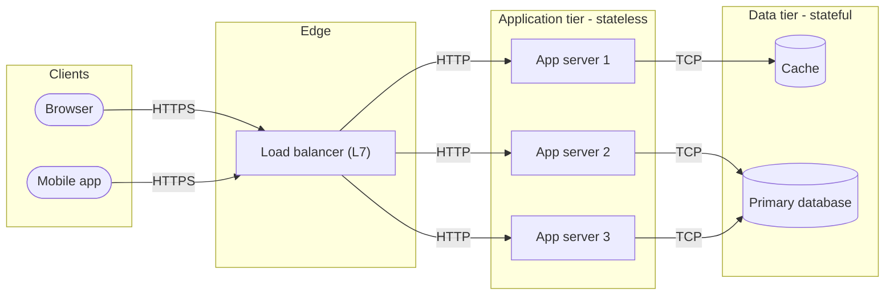

**Reading the diagram.** Two kinds of client (stadium shapes) send HTTPS requests to a layer-7 load balancer, which terminates TLS and forwards plain HTTP (or re-encrypted HTTPS) inside the private network to one of three identical application servers. All arrows are synchronous request/response calls. The application servers are stateless, so the only storage boundary is the data-tier subgraph: the cache and the primary database. Failure points: the load balancer (mitigated by running a redundant pair, §19.8), any single app server (the load balancer's health checks remove it, §19.5) and the database (the hardest to make redundant; Chapter 14). Scaling: add app servers freely; the data tier scales with caching (Chapter 20), replicas and partitioning (Chapter 14).

### 8.3.2 Statelessness

::: definition
**Definition — Stateless service.** A service that keeps no client-specific data in its own memory between requests. Every request carries, or lets the service look up from a shared store, everything needed to process it.
:::

A waiter who memorizes your order is **stateful**: if he goes home sick, your order is lost and only he can serve your table. A waiter who writes every order on a ticket and pins it to a shared board is **stateless**: any waiter can pick up any table. Stateless servers can be added, removed, restarted and replaced without losing anything, which is why every scaling, deployment and fault-tolerance technique later in this book assumes them.

State does not disappear; it moves. Login status moves into a cookie or token the client sends on every request (§8.10, §8.13), or into a shared session store (§8.10.2). Shopping carts move into a database. The price is an extra lookup per request (typically ~0.5–1 ms to an in-datacenter cache), which is almost always worth paying.

#### Failure scenarios

**Table 8.1 — Client–server failure scenarios.**

| What goes wrong | Why | Detection | Recovery | Prevention |
|---|---|---|---|---|
| Users logged out after a deploy | Sessions stored in app-server memory | Spike in 401s and login traffic after each rollout | Users log in again | Move sessions to a shared store or signed cookie |
| One server overloaded, others idle | Sticky sessions pin heavy users to one server | Uneven per-server CPU and p99 | Drain and rebalance | Make servers stateless; avoid affinity (§19.6) |
| Old mobile clients break | Server changed the API contract | Error rate segmented by app version | Hotfix server to accept old format | Compatibility rules and versioning (§8.15) |
| Database saturated | Every tier's requests ultimately land on one primary | DB CPU, connection count, lock waits | Shed load, add read replicas | Caching, connection pooling, partitioning |

#### Common misconceptions

::: mistake
**"Stateless means the system has no state."** It means the *compute* tier holds no per-client state between requests. The state lives in databases, caches and the client. Designing a stateless tier is really deciding *where* state should live.
:::

::: mistake
**"Client–server is the opposite of peer-to-peer, so it is obsolete."** Almost every web, mobile and inter-service interaction today is client–server; even "peer" microservices act as client in one call and server in the next. Peer-to-peer appears in specific niches (WebRTC media, §9.7; BitTorrent-style distribution).
:::

## 8.4 Frontend and backend; SPA, SSR and mobile clients

### 8.4.1 Frontend and backend

The **frontend** is the code that runs on the user's device and draws the interface: HTML, CSS and JavaScript in a browser, or Swift/Kotlin in a mobile app. The **backend** is the code that runs on servers you control: APIs, business logic, databases, background jobs. The split matters for design because the two sides have opposite trust and update properties:

- **Trust.** Anything on the client can be read and modified by the user. Validation in the frontend is a usability feature; validation and authorization in the backend are security features. Never trust a price, a user ID or a role sent by a client.
- **Update speed.** You can redeploy the backend in minutes. A web frontend updates on the next page load. A mobile app updates only when users install the new version, so versions that are months or years old stay in use and your API must keep serving them (§8.15).

### 8.4.2 Rendering strategies

Where the HTML is produced determines how many round trips the user waits for, how much work the server does and how search engines see the page.

::: definition
**Definition — Server-side rendering (SSR).** The server produces complete HTML for each request; the browser displays it immediately and then loads JavaScript to make it interactive (**hydration**).
:::

::: definition
**Definition — Single-page application (SPA) / client-side rendering (CSR).** The server sends a nearly empty HTML shell plus a JavaScript bundle; the JavaScript calls JSON APIs and builds the page in the browser. Navigation afterwards happens without full page loads.
:::

::: definition
**Definition — Static site generation (SSG).** HTML is produced at build time and served as static files, usually from a CDN (Chapter 21). Pages that change per user cannot be fully static.
:::

In restaurant terms: SSR is a plated dish (ready to eat, but the kitchen does all the work for every order); SPA is a meal kit (one trip to fetch the kit, then the diner assembles everything, quick to re-assemble but slow to the first bite); SSG is the pre-made sandwich in the display fridge (instant, but everyone gets the same sandwich).

**Table 8.2 — Rendering strategies compared.**

| Aspect | SSR | SPA (CSR) | SSG | Native mobile |
|---|---|---|---|---|
| Where HTML/UI is built | Server, per request | Browser | Build server, once | Device (compiled app) |
| Round trips before content | 1 (HTML) | ≥ 2–3 (shell, JS bundle, API) | 1, from a CDN edge | API calls only; UI is installed |
| Server CPU per page view | High | Low (JSON APIs only) | ~0 | Low (JSON/Protobuf APIs only) |
| SEO (crawler sees content) | Good | Weaker; depends on crawler running JS | Good | N/A |
| Personalized content | Yes | Yes | No (or via client-side calls) | Yes |
| Backend shape | Server renders templates and calls services | Pure API (REST/GraphQL) | Build pipeline + CDN | Pure API, must tolerate old versions |
| Typical use | Content and e-commerce pages | Dashboards, editors, apps behind login | Docs, marketing, blogs | Consumer apps |

Modern frameworks blend these (SSR for the first page, SPA navigation afterwards; static pages with per-request "islands"). For a system designer the key consequence is the **backend shape**: an SPA or mobile app needs a well-designed JSON/Protobuf API, and SSR needs a rendering tier that itself is a client of your APIs.

### 8.4.3 Mobile clients and the backend for frontend

Mobile clients add three constraints:

1. **Old versions never die quickly.** Expect several app versions live at once; any field you remove from a response may crash an old build.
2. **Networks are slow and flaky.** Cellular round-trip times of 50–150 ms are common (as of 2026; varies widely by network). Chatty APIs that need ten sequential calls to draw one screen add up to a second or more of waiting. Mobile clients therefore favor fewer, coarser calls, compact encodings and offline caches.
3. **Different screens need different data.** A phone's feed card shows 3 fields; the desktop card shows 12.

One common answer is the **backend for frontend (BFF)** pattern: a thin server per client type that aggregates downstream services into exactly the payload that client needs (covered in §34.6). GraphQL (§8.7) is another answer to the same problem.

**Figure 8.2 — Backend-for-frontend aggregation.**

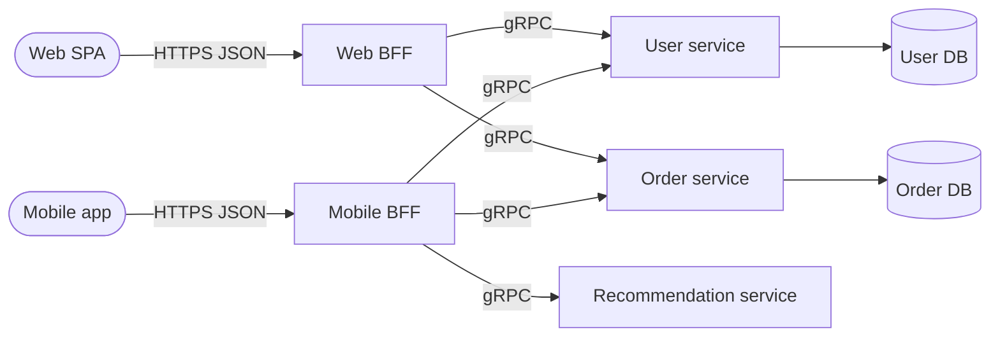

**Reading the diagram.** Each client type talks only to its own BFF over HTTPS with JSON. The BFFs call internal services over gRPC (binary, HTTP/2; §8.8) and merge results, so a phone makes one round trip over the slow cellular link instead of three. All calls are synchronous. Each service owns its own database (storage boundaries at the cylinders). Failure points: a slow recommendation service delays the mobile screen unless the BFF uses a deadline and degrades gracefully (§8.8.4). Scaling: BFFs are stateless and scale horizontally; the cost is one more service per client type to own and deploy.

## 8.5 The request–response lifecycle end to end

### 8.5.1 What happens when you press Enter

::: definition
**Definition — Request–response lifecycle.** The complete sequence of network and processing steps between a client issuing a request and receiving the full response, including name resolution, connection establishment, routing through intermediaries, application processing, data access and the return path.
:::

#### First-principles explanation

Before your restaurant order is cooked, someone must find the restaurant's address (DNS), drive there (TCP connection), show ID at the door (TLS handshake), be seated by a host who picks a free waiter (load balancer), have the waiter take the order to the kitchen (web server to application), and wait while the kitchen fetches ingredients from the pantry (database). Only the last two steps are "real work". The others are setup, and for short requests setup often dominates.

#### How it works internally

Take `GET https://shop.example.com/api/v1/orders/42` from a browser.

1. **URL parsing and cache check.** The browser splits the URL into scheme (`https`), host (`shop.example.com`), path and query. If a fresh copy is in the HTTP cache (`Cache-Control: max-age`), it stops here (§20.5).
2. **DNS resolution** (§7.6). The browser asks the OS stub resolver, which asks a recursive resolver, which (on a cache miss) walks root → `.com` → `example.com` authoritative servers. The answer is an IP address, often of a CDN edge or a regional load balancer, cached for its TTL.
3. **TCP handshake** (§7.7). SYN, SYN-ACK, ACK: one round trip (RTT) before data can flow. With HTTP/3 this is replaced by QUIC, which combines transport and TLS setup (§7.9).
4. **TLS 1.3 handshake** (§7.10). One more RTT to agree keys and verify the server certificate (zero RTT on resumption, with replay caveats).
5. **HTTP request sent.** Method, path, headers (`Host`, `Cookie` or `Authorization`, `Accept`), and possibly a body. Over HTTP/2 this is a set of compressed frames on a stream within the connection.
6. **Load balancer** (Chapter 19). A layer-7 load balancer terminates TLS, reads the HTTP request, applies routing rules (path `/api/` → API pool), picks a healthy backend and forwards the request, often over a pooled keep-alive connection. It adds headers such as `X-Forwarded-For` so the backend knows the client IP.
7. **Web server / reverse proxy.** Something like Nginx or Envoy (or the application server's own HTTP layer) parses the request, enforces limits (body size, timeouts), may serve static files, and passes the request to the application process via HTTP, a socket or an in-process call (for Python, via the ASGI or WSGI interface).
8. **Application framework.** Middleware runs in order: request ID and tracing, authentication (cookie or token → user identity, §8.10–§8.13), rate limiting (Chapter 22), then the **router** maps `GET /api/v1/orders/{id}` to a handler function.
9. **Business logic and authorization.** The handler checks that this user may read order 42 (§8.12), then fetches data.
10. **Data access.** The handler borrows a connection from a pool (§7.16), sends SQL to the database (or reads the cache first), and waits. The database parses, plans, reads pages from its buffer pool or disk and returns rows (Chapter 11).
11. **Response built.** The handler serializes the result (JSON, §8.9), sets status (`200 OK`), headers (`Content-Type`, `Cache-Control`, `ETag`) and returns it through the middleware stack, web server and load balancer.
12. **Browser processes the response.** It decompresses, parses, updates its cache and cookie jar, and renders or hands the JSON to JavaScript. The TCP/TLS connection stays open (keep-alive) for later requests.

#### Architecture diagram

**Figure 8.3 — End-to-end lifecycle of one HTTPS API request.**

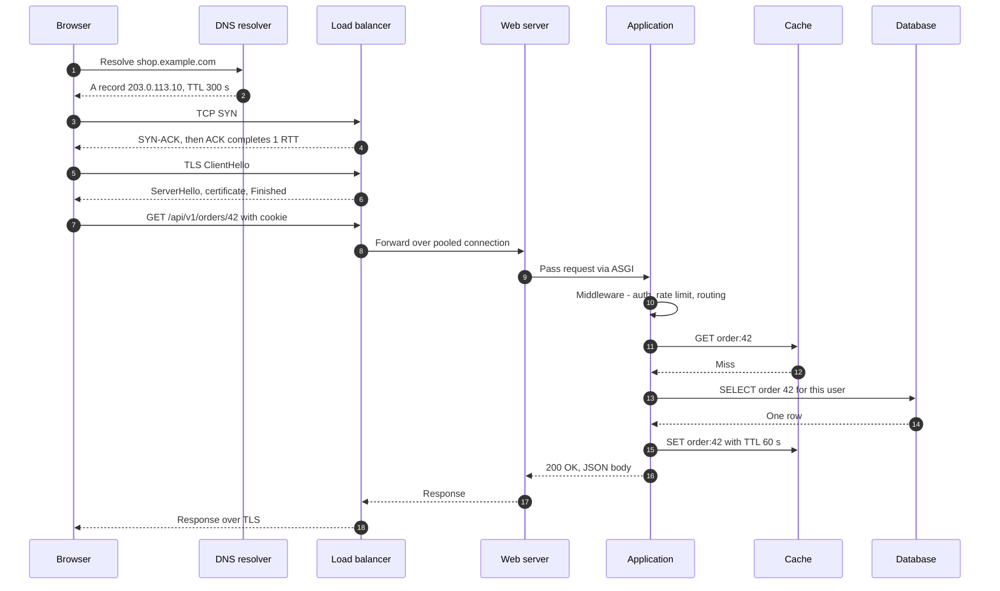

**Reading the diagram.** Time flows downward. Messages 1–2 are DNS over UDP (or DNS over HTTPS); 3–4 are the TCP handshake; 5–6 are the TLS 1.3 handshake. Message 7 is the actual HTTP request, carried over the encrypted connection. The load balancer forwards it (8) over a connection it already holds open to the web server, which hands it to the application process (9). The application runs middleware (10), tries the cache (11–12), falls through to the database (13–14) and populates the cache on the way out (15) in the cache-aside pattern (§20.7). Everything is synchronous: the browser waits for the whole chain. Storage boundaries are the cache and the database. Failure points: DNS (stale or failing resolvers), the load balancer, a slow database query that holds a pooled connection, and timeouts that are not aligned along the chain. Scaling options: CDN and HTTP caching remove steps 3–15 entirely for cacheable responses; connection reuse removes steps 3–6 for repeat requests; app servers scale horizontally; the database scales with replicas and partitions.

#### Mathematical foundations

::: formula
**End-to-end latency of a request on a new connection**

$$T_{\text{total}} = T_{\text{DNS}} + T_{\text{TCP}} + T_{\text{TLS}} + T_{\text{req}} + T_{\text{server}} + T_{\text{transfer}}$$

with $T_{\text{TCP}} \approx 1 \times RTT$, $T_{\text{TLS 1.3}} \approx 1 \times RTT$, $T_{\text{req}} \approx 1 \times RTT$ and $T_{\text{transfer}} \approx \frac{S}{B}$ for a response that fits in the congestion window.

| Symbol | Meaning | Units |
|---|---|---|
| $T_{\text{DNS}}$ | DNS lookup time (≈ 0 if cached) | ms |
| $RTT$ | Client-to-load-balancer round-trip time | ms |
| $T_{\text{server}}$ | Time from the load balancer receiving the request to sending the response (app + DB) | ms |
| $S$ | Response size | bytes |
| $B$ | Bottleneck bandwidth | bytes/ms |
:::

::: example
**Worked example — Cold versus warm request.** A user is 40 ms RTT from the region. Uncached DNS takes 30 ms. The server spends 2 ms in the load balancer and web server, 8 ms in application code and one 3 ms database query: $T_{\text{server}} = 13$ ms. The 4 KB response transfers in well under 1 ms on a broadband link, so ignore it.

1. Cold (new DNS, new connection): $30 + 40 + 40 + 40 + 13 = 163$ ms.
2. Warm (DNS cached, connection reused): $0 + 0 + 0 + 40 + 13 = 53$ ms.
3. Share of the cold request spent on actual server work: $13 / 163 \approx 8\%$.

**Interpretation.** For short API calls, the network setup costs about ten times as much as the work. **Engineering implication:** before optimizing a 3 ms query, make sure clients reuse connections (HTTP keep-alive, HTTP/2 multiplexing), keep DNS TTLs reasonable, terminate TLS close to users (CDN edges, §21.3) and avoid designs that need several *sequential* round trips per screen.
:::

**Table 8.3 — Typical latency budget per hop (order-of-magnitude, as of 2026).**

| Hop | Typical cost | Dominated by |
|---|---|---|
| DNS lookup (cached in OS/browser) | ~0 ms | — |
| DNS lookup (recursive resolver cache miss) | 10–100 ms | RTTs to authoritative servers |
| TCP + TLS 1.3 setup | 2 × RTT (e.g. 20–200 ms on the public internet) | Distance to the TLS terminator |
| Load balancer and reverse proxy | ~0.1–1 ms | Parsing, TLS termination CPU |
| Application code (simple handler) | 1–20 ms | Serialization, framework overhead, language runtime |
| Cache read in the same datacenter | ~0.2–1 ms | Network RTT inside the datacenter |
| Indexed database point read | ~0.5–5 ms | Network RTT + buffer-pool hit or disk read |
| Unindexed scan of a large table | 100 ms–seconds | Rows read from disk (Chapter 11) |

These figures are illustrative ranges for estimation; measure your own system (Chapter 23). See §4.17 and Appendix F for dated reference numbers.

#### Failure scenarios

**Table 8.4 — Lifecycle failure scenarios.**

| What goes wrong | Why | Detection | Recovery | Prevention |
|---|---|---|---|---|
| Users hit old servers after a migration | DNS answers cached for the old TTL | Traffic still arriving at old IPs | Keep old endpoints serving until TTL expires | Lower TTL days before a planned change |
| 502/504 from the load balancer | Backend crashed or slower than the LB timeout | LB 5xx metrics by backend | Remove unhealthy backends | Health checks; timeouts that shrink inward along the chain |
| Requests pile up, then everything times out | DB connection pool exhausted by slow queries | Pool wait time, active connections | Kill slow queries, shed load | Query timeouts, indexes, pool sizing (§14.13) |
| Client retries make an outage worse | Timeouts plus immediate retries multiply load | Request rate rises while success rate falls | Shed load, open circuit breakers | Exponential backoff with jitter, retry budgets (§22.12) |

::: mistake
**"Latency is mostly the database."** For a typical small API call, connection setup and round trips often cost more than the query. Count round trips first, then optimize server time.
:::

## 8.6 REST API design

### 8.6.1 What REST is: Fielding's constraints

::: definition
**Definition — REST (Representational State Transfer).** An architectural style for distributed hypermedia systems, defined by Roy Fielding in his 2000 doctoral dissertation as a set of constraints on how components interact [Fielding 2000]. In everyday usage, a "REST API" is an HTTP API that models its domain as **resources** identified by URIs and manipulated with the standard HTTP methods.
:::

#### First-principles explanation

A library does not give each patron a custom set of instructions. It has a uniform system: every book has a call number (a **resource identifier**), and there are a few standard actions — look up, borrow, return — that work the same for every book. You can walk into any library and use it. REST applies the same idea to networked software: instead of inventing a new verb per operation (`getOrder`, `cancelOrderV2`, `listAllOrdersForUser`), you name *things* (`/orders/42`) and use a small, fixed set of verbs that every client, proxy and cache already understands.

#### Why does this exist?

Fielding was describing why the web had scaled to millions of independently developed servers and clients. Its uniform interface lets intermediaries — caches, proxies, CDNs, load balancers — understand and optimize traffic without knowing anything about the application. A CDN can cache any `GET` response marked cacheable; a proxy can retry any idempotent request. Custom RPC protocols of the 1990s could not offer that.

**Table 8.5 — Fielding's REST constraints.**

| Constraint | Meaning | What it buys you |
|---|---|---|
| Client–server | Separate the user interface from data storage | Independent evolution of client and server |
| Stateless | Each request contains all information needed to understand it; no session state on the server | Visibility, reliability, horizontal scalability |
| Cache | Responses label themselves cacheable or not | Fewer interactions; lower latency |
| Uniform interface | Resource identification, manipulation through representations, self-descriptive messages, hypermedia as the engine of application state (HATEOAS) | Generic intermediaries and clients |
| Layered system | A client cannot tell whether it talks to the origin or an intermediary | Load balancers, caches, gateways can be inserted transparently |
| Code on demand (optional) | Servers may send executable code (e.g. JavaScript) | Extensible clients |

::: note
**Note — "RESTful" in practice.** Most public "REST" APIs implement the first five constraints partially and skip HATEOAS. Fielding has written that an API which is not hypertext-driven is not REST in his sense. This book uses "REST API" in the common, looser sense — resource-oriented HTTP + JSON — and flags HATEOAS separately (§8.6.8).
:::

### 8.6.2 Resources and URIs

A **resource** is any named thing the API exposes: a user, an order, a collection of orders, the current exchange rate. A **representation** is a serialized snapshot of it (JSON, usually). Design rules that hold up in practice:

1. **Nouns, not verbs, in paths.** `POST /orders`, not `POST /createOrder`. The method is the verb.
2. **Plural collections, item by identifier.** `/orders` (collection) and `/orders/42` (item).
3. **Nest only for true containment, at most one level.** `/orders/42/items` is clear; `/users/7/orders/42/items/3/discounts` couples clients to your data model. Prefer `/order-items/3` once items have their own identity.
4. **Opaque, stable identifiers.** Prefer IDs that do not leak row counts or allow enumeration (UUIDs or Snowflake-style IDs, §17.10).
5. **Actions that do not fit CRUD** become sub-resources or state changes: `POST /orders/42/cancellation` or `PATCH /orders/42 {"status":"cancelled"}`, rather than `POST /cancelOrder?id=42`.
6. **Consistent casing** (`snake_case` or `camelCase` in JSON, kebab-case in paths) across the whole API.

### 8.6.3 HTTP methods: safety and idempotency

Two properties of methods matter enormously for distributed systems, because networks lose responses and clients retry.

::: definition
**Definition — Safe method.** A method whose semantics are read-only: the client does not request, and does not expect, any state change on the server [RFC 9110 §9.2.1]. Logging or metrics side effects are allowed.
:::

::: definition
**Definition — Idempotent method.** A method for which the intended effect on the server of sending the same request $N > 0$ times is the same as sending it once [RFC 9110 §9.2.2]. The *response* may differ (a second `DELETE` may return 404); the *state* does not.
:::

Analogy: pressing a lift's call button is idempotent (pressing five times summons one lift); dropping a coin in a vending machine is not (five coins, five charges). If a client sends `POST /payments` and the connection drops before the response arrives, it cannot know whether the payment happened. Retrying a non-idempotent request risks a double charge. Retrying an idempotent one is always safe.

**Table 8.6 — HTTP method properties [RFC 9110].**

| Method | Typical use | Safe | Idempotent | Request body | Cacheable |
|---|---|---|---|---|---|
| `GET` | Read a resource or collection | Yes | Yes | No (no defined semantics) | Yes |
| `HEAD` | `GET` without the body (check existence, size) | Yes | Yes | No | Yes |
| `OPTIONS` | Discover allowed methods; CORS preflight | Yes | Yes | Optional | No |
| `POST` | Create in a collection; any non-idempotent action | No | **No** | Yes | Only with explicit freshness; rare |
| `PUT` | Create or fully replace at a known URI | No | Yes | Yes | No |
| `PATCH` | Partial update [RFC 5789] | No | Not guaranteed | Yes | No |
| `DELETE` | Remove a resource | No | Yes | Rarely | No |

What to notice:

- `PUT /users/7/avatar` with the full new representation is idempotent: sending it twice leaves the same avatar. `PATCH {"op":"increment","path":"/balance"}` is not.
- To make `POST` safe to retry, clients send an **idempotency key** header (for example a UUID per logical operation); the server stores the key with the result and returns the stored result for duplicates. Chapter 22 (§22.15) covers the full design.

### 8.6.4 Status codes

Status codes are part of the uniform interface: a load balancer, a retry library or a monitoring system can act on `503` without understanding your JSON.

**Table 8.7 — Status codes every API designer uses [RFC 9110 unless noted].**

| Code | Meaning | Use it when | Client should |
|---|---|---|---|
| 200 OK | Success with body | Successful `GET`, `PUT`, `PATCH` | Use the body |
| 201 Created | New resource created | `POST` created something; include `Location` header | Follow `Location` |
| 202 Accepted | Queued for asynchronous processing | Long jobs; return a status URL | Poll the status resource |
| 204 No Content | Success, no body | `DELETE`, or update returning nothing | Nothing |
| 301 / 308 | Moved permanently | Resource has a new URI (308 preserves the method) | Update bookmarks |
| 304 Not Modified | Cached copy still valid | Conditional `GET` with `If-None-Match` matched the `ETag` | Use cached copy |
| 400 Bad Request | Malformed request | Unparseable JSON, invalid parameter syntax | Fix the request; do not retry as is |
| 401 Unauthorized | Not authenticated | Missing, expired or invalid credentials; send `WWW-Authenticate` | Authenticate, then retry |
| 403 Forbidden | Authenticated but not allowed | Lacks permission or scope | Do not retry |
| 404 Not Found | No such resource (or hidden from you) | Unknown ID; also to avoid revealing existence | Do not retry |
| 409 Conflict | Conflicts with current state | Duplicate unique key; version conflict | Re-read, resolve, retry |
| 412 Precondition Failed | `If-Match` ETag did not match | Optimistic concurrency failure | Re-read and retry |
| 422 Unprocessable Content | Well-formed but semantically invalid | Validation errors (end date before start date) | Fix input |
| 429 Too Many Requests [RFC 6585] | Rate limited | Client exceeded quota; send `Retry-After` | Back off |
| 500 Internal Server Error | Unexpected server bug | Unhandled exception | Retry only if idempotent, with backoff |
| 502 / 504 | Bad gateway / gateway timeout | An upstream failed or timed out | Retry idempotent requests with backoff |
| 503 Service Unavailable | Temporarily overloaded or in maintenance | Load shedding; send `Retry-After` | Back off and retry |

::: mistake
**Returning `200 OK` with `{"error": "..."}` in the body.** Every intermediary and monitoring tool then counts failures as successes, retries never happen, and error-rate SLOs (§39.6) silently read 100%. Use the status code for the class of outcome and the body for detail.
:::

### 8.6.5 Pagination: offset versus cursor

A collection such as `/orders` may hold millions of items. Returning all of them would take seconds, megabytes and a lot of database work, so APIs return **pages**.

#### Offset pagination

The client asks for `?limit=20&offset=40` (or `?page=3&per_page=20`). The SQL is straightforward:

```sql
-- Page 3 of 20 items, newest first (PostgreSQL)
SELECT id, title, created_at
FROM articles
ORDER BY created_at DESC, id DESC
LIMIT 20 OFFSET 40;
```

It is simple and supports "jump to page 37". It has two serious problems:

1. **Cost grows with depth.** The database cannot jump to row 40; it must produce and discard the first 40 rows in sorted order, then return 20. Deep pages read $\text{offset} + \text{limit}$ rows.
2. **Results shift under concurrent writes.** If a new article is inserted while the user reads page 1, every item moves down one place: the last item of page 1 appears again at the top of page 2. Deletions cause items to be skipped silently.

#### Cursor (keyset) pagination

Instead of "skip N rows", the client says "give me rows *after this one*". The server returns an opaque **cursor** encoding the sort key of the last row it sent; the next query uses it in a `WHERE` clause that an index can seek to directly.

```sql
-- Supporting index: the sort order, with id as a unique tie-breaker
CREATE INDEX idx_articles_created_id ON articles (created_at DESC, id DESC);

-- First page
SELECT id, title, created_at
FROM articles
ORDER BY created_at DESC, id DESC
LIMIT 21;                       -- one extra row tells us whether a next page exists

-- Next page: $1, $2 = created_at and id of the last row of the previous page
SELECT id, title, created_at
FROM articles
WHERE (created_at, id) < ($1, $2)    -- row-value comparison: seek, don't skip
ORDER BY created_at DESC, id DESC
LIMIT 21;
```

What to notice:

- The `id` tie-breaker makes the sort order **total**. Without it, two rows with the same `created_at` could be skipped or duplicated at a page boundary.
- The row-value comparison `(created_at, id) < ($1, $2)` means "earlier timestamp, or same timestamp with smaller id". PostgreSQL, MySQL 8 and SQLite support it; on databases that do not, expand it to `created_at < $1 OR (created_at = $1 AND id < $2)`.
- Fetching `limit + 1` rows answers "is there a next page?" without a separate `COUNT(*)`, which is itself expensive on large tables.

::: formula
**Rows touched per page**

$$R_{\text{offset}} = o + \ell \qquad R_{\text{keyset}} \approx \ell + \log_b n$$

| Symbol | Meaning | Units |
|---|---|---|
| $o$ | Offset (rows skipped) | rows |
| $\ell$ | Page size (limit) | rows |
| $n$ | Rows in the table or index | rows |
| $b$ | B-tree fan-out (entries per index page, typically hundreds) | entries |
:::

::: example
**Worked example — Page 50,000 of an activity feed.** Table of $n = 10^7$ rows, page size $\ell = 20$, user (or a scraper) requests page 50,000, so $o = 49{,}999 \times 20 = 999{,}980$.

1. Offset: $R = 999{,}980 + 20 = 1{,}000{,}000$ index entries walked, 999,980 of them discarded.
2. Keyset: one B-tree descent of $\log_{200} 10^7 \approx 3$ levels, then 21 entries: about 24 entries.
3. Ratio: $10^6 / 24 \approx 40{,}000\times$ more work for the offset query.

**Interpretation.** Offset pagination is fine for shallow pages (an admin table with a few thousand rows) but degrades linearly with depth and is an easy denial-of-service vector. **Engineering implication:** use cursors for feeds, timelines, logs, sync and any public API; cap `offset` if you must offer it.
:::

**Table 8.8 — Offset versus cursor pagination.**

| Aspect | Offset / page number | Cursor (keyset) |
|---|---|---|
| Request | `?limit=20&offset=40` | `?limit=20&cursor=eyJ…` |
| Cost of deep pages | Grows linearly with offset | Constant (index seek) |
| Stable under inserts/deletes | No: duplicates and skips | Yes, relative to the last seen key |
| Jump to arbitrary page | Yes | No (only next/previous) |
| Total count | Often shown (costly `COUNT(*)`) | Usually omitted |
| Sort flexibility | Any `ORDER BY` | Needs an index matching the sort key plus a unique tie-breaker |
| Choose when | Small, mostly static datasets; UI needs page numbers | Large or fast-changing collections; infinite scroll; API sync |

#### Code example

The following FastAPI service implements cursor pagination with an opaque, base64url-encoded cursor, optional filtering, and RFC 9457 error responses (§8.6.7). It runs as written with `pip install fastapi uvicorn` and `uvicorn articles_api:app`.

```python
# articles_api.py — run with:  pip install fastapi uvicorn  &&  uvicorn articles_api:app
import base64
import json
import sqlite3

from fastapi import FastAPI, Query, Request
from fastapi.responses import JSONResponse

app = FastAPI(title="Articles API", version="1.0.0")

# In-memory database so the example is self-contained.
db = sqlite3.connect(":memory:", check_same_thread=False)
db.row_factory = sqlite3.Row
db.executescript("""
CREATE TABLE articles (
    id         INTEGER PRIMARY KEY,
    title      TEXT    NOT NULL,
    status     TEXT    NOT NULL,
    created_at TEXT    NOT NULL           -- ISO-8601 UTC timestamp
);
CREATE INDEX idx_articles_created_id ON articles (created_at DESC, id DESC);
""")
db.executemany(
    "INSERT INTO articles (id, title, status, created_at) VALUES (?, ?, ?, ?)",
    [(i, f"Article {i}", "draft" if i % 3 == 0 else "published",
      f"2026-01-{i % 28 + 1:02d}T10:00:00Z") for i in range(1, 101)],
)


class Problem(Exception):
    """An error that is rendered as RFC 9457 problem details."""
    def __init__(self, status: int, title: str, detail: str,
                 type_: str = "about:blank"):
        self.status, self.title, self.detail, self.type_ = status, title, detail, type_


@app.exception_handler(Problem)
async def problem_handler(request: Request, exc: Problem) -> JSONResponse:
    return JSONResponse(
        status_code=exc.status,
        media_type="application/problem+json",
        content={"type": exc.type_, "title": exc.title, "status": exc.status,
                 "detail": exc.detail, "instance": request.url.path},
    )


def encode_cursor(created_at: str, row_id: int) -> str:
    raw = json.dumps([created_at, row_id]).encode()
    return base64.urlsafe_b64encode(raw).decode().rstrip("=")


def decode_cursor(cursor: str) -> tuple[str, int]:
    try:
        padded = cursor + "=" * (-len(cursor) % 4)
        created_at, row_id = json.loads(base64.urlsafe_b64decode(padded))
        return str(created_at), int(row_id)
    except Exception:
        raise Problem(400, "Invalid cursor",
                      "The cursor parameter is malformed or expired.",
                      "https://api.example.com/problems/invalid-cursor")


@app.get("/v1/articles")
def list_articles(
    limit: int = Query(20, ge=1, le=100),
    cursor: str | None = None,
    status: str | None = Query(None, pattern="^(draft|published)$"),
):
    where, params = [], []
    if status is not None:
        where.append("status = ?")
        params.append(status)
    if cursor is not None:
        created_at, last_id = decode_cursor(cursor)
        where.append("(created_at, id) < (?, ?)")      # keyset predicate
        params += [created_at, last_id]

    sql = "SELECT id, title, status, created_at FROM articles"
    if where:
        sql += " WHERE " + " AND ".join(where)
    sql += " ORDER BY created_at DESC, id DESC LIMIT ?"
    params.append(limit + 1)                            # fetch one extra row

    rows = db.execute(sql, params).fetchall()
    has_more = len(rows) > limit
    rows = rows[:limit]
    next_cursor = (encode_cursor(rows[-1]["created_at"], rows[-1]["id"])
                   if has_more else None)
    return {"data": [dict(r) for r in rows], "next_cursor": next_cursor}


@app.get("/v1/articles/{article_id}")
def get_article(article_id: int):
    row = db.execute("SELECT id, title, status, created_at FROM articles WHERE id = ?",
                     (article_id,)).fetchone()
    if row is None:
        raise Problem(404, "Not Found", f"No article with id {article_id} exists.")
    return dict(row)
```

What to notice:

- **The cursor is opaque.** Clients must treat it as a token, not parse it. That leaves you free to change its contents (add a sort field, sign or encrypt it, add an expiry) without a breaking change. In production, sign the cursor with an HMAC (as in §8.10.2) so clients cannot forge one that seeks to arbitrary positions.
- **`limit` is bounded** (`le=100`). An unbounded page size is a denial-of-service hole. FastAPI rejects `limit=500` with `422` automatically.
- **SQL parameters are bound with `?`**, never formatted into the string, which prevents SQL injection (§10.7).
- **Filters and cursors compose**: the `status` predicate and the keyset predicate are both in the `WHERE` clause. A production version would also bind the cursor to the filter that produced it, so a cursor from `status=draft` cannot be replayed against `status=published`.

Exercising it with curl:

```bash
curl -s 'http://localhost:8000/v1/articles?limit=2'
# {"data":[{"id":83,"title":"Article 83","status":"published","created_at":"2026-01-28T10:00:00Z"},
#          {"id":55,...}],"next_cursor":"WyIyMDI2LTAxLTI4VDEwOjAwOjAwWiIsIDU1XQ"}

curl -s 'http://localhost:8000/v1/articles?limit=2&cursor=WyIyMDI2LTAxLTI4VDEwOjAwOjAwWiIsIDU1XQ'

curl -si 'http://localhost:8000/v1/articles/999'
# HTTP/1.1 404 Not Found
# content-type: application/problem+json
# {"type":"about:blank","title":"Not Found","status":404,
#  "detail":"No article with id 999 exists.","instance":"/v1/articles/999"}
```

### 8.6.6 Filtering and sorting

Common conventions, any of which is fine if applied consistently:

- **Filtering by field:** `GET /orders?status=shipped&customer_id=c_17`. For ranges: `created_after=2026-01-01T00:00:00Z` or `created_at[gte]=…`.
- **Sorting:** `?sort=-created_at,id` (minus for descending).
- **Sparse fieldsets:** `?fields=id,title` to reduce payload size, a partial answer to the over-fetching that motivates GraphQL.
- **Search** is a different operation from filtering. Free-text search belongs on a search endpoint backed by a search engine (Chapter 16), not on `LIKE '%term%'` against the primary database.

Every filter and sort combination you allow is a query shape your database must serve efficiently. Allow-list the fields, and make sure each permitted combination has a supporting index; otherwise one creative client can trigger a full table scan per request. With cursor pagination, the cursor must encode the values of *every* sort column plus the tie-breaker.

### 8.6.7 Error format: RFC 9457 problem details

Ad-hoc error bodies (`{"err": 1}`, `{"message": "..."}`, `{"errors": [...]}`) force every client to write custom parsing per API. RFC 9457 (which obsoletes RFC 7807) defines a standard JSON shape served with media type `application/problem+json` [RFC 9457]:

```json
{
  "type": "https://api.example.com/problems/insufficient-funds",
  "title": "Insufficient funds",
  "status": 403,
  "detail": "Your balance is 30.00 EUR; the transfer requires 50.00 EUR.",
  "instance": "/v1/transfers/7f9c2e",
  "balance_cents": 3000,
  "required_cents": 5000
}
```

What to notice:

- **`type`** is a URI that identifies the *kind* of problem; clients branch on it. It should ideally resolve to human-readable documentation. When omitted it defaults to `about:blank`, in which case `title` should be the HTTP status phrase.
- **`title`** is a short, stable summary of the type; **`detail`** explains *this* occurrence; **`instance`** identifies this occurrence (a request path or an error ID you can grep logs for).
- **Extension members** (`balance_cents`) carry machine-readable specifics. Never put stack traces, SQL or internal hostnames in error bodies.

### 8.6.8 HATEOAS, briefly

**HATEOAS (Hypermedia as the Engine of Application State)** means responses include links telling the client what it can do next, so the client follows links instead of constructing URLs:

```json
{
  "id": "ord_42",
  "status": "placed",
  "_links": {
    "self":   { "href": "/v1/orders/ord_42" },
    "cancel": { "href": "/v1/orders/ord_42/cancellation", "method": "POST" },
    "items":  { "href": "/v1/orders/ord_42/items" }
  }
}
```

The `cancel` link disappears once the order ships, so the server, not the client, encodes the workflow rules. Full HATEOAS is rare in public JSON APIs because most clients are written against documentation and hard-code URL templates anyway. A lightweight and widely used piece of it is pagination links in the HTTP `Link` header (`Link: <…?cursor=abc>; rel="next"`).

#### Real-world industry applications

::: industry
**Stripe and GitHub list endpoints.** Stripe's list endpoints use cursor-style pagination: the client passes the ID of the last object it saw in `starting_after` (or `ending_before`) together with `limit`, and the response carries `has_more` [Stripe API Docs: Pagination]. GitHub's REST API returns pagination URLs in the HTTP `Link` header with `rel="next"`, `rel="last"` and similar relations, and some endpoints use cursor-based `before`/`after` parameters [GitHub Docs: Using pagination in the REST API]. Both choices follow from the same problem: collections that are large and constantly changing, accessed by automated clients that page to the end.
*Evidence: Primary* — [Stripe API Docs: Pagination]; [GitHub Docs: Using pagination in the REST API]
:::

#### Failure scenarios

**Table 8.9 — REST API failure scenarios.**

| What goes wrong | Why | Detection | Recovery | Prevention |
|---|---|---|---|---|
| Duplicate orders or charges | Client retried a timed-out `POST` | Duplicate rows with the same payload seconds apart | Refund / merge duplicates | Idempotency keys on all non-idempotent writes (§22.15) |
| Database CPU pinned by one client | Deep `offset` pages or unindexed sort | Slow-query log; per-client cost metrics | Rate-limit the client | Cursor pagination; allow-listed, indexed sorts |
| Lost update | Two clients `PUT` the same resource concurrently | Users report reverted changes | Restore from audit log | `ETag` + `If-Match`, return `412` on mismatch |
| Clients crash on new error | Error body shape changed | Client error reports by version | Roll back | One stable error format (RFC 9457) from day one |

#### Common misconceptions

::: mistake
**"`PUT` is for updates, `POST` is for creates."** The real distinction is idempotency and who chooses the URI. `PUT /articles/my-slug` creates *or* replaces at a client-chosen URI, idempotently. `POST /articles` lets the server choose the URI and is not idempotent. Partial updates are `PATCH`.
:::

::: mistake
**"`401` means the user lacks permission."** `401 Unauthorized` (misleadingly named) means *not authenticated*. Lacking permission while authenticated is `403 Forbidden`. Many APIs return `404` instead of `403` for resources the caller should not even know exist.
:::

## 8.7 GraphQL

### 8.7.1 Schema, operations and resolvers

::: definition
**Definition — GraphQL.** A query language for APIs and a runtime for executing those queries against a strongly typed **schema**. The client sends a document describing exactly the fields it wants; the server returns JSON of the same shape [GraphQL Spec].
:::

#### First-principles explanation

A REST API is a set menu: `/users/7` returns whatever the kitchen decided a "user" contains. If you need the user, their last five posts and each post's comment count, you either order three dishes (three round trips — **under-fetching**) or receive a platter of fields you never eat (**over-fetching**). GraphQL is ordering à la carte from one waiter: you write down precisely what you want, nested as deep as you like, and get exactly that back in one trip.

#### Why does this exist?

Facebook built GraphQL in 2012 for its native mobile apps, where many REST round trips over cellular networks made news-feed screens slow and every new screen needed a new endpoint; it was open-sourced in 2015 and is now governed by the GraphQL Foundation [Byron 2015]. The specification's most recent edition at the time of writing is September 2025 [GraphQL Spec].

#### How it works internally

1. **Schema.** The server publishes types in the Schema Definition Language (SDL). Three root types are entry points: `Query` (reads), `Mutation` (writes) and `Subscription` (event streams).
2. **Parse and validate.** The server parses the query document into an abstract syntax tree and validates every field and argument against the schema *before* running anything. Typos fail fast with a precise error.
3. **Execute.** The executor walks the query tree. For every field it calls a **resolver**: a function `(parent, args, context) → value`. The resolver for `Query.posts` returns a list of post objects; then, for *each* post, the resolver for `Post.author` runs with that post as `parent`.
4. **Respond.** The result is JSON shaped like the query, plus an `errors` array if some fields failed. Over HTTP, GraphQL servers usually expose one endpoint (`POST /graphql`) and often return `200 OK` even when `errors` is non-empty, which matters for monitoring.

```graphql
"""A blog: users write posts; posts have comments."""
type Query {
  user(id: ID!): User
  posts(first: Int = 10, after: String): PostConnection!
}

type Mutation {
  createPost(input: CreatePostInput!): CreatePostPayload!
}

type User {
  id: ID!
  name: String!
  posts(first: Int = 10): [Post!]!
}

type Post {
  id: ID!
  title: String!
  body: String!
  author: User!
  comments(first: Int = 10): [Comment!]!
  publishedAt: String
}

type Comment {
  id: ID!
  text: String!
  author: User!
}

# Relay-style cursor pagination
type PostConnection {
  edges: [PostEdge!]!
  pageInfo: PageInfo!
}

type PostEdge {
  cursor: String!
  node: Post!
}

type PageInfo {
  hasNextPage: Boolean!
  endCursor: String
}

input CreatePostInput {
  title: String!
  body: String!
}

type CreatePostPayload {
  post: Post
  errors: [String!]!
}
```

A client query and the matching curl call:

```bash
curl -s https://api.example.com/graphql \
  -H 'Content-Type: application/json' \
  -H 'Authorization: Bearer eyJhbGciOi...' \
  -d '{"query":"query RecentPosts { posts(first: 5) { edges { node { title author { name } } } pageInfo { hasNextPage endCursor } } }"}'
```

What to notice:

- `!` means non-null; `[Post!]!` is a non-null list of non-null posts. Nullability is part of the contract: making a nullable field non-null later is safe for clients, the reverse is not.
- Pagination uses the cursor model of §8.6.5 (`first`, `after`, `endCursor`), in the "connection" shape popularized by Facebook's Relay client.
- Mutations return a payload type with a domain `errors` list, so business-rule failures are typed data rather than transport errors.

### 8.7.2 The N+1 problem and DataLoader

The resolver model is elegant but naive. For the query above, `posts` runs one SQL query that returns 5 posts; then `Post.author` runs **once per post**, each issuing `SELECT … FROM users WHERE id = ?`. That is $1 + N$ queries — the **N+1 problem**. Nesting multiplies it.

::: example
**Worked example — Query count for a nested feed.** A screen asks for 50 posts, the first 10 comments on each, and each comment's author. Each database round trip costs 1 ms.

1. Naive resolvers: $1$ (posts) $+ 50$ (comments per post) $+ 50 \times 10 = 500$ (comment authors) $= 551$ queries, about 551 ms if executed one after another.
2. With batching per tree level: 1 query for posts, 1 for all comments `WHERE post_id IN (…50 ids…)`, 1 for all authors `WHERE id IN (…)`: 3 queries, about 3 ms.

**Interpretation.** The difference is two orders of magnitude, and it grows with page size. **Engineering implication:** a GraphQL server without batching is a load generator pointed at your database.
:::

**DataLoader** is the standard fix, published by Facebook as a small JavaScript library and re-implemented in every major language [DataLoader]. Resolvers do not query directly; they call `loader.load(id)`, which returns a promise. DataLoader collects every `load` issued during one tick of the event loop, then calls a **batch function** once with all the keys, and resolves each promise from the result. It also memoizes keys for the duration of the request, so the same author requested 30 times is fetched once.

**Figure 8.4 — N+1 resolution versus DataLoader batching.**

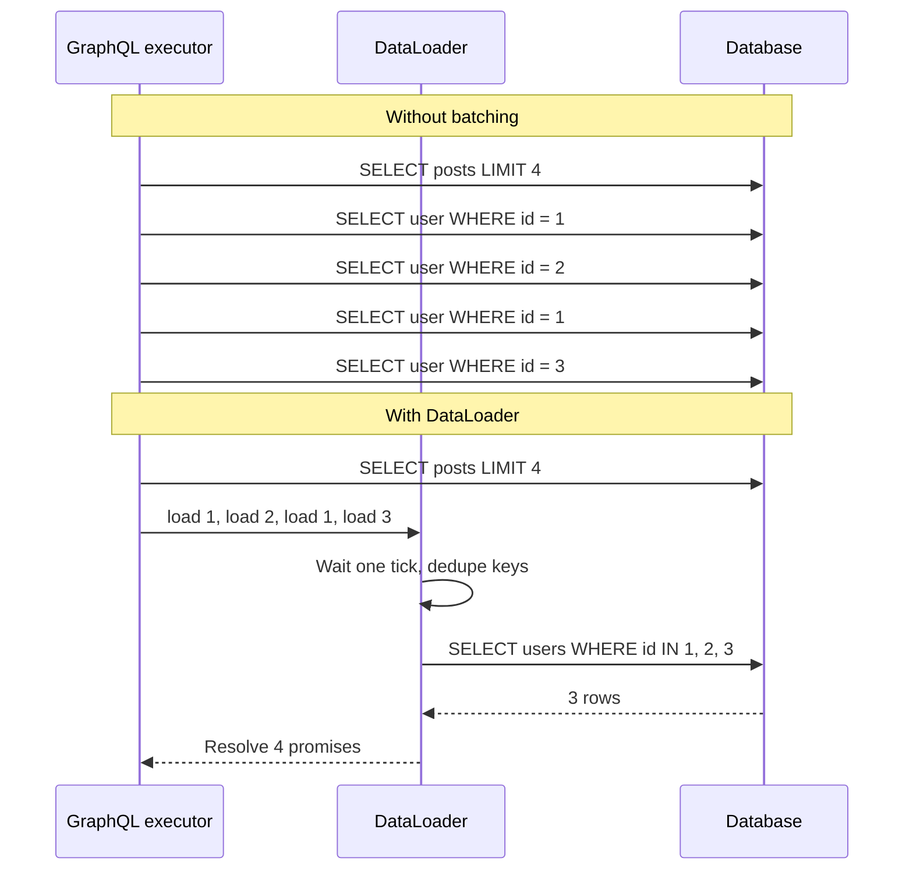

**Reading the diagram.** In the first half, the executor issues one database query per post for the author field: five synchronous round trips, one of them a duplicate. In the second half, the four author resolvers each call `load` on a per-request DataLoader; it waits until the current tick ends, deduplicates the keys to `{1, 2, 3}`, makes one `IN` query, and fans the rows back out to the four waiting resolvers. The storage boundary is the database. Failure point: if the batch query fails, every waiting resolver must receive the error. Scaling: batching turns $O(N)$ round trips into $O(\text{depth})$.

A minimal DataLoader in Python's `asyncio` shows the mechanism:

```python
import asyncio


class DataLoader:
    """Coalesce every load(key) issued in the same event-loop tick into one batch call."""

    def __init__(self, batch_fn):
        self.batch_fn = batch_fn          # async fn: list[key] -> list[value], same order
        self.cache = {}                   # key -> Future (per-request memoization)
        self.queue = []                   # keys waiting for the next dispatch

    def load(self, key):
        if key in self.cache:
            return self.cache[key]
        fut = asyncio.get_running_loop().create_future()
        self.cache[key] = fut
        self.queue.append(key)
        if len(self.queue) == 1:          # first key in this tick: schedule a dispatch
            asyncio.get_running_loop().call_soon(
                lambda: asyncio.ensure_future(self._dispatch()))
        return fut

    async def _dispatch(self):
        keys, self.queue = self.queue, []
        try:
            values = await self.batch_fn(keys)
            for k, v in zip(keys, values):
                self.cache[k].set_result(v)
        except Exception as exc:           # fail every waiter, not just one
            for k in keys:
                self.cache[k].set_exception(exc)


queries = []
AUTHORS = {1: "Ada", 2: "Linus", 3: "Grace"}


async def fetch_authors(ids):
    queries.append(f"SELECT id, name FROM authors WHERE id IN {tuple(ids)}")
    return [AUTHORS.get(i) for i in ids]


async def main():
    loader = DataLoader(fetch_authors)    # create one loader PER REQUEST
    posts = [{"id": 10, "author_id": 1}, {"id": 11, "author_id": 2},
             {"id": 12, "author_id": 1}, {"id": 13, "author_id": 3}]
    names = await asyncio.gather(*(loader.load(p["author_id"]) for p in posts))
    print(names)     # ['Ada', 'Linus', 'Ada', 'Grace']
    print(queries)   # ['SELECT id, name FROM authors WHERE id IN (1, 2, 3)']


asyncio.run(main())
```

What to notice:

- `call_soon` defers the dispatch until every resolver running in the current tick has called `load`; that is the whole trick.
- The batch function must return values **in the same order as the keys**, with `None` (or an error) for missing keys.
- The loader is created **per request**. A process-wide loader would leak one user's cached data to another user and would never notice updates.

### 8.7.3 Caching and security challenges

REST gets HTTP caching almost for free: `GET /posts/7` has a URL, so browsers and CDNs can cache it by URL with `Cache-Control` and `ETag`. GraphQL makes this harder:

- **One URL, usually `POST`.** CDNs and browsers do not cache `POST` responses by default, and the cache key would have to include the query body.
- **Every query is unique.** Two clients requesting slightly different fields produce different responses, so shared-cache hit ratios are low.
- **Mixed freshness.** One response may combine a user's name (cacheable for hours) and their unread count (seconds); the whole response gets the most restrictive policy.

Mitigations: **persisted queries** (clients send a hash of a pre-registered query via `GET /graphql?id=<sha256>`, which is cacheable by URL and also blocks arbitrary queries); **normalized client caches** (Apollo Client and Relay store objects by type and ID and reuse them across queries); and **server-side caching in resolvers or DataLoader batch functions** using the techniques of Chapter 20.

The same flexibility creates a security problem: one small request can ask for an enormous result (`friends { friends { friends { … } } }`). Production servers enforce **depth limits**, **query cost analysis** (estimate cost from the schema and arguments before executing; reject or rate-limit by cost, not by request count), pagination maximums on every list field, and timeouts. GitHub's public GraphQL API, for example, rate-limits by a computed per-query cost rather than by request count [GitHub Docs: GraphQL rate limits].

::: mistake
**"GraphQL is faster than REST."** GraphQL removes client round trips and over-fetching; it does not make the server faster. Without batching and cost limits it is frequently slower and harder to protect. It moves complexity from the client to the server.
:::

## 8.8 gRPC and RPC

### 8.8.1 Remote procedure calls

::: definition
**Definition — Remote procedure call (RPC).** A mechanism that lets a program call a function in another process, usually on another machine, with syntax that resembles a local function call. Generated **stubs** serialize the arguments, send them over the network, and deserialize the result [Birrell and Nelson 1984].
:::

Instead of resources and verbs, RPC exposes **operations**: `GetOrder(order_id)`, `ReserveInventory(sku, qty)`. That maps naturally to how programmers think inside one codebase, which is why internal service-to-service APIs often use RPC. The danger is the illusion of locality: a remote call can be a million times slower than a local one, can fail halfway, and can succeed on the server while the response is lost (see the fallacies of distributed computing, §24.5). Good RPC frameworks make these differences explicit through deadlines, status codes and retries.

### 8.8.2 gRPC: Protocol Buffers over HTTP/2

::: definition
**Definition — gRPC.** An open-source RPC framework, originally developed at Google and released in 2015, that uses Protocol Buffers as its interface definition language and message format and HTTP/2 as its transport [gRPC Docs].
:::

You describe the service once in a `.proto` file; the `protoc` compiler generates client stubs and server interfaces in a dozen or so languages.

```protobuf
syntax = "proto3";

package shop.v1;

import "google/protobuf/timestamp.proto";

// The service contract: four methods, one per gRPC streaming mode.
service OrderService {
  // Unary: one request, one response.
  rpc GetOrder(GetOrderRequest) returns (Order);
  // Server streaming: one request, a stream of responses.
  rpc WatchOrderStatus(GetOrderRequest) returns (stream OrderStatusEvent);
  // Client streaming: a stream of requests, one response.
  rpc UploadLineItems(stream LineItem) returns (UploadSummary);
  // Bidirectional streaming: both sides stream independently.
  rpc Chat(stream ChatMessage) returns (stream ChatMessage);
}

message GetOrderRequest {
  string order_id = 1;
}

enum OrderStatus {
  ORDER_STATUS_UNSPECIFIED = 0;   // proto3 enums must start at zero
  ORDER_STATUS_PLACED = 1;
  ORDER_STATUS_SHIPPED = 2;
  ORDER_STATUS_DELIVERED = 3;
}

message Order {
  string order_id = 1;
  string customer_id = 2;
  repeated LineItem items = 3;
  OrderStatus status = 4;
  google.protobuf.Timestamp created_at = 5;
  reserved 6;                    // field 6 was deleted; never reuse the number
  reserved "coupon_code";
}

message LineItem {
  string sku = 1;
  int32 quantity = 2;
  int64 unit_price_cents = 3;    // money as integer cents, never float
}

message OrderStatusEvent {
  string order_id = 1;
  OrderStatus status = 2;
}

message UploadSummary {
  int32 items_received = 1;
}

message ChatMessage {
  string text = 1;
}
```

What to notice:

- The numbers (`= 1`, `= 2`) are **field numbers**, not default values. They, not the names, are written on the wire (§8.9.2), so they must never change or be reused; `reserved` enforces that for deleted fields.
- The version lives in the package name (`shop.v1`), so a breaking redesign becomes `shop.v2` alongside it (§8.15).
- `stream` on the request, the response or both selects the streaming mode.

#### How it works internally

Each call maps onto HTTP/2 (§7.9):

1. The client opens (or reuses) one long-lived HTTP/2 connection, called a **channel**, to the server.
2. Each RPC becomes an HTTP/2 **stream**: a `POST` to the path `/shop.v1.OrderService/GetOrder` with `content-type: application/grpc` and, if the client set one, a `grpc-timeout` header carrying the deadline.
3. Each message is **length-prefixed**: 1 byte compression flag + 4-byte big-endian length + the Protobuf bytes, carried in HTTP/2 DATA frames.
4. The server replies with headers, zero or more length-prefixed messages, and **trailers** containing `grpc-status` (0 = OK, 4 = DEADLINE_EXCEEDED, 14 = UNAVAILABLE, and so on) and an optional `grpc-message`.

Because HTTP/2 multiplexes many streams over one TCP connection, hundreds of concurrent RPCs share a connection without head-of-line blocking at the HTTP layer (TCP-level head-of-line blocking remains; §7.7).

**Figure 8.5 — gRPC call mapped onto an HTTP/2 connection.**

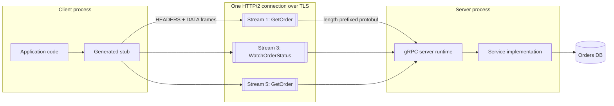

**Reading the diagram.** Application code calls a generated stub as if it were local. The stub serializes the request to Protobuf and sends it as HEADERS and DATA frames on a new stream of a single shared HTTP/2 connection; three concurrent calls occupy streams 1, 3 and 5 (client-initiated HTTP/2 streams use odd numbers). The server runtime reassembles each stream, deserializes the message, invokes the implementation and streams the response back with a trailing `grpc-status`. Unary calls are synchronous request/response; stream 3 stays open while the server pushes events. Storage boundary: the database behind the implementation. Failure points: a single connection pins all of a client's traffic to one server, which defeats layer-4 load balancers; use layer-7 (HTTP/2-aware) proxies or client-side load balancing (§19.10). Scaling: add servers behind an L7 balancer that balances per stream, not per connection.

### 8.8.3 Streaming modes

**Table 8.10 — The four gRPC call types.**

| Mode | Shape | Example use |
|---|---|---|
| Unary | 1 request → 1 response | Fetch an order; most calls |
| Server streaming | 1 request → stream of responses | Order status updates; large result sets in chunks; log tailing |
| Client streaming | Stream of requests → 1 response | Uploading telemetry or a file in chunks, then a summary |
| Bidirectional streaming | Two independent streams | Chat, collaborative editing, interactive speech recognition |

Streams are flow-controlled by HTTP/2, so a slow receiver applies backpressure to a fast sender (§22.10) instead of buffering without bound.

### 8.8.4 Deadlines and their propagation

::: definition
**Definition — Deadline.** An absolute point in time by which a client needs an RPC to complete. gRPC transmits it as a remaining timeout; when it passes, the client stops waiting with `DEADLINE_EXCEEDED` and the server can see that the call was cancelled [gRPC Docs: Deadlines].
:::

Without deadlines, a slow dependency makes callers wait indefinitely, holding threads, memory and connections until the whole call graph is exhausted (Chapter 22). gRPC's default is **no deadline**, so you must set one on every call. A deadline, unlike a per-hop timeout, should be **propagated**: if the front end has 300 ms left and has already spent 40 ms, it passes the remaining ~260 ms downstream, minus a margin for its own post-processing, so no service keeps working on an answer nobody is waiting for.

**Figure 8.6 — Deadline propagation through a call chain.**

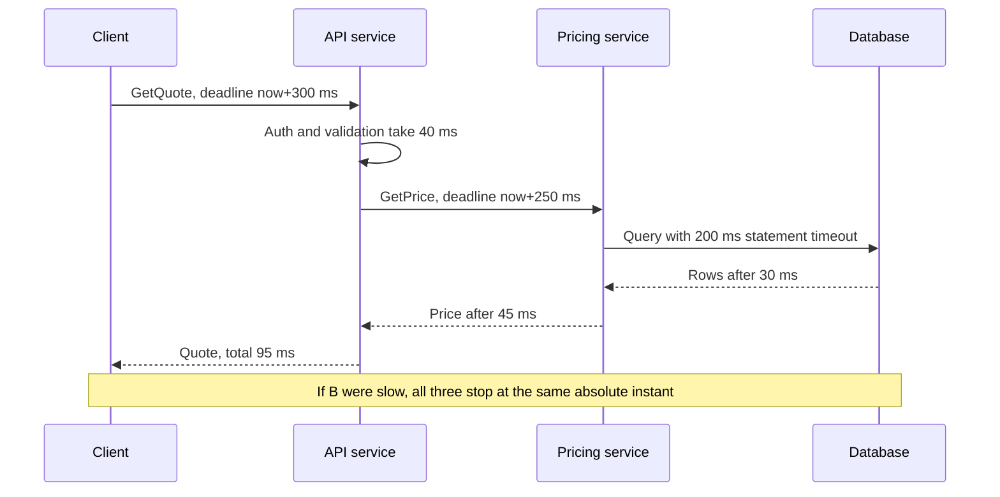

**Reading the diagram.** The client sets an absolute deadline of 300 ms. The API service spends 40 ms, then calls the pricing service with the *remaining* budget minus a 10 ms reserve for building its own response. The pricing service in turn bounds its database query below its own remaining time. All calls are synchronous. Failure point: if any hop sets a longer timeout than its caller's remaining budget, that hop does work whose result will be discarded. Scaling: deadlines plus cancellation free resources quickly under overload, which keeps a slow dependency from cascading.

#### Code example

```python
# pip install grpcio grpcio-tools
# python -m grpc_tools.protoc -I. --python_out=. --grpc_python_out=. orders.proto
import grpc
import orders_pb2
import orders_pb2_grpc

with grpc.insecure_channel("localhost:50051") as channel:   # use TLS credentials in production
    stub = orders_pb2_grpc.OrderServiceStub(channel)

    # Unary call with a 200 ms deadline.
    try:
        order = stub.GetOrder(orders_pb2.GetOrderRequest(order_id="o-42"), timeout=0.2)
        print(order.order_id, orders_pb2.OrderStatus.Name(order.status))
    except grpc.RpcError as err:
        if err.code() == grpc.StatusCode.DEADLINE_EXCEEDED:
            print("gave up after 200 ms; serve a fallback")
        else:
            raise

    # Server streaming: iterate over responses as they arrive.
    for event in stub.WatchOrderStatus(orders_pb2.GetOrderRequest(order_id="o-42"),
                                       timeout=30):
        print(orders_pb2.OrderStatus.Name(event.status))
```

What to notice:

- `timeout=0.2` is converted by the library into the `grpc-timeout` header; the server can read the remaining time with `context.time_remaining()` and pass it on.
- Errors are typed status codes, not free-text. Retry `UNAVAILABLE` with backoff; do not retry `INVALID_ARGUMENT`; retry `DEADLINE_EXCEEDED` only if the operation is idempotent and budget remains.
- Browsers cannot speak raw gRPC because they do not expose HTTP/2 trailers and framing to JavaScript; **gRPC-Web** with a translating proxy, or a REST/JSON gateway, is used for browser clients.

#### Industry application

::: industry
**Google Stubby → gRPC.** gRPC's documentation describes it as the open-source successor to Stubby, the general-purpose RPC infrastructure Google used internally to connect its services, and it is now a Cloud Native Computing Foundation project [gRPC Docs]. The design goals that carried over — a compact binary IDL-based format, generated stubs in many languages, deadlines and cancellation as first-class concepts — come from operating very large internal call graphs where a slow or hung call would otherwise cascade.
*Evidence: Primary* — [gRPC Docs]
:::

### 8.8.5 Choosing REST, GraphQL or gRPC

**Table 8.11 — REST versus GraphQL versus gRPC.**

| Row | REST | GraphQL | gRPC |
|---|---|---|---|
| What it is | Resource-oriented HTTP API style | Typed query language + runtime over one endpoint | RPC framework: Protobuf IDL over HTTP/2 |
| How it works | URIs + standard methods + status codes; usually JSON | Client sends a query; resolvers assemble the response tree | Generated stubs; length-prefixed binary messages on HTTP/2 streams |
| Advantages | Universal tooling; HTTP caching and CDNs; easy to debug with curl | Exactly the data a screen needs in one round trip; strong typing; introspection | Compact and fast; streaming; deadlines; strict contracts and codegen |
| Disadvantages | Over/under-fetching; many round trips for complex screens; loose contracts unless documented | Hard to cache; N+1 risk; query-cost security; errors hidden in 200s | Not native in browsers; binary is harder to inspect; needs L7-aware load balancing |
| Performance | Good; JSON parsing cost; benefits from HTTP caching | Fewer client round trips; server work per request is higher and variable | Smallest payloads and lowest serialization cost of the three |
| Operational complexity | Low | Medium–high (cost limits, batching, schema governance) | Medium (proto management, L7 proxies, gRPC-Web for browsers) |
| Cost | Low; bandwidth higher than binary | Server CPU for resolution; engineering time | Low bandwidth and CPU; tooling investment |
| Use cases | Public APIs, CRUD services, webhooks, cacheable content | Product frontends aggregating many entities; mobile apps with diverse screens | Internal service-to-service calls; low-latency or streaming backends; polyglot microservices |
| Choose when | Third parties consume your API or responses are cacheable | Many client types need different shapes of a rich graph of data | You control both ends and need efficiency, streaming or strict typing |

A common production pattern uses all three: gRPC between internal services, GraphQL or a BFF for first-party frontends, and REST for public and partner APIs.

## 8.9 Serialization: JSON, Protocol Buffers, Avro and Thrift

### 8.9.1 Why encoding matters

::: definition
**Definition — Serialization (encoding).** Translating an in-memory data structure into a sequence of bytes for storage or transmission; **deserialization (decoding)** is the reverse [Kleppmann 2017, ch. 4].
:::

Objects in memory are full of pointers that mean nothing to another process. To send an order across the network you must flatten it into bytes that the receiver, possibly written in another language and deployed at a different time, can rebuild. Three questions decide the format: **How big and how fast?** (bandwidth and CPU at millions of messages per second), **Is it self-describing or schema-driven?**, and **How does it survive change?** — the last is the most important in practice, because in any system with rolling deployments, old and new code run side by side and read each other's data.

### 8.9.2 The formats

**JSON** is text, human-readable, universally supported and self-describing: field names travel with every message. Its costs are size (names repeated in every record), parsing CPU, and a weak type system: no distinction between integers and floats, no binary type (bytes must be base64-encoded, +33%), and numbers above $2^{53}$ lose precision in JavaScript, which is why many APIs send 64-bit IDs as strings.

**Protocol Buffers (Protobuf)** is Google's schema-driven binary format [Protocol Buffers Docs]. Each field is written as a **tag** followed by a value. The tag is a varint holding `(field_number << 3) | wire_type`, where the wire type tells the reader how to find the end of the value even if it does not recognize the field: 0 = VARINT, 1 = I64 (8 fixed bytes), 2 = LEN (length-delimited: strings, bytes, embedded messages, packed repeated fields), 5 = I32 (4 fixed bytes); 3 and 4 are deprecated group markers.

::: definition
**Definition — Varint.** A variable-length encoding of an unsigned integer in base 128: each byte carries 7 bits of the number, least-significant group first, and the most significant bit (MSB) of each byte is a continuation flag — 1 means "another byte follows" [Protocol Buffers Docs: Encoding].
:::

Small numbers, which dominate real data (counts, enum values, field tags), take one byte instead of four or eight. Negative numbers in an `int32`/`int64` field always take 10 bytes, so signed fields that are often negative use `sint32`/`sint64`, which first apply **ZigZag** encoding, mapping $0, -1, 1, -2, \ldots$ to $0, 1, 2, 3, \ldots$.

::: formula
**Varint length**

$$\text{bytes}(n) = \max\!\left(1, \left\lceil \frac{\lfloor \log_2 n \rfloor + 1}{7} \right\rceil\right)$$

| Symbol | Meaning | Units |
|---|---|---|
| $n$ | Non-negative integer being encoded | — |
| $\lfloor \log_2 n \rfloor + 1$ | Number of significant bits in $n$ (for $n \ge 1$) | bits |
| 7 | Payload bits per varint byte | bits/byte |
:::

::: example
**Worked example — Encoding a record by hand.** The record (the example used in [Kleppmann 2017, ch. 4]) is `user_name = "Martin"` (field 1, string), `favorite_number = 1337` (field 2, int64), `interests = ["daydreaming", "hacking"]` (field 3, repeated string).

1. Field 1: tag $(1 \ll 3) \mid 2 = 10$ = `0a`; length 6 = `06`; then the 6 UTF-8 bytes `4d 61 72 74 69 6e`. Subtotal 8 bytes.
2. Field 2: tag $(2 \ll 3) \mid 0 = 16$ = `10`. Value 1337 = binary `101 0011 1001` (11 bits → 2 bytes). Low 7 bits `0111001` = 0x39, set the continuation bit → `b9`; remaining bits `1010` = `0a`. Subtotal 3 bytes: `10 b9 0a`.
3. Field 3, twice: tag $(3 \ll 3) \mid 2 = 26$ = `1a`, length `0b`, 11 bytes of "daydreaming" (13 bytes); then `1a 07` + 7 bytes of "hacking" (9 bytes).
4. Total: $8 + 3 + 13 + 9 = 33$ bytes. The same record as compact JSON, `{"userName":"Martin","favoriteNumber":1337,"interests":["daydreaming","hacking"]}`, is 81 bytes.

**Interpretation.** Protobuf is 2.5× smaller here because field names are replaced by one-byte tags and the number by two bytes instead of four ASCII digits. **Engineering implication:** field numbers 1–15 fit in a one-byte tag; reserve them for the most frequent fields.
:::

```python
def encode_varint(n: int) -> bytes:
    """Protocol Buffers base-128 varint for a non-negative integer."""
    out = bytearray()
    while True:
        byte = n & 0x7F               # take the low 7 bits
        n >>= 7
        if n:
            out.append(byte | 0x80)   # more bytes follow: set the MSB
        else:
            out.append(byte)          # last byte: MSB clear
            return bytes(out)


def encode_tag(field_number: int, wire_type: int) -> bytes:
    return encode_varint((field_number << 3) | wire_type)


def encode_string(field_number: int, s: str) -> bytes:
    data = s.encode("utf-8")
    return encode_tag(field_number, 2) + encode_varint(len(data)) + data


msg = (encode_string(1, "Martin")
       + encode_tag(2, 0) + encode_varint(1337)
       + encode_string(3, "daydreaming")
       + encode_string(3, "hacking"))
print(msg.hex(" "), len(msg), "bytes")
# 0a 06 4d 61 72 74 69 6e 10 b9 0a 1a 0b 64 61 79 64 72 65 61 6d 69 6e 67 1a 07 68 61 63 6b 69 6e 67 33 bytes
```

What to notice: this output is byte-for-byte identical to what the official Protobuf library produces for the equivalent `.proto` message; and because every field carries its own tag and wire type, a reader that does not know field 3 can still skip exactly the right number of bytes.

**Apache Avro** takes the opposite approach: the binary data contains **no field tags or names at all**, just values concatenated in schema order (integers as ZigZag varints, strings as length + bytes). The same record encodes to 32 bytes [Kleppmann 2017, ch. 4]. The reader therefore needs the exact **writer's schema** to parse the bytes; it then **resolves** that schema against its own **reader's schema** by field *name*, filling defaults for fields the writer lacked and ignoring fields the reader does not know [Apache Avro Spec]. The writer's schema travels in the file header (Avro object container files), or a short schema ID is prefixed to each message and looked up in a **schema registry**, the usual arrangement with Kafka (Chapter 31). Because Avro has no hand-assigned tags, schemas can be generated from database tables, which suits data pipelines (Chapter 61).

**Apache Thrift**, created at Facebook [Slee et al. 2007], is an IDL plus RPC framework like gRPC. Fields carry numeric tags as in Protobuf; it offers several encodings, including BinaryProtocol (fixed-width numbers; 59 bytes for the example record) and CompactProtocol (varints and packed field headers; 34 bytes) [Kleppmann 2017, ch. 4].

**Table 8.12 — Serialization formats compared (sizes for the 3-field example record).**

| Format | Schema | Field identity on wire | Example size | Human-readable | Typical use |
|---|---|---|---|---|---|
| JSON | Optional (JSON Schema) | Names, every record | 81 B | Yes | Public APIs, browsers, config |
| Thrift Binary | Required (IDL) | Numeric tags | 59 B | No | Thrift RPC |
| Thrift Compact | Required (IDL) | Numeric tags, packed | 34 B | No | Thrift RPC, storage |
| Protobuf | Required (`.proto`) | Numeric tags | 33 B | No | gRPC, internal APIs, storage |
| Avro | Required, writer's schema needed to read | None (schema order) | 32 B | No | Kafka with schema registry, data lakes |

### 8.9.3 Schema evolution and compatibility

::: definition
**Definition — Backward and forward compatibility.** **Backward compatibility**: newer code can read data written by older code. **Forward compatibility**: older code can read data written by newer code [Kleppmann 2017, ch. 4].
:::

During a rolling deployment both hold at once: new servers read messages from old servers (backward) and old servers, not yet upgraded, read messages from new ones (forward). Mobile apps and long-lived data on disk or in Kafka stretch the window from minutes to years.

**Figure 8.7 — Mixed versions during a rolling deployment.**

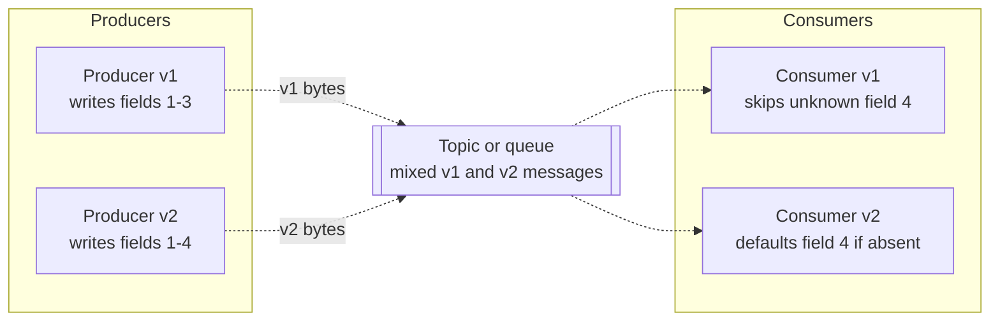

**Reading the diagram.** Two producer versions write to the same queue during a deployment, so the queue (the storage boundary) holds both message versions; arrows are dotted because the path is asynchronous. The old consumer must ignore field 4, which it has never heard of (forward compatibility); the new consumer must cope with messages lacking field 4 (backward compatibility). Failure point: if either assumption breaks, a deployment that looked fine in testing fails only when versions mix. Scaling: the same rules let independent teams deploy producers and consumers on separate schedules.

**Table 8.13 — Schema-evolution rules by format.**

| Change | Protobuf (proto3) | Avro | Thrift | JSON API |
|---|---|---|---|---|
| Add a field | Safe: old readers skip unknown tags; new readers see the default | Safe only if the new field has a default | Safe if `optional` | Safe if clients ignore unknown fields |
| Remove a field | Safe; mark its number and name `reserved` | Safe only if the field had a default | Safe for `optional`; never reuse the tag | Breaking for clients that read it |
| Rename a field | Wire-safe (names not encoded); breaks the JSON mapping and code | Use `aliases` in the reader's schema | Wire-safe | Breaking |
| Change a field number / tag | Breaking | n/a | Breaking | n/a |
| Change type | Only between compatible types (e.g. `int32`↔`int64`, with truncation risk) | Only defined promotions (`int`→`long`→`float`→`double`) | Limited | Usually breaking |
| Add a required field | Not possible in proto3 (no `required`) | Breaking unless defaulted | Breaking | Breaking for requests |

::: recommendation
**Practical rules.** Only add optional fields with sensible defaults. Never reuse a deleted field number or name. Never change a field's meaning while keeping its name. Treat `required` as permanent. Run an automated compatibility check (schema-registry compatibility modes, `buf breaking` for Protobuf, OpenAPI diff tools) in CI, so incompatible changes fail the build instead of production.
:::

::: mistake
**"Binary formats are always better."** For a public API consumed by browsers and third parties, JSON's readability, tooling and zero-setup debugging usually outweigh a 2–3× size difference, especially after HTTP compression (gzip/Brotli) shrinks repeated field names. Binary formats win for high-volume internal traffic and stored data.
:::

## 8.10 Cookies and sessions

### 8.10.1 Cookies

::: definition
**Definition — HTTP cookie.** A small name–value pair that a server asks the browser to store, via the `Set-Cookie` response header, and that the browser automatically returns in the `Cookie` request header on later requests to matching URLs [RFC 6265].
:::

HTTP is stateless: each request arrives without memory of the previous one. A cookie is the coat-check ticket: the server hands you a numbered ticket once, you show it every time you come back, and the cloakroom (the server) knows which coat is yours. Cookies power sessions, preferences and tracking. Because browsers attach them **automatically**, including to requests triggered by other websites, their attributes are security-critical.

```text
Set-Cookie: __Host-sid=8f2c1e9a7b; Path=/; Secure; HttpOnly; SameSite=Lax; Max-Age=3600
```

**Table 8.14 — Cookie attributes.**

| Attribute | Effect | Why it matters |
|---|---|---|
| `Expires` / `Max-Age` | When the browser deletes the cookie; absent → deleted when the browser session ends | Bounds the lifetime of a stolen cookie |
| `Domain` | Send to this domain *and its subdomains*; absent → exact host only | Setting `Domain=example.com` exposes the cookie to every subdomain |
| `Path` | Send only for URLs under this path | Organization, not a security boundary |
| `Secure` | Send only over HTTPS | Prevents leakage over plaintext networks |
| `HttpOnly` | Not readable by JavaScript (`document.cookie`) | Limits theft via cross-site scripting (XSS) |
| `SameSite=Strict` | Never sent on cross-site requests | Strongest CSRF protection; breaks inbound links that need login |
| `SameSite=Lax` | Sent on top-level cross-site navigations using safe methods (`GET`), not on cross-site `POST`, iframes or fetches | Good default for session cookies |
| `SameSite=None` | Sent on all requests; must be combined with `Secure` | Needed only for genuine cross-site use (embedded widgets, some SSO) |
| `__Host-` name prefix | Browser enforces `Secure`, `Path=/` and no `Domain` | Stops subdomains from overwriting the cookie |

**Cross-site request forgery (CSRF)** is the attack that `SameSite` targets: a malicious page makes your browser submit `POST https://bank.example/transfer`, and the browser helpfully attaches your bank session cookie. `SameSite=Lax` or `Strict` stops the cookie being sent; anti-CSRF tokens (a per-session random value the server embeds in forms and checks on submission) are the traditional complement. `SameSite` was specified after RFC 6265 and is defined in its revision draft ("RFC 6265bis"). As of 2026, Chromium-based browsers treat cookies without a `SameSite` attribute as `Lax`, but not every browser does, so always set it explicitly.

RFC 6265 requires browsers to support at least 4,096 bytes per cookie and 50 cookies per domain [RFC 6265 §6.1]. Every cookie is sent on every matching request, so 4 KB of cookies on a page with 80 asset requests to the same domain uploads 320 KB of headers. Serve static assets from a separate cookie-less domain or CDN.

### 8.10.2 Sessions

::: definition
**Definition — Session.** Server-recognized state that links a series of requests to one authenticated user (or anonymous visitor) over time, typically identified by a cookie.
:::

There are two ways to store it.

**Server-side session store.** The cookie holds only a long random **session ID** (at least 128 bits of entropy). Session data — user ID, roles, CSRF token, cart — lives in a shared store such as Redis, keyed by that ID. Every request costs one lookup; logging out or revoking a session is a single `DELETE`.

**Figure 8.8 — Server-side session lookup.**

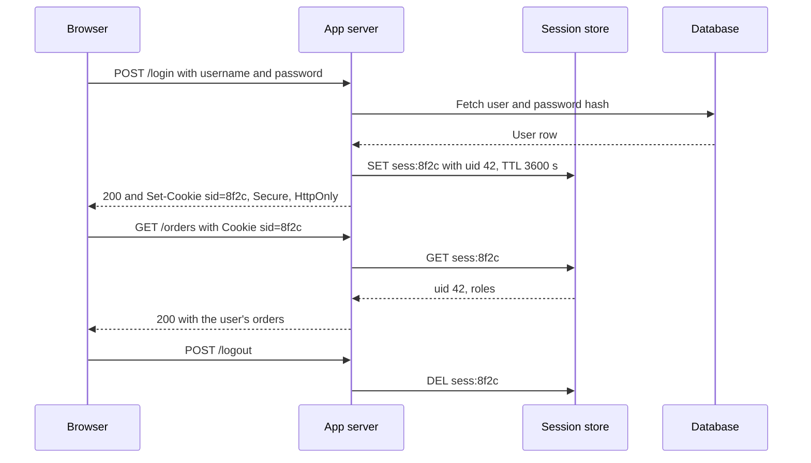

**Reading the diagram.** Login verifies the password against the database, creates a session record in the store with a TTL, and sends only the opaque ID to the browser. Every later request costs one synchronous session-store read (about 0.5 ms in the same datacenter). Logout deletes the record, so a copied cookie stops working immediately. Storage boundaries: the user database and the session store. Failure point: the session store is on the critical path of every authenticated request, so it must be replicated (Chapter 20); if it fails, everyone is logged out. Scaling: 10 million active sessions × ~500 bytes ≈ 5 GB, which fits in a single replicated Redis primary; partition by session ID beyond that.

**Signed cookie (client-side session).** The session data itself is in the cookie, with a **MAC** (message authentication code) computed with a server-side secret key. The server needs no store: it recomputes the MAC and rejects any cookie whose contents were altered. The data is *not* encrypted — the user can read it — only protected against tampering.

```python
import base64, hashlib, hmac, json, time

SECRET_KEY = b"load-me-from-a-secrets-manager-32+bytes"   # never hard-code in production


def _b64(data: bytes) -> str:
    return base64.urlsafe_b64encode(data).rstrip(b"=").decode()


def _unb64(text: str) -> bytes:
    return base64.urlsafe_b64decode(text + "=" * (-len(text) % 4))


def sign_session(data: dict, ttl_s: int = 3600) -> str:
    body = _b64(json.dumps({**data, "exp": int(time.time()) + ttl_s}).encode())
    mac = hmac.new(SECRET_KEY, body.encode(), hashlib.sha256).digest()
    return f"{body}.{_b64(mac)}"


def verify_session(cookie: str) -> dict | None:
    try:
        body, mac = cookie.split(".")
    except ValueError:
        return None
    expected = hmac.new(SECRET_KEY, body.encode(), hashlib.sha256).digest()
    if not hmac.compare_digest(expected, _unb64(mac)):    # constant-time compare
        return None
    data = json.loads(_unb64(body))
    return data if data["exp"] >= time.time() else None
```

What to notice: `hmac.compare_digest` compares in constant time, so an attacker cannot learn the correct MAC byte by byte from response timing; the expiry is *inside* the signed body, so it cannot be extended by the client; and there is no way to revoke one cookie before `exp` except rotating `SECRET_KEY`, which logs out everyone. Web frameworks implement exactly this; Flask's default session is a signed cookie, configured as follows:

```python
from flask import Flask
import os

app = Flask(__name__)
app.config.update(
    SECRET_KEY=os.environ["SECRET_KEY"],
    SESSION_COOKIE_SECURE=True,      # only sent over HTTPS
    SESSION_COOKIE_HTTPONLY=True,    # invisible to JavaScript
    SESSION_COOKIE_SAMESITE="Lax",   # not sent on cross-site POSTs
    PERMANENT_SESSION_LIFETIME=3600, # seconds
)
# After login, Flask emits for example:
# Set-Cookie: session=eyJ1aWQiOiJhZGEifQ.auQy5w.2G2C9...; Expires=...; Secure; HttpOnly; Path=/; SameSite=Lax
```

**Table 8.15 — Server-side sessions versus signed cookies.**

| Aspect | Server-side session store | Signed cookie |
|---|---|---|
| Cookie contents | Random ID only | Data + MAC (readable, tamper-evident) |
| Per-request cost | One store lookup (~0.5–1 ms) | One HMAC computation (microseconds) |
| Revocation / logout everywhere | Immediate (`DEL`) | Not possible before expiry without key rotation or a deny-list |
| Size limit | Unlimited server-side | ~4 KB, sent on every request |
| Infrastructure | Replicated store on the critical path | None beyond key management |
| Choose when | You need instant revocation, large session state, or admin "log out this device" | Small, short-lived state; minimal infrastructure |

::: mistake
**Keeping the same session ID across login.** If an attacker can plant a known session ID in a victim's browser before login and the server keeps it afterwards, the attacker shares the authenticated session (**session fixation**). Always issue a fresh session ID (or clear the signed session) at login and at privilege changes.
:::

## 8.11 Authentication

::: definition
**Definition — Authentication (AuthN).** Verifying *who* a client is. **Authorization (AuthZ)** is deciding *what* that verified identity may do (§8.12). AuthN failures return `401`; AuthZ failures return `403`.
:::

At a hotel, the front desk checks your passport (authentication) and gives you a key card; the card then opens only your room and the gym (authorization). Keep the two separate in code too: authentication middleware turns credentials into an identity once per request; authorization checks run in every handler that touches a resource.

**Authentication factors** fall into three classes: something you **know** (password, PIN), something you **have** (phone, hardware security key), something you **are** (fingerprint, face). **Multi-factor authentication (MFA)** requires factors from at least two classes, so a phished or leaked password alone is not enough.

**Passwords.** Never store passwords, or fast hashes of them. Store the output of a deliberately slow, salted **password-hashing function** (Argon2id, scrypt, bcrypt or PBKDF2), tuned so one guess costs tens to hundreds of milliseconds; §10.6 covers parameters and the arithmetic of offline cracking. Compare in constant time, rate-limit login attempts per account and per IP, and check new passwords against lists of breached passwords, as NIST's guidance recommends [NIST SP 800-63B].

```python
import hashlib, hmac, os

def hash_password(password: str) -> str:
    salt = os.urandom(16)                                    # unique per user
    dk = hashlib.scrypt(password.encode(), salt=salt, n=2**15, r=8, p=1,
                        maxmem=64 * 1024 * 1024)             # ~32 MiB of memory per guess
    return f"scrypt$32768$8$1${salt.hex()}${dk.hex()}"

def verify_password(password: str, stored: str) -> bool:
    _, n, r, p, salt_hex, dk_hex = stored.split("$")
    dk = hashlib.scrypt(password.encode(), salt=bytes.fromhex(salt_hex),
                        n=int(n), r=int(r), p=int(p), maxmem=64 * 1024 * 1024)
    return hmac.compare_digest(dk, bytes.fromhex(dk_hex))
```

What to notice: the parameters are stored with the hash so they can be raised later; on a typical server core this takes on the order of 100 ms per call, which is negligible for one login and crippling for an attacker trying billions of guesses.

**Second factors**, from weakest to strongest:

- **SMS or email one-time codes.** Better than nothing; vulnerable to SIM-swap, interception and phishing.
- **TOTP** (time-based one-time passwords, RFC 6238): an authenticator app and the server share a secret and each compute a 6-digit code from the current 30-second time window. Not phishing-resistant: a fake site can relay the code within its window.
- **WebAuthn / passkeys** (W3C WebAuthn with FIDO2): the device holds a private key per site and signs a server challenge; the browser binds the signature to the real site's origin, so a look-alike domain cannot obtain a usable response. This is **phishing-resistant** and can replace passwords entirely.

### 8.11.1 Sessions versus tokens

After login, the client needs something to present on each request. There are two families:

- **Session (reference) credentials:** an opaque random ID that means nothing by itself; the server looks it up (§8.10.2).
- **Self-contained (value) tokens:** a signed token, typically a JWT (§8.13), carrying the identity and claims; any server with the key can verify it without a lookup.

**Table 8.16 — Session IDs versus self-contained tokens.**

| Aspect | Opaque session ID | Self-contained token (JWT) |
|---|---|---|
| Validation | Lookup in a shared store | Signature check, local, no network call |
| Revocation | Immediate | Hard: valid until `exp` (§8.13.4) |
| Size on each request | ~32–64 bytes | Hundreds of bytes to over 1 KB |
| Works across services and organizations | Only those that can reach the store | Any party with the verification key |
| Typical transport | `Cookie` header (browsers) | `Authorization: Bearer` header (APIs, mobile, service-to-service) |
| Choose when | First-party web apps, especially with server rendering | Distributed APIs, third-party access (OAuth), short-lived service credentials |

A common hybrid: the browser holds an opaque session cookie with the BFF or web tier; behind it, services exchange short-lived JWT access tokens.

## 8.12 Authorization: RBAC, ABAC and ReBAC

### 8.12.1 Three models

::: definition
**Definition — Access-control model.** A rule system that answers "may subject *S* perform action *A* on resource *R* (in context *C*)?" The three models in common use differ in what the rules are written in terms of: **roles** (RBAC), **attributes** (ABAC) or **relationships** (ReBAC).
:::

**Role-based access control (RBAC).** Permissions attach to roles (`viewer`, `editor`, `admin`); users are assigned roles. It is what most company org charts look like: anyone with the "nurse" badge can open the medicine cabinet. RBAC is simple to audit ("who has admin?") but coarse: "editor" usually means editor of *everything*. Scoping roles per tenant or per project (`editor@project-7`) helps until the number of role assignments explodes.

**Attribute-based access control (ABAC).** A policy is a predicate over attributes of the subject, the resource, the action and the environment: "a user may read a document if their department equals the document's department, their clearance ≥ its classification, and it is business hours". ABAC is expressive and handles context (time, location, device posture), but policies become hard to reason about and audit, and every check needs all the attributes at hand. Policy engines such as Open Policy Agent evaluate such rules outside application code.

```python
ROLE_PERMISSIONS = {
    "viewer": {"doc:read"},
    "editor": {"doc:read", "doc:write"},
    "admin":  {"doc:read", "doc:write", "doc:delete", "user:manage"},
}

def rbac_allows(user_roles: set[str], permission: str) -> bool:
    return any(permission in ROLE_PERMISSIONS.get(r, set()) for r in user_roles)

def abac_allows(sub: dict, action: str, res: dict, ctx: dict) -> bool:
    if action == "read":
        return (sub["department"] == res["department"]
                and sub["clearance"] >= res["classification"]
                and 8 <= ctx["hour_utc"] < 20)          # business hours only
    if action == "write":
        return sub["id"] == res["owner_id"]
    return False
```

**Relationship-based access control (ReBAC).** Permissions follow from a graph of relationships: Alice can view this document because she is a member of a group that is a viewer of the folder that contains it. This is how sharing works in collaboration products ("anyone in Engineering can comment"), and neither roles nor flat attributes express it naturally.

### 8.12.2 Google Zanzibar

::: industry
**Zanzibar: Google's consistent, global authorization system.** Google built one authorization service to serve the access-control checks of many products (the paper lists Calendar, Cloud, Drive, Maps, Photos and YouTube among its clients). It stores permissions as **relation tuples** of the form `object#relation@user`, where the user may itself be a set of users such as `group:eng#member`. A per-namespace configuration of **userset rewrite rules** derives relations from others — for example, every `editor` is also a `viewer`, and a document's viewers include the viewers of its parent folder. A **check** is a graph search over tuples and rewrites. The paper reports trillions of stored ACL tuples (more than two trillion), millions of authorization checks per second, 95th-percentile latency under 10 ms and availability above 99.999% over three years of production. Data is stored in Spanner; aggressive caching, request deduplication and a specialized index (Leopard) for deeply nested groups keep latency low. To avoid the **"new enemy" problem** — checking an old ACL against new content, for example after removing a user and then adding sensitive content — clients store an opaque consistency token, the **zookie**, with content updates, and later checks are evaluated at a snapshot at least as fresh as that zookie [Pang et al. 2019]. Open-source systems inspired by the paper, such as OpenFGA and SpiceDB, exist as of 2026.
*Evidence: Primary* — [Pang et al. 2019]
:::

A toy check function shows the core idea of tuples plus rewrite rules:

```python
# Relation tuples: (object, relation, subject). A subject is a user or a userset "obj#rel".
TUPLES = {
    ("doc:readme", "owner",  "user:alice"),
    ("doc:readme", "parent", "folder:eng"),          # doc lives in a folder
    ("folder:eng", "viewer", "group:eng#member"),    # eng members can view the folder
    ("group:eng",  "member", "user:bob"),
    ("group:eng",  "member", "group:sre#member"),    # nested group
    ("group:sre",  "member", "user:carol"),
}
# Rewrite rules: an editor is an owner or editor; a viewer is an editor,
# or a viewer of the parent folder.
REWRITES = {"editor": ["owner"], "viewer": ["editor", ("parent", "viewer")]}


def check(obj: str, relation: str, user: str, depth: int = 0) -> bool:
    if depth > 25:                                    # guard against cycles
        return False
    for (o, r, s) in TUPLES:
        if o == obj and r == relation:
            if s == user:                             # direct tuple
                return True
            if "#" in s and check(*s.split("#"), user, depth + 1):   # userset
                return True
    for rule in REWRITES.get(relation, []):
        if isinstance(rule, str):                     # same object, implied relation
            if check(obj, rule, user, depth + 1):
                return True
        else:                                         # follow a pointer, e.g. parent
            via, target_rel = rule
            if any(o == obj and r == via and check(s, target_rel, user, depth + 1)
                   for (o, r, s) in TUPLES):
                return True
    return False


print(check("doc:readme", "viewer", "user:alice"))   # True: owner -> editor -> viewer
print(check("doc:readme", "viewer", "user:carol"))   # True: sre in eng; eng views folder
print(check("doc:readme", "editor", "user:bob"))     # False: bob can only view
```

What to notice: the answer for Carol required walking five edges across three objects, which is why a real system needs indexing, caching and a depth limit; and sharing a folder with a group is one tuple write, not millions of per-document ACL updates.

**Figure 8.9 — Relationship graph for a Zanzibar-style check.**

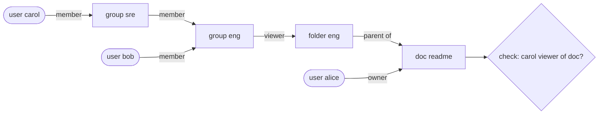

**Reading the diagram.** Users (stadium shapes) are linked by `member` edges to groups, groups to a folder by a `viewer` edge, and the folder to the document by a `parent` edge. Answering "is Carol a viewer of the document?" is a search from the document back to Carol: viewer of doc ⇐ viewer of parent folder ⇐ member of group eng ⇐ member of group sre ⇐ Carol. All edges are stored tuples in one logical database (the storage boundary). Failure points: very deep or wide group nesting makes checks slow, and stale caches can grant access that was just revoked (hence zookies). Scaling: partition tuples by object, cache sub-results, and precompute group membership closure for hot nested groups.

**Table 8.17 — RBAC, ABAC and ReBAC compared.**

| Aspect | RBAC | ABAC | ReBAC |
|---|---|---|---|
| Rules written in terms of | Roles | Attributes of subject, resource, environment | Relationships between objects and subjects |
| Example | "Editors can publish" | "Same department and business hours" | "Viewers of the parent folder can view" |
| Strength | Simple, auditable | Context-aware, fine-grained | Natural sharing and hierarchy; per-object |
| Weakness | Coarse; role explosion | Hard to audit; needs attributes at check time | Needs a graph store; check latency |
| Choose when | Internal tools, admin consoles, B2B tenants | Regulatory or contextual rules | Collaboration and sharing products |

Real systems combine them: ReBAC for per-object sharing, RBAC for administrative roles, ABAC conditions (IP range, MFA freshness) on top.

::: mistake
**Checking authorization only in the frontend, or only on the list page.** Hiding a button does not stop a direct API call, and checking permission when listing orders does not protect `GET /orders/43`. Every handler that touches a resource must check it; **broken object-level authorization** — returning object 43 because the caller asked for it — is one of the most common API vulnerabilities (§10.7).
:::

## 8.13 JSON Web Tokens (JWT)

### 8.13.1 Structure

::: definition
**Definition — JSON Web Token (JWT).** A compact, URL-safe string representing a set of **claims** (statements about a subject) as a JSON object, digitally signed (JWS) or encrypted (JWE) so its integrity can be verified [RFC 7519]. This section covers the signed form, which is by far the most common.
:::

A signed JWT is like a festival wristband: the organizer prints your ticket type and the dates on it and seals it with a tamper-evident clasp. Any steward can check it at any gate without phoning the box office. The flip side: if you are banned mid-festival, every steward will still honor the wristband until it expires.

A JWT has three base64url-encoded parts separated by dots: `header.payload.signature`.

```json
{"alg": "RS256", "typ": "JWT", "kid": "2026-10-key-1"}
```

```json
{
  "iss": "https://auth.example.com",
  "sub": "user-123",
  "aud": "https://api.example.com",
  "iat": 1793340000,
  "nbf": 1793340000,
  "exp": 1793340900,
  "jti": "7d1e4c1a-3b9e-4f0a-9b8e-2f6c0f1e5a77",
  "scope": "articles:read articles:write"
}
```

The registered claims are **`iss`** (issuer), **`sub`** (subject, the user or client), **`aud`** (audience: which API the token is for), **`exp`** (expiry, seconds since the Unix epoch), **`nbf`** (not before), **`iat`** (issued at) and **`jti`** (unique token ID) [RFC 7519 §4.1]. The **signature** is computed over `base64url(header) + "." + base64url(payload)`.

::: warning
**A JWT is signed, not encrypted.** Anyone holding the token can base64-decode and read every claim. Never put secrets or sensitive personal data in a JWT payload.
:::

### 8.13.2 Signing: HS256 versus RS256

**Table 8.18 — HS256 versus RS256.**

| Aspect | HS256 (HMAC with SHA-256) | RS256 (RSA PKCS#1 v1.5 signature with SHA-256) |
|---|---|---|
| Key type | One shared secret | Private key signs; public key verifies |
| Who can create tokens | Anyone who can verify them | Only the private-key holder |
| Signature size | 32 bytes (43 base64url chars) | 256 bytes with a 2048-bit key (342 chars) |
| Speed | Very fast | Signing slower; verification fast |
| Key distribution | Secret must reach every verifier | Public keys published at a JWKS endpoint; rotated by `kid` |
| Choose when | One service issues and verifies its own tokens | An identity provider issues tokens many services verify |

Elliptic-curve signatures (ES256, EdDSA) offer the asymmetric property of RS256 with much smaller keys and signatures; check that your libraries and partners support them.

### 8.13.3 Validation

Validation must check, in order: the token is well-formed; the `alg` is one you **expect** (taken from configuration, never from the token's header); the signature verifies with the right key (selected by `kid` from a trusted JWKS); `exp` is in the future and `nbf` is in the past, with a small clock-skew leeway; `iss` is your trusted issuer; `aud` contains *this* API; and only then do you read scopes and claims.

**Figure 8.10 — JWT validation pipeline.**

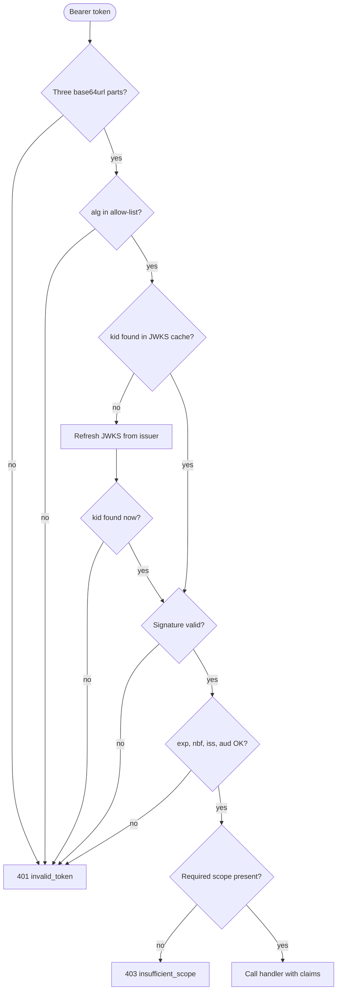

**Reading the diagram.** A bearer token enters at the top and passes a series of local checks; only the JWKS refresh involves a network call (to the issuer's key endpoint), and it happens only when an unknown `kid` appears — typically just after the issuer rotates keys. Failures before the scope check produce `401` with `WWW-Authenticate: Bearer error="invalid_token"`; a valid token lacking the scope produces `403 insufficient_scope` [RFC 6750 §3.1]. Failure points: an attacker sending random `kid` values can force repeated JWKS fetches, so rate-limit refreshes. Scaling: validation is CPU-only and stateless, which is the whole appeal.

```python
import time, uuid
import jwt                                   # pip install "pyjwt[crypto]"
from cryptography.hazmat.primitives import serialization
from cryptography.hazmat.primitives.asymmetric import rsa

ISSUER, AUDIENCE = "https://auth.example.com", "https://api.example.com"

# Authorization server: holds the private key.
private_key = rsa.generate_private_key(public_exponent=65537, key_size=2048)
public_pem = private_key.public_key().public_bytes(
    serialization.Encoding.PEM, serialization.PublicFormat.SubjectPublicKeyInfo)

def issue_access_token(user_id: str, scopes: list[str], ttl_s: int = 900) -> str:
    now = int(time.time())
    claims = {"iss": ISSUER, "aud": AUDIENCE, "sub": user_id, "iat": now, "nbf": now,
              "exp": now + ttl_s, "jti": str(uuid.uuid4()), "scope": " ".join(scopes)}
    return jwt.encode(claims, private_key, algorithm="RS256",
                      headers={"kid": "2026-10-key-1"})

# Resource server: holds only the public key.
def validate_access_token(token: str) -> dict:
    return jwt.decode(
        token, public_pem,
        algorithms=["RS256"],               # pin the algorithm; never trust the header
        audience=AUDIENCE, issuer=ISSUER,
        leeway=30,                          # tolerate 30 s of clock skew
        options={"require": ["exp", "iat", "sub", "aud", "iss"]},
    )

token = issue_access_token("user-123", ["articles:read", "articles:write"])
print(len(token), validate_access_token(token)["scope"])   # ~700 articles:read articles:write
```

What to notice:

- `algorithms=["RS256"]` defends against two classic attacks: tokens with `"alg": "none"` (no signature at all), and **algorithm confusion**, where an attacker signs an HS256 token using the server's *public* RSA key as the HMAC secret and a careless library verifies it [RFC 8725].
- The token is about 700 characters; at 10,000 requests per second that is about 7 MB/s of header bytes, which HTTP/2 header compression reduces on reused connections.
- In a FastAPI service, the same validation sits in a dependency that returns `401` or `403` with RFC 6750 `WWW-Authenticate` errors:

```python
from fastapi import Depends, FastAPI, HTTPException
from fastapi.security import HTTPAuthorizationCredentials, HTTPBearer

app = FastAPI()
bearer = HTTPBearer(auto_error=False)

def current_claims(creds: HTTPAuthorizationCredentials | None = Depends(bearer)) -> dict:
    if creds is None:
        raise HTTPException(401, "Missing bearer token",
                            headers={"WWW-Authenticate": 'Bearer realm="api"'})
    try:
        return validate_access_token(creds.credentials)
    except jwt.InvalidTokenError:
        raise HTTPException(401, "Invalid or expired token",
                            headers={"WWW-Authenticate": 'Bearer error="invalid_token"'})

def require_scope(scope: str):
    def checker(claims: dict = Depends(current_claims)) -> dict:
        if scope not in claims.get("scope", "").split():
            raise HTTPException(403, f"Requires scope {scope}", headers={
                "WWW-Authenticate": f'Bearer error="insufficient_scope", scope="{scope}"'})
        return claims
    return checker

@app.delete("/v1/articles/{article_id}", status_code=204)
def delete_article(article_id: int, claims: dict = Depends(require_scope("articles:delete"))):
    ...   # delete, recording claims["sub"] in the audit log
```

### 8.13.4 The revocation problem

Because verification is local, a server cannot know that a token was revoked — after logout, a password change, or a stolen laptop — until it expires. Mitigations, usually combined:

1. **Short access-token lifetimes** (5–15 minutes) plus refresh tokens (§8.14.4), which *are* checked against a server-side store on each refresh.
2. **Deny-list by `jti`** (or by `sub` + "tokens issued before time T") in a fast replicated store, checked on each request. This reintroduces a lookup, but the list holds only revoked, not-yet-expired tokens.
3. **Token introspection** (RFC 7662): the resource server asks the authorization server whether a token is active, which trades the local-verification advantage for immediacy; often used only for high-risk operations.

::: example
**Worked example — Revocation window and deny-list size.** Access tokens live $T = 15$ min. Users revoke sessions at $r = 100$ per minute.

1. Worst-case exposure after revocation without a deny-list: up to 15 min; if revocation times are uniformly distributed relative to issuance, on average 7.5 min.
2. Deny-list size: entries need be kept only until the token would have expired anyway, so $N = r \times T = 100 \times 15 = 1{,}500$ entries — about 1,500 × ~50 bytes ≈ 75 KB.

**Interpretation.** A deny-list is tiny and can be replicated into every service's memory and refreshed every few seconds. **Engineering implication:** "JWTs cannot be revoked" is false; the cost is a small, bounded amount of shared state.
:::

::: mistake
**Storing JWTs in `localStorage` because "cookies are old-fashioned".** Any XSS bug can read `localStorage` and exfiltrate the token. For browser apps, an `HttpOnly`, `Secure`, `SameSite` session cookie to your own backend (which holds the tokens server-side, the BFF pattern) is usually safer.
:::

## 8.14 OAuth 2.0 and OpenID Connect

### 8.14.1 The delegation problem

::: definition
**Definition — OAuth 2.0.** An authorization framework that lets a third-party application obtain *limited* access to an HTTP service on behalf of a resource owner, by obtaining an **access token** from an authorization server instead of using the owner's credentials [RFC 6749].
:::

Many cars come with a **valet key**: it starts the engine but cannot open the boot or the glovebox. You hand the valet a limited key instead of your full key ring. Before OAuth, a photo-printing site that wanted your photos from another service asked for your password — your full key ring — and could then do anything, forever, until you changed it. OAuth gives the printing site a valet key: a token scoped to "read photos", time-limited, revocable, and issued without the site ever seeing your password.

### 8.14.2 Roles and grants

OAuth defines four roles [RFC 6749 §1.1]:

- **Resource owner** — the user who owns the data.
- **Client** — the application requesting access (the photo printer). A **confidential client** (a server-side app) can keep a client secret; a **public client** (SPA, mobile app) cannot, because its code is in users' hands.
- **Authorization server (AS)** — authenticates the owner, asks for consent and issues tokens.
- **Resource server (RS)** — the API that accepts access tokens.

Tokens are presented as **bearer tokens** — "whoever bears this token may use it" — in the `Authorization: Bearer <token>` header, so they must only travel over TLS [RFC 6750].

**Table 8.19 — OAuth 2.0 grant types and their status.**

| Grant | Who uses it | Status (as of 2026) |
|---|---|---|
| Authorization code + PKCE | Web apps, SPAs, mobile and desktop apps acting for a user | Recommended for all user-facing clients |
| Client credentials | A service acting for itself (machine-to-machine) | Recommended |
| Refresh token | Any client renewing an access token | Recommended, with rotation for public clients |
| Device authorization (RFC 8628) | TVs and CLIs without a convenient browser | Recommended for those devices |
| Implicit | Old SPAs (token returned in the URL fragment) | Deprecated; omitted from OAuth 2.1 |
| Resource owner password credentials | Client collects the user's password | Deprecated; omitted from OAuth 2.1 |

### 8.14.3 Authorization code flow with PKCE

::: definition
**Definition — PKCE (Proof Key for Code Exchange, "pixy").** An extension in which the client creates a random secret, the **code verifier**, sends only its SHA-256 hash, the **code challenge**, with the authorization request, and must present the verifier when redeeming the authorization code. An attacker who intercepts the code cannot redeem it without the verifier [RFC 7636].
:::

**Figure 8.11 — OAuth 2.0 authorization code flow with PKCE.**

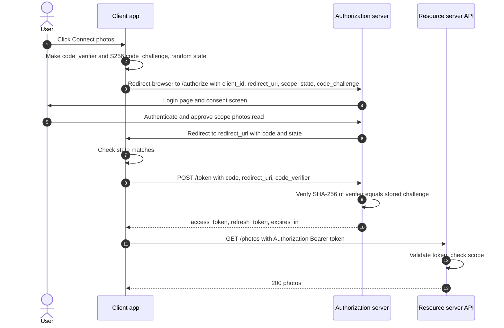

**Reading the diagram.** Steps 3–6 happen through the user's browser via redirects (the **front channel**), where URLs can leak through history, logs and malicious apps registered for the same redirect scheme on mobile devices. The authorization server only ever sees the *hash* of the verifier there. Step 8 is a direct HTTPS call from client to authorization server (the **back channel**), where the client proves possession of the verifier; an attacker who stole the code in step 6 lacks it. The `state` value checked in step 7 stops an attacker from injecting their own authorization response into the user's session (CSRF against the redirect endpoint). Steps 11–13 are ordinary API calls with a bearer token, validated as in §8.13.3 or by introspection. All calls are synchronous. Storage boundaries: the authorization server stores codes (single use, short-lived, typically under a minute), challenges, grants and refresh tokens. Failure points: the authorization server is on the login path for every user and must be highly available; resource servers that validate JWTs locally keep working during a brief AS outage until tokens expire. Scaling: token validation scales with the number of resource servers; the token endpoint scales like any stateless service backed by a replicated store.

```python
import base64, hashlib, secrets

def make_pkce_pair() -> tuple[str, str]:
    # 32 random bytes -> 43-character base64url verifier (RFC 7636 allows 43-128 chars)
    verifier = base64.urlsafe_b64encode(secrets.token_bytes(32)).rstrip(b"=").decode()
    return verifier, challenge_for(verifier)

def challenge_for(verifier: str) -> str:
    digest = hashlib.sha256(verifier.encode("ascii")).digest()
    return base64.urlsafe_b64encode(digest).rstrip(b"=").decode()

# Test vector from RFC 7636 Appendix B:
assert challenge_for("dBjftJeZ4CVP-mB92K27uhbUJU1p1r_wW1gFWFOEjXk") == \
    "E9Melhoa2OwvFrEMTJguCHaoeK1t8URWbuGJSstw-cM"
```

The token exchange (step 8) on the wire:

```bash
curl -s https://auth.example.com/oauth/token \
  -d grant_type=authorization_code \
  -d code=SplxlOBeZQQYbYS6WxSbIA \
  -d redirect_uri=https://app.example.com/callback \
  -d client_id=photo-printer \
  -d code_verifier=dBjftJeZ4CVP-mB92K27uhbUJU1p1r_wW1gFWFOEjXk
# {"access_token":"eyJhbGciOi...","token_type":"Bearer","expires_in":900,
#  "refresh_token":"8xLOxBtZp8...","scope":"photos.read"}
```

What to notice: PKCE was designed for public clients, which have no secret; current guidance recommends it for confidential clients too [RFC 9700]. Redirect URIs must be registered in advance and matched exactly, since a loose match lets an attacker redirect codes to their own site.

### 8.14.4 Client credentials and refresh tokens

**Client credentials grant.** No user is involved: a backend service authenticates as itself (client ID plus secret, a signed JWT assertion, or mutual TLS) and receives a token scoped to the APIs it may call. This is the standard pattern for machine-to-machine calls between organizations or between internal services when not using mTLS identities (§10.10).

```bash
curl -s -u billing-service:$CLIENT_SECRET https://auth.example.com/oauth/token \
  -d grant_type=client_credentials -d scope=invoices.write
```

**Refresh tokens** let a client obtain new short-lived access tokens without user interaction. Because the refresh token is long-lived and is checked by the authorization server on each use, it is where revocation actually happens: revoke the refresh token and the client loses access within one access-token lifetime. For public clients, **refresh-token rotation** issues a new refresh token on every use and invalidates the old one; if an old one is ever presented again, the server assumes theft and revokes the whole token family [RFC 9700].

### 8.14.5 OAuth 2.1

OAuth 2.1 is an IETF Internet-Draft that consolidates RFC 6749, RFC 6750, PKCE and the security best current practice into one document: PKCE required for the authorization code grant, implicit and password grants removed, exact redirect-URI matching, and no bearer tokens in query strings. As of October 2026 it is still a draft (revision -16, September 2026), not an RFC [OAuth 2.1 draft]; in practice, following RFC 9700 gets you the same behavior today.

### 8.14.6 OpenID Connect

OAuth answers "may this app access these photos?" It deliberately says nothing about *who the user is*; an access token is meant for the resource server and may be opaque to the client. Applications nonetheless abused OAuth for "Sign in with …", which caused vulnerabilities. **OpenID Connect (OIDC)** is a thin identity layer on top of OAuth 2.0 that standardizes login [OpenID Connect Core 1.0]:

- The client requests `scope=openid` (plus `profile`, `email` as needed).
- The token response additionally contains an **ID token**: a JWT *for the client* (its `aud` is the client ID) asserting who logged in — `iss`, `sub` (stable user identifier at that issuer), `aud`, `exp`, `iat`, `auth_time`, and the `nonce` the client sent, which prevents replay of an ID token into a different login.
- A **UserInfo endpoint** returns profile claims for the access token.
- **Discovery** (`/.well-known/openid-configuration`) publishes the issuer's endpoints and its JWKS URL, so clients configure themselves from one URL.

::: mistake
**Sending the ID token to your API as an access token, or accepting any provider's access token as proof of login.** The ID token's audience is the *client*; the access token's audience is the *API*. Validate each only for its intended audience. Identify users by the pair (`iss`, `sub`), never by email address alone, which can change or be reassigned.
:::

## 8.15 API versioning and compatibility

### 8.15.1 What breaks clients

An API is a promise to every client that ever integrated with it. You cannot redeploy those clients; you can only stop breaking them. Applying the rules of §8.9.3 to HTTP APIs:

**Table 8.20 — Breaking and non-breaking API changes.**

| Non-breaking (additive) | Breaking |
|---|---|
| Add a new endpoint | Remove or rename an endpoint or field |
| Add an optional request parameter | Add a required request parameter |
| Add a field to a response | Change a field's type, format or meaning |
| Add a new enum value *if* clients were told to tolerate unknown values | Add an enum value clients switch on exhaustively |
| Relax a validation rule | Tighten validation; change defaults; change error codes |
| Add a new error `type` within an existing status | Change pagination or authentication scheme |

Clients share responsibility: a **tolerant reader** ignores unknown fields and unknown enum values instead of failing. Document that obligation explicitly.

### 8.15.2 Versioning strategies

**Table 8.21 — API versioning strategies.**

| Strategy | Example | Advantages | Disadvantages |
|---|---|---|---|
| URI path | `GET /v2/orders/42` | Obvious; easy to route, cache and test in a browser | A version is a whole parallel API; encourages big-bang versions |
| Custom header | `Api-Version: 2` | Clean URIs | Invisible in logs and links; caches must `Vary` on the header |
| Media type | `Accept: application/vnd.example.v2+json` | Most aligned with HTTP content negotiation | Awkward tooling; rarely understood by clients |
| Date-based, pinned per client | `Stripe-Version: 2024-06-20` | Small, frequent changes; each client upgrades on its own schedule | Server must maintain transformations for every live version |

Two practices that work regardless of the mechanism: use **major versions only** for breaking changes (additive changes need no new version), and keep the number of live major versions small (one or two).

::: industry
**Stripe's date-based versions.** Stripe pins each account to the API version current when it first made a request, and lets requests override it with a `Stripe-Version` header. Internally the latest code produces the latest response shape, and a chain of small "version change" modules transforms responses backwards, one step per version, to whatever version the client is pinned to. This lets Stripe ship breaking improvements frequently without forcing integrations to change [Leach 2017]. GitHub's REST API similarly uses date-named versions selected by the `X-GitHub-Api-Version` header [GitHub Docs: API versions].
*Evidence: Primary* — [Leach 2017]; [GitHub Docs: API versions]
:::

### 8.15.3 Deprecation

Deprecation is a process, not an event:

1. **Announce** in the changelog and documentation, with a date.
2. **Signal in-band.** Send the `Deprecation` response header [RFC 9745] on deprecated endpoints, a `Link` with `rel="deprecation"` pointing to migration docs, and the `Sunset` header [RFC 8594] with the date the endpoint will stop working.
3. **Measure.** Log usage of deprecated endpoints per client ID; contact the remaining heavy users directly.
4. **Brown-outs.** Before the sunset date, fail a small, increasing fraction of calls for short scheduled windows, so forgotten integrations surface while there is time to fix them.
5. **Remove**, returning `410 Gone` with a problem-details body that links to the migration guide.

**Figure 8.12 — Lifecycle of an API version.**

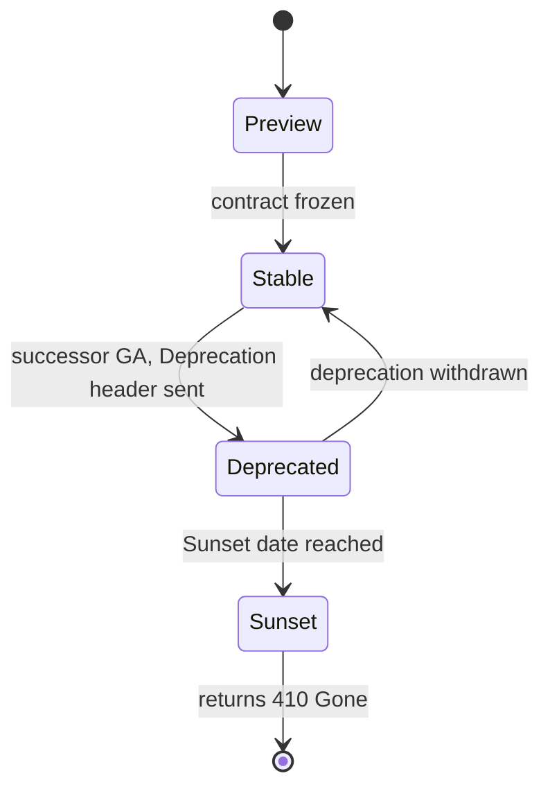

**Reading the diagram.** A version starts as a preview (no compatibility promise), becomes stable when its contract is frozen, and is deprecated once a successor is generally available; from then on responses carry `Deprecation` and `Sunset` headers. At the sunset date it is removed and answers `410 Gone`. The transitions are driven by policy and calendar, not by traffic. Failure point: removing a version that still carries significant traffic; usage metrics per client must gate the final transition.

## 8.16 API documentation: OpenAPI

::: definition
**Definition — OpenAPI Specification (OAS).** A vendor-neutral, machine-readable format (YAML or JSON) for describing HTTP APIs: paths, operations, parameters, request and response bodies (as JSON Schema), status codes and security schemes [OpenAPI Specification]. It grew out of Swagger and is maintained by the OpenAPI Initiative; version 3.1 aligned its schemas with JSON Schema, and version 3.2.0 was released in September 2025.
:::

An OpenAPI document is the API's contract in a form that tools can use: generating interactive documentation, client SDKs and server stubs, mock servers, request validation at gateways, and **contract tests** and **breaking-change detection** in CI (diffing the spec against the previous release flags the changes in Table 8.20 automatically).

```yaml
openapi: 3.1.0
info:
  title: Articles API
  version: 1.0.0
paths:
  /v1/articles:
    get:
      summary: List articles, newest first
      parameters:
        - name: limit
          in: query
          schema: { type: integer, minimum: 1, maximum: 100, default: 20 }
        - name: cursor
          in: query
          description: Opaque cursor from a previous response's next_cursor.
          schema: { type: string }
      security:
        - bearerAuth: []
      responses:
        "200":
          description: A page of articles.
          content:
            application/json:
              schema:
                type: object
                required: [data, next_cursor]
                properties:
                  data:
                    type: array
                    items: { $ref: "#/components/schemas/Article" }
                  next_cursor: { type: [string, "null"] }
        "400":
          description: Invalid cursor.
          content:
            application/problem+json:
              schema: { $ref: "#/components/schemas/Problem" }
components:
  securitySchemes:
    bearerAuth: { type: http, scheme: bearer, bearerFormat: JWT }
  schemas:
    Article:
      type: object
      required: [id, title, status, created_at]
      properties:
        id: { type: integer }
        title: { type: string }
        status: { type: string, enum: [draft, published] }
        created_at: { type: string, format: date-time }
    Problem:
      type: object
      properties:
        type: { type: string, format: uri }
        title: { type: string }
        status: { type: integer }
        detail: { type: string }
        instance: { type: string }
```

What to notice: `next_cursor` is typed `[string, "null"]`, OpenAPI 3.1's JSON Schema way of saying "nullable"; errors are documented with the `application/problem+json` media type of §8.6.7; and the bearer scheme declares that operations need a JWT.

There are two workflows. In **design-first**, teams write and review the OpenAPI document before code, then generate stubs; this suits public APIs where the contract matters most. In **code-first**, the framework derives the document from code: FastAPI, for example, serves the document generated from the `articles_api.py` example of §8.6.5 at `/openapi.json` and interactive documentation at `/docs`, with no extra work. Either way, keep the spec in version control and treat changes to it as API changes that require review. GraphQL APIs are self-describing through **introspection**, and gRPC APIs through their `.proto` files, which play the same role.

## 8.17 Summary and revision notes

::: summary
- **Client–server**: clients initiate, servers own shared state. Keep the application tier **stateless**; state lives in databases, caches, cookies or tokens.
- **Rendering**: SSR (server builds HTML), SPA (browser builds UI from JSON APIs), SSG (built once, served from a CDN), native mobile (old versions live for years). SPAs and mobile apps need a well-designed API; BFFs tailor it per client.
- **Lifecycle**: DNS → TCP → TLS → load balancer → web server → app middleware → handler → cache/DB → response. On a cold connection, setup round trips often cost more than server work; reuse connections.
- **REST**: resources named by URIs, standard methods, status codes. Know which methods are **safe** (GET, HEAD, OPTIONS) and **idempotent** (those plus PUT, DELETE). Make POST retryable with idempotency keys.
- **Pagination**: offset costs $O(\text{offset} + \text{limit})$ and shifts under writes; **cursor/keyset** pagination with `WHERE (sort_key, id) < (…)` and a matching index is constant-cost and stable.
- **Errors**: use status codes for the class of outcome and RFC 9457 `application/problem+json` for detail.
- **GraphQL**: typed schema, client-chosen fields, one round trip. Fix **N+1** with per-request **DataLoader** batching; HTTP caching is hard (use persisted queries); enforce depth and cost limits.
- **gRPC**: Protobuf IDL, generated stubs, HTTP/2 streams; unary, server-, client- and bidirectional streaming. Always set and propagate **deadlines**; use L7 load balancing.
- **Serialization**: JSON is readable and universal; Protobuf and Thrift use numeric tags and varints; Avro has no tags and resolves writer's against reader's schema. Evolve by adding optional fields with defaults; never reuse field numbers.
- **Cookies**: `Secure`, `HttpOnly`, `SameSite=Lax` (or Strict), `__Host-` prefix. Sessions are server-side (instant revocation, one lookup) or signed cookies (no store, no early revocation).
- **AuthN vs AuthZ**: who you are (401) vs what you may do (403). Hash passwords with slow salted functions (§10.6); prefer phishing-resistant MFA (WebAuthn/passkeys).
- **Authorization models**: RBAC (roles), ABAC (attribute predicates), ReBAC (relationship graph; Zanzibar's tuples, rewrites and zookies).
- **JWT**: header.payload.signature, signed not encrypted. Pin the algorithm; validate `exp`, `iss`, `aud`. HS256 = shared secret; RS256/ES256 = private signs, public verifies. Revocation needs short TTLs, refresh tokens and/or deny-lists.
- **OAuth 2.0**: delegated, scoped access via tokens. Use authorization code + PKCE for user-facing apps, client credentials for machines, rotating refresh tokens. OAuth 2.1 is still a draft (as of 2026). **OIDC** adds the ID token and standard login.
- **Versioning**: additive changes need no new version; breaking changes do. URI, header, media-type or date-based pinning; deprecate with `Deprecation`/`Sunset` headers, usage metrics and brown-outs.
- **OpenAPI** is the machine-readable contract: docs, SDKs, validation and breaking-change detection in CI.
:::

## 8.18 Knowledge checkpoint

1. Why does making the application tier stateless make horizontal scaling easy, and where does the state go?
2. Name two backend consequences of supporting a native mobile client that an SSR website does not impose.
3. A user 50 ms RTT away makes a first request needing an uncached DNS lookup (20 ms), TCP and TLS 1.3 setup, and 15 ms of server time. Estimate the latency, and the latency of the next request.
4. Which HTTP methods are safe? Which are idempotent? Why does the distinction matter to a retry library?
5. When should an API return 401, 403, 404, 409, 422 and 429?
6. Write the keyset-pagination `WHERE` clause for sorting by `created_at DESC, id DESC`, and explain why `id` is included.
7. Page size 50, page 10,001 with offset pagination: how many rows does the database walk? Roughly how many with keyset pagination?
8. What are the five standard members of an RFC 9457 problem-details object?
9. A GraphQL query fetches 20 posts and each post's author. How many database queries run with naive resolvers and with DataLoader?
10. Why must a DataLoader instance be created per request?
11. What are the four gRPC call types? Give one use for each.
12. What happens to a gRPC call with no deadline when the server hangs?
13. Encode the integer 300 as a Protobuf varint in hex.
14. In Protobuf, why must you never reuse a deleted field number? What does Avro need instead of field numbers?
15. What does each of `Secure`, `HttpOnly` and `SameSite=Lax` protect against?
16. Give one advantage and one disadvantage of a signed-cookie session versus a server-side session store.
17. In a JWT, why must the server not use the `alg` value from the token header to choose the verification algorithm?
18. Why does PKCE stop an attacker who intercepts the authorization code?
19. What does OpenID Connect add to OAuth 2.0?
20. Classify as breaking or non-breaking: adding an optional query parameter; renaming a response field; adding a required request field.

<details><summary>Answers</summary>

1. Any instance can serve any request, so instances can be added, removed or replaced behind a load balancer without losing anything. State moves to databases, caches, a session store, or the client (cookies, tokens).
2. Old app versions remain in use for months or years, so the API must stay backward compatible; slow cellular links make round trips expensive, favoring coarse-grained or aggregated endpoints (BFF, GraphQL) and compact payloads.
3. Cold: $20 + 50 + 50 + 50 + 15 = 185$ ms. Next request on the same connection with cached DNS: $50 + 15 = 65$ ms.
4. Safe: GET, HEAD, OPTIONS (and TRACE). Idempotent: the safe methods plus PUT and DELETE. A retry library can automatically retry idempotent requests after a timeout; retrying POST may duplicate effects unless an idempotency key is used.
5. 401: not authenticated. 403: authenticated but not permitted. 404: no such resource (or hidden). 409: conflicts with current state, such as a duplicate key. 422: well-formed but semantically invalid input. 429: rate limit exceeded, with `Retry-After`.
6. `WHERE (created_at, id) < (:last_created_at, :last_id) ORDER BY created_at DESC, id DESC LIMIT :n`. `id` makes the order total, so rows sharing a timestamp are neither skipped nor repeated across pages.
7. Offset $= 10{,}000 \times 50 = 500{,}000$, so about 500,050 rows. Keyset: an index descent (~3–4 levels) plus 50–51 rows.
8. `type`, `title`, `status`, `detail`, `instance`.
9. Naive: $1 + 20 = 21$. DataLoader: 2 (one for posts, one batched `IN` query for distinct authors).
10. Its cache would otherwise serve one user's data (possibly unauthorized) to another user and return stale data across requests.
11. Unary (fetch an order); server streaming (status updates, tailing logs); client streaming (uploading telemetry in chunks); bidirectional (chat, live transcription).
12. The client waits indefinitely, holding a thread or connection and memory; under load such calls accumulate and can exhaust the caller, cascading up the call chain.
13. 300 = `1 0010 1100`. Low 7 bits `010 1100` = 0x2C, plus continuation bit → `ac`; remaining bits `10` → `02`. Result: `ac 02`.
14. Old data or old clients would interpret the new field's bytes as the old field, causing silent corruption. Avro needs the writer's schema (from a file header or schema registry) and resolves fields by name, using defaults.
15. `Secure`: leakage over unencrypted HTTP. `HttpOnly`: theft of the cookie by JavaScript injected through XSS. `SameSite=Lax`: the cookie being sent on cross-site POSTs and subresource requests, that is, CSRF.
16. Advantage: no store lookup and no shared infrastructure. Disadvantage: cannot be revoked individually before expiry; limited to ~4 KB sent on every request; contents readable by the user.
17. An attacker controls the header. They could set `alg: none`, or `HS256` and sign with the server's public RSA key as the HMAC secret (algorithm confusion). The server must use its configured algorithm allow-list.
18. The code is useless without the code verifier, which never travels through the browser; only its SHA-256 hash does, and the hash cannot be inverted.
19. A standard identity layer: the `openid` scope, the ID token (a JWT about the authenticated user with audience = client), the UserInfo endpoint, standard claims, nonce-based replay protection and discovery metadata.
20. Non-breaking; breaking; breaking.
</details>

## 8.19 Interview questions

### Basic

**Q1. Walk me through what happens when a user types a URL and presses Enter.**
**Answer.** The browser parses the URL and checks its HTTP cache. It resolves the host name through DNS (OS cache, then recursive resolver, then authoritative servers), opens a TCP connection (one RTT) and performs a TLS 1.3 handshake (one RTT), or a combined QUIC handshake on HTTP/3. It sends the HTTP request with headers and cookies. A load balancer terminates TLS, routes on host and path, and forwards to a healthy backend over a pooled connection. The web server passes it to the application, where middleware authenticates, rate-limits and routes to a handler; the handler authorizes, reads cache and database, serializes a response and returns it back through the chain. The browser parses and renders, fetching subresources, often over the same connection. Strong answers attach rough numbers to each hop and note which steps connection reuse and CDNs remove.

**Q2. What is the difference between PUT, PATCH and POST?**
**Answer.** POST asks the target collection or resource to process the body, commonly creating a resource whose URI the server chooses; it is not idempotent. PUT creates or completely replaces the resource at the URI the client names; it is idempotent. PATCH applies a partial modification; it is not guaranteed idempotent (an "increment" patch is not). Retries are therefore safe for PUT but need idempotency keys for POST.

**Q3. Cookies or tokens for authentication?**
**Answer.** For a first-party browser application, an opaque session ID in a `Secure; HttpOnly; SameSite` cookie is simple and secure and allows instant logout. For APIs consumed by mobile apps, other services or third parties, short-lived bearer tokens (often JWTs) obtained through OAuth fit better, because any service can verify them without a shared store. Many systems combine them: the browser holds a session cookie with a BFF, which holds tokens and calls services with them.

### Intermediate

**Q4. Design pagination for an activity feed API with 500 million rows and constant inserts.**
**Answer.** Use cursor (keyset) pagination ordered by `(created_at DESC, id DESC)`, backed by a composite index (per user, if the feed is per user: `(user_id, created_at DESC, id DESC)`). The response returns `data` and an opaque `next_cursor` encoding the last row's sort key, base64url-encoded and HMAC-signed, optionally with an expiry and a hash of the filter parameters. Query with a row-value comparison and `LIMIT n+1` to detect more pages. Cap `limit` at, say, 100. Omit total counts or serve approximate ones. Explain why offset fails: cost grows linearly with depth (deep pages walk millions of rows) and inserts cause duplicates. Mention that cursors survive deletes of the boundary row because the comparison is on values, not on row existence.

**Q5. Your GraphQL API's database load tripled after a new mobile screen launched. Diagnose and fix.**
**Answer.** Likely N+1 resolution on nested lists, possibly compounded by a query requesting large page sizes or deep nesting. Confirm with per-request query counts and resolver tracing. Fix with per-request DataLoaders for every relation field (batch by parent IDs, dedupe), enforce maximum `first` values, add query-cost analysis with per-client budgets, and use persisted queries so the expensive query can be reviewed and cached. Consider caching hot entities in the batch functions.

**Q6. How do you revoke access for a user whose laptop was stolen, if your APIs use JWT access tokens?**
**Answer.** Revoke their refresh tokens at the authorization server (so no new access tokens are minted) and end their server-side sessions. For outstanding access tokens, either accept exposure until expiry (keep TTLs at 5–15 minutes) or push a deny-list entry — by `jti`, or "all tokens for `sub` issued before T" — to a replicated store or in-memory cache in every resource server, checked during validation. Entries can expire with the tokens, so the list stays small. High-risk operations can additionally require introspection or step-up authentication.

### Advanced

**Q7. Design authorization for a document-collaboration product with folders, nested groups and link sharing, serving 100,000 checks per second at p99 under 20 ms.**
**Answer.** Use ReBAC in the Zanzibar style. Store tuples `object#relation@subject` (subjects can be usersets like `group:eng#member`) in a partitioned, replicated store, partitioned by object ID. Define namespace rewrite rules: owner ⊂ editor ⊂ commenter ⊂ viewer, and viewer inherited from parent folder; link sharing is a tuple with a special subject such as `anyone-with-link`. A check service evaluates the rewrite graph with memoization of sub-results, request deduplication, depth limits and a precomputed membership index for large nested groups. For freshness, return a consistency token with each ACL or content write and evaluate later checks at a snapshot at least that recent, avoiding the new-enemy problem; otherwise allow slightly stale cached results for latency. Provide list/filter APIs ("which of these 50 docs can Alice see?") as batched checks. Discuss failure modes: the authorization service on every read path must be multi-region and degrade by failing closed; audit logs of tuple changes; and the cost of deep nesting.

**Q8. Your company runs 300 microservices with a mix of REST/JSON and gRPC. Propose an inter-service API strategy, including versioning and schema evolution.**
**Answer.** Default to gRPC with Protobuf for internal synchronous calls: compact, typed, streaming, deadline propagation. Keep all `.proto` files in a central schema repository with linting and breaking-change detection in CI; version by package (`orders.v1`), additive changes only within a version. Expose public and partner APIs as REST/JSON with OpenAPI, generated or transcoded from the same definitions where possible, with RFC 9457 errors and date-based or major-version URIs. Mandate deadlines on every call, propagation of deadline and trace context, and status-code-based retry policies with budgets. Use L7 or client-side load balancing for HTTP/2. For asynchronous events, use Avro or Protobuf with a schema registry enforcing backward/forward compatibility. Measure the usage of every deprecated field and method before removal.

**Q9. Walk through the security of a SPA that signs users in with an external identity provider and calls your API.**
**Answer.** The SPA is a public client, so use the authorization code flow with PKCE (S256), a random `state`, and an OIDC `nonce`; register exact redirect URIs. Preferably run a BFF: the browser holds only an `HttpOnly; Secure; SameSite=Lax` (or Strict), `__Host-` session cookie with the BFF, which performs the code exchange as a confidential client and stores access and refresh tokens server-side, so XSS cannot steal tokens. Validate the ID token (signature via JWKS, `iss`, `aud` = client ID, `exp`, `nonce`) and identify users by (`iss`, `sub`). The API validates access tokens with pinned algorithms, `aud` = API, scopes, and short TTLs; refresh tokens rotate with reuse detection. Add CSRF protection for state-changing BFF endpoints, a strict Content Security Policy, and an authorization check on every object access.

## 8.20 Practical exercises

1. **Build a small REST API (2–4 h).** Extend `articles_api.py` (§8.6.5) into a FastAPI or Flask service backed by SQLite or PostgreSQL with `POST /v1/articles` (201 + `Location`), `GET` with cursor pagination and filtering by `status` and `author_id`, `PATCH` with `If-Match` ETags (412 on mismatch), and `DELETE` (204). Protect writes with the JWT dependency of §8.13.3 and scopes `articles:write` and `articles:delete`. Return RFC 9457 errors throughout. Write tests that page through 1,000 rows while inserting new ones, and assert that no row is returned twice.
2. **Measure offset versus keyset.** Load 5 million rows into PostgreSQL. Time `OFFSET` queries at offsets 0, 10⁴, 10⁵ and 10⁶, and the equivalent keyset queries, and read `EXPLAIN (ANALYZE, BUFFERS)` for each. Plot latency against page depth.
3. **Encode by hand.** Write a decoder for the varint encoder of §8.9.2 that turns the 33-byte message back into fields, skipping unknown field numbers using the wire type. Add `sint64` ZigZag support and verify against the official `protobuf` library.
4. **Fix an N+1.** Implement the blog schema of §8.7.1 with Strawberry or Ariadne (Python) over SQLite, log every SQL statement, and count queries for a request of 50 posts with comments and authors. Add DataLoaders and compare.
5. **OAuth end to end.** Run an open-source identity provider (for example Keycloak) locally, register a public client, and implement the authorization code + PKCE flow from a small Python web app, including `state`, `nonce` and ID-token validation. Then demonstrate that replaying a stolen code without the verifier fails.

## 8.21 Design challenges

1. **Public API for a payments startup.** Design the external API for creating charges, refunds and listing transactions: resource model, idempotency keys, pagination, error types, webhooks, authentication for merchants (API keys vs OAuth for platforms), versioning and deprecation policy. Justify every status code.
2. **One backend, three frontends.** A retailer has an SSR website, an iOS/Android app with five live versions, and partner integrations. Choose between REST, GraphQL, BFFs and gRPC for each layer, draw the architecture, and explain how a schema change to "product price" rolls out without breaking any client.
3. **Authorization at scale.** A B2B SaaS product needs per-tenant roles, per-project sharing and conditional rules ("contractors only from the corporate network"). Combine RBAC, ReBAC and ABAC; specify the data model, the check API, caching and consistency, and how you would audit "who can see project X?".

## 8.22 References

1. Fielding, R. T. *Architectural Styles and the Design of Network-based Software Architectures*. Doctoral dissertation, University of California, Irvine, 2000. https://ics.uci.edu/~fielding/pubs/dissertation/top.htm
2. Fielding, R., Nottingham, M., Reschke, J. (Eds.). *HTTP Semantics*. RFC 9110, IETF, 2022. https://www.rfc-editor.org/rfc/rfc9110
3. Dusseault, L., Snell, J. *PATCH Method for HTTP*. RFC 5789, IETF, 2010. https://www.rfc-editor.org/rfc/rfc5789
4. Nottingham, M., Fielding, R. *Additional HTTP Status Codes*. RFC 6585, IETF, 2012. https://www.rfc-editor.org/rfc/rfc6585
5. Nottingham, M., Wilde, E., Dalal, S. *Problem Details for HTTP APIs*. RFC 9457, IETF, 2023. https://www.rfc-editor.org/rfc/rfc9457
6. Barth, A. *HTTP State Management Mechanism*. RFC 6265, IETF, 2011. https://www.rfc-editor.org/rfc/rfc6265
7. Hardt, D. (Ed.). *The OAuth 2.0 Authorization Framework*. RFC 6749, IETF, 2012. https://www.rfc-editor.org/rfc/rfc6749
8. Jones, M., Hardt, D. *The OAuth 2.0 Authorization Framework: Bearer Token Usage*. RFC 6750, IETF, 2012. https://www.rfc-editor.org/rfc/rfc6750
9. Jones, M., Bradley, J., Sakimura, N. *JSON Web Token (JWT)*. RFC 7519, IETF, 2015. https://www.rfc-editor.org/rfc/rfc7519
10. Sakimura, N., Bradley, J., Agarwal, N. *Proof Key for Code Exchange by OAuth Public Clients*. RFC 7636, IETF, 2015. https://www.rfc-editor.org/rfc/rfc7636
11. Richer, J. (Ed.). *OAuth 2.0 Token Introspection*. RFC 7662, IETF, 2015. https://www.rfc-editor.org/rfc/rfc7662
12. Sheffer, Y., Hardt, D., Jones, M. *JSON Web Token Best Current Practices*. RFC 8725, IETF, 2020. https://www.rfc-editor.org/rfc/rfc8725
13. Lodderstedt, T., Bradley, J., Labunets, A., Fett, D. *Best Current Practice for OAuth 2.0 Security*. RFC 9700, IETF, 2025. https://www.rfc-editor.org/rfc/rfc9700
14. Hardt, D., Parecki, A., Lodderstedt, T. *The OAuth 2.1 Authorization Framework*. Internet-Draft draft-ietf-oauth-v2-1-16, IETF, 2026 (work in progress). https://datatracker.ietf.org/doc/draft-ietf-oauth-v2-1/
15. Denniss, W., Bradley, J., Jones, M., Tschofenig, H. *OAuth 2.0 Device Authorization Grant*. RFC 8628, IETF, 2019. https://www.rfc-editor.org/rfc/rfc8628
16. Sakimura, N., Bradley, J., Jones, M., de Medeiros, B., Mortimore, C. *OpenID Connect Core 1.0*. OpenID Foundation, 2014. https://openid.net/specs/openid-connect-core-1_0.html
17. M'Raihi, D., Machani, S., Pei, M., Rydell, J. *TOTP: Time-Based One-Time Password Algorithm*. RFC 6238, IETF, 2011. https://www.rfc-editor.org/rfc/rfc6238
18. Grassi, P. A., et al. *Digital Identity Guidelines: Authentication and Lifecycle Management*. NIST Special Publication 800-63B, 2017. https://pages.nist.gov/800-63-3/sp800-63b.html
19. Wilde, E. *The Sunset HTTP Header Field*. RFC 8594, IETF, 2019. https://www.rfc-editor.org/rfc/rfc8594
20. Dalal, S., Wilde, E. *The Deprecation HTTP Response Header Field*. RFC 9745, IETF, 2025. https://www.rfc-editor.org/rfc/rfc9745
21. GraphQL Foundation. *GraphQL Specification*, September 2025 Edition. 2025. https://spec.graphql.org/September2025/
22. Byron, L. *GraphQL: A data query language*. Facebook Engineering Blog, 2015.
23. GraphQL Foundation. *DataLoader* (source repository and documentation). 2015. https://github.com/graphql/dataloader
24. gRPC Authors. *gRPC Documentation* (Introduction, Core concepts, Deadlines). Accessed 2026. https://grpc.io/docs/
25. Google. *Protocol Buffers Documentation: Encoding*. Accessed 2026. https://protobuf.dev/programming-guides/encoding/
26. Apache Software Foundation. *Apache Avro Specification*. Accessed 2026. https://avro.apache.org/docs/
27. Slee, M., Agarwal, A., Kwiatkowski, M. *Thrift: Scalable Cross-Language Services Implementation*. Facebook white paper, 2007.
28. Kleppmann, M. *Designing Data-Intensive Applications*, Chapter 4: Encoding and Evolution. O'Reilly Media, 2017.
29. Birrell, A. D., Nelson, B. J. *Implementing Remote Procedure Calls*. ACM Transactions on Computer Systems 2(1), 1984.
30. Pang, R., Cáceres, R., Burrows, M., Chen, Z., Dave, P., Germer, N., Golynski, A., Graney, K., Kang, N., Kissner, L., Korn, J. L., Parmar, A., Richards, C. D., Wang, M. *Zanzibar: Google's Consistent, Global Authorization System*. USENIX Annual Technical Conference (ATC), 2019. https://www.usenix.org/conference/atc19/presentation/pang
31. OpenAPI Initiative. *OpenAPI Specification* (v3.1.0, 2021; v3.2.0, 2025). https://spec.openapis.org/oas/
32. Leach, B. *APIs as infrastructure: future-proofing Stripe with versioning*. Stripe Blog, 2017. https://stripe.com/blog/api-versioning
33. Stripe. *API Reference: Pagination*. Accessed 2026. https://docs.stripe.com/api/pagination
34. GitHub. *Using pagination in the REST API*. GitHub Docs, accessed 2026. https://docs.github.com/en/rest/using-the-rest-api/using-pagination-in-the-rest-api
35. GitHub. *API Versions*. GitHub Docs, accessed 2026. https://docs.github.com/en/rest/about-the-rest-api/api-versions
36. GitHub. *Rate limits and query limits for the GraphQL API*. GitHub Docs, accessed 2026. https://docs.github.com/en/graphql/overview/rate-limits-and-query-limits-for-the-graphql-api

## 8.23 Open verification items

- Zanzibar throughput: the chapter says "millions of authorization checks per second"; confirm the exact figure in the paper's abstract (secondary sources quote "more than 10 million client queries per second").
- `SameSite` default: confirm current (2026) behavior of Chromium, Firefox and Safari for cookies without a `SameSite` attribute, and the publication status of RFC 6265bis.
- OAuth 2.1: re-check the draft revision (or RFC number, if published) at the time of book publication; -16 was current in September 2026.
- NIST SP 800-63B: check whether revision 4 has superseded the 2017 revision cited, and update the reference.
- Exact URLs and titles of [Byron 2015], the GitHub GraphQL rate-limit page, and the Stripe pagination page.
- Table 8.3 latency ranges are illustrative estimation figures; cross-check against Appendix F when it is written.
- The "~100 ms per scrypt hash" figure was measured once (N = 2¹⁵, r = 8, p = 1) on a single cloud vCPU in 2026; Chapter 10 should own the authoritative parameter guidance.
