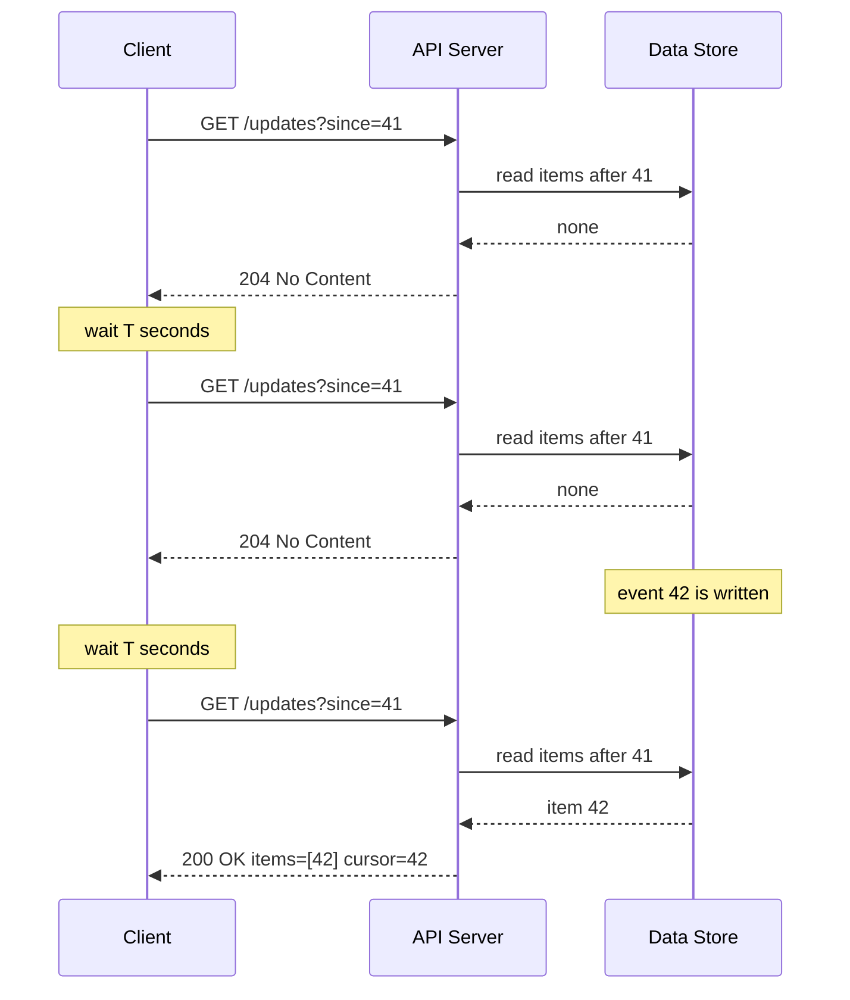
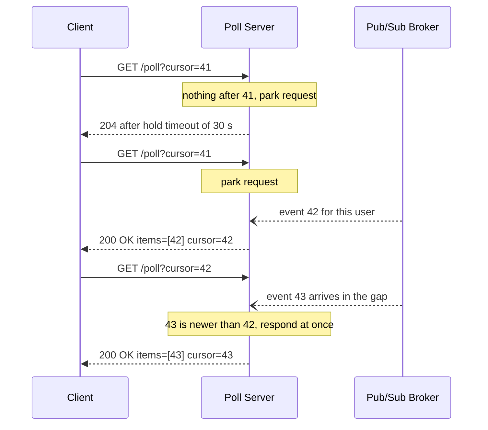
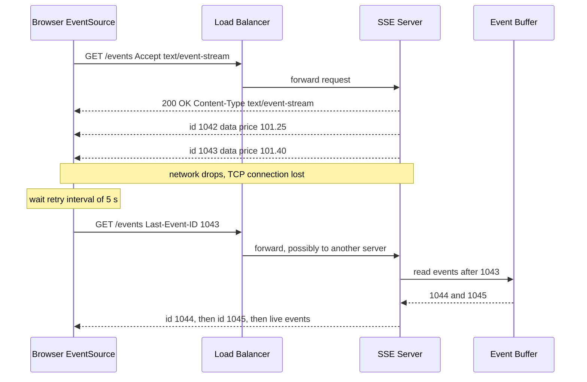
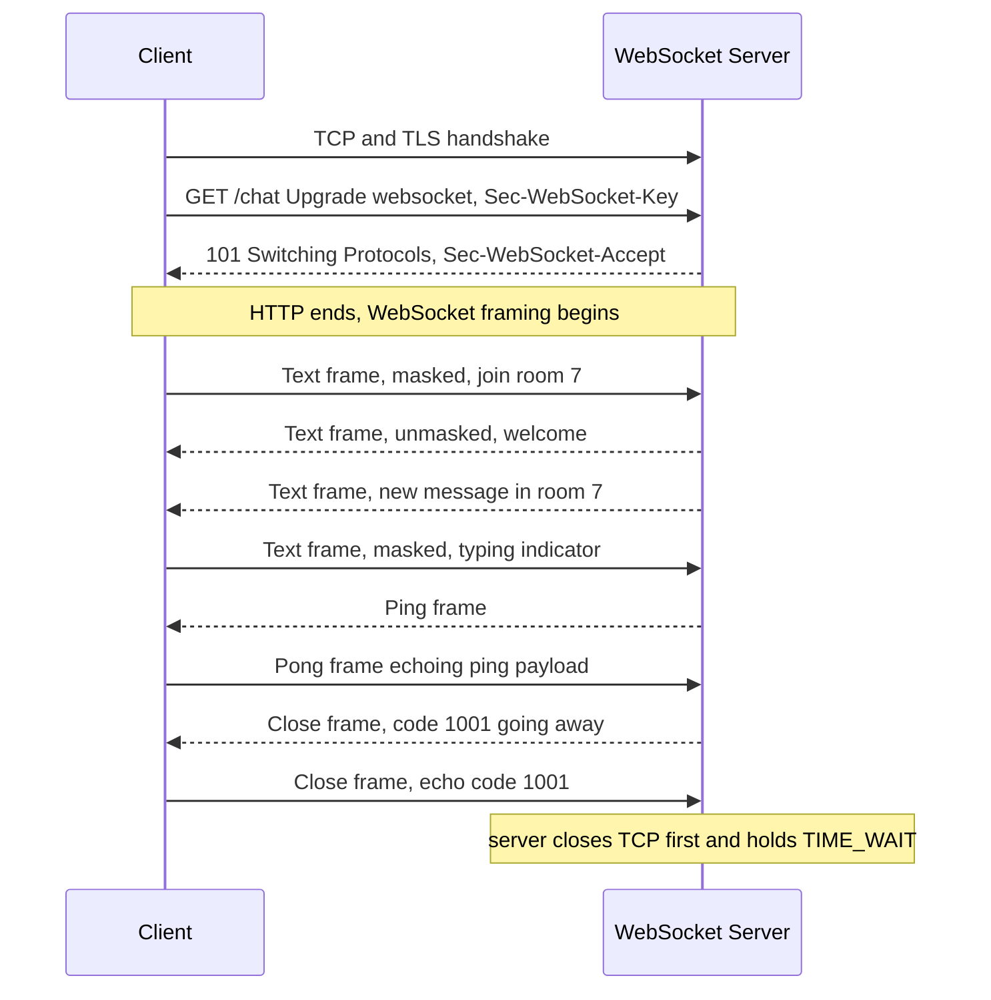
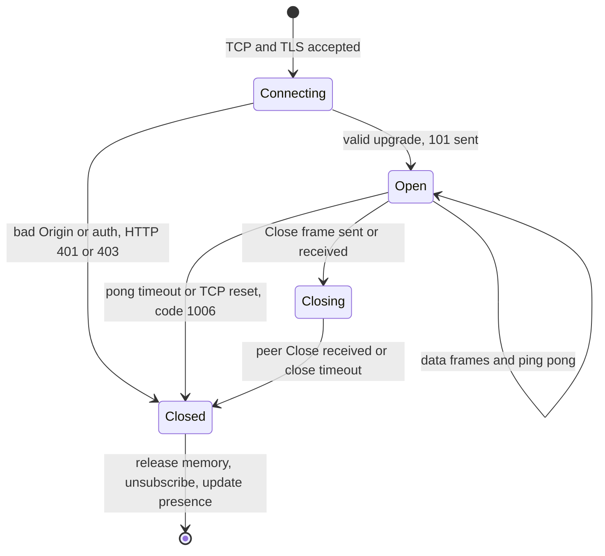
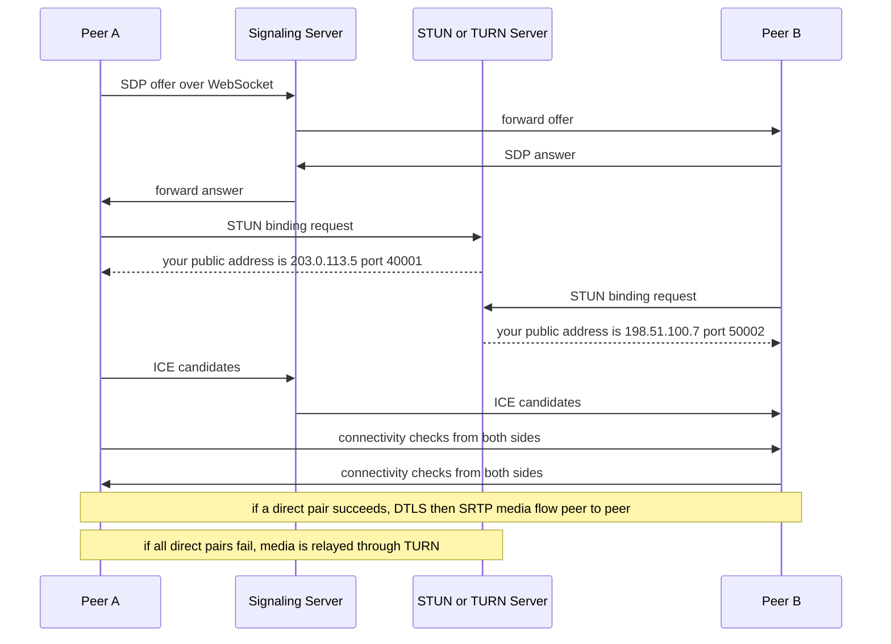
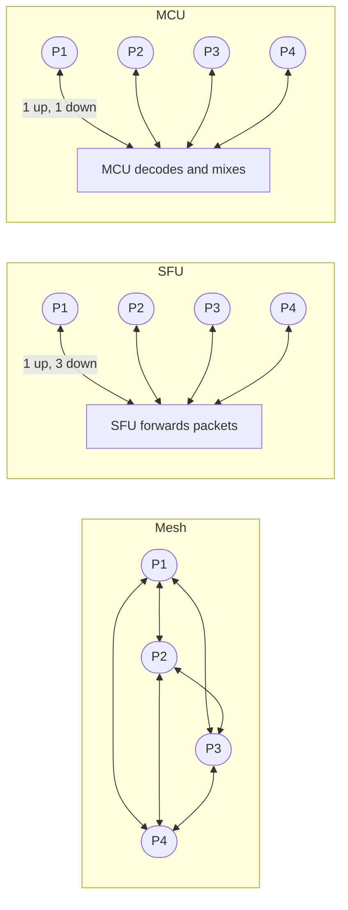
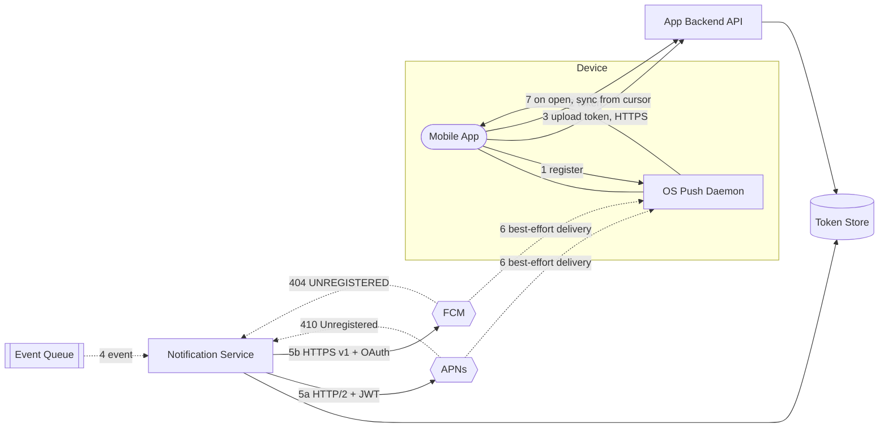
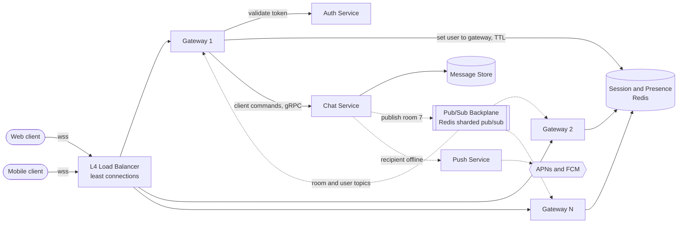
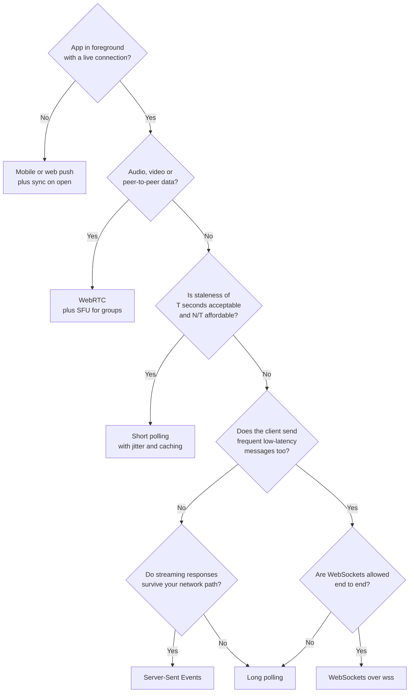

# Chapter 9 — Real-Time Communication

> **Level:** 2 · **Track:** A (Traditional) · **Estimated reading time:** 3 h

The web was built as a conversation in which only one side may speak first. A browser asks; a server answers; the exchange ends. That model, described in §8.5 (The request–response lifecycle), works well for loading a page or submitting a form. It works badly when the *server* is the first to know something: a new chat message has arrived, a stock price has moved, a driver is two minutes away, a colleague has started typing. This chapter is about the family of techniques that let a server tell a client about something *now*, without waiting to be asked.

Picture a restaurant kitchen and a diner. **Short polling** is the diner walking to the kitchen every five minutes to ask "is my food ready?". **Long polling** is the diner asking once and the chef saying "wait here, I'll tell you as soon as it is". **Server-Sent Events** is a waiter assigned to the diner's table who walks over every time a course is ready. **WebSockets** is a telephone line between table and kitchen that either side can talk into at any moment. **WebRTC** lets two diners talk to each other directly across the room instead of passing notes through the kitchen. **Mobile push** is the restaurant sending a text message to a diner who has gone home: the phone company decides when it arrives, and it might not arrive at all. Every technique in this chapter is a trade between how quickly the news arrives, how much it costs to keep the line open, and how much infrastructure must understand the line.

## 9.1 Learning objectives

After this chapter you should be able to:

- Explain the mechanism, wire format and failure modes of short polling, long polling, Server-Sent Events (SSE), WebSockets, WebRTC and mobile push.
- Calculate the request rate, wasted requests and added latency of a polling design from the number of clients and the polling interval.
- Walk through the RFC 6455 WebSocket opening handshake, compute `Sec-WebSocket-Accept`, and decode a WebSocket frame byte by byte, including masking.
- Describe how ICE, STUN and TURN establish a peer-to-peer WebRTC session, and choose between mesh, SFU and MCU topologies with bandwidth arithmetic.
- Design a mobile push pipeline using APNs and FCM that tolerates dropped notifications, stale device tokens and collapsed messages.
- Size a connection gateway fleet for 10 million concurrent connections, including memory, server count, heartbeat load and reconnect-storm behavior.
- Design a pub/sub backplane, a presence system and a graceful-drain deployment procedure for long-lived connections.
- Choose the right real-time technique for a given product requirement and defend the choice with a comparison of cost, latency and operational complexity.

## 9.2 Prerequisites

- TCP connections, the three-way handshake and head-of-line blocking — §7.7 (needed because every technique here rides on long-lived TCP or UDP flows).
- HTTP/1.1, HTTP/2, HTTP/3 and QUIC — §7.9 (SSE and WebSockets interact with HTTP versions in non-obvious ways).
- TLS 1.3 — §7.10 (handshake cost dominates reconnect storms).
- WebSockets introduction — §7.11 (this chapter is the deep dive).
- Proxies, reverse proxies and NAT — §7.12, §7.13 (they break long-lived connections and motivate STUN/TURN).
- I/O models and event loops (epoll, kqueue, async/await) — §6.13, §6.15 (how one server holds hundreds of thousands of idle connections).
- Little's Law — §4.11 (concurrent connections = arrival rate × connection lifetime).
- Load balancing and session affinity — §19.3, §19.6 (sticky routing for connections).
- Retries with exponential backoff and jitter — §22.12 (reconnect storms).

## 9.3 Short polling

### 9.3.1 What short polling is

::: definition
**Definition — Short polling.** A technique in which the client sends an ordinary HTTP request at a fixed interval *T* to ask whether new data exists; the server answers immediately, either with the new data or with an empty response, and the connection's request ends.
:::

#### First-principles explanation

A child in the back seat asking "are we there yet?" every minute is short polling. The parent answers right away, almost always with "no". The child learns of arrival at most one minute late, and the parent spends most of the trip answering a question whose answer has not changed. Nothing about the car or the road had to change to support this protocol, which is precisely why it is popular.

#### Why does this exist?

Short polling needs nothing beyond what every HTTP client, proxy, CDN, firewall and load balancer already supports. It was the first way web pages showed "live" data, and it remains the right answer when updates are infrequent, a few seconds of staleness is acceptable and clients are few — a build-status page polled every 30 seconds by a few hundred engineers, for example.

#### How it works internally

1. The client starts a timer with period *T* (for example, 5 seconds).
2. When the timer fires, the client sends `GET /updates?since=<cursor>`. The **cursor** is an opaque value (a sequence number or timestamp) identifying the last item the client has seen.
3. The server looks up anything newer than the cursor and responds immediately: `200 OK` with items and a new cursor, or `204 No Content` (or `200` with an empty list, or `304 Not Modified` with an `ETag`) when nothing changed.
4. The client applies the items, stores the new cursor and waits for the next tick.
5. With HTTP keep-alive (§7.16), the TCP and TLS connection is reused across polls, so each poll costs one request/response round trip rather than a full handshake.

#### Architecture diagram

**Figure 9.1 — Short polling.**



**Reading the diagram.** The client, a stateless API server and the data store exchange only synchronous HTTP over a reused keep-alive connection (solid = request, dashed = response); the server never initiates. Event 42 is written between polls, so the client learns of it up to *T* seconds late — inherent, not a bug. The data store receives one read per poll whether or not anything changed, which is the failure point at scale. Scaling is easy: stateless servers behind a load balancer, with a cache in front of the "anything new?" query.

#### Mathematical foundations

::: formula
**Short-polling request rate**

$$R = \frac{N}{T}$$

| Symbol | Meaning | Units |
|---|---|---|
| $R$ | Request rate arriving at the servers | requests/second |
| $N$ | Number of concurrently active (polling) clients | clients |
| $T$ | Polling interval | seconds |
:::

::: formula
**Fraction of wasted (empty) polls and added latency**

If updates for a client arrive as a Poisson process with rate $\lambda$, the probability that a given interval contains no update is

$$P_{\text{empty}} = e^{-\lambda T} \approx 1 - \lambda T \quad (\text{when } \lambda T \ll 1)$$

and the average delay between an event occurring and the client seeing it is

$$D_{\text{avg}} = \frac{T}{2} + t_{\text{rtt}}$$

| Symbol | Meaning | Units |
|---|---|---|
| $P_{\text{empty}}$ | Fraction of polls that return nothing | dimensionless (0–1) |
| $\lambda$ | Average update rate per client | events/second |
| $T$ | Polling interval | seconds |
| $D_{\text{avg}}$ | Average notification delay | seconds |
| $t_{\text{rtt}}$ | Network round-trip time for one poll | seconds |
:::

::: example
**Worked example — A notification badge polled every 5 seconds.**

A web app has $N = 1{,}000{,}000$ users online at peak. Each tab polls `/notifications` every $T = 5$ s. A typical user receives one notification every 10 minutes, so $\lambda = 1/600 \approx 0.00167$ events/s.

1. Request rate: $R = 1{,}000{,}000 / 5 = 200{,}000$ requests/s.
2. Empty fraction: $\lambda T = 5/600 = 0.00833$; $P_{\text{empty}} = e^{-0.00833} \approx 0.9917$. So **99.2 %** of requests — about 198,300 per second — return nothing.
3. Useful requests: $200{,}000 \times 0.0083 \approx 1{,}700$ per second actually carry a notification.
4. Header overhead: assume about 800 bytes of request headers (cookies, user-agent, auth token) and 200 bytes of response headers on HTTP/1.1 — about 1 KB per poll (SI units, 1 KB = 1,000 bytes). $200{,}000 \times 1\text{ KB} = 200$ MB/s ≈ 1.6 Gbit/s of traffic that mostly says "nothing new". HTTP/2 header compression (HPACK) shrinks repeated headers considerably, but the request count and server work remain.
5. Average delay: $D_{\text{avg}} \approx 2.5$ s plus one round trip.

**Interpretation.** You are paying for 200,000 requests per second of capacity — load balancers, TLS termination, application threads and a database or cache lookup each — to deliver about 1,700 useful updates per second. Halving the interval to 2.5 s to improve freshness *doubles* the bill.

**Engineering implication.** Short polling's cost scales with $N/T$, not with the rate of real events. When $\lambda T$ is small (rare events, short interval), switch to a push technique; when events are frequent relative to the interval (for example, a dashboard that changes every second and is polled every 10 s), polling's waste is low and its simplicity wins.
:::

**Table 9.1 — Short-polling cost for 1 million clients as the interval shrinks (λ = 1 event per 10 minutes per client).**

| Interval $T$ | Requests/s | Empty polls | Avg. delay | Header traffic (≈1 KB/poll) |
|---|---|---|---|---|
| 60 s | 16,667 | 90.5 % | 30 s | 16.7 MB/s |
| 30 s | 33,333 | 95.1 % | 15 s | 33.3 MB/s |
| 10 s | 100,000 | 98.3 % | 5 s | 100 MB/s |
| 5 s | 200,000 | 99.2 % | 2.5 s | 200 MB/s |
| 1 s | 1,000,000 | 99.8 % | 0.5 s | 1 GB/s |

The table shows the central tension: every halving of delay doubles the cost, while the useful work stays constant at about 1,667 notifications per second.

#### Real-world industry applications

::: industry
**Status dashboards and job progress pages.** A CI system's build page or a cloud console's "creating instance…" spinner typically polls a status endpoint every few seconds. The number of watchers is small, staleness of a few seconds is invisible to users, and the endpoint can be served from a cache, so the waste is cheap and the operational simplicity (no long-lived connections, works through every proxy) dominates.
*Evidence: Illustrative* — a common pattern used for teaching; not a claim about any specific product.
:::

#### Advantages and disadvantages

- **Advantages:** works everywhere (every proxy, CDN, firewall, HTTP version); servers stay stateless; trivially cacheable (`ETag`, `Cache-Control: max-age`); easy to rate-limit and to reason about; failures are self-healing because the next poll simply retries.
- **Disadvantages:** latency is bounded below by $T/2$ on average; cost grows with clients and polling frequency rather than with real events; mobile radios are woken on every poll, draining battery; synchronized clients (for example, all tabs opened at 09:00) create load spikes unless the timer is jittered.

#### Alternatives and trade-offs

Long polling (§9.4) removes empty responses and the $T/2$ delay; SSE (§9.5) and WebSockets (§9.6) remove per-update request overhead. **Adaptive polling** — lengthening $T$ while nothing changes, or honoring a server-supplied `Retry-After` hint — is a cheap middle ground.

#### Failure scenarios

**Table 9.2 — Short-polling failure scenarios.**

| What goes wrong | Why | Detection | Recovery | Prevention |
|---|---|---|---|---|
| Synchronized poll spikes | Clients start timers at the same moment (deploy, page load at shift start) | Request-rate graph shows sawtooth at multiples of $T$ | Shed load with `429` + `Retry-After` | Add ±20 % random jitter to every timer |
| Database overload | Every empty poll hits the database | DB CPU tracks request rate, not write rate | Cache "latest cursor per user" in memory | Serve "anything new?" from a cache or version counter |
| Missed updates | Client uses wall-clock timestamps as cursor; clock skew or same-millisecond writes | Users report gaps | Re-fetch from an earlier cursor | Use monotonically increasing sequence numbers |

#### Common misconceptions

::: mistake
**"Polling every second is fine; requests are cheap."** A request that returns nothing still costs a TLS record, a load-balancer decision, an application thread slot, an authentication check and usually a cache or database lookup. Multiplied by $N/T$, "cheap" becomes the dominant load on the system. Always compute $R = N/T$ before choosing an interval.
:::

## 9.4 Long polling

### 9.4.1 What long polling is

::: definition
**Definition — Long polling.** A technique in which the client sends an HTTP request that the server deliberately does not answer until either new data is available or a server-side timeout *T*<sub>hold</sub> expires; on receiving any response, the client immediately sends the next request.
:::

#### First-principles explanation

Now the child asks once and the parent says "I'll tell you when we arrive — and if nothing happens in half an hour I'll say so anyway". The news arrives the instant it happens, but the parent must *remember* that a question is pending — that memory is the new cost.

#### Why does this exist?

Mid-2000s webmail and chat needed sub-second updates, but browsers could only make JavaScript-initiated HTTP requests. Nothing in HTTP forbids a server from answering slowly, so holding the request open approximates push using only standard HTTP. Alex Russell named this family of techniques **Comet** in 2006 [Russell 2006]; the CometD project's **Bayeux** protocol standardized a message format, and RFC 6202 documented the pitfalls [Loreto et al. 2011]. Long polling survives as the universal fallback transport in libraries such as Socket.IO.

#### How it works internally

1. The client sends `GET /poll?cursor=41`.
2. The server checks for items after cursor 41. If any exist, it responds immediately (this is exactly short polling's fast path).
3. If none exist, the server *parks* the request in an in-memory waiter list keyed by user or topic. On an event-loop server (§6.13) a parked request costs only memory, not a thread.
4. When an event for that user arrives from a broker, the server wakes the waiter and responds with the new items and cursor.
5. If no event arrives within *T*<sub>hold</sub> (commonly 20–55 seconds), the server responds `204 No Content` or an empty list with the same cursor.
6. On any response the client immediately re-polls with the latest cursor (after a backoff delay if the response was an error).

**Timeouts.** *T*<sub>hold</sub> must be shorter than every idle timeout on the path. The AWS Application Load Balancer's default idle timeout is 60 s and NGINX's `proxy_read_timeout` defaults to 60 s (as of 2024); corporate proxies may be shorter, so 25–30 s is a common safe choice. If an intermediary cuts the request first, the client sees an error instead of a clean empty response — and if it retries without backoff, an error storm.

**Ordering and loss.** Between response *k* and request *k*+1 there is a one-round-trip gap with no outstanding request. The cursor closes it: the server keeps a per-user buffer of recent events with monotonically increasing sequence numbers, and each request asks for "everything after *c*". Clients apply items in sequence order and discard duplicates (an event racing a timeout may be sent twice). Never run two concurrent long polls per client: responses can arrive out of order. A parked request also occupies one of the browser's roughly six HTTP/1.1 connections per origin [Loreto et al. 2011].

#### Architecture diagram

**Figure 9.2 — Long polling with cursors and a hold timeout.**



**Reading the diagram.** The poll server receives events asynchronously (open arrowheads) from a pub/sub broker. The first request parks and ends empty after the 30 s hold timeout; the second is answered the moment event 42 arrives — one network hop instead of $T/2$. Event 43 arrives while the client is re-polling; the cursor and the server-side buffer ensure nothing is lost. If the client reconnects to a *different* server, that server must answer "after 42", so the buffer must be shared or routing sticky (§9.9.4). Failure points: intermediaries that time out first, and in-memory buffers lost on restart. Capacity is planned in concurrent held connections.

#### Mathematical foundations

::: formula
**Long-polling request rate**

With Poisson events at rate $\lambda$ per client and hold timeout $T_h$, each request lasts $\min(T_h, X)$ where $X$ is the time to the next event. Its mean is

$$E[\text{duration}] = \frac{1 - e^{-\lambda T_h}}{\lambda}, \qquad R = \frac{N}{E[\text{duration}]}, \qquad C_{\text{open}} \approx N$$

| Symbol | Meaning | Units |
|---|---|---|
| $\lambda$ | Average update rate per client | events/second |
| $T_h$ | Server hold timeout | seconds |
| $E[\text{duration}]$ | Mean lifetime of one long-poll request | seconds |
| $N$ | Number of connected clients | clients |
| $R$ | Request rate at the servers | requests/second |
| $C_{\text{open}}$ | Concurrently open requests (Little's Law: $R \times E[\text{duration}]$) | requests |
:::

::: example
**Worked example — The same 1 million users, now with long polling.**

Use the numbers from §9.3: $N = 1{,}000{,}000$, $\lambda = 1/600$ events/s, and a hold timeout $T_h = 30$ s.

1. $\lambda T_h = 30/600 = 0.05$; $e^{-0.05} = 0.9512$.
2. $E[\text{duration}] = (1 - 0.9512) / (1/600) = 0.0488 \times 600 \approx 29.3$ s.
3. $R = 1{,}000{,}000 / 29.3 \approx 34{,}000$ requests/s, versus 200,000 requests/s for 5-second short polling — about **5.9× fewer** requests.
4. Average notification delay: about one network round trip (tens of milliseconds) instead of 2.5 s.
5. Concurrent open requests: $34{,}000 \times 29.3 \approx 1{,}000{,}000$ — every client holds one open request at all times.

**Interpretation.** Long polling improves both cost and latency, but it shifts the bottleneck from request throughput to *concurrent held connections*. 95 % of responses are still empty timeouts ($e^{-0.05}$), each carrying full HTTP headers.

**Engineering implication.** Long polling needs an asynchronous server that can park a million requests and an event-routing layer that wakes the right one — the same infrastructure as a WebSocket gateway (§9.9). Once you have built that, SSE or WebSockets usually deliver more for the same effort.
:::

#### Real-world industry applications

::: industry
**Universal fallback transports.** Real-time libraries such as Socket.IO and SockJS offer long polling as a transport for networks where WebSockets are blocked by proxies or firewalls. Socket.IO's documentation notes that when HTTP long-polling is enabled with several server nodes, the load balancer must use sticky sessions, because successive polls of one session must reach the node that holds its state.
*Evidence: Primary* — Socket.IO documentation, "Using multiple nodes" [Socket.IO Docs].
:::

#### Advantages and disadvantages

- **Advantages:** near-instant delivery over plain HTTP; works through almost every proxy; client logic is simple; degrades to polling when events are frequent.
- **Disadvantages:** every message still carries full HTTP headers and costs a new request; a round-trip gap after each response (mitigated by cursors); holds a connection per client, so servers must be asynchronous; intermediary timeouts must be understood; occupies one of the browser's HTTP/1.1 connections per origin; strictly server-to-client (client-to-server messages need separate requests).

#### Alternatives and trade-offs

SSE (§9.5) gives the same reach for server-to-client data with one request for many messages and built-in resumption; WebSockets (§9.6) remove per-message HTTP overhead for bidirectional traffic. Long polling wins where streaming responses are broken — some antivirus products and corporate proxies buffer responses until they complete, which ruins SSE but leaves long polling intact.

#### Failure scenarios

**Table 9.3 — Long-polling failure scenarios.**

| What goes wrong | Why | Detection | Recovery | Prevention |
|---|---|---|---|---|
| Requests cut off at 60 s with 504 | Hold timeout exceeds a proxy or LB idle timeout | Spike in 504/502 at exactly the intermediary's timeout | Lower hold timeout | Keep hold timeout below the smallest idle timeout on the path |
| Lost events | Server buffers in memory and restarts; client lands on another node | Sequence gaps detected by client | Client resyncs with a full fetch | Shared event store or sticky routing plus resync-on-gap |
| Retry storm | Clients re-poll instantly after errors | Request rate jumps far above $N/T_h$ | Shed with 503 + `Retry-After` | Exponential backoff with jitter on errors (§22.12) |

#### Common misconceptions

::: mistake
**"Long polling is just polling with a longer interval."** No — the interval is not a client timer at all. The *server* decides when to answer, so delivery latency is one hop, not $T/2$. What it shares with polling is the per-message HTTP cost and the reconnect after every response.
:::

## 9.5 Server-Sent Events

### 9.5.1 What SSE is

::: definition
**Definition — Server-Sent Events (SSE).** A W3C/WHATWG-standardized mechanism in which a client opens one long-lived HTTP request and the server streams a sequence of UTF-8 text events down the response body using the `text/event-stream` format; browsers expose it through the `EventSource` API, which parses events and reconnects automatically, resuming from the last received event ID [WHATWG HTML §9.2].
:::

#### First-principles explanation

Long polling is like ordering a newspaper one issue at a time: each issue arrives, and then you must place the next order. SSE is a newspaper subscription: you sign up once and issues keep arriving at your door. If you move house (the connection drops), you tell the newspaper "the last issue I received was number 1,042", and they send you everything from 1,043 onward.

#### Why does this exist?

Long polling wastes a full request per message. Many features need only server-to-client data: feeds, notifications, live scores, progress bars, and the token-by-token output of large language models (Chapter 73). SSE standardizes "keep the response open and keep writing", adds a tiny text framing, and builds reconnection and resumption into the browser.

#### How it works internally

1. The client creates `new EventSource("/events")` (optionally `{ withCredentials: true }` for cross-origin cookies). The browser sends `GET /events` with `Accept: text/event-stream`.
2. The server responds `200 OK` with `Content-Type: text/event-stream` and `Cache-Control: no-cache`, then **does not end the response**. It writes events as they occur.
3. Each event is a block of `field: value` lines terminated by a blank line. The fields are:
   - `data:` — the payload; several `data:` lines are joined with newline characters.
   - `event:` — an event type; the browser dispatches it to listeners registered with `addEventListener("<type>", …)`; without it the event fires `onmessage`.
   - `id:` — sets the stream's **last event ID**.
   - `retry:` — an integer in milliseconds; sets the reconnection delay.
   - A line beginning with `:` is a **comment**, ignored by the parser — servers send one every 15–30 seconds as a heartbeat to stop intermediaries from closing an idle connection.
4. If the connection drops because of a network error, the browser waits the reconnection time (initially an implementation-defined value of a few seconds, or whatever `retry:` set) and re-sends the request with a **`Last-Event-ID`** header containing the last `id:` it received. The server replays events after that ID from a buffer and then continues live.
5. The server can stop reconnection permanently by responding `204 No Content`. A response with a status other than 200, or a wrong `Content-Type`, makes the browser *fail* the connection rather than retry — so a load balancer returning `503` during an outage silently turns off auto-reconnect, and your application code must notice (`readyState === EventSource.CLOSED`) and recreate the `EventSource` with backoff.

A stream on the wire looks like this:

```text
HTTP/1.1 200 OK
Content-Type: text/event-stream
Cache-Control: no-cache

retry: 5000

: heartbeat

id: 1042
event: price
data: {"symbol":"ACME","price":101.25}

id: 1043
event: price
data: {"symbol":"ACME","price":101.40}

```

**Interaction with HTTP versions.** Over HTTP/1.1 each `EventSource` holds a whole TCP connection, and browsers allow only about six HTTP/1.1 connections per origin *across all tabs*, so a seventh tab can stall. Over HTTP/2 (§7.9) each stream is multiplexed on one shared connection, limited by the server's `SETTINGS_MAX_CONCURRENT_STREAMS` (commonly 100 or more), and a new stream needs no TCP or TLS handshake; the price is TCP head-of-line blocking across all streams, which HTTP/3 removes. Finally, reverse proxies that **buffer** responses (NGINX does by default) hold events back: disable buffering on stream routes (`proxy_buffering off;` or the header `X-Accel-Buffering: no`) and keep compression middleware off them.

#### Architecture diagram

**Figure 9.3 — SSE streaming, disconnection and resumption with `Last-Event-ID`.**



**Reading the diagram.** Every dashed arrow from the server is a chunk of the *same* streamed response. After a network failure the browser reconnects by itself with `Last-Event-ID`; the load balancer may pick a different server, which is why the event buffer (Redis Streams, Kafka, a replicated ring) lives outside the SSE server. Data flows only server-to-client; client actions use ordinary HTTP requests. Failure points: buffering proxies, idle timeouts on silent streams (fixed by heartbeat comments), and a buffer that no longer reaches back to the client's ID (force a full resync). SSE servers scale like the gateways in §9.9.

#### Code example

The following SSE endpoint uses only the Python standard library and has been run and tested with `curl -N`. It keeps a bounded history so that reconnecting clients resume from `Last-Event-ID`.

```python
"""Minimal Server-Sent Events endpoint using only the standard library.

Run:   python3 sse_server.py
Test:  curl -N http://127.0.0.1:8080/events
       curl -N -H "Last-Event-ID: 3" http://127.0.0.1:8080/events
"""
import asyncio
import json
import time

HISTORY: list[tuple[int, str]] = []    # (event id, JSON payload) ring buffer
HISTORY_LIMIT = 1000
new_event = asyncio.Condition()

async def producer() -> None:
    """Pretend to be a business event source: one price tick per second."""
    event_id = 0
    while True:
        await asyncio.sleep(1)
        event_id += 1
        payload = json.dumps({"symbol": "ACME", "price": 100 + event_id, "ts": time.time()})
        async with new_event:
            HISTORY.append((event_id, payload))
            del HISTORY[:-HISTORY_LIMIT]          # keep the buffer bounded
            new_event.notify_all()

def format_event(event_id: int, data: str) -> bytes:
    return f"id: {event_id}\nevent: price\ndata: {data}\n\n".encode()

async def handle(reader: asyncio.StreamReader, writer: asyncio.StreamWriter) -> None:
    # 1. Read the request line and headers (no body for GET).
    request_line = await reader.readline()
    headers = {}
    while (line := await reader.readline()) not in (b"\r\n", b"\n", b""):
        name, _, value = line.decode().partition(":")
        headers[name.strip().lower()] = value.strip()
    if not request_line.startswith(b"GET /events"):
        writer.write(b"HTTP/1.1 404 Not Found\r\nContent-Length: 0\r\n\r\n")
        await writer.drain(); writer.close(); return

    # 2. Resume point: the browser sends Last-Event-ID automatically on reconnect.
    try:
        last_seen = int(headers.get("last-event-id", "0"))
    except ValueError:
        last_seen = 0

    writer.write(b"HTTP/1.1 200 OK\r\n"
                 b"Content-Type: text/event-stream\r\n"
                 b"Cache-Control: no-cache\r\n"
                 b"Connection: keep-alive\r\n\r\n"
                 b"retry: 5000\n\n")          # ask client to wait 5 s before reconnecting
    try:
        while True:
            # 3. Send everything newer than last_seen (replay, then live).
            pending = [(i, d) for i, d in HISTORY if i > last_seen]
            for event_id, data in pending:
                writer.write(format_event(event_id, data))
                last_seen = event_id
            if not pending:
                writer.write(b": keep-alive\n\n")   # comment line; defeats idle timeouts
            await writer.drain()                    # backpressure: wait if socket buffer full
            async with new_event:
                try:
                    await asyncio.wait_for(new_event.wait(), timeout=15)
                except asyncio.TimeoutError:
                    pass
    except (ConnectionResetError, BrokenPipeError):
        pass
    finally:
        writer.close()

async def main() -> None:
    asyncio.create_task(producer())
    server = await asyncio.start_server(handle, "127.0.0.1", 8080)
    async with server:
        await server.serve_forever()

if __name__ == "__main__":
    asyncio.run(main())
```

On the browser side, consuming this stream takes four lines:

```text
const es = new EventSource("/events");
es.addEventListener("price", (e) => render(JSON.parse(e.data)));
es.onerror = () => { if (es.readyState === EventSource.CLOSED) scheduleRecreate(); };
// the browser reconnects by itself after network errors and sends Last-Event-ID
```

What to notice:

- The response never ends; the server writes `id:`/`event:`/`data:` blocks separated by blank lines. Curl started with `-H "Last-Event-ID: 2"` received events 3, 4, 5… — the replay-then-live behavior the browser gets for free.
- `await writer.drain()` is the backpressure point: if a client reads slowly, the coroutine pauses instead of letting the process buffer unbounded data (§9.6.7).
- The `: keep-alive` comment is invisible to `EventSource` but keeps proxies and load balancers from closing an idle connection.
- The in-memory `HISTORY` would be lost on restart and is not shared between servers; production systems put it in Redis Streams, Kafka or a database so any server can replay.

#### Real-world industry applications

::: industry
**Streaming responses from large-language-model APIs.** Several widely used LLM HTTP APIs stream generated tokens to clients as `text/event-stream` responses, because generation is strictly one-directional (server to client), each response is short-lived (seconds to minutes), and SSE passes through standard HTTP infrastructure, authentication and rate limiting unchanged. Chapter 73 discusses time to first token (TTFT) and inter-token latency (ITL), which is what this streaming exposes to users.
*Evidence: Illustrative* — a widely observed pattern; consult each provider's API documentation for specifics.
:::

#### Advantages and disadvantages

- **Advantages:** plain HTTP (works with existing auth, cookies, CORS, load balancers, HTTP/2 and HTTP/3); automatic reconnection and resumption built into browsers; tiny per-event framing (tens of bytes); simple to implement on any server that can flush a response; easy to debug with `curl -N`.
- **Disadvantages:** server-to-client only; UTF-8 text only (binary must be base64-encoded, +33 %); the standard `EventSource` cannot set custom request headers (use cookies, a short-lived token in the URL, or a `fetch`-based stream reader instead); HTTP/1.1 connection-per-origin limits; buffering proxies and compression can delay events; non-200 responses stop automatic reconnection.

#### Failure scenarios

**Table 9.4 — SSE failure scenarios.**

| What goes wrong | Why | Detection | Recovery | Prevention |
|---|---|---|---|---|
| Events arrive in bursts minutes late | Reverse proxy or compression buffers the response | Server log timestamps vs. client receipt times diverge | Disable buffering on the route | `proxy_buffering off` / `X-Accel-Buffering: no`; no gzip on streams |
| Streams die every 60 s | Idle timeout on LB or proxy | Reconnect rate ≈ connections / 60 s | Send heartbeats | Comment line every 15–30 s, below every idle timeout |
| Clients never reconnect after outage | LB returned 502/503; `EventSource` fails permanently on non-200 | Connected-client gauge drops and stays low | Application recreates `EventSource` with jittered backoff | Handle `readyState === CLOSED` in `onerror` |
| Seventh tab hangs | HTTP/1.1 six-connection limit per origin | Requests pending in browser dev tools | Close tabs | Serve SSE over HTTP/2; share one stream across tabs (`BroadcastChannel`, `SharedWorker`) |

#### Common misconceptions

::: mistake
**"SSE is obsolete because WebSockets exist."** SSE is the better tool for one-directional streams: it rides on ordinary HTTP (so HTTP/2 multiplexing, standard authentication and observability all apply), it resumes automatically, and it needs no special proxy configuration. Choose WebSockets when the *client* also sends frequent low-latency messages, or when you need binary frames.
:::

## 9.6 WebSockets in depth

### 9.6.1 What a WebSocket is

::: definition
**Definition — WebSocket.** A protocol, standardized in RFC 6455 [Fette & Melnikov 2011], that starts as an HTTP/1.1 request, *upgrades* the underlying TCP connection, and thereafter carries a full-duplex sequence of framed messages in both directions with 2–14 bytes of framing overhead per frame. URLs use the schemes `ws://` (plain TCP, default port 80) and `wss://` (over TLS, default port 443).
:::

#### First-principles explanation

HTTP is a postal system: every letter needs a full envelope, and the recipient can only reply, never write first. A WebSocket is a telephone call that begins with a short postal exchange — "may we switch to the telephone?", "yes" — after which either party speaks whenever it likes for a few bytes of overhead. Because the call starts as a letter, it passes through the same post offices (ports 80/443, HTTP proxies).

#### Why does this exist?

Before RFC 6455 (2011), bidirectional browser communication meant gluing a long poll (downstream) to separate POSTs (upstream), each carrying hundreds of bytes of headers. Games, collaborative editors, trading screens and chat needed many small messages per second both ways. RFC 6455 reuses HTTP's ports for the initial connection, keeps framing minimal, keeps the browser's origin-based security model, and avoids giving web pages a raw TCP socket that could attack other protocols.

### 9.6.2 The opening handshake

#### How it works internally

1. The client opens a TCP connection (and, for `wss://`, a TLS session) to the server.
2. It sends an HTTP/1.1 `GET` with these headers:
   - `Upgrade: websocket` and `Connection: Upgrade` — ask to switch protocols.
   - `Sec-WebSocket-Key:` — 16 random bytes, base64-encoded, fresh for each connection.
   - `Sec-WebSocket-Version: 13` — the only version in RFC 6455.
   - `Origin:` — set by browsers; the server must check it (see the security note below).
   - Optionally `Sec-WebSocket-Protocol:` (application subprotocols, for example `graphql-transport-ws` or `mqtt`) and `Sec-WebSocket-Extensions:` (for example `permessage-deflate`, RFC 7692).
3. The server validates the request and responds `HTTP/1.1 101 Switching Protocols` with `Upgrade: websocket`, `Connection: Upgrade` and **`Sec-WebSocket-Accept`**, computed as base64(SHA-1(key + `258EAFA5-E914-47DA-95CA-C5AB0DC85B11`)). That fixed GUID appears in RFC 6455; the computation proves that the server actually understood a WebSocket handshake (and was not, say, an unsuspecting HTTP server or cache replaying a response). It is not an authentication mechanism.
4. From the next byte onward, both sides speak the WebSocket framing protocol on the same TCP connection. HTTP is gone.

```text
GET /chat HTTP/1.1
Host: server.example.com
Upgrade: websocket
Connection: Upgrade
Sec-WebSocket-Key: dGhlIHNhbXBsZSBub25jZQ==
Origin: https://example.com
Sec-WebSocket-Version: 13

HTTP/1.1 101 Switching Protocols
Upgrade: websocket
Connection: Upgrade
Sec-WebSocket-Accept: s3pPLMBiTxaQ9kYGzzhZRbK+xOo=
```

::: warning
**Cross-Site WebSocket Hijacking.** Browsers attach cookies to the WebSocket handshake but WebSockets are not subject to CORS. If your server authenticates the handshake by cookie and does not check `Origin` against an allow-list, any website the user visits can open an authenticated WebSocket to your service. Check `Origin`, or authenticate with a short-lived token sent in the first message or in the URL rather than relying on cookies alone.
:::

**HTTP/2 and HTTP/3.** RFC 6455's `Upgrade` mechanism exists only in HTTP/1.1. RFC 8441 defines an "extended CONNECT" method that carries a WebSocket over a single HTTP/2 stream, and RFC 9220 does the same for HTTP/3; support across browsers, proxies and servers is uneven (as of 2024), so most deployments still run WebSockets over a dedicated HTTP/1.1-upgraded TCP connection.

**Figure 9.4 — WebSocket opening handshake, message exchange, heartbeat and closing handshake.**



**Reading the diagram.** One TCP connection carries the whole session. Only the upgrade request and the `101` response are HTTP; afterward frames flow independently in both directions — the server pushes a chat message unasked, the client sends a typing indicator without waiting. Client frames are masked, server frames are not (§9.6.4). Ping/Pong is a protocol-level liveness check. In the closing handshake each side sends one Close frame and the server closes TCP first, so `TIME_WAIT` (§7.7) accumulates on the server. Failure points: proxies that do not understand `Upgrade`, idle timeouts, and abrupt TCP loss with no Close frame (reported locally as 1006). The server is stateful for the connection's lifetime, which drives §9.9.

#### Code example

```python
import base64
import hashlib

GUID = "258EAFA5-E914-47DA-95CA-C5AB0DC85B11"  # fixed by RFC 6455

def accept_key(sec_websocket_key: str) -> str:
    """Compute Sec-WebSocket-Accept from the client's Sec-WebSocket-Key."""
    digest = hashlib.sha1((sec_websocket_key + GUID).encode("ascii")).digest()
    return base64.b64encode(digest).decode("ascii")

print(accept_key("dGhlIHNhbXBsZSBub25jZQ=="))   # s3pPLMBiTxaQ9kYGzzhZRbK+xOo=
```

What to notice: the output matches the example in RFC 6455 exactly. SHA-1's known collision weaknesses do not matter here because the value is a protocol-confirmation nonce, not a security signature.

### 9.6.3 Frames

#### How it works internally

After the handshake, every message is sent as one or more **frames**. The header is at least 2 bytes:

**Table 9.5 — WebSocket frame header fields (RFC 6455 §5.2).**

| Field | Size | Meaning |
|---|---|---|
| FIN | 1 bit | 1 = this is the final fragment of a message |
| RSV1–3 | 3 bits | Reserved for extensions (RSV1 marks a compressed message under `permessage-deflate`) |
| Opcode | 4 bits | Frame type (Table 9.6) |
| MASK | 1 bit | 1 = payload is masked; must be 1 for client→server, 0 for server→client |
| Payload length | 7 bits | 0–125 = actual length; 126 = next 2 bytes hold length; 127 = next 8 bytes hold length |
| Extended length | 0, 2 or 8 bytes | Present when length field is 126 or 127 |
| Masking key | 0 or 4 bytes | Present when MASK = 1 |
| Payload | variable | Application data (after unmasking) |

**Table 9.6 — WebSocket opcodes.**

| Opcode | Type | Notes |
|---|---|---|
| 0x0 | Continuation | Subsequent fragment of a fragmented message |
| 0x1 | Text | Payload must be valid UTF-8 |
| 0x2 | Binary | Arbitrary bytes (Protocol Buffers, MessagePack, media) |
| 0x8 | Close | Optional 2-byte status code + UTF-8 reason |
| 0x9 | Ping | Receiver must answer with a Pong carrying the same payload |
| 0xA | Pong | Reply to Ping, or unsolicited one-way heartbeat |

**Control frames** (Close, Ping, Pong) carry at most 125 bytes of payload, must not be fragmented, and may be injected *between* the fragments of a large data message — so a 100 MB upload does not delay a heartbeat. **Fragmentation** lets a sender stream a message of unknown length: the first frame has opcode Text or Binary with FIN = 0, middle frames use opcode Continuation, and the last frame sets FIN = 1. Note that WebSocket gives you *messages*, not a byte stream: the receiver's API delivers whole messages, which is one of its key conveniences over raw TCP.

#### Mathematical foundations

::: formula
**WebSocket framing overhead per frame**

$$H = 2 + L_{\text{ext}} + 4m, \qquad L_{\text{ext}} = \begin{cases} 0 & n \le 125 \\ 2 & 126 \le n \le 65{,}535 \\ 8 & n \ge 65{,}536 \end{cases}$$

| Symbol | Meaning | Units |
|---|---|---|
| $H$ | Header bytes per frame | bytes |
| $n$ | Payload length | bytes |
| $L_{\text{ext}}$ | Extended-length bytes | bytes |
| $m$ | 1 if masked (client→server), 0 otherwise | dimensionless |
:::

::: example
**Worked example — Sending a 60-byte chat message.**

1. Server→client: $n = 60 \le 125$, unmasked → $H = 2$ bytes. Total 62 bytes, 3 % overhead.
2. Client→server: masked → $H = 2 + 4 = 6$ bytes. Total 66 bytes.
3. The same message as an HTTP/1.1 long-poll response would carry roughly 200–800 bytes of headers — 3× to 13× the payload.
4. TLS 1.3 with AES-GCM adds about 22 bytes per record (5-byte record header, 1-byte inner content type, 16-byte authentication tag), and TCP/IP adds 40+ bytes per packet, so for tiny messages the transport, not WebSocket, dominates.

**Engineering implication.** For high-frequency small messages (cursor positions, game state, typing indicators) WebSocket framing is close to free, which is why chat and multiplayer systems prefer it. To save more, batch several small updates into one frame every 50–100 ms.
:::

#### Code example

The following encoder/decoder is runnable with the standard library and reproduces the byte layout from Table 9.5.

```python
import os
import struct

def encode_frame(payload: bytes, opcode: int = 0x1, mask: bool = True) -> bytes:
    """Build a single, unfragmented frame (FIN=1)."""
    first = 0x80 | opcode                      # FIN bit + opcode
    n = len(payload)
    mask_bit = 0x80 if mask else 0x00
    if n <= 125:
        header = struct.pack("!BB", first, mask_bit | n)
    elif n <= 0xFFFF:
        header = struct.pack("!BBH", first, mask_bit | 126, n)
    else:
        header = struct.pack("!BBQ", first, mask_bit | 127, n)
    if not mask:
        return header + payload
    key = os.urandom(4)                        # fresh masking key per frame
    masked = bytes(b ^ key[i % 4] for i, b in enumerate(payload))
    return header + key + masked

def decode_frame(frame: bytes):
    """Parse one complete frame; return (fin, opcode, payload)."""
    b0, b1 = frame[0], frame[1]
    fin, opcode = bool(b0 & 0x80), b0 & 0x0F
    masked, n = bool(b1 & 0x80), b1 & 0x7F
    pos = 2
    if n == 126:
        (n,) = struct.unpack("!H", frame[pos:pos + 2]); pos += 2
    elif n == 127:
        (n,) = struct.unpack("!Q", frame[pos:pos + 8]); pos += 8
    key = b""
    if masked:
        key = frame[pos:pos + 4]; pos += 4
    data = frame[pos:pos + n]
    if masked:
        data = bytes(b ^ key[i % 4] for i, b in enumerate(data))
    return fin, opcode, data

print(encode_frame(b"Hello", mask=False).hex(" "))  # 81 05 48 65 6c 6c 6f
f = encode_frame(b"Hello")                           # 11 bytes: 2 header + 4 key + 5
print(len(f), decode_frame(f))                       # 11 (True, 1, b'Hello')
```

What to notice:

- `0x81` = FIN (0x80) + Text opcode (0x1); `0x05` = unmasked, length 5. This is the unmasked "Hello" example given in RFC 6455 §5.7.
- A masked frame is 4 bytes longer, and the masked payload bytes look random on the wire even though the plaintext is "Hello".
- A 70,000-byte binary frame uses the 8-byte extended length: 2 + 8 + 4 = 14 header bytes (the maximum).
- Production libraries also validate UTF-8 in text frames, enforce maximum message sizes, reassemble fragments and reject unmasked client frames — never hand-roll this in production.

### 9.6.4 Masking: why the client scrambles its own data

Every client-to-server frame is XORed with a fresh, unpredictable 4-byte **masking key** chosen by the browser. Masking is *not* encryption — the key travels in the frame header in clear. It exists to protect **intermediaries**. Researchers showed that if a malicious script could choose the exact bytes a browser puts on the wire, it could craft WebSocket payloads that a confused transparent proxy would parse as a separate HTTP request, poisoning that proxy's cache for other users [Huang et al. 2011]. Because the script cannot predict the masking key, it cannot control the bytes that appear on the wire. RFC 6455 §10.3 explains this rationale. Server-to-client frames are not masked because the threat is script-controlled *upstream* bytes. Servers must close the connection (code 1002) if a client sends an unmasked frame.

### 9.6.5 Heartbeats (ping/pong) and the closing handshake

A TCP connection can die silently: a phone moves into a tunnel, a NAT device forgets its mapping after a few minutes of idleness, a load balancer reaps an idle flow. Neither endpoint is told. **Heartbeats** solve two problems at once: they *detect* dead peers (no pong within a deadline ⇒ close and clean up), and they *prevent* idle-timeout disconnections by keeping traffic flowing.

- The server sends a Ping every *H* seconds (commonly 20–30 s) and closes the connection if no Pong arrives within a timeout. Browsers answer Pings automatically.
- The browser `WebSocket` API does **not** let JavaScript send Pings, so client-side liveness detection needs an application-level heartbeat (for example, a `{"type":"ping"}` text message every 25 s and a "reconnect if nothing received for 60 s" rule).
- *H* must be smaller than the smallest idle timeout on the path (NAT, mobile carrier, load balancer).

**Closing.** Either side sends a Close frame with a status code; the other replies with a Close frame; then the TCP connection closes, ideally server first. The codes matter operationally because clients decide whether and how fast to reconnect based on them.

**Table 9.7 — WebSocket close codes you will meet in practice.**

| Code | Name | Meaning and typical client reaction |
|---|---|---|
| 1000 | Normal closure | Purpose fulfilled; do not reconnect automatically |
| 1001 | Going away | Server shutting down or browser navigating away; reconnect with jitter |
| 1002 | Protocol error | Malformed frame; reconnect, report bug |
| 1003 | Unsupported data | For example binary sent to a text-only endpoint |
| 1005 | No status received | Reserved: reported locally when Close had no code; never sent |
| 1006 | Abnormal closure | Reserved: reported locally when TCP dropped without a Close frame; reconnect with backoff |
| 1007 | Invalid payload data | For example invalid UTF-8 in a text frame |
| 1008 | Policy violation | Generic rejection (auth failure, slow consumer); reconnect only after fixing cause |
| 1009 | Message too big | Exceeded server's maximum message size |
| 1011 | Internal error | Server-side failure; reconnect with backoff |
| 1012 | Service restart | IANA-registered (not in RFC 6455 text); reconnect with jitter |
| 1013 | Try again later | IANA-registered; overload — reconnect with longer backoff |
| 4000–4999 | Private use | Application-defined, for example 4001 "token expired" |

**Figure 9.5 — Lifecycle of a WebSocket connection as seen by a gateway.**



**Reading the diagram.** Authentication and `Origin` checks belong in *Connecting*, before `101` — rejecting there is cheapest. *Open* loops on data and heartbeat frames. The orderly exit passes through *Closing*; heartbeat failure or TCP reset jumps straight to *Closed*. The exit action from *Closed* — unsubscribe from the backplane, update presence (§9.9) — is where leaks and "ghost online" bugs live. A close timeout of a few seconds stops an unresponsive peer from holding resources.

### 9.6.6 Proxies and load balancers

Long-lived, upgraded connections stress infrastructure built for short HTTP exchanges:

- **Hop-by-hop headers.** Proxies strip `Upgrade` and `Connection` unless configured otherwise; NGINX needs `proxy_http_version 1.1;`, `proxy_set_header Upgrade $http_upgrade;` and `proxy_set_header Connection "upgrade";`. Managed L7 load balancers generally support WebSockets natively.
- **Idle timeouts.** The 60 s defaults from §9.4 apply; keep heartbeats more frequent than the smallest timeout.
- **Use `wss://`.** Old transparent proxies and carrier middleboxes mangle unrecognized traffic on port 80 but cannot see inside TLS [Grigorik 2013].
- **L4 vs L7.** An L4 load balancer passes TCP through and scales to millions of flows; an L7 proxy terminates TLS and HTTP (path routing, central certificates) but holds two sockets per connection, and its upstream connections from one IP to one gateway IP:port are limited by the ephemeral port range (Linux default 32768–60999, about 28,000 ports) — add upstream IPs or ports beyond that.
- **Balancing happens only at connect time.** A newly added gateway gets no load until clients reconnect, so least-connections beats round robin (§19.4); deploys need draining (§9.9.7).

### 9.6.7 Backpressure

**Backpressure** is a slow receiver pushing back on a fast sender (§22.10). TCP provides it at the transport layer: when a receiver stops reading, the sender's kernel buffer fills and `await send()` stops completing. The danger is the layer above: a gateway fanning a room message out to 10,000 connections must queue data for the one client on a congested mobile link. Unbounded, a few hundred slow clients can exhaust memory and kill every healthy connection on the gateway. Browsers have the mirror problem: `WebSocket.send()` never blocks; it just grows `bufferedAmount`. Policies for a full per-connection queue:

1. **Disconnect the slow consumer** (close 1008 or an application code) and let it reconnect and resync from durable storage — simplest and safest; protects the gateway.
2. **Drop or coalesce** — for "latest value wins" data (prices, cursor positions, presence), keep only the newest value per key.
3. **Degrade** — switch the client to a lower update rate or a summary feed.

The chat server in Exercise 9.2 (§9.14) implements policy 1 with a bounded `asyncio.Queue` per connection.

#### Real-world industry applications

::: industry
**Slack's real-time messaging.** Slack's engineering blog describes clients holding WebSocket connections to stateful **Gateway Servers** (user information and channel subscriptions in memory), which subscribe to **Channel Servers** that own channels via consistent hashing; separate Presence Servers track who is online. A message goes to the owning Channel Server, which pushes it to every subscribed Gateway Server, which writes it to local sockets. A separate post describes migrating millions of concurrent WebSockets at the edge from HAProxy to Envoy, motivated largely by operational problems such as configuration reloads.
*Evidence: Primary* — [Slack Engineering 2023]; [Slack Engineering 2021].
:::

#### Advantages and disadvantages

- **Advantages:** full duplex with minimal per-message overhead (2–14 bytes); binary and text messages; message boundaries preserved; universal browser support; passes through ports 80/443.
- **Disadvantages:** stateful connections complicate load balancing, autoscaling and deploys; you must build heartbeats, reconnection, resumption, ordering and backpressure yourself (none are in the protocol); bypasses HTTP-level caching, compression defaults and much of the HTTP observability tooling; security is easy to get wrong (Origin checks, message-size limits, authentication refresh on long sessions).

#### Failure scenarios

**Table 9.8 — WebSocket failure scenarios.**

| What goes wrong | Why | Detection | Recovery | Prevention |
|---|---|---|---|---|
| Handshake fails with 400/426 behind proxy | Proxy strips `Upgrade`/`Connection` | 101 rate ≈ 0 for one route | Fix proxy config | Configure WebSocket routes explicitly; integration test through the real proxy |
| "Ghost" connections | TCP peer vanished; no FIN received | Connection gauge grows, traffic per connection falls | Close on pong timeout | Server pings every 20–30 s with timeout |
| Gateway OOM | Unbounded per-connection send queues to slow clients | Memory rises with fan-out volume | Kill slow consumers | Bounded queues + slow-consumer policy |
| Reconnect storm after deploy | All connections on a node closed at once; clients retry immediately | Spike of handshakes and TLS CPU | Shed with 1013 | Gradual drain + jittered backoff (§9.9.6–9.9.7) |

#### Common misconceptions

::: mistake
**"TCP keepalive makes WebSocket heartbeats unnecessary."** Linux TCP keepalive defaults to the first probe after 2 hours of idleness — far longer than NAT and load-balancer idle timeouts — and it is not visible to the application. Use WebSocket Ping/Pong (server side) and an application heartbeat (browser side).
:::

## 9.7 WebRTC basics

### 9.7.1 What WebRTC is

::: definition
**Definition — WebRTC.** A set of IETF protocols (overview in RFC 8825 [Alvestrand 2021]) and a W3C browser API [W3C WebRTC] for real-time audio, video and arbitrary data directly between peers. Media travels over SRTP, data over SCTP data channels, both secured by DTLS, typically over UDP; peers discover a working network path using ICE with the help of STUN and TURN servers.
:::

#### First-principles explanation

Everything so far routes through your servers. For a video call that is wasteful: two people in one city would send video to a data center and back. WebRTC lets browsers talk directly — but most devices sit behind **NAT** (§7.13), which drops unsolicited inbound packets. Think of two employees in different buildings whose receptionists only admit callers they have already phoned. They need a mutual friend to pass numbers (**signaling**), a way to learn the number the outside world sees (**STUN**), a trick of both calling at once so each receptionist expects the call (**ICE connectivity checks**, or hole punching), and as a last resort a switchboard that relays the call (**TURN**).

#### Why does this exist?

Conversation needs mouth-to-ear latency below roughly 150–200 ms and tolerates a little loss better than delay. TCP-based techniques retransmit lost packets and suffer head-of-line blocking — the wrong trade for live media. WebRTC gives browsers encrypted, congestion-controlled UDP media and data channels with NAT traversal built in.

#### How it works internally

1. **Signaling (not specified by WebRTC).** Peers exchange session descriptions — **SDP offer** and **answer** listing codecs, encryption fingerprints and media streams — through any channel you choose, commonly a WebSocket to your signaling server. The browser API that produces offers and answers is defined by JSEP [RFC 8829].
2. **Candidate gathering.** Each peer's ICE agent collects **candidates** (address:port pairs): *host* candidates (local interface addresses), *server-reflexive* candidates (the public address:port a **STUN** server reports seeing the request come from [RFC 8489]) and *relayed* candidates (an address allocated on a **TURN** relay server [RFC 8656]). Candidates are trickled to the other peer through signaling as they are found.
3. **Connectivity checks.** ICE [RFC 8445] pairs local and remote candidates, sends STUN binding requests on each pair simultaneously from both sides (punching holes through both NATs), and nominates the best pair that works, preferring direct paths over relayed ones.
4. **Security.** A DTLS handshake on the chosen path authenticates peers using the certificate fingerprints exchanged in SDP and derives keys for **SRTP** (media). Data channels run SCTP over DTLS. Encryption is mandatory.
5. **Media flow and adaptation.** Media flows peer to peer (or via TURN); congestion control and the codec adapt bitrate continuously; RTCP feedback reports loss and jitter.

When NATs allocate a new external port per destination (often called symmetric NAT) or firewalls block UDP, direct paths fail and traffic relays through TURN (over UDP, TCP or TLS on 443). TURN carries every media byte, so it is the most expensive component of a WebRTC deployment.

**Figure 9.6 — WebRTC session establishment: signaling, STUN, ICE and TURN fallback.**



**Reading the diagram.** The signaling server is *your* service (often a WebSocket gateway) and relays only offers, answers and candidates over TCP — never media. The STUN server answers "what address do you appear to come from?" with one small UDP exchange. The peers then run simultaneous connectivity checks; if any direct pair works, encrypted media flows peer to peer over UDP and your infrastructure carries nothing. Otherwise TURN relays every media packet — the fallback path and the main cost driver, best deployed in several regions close to users.

### 9.7.2 Group calls: mesh, SFU and MCU

Peer-to-peer works for two people. For *N* participants there are three topologies:

- **Mesh** — every participant sends its stream to every other participant directly.
- **SFU (Selective Forwarding Unit)** — every participant sends one stream (often several resolutions at once, called **simulcast**) to a server, which *forwards* packets to each receiver without decoding them, choosing a resolution per receiver.
- **MCU (Multipoint Control Unit)** — the server *decodes* all streams, mixes them into one composite (a grid video, a mixed audio track), re-encodes and sends one stream to each participant.

**Figure 9.7 — Mesh, SFU and MCU topologies for a four-person call.**



**Reading the diagram.** In the mesh, each participant uploads three copies of its video, so home upstream bandwidth is the bottleneck. With an SFU, each participant uploads once and downloads three streams; the server only copies packets (cheap CPU, high bandwidth). With an MCU, each participant uploads and downloads one stream, but the server decodes, mixes and re-encodes everything (expensive CPU, added latency, no end-to-end encryption). All arrows are asynchronous UDP media; signaling (not shown) runs through your WebSocket service.

::: formula
**Per-participant bandwidth by topology**

| Topology | Upload per participant | Download per participant | Server work |
|---|---|---|---|
| Mesh | $(N-1)\,b$ | $(N-1)\,b$ | none |
| SFU | $b$ (or $\approx 1.5b$–$2b$ with simulcast) | $(N-1)\,b$ (less if receivers get lower layers) | forward $N(N-1)$ streams |
| MCU | $b$ | $b$ | decode $N$, mix, encode up to $N$ |

| Symbol | Meaning | Units |
|---|---|---|
| $N$ | Participants in the call | participants |
| $b$ | Bitrate of one participant's stream | Mbit/s |
:::

::: example
**Worked example — Six-person video call at 1.5 Mbit/s per stream.**

1. Mesh upload per participant: $(6-1) \times 1.5 = 7.5$ Mbit/s. Many residential connections upload less than this, so the call degrades — mesh is practical for about 2–4 participants.
2. SFU upload: 1.5 Mbit/s (say 2.5 Mbit/s with three simulcast layers). Download: $5 \times 1.5 = 7.5$ Mbit/s at full quality; with the SFU sending low layers for thumbnails and full quality only for the active speaker, perhaps $1.5 + 4 \times 0.3 = 2.7$ Mbit/s.
3. SFU server egress for this one call: $6 \times 7.5 = 45$ Mbit/s at full quality. A server with 10 Gbit/s of egress at 70 % target utilization carries about $7{,}000 / 45 \approx 155$ such calls — bandwidth, not CPU, is the SFU's limit.
4. MCU: each participant sends and receives 1.5 Mbit/s, but the server must decode six and encode up to six video streams per call — CPU-bound, typically far fewer calls per server than an SFU.

**Engineering implication.** Most modern group-video services use SFUs (often cascaded across regions) because they scale better per dollar and preserve per-receiver adaptation; MCUs survive for interop with legacy room systems and very weak clients.
:::

**Table 9.9 — Group-call topologies compared.**

| Aspect | Mesh | SFU | MCU |
|---|---|---|---|
| How it works | Every peer sends to every peer | Server forwards packets selectively | Server decodes, mixes, re-encodes |
| Advantages | No media servers; lowest latency for 2–3 people | Scales to large calls; per-receiver quality; cheap CPU | Minimal client bandwidth and CPU |
| Disadvantages | Upload grows with $N$ | Download grows with $N$; server bandwidth heavy | Very high server CPU; extra latency; breaks end-to-end encryption |
| Choose when | 1:1 or ≤ 4 people | Default for group calls and webinars | Legacy endpoints, recording composites, very weak clients |

#### Failure scenarios and misconceptions

**Table 9.10 — WebRTC failure scenarios.**

| What goes wrong | Why | Detection | Recovery | Prevention |
|---|---|---|---|---|
| Call never connects for some users | Symmetric NAT or UDP-blocking firewall; no TURN configured | ICE state `failed`; failures cluster by network | Retry with TURN over TCP/TLS 443 | Always deploy TURN with TCP/TLS fallback |
| TURN bill explodes | Many sessions relay media | Relay bandwidth per session metric | — | Regional TURN, short-lived credentials, monitor relay ratio |
| Media freezes on network change | Wi-Fi → cellular changes the address | ICE disconnected | ICE restart via signaling | Handle `iceconnectionstatechange`; trigger ICE restart |
| Open TURN relay abused | Static TURN credentials leaked | Unknown traffic on relays | Rotate credentials | Time-limited, HMAC-derived TURN credentials per session |

::: mistake
**"WebRTC means I don't need servers."** You always need a signaling service, STUN, and — for reliable connectivity — TURN; group calls need SFUs. WebRTC removes servers from the *media path* only in the best case.
:::

## 9.8 Mobile push: APNs and FCM

### 9.8.1 What mobile push is

::: definition
**Definition — Mobile push notification.** A message sent by an application's server to a platform-operated push service — Apple Push Notification service (**APNs**) for Apple platforms, Firebase Cloud Messaging (**FCM**) for Android (and optionally iOS and web) — which delivers it, on a best-effort basis, over a single persistent connection that the operating system maintains to that service on behalf of all apps.
:::

Browsers have an analogous, standardized mechanism, Web Push [Thomson et al. 2016], in which a service worker receives messages relayed by the browser vendor's push service; the design principles below apply to it as well.

#### First-principles explanation

If every app kept its own background WebSocket, heartbeats would wake the cellular radio constantly and drain the battery in hours. So mobile operating systems suspend background apps and keep **one** connection to the platform push service, multiplexing every app's notifications over it — one mailroom for the whole apartment building. You hand your letter to the mailroom; it decides when to deliver, may combine or discard letters, and never sends a receipt.

#### How it works internally

1. **Registration.** On launch, the app asks the OS for a push **token** (APNs device token, FCM registration token). The token identifies *this app on this device* to the push service.
2. **Token upload.** The app sends the token, with the user ID and a timestamp, to your backend, which stores it (a user typically has several tokens: phone, tablet, reinstalls).
3. **Send.** When an event occurs, your **notification service** (Chapter 52.4 designs one) looks up the user's tokens and calls the provider:
   - **APNs:** an HTTP/2 `POST /3/device/<token>` to `api.push.apple.com` (or `api.sandbox.push.apple.com` for development), authenticated by a JWT signed with your `.p8` key (token-based) or by a TLS client certificate. Headers include `apns-topic` (the app bundle ID), `apns-push-type` (`alert`, `background`, `voip`, …), `apns-priority` (10 = send immediately, 5 = send at a power-efficient time), `apns-expiration` and `apns-collapse-id` [Apple: Sending notification requests to APNs].
   - **FCM:** an HTTPS `POST https://fcm.googleapis.com/v1/projects/<project>/messages:send` (the HTTP v1 API) with an OAuth 2.0 access token from a service account. The JSON body names the token (or a topic) and carries `notification` and/or `data` payloads plus platform options such as `android.collapse_key`, `android.ttl` and `android.priority` [FCM Docs].
4. **Store and forward.** If the device is offline, the provider stores the message for a limited time and delivers it when the device reconnects — with strict limits (below).
5. **Feedback.** The provider's response tells you whether the token is still valid. APNs returns HTTP 410 (`Unregistered`) for a token that is no longer active [Apple: Handling notification responses from APNs]; FCM returns `UNREGISTERED` (HTTP 404) or `INVALID_ARGUMENT` (HTTP 400). Delete or deactivate such tokens.

**Figure 9.8 — Mobile push architecture.**



**Reading the diagram.** The OS push daemon owns the device's single connection to the provider. Steps 1–3 obtain and upload the token over HTTPS into your token store. Events arrive asynchronously (dotted) at the notification service, which calls APNs or FCM synchronously. Provider-to-device delivery is asynchronous and best-effort — the dotted arrows mark where your guarantees end. Error responses (410/404) let the service prune dead tokens. Step 7 is the most important arrow: on open, the app syncs authoritative state with a cursor. Failure points: throttling, expired tokens, offline devices, OS suppression (Focus, battery saver). The notification service is a stateless worker pool scaled by send rate.

### 9.8.2 Delivery is not guaranteed — design for it

Push is a **hint**, never the source of truth:

- **Limited storage while offline.** APNs stores only the most recent notification per app for an offline device; sending a new one discards the stored one [Apple: Sending notification requests to APNs]. FCM stores up to 100 non-collapsible messages per device; past that it discards all of them and tells the app (on Android via a "deleted messages" callback) that it must sync with your server [FCM Docs: collapsible messages].
- **Expiry.** Messages older than their TTL (`apns-expiration`; FCM `ttl`, default and maximum 4 weeks) are dropped.
- **OS policy.** Low-priority and background ("silent") pushes may be delayed, batched or throttled by the OS to save power; Apple's guidance is to treat background notifications as low priority and to avoid sending more than a few per hour (as of 2024). Users can disable notifications entirely.
- **No delivery receipt.** A `200` from APNs or FCM means "accepted", not "displayed".

The robust pattern is **tickle, then fetch**: the push says "something changed" (optionally with display text), and the app, when opened or woken, fetches the authoritative state from your API since its last cursor — the same cursor idea as §9.4.

#### Collapse keys

When notifications about the same thing pile up — "3 new messages", "4 new messages" — only the latest matters. A **collapse key** tells the provider that a newer message *replaces* an older pending one. APNs uses the `apns-collapse-id` header (at most 64 bytes), and notifications sharing an ID are shown as one. FCM uses `collapse_key` and keeps at most **four** distinct collapse keys per device, with no guarantee which four survive [FCM Docs: collapsible messages]. Use collapse keys for state ("order status: shipped"), not for messages that each carry unique content.

#### Token lifecycle

Tokens change when users reinstall, restore a backup to a new device, clear app data, or when the platform rotates them. Rules of thumb (as of 2024–2025):

1. Fetch the token on every app start and upload it if changed, with a `last_seen` timestamp.
2. Delete tokens on `410`/`404 UNREGISTERED` responses immediately.
3. Expire tokens not refreshed for a period you choose; Google recommends treating tokens older than about one month as stale, and FCM itself treats Android tokens inactive for 270 days as expired [FCM Docs: token management].
4. Keep one row per (user, device, app) so that a user's ten old reinstall tokens do not each receive a copy.
5. Never put sensitive content in the payload when the lock screen could show it; payloads are limited to 4 KB (4,096 bytes) for regular notifications on both APNs and FCM.

#### Mathematical foundations

::: example
**Worked example — Breaking-news push to 50 million devices.**

Assume 50 million registered tokens, of which 8 % are stale (uninstalled apps), and you want delivery started within 5 minutes.

1. Required send rate: $50{,}000{,}000 / 300\text{ s} \approx 167{,}000$ requests/s to APNs and FCM combined.
2. With HTTP/2 multiplexing, assume one worker connection sustains about 1,000 sends/s (an Illustrative figure; measure your own): $167{,}000 / 1{,}000 = 167$ concurrent provider connections across the worker fleet.
3. Wasted sends to stale tokens: $0.08 \times 50\text{ M} = 4$ million requests, each returning 410/404 — prune them so that the next campaign is 8 % cheaper.
4. Return traffic: if 10 % of recipients open the app in the first minute and each open triggers a sync, your API sees $5{,}000{,}000 / 60 \approx 83{,}000$ extra requests/s. Stagger large sends, or put enough content in the payload that opening needs no immediate fetch.

**Engineering implication.** The bottleneck of a mass push is often *your own API* absorbing the return traffic, not the push provider.
:::

**Table 9.11 — APNs and FCM compared (as of 2024–2025).**

| Aspect | APNs | FCM |
|---|---|---|
| Platforms | iOS, iPadOS, macOS, watchOS, tvOS, Safari web push | Android; also iOS (via APNs) and web |
| Server API | HTTP/2, `POST /3/device/<token>` | HTTPS HTTP v1 `messages:send` |
| Authentication | JWT from `.p8` key, or TLS client certificate | OAuth 2.0 service-account access token |
| Max payload | 4 KB (VoIP: 5 KB) | 4 KB |
| Offline storage | Latest notification per app only | Up to 100 non-collapsible; 4 collapse keys |
| Collapse mechanism | `apns-collapse-id` (≤ 64 bytes) | `collapse_key` |
| Invalid-token signal | HTTP 410 `Unregistered` | `UNREGISTERED` (404) |
| Fan-out helpers | None (one request per token) | Topics and device groups |

::: mistake
**"A 200 OK from APNs means the user saw the notification."** It means APNs accepted the request. The device may be offline beyond the expiration, the notification may be replaced by a newer one, or the user may have disabled alerts. Track engagement through the app itself (for example, an "opened from notification" event), not through provider responses.
:::

## 9.9 Connection management at scale

Sections 9.4–9.6 each ended with the same observation: once a server holds long-lived connections, it becomes *stateful*, and the problems shift from "how many requests per second?" to "how many connections, where are they, and what happens when they all move at once?". This section assembles the pieces into a production architecture.

### 9.9.1 Connection gateways

::: definition
**Definition — Connection gateway.** A dedicated, thin service tier whose only job is to terminate long-lived client connections (WebSocket, SSE, long polling), authenticate them, track which user and topics each connection belongs to, and move messages between those connections and back-end services through a messaging layer. It contains no business logic.
:::

#### Why does this exist?

Put chat logic, feed ranking and the WebSocket server in one service, and every deploy of chat logic disconnects every user, every memory leak kills millions of connections, and CPU-based autoscaling adds instances that receive no connections until clients reconnect. Separating a **gateway tier** (stateful, memory-bound, simple, rarely deployed) from **business services** (stateless, CPU-bound, deployed many times a day) is the central design move of large real-time systems — an airport terminal that airlines can reschedule around without rebuilding it.

**Figure 9.9 — Architecture of a connection gateway fleet.**



**Reading the diagram.** Clients connect over `wss` through an L4 load balancer (least connections) and stay on the gateway they reach. On connect, the gateway validates the token and records "user → gateway" with a TTL in a Redis registry. Gateways subscribe to backplane topics for rooms with local members. A client message goes synchronously (gRPC) to the chat service, which persists it in the message store — the durable boundary — and *then* publishes it asynchronously (dotted); the backplane delivers only to subscribed gateways, which write to local sockets. Offline recipients go to the push service (§9.8). Failure points: a gateway crash drops its connections (clients reconnect and resync from the store); a backplane outage pauses live fan-out but loses no data; a registry outage breaks presence and targeted delivery. Gateways scale by connections, the chat service by request rate, the backplane by fan-out.

### 9.9.2 Memory per connection and capacity estimation

An idle connection consumes almost no CPU — on an event-loop server (§6.13), it is a file descriptor registered with `epoll` — so gateways are usually **memory-bound** and **blast-radius-bound** rather than CPU-bound. The C10K problem of the late 1990s [Kegel 1999] asked how to hold 10,000 connections on one server; modern kernels and runtimes routinely hold hundreds of thousands to millions.

**Table 9.12 — Per-connection memory budget for a TLS WebSocket gateway (Illustrative assumptions; measure your own stack).**

| Component | Typical range | Assumed |
|---|---|---|
| Kernel socket structures, idle (buffers grow only while data is in flight) | 2–10 KB | 4 KB |
| TLS session state and record buffers (depends heavily on library and buffer-release settings) | 5–40 KB | 16 KB |
| Runtime task (goroutine stack, Erlang process, async task) | 2–8 KB | 4 KB |
| Application read/write buffers | 4–16 KB | 8 KB |
| Session state: user, auth claims, subscriptions, outbound queue | 1–20 KB | 8 KB |
| **Total** | **14–94 KB** | **40 KB** |

Note the caveat in the first row: Linux autotunes socket buffers up to `tcp_rmem`/`tcp_wmem` maximums of several megabytes per socket. A burst of traffic to many slow clients can multiply kernel memory far above the idle figure; cap buffer maximums with `sysctl` and bound application queues (§9.6.7).

::: formula
**Gateway fleet sizing**

$$n_{\text{conn,max}} = \min\left(\frac{f \cdot M}{m},\; c_{\text{blast}}\right) \qquad S = Z \cdot \left\lceil \frac{C}{(Z - 1)\, n_{\text{conn,max}}} \right\rceil$$

| Symbol | Meaning | Units |
|---|---|---|
| $M$ | RAM per gateway server | bytes |
| $f$ | Fraction of RAM budgeted for connections | dimensionless |
| $m$ | Memory per connection | bytes/connection |
| $c_{\text{blast}}$ | Maximum connections you accept losing in one server failure | connections |
| $n_{\text{conn,max}}$ | Design ceiling of connections per server | connections |
| $C$ | Peak concurrent connections | connections |
| $Z$ | Availability zones; the fleet must survive loss of one | zones |
| $S$ | Total gateway servers | servers |
:::

::: example
**Worked example — 10 million concurrent connections.**

Requirements: $C = 10{,}000{,}000$ concurrent WebSocket connections at peak; three availability zones ($Z = 3$); survive the loss of one zone; per-connection memory $m = 40$ KB from Table 9.12 (SI units: 1 KB = 1,000 bytes); servers with $M = 64$ GB RAM, of which $f = 50\,\%$ is budgeted for connections (the rest for the OS, runtime heap, garbage-collection headroom and traffic bursts).

1. **Memory limit per server:** $0.5 \times 64\text{ GB} / 40\text{ KB} = 32 \times 10^9 / 40 \times 10^3 = 800{,}000$ connections.
2. **Blast-radius limit:** losing one server should disconnect at most about 5 % of users and produce a reconnect wave the rest of the fleet can absorb. Choose $c_{\text{blast}} = 500{,}000$. So $n_{\text{conn,max}} = \min(800{,}000, 500{,}000) = 500{,}000$.
3. **Zone-failure sizing:** after losing one zone, the remaining two must hold all 10 M: servers per zone $= \lceil 10{,}000{,}000 / (2 \times 500{,}000) \rceil = 10$. Total $S = 3 \times 10 = 30$.
4. **Deploy and surge headroom:** during a rolling deploy one server per zone is draining, and traffic may exceed forecast by 10–20 %. Add two servers per zone: **36 servers (12 per zone)**.
5. **Normal load per server:** $10{,}000{,}000 / 36 \approx 278{,}000$ connections → $278{,}000 \times 40\text{ KB} \approx 11.1$ GB of connection memory.
6. **After losing a zone:** $10{,}000{,}000 / 24 \approx 417{,}000$ connections per server → 16.7 GB — inside the 32 GB budget.
7. **Total connection memory:** $10{,}000{,}000 \times 40\text{ KB} = 400$ GB across the fleet.
8. **File descriptors:** each process needs more than 500,000 open files; set the `nofile` limit to about 1,000,000.
9. **Heartbeats:** with a 25 s ping interval, $10{,}000{,}000 / 25 = 400{,}000$ pings/s fleet-wide, about 11,000 per server — trivial CPU, but visible in packet-rate and NAT-table metrics.
10. **Message CPU:** if each connection receives on average one message every 10 s, a server at 278,000 connections sends about 27,800 frames/s plus 11,000 pongs/s to process — well within one multi-core server (Illustrative; benchmark with your payload size and TLS library).

**Interpretation.** Memory alone would allow about 13 servers ($10\text{ M}/800\text{ k}$); fault tolerance and blast radius nearly triple that. That is typical: connection fleets are sized by failure behavior, not by steady-state efficiency.

**Engineering implication.** Measure $m$ on your real stack with a load generator holding idle TLS connections (resident memory ÷ connections), re-measure under message load, and state the blast-radius limit explicitly in the design document.
:::

#### Real-world industry applications

::: industry
**WhatsApp's per-server connection counts.** In January 2012 WhatsApp's blog reported pushing a single server past 2 million concurrent TCP connections, following an earlier 1 million milestone; a contemporaneous Erlang Factory talk by Rick Reed described the Erlang/FreeBSD stack and the kernel and VM tuning involved. These figures show what a tuned stack *can* hold; production fleets generally run below such peaks to keep headroom for failures and deploys.
*Evidence: Primary* — [WhatsApp 2012]; [Reed 2012].
:::

::: industry
**Discord's Elixir gateway.** Discord's engineering blog describes scaling its Elixir/Erlang real-time system to nearly 5 million concurrent users, including fan-out problems in very large communities and bursts of reconnecting sessions overwhelming a few coordinating processes, plus libraries the team built in response (for example, Manifold to distribute message sending across nodes).
*Evidence: Primary* — [Discord 2017].
:::

### 9.9.3 Routing messages: registries and the pub/sub backplane

A message for room 7 is created by a chat service instance; its recipients' connections are scattered across 36 gateways. Two routing designs exist, and large systems use both:

1. **Topic-based pub/sub backplane.** Each gateway subscribes to `room:7` when its first local member of room 7 connects and unsubscribes when the last leaves; publishers send to `room:7` without knowing which gateways care. Redis Pub/Sub is the usual starting point: simple and sub-millisecond, but **fire-and-forget (at-most-once)** — a gateway whose subscription blips misses messages. In Redis Cluster, classic `PUBLISH` is broadcast to every node; **sharded pub/sub** (`SPUBLISH`/`SSUBSCRIBE`, Redis 7.0+) keeps a channel on the shard owning its hash slot [Redis Docs: Pub/Sub]. Kafka or NATS fit when you need replay or more throughput.
2. **Connection registry with direct routing.** A registry maps `user → (gateway, connection ID)`. For one-to-one messages the sender looks up the user's gateway(s) and calls them directly (gRPC). This avoids creating millions of per-user topics but needs a registry that is kept accurate as connections churn.

Because the live path is lossy, correctness comes from the durable path: every message gets a per-conversation **sequence number** in the message store; clients track the last sequence they have seen; on reconnect, or when they notice a gap, they fetch the missing range over HTTPS. Live delivery is an optimization of latency; the store guarantees completeness. This is the same at-least-once-plus-deduplication pattern as §30.8.

::: formula
**Fan-out load**

$$D = \mu \times \bar{r}$$

| Symbol | Meaning | Units |
|---|---|---|
| $D$ | Message deliveries written to sockets | deliveries/second |
| $\mu$ | Messages published | messages/second |
| $\bar{r}$ | Average number of *online* recipients per message | recipients/message |
:::

::: example
**Worked example — Fan-out for a team chat product.**

At peak, users send $\mu = 50{,}000$ messages/s; the average channel has 40 members, 25 % online, so $\bar{r} = 10$ and $D = 500{,}000$ deliveries/s — about 13,900 socket writes/s per gateway across 36 gateways. But one announcement channel with 200,000 online members turns a single message into 200,000 deliveries. Large channels need posting rate limits and delivery once per *gateway* (each gateway then fans out locally), so the backplane carries 36 copies rather than 200,000.
:::

### 9.9.4 Sticky routing and session resumption

A WebSocket is sticky by construction for its lifetime. The question is what happens on *reconnect*:

- **Stateless reconnect (preferred).** Any gateway can accept any user; everything needed to resume — subscriptions, last-seen sequence numbers — is rebuilt from the client's handshake and the shared registry. Load balancing is then simple least-connections.
- **Sticky reconnect.** The load balancer returns a user to the same gateway (consistent hashing on user ID or an affinity cookie, §19.6) so a per-connection buffer can be resumed without a store query — cheaper in the common case, but it breaks whenever the fleet resizes and concentrates hot users.

Long-polling and SSE fallbacks *require* stickiness, or shared state, because consecutive HTTP requests of one logical session must find the same buffer (§9.4).

### 9.9.5 Presence with heartbeats

**Presence** — the green dot — answers "is this user online right now?". The naïve design writes `online` on connect and `offline` on disconnect; it fails because disconnections are often silent (§9.6.5) and gateways crash without cleaning up. Robust presence uses **leases**:

1. On connect and on each heartbeat (every $h$ = 30 s), the gateway writes `presence:user42 = gateway-7` with a TTL of about $3h$ = 90 s.
2. If heartbeats stop, the key expires and the user becomes offline within at most 90 s — no explicit cleanup needed after a crash.
3. A user with several devices is online if any device's lease is alive.
4. Status changes (online → offline, active → idle) are published to interested watchers through the backplane.

To cut write load, gateways refresh *batched* leases (one pipeline per second per gateway) or refresh a per-gateway liveness key and record users per gateway, so a dead gateway expires all its users at once.

::: example
**Worked example — Presence load for 10 million online users.**

1. Lease refresh writes with $h = 30$ s: $10{,}000{,}000 / 30 \approx 333{,}000$ writes/s — a sharded Redis cluster is required (several shards at an assumed 100,000+ simple operations/s each), or the per-gateway lease design above, which needs only 36 writes/s plus membership changes.
2. Status-change fan-out: if each user changes status every 10 minutes on average and 50 online contacts watch each user, $10{,}000{,}000 \times (1/600) \times 50 \approx 833{,}000$ presence deliveries/s — more than the chat messages themselves.

**Engineering implication.** Presence is often the most expensive real-time feature. Common mitigations: deliver presence only for users currently visible on the watcher's screen (subscribe on view), coalesce rapid flaps (offline-then-online within a few seconds), and do not show live presence for very large groups.
:::

### 9.9.6 Reconnect storms and jittered backoff

When a gateway dies, a load balancer fails over or a region recovers, hundreds of thousands of clients lose their connections at once. If all reconnect immediately, surviving gateways face a spike of TLS handshakes, the auth service a spike of token checks, and the message store a spike of resync queries; they time out, clients retry, and the storm sustains itself — the **thundering herd**. The fix is exponential backoff with **jitter** (§22.12, [Brooker 2015]).

::: formula
**Reconnect arrival rate with uniform jitter**

$$\lambda_{\text{reconnect}} \approx \frac{n_{\text{lost}}}{W}$$

| Symbol | Meaning | Units |
|---|---|---|
| $\lambda_{\text{reconnect}}$ | Peak reconnect (handshake) rate | connections/second |
| $n_{\text{lost}}$ | Connections dropped by the failure | connections |
| $W$ | Width of the random delay window for the first reconnect attempt | seconds |
:::

::: example
**Worked example — One gateway of 36 fails.**

1. $n_{\text{lost}} = 278{,}000$ connections (from §9.9.2).
2. No jitter, everyone retries within about 1 s: $\lambda \approx 278{,}000$ handshakes/s, about 7,900 per surviving gateway, plus 278,000 auth checks/s and 278,000 resync queries/s — likely to overload auth and the store.
3. Uniform jitter over $W = 30$ s: $\lambda \approx 9{,}300$/s fleet-wide, about 265 per gateway — comfortably absorbed.
4. A simulation of 500,000 clients confirms the arithmetic: all in one second without jitter; a peak of about 16,900 per one-second bucket with a 30 s uniform window (expected $500{,}000/30 \approx 16{,}700$).

**Engineering implication.** Jitter turns a spike into a plateau. Add server-side protection too: a token-bucket admission limit on new handshakes per gateway, close code 1013 ("try again later") with a server-suggested delay, and resumable sessions so a reconnect costs a delta fetch rather than a full resync.
:::

```python
import random

def full_jitter_delay(attempt: int, base: float = 1.0, cap: float = 60.0) -> float:
    """'Full jitter': uniform in [0, min(cap, base * 2**attempt)] seconds."""
    return random.uniform(0, min(cap, base * (2 ** attempt)))

# illustrative client loop
# attempt = 0
# while not connected:
#     await asyncio.sleep(full_jitter_delay(attempt)); attempt += 1
#     connected = await try_connect()      # reset attempt = 0 after a stable minute
```

What to notice: clients that failed together spread out immediately and back off further if the outage persists; `cap` bounds the wait; reset the attempt counter only after a connection has stayed healthy for a while, or a server that accepts and immediately drops connections causes a tight retry loop.

### 9.9.7 Graceful drain on deploy

Deploying a gateway restarts the process that owns its connections. Doing it abruptly is a self-inflicted reconnect storm. A graceful **drain**:

1. **Stop new connections.** Fail the gateway's readiness check or deregister it from the load balancer; existing connections stay open.
2. **Close gradually.** Over a drain window $D$ (for example, 5 minutes), close connections at a steady rate $n/D$ — 278,000 / 300 s ≈ 930 per second — using close code 1012 (service restart) or 1001 (going away), or send an application "please reconnect" message with a randomized delay hint.
3. **Clients reconnect with jitter** and land on other gateways, because the load balancer no longer routes to this one.
4. **Clean up and exit.** Unsubscribe from the backplane, release presence leases, flush metrics, exit.
5. **Orchestrator settings.** Kubernetes gives a pod 30 seconds by default (`terminationGracePeriodSeconds`) between `SIGTERM` and `SIGKILL`; gateways need this raised to cover $D$, plus a `preStop` hook that starts the drain (§42.7).

Rolling 36 servers in batches of three (one per zone) with a 5-minute drain takes $12 \times 5 = 60$ minutes — another reason to keep business logic out of the gateway and deploy it rarely.

#### Failure scenarios

**Table 9.13 — Connection-fleet failure scenarios.**

| What goes wrong | Why | Detection | Recovery | Prevention |
|---|---|---|---|---|
| Reconnect storm takes down auth | Mass disconnect, synchronized retries | Handshake rate and auth latency spike together | Admission control, 1013 with delay | Jittered backoff; cached token validation at gateway |
| New gateways sit idle after scale-out | Connections only rebalance on reconnect | Connection-count skew across gateways | Shed a few % of connections from hot gateways | Least-connections LB; periodic gentle rebalancing |
| Messages lost during backplane blip | Redis Pub/Sub is at-most-once | Clients detect sequence gaps | Client fetches missing range | Sequence numbers + durable store as source of truth |
| Users shown online for hours | Presence written on connect, never expired | Online count exceeds connection count | Expire stale entries | Lease with TTL refreshed by heartbeat |

## 9.10 Choosing a real-time technique

No technique is best; each answers a different question. Work through the requirements in this order: *Is the app even running? Which direction does data flow? How fresh must it be? Is it media? What does the network allow?*

**Figure 9.10 — Decision flowchart for choosing a real-time technique.**



**Reading the diagram.** Diamonds are requirement questions; rectangles are recommended techniques. Only platform push can reach a suspended mobile app, so that split comes first; media goes to WebRTC regardless. For ordinary data, the cheapest technique that meets the freshness requirement wins; long polling is the fallback for hostile networks. Real systems combine branches: a chat app uses WebSockets in the foreground, push in the background, HTTPS for history and WebRTC for calls.

**Table 9.14 — Real-time techniques compared.**

| Aspect | Short polling | Long polling | SSE | WebSockets | WebRTC | Mobile push |
|---|---|---|---|---|---|---|
| What it is | Periodic HTTP requests | Held HTTP request | Streamed HTTP response | Upgraded full-duplex TCP | P2P UDP media/data | OS-level provider delivery |
| Direction | Client pulls | Server → client | Server → client | Both | Both, peer to peer | Server → device |
| Latency | ≈ T/2 | ≈ 1 RTT | ≈ ½ RTT | ≈ ½ RTT | Lowest; UDP | Seconds to never |
| Overhead per message | Full HTTP request | Full HTTP request | ~10–50 bytes | 2–14 bytes | RTP/SRTP headers | Provider API call |
| Server state | None | Parked request | Open stream | Open connection | Signaling + TURN/SFU | Token store |
| Infrastructure friendliness | Excellent | Good (timeouts) | Good (buffering) | Needs Upgrade + timeouts | NAT traversal, TURN | Provider-dependent |
| Resumption | Cursor | Cursor | Built in (`Last-Event-ID`) | Build your own | ICE restart | Collapse + sync |
| Operational complexity | Low | Medium | Medium | High | Very high | Medium |
| Cost driver | $N/T$ requests | Concurrent connections | Concurrent connections | Concurrent connections + fan-out | TURN/SFU bandwidth | Send volume + return traffic |
| Use cases | Dashboards, job status | Fallback transport | Feeds, notifications, LLM token streams | Chat, collaboration, games, trading | Calls, screen share, P2P files | Background alerts |
| Choose when | Rare updates, few clients | Streaming blocked | One-way, HTTP-native | Two-way, high frequency | Real-time media | App not running |

::: recommendation
**Default choices for common products.** Notifications badge on a website: SSE (or short polling at 30–60 s if traffic is small). Chat and collaborative editing: WebSockets in the foreground, mobile push in the background, HTTPS sync for history. Live sports scores or stock tickers for millions of viewers: SSE or WebSockets fed from a CDN or edge fan-out tier, with "latest value wins" coalescing. Video meetings: WebRTC with an SFU, WebSockets for signaling. Ride-hailing driver location to a rider: WebSockets or SSE while the app is open, push for "driver arrived" when it is not.
:::

::: tip
**In an interview,** state the requirement that drives the choice ("updates are server-to-client only and must survive reconnects, so SSE with `Last-Event-ID`"), then immediately address the scale consequence: how many concurrent connections, how many gateways, how messages reach the right gateway, and what happens on reconnect. Interviewers care far more about the connection-management design (§9.9) than about the name of the protocol.
:::

## 9.11 Summary and revision notes

::: summary
- HTTP is client-initiated; every technique in this chapter is a way for the server to speak first, trading freshness against connection cost and infrastructure complexity.
- **Short polling:** $R = N/T$; average delay $T/2$; with rare events nearly every request is wasted ($P_{\text{empty}} = e^{-\lambda T}$). Fine for few clients or slow-changing data; jitter the timers.
- **Long polling:** the server holds the request until data or a hold timeout (keep it below every intermediary's idle timeout, e.g. 25–30 s); cursors prevent loss in the gap between polls; cost moves from requests to concurrent connections. Comet (2006) and RFC 6202 document it.
- **SSE:** one streamed `text/event-stream` response; fields `data`, `event`, `id`, `retry`, comments for heartbeats; browsers reconnect and send `Last-Event-ID`; server-to-client only; text only; prefer HTTP/2 to escape the ~6 connections-per-origin limit; disable proxy buffering.
- **WebSockets (RFC 6455):** HTTP/1.1 `Upgrade` handshake with `Sec-WebSocket-Accept` = base64(SHA-1(key + GUID)); frames with 2–14 byte headers; opcodes text, binary, continuation, close, ping, pong; client frames masked to protect intermediaries; heartbeats below idle timeouts; close codes guide reconnection; check `Origin`; bound send queues and disconnect slow consumers.
- **WebRTC:** signaling (yours) + ICE with STUN (discover public address) and TURN (relay fallback) + DTLS-SRTP media; mesh for ≤ 4, SFU for most group calls, MCU for weak or legacy clients.
- **Mobile push:** one OS-managed connection to APNs/FCM; best effort; APNs keeps only the latest notification per app when offline, FCM up to 100 messages and 4 collapse keys; 4 KB payloads; prune tokens on 410/404; push is a tickle — sync from your API with a cursor.
- **At scale:** thin, rarely deployed connection gateways; size by memory *and* blast radius *and* zone failure (10 M connections × 40 KB ≈ 400 GB; 36 servers of 64 GB in the worked example); route through a pub/sub backplane or connection registry; make the durable store with sequence numbers the source of truth; presence as TTL leases refreshed by heartbeats; jittered reconnects ($\lambda \approx n/W$); drain gradually on deploy.
:::

## 9.12 Knowledge checkpoint

1. A site has 400,000 tabs open, each polling every 4 s. What request rate reaches the servers?
2. Why does long polling need a cursor, and what goes wrong without one?
3. Why should a long-poll hold timeout be 25–30 s rather than 120 s?
4. Name the four SSE fields and the purpose of a line that starts with a colon.
5. What header does a browser send when an `EventSource` reconnects, and what must the server do with it?
6. Why does SSE over HTTP/1.1 cause problems for users with many tabs, and how does HTTP/2 change this?
7. Compute `Sec-WebSocket-Accept` conceptually: what inputs and which functions?
8. What are the header sizes of an unmasked 100-byte frame and a masked 1,000-byte frame?
9. Why are client-to-server WebSocket frames masked and server-to-client frames not?
10. What is the difference between close codes 1000, 1001, 1006 and 1008?
11. Why can't browser JavaScript rely on WebSocket Ping frames for its own liveness detection?
12. What role do STUN and TURN each play in ICE, and which one carries media?
13. In a 5-person SFU call at 2 Mbit/s per stream, what is each participant's upload and full-quality download?
14. What does APNs do with notifications sent while a device is offline? What does FCM do?
15. Using the formula in §9.9.2, how many gateways are needed for 3 M connections with a 300 k per-server ceiling across 3 zones that must survive one zone failure?
16. Why are presence systems built on TTL leases rather than explicit "offline" writes?

<details><summary>Answers</summary>

1. $R = 400{,}000 / 4 = 100{,}000$ requests/s.
2. After each response there is a gap of about one round trip with no outstanding request; events in that gap would be lost unless the next request asks for "everything after cursor *c*" from a server-side buffer. The cursor also lets the client discard duplicates.
3. Proxies and load balancers commonly close idle requests at 60 s (for example, ALB and NGINX defaults); a hold longer than the smallest idle timeout produces errors instead of clean empty responses.
4. `data`, `event`, `id`, `retry`. A line starting with `:` is a comment, ignored by the client and used as a heartbeat to keep intermediaries from timing out the stream.
5. `Last-Event-ID`, containing the last `id:` received; the server replays events after it from a buffer (or signals a full resync if the buffer no longer reaches back that far).
6. Each SSE stream occupies one of roughly six HTTP/1.1 connections per origin shared across all tabs, so further tabs' requests stall. Over HTTP/2 streams are multiplexed on one connection, limited only by the negotiated maximum concurrent streams (commonly 100+).
7. Concatenate the client's `Sec-WebSocket-Key` with the fixed GUID `258EAFA5-E914-47DA-95CA-C5AB0DC85B11`, take SHA-1, base64-encode the 20-byte digest.
8. Unmasked 100 bytes: 2-byte header. Masked 1,000 bytes: 2 + 2 (extended length) + 4 (key) = 8 bytes.
9. Masking with an unpredictable key prevents a malicious script from choosing the exact bytes on the wire and thereby confusing intermediaries (cache poisoning). The attacker controls only browser (upstream) data, so only client frames are masked.
10. 1000 normal closure (done; do not auto-reconnect); 1001 going away (server shutdown or navigation; reconnect with jitter); 1006 abnormal closure, never sent, reported locally when TCP died without a Close frame; 1008 policy violation (for example auth failure or slow consumer).
11. The browser `WebSocket` API exposes no method to send Pings or observe Pongs; browsers answer server Pings automatically. Client-side liveness requires an application-level heartbeat message.
12. STUN tells a peer the public address and port its NAT presents (server-reflexive candidate); TURN allocates a relay address and forwards traffic when no direct path works. Only TURN carries media.
13. Upload 2 Mbit/s (more with simulcast); download $(5-1) \times 2 = 8$ Mbit/s.
14. APNs stores only the most recent notification per app and discards older ones. FCM stores up to 100 non-collapsible messages (beyond that it drops them all and signals the app to sync) and at most four collapse keys; both drop messages past their expiry/TTL.
15. Per zone $\lceil 3{,}000{,}000 / (2 \times 300{,}000) \rceil = 5$; total $3 \times 5 = 15$ servers, plus deploy/surge headroom (for example 18).
16. Disconnections are often silent and gateways can crash; a lease that must be refreshed by heartbeats expires automatically, so presence converges to correct without relying on cleanup code that may never run.
</details>

## 9.13 Interview questions

### Basic

**Q1. What is the difference between short polling, long polling and WebSockets?**

**Answer.** Short polling sends a request every *T* seconds and gets an immediate (often empty) answer: simple, stateless, average delay $T/2$, cost $N/T$ requests/s. Long polling sends a request that the server holds until data arrives or a timeout fires, then the client re-requests: near-instant delivery over plain HTTP, but a full HTTP exchange per message and one held connection per client. WebSockets upgrade one HTTP/1.1 connection into a persistent full-duplex channel with 2–14 bytes of framing per message: lowest overhead and bidirectional, but stateful, requiring heartbeats, reconnection logic and proxy/load-balancer configuration.

**Q2. When would you choose Server-Sent Events over WebSockets?**

**Answer.** When data flows only from server to client (notifications, feeds, live scores, LLM token streams) and you want to stay on plain HTTP. SSE gets HTTP/2 multiplexing, standard authentication, cookies and observability for free; browsers reconnect automatically and resume with `Last-Event-ID`. Choose WebSockets when the client also sends frequent low-latency messages or when you need binary frames.

### Intermediate

**Q3. Users report that WebSocket connections drop every 60 seconds in production but not locally. Diagnose.**

**Answer.** Exactly-periodic drops point to an idle timeout on an intermediary — commonly a load balancer or reverse proxy with a 60 s default — closing connections that carried no traffic. Confirm by correlating close times with connection-open times and checking close codes (1006 on the client indicates TCP loss without a Close frame). Fix by sending server Pings (or application heartbeats) every 20–30 s, below the smallest idle timeout, and optionally raising the timeout on WebSocket routes. Also verify that the proxy forwards `Upgrade`/`Connection` correctly and that heartbeats are not suppressed by client backgrounding on mobile.

**Q4. Design delivery of a chat message to recipients connected to different gateway servers.**

**Answer.** The sender's gateway forwards the message to a chat service, which assigns a per-conversation sequence number and persists it (source of truth). The service then publishes to the conversation's topic on a pub/sub backplane (for example, Redis sharded pub/sub); every gateway with at least one local member is subscribed and writes the message to its local sockets. Recipients without a live connection get an APNs/FCM push with a collapse key. Because the backplane is at-most-once, clients track the last sequence number seen and fetch missing ranges over HTTPS on reconnect or gap detection; deduplicate by sequence number. Discuss large-room fan-out (deliver once per gateway, rate limits) and backpressure (bounded per-connection queues).

### Advanced

**Q5. Size a gateway fleet for 10 million concurrent connections and explain how you would deploy it without disrupting users.**

**Answer.** Measure memory per idle TLS WebSocket (assume 40 KB) → 400 GB total. On 64 GB servers with 50 % budgeted, memory allows 800 k per server, but cap at a blast-radius limit such as 500 k. To survive losing one of three zones, each zone needs $\lceil 10\text{M} / (2 \times 500\text{k}) \rceil = 10$ servers → 30, plus deploy/surge headroom → 36 (≈ 278 k each, ≈ 11 GB). Raise file-descriptor limits to ~1 M. Heartbeats at 25 s → 400 k pings/s fleet-wide. For deploys: keep the gateway thin so it rarely changes; drain one server per zone at a time — remove from the load balancer, close connections gradually over ~5 minutes with code 1012, clients reconnect with full-jitter backoff, then exit; raise `terminationGracePeriodSeconds` accordingly. Protect dependencies with admission control on handshakes and cached token validation.

**Q6. A gateway crash causes a cascading outage of your auth service. What happened and how do you prevent it?**

**Answer.** A reconnect storm: hundreds of thousands of clients reconnected within a second, each requiring a TLS handshake and a token validation; the auth service saturated, handshakes timed out, clients retried immediately, and the load became self-sustaining — possibly spreading to other gateways and the message store via resync queries. Prevention: client-side exponential backoff with full jitter (spreading $n$ reconnects over a window $W$ gives $\lambda \approx n/W$); server-side admission control (token bucket on new handshakes, close 1013 with a retry hint); validate signed tokens locally at the gateway instead of calling auth on every connect; resumable sessions so a reconnect costs a small delta fetch; smaller per-gateway connection counts to limit blast radius; load-test failure of a gateway at peak.

## 9.14 Practical exercises

**Exercise 9.1 — SSE endpoint with resumption.** Run the standard-library SSE server from §9.5. (a) Connect with `curl -N http://127.0.0.1:8080/events`, disconnect after five events, and reconnect with `-H "Last-Event-ID: 5"`; confirm no events are lost or duplicated. (b) Write a small HTML page using `EventSource` and watch the browser reconnect automatically when you restart the server. (c) Replace the in-memory `HISTORY` with a Redis Stream (`XADD`/`XRANGE`) so two server processes behind a proxy can both resume a client. (d) Put NGINX in front with default settings and observe buffering; then fix it with `proxy_buffering off`.

**Exercise 9.2 — WebSocket chat server with heartbeats and backpressure.** The following server uses the `websockets` library (`pip install "websockets>=13"`; tested with version 17.3 on Python 3.13). It supports rooms, server Pings every 20 s, a maximum message size, and a bounded outbox per client that disconnects slow consumers with close code 1008.

```python
"""Room-based WebSocket chat server with heartbeats and slow-consumer protection."""
import asyncio
import json

from websockets.asyncio.server import serve, ServerConnection
from websockets.exceptions import ConnectionClosed

OUTBOX_LIMIT = 100                         # max queued messages per client
rooms: dict[str, set["Client"]] = {}

class Client:
    def __init__(self, ws: ServerConnection, room: str, name: str):
        self.ws, self.room, self.name = ws, room, name
        self.outbox: asyncio.Queue[str] = asyncio.Queue(maxsize=OUTBOX_LIMIT)

    def offer(self, message: str) -> None:
        """Non-blocking enqueue; a full outbox means a slow consumer."""
        try:
            self.outbox.put_nowait(message)
        except asyncio.QueueFull:
            # Policy: disconnect slow consumers rather than buffer without limit.
            asyncio.ensure_future(self.ws.close(code=1008, reason="slow consumer"))

    async def writer(self) -> None:
        while True:
            message = await self.outbox.get()
            await self.ws.send(message)    # awaits if the TCP send buffer is full

def publish(room: str, sender: str, text: str) -> None:
    message = json.dumps({"room": room, "from": sender, "text": text})
    for client in list(rooms.get(room, ())):
        client.offer(message)

async def handler(ws: ServerConnection) -> None:
    # First message must be a join: {"room": "...", "name": "..."}
    try:
        hello = json.loads(await asyncio.wait_for(ws.recv(), timeout=10))
        room, name = str(hello["room"]), str(hello["name"])
    except (asyncio.TimeoutError, ValueError, KeyError, TypeError):
        await ws.close(code=1008, reason="expected join message")
        return

    client = Client(ws, room, name)
    rooms.setdefault(room, set()).add(client)
    writer_task = asyncio.create_task(client.writer())
    publish(room, "system", f"{name} joined")
    try:
        async for raw in ws:                       # reader loop
            if isinstance(raw, str) and len(raw) <= 4096:
                publish(room, name, raw)
    except ConnectionClosed:
        pass
    finally:
        writer_task.cancel()
        rooms[room].discard(client)
        if not rooms[room]:
            del rooms[room]
        publish(room, "system", f"{name} left")

async def main() -> None:
    # Ping every 20 s; close if no Pong within 20 s (detects dead TCP peers).
    async with serve(handler, "127.0.0.1", 8765,
                     ping_interval=20, ping_timeout=20,
                     max_size=64 * 1024) as server:
        await server.serve_forever()

if __name__ == "__main__":
    asyncio.run(main())
```

What to notice:

- Each connection has two tasks: the handler's reader loop and a writer draining a bounded queue. Fan-out (`publish`) never awaits, so one slow socket cannot stall delivery to the rest of the room.
- When a client's outbox fills, the server closes it with 1008; in testing, a client that stopped reading while another flooded the room was disconnected with `1008 slow consumer` while the server stayed healthy.
- The `finally` block is the cleanup path from Figure 9.5: unsubscribe and announce departure regardless of how the connection ended.
- `max_size` bounds memory per inbound message (oversized messages are closed with 1009).

Tasks: (a) write a client with `websockets.asyncio.client.connect` that joins a room and prints messages; (b) add per-room sequence numbers and a `{"type":"resume","after":N}` message backed by a bounded history; (c) run two server processes and connect them with Redis Pub/Sub so rooms span processes; (d) add a client reconnect loop using `full_jitter_delay` from §9.9.6 and kill the server to watch the reconnect spread.

**Exercise 9.3 — Measure memory per connection.** Using Exercise 9.2's server, open 10,000 idle connections from a load generator (raise `ulimit -n` first), record the server's resident memory before and after, and compute KB per connection. Repeat with `wss://` (TLS) and compare against Table 9.12.

**Exercise 9.4 — Capacity spreadsheet.** Implement the formulas from §9.3, §9.4 and §9.9 in a script that takes $N$, $T$, $\lambda$, $m$, $M$, $f$, $Z$ and $c_{\text{blast}}$ and prints request rates, gateway counts, memory, heartbeat rate and reconnect-storm peak for a given jitter window.

## 9.15 Design challenges

1. **Live sports scores for 20 million viewers.** Scores change a few times per minute; viewers must see updates within 2 seconds. Compare short polling through a CDN (cacheable responses, $T$ = 2 s) with SSE through an edge fan-out tier. Estimate request rate, connection count and egress for each, and decide.
2. **Collaborative document editor.** Up to 50 concurrent editors per document, 10 keystroke operations per second per editor, cursors and presence shown live. Design the gateway routing (all editors of a document on one node, or a backplane?), ordering (per-document sequence numbers), backpressure for cursor updates (coalesce), and what happens when the node holding a document fails.
3. **Ride-hailing driver tracking.** 1 million active drivers send GPS every 4 s; riders watch their assigned driver while the app is open and receive "driver arrived" when it is not. Choose techniques for each direction, size the ingest and fan-out, and design behavior when the rider's phone loses connectivity for 30 s.

## 9.16 References

1. Fette, I., Melnikov, A. *The WebSocket Protocol* (RFC 6455). IETF, 2011. https://www.rfc-editor.org/rfc/rfc6455
2. WHATWG. *HTML Living Standard — §9.2 Server-sent events*. WHATWG, living standard. https://html.spec.whatwg.org/multipage/server-sent-events.html
3. Loreto, S., Saint-Andre, P., Salsano, S., Wilkins, G. *Known Issues and Best Practices for the Use of Long Polling and Streaming in Bidirectional HTTP* (RFC 6202). IETF, 2011. https://www.rfc-editor.org/rfc/rfc6202
4. Russell, A. *Comet: Low Latency Data for the Browser*. Infrequently Noted (blog), 2006. https://infrequently.org/2006/03/comet-low-latency-data-for-the-browser/
5. Alvestrand, H. *Overview: Real-Time Protocols for Browser-Based Applications* (RFC 8825). IETF, 2021. https://www.rfc-editor.org/rfc/rfc8825
6. W3C. *WebRTC: Real-Time Communication in Browsers*. W3C Recommendation. https://www.w3.org/TR/webrtc/
7. Uberti, J., Jennings, C., Rescorla, E. *JavaScript Session Establishment Protocol (JSEP)* (RFC 8829). IETF, 2021. https://www.rfc-editor.org/rfc/rfc8829
8. Keränen, A., Holmberg, C., Rosenberg, J. *Interactive Connectivity Establishment (ICE)* (RFC 8445). IETF, 2018. https://www.rfc-editor.org/rfc/rfc8445
9. Petit-Huguenin, M., Salgueiro, G., Rosenberg, J., Wing, D., Mahy, R., Matthews, P. *Session Traversal Utilities for NAT (STUN)* (RFC 8489). IETF, 2020. https://www.rfc-editor.org/rfc/rfc8489
10. Reddy, T., Johnston, A., Matthews, P., Rosenberg, J. *Traversal Using Relays around NAT (TURN)* (RFC 8656). IETF, 2020. https://www.rfc-editor.org/rfc/rfc8656
11. McManus, P. *Bootstrapping WebSockets with HTTP/2* (RFC 8441). IETF, 2018. https://www.rfc-editor.org/rfc/rfc8441
12. Hamilton, R. *Bootstrapping WebSockets with HTTP/3* (RFC 9220). IETF, 2022. https://www.rfc-editor.org/rfc/rfc9220
13. Yoshino, T. *Compression Extensions for WebSocket* (RFC 7692). IETF, 2015. https://www.rfc-editor.org/rfc/rfc7692
14. Huang, L.-S., Chen, E. Y., Barth, A., Rescorla, E., Jackson, C. *Talking to Yourself for Fun and Profit*. Web 2.0 Security and Privacy Workshop (W2SP), 2011.
15. Grigorik, I. *High Performance Browser Networking*. O'Reilly Media, 2013. https://hpbn.co/
16. Apple. *Sending notification requests to APNs*. Apple Developer Documentation. https://developer.apple.com/documentation/usernotifications/sending-notification-requests-to-apns
17. Apple. *Handling notification responses from APNs*. Apple Developer Documentation. https://developer.apple.com/documentation/usernotifications/handling-notification-responses-from-apns
18. Google. *Non-collapsible and collapsible messages*. Firebase Cloud Messaging documentation. https://firebase.google.com/docs/cloud-messaging/customize-messages/collapsible-message-types
19. Google. *Best practices for FCM registration token management*. Firebase Cloud Messaging documentation. https://firebase.google.com/docs/cloud-messaging/manage-tokens
20. Google. *Firebase Cloud Messaging HTTP v1 API*. Firebase documentation. https://firebase.google.com/docs/cloud-messaging
21. Slack Engineering. *Real-time Messaging*. Slack Engineering blog, 2023. https://slack.engineering/real-time-messaging/
22. Slack Engineering. *Migrating Millions of Concurrent Websockets to Envoy*. Slack Engineering blog, 2021. https://slack.engineering/migrating-millions-of-concurrent-websockets-to-envoy/
23. Discord. *How Discord Scaled Elixir to 5,000,000 Concurrent Users*. Discord blog, 2017. https://discord.com/blog/how-discord-scaled-elixir-to-5-000-000-concurrent-users
24. WhatsApp. *1 million is so 2011*. WhatsApp blog, 2012. https://blog.whatsapp.com/1-million-is-so-2011
25. Reed, R. *Scaling to Millions of Simultaneous Connections*. Erlang Factory SF Bay Area, 2012. https://www.erlang-factory.com/upload/presentations/558/efsf2012-whatsapp-scaling.pdf
26. Brooker, M. *Exponential Backoff and Jitter*. AWS Architecture Blog, 2015. https://aws.amazon.com/blogs/architecture/exponential-backoff-and-jitter/
27. Redis. *Redis Pub/Sub* (including sharded Pub/Sub). Redis documentation. https://redis.io/docs/latest/develop/interact/pubsub/
28. Socket.IO. *Using multiple nodes*. Socket.IO documentation. https://socket.io/docs/v4/using-multiple-nodes/
29. Kegel, D. *The C10K problem*. 1999 (updated later). http://www.kegel.com/c10k.html
30. Thomson, M., Damaggio, E., Raymor, B. *Generic Event Delivery Using HTTP Push* (RFC 8030). IETF, 2016. https://www.rfc-editor.org/rfc/rfc8030

## 9.17 Open verification items

- APNs: exact current wording that only the latest notification per app is stored for offline devices; `apns-collapse-id` 64-byte limit; VoIP payload 5 KB; guidance of "two or three" background pushes per hour (Apple docs not fetched directly in this session).
- FCM: default/maximum TTL of 4 weeks (28 days) and 4 KB payload limit (firebase.google.com was unreachable from the authoring environment; limits on 100 stored messages, four collapse keys and 270-day token expiry were confirmed via search snippets of the official pages only).
- SSE: confirm current WHATWG text that non-200 responses "fail the connection" (no auto-reconnect) and the default reconnection time wording.
- Default idle timeouts (AWS ALB 60 s, NGINX `proxy_read_timeout` 60 s) and Kubernetes `terminationGracePeriodSeconds` 30 s — stable for years but flagged "as of 2024".
- Authors of RFC 8489 and RFC 8656 reference entries; exact URL of Russell 2006 post.
- Per-connection memory figures in Table 9.12 are Illustrative and should be replaced with measured values (Exercise 9.3).
- Runnable programmes should also be copied to `code/ch09/` per style guide §8 (not done; out of this author's file scope).
