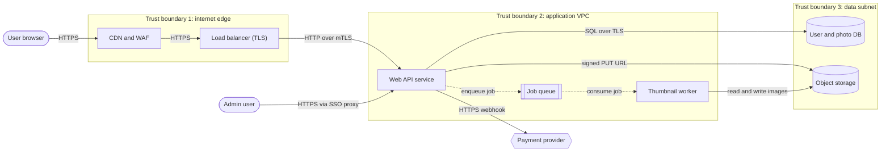
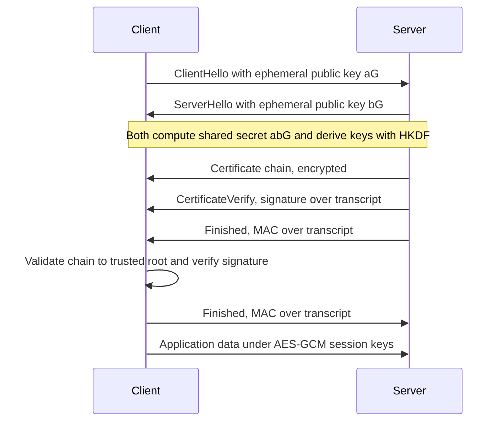
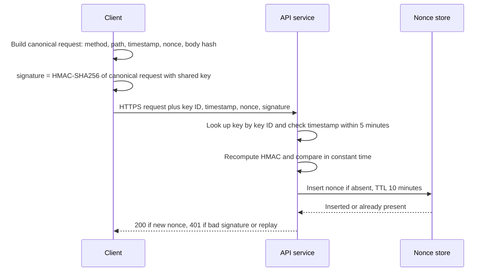
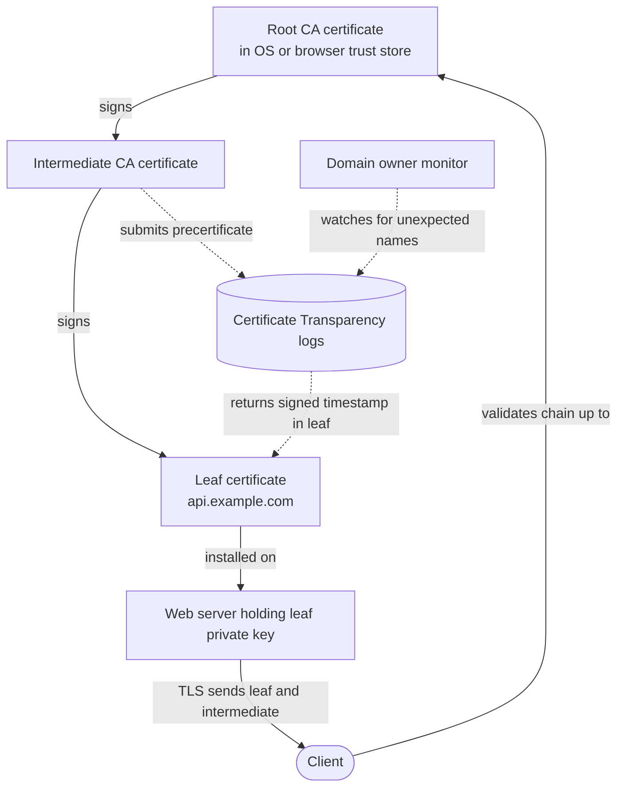
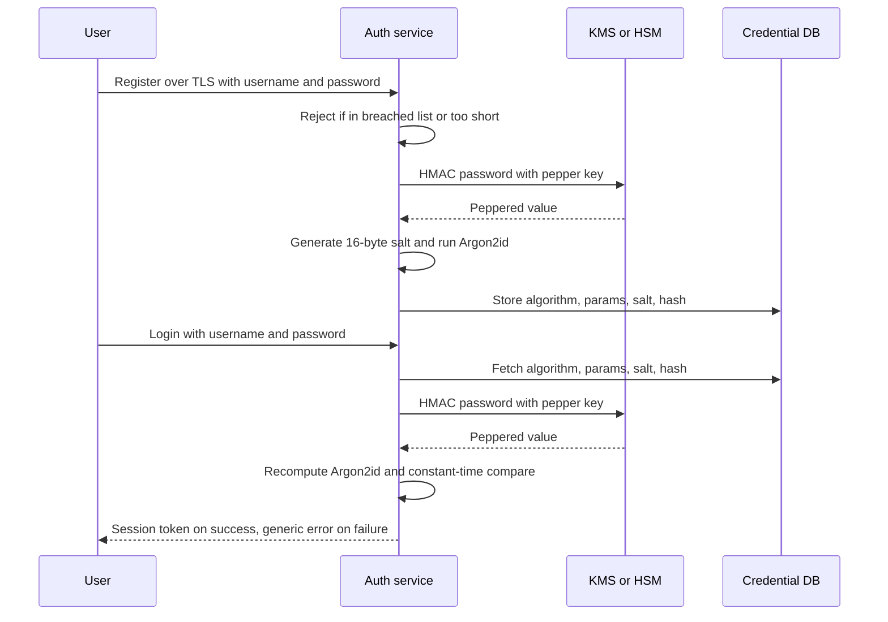
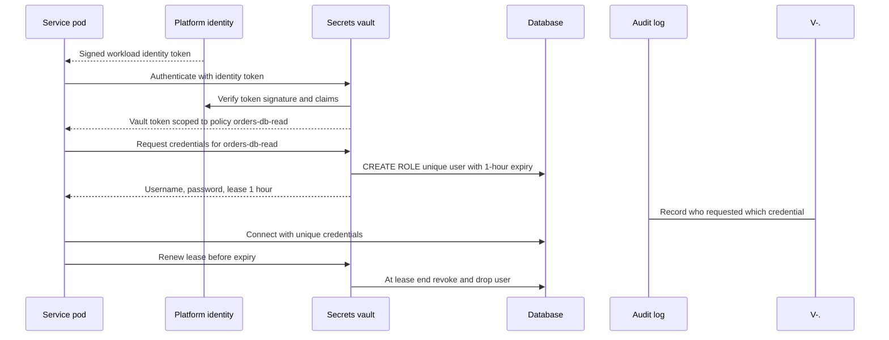
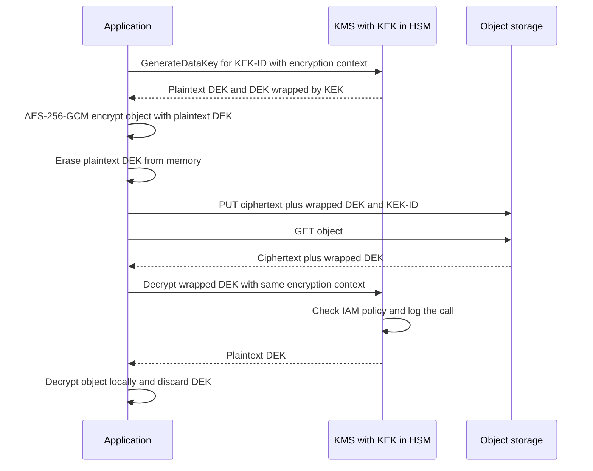
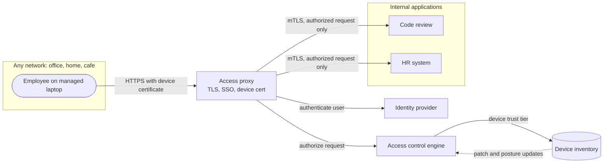
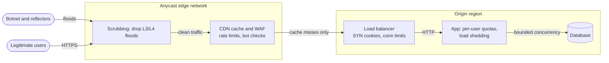
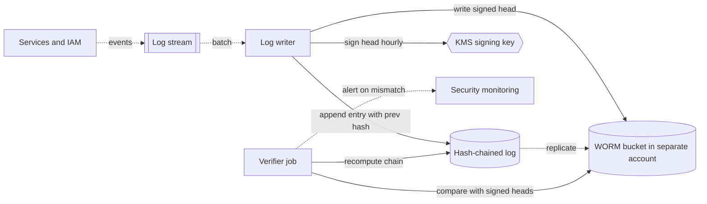

# Chapter 10 — Security Fundamentals for System Designers

> **Level:** 2 · **Track:** Shared · **Estimated reading time:** 5 h

Every system you design will be attacked. Not "might be": a service with a public IP address receives automated scanning traffic within minutes of going online, and any system that stores money, personal data or compute capacity is worth an attacker's time. Security is therefore not a feature you add at the end. It is a property of the architecture, in the same way that availability and latency are, and the cheapest time to get it right is when the boxes and arrows are still on the whiteboard.

This chapter gives you the vocabulary and mental models a system designer needs: finding threats systematically, choosing cryptographic building blocks, storing passwords and secrets, encrypting data with managed keys, limiting the blast radius of a breach, surviving denial-of-service attacks and keeping records an intruder cannot quietly rewrite. The focus is defensive and architectural. Chapter 50 builds on it with identity architecture, supply-chain security and privacy engineering.

## 10.1 Learning objectives

After this chapter you should be able to:

- Draw a data-flow diagram for a system, mark its trust boundaries and enumerate threats with STRIDE.
- Choose the correct cryptographic primitive (hash, MAC, symmetric encryption, asymmetric encryption, signature, key exchange) for a stated security goal and explain what it does *not* guarantee.
- Explain how a browser decides to trust a TLS certificate, and design certificate issuance and rotation for internal services.
- Store passwords with Argon2id, scrypt or bcrypt, choose cost parameters, and compute an attacker's expected brute-force cost.
- Map each OWASP Top 10 (2021) category to an architectural control.
- Design secrets management with a vault, short-lived credentials and automated rotation.
- Explain envelope encryption with a key management service (KMS) and draw its sequence diagram.
- Contrast perimeter security with zero trust, and explain mTLS, least privilege and network segmentation.
- Classify DDoS attacks as volumetric, protocol or application-layer and place mitigations at the right layer.
- Design a tamper-evident audit log.
- Apply a security checklist to any system design.

## 10.2 Prerequisites

- TCP, UDP and the OSI layers — §7.3, §7.7, §7.8 (DDoS attacks target specific layers).
- TLS 1.3 and HTTPS — §7.10 (this chapter explains the cryptography and certificates underneath it).
- Firewalls and security groups — §7.14 (the starting point for network segmentation).
- Authentication, authorization, sessions, JWT and OAuth 2.0 — §8.10–§8.14 (we assume you know what a session token is).
- Powers of two and logarithms — §4.3, §4.4 (key sizes and brute-force estimates are exponential).
- Probability essentials — §4.6 (collision and risk estimates).

## 10.3 Threat modeling

### 10.3.1 What "secure" means: security goals

::: definition
**Definition — Security property.** A statement about what must remain true about a system even when an adversary is actively trying to violate it. The classic triad is **confidentiality** (only authorized parties can read data), **integrity** (data and behavior cannot be changed without detection) and **availability** (authorized parties can use the system when they need it), often abbreviated **CIA**. System designers add **authentication** (knowing who is acting), **authorization** (deciding what that actor may do) and **non-repudiation** (an actor cannot credibly deny an action they took).
:::

#### First-principles explanation

Think about a house. Confidentiality is curtains: people outside cannot see your belongings. Integrity is a tamper seal on the medicine cabinet: you may not stop someone opening it, but you will know if they did. Availability is being able to get into your own home: a burglar who glues your lock shut has harmed you without stealing anything. Authentication is the doorman recognizing your face; authorization is the rule that your face opens the front door but not the neighbor's flat. Non-repudiation is the signed visitor's book: a visitor cannot later claim they were never there.

"Is this system secure?" has no answer on its own. The only answerable question is "secure against *whom*, protecting *what*, with respect to *which* property?" A public weather website needs integrity and availability but almost no confidentiality. A password database needs all three, and confidentiality failures there are catastrophic. Threat modeling is the discipline of asking these questions systematically instead of by intuition.

### 10.3.2 Assets, adversaries and trust boundaries

::: definition
**Definition — Threat model.** A structured description of a system, the **assets** in it that are worth protecting, the **adversaries** who might attack it and their capabilities, the **threats** (ways a security property could be violated), and the **mitigations** chosen for each threat [Shostack 2014].
:::

::: definition
**Definition — Trust boundary.** A line in a system where the level of trust changes: data or requests crossing it come from a party that the receiving side does not fully control or trust. Examples: the internet-to-load-balancer edge, the browser-to-server connection, a service calling a third-party API, a tenant's code running on shared infrastructure.
:::

**Assets** are the things an attacker wants or the things you cannot afford to lose: user credentials, payment data, personal data, signing keys, the ability to send email from your domain, compute capacity (attackers mine cryptocurrency on stolen cloud accounts), and your reputation. Rank them: a leaked public product catalog is embarrassing; leaked password hashes or private keys are a crisis.

**Adversaries** range from automated opportunists (bots scanning the whole internet for default passwords and known vulnerabilities), through targeted external attackers who study *your* system and phish *your* employees, malicious or compromised **insiders** who already hold legitimate credentials, and supply-chain attackers who compromise a library or vendor you depend on, up to well-resourced state actors. Every internet-facing design must handle the first three. The insider is the one beginners forget, and the reason zero trust (§10.10) and audit logging (§10.12) exist.

**Trust boundaries** are where attacks happen. Inside a single process, data you created yourself can be trusted; the moment data crosses a boundary, it must be **authenticated** (who sent it?), **authorized** (are they allowed?) and **validated** (is it well-formed?). Almost every vulnerability class in §10.7 is a failure to do one of these three things at a boundary.

### 10.3.3 Data-flow diagrams

#### How it works internally

A **data-flow diagram (DFD)** is the standard picture for threat modeling. It uses only four element types, plus boundaries:

1. **External entity** — something outside your control that sends or receives data (a user, a partner API).
2. **Process** — code that transforms data (a web server, a worker).
3. **Data store** — where data rests (a database, a bucket, a cache, a log).
4. **Data flow** — an arrow showing data moving between the above, labeled with what moves and over which protocol.
5. **Trust boundary** — a dashed box or line where trust changes.

The rules are deliberately simple so that every engineer on a team can draw one in ten minutes. The value is not the drawing; it is that each arrow crossing a boundary becomes a question: *how is this authenticated, authorized, validated and protected in transit?*

Shostack frames the whole exercise as four questions [Shostack 2014]: **What are we working on?** (draw the DFD) · **What can go wrong?** (apply STRIDE) · **What are we going to do about it?** (choose mitigations) · **Did we do a good job?** (review and test).

#### Architecture diagram

**Figure 10.1 — Data-flow diagram of a photo-sharing web application with trust boundaries.**



**Reading the diagram.** Two external entities (the user's browser and an administrator) and one external system (a payment provider, hexagon) sit outside every boundary. Trust boundary 1 is the internet edge: the CDN with a web application firewall (WAF) and the TLS-terminating load balancer are the first components that see untrusted traffic, so they carry rate limiting and coarse filtering. Trust boundary 2 is the application network: the web API is the only process that authenticates users and authorizes actions; it talks to the load balancer over mutual TLS. Solid arrows are synchronous request/response flows; the dotted arrows to and from the job queue are asynchronous — the thumbnail worker processes uploads later, so a failure there delays thumbnails but does not break uploads. Trust boundary 3 contains the storage: the database and object store accept connections only from the application subnet. Notice where the risky crossings are: every arrow from `U`, `ADM` and `PAY` crosses at least one boundary, and the worker parses user-uploaded image files, which is a classic place for parser vulnerabilities. Scaling options (more web replicas, more workers) do not change the boundaries, but each new data store or third-party integration adds a new arrow that must be modeled.

### 10.3.4 STRIDE

::: definition
**Definition — STRIDE.** A mnemonic for six threat categories, developed at Microsoft in 1999 by Loren Kohnfelder and Praerit Garg and popularized by Shostack [Shostack 2014]: **S**poofing, **T**ampering, **R**epudiation, **I**nformation disclosure, **D**enial of service and **E**levation of privilege. Each category is the violation of one security property.
:::

**Table 10.1 — STRIDE categories, the property each violates, and typical mitigations.**

| Threat | Violates | Plain-language question | Typical mitigations |
|---|---|---|---|
| Spoofing | Authentication | Can someone pretend to be another user or service? | Strong authentication, MFA, mTLS, signed tokens |
| Tampering | Integrity | Can someone change data in transit or at rest? | TLS, MACs, signatures, AEAD encryption, DB permissions |
| Repudiation | Non-repudiation | Can someone deny doing something? | Audit logs, signatures, tamper-evident storage |
| Information disclosure | Confidentiality | Can someone read what they should not? | Encryption, access control, data minimization |
| Denial of service | Availability | Can someone stop legitimate use? | Rate limits, quotas, autoscaling, DDoS protection |
| Elevation of privilege | Authorization | Can someone gain rights they were not granted? | Least privilege, authorization checks on every request, sandboxing |

You apply STRIDE **per element** of the DFD: for each process, data store and flow, walk through the six letters and ask whether the threat applies. Not every letter applies to every element type: an external entity can be spoofed but cannot be "tampered with" by you; a data flow can be tampered with, disclosed or flooded. This mechanical walk-through is what makes STRIDE useful — it stops you from fixating on the one threat you happened to think of first.

### 10.3.5 Worked example: STRIDE on the photo-sharing application

::: example
**Worked example — STRIDE pass over Figure 10.1.**

*Step 1 — Assets.* User credentials and session tokens; private photos; payment tokens returned by the provider; admin capabilities (delete any account); the database master credentials; the TLS private keys.

*Step 2 — Walk each boundary-crossing element.* The table below shows a representative (not exhaustive) result.

*Step 3 — Rank.* Score each threat for likelihood and impact on a 1–3 scale (see §10.3.6) and fix high scores first.

*Step 4 — Record.* The result is a short table in the design document, owned by the team, revisited whenever the DFD changes.
:::

**Table 10.2 — STRIDE threats for the photo-sharing application (excerpt).**

| # | Element | STRIDE | Threat | Mitigation | L × I |
|---|---|---|---|---|---|
| T1 | User → Web API | S | Credential stuffing with passwords leaked from other sites | Rate limit per account and IP; breached-password check; MFA; Argon2id storage | 3 × 3 = 9 |
| T2 | Web API | E | User changes `photo_id` in URL and reads another user's private photo (IDOR) | Object-level authorization check on every read, enforced in a shared data-access layer | 3 × 3 = 9 |
| T3 | Web API → Object store | I | Bucket accidentally made public | Block public access at account level; serve via short-lived signed URLs | 2 × 3 = 6 |
| T4 | Thumbnail worker | E | Malicious image exploits image-parsing library, attacker runs code in worker | Sandbox worker (no network, minimal IAM role), patch libraries, separate account | 2 × 3 = 6 |
| T5 | Payment webhook | S | Attacker forges "payment succeeded" webhook | Verify provider's HMAC signature and timestamp (§10.4.7) | 2 × 3 = 6 |
| T6 | Admin → Web API | R | Admin deletes an account and later denies it | Append-only, tamper-evident audit log of admin actions (§10.12) | 1 × 2 = 2 |
| T7 | Upload endpoint | D | Attacker uploads thousands of 1 GB files | Size limits, per-user quotas, rate limits | 2 × 2 = 4 |
| T8 | Web API → DB | T | SQL injection modifies rows | Parameterized queries; DB user without DDL rights | 2 × 3 = 6 |

Look at what the exercise produced: eight concrete, testable requirements, most of which are architectural (where the authorization check lives, which account the worker runs in, how the bucket is exposed) rather than "write secure code". That is the point of threat modeling for a system designer.

#### Mathematical foundations

::: formula
**Qualitative risk score**

$$R = L \times I$$

| Symbol | Meaning | Units |
|---|---|---|
| $R$ | Risk score used to rank threats | dimensionless (1–9 on a 3-point scale) |
| $L$ | Likelihood that the threat is exploited within the planning horizon (1 = unlikely, 2 = plausible, 3 = expected) | ordinal score |
| $I$ | Impact if exploited (1 = minor, 2 = serious, 3 = severe: data breach, financial loss, regulatory) | ordinal score |
:::

::: example
**Worked example — Ranking T1 against T6.** Credential stuffing (T1) is *expected* for any consumer login page, because attackers replay billions of leaked username–password pairs automatically: $L = 3$. Its impact is account takeover and private-photo exposure: $I = 3$. So $R = 3 \times 3 = 9$. Admin repudiation (T6) requires a malicious administrator ($L = 1$) and its impact is a dispute rather than a breach ($I = 2$): $R = 2$. *Interpretation:* fix T1 in the first release; T6 can follow. *Engineering implication:* the score is ordinal, not a probability — do not multiply it by dollar figures or average it across threats. Its only job is to order the work and make the reasoning visible to reviewers.
:::

#### Advantages, disadvantages and alternatives

STRIDE is easy to teach, systematic and tied to properties, which makes it ideal for design reviews. Its weaknesses: it can produce long lists of low-value threats, it does not rank risk by itself, and it focuses on technical threats more than abuse of legitimate features (spam, fraud, harassment). Alternatives include **attack trees** (a root goal such as "read another user's photo" decomposed into AND/OR subgoals — good for deep analysis of one critical asset), **PASTA** (a seven-stage risk-centric process), **LINDDUN** (privacy threats) and **kill-chain** analysis (focused on detection and response). Many teams use STRIDE for breadth and attack trees for the top two or three risks.

#### Failure scenarios

**Table 10.3 — Threat-modeling failure scenarios.**

| What goes wrong | Why | Detection | Recovery | Prevention |
|---|---|---|---|---|
| Threat model is stale | Architecture changed, DFD did not | New data store or vendor absent from DFD in review | Re-run STRIDE on changed elements | Make DFD update a checklist item for design changes |
| Threat model is a document nobody reads | Produced for compliance, not engineering | Mitigations not traced to tickets/tests | Convert each mitigation to a tracked task | Keep it short; review it in design review |
| Insider threats ignored | "Everything inside the VPC is trusted" assumption | Red-team exercise with internal credentials | Add authorization and audit inside the network | Include insider row in adversary list |

#### Common misconceptions

::: mistake
**"We use HTTPS, so we are secure."** TLS protects data *in transit* between two endpoints. It does nothing about a logged-in user requesting someone else's data (T2), a forged webhook (T5) or SQL injection (T8). Most real breaches happen through authenticated, encrypted connections.
:::


## 10.4 Cryptography essentials

Cryptography is the toolbox that turns security goals into mathematics. As a system designer you will almost never implement a cryptographic algorithm, but you will constantly *choose* one, and choosing the wrong primitive for a goal (encrypting when you needed to authenticate, hashing when you needed a secret key) is one of the most common design errors. This section explains each primitive by analogy, then by mechanism, then with the numbers that tell you how strong it is.

**Table 10.4 — Which primitive achieves which goal.**

| Goal | Primitive | Needs a key? | Typical algorithm (as of 2026) | Analogy |
|---|---|---|---|---|
| Detect accidental or malicious change, given a trusted reference value | Cryptographic hash | No | SHA-256, SHA-3, BLAKE2/3 | Fingerprint |
| Prove a message came from someone holding a shared secret, unchanged | MAC | Shared secret | HMAC-SHA-256 | Wax seal pressed with a ring both parties own |
| Keep data secret *and* detect tampering, between parties sharing a key | Authenticated (AEAD) symmetric encryption | Shared secret | AES-256-GCM, ChaCha20-Poly1305 | Locked box with a tamper seal |
| Let anyone send you a secret without a pre-shared key | Asymmetric encryption / KEM | Public + private key | RSA-OAEP, ECIES, ML-KEM | Padlock you hand out open; only you hold its key |
| Agree on a shared secret over a public channel | Key exchange | Ephemeral key pairs | ECDHE (X25519, P-256) | Mixing paint colors (see §10.4.5) |
| Prove to *anyone* that a specific key holder approved a message | Digital signature | Private key signs, public key verifies | Ed25519, ECDSA P-256, RSA-PSS | Notarized handwritten signature |
| Produce unpredictable keys, nonces, tokens | CSPRNG | Seeded by OS | `/dev/urandom`, `getrandom()`, `secrets` | Fair dice nobody can watch |

### 10.4.1 Hash functions

::: definition
**Definition — Cryptographic hash function.** A deterministic function $H$ that maps an input of any length to a fixed-length output (the **digest**), such that it is computationally infeasible to (1) find an input that hashes to a given digest (**preimage resistance**), (2) given one input, find a different input with the same digest (**second-preimage resistance**), and (3) find any two distinct inputs with the same digest (**collision resistance**).
:::

#### First-principles explanation

A hash is a fingerprint. You cannot reconstruct a person from a fingerprint, two people practically never share one, and the tiniest change in the person (a cut on the finger) changes the print. SHA-256 takes a 4 GB disk image or the single letter "a" and produces 256 bits; flip one input bit and roughly half of the output bits flip (the **avalanche effect**).

Hashes give you integrity *only if the reference digest itself is trustworthy*. If an attacker can change a download *and* the digest published next to it, the hash proves nothing. That is why hashes are combined with keys (MACs) or signatures, and why a plain hash is never a password-storage scheme on its own (§10.6).

#### How it works internally

SHA-2 hashes pad the input, split it into 512-bit (SHA-256) blocks and mix each block into a running internal state with a **compression function** (the **Merkle–Damgård construction**); the final state is the digest. A side effect is the **length-extension property**: given $H(m)$ and the length of $m$, anyone can compute $H(m \,\|\, \text{padding} \,\|\, x)$ without knowing $m$. That is harmless for fingerprints but fatal if you build a MAC as $H(\text{key} \,\|\, \text{message})$ — the reason HMAC exists (§10.4.6). SHA-3 uses a different "sponge" construction without this property.

MD5 and SHA-1 are broken for collision resistance: practical collisions were published for MD5 in 2004 and for SHA-1 in 2017 (the "SHAttered" attack). Do not use them for any security purpose.

#### Mathematical foundations

::: formula
**Birthday bound for hash collisions**

$$P_{\text{collision}} \approx \frac{k^2}{2^{\,n+1}}$$

| Symbol | Meaning | Units |
|---|---|---|
| $k$ | Number of distinct inputs hashed | count |
| $n$ | Digest length | bits |
| $P_{\text{collision}}$ | Probability that at least two of the $k$ digests are equal (valid while $P \ll 1$) | probability |

Consequence: an $n$-bit hash offers about $n/2$ bits of collision resistance, because $P$ approaches $1/2$ when $k \approx 2^{n/2}$.
:::

::: example
**Worked example — Is a 64-bit truncated hash safe as a content ID?** Suppose a storage service names objects by the first 64 bits of their SHA-256 digest and stores $k = 10^{10}$ objects (ten billion).

1. $k^2 = 10^{20}$.
2. $2^{65} \approx 3.69 \times 10^{19}$.
3. $P \approx 10^{20} / 3.69 \times 10^{19} \approx 2.7$ — the approximation has broken down because $P$ is not small; in reality a collision is all but certain.

With the full 256-bit digest: $P \approx 10^{20} / 2^{257} \approx 10^{20} / 2.3 \times 10^{77} \approx 4 \times 10^{-58}$.

*Interpretation:* 64 bits feels large, but birthday collisions arrive at around $2^{32} \approx 4.3$ billion items. *Engineering implication:* if an adversary benefits from a collision (deduplication, content addressing, signatures), use at least 256-bit digests; truncate only for non-adversarial uses such as cache sharding.
:::

### 10.4.2 Symmetric encryption and AES-GCM

::: definition
**Definition — Symmetric encryption.** Encryption in which the same secret key is used to encrypt and decrypt. A **block cipher** such as AES (Advanced Encryption Standard) encrypts fixed 128-bit blocks under a 128-, 192- or 256-bit key; a **mode of operation** turns the block cipher into a scheme for messages of any length.
:::

::: definition
**Definition — Authenticated encryption with associated data (AEAD).** A symmetric scheme that provides confidentiality for the plaintext *and* integrity for both the ciphertext and optional unencrypted **associated data** (AAD), producing an authentication **tag** that decryption checks before releasing any plaintext. AES-GCM and ChaCha20-Poly1305 are AEAD schemes.
:::

#### First-principles explanation

Symmetric encryption is a lockbox where sender and receiver hold copies of the same key. It is extremely fast: modern CPUs have AES instructions (AES-NI on x86, equivalent extensions on ARM) that encrypt at multiple gigabytes per second per core, which is why every bulk-data protocol — TLS records, disk encryption, database encryption — uses symmetric ciphers for the data itself. The hard part is not encrypting; it is getting the same key to both parties securely and keeping it secret, which the rest of this chapter addresses.

An *unauthenticated* mode such as AES-CBC or AES-CTR hides the content but does not detect changes. An attacker who flips bit 7 of a CTR ciphertext flips bit 7 of the plaintext — turning "pay $100" into "pay $900" without knowing the key. AEAD adds the tamper seal: any change to ciphertext, tag, nonce or associated data makes decryption fail.

#### How it works internally

AES-GCM (Galois/Counter Mode, NIST SP 800-38D):

1. Take a key $K$ and a 96-bit **nonce** (number used once) $N$.
2. Generate a keystream by encrypting the counter values $N\|2, N\|3, \dots$ with AES; XOR it with the plaintext to get ciphertext (counter mode).
3. Compute a 128-bit tag over the AAD and ciphertext using GHASH, a polynomial hash keyed by a value derived from $K$, and mask it with the encryption of $N\|1$.
4. Output (nonce, ciphertext, tag). Decryption recomputes the tag and rejects mismatches before returning plaintext.

The single most important rule: **never reuse a nonce with the same key.** A repeated nonce produces the same keystream, so XOR of two ciphertexts reveals the XOR of the two plaintexts, and it also leaks enough to forge tags. Use a 96-bit random nonce per message, or a counter that is guaranteed never to repeat, and rotate keys before the nonce collision probability becomes meaningful.

::: formula
**Random-nonce collision probability for AES-GCM**

$$P_{\text{reuse}} \approx \frac{q^2}{2^{97}}$$

| Symbol | Meaning | Units |
|---|---|---|
| $q$ | Number of messages encrypted under one key with random 96-bit nonces | messages |
| $P_{\text{reuse}}$ | Probability that any two of them share a nonce (birthday bound with $n = 96$) | probability |
:::

::: example
**Worked example — How many messages per key?** NIST SP 800-38D caps random-nonce GCM at $2^{32}$ invocations per key. Check the risk: $q = 2^{32}$ gives $q^2 = 2^{64}$, so $P \approx 2^{64}/2^{97} = 2^{-33} \approx 1.2 \times 10^{-10}$. A service encrypting 50,000 messages per second reaches $2^{32} \approx 4.3 \times 10^9$ messages in $4.3 \times 10^9 / 5 \times 10^4 \approx 86{,}000$ s, about one day. *Engineering implication:* a high-throughput service must rotate data keys at least daily, or use per-object keys (envelope encryption, §10.9), or a nonce-misuse-resistant mode such as AES-GCM-SIV, or a scheme with larger nonces (XChaCha20-Poly1305 uses 192-bit nonces).
:::

The associated data is a powerful design tool. If you encrypt a user's tax ID in row 42 of the `users` table and put `table=users;id=42` in the AAD, an attacker with database write access cannot copy that ciphertext into row 43 — decryption would fail because the context differs. The runnable example in §10.4.8 demonstrates exactly this.

### 10.4.3 Asymmetric cryptography: RSA and elliptic curves

::: definition
**Definition — Asymmetric (public-key) cryptography.** Cryptography using a mathematically linked **key pair**: a **public key** that can be shared with anyone and a **private key** kept secret by its owner. What one key does, only the other can undo or verify. Security rests on problems believed hard to invert: factoring large integers (RSA) or computing discrete logarithms on elliptic curves (ECC).
:::

#### First-principles explanation

Picture a padlock factory. You manufacture thousands of open padlocks, all of which only your key opens, and leave them in a bowl on the street. Anyone can put a message in a box, snap one of your padlocks shut, and mail it to you; nobody, including the sender, can reopen it — only you. The open padlocks are your public key; your key is the private key. Asymmetric cryptography solves the problem symmetric encryption cannot: two parties who have never met can communicate securely, provided the sender knows the padlock really is yours (that is what certificates in §10.5 establish).

The price is speed and size. An RSA-2048 private-key operation costs on the order of a millisecond of CPU, thousands of times more than encrypting a short message with AES. So real systems use asymmetric cryptography only to establish or protect a symmetric key and to sign things, never for bulk data. This combination is called **hybrid encryption**.

#### How it works internally

- **RSA**: pick two large random primes $p$ and $q$; the public key is $(n = pq, e)$, the private key is $d$ with $ed \equiv 1 \pmod{(p-1)(q-1)}$. Encryption is $c = m^e \bmod n$, decryption $m = c^d \bmod n$. Breaking it requires factoring $n$. RSA must always be used with a padding scheme (OAEP for encryption, PSS for signatures); "textbook RSA" is insecure.
- **Elliptic-curve cryptography (ECC)**: the private key is a random integer $a$; the public key is the point $A = a \cdot G$ obtained by "adding" a fixed base point $G$ on a curve to itself $a$ times. Recovering $a$ from $A$ (the elliptic-curve discrete logarithm problem) is believed to be infeasible. ECC achieves the same security as RSA with much smaller keys and faster operations, which is why TLS 1.3 deployments overwhelmingly use X25519 and P-256.

**Table 10.5 — Approximate equivalent security strengths (NIST SP 800-57 Part 1).**

| Security strength (bits) | Symmetric | RSA modulus | Elliptic curve key | Hash for collision resistance | Status |
|---|---|---|---|---|---|
| 112 | 3-key 3DES (legacy) | 2048 | 224 | SHA-224 | Minimum acceptable today |
| 128 | AES-128 | 3072 | 256 (P-256, X25519, Ed25519) | SHA-256 | Recommended default |
| 192 | AES-192 | 7680 | 384 (P-384) | SHA-384 | High assurance |
| 256 | AES-256 | 15360 | 512+ (P-521) | SHA-512 | Long-term / post-quantum margin for symmetric |

"128-bit security" means the best known attack takes about $2^{128}$ operations. At $10^{18}$ operations per second (far beyond all computers on Earth combined) that is $3.4 \times 10^{38} / 10^{18} = 3.4 \times 10^{20}$ s, about $10^{13}$ years.

::: warning
**Quantum computers and "harvest now, decrypt later."** A large fault-tolerant quantum computer running Shor's algorithm would break RSA and ECC; Grover's algorithm only roughly halves symmetric strength, leaving AES-256 a large margin. No such machine exists as of 2026, but recorded traffic could be decrypted later. NIST published post-quantum standards in August 2024 — FIPS 203 (ML-KEM), FIPS 204 (ML-DSA) and FIPS 205 (SLH-DSA) — and TLS libraries have begun deploying hybrid X25519 + ML-KEM key exchange. Design for **crypto agility** (configurable algorithms) and prefer AES-256 for long-lived data.
:::

### 10.4.4 Key exchange and forward secrecy

#### First-principles explanation

The classic analogy for **Diffie–Hellman key exchange** uses paint. Alice and Bob publicly agree on a common color, yellow. Alice secretly picks red, Bob secretly picks blue. Alice mixes yellow + red and sends the result (orange) across the open channel; Bob mixes yellow + blue and sends green. Alice adds her secret red to Bob's green; Bob adds his secret blue to Alice's orange. Both end up with the same yellow + red + blue brown. An eavesdropper saw yellow, orange and green but cannot "unmix" paint to recover red or blue.

In the elliptic-curve version (ECDH), Alice's secret is $a$, her public value $aG$; Bob's are $b$ and $bG$; both compute the shared point $abG$. The shared secret is then fed through a **key-derivation function** such as HKDF to produce symmetric session keys.

::: definition
**Definition — Forward secrecy.** A property of a key-exchange protocol whereby compromise of a party's long-term private key does not reveal session keys from past sessions. It is achieved by using fresh **ephemeral** key pairs for every session (the "E" in ECDHE) and deleting them afterward.
:::

Why it matters: before TLS 1.3, many servers used RSA key transport, where the client encrypted the session secret with the server's long-term RSA public key. Anyone who recorded traffic and later stole that one private key could decrypt *years* of recorded sessions. TLS 1.3 removed RSA key transport entirely; every full handshake uses ephemeral (EC)DHE, and the server's long-term key is used only to *sign* the handshake, proving its identity.

**Figure 10.2 — Simplified TLS 1.3 handshake: ephemeral key exchange plus signature.**



**Reading the diagram.** All messages flow synchronously over one TCP (or QUIC) connection, and the full handshake completes in one round trip before application data flows. The ephemeral public values travel in the clear; the shared secret never crosses the network. From the ServerHello onward, everything is encrypted with keys derived from that secret, including the certificate (hiding which certificate the server uses from passive observers). The server proves it owns the certificate's private key by **signing** the handshake transcript (CertificateVerify); the client validates the certificate chain (§10.5). The Finished messages are MACs over everything exchanged so far, so a man-in-the-middle who altered any earlier message is detected. Failure points: an expired or untrusted certificate (handshake aborts), a client and server with no common cipher suite, or clock skew on the client breaking validity checks.

### 10.4.5 Digital signatures

::: definition
**Definition — Digital signature.** A scheme with three algorithms: key generation, **sign** (using the private key, produces a signature over a message) and **verify** (using the public key, checks a signature against a message). A valid signature shows that the message was approved by the holder of the private key and has not changed since. Because verification needs only the public key, *anyone* can verify, which provides non-repudiation.
:::

Signatures are the notary of cryptography. They secure software updates (the update client holds the vendor's public key and refuses unsigned binaries), container images, JWTs signed with RS256 or ES256 (§8.13), certificates themselves, Git commits and the TLS handshake. In practice you sign a *hash* of the message: the signing algorithm hashes internally, so signing a 2 GB file costs one SHA-256 pass plus one fast private-key operation.

Prefer **Ed25519** (fast, deterministic, small 64-byte signatures, few ways to misuse) or **ECDSA P-256** where compliance requires NIST curves. ECDSA is fragile when the per-signature random value repeats or is biased: in 2010 researchers extracted Sony's PlayStation 3 code-signing key because the same random value was reused for every signature. Ed25519 derives this value deterministically, eliminating the failure mode.

### 10.4.6 Message authentication codes and HMAC

::: definition
**Definition — Message authentication code (MAC).** A short tag computed from a message and a secret key, $t = \text{MAC}_K(m)$, such that without $K$ it is infeasible to produce a valid tag for any new message. **HMAC** is the standard construction from a hash function: $\text{HMAC}_K(m) = H\big((K \oplus \text{opad}) \,\|\, H((K \oplus \text{ipad}) \,\|\, m)\big)$ [Krawczyk et al. 1997].
:::

A MAC is a wax seal pressed with a ring that both parties own. The receiver, holding the same ring, can tell the letter is genuine and unopened. But because both own the ring, a third party cannot tell *which* of them sealed it — so MACs provide integrity and authenticity between the two key holders, but **not** non-repudiation. That is the essential difference from a signature, and the reason payment providers sign webhooks with an HMAC (they only need you to know it came from them) while software vendors sign releases with asymmetric signatures (millions of verifiers who must not be able to forge).

HMAC's nested structure defeats the length-extension attack described in §10.4.1. It is also fast (two hash computations) and needs only a shared key, which makes it the standard tool for **request signing**: AWS Signature Version 4, Stripe and GitHub webhook signatures and many internal service-to-service schemes use HMAC-SHA-256.

**Figure 10.3 — HMAC request signing with replay protection.**



**Reading the diagram.** The client and API service share a secret key identified by a key ID (so keys can be rotated: during rotation the server accepts both the old and new key IDs). The client signs a **canonical** representation — a byte-exact serialization of every field the server will act on — because if a field is not covered (say, the HTTP method), an attacker can change it without invalidating the signature. The timestamp bounds how long a captured request remains useful; the nonce store (in production a shared cache such as Redis with a TTL slightly longer than twice the allowed skew) rejects exact replays inside that window. The signature comparison must be constant-time to avoid leaking, byte by byte, how much of a forged signature was correct. All calls are synchronous; the nonce store is the only shared state and a single point of failure — if it is unavailable, the service must choose between failing closed (reject requests) and failing open (accept possible replays), a decision that belongs in the design document.

#### Code example: HMAC request signing

```python
"""HMAC-SHA256 request signing and verification with replay protection."""
import hashlib
import hmac
import secrets
import time

MAX_SKEW_SECONDS = 300          # accept requests at most 5 minutes old/new

def canonical_request(method: str, path: str, timestamp: str,
                      nonce: str, body: bytes) -> bytes:
    body_hash = hashlib.sha256(body).hexdigest()
    # Every field the server relies on must be covered by the signature.
    return "\n".join([method.upper(), path, timestamp, nonce, body_hash]).encode()

def sign(key: bytes, method: str, path: str, body: bytes) -> dict:
    ts = str(int(time.time()))
    nonce = secrets.token_hex(16)
    mac = hmac.new(key, canonical_request(method, path, ts, nonce, body),
                   hashlib.sha256).hexdigest()
    return {"X-Key-Id": "client-42", "X-Timestamp": ts,
            "X-Nonce": nonce, "X-Signature": mac}

class Verifier:
    def __init__(self, keys: dict[str, bytes]):
        self.keys = keys
        self.seen_nonces: dict[str, int] = {}    # production: shared store with TTL

    def verify(self, method: str, path: str, body: bytes, headers: dict) -> bool:
        key = self.keys.get(headers.get("X-Key-Id", ""))
        if key is None:
            return False
        ts = int(headers["X-Timestamp"])
        now = int(time.time())
        if abs(now - ts) > MAX_SKEW_SECONDS:
            return False                                    # stale or future
        expected = hmac.new(key, canonical_request(method, path, headers["X-Timestamp"],
                                                   headers["X-Nonce"], body),
                            hashlib.sha256).hexdigest()
        if not hmac.compare_digest(expected, headers["X-Signature"]):
            return False                                    # forged or tampered
        # Expire old nonces, then reject a nonce we have already seen (replay).
        self.seen_nonces = {n: t for n, t in self.seen_nonces.items()
                            if now - t <= 2 * MAX_SKEW_SECONDS}
        if headers["X-Nonce"] in self.seen_nonces:
            return False
        self.seen_nonces[headers["X-Nonce"]] = ts
        return True
```

Tested with Python 3.13: a correctly signed request verifies; replaying it, altering one byte of the body, or signing with a different key all return `False`.

What to notice:

- `hmac.compare_digest` compares in constant time; `==` returns early at the first differing byte and can leak timing information.
- The body is covered via its SHA-256 hash, and the method and path are included, so neither can be swapped.
- The order of checks matters: the nonce is recorded only *after* the signature verifies, so an attacker cannot fill the nonce store with garbage that blocks legitimate nonces.
- The in-memory `seen_nonces` dictionary works for one process only; with several API replicas, use a shared store with an atomic "set if absent" operation (for example Redis `SET key value NX EX 600`).

### 10.4.7 Randomness

Every key, nonce, salt, session token and password-reset link depends on unpredictable random numbers. General-purpose generators (`random` in Python, `Math.random()` in JavaScript, `rand()` in C) are designed for simulations: they are fast and statistically uniform but **predictable** — observing a few hundred outputs of Python's Mersenne Twister lets an attacker compute all future outputs. Security code must use a **cryptographically secure pseudo-random number generator (CSPRNG)** seeded from the operating system's entropy pool: `secrets` or `os.urandom` in Python, `crypto.getRandomValues` in browsers, `SecureRandom` in Java, `crypto/rand` in Go.

::: formula
**Entropy of a uniformly random secret**

$$H = L \cdot \log_2 N$$

| Symbol | Meaning | Units |
|---|---|---|
| $H$ | Entropy: the number of bits an attacker must effectively guess | bits |
| $L$ | Length of the secret | symbols |
| $N$ | Number of equally likely choices per symbol | symbols |

Valid only when every symbol is chosen independently and uniformly at random — true for machine-generated tokens, false for human-chosen passwords.
:::

::: example
**Worked example — How long should a session token be?** `secrets.token_urlsafe(32)` draws 32 random bytes ($N = 256$, $L = 32$): $H = 32 \times 8 = 256$ bits. An attacker making $10^6$ guesses per second for a year ($3.15 \times 10^{13}$ guesses) against $10^8$ live sessions succeeds with probability about $3.15 \times 10^{13} \times 10^8 / 2^{256} \approx 3 \times 10^{-56}$. *Engineering implication:* 128 bits of CSPRNG output is already ample; the realistic risk is tokens leaking through logs, URLs and referrer headers, not guessing.
:::

### 10.4.8 Don't roll your own crypto

"Don't roll your own crypto" does not only mean "don't invent a cipher". It means: do not assemble primitives into your own protocol or storage format when a vetted, high-level construction exists. The canonical failures are all compositions of *correct* primitives: encrypting without authenticating (bit-flipping attacks), MAC-then-encrypt with distinguishable padding errors (padding-oracle attacks against CBC), `SHA256(key || msg)` as a MAC (length extension), reused GCM nonces, comparing MACs with `==` (timing attacks), and ECB mode, which encrypts identical blocks to identical ciphertext so that patterns in an image remain visible. Ferguson, Schneier and Kohno make the case that most cryptographic failures in practice are engineering failures in how primitives are combined and keys are handled, not breaks of the primitives themselves [Ferguson et al. 2010].

::: recommendation
**Practical rule set.** (1) Use TLS 1.3 for data in transit — do not design a transport protocol. (2) Use a high-level library API (libsodium/NaCl `secretbox`, Google Tink, or the `cryptography` package's AEAD classes) that chooses nonces, modes and tag checks for you. (3) Use a managed KMS for key storage and envelope encryption (§10.9). (4) Use a password-hashing function, not a hash (§10.6). (5) Use your platform's JWT/OAuth libraries, pinned to an explicit algorithm allow-list. (6) Have a cryptographer review any design where you still feel you need to combine primitives.
:::

#### Code example: AEAD, signatures and key agreement

```python
"""AES-256-GCM with associated data, Ed25519 signatures and X25519 key agreement."""
import os
from cryptography.exceptions import InvalidSignature, InvalidTag
from cryptography.hazmat.primitives import hashes
from cryptography.hazmat.primitives.asymmetric.ed25519 import Ed25519PrivateKey
from cryptography.hazmat.primitives.asymmetric.x25519 import X25519PrivateKey
from cryptography.hazmat.primitives.ciphers.aead import AESGCM
from cryptography.hazmat.primitives.kdf.hkdf import HKDF

# --- 1. Authenticated symmetric encryption: AES-256-GCM ---
key = AESGCM.generate_key(bit_length=256)
aead = AESGCM(key)
nonce = os.urandom(12)                       # 96-bit nonce; NEVER reuse with same key
aad = b"user_id=42;table=payments"           # authenticated but not encrypted
ct = aead.encrypt(nonce, b"card ending 4242", aad)
print("ciphertext+tag bytes:", len(ct))      # plaintext length + 16-byte tag
print("decrypted:", aead.decrypt(nonce, ct, aad))
try:
    aead.decrypt(nonce, ct, b"user_id=43;table=payments")   # wrong context
except InvalidTag:
    print("AAD mismatch -> InvalidTag (ciphertext cannot be moved to another row)")
tampered = bytearray(ct); tampered[0] ^= 1
try:
    aead.decrypt(nonce, bytes(tampered), aad)
except InvalidTag:
    print("bit flip -> InvalidTag")

# --- 2. Digital signatures: Ed25519 ---
signing_key = Ed25519PrivateKey.generate()
verify_key = signing_key.public_key()
release = b"release v2.4.1 sha256=9f86d08..."
sig = signing_key.sign(release)
print("signature bytes:", len(sig))
verify_key.verify(sig, release)              # raises if invalid
try:
    verify_key.verify(sig, release + b"!")
except InvalidSignature:
    print("modified message -> InvalidSignature")

# --- 3. Key agreement: X25519 + HKDF ---
alice, bob = X25519PrivateKey.generate(), X25519PrivateKey.generate()
shared_a = alice.exchange(bob.public_key())  # only public keys cross the network
shared_b = bob.exchange(alice.public_key())
assert shared_a == shared_b
session_key = HKDF(algorithm=hashes.SHA256(), length=32, salt=None,
                   info=b"example-protocol v1 session key").derive(shared_a)
print("both sides derived the same 256-bit session key:", session_key.hex()[:16], "...")
```

Tested with `cryptography` 50.0.1: decryption succeeds with the right AAD; a changed AAD or a single flipped ciphertext bit raises `InvalidTag`; a modified release string raises `InvalidSignature`; both X25519 parties derive the same key.

What to notice:

- The 16-byte plaintext became 32 bytes: GCM ciphertext is the same length as the plaintext plus a 16-byte tag. The 12-byte nonce must be stored alongside it (it is not secret).
- Decryption fails *loudly* on any tampering or context mismatch; there is no way to obtain partially decrypted garbage.
- The raw X25519 output is never used directly as a key; HKDF with a protocol-specific `info` string turns it into a uniformly random key bound to its purpose.

**Table 10.6 — Hash vs MAC vs signature vs encryption.**

| | Hash | MAC (HMAC) | Digital signature | AEAD encryption |
|---|---|---|---|---|
| Confidentiality | No | No | No | Yes |
| Integrity | Only against a trusted digest | Yes | Yes | Yes |
| Authenticity | No | Yes, among key holders | Yes, publicly verifiable | Yes, among key holders |
| Non-repudiation | No | No | Yes | No |
| Key | None | Shared secret | Private / public pair | Shared secret |
| Speed | GB/s | GB/s | ~10⁴–10⁵ signatures/s per core (Ed25519) | GB/s with AES-NI |
| Typical use | Checksums, content addressing, Merkle trees | Webhooks, API request signing, cookies | Software updates, certificates, JWT (RS/ES), audit anchors | Data at rest and in transit |

#### Common misconceptions

::: mistake
**"Encoding, hashing and encryption are interchangeable."** Base64 is an *encoding*: reversible by anyone, provides no security. A hash is one-way and keyless: anyone can compute it, so it cannot keep a low-entropy value (a phone number, a password) secret — an attacker hashes every candidate. Encryption is reversible *with the key*. Kubernetes Secrets stored as base64 in etcd without encryption at rest are, from a security standpoint, plaintext.
:::


## 10.5 PKI and certificates

::: definition
**Definition — Public key infrastructure (PKI).** The set of roles, policies and systems that bind public keys to identities. A **certificate** (X.509) is a document stating "this public key belongs to this name (for example `api.example.com`), valid from date A to date B", signed by a **certificate authority (CA)**. A client trusts a certificate if it can build a **chain** of valid signatures from it to a **root CA** certificate in its local **trust store**.
:::

### First-principles explanation

Asymmetric cryptography lets anyone lock a box with your padlock — but how does a stranger know the padlock in the bowl is *yours* and not one an impostor swapped in? A passport solves the same problem for people: a government you already trust vouches for the link between a photo and a name. A CA is that government for public keys. Your browser or operating system ships with roughly a hundred-odd root CA certificates (the exact number varies by vendor), and it trusts any certificate that chains back to one of them.

### How it works internally

1. The server operator generates a key pair and sends the CA a **certificate signing request** containing the public key and the domain name.
2. The CA verifies control of the domain — for automated CAs, via the **ACME** protocol (RFC 8555): placing a token at a well-known HTTP path or in a DNS TXT record.
3. The CA signs a certificate using an **intermediate CA** key. Root keys are kept offline in hardware security modules and only sign intermediates, so a root key is used a few times per decade.
4. In the TLS handshake the server sends its **leaf** certificate plus intermediates. The client checks each signature up to a trusted root, the validity dates, the domain name, key-usage constraints and revocation status.

**Figure 10.4 — Certificate chain of trust and Certificate Transparency.**



**Reading the diagram.** Solid arrows show the signing hierarchy and the synchronous TLS path: the root signs the intermediate, the intermediate signs the leaf, and the server presents leaf plus intermediate to the client, which already holds the root. Dotted arrows show the asynchronous transparency path: before issuance the CA submits a precertificate to public append-only logs and embeds the logs' signed timestamps in the final certificate; browsers that enforce CT reject publicly trusted certificates without them. A domain owner's monitor watches the logs and alerts on any certificate for its names it did not request. Failure points: an expired leaf or intermediate (the most common certificate outage), a server that forgets to send the intermediate (works in some clients, fails in others), and a compromised or misbehaving CA — the reason CT exists.

**Revocation** — withdrawing a certificate before expiry because its key leaked — works poorly in practice: revocation lists grow large, online status checks (OCSP) add latency and leak browsing history, and clients usually "soft-fail" when the responder is unreachable. The industry's answer is shorter lifetimes. Let's Encrypt has issued 90-day certificates since 2015 to force automation, and in 2025 the CA/Browser Forum voted to shrink the maximum lifetime of publicly trusted TLS certificates in stages, reaching 47 days by 2029 (as of 2026; check the current Baseline Requirements).

::: definition
**Definition — Certificate Transparency (CT).** A system of public, append-only, Merkle-tree-based logs into which CAs record every certificate they issue, so that mis-issued certificates become publicly detectable [RFC 6962].
:::

::: industry
**DigiNotar (2011).** Attackers compromised the Dutch CA DigiNotar and issued hundreds of fraudulent certificates, including one for `*.google.com` that was used to intercept traffic of users in Iran. Browsers removed DigiNotar from their trust stores and the company went bankrupt within weeks. The incident directly motivated Certificate Transparency: had CT existed, Google's monitors would have seen the rogue certificate within hours of issuance.
*Evidence: Secondary* — [Fox-IT 2012]
:::

### Certificate rotation for internal services

For service-to-service mTLS (§10.10) you run a private CA (cloud private CA services, HashiCorp Vault's PKI engine, or a service mesh's built-in CA). The design rules: issue **short-lived** certificates (hours to days); rotate automatically well before expiry (renew at about two-thirds of lifetime); have services reload certificates without restarting; alert on any certificate with less than, say, 25% of its lifetime remaining; and treat the CA's private key as the most sensitive key in the company (store it in an HSM or KMS).

**Table 10.7 — Certificate failure scenarios.**

| What goes wrong | Why | Detection | Recovery | Prevention |
|---|---|---|---|---|
| Expired certificate outage | Manual renewal forgotten; long lifetime meant the process was never exercised | Synthetic TLS probes; expiry metrics | Emergency renewal and deploy | Automated issuance (ACME), short lifetimes, expiry alerts |
| Private key leak | Key in a repo, image or backup | Secret scanning; CT monitor shows unexpected certs | Revoke, reissue, rotate | Keys generated on host or in KMS/HSM, never copied |
| Rogue certificate for your domain | Compromised or careless CA | CT log monitoring | Request revocation; report to browser vendors | CAA DNS records restricting which CAs may issue |

## 10.6 Password storage

### 10.6.1 Why passwords need special treatment

#### First-principles explanation

Suppose you run a coat check. You could keep each customer's ticket number in a ledger, but if the ledger is stolen, the thief can claim every coat. Better: keep only a "fingerprint" of each ticket, so a stolen ledger is useless — *unless* the tickets are so predictable that the thief can fingerprint every possible ticket and match them. Human passwords are predictable tickets: "Summer2024!" and its millions of cousins appear in every attacker's wordlist.

The design goal therefore is: **assume the password database will one day be stolen** (via SQL injection, a leaked backup or an insider), and make each password as expensive as possible to recover from what was stolen. Three techniques combine to achieve this.

1. **Hash, don't encrypt.** The server never needs the password back; it only needs to check a candidate. A one-way function means there is no decryption key to steal.
2. **Salt.** A **salt** is a unique random value (at least 16 bytes) stored next to each hash and mixed into it. Without salts, identical passwords produce identical hashes, so one computation cracks every user with "123456", and attackers can use precomputed **rainbow tables**. With salts, every guess must be computed separately per user.
3. **Slow, memory-hard hashing.** SHA-256 is designed to be fast; a single high-end GPU computes on the order of $10^{10}$ SHA-256 hashes per second (order-of-magnitude figure as of 2024). A **password-hashing function** (bcrypt, scrypt, Argon2id) is deliberately slow and, for scrypt and Argon2, **memory-hard**: each guess needs tens of megabytes of RAM, which defeats the massive parallelism of GPUs and custom chips.

Optionally add a **pepper**: a secret key, stored outside the database (in a KMS or HSM), applied as an HMAC before or after hashing. A database-only leak then yields hashes that cannot be attacked at all without also stealing the pepper. NIST SP 800-63B recommends this additional keyed step.

::: industry
**LinkedIn (2012).** About 6.5 million LinkedIn password hashes were posted publicly in 2012; they were unsalted SHA-1 hashes, and a large fraction were cracked within days. In 2016 a much larger dataset from the same breach (reported at over 100 million accounts) surfaced. The lesson is both technical (fast, unsalted hashes) and architectural (credential reuse turns one site's breach into credential stuffing against every other site — threat T1 in Table 10.2).
*Evidence: Secondary* — widely reported in the technology press, 2012 and 2016.
:::

### 10.6.2 Algorithms and cost parameters

**Table 10.8 — Password-hashing functions compared (parameters per [OWASP Password Storage Cheat Sheet], as of 2026).**

| | Argon2id | scrypt | bcrypt | PBKDF2-HMAC-SHA-256 |
|---|---|---|---|---|
| What it is | Winner of the 2015 Password Hashing Competition, RFC 9106 | Memory-hard KDF, RFC 7914 | Blowfish-based adaptive hash (1999) | Iterated HMAC, NIST-approved |
| Cost knobs | memory $m$, iterations $t$, parallelism $p$ | $N$ (CPU/memory), $r$ (block size), $p$ | work factor (cost $c$ ⇒ $2^c$ rounds) | iteration count |
| Memory-hard | Yes | Yes | No (4 KiB) | No |
| OWASP minimum | $m$ = 19 MiB, $t$ = 2, $p$ = 1 | $N = 2^{17}$, $r$ = 8, $p$ = 1 | cost ≥ 10 | ≥ 600,000 iterations |
| Gotchas | Library support varies | Memory = $128 \cdot N \cdot r$ bytes (128 MiB at OWASP minimum) | Truncates input at 72 bytes | GPU-friendly; use only when FIPS-140 is required |
| Choose when | Default for new systems | Argon2id unavailable | Legacy systems, wide library support | Compliance mandates FIPS |

RFC 9106 also gives two general-purpose Argon2id recommendations: $t = 1$, $p = 4$, $m = 2$ GiB where memory allows, or $t = 3$, $p = 4$, $m = 64$ MiB otherwise [RFC 9106]. The OWASP minimums are lower because login servers must handle many concurrent hashes.

**Choosing cost parameters** is a capacity-planning decision. Pick the most expensive setting that keeps a single hash at roughly 50–500 ms on your production hardware and that your login fleet can afford at peak. If peak login rate is 200 per second and one hash costs 100 ms of one core and 64 MiB, you need about $200 \times 0.1 = 20$ cores and $20 \times 64$ MiB ≈ 1.3 GiB of RAM dedicated to hashing — plus headroom, because an attacker can make login attempts to burn your CPU (rate-limit the endpoint). Store the algorithm and parameters with each hash so you can raise them later and **rehash on next successful login**.

#### Mathematical foundations

::: formula
**Expected offline brute-force time**

$$T = \frac{S}{2 \cdot R \cdot G}$$

| Symbol | Meaning | Units |
|---|---|---|
| $T$ | Expected time to find one password (average: half the space) | seconds |
| $S$ | Size of the search space: $N^L$ for random passwords, or the size of the attacker's ranked wordlist up to the target | candidates |
| $R$ | Guesses per second per attacking device for this hash function and cost | guesses/s/device |
| $G$ | Number of attacking devices (GPUs) | devices |

Salting means $T$ is paid **per user**; without salts, one pass covers all users.
:::

::: example
**Worked example — Fast hash vs slow hash.** A user picks a random 8-character password from the 95 printable ASCII characters.

1. Search space: $S = 95^8 \approx 6.63 \times 10^{15}$ (entropy $8 \log_2 95 \approx 52.6$ bits).
2. *Salted SHA-256*, $R \approx 10^{10}$ /s, $G = 10$ GPUs: $T = 6.63 \times 10^{15} / (2 \times 10^{11}) \approx 3.3 \times 10^4$ s ≈ **9 hours**.
3. *Argon2id or bcrypt tuned to ~100 ms on a server core*. An attacker's GPU is far less advantaged on memory-hard functions; assume an optimistic $R \approx 10^4$ /s per device: $T = 6.63 \times 10^{15} / (2 \times 10^{5}) \approx 3.3 \times 10^{10}$ s ≈ **1,050 years** per password.
4. A 12-character random password ($S = 95^{12} \approx 5.4 \times 10^{23}$) against the same slow hash: $\approx 2.7 \times 10^{18}$ s, about $8.6 \times 10^{10}$ years.

*Interpretation:* the slow hash multiplies the attacker's cost by $10^6$; length multiplies it exponentially. *But* human passwords are not random: "Summer2024!" appears near the top of real wordlists, so $S$ for it is perhaps $10^6$, and even at $10^4$ guesses/s it falls in under a minute. *Engineering implication:* slow hashing protects the middle of the distribution; protecting the weakest passwords requires refusing them at registration (breached-password lists) and adding MFA.
:::

**NIST guidance.** NIST SP 800-63B, revised as SP 800-63B-4 (final in 2025), reverses several folk rules: do **not** impose composition rules ("one uppercase, one symbol"), do **not** force periodic password changes without evidence of compromise, **do** check new passwords against lists of breached and commonly used passwords, allow at least 64 characters and all printable characters including spaces, and require a minimum length — 15 characters when the password is the only authentication factor, 8 when it is part of multi-factor authentication [NIST SP 800-63B-4].

#### Architecture diagram

**Figure 10.5 — Registration and login with salted Argon2id and a pepper.**



**Reading the diagram.** All calls are synchronous. The password exists in plaintext only in memory of the auth service, briefly. The pepper key never leaves the KMS or HSM; the service sends it data to MAC (some designs instead load the pepper into service memory at startup, trading isolation for one fewer network call per login). The credential database stores only the self-describing record — for example `argon2id$m=19456,t=2,p=1$<salt>$<hash>` — so a stolen database alone is not enough to start guessing. The failure response is deliberately generic ("invalid username or password") and takes the same time for unknown users to avoid revealing which accounts exist. Scaling: the Argon2id step dominates CPU and memory, so login capacity scales with auth-service replicas; rate limiting per account and per IP sits in front of it.

#### Code example

```python
"""Password hashing with scrypt (standard library) and Argon2id (cryptography >= 44)."""
import base64
import hashlib
import hmac
import os
import time

# ---------- scrypt (stdlib) ----------
SCRYPT_N, SCRYPT_R, SCRYPT_P = 2**17, 8, 1   # OWASP minimum: N=2^17, r=8, p=1
SCRYPT_MAXMEM = 256 * 1024 * 1024            # memory needed is ~128*N*r = 128 MiB

def b64(b: bytes) -> str:
    return base64.b64encode(b).decode().rstrip("=")

def unb64(s: str) -> bytes:
    return base64.b64decode(s + "=" * (-len(s) % 4))

def scrypt_hash(password: str) -> str:
    salt = os.urandom(16)                                   # unique per password
    dk = hashlib.scrypt(password.encode("utf-8"), salt=salt,
                        n=SCRYPT_N, r=SCRYPT_R, p=SCRYPT_P,
                        maxmem=SCRYPT_MAXMEM, dklen=32)
    # Store algorithm, parameters, salt and hash together so they can evolve.
    return f"scrypt${SCRYPT_N}${SCRYPT_R}${SCRYPT_P}${b64(salt)}${b64(dk)}"

def scrypt_verify(password: str, stored: str) -> bool:
    alg, n, r, p, salt_s, dk_s = stored.split("$")
    if alg != "scrypt":
        raise ValueError("unknown algorithm")
    n, r, p = int(n), int(r), int(p)
    candidate = hashlib.scrypt(password.encode("utf-8"), salt=unb64(salt_s),
                               n=n, r=r, p=p,
                               maxmem=max(SCRYPT_MAXMEM, 256 * n * r), dklen=32)
    return hmac.compare_digest(candidate, unb64(dk_s))      # constant-time compare

def needs_rehash(stored: str) -> bool:
    _, n, r, p, *_ = stored.split("$")
    return (int(n), int(r), int(p)) != (SCRYPT_N, SCRYPT_R, SCRYPT_P)

# ---------- Argon2id (cryptography library) ----------
from cryptography.hazmat.primitives.kdf.argon2 import Argon2id
from cryptography.exceptions import InvalidKey

ARGON_T, ARGON_M_KIB, ARGON_P = 2, 19 * 1024, 1   # OWASP minimum: m=19 MiB, t=2, p=1

def argon2id_hash(password: str) -> str:
    salt = os.urandom(16)
    kdf = Argon2id(salt=salt, length=32, iterations=ARGON_T,
                   lanes=ARGON_P, memory_cost=ARGON_M_KIB)
    tag = kdf.derive(password.encode("utf-8"))
    return f"argon2id${ARGON_M_KIB}${ARGON_T}${ARGON_P}${b64(salt)}${b64(tag)}"

def argon2id_verify(password: str, stored: str) -> bool:
    alg, m, t, p, salt_s, tag_s = stored.split("$")
    if alg != "argon2id":
        raise ValueError("unknown algorithm")
    kdf = Argon2id(salt=unb64(salt_s), length=32, iterations=int(t),
                   lanes=int(p), memory_cost=int(m))
    try:
        kdf.verify(password.encode("utf-8"), unb64(tag_s))  # constant-time inside
        return True
    except InvalidKey:
        return False
```

Tested with Python 3.13 and `cryptography` 50.0.1 on a cloud VM: one scrypt hash at OWASP-minimum settings took about 400 ms, one Argon2id hash about 33 ms; correct passwords verify, a one-letter change fails, and hashing the same password twice gives different strings.

What to notice:

- `hashlib.scrypt` refuses to use more than 32 MiB by default; `maxmem` must be raised for $N = 2^{17}$, $r = 8$ (128 MiB).
- The stored string is self-describing (algorithm, parameters, salt, hash), which is what makes `needs_rehash` and gradual parameter upgrades possible. Production code should prefer the standard PHC string format produced by maintained libraries such as `argon2-cffi`.
- ~33 ms for Argon2id at OWASP-minimum settings is a floor; raise $m$ or $t$ until the cost reaches your latency and capacity budget.

::: mistake
**"Encrypting passwords is safer than hashing them."** Encryption is reversible, so whoever obtains the key — an attacker with application-server access, a rogue administrator — recovers every password at once. Systems should never need to recover a user's password; if a product requirement says "email users their password", the requirement is wrong.
:::

## 10.7 The OWASP Top 10 in architectural terms

::: definition
**Definition — OWASP Top 10.** A consensus ranking of the most critical web application security risk categories, published by the Open Worldwide Application Security Project from vulnerability data contributed by testing organizations plus a community survey. This section uses the **2021 edition** [OWASP 2021]. A 2025 edition has since been published; it keeps broken access control at #1, folds SSRF into it, and adds categories for software supply-chain failures and mishandling of exceptional conditions, so the architectural controls below remain applicable.
:::

The Top 10 is often taught as a list of coding bugs. For a system designer, each category is better read as a *missing architectural control*: something that should exist once, centrally, rather than being re-implemented correctly by every developer on every endpoint.

**Table 10.9 — OWASP Top 10 (2021) mapped to architectural controls.**

| ID | Category | What goes wrong | Architectural control |
|---|---|---|---|
| A01 | Broken Access Control | Users act outside their permissions: IDOR, missing function-level checks, CORS misconfiguration | Deny by default; central policy engine or authorization middleware; object-level checks in the data-access layer; tenant ID derived from the token, never from the request body |
| A02 | Cryptographic Failures | Sensitive data unencrypted or protected with weak/misused crypto | TLS everywhere; KMS-managed keys; AEAD; data classification deciding what is encrypted (§10.9) |
| A03 | Injection | Untrusted data interpreted as code: SQL, NoSQL, OS command, LDAP; cross-site scripting is included here in 2021 | Parameterized queries/ORMs; no shell invocation with user input; context-aware output encoding; Content Security Policy |
| A04 | Insecure Design | Missing or ineffective security controls by design, not by implementation | Threat modeling (§10.3); abuse-case requirements; rate limits and business-logic limits designed in |
| A05 | Security Misconfiguration | Default credentials, verbose errors, open buckets, unnecessary features enabled | Infrastructure as code with policy checks; hardened base images; configuration drift detection |
| A06 | Vulnerable and Outdated Components | Known-vulnerable libraries, frameworks, OS packages | Software bill of materials (SBOM); dependency scanning in CI; patch SLAs; automated update PRs |
| A07 | Identification and Authentication Failures | Credential stuffing, weak session handling, missing MFA | Central identity provider; MFA; rate limiting; secure session tokens (§10.4.7) |
| A08 | Software and Data Integrity Failures | Unsigned updates, compromised CI/CD, insecure deserialization | Signed artifacts and provenance; protected build pipeline; no deserialization of untrusted native objects |
| A09 | Security Logging and Monitoring Failures | Breaches go undetected for months | Central, tamper-evident audit logs (§10.12); alerting on security events |
| A10 | Server-Side Request Forgery (SSRF) | Server fetches an attacker-chosen URL, reaching internal services | Egress allow-lists via a dedicated fetch proxy; block metadata and private ranges; IMDSv2-style token-protected metadata |

### 10.7.1 Broken access control (A01)

Broken access control is #1 because authorization is the one control that cannot be bolted on by infrastructure: only the application knows that photo 9001 belongs to user 42. The classic form is the **insecure direct object reference (IDOR)**: `GET /api/photos/9001` returns the photo to anyone authenticated, because the handler checks *that* the user is logged in but not *whether* they own photo 9001.

Architectural patterns that make the correct behavior the default:

- **Deny by default.** A new endpoint without an explicit policy rejects all requests.
- **Centralize decisions.** Route every authorization question through one library or service (a policy engine such as Open Policy Agent, or a relationship-based system modeled on Google's Zanzibar — §8.12), so the rules are written and reviewed once.
- **Push checks to the data layer.** Repository methods take the caller's identity and add `WHERE owner_id = :caller` (or tenant filters) automatically; database row-level security can enforce the same rule underneath.
- **Use unguessable identifiers as defense in depth, not as the control.** Random UUIDs make enumeration harder but are not authorization; IDs leak through URLs, logs and shares.

### 10.7.2 Injection (A03)

Injection happens when data and code share a channel. A query built as `"SELECT * FROM users WHERE name = '" + name + "'"` lets an attacker supply `' OR '1'='1` and change the query's *structure*. **Parameterized queries** separate the channels: the query text is sent to the database with placeholders, and values are sent separately, so a value can never become syntax.

```python
import sqlite3
db = sqlite3.connect(":memory:")
db.execute("CREATE TABLE users (name TEXT, email TEXT)")
db.execute("INSERT INTO users VALUES ('alice', 'a@example.com')")
attacker_input = "x' OR '1'='1"
# Vulnerable (illustrative, never do this): f"... WHERE name = '{attacker_input}'"
rows = db.execute("SELECT email FROM users WHERE name = ?", (attacker_input,)).fetchall()
print(rows)   # [] -- the input is treated purely as a value
```

What to notice: the `?` placeholder is bound by the driver; no escaping function is needed or involved. The architectural layer of defense is to give the application's database user only the rights it needs (no `DROP`, no access to other schemas), so a missed injection cannot become a full compromise.

### 10.7.3 Server-side request forgery (A10)

Many features make the server fetch a URL the user supplied: link previews, webhooks, "import from URL", PDF rendering. If the server can reach internal addresses, the attacker can make it fetch `http://169.254.169.254/` (the cloud instance-metadata endpoint that hands out the instance's IAM credentials), `http://localhost:8080/admin` or internal databases' HTTP interfaces.

::: industry
**Capital One (2019).** An attacker exploited a misconfigured web application firewall to make requests to the AWS instance-metadata service, obtained temporary credentials for the instance's IAM role, and used that role's overly broad permissions to copy data on roughly 100 million credit-card applicants from S3. Two architectural failures compounded: an SSRF path to metadata, and a role with far more S3 access than the WAF needed. Later that year AWS introduced IMDSv2, which requires a session token obtained via an HTTP `PUT`, defeating most simple SSRF requests.
*Evidence: Secondary* — public court filings and widespread reporting; [AWS Docs: IMDSv2].
:::

Defense in depth for SSRF: (1) route all user-driven outbound fetches through a dedicated **egress proxy** in its own network segment with no route to internal ranges; (2) validate URLs (scheme, port, resolved IP) and **pin** the validated IP for the connection, otherwise **DNS rebinding** — a hostname that resolves to a public IP at check time and a private IP at fetch time — bypasses the check; (3) disable redirects or re-validate each hop; (4) require IMDSv2 and give instance roles least privilege.

```python
"""Defense-in-depth check for user-supplied URLs fetched by a server (SSRF)."""
import ipaddress
import socket
from urllib.parse import urlsplit

ALLOWED_SCHEMES = {"https"}
ALLOWED_PORTS = {443}

def resolve_and_check(url: str) -> list[str]:
    parts = urlsplit(url)
    if parts.scheme not in ALLOWED_SCHEMES:
        raise ValueError(f"scheme {parts.scheme!r} not allowed")
    port = parts.port or 443
    if port not in ALLOWED_PORTS or not parts.hostname:
        raise ValueError("port or host not allowed")
    infos = socket.getaddrinfo(parts.hostname, port, proto=socket.IPPROTO_TCP)
    addrs = sorted({info[4][0] for info in infos})
    for a in addrs:
        ip = ipaddress.ip_address(a)
        if not ip.is_global:   # rejects private, loopback, link-local (169.254.169.254), etc.
            raise ValueError(f"{parts.hostname} resolves to non-public {ip}")
    # Caller must connect to one of THESE addresses (pin them) to avoid DNS rebinding.
    return addrs
```

Tested results: `http://example.com/` is denied (scheme), `https://127.0.0.1/admin`, `https://169.254.169.254/latest/meta-data/`, `https://10.0.0.5:443/` and `https://[::1]/` are denied (non-public address), and `https://localhost:8443/` is denied (port). What to notice: the check uses *every* resolved address, not just the first, and `ip.is_global` covers private, loopback, link-local and other reserved ranges for both IPv4 and IPv6. Application-level validation is the inner layer; the network-level egress proxy is the layer that still holds when a developer forgets to call this function.

::: mistake
**"A WAF fixes the OWASP Top 10."** A web application firewall blocks known attack *patterns* at the edge and buys time for patching. It cannot know who owns photo 9001 (A01), cannot fix insecure design (A04), and can itself be a component with an SSRF flaw, as the Capital One case shows. Treat the WAF as one layer, not the control.
:::

## 10.8 Secrets management

::: definition
**Definition — Secret.** Any value that grants access and must be kept confidential: database passwords, API keys, OAuth client secrets, TLS and signing private keys, encryption keys, webhook HMAC keys. **Secrets management** is the practice of storing, distributing, rotating, auditing and revoking secrets so that they are available to the workloads that need them and to nobody else.
:::

### First-principles explanation

In an office, physical keys drift: copies are cut for contractors, left in drawers, never returned. Eventually nobody knows who can open the server room. Software secrets drift the same way and faster: a database password gets pasted into a configuration file, committed to Git, baked into a container image, printed in a debug log, copied into a CI variable and a teammate's laptop. Each copy is a place it can leak from, and a secret that has existed unchanged for three years has had three years to leak.

The progression of maturity is:

1. **Hard-coded** in source — anyone with repository access has production access, forever (Git history keeps it).
2. **Environment variables / config files** injected at deploy time — out of source, but static, widely copied, visible in crash dumps.
3. **Central vault** — a secrets manager (HashiCorp Vault, AWS Secrets Manager, Google Secret Manager, Azure Key Vault) stores secrets encrypted, releases them only to authenticated workloads, logs every read and supports rotation.
4. **Dynamic, short-lived credentials** — the vault *creates* a unique credential per workload on demand with a lease (say one hour) and revokes it at expiry.
5. **Identity-based ("secretless")** — workloads authenticate with a platform-attested identity (cloud IAM role, Kubernetes service-account token, SPIFFE ID) and receive short-lived tokens; there is no long-lived secret to leak.

**Figure 10.6 — A workload obtaining dynamic database credentials from a vault.**



**Reading the diagram.** The pod starts with no secret at all: the platform (for example Kubernetes or a cloud provider) gives it a signed identity token describing which service it is. The vault verifies that token and maps the identity to a policy. Instead of returning a shared password, the vault connects to the database with its own administrative credential and creates a unique, time-limited database user. The workload receives credentials it alone holds; the vault records the issuance asynchronously in an audit log (dotted arrow). Leases are renewed while the pod lives; when the pod dies the lease expires and the vault drops the user. Failure points: the vault is now a critical dependency — if it is unavailable, new pods cannot get credentials, so vaults are run as replicated clusters (Vault uses Raft consensus, §26.7) and clients cache credentials for their lease. Scaling: one credential per pod means the database must tolerate many distinct users; for very large fleets, issue per-service rather than per-pod credentials.

::: formula
**Credential misuse window**

$$W = \begin{cases} T_{\text{detect}} + T_{\text{rotate}} & \text{long-lived credential} \\ \min(T_{\text{TTL}},\ T_{\text{detect}} + T_{\text{revoke}}) & \text{short-lived credential} \end{cases}$$

| Symbol | Meaning | Units |
|---|---|---|
| $W$ | Time during which a leaked credential remains usable | hours |
| $T_{\text{detect}}$ | Time from leak to detection | hours |
| $T_{\text{rotate}}, T_{\text{revoke}}$ | Time to rotate or revoke after detection | hours |
| $T_{\text{TTL}}$ | Lifetime of a short-lived credential | hours |
:::

::: example
**Worked example — Static key vs one-hour credential.** Industry breach studies commonly report detection times measured in months; assume $T_{\text{detect}} = 200$ days $= 4{,}800$ h and $T_{\text{rotate}} = 24$ h. A static API key leaked to a public repository is usable for $W = 4{,}824$ h. A one-hour dynamic credential leaked in the same way is usable for at most $W = \min(1, 4{,}824) = 1$ h. *Interpretation:* short lifetimes shrink the window by more than three orders of magnitude *without* requiring detection to improve. *Engineering implication:* invest first in making credentials short-lived and automatically renewed; detection and response remain necessary for the vault and identity provider themselves.
:::

**Rotation** must be designed, not improvised. A safe rotation for a static secret uses **two valid versions**: (1) create the new secret and register it with the receiving side, which now accepts both; (2) roll out the new secret to all callers; (3) verify no traffic uses the old one (metrics per key ID); (4) revoke the old one. This is why key IDs appear in the HMAC design of Figure 10.3. Complement rotation with **secret scanning** in repositories and CI, pre-commit hooks, and an incident runbook that answers "this key leaked — what do we do in the next 15 minutes?"

::: warning
**Kubernetes Secrets are not encrypted by default.** They are base64-encoded objects in etcd; anyone with etcd access or broad RBAC `get secrets` permission can read them. Enable encryption at rest for etcd with a KMS provider, restrict RBAC, and prefer mounting secrets from an external vault (§42.11).
:::

## 10.9 Encryption at rest and in transit, KMS and envelope encryption

### 10.9.1 In transit and at rest

**Encryption in transit** protects data moving over a network from eavesdropping and tampering. The rule is simple: TLS 1.2 or later (prefer 1.3) on *every* hop, including internal ones — between load balancer and service, service and database, service and cache. "The internal network is trusted" is exactly the perimeter assumption that zero trust (§10.10) rejects.

**Encryption at rest** protects stored data from someone who obtains the storage medium or a copy of it. It is applied at different layers, and the layer determines *which* attacker it stops.

**Table 10.10 — Layers of encryption at rest and what each protects against.**

| Layer | Example | Protects against | Does **not** protect against | Cost |
|---|---|---|---|---|
| Full-disk / volume | Cloud volume encryption, LUKS | Stolen disks, discarded hardware | Anyone who can query the running system | Near-zero; usually default |
| Storage service | S3 SSE-KMS, managed DB storage encryption | Above, plus snapshots/backups copied without key permission | Application or DB credentials compromise | Low; KMS call costs |
| Database (TDE) | Transparent data encryption | Stolen DB files and backups | SQL injection, compromised DB user | Low |
| Application / field-level | App encrypts SSN column with a KMS-managed key before writing | DB admins, SQL injection reading raw columns, backup leaks | Compromise of the application with decrypt permission | Higher: no querying on ciphertext, key plumbing |
| Client-side / end-to-end | Messaging apps, client-encrypted backups | The service operator itself | Compromised client device | Highest: server cannot read or index data |

The key insight: lower layers are cheap and defeat *physical* and *backup* threats; higher layers are expensive and defeat *logical* threats from people and processes with access to the running system. Most designs use volume or service encryption everywhere, and field-level encryption for a small set of highly sensitive fields (government IDs, health data, payment details).

### 10.9.2 Key management services and envelope encryption

::: definition
**Definition — Key management service (KMS).** A managed service, backed by hardware security modules (HSMs), that generates and stores **key-encryption keys (KEKs)** that never leave it in plaintext, performs cryptographic operations with them on request, enforces access policies on every use and logs every call. Examples: AWS KMS, Google Cloud KMS, Azure Key Vault, HashiCorp Vault's Transit engine.
:::

::: definition
**Definition — Envelope encryption.** Encrypting data with a **data-encryption key (DEK)** generated for that data, then encrypting ("wrapping") the DEK with a KEK held in a KMS, and storing the wrapped DEK alongside the ciphertext [AWS Docs: KMS concepts].
:::

#### First-principles explanation

A hotel does not give each guest the master key. Each room has its own key (the DEK); the room keys are kept in a safe at the front desk, and only the manager has the key to the safe (the KEK in the KMS). Losing one room key affects one room; changing the safe's lock does not require changing every room's lock.

#### Why does this exist?

Three problems with sending all data to the KMS directly: (1) **size** — KMS encrypt APIs accept only small payloads (AWS KMS `Encrypt` takes at most 4,096 bytes of plaintext); (2) **latency and throughput** — every encryption would cost a network round trip and count against request quotas; (3) **blast radius** — one key encrypting everything means one leak exposes everything. Envelope encryption sends only 32-byte keys to the KMS and encrypts the bulk data locally at memory speed.

**Figure 10.7 — Envelope encryption: write and read paths.**



**Reading the diagram.** All calls are synchronous. On the write path the application asks the KMS for a fresh DEK; the KMS returns it twice — in plaintext for immediate use, and wrapped under the KEK for storage. The object is encrypted locally and stored with its wrapped DEK, so the storage system holds only ciphertext. On the read path the application sends the small wrapped DEK to the KMS; the KMS enforces the access policy *at decrypt time* and writes an audit record, which means "who read this data" becomes visible in KMS logs even if storage access logging is off. The **encryption context** (non-secret key–value pairs such as tenant and object name) is bound to the wrapped DEK as associated data; a wrapped DEK copied onto another tenant's object fails to unwrap. Failure points: KMS unavailability blocks all reads and writes of new objects (mitigate with regional KMS keys, retries and, carefully, short-lived DEK caching); a deleted KEK makes all data under it unrecoverable (KMS services enforce deletion waiting periods for this reason). Scaling: KMS calls grow with the number of objects, not their size.

#### Code example: envelope encryption with a simulated KMS

```python
"""Envelope encryption with a simulated KMS (the KEK never leaves the 'KMS')."""
import json
import os
from dataclasses import dataclass
from cryptography.hazmat.primitives.ciphers.aead import AESGCM

class FakeKMS:
    """Stands in for AWS KMS / Cloud KMS / Vault Transit. Holds KEKs internally."""
    def __init__(self):
        self._keks = {"kek-2026-10": AESGCM.generate_key(bit_length=256)}
        self.current = "kek-2026-10"

    def generate_data_key(self, context: dict) -> tuple[bytes, dict]:
        dek = AESGCM.generate_key(bit_length=256)            # fresh DEK per object
        nonce = os.urandom(12)
        aad = json.dumps(context, sort_keys=True).encode()   # "encryption context"
        wrapped = AESGCM(self._keks[self.current]).encrypt(nonce, dek, aad)
        return dek, {"kek_id": self.current, "nonce": nonce.hex(), "wrapped": wrapped.hex()}

    def decrypt_data_key(self, blob: dict, context: dict) -> bytes:
        aad = json.dumps(context, sort_keys=True).encode()
        return AESGCM(self._keks[blob["kek_id"]]).decrypt(
            bytes.fromhex(blob["nonce"]), bytes.fromhex(blob["wrapped"]), aad)

    def rotate(self) -> None:
        new_id = f"kek-{len(self._keks) + 1}"
        self._keks[new_id] = AESGCM.generate_key(bit_length=256)
        self.current = new_id                                 # old KEKs kept for decrypt

    def rewrap(self, blob: dict, context: dict) -> dict:
        """Re-encrypt a DEK under the current KEK without touching the data."""
        dek = self.decrypt_data_key(blob, context)
        nonce = os.urandom(12)
        aad = json.dumps(context, sort_keys=True).encode()
        return {"kek_id": self.current, "nonce": nonce.hex(),
                "wrapped": AESGCM(self._keks[self.current]).encrypt(nonce, dek, aad).hex()}

@dataclass
class EncryptedObject:
    wrapped_dek: dict
    nonce: bytes
    ciphertext: bytes

def encrypt_object(kms: FakeKMS, plaintext: bytes, context: dict) -> EncryptedObject:
    dek, wrapped = kms.generate_data_key(context)             # 1 KMS call per object
    nonce = os.urandom(12)
    ct = AESGCM(dek).encrypt(nonce, plaintext, None)          # bulk data encrypted locally
    del dek                                                   # drop plaintext DEK ASAP
    return EncryptedObject(wrapped, nonce, ct)

def decrypt_object(kms: FakeKMS, obj: EncryptedObject, context: dict) -> bytes:
    dek = kms.decrypt_data_key(obj.wrapped_dek, context)
    return AESGCM(dek).decrypt(obj.nonce, obj.ciphertext, None)

if __name__ == "__main__":
    kms = FakeKMS()
    ctx = {"tenant": "acme", "object": "invoices/2026-10.pdf"}
    data = os.urandom(5_000_000)                              # 5 MB document
    obj = encrypt_object(kms, data, ctx)
    assert decrypt_object(kms, obj, ctx) == data
    print("round trip OK; wrapped DEK is", len(bytes.fromhex(obj.wrapped_dek["wrapped"])), "bytes")

    kms.rotate()
    obj.wrapped_dek = kms.rewrap(obj.wrapped_dek, ctx)        # rotate KEK: rewrap ~60 bytes,
    assert decrypt_object(kms, obj, ctx) == data              # not re-encrypt 5 MB
    print("after KEK rotation, DEK now wrapped by", obj.wrapped_dek["kek_id"])

    try:
        decrypt_object(kms, obj, {"tenant": "evil", "object": "invoices/2026-10.pdf"})
    except Exception as e:
        print("wrong encryption context ->", type(e).__name__)
```

Output (tested):

```text
round trip OK; wrapped DEK is 48 bytes
after KEK rotation, DEK now wrapped by kek-2
wrong encryption context -> InvalidTag
```

What to notice:

- **Rotation is cheap.** Rotating the KEK means rewrapping a 48-byte wrapped DEK per object, not re-encrypting 5 MB of data. Managed KMS services go further: automatic rotation keeps old key versions for decryption, so existing wrapped DEKs remain valid without any rewrap.
- **Crypto-shredding.** Deleting a tenant's KEK (or an object's DEK) renders the data permanently unreadable, including every backup copy — a practical way to honor deletion requests in systems with immutable backups.
- **Context binding.** The encryption context is authenticated, so a confused-deputy bug that passes the wrong tenant fails closed.
- `del dek` only removes the Python reference; Python cannot guarantee the bytes are wiped from memory. Production envelope encryption should use a maintained SDK (for example the AWS Encryption SDK or Google Tink), which also defines a standard on-disk message format.

::: formula
**KMS request rate under envelope encryption**

$$Q_{\text{KMS}} = \frac{\lambda_{\text{obj}}}{B}$$

| Symbol | Meaning | Units |
|---|---|---|
| $Q_{\text{KMS}}$ | KMS requests generated | requests/s |
| $\lambda_{\text{obj}}$ | Rate of objects (or records) encrypted or decrypted | objects/s |
| $B$ | Objects protected per KMS call (1 for a DEK per object; larger with DEK caching or per-batch keys) | objects/request |
:::

::: example
**Worked example — Sizing KMS usage.** An ingestion service writes $\lambda = 20{,}000$ records per second. With one DEK per record ($B = 1$), it would send 20,000 KMS requests per second — likely above a default per-account quota (AWS KMS cryptographic-operation quotas are in the thousands to tens of thousands of requests per second depending on region and key type, as of 2026) and costly at roughly \$0.03 per 10,000 requests: $20{,}000 \times 86{,}400 / 10{,}000 \times \$0.03 \approx \$5{,}184$ per day. If each of 40 ingestion nodes instead generates a DEK once per minute and uses it for a batch of records (storing the wrapped DEK once per batch), then $Q = 40 / 60 \approx 0.67$ requests per second, about \$0.17 per day. *Interpretation:* DEK granularity is a trade-off between cost/throughput and blast radius: a per-minute DEK exposes at most one minute of one node's records if leaked from memory. *Engineering implication:* choose per-object DEKs for large or individually deletable objects, and time- or count-bounded cached DEKs for high-rate small records — and keep under the GCM per-key message limit from §10.4.2.
:::

## 10.10 Network security, zero trust and mTLS

### 10.10.1 From the castle to zero trust

The traditional **perimeter model** is a castle with a moat: a firewall at the edge, a VPN for remote workers, and implicit trust for anything inside. Its failure mode is total. Once an attacker is inside — through a phished laptop, a vulnerable VPN appliance or a compromised internal service — they can reach everything, a technique called **lateral movement**. Most large breaches are a small initial foothold followed by weeks of lateral movement.

::: definition
**Definition — Zero trust.** A security model in which network location confers no trust: every request is authenticated, authorized and encrypted based on the identity of the user, the device and the workload, plus contextual signals, regardless of where it originates. NIST SP 800-207 describes it as moving defenses "from static, network-based perimeters to focus on users, assets, and resources" [NIST SP 800-207].
:::

::: industry
**Google BeyondCorp.** After the 2009 "Operation Aurora" intrusions, Google began moving its corporate applications off the privileged internal network. In BeyondCorp, as described by Ward and Beyer, employee devices sit on an *unprivileged* network even inside Google offices; every request to an internal application goes through an internet-facing **access proxy**; access decisions are made per request by an **access control engine** using the user's identity and group membership, a **device inventory** with per-device certificates, and a computed **trust tier** for the device (patch level, management state). Remote and in-office access become identical, and the VPN is retired. Follow-up papers describe the multi-year migration and the access-proxy design.
*Evidence: Primary* — [Ward & Beyer 2014]; [Osborn et al. 2016]
:::

**Figure 10.8 — Zero-trust access in the style of BeyondCorp.**



**Reading the diagram.** The employee's location is irrelevant: the office network has no special privileges. Every request reaches the access proxy over HTTPS, presenting a device certificate (identifying the machine) and a single-sign-on session (identifying the person). The proxy asks the identity provider to authenticate the user and the access control engine to authorize *this request to this application*, using group membership and the device's current trust tier from the inventory (fed asynchronously by device-management data). Only authorized requests are forwarded, over mTLS, to applications that accept connections from the proxy alone. Failure points: the proxy and access engine become critical, highly available infrastructure; an over-permissive policy reproduces the old flat network. Scaling: the proxy is a stateless, horizontally scaled L7 tier (§19.3).

### 10.10.2 Mutual TLS and workload identity

Ordinary TLS authenticates only the server. **Mutual TLS (mTLS)** has *both* sides present certificates and prove possession of the private key, so a service knows cryptographically which workload is calling it — not merely which IP address, which can be spoofed or reused. In practice mTLS between services is provided by a **service mesh** sidecar or proxy (§34.10) that obtains short-lived certificates automatically. The **SPIFFE** standard defines a portable workload identity such as `spiffe://example.org/ns/payments/sa/api` carried in an X.509 certificate (an SVID), so authorization policies can be written as "only `orders` may call `payments` `POST /charge`", independent of IP addresses.

### 10.10.3 Least privilege and segmentation

**Least privilege** grants every user, service and credential the minimum permissions needed for its task, for the minimum time [Adkins et al. 2020]. In practice: one IAM role per service, not a shared "app" role; read-only database users for read-only services; no standing production admin access (engineers request time-boxed, approved, logged elevation — "just-in-time access"); and periodic review that removes unused permissions (cloud providers report "last used" data for this).

**Segmentation** limits blast radius at the network layer: separate VPCs or accounts for production and non-production; subnets for edge, application and data tiers with security groups allowing only the required flows (the boundaries in Figure 10.1); Kubernetes NetworkPolicies that default-deny pod-to-pod traffic; and dedicated egress paths. **Microsegmentation** pushes this down to per-workload policies. Zero trust does not abolish network controls — it stops *relying* on them. Defense in depth means an attacker must defeat identity, authorization, network policy and monitoring, not just one.

**Table 10.11 — Perimeter model vs zero trust.**

| | Perimeter ("castle and moat") | Zero trust |
|---|---|---|
| What it is | Trust based on network location | Trust based on verified identity and context per request |
| How it works | Edge firewall, VPN, flat internal network | Identity-aware proxies, mTLS, per-request policy |
| Advantages | Simple; works with legacy apps | Limits lateral movement; uniform remote access |
| Disadvantages | One breach exposes everything | Requires strong identity, device inventory, mature tooling |
| Operational complexity | Low initially, high after incidents | High upfront; policy management is ongoing |
| Choose when | Never as the only control | Default target architecture for new systems |

## 10.11 DDoS basics

::: definition
**Definition — Distributed denial of service (DDoS).** An attack that makes a service unavailable by overwhelming some finite resource — network bandwidth, packet-processing capacity, connection-state tables, or application CPU, memory and database capacity — with traffic from many sources at once, typically a **botnet** of compromised devices or abused open servers.
:::

### First-principles explanation

Imagine a restaurant. A volumetric attack is a crowd so large it blocks the street, so no customer reaches the door. A protocol attack is a crowd that walks in, occupies every table, and orders nothing. An application-layer attack is a crowd of well-dressed customers each ordering the single dish that takes the kitchen an hour to cook. Each needs a different defense, applied at a different place.

**Table 10.12 — DDoS attack classes.**

| | Volumetric | Protocol (state exhaustion) | Application layer (L7) |
|---|---|---|---|
| Target resource | Link bandwidth | Connection tables in firewalls, load balancers, servers | Application CPU, DB, cache, downstream APIs |
| Examples | UDP floods; reflection/amplification via DNS, NTP, memcached | SYN floods, fragmented-packet floods | HTTP floods on expensive endpoints; HTTP/2 Rapid Reset |
| Measured in | Bits per second (Gbps–Tbps) | Packets per second | Requests per second |
| Looks like | Obviously abnormal traffic | Half-open connections | Legitimate-looking requests |
| Primary defense | Upstream capacity: anycast scrubbing networks, CDN | SYN cookies, stateless edge proxies, scrubbing | WAF rules, rate limits, bot detection, caching, autoscaling, load shedding |

**Reflection and amplification** are what make volumetric attacks cheap. The attacker sends small UDP requests to thousands of open servers with the *victim's* IP address forged as the source; each server sends its (much larger) reply to the victim.

::: formula
**Amplified attack bandwidth**

$$B_{\text{victim}} = B_{\text{attacker}} \times A$$

| Symbol | Meaning | Units |
|---|---|---|
| $B_{\text{victim}}$ | Traffic arriving at the victim | bits/s |
| $B_{\text{attacker}}$ | Spoofed request traffic the attacker sends | bits/s |
| $A$ | Bandwidth amplification factor of the abused protocol (response bytes / request bytes) | dimensionless |
:::

::: example
**Worked example — DNS amplification.** US-CERT lists DNS amplification factors of roughly 28–54 [US-CERT TA14-017A]. An attacker with 2 Gbps of spoofing capacity and $A = 50$ produces $B = 2 \times 50 = 100$ Gbps at the victim. A single origin data center with a 10 Gbps uplink is saturated tenfold; nothing the origin does locally helps, because the link is full before packets reach any server. *Engineering implication:* volumetric defense must happen **upstream**, in networks whose capacity exceeds the attack — anycast CDNs and scrubbing services that advertise your IP prefixes from many locations and absorb the flood across their global capacity.
:::

::: industry
**GitHub memcached attack (2018) and HTTP/2 Rapid Reset (2023).** On 28 February 2018 GitHub received a 1.35 Tbps memcached-reflection attack; memcached servers exposed on UDP can amplify requests by factors in the tens of thousands. GitHub routed traffic to its DDoS-mitigation provider and the attack was mitigated within about ten minutes. In 2023 the "HTTP/2 Rapid Reset" technique (CVE-2023-44487) — opening and immediately cancelling streams on a single connection — produced application-layer floods that Google reported peaking at about 398 million requests per second.
*Evidence: Primary* — [GitHub 2018]; [Google Cloud 2023]
:::

**Figure 10.9 — DDoS mitigation in layers.**



**Reading the diagram.** Traffic flows left to right through successively narrower and more expensive layers. The anycast edge, spread across many locations, absorbs volumetric and protocol floods (the scrubbing stage) because its aggregate capacity is far larger than any single origin's. The CDN serves cacheable content without touching the origin and applies L7 controls: WAF rules, per-IP and per-session rate limits, and bot challenges. The origin should accept traffic only from the edge (allow-list the CDN's ranges or use authenticated origin pulls), otherwise attackers bypass the edge by hitting the origin IP directly. Inside, the load balancer defends connection state, and the application enforces per-user quotas and sheds load (§22.9) so that the database — the scarcest resource — sees bounded concurrency. Scaling: autoscaling helps against L7 floods only up to your budget; an attacker's marginal cost per request is usually lower than yours, so the main lever is making requests cheap (caching) or refusing them early.

::: recommendation
**Design rules.** Put every public endpoint behind an anycast CDN or DDoS-protection service; hide origin IPs; cache aggressively; make expensive endpoints (search, report generation, login) authenticated and rate-limited; set timeouts and bounded queues everywhere (§22.11); know in advance who you call and what you toggle during an attack (a runbook, rehearsed).
:::

## 10.12 Audit logging and tamper evidence

::: definition
**Definition — Audit log.** An append-only record of security-relevant events — who (actor), did what (action), to which resource, when, from where, and with what result — retained so that actions can be investigated and attributed. A log is **tamper-evident** if any modification, deletion or reordering of past entries can be detected.
:::

### First-principles explanation

An audit log is a bank's bound, page-numbered ledger written in ink: you can add lines but cannot tear out a page or erase a line without it being obvious. Application debug logs are the opposite — a whiteboard. Attackers who gain privileged access routinely delete or edit logs to hide their tracks, and malicious insiders are precisely the people with access to logs. So audit logs must be designed so that the people being audited cannot rewrite them.

**What to log.** Authentication events (success, failure, MFA changes), authorization failures, privilege and role changes, access to sensitive data (reads, exports), administrative and configuration changes, key and secret usage (KMS logs this for you), and security-control changes (disabling logging is itself an event). Each entry: timestamp (UTC, synchronized clock), actor identity (user and workload), source (IP, device), action, resource, result, and a request or trace ID. **What not to log:** passwords, session tokens, full card numbers, secret values, or more personal data than necessary — the log becomes a sensitive data store itself.

**How tamper evidence works.** Each entry includes the hash of the previous entry, forming a **hash chain**: $h_i = H(h_{i-1} \,\|\, e_i)$. Changing any past entry changes its hash and breaks every link after it. A chain alone is not enough — whoever can write the log can recompute the whole chain — so the latest hash (the **head**) is periodically **anchored** somewhere the writer cannot alter: signed by a key in a KMS, written to a separate account's write-once (WORM) storage, or published to an external transparency log. Schneier and Kelsey described keyed hash-chain audit logs in 1999; Crosby and Wallach later showed how Merkle-tree structures make such logs efficiently verifiable — the same idea behind Certificate Transparency (§10.5) [Schneier & Kelsey 1999; Crosby & Wallach 2009].

**Figure 10.10 — Tamper-evident audit logging pipeline.**



**Reading the diagram.** Services emit events asynchronously to a stream (dotted arrows), so logging never blocks user requests — at the cost that events can be delayed; the stream must be durable so events are not lost. A single writer appends each event with the previous entry's hash. Every hour it asks the KMS to sign the current head (the signing key is usable only by the writer's role and never leaves the KMS) and stores signed heads and log replicas in a WORM bucket in a separate account with object lock, so even production administrators cannot delete them before retention expires. An independent verifier recomputes the chain and compares it with the signed heads, alerting the security team on any mismatch. Failure points: the writer is a bottleneck and single point of ordering (partition the chain per service or per tenant to scale); clock skew complicates ordering (use the chain order, not timestamps, as the authority).

```python
"""Tamper-evident audit log: each entry commits to the previous one (hash chain)."""
import hashlib
import hmac
import json

GENESIS = "0" * 64

def entry_hash(prev_hash: str, event: dict) -> str:
    payload = json.dumps(event, sort_keys=True, separators=(",", ":")).encode()
    return hashlib.sha256(prev_hash.encode() + payload).hexdigest()

class AuditLog:
    def __init__(self):
        self.entries: list[dict] = []

    def append(self, event: dict) -> str:
        prev = self.entries[-1]["hash"] if self.entries else GENESIS
        h = entry_hash(prev, event)
        self.entries.append({"event": event, "prev": prev, "hash": h})
        return h                       # publish/anchor this "head" externally

    def verify(self, anchored_head: str | None = None) -> int | None:
        """Return index of first bad entry, or None if the chain is intact."""
        prev = GENESIS
        for i, e in enumerate(self.entries):
            if e["prev"] != prev or not hmac.compare_digest(e["hash"], entry_hash(prev, e["event"])):
                return i
            prev = e["hash"]
        if anchored_head is not None and prev != anchored_head:
            return len(self.entries)   # tail truncated or rewritten
        return None
```

Tested: an intact chain verifies; editing the `resource` field of entry 1 makes `verify` return index 1; deleting the last entry is caught only when the verifier is given the previously anchored head.

What to notice: canonical JSON (`sort_keys`, fixed separators) makes the hash reproducible; truncation is detectable *only* because the verifier holds an anchored head from outside the log; and in production the anchor is signed and stored where the writer cannot overwrite it.

::: industry
**AWS CloudTrail log file integrity validation.** CloudTrail delivers hourly digest files that contain the SHA-256 hashes of the log files delivered in that hour, are signed with an RSA key held by AWS, and include the signature of the previous digest — a signed hash chain. Customers verify with a CLI command and are advised to store logs in a separate account with S3 Object Lock.
*Evidence: Primary* — [AWS Docs: CloudTrail log file integrity validation]
:::

## 10.13 A security checklist for every design

Use this table in every design document and design review — and in interviews, where spending two minutes on it distinguishes senior candidates.

**Table 10.13 — Security checklist for every design.**

| Area | Question to answer in the design | Default good answer | Section |
|---|---|---|---|
| Threat model | What are the assets, adversaries and trust boundaries? Top 3 threats? | DFD with boundaries; STRIDE table; owners for mitigations | §10.3 |
| Authentication | How is every user and every service identified? | Central IdP, MFA for humans; mTLS or signed tokens for services | §10.10, §8.11 |
| Authorization | Where is each access decision made? Default? | Deny by default; central policy; object-level checks in data layer | §10.7.1 |
| Input handling | What untrusted input crosses boundaries, and how is it validated? | Schema validation; parameterized queries; output encoding; SSRF egress proxy | §10.7 |
| Data in transit | Is every hop encrypted, including internal ones? | TLS 1.3 everywhere; mTLS between services | §10.4.4, §10.10 |
| Data at rest | What is sensitive? At which layer is it encrypted? Who can decrypt? | Volume encryption everywhere; KMS envelope/field encryption for sensitive fields | §10.9 |
| Keys and secrets | Where do secrets live? Lifetime? Rotation? | Vault or KMS; short-lived dynamic credentials; no secrets in code or images | §10.8 |
| Passwords | If you store them, how? | Argon2id (or scrypt/bcrypt), unique salt, optional pepper, breached-list check | §10.6 |
| Least privilege | What is the minimum each component can do? Blast radius if compromised? | Per-service roles; segmented networks; no standing admin access | §10.10.3 |
| Availability under attack | What happens under a 100× traffic flood? | CDN/anycast, rate limits, quotas, load shedding, hidden origin | §10.11 |
| Logging and detection | Can you reconstruct who did what? Can logs be altered? | Structured audit log; tamper-evident; separate account; alerts | §10.12 |
| Supply chain | How do dependencies and builds stay trustworthy? | Pinned dependencies, scanning, signed artifacts, protected CI | §10.7, Ch 50 |
| Incident response | Who is paged, what is revoked, how do you rotate everything? | Runbooks; tested key rotation; backups that attackers cannot delete | §39.12 |
| Privacy and retention | Do you need this data? For how long? | Collect minimum; retention limits; crypto-shredding for deletion | §10.9, Ch 50 |

## 10.14 Summary and revision notes

::: summary
- Security is a property of the architecture. Ask "against whom, protecting what, for which property (CIA, authentication, authorization, non-repudiation)?"
- Threat modeling: draw a DFD, mark trust boundaries, walk STRIDE per element, rank with likelihood × impact, and turn mitigations into tracked requirements. Most mitigations are architectural.
- Pick primitives by goal: hash (fingerprint, no key), MAC (shared-key authenticity), AEAD such as AES-GCM (secrecy + integrity), asymmetric encryption/KEM (no pre-shared key), signatures (publicly verifiable, non-repudiation), ECDHE (key agreement with forward secrecy), CSPRNG (all randomness).
- Never reuse a GCM nonce with the same key; never use `H(key‖msg)` as a MAC; never compare MACs with `==`; never use MD5/SHA-1 for security; use high-level libraries.
- PKI binds keys to names through CA signatures; Certificate Transparency makes mis-issuance detectable; short-lived, automatically rotated certificates beat revocation.
- Passwords: Argon2id (OWASP minimum m = 19 MiB, t = 2, p = 1), scrypt or bcrypt; unique salt; optional pepper in a KMS; store parameters; rehash on login; check breached lists; MFA. Expected cracking time $T = S / (2RG)$.
- OWASP Top 10 categories are missing central controls: deny-by-default authorization, parameterized queries, egress proxies against SSRF, signed artifacts, audit logging.
- Secrets: vault, short-lived dynamic credentials, workload identity, two-version rotation, secret scanning. Misuse window shrinks from months to the TTL.
- Encrypt in transit everywhere (TLS 1.3, mTLS). At rest, the layer decides which attacker you stop. Envelope encryption: DEK encrypts data locally, KMS-held KEK wraps the DEK; cheap rotation, auditable decrypts, crypto-shredding.
- Zero trust: no trust from network location; per-request authentication and authorization of user, device and workload (BeyondCorp, NIST SP 800-207), plus least privilege and segmentation for defense in depth.
- DDoS: volumetric (bandwidth, absorb upstream), protocol (state, SYN cookies/stateless edge), application (requests, rate limits, caching, shedding). Amplification $B_{\text{victim}} = B_{\text{attacker}} \times A$.
- Audit logs: who/what/which/when/where/result, no secrets; hash-chained, anchored heads signed and stored in WORM storage outside the writer's control.
:::

## 10.15 Knowledge checkpoint

1. Which STRIDE category does each of the following violate: (a) a forged webhook, (b) an admin denying a deletion, (c) reading another user's invoice by changing an ID?
2. Why is $\text{SHA-256}(\text{key} \,\|\, \text{message})$ not a safe MAC, and what does HMAC change?
3. What happens if AES-GCM encrypts two messages with the same key and nonce?
4. What is the purpose of associated data (AAD) in an AEAD scheme? Give a database example.
5. Why does TLS 1.3 use ephemeral Diffie–Hellman rather than RSA key transport?
6. A MAC and a signature both detect tampering. Which one provides non-repudiation, and why?
7. What problem does Certificate Transparency solve that the CA chain alone does not?
8. Name three reasons salts are required in password storage.
9. Compute the entropy of a 10-character password chosen uniformly from 62 alphanumeric characters.
10. Give two architectural controls for SSRF beyond URL validation.
11. Classify: SYN flood, DNS amplification, HTTP flood on `/search`.
12. Why must the head of a hash-chained audit log be anchored outside the log?

<details><summary>Answers</summary>

1. (a) Spoofing; (b) Repudiation; (c) Elevation of privilege (an authorization failure — an IDOR; it also causes information disclosure).
2. SHA-256 is vulnerable to length extension: from the tag of `key‖m`, an attacker can compute a valid tag for `key‖m‖padding‖x` without the key. HMAC's nested two-pass construction with inner and outer padded keys prevents this.
3. The same keystream is used twice, so XORing the ciphertexts reveals the XOR of the plaintexts, and the authentication key can be recovered, enabling forgeries. Confidentiality and integrity both fail.
4. AAD is authenticated but not encrypted; it binds ciphertext to its context. Putting `table=users;id=42` in the AAD prevents an attacker with DB write access from moving that ciphertext to row 43.
5. Forward secrecy: ephemeral keys are discarded after each session, so stealing the server's long-term key later does not decrypt recorded traffic. The long-term key only signs.
6. The signature. A MAC key is shared by both parties, so either could have produced the tag; only the private-key holder can produce a signature, and anyone can verify it.
7. It detects a trusted CA issuing a certificate for your domain to someone else (compromise or error). The chain only shows *some* trusted CA signed it; CT logs make every issuance public so domain owners can notice.
8. Identical passwords no longer have identical hashes; precomputed (rainbow) tables become useless; attackers must attack each user separately, multiplying cost by the number of users.
9. $H = 10 \times \log_2 62 \approx 10 \times 5.954 = 59.5$ bits.
10. A dedicated egress proxy in a network segment without routes to internal ranges; blocking or token-protecting the metadata service (IMDSv2); least-privilege instance roles; pinning resolved IPs and disabling redirects.
11. SYN flood: protocol (state exhaustion). DNS amplification: volumetric. HTTP flood on `/search`: application layer.
12. Anyone who can write the log can recompute the entire chain after editing it. A head signed by a separate key and stored in WORM storage the writer cannot modify fixes a point the rewritten chain will not match.

</details>

## 10.16 Interview questions

### Basic

**Q1. How should a web application store user passwords?**
**Answer.** Never in plaintext or reversibly encrypted. Hash each password with a slow, memory-hard password-hashing function — Argon2id by default (at least m = 19 MiB, t = 2, p = 1 per OWASP), otherwise scrypt or bcrypt — with a unique random salt of at least 16 bytes. Store algorithm and parameters with the hash so you can raise cost later and rehash on next login. Optionally apply a pepper (a secret key in a KMS/HSM) so a database-only leak is not attackable. Compare in constant time, rate-limit login, check new passwords against breached lists, and offer MFA. Size the login fleet for the hashing cost.

**Q2. What is the difference between encryption, hashing and signing?**
**Answer.** Encryption provides confidentiality and is reversible with a key. Hashing is a keyless one-way fingerprint for integrity against a trusted reference. Signing uses a private key to produce a tag anyone can verify with the public key, providing integrity, authenticity and non-repudiation. A MAC is the shared-key analogue of a signature without non-repudiation. AEAD encryption combines confidentiality with integrity.

### Intermediate

**Q3. Design encryption for a multi-tenant document store where each tenant's data must be deletable on request, including from backups.**
**Answer.** Use envelope encryption with a per-tenant KEK in a KMS and a per-document DEK. Each document is encrypted locally with AES-256-GCM under its DEK; the wrapped DEK and KEK ID are stored with it, and the encryption context includes tenant ID and document ID. IAM policy on each KEK allows decrypt only by the service's role, and KMS logs every decrypt for audit. To delete a tenant, schedule deletion of its KEK: all its DEKs, and therefore all copies of its documents including immutable backups, become unreadable (crypto-shredding). Discuss KMS quotas (DEK per document is fine for large documents; batch keys for tiny records), KMS availability as a dependency, regional keys for residency, and the waiting period that protects against accidental KEK deletion.

**Q4. A partner sends you webhooks. How do you make sure they are genuine and not replayed?**
**Answer.** Share a high-entropy secret per partner (with a key ID for rotation). The partner computes HMAC-SHA-256 over a canonical string of timestamp, a unique event ID or nonce, and the raw body. You verify by recomputing over the raw bytes, comparing in constant time, rejecting timestamps outside a ±5-minute window and rejecting event IDs already seen (a shared store with TTL just longer than the window). Process idempotently by event ID (§22.15), since retries are legitimate. Support two active keys during rotation. Use TLS for confidentiality; HMAC provides authenticity.

### Advanced

**Q5. Your company runs 400 microservices on a flat internal network with shared database passwords in environment variables. Propose a two-year security roadmap.**
**Answer.** Start with visibility: inventory services and data flows, threat-model the most sensitive data stores, centralize tamper-evident audit logging. Phase 1 (0–6 months): move secrets into a vault and rotate all of them (assume compromise); add secret scanning; one IAM role and one database user per service. Phase 2 (6–12 months): issue short-lived SPIFFE-style workload certificates via a mesh or library; enable mTLS in permissive then strict mode; move databases to dynamic credentials. Phase 3 (12–24 months): default-deny network policies, per-service authorization policies, an identity-aware proxy for internal tools, just-in-time admin access. Measure progress (share of traffic on mTLS, secrets older than 30 days, wildcard permissions), roll out with dashboards and per-phase rollback switches. Trade-offs: mesh latency and operational load, database connection limits with per-workload users, and the need for owned, reviewed policies.

**Q6. How would you design an audit logging system for a bank that regulators and internal investigators must be able to trust, even against a malicious administrator?**
**Answer.** Define the event schema (actor, workload, action, resource, result, source, trace ID) and emit from every service through a durable stream so logging does not block requests. A writer service builds per-partition hash chains; hourly it signs each chain head using a KMS key restricted to the writer role and writes signed heads plus log segments to WORM storage (object lock in compliance mode) in a separate account administered by a different team. An independent verifier recomputes chains and compares with signed heads; mismatches alert security operations. Separate duties: no single administrator controls the production account, the log account and the KMS key policy. Index a copy in a SIEM for search, treating the SIEM as derived and untrusted. Address clock sync, retention (years, per regulation), personal data minimization, and Merkle-tree structures if third parties need efficient inclusion proofs.

## 10.17 Practical exercises

1. **Password hashing benchmark.** Run the code in §10.6.2. Increase Argon2id memory to 64 MiB and $t$ to 3 and measure latency. Compute how many cores you would need for 500 logins per second at peak with 50% headroom.
2. **HMAC request signing.** Extend the code in §10.4.6 to support two active keys per client, and write a test proving that removing the HTTP method from the canonical string lets an attacker turn a signed `GET` into a `DELETE`.
3. **Envelope encryption.** Extend the `FakeKMS` example in §10.9.2 with a per-tenant KEK and a `delete_tenant` operation. Show that encrypted objects for a deleted tenant can no longer be decrypted while other tenants are unaffected. Then replace `FakeKMS` with a real KMS client in a sandbox account if you have one.
4. **Brute-force calculator.** Write a function that takes alphabet size, length, guesses per second and number of GPUs and prints expected time. Use it to compare a 4-word and a 6-word Diceware passphrase (7,776 words) against bcrypt and against unsalted SHA-256.
5. **Tamper-evident log.** Modify the audit log in §10.12 so that every 100 entries the head is signed with an Ed25519 key (§10.4.8). Write a verifier that accepts only chains whose signed heads verify.
6. **Threat model.** Draw a DFD for a URL shortener (Ch 52.1) with trust boundaries and produce a STRIDE table with at least eight threats ranked by $L \times I$.

## 10.18 Design challenges

1. **Secure file-sharing link service.** Users share files by link; links can expire and be revoked; recipients may be anonymous. Design storage encryption, link-token generation (entropy and length), revocation, download rate limiting and audit logging. Identify where signed URLs, HMAC and envelope encryption each fit.
2. **Zero-trust migration for an admin console.** A company's internal admin console is reachable over VPN by 300 support agents and offers "view any customer" functionality. Redesign access with an identity-aware proxy, device posture, just-in-time elevation for sensitive actions and an audit trail that customers can be shown. State the failure mode if the identity provider is down.
3. **DDoS-resilient public API.** A public API serves 20,000 RPS normally, with an expensive search endpoint costing 50 ms of database time per request. Design layered defenses for a 1 Tbps volumetric attack and for a 2 million RPS application-layer flood from residential IPs. Quantify how much the cache hit ratio and per-key rate limits reduce database load.

## 10.19 References

1. Shostack, A. *Threat Modeling: Designing for Security*. Wiley, 2014.
2. Kohnfelder, L., Garg, P. *The Threats to Our Products*. Microsoft internal paper, 1999.
3. OWASP Foundation. *OWASP Top 10:2021*. 2021. https://owasp.org/Top10/
4. OWASP Foundation. *OWASP Top 10:2025*. 2025–2026. https://owasp.org/Top10/2025/
5. OWASP Cheat Sheet Series. *Password Storage Cheat Sheet*. https://cheatsheetseries.owasp.org/cheatsheets/Password_Storage_Cheat_Sheet.html
6. NIST. *SP 800-63B-4: Digital Identity Guidelines — Authentication and Authenticator Management*. National Institute of Standards and Technology, 2025. https://pages.nist.gov/800-63-4/sp800-63b.html
7. Biryukov, A., Dinu, D., Khovratovich, D., Josefsson, S. *Argon2 Memory-Hard Function for Password Hashing and Proof-of-Work Applications*. RFC 9106, IETF, 2021. https://www.rfc-editor.org/rfc/rfc9106
8. Percival, C., Josefsson, S. *The scrypt Password-Based Key Derivation Function*. RFC 7914, IETF, 2016. https://www.rfc-editor.org/rfc/rfc7914
9. Ward, R., Beyer, B. "BeyondCorp: A New Approach to Enterprise Security." *;login:* 39(6), USENIX, 2014.
10. Osborn, B., McWilliams, J., Beyer, B., Saltonstall, M. "BeyondCorp: Design to Deployment at Google." *;login:* 41(1), USENIX, 2016.
11. Rose, S., Borchert, O., Mitchell, S., Connelly, S. *Zero Trust Architecture*. NIST SP 800-207, 2020. https://doi.org/10.6028/NIST.SP.800-207
12. Ferguson, N., Schneier, B., Kohno, T. *Cryptography Engineering: Design Principles and Practical Applications*. Wiley, 2010.
13. Adkins, H., Beyer, B., Blankinship, P., Lewandowski, P., Oprea, A., Stubblefield, A. *Building Secure and Reliable Systems*. O'Reilly, 2020.
14. Amazon Web Services. *AWS Key Management Service Developer Guide — AWS KMS concepts (envelope encryption, data keys, encryption context)*. https://docs.aws.amazon.com/kms/latest/developerguide/concepts.html
15. Amazon Web Services. *Amazon EC2 User Guide — Use the Instance Metadata Service Version 2 (IMDSv2)*. https://docs.aws.amazon.com/AWSEC2/latest/UserGuide/configuring-instance-metadata-service.html
16. Amazon Web Services. *AWS CloudTrail User Guide — Validating CloudTrail log file integrity*. https://docs.aws.amazon.com/awscloudtrail/latest/userguide/cloudtrail-log-file-validation-intro.html
17. Krawczyk, H., Bellare, M., Canetti, R. *HMAC: Keyed-Hashing for Message Authentication*. RFC 2104, IETF, 1997. https://www.rfc-editor.org/rfc/rfc2104
18. Rescorla, E. *The Transport Layer Security (TLS) Protocol Version 1.3*. RFC 8446, IETF, 2018. https://www.rfc-editor.org/rfc/rfc8446
19. Laurie, B., Langley, A., Kasper, E. *Certificate Transparency*. RFC 6962, IETF, 2013. https://www.rfc-editor.org/rfc/rfc6962
20. Barnes, R., Hoffman-Andrews, J., McCarney, D., Kasten, J. *Automatic Certificate Management Environment (ACME)*. RFC 8555, IETF, 2019. https://www.rfc-editor.org/rfc/rfc8555
21. Dworkin, M. *Recommendation for Block Cipher Modes of Operation: Galois/Counter Mode (GCM) and GMAC*. NIST SP 800-38D, 2007.
22. Barker, E. *Recommendation for Key Management: Part 1 — General*. NIST SP 800-57 Part 1 Rev. 5, 2020.
23. NIST. *FIPS 203 (ML-KEM), FIPS 204 (ML-DSA), FIPS 205 (SLH-DSA)*. August 2024.
24. US-CERT (CISA). *Alert TA14-017A: UDP-Based Amplification Attacks*. 2014 (updated).
25. GitHub Engineering. "February 28th DDoS Incident Report." GitHub Blog, 2018.
26. Google Cloud. "How it works: The novel HTTP/2 'Rapid Reset' DDoS attack." Google Cloud Blog, 2023.
27. Fox-IT. *Black Tulip: Report of the Investigation into the DigiNotar Certificate Authority Breach*. 2012.
28. Schneier, B., Kelsey, J. "Secure Audit Logs to Support Computer Forensics." *ACM Transactions on Information and System Security* 2(2), 1999.
29. Crosby, S. A., Wallach, D. S. "Efficient Data Structures for Tamper-Evident Logging." *USENIX Security Symposium*, 2009.

## 10.20 Open verification items

- OWASP Top 10:2025 final category names, numbering and release status (reported as unveiled November 2025, finalized early 2026); owasp.org was not reachable from the authoring environment.
- NIST SP 800-63B-4 exact final wording on 15-character single-factor minimum and on peppers/keyed hashing (confirmed only through secondary sources).
- CA/Browser Forum ballot SC-081 lifetime schedule (200 → 100 → 47 days, 2026–2029).
- GPU guessing rates (~10¹⁰ SHA-256/s per GPU; ~10⁴/s for tuned memory-hard hashes) are order-of-magnitude estimates.
- AWS KMS request quotas and pricing (\$0.03 per 10,000 requests) as of 2026.
- LinkedIn 2012/2016 and Capital One 2019 figures (secondary reporting).
- Exact URLs for BeyondCorp ;login: papers and the AWS KMS envelope-encryption page anchor.
