# Chapter 11 — Relational Databases

> **Level:** 1–2 · **Track:** A (Traditional) · **Estimated reading time:** 5 h

Almost every system you will design has a relational database somewhere in it. The orders in a shop, the balances in a bank, the users of a social network and the configuration of a cloud platform usually live in PostgreSQL, MySQL or a database that speaks their SQL dialect. Relational databases have been the default for fifty years because they solve three hard problems at once: they let you describe *what* data you want without saying *how* to fetch it, they keep data correct while thousands of clients change it concurrently, and they keep committed data safe through crashes.

This chapter explains how they do it. We follow one running example throughout: the order system of an online shop, with customers, products, inventory, orders, order items and payments. You will learn to model that data, index it, read query plans, choose isolation levels and avoid the concurrency bugs that cost real companies money. On-disk internals (write-ahead logging, buffer pools, LSM trees) are covered in Chapter 13, and replication and sharding in Chapter 14; here we summarize them only where needed.

## 11.1 Learning objectives

After this chapter you should be able to:

- Explain the relational model (relations, tuples, attributes, keys) and why Codd's separation of logical and physical data made SQL possible.
- Choose primary keys (natural or surrogate) and foreign keys with appropriate referential actions.
- Normalize a schema to BCNF using functional dependencies, and justify each deliberate denormalization.
- Write inner, outer, semi- and anti-joins, and estimate the I/O cost of nested-loop, hash and sort-merge joins.
- Design clustered, secondary, composite, covering and partial indexes for a stated query workload.
- Compute B+ tree height and I/Os per lookup from page size, key size and row count.
- Read a PostgreSQL `EXPLAIN (ANALYZE, BUFFERS)` plan and diagnose a cardinality misestimate.
- Define ACID precisely and distinguish ACID consistency from consistency in distributed systems.
- Reproduce dirty reads, non-repeatable reads, phantoms, lost updates and write skew, and state which isolation level prevents each in PostgreSQL and MySQL.
- Explain MVCC in PostgreSQL (tuple versions, `xmin`/`xmax`, VACUUM) and InnoDB (undo logs, purge).
- Explain two-phase locking, gap locks and deadlock detection, and design transactions that avoid deadlocks and hot-row contention.
- Produce an end-to-end schema, DDL and core queries for an e-commerce order system.

## 11.2 Prerequisites

- Logarithms and B-tree fan-out — §4.4 (index height is a logarithm with a large base).
- Storage devices and latency numbers — §5.6, §4.17 (a random SSD read costs ~100 µs; RAM ~100 ns).
- Page cache and `fsync` — §6.6, §6.14 (durability depends on forcing the log to disk).
- Race conditions, mutexes and deadlock — §6.9–§6.11 (database locking applies the same ideas to rows).
- Keyset pagination — §8.6.5 (we reuse it in the order-history query).
- Idempotency keys — §8.6.3 and §22.15 (the order API must be safe to retry).

## 11.3 The relational model: tables, rows and columns

### 11.3.1 Relations, tuples and attributes

::: definition
**Definition — Relation.** A **relation** is a named set of **tuples** that share the same **attributes**. Each attribute has a name and a **domain** (the set of allowed values, such as 64-bit integers). In SQL a relation is a **table**, a tuple is a **row** and an attribute is a **column**. The relation's name and attributes together form its **schema**; the set of rows at a moment is its **instance**.
:::

#### First-principles explanation

A table looks like a spreadsheet, but three differences matter. First, a relation is a *set*: rows have no inherent order, and the only way to identify a row is by its values (its key), never by "row 17". Second, every column has a fixed type, enforced by the database on every write. Third, relationships between tables are expressed by *values*: an order row stores the customer's ID, not a pointer to the customer's memory address. Those three properties are what make it possible for a program, the query optimizer, to rearrange how your question is answered without changing the answer.

#### Why does this exist?

Before 1970, databases such as IBM's IMS (hierarchical) and CODASYL systems (network) stored records linked by physical pointers. Programs *navigated*: "go to customer 42, follow the first-order pointer, follow next-order pointers until null". If the database administrator reorganized the storage, for example adding an index or changing the record order, the programs broke. Codd's paper "A Relational Model of Data for Large Shared Data Banks" proposed that users should see only relations, and that access paths should be the database's private business [Codd 1970]. This **physical data independence** is why you can add an index to a production table today and every existing query keeps working, only faster.

#### How it works internally

1. You state *what* you want in a declarative language, SQL (originally SEQUEL, designed at IBM for System R).
2. The database translates the statement into **relational algebra**: selection σ (filter rows), projection π (choose columns), join ⋈ (combine rows from two relations by a condition), union, difference and aggregation.
3. Algebraic equivalences, such as "filter before joining" or "join A with B before C", let the optimizer generate many equivalent plans and pick the cheapest one (§11.10).
4. The executor runs the chosen plan against physical structures (heap files, B+ trees) that the query text never mentions (§11.9).

#### NULL and three-valued logic

SQL adds **NULL**, meaning "unknown or not applicable". Any comparison with NULL yields UNKNOWN, not TRUE or FALSE, and `WHERE` keeps only rows whose condition is TRUE.

::: mistake
**Mistake — `WHERE coupon_code <> 'SPRING'` returns orders without a coupon.** It does not: for rows where `coupon_code` is NULL, the comparison is UNKNOWN and the row is dropped. Write `WHERE coupon_code IS DISTINCT FROM 'SPRING'` (PostgreSQL, SQLite) or add `OR coupon_code IS NULL`. Likewise `NOT IN (subquery)` returns no rows if the subquery yields a single NULL; prefer `NOT EXISTS`.
:::

## 11.4 Keys: primary, foreign, natural and surrogate

### 11.4.1 Superkeys, candidate keys and primary keys

::: definition
**Definition — Keys.** A **superkey** is a set of columns whose values are unique across all rows. A **candidate key** is a minimal superkey: remove any column and it stops being unique. The **primary key** is the candidate key chosen as the row's main identifier; it must be unique and NOT NULL. Other candidate keys are enforced with `UNIQUE` constraints. A **foreign key** is a column (or set) in one table whose values must match a key of another table, a rule called **referential integrity**.
:::

In the shop, `customers` has two candidate keys: `customer_id` and `email`. We choose `customer_id` as the primary key and declare `email` `UNIQUE`. `orders.customer_id` is a foreign key to `customers.customer_id`: the database rejects an order for a customer that does not exist, and rejects deleting a customer who still has orders unless you specify otherwise.

The **referential action** says what happens to child rows when a parent is deleted or its key updated: `RESTRICT`/`NO ACTION` (reject; the default), `CASCADE` (delete or update children too), `SET NULL` or `SET DEFAULT`. Use `CASCADE` for true ownership (an order owns its order items) and the default for references to independent entities (an order item must not silently disappear because a product was deleted; products should be deactivated, not deleted).

#### Code example

```python
import sqlite3

db = sqlite3.connect(":memory:")
db.executescript("""
PRAGMA foreign_keys = ON;            -- SQLite enforces FKs only when this is set
CREATE TABLE customers (customer_id INTEGER PRIMARY KEY, email TEXT NOT NULL UNIQUE);
CREATE TABLE orders (
  order_id    INTEGER PRIMARY KEY,
  customer_id INTEGER NOT NULL REFERENCES customers (customer_id)
);
INSERT INTO customers VALUES (1, 'ana@example.com');
INSERT INTO orders VALUES (100, 1);
""")
for sql in ["INSERT INTO orders VALUES (101, 99)",                    # no customer 99
            "INSERT INTO customers VALUES (2, 'ana@example.com')",   # duplicate candidate key
            "DELETE FROM customers WHERE customer_id = 1"]:          # still has an order
    try:
        db.execute(sql)
    except sqlite3.IntegrityError as e:
        print(f"{sql[:40]:<42} -> {e}")
```

What to notice:

- All three statements fail with `IntegrityError`: the database, not application code, guards the invariants. Output: `FOREIGN KEY constraint failed`, `UNIQUE constraint failed: customers.email`, `FOREIGN KEY constraint failed`.
- SQLite enforces foreign keys only after `PRAGMA foreign_keys = ON`, per connection. PostgreSQL and MySQL (InnoDB) always enforce them.
- Foreign-key checks cost an index lookup on the parent for every child insert. PostgreSQL does **not** automatically index the *child* column (`orders.customer_id`); without that index, deleting a customer scans the whole `orders` table. Index foreign-key columns you join or delete through.

### 11.4.2 Natural versus surrogate keys

::: definition
**Definition — Natural and surrogate keys.** A **natural key** is a candidate key with business meaning (email address, ISBN, country code). A **surrogate key** is a meaningless value generated by the system (an auto-increment integer, a UUID) whose only job is identification.
:::

Natural keys look attractive because they avoid an extra column, but business identifiers change (people change email addresses; product codes get reissued), and every foreign key that copied the old value must then change too. Surrogate keys never change, are compact and make joins cheap. The common rule: use a surrogate primary key, and enforce the natural key with a `UNIQUE` constraint so duplicates are still impossible. Use natural keys for small, stable code tables (ISO country codes, currency codes).

The *kind* of surrogate matters for B+ tree indexes (§11.8). Sequential integers always insert at the right-most leaf, so pages fill completely and stay hot in cache. Random UUIDv4 values insert into a random leaf, causing page splits, half-empty pages and a working set as large as the whole index. Time-ordered identifiers (UUIDv7, Snowflake-style IDs; §17.10) keep the insert locality of integers while being globally unique without a central counter.

**Table 11.1 — Choosing a primary key.**

| Key type | Size | Insert locality in B+ tree | Globally unique | Leaks information | Choose when |
|---|---|---|---|---|---|
| Natural key (email, SKU) | Variable | Random | Within domain | Yes (it is data) | Small stable code tables |
| `bigint` identity / auto-increment | 8 bytes | Sequential (excellent) | Per table only | Row count, growth rate | Single database, default choice |
| UUIDv4 | 16 bytes | Random (poor) | Yes | No | IDs generated offline by clients; small tables |
| UUIDv7 / Snowflake-style | 16 / 8 bytes | Roughly sequential | Yes | Creation time | Many writers or shards (§17.10) |

::: industry
**Instagram — sharded PostgreSQL with time-ordered 64-bit IDs.** Instagram described generating primary keys inside PostgreSQL with a function that packs 41 bits of milliseconds since a custom epoch, 13 bits of logical shard ID and 10 bits of a per-shard sequence. IDs sort by time (good B+ tree locality, cheap "newest first" queries), fit in a `bigint`, and need no central ID service. The trade-off is that IDs reveal creation time and that the bit budget caps per-shard throughput at 1,024 IDs per millisecond.
*Evidence: Primary* — [Instagram Engineering 2012]
:::

::: mistake
**Mistake — "UUIDs are slow, never use them."** The cost is randomness, not size. A UUIDv4 primary key in InnoDB, where the primary key *is* the table's storage order (§11.7), scatters inserts across the whole table; a UUIDv7 key does not. Measure insert throughput and buffer-pool hit ratio before and after, not key width.
:::

## 11.5 Normalization and denormalization

### 11.5.1 Redundancy and the three anomalies

#### First-principles explanation

Imagine the shop's first version kept everything in one spreadsheet: one row per order line, with the customer's email and city and the product's name and price copied into every row. Ana's email appears in all 40 of her order lines. When she changes it, someone must update 40 rows; miss one and the database now holds two "truths". That is the core problem normalization solves: **every fact should be stored exactly once**, so it can only be changed in one place.

Redundant designs suffer three **anomalies**:

1. **Update anomaly** — changing one fact requires changing many rows; a partial update leaves contradictions.
2. **Insert anomaly** — you cannot record a fact without an unrelated one: a new product cannot be stored until somebody orders it.
3. **Delete anomaly** — deleting one fact destroys another: cancelling and purging the only order of a product loses the product's name and price.

::: definition
**Definition — Functional dependency.** In a relation $R$, the functional dependency $X \to Y$ holds if any two rows that agree on the columns $X$ also agree on the columns $Y$. $X$ is the **determinant**. Example: `product_id → product_name` because one product ID always has one name.
:::

### 11.5.2 The normal forms

::: definition
**Definition — Normal forms (1NF to BCNF).**
**1NF:** every column holds a single atomic value (no lists or repeating groups).
**2NF:** 1NF, and no non-key column depends on only *part* of a composite candidate key.
**3NF:** 2NF, and no non-key column depends on another non-key column (no transitive dependency); formally, for every non-trivial $X \to A$, either $X$ is a superkey or $A$ is part of some candidate key.
**BCNF (Boyce–Codd normal form):** for every non-trivial $X \to A$, $X$ is a superkey. BCNF removes 3NF's exception for key columns.
:::

Kent's one-line summary of 2NF and 3NF is that every non-key column must provide a fact about "the key, the whole key, and nothing but the key" [Kent 1983]. Higher forms (4NF, 5NF) deal with multi-valued and join dependencies and rarely matter in application design.

**Table 11.2 — Normal forms at a glance.**

| Form | Forbids | Typical symptom | Fix |
|---|---|---|---|
| 1NF | Lists or repeating groups in a column | `items = 'MUG-1x2; TEE-1x1'` | One row per item |
| 2NF | Dependency on part of a composite key | Product name repeated on every order line | Move to a table keyed by the part |
| 3NF | Non-key → non-key dependency | Customer email repeated on every order | Move to a table keyed by the determinant |
| BCNF | Any determinant that is not a superkey | Overlapping candidate keys (see below) | Split on the offending dependency |

### 11.5.3 Worked decomposition: from a flat export to BCNF

::: example
**Worked example — Normalizing the shop's order export.** The legacy export has one row per order line:

`order_lines_flat(order_id, order_date, customer_id, customer_email, customer_city, product_id, product_name, list_price_cents, quantity, unit_price_cents)`

*Step 1 — 1NF.* An even older format stored all items of an order in one text cell. Splitting that cell into one row per product makes every value atomic, giving the table above.

*Step 2 — List the functional dependencies.* From the business rules:
- FD1: `order_id → order_date, customer_id`
- FD2: `customer_id → customer_email, customer_city`
- FD3: `customer_email → customer_id` (emails are unique)
- FD4: `product_id → product_name, list_price_cents`
- FD5: `order_id, product_id → quantity, unit_price_cents` (one line per product per order)

The only candidate key is `{order_id, product_id}`: together they determine every column, and neither does alone.

*Step 3 — 2NF.* FD1 and FD4 have determinants that are *part* of the key, so `order_date`, the customer columns and the product columns depend on part of the key. Split each partial dependency into its own table:
- `orders_wide(order_id, order_date, customer_id, customer_email, customer_city)`
- `products(product_id, product_name, list_price_cents)`
- `order_lines(order_id, product_id, quantity, unit_price_cents)`

*Step 4 — 3NF.* In `orders_wide`, `order_id → customer_id → customer_email, customer_city` is a transitive dependency. Split on FD2:
- `orders(order_id, order_date, customer_id)`
- `customers(customer_id, customer_email, customer_city)`

*Step 5 — BCNF check.* In `customers`, the determinants are `customer_id` and `customer_email`, both candidate keys. In every other table the only determinant is the primary key. All five tables are in BCNF.

*Step 6 — Lossless-join check.* A split of $R$ into $R_1$ and $R_2$ is **lossless** (joining them back reproduces exactly the original rows, no more, no fewer) if the shared columns form a key of at least one side. Each split above shares a column that is a key of one side (`order_id`, `product_id`, `customer_id`), so joining the five tables reproduces the export exactly.

**Interpretation.** Ana's email is now stored once, products exist without orders, and deleting an order never loses product data. **Engineering implication.** Notice that `unit_price_cents` stayed in `order_lines` while `list_price_cents` moved to `products`. They are different facts: the price *charged* on that day versus the price *today*. Copying the price into the order line is not redundancy; it is history, and dropping it would make every past invoice change whenever marketing changes a price.
:::

**Figure 11.1 — Decomposing the flat order export into BCNF tables.**

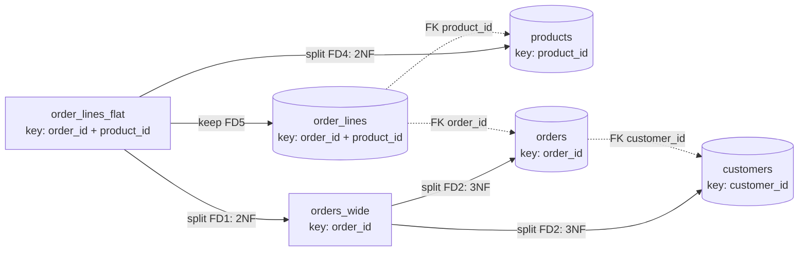

**Reading the diagram.** The rectangle on the left is the unnormalized input; rectangles in the middle are intermediate tables that are not yet final; cylinders are the final BCNF tables. Solid arrows are decomposition steps, labeled with the functional dependency that justified each split and the normal form it achieves. Dotted arrows are the foreign keys that tie the final tables together; they are not data flows but the join paths that make the decomposition lossless. There is no runtime component here, so there are no synchronous paths or failure points in the usual sense; the "failure" a decomposition can introduce is a lost dependency (see the BCNF trade-off below). Scaling consequence: each extra table adds a join to queries that need data from several of them, which is the cost denormalization later buys back.

### 11.5.4 When BCNF and 3NF disagree

Most real schemas reach BCNF automatically once they are in 3NF. The exception needs overlapping candidate keys. Suppose the shop ships through local depots: each depot is operated by exactly one carrier (`depot → carrier`), and for each postal code each carrier serves it from exactly one depot (`postal_code, carrier → depot`). In `coverage(postal_code, carrier, depot)` the candidate keys are `{postal_code, carrier}` and `{postal_code, depot}`. The dependency `depot → carrier` violates BCNF (`depot` is not a superkey) but satisfies 3NF (`carrier` is part of a candidate key). Splitting into `depots(depot, carrier)` and `coverage(postal_code, depot)` reaches BCNF but loses the ability to enforce `postal_code, carrier → depot` with a simple unique constraint; you would need a trigger or application check. This is the classic trade-off: BCNF always gives a lossless decomposition, but not always a **dependency-preserving** one; 3NF always gives both [Ramakrishnan and Gehrke 2003].

### 11.5.5 Denormalization

::: definition
**Definition — Denormalization.** Deliberately storing a fact more than once, or storing a derived value, to make important reads cheaper, while accepting the cost of keeping the copies consistent.
:::

Normalization optimizes for correct, cheap writes. Some read paths, such as a product page that shows average rating and review count, or a dashboard of revenue by city, would need large joins or aggregations on every request. Denormalization trades write work and consistency risk for read speed. Common forms:

1. **Stored aggregates** — `orders.total_cents`, `products.review_count`, updated in the same transaction as the rows they summarize.
2. **Copied columns** — `order_lines.product_name` kept so invoices render without a join (and, like the unit price, it is also a historical fact).
3. **Materialized views** — a stored query result, refreshed periodically (`REFRESH MATERIALIZED VIEW CONCURRENTLY` in PostgreSQL).
4. **Read models outside the database** — caches (Chapter 20), search indexes (Chapter 16) or CQRS projections fed by change data capture (§32.4, §32.6). These are updated asynchronously and are therefore eventually consistent.

::: recommendation
**Recommendation — Normalize the source of truth; denormalize with an owner.** Model the transactional tables in 3NF/BCNF. Add a redundant copy only for a measured read problem, and write down which code path keeps it consistent: the same transaction (strongly consistent), a trigger (strongly consistent, hidden logic), or an asynchronous pipeline (eventually consistent, needs a reconciliation job). A copy with no named owner will drift.
:::

**Table 11.3 — Failure scenarios in schema design.**

| What goes wrong | Why | Detection | Recovery | Prevention |
|---|---|---|---|---|
| Two customers rows with the same email | Natural key not declared `UNIQUE` | Duplicate-detection query; login bugs | Merge rows, repoint FKs | `UNIQUE` on every candidate key |
| Denormalized total disagrees with items | Update path forgot the aggregate | Nightly reconciliation query | Recompute from source rows | Update in the same transaction; reconciliation job |
| Old invoices change when prices change | Price stored only in `products` | Customer complaints, audit | Restore from backups or logs | Store price-at-purchase in `order_lines` |
| Orphaned order lines | No FK constraint | Anti-join `NOT EXISTS` check | Delete or repair orphans | Declare FKs; `ON DELETE CASCADE` for owned rows |

## 11.6 SQL and joins

### 11.6.1 SQL as a declarative language

::: definition
**Definition — SQL.** The Structured Query Language, standardized by ANSI/ISO, with sublanguages for defining schema (DDL: `CREATE`, `ALTER`, `DROP`), manipulating data (DML: `SELECT`, `INSERT`, `UPDATE`, `DELETE`) and controlling transactions (`BEGIN`, `COMMIT`, `ROLLBACK`). Every major database implements the core standard plus its own dialect.
:::

A `SELECT` is written in one order but evaluated, logically, in another. Knowing the logical order explains most beginner errors (such as referring to a `SELECT` alias inside `WHERE`):

1. `FROM` and `JOIN` — build the combined rows.
2. `WHERE` — filter individual rows.
3. `GROUP BY` — form groups.
4. `HAVING` — filter groups.
5. `SELECT` — compute output expressions and aliases (window functions run here).
6. `ORDER BY` — sort.
7. `LIMIT`/`OFFSET` — cut.

The database may physically execute in a different order (for example, pushing a filter below a join) as long as the result is identical.

### 11.6.2 Join types

A **join** combines rows from two tables that satisfy a condition. Using the shop tables:

```sql
-- Inner join: orders with their customer (orders without a customer cannot exist: FK)
SELECT o.order_id, c.email, o.total_cents
FROM orders o
JOIN customers c ON c.customer_id = o.customer_id;

-- Left outer join: every customer, with order count (0 for customers who never ordered)
SELECT c.customer_id, c.email, COUNT(o.order_id) AS orders
FROM customers c
LEFT JOIN orders o ON o.customer_id = c.customer_id
GROUP BY c.customer_id, c.email;

-- Semi-join: customers who bought product 42 (each customer once, however many orders)
SELECT c.email FROM customers c
WHERE EXISTS (SELECT 1 FROM orders o JOIN order_items i ON i.order_id = o.order_id
              WHERE o.customer_id = c.customer_id AND i.product_id = 42);

-- Anti-join: customers with no orders at all
SELECT c.email FROM customers c
WHERE NOT EXISTS (SELECT 1 FROM orders o WHERE o.customer_id = c.customer_id);
```

What to notice:

- `COUNT(o.order_id)` counts non-NULL values, so customers with no orders get 0; `COUNT(*)` would wrongly give 1, because the outer join produces one row padded with NULLs.
- `EXISTS` expresses "at least one match" without duplicating the customer per matching row; a plain join followed by `DISTINCT` gives the same answer with more work.
- A `RIGHT JOIN` is a left join with the tables swapped; a `FULL OUTER JOIN` keeps unmatched rows from both sides. All four statements run unchanged in SQLite and PostgreSQL.

### 11.6.3 Join algorithms

The SQL says *what* to join; the database picks *how*. There are three families, and every relational engine uses some of them [Ramakrishnan and Gehrke 2003; Graefe 1993].

#### First-principles explanation

Suppose you must match 1,000 wedding guests to 120 tables using a list of names and a list of table assignments. You could, for each guest, read the whole assignment list (**nested loop**). You could first write the assignments on index cards filed by surname initial, then look each guest up (**hash join**). Or you could sort both lists alphabetically and walk down them together (**sort-merge join**). Which is fastest depends on list sizes, whether either list is already sorted, and how much desk space (memory) you have.

#### How it works internally

1. **Nested-loop join (NLJ).** For each row of the *outer* input, scan the *inner* input and emit matching pairs. **Block NLJ** reads the outer side in memory-sized chunks so the inner side is scanned once per chunk instead of once per row. **Index NLJ** replaces the inner scan with an index lookup: for each outer row, descend the inner table's B+ tree on the join column. Index NLJ is the best algorithm when the outer side is small, which is the case for most OLTP queries ("this customer's orders").
2. **Hash join.** *Build* phase: read the smaller input and insert each row into an in-memory hash table keyed on the join column. *Probe* phase: stream the larger input and look up each row's key. It needs an equality condition. If the build side does not fit in memory, both inputs are first **partitioned** by a hash of the key into spill files on disk so that each partition pair fits (the **Grace hash join**).
3. **Sort-merge join.** Sort both inputs on the join key (or read them in order from an index), then advance two cursors in step, emitting matches. It handles equality and also benefits range conditions; it is attractive when inputs are already sorted or when the output must be sorted anyway.

```python
from collections import defaultdict

customers = [(1, "Berlin"), (2, "Austin"), (3, "Pune")]           # (customer_id, city)
orders = [(10, 1, 2500), (11, 3, 900), (12, 1, 4100), (13, 4, 50)]  # (order_id, customer_id, total)

def nested_loop_join(outer, inner, okey, ikey):
    for o in outer:                      # for every outer row ...
        for i in inner:                  # ... scan the whole inner input
            if o[okey] == i[ikey]:
                yield o + i

def hash_join(build, probe, bkey, pkey):
    table = defaultdict(list)
    for b in build:                      # build phase: hash the smaller input
        table[b[bkey]].append(b)
    for p in probe:                      # probe phase: one lookup per probe row
        for b in table.get(p[pkey], ()):
            yield b + p

def sort_merge_join(left, right, lkey, rkey):
    left, right = sorted(left, key=lambda r: r[lkey]), sorted(right, key=lambda r: r[rkey])
    i = j = 0
    while i < len(left) and j < len(right):
        lv, rv = left[i][lkey], right[j][rkey]
        if lv < rv:
            i += 1
        elif lv > rv:
            j += 1
        else:                            # emit every pair in the matching groups
            j_end = j
            while j_end < len(right) and right[j_end][rkey] == lv:
                j_end += 1
            while i < len(left) and left[i][lkey] == lv:
                for r in right[j:j_end]:
                    yield left[i] + r
                i += 1
            j = j_end

for name, rows in [("nested loop", nested_loop_join(customers, orders, 0, 1)),
                   ("hash", hash_join(customers, orders, 0, 1)),
                   ("sort-merge", sort_merge_join(customers, orders, 0, 1))]:
    print(f"{name:<12}", sorted(rows, key=lambda r: r[2]))
```

What to notice:

- All three print the same three rows: Berlin with orders 10 and 12, Pune with order 11. Order 13 (customer 4) has no match and disappears, as an inner join requires.
- The nested loop performs $3 \times 4 = 12$ comparisons; the hash join performs 3 inserts and 4 probes. With a million rows on each side, that difference is $10^{12}$ versus $2 \times 10^6$ operations.
- The sort-merge join must handle duplicate keys on both sides (customer 1 has two orders), which is why it emits every pair in the matching groups.

**Figure 11.2 — Hash join: build on the smaller input, probe with the larger.**

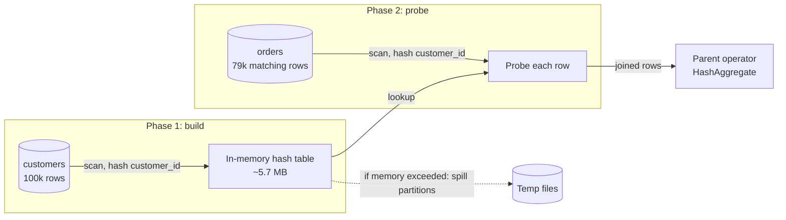

**Reading the diagram.** Cylinders are tables or temporary files on disk; rectangles are in-memory operator state. The build phase reads all of `customers` (the smaller input) and finishes before probing starts, so the hash join is *blocking* on its build side; the probe phase is *pipelined*: each `orders` row is hashed, looked up and passed upward immediately. All solid arrows are synchronous in-process data flows. The dotted arrow is the failure-and-degradation path: if the hash table exceeds the memory budget (`work_mem` in PostgreSQL), the operator partitions both inputs to temporary files and joins them one partition at a time, which turns a memory-speed join into one that reads and writes both inputs again. The sizes come from the real plan in §11.10 (100,000 customers produced a 5,712 kB hash table). Scaling: raising the memory budget, filtering the build side earlier, or parallel workers that each probe a share of the larger input.

#### Mathematical foundations

The classic way to compare join algorithms counts **page I/Os**, because on a disk-resident database they dominate [Ramakrishnan and Gehrke 2003]. Let the outer relation $R$ have $M$ pages and the inner relation $S$ have $N$ pages.

::: formula
**I/O cost of join algorithms**

$$C_{\text{tuple NLJ}} = M + p_R \cdot M \cdot N \qquad C_{\text{block NLJ}} = M + \left\lceil \frac{M}{B-2} \right\rceil N$$

$$C_{\text{index NLJ}} = M + p_R \cdot M \cdot c_{\text{idx}} \qquad C_{\text{Grace hash}} \approx 3(M + N) \qquad C_{\text{sort-merge}} \approx 3(M+N) \text{ to } 5(M+N)$$

| Symbol | Meaning | Units |
|---|---|---|
| $M$, $N$ | Pages in the outer relation $R$ and inner relation $S$ | pages |
| $p_R$ | Rows per page of $R$ | rows/page |
| $B$ | Buffer pages available to the join (one for output, one for the inner scan) | pages |
| $c_{\text{idx}}$ | Page reads to find matching inner rows through an index (descent plus row fetch) | pages/row |
| $C$ | Total page reads and writes | page I/Os |
:::

The hash and sort-merge figures assume enough memory to finish in two passes (roughly $B > \sqrt{\min(M,N)}$ for hash, $B > \sqrt{\max(M,N)}$ for sort); with fewer buffers, more passes are needed. If the build side fits entirely in memory, a hash join reads each input once: $M + N$.

::: example
**Worked example — Joining `orders` with `order_items`.** The PostgreSQL tables of §11.10 have $M = 15{,}385$ pages for `orders` (1,000,000 rows, so $p_R = 65$) and $N = 18{,}383$ pages for `order_items` (2,500,000 rows), with 8 KiB pages. Assume $B = 1{,}002$ buffer pages (about 8 MiB).

1. Tuple NLJ: $15{,}385 + 65 \times 15{,}385 \times 18{,}383 = 15{,}385 + 1.84 \times 10^{10} \approx 1.8 \times 10^{10}$ I/Os. At 100 µs per random read that is $1.8 \times 10^6$ s, about 21 days.
2. Block NLJ: $\lceil 15{,}385 / 1{,}000 \rceil = 16$ chunks; $15{,}385 + 16 \times 18{,}383 = 309{,}513$ I/Os, about 31 s at 100 µs each (much less with sequential reads).
3. Grace hash join: $3 \times (15{,}385 + 18{,}383) = 101{,}304$ I/Os, about 10 s; if `orders` fits in memory, $33{,}768$ I/Os.
4. Index NLJ for **one customer's** 10 orders: the outer side is 10 rows; each needs about 4 page reads in the `order_items` primary-key index plus heap: roughly $10 \times 4 = 40$ I/Os, about 4 ms cold and well under 1 ms when cached (the real plan in §11.10 took 0.43 ms).

**Interpretation.** For a whole-table join, the naive nested loop is impossible, block NLJ is tolerable and the hash join wins. For a selective OLTP query, the index nested loop wins by four orders of magnitude, because it touches only the rows it needs. **Engineering implication.** There is no universally best join algorithm; the optimizer must know *how many rows* each side produces, which is why cardinality estimation (§11.10) decides performance.
:::

**Table 11.4 — Join algorithms compared.**

| Algorithm | Join conditions | Memory | Best when | Weakness |
|---|---|---|---|---|
| Nested loop (block) | Any | Small | Tiny inputs; non-equality conditions | Quadratic on large inputs |
| Index nested loop | Equality or range on indexed inner column | Small | Small outer side, indexed inner (OLTP) | Random I/O per outer row if outer is large |
| Hash join | Equality only | Build side (spills if needed) | Large unsorted inputs, analytics | Blocking build; spills when memory is short |
| Sort-merge join | Equality (and some ranges) | Sort buffers | Inputs already sorted or output needs sorting | Sorting cost if inputs are unsorted |

As of 2026, PostgreSQL implements all three. MySQL implements nested-loop variants (including batched key access) and, since 8.0.18, hash joins; it has no sort-merge join [MySQL Docs: Hash Join].

## 11.7 Indexes

### 11.7.1 What an index is

::: definition
**Definition — Index.** A secondary data structure, kept in sync with a table by the database, that maps values of one or more **key columns** to the locations of the rows holding them, so that rows can be found without scanning the whole table. Most relational indexes are B+ trees (§11.8); others include hash, GiST, GIN and BRIN indexes in PostgreSQL and full-text and spatial indexes in MySQL.
:::

#### First-principles explanation

A book's index lets you find "isolation levels" without reading 900 pages. It works because it is *sorted* and *small* relative to the book, and it points to page numbers. It also has costs: someone must update it whenever the book changes, it takes paper, and for a word that appears on every page ("the") it is useless; reading the book is faster. Database indexes have exactly these properties: fast lookups for selective conditions, extra work on every write, extra storage, and no benefit when a query needs a large fraction of the table.

#### Why does this exist?

Without an index, `SELECT * FROM orders WHERE customer_id = 4242` must read every page of `orders`. In §11.10 that real query read 15,385 pages and took 70 ms to find 10 rows. With an index on `customer_id` it read 16 pages and took 0.14 ms. At 1,000 requests per second, the first version needs 70 CPU-seconds per second of scanning; the second needs 0.14.

### 11.7.2 Clustered and secondary indexes

::: definition
**Definition — Clustered and secondary index.** In a **clustered index** (an index-organized table), the leaf level of the index *is* the table: rows are stored in key order inside the index's leaf pages. A table can have at most one. A **secondary index** stores, for each key, a pointer to the row; the table can have many.
:::

The two most popular open-source databases make opposite choices:

- **InnoDB (MySQL)** stores every table as a B+ tree clustered on the primary key. If you declare none, it uses the first `UNIQUE NOT NULL` index, or else generates a hidden 6-byte row ID. Secondary index leaves store the indexed columns plus the *primary-key value*. A secondary lookup therefore descends two trees: the secondary index to find the primary key, then the clustered index to find the row [MySQL Docs: Clustered and Secondary Indexes].
- **PostgreSQL** stores rows in an unordered **heap** file. Every index, including the primary key, is secondary; its leaves store a **TID** (tuple identifier: page number and slot), so a lookup descends one tree and then reads one heap page. The `CLUSTER` command reorders the heap once, but later inserts are not kept in order.

**Figure 11.3 — Secondary-index lookup paths in InnoDB and PostgreSQL.**

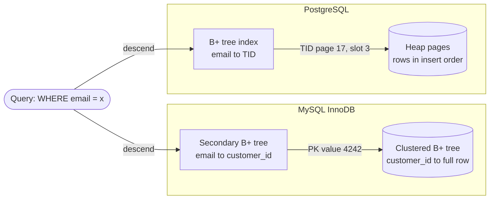

**Reading the diagram.** The client's query (stadium) is answered by two different storage designs. In InnoDB the secondary index (rectangle) yields a primary-key *value*, which is used to descend the clustered index (cylinder) where the row lives: two tree descents. In PostgreSQL the index yields a *physical address* (TID), so the second step is a single heap-page read. All arrows are synchronous reads inside one database process. The trade-offs follow from the pointer type: InnoDB's logical pointer survives row moves (a page split in the clustered index does not touch secondary indexes) and range scans on the primary key read rows in order; PostgreSQL's physical pointer is faster to follow but must be updated in *every* index when an update creates a new row version on a different page (§11.14). Failure point: a long primary key in InnoDB is copied into every secondary index entry, inflating all of them. Scaling: keep InnoDB primary keys short and monotonic; in PostgreSQL leave free space in heap pages (`fillfactor`) so updates stay on the same page.

### 11.7.3 Composite indexes and the leftmost-prefix rule

A **composite index** on `(customer_id, created_at)` sorts entries by `customer_id`, and within equal `customer_id` by `created_at`, like a phone book sorted by surname and then first name. You can use it to find everyone named "Rao" (leftmost column), or "Rao, Priya" (both columns), but not everyone named "Priya": those entries are scattered across the whole book. This is the **leftmost-prefix rule**: a B+ tree index can seek on a prefix of its columns, with equality on all but possibly the last column used, which may be a range.

The index on `(customer_id, created_at)` serves:

- `WHERE customer_id = ?`
- `WHERE customer_id = ? AND created_at >= ?`
- `WHERE customer_id = ? ORDER BY created_at DESC LIMIT 20` (no sort needed: entries are already in order)

and does *not* efficiently serve `WHERE created_at >= ?`. Some engines can **skip-scan** (seek once per distinct leading value), which helps only when the leading column has few distinct values: MySQL since 8.0.13, and PostgreSQL from version 18 (as of 2026).

::: recommendation
**Recommendation — Column order in composite indexes.** Put columns compared with equality first, then the column used for a range or `ORDER BY`. Selectivity of the leading column matters less than whether queries can use the prefix at all. One well-ordered composite index often replaces two or three single-column indexes.
:::

### 11.7.4 Covering, partial and expression indexes

- A **covering index** contains every column a query needs, so the database can answer from the index alone (an **index-only scan**) without touching the table. PostgreSQL 11+ can add non-key payload columns with `INCLUDE`; InnoDB secondary indexes cover the primary-key columns automatically. In PostgreSQL an index-only scan still visits the heap for pages not marked all-visible in the **visibility map**, which VACUUM maintains (§11.14).
- A **partial index** indexes only rows that satisfy a predicate: `CREATE INDEX ... ON orders (created_at) WHERE status = 'pending'`. If 1% of orders are pending, the index is 1% of the size, and the background job that sweeps stale pending orders reads only it. PostgreSQL and SQLite support partial indexes; MySQL does not (as of 8.4).
- An **expression index** indexes a computed value, for example `lower(email)`, so `WHERE lower(email) = ?` can use it. MySQL 8.0.13+ supports this as functional key parts.

```python
import sqlite3

db = sqlite3.connect(":memory:")
db.executescript("""
CREATE TABLE orders (
  order_id    INTEGER PRIMARY KEY,          -- rowid alias: the table's clustered key
  customer_id INTEGER NOT NULL,
  status      TEXT    NOT NULL,
  total_cents INTEGER NOT NULL,
  created_at  TEXT    NOT NULL
);
CREATE INDEX orders_cust_created ON orders (customer_id, created_at);
CREATE INDEX orders_pending ON orders (created_at) WHERE status = 'pending';
""")
db.executemany(
    "INSERT INTO orders (customer_id, status, total_cents, created_at) VALUES (?,?,?,?)",
    [(i % 1000, "pending" if i % 100 == 0 else "shipped", i, f"2026-10-{1 + i % 28:02d}")
     for i in range(50_000)])

queries = {
    "both columns":        "SELECT * FROM orders WHERE customer_id = 7 AND created_at >= '2026-10-15'",
    "leftmost column only": "SELECT * FROM orders WHERE customer_id = 7",
    "second column only":  "SELECT * FROM orders WHERE created_at >= '2026-10-15'",
    "covering":            "SELECT created_at FROM orders WHERE customer_id = 7",
    "partial index":       "SELECT order_id FROM orders WHERE status = 'pending' AND created_at < '2026-10-03'",
}
for label, sql in queries.items():
    plan = db.execute("EXPLAIN QUERY PLAN " + sql).fetchall()
    print(f"{label:<21} -> {plan[0][3]}")
```

Output (SQLite 3.45):

```text
both columns          -> SEARCH orders USING INDEX orders_cust_created (customer_id=? AND created_at>?)
leftmost column only  -> SEARCH orders USING INDEX orders_cust_created (customer_id=?)
second column only    -> SCAN orders
covering              -> SEARCH orders USING COVERING INDEX orders_cust_created (customer_id=?)
partial index         -> SEARCH orders USING COVERING INDEX orders_pending (created_at<?)
```

What to notice:

- `SEARCH` means an index seek; `SCAN` means reading the whole table. Filtering on the second column alone falls back to a scan: the leftmost-prefix rule in action.
- The covering query asks only for `created_at`, which is in the index, so the table is never read.
- The partial-index query is covering too, because SQLite stores the rowid (`order_id`) in every index entry, just as InnoDB stores the primary key.

### 11.7.5 When an index does not help

#### Mathematical foundations

An index lookup through a secondary index costs roughly one *random* page read per matching row (when the rows are scattered across the table), while a full scan costs one *sequential* page read per table page. Above some fraction of matching rows, the scan wins.

::: formula
**Break-even selectivity for a secondary-index scan**

$$s^{*} = \frac{P \cdot c_{\text{seq}}}{n \cdot c_{\text{rand}}}$$

| Symbol | Meaning | Units |
|---|---|---|
| $s^{*}$ | Fraction of rows matched above which a full scan is cheaper | dimensionless |
| $P$ | Pages in the table | pages |
| $n$ | Rows in the table | rows |
| $c_{\text{seq}}$ | Cost of a sequential page read | cost units/page |
| $c_{\text{rand}}$ | Cost of a random page read | cost units/page |
:::

::: example
**Worked example — When does PostgreSQL stop using the index on `orders`?** $P = 15{,}385$ pages, $n = 1{,}000{,}000$ rows, and PostgreSQL's default cost parameters are `seq_page_cost` = 1 and `random_page_cost` = 4.

1. Full scan cost: $15{,}385 \times 1 = 15{,}385$ units.
2. Index cost for fraction $s$: $s \times 10^6 \times 4$ units (ignoring the small index-page cost).
3. Break-even: $s^{*} = 15{,}385 / (4 \times 10^6) = 0.0038$, about 0.4% of rows, or 3,800 rows.

**Interpretation.** A query matching 10 rows uses the index; one matching 50% of rows (`customer_id > 50000` in §11.10) is planned as a sequential scan, which is exactly what PostgreSQL chose. **Engineering implication.** Indexes serve *selective* predicates. PostgreSQL softens the cliff with **bitmap scans**, which collect matching TIDs, sort them by page and read each heap page once; and correlation statistics lower the estimated cost when the table is physically ordered by the indexed column. On SSDs, many teams lower `random_page_cost` to about 1.1–2 because random and sequential reads cost nearly the same.
:::

**Table 11.5 — Index variants.**

| Variant | What it stores | Speeds up | Costs | Engine support |
|---|---|---|---|---|
| Clustered (primary) | Full rows in key order | PK lookups and PK range scans | Wide secondary indexes (InnoDB) | InnoDB, SQL Server, SQLite rowid tables |
| Secondary | Key + row pointer (TID or PK) | Selective lookups on other columns | One extra structure to update per write | All |
| Composite | Several columns, lexicographic order | Prefix equality + range/sort | Useless without the leading column | All |
| Covering / `INCLUDE` | Extra payload columns | Index-only scans | Larger index | PostgreSQL 11+, SQL Server; InnoDB via PK |
| Partial | Only rows matching a predicate | Queries on a small, hot subset | Query must imply the predicate | PostgreSQL, SQLite (not MySQL) |
| Expression / functional | Computed values | Queries on the same expression | Expression evaluated on write | PostgreSQL, MySQL 8.0.13+, SQLite |

::: mistake
**Mistake — "Add an index on every column to be safe."** Each index is updated on every insert and on every update of its columns. A table with eight indexes turns one row insert into nine B+ tree insertions, inflates storage and the buffer pool's working set, and in PostgreSQL prevents heap-only-tuple updates of the indexed columns (§11.14). Index the queries you actually run, check `pg_stat_user_indexes.idx_scan` for indexes that are never used, and drop them.
:::

::: mistake
**Mistake — Wrapping the indexed column in a function.** `WHERE date(created_at) = '2026-10-30'` cannot use an index on `created_at`, because the index is sorted by `created_at`, not by `date(created_at)`. Rewrite as a range: `WHERE created_at >= '2026-10-30' AND created_at < '2026-10-31'`. The same applies to implicit type casts, such as comparing a text column with a number in MySQL.
:::

## 11.8 B-trees and B+ trees

### 11.8.1 Structure and operations

::: definition
**Definition — B-tree and B+ tree.** A **B-tree** is a balanced search tree whose nodes are disk pages holding many sorted keys; every leaf is at the same depth, and nodes split and merge to stay between half-full and full [Bayer and McCreight 1972]. A **B+ tree** is the variant used by almost every relational database: internal nodes hold only separator keys and child pointers, all keys and values (or row pointers) live in the leaves, and leaves are linked to their siblings so range scans can walk sideways [Comer 1979].
:::

#### Why does this exist?

Binary search trees need about 30 levels for a billion keys (§4.4.2). If each level is a disk read, that is 30 dependent I/Os, around 3 ms on NVMe and 300 ms on a spinning disk. The B-tree's insight is to match the node size to the unit the disk transfers anyway (a page) and pack hundreds of keys into it, so the tree is very wide and very shallow. Keeping values only in leaves (the B+ variant) makes internal nodes denser still, so even more of the tree fits in memory, and the sibling links make `ORDER BY` and range predicates a sequential walk.

#### How it works internally

1. **Search.** Start at the root page. Binary-search its separator keys in memory to choose a child pointer. Repeat until a leaf; binary-search the leaf.
2. **Range scan.** Search for the lower bound, then follow leaf sibling links until the upper bound.
3. **Insert.** Search for the target leaf and insert the key in order. If the leaf overflows, **split** it into two half-full leaves and insert a separator key into the parent; if the parent overflows, split it too. A split of the root creates a new root, which is the only way the tree grows taller, so all leaves stay at the same depth.
4. **Delete.** Remove the key; if a node becomes too empty, borrow from or merge with a sibling (many engines merge lazily or not at all, leaving reclaimable space).
5. **Concurrency and crash safety.** Splits modify several pages, so engines protect pages with short-term latches and log every change in the write-ahead log. PostgreSQL's B-tree follows Lehman and Yao's design with right-links so readers never block on a concurrent split [Lehman and Yao 1981]. Page layout, latch crabbing and WAL details are in §13.5–§13.6.

**Figure 11.4 — A B+ tree on `order_id` with three levels.**

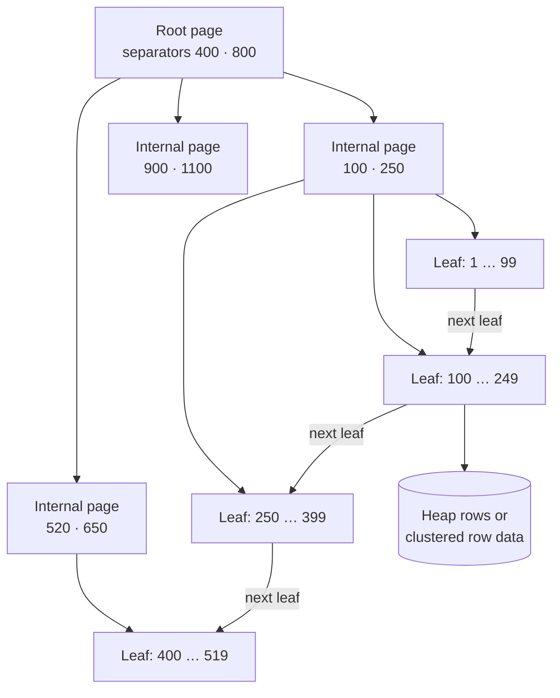

**Reading the diagram.** Each rectangle is one fixed-size page (8 KiB in PostgreSQL, 16 KiB by default in InnoDB). Downward arrows are child pointers that a search follows synchronously, one page read per level: to find `order_id` 180, the root sends it left (180 < 400), the internal page sends it to the second leaf (100 ≤ 180 < 250). The horizontal "next leaf" arrows are sibling links used by range scans such as `order_id BETWEEN 120 AND 520`, which descend once and then read leaves left to right. The cylinder marks the storage boundary below the leaves: in PostgreSQL the leaf holds a TID pointing into the heap; in an InnoDB clustered index the leaf *is* the row. Failure points are splits (several pages must change atomically, hence WAL logging) and a cold cache after restart, when every level costs a real I/O. Scaling: multiplying the data by the fan-out adds just one level.

### 11.8.2 Fan-out, height and I/Os per lookup

§4.4.3 derived $h = \lceil \log_f n \rceil$ for a tree whose leaves hold one key each. In a real B+ tree each leaf holds $L$ entries, so only the internal levels need the logarithm.

::: formula
**Height of a B+ tree with $L$ entries per leaf**

$$h = 1 + \left\lceil \log_f \left\lceil \frac{n}{L} \right\rceil \right\rceil, \qquad f = \left\lfloor \frac{u \cdot P}{e_{\text{int}}} \right\rfloor, \qquad L = \left\lfloor \frac{u \cdot P}{e_{\text{leaf}}} \right\rfloor$$

| Symbol | Meaning | Units |
|---|---|---|
| $h$ | Levels from root to leaf (page reads per lookup with a cold cache) | levels |
| $n$ | Entries (rows) indexed | rows |
| $P$ | Page size | bytes |
| $u$ | Average fraction of each page holding entries (fill factor minus headers) | dimensionless |
| $e_{\text{int}}$ | Bytes per internal entry (separator key + child pointer + overhead) | bytes |
| $e_{\text{leaf}}$ | Bytes per leaf entry (full row for a clustered index; key + pointer for a secondary index) | bytes |
| $f$ | Fan-out of internal pages | children/page |
| $L$ | Entries per leaf page | entries/page |
:::

::: example
**Worked example — A billion-row `orders` table in InnoDB with 16 KiB pages.** Assume $u = 0.8$, a `bigint` primary key with 16-byte internal entries (as in §4.4.3), and 200-byte rows.

1. Usable bytes per page: $0.8 \times 16{,}384 = 13{,}107$ bytes.
2. Fan-out: $f = \lfloor 13{,}107 / 16 \rfloor = 819$. Rows per leaf: $L = \lfloor 13{,}107 / 200 \rfloor = 65$.
3. Leaf pages: $\lceil 10^9 / 65 \rceil = 15{,}384{,}616$ (about 235 GiB of row data).
4. Internal levels: $\lceil 15{,}384{,}616 / 819 \rceil = 18{,}785$ pages, then $\lceil 18{,}785 / 819 \rceil = 23$, then 1 root. Check with the formula: $\log_{819}(15{,}384{,}616) = 16.55 / 6.71 = 2.47$, rounded up to 3, plus the leaf level: $h = 4$.
5. Memory for all internal pages: $(1 + 23 + 18{,}785) \times 16$ KiB $= 18{,}809 \times 16$ KiB $\approx 294$ MiB.
6. A secondary index on `customer_id` (8-byte key + 8-byte primary key per leaf entry, $L = 819$) has $\lceil 10^9/819 \rceil = 1{,}221{,}002$ leaves (about 18.6 GiB), then 1,491, 2 and 1 pages: also 4 levels, with only 23 MiB of internal pages.

I/Os per lookup:

- Cold cache: 4 page reads for a primary-key lookup.
- Internal pages cached (294 MiB is trivial for a database server): **1 random read** per primary-key lookup, about 0.1 ms on NVMe (§4.17).
- Secondary-index lookup in InnoDB: 1 read for the secondary leaf + 1 for the clustered leaf = **2 reads**. In PostgreSQL: index leaf + heap page = 2 reads, similarly.

**Interpretation.** A billion rows cost only one more level than a million rows (a million rows needs $1 + \lceil \log_{819} 15{,}385 \rceil = 3$ levels). **Engineering implication.** Index lookups stay fast at any table size you will meet in one database; what grows is the *leaf* working set. If the hot rows' leaves (here up to 235 GiB) do not fit in the buffer pool, every lookup pays a real I/O, and that, not tree height, is the scaling limit. Wide keys shrink $f$ and $L$; random keys spread the hot set across all leaves.
:::

```python
import math

def bplus_tree(n_rows, page_bytes=16 * 1024, fill=0.8, internal_entry=16, leaf_entry=200):
    """Return (fan-out, entries per leaf, pages per level from root to leaves)."""
    usable = page_bytes * fill
    fanout = int(usable // internal_entry)          # child pointers per internal page
    per_leaf = int(usable // leaf_entry)            # entries per leaf page
    levels = [math.ceil(n_rows / per_leaf)]         # leaf level first
    while levels[-1] > 1:
        levels.append(math.ceil(levels[-1] / fanout))
    return fanout, per_leaf, levels[::-1]

for label, leaf_entry in [("clustered, 200-byte rows", 200), ("secondary, 8-byte key + 8-byte PK", 16)]:
    f, L, pages = bplus_tree(10**9, leaf_entry=leaf_entry)
    internal_mib = sum(pages[:-1]) * 16 / 1024
    leaf_gib = pages[-1] * 16 / 1024**2
    print(f"{label}: fan-out={f}, entries/leaf={L}, height={len(pages)}")
    print(f"  pages per level (root..leaf) = {pages}")
    print(f"  internal levels = {internal_mib:,.0f} MiB, leaf level = {leaf_gib:,.1f} GiB")
```

What to notice:

- Output: the clustered tree has pages per level `[1, 23, 18785, 15384616]` and the secondary tree `[1, 2, 1491, 1221002]`; both have height 4, matching the hand calculation.
- Change `leaf_entry` to 1,000 (wide rows) and the leaf level grows fivefold while the height stays 4: width costs memory before it costs levels.

::: mistake
**Mistake — "B-tree and B+ tree are the same thing."** In a classic B-tree, values can live in internal nodes, so a range scan must move up and down the tree. Database "B-tree" indexes are B+ trees (PostgreSQL's `btree`, InnoDB's indexes): values only in leaves, leaves linked. In interviews, say "B+ tree" and explain the leaf links.
:::

## 11.9 Query execution and plans

### 11.9.1 From SQL text to rows

Every statement passes through the same pipeline (Figure 11.5):

1. **Parse** — check syntax and build a parse tree.
2. **Analyze and rewrite** — resolve table and column names against the catalog, check permissions, expand views, and apply rewrite rules (for example, flattening a subquery into a join).
3. **Plan (optimize)** — enumerate alternative physical plans, estimate the cost of each using table statistics, and choose the cheapest (§11.10).
4. **Execute** — run the plan's operators against the storage engine, which reads pages through the buffer pool (§13.4).

**Figure 11.5 — Query processing pipeline.**

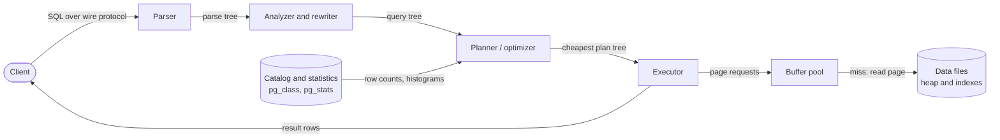

**Reading the diagram.** The client sends SQL text over the database's wire protocol (TCP or a Unix socket) and waits synchronously for rows. The first three rectangles transform the query without touching data; only the planner consults the catalog (cylinder), and only through statistics gathered earlier by `ANALYZE`, not by reading the table. The executor is the only component that touches data, through the buffer pool, which crosses the storage boundary to the data files only on a cache miss. Failure points: stale statistics make the planner choose a bad plan (the most common cause of sudden slow queries); a cold buffer pool makes a good plan slow. Scaling: prepared statements skip parsing and sometimes planning on repeated execution; parallel workers split scans and joins inside the executor.

### 11.9.2 The Volcano (iterator) model

::: definition
**Definition — Volcano (iterator) model.** An execution model in which a query plan is a tree of operators, each implementing the same interface — `open()`, `next()` and `close()` — and each `next()` call pulls one row from the operator's children on demand [Graefe 1994].
:::

#### First-principles explanation

Think of a kitchen line. The waiter (the client) asks the plating station for the next dish; plating asks the grill for the next steak; the grill asks the fridge. Nobody cooks a thousand steaks in advance; each station produces one item when asked. This **pull model** means operators compose freely (any operator can sit above any other), memory stays small for streaming operators, and a `LIMIT 20` at the top simply stops asking after 20 rows, so the scans below never finish.

Some operators cannot produce their first row until they have consumed all their input: sort, hash aggregation and the build side of a hash join. These are **blocking** (pipeline-breaking) operators; they need memory proportional to their input and spill to disk when it runs out. In `EXPLAIN` output, a blocking operator's *startup cost* (the first number in `cost=startup..total`) is close to its total cost.

```python
class Operator:
    """Volcano iterator: every operator exposes open(), next() and close()."""
    def open(self): pass
    def next(self): raise NotImplementedError   # returns one row, or None when exhausted
    def close(self): pass

class SeqScan(Operator):
    def __init__(self, rows): self.rows = rows
    def open(self): self.pos = 0
    def next(self):
        if self.pos == len(self.rows): return None
        self.pos += 1
        return self.rows[self.pos - 1]

class Filter(Operator):
    def __init__(self, child, pred): self.child, self.pred = child, pred
    def open(self): self.child.open()
    def next(self):
        while (row := self.child.next()) is not None:
            if self.pred(row): return row
        return None
    def close(self): self.child.close()

class HashJoin(Operator):
    def __init__(self, build, probe, bkey, pkey):
        self.build, self.probe, self.bkey, self.pkey = build, probe, bkey, pkey
    def open(self):                       # blocking: consumes the whole build side
        self.table, self.pending = {}, []
        self.build.open()
        while (b := self.build.next()) is not None:
            self.table.setdefault(b[self.bkey], []).append(b)
        self.build.close()
        self.probe.open()
    def next(self):                       # pipelined: one probe row at a time
        while not self.pending:
            p = self.probe.next()
            if p is None: return None
            self.pending = [b + p for b in self.table.get(p[self.pkey], [])]
        return self.pending.pop()
    def close(self): self.probe.close()

class Project(Operator):
    def __init__(self, child, cols): self.child, self.cols = child, cols
    def open(self): self.child.open()
    def next(self):
        row = self.child.next()
        return None if row is None else tuple(row[c] for c in self.cols)
    def close(self): self.child.close()

class Limit(Operator):
    def __init__(self, child, n): self.child, self.n = child, n
    def open(self): self.child.open(); self.seen = 0
    def next(self):
        if self.seen == self.n: return None   # stop pulling: the scan below never finishes
        self.seen += 1
        return self.child.next()
    def close(self): self.child.close()

# SELECT c.city, o.total FROM customers c JOIN orders o ON c.id = o.customer_id
# WHERE o.total > 1000 LIMIT 2
customers = [(1, "Berlin"), (2, "Austin"), (3, "Pune")]
orders = [(10, 1, 2500), (11, 3, 900), (12, 1, 4100), (13, 2, 1800)]
plan = Limit(Project(HashJoin(SeqScan(customers),
                              Filter(SeqScan(orders), lambda r: r[2] > 1000), 0, 1),
                     cols=[1, 4]), 2)
plan.open()
while (row := plan.next()) is not None:
    print(row)
plan.close()
```

What to notice:

- The output is `('Berlin', 2500)` and `('Berlin', 4100)`. Order 13 (Austin, 1800) also qualifies but is never produced: `Limit` stopped pulling after two rows, so the orders scan stopped early.
- `HashJoin.open()` drains its build child completely (blocking); `next()` handles one probe row at a time (pipelined).
- Every row costs several virtual function calls. Modern analytic engines reduce that overhead with **vectorized** execution (each `next()` returns a batch of about a thousand values) [Boncz et al. 2005] or by **compiling** the plan into machine code [Neumann 2011]. PostgreSQL remains a Volcano-style executor, with optional JIT compilation of expressions.

**Figure 11.6 — The executed plan tree for "revenue by city over the last day".**

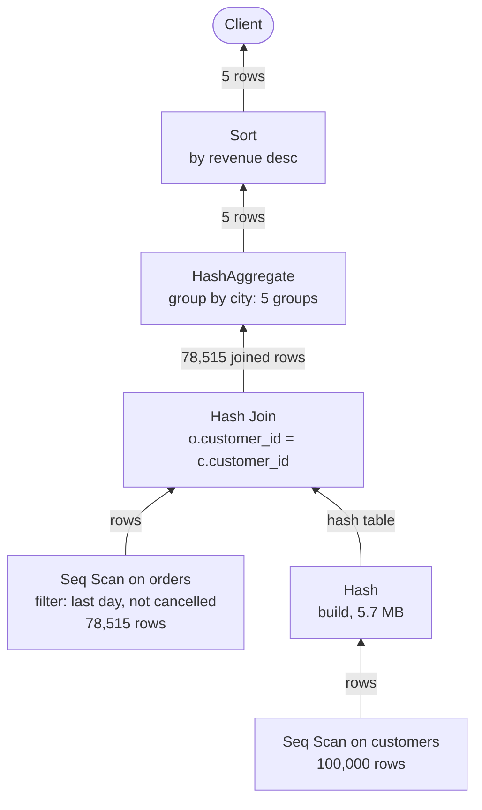

**Reading the diagram.** This is the real plan PostgreSQL 16 chose for the revenue query in §11.10, drawn bottom-up because rows flow upward while `next()` calls flow downward. Leaves are scans that read table pages; interior rectangles are operators that run in the same backend process, so every arrow is a synchronous in-memory call. Three operators are blocking: `Hash` (must see all customers before probing), `HashAggregate` (must see all rows before emitting a group total) and `Sort`. The storage boundary is at the two scans; everything above them works on in-memory rows. Failure points: the hash table or aggregate can exceed `work_mem` and spill to temporary files; a misestimated row count can make the planner choose this plan when an index-driven plan would be better. Scaling: an index on `orders(created_at)` would replace the 1-million-row scan with a range scan, and parallel workers could split the scan of `orders`.

## 11.10 Query optimization

### 11.10.1 The cost-based optimizer

::: definition
**Definition — Cost-based optimizer.** The component that enumerates equivalent physical plans for a query (access paths, join orders, join algorithms), estimates each plan's cost from **statistics** about the data using a **cost model**, and returns the plan with the lowest estimated cost.
:::

The design dates from IBM's System R. Selinger and colleagues introduced the three ideas every optimizer still uses: estimate the **selectivity** of each predicate from catalog statistics; cost plans in a weighted mix of page I/O and CPU; and find the best join order by **dynamic programming**, building the best plan for every subset of tables from the best plans of smaller subsets, while remembering plans that produce **interesting orders** (sorted output that a later merge join or `ORDER BY` can reuse) [Selinger et al. 1979].

#### Mathematical foundations

::: formula
**Size of the join-order search space**

$$N_{\text{left-deep}} = n! \qquad N_{\text{bushy}} = \frac{(2(n-1))!}{(n-1)!} \qquad W_{\text{DP}} \approx n \cdot 2^{\,n-1}$$

| Symbol | Meaning | Units |
|---|---|---|
| $n$ | Number of tables joined | tables |
| $N_{\text{left-deep}}$ | Join orders where every join's inner input is a base table | plans |
| $N_{\text{bushy}}$ | All binary join trees, including joins of two intermediate results | plans |
| $W_{\text{DP}}$ | Approximate subproblems examined by Selinger-style dynamic programming over left-deep plans | subproblems |
:::

::: example
**Worked example — Ten tables.** For $n = 10$: left-deep orders $10! = 3{,}628{,}800$; bushy trees $18!/9! \approx 1.76 \times 10^{10}$; dynamic programming examines about $10 \times 2^9 = 5{,}120$ subset extensions. **Interpretation.** Dynamic programming makes ten-way joins tractable, but $2^n$ still explodes: at $n = 20$ it is about 10 million. **Engineering implication.** PostgreSQL switches to a genetic (randomized) search at 12 `FROM` items by default (`geqo_threshold`), and stops reordering explicit joins beyond 8 (`join_collapse_limit`); very wide joins generated by ORMs or reporting tools can therefore get poor plans.
:::

### 11.10.2 Cost model and statistics in PostgreSQL

PostgreSQL's costs are in arbitrary units anchored on one sequential page read. The defaults (verified on PostgreSQL 16) are `seq_page_cost` = 1, `random_page_cost` = 4, `cpu_tuple_cost` = 0.01, `cpu_index_tuple_cost` = 0.005 and `cpu_operator_cost` = 0.0025 [PostgreSQL Docs: Using EXPLAIN].

::: formula
**Cost of a sequential scan with one filter (PostgreSQL)**

$$C_{\text{seq}} = P \cdot c_{\text{seq}} + n \cdot c_{\text{tuple}} + n \cdot k \cdot c_{\text{op}}$$

| Symbol | Meaning | Units |
|---|---|---|
| $P$ | Heap pages (`pg_class.relpages`) | pages |
| $n$ | Rows (`pg_class.reltuples`) | rows |
| $k$ | Operators evaluated per row in the filter | operators |
| $c_{\text{seq}}$, $c_{\text{tuple}}$, $c_{\text{op}}$ | `seq_page_cost`, `cpu_tuple_cost`, `cpu_operator_cost` | cost units |
:::

To estimate how many rows survive a filter, the planner uses per-column statistics collected by `ANALYZE` from a random sample (visible in `pg_stats`): the number of distinct values, the **most common values** with their frequencies, a histogram of the rest, the null fraction and the physical **correlation** between column order and heap order.

::: formula
**Cardinality estimate under the independence assumption**

$$\hat{r} = n \cdot \prod_{i=1}^{k} s_i, \qquad s_i \approx \text{freq}(v_i) \text{ or } \frac{1}{d_i}$$

| Symbol | Meaning | Units |
|---|---|---|
| $\hat{r}$ | Estimated rows satisfying all $k$ predicates | rows |
| $n$ | Rows in the table | rows |
| $s_i$ | Selectivity of predicate $i$ (fraction of rows passing it) | dimensionless |
| $\text{freq}(v_i)$ | Sampled frequency of value $v_i$ if it is a most-common value | dimensionless |
| $d_i$ | Number of distinct values in the column | values |
:::

::: example
**Worked example — Checking the planner's arithmetic on real plans.** On the 1,000,000-row `orders` table (15,385 pages):

1. `EXPLAIN SELECT * FROM orders WHERE customer_id = 4242` reported `cost=0.00..27885.00`. By the formula: $15{,}385 \times 1 + 10^6 \times 0.01 + 10^6 \times 1 \times 0.0025 = 15{,}385 + 10{,}000 + 2{,}500 = 27{,}885$. Exact match.
2. Its row estimate was 10: with 100,000 distinct customers, $s = 1/100{,}000$ and $\hat{r} = 10^6 / 10^5 = 10$. Actual: 10.
3. Now a table `addr` of 1,000,000 rows where `city` determines `country` (every Pune row is in India). Each column has 5 values at about 20% each. For `WHERE city = 'Pune' AND country = 'IN'` the independence assumption gives $\hat{r} = 10^6 \times 0.2 \times 0.2 = 40{,}000$. PostgreSQL estimated 39,960; the actual count was 200,000, an underestimate of 5×.

**Interpretation.** The formulas are simple and exact for single predicates on well-sampled columns; the error comes from *correlation*, which the independence assumption ignores. **Engineering implication.** Errors multiply through joins: an estimate that is 5× too low feeding a join whose own estimate is 5× too low is 25× off, which is enough to choose a nested loop over a million rows. For correlated columns, PostgreSQL 10+ supports extended statistics: after `CREATE STATISTICS addr_city_country (dependencies) ON city, country FROM addr; ANALYZE addr;` the estimate became 198,500.
:::

::: industry
**Research evidence — How good are query optimizers?** Leis and colleagues built the Join Order Benchmark on the real IMDB dataset (queries with many joins over correlated data) and measured PostgreSQL and several commercial systems. Cardinality estimates were routinely wrong by orders of magnitude, errors grew with the number of joins, and estimation errors mattered far more for plan quality than the cost model did [Leis et al. 2015].
*Evidence: Primary* — [Leis et al. 2015]
:::

### 11.10.3 Reading EXPLAIN and EXPLAIN ANALYZE

`EXPLAIN` shows the chosen plan with estimates; `EXPLAIN ANALYZE` actually runs the query and adds measured times and row counts; `BUFFERS` adds page counts. (MySQL 8.0.18+ has `EXPLAIN ANALYZE` with a different format.) The following is real PostgreSQL 16 output for the order-history query after creating an index on `orders (customer_id, created_at DESC)`, with parallel query disabled for readability:

```text
Limit  (cost=44.03..44.05 rows=10 width=32) (actual time=0.110..0.112 rows=10 loops=1)
  Buffers: shared hit=3 read=13
  ->  Sort  (cost=44.03..44.05 rows=10 width=32) (actual time=0.109..0.110 rows=10 loops=1)
        Sort Key: created_at DESC
        Sort Method: quicksort  Memory: 25kB
        ->  Bitmap Heap Scan on orders  (cost=4.50..43.86 rows=10 width=32) (actual time=0.042..0.099 rows=10 loops=1)
              Recheck Cond: (customer_id = 4242)
              Heap Blocks: exact=10
              ->  Bitmap Index Scan on orders_customer_created_idx  (cost=0.00..4.50 rows=10 width=0) (actual time=0.028..0.028 rows=10 loops=1)
                    Index Cond: (customer_id = 4242)
Planning Time: 0.219 ms
Execution Time: 0.135 ms
```

How to read it:

1. Read the tree from the innermost (most indented) node outward: the bitmap index scan finds 10 TIDs, the heap scan fetches 10 heap pages (`Heap Blocks: exact=10`), the sort orders them, the limit returns them.
2. `cost=startup..total` are estimates in cost units; `rows` is the estimated output; `width` is average bytes per row.
3. `actual time=first..last` is in milliseconds *per loop*; multiply by `loops` for nested-loop inner sides.
4. **Compare estimated and actual `rows` at every node.** A ratio above about 10× is the first thing to investigate: stale statistics (`ANALYZE`), correlated columns (`CREATE STATISTICS`), or a predicate the planner cannot estimate (functions, casts).
5. `Buffers: shared hit=3 read=13` means 3 pages came from the buffer pool and 13 from the OS or disk.

The planner chose a bitmap scan plus a sort, rather than walking the index in `created_at` order, because each customer has only 10 orders and the estimate said sorting 10 rows is cheaper. For the same query on a customer with thousands of orders, the plan would switch to an index scan that needs no sort and stops after 20 rows.

::: warning
**Warning — `EXPLAIN ANALYZE` executes the statement.** For `INSERT`, `UPDATE` or `DELETE`, wrap it: `BEGIN; EXPLAIN ANALYZE UPDATE ...; ROLLBACK;`. Also remember that the first run may read from disk and the second from cache; compare `Buffers` before comparing times.
:::

**Table 11.6 — Failure scenarios in query planning.**

| What goes wrong | Why | Detection | Recovery | Prevention |
|---|---|---|---|---|
| Query suddenly 100× slower after a data load | Stale statistics; plan flipped | `pg_stat_statements` latency jump; estimate vs actual gap | `ANALYZE` the table | Autovacuum/analyze tuning; analyze after bulk loads |
| Nested loop over millions of rows | Underestimated cardinality from correlated predicates | `rows=` estimate far below actual | Extended statistics; rewrite query | `CREATE STATISTICS` on correlated columns |
| Index ignored | Function or cast on column; low selectivity | `Seq Scan` with selective filter | Expression index or rewritten predicate | Code review of predicates |
| Hash join or sort spills to disk | Memory budget too small for build side | `Batches: >1`, `Sort Method: external merge` | Raise `work_mem` for that session | Filter earlier; size memory per query |

## 11.11 Transactions

### 11.11.1 Commit, rollback and savepoints

::: definition
**Definition — Transaction.** A sequence of reads and writes that the database treats as one logical unit: either all of its effects become permanent together (**commit**) or none of them do (**abort** or **rollback**), and concurrently running transactions are isolated from each other's intermediate states.
:::

#### First-principles explanation

Moving money between two accounts is two writes: debit one, credit the other. If the server crashes between them, or a constraint fails on the second, money is created or destroyed. Without transactions, every application would need its own crash-recovery and concurrency logic for every multi-step operation, and most would get it wrong. A transaction lets you write the steps as if nothing else were happening and nothing could fail, and makes the database responsible for the rest [Gray and Reuter 1993].

#### How it works internally

1. `BEGIN` starts a transaction (many drivers start one implicitly; with **autocommit**, every statement is its own transaction).
2. Each write is recorded in the write-ahead log and applied to pages in memory; concurrency control (MVCC and locks, §11.14–§11.15) decides what other transactions may see and do.
3. `COMMIT` forces the log records to durable storage, then makes the changes visible. `ROLLBACK`, an error or a crash before the commit record is durable undoes them.
4. `SAVEPOINT name` / `ROLLBACK TO name` undo part of a transaction without abandoning it.

```python
import sqlite3

db = sqlite3.connect(":memory:")
db.executescript("""
CREATE TABLE accounts (
  account_id    INTEGER PRIMARY KEY,
  balance_cents INTEGER NOT NULL CHECK (balance_cents >= 0)   -- invariant: no overdraft
);
INSERT INTO accounts VALUES (1, 10000), (2, 0);
""")

def transfer(src, dst, cents):
    try:
        with db:                                   # BEGIN; ... COMMIT (or ROLLBACK on error)
            db.execute("UPDATE accounts SET balance_cents = balance_cents + ? "
                       "WHERE account_id = ?", (cents, dst))          # credit first, on purpose
            db.execute("UPDATE accounts SET balance_cents = balance_cents - ? "
                       "WHERE account_id = ?", (cents, src))          # may violate the CHECK
        return "committed"
    except sqlite3.IntegrityError as e:
        return f"rolled back ({e})"

print(transfer(1, 2, 7000), db.execute("SELECT * FROM accounts").fetchall())
print(transfer(1, 2, 7000), db.execute("SELECT * FROM accounts").fetchall())
```

What to notice:

- Output: `committed [(1, 3000), (2, 7000)]`, then `rolled back (CHECK constraint failed: balance_cents >= 0) [(1, 3000), (2, 7000)]`. The second transfer's credit had already been applied when the debit failed, yet it vanished: atomicity.
- The invariant lives in the schema (`CHECK`), so no code path can violate it, including ones written next year.

::: warning
**Warning — Keep transactions short, and never wait on the network inside one.** An open transaction holds row locks (blocking other writers) and pins old row versions (blocking cleanup, §11.14). A transaction that calls a payment provider or waits for user input can hold them for seconds. Do slow external work before or after the transaction, and make it idempotent (§22.15).
:::

## 11.12 ACID

::: definition
**Definition — ACID.** The four guarantees of a database transaction, named by Härder and Reuter [Härder and Reuter 1983]:
**Atomicity** — all of a transaction's writes take effect, or none do.
**Consistency** — a transaction takes the database from one state satisfying all declared invariants (constraints) to another.
**Isolation** — concurrently executing transactions do not see each other's partial effects; at the strongest level, the outcome equals some serial execution.
**Durability** — once a commit is acknowledged, its effects survive crashes.
:::

How each is implemented, briefly:

- **Atomicity** — the database logs enough information to undo uncommitted changes (undo records in InnoDB; in PostgreSQL, uncommitted row versions are simply never marked visible) and discards them on rollback or crash recovery.
- **Consistency** — enforced by constraints (`PRIMARY KEY`, `UNIQUE`, `FOREIGN KEY`, `CHECK`, `NOT NULL`, triggers). Invariants that the schema does not express ("at least one doctor on call") are the application's responsibility, helped by isolation.
- **Isolation** — concurrency control: MVCC and locking (§11.13–§11.15).
- **Durability** — **write-ahead logging**: the commit record is flushed with `fsync` before the client is told "committed". Many commits share one flush (**group commit**). Settings such as PostgreSQL's `synchronous_commit = off` or InnoDB's `innodb_flush_log_at_trx_commit = 2` trade a window of recent commits for throughput. Full treatment: §13.5. Durability against losing the machine requires replication (Chapter 14).

### 11.12.1 The "C" in ACID is not the "C" in CAP

The word *consistency* is used for at least three unrelated ideas. Mixing them up is a classic interview mistake.

**Table 11.7 — Three meanings of "consistency".**

| Term | Question it answers | Scope | Where in this book |
|---|---|---|---|
| ACID consistency | Do committed states satisfy the declared invariants? | One database, constraints | §11.12 |
| Strong consistency (linearizability), the "C" in CAP | Does every read see the latest completed write, as if there were one copy? | Replicated data | §25.3, §25.8 |
| Eventual consistency | Will replicas converge if writes stop? | Replicated data | §25.7 |

A single PostgreSQL server is ACID-consistent and, for reads on that server, linearizable. Add an asynchronous read replica and a client can commit a write on the primary and then read the old value from the replica: the system is still ACID at the primary, but reads are no longer linearizable (§14.4). Kleppmann notes that the C in ACID is really a property of the application's use of transactions, not something the database provides by itself [Kleppmann 2017].

## 11.13 Isolation levels and anomalies

### 11.13.1 The anomalies

Perfect isolation, called **serializability**, means the result of running transactions concurrently equals the result of running them one at a time in *some* order. It costs throughput, so databases offer weaker **isolation levels** that permit specific **anomalies**. Berenson and colleagues showed that the SQL standard's definitions were ambiguous and catalogued the anomalies precisely [Berenson et al. 1995]:

::: definition
**Definition — Isolation anomalies.**
**Dirty write:** a transaction overwrites another's uncommitted write.
**Dirty read:** a transaction reads another's uncommitted write (which may later roll back).
**Non-repeatable (fuzzy) read:** a transaction reads a row twice and sees different committed values because another transaction updated it in between.
**Phantom:** a transaction runs the same *predicate* query twice (`WHERE status = 'pending'`) and gets a different set of rows because another transaction inserted or deleted matching rows.
**Lost update:** two transactions read the same value, both compute a new value from it and write; the second write silently overwrites the first.
**Read skew:** a transaction sees part of another transaction's effects (reads account A before a transfer commits and account B after it).
**Write skew:** two transactions read an overlapping set of rows, each checks an invariant, then each writes a *different* row; each write is valid alone but together they violate the invariant.
:::

**Figure 11.7 — Non-repeatable read under READ COMMITTED.**

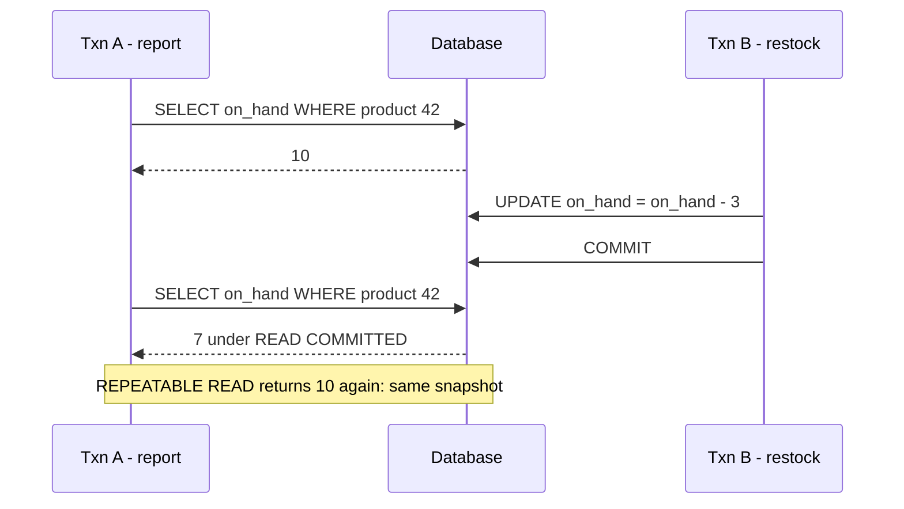

**Reading the diagram.** Two clients hold separate connections to one database; every message is a synchronous SQL round trip, and time runs downward. Transaction A reads the stock level twice; between the reads, B decrements and commits. Under READ COMMITTED each *statement* takes a fresh snapshot, so A's second read sees 7. Under REPEATABLE READ in PostgreSQL the *transaction* keeps the snapshot taken at its first statement and sees 10 both times. Both outcomes were reproduced on PostgreSQL 16. The failure point is any logic in A that combines the two reads (for example, a report whose totals do not add up). The storage boundary is inside the database: both versions of the row exist simultaneously (§11.14).

**Figure 11.8 — Lost update from an application-side read-modify-write.**

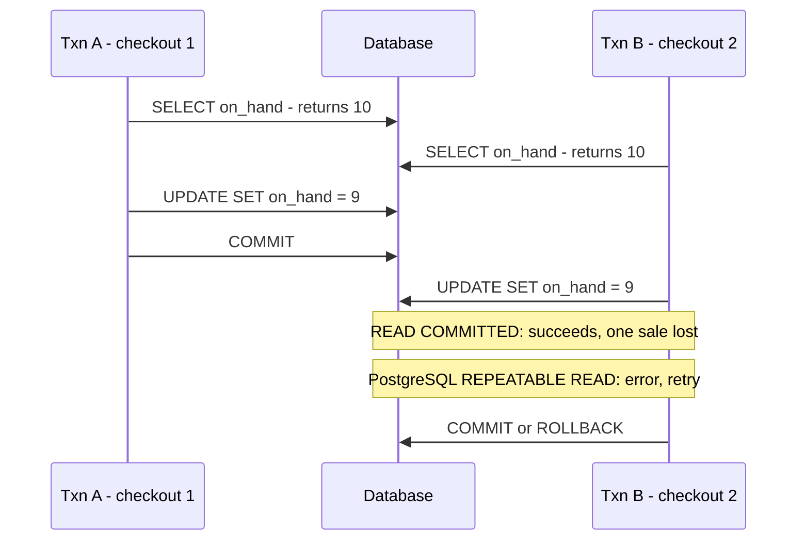

**Reading the diagram.** Two checkouts sell the same product concurrently. Each reads 10 and computes 9 *in the application*, then writes the literal 9. Under READ COMMITTED (and under MySQL's REPEATABLE READ) B's write simply overwrites A's: two units sold, one decremented. Under PostgreSQL's REPEATABLE READ, B's `UPDATE` fails with `could not serialize access due to concurrent update`, because the row changed after B's snapshot; B must retry the whole transaction. The cure that works at every level is to let the database do the arithmetic atomically, `UPDATE inventory SET on_hand = on_hand - 1 WHERE product_id = 42 AND on_hand >= 1`, or to lock the row first with `SELECT ... FOR UPDATE`, or to use a version check (§11.15).

**Figure 11.9 — Write skew: both doctors go off call.**

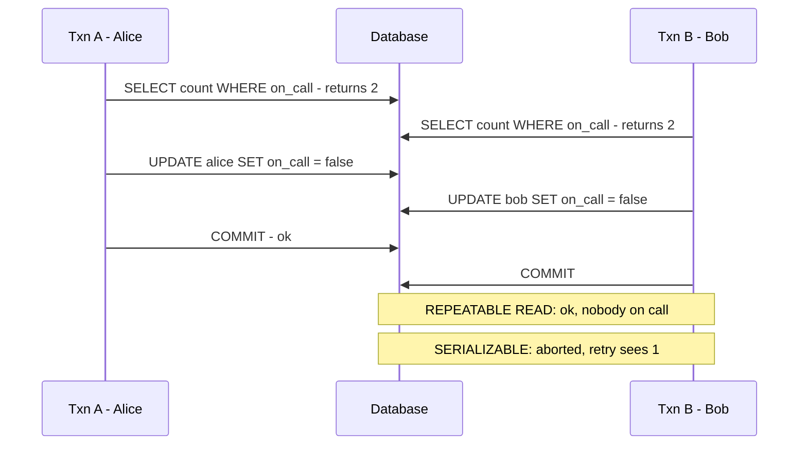

**Reading the diagram.** The invariant "at least one doctor on call" is checked by a read and protected by nothing: the two transactions write *different* rows, so no write–write conflict exists for snapshot isolation or row locks to detect. Under PostgreSQL REPEATABLE READ both commit and the invariant breaks. Under SERIALIZABLE, PostgreSQL tracks which rows each transaction *read* and detects the dangerous pattern of read–write dependencies; one transaction fails with `could not serialize access due to read/write dependencies among transactions` and its retry sees only one doctor on call. The same pattern appears in the shop as double-booking a limited coupon, or two admins each removing "the other" admin. Fixes below serializable: materialize the conflict (lock a shared row with `SELECT ... FOR UPDATE`) or enforce the rule with a constraint.

### 11.13.2 The standard levels and what databases actually do

**Table 11.8 — ANSI SQL isolation levels as defined by the three phenomena.**

| Level | Dirty read | Non-repeatable read | Phantom |
|---|---|---|---|
| READ UNCOMMITTED | Possible | Possible | Possible |
| READ COMMITTED | Prevented | Possible | Possible |
| REPEATABLE READ | Prevented | Prevented | Possible |
| SERIALIZABLE | Prevented | Prevented | Prevented |

Berenson and colleagues pointed out that this table misses lost update, read skew and write skew, and that **snapshot isolation** (each transaction reads from a consistent snapshot taken at its start, and a transaction aborts if it tries to write a row that another transaction changed after its snapshot) fits nowhere: it prevents all three standard phenomena yet permits write skew, so it is not serializable [Berenson et al. 1995]. Real databases implement the levels differently, so the level *name* tells you little; check the behavior.

**Table 11.9 — Anomalies permitted in practice (PostgreSQL 16, MySQL 8.0 InnoDB).**

| Anomaly | PG READ COMMITTED (default) | PG REPEATABLE READ (snapshot isolation) | PG SERIALIZABLE (SSI) | MySQL READ COMMITTED | MySQL REPEATABLE READ (default) | MySQL SERIALIZABLE |
|---|---|---|---|---|---|---|
| Dirty read | No | No | No | No | No | No |
| Non-repeatable read | Yes | No | No | Yes | No | No |
| Phantom | Yes | No | No | Yes | No for plain reads | No |
| Lost update | Yes | No (error) | No | Yes | **Yes** | No |
| Read skew | Yes | No | No | Yes | No | No |
| Write skew | Yes | Yes | No | Yes | Yes | No |

Key facts behind the table:

- **PostgreSQL** accepts `READ UNCOMMITTED` but runs it as READ COMMITTED. REPEATABLE READ is snapshot isolation. SERIALIZABLE (since 9.1) is **Serializable Snapshot Isolation (SSI)**: snapshot isolation plus tracking of read–write dependencies, aborting a transaction when a cycle is possible [Cahill et al. 2008; Ports and Grittner 2012]. It takes no extra blocking locks, but applications must retry on serialization failures (SQLSTATE `40001`).
- **MySQL InnoDB** defaults to REPEATABLE READ. Plain `SELECT`s read a snapshot, but `UPDATE`, `DELETE` and locking reads (`SELECT ... FOR UPDATE`) read the *latest committed* row and do not check whether it changed since the snapshot, which is why lost updates and write skew get through. Locking reads take next-key locks that block phantom inserts (§11.15). SERIALIZABLE converts plain `SELECT`s into `SELECT ... FOR SHARE` when autocommit is off, i.e., two-phase locking [MySQL Docs: Transaction Isolation Levels].
- Independent testing of these behaviors across databases is collected in Kleppmann's Hermitage project [Kleppmann 2014].

The following program reproduced two rows of Table 11.9 against PostgreSQL 16:

```python
# PostgreSQL-specific: needs a running PostgreSQL and `pip install psycopg2-binary`.
import psycopg2

DSN = "dbname=shop user=postgres host=localhost"   # adjust to your server

def session(level):
    conn = psycopg2.connect(DSN)
    conn.set_session(isolation_level=level)
    return conn, conn.cursor()

def reset():
    conn = psycopg2.connect(DSN); conn.autocommit = True
    conn.cursor().execute("""
        DROP TABLE IF EXISTS stock, doctors;
        CREATE TABLE stock (product_id int PRIMARY KEY, on_hand int NOT NULL);
        INSERT INTO stock VALUES (42, 10);
        CREATE TABLE doctors (name text PRIMARY KEY, on_call bool NOT NULL);
        INSERT INTO doctors VALUES ('alice', true), ('bob', true);""")
    conn.close()

def try_commit(conn):
    try:
        conn.commit(); return "commit"
    except psycopg2.Error as e:
        conn.rollback(); return "abort: " + e.pgerror.splitlines()[0]

def lost_update(level):           # read-modify-write computed in the application
    reset(); (a, ca), (b, cb) = session(level), session(level)
    ca.execute("SELECT on_hand FROM stock WHERE product_id = 42"); va = ca.fetchone()[0]
    cb.execute("SELECT on_hand FROM stock WHERE product_id = 42"); vb = cb.fetchone()[0]
    ca.execute("UPDATE stock SET on_hand = %s WHERE product_id = 42", (va - 1,)); a.commit()
    try:
        cb.execute("UPDATE stock SET on_hand = %s WHERE product_id = 42", (vb - 1,))
        result = try_commit(b)
    except psycopg2.Error as e:
        b.rollback(); result = "abort: " + e.pgerror.splitlines()[0]
    print(f"lost update, {level}: B {result}")

def write_skew(level):            # invariant: at least one doctor on call
    reset(); (a, ca), (b, cb) = session(level), session(level)
    for cur, me in ((ca, "alice"), (cb, "bob")):
        cur.execute("SELECT count(*) FROM doctors WHERE on_call")
        if cur.fetchone()[0] >= 2:
            cur.execute("UPDATE doctors SET on_call = false WHERE name = %s", (me,))
    print(f"write skew, {level}: A {try_commit(a)}; B {try_commit(b)}")

for level in ("READ COMMITTED", "REPEATABLE READ"):
    lost_update(level)
for level in ("REPEATABLE READ", "SERIALIZABLE"):
    write_skew(level)
```

Output on PostgreSQL 16.15:

```text
lost update, READ COMMITTED: B commit
lost update, REPEATABLE READ: B abort: ERROR:  could not serialize access due to concurrent update
write skew, REPEATABLE READ: A commit; B commit
write skew, SERIALIZABLE: A commit; B abort: ERROR:  could not serialize access due to read/write dependencies among transactions
```

What to notice:

- Two sessions are interleaved by hand in one thread; nothing blocks, because PostgreSQL readers never wait for writers.
- At REPEATABLE READ and SERIALIZABLE, an abort is *normal* behavior, not a bug. Production code wraps such transactions in a retry loop with a bounded number of attempts.

::: recommendation
**Recommendation — Choosing an isolation level.** Default to READ COMMITTED (PostgreSQL) and make every read-modify-write atomic in SQL (`SET x = x - 1 WHERE ... AND x >= 1`) or explicitly locked (`FOR UPDATE`). Use SERIALIZABLE, with retries, for transactions that check an invariant across several rows and then write. In MySQL, do not assume REPEATABLE READ protects read-modify-write cycles; use locking reads.
:::

## 11.14 Multi-version concurrency control (MVCC)

### 11.14.1 The idea

::: definition
**Definition — MVCC.** A concurrency-control technique in which a write creates a new **version** of a row instead of overwriting it in place, and each transaction reads the versions visible in its **snapshot**: the set of transactions that had committed when the snapshot was taken. Readers therefore never block writers and writers never block readers; only writers of the same row wait for each other.
:::

#### First-principles explanation

A library keeps every edition of a reference book. A reader arriving at 10:00 receives the edition that was current at 10:00, even if a new edition is shelved at 10:05 while they are still reading. Nobody has to stop editing while someone reads. The costs are shelf space for old editions and a librarian who throws away editions no reader can still be using. PostgreSQL and InnoDB both work this way; they differ in *where* they keep old editions and *who* throws them away.

### 11.14.2 PostgreSQL: versions in the heap, cleaned by VACUUM

Each heap tuple carries a header with **`xmin`** (the ID of the transaction that created this version), **`xmax`** (the ID of the transaction that deleted or replaced it, or 0) and **`ctid`** (the location of this version, or of its successor). An `UPDATE` sets `xmax` on the old version and inserts a complete new version. A snapshot records the oldest still-running transaction ID, the next unassigned ID and the list of IDs in progress; a version is visible if its `xmin` committed before the snapshot and its `xmax` is empty, aborted or not yet visible to the snapshot [PostgreSQL Docs: Concurrency Control].

Real output from PostgreSQL 16 after inserting a stock row and updating it twice (the `pageinspect` extension shows raw page contents):

```sql
INSERT INTO stock VALUES (42, 10);                          -- transaction 993
UPDATE stock SET on_hand = 9 WHERE product_id = 42;         -- transaction 994
UPDATE stock SET on_hand = 8 WHERE product_id = 42;         -- transaction 995
SELECT xmin, xmax, ctid, * FROM stock;                      -- only the visible version
--  xmin | xmax | ctid  | product_id | on_hand
--   995 |    0 | (0,3) |         42 |       8
SELECT lp, t_xmin, t_xmax, t_ctid FROM heap_page_items(get_raw_page('stock', 0));
--  lp | t_xmin | t_xmax | t_ctid
--   1 |    993 |    994 | (0,2)
--   2 |    994 |    995 | (0,3)
--   3 |    995 |      0 | (0,3)
```

**Figure 11.10 — PostgreSQL version chain for product 42.**

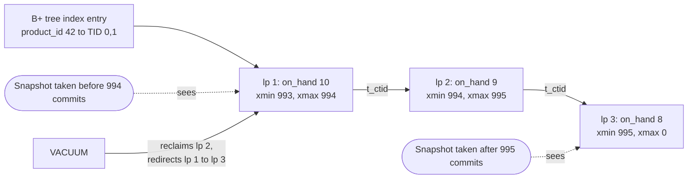

**Reading the diagram.** All three versions live in the same 8 KiB heap page (page 0, line pointers 1–3). Because the updates changed no indexed column and the page had room, they were **heap-only tuple (HOT)** updates: the index still points only to line pointer 1, and readers follow the `t_ctid` links to the version their snapshot can see. Stadium shapes are transactions' snapshots and the dotted arrows show which version each sees; there is no messaging, only visibility rules. VACUUM later removes versions no snapshot can see: on the real page it turned line pointer 1 into a redirect to line pointer 3 and freed line pointer 2. Failure point: a long-running transaction keeps an old snapshot alive, so VACUUM cannot remove *any* version newer than it in *any* table, and tables bloat. Scaling: when an update changes an indexed column or the page is full, it is not HOT, and every index on the table gets a new entry.

**VACUUM** (run automatically by **autovacuum**) removes dead versions, records free space for reuse, updates the **visibility map** that index-only scans rely on (§11.7.4), and **freezes** old tuples. Freezing matters because transaction IDs are 32-bit counters compared with wrap-around arithmetic: only about $2^{31}$ IDs are "in the past" at any moment. A tuple must be frozen (marked as visible to everyone) before its `xmin` becomes 2 billion transactions old, or it would appear to be in the future [PostgreSQL Docs: Routine Vacuuming].

::: formula
**Time until transaction-ID wraparound**

$$T_{\text{wrap}} = \frac{2^{31} - A}{\lambda_{\text{xid}}}$$

| Symbol | Meaning | Units |
|---|---|---|
| $T_{\text{wrap}}$ | Time until PostgreSQL must stop assigning transaction IDs | seconds |
| $A$ | Current age of the oldest unfrozen transaction ID in the database | transactions |
| $\lambda_{\text{xid}}$ | Rate of transactions that write (read-only transactions consume no ID) | transactions/second |
:::

::: example
**Worked example — How long can freezing be blocked?** A shop database commits $\lambda_{\text{xid}} = 5{,}000$ writing transactions per second. Autovacuum normally forces an anti-wraparound vacuum once a table's oldest ID reaches `autovacuum_freeze_max_age` = 200 million (the default).

1. Time to reach the forced-vacuum threshold from zero: $2 \times 10^8 / 5{,}000 = 40{,}000$ s, about 11 hours.
2. Suppose a forgotten idle transaction blocks freezing at age $A = 2 \times 10^8$. Remaining headroom: $2^{31} - 2 \times 10^8 = 2{,}147{,}483{,}648 - 200{,}000{,}000 \approx 1.95 \times 10^9$.
3. $T_{\text{wrap}} = 1.95 \times 10^9 / 5{,}000 = 389{,}497$ s, about 4.5 days.

**Interpretation.** A busy database burns through its safety margin in days, not years. As it approaches the limit PostgreSQL emits warnings and eventually refuses new writing transactions until a vacuum completes. **Engineering implication.** Alert on `age(datfrozenxid)` and on transactions open longer than a few minutes (`pg_stat_activity.xact_start`), and never leave sessions "idle in transaction" (`idle_in_transaction_session_timeout`).
:::

::: industry
**Sentry — transaction ID wraparound outage.** Sentry published a postmortem describing an outage in which its PostgreSQL primary stopped accepting writes to protect against transaction ID wraparound, after autovacuum could not keep up with a very high write rate; recovery required a long vacuum while the service was degraded. The lesson generalizes: in PostgreSQL, vacuum is not optional maintenance but part of the write path's capacity budget.
*Evidence: Primary* — [Sentry 2015]
:::

### 11.14.3 InnoDB: update in place, old versions in the undo log

InnoDB updates the row *in place* in the clustered index and writes the *previous* values to an **undo log** record. Each clustered-index record has hidden columns `DB_TRX_ID` (the last transaction to modify it, 6 bytes) and `DB_ROLL_PTR` (a pointer to the undo record holding the previous version, 7 bytes). A consistent read creates a **read view** (the set of transactions it must not see); if the current row is too new, InnoDB follows the roll pointers backwards, reconstructing older versions until it reaches a visible one. A background **purge** thread discards undo records no read view needs; the backlog appears as the **history list length** in `SHOW ENGINE INNODB STATUS` [MySQL Docs: InnoDB Multi-Versioning].

**Figure 11.11 — InnoDB current row and undo chain for product 42.**

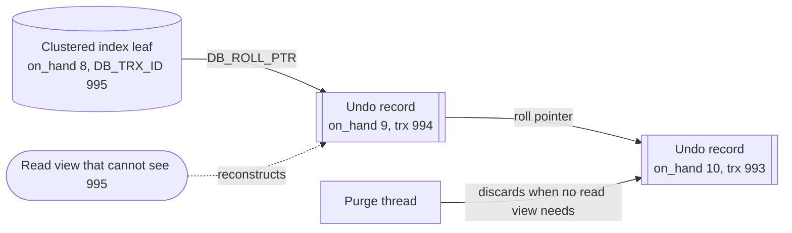

**Reading the diagram.** The cylinder is the single current version stored in the clustered index; the subroutine shapes are undo records in the undo tablespace, linked newest to oldest. A reader whose read view excludes transaction 995 starts at the current row and applies undo records backwards until it reaches a version it may see (dotted arrow: a visibility decision, not a message). Purge (solid arrow) is asynchronous background work. Failure point: a long-running transaction's read view prevents purge, so the history list grows, undo storage grows and every reader of hot rows walks longer chains, slowing queries. Scaling: undo is separate from the table, so updates do not bloat the clustered index, and secondary indexes change only if their columns change.

**Table 11.10 — MVCC in PostgreSQL and InnoDB.**

| Aspect | PostgreSQL | MySQL InnoDB |
|---|---|---|
| Where old versions live | In the table heap, next to current ones | In undo logs, outside the table |
| What an update writes | A complete new tuple (and index entries unless HOT) | In-place change plus an undo record |
| Version metadata | `xmin`, `xmax`, `ctid` in each tuple header | `DB_TRX_ID`, `DB_ROLL_PTR` hidden columns |
| Reading an old version | Scan to the visible tuple; cheap | Reconstruct by applying undo; cost grows with chain length |
| Garbage collection | VACUUM / autovacuum; must also freeze XIDs | Purge threads |
| Rollback cost | Nearly free (versions never become visible) | Must apply undo to restore rows |
| Symptom of a long transaction | Table and index bloat; wraparound risk | Growing history list; slower reads |

## 11.15 Locking

### 11.15.1 Two-phase locking and lock granularity

::: definition
**Definition — Two-phase locking (2PL).** A protocol in which each transaction acquires locks (shared **S** for reading, exclusive **X** for writing) before accessing data and, once it releases any lock, acquires no new ones: a *growing* phase followed by a *shrinking* phase. **Strict 2PL** holds all X locks until commit or abort. Any schedule produced by 2PL is serializable [Eswaran et al. 1976].
:::

S locks are compatible with S locks; X locks conflict with everything. MVCC databases use locks mainly for *writes*: two transactions updating the same row serialize on its row lock, while plain reads take no row locks. Locks also exist at several granularities:

- **Row locks** — taken by `UPDATE`, `DELETE` and explicit `SELECT ... FOR UPDATE` / `FOR SHARE`. PostgreSQL also has weaker `FOR NO KEY UPDATE` and `FOR KEY SHARE` modes so that foreign-key checks do not block updates of non-key columns.
- **Table locks** — PostgreSQL has eight table-lock modes from `ACCESS SHARE` (taken by every `SELECT`) to `ACCESS EXCLUSIVE` (taken by most `ALTER TABLE` forms) [PostgreSQL Docs: Explicit Locking]. InnoDB uses **intention locks** (IS, IX) on the table to signal row locks below.
- **Gap and next-key locks (InnoDB)** — at REPEATABLE READ, a locking read or update over a range locks the index records it scans *and the gaps between them*; a **next-key lock** is a record lock plus a lock on the gap before it. This blocks other transactions from inserting rows into the range, preventing phantoms without predicate locks, at the price of more blocking (even an insert into an *empty* range can wait) [MySQL Docs: InnoDB Locking]. READ COMMITTED disables most gap locking.

`SELECT ... FOR UPDATE SKIP LOCKED` (PostgreSQL 9.5+, MySQL 8.0+) lets many workers pull different rows from a job table without blocking on each other, a common way to build a simple, transactional work queue.

::: warning
**Warning — A schema change can stop all traffic.** `ALTER TABLE orders ADD COLUMN ...` needs PostgreSQL's `ACCESS EXCLUSIVE` lock for at least a moment. If a long report query holds `ACCESS SHARE`, the `ALTER` waits, and every new query on `orders` queues *behind the waiting `ALTER`*. Set `lock_timeout` (for example 2 s) on migrations and retry; use online schema-change tools for MySQL (such as GitHub's gh-ost [GitHub gh-ost]).
:::

### 11.15.2 Deadlocks

A **deadlock** occurs when transactions wait for each other's locks in a cycle (§6.11). Databases detect cycles in the **wait-for graph** and abort one transaction, the **victim**. PostgreSQL checks for a cycle after a waiter has been blocked for `deadlock_timeout` (default 1 s); InnoDB detects them immediately by default (`innodb_deadlock_detect`), and otherwise relies on `innodb_lock_wait_timeout` (default 50 s) [MySQL Docs: Deadlock Detection].

**Figure 11.12 — A deadlock between two checkouts, as reproduced on PostgreSQL 16.**

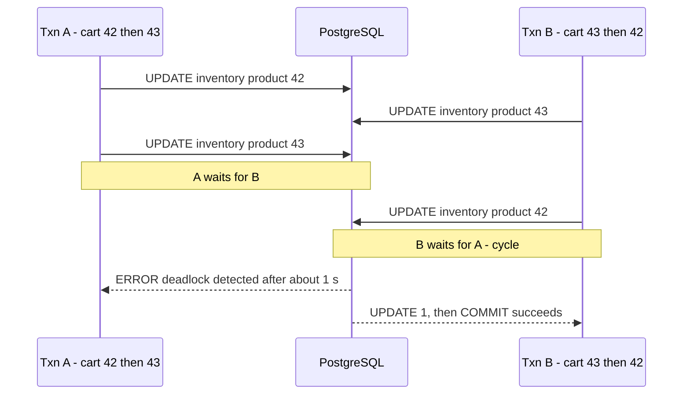

**Reading the diagram.** Each checkout decrements stock for the products in its cart, in cart order. A locks row 42, B locks row 43, then each requests the other's row: a cycle in the wait-for graph. All requests are synchronous and block. When A had waited `deadlock_timeout`, PostgreSQL ran the detector, found the cycle and aborted A with `deadlock detected` (SQLSTATE `40P01`), naming both processes; B's blocked update then succeeded. The failure is transient but costs a full transaction retry and up to a second of latency. **Prevention** is simple: acquire locks in a canonical order, for example by sorting cart lines by `product_id` before updating, as the code in §11.17 does. Scaling: deadlock rate grows quickly with concurrency and transaction length, so the fix matters more under load.

### 11.15.3 Hot rows and optimistic concurrency

::: formula
**Throughput ceiling of a single hot row**

$$X_{\max} = \frac{1}{t_{\text{hold}}}$$

| Symbol | Meaning | Units |
|---|---|---|
| $X_{\max}$ | Maximum transactions per second that can update the same row | transactions/second |
| $t_{\text{hold}}$ | Time each transaction holds the row's X lock (from its update to commit) | seconds |
:::

::: example
**Worked example — A flash sale on one product.** Each checkout updates the product's `inventory` row, then (wrongly) calls a payment provider inside the transaction before committing.

1. With a 200 ms payment call inside the transaction: $X_{\max} = 1/0.2 = 5$ checkouts per second, however many servers you add.
2. Payment moved outside the transaction; update and commit take 2 ms including a commit flush and one network round trip: $X_{\max} = 1/0.002 = 500$ per second.
3. Stock split into 10 bucket rows (each holding a tenth of the units, chosen at random per checkout): about $10 \times 500 = 5{,}000$ per second.

**Interpretation.** Lock hold time, not CPU, bounds a hot row: this is Little's Law (§4.11) applied to a lock with capacity one. **Engineering implication.** Keep slow work out of transactions, update hot rows last (just before commit) so the lock is held briefly, and split hot counters when one row cannot keep up.
:::

When conflicts are rare, **optimistic concurrency control** avoids holding locks across user think time: read a row with its version number, and write only if the version is unchanged.

```python
import sqlite3

db = sqlite3.connect(":memory:")
db.executescript("""
CREATE TABLE products (
  product_id  INTEGER PRIMARY KEY,
  description TEXT    NOT NULL,
  version     INTEGER NOT NULL DEFAULT 1
);
INSERT INTO products (product_id, description) VALUES (7, 'Blue mug');
""")

def save(product_id, new_description, version_read):
    """Optimistic concurrency control: the write succeeds only if nobody wrote since we read."""
    with db:
        cur = db.execute(
            "UPDATE products SET description = ?, version = version + 1 "
            "WHERE product_id = ? AND version = ?",
            (new_description, product_id, version_read))
    return cur.rowcount == 1          # 0 rows updated means a concurrent edit won

# Two editors load the same row (version 1), then both try to save.
_, _, v_alice = db.execute("SELECT * FROM products WHERE product_id = 7").fetchone()
_, _, v_bob = db.execute("SELECT * FROM products WHERE product_id = 7").fetchone()
print("alice saved:", save(7, "Blue ceramic mug", v_alice))
print("bob saved:  ", save(7, "Navy mug", v_bob))       # rejected: must re-read and retry
print(db.execute("SELECT * FROM products").fetchall())
```

What to notice:

- Output: Alice's save returns `True`, Bob's `False`, and the row is `(7, 'Blue ceramic mug', 2)`: Bob's stale edit is rejected instead of silently overwriting Alice's (a lost update prevented without locks).
- The check-and-write is one atomic `UPDATE`; HTTP APIs expose the same idea with `ETag` and `If-Match` headers.

## 11.16 PostgreSQL versus MySQL

### 11.16.1 Comparison

Both are mature, open-source, ACID relational databases that handle the large majority of transactional workloads well; the differences below decide edge cases, operations and ecosystem fit rather than "can it run my shop".

**Table 11.11 — PostgreSQL and MySQL (InnoDB) compared, as of PostgreSQL 16–18 and MySQL 8.0–8.4.**

| Row | PostgreSQL | MySQL (InnoDB) |
|---|---|---|
| What it is | Extensible object-relational database; PostgreSQL License | Relational database; GPLv2 community edition plus commercial editions (Oracle) |
| How it works | Heap tables, all indexes secondary (TID pointers); MVCC versions in heap; VACUUM; process per connection; 8 KiB pages | Index-organized tables clustered on PK; secondary indexes store PK; MVCC via undo logs; purge; thread per connection; 16 KiB pages |
| Advantages | Rich SQL (CTEs, window functions, `JSONB`, partial/expression indexes, GIN/GiST/BRIN), transactional DDL, SSI serializable, extensions (PostGIS, pgvector) | Fast PK lookups and PK range scans, compact secondary-index updates, mature replication tooling, very wide hosting and operator familiarity |
| Disadvantages | Vacuum tuning and XID wraparound; non-HOT updates touch every index; connections are costly (needs a pooler, §14.13) | No partial indexes; DDL not transactional (atomic since 8.0, but commits implicitly); REPEATABLE READ allows lost updates; gap-lock surprises |
| Performance | Strong on complex queries, joins and analytics-style SQL; good write throughput when HOT applies | Strong on simple PK-centric OLTP and high connection counts; secondary lookups cost two tree descents |
| Operational complexity | Autovacuum, bloat and freeze monitoring; major-version upgrades via `pg_upgrade` or logical replication | Purge lag and undo growth; online schema change tools for large tables |
| Cost | Free; managed offerings on all major clouds | Free community edition; managed offerings on all major clouds; commercial support from Oracle |
| Use cases | Complex domains, geospatial, JSON-heavy data, mixed OLTP and reporting | High-volume web OLTP with simple access patterns; large existing MySQL ecosystems |
| Choose when | You need advanced SQL, data types, extensions or serializable isolation | Your team and tooling know MySQL, or the workload is dominated by PK access and you rely on its replication ecosystem |

**Table 11.12 — Defaults and behaviors that change application code.**

| Behavior | PostgreSQL | MySQL InnoDB |
|---|---|---|
| Default isolation level | READ COMMITTED | REPEATABLE READ |
| Serializable implementation | SSI (optimistic, aborts) | 2PL with shared locks (blocking) |
| Phantom protection at REPEATABLE READ | Snapshot | Snapshot for reads; next-key locks for locking reads |
| Join algorithms | Nested loop, hash, merge | Nested loop, hash (8.0.18+) |
| Partial indexes | Yes | No |
| `INCLUDE` covering columns | Yes (11+) | Implicit PK only |
| Deadlock detection | After `deadlock_timeout` (1 s) | Immediate by default |

::: industry
**Uber — moving a core datastore from PostgreSQL to MySQL (2016).** Uber's engineering blog explained a migration motivated by PostgreSQL's physical design at its scale: an update that is not HOT writes new entries in every index of a heavily indexed table (write amplification); physical WAL-based replication shipped those amplified changes across data centers; and MVCC on replicas interacted badly with long queries. InnoDB's PK-pointer secondary indexes and logical row-based replication suited its write pattern better. The post drew detailed responses from the PostgreSQL community, who noted mitigations such as HOT-friendly schemas, `fillfactor` and logical replication. The lesson is about matching storage design to workload, not that one database is better.
*Evidence: Primary* — [Klitzke 2016]
:::

## 11.17 Data modeling for a real application

### 11.17.1 Requirements to schema

The shop's order service must: register customers; list products with prices; reserve stock and create an order atomically; never oversell; accept retries of "place order" without creating duplicates; record payments; show a customer's order history newest first; and report best-selling products. We model it in five steps:

1. **Entities and relationships** from the nouns and verbs: customers *place* orders; orders *contain* order items; order items *reference* products; products *have* inventory; orders are *paid by* payments (possibly several attempts).
2. **Keys**: `bigint` identity surrogate keys; natural keys (`email`, `sku`, `provider_ref`, `idempotency_key`) as `UNIQUE` constraints.
3. **Normalize** to BCNF (§11.5), keeping historical facts (`unit_price_cents`, `ship_to`) on the order rather than referencing mutable data.
4. **Invariants as constraints**: `CHECK (on_hand >= 0)` makes overselling impossible; `CHECK` on status values; foreign keys everywhere.
5. **Indexes from queries**: one index per access path below, and no others.

**Figure 11.13 — Entity–relationship diagram of the order system.**

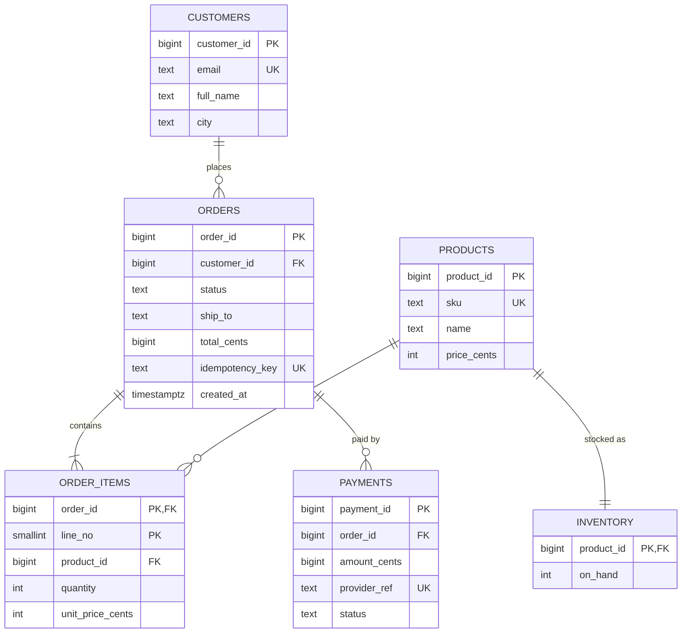

**Reading the diagram.** Each box is a table with its columns, types and key markers (PK primary key, FK foreign key, UK unique). Crow's-foot lines give cardinality: a customer places zero or more orders; an order contains one or more items; a product appears in zero or more items and has exactly one inventory row; an order has zero or more payment attempts. There are no runtime data flows here; every line is a foreign key enforced synchronously inside one database, which is the storage boundary. Failure points are the rows many transactions touch: `inventory` rows of popular products (hot rows, §11.15.3). Scaling path: read replicas for history and reports (§14.3), then partitioning `orders` and `order_items` by `customer_id`, which keeps each customer's orders together (§14.7).

### 11.17.2 DDL (PostgreSQL)

The following DDL was run on PostgreSQL 16:

```sql
CREATE TABLE customers (
  customer_id  bigint GENERATED ALWAYS AS IDENTITY PRIMARY KEY,
  email        text NOT NULL UNIQUE,
  full_name    text NOT NULL,
  city         text NOT NULL,
  created_at   timestamptz NOT NULL DEFAULT now()
);
CREATE TABLE products (
  product_id   bigint GENERATED ALWAYS AS IDENTITY PRIMARY KEY,
  sku          text NOT NULL UNIQUE,
  name         text NOT NULL,
  price_cents  integer NOT NULL CHECK (price_cents >= 0)
);
CREATE TABLE inventory (
  product_id   bigint PRIMARY KEY REFERENCES products,
  on_hand      integer NOT NULL CHECK (on_hand >= 0)
);
CREATE TABLE orders (
  order_id         bigint GENERATED ALWAYS AS IDENTITY PRIMARY KEY,
  customer_id      bigint NOT NULL REFERENCES customers,
  status           text NOT NULL DEFAULT 'pending'
                   CHECK (status IN ('pending','paid','shipped','cancelled')),
  ship_to          text NOT NULL,
  total_cents      bigint NOT NULL CHECK (total_cents >= 0),
  idempotency_key  text NOT NULL UNIQUE,
  created_at       timestamptz NOT NULL DEFAULT now()
);
CREATE TABLE order_items (
  order_id          bigint NOT NULL REFERENCES orders ON DELETE CASCADE,
  line_no           smallint NOT NULL,
  product_id        bigint NOT NULL REFERENCES products,
  quantity          integer NOT NULL CHECK (quantity > 0),
  unit_price_cents  integer NOT NULL CHECK (unit_price_cents >= 0),
  PRIMARY KEY (order_id, line_no)
);
CREATE TABLE payments (
  payment_id    bigint GENERATED ALWAYS AS IDENTITY PRIMARY KEY,
  order_id      bigint NOT NULL REFERENCES orders,
  amount_cents  bigint NOT NULL CHECK (amount_cents > 0),
  provider_ref  text UNIQUE,
  status        text NOT NULL CHECK (status IN ('authorized','captured','failed','refunded')),
  created_at    timestamptz NOT NULL DEFAULT now()
);
-- One index per access path
CREATE INDEX orders_customer_created_idx ON orders (customer_id, created_at DESC, order_id DESC); -- history
CREATE INDEX order_items_product_idx     ON order_items (product_id);       -- FK checks, sales by product
CREATE INDEX payments_order_idx          ON payments (order_id);            -- payments of an order
CREATE INDEX orders_pending_created_idx  ON orders (created_at) WHERE status = 'pending'; -- sweeper
```

What to notice:

- Money is stored as integer cents (or `numeric`), never floating point. Timestamps use `timestamptz`.
- `order_items` has a composite primary key `(order_id, line_no)`: its leading column serves "items of this order" and the foreign-key check, so no separate index on `order_items.order_id` is needed.
- `total_cents` is a stored aggregate (a denormalization, §11.5.5) written in the same transaction as the items; it is also the amount charged, a fact worth keeping.
- `status` uses `CHECK` rather than a separate lookup table or PostgreSQL `ENUM` type; adding a status later is a one-line constraint change.

### 11.17.3 The place-order transaction and core queries

The order service runs this transaction (shown with literal values; the application binds parameters). The decrements are atomic conditional updates, sorted by `product_id` to avoid deadlocks; the idempotency key makes retries safe (§22.15):

```sql
BEGIN;
INSERT INTO orders (customer_id, ship_to, total_cents, idempotency_key)
VALUES (1, '1 Main St', 0, '7f1c9a52-key')
ON CONFLICT (idempotency_key) DO NOTHING
RETURNING order_id;                       -- no row returned: a retry; fetch and return the existing order
UPDATE inventory SET on_hand = on_hand - 2 WHERE product_id = 1 AND on_hand >= 2;  -- expect 1 row
UPDATE inventory SET on_hand = on_hand - 1 WHERE product_id = 2 AND on_hand >= 1;  -- 0 rows: ROLLBACK
INSERT INTO order_items (order_id, line_no, product_id, quantity, unit_price_cents)
SELECT 1, row_number() OVER (ORDER BY v.product_id), v.product_id, v.qty, p.price_cents
FROM (VALUES (1, 2), (2, 1)) AS v(product_id, qty) JOIN products p USING (product_id);
UPDATE orders SET total_cents = (SELECT sum(quantity * unit_price_cents)
                                 FROM order_items WHERE order_id = 1)
WHERE order_id = 1;
COMMIT;
```

The complete model also runs on SQLite through Python's standard library; this script creates the schema, places an order, retries it with the same idempotency key, attempts an order that would oversell, and runs the history, best-seller and anti-join queries:

```python
"""E-commerce order schema and queries (Section 11.17), runnable with Python's sqlite3.
The PostgreSQL DDL in the chapter differs only in types (bigint identity, timestamptz)."""
import sqlite3

SCHEMA = """
PRAGMA foreign_keys = ON;
CREATE TABLE customers (
  customer_id INTEGER PRIMARY KEY,
  email       TEXT NOT NULL UNIQUE,
  full_name   TEXT NOT NULL,
  city        TEXT NOT NULL,
  created_at  TEXT NOT NULL DEFAULT CURRENT_TIMESTAMP
);
CREATE TABLE products (
  product_id  INTEGER PRIMARY KEY,
  sku         TEXT NOT NULL UNIQUE,
  name        TEXT NOT NULL,
  price_cents INTEGER NOT NULL CHECK (price_cents >= 0)
);
CREATE TABLE inventory (
  product_id INTEGER PRIMARY KEY REFERENCES products,
  on_hand    INTEGER NOT NULL CHECK (on_hand >= 0)
);
CREATE TABLE orders (
  order_id        INTEGER PRIMARY KEY,
  customer_id     INTEGER NOT NULL REFERENCES customers,
  status          TEXT NOT NULL DEFAULT 'pending'
                  CHECK (status IN ('pending','paid','shipped','cancelled')),
  ship_to         TEXT NOT NULL,
  total_cents     INTEGER NOT NULL DEFAULT 0 CHECK (total_cents >= 0),
  idempotency_key TEXT NOT NULL UNIQUE,
  created_at      TEXT NOT NULL DEFAULT CURRENT_TIMESTAMP
);
CREATE TABLE order_items (
  order_id         INTEGER NOT NULL REFERENCES orders ON DELETE CASCADE,
  line_no          INTEGER NOT NULL,
  product_id       INTEGER NOT NULL REFERENCES products,
  quantity         INTEGER NOT NULL CHECK (quantity > 0),
  unit_price_cents INTEGER NOT NULL CHECK (unit_price_cents >= 0),
  PRIMARY KEY (order_id, line_no)
);
CREATE TABLE payments (
  payment_id   INTEGER PRIMARY KEY,
  order_id     INTEGER NOT NULL REFERENCES orders,
  amount_cents INTEGER NOT NULL CHECK (amount_cents > 0),
  provider_ref TEXT UNIQUE,
  status       TEXT NOT NULL CHECK (status IN ('authorized','captured','failed','refunded')),
  created_at   TEXT NOT NULL DEFAULT CURRENT_TIMESTAMP
);
CREATE INDEX orders_customer_created ON orders (customer_id, created_at DESC, order_id DESC);
CREATE INDEX order_items_product     ON order_items (product_id);
CREATE INDEX payments_order          ON payments (order_id);
CREATE INDEX orders_pending_created  ON orders (created_at) WHERE status = 'pending';
"""

class OutOfStock(Exception):
    pass

def place_order(db, customer_id, ship_to, items, idempotency_key):
    """items: list of (product_id, quantity). Returns order_id. All-or-nothing."""
    with db:  # BEGIN ... COMMIT, or ROLLBACK if an exception escapes
        row = db.execute(
            "INSERT INTO orders (customer_id, ship_to, idempotency_key) VALUES (?, ?, ?) "
            "ON CONFLICT (idempotency_key) DO NOTHING RETURNING order_id",
            (customer_id, ship_to, idempotency_key)).fetchone()
        if row is None:  # a retry of a request we already processed
            return db.execute("SELECT order_id FROM orders WHERE idempotency_key = ?",
                              (idempotency_key,)).fetchone()[0]
        order_id, total = row[0], 0
        for line_no, (product_id, qty) in enumerate(sorted(items), start=1):  # fixed lock order
            cur = db.execute(
                "UPDATE inventory SET on_hand = on_hand - ? WHERE product_id = ? AND on_hand >= ?",
                (qty, product_id, qty))
            if cur.rowcount != 1:
                raise OutOfStock(product_id)  # aborts the whole transaction
            price = db.execute("SELECT price_cents FROM products WHERE product_id = ?",
                               (product_id,)).fetchone()[0]
            db.execute("INSERT INTO order_items VALUES (?, ?, ?, ?, ?)",
                       (order_id, line_no, product_id, qty, price))
            total += qty * price
        db.execute("UPDATE orders SET total_cents = ? WHERE order_id = ?", (total, order_id))
        return order_id

ORDER_HISTORY = """
SELECT order_id, status, total_cents, created_at
FROM orders
WHERE customer_id = :cid
  AND (created_at, order_id) < (:after_created, :after_id)   -- keyset cursor
ORDER BY created_at DESC, order_id DESC
LIMIT 20"""

TOP_PRODUCTS = """
SELECT p.sku, SUM(i.quantity) AS units, SUM(i.quantity * i.unit_price_cents) AS revenue_cents
FROM order_items i
JOIN orders   o ON o.order_id   = i.order_id
JOIN products p ON p.product_id = i.product_id
WHERE o.status <> 'cancelled'
GROUP BY p.sku
ORDER BY revenue_cents DESC
LIMIT 3"""

NO_ORDERS = """
SELECT c.email FROM customers c
WHERE NOT EXISTS (SELECT 1 FROM orders o WHERE o.customer_id = c.customer_id)"""

db = sqlite3.connect(":memory:")  # default mode: BEGIN issued implicitly before DML
db.executescript(SCHEMA)
db.executemany("INSERT INTO customers (email, full_name, city) VALUES (?, ?, ?)",
               [("ana@example.com", "Ana", "Pune"), ("bo@example.com", "Bo", "Lima")])
db.executemany("INSERT INTO products (sku, name, price_cents) VALUES (?, ?, ?)",
               [("MUG-1", "Mug", 1200), ("TEE-1", "T-shirt", 2500), ("CAP-1", "Cap", 1800)])
db.execute("INSERT INTO inventory SELECT product_id, 5 FROM products")

o1 = place_order(db, 1, "1 Main St", [(2, 1), (1, 2)], "key-001")
o1_retry = place_order(db, 1, "1 Main St", [(2, 1), (1, 2)], "key-001")
print("order", o1, "retry returns", o1_retry)
try:
    place_order(db, 1, "1 Main St", [(3, 1), (1, 99)], "key-002")
except OutOfStock as e:
    print("out of stock: product", e.args[0])
print("inventory:", db.execute("SELECT product_id, on_hand FROM inventory").fetchall())
print("orders:", db.execute("SELECT order_id, total_cents FROM orders").fetchall())
print("history:", db.execute(ORDER_HISTORY, {"cid": 1, "after_created": "9999", "after_id": 0}).fetchall())
print("top products:", db.execute(TOP_PRODUCTS).fetchall())
print("no orders:", db.execute(NO_ORDERS).fetchall())
print("plan:", db.execute("EXPLAIN QUERY PLAN " + ORDER_HISTORY,
                          {"cid": 1, "after_created": "9999", "after_id": 0}).fetchall()[0][3])
try:
    db.execute("INSERT INTO orders (customer_id, ship_to, idempotency_key) VALUES (99, 'x', 'k')")
except sqlite3.IntegrityError as e:
    print("foreign key enforced:", e)
```

What to notice:

- Output: the retry returns the same order (1); the oversell attempt raises `OutOfStock` and leaves inventory at `[(1, 3), (2, 4), (3, 5)]`. Product 3 had been decremented before product 1 failed, and the rollback restored it. Only one order exists, with total 4,900 cents.
- The history query uses a keyset cursor (§8.6.5); the first page passes a cursor greater than any real value. Its plan is `SEARCH orders USING INDEX orders_customer_created (customer_id=? AND created_at<?)`: the composite index serves both the filter and the sort.
- Best sellers: `TEE-1` (2,500 cents) then `MUG-1` (2,400 cents); the anti-join finds `bo@example.com`, who never ordered.

**Table 11.13 — Failure scenarios in the order system.**

| What goes wrong | Why | Detection | Recovery | Prevention |
|---|---|---|---|---|
| Overselling | Read-then-write stock check in the application | Negative-stock or oversold reports | Cancel and refund | Conditional `UPDATE ... AND on_hand >= q` plus `CHECK (on_hand >= 0)` |
| Duplicate orders on client retry | Timeout after commit; client retries | Two orders with identical items seconds apart | Refund duplicate | `UNIQUE` idempotency key; `ON CONFLICT DO NOTHING` |
| Deadlocks at peak | Carts lock inventory rows in different orders | `deadlock detected` errors in logs | Automatic retry | Sort lines by `product_id` before updating |
| Checkout stalls during a sale | Payment call inside the transaction holds a hot row lock | Lock waits in `pg_stat_activity`; p99 latency | Kill long transactions | Pay outside the transaction; short transactions; split hot counters |
| Order history slows over time | Missing or wrong composite index; offset pagination | `EXPLAIN` shows sort or scan | Add index | Index `(customer_id, created_at DESC, order_id DESC)`; keyset pagination |

