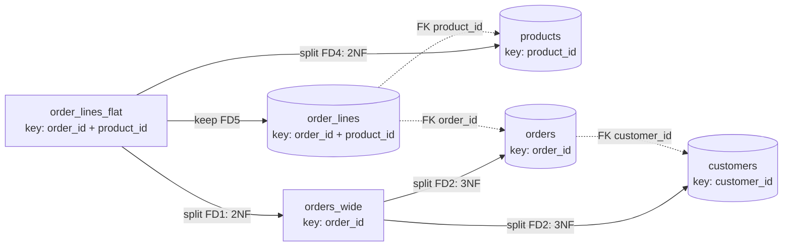
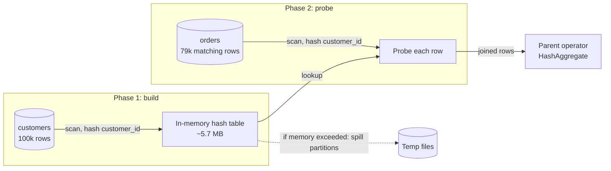
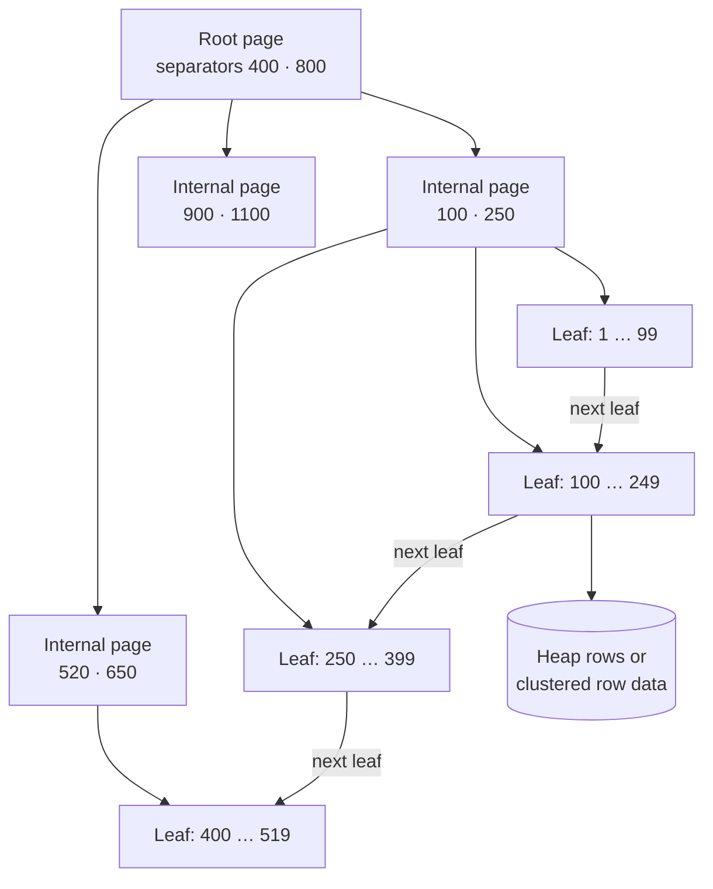

# Chapter 11 — Relational Databases

> **Level:** 1–2 · **Track:** A (Traditional) · **Estimated reading time:** 5 h

Almost every system you will design has a relational database somewhere in it. The orders in a shop, the balances in a bank, the users of a social network and the configuration of a cloud platform usually live in PostgreSQL, MySQL or a database that speaks their SQL dialect. Relational databases have been the default for fifty years because they solve three hard problems at once: they let you describe *what* data you want without saying *how* to fetch it, they keep data correct while thousands of clients change it concurrently, and they keep committed data safe through crashes.

This chapter explains how they do it. We follow one running example throughout: the order system of an online shop, with customers, products, inventory, orders, order items and payments. You will learn to model that data, index it, read query plans, choose isolation levels and avoid the concurrency bugs that cost real companies money. On-disk internals (write-ahead logging, buffer pools, LSM trees) are covered in Chapter 13, and replication and sharding in Chapter 14; here we summarize them only where needed.

## 11.1 Learning objectives

After this chapter you should be able to:

- Explain the relational model (relations, tuples, attributes, keys) and why Codd's separation of logical and physical data made SQL possible.
- Choose primary keys (natural or surrogate) and foreign keys with appropriate referential actions.
- Normalize a schema to BCNF using functional dependencies, and justify each deliberate denormalization.
- Write inner, outer, semi- and anti-joins, and estimate the I/O cost of nested-loop, hash and sort-merge joins.
- Design clustered, secondary, composite, covering and partial indexes for a stated query workload.
- Compute B+ tree height and I/Os per lookup from page size, key size and row count.
- Read a PostgreSQL `EXPLAIN (ANALYZE, BUFFERS)` plan and diagnose a cardinality misestimate.
- Define ACID precisely and distinguish ACID consistency from consistency in distributed systems.
- Reproduce dirty reads, non-repeatable reads, phantoms, lost updates and write skew, and state which isolation level prevents each in PostgreSQL and MySQL.
- Explain MVCC in PostgreSQL (tuple versions, `xmin`/`xmax`, VACUUM) and InnoDB (undo logs, purge).
- Explain two-phase locking, gap locks and deadlock detection, and design transactions that avoid deadlocks and hot-row contention.
- Produce an end-to-end schema, DDL and core queries for an e-commerce order system.

## 11.2 Prerequisites

- Logarithms and B-tree fan-out — §4.4 (index height is a logarithm with a large base).
- Storage devices and latency numbers — §5.6, §4.17 (a random SSD read costs ~100 µs; RAM ~100 ns).
- Page cache and `fsync` — §6.6, §6.14 (durability depends on forcing the log to disk).
- Race conditions, mutexes and deadlock — §6.9–§6.11 (database locking applies the same ideas to rows).
- Keyset pagination — §8.6.5 (we reuse it in the order-history query).
- Idempotency keys — §8.6.3 and §22.15 (the order API must be safe to retry).

## 11.3 The relational model: tables, rows and columns

### 11.3.1 Relations, tuples and attributes

::: definition
**Definition — Relation.** A **relation** is a named set of **tuples** that share the same **attributes**. Each attribute has a name and a **domain** (the set of allowed values, such as 64-bit integers). In SQL a relation is a **table**, a tuple is a **row** and an attribute is a **column**. The relation's name and attributes together form its **schema**; the set of rows at a moment is its **instance**.
:::

#### First-principles explanation

A table looks like a spreadsheet, but three differences matter. First, a relation is a *set*: rows have no inherent order, and the only way to identify a row is by its values (its key), never by "row 17". Second, every column has a fixed type, enforced by the database on every write. Third, relationships between tables are expressed by *values*: an order row stores the customer's ID, not a pointer to the customer's memory address. Those three properties are what make it possible for a program, the query optimizer, to rearrange how your question is answered without changing the answer.

#### Why does this exist?

Before 1970, databases such as IBM's IMS (hierarchical) and CODASYL systems (network) stored records linked by physical pointers. Programs *navigated*: "go to customer 42, follow the first-order pointer, follow next-order pointers until null". If the database administrator reorganized the storage, for example adding an index or changing the record order, the programs broke. Codd's paper "A Relational Model of Data for Large Shared Data Banks" proposed that users should see only relations, and that access paths should be the database's private business [Codd 1970]. This **physical data independence** is why you can add an index to a production table today and every existing query keeps working, only faster.

#### How it works internally

1. You state *what* you want in a declarative language, SQL (originally SEQUEL, designed at IBM for System R).
2. The database translates the statement into **relational algebra**: selection σ (filter rows), projection π (choose columns), join ⋈ (combine rows from two relations by a condition), union, difference and aggregation.
3. Algebraic equivalences, such as "filter before joining" or "join A with B before C", let the optimizer generate many equivalent plans and pick the cheapest one (§11.10).
4. The executor runs the chosen plan against physical structures (heap files, B+ trees) that the query text never mentions (§11.9).

#### NULL and three-valued logic

SQL adds **NULL**, meaning "unknown or not applicable". Any comparison with NULL yields UNKNOWN, not TRUE or FALSE, and `WHERE` keeps only rows whose condition is TRUE.

::: mistake
**Mistake — `WHERE coupon_code <> 'SPRING'` returns orders without a coupon.** It does not: for rows where `coupon_code` is NULL, the comparison is UNKNOWN and the row is dropped. Write `WHERE coupon_code IS DISTINCT FROM 'SPRING'` (PostgreSQL, SQLite) or add `OR coupon_code IS NULL`. Likewise `NOT IN (subquery)` returns no rows if the subquery yields a single NULL; prefer `NOT EXISTS`.
:::

## 11.4 Keys: primary, foreign, natural and surrogate

### 11.4.1 Superkeys, candidate keys and primary keys

::: definition
**Definition — Keys.** A **superkey** is a set of columns whose values are unique across all rows. A **candidate key** is a minimal superkey: remove any column and it stops being unique. The **primary key** is the candidate key chosen as the row's main identifier; it must be unique and NOT NULL. Other candidate keys are enforced with `UNIQUE` constraints. A **foreign key** is a column (or set) in one table whose values must match a key of another table, a rule called **referential integrity**.
:::

In the shop, `customers` has two candidate keys: `customer_id` and `email`. We choose `customer_id` as the primary key and declare `email` `UNIQUE`. `orders.customer_id` is a foreign key to `customers.customer_id`: the database rejects an order for a customer that does not exist, and rejects deleting a customer who still has orders unless you specify otherwise.

The **referential action** says what happens to child rows when a parent is deleted or its key updated: `RESTRICT`/`NO ACTION` (reject; the default), `CASCADE` (delete or update children too), `SET NULL` or `SET DEFAULT`. Use `CASCADE` for true ownership (an order owns its order items) and the default for references to independent entities (an order item must not silently disappear because a product was deleted; products should be deactivated, not deleted).

#### Code example

```python
import sqlite3

db = sqlite3.connect(":memory:")
db.executescript("""
PRAGMA foreign_keys = ON;            -- SQLite enforces FKs only when this is set
CREATE TABLE customers (customer_id INTEGER PRIMARY KEY, email TEXT NOT NULL UNIQUE);
CREATE TABLE orders (
  order_id    INTEGER PRIMARY KEY,
  customer_id INTEGER NOT NULL REFERENCES customers (customer_id)
);
INSERT INTO customers VALUES (1, 'ana@example.com');
INSERT INTO orders VALUES (100, 1);
""")
for sql in ["INSERT INTO orders VALUES (101, 99)",                    # no customer 99
            "INSERT INTO customers VALUES (2, 'ana@example.com')",   # duplicate candidate key
            "DELETE FROM customers WHERE customer_id = 1"]:          # still has an order
    try:
        db.execute(sql)
    except sqlite3.IntegrityError as e:
        print(f"{sql[:40]:<42} -> {e}")
```

What to notice:

- All three statements fail with `IntegrityError`: the database, not application code, guards the invariants. Output: `FOREIGN KEY constraint failed`, `UNIQUE constraint failed: customers.email`, `FOREIGN KEY constraint failed`.
- SQLite enforces foreign keys only after `PRAGMA foreign_keys = ON`, per connection. PostgreSQL and MySQL (InnoDB) always enforce them.
- Foreign-key checks cost an index lookup on the parent for every child insert. PostgreSQL does **not** automatically index the *child* column (`orders.customer_id`); without that index, deleting a customer scans the whole `orders` table. Index foreign-key columns you join or delete through.

### 11.4.2 Natural versus surrogate keys

::: definition
**Definition — Natural and surrogate keys.** A **natural key** is a candidate key with business meaning (email address, ISBN, country code). A **surrogate key** is a meaningless value generated by the system (an auto-increment integer, a UUID) whose only job is identification.
:::

Natural keys look attractive because they avoid an extra column, but business identifiers change (people change email addresses; product codes get reissued), and every foreign key that copied the old value must then change too. Surrogate keys never change, are compact and make joins cheap. The common rule: use a surrogate primary key, and enforce the natural key with a `UNIQUE` constraint so duplicates are still impossible. Use natural keys for small, stable code tables (ISO country codes, currency codes).

The *kind* of surrogate matters for B+ tree indexes (§11.8). Sequential integers always insert at the right-most leaf, so pages fill completely and stay hot in cache. Random UUIDv4 values insert into a random leaf, causing page splits, half-empty pages and a working set as large as the whole index. Time-ordered identifiers (UUIDv7, Snowflake-style IDs; §17.10) keep the insert locality of integers while being globally unique without a central counter.

**Table 11.1 — Choosing a primary key.**

| Key type | Size | Insert locality in B+ tree | Globally unique | Leaks information | Choose when |
|---|---|---|---|---|---|
| Natural key (email, SKU) | Variable | Random | Within domain | Yes (it is data) | Small stable code tables |
| `bigint` identity / auto-increment | 8 bytes | Sequential (excellent) | Per table only | Row count, growth rate | Single database, default choice |
| UUIDv4 | 16 bytes | Random (poor) | Yes | No | IDs generated offline by clients; small tables |
| UUIDv7 / Snowflake-style | 16 / 8 bytes | Roughly sequential | Yes | Creation time | Many writers or shards (§17.10) |

::: industry
**Instagram — sharded PostgreSQL with time-ordered 64-bit IDs.** Instagram described generating primary keys inside PostgreSQL with a function that packs 41 bits of milliseconds since a custom epoch, 13 bits of logical shard ID and 10 bits of a per-shard sequence. IDs sort by time (good B+ tree locality, cheap "newest first" queries), fit in a `bigint`, and need no central ID service. The trade-off is that IDs reveal creation time and that the bit budget caps per-shard throughput at 1,024 IDs per millisecond.
*Evidence: Primary* — [Instagram Engineering 2012]
:::

::: mistake
**Mistake — "UUIDs are slow, never use them."** The cost is randomness, not size. A UUIDv4 primary key in InnoDB, where the primary key *is* the table's storage order (§11.7), scatters inserts across the whole table; a UUIDv7 key does not. Measure insert throughput and buffer-pool hit ratio before and after, not key width.
:::

## 11.5 Normalization and denormalization

### 11.5.1 Redundancy and the three anomalies

#### First-principles explanation

Imagine the shop's first version kept everything in one spreadsheet: one row per order line, with the customer's email and city and the product's name and price copied into every row. Ana's email appears in all 40 of her order lines. When she changes it, someone must update 40 rows; miss one and the database now holds two "truths". That is the core problem normalization solves: **every fact should be stored exactly once**, so it can only be changed in one place.

Redundant designs suffer three **anomalies**:

1. **Update anomaly** — changing one fact requires changing many rows; a partial update leaves contradictions.
2. **Insert anomaly** — you cannot record a fact without an unrelated one: a new product cannot be stored until somebody orders it.
3. **Delete anomaly** — deleting one fact destroys another: cancelling and purging the only order of a product loses the product's name and price.

::: definition
**Definition — Functional dependency.** In a relation $R$, the functional dependency $X \to Y$ holds if any two rows that agree on the columns $X$ also agree on the columns $Y$. $X$ is the **determinant**. Example: `product_id → product_name` because one product ID always has one name.
:::

### 11.5.2 The normal forms

::: definition
**Definition — Normal forms (1NF to BCNF).**
**1NF:** every column holds a single atomic value (no lists or repeating groups).
**2NF:** 1NF, and no non-key column depends on only *part* of a composite candidate key.
**3NF:** 2NF, and no non-key column depends on another non-key column (no transitive dependency); formally, for every non-trivial $X \to A$, either $X$ is a superkey or $A$ is part of some candidate key.
**BCNF (Boyce–Codd normal form):** for every non-trivial $X \to A$, $X$ is a superkey. BCNF removes 3NF's exception for key columns.
:::

Kent's one-line summary of 2NF and 3NF is that every non-key column must provide a fact about "the key, the whole key, and nothing but the key" [Kent 1983]. Higher forms (4NF, 5NF) deal with multi-valued and join dependencies and rarely matter in application design.

**Table 11.2 — Normal forms at a glance.**

| Form | Forbids | Typical symptom | Fix |
|---|---|---|---|
| 1NF | Lists or repeating groups in a column | `items = 'MUG-1x2; TEE-1x1'` | One row per item |
| 2NF | Dependency on part of a composite key | Product name repeated on every order line | Move to a table keyed by the part |
| 3NF | Non-key → non-key dependency | Customer email repeated on every order | Move to a table keyed by the determinant |
| BCNF | Any determinant that is not a superkey | Overlapping candidate keys (see below) | Split on the offending dependency |

### 11.5.3 Worked decomposition: from a flat export to BCNF

::: example
**Worked example — Normalizing the shop's order export.** The legacy export has one row per order line:

`order_lines_flat(order_id, order_date, customer_id, customer_email, customer_city, product_id, product_name, list_price_cents, quantity, unit_price_cents)`

*Step 1 — 1NF.* An even older format stored all items of an order in one text cell. Splitting that cell into one row per product makes every value atomic, giving the table above.

*Step 2 — List the functional dependencies.* From the business rules:
- FD1: `order_id → order_date, customer_id`
- FD2: `customer_id → customer_email, customer_city`
- FD3: `customer_email → customer_id` (emails are unique)
- FD4: `product_id → product_name, list_price_cents`
- FD5: `order_id, product_id → quantity, unit_price_cents` (one line per product per order)

The only candidate key is `{order_id, product_id}`: together they determine every column, and neither does alone.

*Step 3 — 2NF.* FD1 and FD4 have determinants that are *part* of the key, so `order_date`, the customer columns and the product columns depend on part of the key. Split each partial dependency into its own table:
- `orders_wide(order_id, order_date, customer_id, customer_email, customer_city)`
- `products(product_id, product_name, list_price_cents)`
- `order_lines(order_id, product_id, quantity, unit_price_cents)`

*Step 4 — 3NF.* In `orders_wide`, `order_id → customer_id → customer_email, customer_city` is a transitive dependency. Split on FD2:
- `orders(order_id, order_date, customer_id)`
- `customers(customer_id, customer_email, customer_city)`

*Step 5 — BCNF check.* In `customers`, the determinants are `customer_id` and `customer_email`, both candidate keys. In every other table the only determinant is the primary key. All five tables are in BCNF.

*Step 6 — Lossless-join check.* A split of $R$ into $R_1$ and $R_2$ is **lossless** (joining them back reproduces exactly the original rows, no more, no fewer) if the shared columns form a key of at least one side. Each split above shares a column that is a key of one side (`order_id`, `product_id`, `customer_id`), so joining the five tables reproduces the export exactly.

**Interpretation.** Ana's email is now stored once, products exist without orders, and deleting an order never loses product data. **Engineering implication.** Notice that `unit_price_cents` stayed in `order_lines` while `list_price_cents` moved to `products`. They are different facts: the price *charged* on that day versus the price *today*. Copying the price into the order line is not redundancy; it is history, and dropping it would make every past invoice change whenever marketing changes a price.
:::

**Figure 11.1 — Decomposing the flat order export into BCNF tables.**



**Reading the diagram.** The rectangle on the left is the unnormalized input; rectangles in the middle are intermediate tables that are not yet final; cylinders are the final BCNF tables. Solid arrows are decomposition steps, labeled with the functional dependency that justified each split and the normal form it achieves. Dotted arrows are the foreign keys that tie the final tables together; they are not data flows but the join paths that make the decomposition lossless. There is no runtime component here, so there are no synchronous paths or failure points in the usual sense; the "failure" a decomposition can introduce is a lost dependency (see the BCNF trade-off below). Scaling consequence: each extra table adds a join to queries that need data from several of them, which is the cost denormalization later buys back.

### 11.5.4 When BCNF and 3NF disagree

Most real schemas reach BCNF automatically once they are in 3NF. The exception needs overlapping candidate keys. Suppose the shop ships through local depots: each depot is operated by exactly one carrier (`depot → carrier`), and for each postal code each carrier serves it from exactly one depot (`postal_code, carrier → depot`). In `coverage(postal_code, carrier, depot)` the candidate keys are `{postal_code, carrier}` and `{postal_code, depot}`. The dependency `depot → carrier` violates BCNF (`depot` is not a superkey) but satisfies 3NF (`carrier` is part of a candidate key). Splitting into `depots(depot, carrier)` and `coverage(postal_code, depot)` reaches BCNF but loses the ability to enforce `postal_code, carrier → depot` with a simple unique constraint; you would need a trigger or application check. This is the classic trade-off: BCNF always gives a lossless decomposition, but not always a **dependency-preserving** one; 3NF always gives both [Ramakrishnan and Gehrke 2003].

### 11.5.5 Denormalization

::: definition
**Definition — Denormalization.** Deliberately storing a fact more than once, or storing a derived value, to make important reads cheaper, while accepting the cost of keeping the copies consistent.
:::

Normalization optimizes for correct, cheap writes. Some read paths, such as a product page that shows average rating and review count, or a dashboard of revenue by city, would need large joins or aggregations on every request. Denormalization trades write work and consistency risk for read speed. Common forms:

1. **Stored aggregates** — `orders.total_cents`, `products.review_count`, updated in the same transaction as the rows they summarize.
2. **Copied columns** — `order_lines.product_name` kept so invoices render without a join (and, like the unit price, it is also a historical fact).
3. **Materialized views** — a stored query result, refreshed periodically (`REFRESH MATERIALIZED VIEW CONCURRENTLY` in PostgreSQL).
4. **Read models outside the database** — caches (Chapter 20), search indexes (Chapter 16) or CQRS projections fed by change data capture (§32.4, §32.6). These are updated asynchronously and are therefore eventually consistent.

::: recommendation
**Recommendation — Normalize the source of truth; denormalize with an owner.** Model the transactional tables in 3NF/BCNF. Add a redundant copy only for a measured read problem, and write down which code path keeps it consistent: the same transaction (strongly consistent), a trigger (strongly consistent, hidden logic), or an asynchronous pipeline (eventually consistent, needs a reconciliation job). A copy with no named owner will drift.
:::

**Table 11.3 — Failure scenarios in schema design.**

| What goes wrong | Why | Detection | Recovery | Prevention |
|---|---|---|---|---|
| Two customers rows with the same email | Natural key not declared `UNIQUE` | Duplicate-detection query; login bugs | Merge rows, repoint FKs | `UNIQUE` on every candidate key |
| Denormalized total disagrees with items | Update path forgot the aggregate | Nightly reconciliation query | Recompute from source rows | Update in the same transaction; reconciliation job |
| Old invoices change when prices change | Price stored only in `products` | Customer complaints, audit | Restore from backups or logs | Store price-at-purchase in `order_lines` |
| Orphaned order lines | No FK constraint | Anti-join `NOT EXISTS` check | Delete or repair orphans | Declare FKs; `ON DELETE CASCADE` for owned rows |

## 11.6 SQL and joins

### 11.6.1 SQL as a declarative language

::: definition
**Definition — SQL.** The Structured Query Language, standardized by ANSI/ISO, with sublanguages for defining schema (DDL: `CREATE`, `ALTER`, `DROP`), manipulating data (DML: `SELECT`, `INSERT`, `UPDATE`, `DELETE`) and controlling transactions (`BEGIN`, `COMMIT`, `ROLLBACK`). Every major database implements the core standard plus its own dialect.
:::

A `SELECT` is written in one order but evaluated, logically, in another. Knowing the logical order explains most beginner errors (such as referring to a `SELECT` alias inside `WHERE`):

1. `FROM` and `JOIN` — build the combined rows.
2. `WHERE` — filter individual rows.
3. `GROUP BY` — form groups.
4. `HAVING` — filter groups.
5. `SELECT` — compute output expressions and aliases (window functions run here).
6. `ORDER BY` — sort.
7. `LIMIT`/`OFFSET` — cut.

The database may physically execute in a different order (for example, pushing a filter below a join) as long as the result is identical.

### 11.6.2 Join types

A **join** combines rows from two tables that satisfy a condition. Using the shop tables:

```sql
-- Inner join: orders with their customer (orders without a customer cannot exist: FK)
SELECT o.order_id, c.email, o.total_cents
FROM orders o
JOIN customers c ON c.customer_id = o.customer_id;

-- Left outer join: every customer, with order count (0 for customers who never ordered)
SELECT c.customer_id, c.email, COUNT(o.order_id) AS orders
FROM customers c
LEFT JOIN orders o ON o.customer_id = c.customer_id
GROUP BY c.customer_id, c.email;

-- Semi-join: customers who bought product 42 (each customer once, however many orders)
SELECT c.email FROM customers c
WHERE EXISTS (SELECT 1 FROM orders o JOIN order_items i ON i.order_id = o.order_id
              WHERE o.customer_id = c.customer_id AND i.product_id = 42);

-- Anti-join: customers with no orders at all
SELECT c.email FROM customers c
WHERE NOT EXISTS (SELECT 1 FROM orders o WHERE o.customer_id = c.customer_id);
```

What to notice:

- `COUNT(o.order_id)` counts non-NULL values, so customers with no orders get 0; `COUNT(*)` would wrongly give 1, because the outer join produces one row padded with NULLs.
- `EXISTS` expresses "at least one match" without duplicating the customer per matching row; a plain join followed by `DISTINCT` gives the same answer with more work.
- A `RIGHT JOIN` is a left join with the tables swapped; a `FULL OUTER JOIN` keeps unmatched rows from both sides. All four statements run unchanged in SQLite and PostgreSQL.

### 11.6.3 Join algorithms

The SQL says *what* to join; the database picks *how*. There are three families, and every relational engine uses some of them [Ramakrishnan and Gehrke 2003; Graefe 1993].

#### First-principles explanation

Suppose you must match 1,000 wedding guests to 120 tables using a list of names and a list of table assignments. You could, for each guest, read the whole assignment list (**nested loop**). You could first write the assignments on index cards filed by surname initial, then look each guest up (**hash join**). Or you could sort both lists alphabetically and walk down them together (**sort-merge join**). Which is fastest depends on list sizes, whether either list is already sorted, and how much desk space (memory) you have.

#### How it works internally

1. **Nested-loop join (NLJ).** For each row of the *outer* input, scan the *inner* input and emit matching pairs. **Block NLJ** reads the outer side in memory-sized chunks so the inner side is scanned once per chunk instead of once per row. **Index NLJ** replaces the inner scan with an index lookup: for each outer row, descend the inner table's B+ tree on the join column. Index NLJ is the best algorithm when the outer side is small, which is the case for most OLTP queries ("this customer's orders").
2. **Hash join.** *Build* phase: read the smaller input and insert each row into an in-memory hash table keyed on the join column. *Probe* phase: stream the larger input and look up each row's key. It needs an equality condition. If the build side does not fit in memory, both inputs are first **partitioned** by a hash of the key into spill files on disk so that each partition pair fits (the **Grace hash join**).
3. **Sort-merge join.** Sort both inputs on the join key (or read them in order from an index), then advance two cursors in step, emitting matches. It handles equality and also benefits range conditions; it is attractive when inputs are already sorted or when the output must be sorted anyway.

```python
from collections import defaultdict

customers = [(1, "Berlin"), (2, "Austin"), (3, "Pune")]           # (customer_id, city)
orders = [(10, 1, 2500), (11, 3, 900), (12, 1, 4100), (13, 4, 50)]  # (order_id, customer_id, total)

def nested_loop_join(outer, inner, okey, ikey):
    for o in outer:                      # for every outer row ...
        for i in inner:                  # ... scan the whole inner input
            if o[okey] == i[ikey]:
                yield o + i

def hash_join(build, probe, bkey, pkey):
    table = defaultdict(list)
    for b in build:                      # build phase: hash the smaller input
        table[b[bkey]].append(b)
    for p in probe:                      # probe phase: one lookup per probe row
        for b in table.get(p[pkey], ()):
            yield b + p

def sort_merge_join(left, right, lkey, rkey):
    left, right = sorted(left, key=lambda r: r[lkey]), sorted(right, key=lambda r: r[rkey])
    i = j = 0
    while i < len(left) and j < len(right):
        lv, rv = left[i][lkey], right[j][rkey]
        if lv < rv:
            i += 1
        elif lv > rv:
            j += 1
        else:                            # emit every pair in the matching groups
            j_end = j
            while j_end < len(right) and right[j_end][rkey] == lv:
                j_end += 1
            while i < len(left) and left[i][lkey] == lv:
                for r in right[j:j_end]:
                    yield left[i] + r
                i += 1
            j = j_end

for name, rows in [("nested loop", nested_loop_join(customers, orders, 0, 1)),
                   ("hash", hash_join(customers, orders, 0, 1)),
                   ("sort-merge", sort_merge_join(customers, orders, 0, 1))]:
    print(f"{name:<12}", sorted(rows, key=lambda r: r[2]))
```

What to notice:

- All three print the same three rows: Berlin with orders 10 and 12, Pune with order 11. Order 13 (customer 4) has no match and disappears, as an inner join requires.
- The nested loop performs $3 \times 4 = 12$ comparisons; the hash join performs 3 inserts and 4 probes. With a million rows on each side, that difference is $10^{12}$ versus $2 \times 10^6$ operations.
- The sort-merge join must handle duplicate keys on both sides (customer 1 has two orders), which is why it emits every pair in the matching groups.

**Figure 11.2 — Hash join: build on the smaller input, probe with the larger.**



**Reading the diagram.** Cylinders are tables or temporary files on disk; rectangles are in-memory operator state. The build phase reads all of `customers` (the smaller input) and finishes before probing starts, so the hash join is *blocking* on its build side; the probe phase is *pipelined*: each `orders` row is hashed, looked up and passed upward immediately. All solid arrows are synchronous in-process data flows. The dotted arrow is the failure-and-degradation path: if the hash table exceeds the memory budget (`work_mem` in PostgreSQL), the operator partitions both inputs to temporary files and joins them one partition at a time, which turns a memory-speed join into one that reads and writes both inputs again. The sizes come from the real plan in §11.10 (100,000 customers produced a 5,712 kB hash table). Scaling: raising the memory budget, filtering the build side earlier, or parallel workers that each probe a share of the larger input.

#### Mathematical foundations

The classic way to compare join algorithms counts **page I/Os**, because on a disk-resident database they dominate [Ramakrishnan and Gehrke 2003]. Let the outer relation $R$ have $M$ pages and the inner relation $S$ have $N$ pages.

::: formula
**I/O cost of join algorithms**

$$C_{\text{tuple NLJ}} = M + p_R \cdot M \cdot N \qquad C_{\text{block NLJ}} = M + \left\lceil \frac{M}{B-2} \right\rceil N$$

$$C_{\text{index NLJ}} = M + p_R \cdot M \cdot c_{\text{idx}} \qquad C_{\text{Grace hash}} \approx 3(M + N) \qquad C_{\text{sort-merge}} \approx 3(M+N) \text{ to } 5(M+N)$$

| Symbol | Meaning | Units |
|---|---|---|
| $M$, $N$ | Pages in the outer relation $R$ and inner relation $S$ | pages |
| $p_R$ | Rows per page of $R$ | rows/page |
| $B$ | Buffer pages available to the join (one for output, one for the inner scan) | pages |
| $c_{\text{idx}}$ | Page reads to find matching inner rows through an index (descent plus row fetch) | pages/row |
| $C$ | Total page reads and writes | page I/Os |
:::

The hash and sort-merge figures assume enough memory to finish in two passes (roughly $B > \sqrt{\min(M,N)}$ for hash, $B > \sqrt{\max(M,N)}$ for sort); with fewer buffers, more passes are needed. If the build side fits entirely in memory, a hash join reads each input once: $M + N$.

::: example
**Worked example — Joining `orders` with `order_items`.** The PostgreSQL tables of §11.10 have $M = 15{,}385$ pages for `orders` (1,000,000 rows, so $p_R = 65$) and $N = 18{,}383$ pages for `order_items` (2,500,000 rows), with 8 KiB pages. Assume $B = 1{,}002$ buffer pages (about 8 MiB).

1. Tuple NLJ: $15{,}385 + 65 \times 15{,}385 \times 18{,}383 = 15{,}385 + 1.84 \times 10^{10} \approx 1.8 \times 10^{10}$ I/Os. At 100 µs per random read that is $1.8 \times 10^6$ s, about 21 days.
2. Block NLJ: $\lceil 15{,}385 / 1{,}000 \rceil = 16$ chunks; $15{,}385 + 16 \times 18{,}383 = 309{,}513$ I/Os, about 31 s at 100 µs each (much less with sequential reads).
3. Grace hash join: $3 \times (15{,}385 + 18{,}383) = 101{,}304$ I/Os, about 10 s; if `orders` fits in memory, $33{,}768$ I/Os.
4. Index NLJ for **one customer's** 10 orders: the outer side is 10 rows; each needs about 4 page reads in the `order_items` primary-key index plus heap: roughly $10 \times 4 = 40$ I/Os, about 4 ms cold and well under 1 ms when cached (the real plan in §11.10 took 0.43 ms).

**Interpretation.** For a whole-table join, the naive nested loop is impossible, block NLJ is tolerable and the hash join wins. For a selective OLTP query, the index nested loop wins by four orders of magnitude, because it touches only the rows it needs. **Engineering implication.** There is no universally best join algorithm; the optimizer must know *how many rows* each side produces, which is why cardinality estimation (§11.10) decides performance.
:::

**Table 11.4 — Join algorithms compared.**

| Algorithm | Join conditions | Memory | Best when | Weakness |
|---|---|---|---|---|
| Nested loop (block) | Any | Small | Tiny inputs; non-equality conditions | Quadratic on large inputs |
| Index nested loop | Equality or range on indexed inner column | Small | Small outer side, indexed inner (OLTP) | Random I/O per outer row if outer is large |
| Hash join | Equality only | Build side (spills if needed) | Large unsorted inputs, analytics | Blocking build; spills when memory is short |
| Sort-merge join | Equality (and some ranges) | Sort buffers | Inputs already sorted or output needs sorting | Sorting cost if inputs are unsorted |

As of 2026, PostgreSQL implements all three. MySQL implements nested-loop variants (including batched key access) and, since 8.0.18, hash joins; it has no sort-merge join [MySQL Docs: Hash Join].

## 11.7 Indexes

### 11.7.1 What an index is

::: definition
**Definition — Index.** A secondary data structure, kept in sync with a table by the database, that maps values of one or more **key columns** to the locations of the rows holding them, so that rows can be found without scanning the whole table. Most relational indexes are B+ trees (§11.8); others include hash, GiST, GIN and BRIN indexes in PostgreSQL and full-text and spatial indexes in MySQL.
:::

#### First-principles explanation

A book's index lets you find "isolation levels" without reading 900 pages. It works because it is *sorted* and *small* relative to the book, and it points to page numbers. It also has costs: someone must update it whenever the book changes, it takes paper, and for a word that appears on every page ("the") it is useless; reading the book is faster. Database indexes have exactly these properties: fast lookups for selective conditions, extra work on every write, extra storage, and no benefit when a query needs a large fraction of the table.

#### Why does this exist?

Without an index, `SELECT * FROM orders WHERE customer_id = 4242` must read every page of `orders`. In §11.10 that real query read 15,385 pages and took 70 ms to find 10 rows. With an index on `customer_id` it read 16 pages and took 0.14 ms. At 1,000 requests per second, the first version needs 70 CPU-seconds per second of scanning; the second needs 0.14.

### 11.7.2 Clustered and secondary indexes

::: definition
**Definition — Clustered and secondary index.** In a **clustered index** (an index-organized table), the leaf level of the index *is* the table: rows are stored in key order inside the index's leaf pages. A table can have at most one. A **secondary index** stores, for each key, a pointer to the row; the table can have many.
:::

The two most popular open-source databases make opposite choices:

- **InnoDB (MySQL)** stores every table as a B+ tree clustered on the primary key. If you declare none, it uses the first `UNIQUE NOT NULL` index, or else generates a hidden 6-byte row ID. Secondary index leaves store the indexed columns plus the *primary-key value*. A secondary lookup therefore descends two trees: the secondary index to find the primary key, then the clustered index to find the row [MySQL Docs: Clustered and Secondary Indexes].
- **PostgreSQL** stores rows in an unordered **heap** file. Every index, including the primary key, is secondary; its leaves store a **TID** (tuple identifier: page number and slot), so a lookup descends one tree and then reads one heap page. The `CLUSTER` command reorders the heap once, but later inserts are not kept in order.

**Figure 11.3 — Secondary-index lookup paths in InnoDB and PostgreSQL.**


**Reading the diagram.** The client's query (stadium) is answered by two different storage designs. In InnoDB the secondary index (rectangle) yields a primary-key *value*, which is used to descend the clustered index (cylinder) where the row lives: two tree descents. In PostgreSQL the index yields a *physical address* (TID), so the second step is a single heap-page read. All arrows are synchronous reads inside one database process. The trade-offs follow from the pointer type: InnoDB's logical pointer survives row moves (a page split in the clustered index does not touch secondary indexes) and range scans on the primary key read rows in order; PostgreSQL's physical pointer is faster to follow but must be updated in *every* index when an update creates a new row version on a different page (§11.14). Failure point: a long primary key in InnoDB is copied into every secondary index entry, inflating all of them. Scaling: keep InnoDB primary keys short and monotonic; in PostgreSQL leave free space in heap pages (`fillfactor`) so updates stay on the same page.

### 11.7.3 Composite indexes and the leftmost-prefix rule

A **composite index** on `(customer_id, created_at)` sorts entries by `customer_id`, and within equal `customer_id` by `created_at`, like a phone book sorted by surname and then first name. You can use it to find everyone named "Rao" (leftmost column), or "Rao, Priya" (both columns), but not everyone named "Priya": those entries are scattered across the whole book. This is the **leftmost-prefix rule**: a B+ tree index can seek on a prefix of its columns, with equality on all but possibly the last column used, which may be a range.

The index on `(customer_id, created_at)` serves:

- `WHERE customer_id = ?`
- `WHERE customer_id = ? AND created_at >= ?`
- `WHERE customer_id = ? ORDER BY created_at DESC LIMIT 20` (no sort needed: entries are already in order)

and does *not* efficiently serve `WHERE created_at >= ?`. Some engines can **skip-scan** (seek once per distinct leading value), which helps only when the leading column has few distinct values: MySQL since 8.0.13, and PostgreSQL from version 18 (as of 2026).

::: recommendation
**Recommendation — Column order in composite indexes.** Put columns compared with equality first, then the column used for a range or `ORDER BY`. Selectivity of the leading column matters less than whether queries can use the prefix at all. One well-ordered composite index often replaces two or three single-column indexes.
:::

### 11.7.4 Covering, partial and expression indexes

- A **covering index** contains every column a query needs, so the database can answer from the index alone (an **index-only scan**) without touching the table. PostgreSQL 11+ can add non-key payload columns with `INCLUDE`; InnoDB secondary indexes cover the primary-key columns automatically. In PostgreSQL an index-only scan still visits the heap for pages not marked all-visible in the **visibility map**, which VACUUM maintains (§11.14).
- A **partial index** indexes only rows that satisfy a predicate: `CREATE INDEX ... ON orders (created_at) WHERE status = 'pending'`. If 1% of orders are pending, the index is 1% of the size, and the background job that sweeps stale pending orders reads only it. PostgreSQL and SQLite support partial indexes; MySQL does not (as of 8.4).
- An **expression index** indexes a computed value, for example `lower(email)`, so `WHERE lower(email) = ?` can use it. MySQL 8.0.13+ supports this as functional key parts.

```python
import sqlite3

db = sqlite3.connect(":memory:")
db.executescript("""
CREATE TABLE orders (
  order_id    INTEGER PRIMARY KEY,          -- rowid alias: the table's clustered key
  customer_id INTEGER NOT NULL,
  status      TEXT    NOT NULL,
  total_cents INTEGER NOT NULL,
  created_at  TEXT    NOT NULL
);
CREATE INDEX orders_cust_created ON orders (customer_id, created_at);
CREATE INDEX orders_pending ON orders (created_at) WHERE status = 'pending';
""")
db.executemany(
    "INSERT INTO orders (customer_id, status, total_cents, created_at) VALUES (?,?,?,?)",
    [(i % 1000, "pending" if i % 100 == 0 else "shipped", i, f"2026-10-{1 + i % 28:02d}")
     for i in range(50_000)])

queries = {
    "both columns":        "SELECT * FROM orders WHERE customer_id = 7 AND created_at >= '2026-10-15'",
    "leftmost column only": "SELECT * FROM orders WHERE customer_id = 7",
    "second column only":  "SELECT * FROM orders WHERE created_at >= '2026-10-15'",
    "covering":            "SELECT created_at FROM orders WHERE customer_id = 7",
    "partial index":       "SELECT order_id FROM orders WHERE status = 'pending' AND created_at < '2026-10-03'",
}
for label, sql in queries.items():
    plan = db.execute("EXPLAIN QUERY PLAN " + sql).fetchall()
    print(f"{label:<21} -> {plan[0][3]}")
```

Output (SQLite 3.45):

```text
both columns          -> SEARCH orders USING INDEX orders_cust_created (customer_id=? AND created_at>?)
leftmost column only  -> SEARCH orders USING INDEX orders_cust_created (customer_id=?)
second column only    -> SCAN orders
covering              -> SEARCH orders USING COVERING INDEX orders_cust_created (customer_id=?)
partial index         -> SEARCH orders USING COVERING INDEX orders_pending (created_at<?)
```

What to notice:

- `SEARCH` means an index seek; `SCAN` means reading the whole table. Filtering on the second column alone falls back to a scan: the leftmost-prefix rule in action.
- The covering query asks only for `created_at`, which is in the index, so the table is never read.
- The partial-index query is covering too, because SQLite stores the rowid (`order_id`) in every index entry, just as InnoDB stores the primary key.

### 11.7.5 When an index does not help

#### Mathematical foundations

An index lookup through a secondary index costs roughly one *random* page read per matching row (when the rows are scattered across the table), while a full scan costs one *sequential* page read per table page. Above some fraction of matching rows, the scan wins.

::: formula
**Break-even selectivity for a secondary-index scan**

$$s^{*} = \frac{P \cdot c_{\text{seq}}}{n \cdot c_{\text{rand}}}$$

| Symbol | Meaning | Units |
|---|---|---|
| $s^{*}$ | Fraction of rows matched above which a full scan is cheaper | dimensionless |
| $P$ | Pages in the table | pages |
| $n$ | Rows in the table | rows |
| $c_{\text{seq}}$ | Cost of a sequential page read | cost units/page |
| $c_{\text{rand}}$ | Cost of a random page read | cost units/page |
:::

::: example
**Worked example — When does PostgreSQL stop using the index on `orders`?** $P = 15{,}385$ pages, $n = 1{,}000{,}000$ rows, and PostgreSQL's default cost parameters are `seq_page_cost` = 1 and `random_page_cost` = 4.

1. Full scan cost: $15{,}385 \times 1 = 15{,}385$ units.
2. Index cost for fraction $s$: $s \times 10^6 \times 4$ units (ignoring the small index-page cost).
3. Break-even: $s^{*} = 15{,}385 / (4 \times 10^6) = 0.0038$, about 0.4% of rows, or 3,800 rows.

**Interpretation.** A query matching 10 rows uses the index; one matching 50% of rows (`customer_id > 50000` in §11.10) is planned as a sequential scan, which is exactly what PostgreSQL chose. **Engineering implication.** Indexes serve *selective* predicates. PostgreSQL softens the cliff with **bitmap scans**, which collect matching TIDs, sort them by page and read each heap page once; and correlation statistics lower the estimated cost when the table is physically ordered by the indexed column. On SSDs, many teams lower `random_page_cost` to about 1.1–2 because random and sequential reads cost nearly the same.
:::

**Table 11.5 — Index variants.**

| Variant | What it stores | Speeds up | Costs | Engine support |
|---|---|---|---|---|
| Clustered (primary) | Full rows in key order | PK lookups and PK range scans | Wide secondary indexes (InnoDB) | InnoDB, SQL Server, SQLite rowid tables |
| Secondary | Key + row pointer (TID or PK) | Selective lookups on other columns | One extra structure to update per write | All |
| Composite | Several columns, lexicographic order | Prefix equality + range/sort | Useless without the leading column | All |
| Covering / `INCLUDE` | Extra payload columns | Index-only scans | Larger index | PostgreSQL 11+, SQL Server; InnoDB via PK |
| Partial | Only rows matching a predicate | Queries on a small, hot subset | Query must imply the predicate | PostgreSQL, SQLite (not MySQL) |
| Expression / functional | Computed values | Queries on the same expression | Expression evaluated on write | PostgreSQL, MySQL 8.0.13+, SQLite |

::: mistake
**Mistake — "Add an index on every column to be safe."** Each index is updated on every insert and on every update of its columns. A table with eight indexes turns one row insert into nine B+ tree insertions, inflates storage and the buffer pool's working set, and in PostgreSQL prevents heap-only-tuple updates of the indexed columns (§11.14). Index the queries you actually run, check `pg_stat_user_indexes.idx_scan` for indexes that are never used, and drop them.
:::

::: mistake
**Mistake — Wrapping the indexed column in a function.** `WHERE date(created_at) = '2026-10-30'` cannot use an index on `created_at`, because the index is sorted by `created_at`, not by `date(created_at)`. Rewrite as a range: `WHERE created_at >= '2026-10-30' AND created_at < '2026-10-31'`. The same applies to implicit type casts, such as comparing a text column with a number in MySQL.
:::

## 11.8 B-trees and B+ trees

::: definition
**Definition — B-tree and B+ tree.** A **B-tree** is a balanced search tree whose nodes are disk pages holding many sorted keys; every leaf is at the same depth, and nodes split and merge to stay between half-full and full [Bayer and McCreight 1972]. A **B+ tree** is the variant used by almost every relational database: internal nodes hold only separator keys and child pointers, all keys and values (or row pointers) live in the leaves, and leaves are linked to their siblings so range scans can walk sideways [Comer 1979].
:::

#### Why does this exist?

Binary search trees need about 30 levels for a billion keys (§4.4.2). If each level is a disk read, that is 30 dependent I/Os, around 3 ms on NVMe and 300 ms on a spinning disk. The B-tree's insight is to match the node size to the unit the disk transfers anyway (a page) and pack hundreds of keys into it, so the tree is very wide and very shallow. Keeping values only in leaves (the B+ variant) makes internal nodes denser still, so even more of the tree fits in memory, and the sibling links make `ORDER BY` and range predicates a sequential walk.

#### How it works internally

1. **Search.** Start at the root page. Binary-search its separator keys in memory to choose a child pointer. Repeat until a leaf; binary-search the leaf.
2. **Range scan.** Search for the lower bound, then follow leaf sibling links until the upper bound.
3. **Insert.** Search for the target leaf and insert the key in order. If the leaf overflows, **split** it into two half-full leaves and insert a separator key into the parent; if the parent overflows, split it too. A split of the root creates a new root, which is the only way the tree grows taller, so all leaves stay at the same depth.
4. **Delete.** Remove the key; if a node becomes too empty, borrow from or merge with a sibling (many engines merge lazily or not at all, leaving reclaimable space).
5. **Concurrency and crash safety.** Splits modify several pages, so engines protect pages with short-term latches and log every change in the write-ahead log. PostgreSQL's B-tree follows Lehman and Yao's design with right-links so readers never block on a concurrent split [Lehman and Yao 1981]. Page layout, latch crabbing and WAL details are in §13.5–§13.6.

**Figure 11.4 — A B+ tree on `order_id` with three levels.**



**Reading the diagram.** Each rectangle is one fixed-size page (8 KiB in PostgreSQL, 16 KiB by default in InnoDB). Downward arrows are child pointers that a search follows synchronously, one page read per level: to find `order_id` 180, the root sends it left (180 < 400), the internal page sends it to the second leaf (100 ≤ 180 < 250). The horizontal "next leaf" arrows are sibling links used by range scans such as `order_id BETWEEN 120 AND 520`, which descend once and then read leaves left to right. The cylinder marks the storage boundary below the leaves: in PostgreSQL the leaf holds a TID pointing into the heap; in an InnoDB clustered index the leaf *is* the row. Failure points are splits (several pages must change atomically, hence WAL logging) and a cold cache after restart, when every level costs a real I/O. Scaling: multiplying the data by the fan-out adds just one level.

#### Mathematical foundations

§4.4.3 derived $h = \lceil \log_f n \rceil$ for a tree whose leaves hold one key each. In a real B+ tree each leaf holds $L$ entries, so only the internal levels need the logarithm.

::: formula
**Height of a B+ tree with $L$ entries per leaf**

$$h = 1 + \left\lceil \log_f \left\lceil \frac{n}{L} \right\rceil \right\rceil, \qquad f = \left\lfloor \frac{u \cdot P}{e_{\text{int}}} \right\rfloor, \qquad L = \left\lfloor \frac{u \cdot P}{e_{\text{leaf}}} \right\rfloor$$

| Symbol | Meaning | Units |
|---|---|---|
| $h$ | Levels from root to leaf (page reads per lookup with a cold cache) | levels |
| $n$ | Entries (rows) indexed | rows |
| $P$ | Page size | bytes |
| $u$ | Average fraction of each page holding entries (fill factor minus headers) | dimensionless |
| $e_{\text{int}}$ | Bytes per internal entry (separator key + child pointer + overhead) | bytes |
| $e_{\text{leaf}}$ | Bytes per leaf entry (full row for a clustered index; key + pointer for a secondary index) | bytes |
| $f$ | Fan-out of internal pages | children/page |
| $L$ | Entries per leaf page | entries/page |
:::

::: example
**Worked example — A billion-row `orders` table in InnoDB with 16 KiB pages.** Assume $u = 0.8$, a `bigint` primary key with 16-byte internal entries (as in §4.4.3), and 200-byte rows.

1. Usable bytes per page: $0.8 \times 16{,}384 = 13{,}107$ bytes.
2. Fan-out: $f = \lfloor 13{,}107 / 16 \rfloor = 819$. Rows per leaf: $L = \lfloor 13{,}107 / 200 \rfloor = 65$.
3. Leaf pages: $\lceil 10^9 / 65 \rceil = 15{,}384{,}616$ (about 235 GiB of row data).
4. Internal levels: $\lceil 15{,}384{,}616 / 819 \rceil = 18{,}785$ pages, then $\lceil 18{,}785 / 819 \rceil = 23$, then 1 root. Check with the formula: $\log_{819}(15{,}384{,}616) = 16.55 / 6.71 = 2.47$, rounded up to 3, plus the leaf level: $h = 4$.
5. Memory for all internal pages: $(1 + 23 + 18{,}785) \times 16$ KiB $= 18{,}809 \times 16$ KiB $\approx 294$ MiB.
6. A secondary index on `customer_id` (8-byte key + 8-byte primary key per leaf entry, $L = 819$) has $\lceil 10^9/819 \rceil = 1{,}221{,}002$ leaves (about 18.6 GiB), then 1,491, 2 and 1 pages: also 4 levels, with only 23 MiB of internal pages.

I/Os per lookup:

- Cold cache: 4 page reads for a primary-key lookup.
- Internal pages cached (294 MiB is trivial for a database server): **1 random read** per primary-key lookup, about 0.1 ms on NVMe (§4.17).
- Secondary-index lookup in InnoDB: 1 read for the secondary leaf + 1 for the clustered leaf = **2 reads**. In PostgreSQL: index leaf + heap page = 2 reads, similarly.

**Interpretation.** A billion rows cost only one more level than a million rows (a million rows needs $1 + \lceil \log_{819} 15{,}385 \rceil = 3$ levels). **Engineering implication.** Index lookups stay fast at any table size you will meet in one database; what grows is the *leaf* working set. If the hot rows' leaves (here up to 235 GiB) do not fit in the buffer pool, every lookup pays a real I/O, and that, not tree height, is the scaling limit. Wide keys shrink $f$ and $L$; random keys spread the hot set across all leaves.
:::

```python
import math

def bplus_tree(n_rows, page_bytes=16 * 1024, fill=0.8, internal_entry=16, leaf_entry=200):
    """Return (fan-out, entries per leaf, pages per level from root to leaves)."""
    usable = page_bytes * fill
    fanout = int(usable // internal_entry)          # child pointers per internal page
    per_leaf = int(usable // leaf_entry)            # entries per leaf page
    levels = [math.ceil(n_rows / per_leaf)]         # leaf level first
    while levels[-1] > 1:
        levels.append(math.ceil(levels[-1] / fanout))
    return fanout, per_leaf, levels[::-1]

for label, leaf_entry in [("clustered, 200-byte rows", 200), ("secondary, 8-byte key + 8-byte PK", 16)]:
    f, L, pages = bplus_tree(10**9, leaf_entry=leaf_entry)
    internal_mib = sum(pages[:-1]) * 16 / 1024
    leaf_gib = pages[-1] * 16 / 1024**2
    print(f"{label}: fan-out={f}, entries/leaf={L}, height={len(pages)}")
    print(f"  pages per level (root..leaf) = {pages}")
    print(f"  internal levels = {internal_mib:,.0f} MiB, leaf level = {leaf_gib:,.1f} GiB")
```

What to notice:

- Output: the clustered tree has pages per level `[1, 23, 18785, 15384616]` and the secondary tree `[1, 2, 1491, 1221002]`; both have height 4, matching the hand calculation.
- Change `leaf_entry` to 1,000 (wide rows) and the leaf level grows fivefold while the height stays 4: width costs memory before it costs levels.

::: mistake
**Mistake — "B-tree and B+ tree are the same thing."** In a classic B-tree, values can live in internal nodes, so a range scan must move up and down the tree. Database "B-tree" indexes are B+ trees (PostgreSQL's `btree`, InnoDB's indexes): values only in leaves, leaves linked. In interviews, say "B+ tree" and explain the leaf links.
:::

