# Chapter 12 — NoSQL Databases

> **Level:** 2 · **Track:** A (Traditional) · **Estimated reading time:** 3.5 h

Chapter 11 described the relational database: one general-purpose model that can answer almost any question you think of later. That generality assumes the data fits on one primary node, the schema is known up front, and joins are cheap because both tables share a disk. In the mid-2000s several companies hit all three limits at once and built databases that dropped some relational guarantees in exchange for the property they needed most. The industry later grouped them under one awkward label, **NoSQL**.

Think of a city's storage options. A relational database is a well-run library: everything catalogued, cross-referenced and lendable under strict rules, but there is one building and one front desk. A **key-value store** is a wall of numbered lockers: you can find locker 4,711 instantly, but you cannot ask "which lockers contain umbrellas?". A **document database** is a filing cabinet in which each folder holds everything about one customer. A **wide-column store** is a warehouse whose aisles are sorted by a label you choose, so a forklift can sweep one aisle end to end. A **graph database** is a map of who knows whom, in which walking from one person to a friend is a single step. A **time-series database** is a weather station's logbook, written strictly in time order and summarized as it ages. Each is better than the library at one kind of question. This chapter teaches which question each family answers, how, and how to choose.

## 12.1 Learning objectives

After this chapter you should be able to:

- Explain the pressures that produced NoSQL and the 2006–2010 papers that defined it.
- Describe the data model, internals and failure modes of key-value, document, wide-column, graph and time-series databases.
- Design a DynamoDB single-table schema from access patterns, and compute its capacity units and billing break-even.
- Model a Cassandra table query-first and size its partitions with the documented formula.
- Choose between embedding and referencing in MongoDB and order compound indexes by the equality–sort–range rule.
- Explain when index-free adjacency beats joins, and size a time-series store using Gorilla compression and downsampling.
- Apply a selection flowchart and design a polyglot-persistence architecture, accounting for its operational cost.

## 12.2 Prerequisites

- Relational model, joins, B-tree indexes and ACID — §11.3–§11.12 (NoSQL is defined by what it removes).
- Range and hash partitioning — §14.6 (every family here is partitioned).
- Latency numbers — §4.17 (why single-partition reads are fast and scatter-gather is not).
- Serialization formats — §8.9 (documents are serialized objects).
- Back-of-the-envelope estimation — §2.11.

Several topics appear here only in summary because another chapter owns them: log-structured merge trees (Chapter 13), replication and consistent hashing (Chapter 14, §14.8), quorums (§27.8), and consistency models (Chapter 25).

## 12.3 Why NoSQL emerged

### 12.3.1 Three pressures on the relational database

::: definition
**Definition — NoSQL database.** A database that does not use the relational table-and-join model as its primary data model and typically trades some combination of cross-record transactions, ad-hoc querying and fixed schemas for horizontal scale-out, flexible schemas or availability during failures. The name is usually read as "not only SQL"; it describes a movement, not a specification.
:::

#### First-principles explanation

A single relational server is a kitchen with one head chef: orders are consistent because one person sees everything. A stadium caterer serving 100,000 meals an hour must open many kitchens, and then "consistent at every instant" requires the kitchens to phone each other before every plate leaves — over phone lines that sometimes go down. NoSQL systems are the designs that accept many kitchens as the starting point.

#### Why does this exist?

Three pressures arrived together between roughly 2004 and 2010:

1. **Scale-out.** Data and traffic outgrew the largest single server; commodity servers were cheap, very large ones were not. A relational database can be sharded by hand (§14.7), but cross-partition joins and transactions become slow or unavailable and the application inherits the routing logic. If most requests touch one entity, why not partition by that entity natively?
2. **Schema flexibility.** Product teams changed their data shape weekly, and `ALTER TABLE` on a multi-terabyte table in 2008-era MySQL could lock or rewrite it for hours. Self-describing records let each record carry its own shape.
3. **Availability.** During a network partition a replicated system must either reject some requests or accept writes that may conflict — the trade-off formalized as the CAP theorem [Brewer 2000; Gilbert & Lynch 2002] and treated in §25.8. Several NoSQL systems chose to stay writable, because a failed "add to cart" loses money.

A fourth argument came from researchers: Stonebraker and Çetintemel argued that "one size fits all" was over and that specialized engines would beat a general row store by an order of magnitude on their own workloads [Stonebraker & Çetintemel 2005; Stonebraker et al. 2007]. NoSQL is one branch of that specialization.

### 12.3.2 The papers that defined the movement

Four publications supplied most of the ideas that later products copied:

- **Bigtable** (Google, OSDI 2006) — "a sparse, distributed, persistent multidimensional sorted map" indexed by row key, column key and timestamp, stored as immutable files on GFS [Chang et al. 2006]. It is the ancestor of HBase, Cassandra's storage model and Google Cloud Bigtable.
- **Dynamo** (Amazon, SOSP 2007) — an "always writeable" key-value store for the shopping cart, combining consistent hashing, replication across N nodes, sloppy quorums, hinted handoff, vector clocks and Merkle-tree anti-entropy [DeCandia et al. 2007]. Its ideas live on in Cassandra, Riak and Voldemort; Amazon's managed DynamoDB service shares the name and lessons but a different, leader-based design [Elhemali et al. 2022].
- **PNUTS** (Yahoo!, VLDB 2008) — geographically replicated tables with per-record timeline consistency [Cooper et al. 2008].
- **Cassandra** (Facebook, LADIS 2009; SIGOPS OSR 2010) — Dynamo's distribution design married to Bigtable's data model, built for Facebook's inbox search [Lakshman & Malik 2010].

Open-source projects followed: CouchDB (2005), HBase (2008), MongoDB and Redis (2009). The label came from a 2009 San Francisco meetup on distributed, non-relational databases organized by Johan Oskarsson, who needed a Twitter hashtag [Sadalage & Fowler 2012].

**Figure 12.1 — Forces that produced NoSQL and the design responses.**

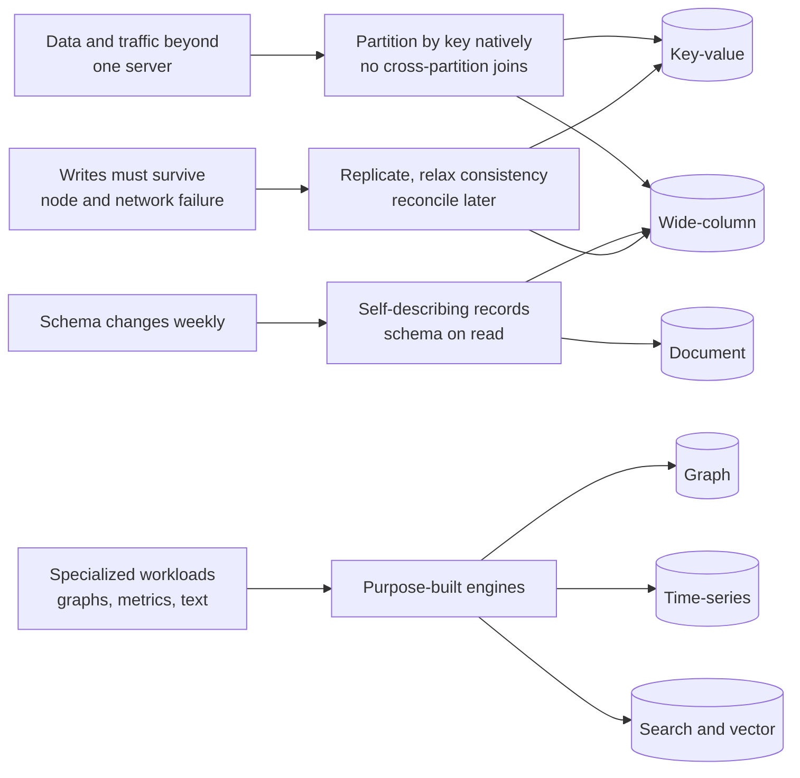

**Reading the diagram.** Pressures (left) led to design responses (middle), embodied by database families (cylinders); arrows mean "led to", not data flow. One family can answer several pressures: wide-column stores partition natively, tolerate sparse schemas and, in Cassandra's case, stay writable during failures. The bottom row is the "one size does not fit all" argument: graphs, metrics and text differ so much from row lookups that a specialized layout wins. There are no storage boundaries or failure paths here; each family's failure modes appear in its own section.

### 12.3.3 What was given up, and what came back

Early systems typically gave up **joins** (the application stores data pre-joined), **multi-record transactions** (atomicity only within one key, row or document) and **ad-hoc queries** (you query by designed keys, or scan). Many defaulted to **eventual consistency** — replicas converge if writes stop (§25.7).

The pendulum then swung back: MongoDB 4.0 and DynamoDB added transactions in 2018, Cassandra added Paxos-based lightweight transactions, and the **NewSQL** systems of §12.11 showed that scalable, strongly consistent SQL is possible at a latency cost. The useful question today is "which data model and consistency guarantees fit this access pattern?" — answered in §12.12.

::: concept
**Key insight — Aggregate orientation.** Key-value, document and wide-column databases store an **aggregate** — related data read and written as a unit, such as an order with its line items — under one key, and atomicity, partitioning and replication happen per aggregate [Sadalage & Fowler 2012]. When access patterns follow aggregates these stores scale linearly; slicing across aggregates in unforeseen ways calls for a relational model. Graph databases are relationship-oriented instead.
:::

::: mistake
**"NoSQL means no schema."** The schema still exists, in the code that reads the data: **schema-on-read** rather than the relational **schema-on-write** [Kleppmann 2017, ch. 2]. Evolving records become easy, but every reader must handle every historical shape, so mature deployments add validation (MongoDB's `$jsonSchema`, typed CQL tables).
:::

::: mistake
**"NoSQL is faster than SQL."** A cached PostgreSQL key lookup takes tens of microseconds, like a NoSQL lookup. NoSQL systems keep latency *flat* as data grows, by partitioning and by making expensive operations (joins, scans) impossible or explicit.
:::

## 12.4 Key-value stores

### 12.4.1 The key-value model

::: definition
**Definition — Key-value store.** A database whose primary interface is `get(key)`, `put(key, value)` and `delete(key)`, where the value is opaque to the database or has a small set of built-in types. The key alone determines where the value lives.
:::

#### First-principles explanation

A coat check is a key-value store: hand over a coat, get ticket 217, later exchange 217 for the coat. The attendant never looks in the pockets, which is why it is fast and why you cannot ask "which coats have gloves?". Because the ticket alone says which rack holds the coat, you can add racks and attendants who never talk to each other.

#### Why does this exist?

Many hot paths are pure lookups by identifier: session by ID, cart by user, rate-limit counter by API key. For these, a query planner and joins are overhead. Removing them makes partitioning trivial — `hash(key) mod P`, or consistent hashing (§14.8) — and keeps latency flat at any scale. **In-memory stores** such as Redis and Memcached give sub-millisecond latency and usually hold caches or ephemeral state (§20.6); **durable distributed key-value databases** such as DynamoDB, Riak and FoundationDB persist across replicas and act as a system of record.

### 12.4.2 Redis: a data-structure server

Redis values are typed data structures, and commands execute one at a time on a main thread, so each command — `INCR`, `ZADD` — is atomic without locks.

**Table 12.1 — Redis value types and what they are for.**

| Type | Example command | Typical use |
|---|---|---|
| String | `SET session:9f3 "{...}" EX 1800` | Cached objects, sessions with TTL |
| Hash | `HSET user:42 name Ana plan pro` | Small objects with fields |
| Set | `SADD online:room7 u42` | Membership, deduplication |
| Sorted set | `ZINCRBY leaderboard 15 u42` | Leaderboards, rate-limit windows, priority queues |
| Stream | `XADD events * type click` | Append-only event log with consumer groups |

Durability is optional: **RDB** snapshots write point-in-time files; the **AOF** (append-only file) logs every write and can `fsync` every second, bounding loss to about one second. Redis Cluster splits keys into 16,384 hash slots across primaries with asynchronous replicas, so an acknowledged write can be lost on failover. Licensing has shifted (as of 2026): Redis moved to source-available licenses in 2024, the Linux Foundation's **Valkey** fork followed, and Redis 8 added an AGPLv3 option [Redis Docs].

::: warning
**Redis as a primary database.** Using Redis as the only copy of business-critical data means accepting asynchronous-replication loss windows, RAM-bounded capacity (tens of times more per GB than SSD) and restore time proportional to dataset size. Decide deliberately.
:::

### 12.4.3 DynamoDB: the key-value and sort-key model

DynamoDB, Amazon's managed service, is the clearest example of a durable key-value model designed for predictable latency at any scale [Elhemali et al. 2022; AWS Docs: DynamoDB].

::: definition
**Definition — Partition key, sort key and item collection.** In DynamoDB every **item** (a record of up to 400 KB, as of 2026) has a primary key made of a **partition key** and, optionally, a **sort key**. DynamoDB hashes the partition key to choose the storage partition. All items sharing a partition key form an **item collection**, stored together and ordered by sort key, so a single **Query** can return a contiguous, sorted range of them.
:::

#### How it works internally

1. A client sends `PutItem`, `GetItem` or `Query` over HTTPS to stateless **request routers**, which authenticate it and hash the partition key against a cached partition map.
2. Each partition is replicated across three Availability Zones as a **Multi-Paxos** group; only the leader accepts writes and serves strongly consistent reads [Elhemali et al. 2022].
3. The leader appends a write to its write-ahead log and acknowledges once two of three replicas have persisted it. Each replica stores a B-tree plus the log.
4. An **eventually consistent read** (the default) may go to any replica and miss a just-acknowledged write; a **strongly consistent read** goes to the leader and costs twice as much.
5. Partitions that grow too large or hot are split; **adaptive capacity** shifts throughput toward hot partitions.

Every request touches one partition (or one item collection), so latency does not grow with table size.

**Figure 12.2 — DynamoDB data model and request path.**

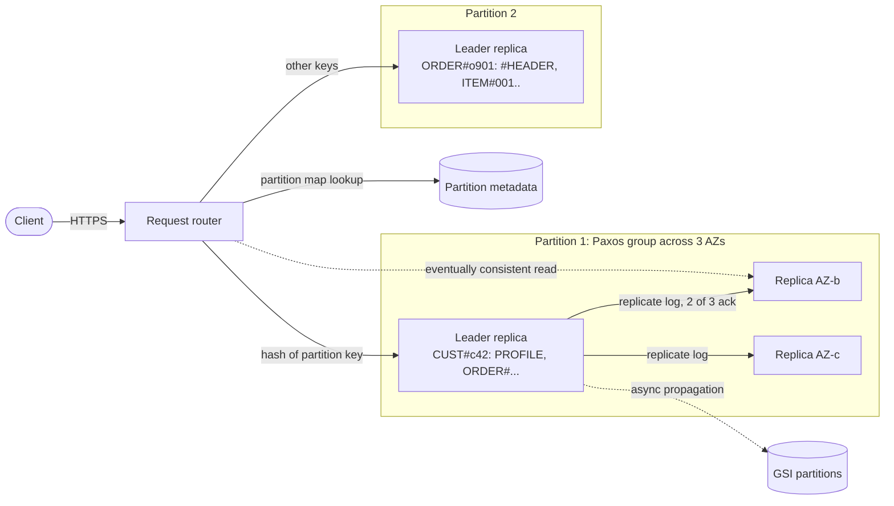

**Reading the diagram.** Stateless request routers receive HTTPS requests and route by the hash of the partition key — never the sort key; inside a partition, item collections are kept in sort-key order. Writes are acknowledged synchronously once two of three replicas in different Availability Zones have logged them; eventually consistent reads may go to any replica (dotted). Global secondary indexes are separate partitions fed asynchronously, so GSI reads are always eventually consistent. Failure points: losing a replica is invisible; losing a leader triggers a seconds-long election for that partition only. Scaling is by partition splits, invisible to clients.

#### Secondary indexes: LSI and GSI

To query by anything other than the primary key you declare an index, which DynamoDB maintains on every write.

**Table 12.2 — Local versus global secondary indexes (limits as of 2026).**

| Property | Local secondary index (LSI) | Global secondary index (GSI) |
|---|---|---|
| Key | Same partition key, different sort key | Any attribute(s) as new partition and sort key |
| When created | Only at table creation | Any time |
| Limit per table | 5 | 20 by default (adjustable quota) |
| Consistency | Strong or eventual | Eventual only |
| Throughput | Shares the table's | Its own; throttling can back-pressure table writes |
| Size constraint | Item collection ≤ 10 GB | None beyond table limits |

A **sparse index** includes only items that have the index key attribute; **index overloading** stores several entity types in one GSI under generic attribute names such as `GSI1PK`.

### 12.4.4 Single-table design: a worked access-pattern example

Relational design normalizes first and writes queries later. In DynamoDB you list every **access pattern** first, then design keys so each pattern is one `GetItem` or `Query`. With no joins, entities read together share an item collection, often in one table per service — **single-table design** [DeBrie 2020; AWS Docs: DynamoDB]. Consider an order service:

**Table 12.3 — Access patterns and the operation that serves each.**

| # | Access pattern | Operation |
|---|---|---|
| AP1 | Get a customer's profile | `GetItem PK=CUST#c42, SK=PROFILE` |
| AP2 | List a customer's orders, newest first | `Query GSI1 PK=CUST#c42, SK begins_with ORDER#`, descending |
| AP3 | Get one order with all its line items | `Query PK=ORDER#o901` (strongly consistent) |
| AP4 | Find a customer by e-mail; keep e-mail unique | `GetItem PK=EMAIL#ana@example.com` |
| AP5 | List a warehouse's unshipped orders, oldest first | `Query GSI2 PK=WH#w7` (sparse) |

**Table 12.4 — Item layout in the single table.**

| PK | SK | GSI1PK / GSI1SK | GSI2PK / GSI2SK | Other attributes |
|---|---|---|---|---|
| `CUST#c42` | `PROFILE` | — | — | name, e-mail, address |
| `EMAIL#ana@example.com` | `EMAIL` | — | — | customerId |
| `ORDER#o901` | `#HEADER` | `CUST#c42` / `ORDER#2026-10-28T09:15#o901` | `WH#w7` / `2026-10-28T09:15#o901` | status, total |
| `ORDER#o901` | `ITEM#001` | — | — | sku, qty, price |
| `ORDER#o901` | `ITEM#002` | — | — | sku, qty, price |

In this design AP3 is one Query (the header sorts first because `#` precedes letters in byte order); AP2's ISO-8601 sort keys make lexical order equal time order; AP4 doubles as a uniqueness constraint, because sign-up writes the profile and `EMAIL#` item in one `TransactWriteItems` call conditioned on `attribute_not_exists(PK)`; and AP5 is sparse — shipping an order removes `GSI2PK`, dropping it from GSI2.

**Figure 12.3 — Single-table design with two global secondary indexes.**

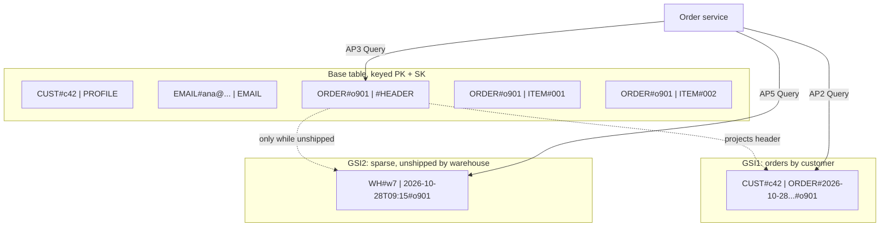

**Reading the diagram.** The order service issues synchronous Queries (solid) against the base table or an index, each touching one partition key. Dotted arrows are asynchronous index propagation: a header write is copied into GSI1, and into GSI2 only while it carries the warehouse attribute. Each GSI is a separate storage boundary with its own partitions and capacity. Failure points: a throttled GSI slows base-table writes, and GSI reads can briefly miss a new order. Scaling: every pattern stays one partition-local request regardless of customer count.

#### Code example

This runnable program imitates the key model so you can experiment without an AWS account.

```python
"""A toy single-table store that mimics DynamoDB's key model:
hash(partition key) -> partition; items sorted by sort key inside it;
global secondary indexes maintained from attributes on each item."""
import bisect
import hashlib
from collections import defaultdict

class Table:
    def __init__(self, partitions=4, gsis=()):
        self.partitions = [defaultdict(list) for _ in range(partitions)]
        self.gsis = {name: Table(partitions) for name in gsis}   # name -> index table

    def _part(self, pk):
        h = int(hashlib.md5(pk.encode()).hexdigest(), 16)
        return self.partitions[h % len(self.partitions)]

    def put(self, item):
        rows = self._part(item["PK"])[item["PK"]]          # the item collection
        keys = [r["SK"] for r in rows]
        i = bisect.bisect_left(keys, item["SK"])
        if i < len(rows) and rows[i]["SK"] == item["SK"]:
            rows[i] = item                                   # overwrite same key
        else:
            rows.insert(i, item)                             # keep sorted by SK
        for name, index in self.gsis.items():                # sparse: only if keys present
            if f"{name}PK" in item:
                index.put({**item, "PK": item[f"{name}PK"], "SK": item[f"{name}SK"]})

    def query(self, pk, sk_prefix="", newest_first=False):
        rows = [r for r in self._part(pk).get(pk, []) if r["SK"].startswith(sk_prefix)]
        return rows[::-1] if newest_first else rows

t = Table(gsis=("GSI1", "GSI2"))
t.put({"PK": "CUST#c42", "SK": "PROFILE", "name": "Ana", "email": "ana@example.com"})
t.put({"PK": "EMAIL#ana@example.com", "SK": "EMAIL", "customer": "c42"})
for oid, ts, wh in [("o900", "2026-10-21T08:02", None), ("o901", "2026-10-28T09:15", "WH#w7")]:
    header = {"PK": f"ORDER#{oid}", "SK": "#HEADER", "total": 59.0,
              "GSI1PK": "CUST#c42", "GSI1SK": f"ORDER#{ts}#{oid}"}
    if wh:                                   # only unshipped orders enter GSI2
        header |= {"GSI2PK": wh, "GSI2SK": f"{ts}#{oid}"}
    t.put(header)
    for n in (1, 2):
        t.put({"PK": f"ORDER#{oid}", "SK": f"ITEM#{n:03d}", "sku": f"SKU-{n}", "qty": n})

print("AP1 profile:  ", t.query("CUST#c42", "PROFILE")[0]["name"])
print("AP2 orders:   ", [r["SK"] for r in t.gsis["GSI1"].query("CUST#c42", "ORDER#", newest_first=True)])
print("AP3 order:    ", [r["SK"] for r in t.query("ORDER#o901")])
print("AP4 by email: ", t.query("EMAIL#ana@example.com")[0]["customer"])
print("AP5 to ship:  ", [r["SK"] for r in t.gsis["GSI2"].query("WH#w7")])
```

Output (Python 3.10+):

```text
AP1 profile:   Ana
AP2 orders:    ['ORDER#2026-10-28T09:15#o901', 'ORDER#2026-10-21T08:02#o900']
AP3 order:     ['#HEADER', 'ITEM#001', 'ITEM#002']
AP4 by email:  c42
AP5 to ship:   ['2026-10-28T09:15#o901']
```

What to notice:

- `_part` hashes only the partition key, which is why a Query must name exactly one.
- `bisect` keeps item collections sorted, so sort-key prefix and range conditions are contiguous reads.
- `put` skips an index when its key is absent — that is all a sparse index is; order `o900` never enters GSI2.
- Real GSIs update asynchronously and allow duplicate keys; the toy does neither.

### 12.4.5 Capacity: read and write units

DynamoDB meters throughput in units. One **write capacity unit (WCU)** is one write per second of an item up to 1 KB; one **read capacity unit (RCU)** is one strongly consistent read per second of up to 4 KB, or two eventually consistent reads (as of 2026) [AWS Docs: DynamoDB]. Sizes are rounded *up*: a GetItem rounds each item, but a Query sums the sizes of all returned items before rounding.

::: formula
**DynamoDB capacity units**

$$\text{WCU} = \sum_{\text{write types}} r_w \times \left\lceil \frac{s_w}{1\ \text{KB}} \right\rceil \times t_w \qquad \text{RCU} = \sum_{\text{read types}} r_r \times \left\lceil \frac{s_r}{4\ \text{KB}} \right\rceil \times c_r$$

| Symbol | Meaning | Units |
|---|---|---|
| $r_w$, $r_r$ | Rate of a given write or read type, including index writes | operations/second |
| $s_w$ | Size of the item written (for a GSI, the projected size) | KB |
| $s_r$ | Item size for GetItem; total returned size for Query | KB |
| $t_w$ | 1 for standard writes, 2 for transactional writes | dimensionless |
| $c_r$ | 0.5 eventually consistent, 1 strongly consistent, 2 transactional | dimensionless |
:::

::: example
**Worked example — Sizing the order table at peak.**

Peak load: 1,000 orders/s placed. Each order writes a 1.5 KB header and three 0.6 KB line items. GSI1 projects the whole header (1.5 KB); GSI2 projects keys only (under 1 KB). Reads: 10,000 order-detail lookups/s (AP3), eventually consistent, each returning 1.5 + 3 × 0.6 = 3.3 KB.

1. Header $1{,}000 \times \lceil 1.5 \rceil = 2{,}000$ WCU; line items $3{,}000 \times \lceil 0.6 \rceil = 3{,}000$ WCU.
2. GSI1 header copy $1{,}000 \times 2 = 2{,}000$ WCU; GSI2 copy $1{,}000 \times 1 = 1{,}000$ WCU.
3. Total $8{,}000$ WCU, of which 3,000 (37.5 %) is index maintenance.
4. Query reads: $\lceil 3.3 / 4 \rceil = 1$ unit × 0.5 → $10{,}000 \times 0.5 = 5{,}000$ RCU.
5. Four GetItem calls instead round each item: $10{,}000 \times 4 \times 0.5 = 20{,}000$ RCU.

**Interpretation.** Co-locating items cut read cost by 75 %; index maintenance is over a third of the write bill.

**Engineering implication.** Project only needed attributes into indexes, keep items small, read related items with one Query — and check the per-partition ceiling of 3,000 RCU and 1,000 WCU (as of 2026). A warehouse receiving over about 1,000 orders/s would throttle its single `WH#w7` GSI2 key whatever the table capacity, so shard it as `WH#w7#0`…`WH#w7#9` and query all ten.
:::

Billing is **provisioned** (per WCU-hour and RCU-hour) or **on-demand** (per request unit used); the choice reduces to one ratio.

::: formula
**On-demand versus provisioned break-even utilization**

$$u^{*} = \frac{p_{\text{prov}} / 3600}{p_{\text{od}}}$$

| Symbol | Meaning | Units |
|---|---|---|
| $u^{*}$ | Average utilization of provisioned capacity above which provisioned is cheaper | fraction (0–1) |
| $p_{\text{prov}}$ | Price of one provisioned capacity unit for one hour | USD per unit-hour |
| $p_{\text{od}}$ | Price of one on-demand request unit | USD per request unit |
:::

::: example
**Worked example — Which billing mode for the order table?**

Assume us-east-1 list prices as of 2026 (verify before use): provisioned $0.00065 per WCU-hour and $0.00013 per RCU-hour; on-demand $0.625 per million write request units and $0.125 per million read request units.

1. Writes: $u^{*} = (0.00065 / 3600) / (0.625 \times 10^{-6}) = 1.806 \times 10^{-7} / 6.25 \times 10^{-7} = 0.289$; reads give the same 0.289.
2. The table averages 30 % of peak. Provisioned at peak for 720 hours: $8{,}000 \times 0.00065 \times 720 = \$3{,}744$ plus $5{,}000 \times 0.00013 \times 720 = \$468$, total **$4,212**.
3. On-demand over 2,592,000 s: $2{,}400 \times 2{,}592{,}000 = 6.22 \times 10^{9}$ write units → $\$3{,}888$; $1{,}500 \times 2{,}592{,}000 = 3.89 \times 10^{9}$ read units → $\$486$; total **$4,374**.

**Interpretation.** At 30 % utilization the modes cost within 4 %, as the break-even predicts.

**Engineering implication.** Spiky traffic (average far below 29 % of peak) favors on-demand; steady traffic with auto scaling near 70 % utilization costs about 40 % of on-demand when provisioned. Storage and replication are billed separately.
:::

#### Real-world industry applications

::: industry
**Amazon DynamoDB at Prime Day.** Amazon needed a store whose latency did not degrade with scale or noisy neighbors. DynamoDB combines hash partitioning, three-way Multi-Paxos replication, global admission control and splitting for heat; the ATC 2022 paper reports a peak of 89.2 million requests per second during Prime Day 2021 at single-digit-millisecond latency. The trade-off is a restrictive query model.
*Evidence: Primary* — [Elhemali et al. 2022]
:::

::: industry
**Dynamo's shopping cart.** The cart must accept "add to cart" even during partitions; divergent versions are tracked with vector clocks and merged by union, which can resurrect deleted items — availability bought with correctness.
*Evidence: Primary* — [DeCandia et al. 2007]
:::

#### Advantages and disadvantages

- **Advantages:** predictable latency at any size; near-linear scale-out; fully managed options; per-item TTL deletes without consuming write capacity.
- **Disadvantages:** only designed access patterns are cheap; new patterns need indexes or backfills; no joins or aggregations; hot keys cap throughput; single-table schemas are hard to read.

#### Failure scenarios

**Table 12.5 — Key-value store failure scenarios.**

| What goes wrong | Why | Detection | Recovery | Prevention |
|---|---|---|---|---|
| Throttling with spare table capacity | One partition key exceeds the per-partition limit | Throttle metrics with low table utilization; key-level contributor insights | Write-shard the key with a suffix | Choose high-cardinality partition keys (§14.10) |
| Base-table writes throttled | GSI under-provisioned or hot | GSI throttle events | Raise GSI capacity | Size GSIs like tables; sparse projections |
| Stale read after write | Eventually consistent read or GSI read | Users see missing items briefly | Retry or read from base table strongly | Strong reads where read-your-writes matters (§25.6) |

#### Common misconceptions

::: mistake
**"Scan is fine for small tables."** A Scan reads and bills every item, and tables grow. Design a key or index for each online pattern; keep Scan for offline jobs.
:::

## 12.5 Document databases

### 12.5.1 The document model

::: definition
**Definition — Document database.** A database that stores self-describing, hierarchical records — **documents**, usually JSON or a binary encoding of it such as BSON — grouped into **collections**, and that can index and query fields inside the documents, including nested fields and array elements.
:::

#### First-principles explanation

A doctor's paper chart is a document: allergies, visits and each visit's prescriptions sit in one folder, and a new kind of test result is just a new page. The cost appears with questions that cut across folders — "who was prescribed drug X last month?" — which need an index or opening every folder.

#### Why does this exist?

Application objects contain lists and nested objects; normalized tables (§11.5) split them apart and reassemble them with joins — the **object-relational impedance mismatch**. A document database stores the object as the application sees it, so one aggregate is one read and a new field needs no migration. MongoDB (2009) made the model mainstream; PostgreSQL's `jsonb` brings much of it into a relational engine.

#### How it works internally

Using MongoDB as the reference [MongoDB Docs]:

1. Documents are stored as **BSON**, a typed binary JSON (dates, decimals, binary), up to 16 MB each, in WiredTiger B-trees with document-level concurrency control and compression.
2. Every collection has a unique `_id` index; secondary indexes are separate B-trees, and an index on an array field is **multikey** — one entry per element.
3. A **replica set** (typically three members) elects a primary with a Raft-like protocol; secondaries replicate its operation log (**oplog**) asynchronously. With **write concern** `majority` — the default since MongoDB 5.0 — an acknowledged write survives failover.
4. **Sharding** splits a collection by a **shard key** (ranged or hashed) into chunks across replica sets; a `mongos` router targets one shard when the query includes the shard key and scatter-gathers otherwise (§14.11).

### 12.5.2 Embedding versus referencing

The central modeling decision is whether related data goes *inside* a document or *in another document* that you point to.

**Figure 12.4 — Embedding versus referencing in a document model.**

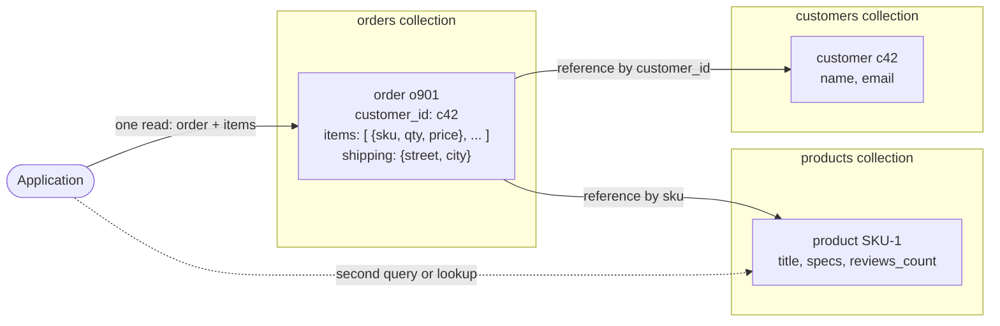

**Reading the diagram.** The application reads an order in one synchronous request because line items and the address are **embedded**: owned by the order, bounded and always read with it. Customers and products are **referenced** by ID because they are shared and change independently; fetching them needs a second query or a `$lookup` (dotted, optional). Each collection is a storage boundary that may sit on a different shard, so a reference can cost a network hop. Failure point: an embedded price is a deliberate snapshot, but an embedded copy expected to stay current will drift. Scaling: shard orders by customer or order ID; one order stays single-shard.

**Table 12.6 — Embed or reference?**

| Embed when | Reference when |
|---|---|
| The child is read with the parent nearly every time | The child is often read on its own |
| The relationship is one-to-few and bounded | One-to-many is large or unbounded (comments, events) |
| The child has no identity outside the parent | Many parents share the child (many-to-many) |
| You need atomic updates of parent and child together | The child changes frequently and independently |
| Snapshot semantics are desired (price at purchase) | You need a single current value everywhere |

::: warning
**The unbounded array.** Embedding every comment or reading makes a document grow forever until the 16 MB limit rejects writes. Use the **bucket pattern** (one document per entity per hour or per 100 events) or a separate collection.
:::

### 12.5.3 Indexes and queries

MongoDB offers compound, multikey, text, geospatial, hashed, wildcard, partial, unique and TTL indexes, up to 64 per collection; for compound indexes its documentation recommends the **ESR rule** — **E**quality fields first, then **S**ort, then **R**ange [MongoDB Docs].

```javascript
// Orders of one customer, newest first, above a value threshold
db.orders.createIndex({ customer_id: 1, placed_at: -1, total: 1 });   // E, S, R

db.orders.find({ customer_id: "c42", total: { $gte: 50 } })
         .sort({ placed_at: -1 })
         .limit(20);

// A transaction across two documents (replica set or sharded cluster)
const session = db.getMongo().startSession();
session.withTransaction(() => {
  const s = session.getDatabase("shop");
  s.inventory.updateOne({ sku: "SKU-1", qty: { $gte: 2 } }, { $inc: { qty: -2 } });
  s.orders.insertOne({ _id: "o902", customer_id: "c42", items: [{ sku: "SKU-1", qty: 2 }] });
}, { writeConcern: { w: "majority" } });
```

What to notice:

- The index jumps to one customer, finds entries already in `placed_at` order (no in-memory sort) and filters `total` while walking. With `total` before `placed_at`, the sort could not use the index.
- Multi-document ACID transactions exist since 4.0 (2018) on replica sets and 4.2 (2019) on sharded clusters; the default lifetime limit is 60 seconds, so keep them small.
- If stock is insufficient, `updateOne` matches nothing but does not throw; real code must check `modifiedCount` and abort.

#### Real-world industry applications

::: industry
**Product catalog with heterogeneous attributes.** Shoes have sizes, laptops CPUs, books ISBNs. Relationally this becomes an entity-attribute-value table or dozens of sparse columns; as documents each product carries its own attributes, a wildcard index covers searchable ones, and a catalog page is one read.
*Evidence: Illustrative* — a common teaching pattern; not a claim about any company.
:::

#### Advantages and disadvantages

- **Advantages:** natural object mapping; one-read aggregates; flexible schema; rich indexes and aggregation; built-in replication, sharding and transactions.
- **Disadvantages:** many-to-many needs application joins or `$lookup`; denormalized copies drift; poor shard keys create hot shards; schema drift without validation; queries lacking the shard key fan out.

#### Failure scenarios

**Table 12.7 — Document database failure scenarios.**

| What goes wrong | Why | Detection | Recovery | Prevention |
|---|---|---|---|---|
| Acknowledged writes vanish after failover | Write concern below `majority`; primary failed before replication | Rollback files on old primary | Reconcile from rollback data | Use `w: "majority"` for important writes |
| Hot shard | Monotonic shard key (timestamps, ObjectIds) routes all inserts to one chunk | Per-shard insert rate skew | Reshard (supported since 5.0) | Hashed or compound shard key |
| Slow queries after growth | Missing or misordered compound index; collection scan | `explain()` shows `COLLSCAN`; slow-query log | Add ESR-ordered index | Review query shapes in code review |

#### Common misconceptions

::: mistake
**"Documents mean you never need transactions."** Single-document writes are atomic, but an invariant spanning two documents — stock and order, debit and credit — needs a transaction or an idempotent workflow (§32.7). Keep invariants inside one document where you can; use transactions where you cannot.
:::

## 12.6 Wide-column stores

### 12.6.1 The Bigtable model

::: definition
**Definition — Wide-column store.** A database whose rows are identified by a key, sorted (globally or within a partition) by that key, and contain a sparse, variable set of columns grouped into **column families**; each row may have millions of columns and each cell may hold several timestamped versions. Bigtable, HBase, Cassandra and ScyllaDB belong to this family.
:::

#### First-principles explanation

Picture a spreadsheet with rows sorted by key, so wide that most cells are empty — and empty cells cost nothing. Reading one row, or sweeping every row starting with `com.cnn.`, is cheap because neighbors are stored together; finding rows by a column's value is not.

#### Why does this exist?

Google needed one store for the web crawl, Earth imagery and analytics across over sixty products, serving both batch scans and low-latency reads on thousands of commodity machines [Chang et al. 2006]. Relational schemas were too rigid for pages with arbitrary inbound links, and key-value stores could not scan ranges.

#### How it works internally

The Bigtable paper defines the model precisely: `(row: string, column: string, time: int64) → string` [Chang et al. 2006].

1. **Rows** are sorted by row key; single-row reads and writes are atomic.
2. **Column families** are declared in the schema and tuned together; **qualifiers** within a family are created freely at write time (`anchor:cnnsi.com`).
3. **Timestamps** version each cell; garbage collection keeps the last *n* versions or recent ones.
4. Contiguous row ranges called **tablets** (about 100–200 MB in the paper) are the unit of distribution; they split as they grow.
5. Writes go to a commit log and a memtable, flushed to immutable SSTables on GFS and merged by compaction — the log-structured merge design of §13.8.

**Figure 12.5 — Bigtable data model: the Webtable example.**

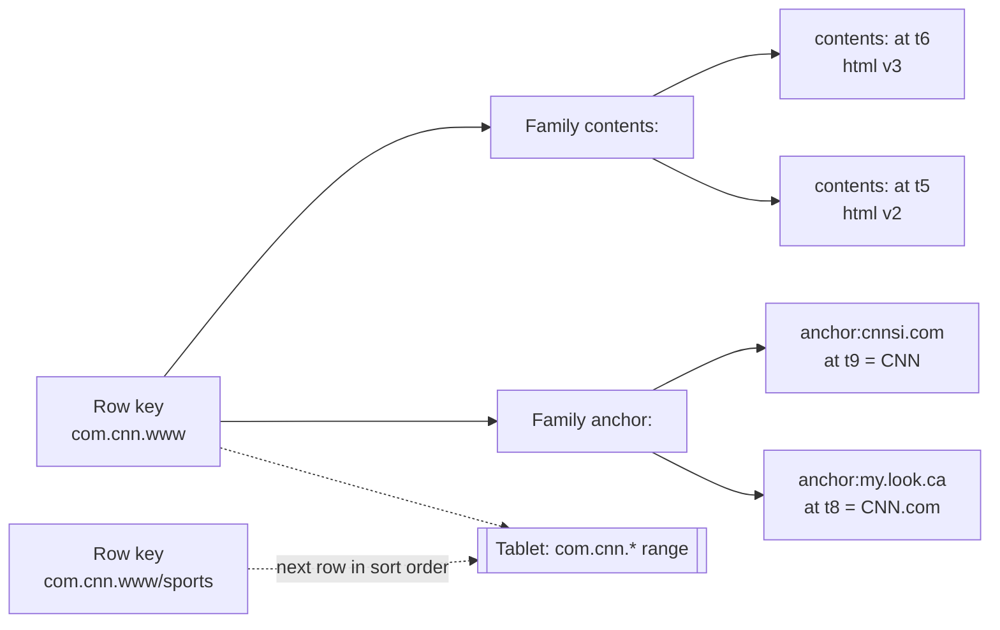

**Reading the diagram.** A Webtable row is keyed by the reversed URL `com.cnn.www`, so a domain's pages sort together into one tablet. Family `contents:` holds timestamped page versions; family `anchor:` has one qualifier per referring site, valued with the link text. Solid arrows show containment; dotted arrows show adjacent rows sharing a tablet, the storage and distribution unit. Failure point: a crashed tablet server's tablets are briefly unavailable until reassigned and the commit log replayed. Scaling: tablets split and move between servers.

**HBase** reproduces this design on Hadoop (regions, RegionServers, HDFS, ZooKeeper) with strongly consistent single-row operations; Facebook built its 2010 Messages product on it [Borthakur et al. 2011].

### 12.6.2 Cassandra: partition key and clustering columns

Cassandra keeps Bigtable's sorted layout within a partition but distributes data the Dynamo way: no master, and a Murmur3 hash of the partition key gives a **token** that decides the owning nodes on a ring (consistent hashing, §14.8) [Lakshman & Malik 2010; Apache Cassandra Docs].

::: definition
**Definition — Primary key in CQL.** In Cassandra Query Language, `PRIMARY KEY ((a, b), c, d)` declares `(a, b)` as the **partition key** — hashed to choose the replicas and defining what is stored together — and `c, d` as **clustering columns**, which order rows *within* the partition on disk.
:::

1. Any node can **coordinate** a request, forwarding it to the *RF* replicas (replication factor, typically 3, across racks or zones), each of which writes its commit log and memtable (§13.9).
2. The client picks a **consistency level** per request — `ONE`, `QUORUM`, `LOCAL_QUORUM`, `ALL`; with RF = 3, `QUORUM` reads and writes overlap ($R + W > N$, §27.8).
3. Missed writes are repaired by hinted handoff, read repair and Merkle-tree anti-entropy (§27.9, §27.13); concurrent writes to a cell resolve by **last-write-wins** on timestamps (§27.14).

### 12.6.3 Query-first modeling with CQL

Because a query can efficiently read only one partition (or a contiguous slice of it), Cassandra modeling starts from the queries and creates **one table per query**, duplicating data [Chebotko et al. 2015; Apache Cassandra Docs]. Suppose an IoT platform must answer:

- Q1: readings of one sensor for one day, newest first.
- Q2: the latest reading of every sensor at one site.

```sql
-- Q1: one partition per sensor per day (the "bucket")
CREATE TABLE readings_by_sensor_day (
    sensor_id   uuid,
    day         date,
    ts          timestamp,
    temperature float,
    humidity    float,
    battery     float,
    PRIMARY KEY ((sensor_id, day), ts)
) WITH CLUSTERING ORDER BY (ts DESC)
  AND default_time_to_live = 7776000;      -- 90 days

-- Q2: one partition per site; one row per sensor, overwritten on each reading
CREATE TABLE latest_by_site (
    site_id     text,
    sensor_id   uuid,
    ts          timestamp,
    temperature float,
    PRIMARY KEY ((site_id), sensor_id)
);

SELECT ts, temperature FROM readings_by_sensor_day
 WHERE sensor_id = 5b6e0f6a-1c1e-4a51-9a52-0c2f7f0b7d11 AND day = '2026-10-30'
 LIMIT 100;
```

What to notice:

- `(sensor_id, day)` bounds each partition to one sensor-day; without `day` it would grow forever.
- `CLUSTERING ORDER BY (ts DESC)` makes "latest 100" a sequential read of the partition's head.
- Every reading is written to both tables — duplication is the price of single-partition reads.
- `WHERE temperature > 30` is rejected without `ALLOW FILTERING`, which scans: a sign the model lacks a table.
- TTL-expired cells become **tombstones** until compaction removes them.

**Figure 12.6 — Query-first modeling and partition placement in Cassandra.**

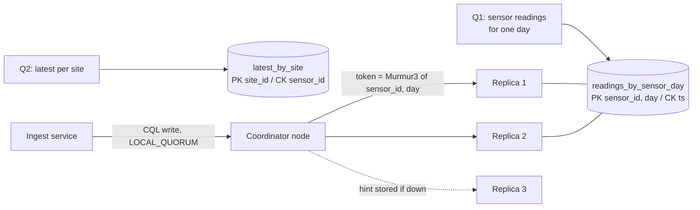

**Reading the diagram.** Left: each query gets a table whose partition key matches its equality conditions and whose clustering column gives its order. Right: the runtime write path — the ingest service sends a CQL write to any node, which hashes the partition key to a token and forwards to the three owning replicas. With `LOCAL_QUORUM` the write succeeds synchronously after two local acknowledgments; a down replica gets it later via a stored hint (dotted, asynchronous). Each table is a separate storage structure, so ingest writes twice. Failure points: one replica down is tolerated; two down fails `QUORUM` for those partitions. Scaling: add nodes and token ranges redistribute.

### 12.6.4 Sizing partitions

Oversized partitions slow compaction, repair and reads and concentrate load on *RF* nodes. The Cassandra documentation gives formulas for a partition's cell count and size [Apache Cassandra Docs].

::: formula
**Cassandra partition cells and size**

$$N_v = N_r\,(N_c - N_{pk} - N_s) + N_s$$

$$S_t = \sum_i \text{sizeOf}(c_{k_i}) + \sum_j \text{sizeOf}(c_{s_j}) + N_r \times \Big(\sum_k \text{sizeOf}(c_{r_k}) + \sum_l \text{sizeOf}(c_{c_l})\Big) + N_v \times \text{sizeOf}(t_{\text{avg}})$$

| Symbol | Meaning | Units |
|---|---|---|
| $N_v$ | Number of cells (values) in the partition | cells |
| $N_r$ | Number of rows in the partition | rows |
| $N_c$ | Number of columns in the table | columns |
| $N_{pk}$ | Number of partition-key columns | columns |
| $N_s$ | Number of static columns | columns |
| $S_t$ | Estimated partition size on disk, one replica, before compression | bytes |
| $c_k, c_s, c_r, c_c$ | Partition-key, static, regular and clustering columns | bytes each |
| $t_{\text{avg}}$ | Average per-cell metadata (the docs use the 8-byte timestamp) | bytes |
:::

::: example
**Worked example — Sizing `readings_by_sensor_day`.**

Each sensor reports every 10 s. Column sizes: `sensor_id` uuid 16 B, `day` date 4 B, `ts` timestamp 8 B, three floats 4 B each. $N_c = 6$, $N_{pk} = 2$, $N_s = 0$, $t_{\text{avg}} = 8$ B.

1. Rows per day: $86{,}400 / 10 = 8{,}640$.
2. Cells: $N_v = 8{,}640 \times (6 - 2 - 0) + 0 = 34{,}560$.
3. Size: partition key $16 + 4 = 20$ B; per row regular + clustering $= 12 + 8 = 20$ B; so $S_t = 20 + 8{,}640 \times 20 + 34{,}560 \times 8 = 20 + 172{,}800 + 276{,}480 = 449{,}300$ B ≈ **0.45 MB**.
4. Counterfactual — no `day` bucket, one year of data: $N_r = 3{,}153{,}600$, $N_v = 12{,}614{,}400$, $S_t \approx 63.1 + 100.9 = 164$ MB, and still growing.
5. Cluster: $10^6$ sensors × 0.45 MB/day × RF 3 ≈ **1.35 TB/day** uncompressed; about 121 TB at the 90-day TTL.

**Interpretation.** Daily buckets keep partitions near 0.45 MB, far below the widely cited guidance of about 100 MB (and the hard limit of two billion cells); the unbucketed design passes 100 MB within a year and keeps growing. Per-cell metadata is 61 % of the bucketed size.

**Engineering implication.** Size buckets to what one query reads: "last 7 days" reads 7 partitions in parallel, which is fine. Use the uncompressed estimate as the safe bound.
:::

#### Real-world industry applications

::: industry
**Discord's message store.** Discord stored messages in Cassandra with primary key `((channel_id, bucket), message_id)` — a fixed time bucket and a time-ordered Snowflake ID — so recent messages are one partition slice. Its 2017 post covers bucketing, tombstones and hot partitions; a 2023 post covers migrating trillions of messages to ScyllaDB, a C++ Cassandra-compatible database, to cut tail latency.
*Evidence: Primary* — [Discord 2017; Discord 2023]
:::

#### Advantages and disadvantages

- **Advantages:** linear write scaling; masterless, no single point of failure (Cassandra); built-in multi-datacenter replication; per-request consistency; fast time-ordered slices.
- **Disadvantages:** one table per query multiplies writes; no joins; secondary indexes fan out (Cassandra 5.0's Storage-Attached Indexes help); tombstones; last-write-wins drops concurrent updates; repair and compaction need skill.

#### Failure scenarios

**Table 12.8 — Wide-column store failure scenarios.**

| What goes wrong | Why | Detection | Recovery | Prevention |
|---|---|---|---|---|
| Read timeouts on one partition | Large or hot partition; one key gets most traffic | Partition-size histograms; per-node latency skew | Re-model with buckets; migrate data | Size partitions with $S_t$; bounded buckets |
| Queries fail on tombstones | Delete-heavy or queue-like table; scans pass many tombstones | Tombstone warnings (default warn at 1,000, fail at 100,000 per query) | Compact; change model | Avoid queue patterns; use TTL with time-window compaction |
| Deleted data reappears | Node down longer than `gc_grace_seconds` (default 10 days) missed the tombstone | Zombie rows after node return | Rebuild the node rather than rejoining it | Run repair within the grace period |
| Lost concurrent update | Last-write-wins on cell timestamps; client clock skew | Application-level audits | Re-apply from source | Lightweight transactions (Paxos) for conditional writes; synchronized clocks |

#### Common misconceptions

::: mistake
**"Cassandra is eventually consistent, so it cannot hold anything important."** Consistency is per request: `QUORUM` reads and writes with RF = 3 return the latest acknowledged value in normal operation, and lightweight transactions (`IF NOT EXISTS`) give linearizable compare-and-set within a partition. What Cassandra lacks is multi-partition transactions (§25.10).
:::

## 12.7 Graph databases

### 12.7.1 Property graphs and RDF

::: definition
**Definition — Graph database.** A database whose data model is a graph of **vertices** (nodes) and **edges** (relationships), optimized for traversing edges. In the **property graph** model, nodes carry labels, edges carry a type and a direction, and both carry key-value properties. In the **RDF** model, all data is a set of subject–predicate–object **triples**.
:::

#### First-principles explanation

Asked "who knows someone who knows a cardiologist?", you think of your friends and theirs — you never consult a city-wide list of friendships. A graph database stores each node with direct links to its neighbors, so a neighborhood question costs time proportional to the neighborhood, not the population.

#### Why does this exist?

Some domains are mostly relationships: social networks, fraud rings, access-control hierarchies, knowledge graphs. In SQL each hop is a join, and a question of unknown depth needs a recursive common table expression with hard-to-predict cost. Graph databases make traversal the primitive.

**Table 12.9 — Property graph versus RDF.**

| Aspect | Property graph | RDF |
|---|---|---|
| Unit of data | Nodes and edges with properties | Triples (subject, predicate, object) |
| Edge properties | Native | Need reification or RDF-star |
| Identifiers | Database-internal IDs | Global IRIs, mergeable across datasets |
| Query languages | Cypher / openCypher, Gremlin, GQL (ISO/IEC 39075:2024) | SPARQL (W3C) |
| Schema and reasoning | Optional constraints | Ontologies (RDFS, OWL) and inference |
| Typical systems | Neo4j, Memgraph, TigerGraph, Amazon Neptune | Amazon Neptune, GraphDB, Apache Jena, Virtuoso |

[W3C 2014; ISO 2024; Robinson et al. 2015]

**Figure 12.7 — A property graph for fraud and social queries.**

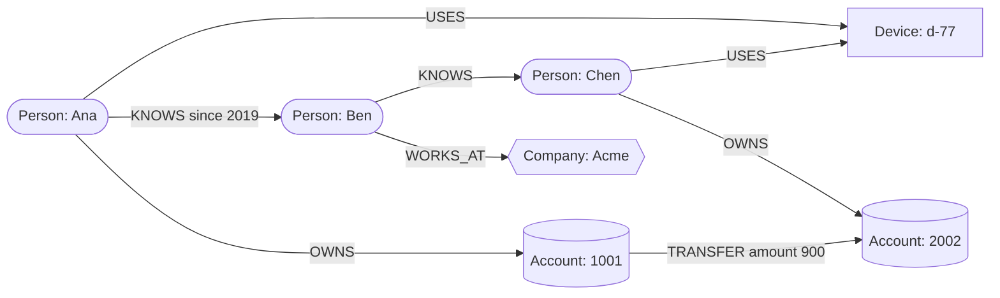

**Reading the diagram.** Shapes here distinguish node labels (people, device, accounts, company), not the book's infrastructure legend. Each arrow is a typed, directed relationship that may carry properties (`since`, `amount`). The fraud signal is a short cycle: Ana and Chen share device `d-77` and money flows between their accounts — a pattern found by walking edges from Ana. This is a logical view with no network boundaries; deployments usually keep the whole graph on one primary with read replicas, because cutting a graph across machines turns hops into network calls.

### 12.7.2 Index-free adjacency and Cypher

#### How it works internally

Neo4j's native store illustrates **index-free adjacency** [Robinson et al. 2015; Neo4j Docs]:

1. Nodes, relationships and properties live in stores of fixed-size records, so node *n* is found by arithmetic on its ID, not an index search.
2. A node record points to its first relationship; each relationship points to its two nodes and to the next and previous relationships of both — a linked list per node.
3. A traversal follows these pointers; no global index is consulted per hop. Indexes are used once, to find the starting nodes.
4. Transactions are ACID on the primary; secondaries serve reads and failover.

Two Cypher queries — the fraud pattern and a friends-of-friends recommendation:

```text
// Accounts of people within 2 KNOWS hops of Ana who use the same device as Ana
MATCH (a:Person {name: 'Ana'})-[:KNOWS*1..2]-(p:Person)-[:USES]->(d:Device)<-[:USES]-(a)
MATCH (p)-[:OWNS]->(acct:Account)
RETURN DISTINCT p.name, d.id, acct.id;

// People Ana's friends know, whom Ana does not know yet, ranked by mutual friends
MATCH (me:Person {name: 'Ana'})-[:KNOWS]-(f)-[:KNOWS]-(fof:Person)
WHERE fof <> me AND NOT (me)-[:KNOWS]-(fof)
RETURN fof.name, count(DISTINCT f) AS mutual
ORDER BY mutual DESC LIMIT 10;
```

What to notice:

- Patterns are ASCII art, `(node)-[:TYPE]->(node)`; `*1..2` is a variable-length path (a recursive CTE in SQL).
- Each query anchors on one indexed node and expands outward, so cost depends on Ana's neighborhood, not the population.
- `NOT (me)-[:KNOWS]-(fof)` is an anti-join written as a pattern.

### 12.7.3 When graphs beat joins

::: formula
**Cost of a k-hop traversal**

$$E_k = \sum_{i=1}^{k} d^{\,i} \qquad T_{\text{graph}} \approx E_k \times t_{\text{ptr}} \qquad T_{\text{join}} \approx E_k \times t_{\text{idx}}$$

| Symbol | Meaning | Units |
|---|---|---|
| $E_k$ | Edges expanded by a $k$-hop traversal without pruning | edges |
| $d$ | Average out-degree (neighbors per node) | edges/node |
| $k$ | Number of hops | hops |
| $t_{\text{ptr}}$ | Cost of following one adjacency pointer | µs |
| $t_{\text{idx}}$ | Cost of one index lookup on the edge table, growing with $\log N$ | µs |
:::

::: example
**Worked example — Friends-of-friends-of-friends.**

A social graph has $N = 100$ million people with average degree $d = 150$. Assume, for illustration only, $t_{\text{ptr}} \approx 0.2$ µs (one or two memory accesses) and $t_{\text{idx}} \approx 1$ µs (a cached B-tree descent of 4 levels, §11.8).

1. $k = 2$: $E_2 = 150 + 150^2 = 22{,}650$ expansions → graph ≈ 4.5 ms; join ≈ 23 ms.
2. $k = 3$: $E_3 = 22{,}650 + 3{,}375{,}000 = 3{,}397{,}650$ → graph ≈ 0.68 s; join ≈ 3.4 s.
3. Neither cost contains $N$ except through the logarithm in $t_{\text{idx}}$: doubling the population barely changes either.

**Interpretation.** Index-free adjacency wins a constant factor per hop (here 5×, illustrative) and avoids large intermediate join results, but the $d^k$ term defeats *both* systems by three hops.

**Engineering implication.** Graphs beat joins for variable-depth, pattern-shaped queries over bounded neighborhoods (fraud rings, permission inheritance). Prune or precompute deep traversals; for one or two fixed hops, a well-indexed relational database is usually as good.
:::

#### Real-world industry applications

::: industry
**Facebook TAO.** Facebook serves its social graph of objects and typed associations through TAO, a geographically distributed, read-optimized graph cache over sharded MySQL. The API is graph-shaped, the storage relational: a graph *data model* does not require a graph *database* when queries are mostly one hop and scale is planetary.
*Evidence: Primary* — [Bronson et al. 2013]
:::

#### Advantages and disadvantages

- **Advantages:** expressive path queries; cost tied to the touched subgraph; easy to add relationship types; graph algorithm libraries.
- **Disadvantages:** hard to partition; writes and size usually bounded by one primary; scarcer expertise; whole-graph analytics belong in batch processing.

#### Failure scenarios

**Table 12.10 — Graph database failure scenarios.**

| What goes wrong | Why | Detection | Recovery | Prevention |
|---|---|---|---|---|
| Query never returns | Unbounded variable-length path explodes as $d^k$ | Slow-query log; memory alarms | Kill query; add bounds | Always bound `*1..k`; set query timeouts |
| Supernode slows everything | A node with millions of edges (celebrity, default device ID) | Degree distribution metrics | Split by relationship type or time | Model high-degree nodes specially |
| Primary saturates | Writes cannot scale beyond one node | CPU and commit latency on primary | Scale up; offload reads to replicas | Keep only the relationship-heavy subset in the graph |

#### Common misconceptions

::: mistake
**"If my data has relationships, I need a graph database."** Relational databases were built for relationships. Choose a graph database when questions are about *paths and patterns of unknown depth*.
:::

## 12.8 Time-series databases

### 12.8.1 The time-series data model

::: definition
**Definition — Time-series database (TSDB).** A database optimized for sequences of timestamped measurements. Data is organized into **series**, each identified by a metric name plus a set of **labels** (tags) such as `{host="web-3", region="eu"}`, and each series is an append-only list of **samples** `(timestamp, value)`.
:::

#### First-principles explanation

A ship's log records the position every hour, in order, and nobody edits last Tuesday's entry; old pages are summarized ("averaged 12 knots in March"). Because the next entry is usually "same as before, one hour later", the log can be written very compactly.

#### Why does this exist?

10,000 servers exporting 1,000 metrics every 15 s produce about 667,000 samples per second. A general-purpose database spends more on row headers and index entries than on each sample's 16 bytes (8-byte timestamp, 8-byte float). TSDBs exploit four properties: writes append near "now", reads scan recent ranges, adjacent samples are similar, and old data matters only in aggregate.

#### How it works internally

1. An **inverted index** maps each `label=value` pair to the series that have it (a postings list, §16.3), so `{region="eu", job="api"}` is a list intersection.
2. Each series' samples are buffered in memory and logged to a **write-ahead log**.
3. Buffers are cut into **chunks** (up to 120 samples in Prometheus) compressed Gorilla-style, grouped into time-partitioned **blocks** (2 hours in Prometheus) and compacted into larger blocks.
4. **Retention** deletes whole expired blocks — a directory removal, not row deletes — and **downsampling** replaces old samples with aggregates (min, max, sum, count per 5 minutes or hour).

**Figure 12.8 — Prometheus TSDB write and storage path.**

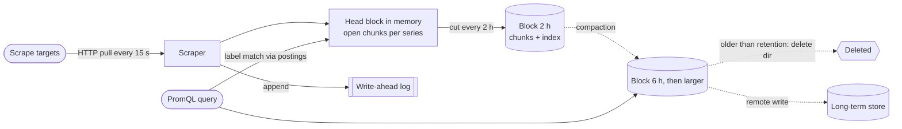

**Reading the diagram.** Prometheus pulls metrics over HTTP and appends each sample to the in-memory head block and the on-disk write-ahead log. Every two hours the head becomes an immutable block of compressed chunks plus an index; compaction (dotted, asynchronous) merges blocks, and retention (15 days by default) deletes old block directories. Queries use the postings index and read both head and blocks. The local disk is a single-node storage boundary; long retention and durability come from remote-write to systems such as Thanos, Cortex or Mimir. Failure points: a crash costs a WAL replay; a lost disk loses local history.

### 12.8.2 Gorilla compression: delta-of-delta and XOR

Facebook's Gorilla paper [Pelkonen et al. 2015] introduced the compression most modern TSDBs adapt, encoding timestamps and values separately against the previous sample.

**Timestamps — delta-of-delta.** With a fixed scrape interval, consecutive deltas are equal, so the encoder stores $D = (t_n - t_{n-1}) - (t_{n-1} - t_{n-2})$ with a prefix code: `0` if $D = 0$; `10` + 7 bits for $D \in [-63, 64]$; `110` + 9 bits for $[-255, 256]$; `1110` + 12 bits for $[-2047, 2048]$; else `1111` + 32 bits.

**Values — XOR.** Consecutive values share sign, exponent and leading mantissa bits, so XOR with the previous value is mostly zeros: store `0` if it is zero; otherwise `1`, then either `0` plus the meaningful bits within the previous leading/trailing-zero window, or `1`, a 5-bit leading-zero count, a 6-bit length and the meaningful bits.

**Figure 12.9 — Gorilla's per-sample encoding decisions.**

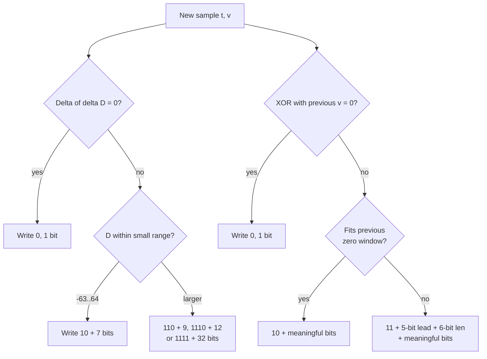

**Reading the diagram.** Each sample takes two independent paths, timestamp and value, both depending only on the previous sample — so chunks decode sequentially from the start. The common case on each path costs one bit. There are no network or storage boundaries; the failure point is data that defeats the assumptions (jittery timestamps, noisy values). Series encode independently, so compression parallelizes across cores.

This program counts the bits used for three kinds of series:

```python
"""Gorilla-style compression (Pelkonen et al., VLDB 2015): delta-of-delta
timestamps and XOR-encoded float values. Counts bits; returns bits per point."""
import random
import struct

def float_bits(x: float) -> int:
    return struct.unpack(">Q", struct.pack(">d", x))[0]

def encode(points):
    """points: list of (unix_seconds, float). Returns total bits used."""
    t0, v0 = points[0]
    bits = 64 + 64                          # first timestamp and value stored raw
    prev_t, prev_delta, prev_v = t0, 0, float_bits(v0)
    prev_lead, prev_trail = None, None
    for t, v in points[1:]:
        delta = t - prev_t
        dod = delta - prev_delta            # delta of delta
        if dod == 0:
            bits += 1                                   # '0'
        elif -63 <= dod <= 64:
            bits += 2 + 7                               # '10' + 7 bits
        elif -255 <= dod <= 256:
            bits += 3 + 9                               # '110' + 9 bits
        elif -2047 <= dod <= 2048:
            bits += 4 + 12                              # '1110' + 12 bits
        else:
            bits += 4 + 32                              # '1111' + 32 bits
        prev_t, prev_delta = t, delta

        x = float_bits(v) ^ prev_v
        if x == 0:
            bits += 1                                   # '0': value repeated
        else:
            lead = min(64 - x.bit_length(), 31)         # 5-bit field caps at 31
            trail = (x & -x).bit_length() - 1
            if prev_lead is not None and lead >= prev_lead and trail >= prev_trail:
                bits += 2 + (64 - prev_lead - prev_trail)   # '10' + reuse window
            else:
                bits += 2 + 5 + 6 + (64 - lead - trail)     # '11' + new window
                prev_lead, prev_trail = lead, trail
        prev_v = float_bits(v)
    return bits

random.seed(7)
start = 1_793_318_400                       # 2026-10-30 00:00:00 UTC
series = {
    "constant gauge":   [(start + 15 * i, 42.0) for i in range(120)],
    "counter (+1/scr)": [(start + 15 * i, float(1000 + i)) for i in range(120)],
    "noisy CPU %":      [(start + 15 * i + random.choice([0, 0, 0, 1]),
                          round(random.uniform(20, 80), 1)) for i in range(120)],
}
for name, pts in series.items():
    b = encode(pts)
    print(f"{name:18s} {b / len(pts) / 8:5.2f} bytes/point  ({128 / (b / len(pts)):4.1f}x vs 16 B)")
```

Output:

```text
constant gauge      0.39 bytes/point  (41.1x vs 16 B)
counter (+1/scr)    1.33 bytes/point  (12.0x vs 16 B)
noisy CPU %         7.90 bytes/point  ( 2.0x vs 16 B)
```

What to notice:

- A 120-sample chunk of a constant gauge costs 2 bits per sample once the interval is established (the second sample pays 9 bits to record the first delta); the 128-bit uncompressed header dominates, which is why chunks should not be too short.
- The steadily increasing counter lands at 1.33 bytes per point — close to the 1.37 bytes per point the Gorilla paper reports for Facebook's production data, a 12× reduction from 16 bytes [Pelkonen et al. 2015].
- Random one-decimal values compress only 2× because their mantissas differ in almost every bit; storing only the precision you need is a strong lever.
- The real format stores the first timestamp as a 14-bit offset from a block header.

### 12.8.3 Retention and downsampling

Prometheus documents a simple disk-sizing rule: needed disk ≈ retention time × ingested samples per second × bytes per sample, with 1–2 bytes per sample typical [Prometheus Docs]. Adding downsampled tiers generalizes it.

::: formula
**Tiered time-series storage**

$$S = N_{\text{series}} \times \sum_{i} \frac{R_i}{\Delta_i} \times b_i$$

| Symbol | Meaning | Units |
|---|---|---|
| $S$ | Total storage | bytes |
| $N_{\text{series}}$ | Number of active series | series |
| $R_i$ | Retention period of tier $i$ | seconds |
| $\Delta_i$ | Sample (or rollup) interval of tier $i$ | seconds |
| $b_i$ | Bytes per stored point in tier $i$ after compression | bytes/point |
:::

::: example
**Worked example — Metrics for a 1-million-series platform.**

1 million active series scraped every 15 s ($66{,}667$ samples/s); raw points compress to 1.5 B. Rollups store five aggregates (min, max, sum, count, last) at about 2 B each, so 10 B per rollup point.

1. Raw for 15 days: $R/\Delta = 1{,}296{,}000 / 15 = 86{,}400$ points per series; $10^6 \times 86{,}400 \times 1.5 = 1.296 \times 10^{11}$ B ≈ **130 GB**.
2. Raw for one year instead: $31{,}536{,}000 / 15 = 2{,}102{,}400$ points; $10^6 \times 2{,}102{,}400 \times 1.5 \approx$ **3.15 TB**.
3. One-hour rollups for one year: $8{,}760$ points; $10^6 \times 8{,}760 \times 10 = 87.6$ GB.
4. Tiered total: $130 + 87.6 \approx$ **218 GB**, about 14× less than a year of raw data. Without compression (16 B/point) the 15-day raw tier alone would be 1.38 TB.

**Interpretation.** Compression buys about 10×; downsampling another order of magnitude, at the cost of detail older than 15 days.

**Engineering implication.** You cannot compute a correct p99 from averaged rollups, so keep histograms or sketches if old percentiles matter. Series count, not sample rate, is usually the first limit (Table 12.12).
:::

### 12.8.4 Prometheus, InfluxDB and TimescaleDB

**Table 12.11 — Three time-series databases compared (as of 2026).**

| Aspect | Prometheus TSDB | InfluxDB | TimescaleDB |
|---|---|---|---|
| What it is | Pull-based monitoring system with embedded TSDB | Purpose-built TSDB with push ingestion | PostgreSQL extension |
| Data model | Metric + labels → float samples | Measurement + tags + multiple typed fields | SQL tables turned into **hypertables** |
| Storage | 2-hour blocks, Gorilla-style chunks, postings index | Version 3 rewritten on Apache Arrow, DataFusion and Parquet | Time-partitioned chunks (default 7 days); columnar compression of old chunks |
| Query | PromQL | SQL and InfluxQL (v3) | Full PostgreSQL SQL, joins with relational tables |
| Downsampling | Recording rules; long-term stores | Downsampling tasks or queries | Continuous aggregates; retention policies drop chunks |
| Choose when | Operational metrics and alerting | High-ingest metrics or IoT with tags and fields | You need SQL, joins and PostgreSQL tooling |

[Prometheus Docs; InfluxData Docs; Timescale Docs]

#### Real-world industry applications

::: industry
**Facebook Gorilla.** Facebook's HBase-backed monitoring store was too slow for queries over recent data. Gorilla keeps the latest 26 hours in memory at 1.37 bytes per point, writes through to HBase, and reported 73× lower query latency and 14× higher throughput.
*Evidence: Primary* — [Pelkonen et al. 2015]
:::

#### Failure scenarios

**Table 12.12 — Time-series database failure scenarios.**

| What goes wrong | Why | Detection | Recovery | Prevention |
|---|---|---|---|---|
| Memory exhaustion, ingestion stalls | **Cardinality explosion**: a label with unbounded values (user ID, request ID) creates millions of series | Active-series count jumps; head memory growth | Drop the label via relabeling; restart | Review labels; per-target series limits |
| Out-of-order samples rejected | Clock skew or delayed batches outside the accepted window | Ingestion error counters | Backfill as blocks | Synchronized clocks (§24.9); bounded delays |
| Wrong long-term percentiles | Averaged rollups cannot reproduce percentiles | Mismatch with raw data | Recompute from raw if still retained | Store histograms or sketches in rollups |
| Local history lost | Single-node TSDB disk failure | Gaps in dashboards | Restore from remote store | Remote-write or replicated pairs |

#### Common misconceptions

::: mistake
**"A TSDB is just a table with a timestamp column."** At small volume, yes. At scale the differences are physical: 1–2 bytes per sample, retention as file deletion, and an inverted label index. TimescaleDB keeps SQL but changes the storage layout underneath.
:::

## 12.9 Search engines as databases

::: definition
**Definition — Search engine (as a data store).** A system such as Elasticsearch, OpenSearch or Apache Solr that stores JSON documents and builds an **inverted index** — a map from each term to the list of documents containing it — so it can answer full-text, relevance-ranked, faceted and fuzzy queries.
:::

A relational `LIKE '%running shoes%'` scans every row and cannot rank; an inverted index intersects two postings lists and scores matches with BM25, and also serves faceted counts and log analytics (Chapter 16). As a *database* it has limits: indexing is **near-real-time** (Elasticsearch refreshes every 1 second by default), there are no multi-document transactions, and mapping changes often require reindexing [Elastic Docs]. The standard architecture keeps the system of record in a transactional database and feeds the index through change data capture (§32.6).

::: recommendation
**Do not make the search index your only copy.** Treat it as a derived, rebuildable view. If you cannot regenerate it from a source of truth in hours, you have created a primary database without the durability features of one.
:::

## 12.10 Vector databases

::: definition
**Definition — Vector database.** A data store that indexes high-dimensional numeric vectors (**embeddings** produced by machine-learning models) and answers **approximate nearest neighbor (ANN) search** queries: "the *k* stored vectors most similar to this query vector", by cosine similarity, dot product or Euclidean distance.
:::

Embeddings place similar items — a beach photo and the text "sunny coast" — near each other in hundreds of dimensions. Exact search over 100 million 768-dimension vectors costs about $7.7 \times 10^{10}$ multiply-adds per query; ANN indexes such as **HNSW** (a layered proximity graph [Malkov & Yashunin 2020]) and **IVF** (search only nearby clusters) trade a little recall for orders of magnitude less work. As of 2026 you meet vector search as dedicated databases (Milvus, Pinecone, Qdrant, Weaviate), as extensions (pgvector, MongoDB Atlas, Cassandra 5.0, Redis, Elasticsearch) and as libraries (FAISS). Treat it as a specialized secondary index, fed from a system of record and rebuilt when the embedding model changes; Chapter 74 covers the design in depth.

## 12.11 NewSQL

::: definition
**Definition — NewSQL (distributed SQL).** Relational databases that keep SQL and ACID transactions with serializable or strong isolation while scaling horizontally across nodes and regions, by partitioning data into ranges replicated with a consensus protocol. The term was coined by analyst Matthew Aslett in 2011 [Pavlo & Aslett 2016].
:::

NewSQL scales out *without* giving up transactions and joins: split tables into key ranges, replicate each with Paxos or Raft (§26.6, §26.7), run cross-range transactions with a two-phase-commit variant (§28.4), and order transactions with timestamps.

**Table 12.13 — Three distributed SQL systems (deep treatment in Chapter 28).**

| System | Origin | Replication | Clock and ordering | Notable feature |
|---|---|---|---|---|
| Spanner | Google, OSDI 2012 | Paxos per split | TrueTime (GPS and atomic clocks) with commit wait | External consistency across the globe [Corbett et al. 2012] |
| CockroachDB | Cockroach Labs, SIGMOD 2020 paper | Raft per range | Hybrid logical clocks, bounded uncertainty | PostgreSQL wire compatibility; serializable by default [Taft et al. 2020] |
| TiDB | PingCAP, VLDB 2020 paper | Raft in TiKV | Timestamp oracle in the Placement Driver | MySQL compatibility; columnar TiFlash replicas for analytics [Huang et al. 2020] |

The price is latency: a write must reach a majority of replicas (milliseconds within a region, tens of milliseconds across regions), cross-range transactions add coordination, and Spanner's commit wait pauses for clock uncertainty. Choose NewSQL when you have outgrown one PostgreSQL or MySQL primary *and* need multi-row transactions (§28.8, §28.10).

## 12.12 Selection framework and SQL versus NoSQL comparison

### 12.12.1 A decision procedure

Choosing a database is choosing which questions will be cheap and which impossible:

1. **List access patterns** with rates and latency targets ("get order by ID, 10,000/s, p99 < 20 ms").
2. **List invariants** and how many entities each spans ("stock never negative": one; "debits equal credits": two).
3. **Estimate size and growth** (§2.11).
4. **Pick the simplest store that serves the critical patterns**, adding specialized stores only for patterns it cannot serve.

**Figure 12.10 — Database selection flowchart.**

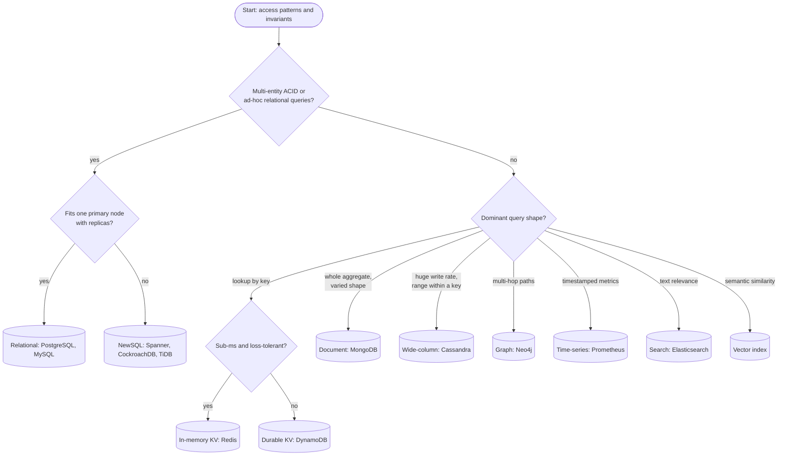

**Reading the diagram.** Diamonds ask about requirements, not technologies; cylinders are families with one example each. The first question routes toward relational storage: if invariants span entities or queries are not yet known, a relational database with replicas (§14.3) is the default, and NewSQL applies only when one primary cannot carry the load. Otherwise the dominant query shape picks the family. There are no protocols or failure paths; in practice one system serves several patterns and specialized stores are added as *derived* views (§12.13). Revisit the chart when access patterns change.

::: recommendation
**Default to PostgreSQL until a requirement rules it out.** One PostgreSQL primary with replicas handles tens of thousands of transactions per second and terabytes of data, with `jsonb`, full-text search, TimescaleDB and pgvector covering many specialized needs. Move a workload when you can name and measure the requirement it fails.
:::

### 12.12.2 Comparison table

**Table 12.14 — Relational and NoSQL families compared.**

| Row | Relational (SQL) | Key-value | Document | Wide-column | Graph | Time-series |
|---|---|---|---|---|---|---|
| What it is | Tables, rows, joins, ACID | Opaque values by key | Nested JSON-like documents | Sorted sparse rows in partitions | Nodes and typed edges | Labeled series of samples |
| How it works | B-tree pages, WAL, cost-based planner | Hash partitioning, replicas | B-tree per collection, shard key | LSM storage, hash ring, clustering order | Linked records, pointer chasing | Compressed chunks, time blocks, label index |
| Advantages | Ad-hoc queries, integrity, transactions | Flat latency at any scale | Matches objects; flexible schema | Massive writes; multi-region | Multi-hop queries | 1–2 B/sample; cheap retention |
| Disadvantages | Hard to scale writes past one node | Only designed queries | Cross-document joins weak | One table per query; tombstones | Hard to partition | Narrow query model; cardinality limits |
| Performance | ~ms point reads; joins vary | ~ms durable, sub-ms in memory | ~ms by indexed field | ~ms partition slices; fast writes | Cost tied to neighborhood | Millions of samples/s per node |
| Operational complexity | Low single-node; high when sharded | Low if managed | Medium | High (repair, compaction) | Medium | Low single-node; high clustered |
| Cost | Scale-up hardware, licenses | Pay per request or RAM | Moderate | Many commodity nodes | Large-memory nodes | Cheap disk per sample |
| Use cases | Orders, payments, inventory | Sessions, carts, counters | Catalogs, profiles, content | Messages, IoT, event logs | Fraud, social, permissions | Metrics, IoT telemetry |
| Choose when | Invariants span entities | Access is by key at scale | Aggregates read whole | Write volume dominates | Questions are paths | Data is timestamped samples |

The boundaries are blurring — PostgreSQL stores documents, MongoDB runs transactions, DynamoDB speaks PartiQL (a SQL-compatible language) — so compare specific products against specific requirements.

::: tip
**Interview tip — justify, don't recite.** "We'll use Cassandra because it scales" earns little credit. "Messages are written 50,000/s and always read as the latest page of one channel, so I'll partition by `(channel_id, bucket)` with message ID as clustering column; there are no cross-channel transactions, so we don't need a relational store here" shows the access-pattern reasoning interviewers look for.
:::

## 12.13 Polyglot persistence

### 12.13.1 One service, several stores

::: definition
**Definition — Polyglot persistence.** Using several different data-storage technologies within one system, each chosen for the access pattern it serves best, rather than forcing all data into one database [Fowler 2011; Sadalage & Fowler 2012].
:::

#### First-principles explanation

A household keeps money in a bank, documents in a cabinet and food in a fridge; nobody stores food in the cabinet for simplicity's sake. But every extra place needs upkeep, and each must be packed and checked when you move.

#### How it works internally

1. One store is the **system of record** for each piece of data — usually a relational or durable key-value database that enforces the invariants.
2. Other stores hold **derived views**: a search index, a cache, a graph projection, an analytics copy.
3. Changes flow from the system of record to derived stores **asynchronously** through change data capture or a transactional outbox (§32.5, §32.6) and an event log such as Kafka (Chapter 31) — never through application "dual writes" that can half-fail.
4. Each derived store can be rebuilt by replaying the log or re-exporting the source.

**Figure 12.11 — Polyglot persistence in an e-commerce platform.**

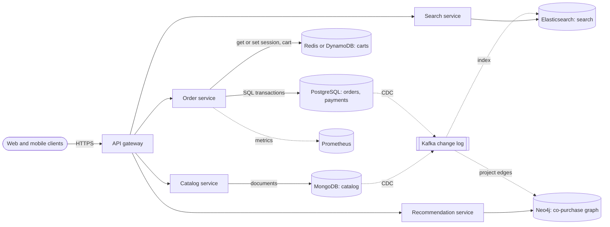

**Reading the diagram.** Clients reach services via an API gateway over HTTPS. Solid arrows are synchronous: the order service owns orders and payments in PostgreSQL and carts in a key-value store; the catalog service owns product documents in MongoDB. Dotted arrows are asynchronous: CDC streams committed changes into Kafka, whose consumers build the Elasticsearch index and the Neo4j co-purchase graph; services emit metrics to Prometheus. Each database is a separate failure domain with its own backups. If the CDC pipeline stalls, search and recommendations go stale but orders keep working — the intended degradation. Each store scales independently, and derived stores can be rebuilt from Kafka.

### 12.13.2 The operational costs

**Table 12.15 — What each additional database costs you.**

| Cost | What it involves |
|---|---|
| Expertise | On-call engineers who know its failure modes and tuning |
| Operations | Patching, upgrades, capacity planning, dashboards, alerts |
| Backup and recovery | Separate backups, restore drills and recovery objectives |
| Consistency | Lagging derived stores; reconciliation jobs |
| Security and compliance | Another access model and audit trail; deletions must reach every copy |
| Money | Baseline cluster cost even when idle; data stored several times |

::: industry
**Database-per-service.** Microservices commonly give each service its own database (§34.11), so polyglot persistence follows naturally — and cross-service queries and consistency become pipeline problems.
*Evidence: Illustrative* — a widely described architectural pattern; not a claim about any specific company.
:::

::: warning
**Dual writes.** Writing to PostgreSQL and then Elasticsearch in one handler diverges silently if the process crashes between them. Derive the second write from the committed first via an outbox or CDC.
:::

::: recommendation
**Budget the number of stores.** Add a technology only when its requirement justifies a permanent operational cost; many organizations keep an approved list and review exceptions.
:::

#### Common misconceptions

::: mistake
**"Polyglot persistence means every service should use a different database."** The goal is fit, not variety; services with similar patterns should share technology, tooling and runbooks.
:::

## 12.14 Summary and revision notes

::: summary
- NoSQL arose from scale-out, schema-flexibility and availability pressures plus "one size does not fit all"; Bigtable, Dynamo, PNUTS and Cassandra defined the designs.
- Key-value, document and wide-column stores are **aggregate-oriented**: data read together is stored together under one key.
- **DynamoDB:** partition key (hashed) + sort key (ordered item collection); GSIs are asynchronous, eventually consistent copies; LSIs share the partition key. Design keys from access patterns; use sparse and overloaded indexes. WCU = 1 KB writes/s, RCU = 4 KB strong reads/s (½ for eventual); per-partition limits 3,000 RCU / 1,000 WCU; on-demand versus provisioned break-even ≈ 29 % utilization (as of 2026 prices).
- **MongoDB:** embed what is owned, bounded and read together; reference what is shared or unbounded; order compound indexes Equality–Sort–Range; multi-document transactions since 4.0; use `w: "majority"`.
- **Bigtable/Cassandra:** sorted sparse rows; CQL `PRIMARY KEY ((partition), clustering)`; one table per query; bucket partitions and size them with $N_v = N_r(N_c - N_{pk} - N_s) + N_s$; beware tombstones and last-write-wins.
- **Graphs:** property graph versus RDF; index-free adjacency makes traversal cost depend on the neighborhood, but $d^k$ growth still dominates deep queries.
- **Time-series:** labeled series, inverted label index, delta-of-delta and XOR compression (~1.37 B/sample in Gorilla), time blocks, retention by deletion, downsampling tiers; cardinality is the first limit.
- Search engines and vector databases are derived indexes fed by CDC; NewSQL adds scale-out SQL transactions at a latency cost (Chapter 28).
- Default to relational; add a specialized store for a named, measured requirement; feed derived stores asynchronously; budget each store's operational cost.
:::

## 12.15 Knowledge checkpoint

1. Name the three pressures that produced NoSQL and one paper associated with each design response.
2. Why must a DynamoDB Query name exactly one partition key?
3. Give two differences between an LSI and a GSI.
4. A Query returns three items of 1.2 KB each, eventually consistent. How many RCUs does it consume? How many would three GetItem calls consume?
5. What makes a GSI sparse, and what is it useful for?
6. State the ESR rule and explain why sort fields precede range fields.
7. In `PRIMARY KEY ((sensor_id, day), ts)`, which columns determine placement and which determine order?
8. How many cells does a Cassandra partition hold with 10,000 rows, 5 columns, 1 partition-key column and 1 static column?
9. Why can deleted data reappear in Cassandra?
10. What is index-free adjacency, and what does it not fix?
11. Which Gorilla encoding costs one bit for a timestamp and one bit for a value?
12. Why should a search index not be the only copy of data?

<details><summary>Answers</summary>

1. Scale-out (Bigtable, Dynamo: partition by key), schema flexibility (Bigtable's sparse columns; document stores), availability (Dynamo: sloppy quorums, always-writable).
2. Only the partition key is hashed to locate data; without it the request would have to visit every partition.
3. An LSI shares the table's partition key, must be created with the table, supports strong reads and limits item collections to 10 GB; a GSI has any key, can be added later, is eventually consistent and has its own throughput.
4. Query sums sizes: 3.6 KB → 1 unit × 0.5 = 0.5 RCU. GetItems round each item: 3 × 1 × 0.5 = 1.5 RCU.
5. Only items carrying the index key attribute appear in it; it is a cheap, self-maintaining list such as "orders awaiting shipment".
6. Equality, Sort, Range. Once a range condition is applied, matching entries are no longer in sort-field order, so the sort would need an in-memory step.
7. `(sensor_id, day)` is hashed for placement; `ts` orders rows within the partition.
8. $10{,}000 \times (5 - 1 - 1) + 1 = 30{,}001$ cells.
9. A replica that was down longer than `gc_grace_seconds` missed the tombstone; after the tombstone is purged elsewhere, the old value on that replica wins on repair.
10. Each node points directly to its relationships, so a hop is a pointer chase rather than an index lookup. It does not fix exponential growth of neighborhoods ($d^k$).
11. Delta-of-delta equal to 0 and XOR with the previous value equal to 0 (same interval, repeated value).
12. It is near-real-time, non-transactional and often needs reindexing after mapping changes; it must be rebuildable from a system of record.
</details>

## 12.16 Interview questions

### Basic

**Q1. When would you choose a NoSQL database over a relational one?**

**Answer.** When a named requirement exceeds what a relational primary with replicas can deliver or fits another model better: write volume or data size beyond one node with simple per-key access (key-value, wide-column); aggregates of varying shape read whole (document); multi-hop path queries (graph); high-rate timestamped samples (time-series). If invariants span entities or queries are still unknown, start relational.

**Q2. What is the difference between a partition key and a sort key?**

**Answer.** The partition key is hashed to choose the partition, so it should have high cardinality and even load. The sort key orders items within a partition, enabling range, prefix and newest-first queries over one item collection.

### Intermediate

**Q3. Design a DynamoDB schema for a chat app: send a message, list a conversation's recent messages, list a user's conversations by latest activity.**

**Answer.** Messages: `PK=CONV#id, SK=MSG#<time-ordered ID>`, read newest first with a descending Query. Membership: `PK=USER#u, SK=CONV#id` carrying `lastActivity`, plus a GSI keyed `USER#u` / `<lastActivity>#CONV#id` for recency order (update or batch on each message). A conversation above about 1,000 writes/s needs write sharding; use TTL for retention.

**Q4. A Cassandra cluster shows read timeouts on a few nodes only. Diagnose.**

**Answer.** Suspect a large or hot partition or tombstones: check partition-size histograms, tombstone warnings and key-level traffic. Typical causes are partition keys without a time bucket and queue-like deletes. Fix the model (bucket, avoid deletes, TTL with time-window compaction), migrate, and repair within `gc_grace_seconds`.

### Advanced

**Q5. Design storage for a social network: profiles, posts, follow graph, feed, search and metrics.**

**Answer.** Profiles and posts in a sharded relational or document store keyed by user (system of record). The follow graph as adjacency lists in a key-value or wide-column store, since one-hop queries dominate (the TAO pattern), with a batch graph job for multi-hop recommendations. Feeds as precomputed lists in wide-column or Redis; search in Elasticsearch via CDC; metrics in Prometheus. Discuss read-your-writes for own posts, fan-out cost and the cost of operating many stores.

**Q6. Your team proposes moving from PostgreSQL to MongoDB "for scale". How do you evaluate it?**

**Answer.** Demand the measured bottleneck (write rate, size, latency) and check whether indexes, replicas, partitioning, `jsonb` or a cache fix it. MongoDB fits if the workload is aggregate-shaped and a shard key matches access patterns; otherwise you trade joins and constraints for application code. Price the migration (backfill, CDC cut-over), skills, and invariants needing transactions.

## 12.17 Practical exercises

**Exercise 12.1 — Key design.** Extend the toy store of §12.4.4 with AP6, "all orders containing a given SKU in the last 30 days". Propose a GSI, add it, and compute its WCU cost at 1,000 orders/s.

**Exercise 12.2 — Capacity.** Recompute the §12.4.5 example with strongly consistent reads and transactional header writes. At what average utilization does provisioned capacity become cheaper?

**Exercise 12.3 — Cassandra modeling.** In a Cassandra 5 container, create the §12.6.3 tables, load one day for 100 sensors, and compare `nodetool tablestats` partition sizes with $S_t$.

**Exercise 12.4 — Compression.** Modify the Gorilla program to round the CPU values to integers and to remove timestamp jitter. Report the bytes per point for each change.

## 12.18 Design challenges

1. **Ride-sharing trip store.** 2 million trips per day, GPS points every 4 s per active trip, queries by trip, by driver over 90 days, and live positions. Choose stores, keys and buckets; size storage for one year.
2. **Fraud detection platform.** Card transactions at 20,000/s must be scored in 50 ms using shared-device and shared-address rings up to 3 hops. Decide what lives in a graph, what is precomputed, and how the graph is fed.
3. **Migrating a monolith's database.** A 4 TB PostgreSQL database serves orders, catalog, search and analytics. Propose a polyglot target, the CDC pipeline, the cut-over sequence and the operational budget.

## 12.19 References

1. DeCandia, G., Hastorun, D., Jampani, M., Kakulapati, G., Lakshman, A., Pilchin, A., Sivasubramanian, S., Vosshall, P., Vogels, W. *Dynamo: Amazon's Highly Available Key-value Store*. SOSP, 2007. https://www.allthingsdistributed.com/files/amazon-dynamo-sosp2007.pdf
2. Chang, F., Dean, J., Ghemawat, S., Hsieh, W. C., Wallach, D. A., Burrows, M., Chandra, T., Fikes, A., Gruber, R. E. *Bigtable: A Distributed Storage System for Structured Data*. OSDI, 2006.
3. Lakshman, A., Malik, P. *Cassandra: A Decentralized Structured Storage System*. ACM SIGOPS Operating Systems Review 44(2), 2010.
4. Pelkonen, T., Franklin, S., Teller, J., Cavallaro, P., Huang, Q., Meza, J., Veeraraghavan, K. *Gorilla: A Fast, Scalable, In-Memory Time Series Database*. PVLDB 8(12), 2015. https://www.vldb.org/pvldb/vol8/p1816-teller.pdf
5. Elhemali, M., et al. *Amazon DynamoDB: A Scalable, Predictably Performant, and Fully Managed NoSQL Database Service*. USENIX ATC, 2022. https://www.usenix.org/conference/atc22/presentation/elhemali
6. Cooper, B. F., et al. *PNUTS: Yahoo!'s Hosted Data Serving Platform*. PVLDB 1(2), 2008.
7. Kleppmann, M. *Designing Data-Intensive Applications*, ch. 2. O'Reilly, 2017.
8. Sadalage, P. J., Fowler, M. *NoSQL Distilled*. Addison-Wesley, 2012.
9. Stonebraker, M., Çetintemel, U. *"One Size Fits All": An Idea Whose Time Has Come and Gone*. ICDE, 2005.
10. Stonebraker, M., et al. *The End of an Architectural Era (It's Time for a Complete Rewrite)*. VLDB, 2007.
11. Brewer, E. *Towards Robust Distributed Systems*. PODC keynote, 2000.
12. Gilbert, S., Lynch, N. *Brewer's Conjecture and the Feasibility of Consistent, Available, Partition-Tolerant Web Services*. ACM SIGACT News 33(2), 2002.
13. Amazon Web Services. *Amazon DynamoDB Developer Guide*. https://docs.aws.amazon.com/amazondynamodb/latest/developerguide/
14. Amazon Web Services. *Amazon DynamoDB pricing*. https://aws.amazon.com/dynamodb/pricing/
15. DeBrie, A. *The DynamoDB Book*. Self-published, 2020.
16. MongoDB. *MongoDB Manual* (data modeling, indexes, transactions, limits). https://www.mongodb.com/docs/manual/
17. Apache Cassandra. *Cassandra Documentation: Data Modeling*. https://cassandra.apache.org/doc/latest/cassandra/data_modeling/
18. Chebotko, A., Kashlev, A., Lu, S. *A Big Data Modeling Methodology for Apache Cassandra*. IEEE BigData Congress, 2015.
19. Borthakur, D., et al. *Apache Hadoop Goes Realtime at Facebook*. SIGMOD, 2011.
20. Discord. *How Discord Stores Billions of Messages*. Discord blog, 2017. https://discord.com/blog/how-discord-stores-billions-of-messages
21. Discord. *How Discord Stores Trillions of Messages*. Discord blog, 2023. https://discord.com/blog/how-discord-stores-trillions-of-messages
22. Neo4j. *Neo4j Documentation* (Cypher Manual, Operations Manual). https://neo4j.com/docs/
23. Robinson, I., Webber, J., Eifrem, E. *Graph Databases*, 2nd ed. O'Reilly, 2015.
24. ISO/IEC 39075:2024. *Information technology — Database languages — GQL*. ISO, 2024.
25. W3C. *RDF 1.1 Concepts and Abstract Syntax*. W3C Recommendation, 2014. https://www.w3.org/TR/rdf11-concepts/
26. Bronson, N., et al. *TAO: Facebook's Distributed Data Store for the Social Graph*. USENIX ATC, 2013.
27. Prometheus. *Storage*. Prometheus documentation. https://prometheus.io/docs/prometheus/latest/storage/
28. InfluxData. *InfluxDB documentation*. https://docs.influxdata.com/
29. Timescale. *TimescaleDB documentation*. https://docs.timescale.com/
30. Elastic. *Elasticsearch Guide* (near real-time search, refresh). https://www.elastic.co/guide/
31. Malkov, Y. A., Yashunin, D. A. *Efficient and Robust Approximate Nearest Neighbor Search Using Hierarchical Navigable Small World Graphs*. IEEE TPAMI 42(4), 2020.
32. Corbett, J. C., et al. *Spanner: Google's Globally-Distributed Database*. OSDI, 2012.
33. Taft, R., et al. *CockroachDB: The Resilient Geo-Distributed SQL Database*. SIGMOD, 2020.
34. Huang, D., et al. *TiDB: A Raft-based HTAP Database*. PVLDB 13(12), 2020.
35. Pavlo, A., Aslett, M. *What's Really New with NewSQL?* SIGMOD Record 45(2), 2016.
36. Fowler, M. *PolyglotPersistence*. martinfowler.com, 2011. https://martinfowler.com/bliki/PolyglotPersistence.html
37. Redis. *Redis documentation*. https://redis.io/docs/latest/

## 12.20 Open verification items

- DynamoDB prices (on-demand $0.625/M write and $0.125/M read request units after the November 2024 reduction; provisioned $0.00065/WCU-h, $0.00013/RCU-h, us-east-1) confirmed only via third-party pages; aws.amazon.com was unreachable.
- DynamoDB limits (400 KB items, per-partition 3,000 RCU/1,000 WCU, 20 GSIs, 5 LSIs, 10 GB item collections) and the 89.2 M requests/s figure (ATC 2022).
- Cassandra "~100 MB per partition" is community guidance, not official docs; tombstone thresholds and `gc_grace_seconds` defaults per version.
- Redis 8 AGPLv3 option and InfluxDB 3 architecture (as of 2026).
- Pointer-chase and index-lookup costs in §12.7.3 are illustrative assumptions.
