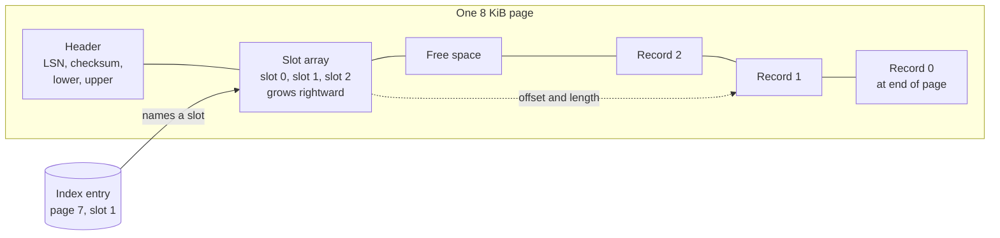
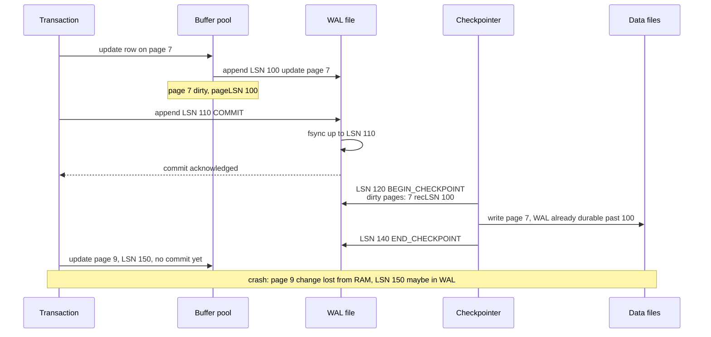
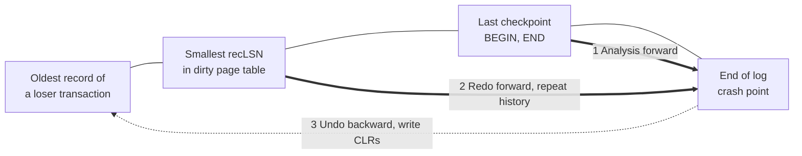
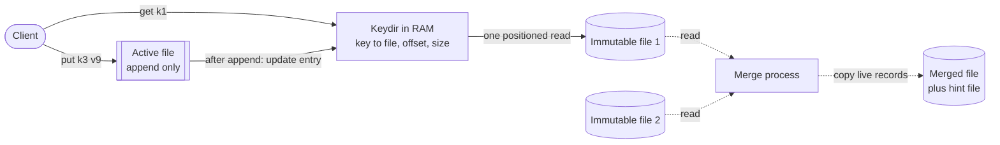
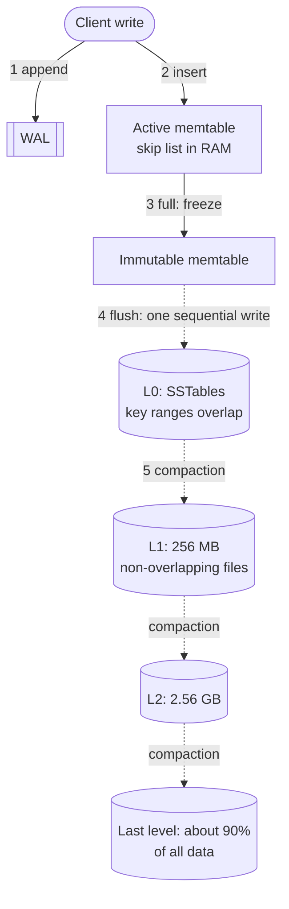
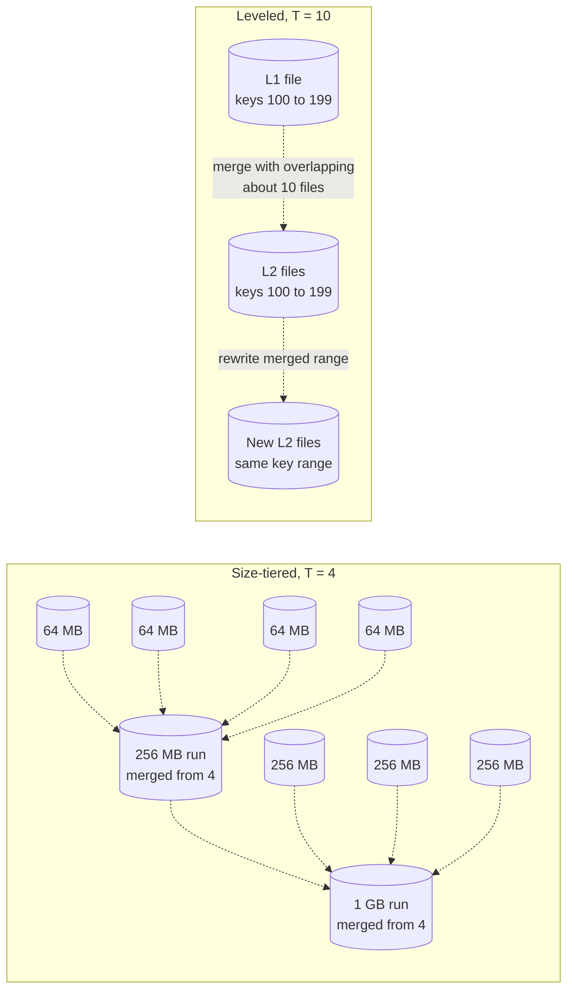
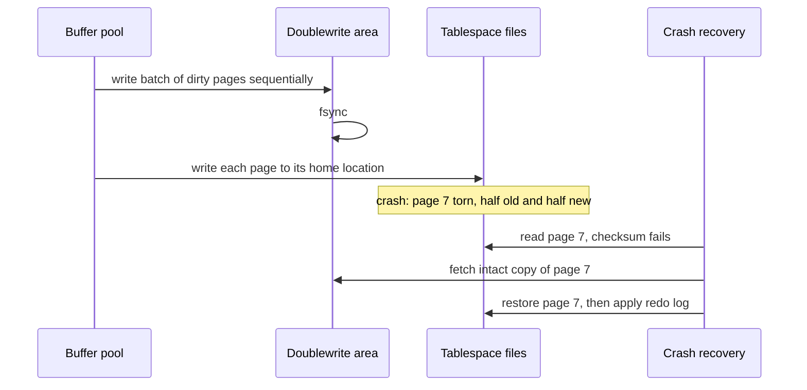
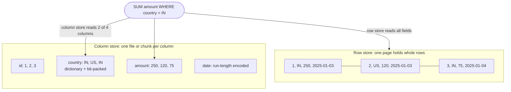

# Chapter 13 — Storage Engine Internals

> **Level:** 3 · **Track:** A (Traditional) · **Estimated reading time:** 3.5 h

When you call `INSERT` on PostgreSQL, `Put` on RocksDB or `save()` on an ORM, a piece of software called the **storage engine** decides where those bytes live on disk, how they are found again, and what happens if the power fails halfway through. Two databases with the same SQL dialect can differ tenfold in write volume, disk space or tail latency purely because of their storage engines. This chapter opens the box: pages, buffer pools, write-ahead logs, B-trees and log-structured merge (LSM) trees, and the numbers that let you choose an engine for a workload instead of by reputation. For book-length treatments, see [Petrov 2019] and chapter 3 of [Kleppmann 2017].

## 13.1 Learning objectives

After this chapter you should be able to:

- Draw a slotted page and explain why records get stable identifiers.
- Explain a buffer pool's page table, pin counts and dirty flags; compare LRU, clock and LRU-K; and justify `O_DIRECT`.
- Describe WAL, LSNs, fuzzy checkpoints and the three ARIES passes, and estimate recovery time.
- Trace a B-tree page split, explain latch crabbing, and contrast in-place with copy-on-write B-trees.
- Build and run a toy LSM tree (memtable, SSTables, WAL replay, compaction), starting from Bitcask.
- Calculate write, read and space amplification for size-tiered, leveled and hybrid compaction, and apply the RUM conjecture.
- Explain torn writes, checksums, the doublewrite buffer and full-page writes.
- Explain why columnar layout, encoding and vectorized execution make analytical scans 10–100× cheaper.
- Choose between InnoDB-, PostgreSQL-heap- and RocksDB-style engines for a workload, with numbers.

## 13.2 Prerequisites

- Storage devices, IOPS and SSD write amplification — §5.6 (engine designs respond to device behavior).
- Page cache, `mmap`, copy-on-write — §6.6.5–§6.6.6 (buffer pools replace or sit beside them).
- `fsync`, journaling and group commit — §6.14 (the group-commit formula in §6.14.3 is not repeated).
- B+ trees, transactions and MVCC — §11.8, §11.11, §11.14 (here: how a B-tree is stored and made crash-safe).
- Logarithms — §4.3. Units: **KiB/MiB** for page and block sizes; **KB/MB/GB/TB** (powers of ten) for data volumes.

## 13.3 Pages and blocks

### 13.3.1 Why storage engines think in pages

::: definition
**Definition — Page.** The fixed-size unit (typically 4–16 KiB) in which a storage engine reads, writes, caches and logs data. A page on disk is sometimes called a **block**; the engine keeps a copy of a page in memory in a **frame** of its buffer pool.
:::

#### First-principles explanation

Imagine a library that lends books only by the whole shelf: to read one sentence you carry a shelf. Storage devices behave like that library. An SSD reads flash in pages of 4–16 KiB; an HDD pays milliseconds of seek before transferring anything (§5.6.1), so reading 100 bytes costs almost the same as reading 8 KiB. A database therefore never asks the disk for "a row"; it asks for the page containing it, and organizes tables, indexes and logs in page-sized units.

#### Why does this exist?

Pages give **I/O efficiency** (one request moves many rows), **a unit of caching and recovery** (the buffer pool caches pages; the log describes changes to pages, §13.5) and **addressability** (a row is named by `(page, slot)`). Larger pages mean fewer I/Os for scans and shallower B-trees, but more bytes written when one small row changes and a larger unit that a crash can tear (§13.12).

**Table 13.1 — Default page sizes (as of 2025).**

| Engine | Default page size | Configurable? |
|---|---|---|
| PostgreSQL heap and indexes | 8 KiB | Only at compile time |
| MySQL InnoDB | 16 KiB | 4–64 KiB, at initialization (`innodb_page_size`) |
| SQLite | 4 KiB | Yes, per database (`PRAGMA page_size`) |
| RocksDB data block (inside an SSTable) | 4 KiB before compression | Yes (`block_size`) |
| LMDB | Operating-system page size (usually 4 KiB) | No |

### 13.3.2 The slotted page

::: definition
**Definition — Slotted page.** A page layout in which a **header** is followed by an array of **slots** (also called line pointers or item IDs) that grows from the front, while variable-length **records** (tuples) are packed from the back. Each slot stores the offset and length of one record; free space sits in the middle.
:::

#### How it works internally

1. **Header:** page LSN (§13.5), checksum (§13.12), slot count and free-space pointers. PostgreSQL's header is 24 bytes, with `pd_lower` and `pd_upper` bounding the free-space hole [PostgreSQL Docs: Database Page Layout].
2. **Insert:** copy the record to the end of free space, then append a slot pointing to it. The record's identifier is `(page, slot)`.
3. **Read:** look up the slot and follow its offset.
4. **Delete:** mark the slot unused; the bytes become a hole.
5. **Grow or compact:** move records within the page and rewrite their slot offsets. Because indexes name *slots*, not byte offsets, these moves are invisible to them — the whole point of the indirection.

#### Architecture diagram

**Figure 13.1 — A slotted page.**



**Reading the diagram.** One contiguous 8 KiB buffer, left to right as on disk. The slot array grows rightward and records grow leftward from the end; the page is full when they meet in the free space. An index entry (a separate storage structure) names `(page 7, slot 1)`; the lookup is synchronous, and the dotted arrow marks the slot-to-record indirection, not an asynchronous path. Failure point: a crash that writes only part of the page leaves header, slots and records inconsistent, hence checksums and torn-write protection (§13.12). Tables scale by adding pages, never by growing one.

#### Mathematical foundations

::: formula
**Records per slotted page**

$$n = \left\lfloor \frac{P - H}{r + s} \right\rfloor$$

| Symbol | Meaning | Units |
|---|---|---|
| $n$ | Records that fit in one page | records |
| $P$ | Page size | bytes |
| $H$ | Page header size | bytes |
| $r$ | Stored record size including per-record header and alignment padding | bytes |
| $s$ | Slot (line pointer) size | bytes |
:::

::: example
**Worked example — How big is a 1-billion-row PostgreSQL table?**

Each row holds 76 bytes of column data. PostgreSQL adds a 23-byte tuple header, padded to 24 bytes, and aligns the tuple to 8 bytes; each line pointer is 4 bytes; the page header is 24 bytes [PostgreSQL Docs: Database Page Layout].

1. Stored record: $24 + 76 = 100$ bytes, rounded up to a multiple of 8: $r = 104$ bytes.
2. Per record including its slot: $104 + 4 = 108$ bytes.
3. Records per page: $n = \lfloor (8192 - 24) / 108 \rfloor = \lfloor 75.6 \rfloor = 75$.
4. Pages: $10^9 / 75 = 13\,333\,334$ pages; size $= 13\,333\,334 \times 8192 \approx 109.2$ GB.
5. Raw column data: $10^9 \times 76 = 76$ GB. Overhead factor: $109.2 / 76 \approx 1.44$.

**Interpretation.** Before any index or dead tuple, the table is 44% larger than its data, because of MVCC tuple headers (§11.14), slots and alignment. **Engineering implication.** Narrow rows pay proportionally more; ordering 8-byte columns first reduces padding, and a deliberate `fillfactor` below 100% trades space for cheaper updates (§13.14.3). This 1.44 is part of the **space amplification** of §13.11.
:::

#### Code example

The following program implements a 4 KiB slotted page with insert, get, delete and compaction. It is standalone; run it with `python3`.

```python
"""A minimal slotted page: header, slot array growing forward, records growing
backward from the end of the page. Record IDs (slot numbers) never change."""
import struct

PAGE_SIZE = 4096
HEADER = struct.Struct("<HH")      # slot_count, free_end (offset where record space begins)
SLOT = struct.Struct("<HH")        # record offset, record length (offset 0 = deleted slot)


class SlottedPage:
    def __init__(self):
        self.buf = bytearray(PAGE_SIZE)
        HEADER.pack_into(self.buf, 0, 0, PAGE_SIZE)

    def _header(self):
        return HEADER.unpack_from(self.buf, 0)

    def _slot_pos(self, slot):
        return HEADER.size + slot * SLOT.size

    def free_space(self):
        count, free_end = self._header()
        return free_end - (HEADER.size + count * SLOT.size)

    def insert(self, record: bytes) -> int:
        count, free_end = self._header()
        if len(record) + SLOT.size > self.free_space():
            self.compact()                                   # reclaim holes, then retry
            count, free_end = self._header()
            if len(record) + SLOT.size > self.free_space():
                raise ValueError("page full")
        offset = free_end - len(record)
        self.buf[offset:free_end] = record                   # record grows downward
        SLOT.pack_into(self.buf, self._slot_pos(count), offset, len(record))
        HEADER.pack_into(self.buf, 0, count + 1, offset)     # slot array grows upward
        return count                                         # slot number = stable record ID

    def get(self, slot: int) -> bytes:
        offset, length = SLOT.unpack_from(self.buf, self._slot_pos(slot))
        if offset == 0:
            raise KeyError(f"slot {slot} deleted")
        return bytes(self.buf[offset:offset + length])

    def delete(self, slot: int) -> None:
        SLOT.pack_into(self.buf, self._slot_pos(slot), 0, 0) # leaves a hole until compact()

    def compact(self) -> None:
        """Slide live records to the end of the page; slot numbers stay the same."""
        count, _ = self._header()
        live = []
        for s in range(count):
            off, length = SLOT.unpack_from(self.buf, self._slot_pos(s))
            if off:
                live.append((s, bytes(self.buf[off:off + length])))
        free_end = PAGE_SIZE
        for s, rec in live:
            free_end -= len(rec)
            self.buf[free_end:free_end + len(rec)] = rec
            SLOT.pack_into(self.buf, self._slot_pos(s), free_end, len(rec))
        HEADER.pack_into(self.buf, 0, count, free_end)


if __name__ == "__main__":
    page = SlottedPage()
    ids = [page.insert(b"row-%03d:" % i + b"x" * 90) for i in range(39)]
    print("inserted", len(ids), "records; free bytes:", page.free_space())
    for s in ids[::2]:
        page.delete(s)                                       # punch 20 holes
    print("after deleting 20, free bytes before compaction:", page.free_space())
    new = page.insert(b"a-larger-record:" + b"y" * 400)      # forces compaction
    print("new record got slot", new, "; slot 1 still reads", page.get(1)[:8])
    print("free bytes now:", page.free_space())
```

Output:

```text
inserted 39 records; free bytes: 114
after deleting 20, free bytes before compaction: 114
new record got slot 39 ; slot 1 still reads b'row-001:'
free bytes now: 1654
```

What to notice:

- 39 records of 98 bytes plus 4-byte slots fill $4 + 39 \times 102 = 3982$ of 4096 bytes, leaving 114 — the formula with $H = 4$, $r = 98$, $s = 4$.
- Deleting does not raise `free_space()`: holes are unusable until `compact()` runs (PostgreSQL compacts during page pruning and `VACUUM`).
- After compaction slot 1 returns the same record from a different offset; that stability lets indexes store `(page, slot)`.

#### Alternatives and trade-offs

Fixed-length records need no slots (record *i* sits at offset $H + i \times r$). Clustered tables such as InnoDB's keep rows inside B-tree leaves, with slots in key order for binary search (§13.14.1). Values too large for a page move out of line (PostgreSQL TOAST above roughly 2 KB; InnoDB overflow pages).

::: mistake
**"A row is the unit of I/O."** It never is. Updating one 50-byte field dirties a whole 8 or 16 KiB page, which is eventually written in full and, after a checkpoint, may also be copied into the log (§13.12). Reasoning in rows is the commonest cause of underestimated write volume.
:::

## 13.4 Buffer pools

### 13.4.1 What a buffer pool does

::: definition
**Definition — Buffer pool.** A region of memory, managed by the database itself, divided into page-sized **frames** that cache disk pages. A **page table** maps page IDs to frames; each frame carries a **pin count** (how many threads are using it right now), a **dirty flag** (whether it differs from the disk copy) and bookkeeping for the **replacement policy** that chooses which page to evict.
:::

#### First-principles explanation

Think of a workbench with 1,000 trays beside a warehouse of a billion boxes. You fetch a box into a free tray and note its number on a whiteboard (the page table). While using it you clip the tray (a **pin**) so nobody swaps it out; if you change its contents you add a red dot (**dirty**), meaning it must be shelved before the tray is reused. When the trays are full, you pick an unclipped tray not needed for a while (the **replacement policy**).

#### Why does this exist?

RAM is about 1,000 times faster than NVMe for a random access (~100 ns versus ~80 µs, §5.6.5), and most databases' working sets are far smaller than the data. The database could leave caching to the kernel's page cache (§6.6.6), but it knows what the kernel does not: which pages are index roots and which belong to a one-off scan, and which dirty pages must not be written before their log records (§13.5).

#### How it works internally

A thread that needs page 42 calls `fetch(42)`:

1. **Look up** 42 in the page table (a latched hash table). On a **hit**, increment the pin count, note the access for the replacer, return the frame.
2. On a **miss**, take a frame from the free list or ask the **replacer** for a victim with pin count 0.
3. If the victim is dirty, ensure the log is durable up to its page LSN (the **WAL rule**, §13.5.1), then write it.
4. Read page 42 into the frame, verify its checksum (§13.12), update the page table, pin and return it.
5. The caller later calls `unpin(42, dirty)`. Pinned pages are never evicted, so a leaked pin slowly shrinks the pool.

**Background writers** (PostgreSQL's bgwriter and checkpointer, InnoDB's page cleaners) flush dirty pages ahead of demand so step 3 rarely waits.

#### Architecture diagram

**Figure 13.2 — Buffer pool components and the page request path.**


**Reading the diagram.** Solid arrows are the synchronous request path: page table, then frame on a hit, or replacer and disk manager on a miss. A dirty victim is written only after the WAL is flushed past its page LSN, an ordering constraint between two storage boundaries (log files and data files). The background writer cleans frames asynchronously (dotted). Failure points: a crash loses dirty frames (recovered from the WAL); leaked pins exhaust evictable frames; a hot page-table latch limits concurrency, so InnoDB partitions large pools into instances. The pool scales vertically with RAM.

### 13.4.2 Eviction policies: LRU, clock and LRU-K

**LRU** evicts the page whose last access is oldest. Inside a database it has two problems: moving a list node on every hit makes the shared list a contention point, and **sequential flooding** — one scan of a 100 GB table pushes every hot index page out of a 32 GB pool although no scanned page is read again.

**Clock** approximates LRU cheaply: frames sit in a circle with a reference bit set on access; a sweeping hand clears set bits and evicts the first unpinned frame whose bit is already clear. PostgreSQL's **clock sweep** uses a usage count (capped at 5) instead of a bit, so frequently used pages survive several sweeps [PostgreSQL source: `src/backend/storage/buffer/README`].

**LRU-K** evicts the page whose *K*-th most recent access is oldest [O'Neil, O'Neil and Weikum 1993]. With $K = 2$, a page touched once by a scan is evicted first, so LRU-K resists scans and captures frequency, at the cost of access history. Related designs are **2Q** [Johnson and Shasha 1994] and ARC (§20.9).

InnoDB uses **midpoint insertion**: new pages enter the head of an "old" sublist (37% of the pool) and are promoted only if accessed again after `innodb_old_blocks_time` (1,000 ms by default), so a one-pass scan never reaches the "new" sublist [MySQL Docs: Making the Buffer Pool Scan Resistant]. PostgreSQL gives large scans and `VACUUM` a small private **ring buffer** of frames.

**Table 13.2 — Buffer replacement policies.**

| Policy | How it works | Advantages | Disadvantages | Used in |
|---|---|---|---|---|
| LRU | Evict oldest last access; list move on every hit | Simple, good for recency | Hit path contention; scan flooding | Textbook baseline; with sublists in InnoDB |
| Clock / clock sweep | Reference bit or usage count; sweeping hand | Cheap hits; approximates LRU or LFU | Sweep cost when many pages are hot | PostgreSQL; OS page replacement |
| LRU-K (K = 2) | Evict oldest K-th last access | Scan resistant; frequency aware | History memory; tuning of correlation period | Research, commercial engines |
| Midpoint / 2Q | Probation queue before main queue | Scan resistant; cheap | Two parameters to tune | InnoDB (midpoint); 2Q variants |
| Ring buffer for scans | Bulk operations reuse a few private frames | Protects the main pool completely | Applies only to recognized bulk operations | PostgreSQL |

### 13.4.3 Double buffering, `O_DIRECT` and the page cache

Reading files with ordinary `read()` caches every page twice, in the kernel page cache and in the buffer pool. This **double buffering** wastes RAM, and kernel read-ahead and writeback compete with the database's own. **`O_DIRECT`** transfers data directly between the device and aligned database buffers; the engine must then do its own read-ahead and asynchronous I/O, and still needs `fsync`, because `O_DIRECT` does not flush the drive cache (§6.14.3).

**InnoDB** owns memory: a buffer pool of most of RAM with `O_DIRECT`, the Linux default from MySQL 8.4 [MySQL Docs: InnoDB Startup Options]. **PostgreSQL** uses buffered I/O, with `shared_buffers` starting around 25% of RAM and the page cache as a second-level cache [PostgreSQL Docs: Resource Consumption]; direct I/O is only a developer option (`debug_io_direct`, version 16), and version 18 added asynchronous I/O (as of 2025). **RocksDB** defaults to buffered I/O plus its own block cache, with optional direct I/O [RocksDB Wiki: Direct IO]. **LMDB** maps the file with `mmap` and lets the kernel be its buffer pool, trading control for simplicity (§6.6.6, [Crotty et al. 2022]).

#### Mathematical foundations

How much RAM should the buffer pool have? Gray and Putzolu's **five-minute rule** answers by comparing the cost of keeping a page in memory with the cost of the device capacity needed to re-read it [Gray and Putzolu 1987; Gray and Graefe 1997].

::: formula
**Break-even reference interval (the "five-minute rule")**

$$T_{BE} = \frac{C_{dev} / IOPS_{dev}}{C_{RAM} \times P}$$

| Symbol | Meaning | Units |
|---|---|---|
| $T_{BE}$ | Break-even interval: cache a page if it is re-referenced more often than once per $T_{BE}$ | seconds |
| $C_{dev}$ | Price of one storage device | dollars |
| $IOPS_{dev}$ | Random reads per second the device sustains | reads/s |
| $C_{RAM}$ | Price of memory | dollars/byte |
| $P$ | Page size | bytes |
:::

::: example
**Worked example — Break-even for HDD and NVMe (illustrative prices, as of 2025).**

Assume DRAM at $\$4$/GB, so $C_{RAM} = 4 \times 10^{-9}$ \$/byte, and $P = 8192$ bytes. RAM cost of one cached page: $4 \times 10^{-9} \times 8192 = \$3.28 \times 10^{-5}$.

1. **HDD:** $C_{dev} = \$300$, $IOPS_{dev} = 200$. Cost per unit of read capacity: $300 / 200 = \$1.50$ per read/s. $T_{BE} = 1.50 / (3.28 \times 10^{-5}) \approx 45\,700$ s $\approx 12.7$ hours.
2. **NVMe SSD:** $C_{dev} = \$400$, $IOPS_{dev} = 400\,000$. Cost: $400 / 400\,000 = \$0.001$ per read/s. $T_{BE} = 0.001 / (3.28 \times 10^{-5}) \approx 30.5$ s.

**Interpretation.** On HDDs, a page touched about twice a day earns its RAM; on NVMe, only pages re-referenced every half minute or so do. **Engineering implication.** With flash, size the pool for the hot working set and the latency target, not the whole database. CPU cost per I/O and latency SLOs, ignored here, push toward a somewhat larger pool.
:::

#### Failure scenarios

**Table 13.3 — Buffer pool failure scenarios.**

| What goes wrong | Why | Detection | Recovery | Prevention |
|---|---|---|---|---|
| Throughput collapses after a report | Scan floods the pool | Hit ratio drops | Re-warm | Scan-resistant policy; reports on a replica |
| Stalls waiting for free frames | All frames dirty | Wait events; dirty % near 100 | Flush faster | Tune page cleaners or bgwriter |
| High p99 after restart | Cold pool | Low hit ratio | Warm before taking traffic | Dump/reload page list; `pg_prewarm` |

::: mistake
**"A 99% buffer hit ratio means the disk does not matter."** At 50,000 page requests per second, 1% misses is 500 random reads per second, each 80 µs on NVMe or 10 ms on an HDD — enough to saturate a hard disk (§5.6.1). Hit ratios must be read together with the absolute miss rate and the device's IOPS.
:::

## 13.5 Write-ahead logging and recovery

### 13.5.1 The problem: fast commits without losing data

::: definition
**Definition — Write-ahead log (WAL).** An append-only file of **log records** describing every change to the database, written *before* the changed pages themselves reach disk. Each record is identified by a monotonically increasing **log sequence number (LSN)**, usually its byte offset in the log. Also called the redo log (InnoDB) or journal.
:::

#### First-principles explanation

A shopkeeper writes every sale as one line at the bottom of a cash book the moment it happens, and tidies the stock ledger later. If a fire alarm interrupts the tidying, nothing is lost: she replays the cash book from the last time the ledger was known to be correct. Appending a line is fast; reorganizing shelves is slow. The cash book is the WAL, the ledger is the data pages, and "last known correct" is a **checkpoint**.

#### Why does this exist?

Writing a transaction's ten random pages at commit would cost ten random writes, and a crash midway would leave some pages new and some old. The WAL replaces them with one small *sequential* append and one `fsync` per commit group (§6.14.3). Two freedoms follow [Härder and Reuter 1983]: **no-force** — committed changes need not reach their pages at commit, because the log can **redo** them; and **steal** — pages with *uncommitted* changes may be written (say, on eviction), because the log can **undo** them. Steal/no-force gives the fastest commits and freest buffer pool, at the price of needing both redo and undo — the design point of ARIES.

#### How it works internally

An update record holds its LSN, transaction ID, `prevLSN` (the transaction's previous record, chaining backward), page ID, and **redo** and **undo** information. Records are usually **physiological**: physical to a page, logical within it ("insert at slot 3 of page 7"). Two rules make the WAL correct:

1. **WAL rule:** before a dirty page is written, the log must be durable up to that page's `pageLSN`: $\text{pageLSN} \le \text{flushedLSN}$. Otherwise a change could reach disk with no record able to undo it.
2. **Commit rule:** a transaction is acknowledged only after its commit record is durable.

Because each page stores the LSN of the last change applied to it, recovery can tell whether a record is already on the page, which makes redo **idempotent**.

### 13.5.2 Checkpoints

A **checkpoint** bounds how much log recovery must read and how much log must be kept. Rather than freezing the database to flush everything, engines take **fuzzy checkpoints**: log the **dirty page table** (each dirty page with its `recLSN`, the LSN that first dirtied it) and the **transaction table**, then flush pages gradually in the background. Redo starts from the smallest `recLSN`; older log can be recycled.

**Figure 13.3 — WAL, commit and checkpoint timeline.**



**Reading the diagram.** The WAL file and data files are separate durable storage boundaries; the buffer pool is RAM. Solid arrows are synchronous; the dashed arrow is the acknowledgement. The commit waits only for a sequential log `fsync` up to LSN 110, never for page 7, which the checkpointer writes later, respecting the WAL rule. At the crash, page 9's uncommitted change exists only in RAM and perhaps the log tail; recovery must ensure it does not appear. Scaling: the log is one sequential stream, so its device's flush latency bounds commit throughput; put it on fast, power-loss-protected storage.

### 13.5.3 ARIES recovery: analysis, redo, undo

**ARIES**, developed at IBM, is the reference design for steal/no-force recovery and underlies DB2 and SQL Server among others [Mohan et al. 1992]:

1. **Analysis** (forward from the last checkpoint): rebuild the dirty page and transaction tables; committed transactions are **winners**, active ones **losers**.
2. **Redo** (forward from the smallest `recLSN`): **repeat history** — reapply every change, losers' included, whose LSN exceeds the page's `pageLSN`, restoring the exact pre-crash state.
3. **Undo** (backward): roll back losers along their `prevLSN` chains, logging each step as a **compensation log record (CLR)** whose `undoNextLSN` says what to undo next. A crash during recovery redoes the CLRs and resumes, never undoing twice.

Repeating history first is what allows row-level locking and logical undo: after redo, pages are exactly as the undo records expect, even if committed transactions changed them since.

**Figure 13.4 — The three ARIES passes over the log.**



**Reading the diagram.** The boxes are positions in one WAL file, ordered by LSN. Analysis scans forward from the checkpoint; redo scans forward from the smallest `recLSN`, which precedes the checkpoint because fuzzy checkpoints do not flush pages; undo (dotted: it follows `prevLSN` chains, not a sequential scan) walks back to the oldest loser record, writing CLRs. The log is read; data pages are read and written through the buffer pool. Failure point: a long-running transaction pushes point A far back, lengthening undo and log retention. Scaling: redo parallelizes by page.

#### Mathematical foundations

::: formula
**Redo work after a crash**

$$W_{redo} \approx r_{WAL} \times \Delta t_{ckpt}, \qquad T_{redo} \approx \frac{W_{redo}}{b_{replay}}$$

| Symbol | Meaning | Units |
|---|---|---|
| $W_{redo}$ | Log volume between the redo start point and the crash | bytes |
| $r_{WAL}$ | Rate at which the workload generates log | bytes/s |
| $\Delta t_{ckpt}$ | Time between checkpoints (worst case, crash just before the next one) | s |
| $T_{redo}$ | Duration of the redo pass | s |
| $b_{replay}$ | Replay throughput, usually limited by random page reads, not log reads | bytes/s |
:::

::: example
**Worked example — Choosing a checkpoint interval.**

A PostgreSQL server generates $r_{WAL} = 30$ MB/s of WAL at peak. Replay runs at $b_{replay} = 150$ MB/s (single-threaded redo, mostly cached pages).

1. Checkpoint every 5 minutes: $W_{redo} = 30 \times 300 = 9000$ MB $= 9$ GB. $T_{redo} = 9000 / 150 = 60$ s.
2. Checkpoint every 1 minute: $W_{redo} = 30 \times 60 = 1.8$ GB; $T_{redo} = 12$ s.
3. The cost: with full-page writes (§13.12.3), the first change to each page after a checkpoint logs the whole 8 KiB page. If 200,000 distinct pages are dirtied per minute, 1-minute checkpoints add up to $200\,000 \times 8192 \approx 1.64$ GB per minute, $\approx 27$ MB/s — nearly doubling the WAL rate.

**Interpretation.** Checkpoint frequency trades recovery time against steady-state write volume. **Engineering implication.** Derive the interval from the recovery-time objective (RTO, §39.8) and the measured WAL rate; write-heavy PostgreSQL systems often raise `checkpoint_timeout` (default 5 min) and `max_wal_size` (default 1 GB), letting a standby failover (§27.11) hide the longer recovery.
:::

### 13.5.4 Group commit and relaxed durability

**Group commit** lets one log `fsync` cover every commit that arrived during the previous flush (formula in §6.14.3). Engines also trade durability for speed explicitly: InnoDB's `innodb_flush_log_at_trx_commit = 1` (default) flushes at every commit, while `2` flushes about once per second, so an OS crash can lose about a second of commits. PostgreSQL's `synchronous_commit = off` risks the last fraction of a second of commits but never corruption, because the WAL rule still holds.

#### Real-world industry applications

::: industry
**PostgreSQL versus InnoDB recovery.** PostgreSQL recovers by redo only: MVCC never overwrites rows in place, so an aborted transaction's versions stay in the heap, invisible because `pg_xact` marks it aborted, until `VACUUM` removes them. The same WAL feeds replication and point-in-time recovery. InnoDB is ARIES-like: redo log plus separate **undo logs** that serve rollback and consistent reads; recovery applies redo, then rolls back incomplete transactions.
*Evidence: Primary* — [PostgreSQL Docs: Reliability and the Write-Ahead Log; MySQL Docs: InnoDB Redo Log; InnoDB Undo Logs]
:::

#### Failure scenarios

**Table 13.4 — WAL and recovery failure scenarios.**

| What goes wrong | Why | Detection | Recovery | Prevention |
|---|---|---|---|---|
| Recovery takes 20 minutes | Long checkpoint interval, high WAL rate | Redo progress in logs | Fail over to a replica | Size interval from the RTO |
| Disk fills with WAL | Stalled checkpoints or unconsumed replication slot | WAL size alert | Fix consumer; drop slot | Monitor retention and slot lag |
| Acknowledged commits lost | Drive cache not flushed; relaxed settings | Gaps versus clients | Restore from replica | Power-loss protection; audit `fsync` settings |
| Undo grows without bound | Long-running transaction | Oldest transaction age | Kill or commit it | Transaction timeouts |

::: mistake
**"The checkpoint is what makes a commit durable."** Commits are durable when their log records are flushed. A checkpoint only bounds recovery work and lets old log be recycled.
:::

## 13.6 B-tree storage engines

### 13.6.1 Storing a B+ tree in pages

::: definition
**Definition — B-tree storage engine.** A storage engine that keeps each table or index as a B+ tree of fixed-size pages and **updates pages in place**: a change to a key rewrites the page that holds it. Internal pages hold separator keys and child page numbers; leaf pages hold the keys with either the rows themselves (a clustered index) or pointers to them.
:::

The logical structure of B+ trees is covered in §11.8. Here the questions are physical: how the tree grows in pages, what a lookup costs in I/O, and how threads share it.

#### First-principles explanation

Picture a filing cabinet with guide cards: one card per drawer, one per folder. To find a document you read three cards, not a million documents. When a folder overflows you split it and add a guide card above; rarely, the drawer overflows too. The cabinet stays balanced because it grows only by splitting, bottom up.

#### How it works internally

**Lookup.** From the root, binary-search separator keys and fetch the child through the buffer pool until reaching a leaf.

**Insert and split.** If the leaf has room, insert into its slotted page (§13.3) and log it. Otherwise:

1. Allocate a new page and move the upper half of the entries to it.
2. Link it into the leaf sibling chain.
3. Insert a separator into the parent, splitting the parent the same way if it is full; a root split adds a level.
4. Log the split as one unit. ARIES treats it as a **nested top action**: it is not undone if the triggering transaction aborts, because others may already use the new page [Mohan et al. 1992].

For rightmost inserts (auto-increment keys, timestamps), PostgreSQL and InnoDB split unevenly, leaving the old page nearly full instead of a trail of half-empty pages.

**Delete and merge.** Merging under-full pages reverses a split, but eager merging thrashes. InnoDB attempts a merge below `MERGE_THRESHOLD` (50% by default); PostgreSQL reclaims only pages `VACUUM` finds completely empty [MySQL Docs: Configuring the Merge Threshold for Index Pages; PostgreSQL source: `src/backend/access/nbtree/README`].

**Figure 13.5 — A leaf page split propagating a separator to the parent.**


**Reading the diagram.** Each box is a page in one data file; arrows are synchronous pointers. Inserting 35 into full leaf A allocates leaf B, moves the upper entries, links A to B for range scans, and adds a separator to the parent. One logical insert dirties three pages — write amplification. Failure point: a crash between writing B and updating the parent would orphan B, hence logging the split atomically. Scaling: with 57 rows per leaf and fan-out 716 (below), a leaf splits about every 28 inserts into it and a parent about every 358 leaf splits.

#### Mathematical foundations

::: formula
**B+ tree height**

$$N_{leaf} = \left\lceil \frac{N}{n_{leaf}} \right\rceil, \qquad h = 1 + \left\lceil \log_{f} N_{leaf} \right\rceil$$

| Symbol | Meaning | Units |
|---|---|---|
| $N$ | Number of rows (keys) | rows |
| $n_{leaf}$ | Rows per leaf page at the typical fill factor | rows/page |
| $N_{leaf}$ | Number of leaf pages | pages |
| $f$ | Fan-out: child pointers per internal page at the typical fill factor | pointers/page |
| $h$ | Number of levels including the leaf level | levels |
:::

::: example
**Worked example — A 1-billion-row InnoDB table.**

Assume 16 KiB pages filled to 70% (a typical steady state after random inserts; random B-tree fill averages about $\ln 2 \approx 69\%$ [Yao 1978]), rows of 200 bytes, and internal entries of 16 bytes (an 8-byte key, a page number and record overhead).

1. Usable bytes per page: $16\,384 \times 0.7 = 11\,469$.
2. Rows per leaf: $\lfloor 11\,469 / 200 \rfloor = 57$. Leaves: $10^9 / 57 = 17\,543\,860$.
3. Fan-out: $\lfloor 11\,469 / 16 \rfloor = 716$.
4. Height: $\log_{716} 17\,543\,860 = \ln(1.754 \times 10^7) / \ln 716 = 16.68 / 6.57 = 2.54$, so $\lceil 2.54 \rceil = 3$ internal levels and $h = 4$.
5. Internal pages: $17\,543\,860 / 716 \approx 24\,503$, then $\lceil 24\,503 / 716 \rceil = 35$, then 1 root: $24\,539$ pages $\times$ 16 KiB $\approx 402$ MB.

**Interpretation.** Four levels index a billion rows, and the internal levels fit in about 400 MB, so a point lookup costs at most **one** random read. **Engineering implication.** Read cost is nearly flat in table size while internal pages stay cached; the real danger is a working set of *leaves* larger than RAM. Wide keys cut fan-out and can add a level, one reason to prefer compact primary keys.
:::

### 13.6.2 Concurrency: latches and latch crabbing

A **latch** is a short-term mutex on an in-memory structure such as a page frame, held for microseconds; a **lock** protects logical data for a transaction's lifetime and takes part in deadlock detection (§11.15). **Latch crabbing** descends like a crab: hold the parent's latch, acquire the child's, and release the parent when safe [Bayer and Schkolnick 1977].

1. **Readers** latch the child shared, then release the parent: at most two latches at a time.
2. **Writers** latch exclusively and release all ancestors on reaching a **safe** node, one that cannot split (has free space) or merge on this operation.
3. **Optimistically**, since splits are rare, writers descend with shared latches and latch only the leaf exclusively, restarting pessimistically if a split is needed. The root is then almost never exclusively latched.

**B-link trees** [Lehman and Yao 1981] add a high key and right-sibling pointer to every page, so a reader arriving just after a concurrent split follows the right-link instead of latching the parent. PostgreSQL's B-tree is based on this design.

### 13.6.3 Copy-on-write B-trees

A **copy-on-write (COW)** or shadowing B-tree never modifies a page reachable from the current root. Changing a leaf writes a new leaf, a new parent pointing to it, and so on to a new root; a commit atomically switches the root pointer. Readers that began earlier keep the old root — a consistent snapshot without locks — and no WAL is needed [Rodeh 2008].

::: industry
**LMDB.** Written for the read-dominated OpenLDAP directory server, LMDB memory-maps its file, allows one writer and any number of lock-free readers, and alternates between two **meta pages** recording the current root; after a crash the meta page with the higher valid transaction ID *is* the database, so there is no recovery procedure. Freed pages are reused once no reader needs them. Trade-offs: each commit copies the root-to-leaf path — with height 4 and 4 KiB pages, 16 KiB for a 100-byte update, about 160× write amplification unless a transaction batches many keys — long readers bloat the file, and one writer bounds write concurrency. Btrfs and ZFS use the same idea (§6.14.2).
*Evidence: Primary* — [LMDB Docs]
:::

#### Advantages and disadvantages

B-trees give predictable one-I/O point reads, efficient range scans along sibling links, and mature row-level locking. Their weaknesses come from in-place updates: random writes, page-sized write amplification (§13.11), partly empty pages ($SA \approx 1/0.69 \approx 1.45$ from fill factor alone) and torn-page risk (§13.12).

::: mistake
**"B-trees need one disk write per insert."** At commit only a small sequential log record is written; the page is written later, by which time many inserts may share it. Insert cost therefore depends on key locality (§13.11.2).
:::

## 13.7 Log-structured storage

### 13.7.1 The idea: never overwrite, only append

::: definition
**Definition — Log-structured storage.** A storage design in which every write — insert, update or delete — is appended to the end of a file, and existing data is never modified in place. Old versions become garbage that a background **compaction** (or merge) process removes by copying live data into new files.
:::

#### First-principles explanation

Suppose the shopkeeper's cash book of §13.5 becomes *the* record: a balance is the most recent line about a customer. Writing is one append and recovery is trivial, but finding the latest line needs an index, and obsolete lines must be tidied away. Every log-structured engine answers those two problems; the idea goes back to the log-structured file system [Rosenblum and Ousterhout 1992].

#### Why does this exist?

Sequential writes are 100–600× faster than random ones on HDDs (§5.6.1) and still better on SSDs, where they also cut the drive's internal write amplification (§5.6.3). Log structuring makes *all* writes sequential and moves the cost to reads and background compaction.

### 13.7.2 Bitcask: a hash index over a log

Bitcask, the default storage backend of the Riak key-value store, is the simplest complete log-structured engine and a good mental model [Sheehy and Smith 2010].

#### How it works internally

1. **Data files.** One **active** file takes appends of `CRC | timestamp | key size | value size | key | value`; full files become immutable. A delete appends a **tombstone**.
2. **Keydir.** An in-memory hash table maps every key to the file, position and size of its latest record.
3. **Read.** One keydir lookup and **one** positioned read.
4. **Merge.** In the background, copy records the keydir still references into new files, delete the old ones, and write **hint files** (keys and positions) for fast restarts.
5. **Recovery.** Rebuild the keydir from hint files and the active file's tail; a CRC mismatch marks a torn final record.

**Figure 13.6 — Bitcask: an in-memory hash index over append-only files.**



**Reading the diagram.** Writes append synchronously to the active file and then update the keydir; reads take one keydir lookup and one positioned read. Merging (dotted) is asynchronous. The storage boundary is stark: the whole index in RAM, all data on disk. Failure points: a crash loses the keydir, rebuilt from hint files; a torn final record fails its CRC. Scaling limit: every key must fit in RAM.

#### Mathematical foundations

With 200 million 32-byte keys and an assumed ~50 bytes of per-entry overhead (illustrative), the keydir needs $2 \times 10^8 \times 82 = 16.4$ GB of RAM whatever the value sizes: fine for 1 KB values (200 GB of data), absurd for 10-byte values.

#### Advantages and disadvantages

Bitcask gives one append per write, one seek per read and simple recovery, but no **range queries** (a hash has no order) and a RAM-bound key count. Sorting the files by key and allowing a sparse index removes both limits — which is the LSM tree.

## 13.8 LSM trees: memtables and SSTables

### 13.8.1 From a log to a log-structured merge tree

::: definition
**Definition — Log-structured merge tree (LSM tree).** A storage structure that buffers writes in a sorted in-memory table (the **memtable**), periodically writes it out as an immutable sorted file (a **sorted string table, SSTable**), and merges SSTables in the background (**compaction**) into progressively larger sorted runs organized in **levels**. Introduced by O'Neil, Cheng, Gawlick and O'Neil [O'Neil et al. 1996]; the memtable/SSTable design popularized by Google's Bigtable [Chang et al. 2006] and implemented in LevelDB, RocksDB, Cassandra, HBase, ScyllaDB and many others.
:::

#### First-principles explanation

A librarian sorts returned books on a trolley instead of walking to a random shelf for each; when it is full she shelves the sorted batch on a side shelf in one pass. To find a book you check the trolley, then the newest batch, then older ones; nightly she merges batches into the main shelves. Trolley = memtable, batch = SSTable, nightly merge = compaction.

#### How it works internally: the write path

1. **Log:** append to the WAL (§13.5.4), which exists only to rebuild the memtable after a crash.
2. **Memtable:** insert into a sorted in-memory structure — a skip list in LevelDB and RocksDB (§17.7). A delete inserts a **tombstone**.
3. **Freeze:** at the size limit (RocksDB `write_buffer_size`, 64 MB by default) the memtable becomes immutable and a new one starts, so writes never wait.
4. **Flush:** write it as a new **level 0** SSTable in one sequential pass; drop the WAL segment it covered.
5. **Compact:** merge SSTables into larger non-overlapping runs in deeper levels (§13.9), discarding overwritten values and, at the bottom, tombstones.

An **SSTable** is immutable and sorted: **data blocks** (RocksDB default 4 KiB before compression), an **index block** with one entry per block, a **filter block** with a Bloom filter (§13.10), and a **footer** locating them. Sorting allows a sparse index and lets several SSTables be merged sequentially into a new one.

**Figure 13.7 — LSM tree write path and levels.**



**Reading the diagram.** Only steps 1 and 2 are synchronous: a sequential WAL append and an in-memory insert. Flushing and compaction are asynchronous (dotted). L0 holds whole flushes with overlapping key ranges; from L1 down, each level is one sorted run in non-overlapping files, about ten times larger than the level above (RocksDB defaults: `max_bytes_for_level_base` 256 MB, multiplier 10). Memtables live in RAM; WAL and SSTables on disk. Failure points: if compaction lags, L0 files pile up and the engine slows or stops writes (a **write stall**); a crash loses memtables, rebuilt from the WAL. Scaling is bounded by compaction bandwidth.

#### How it works internally: the read path

A point lookup searches newest to oldest and stops at the first version found (a tombstone means deleted): the memtables; every L0 file, newest first, since their ranges overlap; then the one file per deeper level whose range covers the key. In each file it checks the Bloom filter, then the index block, then reads one data block, from the **block cache** if present. A **range scan** cannot stop early: it merges iterators over every memtable and overlapping SSTable, and Bloom filters do not help it.

**Figure 13.8 — LSM point-lookup read path.**


**Reading the diagram.** Every step is synchronous. Memtables are checked in RAM; each L0 file is tried in turn (the loop), and its in-memory Bloom filter usually rules it out without I/O; deeper levels need one file each. Only a "maybe" reaches the block cache or disk — the storage boundary where latency jumps from microseconds to tens of microseconds. A false positive wastes one block read. Failure points: L0 backlog lengthens every lookup; an undersized block cache turns index and data reads into I/O. Cost grows with the number of sorted runs, which compaction keeps small.

#### Mathematical foundations

::: formula
**Number of levels in a leveled LSM tree**

$$L = \left\lceil \log_T \frac{N}{S_1} \right\rceil + 1 \quad (\text{levels } L_1 \ldots L_L, \text{ for } N > S_1)$$

| Symbol | Meaning | Units |
|---|---|---|
| $L$ | Number of levels below L0 | levels |
| $N$ | Total data size | bytes |
| $S_1$ | Target size of level 1 | bytes |
| $T$ | Size ratio (fan-out) between adjacent levels | dimensionless |
:::

::: example
**Worked example — Levels for 1 TB in RocksDB with default sizing.**

$S_1 = 256$ MB, $T = 10$, $N = 1$ TB $= 10^{12}$ bytes.

1. $N / S_1 = 10^{12} / (2.56 \times 10^8) = 3906$.
2. $\log_{10} 3906 = 3.59$; $\lceil 3.59 \rceil = 4$; $L = 4 + 1 = 5$.
3. Check: capacities are L1 256 MB, L2 2.56 GB, L3 25.6 GB, L4 256 GB, L5 2.56 TB. Four levels hold at most 284 GB, so 1 TB needs L5.

**Interpretation.** Five levels plus L0 cover a terabyte; with upper levels sized backward from the last (`level_compaction_dynamic_level_bytes`, default since RocksDB 8.4), about 90% of data sits in the last level [RocksDB Wiki: Leveled Compaction]. **Engineering implication.** A lookup probes at most ~5 levels plus a few L0 files, and every level is another rewrite of each byte (§13.9); the size ratio $T$ trades one against the other.
:::

#### Code example

The program below is a complete, runnable toy LSM tree in about 250 lines of Python: WAL with replay, memtable, SSTables with a sparse index and Bloom filter, a manifest that records which SSTables are live, and full merge compaction. It counts the bytes written to measure write amplification. It is saved as `code/ch13/toy_lsm.py`.

```python
"""A toy LSM tree: write-ahead log, memtable, SSTable flush, merge compaction,
manifest and WAL replay. Teaching code: single-threaded, JSON-lines files."""
import bisect
import hashlib
import heapq
import json
import os

TOMBSTONE = None          # a deleted key is stored as key -> None


def _fsync_dir(path):
    fd = os.open(path, os.O_RDONLY)
    try:
        os.fsync(fd)
    finally:
        os.close(fd)


class BloomFilter:
    """m bits and k hash positions per key, derived from one SHA-256 digest."""

    def __init__(self, n_keys, bits_per_key=10, k=7, bits=0):
        self.m = max(64, n_keys * bits_per_key)
        self.k = k
        self.bits = bits

    def _positions(self, key):
        d = hashlib.sha256(key.encode()).digest()
        h1, h2 = int.from_bytes(d[:8], "big"), int.from_bytes(d[8:16], "big")
        return [(h1 + i * h2) % self.m for i in range(self.k)]   # double hashing

    def add(self, key):
        for p in self._positions(key):
            self.bits |= 1 << p

    def may_contain(self, key):
        return all(self.bits >> p & 1 for p in self._positions(key))


class SSTable:
    """Immutable sorted file: one JSON record per line, then a footer line holding
    a sparse index (every INDEX_EVERY-th key -> byte offset) and a Bloom filter."""
    INDEX_EVERY = 16

    def __init__(self, path):
        self.path = path
        with open(path, "rb") as f:
            f.seek(0, os.SEEK_END)
            end = f.tell()
            f.seek(max(0, end - 8))
            footer_len = int(f.read(8))           # last 8 bytes: footer length
            f.seek(end - 8 - footer_len)
            footer = json.loads(f.read(footer_len))
        self.index_keys = [k for k, _ in footer["index"]]
        self.index_offsets = [o for _, o in footer["index"]]
        self.data_end = footer["data_end"]
        self.bloom = BloomFilter(0, bits=int(footer["bloom"], 16))
        self.bloom.m, self.bloom.k = footer["m"], footer["k"]
        self.size = end

    @staticmethod
    def write(path, items, sync=True):
        """items: iterable of (key, value) in ascending key order. Returns bytes written."""
        items = list(items)
        bloom = BloomFilter(len(items))
        index, tmp = [], path + ".tmp"
        with open(tmp, "wb") as f:
            for i, (k, v) in enumerate(items):
                if i % SSTable.INDEX_EVERY == 0:
                    index.append((k, f.tell()))
                bloom.add(k)
                f.write((json.dumps([k, v]) + "\n").encode())
            footer = json.dumps({"index": index, "data_end": f.tell(), "m": bloom.m,
                                 "k": bloom.k, "bloom": format(bloom.bits, "x")}).encode()
            f.write(footer + b"%08d" % len(footer))
            if sync:
                f.flush()
                os.fsync(f.fileno())
            size = f.tell()
        os.replace(tmp, path)                     # appears atomically, complete or not at all
        return size

    def get(self, key):
        """Returns (found, value). Reads at most INDEX_EVERY records from disk."""
        if not self.bloom.may_contain(key):
            return False, None                    # definitely absent: no disk read
        i = bisect.bisect_right(self.index_keys, key) - 1
        if i < 0:
            return False, None
        with open(self.path, "rb") as f:
            f.seek(self.index_offsets[i])
            for _ in range(self.INDEX_EVERY):
                if f.tell() >= self.data_end:
                    break
                k, v = json.loads(f.readline())
                if k == key:
                    return True, v
                if k > key:
                    break
        return False, None

    def scan(self):
        with open(self.path, "rb") as f:
            while f.tell() < self.data_end:
                k, v = json.loads(f.readline())
                yield k, v


class LSMTree:
    def __init__(self, directory, memtable_limit=256, compact_at=4, sync=True):
        self.dir, self.limit, self.compact_at, self.sync = directory, memtable_limit, compact_at, sync
        os.makedirs(directory, exist_ok=True)
        self.stats = {"user": 0, "wal": 0, "flush": 0, "compaction": 0}
        self.memtable = {}
        manifest = os.path.join(directory, "MANIFEST")
        names = json.load(open(manifest)) if os.path.exists(manifest) else []
        self.tables = [SSTable(os.path.join(directory, n)) for n in names]  # oldest first
        self.next_id = 1 + max([int(n[4:10]) for n in names], default=0)
        for n in os.listdir(directory):           # delete orphans left by a crash
            if n.startswith("sst-") and n not in names:
                os.remove(os.path.join(directory, n))
        self.wal_path = os.path.join(directory, "wal.log")
        self._replay_wal()
        self.wal = open(self.wal_path, "ab")

    # ---------- durability ----------
    def _replay_wal(self):
        if not os.path.exists(self.wal_path):
            return
        with open(self.wal_path, "rb") as f:
            for line in f:
                try:
                    k, v = json.loads(line)
                except ValueError:
                    break                         # torn final record from a crash: stop
                self.memtable[k] = v

    def _save_manifest(self):
        tmp = os.path.join(self.dir, "MANIFEST.tmp")
        with open(tmp, "w") as f:
            json.dump([os.path.basename(t.path) for t in self.tables], f)
            if self.sync:
                f.flush()
                os.fsync(f.fileno())
        os.replace(tmp, os.path.join(self.dir, "MANIFEST"))
        if self.sync:
            _fsync_dir(self.dir)

    # ---------- write path ----------
    def put(self, key, value):
        record = (json.dumps([key, value]) + "\n").encode()
        self.wal.write(record)                    # 1. log first (write-ahead)
        self.wal.flush()
        if self.sync:
            os.fsync(self.wal.fileno())           #    durable before we acknowledge
        self.stats["user"] += len(key) + len(value or "")
        self.stats["wal"] += len(record)
        self.memtable[key] = value                # 2. then apply to the memtable
        if len(self.memtable) >= self.limit:
            self.flush()

    def delete(self, key):
        self.put(key, TOMBSTONE)

    def _new_path(self):
        path = os.path.join(self.dir, "sst-%06d.jsonl" % self.next_id)
        self.next_id += 1
        return path

    def flush(self):
        if not self.memtable:
            return
        path = self._new_path()
        self.stats["flush"] += SSTable.write(path, sorted(self.memtable.items()), self.sync)
        self.tables.append(SSTable(path))
        self._save_manifest()                     # the new table is now part of the tree
        self.memtable = {}
        self.wal.close()
        self.wal = open(self.wal_path, "wb")      # its records are in the SSTable: truncate
        if len(self.tables) >= self.compact_at:
            self.compact()

    def compact(self):
        """Full merge of every SSTable into one. Newest version of each key wins;
        tombstones are dropped because no older table remains below the output."""
        def tagged(age, table):                   # age 0 = newest
            for k, v in table.scan():
                yield k, age, v
        streams = [tagged(age, t) for age, t in enumerate(reversed(self.tables))]
        merged, last = [], object()
        for k, _, v in heapq.merge(*streams):     # sorted by key, then newest first
            if k != last:
                last = k
                if v is not TOMBSTONE:
                    merged.append((k, v))
        path = self._new_path()
        self.stats["compaction"] += SSTable.write(path, merged, self.sync)
        old, self.tables = self.tables, [SSTable(path)]
        self._save_manifest()                     # switch atomically, then delete inputs
        for t in old:
            os.remove(t.path)

    # ---------- read path ----------
    def get(self, key):
        if key in self.memtable:
            return self.memtable[key]             # may be TOMBSTONE -> None
        for table in reversed(self.tables):       # newest to oldest
            found, value = table.get(key)
            if found:
                return value
        return None

    def write_amplification(self):
        disk = self.stats["wal"] + self.stats["flush"] + self.stats["compaction"]
        return disk / max(1, self.stats["user"])


if __name__ == "__main__":
    import random
    import tempfile

    rng = random.Random(13)
    with tempfile.TemporaryDirectory() as d:
        db, model = LSMTree(d, sync=False), {}
        for i in range(20_000):
            key = "user:%04d" % rng.randrange(2_000)
            if rng.random() < 0.1:
                db.delete(key)
                model.pop(key, None)
            else:
                value = "v%d-%s" % (i, "x" * rng.randrange(20, 60))
                db.put(key, value)
                model[key] = value
        stats, wa = dict(db.stats), db.write_amplification()
        unflushed = len(db.memtable)

        db.wal.close()                            # simulate a crash: memtable is lost
        db = LSMTree(d, sync=False)               # reopen: manifest + WAL replay
        assert len(db.memtable) == unflushed, "WAL replay lost records"
        for k in ("user:%04d" % n for n in range(2_000)):
            assert db.get(k) == model.get(k), k
        print("all 2000 keys match after crash and WAL replay")
        print("live keys:", len(model), " SSTables:", len(db.tables),
              " memtable entries replayed:", unflushed)
        print("bytes by user=%(user)d wal=%(wal)d flush=%(flush)d compaction=%(compaction)d" % stats)
        print("write amplification = %.1f" % wa)
```

Output (Python 3.13):

```text
all 2000 keys match after crash and WAL replay
live keys: 1799  SSTables: 1  memtable entries replayed: 12
bytes by user=1007515 wal=1191501 flush=1189724 compaction=2721866
write amplification = 5.1
```

What to notice:

- **Write-ahead order:** `put` logs before touching the memtable. After the simulated crash, 12 unflushed entries return from the WAL and all 2,000 keys (deleted ones included) match the reference dictionary.
- **Torn tail:** replay stops at the first unparsable record, as real engines stop at the first failed checksum (§13.12).
- **Manifest:** an SSTable joins the tree only when the atomically replaced `MANIFEST` names it (§6.14.3); orphans are deleted at startup, like RocksDB's MANIFEST. Switching the manifest before deleting compaction inputs stops an old input resurrecting a key whose tombstone was dropped.
- **Write amplification 5.1** = WAL 1.18 + flush 1.18 + compaction 2.70 (the 18% is JSON framing). Full merges rewrite everything, so real engines compact incrementally (§13.9).
- **Bloom filter:** 10 bits per key, 7 hashes; about 1% "maybe" on 10,000 absent keys, as §13.10 predicts.

## 13.9 Compaction strategies

### 13.9.1 Why compaction strategy is the central LSM decision

::: definition
**Definition — Compaction.** The background merge of sorted runs in an LSM tree that removes overwritten values and tombstones and bounds the number of runs a read must consult. A **compaction strategy** decides which runs to merge and when; it sets the engine's read, write and space amplification.
:::

Every byte is rewritten by compaction several times on its way down. Merging eagerly makes reads cheap and writes expensive; merging lazily does the reverse.

**Size-tiered (tiering).** When about $T$ runs of similar size exist (Cassandra's default `min_threshold` is 4), merge them into one run of the next tier. Each byte is rewritten about once per tier, but up to $T - 1$ runs per tier may hold versions of a key, and merging the largest runs needs equal free space. Used by Cassandra STCS and RocksDB **universal** compaction.

**Leveled (leveling).** Each level is one sorted run of non-overlapping files, $T$ times larger than the level above; an overflowing level pushes one file into the *overlapping* files of the next. Reads probe one file per level and obsolete data is bounded, but each byte entering a level is merged with up to $T$ times its size. Used by LevelDB, RocksDB (default) and Cassandra LCS.

**Hybrids.** RocksDB's default is already one: L0 tiered, deeper levels leveled. **Lazy leveling** tiers all levels but the last, which holds most data [Dayan and Idreos 2018]; Cassandra 5.0's Unified Compaction Strategy slides between the two per level (as of 2025). **Time-window** compaction never merges across time windows, so expired windows are dropped whole.

**Figure 13.9 — Size-tiered versus leveled compaction.**



**Reading the diagram.** All arrows are asynchronous background compactions; clients wait only if a backlog triggers a write stall. Tiering copies each byte once per tier but leaves up to three runs per tier. Leveling merges one L1 file (keys 100–199) with the ~10 overlapping L2 files and rewrites them: about ten bytes rewritten per byte promoted. All runs are SSTables on disk, read and written sequentially. Failure points: tiering's largest merge briefly needs double space; leveling can fall behind under heavy writes. Scaling: compaction parallelizes across key ranges and is rate-limited to protect foreground latency.

#### Mathematical foundations

::: formula
**Approximate amplification of compaction strategies**

$$WA_{level} \approx 2 + L\,\frac{T+1}{2}, \qquad WA_{tier} \approx 2 + L, \qquad WA_{lazy} \approx 2 + (L-1) + \frac{T+1}{2}$$

$$R_{level} \approx L, \qquad R_{tier} \approx (T-1)L, \qquad R_{lazy} \approx (T-1)(L-1) + 1$$

| Symbol | Meaning | Units |
|---|---|---|
| $WA$ | Write amplification: bytes written to storage per byte written by the application (the 2 counts the WAL and the memtable flush) | dimensionless |
| $R$ | Sorted runs a point lookup may probe in the worst case (excluding memtables) | runs |
| $L$ | Number of levels (tiers), $\lceil \log_T (N/M) \rceil$ | levels |
| $T$ | Size ratio between levels; runs merged at once in tiering | dimensionless |
| $N$ | Data size | bytes |
| $M$ | Memtable flush size | bytes |
:::

The leveled term uses a simple average-case model: a byte entering a level is rewritten between about once (level nearly empty) and $T$ times (level nearly full), so $(T + 1)/2$ per level on average. The asymptotic analyses give leveling $O(T \cdot L)$ and tiering $O(L)$ write cost [Dayan et al. 2017]; real engines differ in constants (the RocksDB wiki notes leveled write amplification "often larger than 10").

::: example
**Worked example — 1 TB of data, 100 MB flushes.**

$N / M = 10^{12} / 10^8 = 10^4$.

1. **Leveled, $T = 10$:** $L = \log_{10} 10^4 = 4$. $WA = 2 + 4 \times 5.5 = 24$. $R = 4$.
2. **Size-tiered, $T = 4$:** $L = \lceil \log_4 10^4 \rceil = \lceil 6.64 \rceil = 7$. $WA = 2 + 7 = 9$. $R = 3 \times 7 = 21$.
3. **Lazy leveling, $T = 10$:** $L = 4$. $WA = 2 + 3 + 5.5 = 10.5$. $R = 9 \times 3 + 1 = 28$.
4. **Daily device writes** if the application writes 50 GB/day: leveled $24 \times 50 = 1200$ GB; tiered $9 \times 50 = 450$ GB; lazy $10.5 \times 50 = 525$ GB.
5. **Space amplification:** leveled $\approx 1 + 1/(T-1) = 1.11$ (upper levels together are at most a ninth of the last); tiered, in the worst case of the whole dataset being overwritten, up to $T - 1 = 3$ copies at the largest tier plus temporary space for the merge in progress; lazy leveling $\approx 1.11$, because its last level is leveled.

**Interpretation.** Tiering writes 2.7× less than leveling but may probe 5× more runs. Bloom filters (§13.10) make that cheap for point lookups — 21 runs at 1% false positives cost 0.21 wasted reads — but not for range scans. **Engineering implication.** Level for read-heavy, space-sensitive flash workloads; tier for write-heavy ingest. The SSD's own WAF multiplies on top: 1.2 TB/day at WAF 2 is 2.4 TB/day of flash wear (§5.6.3).
:::

**Table 13.5 — Compaction strategies compared.**

| | Size-tiered | Leveled | Tiered + leveled (lazy) |
|---|---|---|---|
| What it is | Merge runs of similar size | One sorted run per level | Tiers above, one run at the bottom |
| Write amplification | Low ($\approx L$) | High ($\approx T \cdot L/2$) | Low-medium |
| Point read (with Bloom filters) | Good | Best | Good |
| Range scan | Poor: many runs | Best | Medium |
| Space amplification | High; merge needs free space | ~1.1 | ~1.1 |
| Examples | Cassandra STCS, RocksDB universal | LevelDB, RocksDB default, Cassandra LCS | Dostoevsky; Cassandra UCS settings |
| Choose when | Ingest-heavy, few reads, ample disk | Read-heavy, updates, SSD cost matters | Mixed, write-heavy with point reads |

#### Failure scenarios

**Table 13.6 — LSM failure scenarios.**

| What goes wrong | Why | Detection | Recovery | Prevention |
|---|---|---|---|---|
| Writes stall or stop | Compaction cannot keep up; L0 file or pending-bytes limits hit | Stall counters; L0 file count | Add compaction threads; reduce ingest | Provision compaction I/O; tiered strategy for ingest |
| Disk full during compaction | Size-tiered merge needs free space for output | Free-space alerts during large merges | Add disk; switch strategy | Keep ~50% free with STCS; leveled compaction |
| Reads slow after mass delete | Tombstones not yet compacted away; scans skip millions | Tombstones scanned per query | Force compaction of the range | Range deletes; TTL-aware compaction |
| Deleted data reappears | Replica missed a tombstone that was purged before repair (Cassandra) | Repair or audit finds old values | Re-delete; repair | Repair within `gc_grace_seconds` |

::: mistake
**"Compaction is housekeeping you can ignore."** Compaction *is* the cost of an LSM tree: often 10–30 times the application's write volume, competing with reads for I/O, and its backlog decides whether writes stall. Budget compaction bandwidth, not just ingest.
:::

## 13.10 Bloom filters in storage

A **Bloom filter** is a compact bit array answering "definitely not" or "probably yes" to set membership (full treatment in §17.4). LSM engines keep one per SSTable in memory, so most files lacking a key are skipped without I/O.

::: formula
**Bloom filter false-positive rate (summary of §17.4)**

$$p \approx \left(1 - e^{-kn/m}\right)^k, \qquad k_{opt} = \frac{m}{n}\ln 2, \qquad p_{opt} \approx 0.6185^{\,m/n}$$

| Symbol | Meaning | Units |
|---|---|---|
| $p$ | Probability that an absent key gets "probably yes" | dimensionless |
| $m$ | Bits in the filter | bits |
| $n$ | Keys inserted | keys |
| $k$ | Hash functions | count |
:::

::: example
**Worked example — What filters save on a 1-billion-key LSM tree.**

1. At $m/n = 10$ bits per key (the common RocksDB setting): $p = 0.6185^{10} = e^{10 \ln 0.6185} = e^{-4.805} \approx 0.0082$, with $k = 10 \ln 2 \approx 7$.
2. Memory: $10^9 \times 10 / 8 = 1.25$ GB.
3. A lookup for an absent key in a tree with 4 L0 files and 5 levels would otherwise read one data block per run: 9 reads. With filters: $9 \times 0.0082 \approx 0.07$ reads.
4. For a key that exists in the last level: 1 necessary read plus $8 \times 0.0082 \approx 0.07$ wasted reads.

**Interpretation.** Filters turn 9 I/Os into about one. **Engineering implication.** Keep filter memory (1.25 GB here) resident; evicted filter blocks make lookups regress sharply. Because ~90% of keys are in the last level, skipping its filters (RocksDB `optimize_filters_for_hits`) saves most of the memory when lookups usually succeed, and giving smaller levels more bits per key minimizes lookup cost for a fixed budget [Dayan et al. 2017].
:::

## 13.11 Read, write and space amplification

### 13.11.1 The RUM conjecture

::: definition
**Definition — RUM conjecture.** For any access method, bounding two of **R**ead overhead, **U**pdate overhead and **M**emory (space) overhead forces the third to be worse: you can optimize for at most two [Athanassoulis et al. 2016].
:::

A sorted array minimizes read and space overhead but makes inserts expensive; an append-only log minimizes update cost but reads slowly; a sparse hash table is fast both ways but wastes space. B-trees and LSM trees are two points in this triangle, and knobs such as fill factor, $T$ and Bloom bits move an engine within it.

::: formula
**The three amplifications**

$$RA = \frac{\text{bytes read from storage}}{\text{bytes returned}}, \qquad WA = \frac{\text{bytes written to storage}}{\text{bytes written by the application}}, \qquad SA = \frac{\text{bytes on storage}}{\text{bytes of live data}}$$

| Symbol | Meaning | Units |
|---|---|---|
| $RA$ | Read amplification (often counted instead as I/Os per lookup) | dimensionless |
| $WA$ | Write amplification at the engine level, before the SSD's own WAF | dimensionless |
| $SA$ | Space amplification | dimensionless |
:::

### 13.11.2 B-tree versus LSM, with numbers

::: example
**Worked example — 100-byte random updates on a 2 TB table.**

**B-tree (InnoDB-style).** Page $P = 16\,384$ bytes, doublewrite doubles each page write (§13.12), redo record about 150 bytes per update. Write amplification $WA \approx \frac{2P}{u \cdot r} + \frac{w}{r}$, where $u$ is the number of updates a page absorbs before it is flushed, $r = 100$ and $w = 150$.

1. Uniformly random keys, data far larger than the buffer pool, so $u \approx 1$: $WA \approx 32\,768/100 + 1.5 = 329$.
2. Skewed keys so each flushed page carries $u = 20$ updates: $WA \approx 32\,768/2000 + 1.5 = 17.9$.

**LSM (leveled, $T = 10$, from §13.9):** $WA \approx 24$ regardless of key distribution, because compaction rewrites data in large sorted batches whatever the access pattern.

**Reads.** B-tree point lookup: 1 leaf read (internal pages cached). LSM: $1 + \approx 0.07$ block reads with Bloom filters; a range scan must merge every level, costing more CPU and up to one extra block per level.

**Space.** B-tree at 69% fill: $SA \approx 1.45$, and page compression is limited by fixed page boundaries. Leveled LSM: $SA \approx 1.11$, and SSTables compress well because blocks are packed densely.

**Interpretation.** For random small updates on large data the LSM tree writes about 14× less ($329 / 24$) and uses about 25% less space; with skewed updates the B-tree can write *less*. **Engineering implication.** Key locality, update size and read mix decide, not brand: measure bytes written to disk per byte written by the application on your workload.
:::

::: industry
**Uber's move from PostgreSQL to MySQL (2016).** Uber engineers reported that a PostgreSQL row update writes a new tuple version at a new physical location, so every index must be updated, multiplying writes and the WAL shipped to replicas; InnoDB's secondary indexes point to the primary key, so updates to unindexed columns touch only the clustered index. Write amplification and replication bandwidth were among their reasons to migrate. Trade-off: InnoDB secondary lookups traverse two trees, and PostgreSQL HOT updates (§13.14.3) avoid index updates when no indexed column changes and the page has room.
*Evidence: Primary* — [Klitzke 2016]
:::

## 13.12 Durability: fsync, checksums and torn writes

`fsync`, its pitfalls and group commit are covered in §6.14.3. This section adds the database's defenses against storage that returns the wrong bytes.

### 13.12.1 Checksums

Storage can return the wrong bytes: **bit rot**, firmware bugs, **misdirected writes** and **lost writes** (acknowledged but never made). Engines checksum every layer: page headers, verified on each read (InnoDB CRC-32C by default; PostgreSQL's 16-bit page checksum, enabled by default by `initdb` from version 18); every WAL record, so recovery stops at the first torn record (as the toy LSM does); and every SSTable block. Checksums detect; repair comes from a replica, a backup or, for torn writes, the mechanisms below.

### 13.12.2 Torn writes

::: definition
**Definition — Torn write (torn page).** A page write that is interrupted by a crash so that part of the page on disk is new and part is old. It arises because the database page (8 or 16 KiB) is larger than the unit the device or file system writes atomically (commonly 4 KiB or 512 bytes).
:::

Physiological redo records assume an internally consistent page; applied to a half-old, half-new page they produce garbage, so the engine needs an intact copy from somewhere.

### 13.12.3 Full-page writes and the doublewrite buffer

**PostgreSQL full-page writes.** With `full_page_writes = on` (default), the first change to each page after a checkpoint logs the *whole* page; recovery restores the image and replays later records onto it [PostgreSQL Docs: WAL Configuration]. The cost is extra WAL after each checkpoint (§13.5.3).

**InnoDB doublewrite buffer.** Dirty pages are first written sequentially to a **doublewrite** area and flushed, then written in place; a page torn in place is restored from its intact copy. Because the extra writes are sequential batches with one flush, the cost is well under 2× [MySQL Docs: Doublewrite Buffer].

**Figure 13.10 — InnoDB doublewrite protecting against a torn page.**



**Reading the diagram.** Every arrow is synchronous. An intact copy of each page is durable in the doublewrite area (separate files since MySQL 8.0.20) before any home location is touched. At recovery, a checksum failure flags the torn page, its copy replaces it, and redo proceeds. A crash before the doublewrite flush leaves the home page intact, so redo alone suffices. The doublewrite area costs bandwidth, not IOPS. Failure point: disabling it on storage without atomic page writes silently reopens the torn-page window.

Both can be disabled when the layer below writes pages atomically (ZFS, some SSDs and cloud volumes). LSM trees and Bitcask never overwrite: a torn SSTable never entered the manifest, and a torn log tail fails its CRC.

**Table 13.7 — Durability mechanisms in storage engines.**

| Threat | Mechanism | Cost | Examples |
|---|---|---|---|
| Lost committed transaction | WAL + `fsync` at commit (§6.14.3) | One flush per commit group | All engines |
| Torn data page | Full-page images in WAL | Extra WAL after checkpoints | PostgreSQL |
| Torn data page | Doublewrite buffer | Second sequential page write | InnoDB |
| Torn data page | Never overwrite in place | Path copying or compaction | LMDB, ZFS, LSM trees |
| Silent corruption | Page, record and block checksums | CPU per read; detection only | InnoDB, PostgreSQL, RocksDB |
| Corruption detected | Re-copy from replica or backup | Operational | All |

## 13.13 Columnar storage

### 13.13.1 Rows versus columns

::: definition
**Definition — Columnar storage (column store).** A layout that stores each column of a table contiguously — all values of `price`, then all values of `country` — instead of storing each row's fields together. Column stores are optimized for analytical queries that read a few columns of many rows [Abadi et al. 2013].
:::

#### First-principles explanation

A school keeps one card per student. To find one address, cards are perfect; to average 10,000 ages you handle 10,000 cards and ignore most of each, whereas one sheet of ages would do. Transaction processing (OLTP) touches whole rows by key: rows win. Analytics (OLAP) aggregates a few columns over millions of rows: columns win.

**Figure 13.11 — Row-oriented versus column-oriented layout of the same table.**



**Reading the diagram.** The same rows stored two ways; arrows are synchronous reads. The row store must read every field of every scanned row; the column store reads only `country` and `amount`, each encoded to suit its values. Failure point: a single-row insert or update touches every column file, so column stores buffer writes in a small row-oriented store and convert in batches. Scaling: columns are scanned in parallel or skipped entirely.

### 13.13.2 Encoding, vectorized execution and Parquet

Values in one column share a type and often repeat, so they compress far better than rows. Three encodings do most of the work:

- **Dictionary encoding** replaces each value with a small integer code into a dictionary of distinct values.
- **Bit-packing** stores codes in exactly $\lceil \log_2 d \rceil$ bits for $d$ distinct values, with no byte padding.
- **Run-length encoding (RLE)** stores `(value, count)` pairs, ideal for sorted or clustered columns.

Queries can often run on encoded data directly: a filter `country = 'IN'` becomes "code = 3", and on RLE data a count is a sum of run lengths.

```python
"""Dictionary encoding, run-length encoding and bit-packing for one column."""
import math
import random


def dictionary_encode(values):
    dictionary = sorted(set(values))
    code = {v: i for i, v in enumerate(dictionary)}
    return dictionary, [code[v] for v in values]


def run_length_encode(codes):
    runs = []                                   # list of [value, run_length]
    for c in codes:
        if runs and runs[-1][0] == c:
            runs[-1][1] += 1
        else:
            runs.append([c, 1])
    return runs


def bit_pack(codes, width):
    packed = 0
    for i, c in enumerate(codes):
        packed |= c << (i * width)              # width bits per value, no byte padding
    return packed.to_bytes(math.ceil(len(codes) * width / 8), "little")


def bit_unpack(data, width, n):
    packed, mask = int.from_bytes(data, "little"), (1 << width) - 1
    return [(packed >> (i * width)) & mask for i in range(n)]


if __name__ == "__main__":
    rng = random.Random(7)
    countries = ["BR", "DE", "FR", "IN", "JP", "US"]
    # 100,000 rows sorted by country, as a column store would often keep them
    column = sorted(rng.choice(countries) for _ in range(100_000))
    raw = sum(len(v.encode()) for v in column)

    dictionary, codes = dictionary_encode(column)
    width = max(1, math.ceil(math.log2(len(dictionary))))
    packed = bit_pack(codes, width)
    runs = run_length_encode(codes)
    assert bit_unpack(packed, width, len(codes)) == codes

    print("raw bytes:", raw)
    print("dictionary:", dictionary, "-> width", width, "bits per value")
    print("bit-packed bytes:", len(packed), " ratio %.1fx" % (raw / len(packed)))
    print("RLE runs:", len(runs), "-> about", len(runs) * 5, "bytes (1-byte code + 4-byte length)")
    # a filter can run on codes: count rows WHERE country = 'IN' without decoding strings
    target = dictionary.index("IN")
    print("rows with IN:", sum(length for c, length in runs if c == target))
```

Output:

```text
raw bytes: 200000
dictionary: ['BR', 'DE', 'FR', 'IN', 'JP', 'US'] -> width 3 bits per value
bit-packed bytes: 37500  ratio 5.3x
RLE runs: 6 -> about 30 bytes (1-byte code + 4-byte length)
rows with IN: 16536
```

What to notice:

- Six distinct values need $\lceil \log_2 6 \rceil = 3$ bits, so 100,000 values pack into $100\,000 \times 3 / 8 = 37\,500$ bytes.
- Sorted, the column collapses to six runs; the `WHERE country = 'IN'` count is computed from runs without decoding any string. Sort order is therefore a physical design decision in column stores.

::: formula
**Size of a dictionary-encoded, bit-packed column**

$$S \approx \frac{N \lceil \log_2 d \rceil}{8} + d \cdot \bar{v}$$

| Symbol | Meaning | Units |
|---|---|---|
| $S$ | Encoded column size | bytes |
| $N$ | Number of rows | rows |
| $d$ | Number of distinct values | values |
| $\bar{v}$ | Average size of one dictionary entry | bytes |
:::

::: example
**Worked example — Scanning one column of a billion-row fact table.**

A table has $N = 10^9$ rows and 20 columns averaging 8 bytes: $1.6 \times 10^{11}$ bytes $= 160$ GB as rows. A query sums `amount` (8 bytes, uncompressed here) where `country` has $d = 200$ values of about 10 bytes.

1. Row store: reads all 160 GB.
2. Column store, `country`: $\lceil \log_2 200 \rceil = 8$ bits; $S = 10^9 \times 8 / 8 + 200 \times 10 = 1.0$ GB (the 2 KB dictionary is negligible).
3. Column store, `amount`: $10^9 \times 8 = 8$ GB. Total: $9$ GB.
4. At 2 GB/s of scan bandwidth: row store $160 / 2 = 80$ s; column store $9 / 2 = 4.5$ s, about 18× faster before any further compression of `amount` or skipping of blocks.

**Interpretation.** Reading only needed columns, tightly encoded, cuts bytes scanned by an order of magnitude. **Engineering implication.** Use column formats for analytics, with per-block min/max statistics (**zone maps**) so filters skip blocks; the bottleneck then moves to CPU.
:::

That CPU bottleneck is attacked with **vectorized execution**: operators process batches of about a thousand values from one column in tight loops, instead of one row at a time through a chain of virtual function calls. The loops stay in the CPU cache, avoid branch mispredictions and use SIMD instructions (§5.11) [Boncz et al. 2005]. **Late materialization** keeps data as column positions as long as possible and assembles full rows only for the final result.

**Apache Parquet**, the most widely used open columnar file format, applies all of this to files: a file is divided into **row groups**, each row group stores one **column chunk** per column, chunks are divided into pages with dictionary, RLE and bit-packed encodings, and a footer holds the schema and per-chunk statistics used to skip data [Apache Parquet Docs]. Parquet, ORC, and lakehouse table formats built on them are treated in Chapter 61; distributed scans over them in Chapter 29.

::: mistake
**"A column store is just a row store with column indexes."** A column store changes what is read, how it is compressed and how operators execute. Single-row writes and lookups are expensive in it, so OLTP stays in row stores, with changes streamed to a column store for analytics (§32.6).
:::

## 13.14 Case studies: InnoDB, RocksDB and the PostgreSQL heap

### 13.14.1 InnoDB: a clustered B+ tree with redo, undo and doublewrite

InnoDB, MySQL's default engine, stores each table as a **clustered index**: a B+ tree keyed by the primary key whose leaf pages (16 KiB) hold the full rows. Secondary indexes store the primary-key value, not a physical address, so a secondary lookup traverses two trees, but rows can move between pages during splits without touching secondary indexes. The buffer pool uses midpoint-insertion LRU (§13.4.2) and, on Linux from MySQL 8.4, `O_DIRECT`. Durability combines the redo log, undo logs for rollback and MVCC reads (§13.5.4), and the doublewrite buffer (§13.12.3). Choose it for OLTP workloads accessed mostly by primary key, with compact, roughly increasing primary keys: random keys such as UUIDv4 cause splits all over the tree and poor page fill.
*Evidence: Primary* — [MySQL Docs: InnoDB Architecture].

### 13.14.2 RocksDB: an embeddable LSM engine

RocksDB began at Facebook in 2012 as a fork of Google's LevelDB, optimized for flash and many cores. It is a library, not a server: applications embed it and get the full machinery of §13.8–§13.10 — WAL, skip-list memtables, block-based SSTables with Bloom (or the more compact Ribbon) filters, a block cache, leveled compaction by default with universal (tiered) and FIFO alternatives, and **column families** that share a WAL but have separate memtables and SSTables. It is the storage layer of many distributed databases and stream processors, including TiKV and Kafka Streams state stores.

::: industry
**MyRocks at Facebook.** Facebook built MyRocks, a MySQL storage engine on RocksDB, and migrated its main user database from compressed InnoDB to it. The motivation was space and write amplification on flash: B-tree pages were partly empty and compressed poorly at page granularity, and random page writes wore SSDs, whereas leveled LSM compaction stores data densely and writes sequentially. The authors report substantial reductions in storage and write volume, and describe the engineering needed to make LSM reads, range scans and tombstone handling competitive.
*Evidence: Primary* — [Matsunobu et al. 2020; Dong et al. 2017]
:::

### 13.14.3 PostgreSQL heap: append-friendly pages with MVCC versions

PostgreSQL stores a table as an unordered **heap** of 8 KiB slotted pages (§13.3). A row version (tuple) carries `xmin`/`xmax`, the IDs of the transactions that created and deleted it. An `UPDATE` never overwrites: it writes a new tuple version — on the same page if there is room, else elsewhere — and marks the old one deleted. All indexes are secondary and point to a tuple's physical location `(block, slot)`, the `ctid`. Two optimizations limit the cost. A **heap-only tuple (HOT)** update, possible when no indexed column changes and the new version fits on the same page, links the versions within the page and adds no index entries; a lower `fillfactor` leaves room for it. **`VACUUM`** later removes dead versions, records reusable space in the **free space map**, and marks all-visible pages in the **visibility map**, which enables index-only scans. Large values are moved out of line by TOAST. Recovery is redo-only from the WAL with full-page writes (§13.5, §13.12.3).
*Evidence: Primary* — [PostgreSQL Docs: Database Physical Storage; Routine Vacuuming].

**Table 13.8 — B-tree versus LSM storage engines.**

| | B-tree (in place) | LSM tree |
|---|---|---|
| What it is | Pages updated in place in a balanced tree | Memtable flushed to immutable sorted runs, merged by compaction |
| How it works | WAL + buffer pool; splits on overflow | WAL + memtable; flush; tiered or leveled compaction |
| Advantages | One I/O point reads; fast range scans; mature locking | Sequential writes; low WA for random updates; dense, compressible storage |
| Disadvantages | Random writes; page-sized WA; fragmentation; torn-page protection | Many runs per read; compaction debt and write stalls; tombstones |
| Performance | Read-optimized; writes depend on key locality | Write-optimized; point reads near B-tree with Bloom filters; scans slower |
| Operational complexity | Fill factor, checkpoints, `VACUUM` (PostgreSQL) | Compaction strategy, L0 limits, filters, rate limits: many knobs |
| Cost | More space (SA ≈ 1.45); more flash wear for random updates | Less space (SA ≈ 1.1); compaction CPU and I/O |
| Use cases | OLTP, relational databases, secondary-index-heavy workloads | Ingest-heavy, key-value, time series, wide-column stores |
| Choose when | Read-heavy or locality-rich updates; latency predictability | Write-heavy or random updates on large data; space-sensitive SSD fleets |

## 13.15 Summary and revision notes

::: summary
- Engines read, write, cache and log in **pages** (4–16 KiB). **Slotted pages** give records stable `(page, slot)` IDs while allowing variable lengths and in-page compaction; per-row and per-page overhead alone can make a table ~1.4× its raw data.
- A **buffer pool** maps page IDs to frames with pin counts and dirty flags. Clock and LRU-K approximate LRU cheaply and resist scans; `O_DIRECT` avoids double buffering. The five-minute rule says that on NVMe only pages re-referenced every ~30 s are worth caching on cost.
- **WAL** turns random page writes into sequential log appends. The WAL rule ($\text{pageLSN} \le \text{flushedLSN}$) and commit rule enable steal/no-force. **ARIES** recovers with analysis, redo (repeat history) and undo (with CLRs). Checkpoint interval trades recovery time ($W_{redo}/b_{replay}$) against full-page-image volume.
- **B-trees** of height 3–4 index billions of rows; lookups cost about one I/O when internal pages are cached. Splits are logged atomically; latch crabbing and B-link trees provide concurrency; **COW B-trees** (LMDB) need no WAL but copy the root-to-leaf path on each commit.
- **Log-structured** storage appends everything. **Bitcask** keeps every key in RAM for one-seek reads; **LSM trees** add sorted memtables, SSTables with sparse indexes and Bloom filters, and compaction.
- **Compaction**: leveled $WA \approx 2 + L(T+1)/2$, few runs, $SA \approx 1.1$; tiered $WA \approx 2 + L$, many runs, more space; hybrids sit between. Compaction bandwidth must be capacity-planned.
- **Bloom filters** at 10 bits/key give ~0.8% false positives and reduce absent-key lookups from one read per run to a few hundredths of a read.
- **RUM**: you can bound only two of read, update and space overhead. For random small updates, LSM WA (~24) can be >10× lower than a B-tree's (~329); for skewed updates the B-tree can win.
- **Durability** needs `fsync` plus checksums (detection) plus torn-page protection (full-page writes, doublewrite, or never overwriting).
- **Column stores** read only needed columns, encode them (dictionary, bit-packing, RLE) and execute vectorized; Parquet brings this to files.
:::

## 13.16 Knowledge checkpoint

1. Why does a slotted page store slot numbers in index entries rather than byte offsets?
2. Compute the rows per 8 KiB page for 50-byte rows in PostgreSQL (24-byte tuple header, 8-byte alignment, 4-byte slots, 24-byte page header).
3. What are a pin count and a dirty flag for, and what happens if a thread forgets to unpin?
4. Explain sequential flooding and two mechanisms that prevent it.
5. State the WAL rule and the commit rule.
6. What do steal and no-force mean, and which one requires undo?
7. Why does ARIES redo the changes of loser transactions before undoing them?
8. What is a CLR and why does it make recovery safe against crashes during recovery?
9. Calculate the height of a B+ tree with 500 million rows, 100 rows per leaf and fan-out 500.
10. What limits Bitcask's scalability?
11. List the steps of an LSM point lookup.
12. For $N/M = 10^4$, compute the write amplification of leveled ($T = 10$) and tiered ($T = 4$) compaction with the chapter's model.
13. What is a torn write and how do PostgreSQL and InnoDB each defend against it?
14. How many bits per value does bit-packing need for a column with 1,000 distinct values?

<details><summary>Answers</summary>

1. So records can move within the page (updates, compaction) without changing their identifier or any index entry.
2. Tuple $24 + 50 = 74$, aligned to 80; with slot 84 bytes. $\lfloor 8168 / 84 \rfloor = 97$ rows.
3. Pin count prevents eviction of a page in use; dirty flag means it must be written back before reuse. A leaked pin keeps the frame unevictable forever, shrinking the pool.
4. A large scan touches each page once and evicts the hot set under LRU. Prevent with LRU-K/2Q/midpoint insertion (one-touch pages never reach the protected list) or ring buffers for bulk scans.
5. WAL rule: log records up to a page's LSN must be durable before the page is written. Commit rule: a commit is acknowledged only after its commit record is durable.
6. Steal: uncommitted changes may be written to disk (requires undo). No-force: committed changes need not be written at commit (requires redo).
7. Repeating history restores the exact pre-crash page state, so logical undo records apply correctly and fine-grained locking is supported.
8. A compensation log record logs each undo action with `undoNextLSN`; after a crash during recovery, CLRs are redone and undo resumes where it stopped, never undoing twice.
9. Leaves $= 5 \times 10^6$; $\log_{500} 5 \times 10^6 = 15.42/6.21 = 2.48 \to 3$ internal levels; $h = 4$.
10. Every key must fit in the in-memory keydir; no range queries.
11. Active and immutable memtables; each L0 file newest first; one file per deeper level; within each, Bloom filter, index block, one data block; first version found wins; tombstone means deleted.
12. Leveled: $L = 4$, $WA = 2 + 4 \times 5.5 = 24$. Tiered: $L = 7$, $WA = 9$.
13. A crash leaves a page part old, part new. PostgreSQL logs a full page image on first modification after a checkpoint; InnoDB writes pages to a doublewrite area and flushes before writing in place.
14. $\lceil \log_2 1000 \rceil = 10$ bits.
</details>

## 13.17 Interview questions

### Basic

**Q1. What is a write-ahead log and why does it make databases fast as well as safe?**
**Answer.** An append-only log of changes, made durable before the changed pages. Commits need one sequential append and `fsync` (shared across concurrent commits by group commit) instead of random page writes; pages are flushed later in batches. After a crash, redo restores committed changes and undo removes uncommitted ones.

**Q2. When would you choose an LSM-based store over a B-tree-based one?**
**Answer.** For write-heavy workloads with random keys on large data — event ingestion, time series, key-value at scale — and when space on SSD matters: LSM writes sequentially with lower write and space amplification. Prefer a B-tree for read-heavy OLTP, range scans and predictable latency. Then check compaction bandwidth and read amplification.

### Intermediate

**Q3. Your RocksDB-backed service shows periodic write latency spikes of several seconds. What is happening and what do you do?**
**Answer.** Most likely write stalls: compaction falls behind, L0 file count or pending compaction bytes exceed thresholds, and RocksDB slows or stops writes. Confirm with stall statistics and L0 counts. Fixes: more compaction threads and I/O budget, larger memtables, a rate limiter to smooth compaction, faster disks, or a tiered strategy if writes dominate; reduce ingest bursts with backpressure (§22.10).

**Q4. Why do many databases bypass the operating system page cache, and why does PostgreSQL traditionally not?**
**Answer.** Bypassing with `O_DIRECT` avoids double caching, gives the engine control over eviction, read-ahead and write ordering, and makes memory use predictable — InnoDB's design. PostgreSQL uses buffered I/O with a moderate `shared_buffers`, letting the page cache act as a second-level cache; this is simpler and portable but double-caches some pages and cedes writeback control to the kernel. Either way durability still requires `fsync`.

### Advanced

**Q5. Estimate and compare write amplification for a B-tree and a leveled LSM tree on 100-byte random updates, and say when the answer flips.**
**Answer.** B-tree: each flushed 16 KiB page, doubled by doublewrite, carries about one update when keys are random and data exceeds RAM: $32\,768/100 + 1.5 \approx 329$. Leveled LSM with $T = 10$, $L = 4$: $\approx 24$. The answer flips with locality: if each page absorbs 20+ updates before flushing, the B-tree drops below 20. Add the SSD's own WAF on top and compare `bytes written / bytes ingested` in production.

**Q6. Walk through crash recovery in an ARIES-style engine after a crash during a long transaction.**
**Answer.** Analysis from the last checkpoint rebuilds the dirty page table and finds the long transaction as a loser. Redo from the minimum `recLSN` reapplies every change whose LSN exceeds the page's `pageLSN`, including the loser's. Undo follows the loser's `prevLSN` chain backward, writing CLRs; a crash during undo is handled by redoing CLRs and continuing from `undoNextLSN`. Undo time grows with the transaction's size, which is why long transactions lengthen recovery and should be bounded.

## 13.18 Practical exercises

1. **Extend the toy LSM.** Replace full-merge compaction in `toy_lsm.py` with leveled compaction (L0 plus levels of non-overlapping files with $T = 4$). Measure write amplification as data grows and compare with $2 + L(T+1)/2$.
2. **Measure Bloom filters.** Count SSTable reads per `get` with and without Bloom filters for absent keys in the toy LSM; vary bits per key from 2 to 16 and compare with $0.6185^{m/n}$.
3. **Observe PostgreSQL pages.** With the `pageinspect` extension, insert rows into a table, run `UPDATE`s, and inspect `page_header` and `heap_page_items` before and after `VACUUM`; identify HOT chains and dead line pointers.
4. **Checkpoint trade-off.** On a test PostgreSQL instance under `pgbench`, measure WAL volume per minute with `checkpoint_timeout` at 1 and 15 minutes, then crash it (`kill -9`) and time recovery. Compare with §13.5.3.

## 13.19 Design challenges

1. **Metrics ingestion store.** Design the storage engine configuration for 2 million data points per second (16 bytes each), 30-day retention and queries over the last hour. Choose B-tree, leveled, tiered or time-window compaction; estimate write amplification, daily device writes, disk size and SSD lifetime (§5.6.3); explain how expired data is deleted cheaply.
2. **User-profile database.** 500 million profiles of 2 KB, 50,000 reads/s by user ID, 5,000 updates/s of single fields, p99 read latency under 5 ms. Compare InnoDB, PostgreSQL and RocksDB; size the buffer pool or block cache with the five-minute rule; estimate write and space amplification; describe torn-page and checksum protection.

## 13.20 References

1. Mohan, C., Haderle, D., Lindsay, B., Pirahesh, H., and Schwarz, P. "ARIES: A Transaction Recovery Method Supporting Fine-Granularity Locking and Partial Rollbacks Using Write-Ahead Logging." *ACM Transactions on Database Systems* 17(1), 1992.
2. O'Neil, P., Cheng, E., Gawlick, D., and O'Neil, E. "The Log-Structured Merge-Tree (LSM-Tree)." *Acta Informatica* 33(4), 1996.
3. Athanassoulis, M., Kester, M. S., Maas, L. M., Stoica, R., Idreos, S., Ailamaki, A., and Callaghan, M. "Designing Access Methods: The RUM Conjecture." *EDBT*, 2016.
4. RocksDB Wiki. *Leveled Compaction*; *Universal Compaction*; *Direct IO*; *RocksDB Tuning Guide*. https://github.com/facebook/rocksdb/wiki
5. Sheehy, J., and Smith, D. *Bitcask: A Log-Structured Hash Table for Fast Key/Value Data*. Basho Technologies, 2010.
6. Abadi, D., Boncz, P., Harizopoulos, S., Idreos, S., and Madden, S. "The Design and Implementation of Modern Column-Oriented Database Systems." *Foundations and Trends in Databases* 5(3), 2013.
7. Petrov, A. *Database Internals*. O'Reilly, 2019.
8. Kleppmann, M. *Designing Data-Intensive Applications*, chapter 3 "Storage and Retrieval". O'Reilly, 2017.
9. PostgreSQL Global Development Group. *PostgreSQL Documentation*: Database Page Layout; Database Physical Storage; Reliability and the Write-Ahead Log; WAL Configuration; Resource Consumption; Routine Vacuuming. https://www.postgresql.org/docs/current/
10. PostgreSQL source tree. `src/backend/storage/buffer/README`; `src/backend/access/nbtree/README`. https://git.postgresql.org/
11. Oracle. *MySQL 8.4 Reference Manual*: InnoDB Architecture; Making the Buffer Pool Scan Resistant; InnoDB Startup Options; Redo Log; Undo Logs; Doublewrite Buffer; Configuring the Merge Threshold for Index Pages. https://dev.mysql.com/doc/refman/8.4/en/
12. O'Neil, E. J., O'Neil, P. E., and Weikum, G. "The LRU-K Page Replacement Algorithm for Database Disk Buffering." *SIGMOD*, 1993.
13. Johnson, T., and Shasha, D. "2Q: A Low Overhead High Performance Buffer Management Replacement Algorithm." *VLDB*, 1994.
14. Gray, J., and Putzolu, F. "The 5 Minute Rule for Trading Memory for Disc Accesses and the 10 Byte Rule for Trading Memory for CPU Time." *SIGMOD*, 1987.
15. Gray, J., and Graefe, G. "The Five-Minute Rule Ten Years Later, and Other Computer Storage Rules of Thumb." *SIGMOD Record* 26(4), 1997.
16. Crotty, A., Leis, V., and Pavlo, A. "Are You Sure You Want to Use MMAP in Your Database Management System?" *CIDR*, 2022.
17. Härder, T., and Reuter, A. "Principles of Transaction-Oriented Database Recovery." *ACM Computing Surveys* 15(4), 1983.
18. Bayer, R., and Schkolnick, M. "Concurrency of Operations on B-Trees." *Acta Informatica* 9(1), 1977.
19. Lehman, P. L., and Yao, S. B. "Efficient Locking for Concurrent Operations on B-Trees." *ACM Transactions on Database Systems* 6(4), 1981.
20. Yao, A. C. "On Random 2–3 Trees." *Acta Informatica* 9(2), 1978.
21. Rodeh, O. "B-trees, Shadowing, and Clones." *ACM Transactions on Storage* 3(4), 2008.
22. Symas Corporation. *LMDB: Lightning Memory-Mapped Database Manager documentation*. http://www.lmdb.tech/doc/
23. Rosenblum, M., and Ousterhout, J. K. "The Design and Implementation of a Log-Structured File System." *ACM Transactions on Computer Systems* 10(1), 1992.
24. Chang, F., et al. "Bigtable: A Distributed Storage System for Structured Data." *OSDI*, 2006.
25. Dayan, N., Athanassoulis, M., and Idreos, S. "Monkey: Optimal Navigable Key-Value Store." *SIGMOD*, 2017.
26. Dayan, N., and Idreos, S. "Dostoevsky: Better Space-Time Trade-Offs for LSM-Tree Based Key-Value Stores via Adaptive Removal of Superfluous Merging." *SIGMOD*, 2018.
27. Dong, S., Callaghan, M., Galanis, L., Borthakur, D., Savor, T., and Strum, M. "Optimizing Space Amplification in RocksDB." *CIDR*, 2017.
28. Matsunobu, Y., Dong, S., and Lee, H. "MyRocks: LSM-Tree Database Storage Engine Serving Facebook's Social Graph." *PVLDB* 13(12), 2020.
29. Klitzke, E. "Why Uber Engineering Switched from Postgres to MySQL." Uber Engineering Blog, 2016. https://www.uber.com/blog/postgres-to-mysql-migration/
30. Boncz, P., Zukowski, M., and Nes, N. "MonetDB/X100: Hyper-Pipelining Query Execution." *CIDR*, 2005.
31. Apache Software Foundation. *Apache Parquet Documentation: File Format; Encodings*. https://parquet.apache.org/docs/

## 13.21 Open verification items

- MySQL 8.4 Linux default `innodb_flush_method = O_DIRECT` (confirmed via secondary sources and the 8.4 manual summary; primary page not fetched).
- PostgreSQL `debug_io_direct` introduced in version 16 and the version-18 asynchronous I/O subsystem: wording and defaults.
- PostgreSQL clock-sweep usage-count cap of 5 and ring-buffer behavior (from the buffer README; not re-read for this edition).
- Exact storage and write reductions reported in [Matsunobu et al. 2020]; deliberately not quoted.
- Cassandra guidance to keep ~50% free disk for STCS; Cassandra 5.0 UCS description.
- Uber blog URL (original path may have changed).
- The compaction formulas are a simplified average-case model, not taken verbatim from one source.
