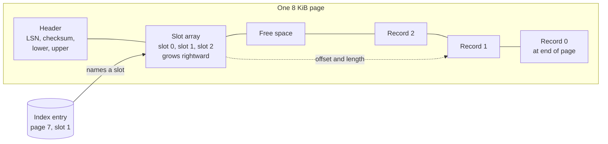
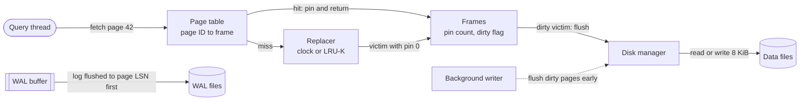
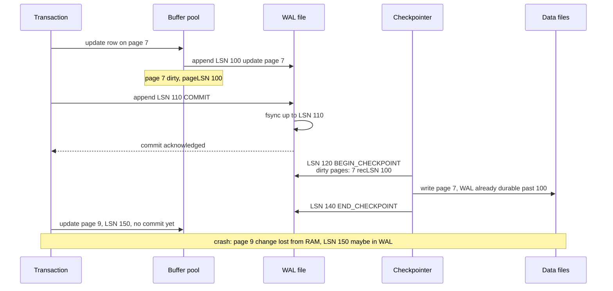
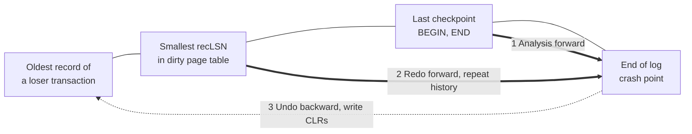
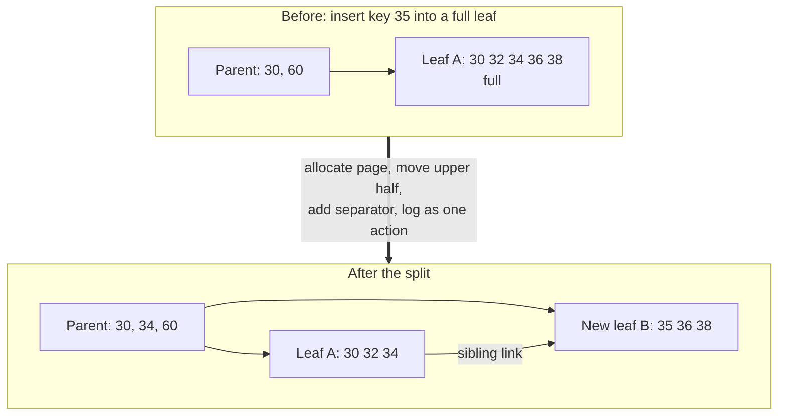
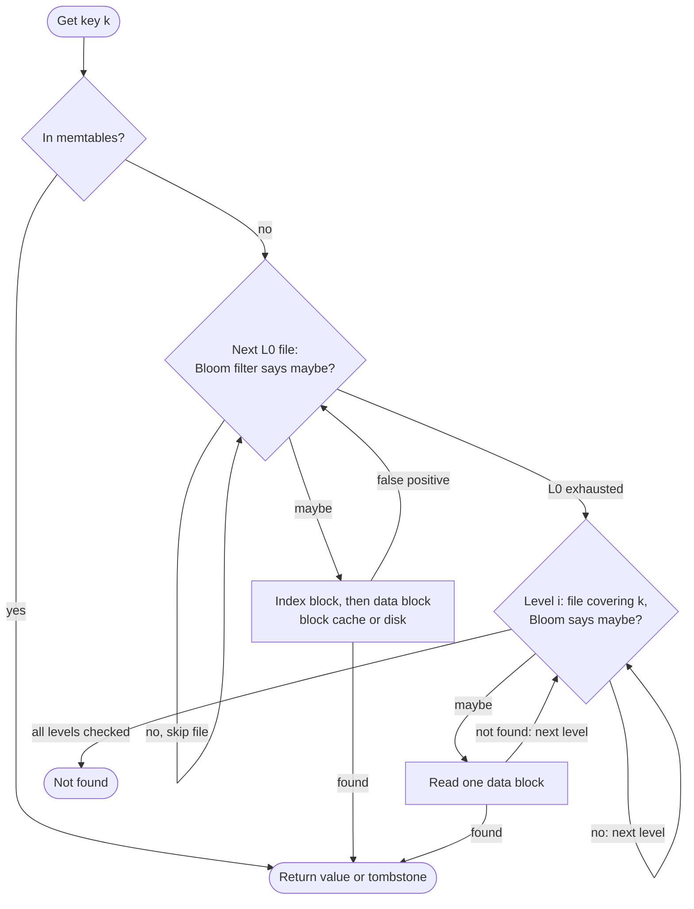
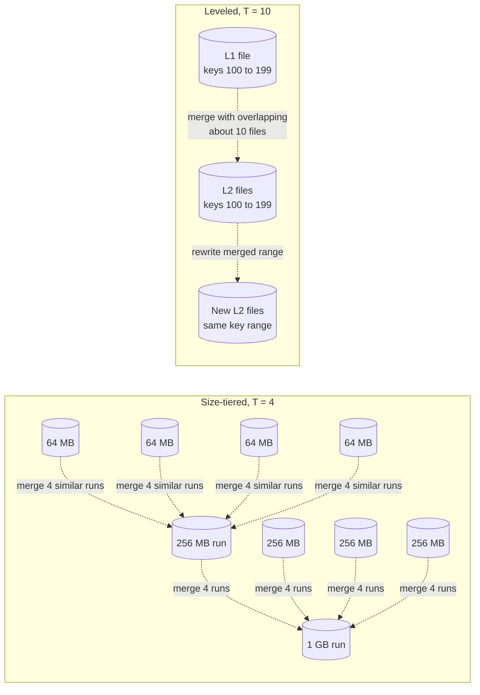
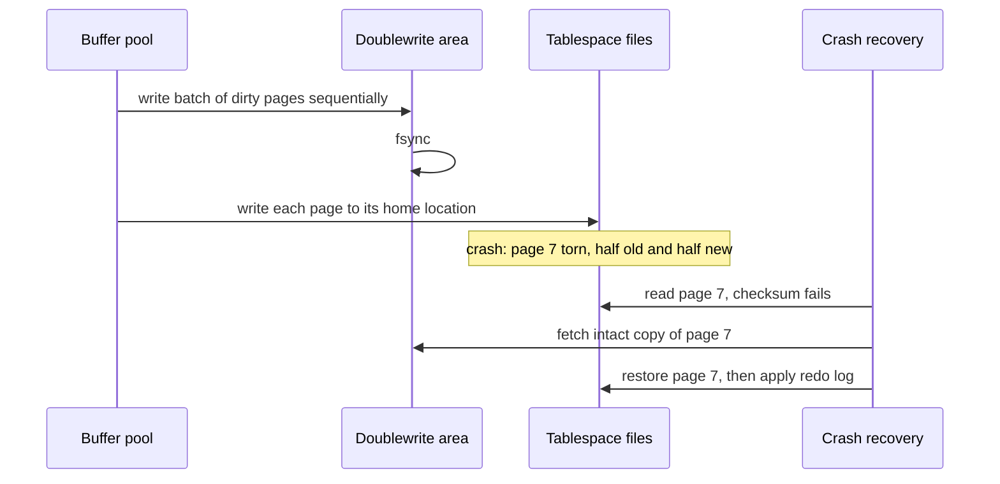

# Chapter 13 — Storage Engine Internals

> **Level:** 3 · **Track:** A (Traditional) · **Estimated reading time:** 3.5 h

When you call `INSERT` on PostgreSQL, `Put` on RocksDB or `save()` on an ORM, a piece of software called the **storage engine** decides where those bytes live on disk, how they are found again, and what happens if the power fails halfway through. Two databases with the same SQL dialect can differ by ten times in write volume, disk space or tail latency purely because of their storage engines. This chapter opens the box. You will see how a database packs rows into fixed-size pages, keeps hot pages in memory, survives crashes with a write-ahead log, and organizes data either as an in-place B-tree or as a log-structured merge (LSM) tree. You will learn to estimate read, write and space amplification with numbers, and to choose an engine for a workload instead of by reputation.

## 13.1 Learning objectives

After this chapter you should be able to:

- Draw a slotted page and explain how it gives records stable identifiers while allowing variable-length rows and in-page compaction.
- Explain how a buffer pool uses a page table, pin counts and dirty flags; compare LRU, clock and LRU-K eviction; and justify why many engines use `O_DIRECT` instead of the operating system's page cache.
- Describe write-ahead logging, log sequence numbers (LSNs), fuzzy checkpoints and the three ARIES recovery passes, and estimate recovery time from the WAL rate and checkpoint interval.
- Trace a B-tree page split, explain latch crabbing, and contrast in-place B-trees with copy-on-write B-trees such as LMDB.
- Build a log-structured store from first principles: Bitcask, then a full LSM tree with memtable, SSTables, WAL replay and compaction (you will run one in Python).
- Compare size-tiered, leveled and hybrid compaction, and calculate their write, read and space amplification for a given data size.
- Use the RUM conjecture to reason about read, update and memory (space) overheads, and calculate each for a B-tree and an LSM tree.
- Explain torn writes, checksums, the InnoDB doublewrite buffer and PostgreSQL full-page writes.
- Explain why columnar storage, encoding (RLE, dictionary, bit-packing) and vectorized execution make analytical scans 10–100× cheaper.
- Choose between InnoDB-style, PostgreSQL-heap-style and RocksDB-style engines for a stated workload, and defend the choice with numbers.

## 13.2 Prerequisites

- HDDs, SSDs, IOPS, queue depth and SSD write amplification — §5.6 (every engine design here is a response to device behavior; SSD write amplification multiplies with the engine's own).
- The page cache, `mmap` and copy-on-write — §6.6.5–§6.6.6 (buffer pools replace or sit beside the page cache).
- `fsync`, journaling and group commit — §6.14 (this chapter builds the database's own journal on top of them; the group-commit formula is in §6.14.3 and is not repeated here).
- Indexes, B-trees and B+ trees, transactions and MVCC — §11.7, §11.8, §11.11, §11.14 (we cover how a B-tree is *stored and made crash-safe*, not what an index is).
- Logarithms and powers — §4.3 (tree heights and LSM level counts are logarithms).
- Units: in this chapter **KiB/MiB/GiB** (powers of two) are used for page and block sizes; **KB/MB/GB/TB** (powers of ten) for data volumes and capacity estimates.

## 13.3 Pages and blocks

### 13.3.1 Why storage engines think in pages

::: definition
**Definition — Page.** The fixed-size unit (typically 4–16 KiB) in which a storage engine reads, writes, caches and logs data. A page on disk is sometimes called a **block**; the engine keeps a copy of a page in memory in a **frame** of its buffer pool.
:::

#### First-principles explanation

Imagine a library that lends books only by the whole shelf. If you want one sentence, you still carry the shelf to your desk. You would quickly start arranging books so that things read together sit on the same shelf, and you would keep the shelves you use most near your desk. Storage devices behave like that library. An SSD reads and programs flash in pages of 4–16 KiB; an HDD pays milliseconds of seek before transferring anything (§5.6.1). Reading 100 bytes costs almost the same as reading 8 KiB. So a database never asks the disk for "a row"; it asks for the page that contains the row, and it organizes everything — tables, indexes, free-space maps, even the log — in page-sized units.

#### Why does this exist?

Pages give the engine three things. First, **I/O efficiency**: one request moves many rows. Second, **a unit of caching and recovery**: the buffer pool caches pages, the write-ahead log describes changes to pages, and each page carries the LSN of the last change applied to it (§13.5). Third, **addressability**: a row can be named by `(page number, slot number)`, a compact pointer that indexes can store.

Page size is a trade-off. Larger pages mean fewer I/Os for scans and shallower B-trees (§13.6), but more bytes moved and logged when one small row changes, and a larger unit that can be torn by a crash (§13.12).

**Table 13.1 — Default page sizes (as of 2025).**

| Engine | Default page size | Configurable? |
|---|---|---|
| PostgreSQL heap and indexes | 8 KiB | Only at compile time |
| MySQL InnoDB | 16 KiB | 4–64 KiB, at initialization (`innodb_page_size`) |
| SQLite | 4 KiB | Yes, per database (`PRAGMA page_size`) |
| RocksDB data block (inside an SSTable) | 4 KiB before compression | Yes (`block_size`) |
| LMDB | Operating-system page size (usually 4 KiB) | No |

### 13.3.2 The slotted page

::: definition
**Definition — Slotted page.** A page layout in which a **header** is followed by an array of **slots** (also called line pointers or item IDs) that grows from the front, while variable-length **records** (tuples) are packed from the back. Each slot stores the offset and length of one record; free space sits in the middle.
:::

#### How it works internally

1. **Header.** Fixed fields at the start: the page LSN (§13.5), a checksum (§13.12), flags, the number of slots, and pointers to the start and end of free space. PostgreSQL's page header is 24 bytes, with `pd_lower` and `pd_upper` marking the free-space hole [PostgreSQL Docs: Database Page Layout].
2. **Insert.** Copy the record into the end of the free space (moving the "upper" pointer down), then append a slot pointing to it (moving the "lower" pointer up). The new record's identifier is `(page, slot number)`.
3. **Read.** Look up the slot, follow the offset, read `length` bytes.
4. **Delete.** Mark the slot unused. The bytes become a hole; nothing else moves.
5. **Update that grows a record.** If there is room, rewrite the record elsewhere in the page and repoint its slot; the identifier does not change.
6. **Compaction.** When free space is fragmented, slide live records together to the back of the page and rewrite their slot offsets. Because outside pointers name *slots*, not byte offsets, compaction is invisible to indexes.

The indirection in steps 5 and 6 is the whole point: it lets the engine move records *within* a page without updating every index that points at them.

#### Architecture diagram

**Figure 13.1 — A slotted page.**



**Reading the diagram.** The page is one contiguous 8 KiB buffer, laid out left to right as it appears in memory and on disk. The **header** holds the page LSN, a checksum and two pointers (`lower`, `upper`) that bound the free space. The **slot array** grows rightward as records are added; **records** are written from the end of the page leftward, so both regions grow into the central free space and the page is full only when they meet. An index entry (the cylinder, a separate storage structure) stores `(page 7, slot 1)` — a synchronous lookup goes from the index to the slot, and the slot's offset leads to the record bytes (the dotted arrow marks this extra indirection rather than an asynchronous path). The failure point is the page as a unit: if a crash writes only part of it, header, slots and records may disagree, which is why the checksum and torn-write protection of §13.12 exist. Scaling happens by adding pages, never by growing one.

#### Mathematical foundations

::: formula
**Records per slotted page**

$$n = \left\lfloor \frac{P - H}{r + s} \right\rfloor$$

| Symbol | Meaning | Units |
|---|---|---|
| $n$ | Records that fit in one page | records |
| $P$ | Page size | bytes |
| $H$ | Page header size | bytes |
| $r$ | Stored record size including per-record header and alignment padding | bytes |
| $s$ | Slot (line pointer) size | bytes |
:::

::: example
**Worked example — How big is a 1-billion-row PostgreSQL table?**

Each row holds 76 bytes of column data. PostgreSQL adds a 23-byte tuple header, padded to 24 bytes, and aligns the tuple to 8 bytes; each line pointer is 4 bytes; the page header is 24 bytes [PostgreSQL Docs: Database Page Layout].

1. Stored record: $24 + 76 = 100$ bytes, rounded up to a multiple of 8: $r = 104$ bytes.
2. Per record including its slot: $104 + 4 = 108$ bytes.
3. Records per page: $n = \lfloor (8192 - 24) / 108 \rfloor = \lfloor 75.6 \rfloor = 75$.
4. Pages: $10^9 / 75 = 13\,333\,334$ pages; size $= 13\,333\,334 \times 8192 \approx 109.2$ GB.
5. Raw column data: $10^9 \times 76 = 76$ GB. Overhead factor: $109.2 / 76 \approx 1.44$.

**Interpretation.** Before any index, dead tuple or free space, the table is 44% larger than its data, because of per-row headers (needed for MVCC, §11.14), slots and alignment. **Engineering implication.** Narrow rows pay proportionally more overhead; ordering columns so that 8-byte fields come first can reduce padding, and leaving free space on purpose (PostgreSQL's `fillfactor`, for example 90%) trades space for cheaper updates (§13.14.3). This 1.44 is a component of the **space amplification** you will meet in §13.11.
:::

#### Code example

The following program implements a 4 KiB slotted page with insert, get, delete and compaction. It is standalone; run it with `python3`.

```python
"""A minimal slotted page: header, slot array growing forward, records growing
backward from the end of the page. Record IDs (slot numbers) never change."""
import struct

PAGE_SIZE = 4096
HEADER = struct.Struct("<HH")      # slot_count, free_end (offset where record space begins)
SLOT = struct.Struct("<HH")        # record offset, record length (offset 0 = deleted slot)


class SlottedPage:
    def __init__(self):
        self.buf = bytearray(PAGE_SIZE)
        HEADER.pack_into(self.buf, 0, 0, PAGE_SIZE)

    def _header(self):
        return HEADER.unpack_from(self.buf, 0)

    def _slot_pos(self, slot):
        return HEADER.size + slot * SLOT.size

    def free_space(self):
        count, free_end = self._header()
        return free_end - (HEADER.size + count * SLOT.size)

    def insert(self, record: bytes) -> int:
        count, free_end = self._header()
        if len(record) + SLOT.size > self.free_space():
            self.compact()                                   # reclaim holes, then retry
            count, free_end = self._header()
            if len(record) + SLOT.size > self.free_space():
                raise ValueError("page full")
        offset = free_end - len(record)
        self.buf[offset:free_end] = record                   # record grows downward
        SLOT.pack_into(self.buf, self._slot_pos(count), offset, len(record))
        HEADER.pack_into(self.buf, 0, count + 1, offset)     # slot array grows upward
        return count                                         # slot number = stable record ID

    def get(self, slot: int) -> bytes:
        offset, length = SLOT.unpack_from(self.buf, self._slot_pos(slot))
        if offset == 0:
            raise KeyError(f"slot {slot} deleted")
        return bytes(self.buf[offset:offset + length])

    def delete(self, slot: int) -> None:
        SLOT.pack_into(self.buf, self._slot_pos(slot), 0, 0) # leaves a hole until compact()

    def compact(self) -> None:
        """Slide live records to the end of the page; slot numbers stay the same."""
        count, _ = self._header()
        live = []
        for s in range(count):
            off, length = SLOT.unpack_from(self.buf, self._slot_pos(s))
            if off:
                live.append((s, bytes(self.buf[off:off + length])))
        free_end = PAGE_SIZE
        for s, rec in live:
            free_end -= len(rec)
            self.buf[free_end:free_end + len(rec)] = rec
            SLOT.pack_into(self.buf, self._slot_pos(s), free_end, len(rec))
        HEADER.pack_into(self.buf, 0, count, free_end)


if __name__ == "__main__":
    page = SlottedPage()
    ids = [page.insert(b"row-%03d:" % i + b"x" * 90) for i in range(39)]
    print("inserted", len(ids), "records; free bytes:", page.free_space())
    for s in ids[::2]:
        page.delete(s)                                       # punch 20 holes
    print("after deleting 20, free bytes before compaction:", page.free_space())
    new = page.insert(b"a-larger-record:" + b"y" * 400)      # forces compaction
    print("new record got slot", new, "; slot 1 still reads", page.get(1)[:8])
    print("free bytes now:", page.free_space())
```

Output:

```text
inserted 39 records; free bytes: 114
after deleting 20, free bytes before compaction: 114
new record got slot 39 ; slot 1 still reads b'row-001:'
free bytes now: 1654
```

What to notice:

- 39 records of 98 bytes plus 4-byte slots fill $4 + 39 \times 102 = 3982$ of 4096 bytes, leaving 114: the formula above with $H = 4$, $r = 98$, $s = 4$.
- Deleting does not increase `free_space()`: the holes are unusable until `compact()` runs. Real engines track this "fragmented" space separately and compact lazily (PostgreSQL does it during page pruning and `VACUUM`).
- After compaction slot 1 still returns the same record, at a different byte offset. That stability is what lets indexes store `(page, slot)`.
- Deleted slots are not reused here, so slot numbers only grow; PostgreSQL reuses dead line pointers only after `VACUUM` has removed every index entry pointing at them.

#### Alternatives and trade-offs

Fixed-length records need no slots (record *i* sits at offset $H + i \times r$), which is why some column stores and fixed-width index pages skip them. **Index-organized** (clustered) tables such as InnoDB's store rows *inside* B-tree leaf pages ordered by primary key (§13.14.1); the slot directory then also keeps records in key order so a page can be binary-searched. Values too large for a page are moved out of line: PostgreSQL's TOAST stores values above roughly 2 KB in a separate table, and InnoDB stores long columns on overflow pages.

::: mistake
**"A row is the unit of I/O."** It never is. Updating one 50-byte field dirties a whole 8 or 16 KiB page, which must eventually be written in full and, the first time after a checkpoint, may be copied into the log as well (§13.12). Reasoning in rows instead of pages is the most common reason for underestimating a database's write volume.
:::

## 13.4 Buffer pools

### 13.4.1 What a buffer pool does

::: definition
**Definition — Buffer pool.** A region of memory, managed by the database itself, divided into page-sized **frames** that cache disk pages. A **page table** maps page IDs to frames; each frame carries a **pin count** (how many threads are using it right now), a **dirty flag** (whether it differs from the disk copy) and bookkeeping for the **replacement policy** that chooses which page to evict.
:::

#### First-principles explanation

Think of a workbench with 1,000 numbered trays and a warehouse of a billion boxes. To work on a box you fetch it into a free tray and write the box number on a whiteboard (the page table) so others can find it. While you are holding a box you put a clip on its tray (a **pin**) so nobody swaps it out from under you. If you change what is in the box, you stick a red dot on the tray (**dirty**): before that tray can be reused, the box must be carried back and shelved. When all trays are full and you need a new box, you pick an unclipped tray whose contents have not been needed for a while (the **replacement policy**), shelve it first if it has a red dot, and reuse the tray.

#### Why does this exist?

RAM is about 1,000 times faster than an NVMe SSD for a random access (~100 ns versus ~80 µs, §5.6.5) but costs far more per byte. The working set of most databases — the pages touched in a given minute — is much smaller than the database, so caching the right pages turns most page requests into memory accesses. The database could leave this to the operating system's page cache (§6.6.6), but it knows things the kernel does not: which pages belong to an index root versus a one-off table scan, which dirty pages must not be written before their log records (§13.5), and when a page is merely being prefetched.

#### How it works internally

A thread that needs page 42 calls `fetch(42)`:

1. **Look up** 42 in the page table (a hash table protected by latches).
2. **Hit:** increment the frame's pin count, record the access for the replacement policy, and return a pointer to the frame.
3. **Miss:** obtain a frame from the **free list**; if it is empty, ask the **replacer** for a victim among frames with pin count 0.
4. If the victim is dirty, first make sure the log is durable up to the victim's page LSN (the **WAL rule**, §13.5.2), then write the victim to disk.
5. Remove the victim from the page table, read page 42 into the frame, verify its checksum (§13.12), insert it into the page table, pin it and return it.
6. When the thread is done it calls `unpin(42, dirty)`. Pinned pages are never evicted, so a leaked pin is a memory leak that slowly shrinks the usable pool.

Separately, **background writers** (PostgreSQL's background writer and checkpointer, InnoDB's page cleaner threads) flush dirty pages ahead of demand, so that the eviction in step 4 rarely has to wait for a write.

#### Architecture diagram

**Figure 13.2 — Buffer pool components and the page request path.**



**Reading the diagram.** A query thread asks for page 42; the request path is synchronous (solid arrows). The page table resolves the page ID to a frame on a hit and returns a pinned pointer. On a miss, the replacer chooses an unpinned victim; if the victim is dirty, the disk manager writes it back, but only after the WAL has been flushed past that page's LSN (the WAL rule), so the log files and data files are two separate storage boundaries with an ordering constraint between them. The background writer works asynchronously (dotted arrow), cleaning dirty frames before they are needed. Failure points: a crash loses every dirty frame (recovered from the WAL, §13.5); a thread that never unpins causes the pool to run out of evictable frames; and a hot page-table latch limits concurrency, which engines address by partitioning the table (InnoDB splits a large pool into multiple instances). The pool scales vertically with RAM; beyond one machine, see caching in Chapter 20.

### 13.4.2 Eviction policies: LRU, clock and LRU-K

**Least recently used (LRU)** evicts the page whose last access is oldest, using a linked list that moves a page to the head on every access. It has two problems inside a database. First, moving a list node on every hit needs a lock on a shared list, which becomes a contention point at millions of hits per second. Second, **sequential flooding**: a single scan of a 100 GB table touches each page once and pushes every hot index page out of a 32 GB pool, even though none of the scanned pages will be read again.

**Clock** (second chance) approximates LRU cheaply. Frames sit in a circle, each with a reference bit set on access. To evict, a "clock hand" sweeps: a frame with bit 1 has it cleared and survives this pass; the first frame with bit 0 (and pin count 0) is the victim. A hit only sets a bit, with no list manipulation. PostgreSQL uses a variant called **clock sweep** in which each buffer has a usage count, incremented on access up to a cap of 5 and decremented as the hand passes, so frequently used pages survive several sweeps [PostgreSQL source: `src/backend/storage/buffer/README`].

**LRU-K** evicts the page whose *K*-th most recent access is oldest [O'Neil, O'Neil and Weikum 1993]. With $K = 2$, a page touched once by a scan has an infinitely old second access and is evicted first, while a page referenced twice recently is protected. LRU-K is resistant to scans and distinguishes frequency from recency, at the cost of keeping access history. Related designs include **2Q** [Johnson and Shasha 1994] and ARC (§20.9).

Real engines add explicit scan resistance on top. InnoDB uses **midpoint insertion**: its LRU list is split into a "new" sublist (by default 5/8 of the pool) and an "old" sublist (3/8, `innodb_old_blocks_pct = 37`); a newly read page enters at the head of the old sublist and is promoted only if it is accessed again after a delay (`innodb_old_blocks_time`, default 1,000 ms), so a one-pass scan never reaches the new sublist [MySQL Docs: Making the Buffer Pool Scan Resistant]. PostgreSQL gives large sequential scans, `VACUUM` and bulk writes a small private **ring buffer** of frames, so they recycle their own frames instead of evicting everyone else's.

**Table 13.2 — Buffer replacement policies.**

| Policy | How it works | Advantages | Disadvantages | Used in |
|---|---|---|---|---|
| LRU | Evict oldest last access; list move on every hit | Simple, good for recency | Hit path contention; scan flooding | Textbook baseline; with sublists in InnoDB |
| Clock / clock sweep | Reference bit or usage count; sweeping hand | Cheap hits; approximates LRU or LFU | Sweep cost when many pages are hot | PostgreSQL; OS page replacement |
| LRU-K (K = 2) | Evict oldest K-th last access | Scan resistant; frequency aware | History memory; tuning of correlation period | Research, commercial engines |
| Midpoint / 2Q | Probation queue before main queue | Scan resistant; cheap | Two parameters to tune | InnoDB (midpoint); 2Q variants |
| Ring buffer for scans | Bulk operations reuse a few private frames | Protects the main pool completely | Applies only to recognized bulk operations | PostgreSQL |

### 13.4.3 Double buffering, `O_DIRECT` and the page cache

If a database reads its files with ordinary `read()`, every page is cached twice: once in the kernel page cache and once in the buffer pool. This **double buffering** wastes RAM, and the kernel's own read-ahead and writeback decisions compete with the database's. Opening files with **`O_DIRECT`** tells Linux to transfer data directly between the device and the database's (suitably aligned) buffers, bypassing the page cache. The database must then do its own read-ahead and asynchronous I/O, and it still needs `fsync`/`fdatasync` for durability, because `O_DIRECT` does not flush the drive's write cache (§6.14.3, pitfall 6).

Engines differ in which side of this trade-off they take:

- **InnoDB** is designed to own memory: the usual recommendation is a buffer pool of most of the server's RAM with `innodb_flush_method = O_DIRECT`, which became the Linux default in MySQL 8.4 [MySQL Docs: InnoDB Startup Options].
- **PostgreSQL** has historically used buffered I/O and relies on the page cache as a second-level cache; its documentation suggests starting `shared_buffers` at about 25% of RAM on a dedicated server [PostgreSQL Docs: Resource Consumption]. Direct I/O exists only as a developer option (`debug_io_direct`, from version 16), and version 18 introduced an asynchronous I/O subsystem (as of 2025).
- **RocksDB** uses buffered I/O by default with its own block cache for uncompressed blocks, and can be switched to direct I/O for reads and for flush/compaction writes [RocksDB Wiki: Direct IO].
- **LMDB** goes the other way entirely: it maps the whole file with `mmap` and lets the kernel be the buffer pool. That makes it small and fast for read-mostly workloads, but gives up control over eviction and I/O scheduling (§6.6.6 summarizes the case against `mmap` in databases [Crotty et al. 2022]).

#### Mathematical foundations

How much RAM should the buffer pool have? Gray and Putzolu's **five-minute rule** answers by comparing the cost of keeping a page in memory with the cost of the device capacity needed to re-read it [Gray and Putzolu 1987; Gray and Graefe 1997].

::: formula
**Break-even reference interval (the "five-minute rule")**

$$T_{BE} = \frac{C_{dev} / IOPS_{dev}}{C_{RAM} \times P}$$

| Symbol | Meaning | Units |
|---|---|---|
| $T_{BE}$ | Break-even interval: cache a page if it is re-referenced more often than once per $T_{BE}$ | seconds |
| $C_{dev}$ | Price of one storage device | dollars |
| $IOPS_{dev}$ | Random reads per second the device sustains | reads/s |
| $C_{RAM}$ | Price of memory | dollars/byte |
| $P$ | Page size | bytes |
:::

::: example
**Worked example — Break-even for HDD and NVMe (illustrative prices, as of 2025).**

Assume DRAM at $\$4$/GB, so $C_{RAM} = 4 \times 10^{-9}$ \$/byte, and $P = 8192$ bytes. RAM cost of one cached page: $4 \times 10^{-9} \times 8192 = \$3.28 \times 10^{-5}$.

1. **HDD:** $C_{dev} = \$300$, $IOPS_{dev} = 200$. Cost per unit of read capacity: $300 / 200 = \$1.50$ per read/s. $T_{BE} = 1.50 / (3.28 \times 10^{-5}) \approx 45\,700$ s $\approx 12.7$ hours.
2. **NVMe SSD:** $C_{dev} = \$400$, $IOPS_{dev} = 400\,000$. Cost: $400 / 400\,000 = \$0.001$ per read/s. $T_{BE} = 0.001 / (3.28 \times 10^{-5}) \approx 30.5$ s.

**Interpretation.** On hard disks, any page touched more than about twice a day earns its place in RAM, so the answer was "cache everything you can". On NVMe, only pages re-referenced roughly every half minute or more often are worth caching on cost grounds; colder pages are cheaper to re-read. **Engineering implication.** With flash, size the buffer pool for the *hot* working set and a latency target, not for the whole database; measure the buffer hit ratio and the distribution of page re-reference intervals before buying RAM. The calculation ignores CPU cost per I/O and latency SLOs, both of which push toward a somewhat larger pool.
:::

#### Failure scenarios

**Table 13.3 — Buffer pool failure scenarios.**

| What goes wrong | Why | Detection | Recovery | Prevention |
|---|---|---|---|---|
| Throughput collapses after a nightly report runs | Sequential flooding evicts the hot set | Hit ratio drops during scan; read IOPS spike afterward | Wait for re-warm; pre-warm hot tables | Scan-resistant policy; ring buffers; run reports on a replica |
| Long stall on page requests ("free buffer waits") | All frames dirty; eviction waits for writes | Wait-event statistics; dirty page percentage near 100% | Raise background flushing rate | Tune page cleaners / bgwriter; faster log device |
| Database restarted, p99 latency high for an hour | Cold buffer pool | Hit ratio low after restart | Warm up gradually before taking traffic | Dump and reload the pool's page list (InnoDB does this by default); `pg_prewarm` |
| Server swaps or is killed by the OOM killer | Buffer pool plus page cache plus per-connection memory exceed RAM | Swap activity; kernel OOM log | Restart with a smaller pool | Size the pool with headroom; disable overcommit surprises (§6.6.4) |

::: mistake
**"A 99% buffer hit ratio means the disk does not matter."** At 50,000 page requests per second, 1% misses is 500 random reads per second, each 80 µs on NVMe or 10 ms on an HDD — enough to saturate a hard disk (§5.6.1). Hit ratios must be read together with the absolute miss rate and the device's IOPS.
:::

## 13.5 Write-ahead logging and recovery

### 13.5.1 The problem: fast commits without losing data

::: definition
**Definition — Write-ahead log (WAL).** An append-only file of **log records** describing every change to the database, written *before* the changed pages themselves reach disk. Each record is identified by a monotonically increasing **log sequence number (LSN)**, usually its byte offset in the log. Also called the redo log (InnoDB) or journal.
:::

#### First-principles explanation

A shopkeeper keeps a cash book. Every sale is written as one line at the bottom of the book the moment it happens; the shelves and the stock ledger are tidied up later, at the end of the day. If a fire alarm interrupts the tidying, nothing is lost: the shopkeeper reads the cash book from the last time the ledger was known to be correct and redoes the missing entries. Writing one line at the end of a book is fast; reorganizing shelves is slow. The cash book is the WAL, the shelves are data pages, and "the last time the ledger was correct" is a **checkpoint**.

#### Why does this exist?

A transaction may change rows on ten random pages. Writing those ten pages at commit time would cost ten random writes plus ten `fsync`-ordered waits, and a crash in the middle would leave some pages new and some old. The WAL converts that into one small *sequential* append and one `fsync` per commit (or per group of commits, §6.14.3). Two buffer-management freedoms follow, named in the recovery literature [Härder and Reuter 1983]:

- **No-force:** committed changes need *not* be written to their pages at commit. If the pages are lost in a crash, the log has enough information to **redo** them.
- **Steal:** a page containing *uncommitted* changes *may* be written to disk (for example, when the buffer pool evicts it). If the transaction later aborts or the system crashes, the log has enough information to **undo** them.

Steal/no-force gives the buffer pool maximum freedom and the fastest commits, at the price of needing both redo and undo during recovery. That is the design point ARIES was built for.

#### How it works internally

A typical update log record contains: LSN; the transaction ID; `prevLSN` (the same transaction's previous record, forming a per-transaction chain backward through the log); the page ID; the type of operation; a **redo** part (how to reapply it) and an **undo** part (how to reverse it). Records are usually **physiological**: physical to a page ("on page 7") but logical within it ("insert this tuple at slot 3"), which keeps them small and tolerant of in-page compaction.

Two rules make the WAL correct:

1. **The WAL rule.** Before a dirty page is written to disk, every log record up to that page's `pageLSN` must already be durable: $\text{pageLSN} \le \text{flushedLSN}$. Otherwise a crash could leave a change on disk with no log record able to undo it.
2. **The commit rule.** A transaction is acknowledged only after its commit record (and therefore all its earlier records) is durable in the log.

Each page header stores its `pageLSN`, the LSN of the last record applied to it. During recovery, comparing a record's LSN with the page's `pageLSN` tells the engine whether the change is already on the page — the trick that makes redo **idempotent**.

### 13.5.2 Checkpoints

Without checkpoints, recovery would have to replay the log from the beginning of time, and the log could never be deleted. A **checkpoint** bounds both. A *sharp* checkpoint would stop all transactions and flush every dirty page — simple, but it freezes the database for seconds. Real engines take **fuzzy checkpoints**: write a `BEGIN_CHECKPOINT` record, record the current **dirty page table** (each dirty page with its `recLSN`, the LSN of the first change that dirtied it) and **transaction table** (active transactions and their last LSN), write `END_CHECKPOINT`, and let pages be flushed gradually in the background while normal work continues. Recovery must start redo from the smallest `recLSN` in the dirty page table, and log before that point can be recycled.

**Figure 13.3 — WAL, commit and checkpoint timeline.**



**Reading the diagram.** Five participants: the transaction, the buffer pool (RAM), the WAL file and the data files (two separate durable storage boundaries), and the checkpointer. Solid arrows are synchronous steps; the dashed return arrow is the acknowledgement. The update is applied to page 7 in memory and described in the log at LSN 100; the commit waits only for the sequential `fsync` of the log up to LSN 110, never for page 7. The checkpointer later writes page 7 to the data file, respecting the WAL rule, and records which pages were dirty. At the crash, page 9's change exists only in RAM and perhaps in an unflushed log tail, and its transaction had not committed, so recovery must ensure it does not appear. Scaling note: the log is a single sequential stream, so its device's `fsync` latency and bandwidth bound commit throughput; engines put it on the fastest, power-loss-protected device available.

### 13.5.3 ARIES recovery: analysis, redo, undo

**ARIES** (Algorithms for Recovery and Isolation Exploiting Semantics), developed at IBM by Mohan and colleagues, is the reference design for steal/no-force recovery and underlies DB2 and SQL Server among others [Mohan et al. 1992]. Its three passes are:

1. **Analysis** (forward from the last checkpoint to the end of the log). Rebuild the dirty page table and transaction table as of the crash. Transactions with a commit record are **winners**; those still active are **losers**.
2. **Redo** (forward from the smallest `recLSN`). **Repeat history**: reapply every logged change — including those of losers — whose LSN is greater than the page's `pageLSN`. After redo, the database is in exactly the state it was in at the moment of the crash.
3. **Undo** (backward from the end of the log). Roll back every loser by following its `prevLSN` chain, processing the largest outstanding LSN first. Each undo action is itself logged as a **compensation log record (CLR)** carrying an `undoNextLSN` pointer to the next record to undo. If the system crashes *during* recovery, the next recovery redoes the CLRs and continues from `undoNextLSN`, never undoing anything twice.

Repeating history before undoing sounds wasteful, but it is what lets ARIES support fine-grained (row-level) locking and logical undo: after redo, the page structure is exactly what the loser's undo records expect, even if other committed transactions have since changed the same page.

**Figure 13.4 — The three ARIES passes over the log.**



**Reading the diagram.** The four boxes are positions in a single WAL file, ordered left to right by LSN (the thin lines only show order). Analysis reads forward from the last checkpoint to the end of the log to rebuild the tables of dirty pages and active transactions. Redo reads forward from the smallest `recLSN`, which may be well before the checkpoint because fuzzy checkpoints do not flush pages, and reapplies changes to data pages that are older than the record. Undo (dotted, because it follows per-transaction `prevLSN` chains rather than a sequential scan) walks backward as far as the oldest record of any loser, writing CLRs. Storage boundaries: the log is read; data pages are read and written through the buffer pool. Failure point: a long-running transaction pushes point A far back, so undo, and the log the engine must retain, grow with transaction age. Scaling: redo can be parallelized by page, because records for different pages are independent.

#### Mathematical foundations

::: formula
**Redo work after a crash**

$$W_{redo} \approx r_{WAL} \times \Delta t_{ckpt}, \qquad T_{redo} \approx \frac{W_{redo}}{b_{replay}}$$

| Symbol | Meaning | Units |
|---|---|---|
| $W_{redo}$ | Log volume between the redo start point and the crash | bytes |
| $r_{WAL}$ | Rate at which the workload generates log | bytes/s |
| $\Delta t_{ckpt}$ | Time between checkpoints (worst case, crash just before the next one) | s |
| $T_{redo}$ | Duration of the redo pass | s |
| $b_{replay}$ | Replay throughput, usually limited by random page reads, not log reads | bytes/s |
:::

::: example
**Worked example — Choosing a checkpoint interval.**

A PostgreSQL server generates $r_{WAL} = 30$ MB/s of WAL at peak. Replay runs at $b_{replay} = 150$ MB/s (single-threaded redo, mostly cached pages).

1. Checkpoint every 5 minutes: $W_{redo} = 30 \times 300 = 9000$ MB $= 9$ GB. $T_{redo} = 9000 / 150 = 60$ s.
2. Checkpoint every 1 minute: $W_{redo} = 30 \times 60 = 1.8$ GB; $T_{redo} = 12$ s.
3. But the shorter interval has a cost. With full-page writes (§13.12.3), the first change to each page after every checkpoint logs the whole 8 KiB page. If the workload dirties 200,000 distinct pages per minute, each 1-minute checkpoint triggers up to $200\,000 \times 8192 \approx 1.64$ GB of page images, about $1.64 / 60 \approx 27$ MB/s — nearly doubling the WAL rate. With 5-minute checkpoints, a page touched repeatedly is imaged only once per 5 minutes.

**Interpretation.** Checkpoint frequency trades recovery time against steady-state write volume. **Engineering implication.** Pick the interval from the recovery-time objective (RTO, §39.8) and measure the WAL rate with the real workload; PostgreSQL's defaults (`checkpoint_timeout = 5min`, `max_wal_size = 1GB`) are deliberately conservative and are often raised on write-heavy systems, accepting longer recovery that a hot-standby failover (§27.11) hides anyway.
:::

### 13.5.4 Group commit and relaxed durability

Because the commit rule needs one log `fsync` per commit, the log device's flush latency caps commit throughput unless commits share flushes. **Group commit** — letting one `fsync` cover all commits that arrived while the previous one was in progress — multiplies throughput by the batch size; the formula and a worked example are in §6.14.3. Engines also let you trade durability for speed explicitly. InnoDB's `innodb_flush_log_at_trx_commit = 1` (the default) flushes at every commit; `2` writes at commit but flushes about once per second, so an operating-system crash can lose up to a second of commits; `0` does both about once per second. PostgreSQL's `synchronous_commit = off` acknowledges before the flush, risking the last few hundred milliseconds of commits but never corrupting the database, because the WAL rule still holds for pages.

#### Real-world industry applications

::: industry
**PostgreSQL: redo-only recovery.** PostgreSQL logs every change in its WAL and recovers by redo from the last checkpoint's redo point, but it has no undo pass. It does not need one: its MVCC design (§11.14) never overwrites a row in place; an aborted transaction's new row versions stay in the heap, invisible because the transaction status log (`pg_xact`) marks it aborted, and `VACUUM` removes them later. The WAL also feeds streaming replication and point-in-time recovery, so a single mechanism provides durability, replicas and backups.
*Evidence: Primary* — [PostgreSQL Docs: Reliability and the Write-Ahead Log]
:::

::: industry
**InnoDB: redo plus undo, ARIES-style.** InnoDB writes physiological redo records to its redo log and keeps before-images in separate **undo logs**, which serve both rollback and consistent reads of old versions. Crash recovery applies the redo log, then rolls back incomplete transactions using undo records. Since MySQL 8.0.30 the redo log's total size is set with `innodb_redo_log_capacity`, which bounds how far behind the checkpoint can fall.
*Evidence: Primary* — [MySQL Docs: InnoDB Redo Log; InnoDB Undo Logs]
:::

#### Failure scenarios

**Table 13.4 — WAL and recovery failure scenarios.**

| What goes wrong | Why | Detection | Recovery | Prevention |
|---|---|---|---|---|
| Recovery takes 20 minutes after a crash | Long checkpoint interval and high WAL rate | Startup logs show redo progress | Wait; or fail over to a replica | Size checkpoint interval from the RTO |
| Disk fills with WAL | Checkpoints stalled, or a replication slot/replica not consuming WAL | WAL directory size alert | Fix the consumer; drop abandoned slots | Monitor WAL retention; cap slot lag |
| Acknowledged commits missing after power loss | Log device cache not flushed; durability relaxed in configuration | Gaps compared with client records | Restore from replica | Power-loss-protected devices; review `fsync` settings |
| Undo grows without bound | Long-running transaction keeps old versions alive | History list length / oldest transaction age | Kill or commit the transaction | Statement and idle-transaction timeouts |

::: mistake
**"The checkpoint is what makes a commit durable."** Commits are durable when their log records are flushed. A checkpoint only limits how much log recovery must read and allows old log to be recycled; data pages written by a checkpoint were already recoverable from the log.
:::

## 13.6 B-tree storage engines

### 13.6.1 Storing a B+ tree in pages

::: definition
**Definition — B-tree storage engine.** A storage engine that keeps each table or index as a B+ tree of fixed-size pages and **updates pages in place**: a change to a key rewrites the page that holds it. Internal pages hold separator keys and child page numbers; leaf pages hold the keys with either the rows themselves (a clustered index) or pointers to them.
:::

The logical structure of B-trees and B+ trees — sorted keys, high fan-out, all leaves at the same depth, sibling links for range scans — is covered in §11.8. Here the question is what happens physically: how the tree is laid out in pages, how it grows, how many I/Os a lookup costs, and how many threads can use it at once.

#### First-principles explanation

Picture a filing cabinet with guide cards. The top drawer has one card per drawer below ("A–F", "G–M", …); each drawer has one card per folder; each folder holds the documents. To find a document you read three cards, not a million documents. When a folder overflows, you split it into two folders and add one guide card to the drawer above; very rarely, the drawer itself overflows and you split that too. The cabinet stays balanced because it grows only by splitting, from the bottom up.

#### How it works internally

**Lookup.** Start at the root page (whose page number is stored in a fixed place in the file's metadata), binary-search the separator keys to find the child, fetch the child through the buffer pool, repeat until a leaf.

**Insert and page split.** When the target leaf has room, insert into its slotted page (§13.3) and log the change. When it does not:

1. Allocate a new page.
2. Move the upper half of the leaf's entries to it (a 50/50 split).
3. Link the new page into the leaf-level sibling chain.
4. Insert a separator key and a pointer to the new page into the parent; if the parent is full, split it the same way, possibly up to the root.
5. If the root splits, allocate a new root with two children; the tree grows one level taller.
6. Log the whole split so that recovery reapplies it completely or not at all. ARIES treats a split as a **nested top action**: once finished, it is not undone even if the transaction that caused it later aborts, because other transactions may already have used the new page [Mohan et al. 1992].

Engines special-case **append-heavy keys** (auto-increment IDs, timestamps): splitting 50/50 when inserting at the right edge would leave a trail of half-empty pages, so PostgreSQL and InnoDB detect rightmost inserts and split unevenly, leaving the old page nearly full.

**Delete and merge.** Deleting may leave a page under-full. Merging with a sibling (and removing a separator from the parent) reverses a split, but merging eagerly causes thrashing when a page oscillates around the threshold. InnoDB attempts a merge when a page falls below `MERGE_THRESHOLD`, 50% by default; PostgreSQL never merges partially full index pages and reclaims only pages that `VACUUM` finds completely empty [MySQL Docs: Configuring the Merge Threshold for Index Pages; PostgreSQL source: `src/backend/access/nbtree/README`].

**Figure 13.5 — A leaf page split propagating a separator to the parent.**



**Reading the diagram.** Each box is one page. Before the split, inserting 35 targets leaf A, which has no free space. The split allocates leaf B, moves the upper entries to it, links A to B through the sibling pointer (used by range scans), and inserts a separator into the parent so lookups for keys from 34 upward are routed to B. All three pages (A, B, parent) change, so one logical insert dirties three pages and produces log records for each — a source of write amplification. Every arrow here is a synchronous pointer within the same data file. Failure point: a crash between writing B and updating the parent would orphan B, which is why the split is logged as one atomic action. Scaling: at high fan-out, splits are rare — roughly one leaf split per few dozen inserts and one parent split per several hundred leaf splits.

#### Mathematical foundations

::: formula
**B+ tree height**

$$N_{leaf} = \left\lceil \frac{N}{n_{leaf}} \right\rceil, \qquad h = 1 + \left\lceil \log_{f} N_{leaf} \right\rceil$$

| Symbol | Meaning | Units |
|---|---|---|
| $N$ | Number of rows (keys) | rows |
| $n_{leaf}$ | Rows per leaf page at the typical fill factor | rows/page |
| $N_{leaf}$ | Number of leaf pages | pages |
| $f$ | Fan-out: child pointers per internal page at the typical fill factor | pointers/page |
| $h$ | Number of levels including the leaf level | levels |
:::

::: example
**Worked example — A 1-billion-row InnoDB table.**

Assume 16 KiB pages filled to 70% (a typical steady state after random inserts; random B-tree fill averages about $\ln 2 \approx 69\%$ [Yao 1978]), rows of 200 bytes, and internal entries of 16 bytes (an 8-byte key, a page number and record overhead).

1. Usable bytes per page: $16\,384 \times 0.7 = 11\,469$.
2. Rows per leaf: $\lfloor 11\,469 / 200 \rfloor = 57$. Leaves: $10^9 / 57 = 17\,543\,860$.
3. Fan-out: $\lfloor 11\,469 / 16 \rfloor = 716$.
4. Height: $\log_{716} 17\,543\,860 = \ln(1.754 \times 10^7) / \ln 716 = 16.68 / 6.57 = 2.54$, so $\lceil 2.54 \rceil = 3$ internal levels and $h = 4$.
5. Internal pages: $17\,543\,860 / 716 \approx 24\,503$, then $\lceil 24\,503 / 716 \rceil = 35$, then 1 root: $24\,539$ pages $\times$ 16 KiB $\approx 402$ MB.

**Interpretation.** Four levels index a billion rows, and all internal levels fit in about 400 MB of buffer pool. A point lookup then costs at most **one** random read (the leaf). **Engineering implication.** B-tree read cost is nearly flat in table size as long as internal pages stay cached; the danger is not height but a working set of *leaves* that exceeds RAM. Wide keys reduce fan-out (a 100-byte string key gives $f \approx 100$ and adds a level), which is one reason to prefer compact primary keys in clustered engines.
:::

### 13.6.2 Concurrency: latches and latch crabbing

A **latch** is a short-term mutex or reader-writer lock on an in-memory structure such as a page frame, held for microseconds; it is distinct from a **lock**, which protects logical data (rows, key ranges) for the life of a transaction and participates in deadlock detection (§11.15). Latches protect the B-tree's physical consistency while threads descend it concurrently.

**Latch crabbing** (or coupling) moves down the tree like a crab: hold the parent's latch, acquire the child's, and release the parent only when it is safe to do so [Bayer and Schkolnick 1977].

1. **Readers** take a shared latch on the child, then release the parent's. At most two latches are held at any moment.
2. **Writers** take exclusive latches on the way down and release all ancestors as soon as they reach a **safe** node: one that will not split on this insert (it has free space) or merge on this delete (it is more than half full). Only an unsafe path keeps its ancestors latched, because a split there may need to modify them.
3. **Optimistic variant.** Since splits are rare, writers first descend with shared latches and take an exclusive latch only on the leaf. If the leaf turns out to need a split, they release everything and restart pessimistically. This keeps the root, which every operation passes through, almost never exclusively latched.

**B-link trees** [Lehman and Yao 1981] go further: each page stores a "high key" and a pointer to its right sibling, so a reader that arrives at a page just after a concurrent split can detect that its key has moved and follow the right-link, instead of needing the parent to be latched. PostgreSQL's B-tree implementation is based on this design.

### 13.6.3 Copy-on-write B-trees

An in-place B-tree needs a WAL because a crash can leave a page half-updated relative to its parent. A **copy-on-write (COW) B-tree**, sometimes called a shadowing B-tree, never modifies a page that is reachable from the current root. To change a leaf, it writes a *new* copy of the leaf, then a new copy of its parent pointing at the new leaf, and so on up to a new root. A commit is one small atomic write that switches the root pointer. Readers that started before the commit continue to see the old root and therefore a consistent snapshot, with no locks [Rodeh 2008].

**LMDB** (Lightning Memory-Mapped Database) is the best-known example. It memory-maps the file, allows one writer at a time with any number of concurrent lock-free readers, and keeps two **meta pages** that alternate as the "current root" record; after a crash, the meta page with the higher valid transaction ID is the database, so there is no log and no recovery procedure [LMDB Docs]. Pages freed by a commit are put on a free list and reused once no reader still needs them. The Btrfs and ZFS file systems use the same idea (§6.14.2).

The trade-offs are sharp. Each committed change rewrites the whole root-to-leaf path: with height 4 and 4 KiB pages, a one-row update writes $4 \times 4096 = 16$ KiB plus a meta page — a write amplification of about 160× for a 100-byte value, amortized only when one transaction updates many keys. A long-running read transaction pins old pages and prevents their reuse, so the file grows. And a single writer limits write concurrency.

::: industry
**LMDB in OpenLDAP and embedded systems.** LMDB was written for the OpenLDAP directory server, a read-dominated workload where lock-free snapshot reads and the absence of a recovery procedure matter more than write throughput. Its design — COW B+ tree, `mmap`, single writer, two meta pages — keeps the library very small and makes reads essentially memory accesses once the data is cached by the kernel. Trade-off: write throughput is bounded by one writer and per-commit path copying, and long readers can bloat the file.
*Evidence: Primary* — [LMDB Docs]
:::

#### Advantages and disadvantages

B-tree engines give predictable reads — one root-to-leaf path, typically one I/O when internal pages are cached — efficient range scans along sibling links, and mature support for row-level locking and in-place MVCC. Their weaknesses all come from in-place page updates: random writes, page-sized write amplification for small changes (§13.11), fragmentation and partly empty pages (space amplification of roughly $1/0.69 \approx 1.45$ from fill factor alone), and the need for torn-page protection (§13.12).

::: mistake
**"B-trees need one disk write per insert."** The page write happens later, when the buffer pool flushes or a checkpoint runs, and by then many inserts may have landed on the same page; what is written at commit is a small sequential log record. The cost of a B-tree insert depends on how many inserts share a page before it is flushed, which depends on key locality (§13.11.2).
:::

## 13.7 Log-structured storage

### 13.7.1 The idea: never overwrite, only append

::: definition
**Definition — Log-structured storage.** A storage design in which every write — insert, update or delete — is appended to the end of a file, and existing data is never modified in place. Old versions become garbage that a background **compaction** (or merge) process removes by copying live data into new files.
:::

#### First-principles explanation

Return to the shopkeeper's cash book of §13.5. Suppose you decide that the cash book is not just a recovery aid but *the* record: to find a customer's balance you look for the most recent line about them. Writing is now as fast as it can possibly be — one sequential append — and crash recovery is trivial, because there is nothing but the log. The two new problems are that finding the latest line about a customer requires an index, and that the book fills with obsolete lines that someone must periodically tidy away. Every log-structured engine is a particular answer to those two problems. The idea dates back to the log-structured file system [Rosenblum and Ousterhout 1992].

#### Why does this exist?

Sequential writes are 100–600× faster than random ones on HDDs (§5.6.1) and still several times better on SSDs, where they also reduce the drive's internal write amplification (§5.6.3). In-place B-trees turn small random updates into random page writes. A log-structured design turns *all* writes into large sequential ones and moves the cost to reads and to background compaction.

### 13.7.2 Bitcask: a hash index over a log

Bitcask, the default storage backend of the Riak key-value store, is the simplest complete log-structured engine and a good mental model [Sheehy and Smith 2010].

#### How it works internally

1. **Data files.** One **active** file receives appends; when it reaches a size limit it is closed and becomes immutable, and a new active file starts. Each record is `CRC | timestamp | key size | value size | key | value`. A delete appends a special **tombstone** value.
2. **Keydir.** An in-memory hash table maps every key to `(file ID, value position, value size, timestamp)` of its latest record. A write appends the record and then updates the keydir entry.
3. **Read.** Look up the key in the keydir and do **one** positioned read of the value. There is never more than one disk seek per read.
4. **Merge (compaction).** In the background, read the immutable files, keep only records that the keydir still points to, write them to new files, and delete the old ones. Merge also writes **hint files** listing each key and position, so a restart can rebuild the keydir by reading hints rather than every data file.
5. **Recovery.** Rebuild the keydir from hint files and the tail of the active file; a CRC mismatch identifies a record torn by a crash.

**Figure 13.6 — Bitcask: an in-memory hash index over append-only files.**


**Reading the diagram.** Writes go synchronously to the end of the single active file and then update the keydir, a hash table held entirely in RAM. Reads consult the keydir and perform exactly one positioned read in whichever data file holds the latest value. The merge process (dotted, asynchronous) reads immutable files, copies only records the keydir still references into a new merged file with a hint file, and deletes the inputs. The storage boundary is clear: index in memory, data on disk. Failure points: losing the process loses the keydir, which is rebuilt from hint files on restart; a torn record at the end of the active file is detected by its CRC. Scaling limit: the keydir must hold *every* key in RAM.

#### Mathematical foundations

The keydir's size is the defining constraint. Suppose a store holds 200 million keys of 32 bytes and the per-key overhead of the hash table entry and its metadata is about 50 bytes (an illustrative assumption; the exact figure depends on the implementation). The keydir then needs $2 \times 10^8 \times (32 + 50) = 16.4$ GB of RAM, regardless of how large or small the values are. With 1 KB values the data is 200 GB, a comfortable ratio; with 10-byte values, the index is larger than the data.

#### Advantages and disadvantages

Bitcask offers predictable low latency: one append per write, one seek per read, simple crash recovery. It cannot do **range queries**, because a hash table has no order, and it requires all keys to fit in RAM. Both limitations disappear if the files are *sorted* by key and the index is allowed to be sparse — which is exactly the LSM tree.

## 13.8 LSM trees: memtables and SSTables

### 13.8.1 From a log to a log-structured merge tree

::: definition
**Definition — Log-structured merge tree (LSM tree).** A storage structure that buffers writes in a sorted in-memory table (the **memtable**), periodically writes it out as an immutable sorted file (a **sorted string table, SSTable**), and merges SSTables in the background (**compaction**) into progressively larger sorted runs organized in **levels**. Introduced by O'Neil, Cheng, Gawlick and O'Neil [O'Neil et al. 1996]; the memtable/SSTable design popularized by Google's Bigtable [Chang et al. 2006] and implemented in LevelDB, RocksDB, Cassandra, HBase, ScyllaDB and many others.
:::

#### First-principles explanation

A busy librarian receives returned books all day. Re-shelving each book immediately means walking to a random shelf for every book. Instead she sorts returns on a trolley; when the trolley is full, she wheels it out and shelves the whole sorted batch in one pass. Over time there are several sorted "batches" on side shelves, so to find a book you check the trolley first, then the newest batch, then older ones. Each night she merges side batches into the main sorted shelves. The trolley is the memtable, a shelved batch is an SSTable, and the nightly merge is compaction.

#### How it works internally: the write path

1. **Log.** Append the write to the WAL and make it durable according to the commit policy (§13.5.4). The WAL exists only to rebuild the memtable after a crash.
2. **Memtable.** Insert into the memtable, a sorted in-memory structure — a skip list in LevelDB and RocksDB (§17.7). A delete inserts a **tombstone**.
3. **Freeze.** When the memtable reaches its size limit (RocksDB's `write_buffer_size`, 64 MB by default), make it immutable and start a new one, so writes never wait for the flush.
4. **Flush.** Write the immutable memtable to disk as a new SSTable in **level 0** in one sequential pass, then delete the WAL segment it covered.
5. **Compact.** Background threads merge SSTables into larger, non-overlapping sorted runs in deeper levels (§13.9), discarding overwritten values and, at the bottom level, tombstones.

An **SSTable** is immutable and sorted by key. Internally it is divided into **data blocks** (RocksDB default 4 KiB before compression), followed by an **index block** with one entry per data block (the block's last key and offset), a **filter block** holding a Bloom filter (§13.10), and a fixed-size **footer** pointing to the index and filter. Because it is sorted, the index can be sparse — one entry per block, not per key — and a sequential merge of several SSTables produces another sorted SSTable without random access.

**Figure 13.7 — LSM tree write path and levels.**


**Reading the diagram.** The client's write is synchronous only through steps 1 and 2: a sequential WAL append and an in-memory insert; the request then returns. Everything below the dashed line of RAM — freezing, flushing and compaction — is asynchronous background work (dotted arrows). Level 0 contains whole memtable flushes whose key ranges overlap; from level 1 down, each level is one sorted run split into non-overlapping files, and each level is about ten times larger than the one above (RocksDB defaults: `max_bytes_for_level_base` = 256 MB, multiplier 10). Storage boundaries: WAL and SSTables on disk; memtables in RAM. Failure points: if flushes or compactions fall behind the write rate, L0 accumulates files and the engine deliberately slows or stops writes (a **write stall**); a crash loses memtables, which are rebuilt from the WAL. Scaling: throughput is bounded by background compaction bandwidth, not by the foreground write path.

#### How it works internally: the read path

A point lookup for key *k* must find the newest version, so it searches from newest to oldest and stops at the first hit:

1. The active memtable, then any immutable memtables.
2. Every L0 SSTable, newest first (their ranges overlap, so each might contain *k*).
3. In each deeper level, the single SSTable whose key range covers *k* (found by binary search over the level's file boundaries).
4. Within an SSTable: check the Bloom filter; if it says "maybe", binary-search the index block, read one data block (from the **block cache** if present), and search inside it.
5. If the first version found is a tombstone, the key is deleted.

A **range scan** cannot stop early; it opens an iterator on every memtable and on every SSTable whose range overlaps the query, and merges them with a heap, hiding older versions and tombstones. Bloom filters do not help range scans (prefix Bloom filters help only when the range shares a fixed key prefix).

**Figure 13.8 — LSM point-lookup read path.**



**Reading the diagram.** All steps are synchronous within one request. The memtables are checked in RAM first. Then each L0 file is tried in turn — the loop arrow — because L0 files overlap; for each, the Bloom filter (held in memory) usually answers "definitely not here" without I/O. Deeper levels need at most one file each. Only a "maybe" leads to an index lookup and a data-block read, served from the block cache in RAM or from disk — the storage boundary where latency jumps from microseconds to tens of microseconds or more. A false positive costs one wasted block read and the search continues. Failure points: too many L0 files (compaction lag) lengthen every lookup; a block cache that is too small turns index and data block reads into I/O. Scaling: per-lookup cost grows with the number of sorted runs, which compaction keeps small.

#### Mathematical foundations

::: formula
**Number of levels in a leveled LSM tree**

$$L = \left\lceil \log_T \frac{N}{S_1} \right\rceil + 1 \quad (\text{levels } L_1 \ldots L_L, \text{ for } N > S_1)$$

| Symbol | Meaning | Units |
|---|---|---|
| $L$ | Number of levels below L0 | levels |
| $N$ | Total data size | bytes |
| $S_1$ | Target size of level 1 | bytes |
| $T$ | Size ratio (fan-out) between adjacent levels | dimensionless |
:::

::: example
**Worked example — Levels for 1 TB in RocksDB with default sizing.**

$S_1 = 256$ MB, $T = 10$, $N = 1$ TB $= 10^{12}$ bytes.

1. $N / S_1 = 10^{12} / (2.56 \times 10^8) = 3906$.
2. $\log_{10} 3906 = 3.59$; $\lceil 3.59 \rceil = 4$; $L = 4 + 1 = 5$.
3. Check: capacities are L1 256 MB, L2 2.56 GB, L3 25.6 GB, L4 256 GB, L5 2.56 TB. Four levels hold at most 284 GB, so 1 TB needs L5.

**Interpretation.** Five levels plus L0 cover a terabyte; with the last level's size set to the actual data and upper levels sized backward from it (RocksDB's `level_compaction_dynamic_level_bytes`, on by default since version 8.4), about 90% of the data lives in the last level [RocksDB Wiki: Leveled Compaction]. **Engineering implication.** A point lookup probes at most about 5 levels plus a handful of L0 files; each level is also a further rewrite of every byte (§13.9). The size ratio $T$ is the single most important tuning knob, trading lookup cost against write cost.
:::

#### Code example

The program below is a complete, runnable toy LSM tree in about 250 lines of Python: WAL with replay, memtable, SSTables with a sparse index and Bloom filter, a manifest that records which SSTables are live, and full merge compaction. It counts the bytes written to measure write amplification. It is saved as `code/ch13/toy_lsm.py`.

```python
"""A toy LSM tree: write-ahead log, memtable, SSTable flush, merge compaction,
manifest and WAL replay. Teaching code: single-threaded, JSON-lines files."""
import bisect
import hashlib
import heapq
import json
import os

TOMBSTONE = None          # a deleted key is stored as key -> None


def _fsync_dir(path):
    fd = os.open(path, os.O_RDONLY)
    try:
        os.fsync(fd)
    finally:
        os.close(fd)


class BloomFilter:
    """m bits and k hash positions per key, derived from one SHA-256 digest."""

    def __init__(self, n_keys, bits_per_key=10, k=7, bits=0):
        self.m = max(64, n_keys * bits_per_key)
        self.k = k
        self.bits = bits

    def _positions(self, key):
        d = hashlib.sha256(key.encode()).digest()
        h1, h2 = int.from_bytes(d[:8], "big"), int.from_bytes(d[8:16], "big")
        return [(h1 + i * h2) % self.m for i in range(self.k)]   # double hashing

    def add(self, key):
        for p in self._positions(key):
            self.bits |= 1 << p

    def may_contain(self, key):
        return all(self.bits >> p & 1 for p in self._positions(key))


class SSTable:
    """Immutable sorted file: one JSON record per line, then a footer line holding
    a sparse index (every INDEX_EVERY-th key -> byte offset) and a Bloom filter."""
    INDEX_EVERY = 16

    def __init__(self, path):
        self.path = path
        with open(path, "rb") as f:
            f.seek(0, os.SEEK_END)
            end = f.tell()
            f.seek(max(0, end - 8))
            footer_len = int(f.read(8))           # last 8 bytes: footer length
            f.seek(end - 8 - footer_len)
            footer = json.loads(f.read(footer_len))
        self.index_keys = [k for k, _ in footer["index"]]
        self.index_offsets = [o for _, o in footer["index"]]
        self.data_end = footer["data_end"]
        self.bloom = BloomFilter(0, bits=int(footer["bloom"], 16))
        self.bloom.m, self.bloom.k = footer["m"], footer["k"]
        self.size = end

    @staticmethod
    def write(path, items, sync=True):
        """items: iterable of (key, value) in ascending key order. Returns bytes written."""
        items = list(items)
        bloom = BloomFilter(len(items))
        index, tmp = [], path + ".tmp"
        with open(tmp, "wb") as f:
            for i, (k, v) in enumerate(items):
                if i % SSTable.INDEX_EVERY == 0:
                    index.append((k, f.tell()))
                bloom.add(k)
                f.write((json.dumps([k, v]) + "\n").encode())
            footer = json.dumps({"index": index, "data_end": f.tell(), "m": bloom.m,
                                 "k": bloom.k, "bloom": format(bloom.bits, "x")}).encode()
            f.write(footer + b"%08d" % len(footer))
            if sync:
                f.flush()
                os.fsync(f.fileno())
            size = f.tell()
        os.replace(tmp, path)                     # appears atomically, complete or not at all
        return size

    def get(self, key):
        """Returns (found, value). Reads at most INDEX_EVERY records from disk."""
        if not self.bloom.may_contain(key):
            return False, None                    # definitely absent: no disk read
        i = bisect.bisect_right(self.index_keys, key) - 1
        if i < 0:
            return False, None
        with open(self.path, "rb") as f:
            f.seek(self.index_offsets[i])
            for _ in range(self.INDEX_EVERY):
                if f.tell() >= self.data_end:
                    break
                k, v = json.loads(f.readline())
                if k == key:
                    return True, v
                if k > key:
                    break
        return False, None

    def scan(self):
        with open(self.path, "rb") as f:
            while f.tell() < self.data_end:
                k, v = json.loads(f.readline())
                yield k, v


class LSMTree:
    def __init__(self, directory, memtable_limit=256, compact_at=4, sync=True):
        self.dir, self.limit, self.compact_at, self.sync = directory, memtable_limit, compact_at, sync
        os.makedirs(directory, exist_ok=True)
        self.stats = {"user": 0, "wal": 0, "flush": 0, "compaction": 0}
        self.memtable = {}
        manifest = os.path.join(directory, "MANIFEST")
        names = json.load(open(manifest)) if os.path.exists(manifest) else []
        self.tables = [SSTable(os.path.join(directory, n)) for n in names]  # oldest first
        self.next_id = 1 + max([int(n[4:10]) for n in names], default=0)
        for n in os.listdir(directory):           # delete orphans left by a crash
            if n.startswith("sst-") and n not in names:
                os.remove(os.path.join(directory, n))
        self.wal_path = os.path.join(directory, "wal.log")
        self._replay_wal()
        self.wal = open(self.wal_path, "ab")

    # ---------- durability ----------
    def _replay_wal(self):
        if not os.path.exists(self.wal_path):
            return
        with open(self.wal_path, "rb") as f:
            for line in f:
                try:
                    k, v = json.loads(line)
                except ValueError:
                    break                         # torn final record from a crash: stop
                self.memtable[k] = v

    def _save_manifest(self):
        tmp = os.path.join(self.dir, "MANIFEST.tmp")
        with open(tmp, "w") as f:
            json.dump([os.path.basename(t.path) for t in self.tables], f)
            if self.sync:
                f.flush()
                os.fsync(f.fileno())
        os.replace(tmp, os.path.join(self.dir, "MANIFEST"))
        if self.sync:
            _fsync_dir(self.dir)

    # ---------- write path ----------
    def put(self, key, value):
        record = (json.dumps([key, value]) + "\n").encode()
        self.wal.write(record)                    # 1. log first (write-ahead)
        self.wal.flush()
        if self.sync:
            os.fsync(self.wal.fileno())           #    durable before we acknowledge
        self.stats["user"] += len(key) + len(value or "")
        self.stats["wal"] += len(record)
        self.memtable[key] = value                # 2. then apply to the memtable
        if len(self.memtable) >= self.limit:
            self.flush()

    def delete(self, key):
        self.put(key, TOMBSTONE)

    def _new_path(self):
        path = os.path.join(self.dir, "sst-%06d.jsonl" % self.next_id)
        self.next_id += 1
        return path

    def flush(self):
        if not self.memtable:
            return
        path = self._new_path()
        self.stats["flush"] += SSTable.write(path, sorted(self.memtable.items()), self.sync)
        self.tables.append(SSTable(path))
        self._save_manifest()                     # the new table is now part of the tree
        self.memtable = {}
        self.wal.close()
        self.wal = open(self.wal_path, "wb")      # its records are in the SSTable: truncate
        if len(self.tables) >= self.compact_at:
            self.compact()

    def compact(self):
        """Full merge of every SSTable into one. Newest version of each key wins;
        tombstones are dropped because no older table remains below the output."""
        def tagged(age, table):                   # age 0 = newest
            for k, v in table.scan():
                yield k, age, v
        streams = [tagged(age, t) for age, t in enumerate(reversed(self.tables))]
        merged, last = [], object()
        for k, _, v in heapq.merge(*streams):     # sorted by key, then newest first
            if k != last:
                last = k
                if v is not TOMBSTONE:
                    merged.append((k, v))
        path = self._new_path()
        self.stats["compaction"] += SSTable.write(path, merged, self.sync)
        old, self.tables = self.tables, [SSTable(path)]
        self._save_manifest()                     # switch atomically, then delete inputs
        for t in old:
            os.remove(t.path)

    # ---------- read path ----------
    def get(self, key):
        if key in self.memtable:
            return self.memtable[key]             # may be TOMBSTONE -> None
        for table in reversed(self.tables):       # newest to oldest
            found, value = table.get(key)
            if found:
                return value
        return None

    def write_amplification(self):
        disk = self.stats["wal"] + self.stats["flush"] + self.stats["compaction"]
        return disk / max(1, self.stats["user"])


if __name__ == "__main__":
    import random
    import tempfile

    rng = random.Random(13)
    with tempfile.TemporaryDirectory() as d:
        db, model = LSMTree(d, sync=False), {}
        for i in range(20_000):
            key = "user:%04d" % rng.randrange(2_000)
            if rng.random() < 0.1:
                db.delete(key)
                model.pop(key, None)
            else:
                value = "v%d-%s" % (i, "x" * rng.randrange(20, 60))
                db.put(key, value)
                model[key] = value
        stats, wa = dict(db.stats), db.write_amplification()
        unflushed = len(db.memtable)

        db.wal.close()                            # simulate a crash: memtable is lost
        db = LSMTree(d, sync=False)               # reopen: manifest + WAL replay
        assert len(db.memtable) == unflushed, "WAL replay lost records"
        for k in ("user:%04d" % n for n in range(2_000)):
            assert db.get(k) == model.get(k), k
        print("all 2000 keys match after crash and WAL replay")
        print("live keys:", len(model), " SSTables:", len(db.tables),
              " memtable entries replayed:", unflushed)
        print("bytes by user=%(user)d wal=%(wal)d flush=%(flush)d compaction=%(compaction)d" % stats)
        print("write amplification = %.1f" % wa)
```

Output (Python 3.13):

```text
all 2000 keys match after crash and WAL replay
live keys: 1799  SSTables: 1  memtable entries replayed: 12
bytes by user=1007515 wal=1191501 flush=1189724 compaction=2721866
write amplification = 5.1
```

What to notice:

- **Write-ahead order.** `put` appends to the WAL *before* touching the memtable. The test "crashes" by discarding the in-memory object and reopening; the 12 unflushed entries come back from the WAL and all 2,000 keys match a reference dictionary, including deleted ones.
- **Torn tail.** `_replay_wal` stops at the first record that does not parse, the same way real engines stop at the first record whose checksum fails (§13.12).
- **Atomic structure changes.** An SSTable becomes part of the tree only when the `MANIFEST` naming it has been atomically replaced (the pattern of §6.14.3). Files not in the manifest are orphans from a crash and are deleted on startup. RocksDB's MANIFEST plays the same role with a log of version edits.
- **Why the manifest matters for tombstones.** Compaction drops tombstones. If a crash left both the merged file and its inputs visible, an old input could resurrect a deleted key; switching the manifest before deleting inputs prevents that.
- **Write amplification of 5.1** decomposes into WAL (1.18), flush (1.18) and compaction (2.70). The extra 18% in each is JSON framing. Full-merge compaction rewrites everything each time, so its cost grows with data size; real engines compact incrementally (§13.9).
- **The Bloom filter** uses 10 bits per key and 7 hash functions; on a test of 10,000 absent keys it returned "maybe" for about 1%, as §13.10 predicts.

## 13.9 Compaction strategies

### 13.9.1 Why compaction strategy is the central LSM decision

::: definition
**Definition — Compaction.** The background merge of sorted runs in an LSM tree that removes overwritten values and tombstones and bounds the number of runs a read must consult. A **compaction strategy** decides which runs to merge and when; it sets the engine's read, write and space amplification.
:::

Every byte written to an LSM tree is rewritten by compaction several times on its way to the last level. Merge eagerly and reads are cheap but writes are expensive; merge lazily and the reverse holds. Three families exist.

**Size-tiered (tiering).** Wait until about $T$ runs of similar size exist (Cassandra's default `min_threshold` is 4), then merge them into one run of the next tier. Each byte is rewritten roughly once per tier, so writes are cheap, but up to $T - 1$ runs per tier may hold versions of the same key, so reads probe more runs and obsolete data lingers. Merging the largest runs needs free space equal to their size. Used by Cassandra's STCS and RocksDB's **universal** compaction.

**Leveled (leveling).** Each level is a single sorted run split into small non-overlapping files, $T$ times larger than the level above. When a level exceeds its target, one file is picked and merged into the *overlapping* files of the next level. Reads probe at most one file per level and obsolete data is bounded, but each byte entering a level is merged with about $T$ times its size of existing data, so writes cost more. Used by LevelDB, RocksDB's default, and Cassandra's LCS.

**Hybrids (tiered + leveled).** RocksDB's default is already a hybrid: L0 is tiered (overlapping flushes), deeper levels are leveled. **Lazy leveling** tiers every level except the last, which is leveled, because the last level holds most data and dominates space and lookup cost [Dayan and Idreos 2018]. Cassandra 5.0's Unified Compaction Strategy lets one parameter slide between tiered and leveled behavior per level (as of 2025). **Time-window** compaction groups time-series data by time window and never merges across windows, so whole expired windows can be dropped.

**Figure 13.9 — Size-tiered versus leveled compaction.**



**Reading the diagram.** All arrows are asynchronous background compactions (dotted); no client waits on them unless they fall far behind and trigger a write stall. In the size-tiered subgraph, four runs of similar size are merged into one run four times larger, and four of those into the next tier: each byte is copied once per tier, but up to three runs per tier coexist and may each hold a version of the same key. In the leveled subgraph, one L1 file covering keys 100–199 is merged with the roughly ten L2 files whose ranges overlap it, and those L2 files are rewritten: about ten bytes of L2 are rewritten for each byte promoted from L1. Storage boundary: all runs are SSTable files on disk; compaction reads and writes them sequentially. Failure points: tiering needs free disk equal to the runs being merged (the largest merge can briefly double the space); leveling can fall behind under sustained heavy writes because its write cost is higher. Scaling: compaction parallelizes across non-overlapping key ranges and can be throttled with a rate limiter to protect foreground latency.

#### Mathematical foundations

::: formula
**Approximate amplification of compaction strategies**

$$WA_{level} \approx 2 + L\,\frac{T+1}{2}, \qquad WA_{tier} \approx 2 + L, \qquad WA_{lazy} \approx 2 + (L-1) + \frac{T+1}{2}$$

$$R_{level} \approx L, \qquad R_{tier} \approx (T-1)L, \qquad R_{lazy} \approx (T-1)(L-1) + 1$$

| Symbol | Meaning | Units |
|---|---|---|
| $WA$ | Write amplification: bytes written to storage per byte written by the application (the 2 counts the WAL and the memtable flush) | dimensionless |
| $R$ | Sorted runs a point lookup may probe in the worst case (excluding memtables) | runs |
| $L$ | Number of levels (tiers), $\lceil \log_T (N/M) \rceil$ | levels |
| $T$ | Size ratio between levels; runs merged at once in tiering | dimensionless |
| $N$ | Data size | bytes |
| $M$ | Memtable flush size | bytes |
:::

The leveled term uses a simple average-case model: a byte entering a level is rewritten between about once (level nearly empty) and $T$ times (level nearly full), so $(T + 1)/2$ per level on average. The asymptotic analyses give leveling $O(T \cdot L)$ and tiering $O(L)$ write cost [Dayan et al. 2017]; real engines differ in constants (the RocksDB wiki notes leveled write amplification "often larger than 10").

::: example
**Worked example — 1 TB of data, 100 MB flushes.**

$N / M = 10^{12} / 10^8 = 10^4$.

1. **Leveled, $T = 10$:** $L = \log_{10} 10^4 = 4$. $WA = 2 + 4 \times 5.5 = 24$. $R = 4$.
2. **Size-tiered, $T = 4$:** $L = \lceil \log_4 10^4 \rceil = \lceil 6.64 \rceil = 7$. $WA = 2 + 7 = 9$. $R = 3 \times 7 = 21$.
3. **Lazy leveling, $T = 10$:** $L = 4$. $WA = 2 + 3 + 5.5 = 10.5$. $R = 9 \times 3 + 1 = 28$.
4. **Daily device writes** if the application writes 50 GB/day: leveled $24 \times 50 = 1200$ GB; tiered $9 \times 50 = 450$ GB; lazy $10.5 \times 50 = 525$ GB.
5. **Space amplification:** leveled $\approx 1 + 1/(T-1) = 1.11$ (upper levels together are at most a ninth of the last); tiered, in the worst case of the whole dataset being overwritten, up to $T - 1 = 3$ copies at the largest tier plus temporary space for the merge in progress; lazy leveling $\approx 1.11$, because its last level is leveled.

**Interpretation.** Tiering writes 2.7× less than leveling but may probe 5× more runs and hold several copies of hot data. Bloom filters (§13.10) make the extra runs cheap for point lookups — with a 1% false-positive rate, 21 runs cost $21 \times 0.01 = 0.21$ wasted reads per absent key — but not for range scans, which must read every run. **Engineering implication.** Choose leveling for read-heavy and space-sensitive workloads on flash, tiering for write-heavy ingest, and remember that the device's own write amplification multiplies on top: 1.2 TB/day at an SSD WAF of 2 is 2.4 TB/day of flash wear (§5.6.3).
:::

**Table 13.5 — Compaction strategies compared.**

| | Size-tiered | Leveled | Tiered + leveled (lazy) |
|---|---|---|---|
| What it is | Merge runs of similar size | One sorted run per level | Tiers above, one run at the bottom |
| Write amplification | Low ($\approx L$) | High ($\approx T \cdot L/2$) | Low-medium |
| Point read (with Bloom filters) | Good | Best | Good |
| Range scan | Poor: many runs | Best | Medium |
| Space amplification | High; merge needs free space | ~1.1 | ~1.1 |
| Examples | Cassandra STCS, RocksDB universal | LevelDB, RocksDB default, Cassandra LCS | Dostoevsky; Cassandra UCS settings |
| Choose when | Ingest-heavy, few reads, ample disk | Read-heavy, updates, SSD cost matters | Mixed, write-heavy with point reads |

#### Failure scenarios

**Table 13.6 — LSM failure scenarios.**

| What goes wrong | Why | Detection | Recovery | Prevention |
|---|---|---|---|---|
| Writes stall or stop | Compaction cannot keep up; L0 file or pending-bytes limits hit | Stall counters; L0 file count | Add compaction threads; reduce ingest | Provision compaction I/O; tiered strategy for ingest |
| Disk full during compaction | Size-tiered merge needs free space for output | Free-space alerts during large merges | Add disk; switch strategy | Keep ~50% free with STCS; leveled compaction |
| Reads slow after mass delete | Tombstones not yet compacted away; scans skip millions | Tombstones scanned per query | Force compaction of the range | Range deletes; TTL-aware compaction |
| Deleted data reappears | Replica missed a tombstone that was purged before repair (Cassandra) | Repair or audit finds old values | Re-delete; repair | Repair within `gc_grace_seconds` |

::: mistake
**"Compaction is housekeeping you can ignore."** Compaction *is* the cost of an LSM tree. Its write volume is often 10–30 times the application's, it competes with foreground reads for I/O, and its backlog decides whether writes stall. Capacity-plan an LSM cluster with compaction bandwidth in the budget, not just ingest bandwidth.
:::

## 13.10 Bloom filters in storage

A **Bloom filter** is a compact bit array that answers "is key *k* in this set?" with either "definitely not" or "probably yes" (§17.4 gives the full treatment, including cuckoo filters). LSM engines store one per SSTable (or per block or partition) and keep them in memory, so that most SSTables that do not contain a key are skipped without any I/O.

::: formula
**Bloom filter false-positive rate (summary of §17.4)**

$$p \approx \left(1 - e^{-kn/m}\right)^k, \qquad k_{opt} = \frac{m}{n}\ln 2, \qquad p_{opt} \approx 0.6185^{\,m/n}$$

| Symbol | Meaning | Units |
|---|---|---|
| $p$ | Probability that an absent key gets "probably yes" | dimensionless |
| $m$ | Bits in the filter | bits |
| $n$ | Keys inserted | keys |
| $k$ | Hash functions | count |
:::

::: example
**Worked example — What filters save on a 1-billion-key LSM tree.**

1. At $m/n = 10$ bits per key (the common RocksDB setting): $p = 0.6185^{10} = e^{10 \ln 0.6185} = e^{-4.805} \approx 0.0082$, with $k = 10 \ln 2 \approx 7$.
2. Memory: $10^9 \times 10 / 8 = 1.25$ GB.
3. A lookup for an absent key in a tree with 4 L0 files and 5 levels would otherwise read one data block per run: 9 reads. With filters: $9 \times 0.0082 \approx 0.07$ reads.
4. For a key that exists in the last level: 1 necessary read plus $8 \times 0.0082 \approx 0.07$ wasted reads.

**Interpretation.** Filters turn the LSM tree's many runs from 9 I/Os into roughly one. **Engineering implication.** Filter memory (1.25 GB here) must stay in RAM; if the block cache evicts filter blocks, lookups regress sharply. Since about 90% of keys live in the last level, some deployments skip filters on the last level (RocksDB's `optimize_filters_for_hits`) to save most of that memory when lookups usually find their key; allocating more bits to smaller levels minimizes total lookup cost for a fixed memory budget [Dayan et al. 2017].
:::

## 13.11 Read, write and space amplification

### 13.11.1 The RUM conjecture

::: definition
**Definition — RUM conjecture.** For any access method, bounding two of **R**ead overhead, **U**pdate overhead and **M**emory (space) overhead forces the third to be worse: you can optimize for at most two [Athanassoulis et al. 2016].
:::

A sorted array has minimal read and space overhead but expensive inserts; an append-only log has minimal update cost but slow reads; a hash index with many empty buckets reads and writes in O(1) but wastes space. B-trees and LSM trees are two different points in the same triangle, and every tuning knob — fill factor, size ratio $T$, Bloom bits per key, cache size — moves an engine within it.

::: formula
**The three amplifications**

$$RA = \frac{\text{bytes read from storage}}{\text{bytes returned}}, \qquad WA = \frac{\text{bytes written to storage}}{\text{bytes written by the application}}, \qquad SA = \frac{\text{bytes on storage}}{\text{bytes of live data}}$$

| Symbol | Meaning | Units |
|---|---|---|
| $RA$ | Read amplification (often counted instead as I/Os per lookup) | dimensionless |
| $WA$ | Write amplification at the engine level, before the SSD's own WAF | dimensionless |
| $SA$ | Space amplification | dimensionless |
:::

### 13.11.2 B-tree versus LSM, with numbers

::: example
**Worked example — 100-byte random updates on a 2 TB table.**

**B-tree (InnoDB-style).** Page $P = 16\,384$ bytes, doublewrite doubles each page write (§13.12), redo record about 150 bytes per update. Write amplification $WA \approx \frac{2P}{u \cdot r} + \frac{w}{r}$, where $u$ is the number of updates a page absorbs before it is flushed, $r = 100$ and $w = 150$.

1. Uniformly random keys, data far larger than the buffer pool, so $u \approx 1$: $WA \approx 32\,768/100 + 1.5 = 329$.
2. Skewed keys so each flushed page carries $u = 20$ updates: $WA \approx 32\,768/2000 + 1.5 = 17.9$.

**LSM (leveled, $T = 10$, from §13.9):** $WA \approx 24$ regardless of key distribution, because compaction rewrites data in large sorted batches whatever the access pattern.

**Reads.** B-tree point lookup: 1 leaf read (internal pages cached). LSM: $1 + \approx 0.07$ block reads with Bloom filters; a range scan must merge every level, costing more CPU and up to one extra block per level.

**Space.** B-tree at 69% fill: $SA \approx 1.45$, and page compression is limited by fixed page boundaries. Leveled LSM: $SA \approx 1.11$, and SSTables compress well because blocks are packed densely.

**Interpretation.** For random small updates on large data the LSM tree writes about 14× less ($329 / 24$) and stores the data in about 25% less space; for update-skewed workloads the B-tree can write *less* than the LSM tree. **Engineering implication.** The B-tree versus LSM question is answered by key locality, update size and read mix, not by brand; measure `bytes written to disk / bytes written by the application` on your own workload before choosing.
:::

::: industry
**Uber's move from PostgreSQL to MySQL (2016).** Uber engineers reported that in PostgreSQL an update to a row creates a new tuple version at a new physical location, so every secondary index on the table must be updated too, multiplying write volume and the WAL that replication shipped across data centers; InnoDB's secondary indexes point to the primary key instead of a physical location, so an update that does not change indexed columns touches only the clustered index. They cited write amplification and replication bandwidth among the reasons for migrating. Trade-off: InnoDB secondary-index lookups need a second B-tree traversal through the primary key, and PostgreSQL's HOT updates (§13.14.3) remove the index updates when no indexed column changes and the page has room.
*Evidence: Primary* — [Klitzke 2016]
:::

## 13.12 Durability: fsync, checksums and torn writes

`fsync`, its pitfalls and group commit are covered in §6.14.3. This section adds the database's defenses against storage that returns the wrong bytes.

### 13.12.1 Checksums

Storage can return data that is not what was written: **bit rot**, firmware bugs, **misdirected writes** (correct data written to the wrong place) and **lost writes** (the device acknowledges a write that never happened). Engines detect these with checksums at every layer: a checksum in each page header verified on every read from disk (InnoDB uses CRC-32C by default; PostgreSQL stores a 16-bit page checksum, enabled by default by `initdb` from PostgreSQL 18); a CRC on every WAL record, so recovery stops at the first torn or corrupt record (as the toy LSM does in §13.8); and per-block checksums in SSTables, verified on read and during compaction. Page checksums detect corruption; they do not repair it. Repair comes from a replica, a backup, or — for torn writes — the mechanisms below.

### 13.12.2 Torn writes

::: definition
**Definition — Torn write (torn page).** A page write that is interrupted by a crash so that part of the page on disk is new and part is old. It arises because the database page (8 or 16 KiB) is larger than the unit the device or file system writes atomically (commonly 4 KiB or 512 bytes).
:::

A torn page is worse than an old page. Redo records are physiological ("insert at slot 3 of page 7"), so they assume a page that is internally consistent; applied to a half-old, half-new page they produce garbage. The engine needs an intact copy of the page from somewhere.

### 13.12.3 Full-page writes and the doublewrite buffer

**PostgreSQL full-page writes.** With `full_page_writes = on` (the default), the first modification of each page after a checkpoint writes an image of the *whole* page into the WAL. Recovery restores that image and then replays later records onto it, so a torn data page is simply overwritten [PostgreSQL Docs: WAL Configuration]. The cost is extra WAL right after every checkpoint, quantified in §13.5.3.

**InnoDB doublewrite buffer.** Before writing dirty pages to their home locations, InnoDB writes them to a sequential **doublewrite** area and flushes it; only then does it write each page in place. If a crash tears a page in place, recovery finds an intact copy in the doublewrite area. Data is written twice, but the doublewrite writes are large sequential batches with one flush, so the throughput cost is much less than 2× [MySQL Docs: Doublewrite Buffer].

**Figure 13.10 — InnoDB doublewrite protecting against a torn page.**



**Reading the diagram.** Three storage participants and the recovery procedure; every arrow is synchronous. The buffer pool first writes a batch of dirty pages sequentially to the doublewrite area (a separate file since MySQL 8.0.20) and flushes it, so an intact copy of each page is durable before any home location is touched. Only then are pages written in place, where a crash can tear one. During recovery a checksum failure identifies the torn page; the intact copy from the doublewrite area replaces it, and the redo log is then applied normally. If the crash happens *before* the doublewrite flush completes, the home page is still the intact old version and redo alone suffices. Scaling: the doublewrite area is written sequentially, so its cost is bandwidth rather than IOPS. Failure point: disabling doublewrite on storage without atomic page writes silently re-opens the torn-page window.

Both mechanisms can be turned off when the layer below guarantees atomic page writes: copy-on-write file systems such as ZFS never overwrite in place, and some SSDs and cloud block devices offer atomic writes of 16 KiB. LSM trees and Bitcask largely avoid the problem because they never overwrite: a torn SSTable is one that was never added to the manifest, and a torn log tail fails its CRC.

**Table 13.7 — Durability mechanisms in storage engines.**

| Threat | Mechanism | Cost | Examples |
|---|---|---|---|
| Lost committed transaction | WAL + `fsync` at commit (§6.14.3) | One flush per commit group | All engines |
| Torn data page | Full-page images in WAL | Extra WAL after checkpoints | PostgreSQL |
| Torn data page | Doublewrite buffer | Second sequential page write | InnoDB |
| Torn data page | Never overwrite in place | Path copying or compaction | LMDB, ZFS, LSM trees |
| Silent corruption | Page, record and block checksums | CPU per read; detection only | InnoDB, PostgreSQL, RocksDB |
| Corruption detected | Re-copy from replica or backup | Operational | All |

## 13.13 Columnar storage

### 13.13.1 Rows versus columns

::: definition
**Definition — Columnar storage (column store).** A layout that stores each column of a table contiguously — all values of `price`, then all values of `country` — instead of storing each row's fields together. Column stores are optimized for analytical queries that read a few columns of many rows [Abadi et al. 2013].
:::

#### First-principles explanation

A school keeps a card per student with name, age, grades and address. To find one student's address, cards are perfect. To compute the average age of 10,000 students, you must handle 10,000 cards and ignore most of each. If instead the school kept one sheet listing every student's age in order, you would read one sheet. Transaction processing (OLTP) reads and writes whole rows by key: rows win. Analytics (OLAP) aggregates a few columns over millions of rows: columns win.

**Figure 13.11 — Row-oriented versus column-oriented layout of the same table.**


**Reading the diagram.** The same three rows are stored two ways. In the row store, a page contains complete rows, so the query must read every field of every row it scans. In the column store, each column is a separate storage unit, so the query reads only `country` and `amount`, and each column is encoded to suit its values — dictionary and bit-packing for the low-cardinality `country`, run-length encoding for the sorted `date`. Arrows are synchronous reads. Failure point: a point lookup or single-row update in the column store touches every column file, which is why column stores batch writes (often through a small row-oriented buffer that is periodically converted). Scaling: columns can be scanned in parallel and skipped entirely by queries that do not reference them.

### 13.13.2 Encoding, vectorized execution and Parquet

Values in one column share a type and often repeat, so they compress far better than rows. Three encodings do most of the work:

- **Dictionary encoding** replaces each value with a small integer code into a dictionary of distinct values.
- **Bit-packing** stores codes in exactly $\lceil \log_2 d \rceil$ bits for $d$ distinct values, with no byte padding.
- **Run-length encoding (RLE)** stores `(value, count)` pairs, ideal for sorted or clustered columns.

Queries can often run on encoded data directly: a filter `country = 'IN'` becomes "code = 3", and on RLE data a count is a sum of run lengths.

```python
"""Dictionary encoding, run-length encoding and bit-packing for one column."""
import math
import random


def dictionary_encode(values):
    dictionary = sorted(set(values))
    code = {v: i for i, v in enumerate(dictionary)}
    return dictionary, [code[v] for v in values]


def run_length_encode(codes):
    runs = []                                   # list of [value, run_length]
    for c in codes:
        if runs and runs[-1][0] == c:
            runs[-1][1] += 1
        else:
            runs.append([c, 1])
    return runs


def bit_pack(codes, width):
    packed = 0
    for i, c in enumerate(codes):
        packed |= c << (i * width)              # width bits per value, no byte padding
    return packed.to_bytes(math.ceil(len(codes) * width / 8), "little")


def bit_unpack(data, width, n):
    packed, mask = int.from_bytes(data, "little"), (1 << width) - 1
    return [(packed >> (i * width)) & mask for i in range(n)]


if __name__ == "__main__":
    rng = random.Random(7)
    countries = ["BR", "DE", "FR", "IN", "JP", "US"]
    # 100,000 rows sorted by country, as a column store would often keep them
    column = sorted(rng.choice(countries) for _ in range(100_000))
    raw = sum(len(v.encode()) for v in column)

    dictionary, codes = dictionary_encode(column)
    width = max(1, math.ceil(math.log2(len(dictionary))))
    packed = bit_pack(codes, width)
    runs = run_length_encode(codes)
    assert bit_unpack(packed, width, len(codes)) == codes

    print("raw bytes:", raw)
    print("dictionary:", dictionary, "-> width", width, "bits per value")
    print("bit-packed bytes:", len(packed), " ratio %.1fx" % (raw / len(packed)))
    print("RLE runs:", len(runs), "-> about", len(runs) * 5, "bytes (1-byte code + 4-byte length)")
    # a filter can run on codes: count rows WHERE country = 'IN' without decoding strings
    target = dictionary.index("IN")
    print("rows with IN:", sum(length for c, length in runs if c == target))
```

Output:

```text
raw bytes: 200000
dictionary: ['BR', 'DE', 'FR', 'IN', 'JP', 'US'] -> width 3 bits per value
bit-packed bytes: 37500  ratio 5.3x
RLE runs: 6 -> about 30 bytes (1-byte code + 4-byte length)
rows with IN: 16536
```

What to notice:

- Six distinct values need $\lceil \log_2 6 \rceil = 3$ bits, so 100,000 values pack into $100\,000 \times 3 / 8 = 37\,500$ bytes.
- Sorted, the column collapses to six runs; the `WHERE country = 'IN'` count is computed from runs without decoding any string. Sort order is therefore a physical design decision in column stores.

::: formula
**Size of a dictionary-encoded, bit-packed column**

$$S \approx \frac{N \lceil \log_2 d \rceil}{8} + d \cdot \bar{v}$$

| Symbol | Meaning | Units |
|---|---|---|
| $S$ | Encoded column size | bytes |
| $N$ | Number of rows | rows |
| $d$ | Number of distinct values | values |
| $\bar{v}$ | Average size of one dictionary entry | bytes |
:::

::: example
**Worked example — Scanning one column of a billion-row fact table.**

A table has $N = 10^9$ rows and 20 columns averaging 8 bytes: $1.6 \times 10^{11}$ bytes $= 160$ GB as rows. A query sums `amount` (8 bytes, uncompressed here) where `country` has $d = 200$ values of about 10 bytes.

1. Row store: reads all 160 GB.
2. Column store, `country`: $\lceil \log_2 200 \rceil = 8$ bits; $S = 10^9 \times 8 / 8 + 200 \times 10 = 1.0$ GB (the 2 KB dictionary is negligible).
3. Column store, `amount`: $10^9 \times 8 = 8$ GB. Total: $9$ GB.
4. At 2 GB/s of scan bandwidth: row store $160 / 2 = 80$ s; column store $9 / 2 = 4.5$ s, about 18× faster before any further compression of `amount` or skipping of blocks.

**Interpretation.** Reading only the needed columns and encoding them tightly cuts bytes scanned by an order of magnitude. **Engineering implication.** Use column formats for analytics, and keep min/max statistics per block (**zone maps**) so that filters on sorted columns skip whole blocks; the remaining bottleneck then moves from I/O to CPU.
:::

That CPU bottleneck is attacked with **vectorized execution**: operators process batches of about a thousand values from one column in tight loops, instead of one row at a time through a chain of virtual function calls. The loops stay in the CPU cache, avoid branch mispredictions and use SIMD instructions (§5.11) [Boncz et al. 2005]. **Late materialization** keeps data as column positions as long as possible and assembles full rows only for the final result.

**Apache Parquet**, the most widely used open columnar file format, applies all of this to files: a file is divided into **row groups**, each row group stores one **column chunk** per column, chunks are divided into pages with dictionary, RLE and bit-packed encodings, and a footer holds the schema and per-chunk statistics used to skip data [Apache Parquet Docs]. Parquet, ORC, and lakehouse table formats built on them are treated in Chapter 61; distributed scans over them in Chapter 29.

::: mistake
**"A column store is just a row store with column indexes."** An index helps find rows; a column store changes what is read, how it is compressed and how operators execute. The flip side is real: single-row inserts, updates and point lookups are expensive in column stores, so OLTP workloads belong in row stores, often with changes streamed into a column store for analytics (§32.6).
:::
