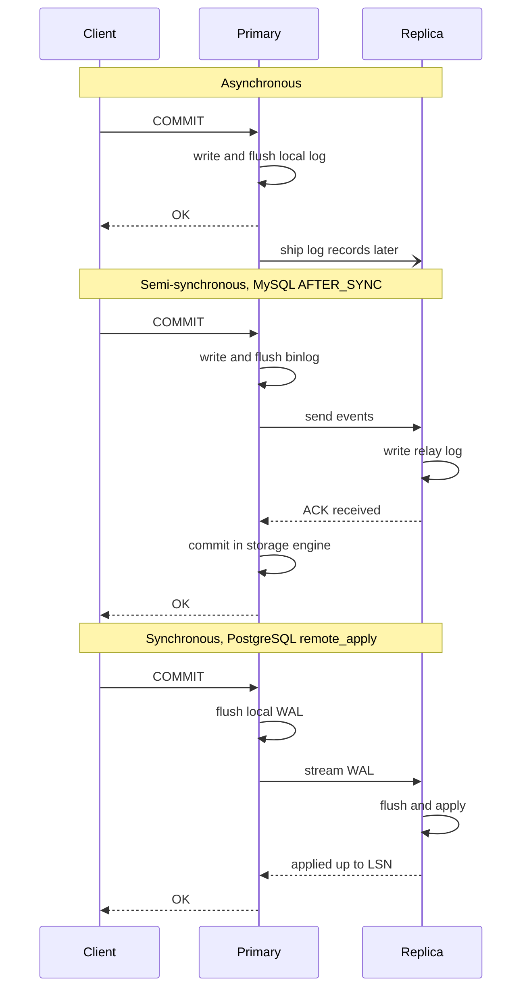
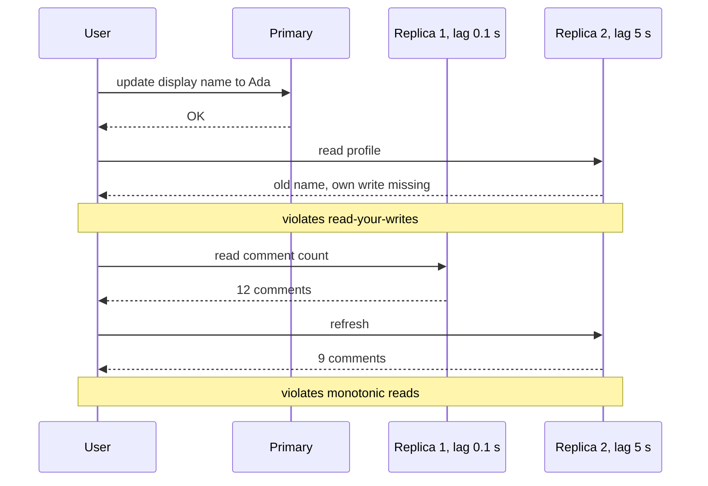
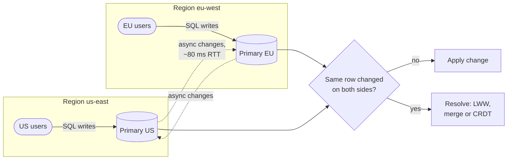
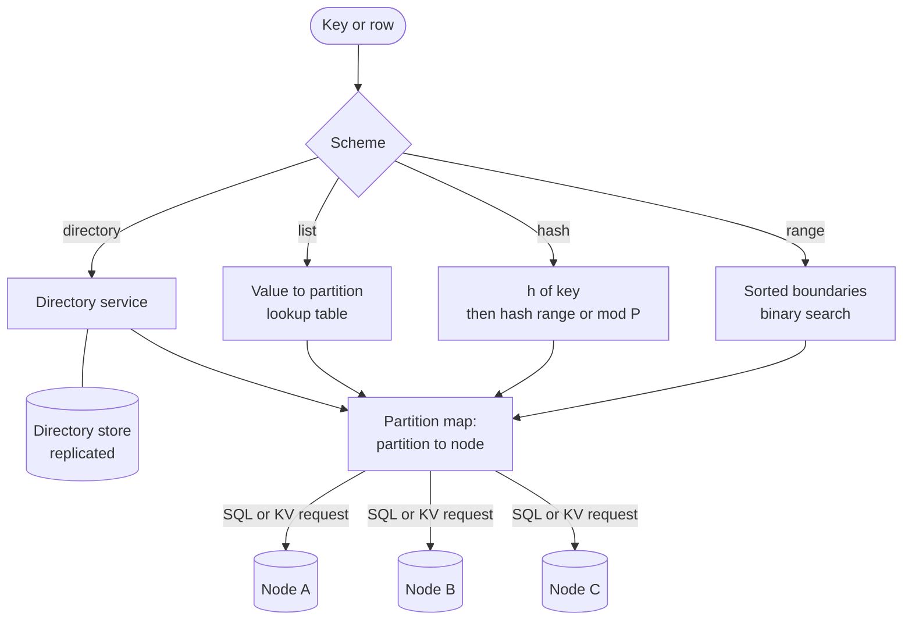
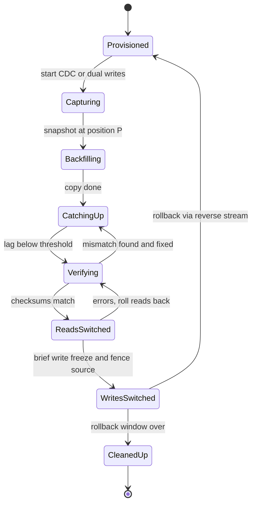
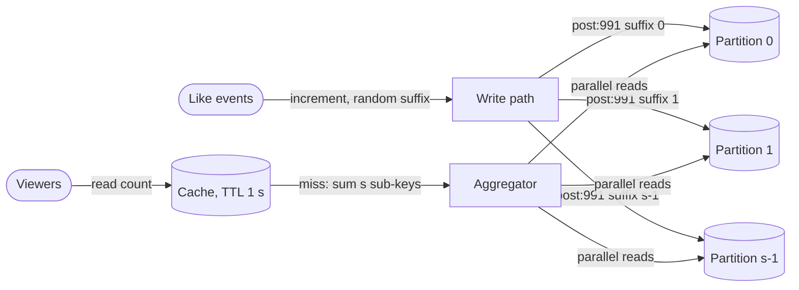
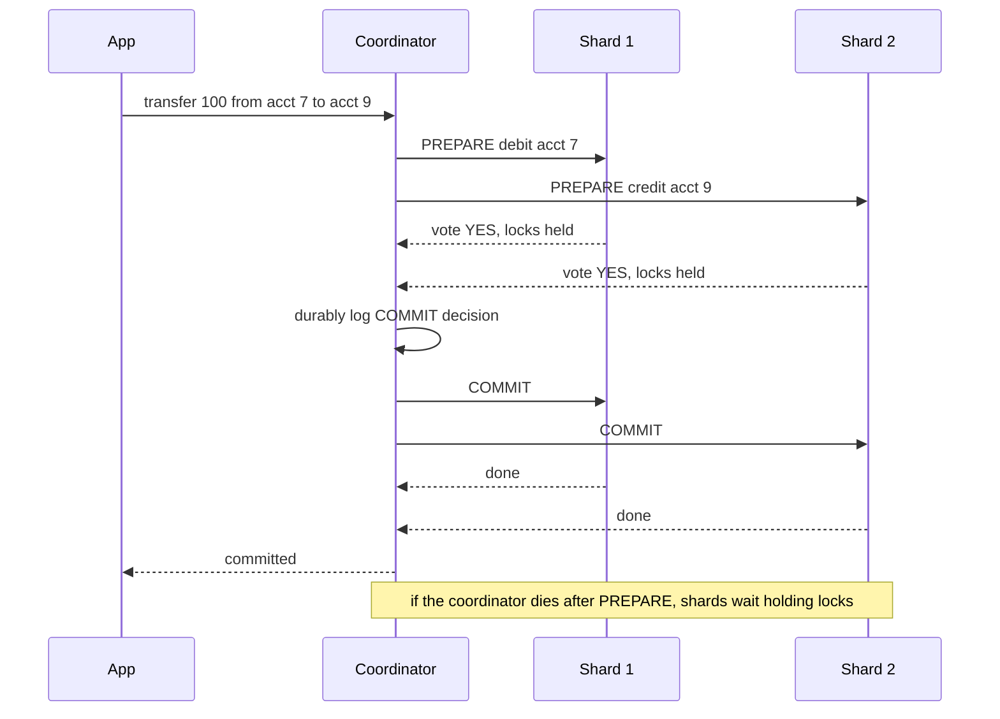
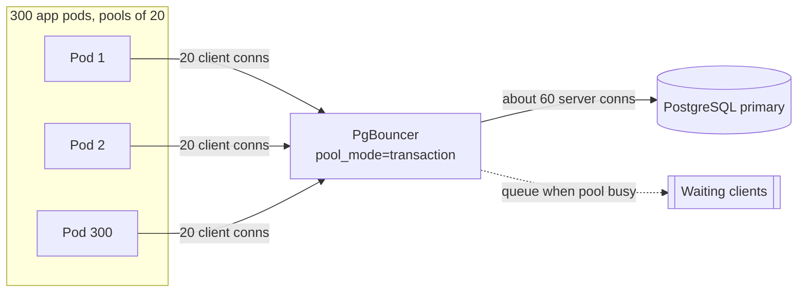

# Chapter 14 — Database Scaling: Replication, Partitioning and Sharding

> **Level:** 2–3 · **Track:** A (Traditional) · **Estimated reading time:** 6 h

A single database server is the most comfortable place your data will ever live. Every row is in one place, every transaction sees a consistent picture, and a join is just a join. Sooner or later, one of three limits ends that comfort. Reads arrive faster than one machine can answer them. Writes arrive faster than one machine can make them durable. Or the data stops fitting on one machine's disks. Chapter 2 put rough numbers on this for QuickBite, the hypothetical food-delivery company: one PostgreSQL primary handles 60 orders per second easily, 600 needs tuning and read replicas, and 6,000 probably needs partitioning (§2.10).

This chapter is about those two moves. **Replication** keeps copies of the same data on several nodes, which adds read capacity and survives failures but does nothing for write capacity or data size. **Partitioning** (also called **sharding**) splits the data into subsets stored on different nodes, which adds write capacity and storage but makes queries that span subsets harder. Real systems use both: each partition is replicated. You will learn how each technique works inside, what it costs, how to choose a partition key, how consistent hashing moves the minimum amount of data when the cluster changes size, how to rebalance a live system, and how proxies such as PgBouncer and Vitess hide much of the complexity from applications.

Two topics are previewed here and treated in depth later: consistency guarantees in Chapter 25 and distributed transactions in Chapter 28. Leaderless (Dynamo-style) replication and conflict resolution are covered in Chapter 27.

## 14.1 Learning objectives

After this chapter you should be able to:

- Draw a primary–replica architecture with read/write splitting and explain which workloads it scales and which it does not.
- Compare synchronous, asynchronous and semi-synchronous replication by commit latency, durability on failover and availability, and configure each in PostgreSQL or MySQL terms.
- Explain how replication lag produces read-your-writes and monotonic-read anomalies, and design routing that prevents them.
- Distinguish statement-based, row-based, physical (WAL-shipping) and logical replication.
- Explain when multi-primary replication is worth its conflicts.
- Compare range, hash, list and directory-based partitioning and choose a shard key for a multi-tenant SaaS product and a social application.
- Compute the number of shards needed from data size, write rate and per-node limits.
- Build a consistent-hash ring with virtual nodes, derive how load imbalance shrinks with the number of virtual nodes $V$, and verify it by simulation.
- Compare the ring with jump consistent hash and rendezvous hashing.
- Plan an online resharding with dual writes, backfill, verification and cutover.
- Detect and mitigate hot partitions with key salting and adaptive capacity.
- Choose between local and global secondary indexes.
- Explain why cross-shard queries and transactions are expensive, and place PgBouncer, ProxySQL and Vitess in an architecture.

## 14.2 Prerequisites

- Transactions, ACID and isolation levels — §11.11–§11.13 (replication and sharding change what a transaction can guarantee).
- Indexes and B+ trees — §11.7–§11.8 (secondary indexes become a distributed problem).
- Write-ahead logging — §13.5 (physical replication ships the WAL).
- Little's Law and connection pools — §4.10 and the pool-sizing examples in Chapter 4 (used again in §14.13).
- Hash functions — §17.3 at an intuitive level: a hash maps any key to a well-mixed number.
- The consistent-hashing walk-through in §3.3.2 is helpful but not required. This chapter gives the full treatment.

## 14.3 Read replicas and primary–replica architecture

### 14.3.1 The primary–replica model

::: definition
**Definition — Replication.** Keeping a copy of the same data on more than one node. Each copy is a **replica**. In **primary–replica replication** (older documentation says master/slave; this book uses primary/replica), exactly one node, the **primary**, accepts writes. It sends a stream of changes to the other nodes, the **replicas**, which apply the changes in the same order and serve reads.
:::

#### First-principles explanation

Think of a newspaper. One newsroom writes the stories, and printing plants in many cities print identical copies. Readers anywhere get the paper quickly from their local plant. But any correction must go through the newsroom, and a reader in a far city may hold yesterday's edition for a few hours after the newsroom fixed a typo. The newsroom is the primary. The printing plants are replicas. The delay is **replication lag**.

The analogy carries the three essential properties. Reads scale with the number of plants. Writes do not scale at all, because every story still goes through one newsroom, *and every plant must print every story*. And readers may see stale news.

#### Why does this exist?

Most applications read far more than they write. A social feed, a product catalog or a news site might serve 10 to 100 reads for every write. One database node has a fixed budget of CPU, memory bandwidth and I/O. If 90 % of that budget goes to reads, copying the data to more nodes and spreading the reads is the cheapest way to multiply capacity. You change no schema and very little application code. Replicas also give you a **hot standby**: if the primary dies, a replica that already holds nearly all the data can be promoted in seconds instead of restored from backup in hours. Many teams add the first replica for availability and only later start reading from it.

#### How it works internally

1. A client sends a write (`INSERT`, `UPDATE`, `DELETE`) to the primary.
2. The primary executes the transaction and records it in its **replication log**. In PostgreSQL this is the write-ahead log (WAL, §13.5). In MySQL it is the **binary log** (binlog), which is separate from InnoDB's redo log.
3. The primary commits locally. Depending on the replication mode (§14.4), it may first wait for one or more replicas to acknowledge.
4. A sender process on the primary streams new log records to each connected replica over a long-lived TCP connection.
5. Each replica writes the records to its own log and then **applies** them, in log order, to its copy of the data.
6. Read-only queries are sent to replicas, either by the application, by a driver that understands read/write splitting, or by a proxy (§14.13).
7. Each replica tracks its position in the primary's log: a log sequence number (LSN) in PostgreSQL or a global transaction identifier (GTID) set in MySQL. The difference between the primary's position and the replica's applied position is the replication lag, measured in bytes, transactions or seconds.

#### Architecture diagram

**Figure 14.1 — Primary–replica architecture with read/write splitting.**


**Reading the diagram.** The client talks HTTPS to a stateless app service. The app sends SQL through a proxy or a smart driver that splits traffic. Writes, and reads that must see the latest data, go to the primary. Other reads are spread over the replicas. All client-facing calls are synchronous. The dotted arrows are the replication streams. They are asynchronous in the default configuration, so a replica can be behind the primary. Replica 3 receives changes from Replica 2 rather than from the primary. This **cascading replication** reduces the primary's network fan-out and is common for distant regions. The storage boundary is each database node: every node holds a full copy of the data. The lag monitor polls log positions and tells the proxy to stop sending reads to a replica that falls too far behind. Failure points: the primary is a single point of failure for writes until a replica is promoted (§27.11). A lagging replica serves stale reads. A cascading intermediate replica that dies stops updates to everything below it. Scaling: add replicas for reads. Writes cannot be scaled here, because every replica applies every write.

#### Mathematical foundations

Why do replicas not scale writes? Because every write is applied on every node. If a node can do $c$ units of work per second and the write stream costs $w$ units per second to apply, each node has only $c - w$ left for reads.

::: formula
**Read capacity of a replicated group**

$$R_{\max} = n \cdot (u \cdot c - w) \qquad \text{valid only while } w < u \cdot c$$

| Symbol | Meaning | Units |
|---|---|---|
| $R_{\max}$ | Maximum sustainable read rate across the group | reads/s |
| $n$ | Number of nodes serving reads (replicas, plus the primary if it serves reads) | nodes |
| $c$ | Capacity of one node, expressed in read-equivalent operations | ops/s |
| $u$ | Target utilization, leaving headroom for spikes and failover | dimensionless (0–1) |
| $w$ | Cost of applying the full write stream on one node, in read-equivalent operations | ops/s |
:::

::: example
**Worked example — When do more replicas stop helping?** Assume one node handles $c = 20{,}000$ read-equivalent operations per second, and you run it at $u = 0.6$, so 12,000 ops/s of budget. Applying one write costs about as much as 3 reads.

1. At 1,000 writes/s, $w = 3{,}000$. Each replica has $12{,}000 - 3{,}000 = 9{,}000$ ops/s for reads. Four replicas give $R_{\max} = 4 \times 9{,}000 = 36{,}000$ reads/s.
2. At 3,000 writes/s, $w = 9{,}000$. Each replica has 3,000 ops/s left. Four replicas give only 12,000 reads/s. Even 12 replicas give 36,000.
3. At 4,000 writes/s, $w = 12{,}000 = u \cdot c$. Replicas have no read budget left at all, and they can barely keep up with the write stream.

**Interpretation.** Replicas multiply *spare* capacity, and the write stream eats into the spare capacity of every node equally. **Engineering implication.** Read replicas are the right first move when writes are a small fraction of load. Once applying writes uses roughly half of a node's budget, adding replicas buys little, and you need partitioning (§14.6) to divide the write stream itself.
:::

#### Real-world industry applications

::: industry
**PostgreSQL hot standby and MySQL replicas.** Both major open-source relational databases ship primary–replica replication as a built-in feature. PostgreSQL streams WAL to **hot standby** servers, which accept read-only queries while they apply changes. MySQL replicas pull binlog events through an I/O thread and apply them with one or more applier (SQL) threads, which can run in parallel. Managed services such as Amazon RDS expose the same mechanism as "read replicas".
*Evidence: Primary* — [PostgreSQL Docs: High Availability], [MySQL Docs: Replication]
:::

#### Advantages and disadvantages

Read replicas are simple to add, need no schema change, give a warm standby for failover, and let you isolate heavy analytical queries on a dedicated replica so they cannot slow the primary. Their costs are equally clear. They do not increase write capacity or storage capacity. Each replica is a full copy, so storage cost grows linearly with $n$. Reads may be stale. And failover is not free: with asynchronous replication, a promoted replica may be missing the primary's last few transactions (§14.4).

#### Failure scenarios

**Table 14.1 — Failure scenarios for read replicas.**

| What goes wrong | Why | Detection | Recovery | Prevention |
|---|---|---|---|---|
| Users see stale data | Replica applies changes seconds behind | Lag metric; user reports "my edit vanished" | Route that user's reads to primary | Read-your-writes routing (§14.4.4) |
| Replica falls ever further behind | Single-threaded apply, or a long query blocks apply | Lag grows steadily | Kill blocking queries; enable parallel apply | Parallel apply; cap query time on replicas |
| Query cancelled on replica | Replayed change removes rows a long query still needs (PostgreSQL) | "canceling statement due to conflict with recovery" errors | Retry | Tune `max_standby_streaming_delay` or `hot_standby_feedback` |
| Primary disk fills | Replication slot retains WAL for a dead replica | Disk usage alert; slot lag | Drop the slot | Alert on slot lag; cap retained WAL |
| Data lost on failover | Async replica promoted before receiving last commits | Gap in GTIDs or LSNs after promotion | Reconcile from old primary if it is reachable | Semi-sync or sync replica as failover target |

#### Common misconceptions

::: mistake
**Mistake — "Add replicas until the database is fast enough."** Replicas help only with reads that can tolerate staleness. If the primary's CPU is high because of writes, or because reads must be fresh, more replicas change nothing. Measure the read/write split and the freshness requirement first.
:::

## 14.4 Synchronous, asynchronous and semi-synchronous replication

### 14.4.1 Three modes of acknowledgment

::: definition
**Definition — Replication modes.** In **synchronous replication**, the primary does not report a commit as successful until at least one designated replica has durably received it (or, in stricter settings, applied it). In **asynchronous replication**, the primary reports success after its own local commit and ships the change afterwards. **Semi-synchronous replication** is MySQL's name for a middle ground: the primary waits until at least one replica has *received and logged* the change, but not until it has applied it, and it falls back to asynchronous mode if no replica answers within a timeout.
:::

#### First-principles explanation

Imagine sending an important letter. Asynchronous is dropping it in a mailbox and walking away: fast, but if the post office burns down tonight, the letter is gone and you will not know. Synchronous is handing it to a courier and waiting for a signed receipt from the recipient's office before you leave: slow, and if the courier is stuck in traffic you are stuck too. Semi-synchronous is waiting only until the courier confirms the letter is in the van, with a rule that you stop waiting after ten seconds.

The core trade-off is **durability on failover versus commit latency and availability**. Waiting for a replica costs a network round trip on every commit and couples the primary's availability to the replica's. Not waiting means a primary crash can lose recently acknowledged transactions.

#### How it works internally

Figure 14.2 shows the three commit paths side by side.

**Figure 14.2 — Commit paths under asynchronous, semi-synchronous and synchronous replication.**



**Reading the diagram.** Three participants: a client, the primary and one replica. Solid arrows are synchronous steps the client waits for. The open-headed arrow in the asynchronous case means the shipment happens after the client already has its answer. In the asynchronous path, the client's wait is only the local log flush, so a crash of the primary after "OK" but before shipping loses that transaction. In MySQL's lossless semi-synchronous mode (`AFTER_SYNC`), the primary writes the binlog, waits for one replica to write the events to its **relay log**, and only then commits in the storage engine and replies. No client can see a transaction that no replica has. In PostgreSQL with `synchronous_commit = remote_apply`, the primary waits until the standby has flushed *and applied* the WAL, so a read on that standby immediately afterwards will see the change. The storage boundaries are the two nodes' logs. The failure point is the replica: in synchronous mode, a slow or dead synchronous replica stalls all commits. To scale, wait for any $k$ of several replicas rather than one specific replica (quorum commit, below).

The two products express the same idea with different knobs:

- **PostgreSQL.** `synchronous_standby_names` lists which standbys count. `FIRST 1 (a, b)` waits for the first available in priority order, and `ANY 2 (a, b, c)` waits for any two (quorum commit). `synchronous_commit` sets how far the primary waits: `off` (do not even wait for the local flush), `local`, `remote_write` (standby has written to its OS), `on` (standby has flushed to disk) and `remote_apply` (standby has applied) [PostgreSQL Docs: synchronous_commit].
- **MySQL.** Semi-synchronous replication is a plugin with a wait point (`AFTER_SYNC`, lossless and the default since 5.7, or `AFTER_COMMIT`), a count of replicas that must acknowledge, and a timeout after which the primary silently reverts to asynchronous mode [MySQL Docs: Semisynchronous Replication]. That last property matters: semi-sync protects you only while replicas are healthy.

#### Mathematical foundations

::: formula
**Commit latency with $k$ acknowledgments**

$$T_{\text{commit}} \approx T_{\text{local}} + \text{RTT}_{(k)} + T_{\text{remote}}$$

| Symbol | Meaning | Units |
|---|---|---|
| $T_{\text{commit}}$ | Time from the client's `COMMIT` to the primary's reply | ms |
| $T_{\text{local}}$ | Time to flush the log on the primary | ms |
| $\text{RTT}_{(k)}$ | The $k$-th smallest round-trip time among the eligible replicas | ms |
| $T_{\text{remote}}$ | Work the replica does before acknowledging (write, flush or apply) | ms |
| $k$ | Number of replica acknowledgments required ($k = 0$ for asynchronous) | count |
:::

::: example
**Worked example — Where to put the synchronous replica.** A primary flushes its WAL in 0.2 ms on NVMe. Replica A is in the same availability zone (RTT 0.3 ms), replica B is in another zone of the same region (RTT 1.2 ms), and replica C is in another region (RTT 70 ms). Each replica flushes in 0.2 ms.

1. Asynchronous ($k = 0$): $T \approx 0.2$ ms.
2. Synchronous, `ANY 1 (A, B)`: the fastest acknowledgment is A's. $T \approx 0.2 + 0.3 + 0.2 = 0.7$ ms.
3. Synchronous, `ANY 2 (A, B, C)`: the second-fastest is B. $T \approx 0.2 + 1.2 + 0.2 = 1.6$ ms.
4. Synchronous to C only: $T \approx 0.2 + 70 + 0.2 \approx 70.4$ ms.
5. Throughput effect for a single session that commits sequentially: $1/0.7\,\text{ms} \approx 1{,}430$ commits/s versus $1/70.4\,\text{ms} \approx 14$ commits/s. Many concurrent sessions can still commit in parallel (group commit batches them), but every *individual* transaction pays the latency.

**Interpretation.** Requiring an acknowledgment from another zone costs about a millisecond. Requiring one from another region costs about the inter-region RTT on every commit. **Engineering implication.** A common production pattern is synchronous (or semi-synchronous) replication to at least one replica in a *different zone of the same region*, plus asynchronous replicas in remote regions. That survives a zone loss with zero data loss at roughly 1 ms per commit. A region loss then means accepting a few seconds of potential loss (a nonzero recovery point objective, §39.8).
:::

**Table 14.2 — Replication modes compared.**

| | Asynchronous | Semi-synchronous (MySQL) | Synchronous / quorum (PostgreSQL) |
|---|---|---|---|
| Client waits for | Local flush only | ≥ 1 replica has *received* | $k$ replicas have flushed or applied |
| Commit latency | Lowest | + 1 RTT | + RTT of $k$-th fastest replica |
| Data loss on primary crash | Possible (seconds of writes) | None while healthy; possible after timeout fallback | None, if failover picks an acknowledged replica |
| Availability if replicas fail | Unaffected | Unaffected after timeout | Commits block until $k$ replicas return |
| Stale reads on replicas | Yes | Yes (received, not yet applied) | Only `remote_apply` avoids them on the waited-for replicas |
| Choose when | Throughput first; remote regions | MySQL fleets wanting near-zero loss | Financial data; zone-level failure tolerance |

#### Common misconceptions

::: mistake
**Mistake — "Synchronous replication means replicas never serve stale data."** In PostgreSQL's default synchronous setting (`on`), the primary waits until the standby has *flushed* the WAL, not until it has *applied* it. A query on that standby a millisecond later can still miss the change. Only `remote_apply` closes that gap, and only on the standbys the primary waited for. Asynchronous replicas in the same cluster are still behind.
:::

### 14.4.2 Replication lag

::: definition
**Definition — Replication lag.** The delay between a change committing on the primary and the same change becoming visible on a replica. It can be measured as time (seconds), as log volume (bytes of WAL not yet replayed) or as transactions.
:::

Under normal load, asynchronous lag inside one region is typically well under a second. It is not bounded, though. Lag grows when the replica cannot apply changes as fast as the primary generates them. Common causes are a single-threaded applier facing a multi-threaded primary, a large batch job such as a bulk `UPDATE` of 50 million rows, a replica that was down for maintenance, a network partition, or long-running queries on the replica that block replay. The arithmetic of catching up is the same as draining any queue.

::: formula
**Replica catch-up time**

$$T_{\text{catch-up}} = \frac{B}{r_{\text{apply}} - r_{\text{in}}} \qquad (r_{\text{apply}} > r_{\text{in}})$$

| Symbol | Meaning | Units |
|---|---|---|
| $T_{\text{catch-up}}$ | Time until the replica's lag returns to near zero | s |
| $B$ | Backlog of unapplied changes when catch-up starts | transactions |
| $r_{\text{apply}}$ | Rate at which the replica can apply changes | transactions/s |
| $r_{\text{in}}$ | Rate at which the primary generates new changes during catch-up | transactions/s |
:::

::: example
**Worked example — A replica returns from 10 minutes of maintenance.** The primary commits $r_{\text{in}} = 5{,}000$ transactions/s. The replica can apply $r_{\text{apply}} = 8{,}000$ transactions/s with parallel apply.

1. Backlog: $B = 5{,}000 \times 600\,\text{s} = 3{,}000{,}000$ transactions.
2. Net drain rate: $8{,}000 - 5{,}000 = 3{,}000$ transactions/s.
3. Catch-up time: $3{,}000{,}000 / 3{,}000 = 1{,}000$ s, about 17 minutes.
4. If apply were single-threaded at 5,500 transactions/s, the net drain would be 500/s and catch-up would take $3 \times 10^6 / 500 = 6{,}000$ s, about 100 minutes. At 5,000/s it would never catch up.

**Interpretation.** Catch-up time depends on the *margin* between apply and arrival rates, not on either rate alone. A replica with 10 % spare apply capacity takes ten times as long to recover as the outage lasted. **Engineering implication.** Keep replicas out of the read pool until their lag is below your staleness budget, and track apply headroom ($r_{\text{apply}} / r_{\text{in}}$) as a capacity metric alongside CPU.
:::

### 14.4.3 Anomalies caused by lag

Lag is invisible until it violates a user's expectations. Two violations are common enough to have names. Chapter 25 (§25.6) treats the full family of **session guarantees** formally. Here we need just enough to design the routing layer.

::: definition
**Definition — Read-your-writes consistency.** A guarantee that after a client writes a value, its subsequent reads return that value or a newer one. It says nothing about other clients' reads. It is also called **read-after-write consistency**.
:::

::: definition
**Definition — Monotonic reads.** A guarantee that a client never sees data move backwards in time: once it has read a value at some version, later reads return that version or newer.
:::

**Figure 14.3 — Two lag anomalies: lost own write and time going backwards.**



**Reading the diagram.** One user, one primary and two replicas with different lag. All calls are synchronous SQL or API requests. Replication from the primary to the replicas is asynchronous and not drawn. First, the user's write commits on the primary, but the following read is load-balanced to Replica 2, which is five seconds behind and returns the old name. To the user, the edit was lost. Second, two successive reads hit different replicas. The first sees 12 comments and the refresh, served by the more lagged replica, sees 9. Data appears to travel backwards in time. The failure point is the read router's freedom to pick any replica. The scaling tension is that the more replicas you add and the more freely you balance across them, the more often these anomalies occur.

### 14.4.4 Designing around lag

Each fix narrows the router's freedom, so each costs some read scalability.

1. **Read your own recent writes from the primary.** After a user writes, route that user's reads to the primary for a window longer than typical lag, for example 10 seconds. Store the "last write time" in the session. PhotoShare in Chapter 1 used this rule for a user's own profile (Figure 1.6, §1.9). It is simple, but it sends extra load to the primary and fails silently if lag exceeds the window.
2. **Track the write's log position.** After a write, return the primary's LSN or GTID to the client, for example in a cookie. On a read, send the query only to a replica whose applied position is at least that LSN, or wait briefly until it is. MySQL provides `WAIT_FOR_EXECUTED_GTID_SET()` for this, and PostgreSQL exposes `pg_last_wal_replay_lsn()` so a router can compare positions. This is precise and survives arbitrary lag, at the cost of plumbing a token through the application.
3. **Sticky replica per session.** Hash the session ID to one replica, so a user always reads from the same copy. This gives monotonic reads, though not read-your-writes. If that replica fails, the user moves to another and may see time jump backwards once.
4. **Synchronous apply where it matters.** Use `remote_apply` for the replica that serves a specific critical read path.

The short program below implements option 2, the most robust of the four, as a router that keeps a per-session watermark.

```python
"""Read-your-writes and monotonic reads with log-position tokens (simulation)."""
import random


class Replica:
    def __init__(self, name):
        self.name, self.applied = name, 0       # applied log position (LSN)


class Router:
    """Routes reads to any replica that has applied the session's watermark."""

    def __init__(self, replicas):
        self.primary_lsn = 0
        self.replicas = replicas
        self.watermark = {}                      # session -> minimum LSN to read

    def write(self, session):
        self.primary_lsn += 1                    # commit on the primary
        self.watermark[session] = self.primary_lsn
        return self.primary_lsn

    def read(self, session):
        need = self.watermark.get(session, 0)
        fresh = [r for r in self.replicas if r.applied >= need]
        if not fresh:
            return "primary"                     # nobody is fresh enough yet
        chosen = random.choice(fresh)
        # monotonic reads: later reads must be at least as fresh as this one
        self.watermark[session] = max(need, chosen.applied)
        return chosen.name


if __name__ == "__main__":
    random.seed(7)
    r1, r2 = Replica("replica-1"), Replica("replica-2")
    router = Router([r1, r2])
    lsn = router.write("alice")                  # alice writes; LSN 1
    print("right after write  ->", router.read("alice"))   # nobody has LSN 1
    r1.applied = lsn                             # replica-1 catches up
    print("replica-1 caught up ->", router.read("alice"))
    print("bob (no writes)     ->", router.read("bob"))    # any replica is fine
```

What to notice:

- The watermark is per session, so only the user who wrote pays for freshness. Other users still read from any replica.
- When no replica has caught up, the router falls back to the primary. A production router might wait a few milliseconds first, to protect the primary from a stampede after a burst of writes.
- Raising the watermark to the position of the replica just read gives monotonic reads as well: a later read can never be served by a replica that is further behind.
- Real positions come from `pg_current_wal_lsn()` on the primary and `pg_last_wal_replay_lsn()` on a PostgreSQL standby, or from GTID sets in MySQL.

### 14.4.5 What travels on the wire: statement, row, physical and logical replication

The replication log can describe changes at four levels of abstraction. The choice decides what can go wrong, what the replica can be, and what else can consume the stream.

::: definition
**Definition — Replication log formats.** **Statement-based replication** ships the SQL statements the primary executed. **Row-based replication** ships the before and after images of each changed row. **Physical replication** (WAL shipping) ships the storage engine's low-level log of byte changes to data pages. **Logical replication** ships a decoded, engine-independent description of row changes per table, which subscribers can filter and apply to a different schema or version.
:::

#### How each works

- **Statement-based.** The primary logs `UPDATE accounts SET balance = balance * 1.01 WHERE region = 'EU'` as text, and each replica re-executes it. The log is compact: one line for a million rows. But any non-determinism breaks it. `NOW()`, `RAND()`, `UUID()`, an `UPDATE ... LIMIT 10` without `ORDER BY`, or a trigger that behaves differently can produce different results on the replica. The copies then diverge silently. MySQL supports this format, and its `MIXED` mode falls back to rows for statements it knows are unsafe.
- **Row-based.** The primary logs, for each changed row, the primary key and the new column values (optionally the old ones too). Replicas apply exactly those changes, so results are deterministic. The cost is volume: the same million-row `UPDATE` produces a million row events. MySQL has used `ROW` as its default binlog format since version 5.7.7 [MySQL Docs: Replication Formats].
- **Physical (WAL shipping).** PostgreSQL's streaming replication sends the WAL itself: "in page 81,233 of relation 16,384, write these bytes at offset 412". The replica is a byte-for-byte copy of the primary, including indexes, so applying changes is cheap and every engine feature is covered. The coupling is tight: the replica must run the same major version and architecture, it must replicate the entire cluster, and it cannot have extra tables or indexes.
- **Logical.** The primary decodes its WAL into row changes per table, the **logical decoding** step, and publishes them. In PostgreSQL (since version 10), you create a **publication** for chosen tables on the source and a **subscription** on the target [PostgreSQL Docs: Logical Replication]. Because the stream is engine-independent, it enables replication between major versions (the basis of near-zero-downtime upgrades), replication of a subset of tables, and **change data capture (CDC)** into message brokers and search indexes (§32.6). DDL changes are not replicated by PostgreSQL's built-in logical replication, and the subscriber is writable, so conflicting local writes can stop it.

**Table 14.3 — Replication log formats compared.**

| | Statement-based | Row-based | Physical (WAL) | Logical |
|---|---|---|---|---|
| What is shipped | SQL text | Changed rows | Page-level byte changes | Decoded row changes per table |
| Log volume for bulk update | Tiny | Large | Large (includes indexes) | Large |
| Determinism | Fragile | Exact | Exact | Exact |
| Version coupling | Loose | Loose | Same major version | Cross-version |
| Replica can differ (extra indexes, subset) | Partly | Partly | No | Yes |
| Feeds CDC and other systems | No | Yes (binlog readers) | No | Yes |
| Example | MySQL `STATEMENT` | MySQL `ROW` (default) | PostgreSQL streaming | PostgreSQL publications; MySQL row binlog via CDC tools |

::: recommendation
**Recommendation — Default choices.** Use row-based binlogs in MySQL and physical streaming replication for PostgreSQL high-availability replicas. Add logical replication when you need cross-version upgrades, partial copies or a CDC feed. Never rely on statement-based replication for data where silent divergence would hurt.
:::

#### Failure scenarios

**Table 14.4 — Failure scenarios in replication modes and formats.**

| What goes wrong | Why | Detection | Recovery | Prevention |
|---|---|---|---|---|
| All commits hang | Sole synchronous standby is down | Commit latency spikes to timeout | Remove it from `synchronous_standby_names` | Quorum `ANY k` over ≥ $k+1$ standbys |
| Silent loss of the durability guarantee | Semi-sync timed out and fell back to async | Semi-sync status counters | Restore replica health | Alert on fallback, not just on lag |
| Replica data diverges | Non-deterministic statement replicated | Checksum comparison tools | Rebuild replica from snapshot | Row-based format |
| Logical subscription stops | Unique-key conflict from a local write | Subscription error logs; slot lag grows | Fix the row; skip the transaction | Keep subscribers read-only |
| Split brain after failover | Old primary still accepts writes | Two nodes report primary role | Fence old primary; reconcile | Fencing tokens and leases (§26.11–§26.13) |

## 14.5 Multi-primary replication

::: definition
**Definition — Multi-primary replication.** A topology in which more than one node accepts writes for the same data and each primary replicates its changes to the others. It is also called **multi-leader** or **active–active** replication. Because two primaries can change the same row concurrently without coordination, the system must detect and resolve **write conflicts**.
:::

#### First-principles explanation

Two offices of the same company each keep a copy of the customer address book and post changes to each other every evening. Each office can edit at full speed during the day, even if the phone lines between them are down. But if both offices change Mrs. Rivera's address on the same day, the evening exchange shows two different "latest" addresses, and someone needs a rule for which one wins.

#### Why does this exist?

Single-primary replication has two weaknesses. First, writes from users far from the primary pay the inter-region RTT, about 70–150 ms. Second, if the primary's region is cut off, nobody can write. Multi-primary puts a writable primary in each region, so writes are local and each region keeps working during a network partition. The same pattern appears in clients that work offline, such as a calendar app that syncs later. Each device is effectively a primary.

#### How it works internally

1. Each region's primary accepts local writes and commits them locally.
2. Changes are replicated asynchronously to the other primaries, tagged with their origin so they are not echoed back.
3. When a change arrives that touches a row also changed locally since the last sync, the receiving primary detects a conflict.
4. A **conflict-resolution** policy picks the outcome. Common policies are **last-writer-wins** (LWW, the change with the later timestamp wins, which silently discards the other), a custom merge function, keeping both versions for the application to resolve, or **conflict-free replicated data types** (CRDTs) whose merges are mathematically guaranteed to converge. Chapter 27 (§27.14) covers these in depth.

**Figure 14.4 — Two-region multi-primary replication and a write conflict.**



**Reading the diagram.** Users in each region write synchronously to their local primary over SQL, so write latency is local, about 1 ms rather than the 80 ms of a cross-region round trip. The two primaries exchange changes asynchronously along the dotted arrows. Each primary is its own storage boundary, and the copies differ until replication catches up. The decision node is the conflict detector that runs whenever replicated changes arrive. Non-conflicting changes are applied. Conflicting ones go to a resolution policy. The failure point is exactly that resolver. LWW depends on clocks (§24.9) and silently drops one write. Uniqueness constraints such as "usernames must be unique" cannot be enforced, because both regions can accept the same username in the same second. Scaling: you can add regions, but every pair of primaries can now conflict.

#### Advantages, disadvantages and when to choose it

Multi-primary gives local write latency and write availability during partitions. In exchange, you lose global constraints and linearizable reads, conflict handling becomes application logic, auto-increment keys collide unless each primary uses a separate range or offset, and debugging becomes far harder. Single-row operations whose data has a natural home are the easiest case. A common compromise is **partitioned ownership**: every row has one "home" region that is its only primary, so a user's data is written in that user's region and replicated elsewhere for reads. This gives most of the latency benefit without conflicts. Choose true multi-primary only when concurrent writes to the same data from different regions are genuinely required *and* you can define a merge.

::: industry
**MySQL Group Replication.** MySQL's Group Replication plugin can run in a multi-primary mode in which all members accept writes. Transactions are certified through a group-communication protocol, and a transaction that conflicts with one certified first is rolled back rather than merged. This is conflict *avoidance* at commit time. It needs members on a low-latency network, so it is typically used within one region.
*Evidence: Primary* — [MySQL Docs: Group Replication]
:::

::: mistake
**Mistake — "Active–active doubles write capacity."** Every primary must still apply every other primary's writes, exactly as replicas do (§14.3). Multi-primary improves write *latency* and *availability*, not total write throughput. To multiply write throughput, partition.
:::

## 14.6 Partitioning: range, hash, list and directory-based

### 14.6.1 What partitioning is

::: definition
**Definition — Partition (shard).** A subset of a dataset's rows, stored and served together, such that every row belongs to exactly one partition. **Partitioning** is dividing a dataset this way and spreading the partitions over nodes. **Sharding** is a synonym used mostly for partitioning across separate database servers. This book uses *partition* and *shard* interchangeably for the data subset and reserves **network partition** for a network split (§24.7). The column or columns that decide a row's partition form the **partition key** (or **shard key**).
:::

#### First-principles explanation

A library that outgrows one room does not photocopy every book into a second room. That would be replication. It moves books A–M to one room and N–Z to another. Each room now holds half the books and serves half the visitors. A visitor looking for one book goes straight to the right room. A visitor asking "which books were published in 1987?" must search both rooms. That is the whole story of partitioning in miniature. Capacity scales with the number of rooms. Lookups by the partitioning attribute stay cheap. Everything else gets more expensive.

#### Why does this exist?

Replication cannot fix three limits: the write rate one primary can sustain, the data volume one node can store, and the working set one node can keep in memory. Partitioning divides all three by the number of partitions, because each node stores and writes only its share. It is the only general way to scale writes horizontally.

Do not confuse this with the **table partitioning** feature inside one database server, such as PostgreSQL's declarative partitioning, which splits a table into child tables on the *same* node. That helps with maintenance (dropping old months instantly) and with queries that can skip partitions, but it does not add machines. The four schemes below apply to both, but this chapter cares mainly about partitions on separate nodes.

#### How it works internally

Every partitioned system answers two questions on every request: **which partition holds this key?** and **which node holds that partition?** The four schemes differ in how they answer the first.

1. **Range partitioning.** Each partition owns a contiguous range of key values, such as `user_id` 1–1,000,000 or timestamps in March. The boundaries are kept in a small sorted table. Lookup is a binary search over the boundaries. Range scans on the key, such as "all events between 10:00 and 11:00", touch only the partitions that overlap the range. The danger is skew: keys that arrive in order, such as timestamps or auto-increment IDs, send *all* new writes to the last partition. Bigtable, HBase and the distributed SQL systems in Chapter 28 range-partition their keys and split ranges as they grow [Chang et al. 2006].
2. **Hash partitioning.** Compute $h(\text{key})$ and assign partitions by ranges of the hash value, or by $h(\text{key}) \bmod P$ for a fixed number $P$ of partitions. A good hash spreads even sequential keys uniformly, so load is balanced. The price is that adjacent keys land on unrelated partitions, so range queries on the key must ask every partition. How hash values map to nodes when the number of nodes changes is the subject of §14.8.
3. **List partitioning.** Each partition owns an explicit list of values, such as `country IN ('DE', 'FR', 'IT')` for an EU partition. It suits low-cardinality attributes with business meaning, especially **data residency**, where EU customers' data must stay in EU data centers (Chapter 44).
4. **Directory-based partitioning.** A lookup service stores an explicit mapping from each key, or each group of keys such as a tenant, to its partition. Any placement is possible: a large tenant can get a dedicated shard and small tenants can share one. Moving a tenant means copying its data and then updating one directory entry. The directory becomes a critical dependency on every request, so it is cached aggressively and stored in a strongly consistent, replicated store.

A useful refinement combines them. **Compound keys** hash the first part of the key to pick the partition and keep rows sorted by the rest within it. Cassandra's primary key `((user_id), created_at)` hashes `user_id` to place the partition and keeps each user's rows ordered by time inside it, so "the latest 20 posts by user 42" is one sequential read on one node [Lakshman and Malik 2010].

#### Architecture diagram

**Figure 14.5 — Four ways to answer "which partition holds this key?"**



**Reading the diagram.** A request arrives with a key. The decision node is a design-time choice of scheme, not a runtime branch. Range, hash and list partitioning are pure functions of the key plus a small, rarely changing table, so routers can cache them in memory and evaluate them in microseconds. Directory-based partitioning needs a lookup in a separate replicated store, which is an extra synchronous dependency unless cached. All four produce a partition ID, and a second map turns that partition into a node. Keeping these two steps separate is what makes rebalancing possible (§14.9): moving a partition changes one entry in the partition map and nothing in the key-to-partition function. The storage boundaries are the data nodes. Failure points: a stale partition map sends requests to the wrong node, which must reject them, and a directory outage stops all routing that is not served from cache. Scaling: add nodes and move partitions. The key-to-partition function stays fixed.

**Table 14.5 — Partitioning schemes compared.**

| | Range | Hash | List | Directory |
|---|---|---|---|---|
| What it is | Contiguous key ranges | Ranges of hashed key | Explicit value lists | Explicit key-to-partition map |
| Load balance | Poor for sequential keys | Good | Depends on value sizes | Whatever you place |
| Range scans on key | Efficient | Scatter to all partitions | Efficient within a value | Depends |
| Routing cost | Binary search, cacheable | Arithmetic | Table lookup | Remote lookup, cached |
| Rebalancing | Split or merge ranges | Move hash ranges (§14.8–§14.9) | Edit lists | Move one entry at a time |
| Operational complexity | Medium | Low | Low | High (directory is critical) |
| Choose when | Time series, ordered scans | Point lookups, uniform load | Residency, regions | Tenants of very different sizes |

#### Common misconceptions

::: mistake
**Mistake — "Hashing removes hot spots."** Hashing spreads *distinct* keys evenly. It cannot split the traffic of a *single* key. If one celebrity account receives 30 % of all reads, that key's partition receives at least 30 % of reads under any hash function. Hot keys need the techniques of §14.10.
:::

## 14.7 Sharding strategies and choosing shard keys

### 14.7.1 Properties of a good shard key

The shard key is the most consequential and least reversible decision in a partitioned database. Changing it later means moving every row (§14.9). Evaluate every candidate against five properties.

1. **High cardinality.** There must be many more distinct values than shards, or some shards will stay empty. `country` has about 200 values. `user_id` has billions.
2. **Even load.** Both data volume and request rate per key value should be roughly uniform, or at least dominated by many small values rather than a few giants.
3. **Query locality.** The most frequent queries should include the key, so they touch one shard. A query that lacks the key must **scatter** to every shard and **gather** the results.
4. **Transaction locality.** Rows that must change atomically together should share a key value, so the transaction stays on one node and avoids distributed commit (§14.12).
5. **Stability.** A row's key value should never change. Changing it means moving the row between shards, which is a cross-shard delete plus insert.

No key satisfies all five perfectly, so you choose by the dominant access pattern. A useful technique is to list the top five queries by frequency and check which candidate keeps the most traffic single-shard.

### 14.7.2 Worked example: a multi-tenant SaaS product

Consider **TaskForge**, a hypothetical project-management SaaS invented for this example. It has 40,000 customer organizations (tenants). Users belong to one tenant, and nearly every query is scoped to a tenant: "list this project's open tasks", "search this workspace", "update this task". Tenant sizes follow a heavy-tailed distribution. The median tenant has 15 users, and the largest has 60,000 users and holds about 2 % of all data.

**Table 14.6 — Shard-key candidates for TaskForge.**

| Candidate | Cardinality | Even load | Query locality | Transaction locality | Verdict |
|---|---|---|---|---|---|
| `task_id` | Very high | Excellent | Poor: "open tasks in project" scatters | Poor | Reject |
| `user_id` | High | Good | Poor: shared projects span users | Poor | Reject |
| `tenant_id` | 40,000 | Skewed by large tenants | Excellent: almost all queries | Excellent | **Choose**, with mitigation |
| `project_id` | High | Good | Good within a project; cross-project reports scatter | Good | Second choice |

`tenant_id` wins because it keeps almost every query and transaction on one shard. It also simplifies tenant isolation, per-tenant backup and restore, data residency and deletion on request. Its weakness is skew from very large tenants, and the remedy is directory-based placement on top of hashing:

1. Hash `tenant_id` into one of $L = 4{,}096$ **logical shards** (fixed partitions, §14.9.1).
2. Map logical shards to physical database clusters through a small directory.
3. Give the handful of tenants larger than one logical shard can comfortably hold a **dedicated** physical cluster through a directory override. If a single tenant outgrows even a dedicated cluster, partition *that tenant* by `(tenant_id, project_id)`.

**Figure 14.6 — Multi-tenant sharding with logical shards and a tenant directory.**


**Reading the diagram.** The client authenticates over HTTPS, and the API service extracts the tenant ID from the token, never from user input. The shard router holds an in-memory copy of the map from logical shard to cluster, plus a short override list for large tenants. The directory pushes changes asynchronously (dotted arrow), so the router can lag the directory briefly. That is safe only if the database rejects writes for logical shards it no longer owns, which guards against a stale map. The router hashes the tenant ID to one of 4,096 logical shards, checks overrides, and sends synchronous SQL to the chosen cluster's primary. Each cluster is a storage boundary with its own primary and asynchronous replica, so §14.3 and §14.4 apply inside each. Failure points: the directory (mitigated by caching and replication) and one cluster's primary, which affects only the tenants on it. That is a smaller **blast radius** than one big database. Scaling: add clusters and move logical shards to them, or promote a growing tenant to a dedicated cluster.

::: industry
**Notion.** Notion sharded its PostgreSQL block data by workspace ID, its equivalent of a tenant, because each block belongs to exactly one workspace. It created 480 logical shards, each a PostgreSQL schema, spread evenly across 32 physical databases with 15 schemas each. Routing happens in application code. The team chose 480 because it has many divisors, so the fleet can grow from 32 to 40 or 48 hosts and still hold equal numbers of logical shards. With a power of two like 512, keeping the counts equal would have forced doubling the fleet each time.
*Evidence: Primary* — [Fidalgo 2021]
:::

### 14.7.3 Worked example: a social application

Now return to **PhotoShare**, the hypothetical photo-sharing app from Chapter 1. Its main tables are `users`, `photos`, `follows` and `likes`, and its top queries are "show user X's profile and recent photos", "post a photo", "like a photo", and "build my home feed from people I follow".

- **`photos` by `owner_user_id`.** Profile pages read one user's photos, so they become single-shard reads. Posting a photo is a single-shard write. A Cassandra-style compound key `((owner_user_id), created_at DESC)` keeps each user's photos time-ordered. Skew comes from heavy posters and, much worse, from **celebrity readers**: a profile with 50 million followers concentrates reads on one shard (§14.10).
- **`likes` by `photo_id`.** "Count likes on this photo" and "did I like it?" are both keyed by photo. Partitioning likes by `user_id` instead would make the like count a scatter query. The cost is that "photos I liked" becomes a scatter query, served by a secondary index or a denormalized copy (§14.11).
- **`follows`, stored twice.** "Who does X follow?" wants partitioning by follower, and "who follows X?" wants partitioning by followee. The standard answer is to write both directions: one table partitioned by `follower_id` and one by `followee_id`. Each write becomes two writes, usually through an asynchronous pipeline (§32.6), and the system accepts brief inconsistency between them.
- **Home feed.** Assembling a feed by querying each followed user's shard is a fan-out across many shards per page view. Most large social systems instead precompute feeds on write ("fan-out on write") except for celebrities, whose posts are merged at read time [Kleppmann 2017]. That is a caching and messaging design (Chapters 20 and 32), driven by the shard-key choice made here.

::: concept
**Key insight — Partition by the entity your hottest queries name, and denormalize for the rest.** A social graph has no single key that localizes every query. Successful designs pick the key for the dominant path and maintain a second copy, partitioned differently, for the next most important path. They accept that the copies are eventually consistent.
:::

::: industry
**Instagram (2012).** Instagram sharded PostgreSQL into several thousand **logical shards**, implemented as PostgreSQL schemas and mapped onto far fewer physical servers, so shards could be moved later without re-splitting data. Each 64-bit ID embeds the logical shard: 41 bits of milliseconds since a custom epoch, 13 bits of logical shard ID, and 10 bits of a per-shard sequence. Any service can therefore route a request for an object straight from its ID, with no directory lookup.
*Evidence: Primary* — [Instagram Engineering 2012]
:::

### 14.7.4 How many shards? A capacity calculation

Shard count is set by whichever resource runs out first: storage, write throughput or read throughput. Compute each one at the end of your planning horizon, not today, because resharding is expensive.

::: formula
**Number of shards required**

$$S = \left\lceil \max\left( \frac{D}{C_{\text{disk}} \cdot f},\; \frac{W}{w_{\text{node}} \cdot u},\; \frac{R}{n_{\text{read}} \cdot r_{\text{node}} \cdot u} \right) \right\rceil$$

| Symbol | Meaning | Units |
|---|---|---|
| $S$ | Number of shards (each one a replicated group) | shards |
| $D$ | Data size at the planning horizon, one copy, including indexes | TB |
| $C_{\text{disk}}$ | Usable storage per node | TB |
| $f$ | Target fill fraction, leaving room for compaction, backups and growth between reshards | dimensionless (0–1) |
| $W$ | Peak write rate at the horizon | writes/s |
| $w_{\text{node}}$ | Sustainable write rate of one primary (from benchmarks) | writes/s |
| $R$ | Peak read rate that reaches the database, after caches | reads/s |
| $n_{\text{read}}$ | Nodes per shard that serve reads | nodes |
| $r_{\text{node}}$ | Sustainable read rate of one node | reads/s |
| $u$ | Target utilization at peak | dimensionless (0–1) |
:::

::: example
**Worked example — Sharding PhotoShare's metadata store.** SI units (1 TB = $10^{12}$ bytes). Assumptions are stated, not measured.

1. **Storage.** Metadata is 30 TB today, including indexes, and grows by 1.5 TB per month. The planning horizon is 24 months, so $D = 30 + 24 \times 1.5 = 66$ TB. Each node has 8 TB of usable NVMe, and you fill it to at most $f = 0.6$. Storage term: $66 / (8 \times 0.6) = 66 / 4.8 = 13.75$.
2. **Writes.** Peak writes are 90,000/s today and expected to grow 1.5×, so $W = 135{,}000$/s. A benchmarked primary sustains $w_{\text{node}} = 10{,}000$ writes/s, and you run at $u = 0.6$. Write term: $135{,}000 / (10{,}000 \times 0.6) = 135{,}000 / 6{,}000 = 22.5$.
3. **Reads.** Peak reads are 1,200,000/s, and the cache hit ratio is 90 %, so $R = 120{,}000$/s reach the database. Each shard has one primary and two replicas, and only the replicas serve reads, so $n_{\text{read}} = 2$. A replica sustains $r_{\text{node}} = 20{,}000$ reads/s, and $u = 0.6$. Read term: $120{,}000 / (2 \times 20{,}000 \times 0.6) = 120{,}000 / 24{,}000 = 5$.
4. **Take the maximum.** $S = \lceil \max(13.75, 22.5, 5) \rceil = 23$. The store is **write-bound**.
5. **Round for operations.** Choose 24 shards so the fleet splits evenly over 3 availability zones (8 primaries per zone). Total nodes: $24 \times 3 = 72$.
6. **Logical shards.** Create $L = 960$ logical shards, 40 per physical shard. 960 is divisible by 24, 30, 32, 40, 48, 60, 64, 80 and 96, so the fleet can grow in modest steps and stay perfectly even.
7. **Sanity check after sharding.** Each shard stores $66 / 24 = 2.75$ TB (34 % of a node's disk) and takes $135{,}000 / 24 \approx 5{,}600$ writes/s (56 % of $w_{\text{node}}$) at the horizon.

**Interpretation.** Storage alone would suggest 14 shards. Ignoring the write rate would have under-provisioned the fleet by 40 %. **Engineering implication.** Always compute all three terms. The largest one tells you which resource to benchmark carefully, here the primary's sustained write rate, because a 20 % error in $w_{\text{node}}$ changes the answer by about five shards. The logical-shard count is chosen once and lasts for years. The physical count is chosen for the next 18–24 months.
:::

The short program below turns the formula into a reusable calculator and reproduces the example.

```python
"""Shard-count calculator: the binding constraint among storage, writes and reads."""
import math


def shards_needed(data_tb, disk_tb, fill, writes, write_cap, reads,
                  read_nodes, read_cap, util):
    terms = {
        "storage": data_tb / (disk_tb * fill),
        "writes": writes / (write_cap * util),
        "reads": reads / (read_nodes * read_cap * util),
    }
    binding = max(terms, key=terms.get)
    return math.ceil(terms[binding]), binding, terms


def even_logical_counts(physical, candidates=(512, 720, 960, 1024, 4096)):
    """Logical-shard counts that divide evenly over `physical` shards."""
    return [c for c in candidates if c % physical == 0]


if __name__ == "__main__":
    s, binding, terms = shards_needed(
        data_tb=30 + 24 * 1.5, disk_tb=8, fill=0.6,
        writes=90_000 * 1.5, write_cap=10_000,
        reads=1_200_000 * (1 - 0.90), read_nodes=2, read_cap=20_000, util=0.6)
    print({k: round(v, 2) for k, v in terms.items()})
    print(f"minimum shards = {s} ({binding}-bound)")
    physical = 3 * math.ceil(s / 3)          # round up to a multiple of 3 zones
    print(f"physical shards = {physical}, nodes = {physical * 3}, "
          f"even logical counts = {even_logical_counts(physical)}")
```

Running it prints:

```text
{'storage': 13.75, 'writes': 22.5, 'reads': 5.0}
minimum shards = 23 (writes-bound)
physical shards = 24, nodes = 72, even logical counts = [720, 960]
```

What to notice:

- The function returns *which* term binds. The binding term is where you need a real benchmark, not a guess.
- 1,024 and 4,096 do not divide evenly over 24 shards, which is the same lesson Notion learned. A power-of-two logical count pairs naturally with fleets that double, and a highly composite count pairs with fleets that grow in small steps.
- The 90 % cache hit ratio enters the read term directly. A cache outage multiplies $R$ by 10, which turns 5 into 50 and makes the database read-bound at once. Chapter 20 (§20.13) covers that failure.

#### Failure scenarios

**Table 14.7 — Failure scenarios from shard-key choice.**

| What goes wrong | Why | Detection | Recovery | Prevention |
|---|---|---|---|---|
| One shard runs out of disk | Key with large, uneven entities (a giant tenant) | Per-shard disk and growth dashboards | Move logical shards; split the tenant | Directory overrides; size by largest entity |
| All new writes hit one shard | Monotonic key under range partitioning | Per-shard write rate, one hot | Switch to hash or prefix the key | Avoid timestamps or sequences as the leading key |
| Queries get slower as shards are added | Frequent query lacks the key and scatters | Fan-out count per query | Add a global index or denormalized copy | Check top queries against the key at design time |
| Cross-shard transactions everywhere | Related rows have different keys | 2PC or saga volume | Re-key so related rows co-locate | Transaction locality as a key criterion |
| Row must move when its key changes | Unstable key such as `email` or `status` | Delete-insert pairs across shards | Introduce an immutable surrogate key | Shard on immutable IDs |

## 14.8 Consistent hashing and virtual nodes

This section is the book's full treatment of consistent hashing. Section 3.3.2 used it as a study example and promised the derivations given here. Chapters 17, 19, 20 and 27 summarize it and point back to this section.

### 14.8.1 The problem: `hash mod N` moves almost everything

Hash partitioning needs a rule that turns a hash value into a node. The obvious rule is `node = h(key) mod N`. It balances load perfectly and needs no state. It fails when $N$ changes. A key keeps its node only if $h \bmod N = h \bmod (N+1)$, which holds for about $1/(N+1)$ of uniformly distributed hashes. So growing from 4 to 5 nodes moves about 80 % of all keys, and growing from 100 to 101 moves about 99 %. For a cache, that is a near-total miss storm. For a database, it means copying almost the entire dataset to add one node. Section 3.3.2 worked through the cache case with numbers. The fix is a rule under which adding a node moves only the keys the new node should own.

::: definition
**Definition — Consistent hashing.** A key-to-node assignment in which keys and nodes are hashed onto the same circular space (the **ring**) and each key is owned by the first node position found by moving clockwise from the key's hash. Adding or removing a node changes the owner of only the keys in the arcs next to that node's positions, an expected $K/N$ of $K$ keys for $N$ nodes [Karger et al. 1997].
:::

::: definition
**Definition — Virtual node (vnode).** One of $V$ positions on the ring assigned to the same physical node, typically by hashing labels such as `"db-3#vn17"`. A physical node owns the union of the arcs that end at its vnodes. A vnode is sometimes called a **token**.
:::

### 14.8.2 Ring construction and lookup

#### First-principles explanation

Picture a circular running track with numbered distance markers from 0 to just under $2^{64}$, wrapping back to 0. Each server stands at a few spots on the track. Each key is dropped at a spot determined by its hash and walks clockwise until it meets a server. That server owns the key. Add a server and it intercepts only the keys walking toward its spots. Everyone else's walk ends exactly where it did before.

#### How it works internally

1. **Choose a hash** that maps strings to well-mixed 64-bit integers. It must be identical in every process that routes requests. Python's built-in `hash()` is randomized per process, so it is unsuitable. MD5 truncated to 64 bits, MurmurHash3 and xxHash are common choices.
2. **Place vnodes.** For each physical node and each $i$ from 0 to $V-1$, hash a label such as `db-3#vn17` to get a position. Store all positions in a sorted array, with a parallel array of owners.
3. **Look up a key.** Compute $h(\text{key})$ and binary-search for the first position strictly greater than it. If you run off the end, wrap to index 0. Return that position's owner. The cost is $O(\log M)$ for $M = \sum_n V_n$ positions. With 100 nodes and 256 vnodes each, $M = 25{,}600$ and a lookup takes about 15 comparisons.
4. **Add a node.** Insert its $V$ positions. Each new position takes over the arc from its predecessor to itself. Only keys in those arcs change owner, and they all move *to* the new node.
5. **Remove a node.** Delete its positions. Each of its arcs merges into the arc of the next position clockwise. Only the removed node's keys move, and because its vnodes are scattered, they spread over many survivors.
6. **Weight nodes.** Give a node with twice the capacity twice as many vnodes. Its expected share doubles.
7. **Distribute the ring.** Every router must use the same membership. Membership is stored in a coordination service (§26.8–§26.9) or spread by gossip (§27.10) and versioned, so a router can tell when its copy is stale.

**Figure 14.7 — A ring with three nodes and two vnodes each.**


**Reading the diagram.** The six rectangles are vnode positions, normalized to $[0, 1)$ for readability. Solid arrows run clockwise around the ring, and the last arrow wraps from 0.86 back to 0.05. Each vnode owns the arc that *ends* at it: A vn1 owns $(0.31, 0.48]$, A vn0 owns $(0.86, 1.0) \cup [0, 0.05]$, and so on. Dotted arrows show lookups. Key $x$ at 0.40 walks to A vn1, key $y$ at 0.95 wraps around to A vn0, and key $z$ at 0.70 stops at B vn1. The lookup is a pure in-memory computation in each router, so there is no network hop and no storage boundary inside the ring itself. The data lives on the nodes A, B and C. Node A's total share is $0.17 + 0.19 = 0.36$, B's is $0.17 + 0.23 = 0.40$ and C's is $0.09 + 0.15 = 0.24$. With only two vnodes each, the shares are noticeably uneven, which motivates §14.8.4. Failure point: routers with different membership lists disagree about owners. Scaling: add vnodes for a new node and only the arcs they cut move.

### 14.8.3 How many keys move?

::: formula
**Expected keys moved on a membership change**

$$E[\text{moved on add}] = \frac{K}{N+1} \qquad\qquad E[\text{moved on remove}] = \frac{K}{N}$$

| Symbol | Meaning | Units |
|---|---|---|
| $K$ | Total number of keys | keys |
| $N$ | Number of nodes before the change | nodes |
:::

The derivation is short. A new node's expected share of the ring is $1/(N+1)$ by symmetry, since all $N+1$ nodes' vnodes are identically distributed. Exactly the keys in its new arcs move, and nothing else does. A removed node's keys are exactly its share, $1/N$ in expectation. These are the *minimum* possible: any balanced scheme must give a new node $1/(N+1)$ of the keys. Karger et al. call this property **monotonicity**: when a node is added, keys move only from old nodes to the new one, never between old nodes [Karger et al. 1997].

::: example
**Worked example — Adding a ninth database node.** A store holds $K = 2 \times 10^9$ rows of 1 KB each (2 TB, SI units) on $N = 8$ nodes, ring-partitioned with 128 vnodes per node.

1. Rows moved: $2 \times 10^9 / 9 \approx 2.22 \times 10^8$ rows, about 222 GB.
2. Under `mod N`: about $8/9$ of rows, $1.78 \times 10^9$ rows or 1.78 TB, would move.
3. Time to move 222 GB if rebalancing is throttled to 100 MB/s to protect foreground traffic: $222 \times 10^9 / 10^8 = 2{,}220$ s, about 37 minutes. Moving 1.78 TB at the same rate takes 17,800 s, about 5 hours.
4. Sources: with 128 vnodes, the new node's 128 arcs are cut from all 8 existing nodes, each contributing roughly $222/8 \approx 28$ GB, so all 8 can stream in parallel.

**Interpretation.** The ring reduces data movement by a factor of $N$ (8× here) and spreads the work over every node. **Engineering implication.** Consistent hashing makes adding capacity a routine, sub-hour operation instead of a planned migration. The vnode count also determines how many nodes share the copying work.
:::

The runnable ring below checks these claims. It rebuilds the sorted array once per membership change, supports weights and returns a replica **preference list**.

```python
"""Consistent-hash ring with virtual nodes, weights and replica placement."""
import bisect
import hashlib
from collections import Counter


def h(key: str) -> int:
    """Map a string to a 64-bit ring position (MD5 used only for mixing)."""
    return int.from_bytes(hashlib.md5(key.encode("utf-8")).digest()[:8], "big")


class HashRing:
    def __init__(self, vnodes_per_weight: int = 100):
        self.vpw = vnodes_per_weight
        self.weights = {}          # physical node -> weight
        self._positions = []       # sorted vnode positions
        self._owners = []          # owner of _positions[i]

    def _rebuild(self) -> None:
        points = sorted(
            (h(f"{node}#vn{i}"), node)
            for node, w in self.weights.items()
            for i in range(self.vpw * w)
        )
        self._positions = [p for p, _ in points]
        self._owners = [n for _, n in points]

    def add_node(self, node: str, weight: int = 1) -> None:
        self.weights[node] = weight
        self._rebuild()            # one sort per membership change

    def remove_node(self, node: str) -> None:
        del self.weights[node]
        self._rebuild()

    def _index(self, key: str) -> int:
        i = bisect.bisect_right(self._positions, h(key))
        return 0 if i == len(self._positions) else i   # wrap around

    def owner(self, key: str) -> str:
        return self._owners[self._index(key)]

    def preference_list(self, key: str, r: int) -> list:
        """First r *distinct physical* nodes clockwise from the key."""
        r = min(r, len(self.weights))
        result, i = [], self._index(key)
        while len(result) < r:
            node = self._owners[i]
            if node not in result:
                result.append(node)
            i = (i + 1) % len(self._owners)
        return result


if __name__ == "__main__":
    keys = [f"user:{i}" for i in range(200_000)]
    ring = HashRing(vnodes_per_weight=128)
    for n in range(8):
        ring.add_node(f"db-{n}")

    before = {k: ring.owner(k) for k in keys}
    ring.add_node("db-8")
    after = {k: ring.owner(k) for k in keys}
    moved = [k for k in keys if before[k] != after[k]]
    print(f"add 9th node : {len(moved) / len(keys):.2%} of keys moved "
          f"(theory 1/9 = {1 / 9:.2%}); all moved keys went to "
          f"{set(after[k] for k in moved)}")

    share = sum(1 for k in keys if after[k] == "db-3") / len(keys)
    ring.remove_node("db-3")
    gone = {k: ring.owner(k) for k in keys}
    moved = [k for k in keys if after[k] != gone[k]]
    receivers = Counter(gone[k] for k in moved)
    print(f"remove db-3  : {len(moved) / len(keys):.2%} moved, exactly db-3's "
          f"share ({share:.2%}); spread over {len(receivers)} survivors, "
          f"largest receiver took {max(receivers.values()) / len(moved):.0%}")

    ring.add_node("db-big", weight=2)        # twice the vnodes
    load = Counter(ring.owner(k) for k in keys)
    mean = len(keys) / (len(ring.weights) + 1)   # db-big counts as two
    print(f"weighted node: db-big holds {load['db-big'] / mean:.2f}x a "
          f"weight-1 share")
    print("replicas of user:42 ->", ring.preference_list("user:42", 3))
```

Running it with Python 3.8 or later prints:

```text
add 9th node : 10.85% of keys moved (theory 1/9 = 11.11%); all moved keys went to {'db-8'}
remove db-3  : 9.84% moved, exactly db-3's share (9.84%); spread over 8 survivors, largest receiver took 20%
weighted node: db-big holds 1.88x a weight-1 share
replicas of user:42 -> ['db-0', 'db-5', 'db-big']
```

What to notice:

- Every moved key went to `db-8`. That is monotonicity, observed directly.
- The fraction moved on removal equals the removed node's *actual* share, 9.84 %, not the ideal 11.1 %. The share itself is random, and §14.8.4 quantifies how random.
- The removed node's keys landed on all 8 survivors. The largest receiver took 20 % of them, about $1.6\times$ an even split. With $V = 1$, one neighbor would have taken 100 %.
- `preference_list` skips vnodes of nodes already chosen. Without that check, two replicas of a key could land on the same physical machine.
- The weight-2 node received $1.88\times$ a weight-1 share rather than exactly $2\times$. Weights set the *expected* share, and the vnode randomness discussed next adds noise around it.

### 14.8.4 Virtual nodes and load balance: a derivation

With one position per node, arc lengths vary wildly, and §3.3.2 measured a busiest node at $2.6\times$ its fair share. Virtual nodes fix this. But by how much, as a function of $V$? Section 3.3.2 claimed that the relative spread shrinks "roughly in proportion to $1/\sqrt{V}$". This section derives the exact result for the standard model and checks it by simulation.

**The model.** Assume an ideal hash, so each of the $M = NV$ vnode positions is independent and uniform on a ring of circumference 1. Each physical node owns $V$ of them. A node's **load** $L$ is the total length of the arcs ending at its vnodes, which is the fraction of a uniformly hashed key space it receives.

**Step 1 — The arcs are Dirichlet-distributed.** Cut a circle at $M$ independent uniform points. The $M$ arc lengths $(A_1, \dots, A_M)$ sum to 1 and are jointly distributed as $\text{Dirichlet}(1, 1, \dots, 1)$. This is the classical **uniform spacings** result: fix one point as the origin by rotational symmetry, and the remaining $M-1$ points cut the unit interval into $M$ pieces whose joint distribution is uniform on the simplex [David and Nagaraja 2003]. In particular, each arc has mean $1/M$, and the arcs are *exchangeable*: any relabeling of them has the same joint distribution.

**Step 2 — A node's load is a Beta random variable.** Which positions belong to which node depends only on the labels, which are independent of where the positions fall. So a node's $V$ arcs are, in distribution, any fixed $V$ of the $M$ exchangeable arcs. The **aggregation property** of the Dirichlet distribution says that a sum of $V$ of its $M$ unit components is $\text{Beta}(V, M - V)$ distributed. Therefore

$$L \sim \text{Beta}\big(V,\ (N-1)V\big).$$

**Step 3 — Mean and variance.** For $\text{Beta}(a, b)$, the mean is $a/(a+b)$ and the variance is $ab / \big((a+b)^2 (a+b+1)\big)$. With $a = V$ and $b = (N-1)V$:

$$E[L] = \frac{1}{N}, \qquad \text{Var}[L] = \frac{N-1}{N^2\,(NV+1)}.$$

**Step 4 — Relative spread.** Divide the standard deviation by the mean to get the coefficient of variation.

::: formula
**Load imbalance on a ring with virtual nodes**

$$\text{CV}(N, V) = \frac{\sqrt{\text{Var}[L]}}{E[L]} = \sqrt{\frac{N-1}{NV+1}} \;\approx\; \frac{1}{\sqrt{V}} \quad (N \gg 1)$$

$$\frac{E[\max_i L_i]}{1/N} \approx 1 + z_N \cdot \text{CV}(N, V) \quad (V \gtrsim 16), \qquad \frac{E[\max_i L_i]}{1/N} = H_N \quad (V = 1)$$

| Symbol | Meaning | Units |
|---|---|---|
| $L$, $L_i$ | Fraction of the key space owned by a node (by node $i$) | dimensionless (0–1) |
| $N$ | Number of physical nodes | nodes |
| $V$ | Virtual nodes per physical node | vnodes/node |
| $\text{CV}$ | Coefficient of variation: standard deviation of a node's load divided by its mean | dimensionless |
| $z_N$ | Expected maximum of $N$ independent standard normal variables: 1.16 for $N=5$, 1.54 for $N=10$, 2.51 for $N=100$, 3.24 for $N=1{,}000$ | dimensionless |
| $H_N$ | $N$-th harmonic number $1 + \tfrac12 + \dots + \tfrac1N \approx \ln N + 0.577$ | dimensionless |
:::

Three remarks make the result usable.

- **Why $1/\sqrt{V}$.** Each arc behaves almost like an independent exponential random variable, whose standard deviation equals its mean (CV of 1). A node's load is a sum of $V$ such arcs, and the standard deviation of a sum of $V$ independent terms grows like $\sqrt{V}$ while the mean grows like $V$. The ratio therefore falls like $1/\sqrt{V}$. The exact formula adds the small correction $(N-1)/N$ because the loads must sum to 1.
- **The busiest node.** Capacity planning cares about the maximum, not the average. For large $V$, each load is close to normally distributed, so the busiest of $N$ nodes sits about $z_N$ standard deviations above the mean. The excess over the fair share also shrinks like $1/\sqrt{V}$, but it is multiplied by $z_N$, which grows slowly with $N$ (roughly $\sqrt{2 \ln N}$). For $V = 1$, the exact result follows from the classical fact that the longest of $N$ uniform spacings has expected length $H_N / N$. The normal approximation slightly underestimates the maximum because the Beta distribution is skewed to the right.
- **Agreement with published measurements.** Lamping and Veach report that a ring with 1,000 points per bucket has a standard error of 3.2 % in bucket sizes, and that about 1 % of buckets are still at least 8 % above or below average [Lamping and Veach 2014]. The formula gives $\sqrt{1/1000} \approx 3.16$ %, and a two-sided 1 % normal tail lies at $2.58 \times 3.16 \% \approx 8.1$ %. Karger et al. proved the asymptotic version: placing each cache at a number of points proportional to the logarithm of the number of caches keeps every cache's share within a constant factor of fair, with high probability [Karger et al. 1997].

::: example
**Worked example — Choosing $V$ for a 100-node cluster.** You want the busiest of $N = 100$ nodes to carry at most 10 % more than the mean, so $E[\max]/\text{mean} \le 1.10$.

1. Requirement: $z_{100} \cdot \text{CV} \le 0.10$, so $\text{CV} \le 0.10 / 2.51 = 0.0398$.
2. Solve $\sqrt{(N-1)/(NV+1)} \le 0.0398$: $(NV + 1) \ge 99 / 0.0398^2 = 99 / 0.001584 \approx 62{,}500$, so $V \ge 625$.
3. Check a common default, $V = 256$: $\text{CV} = \sqrt{99 / 25{,}601} = 0.0622$, and $E[\max]/\text{mean} \approx 1 + 2.51 \times 0.0622 = 1.156$. A 30-ring simulation gives 1.17.
4. Check $V = 1$: $E[\max]/\text{mean} = H_{100} \approx 5.19$. The busiest node would carry over five times its fair share.
5. Memory for $V = 625$: $100 \times 625 = 62{,}500$ positions × 16 bytes (8-byte position plus a small owner index, padded) ≈ 1 MB per router. That is negligible.

**Interpretation.** Random vnode placement improves balance slowly: halving the imbalance costs four times the vnodes. Going from 15.6 % to 10 % excess needs 2.4× the vnodes. **Engineering implication.** Either provision about 15–20 % headroom on every node and use a few hundred vnodes, or stop relying on randomness and place partitions deliberately: use fixed equal-sized partitions (§14.9.1), a token-allocation algorithm, or bounded-load hashing (§14.8.6). Many vnodes also have costs that this formula does not show: more ranges to stream during repair and rebalancing, and more metadata to gossip.
:::

The experiment below measures the trend directly. For each $V$ it builds 200 independent rings of 10 nodes, computes every node's exact share of the ring from the arc lengths, and compares the results with the formula.

```python
"""How load imbalance on a hash ring shrinks as virtual nodes V grow.

For each V, build many independent rings of N nodes, compute every node's
exact share of the key space (the total length of the arcs it owns) and
compare the spread with the closed form sqrt((N-1)/(N*V+1)).
"""
import hashlib
import math
import statistics

RING = 2 ** 64
N = 10            # physical nodes
TRIALS = 200      # independent rings per value of V


def h(key: str) -> int:
    return int.from_bytes(hashlib.md5(key.encode("utf-8")).digest()[:8], "big")


def node_shares(n: int, v: int, trial: int) -> list:
    """Fraction of the ring owned by each node in one random ring."""
    points = sorted((h(f"t{trial}/node-{i}#vn{j}"), i)
                    for i in range(n) for j in range(v))
    share = [0] * n
    prev = points[-1][0] - RING          # wrap: arc ending at the first point
    for pos, owner in points:
        share[owner] += pos - prev       # a vnode owns the arc that ends at it
        prev = pos
    return [s / RING for s in share]


def expected_max_std_normal(n: int, samples: int = 4000) -> float:
    """E[max of n standard normals], by a quick deterministic quadrature."""
    nd = statistics.NormalDist()
    total = 0.0
    for k in range(samples):                  # E[max] = integral of x d(F^n)
        u = (k + 0.5) / samples               # u = F(x)^n  =>  x = F^-1(u^(1/n))
        total += nd.inv_cdf(u ** (1.0 / n))
    return total / samples


if __name__ == "__main__":
    z = expected_max_std_normal(N)
    print(f"N = {N} nodes, {TRIALS} rings per row, E[max of {N} normals] = {z:.3f}")
    print(f"{'V':>5} {'CV sim':>8} {'CV theory':>10} {'max/mean sim':>13} "
          f"{'max/mean approx':>16}")
    rows = []
    for v in (1, 4, 16, 64, 256, 1024):
        trials = TRIALS if v <= 256 else TRIALS // 4
        cvs, maxes = [], []
        for t in range(trials):
            s = node_shares(N, v, t)
            cvs.append(statistics.pstdev(s) * N)      # std / mean, mean = 1/N
            maxes.append(max(s) * N)
        # shares sum to exactly 1, so pstdev about the mean 1/N is unbiased
        cv_sim = math.sqrt(statistics.fmean(c * c for c in cvs))
        cv_th = math.sqrt((N - 1) / (N * v + 1))
        rows.append((v, cv_sim))
        print(f"{v:>5} {cv_sim:>8.4f} {cv_th:>10.4f} "
              f"{statistics.fmean(maxes):>13.3f} {1 + z * cv_th:>16.3f}")
    harmonic = sum(1 / k for k in range(1, N + 1))
    print(f"V=1 exact: E[max/mean] = H_N = {harmonic:.3f}")
    (v1, c1), (v2, c2) = rows[1], rows[-1]
    slope = math.log(c2 / c1) / math.log(v2 / v1)
    print(f"log-log slope of CV vs V between V={v1} and V={v2}: {slope:.3f}")
```

Running it takes about two seconds and prints:

```text
N = 10 nodes, 200 rings per row, E[max of 10 normals] = 1.539
    V   CV sim  CV theory  max/mean sim  max/mean approx
    1   0.8977     0.9045         2.912            2.392
    4   0.4655     0.4685         1.885            1.721
   16   0.2358     0.2364         1.416            1.364
   64   0.1187     0.1185         1.199            1.182
  256   0.0585     0.0593         1.095            1.091
 1024   0.0302     0.0296         1.050            1.046
V=1 exact: E[max/mean] = H_N = 2.929
log-log slope of CV vs V between V=4 and V=1024: -0.493
```

What to notice:

- The simulated CV matches $\sqrt{(N-1)/(NV+1)}$ to within sampling error in every row. The log–log slope of $-0.49$ is the empirical signature of $1/\sqrt{V}$, whose slope is exactly $-0.5$.
- Each 4× increase in $V$ halves the spread: 0.47, 0.24, 0.12, 0.06, 0.03.
- For $V = 1$, the simulated maximum (2.91) matches the exact $H_{10} = 2.93$, and the normal approximation (2.39) is poor. Use the approximation only from about $V = 16$ upward.
- The experiment measures *key-space* share. With a finite number of keys $K$, each node's key count adds sampling noise with a CV of about $\sqrt{N/K}$, which is 1 % for $K = 10^5$ and $N = 10$. That noise is why the ring program above showed $1.88\times$ for a weight-2 node.
- A node's load also depends on *request* skew. This analysis assumes uniform key popularity. Hot keys are a separate problem (§14.10).

::: note
**Note — Resolution of the open question on $1/\sqrt{V}$.** Under the ideal-hash model, a node's share is exactly $\text{Beta}(V, (N-1)V)$ distributed, so its coefficient of variation is $\sqrt{(N-1)/(NV+1)}$. That tends to $1/\sqrt{V}$ as $N$ grows. The simulation above and the measurements in [Lamping and Veach 2014] confirm it. The statement in §3.3.2 is correct as a statement about the relative standard deviation. The *busiest* node's excess also shrinks like $1/\sqrt{V}$, but with a multiplier $z_N$ that grows slowly with the number of nodes.
:::

### 14.8.5 Replication on the ring

A partitioned store also replicates each partition. On a ring, the natural rule is to store each key on the first $R$ **distinct physical** nodes clockwise from its hash, the key's preference list. Dynamo uses exactly this scheme, with $R = 3$ typical (the paper calls this count $N$), and adds rack or zone awareness so that the replicas also land in different failure domains [DeCandia et al. 2007]. Vnodes help again here. When a node fails, the replicas of its data are spread over many other nodes, so re-replication can copy from all of them in parallel instead of hammering one neighbor. Chapter 27 (§27.7–§27.9) covers quorum reads and writes over preference lists.

::: industry
**Amazon Dynamo.** Dynamo began with random tokens: each node chose $T$ random positions. The paper reports two operational problems with this. Bootstrapping a new node required scanning other nodes' data to find the keys it should take, and the partition boundaries kept changing, which made archiving and Merkle-tree maintenance awkward. Dynamo moved to a strategy in which the hash space is divided into $Q$ equal-sized partitions and each of $S$ nodes is assigned $Q/S$ of them. The paper reports that this gave the best load-balancing efficiency of the strategies it compared, with the smallest membership metadata. This is the "fixed number of partitions" approach of §14.9.1, reached from the ring.
*Evidence: Primary* — [DeCandia et al. 2007]
:::

::: industry
**Apache Cassandra.** Cassandra assigns each node `num_tokens` positions on its ring. Early releases used one token per node and relied on operators to move tokens to balance load [Lakshman and Malik 2010]. Later releases introduced vnodes with a default of 256 random tokens per node. Cassandra 4.0 lowered the default to 16 tokens and paired it with an allocation algorithm that chooses new tokens to balance load for a given replication factor instead of placing them at random. Fewer tokens make repairs and streaming cheaper, and deliberate placement recovers the balance that randomness would otherwise need hundreds of tokens to reach (as of Cassandra 4.0).
*Evidence: Primary* — [Apache Cassandra Docs]
:::

### 14.8.6 Alternatives: jump consistent hash and rendezvous hashing

Two other algorithms give the same minimal movement with different trade-offs.

#### Jump consistent hash

**Jump consistent hash** maps a 64-bit key and a bucket count $n$ to a bucket number in $[0, n)$, using no memory beyond a few registers [Lamping and Veach 2014]. The idea follows from the movement requirement. When the bucket count grows from $b$ to $b+1$, a key should move to the new bucket with probability exactly $1/(b+1)$ and otherwise stay put. Imagine growing the count one bucket at a time and tracking the last bucket this key jumped to. Seed a pseudorandom generator with the key, and the jump decisions become deterministic per key. Instead of simulating every step, the algorithm draws the position of the key's *next* jump directly, so the loop runs only $O(\ln n)$ times on average.

The Python port below follows the paper's C++ code. The listing then compares jump hash and rendezvous hashing on movement and balance.

```python
"""Jump consistent hash and rendezvous (HRW) hashing, compared on movement and balance."""
import hashlib
import statistics

MASK64 = (1 << 64) - 1


def h64(s: str) -> int:
    return int.from_bytes(hashlib.md5(s.encode("utf-8")).digest()[:8], "big")


def jump_hash(key: int, num_buckets: int) -> int:
    """Lamping & Veach (2014): 64-bit key -> bucket in [0, num_buckets)."""
    b, j = -1, 0
    while j < num_buckets:
        b = j
        key = (key * 2862933555777941757 + 1) & MASK64   # 64-bit LCG step
        j = int((b + 1) * (float(1 << 31) / float((key >> 33) + 1)))
    return b


def rendezvous(key: str, nodes: list) -> str:
    """Highest random weight: every node scores the key; the top score wins."""
    return max(nodes, key=lambda node: h64(f"{node}|{key}"))


def report(name, assign_before, assign_after, keys, n_after):
    moved = sum(assign_before(k) != assign_after(k) for k in keys) / len(keys)
    counts = {}
    for k in keys:
        b = assign_after(k)
        counts[b] = counts.get(b, 0) + 1
    mean = len(keys) / n_after
    cv = statistics.pstdev(counts.values()) / mean
    print(f"{name:<11} moved {moved:6.2%} (ideal {1 / n_after:.2%})  "
          f"key-count CV {cv:.4f}  max/mean {max(counts.values()) / mean:.3f}")


if __name__ == "__main__":
    keys = [f"order:{i}" for i in range(100_000)]
    hashed = {k: h64(k) for k in keys}
    n = 10
    names = [f"db-{i}" for i in range(n + 1)]
    report("jump", lambda k: jump_hash(hashed[k], n),
           lambda k: jump_hash(hashed[k], n + 1), keys, n + 1)
    report("rendezvous", lambda k: rendezvous(k, names[:n]),
           lambda k: rendezvous(k, names), keys, n + 1)
    # Binomial noise alone (perfectly fair assignment of 100,000 random keys)
    p = 1 / (n + 1)
    print(f"{'noise floor':<11} key-count CV of a perfect hash = "
          f"{((1 - p) / (len(keys) * p)) ** 0.5:.4f}")
```

Running it prints:

```text
jump        moved  9.10% (ideal 9.09%)  key-count CV 0.0081  max/mean 1.019
rendezvous  moved  9.14% (ideal 9.09%)  key-count CV 0.0133  max/mean 1.017
noise floor key-count CV of a perfect hash = 0.0100
```

What to notice:

- Both algorithms move almost exactly the ideal $1/(N+1)$ of keys when growing from 10 to 11 buckets.
- Both balance load at the **noise floor**, the variation you would see even if every key were assigned by a fair coin. Their key-count CVs of 0.008 and 0.013 differ from the floor of 0.010 only by sampling noise, since each estimate comes from just 11 buckets. Compare a ring with $V = 100$, whose structural CV is about 0.10 for $N = 10$, ten times larger.
- `jump_hash` needs the key as a 64-bit integer, so string keys are hashed first. The `& MASK64` reproduces C's unsigned 64-bit overflow, which Python integers do not have.
- `rendezvous` computes $N$ hashes per lookup. That is trivial for 10 nodes and becomes significant for thousands.

Jump hash's limitation is structural. Buckets are numbered $0$ to $n-1$, and you can only add or remove the *last* bucket. Removing bucket 3 of 10 is impossible without remapping. It therefore suits cases where a bucket is a *logical shard number* that never disappears, because each shard is itself a replicated group whose machines can fail and be replaced underneath it. It does not suit a cache tier where arbitrary nodes come and go.

#### Rendezvous (highest random weight) hashing

**Rendezvous hashing**, or **highest random weight (HRW) hashing**, computes a score $s(\text{key}, \text{node}) = h(\text{node} \,\|\, \text{key})$ for every node and assigns the key to the node with the highest score [Thaler and Ravishankar 1998]. Adding a node moves only the keys for which the new node scores highest, an expected $1/(N+1)$. Removing a node moves only its keys, and each goes to its own second-highest scorer, so the load spreads evenly over all survivors without any vnodes. Sorting the scores gives a natural replica list: the top $R$ nodes. The cost is $O(N)$ hash computations per lookup. Weighted variants exist, and hierarchical arrangements reduce the lookup cost for large $N$.

**Table 14.8 — Key-to-node assignment schemes compared.**

| | `hash mod N` | Ring + vnodes | Jump hash | Rendezvous (HRW) |
|---|---|---|---|---|
| Keys moved on add | ~$N/(N+1)$ | ~$1/(N+1)$ | ~$1/(N+1)$ | ~$1/(N+1)$ |
| Load balance (CV) | Noise floor | $\sqrt{(N-1)/(NV+1)}$ | Noise floor | Noise floor |
| Lookup cost | $O(1)$ | $O(\log NV)$ | $O(\log N)$ expected | $O(N)$ |
| Memory | None | $O(NV)$ positions | None | $O(N)$ names |
| Remove arbitrary node | Remaps nearly all | Yes | No, only the last bucket | Yes |
| Weights | Awkward | More vnodes | No | Weighted scores |
| Replica list | Ad hoc | Walk to $R$ distinct nodes | Ad hoc | Top-$R$ scores |
| Choose when | $N$ fixed forever | Caches, Dynamo-style stores | Numbered shards that only grow | Small $N$; simple, even spread |

Table 3.2 in Chapter 3 gives the same comparison in brief. Two further variants deserve a mention. **Maglev hashing** fills a fixed-size lookup table for $O(1)$ lookups in network load balancers (§19.4) and accepts slightly more disruption on changes [Eisenbud et al. 2016]. **Consistent hashing with bounded loads** caps every node at $(1+\varepsilon)$ times the average load and forwards overflow keys clockwise. It provides a hard bound that random vnodes cannot [Mirrokni et al. 2018].

#### Failure scenarios

Table 3.3 in §3.3.2 lists the generic ring failures: uneven arcs, hot keys, successor overload, split membership views, miss storms and poor hash functions. Two more matter for databases.

**Table 14.9 — Additional ring failure scenarios in partitioned databases.**

| What goes wrong | Why | Detection | Recovery | Prevention |
|---|---|---|---|---|
| Two replicas on one machine or rack | Preference list counted vnodes, not physical nodes or zones | Placement audit | Re-replicate | Skip duplicate nodes and zones when walking |
| Data unreachable after hash change | Library upgrade changed the hash function or seed | Sudden 100 % miss or not-found rate | Roll back the library | Pin hash algorithm and seed in the ring's metadata |
| Rebalance overloads cluster | Many vnodes stream at once after a join | Foreground p99 latency rises during join | Throttle streaming | Rate-limit streaming; join one node at a time |

::: mistake
**Mistake — "More vnodes are always better."** Balance improves only as $1/\sqrt{V}$, while the cost of some operations grows linearly with $V$: the number of ranges to repair, stream and track. With $V = 256$ and a replication factor of 3, a node's ranges overlap with most other nodes in the cluster, so losing any two nodes may make some ranges unavailable at quorum. That is one reason Cassandra lowered its default and moved to deliberate token allocation.
:::

## 14.9 Rebalancing

::: definition
**Definition — Rebalancing.** Moving partitions, or parts of them, between nodes so that data and load stay evenly spread as nodes are added, removed or replaced, or as the data grows. A good rebalancing scheme keeps the database available throughout, moves no more data than necessary and leaves load balanced at the end.
:::

#### First-principles explanation

Return to the library. When a third room opens, you could renumber every shelf ("A–H here, I–P there, Q–Z in the new room") and carry two-thirds of the books around. Or, if the books were already packed in 300 numbered crates, you could simply carry 100 crates into the new room and update the crate list on the front desk. The crates are the partitions. Rebalancing is cheap when the unit you move is decided *before* you need to move it.

#### Why does this exist?

Clusters change size, data grows unevenly and hardware fails. Without rebalancing, a new node sits idle while old ones fill up, and a hot partition stays hot. Rebalancing must also happen *online*: a store serving 100,000 requests per second cannot stop for a five-hour copy. Kleppmann identifies three broad strategies for deciding what moves [Kleppmann 2017].

### 14.9.1 Fixed number of partitions

Create many more partitions than nodes at the very beginning, for example 1,024 partitions for 16 nodes, and never change that number. A key's partition is fixed forever: $p = h(\text{key}) \bmod P$, or a hash range. Only the **partition-to-node map** changes. When a node joins, it takes whole partitions from each existing node until counts are even. When a node leaves, its partitions are spread over the rest. Elasticsearch fixes the number of primary shards when an index is created. Riak and Couchbase use a fixed set of partitions (Couchbase calls them vBuckets). The logical shards of Notion and Instagram in §14.7 are the same idea in application code, as is Dynamo's final strategy.

The difficulty is choosing $P$. Each partition has fixed overhead: files, metadata, a replication stream and per-partition memory. So $P$ cannot be enormous. Yet $P$ caps the number of nodes, since a partition cannot be split across nodes, and it sets the granularity of balance. A practical rule is to choose $P$ at least 10× the largest node count you can imagine and to make it divisible by likely fleet sizes (§14.7.4). If the total data grows 100×, each partition grows 100× too, and a partition may become too large to move quickly.

### 14.9.2 Dynamic splitting

Start with one partition (or a few pre-split ones) and **split** any partition that exceeds a size threshold into two halves, then move one half if needed. Partitions that shrink can **merge**. This adapts naturally to the data volume, and it suits range partitioning, where you cannot know the key distribution in advance. Bigtable splits tablets when they grow past a threshold of roughly 100–200 MB [Chang et al. 2006]. HBase splits regions, MongoDB splits chunks, and the distributed SQL systems of Chapter 28 split ranges. The weakness is the cold start: an empty database has one partition on one node, so bulk loads should **pre-split** on known key boundaries.

### 14.9.3 Partitions proportional to nodes

Give each node a fixed number of partitions, such as Cassandra's `num_tokens` per node. When a node joins, it picks that many random (or algorithmically chosen) split points and takes over half of the ranges it cuts. The number of partitions therefore grows with the cluster, and partition size stays roughly constant as data grows only if nodes are added in step. This is consistent hashing with vnodes, viewed as a rebalancing strategy.

**Table 14.10 — Rebalancing strategies compared.**

| | Fixed partitions | Dynamic splitting | Proportional to nodes |
|---|---|---|---|
| What moves on node join | Whole partitions, map edit | Split halves | Arcs cut by new tokens |
| Partition count | Constant $P$ | Grows with data | Grows with nodes |
| Partition size | Grows with data | Bounded by threshold | Grows with data per node |
| Range scans | With hash, no | Yes (range keys) | With hash, no |
| Main risk | $P$ chosen too small or too large | Cold start; split storms | Random imbalance (§14.8.4) |
| Examples | Elasticsearch, Riak, Couchbase, logical shards, Dynamo | Bigtable, HBase, MongoDB, distributed SQL | Cassandra |
| Choose when | Predictable growth; simple ops | Range access; unknown key distribution | Peer-to-peer ring stores |

::: warning
**Warning — Fully automatic rebalancing can turn a slow node into an outage.** If the failure detector mistakes an overloaded node for a dead one, automatic rebalancing starts streaming its partitions elsewhere. The streaming adds load to the overloaded node and its peers, more nodes look dead, and more rebalancing starts. Many operators let the system *propose* a plan automatically but require a human or a rate-limited controller to execute it [Kleppmann 2017].
:::

### 14.9.4 Online migration: dual writes, backfill and cutover

Changing the shard key, splitting a physical shard into two, or moving a tenant to a new cluster all require copying data while the application keeps writing. The safe procedure has the same shape everywhere, whether it is implemented by Vitess's VReplication workflows, by a CDC pipeline or by hand.

1. **Provision** the target shards with the new schema and partitioning.
2. **Start capturing changes** at a known source position before copying anything. Use either the source's change stream (logical replication or binlog CDC, §14.4.5) or application **dual writes** that send every write to both the old and the new location.
3. **Backfill**: copy the existing rows from a consistent snapshot taken at that position, throttled to protect production traffic.
4. **Catch up**: apply the captured changes made since the snapshot until the target is seconds behind.
5. **Verify**: compare row counts and checksums per range, and run **shadow reads** that query both sides and log differences without affecting users.
6. **Switch reads** to the target, gradually by percentage or tenant if possible. The source stays authoritative for writes.
7. **Switch writes**: briefly block writes (typically for seconds), wait until the target has applied the last source position, then point writes to the target. Fence the source so stray writers fail.
8. **Keep a reverse stream** from target to source for a rollback window, so you can switch back without losing writes.
9. **Clean up** the old data after the rollback window closes.

**Figure 14.8 — Online resharding as a state machine.**



**Reading the diagram.** Each state is a phase of the migration. The arrows are operator or controller actions, labeled with their triggers. The capture step must begin *before* the snapshot, so that no write falls between the two. During Capturing, Backfilling and CatchingUp, the source is the only system serving users and the target is updated asynchronously. Two storage boundaries exist throughout, the source and target shards, and the change stream connects them. The backward arrows are the safety net. Verification failures send you back to catch-up after a fix, read errors send you back to verification, and after the write switch, the reverse stream lets you return to the starting topology. The single riskiest transition is the write switch, because two writable copies at once would cause split brain. That is why the source is fenced. Scaling: many shards can migrate in parallel, each in its own state machine, with throttling to protect foreground latency.

::: example
**Worked example — How long does a shard split take?** A 3 TB shard is split in two, so 1.5 TB moves to a new shard (SI units). The backfill is throttled to 150 MB/s. During the copy, the moving half of the shard receives 2,000 writes/s, and the target can apply 6,000 writes/s.

1. Backfill: $1.5 \times 10^{12} / 1.5 \times 10^{8} = 10{,}000$ s, about 2.8 hours.
2. Backlog when the backfill ends: $B = 2{,}000 \times 10{,}000 = 2 \times 10^7$ writes.
3. Catch-up (§14.4.2): $T = 2 \times 10^7 / (6{,}000 - 2{,}000) = 5{,}000$ s, about 1.4 hours. Applying captured changes *during* the backfill instead of after it shortens this phase substantially, which is what production tools do.
4. Verification by checksums over ranges: assume about 1 hour.
5. Write freeze at cutover: the target is a few seconds behind, so the freeze lasts a few seconds.

**Interpretation.** About 5 hours end to end, with a few seconds of write unavailability. **Engineering implication.** Resharding is a planned operation measured in hours per shard, and it competes with production traffic for I/O. Start it when shards reach about 60–70 % of their limit, not 95 %. Write a runbook for it and rehearse it before you need it.
:::

::: industry
**Vitess resharding.** Vitess implements this procedure as VReplication workflows. `Reshard` splits or merges shards of a keyspace, and `MoveTables` moves tables between keyspaces. A workflow copies rows while streaming binlog changes, offers a `VDiff` step that compares source and target, then switches read traffic and write traffic as separate steps (`SwitchTraffic`), and keeps reverse replication running so the switch can be undone (`ReverseTraffic`) until the workflow is completed.
*Evidence: Primary* — [Vitess Docs]
:::

#### Failure scenarios

**Table 14.11 — Failure scenarios during rebalancing and migration.**

| What goes wrong | Why | Detection | Recovery | Prevention |
|---|---|---|---|---|
| Rows missing on target | Capture started after the snapshot | Count or checksum mismatch | Re-copy affected ranges | Start capture first; snapshot at a known position |
| Lost or duplicated writes on cutover | Writes accepted on both sides | Divergent checksums after switch | Reconcile from logs | Freeze and fence the source; idempotent apply |
| Production latency rises | Backfill saturates disk or network | p99 latency during copy | Lower the throttle | Throttle by measured headroom |
| Dual-write divergence | App wrote one side, then crashed | Shadow-read mismatches | Re-sync from the source of truth | Prefer CDC over application dual writes |
| Cannot roll back | Reverse stream not set up | Errors after switch with no escape | Restore from backup | Reverse replication until sign-off |

::: mistake
**Mistake — "Dual writes are simple: just write to both."** Two independent writes are not atomic. If the second fails or the process crashes between them, the stores diverge silently, and concurrent writers can apply updates in different orders on each side. Prefer deriving the second copy from the first one's ordered change log (CDC). If you must dual-write, treat the old store as the source of truth and continuously reconcile.
:::

## 14.10 Hot partitions and skew

::: definition
**Definition — Hot partition and hot key.** A **hot partition** receives a disproportionate share of requests or data relative to its peers, enough to saturate its node while others are idle. A **hot key** is a single key responsible for that excess. **Skew** is the general term for uneven distribution of data or load across partitions.
:::

#### First-principles explanation

A supermarket opens ten checkout lanes and assigns customers to lanes by the first letter of their surname. On most days, queues are even. Then a celebrity whose surname starts with "K" shows up and signs autographs at lane 6, and lane 6's queue reaches the car park while the other nine cashiers wait. Adding an eleventh lane does not help, because the celebrity's crowd still goes to the lane chosen by that one letter. Fixing it needs a *different rule for the celebrity*, not more lanes.

#### Why does this exist?

Real access patterns are rarely uniform. Popularity often follows a heavy-tailed, roughly Zipf-like distribution (§4.7.2), in which the most popular item receives orders of magnitude more traffic than the median. Social platforms have celebrity accounts with tens of millions of followers. Retail has flash sales on one product. Time-series stores with range partitioning by timestamp send every new write to the newest partition. And a single tenant in a SaaS product can be thousands of times bigger than the median one. Partitioning divides capacity evenly, so any concentration of load becomes a bottleneck.

#### How it works internally: detection

1. Emit per-partition metrics for request rate, CPU, bytes stored and throttled requests, and alert on the ratio of the busiest partition to the median.
2. Find hot *keys* with sampling or a heavy-hitters sketch such as Count-Min (§17.6). Logging every key is too expensive.
3. Distinguish **data skew** (one partition is large) from **load skew** (one partition is busy). They need different fixes.

#### Mitigation techniques

1. **Key salting (splitting).** Append a suffix from $0$ to $s-1$ to a hot key, such as `post:991#7`, so its writes spread over $s$ partitions. Each writer picks a random or round-robin suffix. Readers must query all $s$ sub-keys and combine the results. This works well for counters and append-only data and badly for data that must be read as one consistent object.
2. **Caching and replicas for hot reads.** Read-heavy hot keys are best served from a cache tier (Chapter 20) or from many replicas, which multiply read capacity for the same key. Request coalescing ensures that only one cache miss per key reaches the database (§20.11).
3. **Special-case the giants.** Detect celebrity accounts or giant tenants and route them differently: a dedicated shard (§14.7.2), fan-out on read instead of on write (§14.7.3), or a separate pipeline.
4. **Avoid monotonic leading keys.** Do not range-partition on a timestamp or sequence alone. Prefix it with a hashed or bucketed component, such as `(sensor_id, day)`, or use hash partitioning.
5. **Bound partition size.** Add a time bucket to keys whose data grows without limit. A chat channel stored under `(channel_id, bucket)` with one bucket per period never becomes an unbounded partition.
6. **Adaptive capacity and automatic splitting.** Let the storage system detect hot partitions and react by lending them unused capacity or splitting them by observed traffic rather than by size.
7. **Rate-limit abusive keys** when the heat comes from a buggy or malicious client rather than from real demand (Chapter 22).

**Figure 14.9 — Salting a hot counter across partitions.**



**Reading the diagram.** Like events arrive at a high rate for one viral post. The write path appends a random suffix between 0 and $s-1$ to the key, so each increment touches one of $s$ different partitions. These writes are synchronous key-value updates. Each partition is a separate storage boundary and receives only $1/s$ of the hot key's writes. Viewers do not read the partitions directly. They read a cached total with a one-second TTL. Only on a cache miss does the aggregator read all $s$ sub-keys in parallel and sum them. Failure points: if one sub-key partition is slow, the aggregate read waits for it, which is the fan-out tail problem of §14.11. If the cache fails, every view becomes $s$ reads. Scaling: raise $s$ for hotter keys, ideally only for keys detected as hot, so cold keys keep single-partition reads.

::: formula
**Salt factor for a hot key**

$$s = \left\lceil \frac{\lambda_{\text{key}}}{u \cdot c_{\text{part}}} \right\rceil \qquad\qquad \text{read amplification} = s$$

| Symbol | Meaning | Units |
|---|---|---|
| $s$ | Number of sub-keys (salt factor) | sub-keys |
| $\lambda_{\text{key}}$ | Write rate to the hot key | writes/s |
| $c_{\text{part}}$ | Write capacity of one partition | writes/s |
| $u$ | Target utilization of a partition | dimensionless (0–1) |
:::

::: example
**Worked example — A viral post's like counter.** A post receives $\lambda_{\text{key}} = 50{,}000$ likes per second at its peak. The store's partitions each sustain $c_{\text{part}} = 1{,}000$ writes/s, a figure of the same order as DynamoDB's documented per-partition limit of 1,000 write capacity units per second (as of 2026), and you target $u = 0.7$.

1. Salt factor: $s = \lceil 50{,}000 / (0.7 \times 1{,}000) \rceil = \lceil 71.4 \rceil = 72$ sub-keys.
2. Writes per sub-key: $50{,}000 / 72 \approx 694$ writes/s, which is 69 % of a partition's capacity.
3. Reads without a cache: 20,000 viewers per second each read the count, so $20{,}000 \times 72 = 1{,}440{,}000$ partition reads/s. That is far worse than the problem you solved.
4. Reads with a 1-second cached total: at most 1 aggregation per second per cache node, so with 10 cache nodes, about $10 \times 72 = 720$ partition reads/s.

**Interpretation.** Salting converts one impossible hot spot into 72 manageable ones, but it multiplies read cost by $s$. **Engineering implication.** Pair write salting with read caching or periodic pre-aggregation, apply it only to keys detected as hot, and accept that the displayed count lags by up to the cache TTL. For a like counter, that staleness is invisible to users.
:::

::: industry
**Amazon DynamoDB.** DynamoDB documents per-partition throughput limits and two mechanisms for uneven workloads: **burst capacity**, which lets a partition briefly use unused capacity accumulated over the previous few minutes, and **adaptive capacity**, which lets a hot partition consume more of the table's provisioned throughput than an even share and can isolate frequently accessed items. The 2022 DynamoDB paper describes how the service evolved from static per-partition allocation, under which unevenly accessed tables were throttled, to these mechanisms and to splitting partitions based on observed traffic as well as size.
*Evidence: Primary* — [AWS Docs: DynamoDB], [Elhemali et al. 2022]
:::

::: industry
**Discord message storage.** Discord stored messages in Cassandra with a partition key of channel ID plus a time bucket, so that a busy channel's history is split across many bounded partitions instead of growing one partition without limit. The engineering post explains that very large Cassandra partitions caused performance problems, and it shows bucketing as the fix. It is technique 5 in the list above.
*Evidence: Primary* — [Discord Engineering 2017]
:::

#### Failure scenarios

**Table 14.12 — Failure scenarios for hot partitions.**

| What goes wrong | Why | Detection | Recovery | Prevention |
|---|---|---|---|---|
| One shard throttles while others idle | Celebrity or viral key | Busiest-to-median partition ratio | Cache or salt the key | Hot-key detection; per-key special handling |
| Newest partition saturated | Timestamp as leading range key | All writes on last range | Re-key with hash prefix | Hash or bucket the leading key |
| Partition grows without bound | Unbounded entity (channel, sensor) | Partition size histogram | Re-bucket data | Time buckets in the key |
| Salted reads become slow | Read fan-out over $s$ partitions | Read p99 grows with $s$ | Cache aggregate | Pre-aggregate; salt only hot keys |
| Adding nodes does not help | Load is one key, not many | Hot-node CPU unchanged after scale-out | Key-level mitigation | Model per-key load in capacity plan |

## 14.11 Secondary indexes in partitioned databases

A partitioned table is easy to query by its partition key. Every other query needs a **secondary index**, such as "find orders by status" in a table partitioned by `customer_id`, and secondary indexes do not partition neatly, because the index's key is different from the data's key. There are two designs.

::: definition
**Definition — Local and global secondary indexes.** A **local index** (also **document-partitioned** index) is stored inside each partition and covers only that partition's rows. A **global index** (also **term-partitioned** index) is a separate structure covering all rows, partitioned by the *indexed value* rather than by the row's key, so all entries for one value live together [Kleppmann 2017].
:::

#### First-principles explanation

Each room of the partitioned library can keep its own card catalog listing only its own books by author. To find every book by Le Guin, you must check the catalog in every room. That is a local index. Alternatively, the library keeps one central author catalog, itself split across rooms by author name (A–M in room 1, N–Z in room 2), in which each card says which room holds the book. To find Le Guin, you visit one catalog section and then fetch the books. But every new book now requires updating its own room *and* possibly a catalog section in a different room. That is a global index.

#### How it works internally

- **Local index, read path.** A query by indexed value goes to *every* partition (scatter), each partition searches its own index, and a coordinator merges the results (gather). Writes are cheap, because the row and its index entries change in one partition, in one local transaction.
- **Global index, read path.** A query by indexed value goes to the one index partition that owns that value, which returns the primary keys of matching rows. Those rows may then be fetched from several data partitions. Writes are expensive, because a row change must update index partitions on other nodes. Doing that synchronously requires a distributed transaction (§14.12). Most systems therefore update global indexes **asynchronously**, so the index can briefly lag the data.

**Figure 14.10 — Local versus global secondary index for a query on `status`.**


**Reading the diagram.** In the top half, a coordinator sends the query synchronously to all three partitions. Each one is a storage boundary holding its rows and an index over only those rows. The query cannot finish until the slowest partition answers. In the bottom half, the query goes to the single index partition that owns the value `open`, which returns primary keys. The client or coordinator then fetches the rows from only the data partitions that hold them. The dotted arrows show index maintenance flowing asynchronously from data partitions to index partitions, so a just-written row may be missing from the global index for a short time. Failure points: in the local design, any slow partition slows every indexed query. In the global design, index lag gives stale results, and a hot indexed value, such as `status = open` when most orders are open, concentrates load on one index partition. Scaling: local indexes scale writes well and reads poorly as partitions grow. Global indexes scale reads well and add write cost.

#### Mathematical foundations

Scatter-gather has a tail-latency cost that grows with the number of partitions, the fan-out effect from §4.8.4.

::: formula
**Probability that a scatter-gather query hits at least one slow partition**

$$P_{\text{slow}} = 1 - (1 - q)^{n}$$

| Symbol | Meaning | Units |
|---|---|---|
| $P_{\text{slow}}$ | Probability that the gathered query waits for at least one slow response | dimensionless (0–1) |
| $q$ | Probability that one partition's response is slow, e.g. $0.01$ beyond its p99 | dimensionless (0–1) |
| $n$ | Number of partitions queried | partitions |
:::

::: example
**Worked example — A local-index query across 32 shards.** Each shard answers within 10 ms at p99, so $q = 0.01$.

1. With $n = 1$, $P_{\text{slow}} = 0.01$.
2. With $n = 32$, $P_{\text{slow}} = 1 - 0.99^{32} = 1 - 0.725 = 0.275$.
3. With $n = 128$, $P_{\text{slow}} = 1 - 0.99^{128} = 1 - 0.276 = 0.724$.

**Interpretation.** At 32 shards, more than a quarter of indexed queries see at least one shard's p99 latency. At 128 shards, nearly three quarters do, so the *median* scatter-gather query is as slow as a single shard's p99. **Engineering implication.** Keep scatter-gather off the hot path. Use a global index or a denormalized copy for frequent lookups by non-key attributes, and use hedged requests (§23.7) or partial results with timeouts for queries that must fan out.
:::

**Table 14.13 — Local and global secondary indexes compared.**

| | Local (document-partitioned) | Global (term-partitioned) |
|---|---|---|
| Write cost | One partition, local transaction | Row partition + index partition(s) on other nodes |
| Read by indexed value | All partitions (scatter-gather) | One index partition, then targeted fetches |
| Index freshness | Synchronous with the row | Usually asynchronous: briefly stale |
| Tail latency | Grows with partition count | Independent of partition count |
| Hot indexed values | Spread over partitions | Concentrated on one index partition |
| Examples | Elasticsearch shards, MongoDB, Cassandra secondary indexes, DynamoDB LSIs | DynamoDB GSIs, distributed SQL global indexes, Vitess lookup vindexes |
| Choose when | Writes dominate; queries usually include the partition key | Frequent lookups by non-key attribute |

::: industry
**Amazon DynamoDB indexes.** DynamoDB offers both designs. A **local secondary index** shares the table's partition key and sorts by a different attribute, so it lives with the base data and can be read with strong consistency. A **global secondary index** has its own partition key and is maintained asynchronously, so its reads are eventually consistent, and it has its own throughput that can throttle writes to the base table if it falls behind.
*Evidence: Primary* — [AWS Docs: DynamoDB]
:::

::: mistake
**Mistake — "A global index is just an index, so it is as consistent as the table."** In most partitioned stores, a global index is a separately partitioned, asynchronously updated copy. Code that writes a row and immediately queries the global index for it can miss the row. This is the read-your-writes problem of §14.4.3 in another form.
:::

## 14.12 Cross-shard queries and distributed transactions

Partitioning makes single-key operations cheap and everything else harder. This section previews the problems. Chapter 28 treats distributed transactions in depth, and Chapter 32 covers sagas.

### 14.12.1 Cross-shard queries

1. **Scatter-gather.** Queries without the shard key go to every shard and merge results. Aggregates must be decomposed: `COUNT` and `SUM` sum per-shard partial results, `AVG` must be computed from per-shard sums and counts (never by averaging averages), and `ORDER BY ... LIMIT 10` needs each shard's top 10 merged into a global top 10. A query router such as VTGate (§14.13) performs this decomposition automatically for supported queries.
2. **Joins.** A join between two tables partitioned on the *same* key, such as `orders` and `order_items` both by `customer_id`, runs locally on each shard. This is **co-location**, and it is the main reason to choose one shard key for a family of related tables. Small, rarely changing tables, such as currencies and countries, can be **replicated to every shard** as reference tables. Joins on unrelated keys require moving data between nodes at query time, which belongs in analytical systems (Chapter 29), not on the request path.
3. **Global uniqueness.** A unique constraint on a non-key column, such as `email`, cannot be checked inside one shard. Use a separate lookup table partitioned by that column and write to it first, or accept eventual detection.
4. **Global IDs.** Per-shard auto-increment sequences collide. Use IDs with an embedded shard number, as Instagram did (§14.7.3), or a central or time-based ID scheme (§17.10).

### 14.12.2 Cross-shard transactions: a preview

A transaction that writes rows on two shards must be atomic. Either both shards commit or neither does. The classic protocol is **two-phase commit (2PC)**: a coordinator asks every participant to *prepare*, which means making the change durable but not visible and promising to commit if told to. Only if every participant votes yes does the coordinator record the decision and tell them all to *commit*.

**Figure 14.11 — Two-phase commit across two shards (preview of Chapter 28).**



**Reading the diagram.** An application asks a coordinator to move money between accounts on different shards. Every arrow is a synchronous network call, and the transaction needs two round trips to every participant plus a durable log write at the coordinator. The storage boundaries are the two shards and the coordinator's decision log. Between voting YES and receiving the decision, each shard holds locks on the affected rows and *cannot* decide on its own. That is the protocol's critical failure point, shown in the note: a coordinator crash at that moment blocks those rows until the coordinator recovers. Scaling: latency is at least two RTTs plus several fsyncs, and lock hold times grow with the slowest participant, so 2PC throughput falls as more shards participate.

In practice, teams avoid distributed transactions where possible, in roughly this order of preference:

1. **Choose the shard key so transactions stay on one shard**, such as all of a tenant's data together (§14.7.2).
2. **Use a saga** of local transactions with compensating actions, accepting intermediate states that other readers can see (Chapter 32).
3. **Use a database that implements distributed transactions internally**, such as the distributed SQL systems built on consensus-replicated ranges (Chapter 28), and pay the latency.
4. **Use 2PC explicitly**, for example through XA or a proxy's two-phase mode, with careful timeouts and recovery for in-doubt transactions.

::: warning
**Warning — Multi-shard writes through a proxy may not be atomic by default.** A sharding proxy that accepts `BEGIN; UPDATE shard-1 ...; UPDATE shard-2 ...; COMMIT` may commit the shards one after another. If the second commit fails, the first stays committed. Vitess documents this best-effort default and offers an optional two-phase commit mode with its own constraints. Read your proxy's transaction semantics before relying on them.
:::

## 14.13 Connection pooling and proxies

### 14.13.1 Why connections become a scaling problem

::: definition
**Definition — Connection pooler.** A component that keeps a small number of open database connections and lends them to a much larger number of clients for the duration of a session, a transaction or a statement. It may live inside the application (a client-side pool) or run as a separate proxy shared by many application instances.
:::

#### First-principles explanation

A busy restaurant does not hire one waiter per customer who might walk in. It employs enough waiters for the tables actually being served, and each waiter moves between tables as orders come and go. Database connections are waiters. Each one costs the server memory and scheduling work even while idle, and most application connections are idle most of the time.

#### Why does this exist?

PostgreSQL starts a separate operating-system process for each connection (§6.4), and MySQL starts a thread. Each idle connection holds memory, and very large numbers of connections add contention inside the server, so practical limits are typically in the hundreds to low thousands per server. Modern deployments multiply connections: 300 application pods, each with a pool of 20, open 6,000 connections, but Little's Law says far fewer are in use at any instant (§4.11, worked example 2). A pooler sits between the two numbers. It accepts thousands of cheap client connections and multiplexes them onto tens of server connections.

#### How it works internally: PgBouncer

**PgBouncer** is a lightweight, single-process, event-driven connection pooler for PostgreSQL. It speaks the PostgreSQL wire protocol, so applications connect to it exactly as if it were the database. It keeps one pool of server connections per database and user pair and offers three **pool modes** [PgBouncer Docs].

- **Session pooling.** A server connection is assigned to a client for the client's whole session. This is fully compatible with every PostgreSQL feature but saves little, because idle sessions still hold server connections.
- **Transaction pooling.** A server connection is assigned only for the duration of a transaction and returned to the pool at `COMMIT` or `ROLLBACK`. This is where the large savings come from. The price is that session state does not survive between transactions: session-level `SET`, `LISTEN`, session advisory locks, temporary tables kept across transactions and `WITH HOLD` cursors break. Protocol-level prepared statements were historically incompatible too. PgBouncer 1.21 added support for them in transaction mode (as of 2026).
- **Statement pooling.** The connection is returned after every statement, so multi-statement transactions are not allowed. It is used mainly for autocommit workloads.

**Figure 14.12 — PgBouncer in transaction-pooling mode.**



**Reading the diagram.** Three hundred application pods each hold 20 connections, so PgBouncer accepts 6,000 client connections over the PostgreSQL protocol. These connections are cheap for PgBouncer, which holds them in one event loop. It forwards each transaction synchronously over one of about 60 server connections to PostgreSQL. When all 60 are busy, new transactions wait in PgBouncer's queue (dotted path) instead of opening more server processes. The storage boundary is only the PostgreSQL server. PgBouncer holds no data. Failure points: PgBouncer itself, so production runs several instances behind a load balancer or one per application host. A long transaction holds a server connection and starves others. And session-state features break silently in transaction mode. Scaling: PgBouncer is single-threaded, so for very high connection counts you run several instances and spread clients across them.

::: formula
**Server connections needed behind a transaction pooler (Little's Law)**

$$C_{\text{server}} = \lambda_{\text{tx}} \cdot W_{\text{tx}} \cdot (1 + h)$$

| Symbol | Meaning | Units |
|---|---|---|
| $C_{\text{server}}$ | Server connections the pool needs | connections |
| $\lambda_{\text{tx}}$ | Transaction rate through the pooler | transactions/s |
| $W_{\text{tx}}$ | Time a transaction holds a server connection, from `BEGIN` to `COMMIT` | s |
| $h$ | Headroom fraction for bursts | dimensionless |
:::

::: example
**Worked example — Sizing PgBouncer for 300 pods.** The application runs 15,000 transactions/s at peak. Each holds a server connection for 3 ms on average. You add $h = 0.3$ headroom.

1. Average busy connections: $L = 15{,}000 \times 0.003 = 45$.
2. With headroom: $C_{\text{server}} = 45 \times 1.3 = 58.5$, so configure a pool of about 60.
3. Compare with direct connections: $300 \times 20 = 6{,}000$ server processes, 100× more than needed.
4. Incident check: if a slow query raises $W_{\text{tx}}$ to 30 ms, demand becomes $15{,}000 \times 0.03 = 450$ connections. The pool of 60 saturates and clients queue in PgBouncer, *but* the database still sees only 60 concurrent transactions and keeps working.

**Interpretation.** The pooler converts an unbounded concurrency problem at the database into a bounded queue in front of it. **Engineering implication.** Set the server pool from Little's Law, set `max_client_conn` for the client count, and add query and transaction timeouts so a slow-query incident queues and fails fast instead of piling 6,000 processes onto the database.
:::

**Table 14.14 — PgBouncer pool modes compared.**

| | Session | Transaction | Statement |
|---|---|---|---|
| Server connection held for | Whole client session | One transaction | One statement |
| Multiplexing gain | Low | High | Highest |
| Session state (`SET`, `LISTEN`, temp tables) | Works | Breaks | Breaks |
| Multi-statement transactions | Yes | Yes | No |
| Choose when | Legacy apps relying on session state | Default for web services | Autocommit-only workloads |

### 14.13.2 ProxySQL: protocol-aware routing for MySQL

**ProxySQL** is a proxy for the MySQL protocol that adds routing on top of pooling. Backends are grouped into **hostgroups**, for example a writer hostgroup containing the primary and a reader hostgroup containing replicas. **Query rules**, matched by pattern, user or schema, send each statement to a hostgroup, which implements read/write splitting without application changes. ProxySQL multiplexes client connections onto fewer backend connections when it is safe. It also monitors backends and can stop sending reads to a replica whose replication lag exceeds a configured maximum, which is the lag-aware routing of §14.4.4 at the proxy layer [ProxySQL Docs].

### 14.13.3 Vitess: a sharding layer for MySQL

**Vitess** is an open-source system that makes a fleet of sharded MySQL databases look like one database to the application. It began at YouTube and is now a Cloud Native Computing Foundation project [Vitess Docs].

**Figure 14.13 — Vitess architecture.**


**Reading the diagram.** The application connects to **VTGate** using the ordinary MySQL protocol, so most drivers and ORMs work unchanged. VTGate is stateless. It parses each query, consults the **VSchema** to find which **vindex** (Vitess's sharding function) applies, computes the row's **keyspace ID**, and routes the query to the right shard. Queries without the sharding key are scattered and their results merged. Shards are named by keyspace-ID ranges: `-80` covers IDs whose first byte is below hex 80, and `80-` covers the rest, an example of hash-range partitioning (§14.6). Each MySQL instance has a **VTTablet** sidecar that pools connections, enforces query limits and reports health. The topology service, a strongly consistent store, holds the authoritative map of keyspaces, shards and tablets, and VTGate watches it asynchronously (dotted arrow). Inside each shard, MySQL binlog replication is asynchronous or semi-synchronous. The vtctld admin service and **VTOrc**, which detects primary failures and promotes replicas, act through the topology service and the tablets. Failure points: a stale topology view at VTGate is caught by tablets that reject queries for shards they do not serve, and a primary failure is repaired by VTOrc promoting a replica. Scaling: VTGates scale horizontally behind a load balancer. Shards are split with `Reshard` workflows (§14.9.4).

::: industry
**Slack.** Slack's engineering team described migrating its MySQL datastores to Vitess so that it could shard by keys other than workspace, including channel-level sharding for its largest customers, while keeping the MySQL protocol and tooling. The migration ran table by table, with shadow traffic to compare results before switching.
*Evidence: Primary* — [Slack Engineering 2020]
:::

**Table 14.15 — Connection poolers and sharding proxies compared.**

| | PgBouncer | ProxySQL | Vitess |
|---|---|---|---|
| What it is | PostgreSQL connection pooler | MySQL-protocol routing proxy | Sharding and management layer for MySQL |
| Pools connections | Yes | Yes | Yes (in VTTablet) |
| Read/write split | No (separate pools by name) | Yes (query rules) | Yes (tablet types) |
| Understands shards | No | Only via manual rules | Yes (VSchema, vindexes) |
| Resharding | No | No | Yes (VReplication workflows) |
| Failover | No | Detects and reroutes | Yes (VTOrc) |
| Operational complexity | Low | Medium | High |
| Choose when | Any PostgreSQL with many clients | MySQL replica fleets | MySQL beyond one primary's write capacity |

::: recommendation
**Recommendation — Layer the tools in order of need.** Start with a client-side pool sized by Little's Law. Add a shared pooler (PgBouncer) or routing proxy (ProxySQL) when the number of application instances makes direct connections too expensive. Adopt a sharding layer such as Vitess, or a distributed SQL database (Chapter 28), only when write capacity or data size forces partitioning. Each layer adds latency of a fraction of a millisecond per hop plus real operational work.
:::

#### Failure scenarios

**Table 14.16 — Failure scenarios for poolers and proxies.**

| What goes wrong | Why | Detection | Recovery | Prevention |
|---|---|---|---|---|
| Wrong data from session settings | `SET search_path` leaks between clients in transaction mode | Intermittent wrong-schema errors | Move setting into each transaction | Use `SET LOCAL`; ban session state |
| All requests stall | Long transactions hold every server connection | Pool wait time; `cl_waiting` grows | Kill long transactions | Transaction timeouts; separate pools |
| Proxy becomes a single point of failure | One pooler instance | Health checks fail; total outage | Restart or fail over | Multiple instances; one per host |
| Reads hit a lagging replica | Proxy unaware of lag | Stale-read reports | Shun the replica | Lag-based shunning (ProxySQL) or LSN routing |
| Cross-shard query storm | Queries lacking the shard key scatter | VTGate scatter-query metrics | Add vindex or block the query | Review query plans before release |
