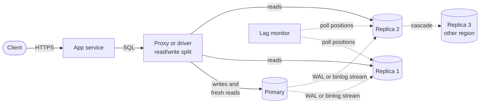
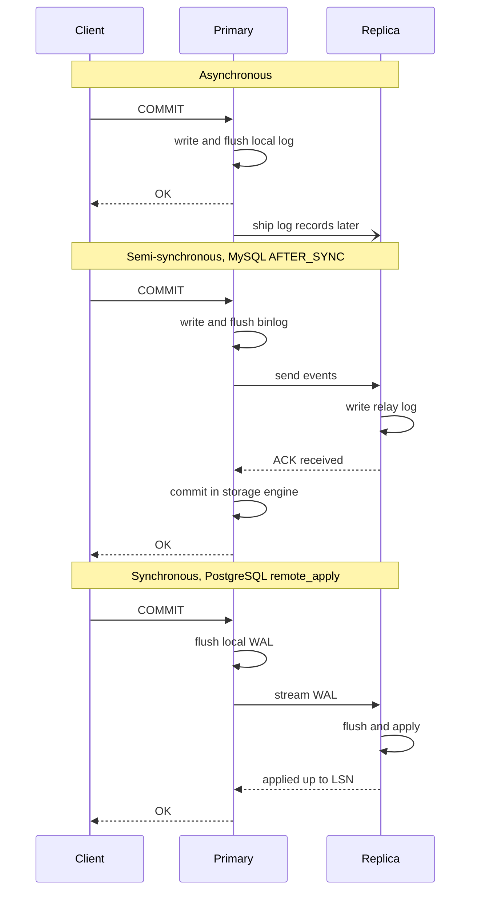
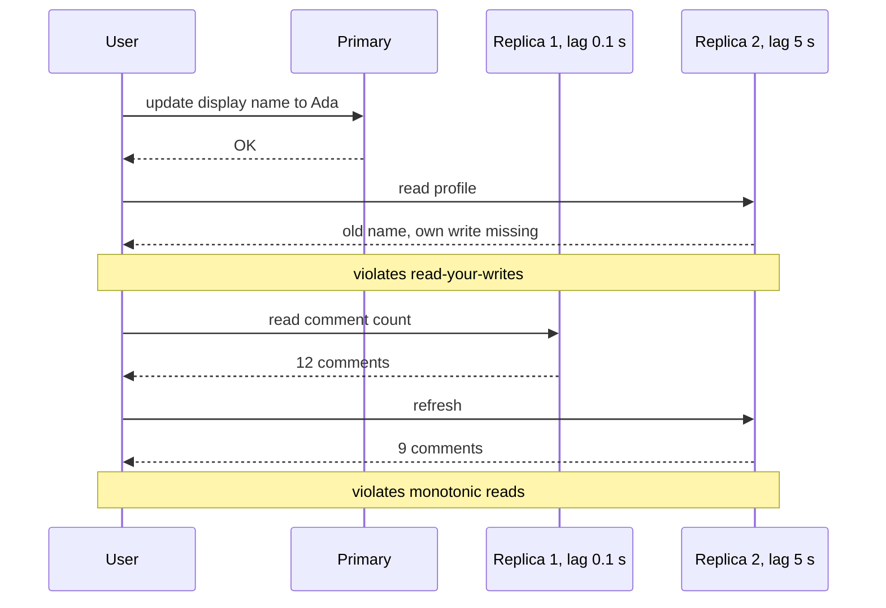
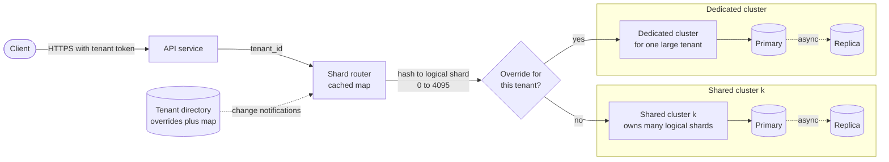
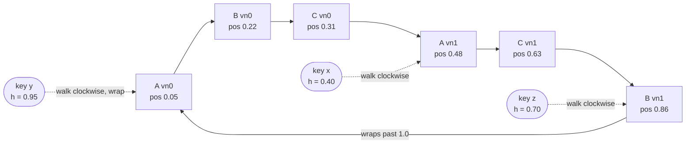
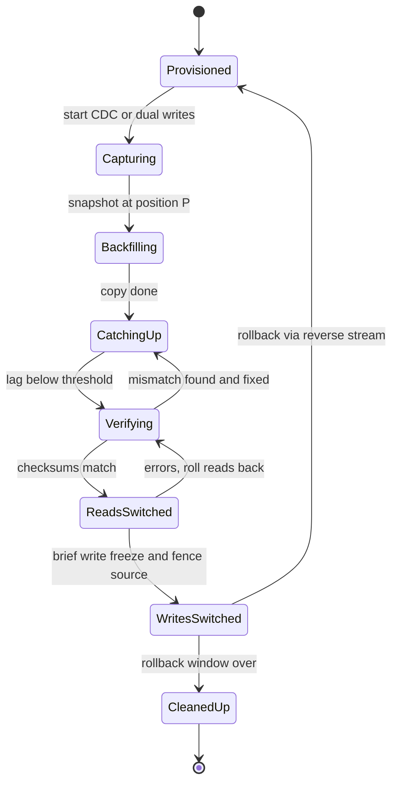
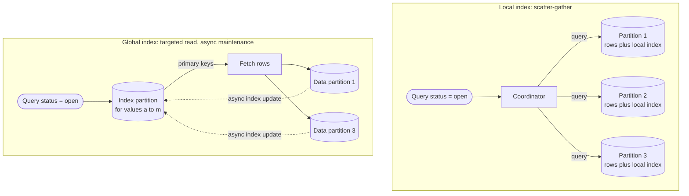
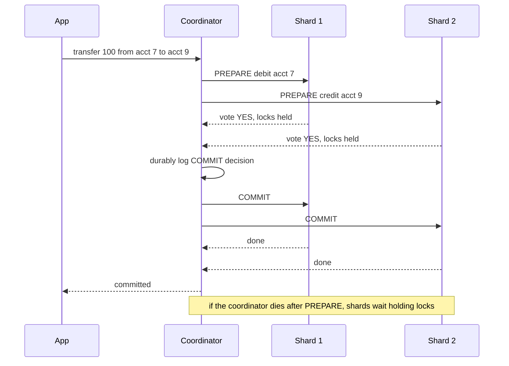
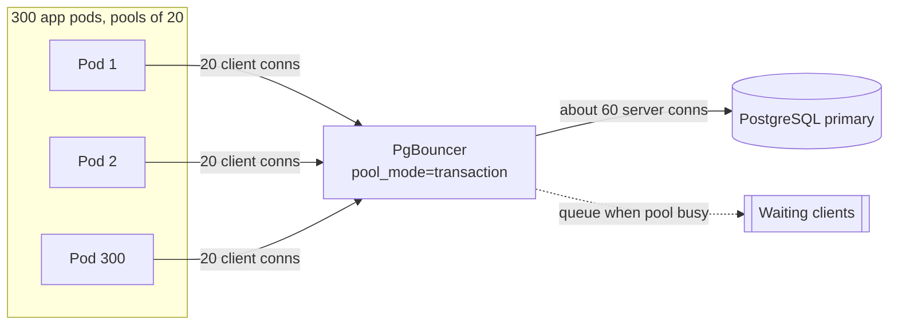
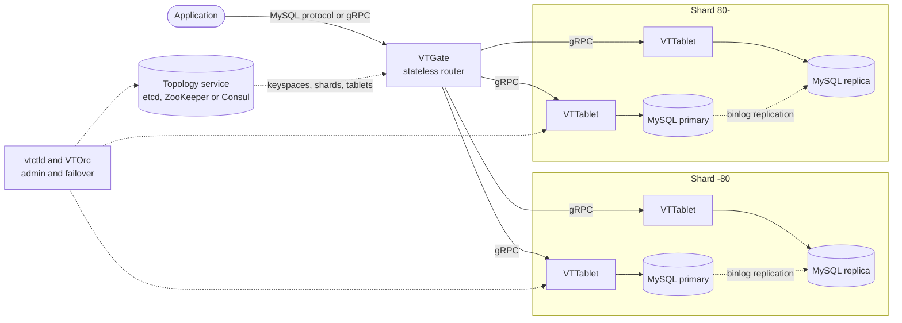

# Chapter 14 — Database Scaling: Replication, Partitioning and Sharding

> **Level:** 2–3 · **Track:** A (Traditional) · **Estimated reading time:** 6 h

A single database server is the most comfortable place your data will ever live: every row in one place, every transaction consistent, every join just a join. Three limits end that comfort. Reads outgrow one machine, writes outgrow one machine, or the data outgrows its disks. Chapter 2 sketched this for QuickBite: one PostgreSQL primary handles 60 orders per second easily, 600 needs read replicas, and 6,000 probably needs partitioning (§2.10).

**Replication** keeps copies of the same data on several nodes. It adds read capacity and survives failures but adds no write capacity or storage. **Partitioning** (also called **sharding**) splits the data into subsets on different nodes. It adds write capacity and storage but makes queries that span subsets harder. Real systems do both: every partition is replicated. Consistency guarantees are treated in depth in Chapter 25, leaderless replication and conflict resolution in Chapter 27, and distributed transactions in Chapter 28.

## 14.1 Learning objectives

After this chapter you should be able to:

- Draw a primary–replica architecture and compare synchronous, asynchronous and semi-synchronous replication by latency, durability and availability.
- Explain how replication lag causes read-your-writes and monotonic-read anomalies, and design routing that prevents them.
- Distinguish statement-based, row-based, physical and logical replication, and say when multi-primary replication is worth its conflicts.
- Compare range, hash, list and directory partitioning, choose a shard key, and compute the number of shards from data size, write rate and per-node limits.
- Build a consistent-hash ring with virtual nodes, derive how load imbalance shrinks with the number of virtual nodes $V$, and compare it with jump and rendezvous hashing.
- Plan an online resharding, mitigate hot partitions and choose local or global secondary indexes.
- Explain the cost of cross-shard queries and transactions, and place PgBouncer, ProxySQL and Vitess in an architecture.

## 14.2 Prerequisites

- Transactions, ACID and isolation levels — §11.11–§11.13 (replication and sharding change what a transaction can guarantee).
- Indexes and B+ trees — §11.7–§11.8 (secondary indexes become a distributed problem).
- Write-ahead logging — §13.5 (physical replication ships the WAL).
- Little's Law and connection pools — §4.10 and the pool-sizing examples in Chapter 4 (used again in §14.13).
- Hash functions — §17.3 at an intuitive level: a hash maps any key to a well-mixed number.

## 14.3 Read replicas and primary–replica architecture

### 14.3.1 The primary–replica model

::: definition
**Definition — Replication.** Keeping a copy of the same data on more than one node. Each copy is a **replica**. In **primary–replica replication**, exactly one node, the **primary** (called the "master" in older documentation), accepts writes and streams its changes to the **replicas**, which apply them in the same order and serve reads.
:::

#### First-principles explanation

Think of a newspaper. One newsroom writes the stories, and printing plants in many cities print identical copies. Readers get the paper quickly from a local plant, but every correction must go through the newsroom, every plant must print every story, and a distant reader may hold yesterday's edition for a while. The newsroom is the primary, the plants are replicas and the delay is **replication lag**. Reads scale with the number of plants. Writes do not scale at all.

#### Why does this exist?

Most applications read far more than they write, often 10 to 100 reads per write. Copying the data to more nodes and spreading the reads is the cheapest way to multiply read capacity, with no schema change. Replicas are also a **hot standby**: a replica that already holds nearly all the data can be promoted in seconds if the primary dies.

#### How it works internally

1. A client sends a write (`INSERT`, `UPDATE`, `DELETE`) to the primary.
2. The primary records the change in its **replication log**: the write-ahead log (WAL, §13.5) in PostgreSQL, the **binary log** (binlog) in MySQL.
3. It commits, waiting first for replica acknowledgments if the replication mode requires it (§14.4).
4. A sender process streams new log records to each replica over a long-lived TCP connection. Each replica logs them and **applies** them in order.
5. Read-only queries go to replicas, routed by the application, a driver or a proxy (§14.13).
6. Each replica tracks its applied position: a log sequence number (LSN) in PostgreSQL or a global transaction identifier (GTID) set in MySQL. The gap to the primary's position is the replication lag.

#### Architecture diagram

**Figure 14.1 — Primary–replica architecture with read/write splitting.**



**Reading the diagram.** A proxy or driver sends writes and must-be-fresh reads to the primary and other reads to replicas, synchronously. Replication (dotted) is asynchronous by default, so replicas lag. Replica 3 is fed by Replica 2 (**cascading replication**), sparing the primary's fan-out to distant regions. Each node stores a full copy. The lag monitor removes lagging replicas from rotation. Failure points: the primary, until a replica is promoted (§27.11), and the intermediate replica for everything below it.

#### Mathematical foundations

Every write is applied on every node, so the write stream consumes part of each replica's capacity.

::: formula
**Read capacity of a replicated group**

$$R_{\max} = n \cdot (u \cdot c - w) \qquad \text{valid only while } w < u \cdot c$$

| Symbol | Meaning | Units |
|---|---|---|
| $R_{\max}$ | Maximum sustainable read rate across the group | reads/s |
| $n$ | Number of nodes serving reads (replicas, plus the primary if it serves reads) | nodes |
| $c$ | Capacity of one node, expressed in read-equivalent operations | ops/s |
| $u$ | Target utilization, leaving headroom for spikes and failover | dimensionless (0–1) |
| $w$ | Cost of applying the full write stream on one node, in read-equivalent operations | ops/s |
:::

::: example
**Worked example — When do more replicas stop helping?** Assume one node handles $c = 20{,}000$ read-equivalent operations per second, and you run it at $u = 0.6$, so 12,000 ops/s of budget. Applying one write costs about as much as 3 reads.

1. At 1,000 writes/s, $w = 3{,}000$. Each replica has $12{,}000 - 3{,}000 = 9{,}000$ ops/s for reads. Four replicas give $R_{\max} = 4 \times 9{,}000 = 36{,}000$ reads/s.
2. At 3,000 writes/s, $w = 9{,}000$. Each replica has 3,000 ops/s left. Four replicas give only 12,000 reads/s. Even 12 replicas give 36,000.
3. At 4,000 writes/s, $w = 12{,}000 = u \cdot c$. Replicas have no read budget left at all, and they can barely keep up with the write stream.

**Interpretation.** Replicas multiply *spare* capacity, and the write stream eats into every node's spare capacity equally. **Engineering implication.** Read replicas are the right first move when writes are a small fraction of load. Once applying writes uses about half a node's budget, partition (§14.6).
:::

#### Real-world industry applications

::: industry
**PostgreSQL and MySQL.** PostgreSQL streams WAL to **hot standby** servers, which serve read-only queries while applying changes. MySQL replicas pull binlog events and apply them with one or more parallel applier threads. Managed services such as Amazon RDS expose the same mechanism as "read replicas".
*Evidence: Primary* — [PostgreSQL Docs: High Availability], [MySQL Docs: Replication]
:::

#### Advantages and disadvantages

Replicas are simple to add, give a warm standby and can isolate heavy analytical queries. But they add no write or storage capacity, each one is a full copy, reads may be stale, and asynchronous failover can lose the last few transactions (§14.4).

#### Failure scenarios

**Table 14.1 — Failure scenarios for read replicas.**

| What goes wrong | Why | Detection | Recovery | Prevention |
|---|---|---|---|---|
| Users see stale data | Replica applies changes seconds behind | Lag metric; user reports "my edit vanished" | Route that user's reads to primary | Read-your-writes routing (§14.4.4) |
| Replica falls ever further behind | Single-threaded apply, or a long query blocks apply | Lag grows steadily | Kill blocking queries; enable parallel apply | Parallel apply; cap query time on replicas |
| Data lost on failover | Async replica promoted before receiving last commits | Gap in GTIDs or LSNs after promotion | Reconcile from old primary if it is reachable | Semi-sync or sync replica as failover target |

#### Common misconceptions

::: mistake
**Mistake — "Add replicas until the database is fast enough."** Replicas help only reads that tolerate staleness. If the primary is busy with writes or must-be-fresh reads, more replicas change nothing.
:::

## 14.4 Synchronous, asynchronous and semi-synchronous replication

### 14.4.1 Three modes of acknowledgment

::: definition
**Definition — Replication modes.** In **synchronous replication**, the primary reports a commit only after at least one designated replica has durably received (or applied) it. In **asynchronous replication**, it reports success after its local commit and ships the change afterwards. **Semi-synchronous replication**, MySQL's middle ground, waits until a replica has *received and logged* the change and falls back to asynchronous mode after a timeout.
:::

#### First-principles explanation

Imagine posting an important letter. Asynchronous is dropping it in a mailbox and walking away: fast, but if the post office burns down tonight the letter is lost. Synchronous is waiting for a signed receipt from the recipient: slow, and you are stuck if the courier is. Semi-synchronous is waiting only until the courier confirms the letter is in the van, and giving up after ten seconds. The trade-off is **durability on failover versus commit latency and availability**.

#### How it works internally

**Figure 14.2 — Commit paths under asynchronous, semi-synchronous and synchronous replication.**



**Reading the diagram.** Solid arrows are steps the client waits for. In the asynchronous path, shipping (open arrowhead) happens after the reply, so a primary crash then loses the transaction. MySQL's lossless semi-sync (`AFTER_SYNC`) waits for a replica to write its **relay log** before the engine commit, so no client sees a transaction no replica has. PostgreSQL's `remote_apply` waits until the standby has *applied* the change. Storage boundaries are the two logs. The failure point is the replica: a slow synchronous replica stalls every commit, which quorum commit over several replicas mitigates.

The two products expose different knobs:

- **PostgreSQL.** `synchronous_standby_names` chooses which standbys count: `FIRST 1 (a, b)` by priority or `ANY 2 (a, b, c)` as a quorum. `synchronous_commit` sets how far to wait: `off`, `local`, `remote_write`, `on` (standby flushed) or `remote_apply` (standby applied) [PostgreSQL Docs: synchronous_commit].
- **MySQL.** Semi-synchronous replication has a wait point (`AFTER_SYNC`, lossless and the default since 5.7, or `AFTER_COMMIT`), a number of replicas that must acknowledge, and a timeout after which the primary silently reverts to asynchronous mode [MySQL Docs: Semisynchronous Replication]. Semi-sync protects you only while replicas are healthy.

#### Mathematical foundations

::: formula
**Commit latency with $k$ acknowledgments**

$$T_{\text{commit}} \approx T_{\text{local}} + \text{RTT}_{(k)} + T_{\text{remote}}$$

| Symbol | Meaning | Units |
|---|---|---|
| $T_{\text{commit}}$ | Time from the client's `COMMIT` to the primary's reply | ms |
| $T_{\text{local}}$ | Time to flush the log on the primary | ms |
| $\text{RTT}_{(k)}$ | The $k$-th smallest round-trip time among the eligible replicas | ms |
| $T_{\text{remote}}$ | Work the replica does before acknowledging (write, flush or apply) | ms |
| $k$ | Number of replica acknowledgments required ($k = 0$ for asynchronous) | count |
:::

::: example
**Worked example — Where to put the synchronous replica.** A primary flushes its WAL in 0.2 ms on NVMe with power-loss protection (a drive without it can take about 2 ms per `fsync`, §6.14.3). Replica A is in the same availability zone (RTT 0.3 ms), replica B is in another zone of the same region (RTT 1.2 ms), and replica C is in another region (RTT 70 ms). Each replica flushes in 0.2 ms.

1. Asynchronous ($k = 0$): $T \approx 0.2$ ms.
2. Synchronous, `ANY 1 (A, B)`: the fastest acknowledgment is A's. $T \approx 0.2 + 0.3 + 0.2 = 0.7$ ms.
3. Synchronous, `ANY 2 (A, B, C)`: the second-fastest is B. $T \approx 0.2 + 1.2 + 0.2 = 1.6$ ms.
4. Synchronous to C only: $T \approx 0.2 + 70 + 0.2 \approx 70.4$ ms.
5. A single session committing sequentially manages $1/0.7\,\text{ms} \approx 1{,}430$ commits/s in case 2 but only $1/70.4\,\text{ms} \approx 14$ in case 4. Group commit helps concurrent sessions, but each transaction still pays the latency.

**Interpretation.** A cross-zone acknowledgment costs about a millisecond. A cross-region one costs the inter-region RTT on every commit. **Engineering implication.** A common pattern is synchronous replication to a replica in another zone of the same region plus asynchronous replicas in remote regions. A zone loss then loses no data, and a region loss risks a few seconds of writes (a nonzero recovery point objective, §39.8).
:::

**Table 14.2 — Replication modes compared.**

| | Asynchronous | Semi-synchronous (MySQL) | Synchronous / quorum (PostgreSQL) |
|---|---|---|---|
| Client waits for | Local flush only | ≥ 1 replica has *received* | $k$ replicas have flushed or applied |
| Commit latency | Lowest | + 1 RTT | + RTT of $k$-th fastest replica |
| Data loss on primary crash | Possible (seconds of writes) | None while healthy; possible after timeout fallback | None, if failover picks an acknowledged replica |
| Availability if replicas fail | Unaffected | Unaffected after timeout | Commits block until $k$ replicas return |
| Stale reads on replicas | Yes | Yes (received, not yet applied) | Only `remote_apply` avoids them on the waited-for replicas |
| Choose when | Throughput first; remote regions | MySQL fleets wanting near-zero loss | Financial data; zone-level failure tolerance |

#### Common misconceptions

::: mistake
**Mistake — "Synchronous replication means replicas never serve stale data."** PostgreSQL's default synchronous setting (`on`) waits for the standby to *flush*, not *apply*, so a read there a millisecond later can miss the change. Only `remote_apply` closes the gap, and only on the standbys waited for.
:::

### 14.4.2 Replication lag

::: definition
**Definition — Replication lag.** The delay between a change committing on the primary and becoming visible on a replica, measured in seconds, bytes of log or transactions.
:::

Within one region, asynchronous lag is typically well under a second, but it is unbounded. It grows whenever the replica applies changes more slowly than the primary produces them: a single-threaded applier, a bulk `UPDATE` of millions of rows, a replica returning from maintenance, a network partition, or replica queries that block replay. Catching up is draining a queue.

::: formula
**Replica catch-up time**

$$T_{\text{catch-up}} = \frac{B}{r_{\text{apply}} - r_{\text{in}}} \qquad (r_{\text{apply}} > r_{\text{in}})$$

| Symbol | Meaning | Units |
|---|---|---|
| $T_{\text{catch-up}}$ | Time until the replica's lag returns to near zero | s |
| $B$ | Backlog of unapplied changes when catch-up starts | transactions |
| $r_{\text{apply}}$ | Rate at which the replica can apply changes | transactions/s |
| $r_{\text{in}}$ | Rate at which the primary generates new changes during catch-up | transactions/s |
:::

::: example
**Worked example — A replica returns from 10 minutes of maintenance.** The primary commits $r_{\text{in}} = 5{,}000$ transactions/s. The replica can apply $r_{\text{apply}} = 8{,}000$ transactions/s with parallel apply.

1. Backlog: $B = 5{,}000 \times 600\,\text{s} = 3{,}000{,}000$ transactions.
2. Net drain rate: $8{,}000 - 5{,}000 = 3{,}000$ transactions/s.
3. Catch-up time: $3{,}000{,}000 / 3{,}000 = 1{,}000$ s, about 17 minutes.
4. At 5,500 transactions/s the net drain is 500/s and catch-up takes 6,000 s (100 minutes); at 5,000/s it never ends.

**Interpretation.** Catch-up time depends on the *margin* between apply and arrival rates. A replica with 10 % spare apply capacity takes ten times as long to recover as the outage lasted. **Engineering implication.** Keep replicas out of the read pool until lag is within your staleness budget, and track apply headroom $r_{\text{apply}} / r_{\text{in}}$ as a capacity metric.
:::

### 14.4.3 Anomalies caused by lag

Lag is invisible until it violates a user's expectations. Two violations are common. Chapter 25 (§25.6) treats these **session guarantees** formally.

::: definition
**Definition — Read-your-writes consistency.** After a client writes a value, its own later reads return that value or a newer one. Other clients get no such promise.
:::

::: definition
**Definition — Monotonic reads.** A client never sees data move backwards: after reading some version, its later reads return that version or newer.
:::

**Figure 14.3 — Two lag anomalies: lost own write and time going backwards.**



**Reading the diagram.** Calls are synchronous; replication (not drawn) is asynchronous. The read after the write lands on Replica 2, five seconds behind, so the edit seems lost. Then successive reads hit different replicas, and the comment count falls from 12 to 9. The failure point is the router's freedom to pick any replica, and it bites more often as replicas are added.

### 14.4.4 Designing around lag

Each fix narrows the router's freedom and so costs some read scalability.

1. **Read recent writers from the primary.** For a window after a user writes, such as 10 seconds, route that user's reads to the primary. PhotoShare used this rule (Figure 1.6, §1.9). It is simple but fails silently if lag exceeds the window.
2. **Track the write's log position.** Return the primary's LSN or GTID after a write and read only from replicas that have applied it, or wait briefly until one has. MySQL offers `WAIT_FOR_EXECUTED_GTID_SET()`, and PostgreSQL exposes `pg_last_wal_replay_lsn()`. This is precise but needs a token plumbed through the application.
3. **Sticky replica per session.** Always read a session from the same replica. This gives monotonic reads but not read-your-writes.
4. **Synchronous apply where it matters.** Use `remote_apply` for the replica that serves a specific critical read path.

The program below implements option 2 with a per-session watermark.

```python
"""Read-your-writes and monotonic reads with log-position tokens (simulation)."""
import random

class Replica:
    def __init__(self, name):
        self.name, self.applied = name, 0       # applied log position (LSN)

class Router:
    """Routes reads to any replica that has applied the session's watermark."""

    def __init__(self, replicas):
        self.primary_lsn = 0
        self.replicas = replicas
        self.watermark = {}                      # session -> minimum LSN to read

    def write(self, session):
        self.primary_lsn += 1                    # commit on the primary
        self.watermark[session] = self.primary_lsn
        return self.primary_lsn

    def read(self, session):
        need = self.watermark.get(session, 0)
        fresh = [r for r in self.replicas if r.applied >= need]
        if not fresh:
            return "primary"                     # nobody is fresh enough yet
        chosen = random.choice(fresh)
        # monotonic reads: later reads must be at least as fresh as this one
        self.watermark[session] = max(need, chosen.applied)
        return chosen.name

if __name__ == "__main__":
    random.seed(7)
    r1, r2 = Replica("replica-1"), Replica("replica-2")
    router = Router([r1, r2])
    lsn = router.write("alice")                  # alice writes; LSN 1
    print("right after write  ->", router.read("alice"))   # nobody has LSN 1
    r1.applied = lsn                             # replica-1 catches up
    print("replica-1 caught up ->", router.read("alice"))
    print("bob (no writes)     ->", router.read("bob"))    # any replica is fine
```

What to notice:

- Only the user who wrote pays for freshness. Other sessions read from any replica.
- With no fresh replica, the router falls back to the primary. A production router might wait a few milliseconds first to avoid a stampede.
- Raising the watermark to the replica just read also gives monotonic reads.

### 14.4.5 What travels on the wire: statement, row, physical and logical replication

::: definition
**Definition — Replication log formats.** What the log describes: the SQL statements executed (**statement-based**), the changed rows (**row-based**), the storage engine's page-level byte changes (**physical**, or WAL shipping), or decoded, engine-independent row changes per table (**logical**).
:::

#### How each works

- **Statement-based.** Replicas re-execute the primary's SQL text. The log is compact, but non-determinism (`NOW()`, `RAND()`, `UPDATE ... LIMIT` without `ORDER BY`) makes copies diverge silently. MySQL's `MIXED` mode falls back to rows for statements it knows are unsafe.
- **Row-based.** The log carries each changed row's key and new values, so replay is deterministic, at the cost of volume: a million-row `UPDATE` yields a million events. `ROW` has been MySQL's default since 5.7.7 [MySQL Docs: Replication Formats].
- **Physical (WAL shipping).** PostgreSQL streams the WAL itself, page-level byte changes, so the replica is a byte-for-byte copy including indexes and replay is cheap. The coupling is tight: same major version, the whole cluster, no extra tables or indexes.
- **Logical.** The primary decodes its WAL into per-table row changes and publishes them; in PostgreSQL (since version 10) a **publication** on the source feeds a **subscription** on the target [PostgreSQL Docs: Logical Replication]. This enables cross-version upgrades, partial copies and **change data capture (CDC)** into brokers and search indexes (§32.6). Built-in logical replication does not carry DDL, and a writable subscriber can conflict.

**Table 14.3 — Replication log formats compared.**

| | Statement-based | Row-based | Physical (WAL) | Logical |
|---|---|---|---|---|
| What is shipped | SQL text | Changed rows | Page-level byte changes | Decoded row changes per table |
| Log volume for bulk update | Tiny | Large | Large (includes indexes) | Large |
| Determinism | Fragile | Exact | Exact | Exact |
| Version coupling | Loose | Loose | Same major version | Cross-version |
| Replica can differ (extra indexes, subset) | Partly | Partly | No | Yes |
| Feeds CDC and other systems | No | Yes (binlog readers) | No | Yes |

::: recommendation
**Recommendation — Default choices.** Use row-based binlogs in MySQL and physical streaming for PostgreSQL high-availability replicas. Add logical replication for upgrades, partial copies or CDC.
:::

#### Failure scenarios

**Table 14.4 — Failure scenarios in replication modes and formats.**

| What goes wrong | Why | Detection | Recovery | Prevention |
|---|---|---|---|---|
| All commits hang | Sole synchronous standby is down | Commit latency spikes to timeout | Remove it from `synchronous_standby_names` | Quorum `ANY k` over ≥ $k+1$ standbys |
| Silent loss of the durability guarantee | Semi-sync timed out and fell back to async | Semi-sync status counters | Restore replica health | Alert on fallback, not just on lag |
| Split brain after failover | Old primary still accepts writes | Two nodes report primary role | Fence old primary; reconcile | Fencing tokens and leases (§26.11–§26.13) |

## 14.5 Multi-primary replication

### 14.5.1 Writes in more than one place

::: definition
**Definition — Multi-primary replication.** More than one node accepts writes for the same data and replicates to the others (also **multi-leader** or **active–active**). Concurrent uncoordinated changes to the same row create **write conflicts** that must be detected and resolved.
:::

#### First-principles explanation

Two offices each keep a copy of the customer address book and exchange changes every evening. Each can edit at full speed even when the phone lines are down, but if both change Mrs. Rivera's address on the same day, somebody needs a rule for which one wins.

#### Why does this exist?

Single-primary replication makes distant users pay 70–150 ms per write and stops all writes if the primary's region is cut off. Multi-primary puts a writable primary in each region. Offline-capable clients, such as a calendar app, are the same pattern with each device as a primary.

#### How it works internally

1. Each region's primary accepts local writes and commits them locally.
2. Changes are replicated asynchronously to the other primaries, tagged with their origin so they are not echoed back.
3. When a change arrives that touches a row also changed locally since the last sync, the receiving primary detects a conflict.
4. A **conflict-resolution** policy picks the outcome. Common policies are **last-writer-wins** (LWW, the change with the later timestamp wins, which silently discards the other), a custom merge function, keeping both versions for the application to resolve, or **conflict-free replicated data types** (CRDTs) whose merges are mathematically guaranteed to converge. Chapter 27 (§27.14) covers these in depth.

**Figure 14.4 — Two-region multi-primary replication and a write conflict.**


**Reading the diagram.** Each region writes synchronously to its local primary (about 1 ms), and the primaries exchange changes asynchronously, so the two storage boundaries differ until replication catches up. Every incoming change passes the conflict detector. The resolver is the failure point: LWW depends on clocks (§24.9) and silently drops a write, and uniqueness cannot be enforced across regions. Each added region adds pairs of primaries that can conflict.

#### Advantages, disadvantages and when to choose it

Multi-primary buys local write latency and partition tolerance at the cost of global constraints, linearizable reads, colliding auto-increment keys and much harder debugging. A common compromise is **partitioned ownership**: each row has one home region that is its only primary, which gives most of the latency benefit with no conflicts. Choose true multi-primary only when the same data must be written concurrently in several regions *and* you can define a merge.

::: industry
**MySQL Group Replication.** In multi-primary mode, all members accept writes. Transactions are certified through a group-communication protocol, and one that conflicts with an earlier-certified transaction is rolled back rather than merged. It needs a low-latency network, so it is typically used within one region.
*Evidence: Primary* — [MySQL Docs: Group Replication]
:::

::: mistake
**Mistake — "Active–active doubles write capacity."** Every primary still applies every other primary's writes. Multi-primary improves write *latency* and *availability*, not total write throughput.
:::

## 14.6 Partitioning: range, hash, list and directory-based

### 14.6.1 What partitioning is

::: definition
**Definition — Partition (shard).** A subset of a dataset's rows, stored and served together, such that every row belongs to exactly one partition. **Partitioning** spreads partitions over nodes; **sharding** is a synonym used mostly for separate database servers. This book uses *partition* and *shard* interchangeably and reserves **network partition** for network splits (§24.7). The columns that choose a row's partition form the **partition key** (or **shard key**).
:::

#### First-principles explanation

A library that outgrows one room does not photocopy every book into a second room; that would be replication. It moves A–M to one room and N–Z to another. Each room holds and serves half the books, and a visitor seeking one title goes straight to the right room. A visitor asking "which books were published in 1987?" must search both. Capacity scales with rooms, lookups by the partitioning attribute stay cheap, and everything else gets more expensive.

#### Why does this exist?

Replication cannot fix three limits: one primary's write rate, one node's storage and one node's memory for the working set. Partitioning divides all three by the number of partitions. It is the only general way to scale writes horizontally. (PostgreSQL's declarative table partitioning splits a table on the *same* node, which helps maintenance but adds no machines.)

#### How it works internally

Every partitioned system answers two questions per request: **which partition holds this key?** and **which node holds that partition?** The schemes differ in the first answer.

1. **Range partitioning.** Each partition owns a contiguous key range, found by binary search over a small boundary table. Range scans touch only overlapping partitions. But sequential keys, such as timestamps or auto-increment IDs, send *all* new writes to the last partition. Bigtable, HBase and the distributed SQL systems of Chapter 28 range-partition and split ranges as they grow [Chang et al. 2006].
2. **Hash partitioning.** Partitions own ranges of $h(\text{key})$, or $h(\text{key}) \bmod P$ for a fixed $P$. Even sequential keys spread evenly, but range queries on the key must ask every partition. Mapping hashes to a changing set of nodes is §14.8.
3. **List partitioning.** Each partition owns an explicit list of values, such as `country IN ('DE', 'FR', 'IT')`. It suits low-cardinality attributes with business meaning, especially **data residency** (Chapter 44).
4. **Directory-based partitioning.** A lookup service maps each key, or group of keys such as a tenant, to its partition. Any placement is possible, and moving a tenant means copying its data and editing one entry. The directory is on every request's path, so it is cached and stored in a strongly consistent replicated store.

**Compound keys** combine schemes: Cassandra's primary key `((user_id), created_at)` hashes `user_id` to place the partition and keeps each user's rows sorted by time inside it, so "user 42's latest 20 posts" is one sequential read [Lakshman and Malik 2010].

#### Architecture diagram

**Figure 14.5 — Four ways to answer "which partition holds this key?"**


**Reading the diagram.** The scheme is a design-time choice, not a runtime branch. Range, hash and list are pure functions plus a small cached table; a directory adds a synchronous lookup unless cached. All yield a partition ID that a separate map turns into a node, so rebalancing edits only that map (§14.9). Failure points: a stale map (nodes must reject misrouted requests) and a directory outage. Scaling: add nodes and move partitions; the key-to-partition function never changes.

**Table 14.5 — Partitioning schemes compared.**

| | Range | Hash | List | Directory |
|---|---|---|---|---|
| What it is | Contiguous key ranges | Ranges of hashed key | Explicit value lists | Explicit key-to-partition map |
| Load balance | Poor for sequential keys | Good | Depends on value sizes | Whatever you place |
| Range scans on key | Efficient | Scatter to all partitions | Efficient within a value | Depends |
| Routing cost | Binary search, cacheable | Arithmetic | Table lookup | Remote lookup, cached |
| Rebalancing | Split or merge ranges | Move hash ranges (§14.8–§14.9) | Edit lists | Move one entry at a time |
| Operational complexity | Medium | Low | Low | High (directory is critical) |
| Choose when | Time series, ordered scans | Point lookups, uniform load | Residency, regions | Tenants of very different sizes |

#### Common misconceptions

::: mistake
**Mistake — "Hashing removes hot spots."** Hashing spreads *distinct* keys. It cannot split one key's traffic. A celebrity key drawing 30 % of reads puts at least 30 % on its partition under any hash (§14.10).
:::

## 14.7 Sharding strategies and choosing shard keys

### 14.7.1 Properties of a good shard key

The shard key is the least reversible decision in a partitioned database, because changing it means moving every row (§14.9). Evaluate candidates against five properties:

1. **High cardinality.** Many more distinct values than shards: `country` has about 200, `user_id` billions.
2. **Even load.** Data and request rate per value roughly uniform, or dominated by many small values.
3. **Query locality.** Frequent queries include the key and touch one shard. Others **scatter** to every shard and **gather** results.
4. **Transaction locality.** Rows changed atomically together share a key value, avoiding distributed commit (§14.12).
5. **Stability.** The key never changes. Otherwise a row must move between shards.

No key is perfect. List the top five queries by frequency and pick the candidate that keeps the most traffic on one shard.

### 14.7.2 Worked example: a multi-tenant SaaS product

Consider **TaskForge**, a hypothetical project-management SaaS with 40,000 customer organizations (tenants). Nearly every query is tenant-scoped: "this project's open tasks", "search this workspace". Tenant sizes are heavy-tailed: the median has 15 users and the largest has 60,000 and about 2 % of all data.

**Table 14.6 — Shard-key candidates for TaskForge.**

| Candidate | Cardinality | Even load | Query locality | Transaction locality | Verdict |
|---|---|---|---|---|---|
| `task_id` | Very high | Excellent | Poor: "open tasks in project" scatters | Poor | Reject |
| `user_id` | High | Good | Poor: shared projects span users | Poor | Reject |
| `tenant_id` | 40,000 | Skewed by large tenants | Excellent: almost all queries | Excellent | **Choose**, with mitigation |
| `project_id` | High | Good | Good within a project; cross-project reports scatter | Good | Second choice |

`tenant_id` keeps almost every query and transaction on one shard and simplifies tenant isolation, backup, residency and deletion. Its weakness is skew from giant tenants, fixed with directory placement on top of hashing:

1. Hash `tenant_id` into one of $L = 4{,}096$ **logical shards** (fixed partitions, §14.9).
2. Map logical shards to physical database clusters through a small directory.
3. Give the few giant tenants a **dedicated** cluster through a directory override. If one outgrows even that, partition it by `(tenant_id, project_id)`.

**Figure 14.6 — Multi-tenant sharding with logical shards and a tenant directory.**



**Reading the diagram.** The API takes the tenant ID from the authenticated token, never from user input. The router caches the shard-to-cluster map and override list, updated asynchronously from the directory, so databases must reject writes for logical shards they do not own. SQL to the chosen primary is synchronous, and each cluster is a replicated storage boundary (§14.3–§14.4). A cluster failure affects only its tenants, a smaller **blast radius** than one big database. Scaling: add clusters and move logical shards, or give a growing tenant its own cluster.

::: industry
**Notion.** Notion sharded its PostgreSQL block data by workspace ID, because each block belongs to one workspace. It created 480 logical shards (PostgreSQL schemas) spread over 32 physical databases, 15 each, with routing in application code. It chose 480 because its many divisors let the fleet grow to 40 or 48 hosts with equal shard counts, whereas 512 would force doubling.
*Evidence: Primary* — [Fidalgo 2021]
:::

### 14.7.3 Worked example: a social application

Now take **PhotoShare**, the hypothetical photo-sharing app of Chapter 1. Its top queries are "show user X's profile and photos", "post a photo", "like a photo" and "build my home feed".

- **`photos` by `owner_user_id`.** Profiles and posting become single-shard, and a compound key `((owner_user_id), created_at DESC)` keeps photos time-ordered. Celebrity profiles concentrate reads on one shard (§14.10).
- **`likes` by `photo_id`.** Like counts and "did I like it?" are single-shard. "Photos I liked" becomes a scatter query, served by an index or denormalized copy (§14.11).
- **`follows`, stored twice.** "Who does X follow?" wants partitioning by follower and "who follows X?" by followee, so write both copies, usually asynchronously (§32.6), and accept brief inconsistency.
- **Home feed.** Querying every followed user's shard per page view is a large fan-out. Large social systems typically precompute feeds on write, except for celebrities whose posts are merged at read time [Kleppmann 2017].

::: concept
**Key insight — Partition by the entity your hottest queries name, and denormalize for the rest.** No single key localizes every social-graph query. Pick the key for the dominant path and keep an eventually consistent, differently partitioned copy for the next.
:::

::: industry
**Instagram (2012).** Instagram sharded PostgreSQL into several thousand **logical shards** (schemas) mapped onto far fewer servers. Each 64-bit ID embeds 41 bits of milliseconds since a custom epoch, 13 bits of logical shard ID and 10 bits of per-shard sequence, so any service can route from an ID alone.
*Evidence: Primary* — [Instagram Engineering 2012]
:::

### 14.7.4 How many shards? A capacity calculation

Shard count is set by whichever resource runs out first, computed at the end of the planning horizon because resharding is expensive.

::: formula
**Number of shards required**

$$S = \left\lceil \max\left( \frac{D}{C_{\text{disk}} \cdot f},\; \frac{W}{w_{\text{node}} \cdot u},\; \frac{R}{n_{\text{read}} \cdot r_{\text{node}} \cdot u} \right) \right\rceil$$

| Symbol | Meaning | Units |
|---|---|---|
| $S$ | Number of shards (each one a replicated group) | shards |
| $D$ | Data size at the planning horizon, one copy, including indexes | TB |
| $C_{\text{disk}}$ | Usable storage per node | TB |
| $f$ | Target fill fraction, leaving room for compaction, backups and growth between reshards | dimensionless (0–1) |
| $W$ | Peak write rate at the horizon | writes/s |
| $w_{\text{node}}$ | Sustainable write rate of one primary (from benchmarks) | writes/s |
| $R$ | Peak read rate that reaches the database, after caches | reads/s |
| $n_{\text{read}}$ | Nodes per shard that serve reads | nodes |
| $r_{\text{node}}$ | Sustainable read rate of one node | reads/s |
| $u$ | Target utilization at peak | dimensionless (0–1) |
:::

::: example
**Worked example — Sharding PhotoShare's metadata store.** SI units (1 TB = $10^{12}$ bytes). Assumptions are stated, not measured.

1. **Storage.** Metadata is 30 TB today, including indexes, and grows by 1.5 TB per month. The planning horizon is 24 months, so $D = 30 + 24 \times 1.5 = 66$ TB. Each node has 8 TB of usable NVMe, and you fill it to at most $f = 0.6$. Storage term: $66 / (8 \times 0.6) = 66 / 4.8 = 13.75$.
2. **Writes.** Peak writes are 90,000/s today and expected to grow 1.5×, so $W = 135{,}000$/s. A benchmarked primary sustains $w_{\text{node}} = 10{,}000$ writes/s, and you run at $u = 0.6$. Write term: $135{,}000 / (10{,}000 \times 0.6) = 135{,}000 / 6{,}000 = 22.5$.
3. **Reads.** Peak reads are 1,200,000/s, and the cache hit ratio is 90 %, so $R = 120{,}000$/s reach the database. Each shard has one primary and two replicas, and only the replicas serve reads, so $n_{\text{read}} = 2$. A replica sustains $r_{\text{node}} = 20{,}000$ reads/s, and $u = 0.6$. Read term: $120{,}000 / (2 \times 20{,}000 \times 0.6) = 120{,}000 / 24{,}000 = 5$.
4. **Take the maximum.** $S = \lceil \max(13.75, 22.5, 5) \rceil = 23$. The store is **write-bound**.
5. **Round for operations.** Choose 24 shards so the fleet splits evenly over 3 availability zones (8 primaries per zone). Total nodes: $24 \times 3 = 72$.
6. **Logical shards.** Create $L = 960$ logical shards, 40 per physical shard. 960 is divisible by 24, 30, 32, 40, 48, 60, 64, 80 and 96, so the fleet can grow in modest steps and stay perfectly even.
7. **Sanity check after sharding.** Each shard stores $66 / 24 = 2.75$ TB (34 % of a node's disk) and takes $135{,}000 / 24 \approx 5{,}600$ writes/s (56 % of $w_{\text{node}}$) at the horizon.

**Interpretation.** Storage alone suggests 14 shards, which would under-provision by 40 %. **Engineering implication.** Compute all three terms and benchmark the binding one carefully: a 20 % error in $w_{\text{node}}$ moves the answer by about five shards. Choose the logical count once, for years, and the physical count for the next 18–24 months.
:::

The program below implements the formula and reproduces the example.

```python
"""Shard-count calculator: the binding constraint among storage, writes and reads."""
import math

def shards_needed(data_tb, disk_tb, fill, writes, write_cap, reads,
                  read_nodes, read_cap, util):
    terms = {
        "storage": data_tb / (disk_tb * fill),
        "writes": writes / (write_cap * util),
        "reads": reads / (read_nodes * read_cap * util),
    }
    binding = max(terms, key=terms.get)
    return math.ceil(terms[binding]), binding, terms

def even_logical_counts(physical, candidates=(512, 720, 960, 1024, 4096)):
    """Logical-shard counts that divide evenly over `physical` shards."""
    return [c for c in candidates if c % physical == 0]

if __name__ == "__main__":
    s, binding, terms = shards_needed(
        data_tb=30 + 24 * 1.5, disk_tb=8, fill=0.6,
        writes=90_000 * 1.5, write_cap=10_000,
        reads=1_200_000 * (1 - 0.90), read_nodes=2, read_cap=20_000, util=0.6)
    print({k: round(v, 2) for k, v in terms.items()})
    print(f"minimum shards = {s} ({binding}-bound)")
    physical = 3 * math.ceil(s / 3)          # round up to a multiple of 3 zones
    print(f"physical shards = {physical}, nodes = {physical * 3}, "
          f"even logical counts = {even_logical_counts(physical)}")
```

Running it prints:

```text
{'storage': 13.75, 'writes': 22.5, 'reads': 5.0}
minimum shards = 23 (writes-bound)
physical shards = 24, nodes = 72, even logical counts = [720, 960]
```

What to notice:

- It reports *which* term binds, which is where a real benchmark is needed.
- 1,024 and 4,096 do not divide evenly over 24 shards. Power-of-two counts suit fleets that double; highly composite counts suit fleets that grow in small steps.
- A cache outage multiplies $R$ by 10, turning the read term from 5 into 50 (§20.13).

#### Failure scenarios

**Table 14.7 — Failure scenarios from shard-key choice.**

| What goes wrong | Why | Detection | Recovery | Prevention |
|---|---|---|---|---|
| One shard runs out of disk | Key with large, uneven entities (a giant tenant) | Per-shard disk and growth dashboards | Move logical shards; split the tenant | Directory overrides; size by largest entity |
| All new writes hit one shard | Monotonic key under range partitioning | Per-shard write rate, one hot | Switch to hash or prefix the key | Avoid timestamps or sequences as the leading key |
| Cross-shard transactions everywhere | Related rows have different keys | 2PC or saga volume | Re-key so related rows co-locate | Transaction locality as a key criterion |

## 14.8 Consistent hashing and virtual nodes

This is the book's full treatment of consistent hashing. Section 3.3.2 used it as a study example, and Chapters 17, 19, 20 and 27 point back here.

### 14.8.1 The problem: `hash mod N` moves almost everything

The obvious rule, `node = h(key) mod N`, balances perfectly and needs no state, but a key keeps its node only if $h \bmod N = h \bmod (N+1)$, which holds for about $1/(N+1)$ of keys. Growing from 4 to 5 nodes moves about 80 % of keys, and from 100 to 101 about 99 %: a miss storm for a cache (§3.3.2) and a near-total copy for a database. We want a rule under which adding a node moves only the keys it should own.

::: definition
**Definition — Consistent hashing.** Keys and nodes are hashed onto the same circular space (the **ring**), and each key belongs to the first node position clockwise from its hash. Adding or removing a node changes the owner of an expected $K/N$ of $K$ keys for $N$ nodes [Karger et al. 1997].
:::

::: definition
**Definition — Virtual node (vnode).** One of $V$ ring positions belonging to the same physical node, typically obtained by hashing labels such as `db-3#vn17`; also called a **token**.
:::

### 14.8.2 Ring construction and lookup

#### First-principles explanation

Picture a circular running track marked from 0 to just under $2^{64}$. Each server stands at a few spots. Each key is dropped at the spot given by its hash and walks clockwise until it meets a server, which owns it. A new server intercepts only the keys walking toward its spots; every other walk ends where it did before.

#### How it works internally

1. **Choose a hash** giving well-mixed 64-bit integers, identical in every router process (MD5 truncated to 64 bits, MurmurHash3, xxHash). Python's per-process randomized `hash()` is unsuitable.
2. **Place vnodes.** For each physical node and each $i$ from 0 to $V-1$, hash a label such as `db-3#vn17` to get a position. Store all positions in a sorted array, with a parallel array of owners.
3. **Look up a key.** Binary-search for the first position strictly greater than $h(\text{key})$, wrapping to index 0 past the end. Cost: $O(\log M)$ for $M$ positions, about 15 comparisons for 100 nodes × 256 vnodes.
4. **Add a node.** Insert its positions. Each takes over the arc from its predecessor, so only keys in those arcs move, all *to* the new node.
5. **Remove a node.** Delete its positions. Its arcs merge into their clockwise successors, which, with scattered vnodes, belong to many different survivors.
6. **Weight nodes** by giving a bigger node proportionally more vnodes.
7. **Distribute membership** through a coordination service (§26.8–§26.9) or gossip (§27.10), versioned so a router can detect a stale copy.

**Figure 14.7 — A ring with three nodes and two vnodes each.**



**Reading the diagram.** Rectangles are vnode positions normalized to $[0, 1)$, linked clockwise and wrapping from 0.86 to 0.05. Each vnode owns the arc *ending* at it, for example A vn1 owns $(0.31, 0.48]$. Dotted lookups: $x$ at 0.40 goes to A vn1, $y$ at 0.95 wraps to A vn0, $z$ at 0.70 goes to B vn1. Lookup happens in router memory; data lives on A, B and C, whose shares (0.36, 0.40, 0.24) are uneven with two vnodes each. Failure point: routers with different membership disagree about owners.

### 14.8.3 How many keys move?

::: formula
**Expected keys moved on a membership change**

$$E[\text{moved on add}] = \frac{K}{N+1} \qquad\qquad E[\text{moved on remove}] = \frac{K}{N}$$

| Symbol | Meaning | Units |
|---|---|---|
| $K$ | Total number of keys | keys |
| $N$ | Number of nodes before the change | nodes |
:::

By symmetry, a new node's expected share is $1/(N+1)$, and only keys in its new arcs move. A removed node's keys are its share, $1/N$ in expectation. These are the minimum any balanced scheme can achieve. Karger et al. call the property **monotonicity**: keys move only to the new node, never between old nodes [Karger et al. 1997].

::: example
**Worked example — Adding a ninth database node.** A store holds $K = 2 \times 10^9$ rows of 1 KB each (2 TB, SI units) on $N = 8$ nodes, ring-partitioned with 128 vnodes per node.

1. Rows moved: $2 \times 10^9 / 9 \approx 2.22 \times 10^8$ rows, about 222 GB.
2. Under `mod N`: about $8/9$ of rows, $1.78 \times 10^9$ rows or 1.78 TB, would move.
3. Time to move 222 GB if rebalancing is throttled to 100 MB/s to protect foreground traffic: $222 \times 10^9 / 10^8 = 2{,}220$ s, about 37 minutes. Moving 1.78 TB at the same rate takes 17,800 s, about 5 hours.
4. Sources: with 128 vnodes, the new node's 128 arcs are cut from all 8 existing nodes, each contributing roughly $222/8 \approx 28$ GB, so all 8 can stream in parallel.

**Interpretation.** The ring cuts data movement by a factor of $N$ and spreads it over every node. **Engineering implication.** Adding capacity becomes a routine sub-hour operation, and the vnode count decides how many nodes share the copying.
:::

The runnable ring below checks these claims. It supports weights and returns a replica **preference list**.

```python
"""Consistent-hash ring with virtual nodes, weights and replica placement."""
import bisect
import hashlib
from collections import Counter

def h(key: str) -> int:
    """Map a string to a 64-bit ring position (MD5 used only for mixing)."""
    return int.from_bytes(hashlib.md5(key.encode("utf-8")).digest()[:8], "big")

class HashRing:
    def __init__(self, vnodes_per_weight: int = 100):
        self.vpw = vnodes_per_weight
        self.weights = {}          # physical node -> weight
        self._positions = []       # sorted vnode positions
        self._owners = []          # owner of _positions[i]

    def _rebuild(self) -> None:
        points = sorted(
            (h(f"{node}#vn{i}"), node)
            for node, w in self.weights.items()
            for i in range(self.vpw * w)
        )
        self._positions = [p for p, _ in points]
        self._owners = [n for _, n in points]

    def add_node(self, node: str, weight: int = 1) -> None:
        self.weights[node] = weight
        self._rebuild()            # one sort per membership change

    def remove_node(self, node: str) -> None:
        del self.weights[node]
        self._rebuild()

    def _index(self, key: str) -> int:
        i = bisect.bisect_right(self._positions, h(key))
        return 0 if i == len(self._positions) else i   # wrap around

    def owner(self, key: str) -> str:
        return self._owners[self._index(key)]

    def preference_list(self, key: str, r: int) -> list:
        """First r *distinct physical* nodes clockwise from the key."""
        r = min(r, len(self.weights))
        result, i = [], self._index(key)
        while len(result) < r:
            node = self._owners[i]
            if node not in result:
                result.append(node)
            i = (i + 1) % len(self._owners)
        return result

if __name__ == "__main__":
    keys = [f"user:{i}" for i in range(200_000)]
    ring = HashRing(vnodes_per_weight=128)
    for n in range(8):
        ring.add_node(f"db-{n}")

    before = {k: ring.owner(k) for k in keys}
    ring.add_node("db-8")
    after = {k: ring.owner(k) for k in keys}
    moved = [k for k in keys if before[k] != after[k]]
    print(f"add 9th node : {len(moved) / len(keys):.2%} of keys moved "
          f"(theory 1/9 = {1 / 9:.2%}); all moved keys went to "
          f"{set(after[k] for k in moved)}")

    share = sum(1 for k in keys if after[k] == "db-3") / len(keys)
    ring.remove_node("db-3")
    gone = {k: ring.owner(k) for k in keys}
    moved = [k for k in keys if after[k] != gone[k]]
    receivers = Counter(gone[k] for k in moved)
    print(f"remove db-3  : {len(moved) / len(keys):.2%} moved, exactly db-3's "
          f"share ({share:.2%}); spread over {len(receivers)} survivors, "
          f"largest receiver took {max(receivers.values()) / len(moved):.0%}")

    ring.add_node("db-big", weight=2)        # twice the vnodes
    load = Counter(ring.owner(k) for k in keys)
    mean = len(keys) / (len(ring.weights) + 1)   # db-big counts as two
    print(f"weighted node: db-big holds {load['db-big'] / mean:.2f}x a "
          f"weight-1 share")
    print("replicas of user:42 ->", ring.preference_list("user:42", 3))
```

Running it with Python 3.8 or later prints:

```text
add 9th node : 10.85% of keys moved (theory 1/9 = 11.11%); all moved keys went to {'db-8'}
remove db-3  : 9.84% moved, exactly db-3's share (9.84%); spread over 8 survivors, largest receiver took 20%
weighted node: db-big holds 1.88x a weight-1 share
replicas of user:42 -> ['db-0', 'db-5', 'db-big']
```

What to notice:

- Every moved key went to `db-8`: monotonicity, observed.
- Removal moved exactly the removed node's *actual* share, 9.84 % rather than the ideal 11.1 %; §14.8.4 quantifies that randomness.
- Those keys landed on all 8 survivors, the largest taking 20 %. With $V = 1$, one neighbor would take 100 %.
- `preference_list` skips nodes already chosen, so two replicas never share a machine.
- The weight-2 node got $1.88\times$, not $2\times$: weights set the *expected* share.

### 14.8.4 Virtual nodes and load balance: a derivation

With one position per node, §3.3.2 measured the busiest node at $2.6\times$ its fair share. Section 3.3.2 also claimed that the relative spread shrinks "roughly in proportion to $1/\sqrt{V}$". Here is the exact result for the standard model, checked by simulation.

**The model.** Assume an ideal hash, so each of the $M = NV$ vnode positions is independent and uniform on a ring of circumference 1. Each physical node owns $V$ of them. A node's **load** $L$ is the total length of the arcs ending at its vnodes, which is the fraction of a uniformly hashed key space it receives.

**Step 1 — The arcs are Dirichlet-distributed.** Cutting a circle at $M$ independent uniform points gives $M$ arc lengths that sum to 1 and are jointly $\text{Dirichlet}(1, \dots, 1)$: fix one point as the origin by rotational symmetry, and the other $M-1$ points cut the unit interval into pieces uniformly distributed on the simplex. This is the classical **uniform spacings** result [David and Nagaraja 2003]. The arcs are *exchangeable*, each with mean $1/M$.

**Step 2 — A node's load is a Beta random variable.** Which positions belong to which node depends only on labels, independent of where positions fall, so a node's arcs are in distribution any fixed $V$ of the $M$ exchangeable arcs. By the **aggregation property** of the Dirichlet distribution, their sum is $\text{Beta}(V, M - V)$:

$$L \sim \text{Beta}\big(V,\ (N-1)V\big).$$

**Step 3 — Mean and variance.** For $\text{Beta}(a, b)$, the mean is $a/(a+b)$ and the variance is $ab / \big((a+b)^2 (a+b+1)\big)$. With $a = V$ and $b = (N-1)V$:

$$E[L] = \frac{1}{N}, \qquad \text{Var}[L] = \frac{N-1}{N^2\,(NV+1)}.$$

**Step 4 — Relative spread.** Divide the standard deviation by the mean to get the coefficient of variation.

::: formula
**Load imbalance on a ring with virtual nodes**

$$\text{CV}(N, V) = \frac{\sqrt{\text{Var}[L]}}{E[L]} = \sqrt{\frac{N-1}{NV+1}} \;\approx\; \frac{1}{\sqrt{V}} \quad (N \gg 1)$$

$$\frac{E[\max_i L_i]}{1/N} \approx 1 + z_N \cdot \text{CV}(N, V) \quad (V \gtrsim 16), \qquad \frac{E[\max_i L_i]}{1/N} = H_N \quad (V = 1)$$

| Symbol | Meaning | Units |
|---|---|---|
| $L$, $L_i$ | Fraction of the key space owned by a node (by node $i$) | dimensionless (0–1) |
| $N$ | Number of physical nodes | nodes |
| $V$ | Virtual nodes per physical node | vnodes/node |
| $\text{CV}$ | Coefficient of variation: standard deviation of a node's load divided by its mean | dimensionless |
| $z_N$ | Expected maximum of $N$ independent standard normal variables: 1.16 for $N=5$, 1.54 for $N=10$, 2.51 for $N=100$, 3.24 for $N=1{,}000$ | dimensionless |
| $H_N$ | $N$-th harmonic number $1 + \tfrac12 + \dots + \tfrac1N \approx \ln N + 0.577$ | dimensionless |
:::

Three remarks:

- **Why $1/\sqrt{V}$.** Each arc behaves almost like an independent exponential variable, whose standard deviation equals its mean. A sum of $V$ of them has mean $\propto V$ and standard deviation $\propto \sqrt{V}$. The factor $(N-1)/N$ appears because the loads sum to 1.
- **The busiest node.** For large $V$ each load is nearly normal, so the busiest of $N$ sits about $z_N$ standard deviations above the mean; $z_N$ grows slowly, roughly as $\sqrt{2 \ln N}$. For $V = 1$, the longest of $N$ uniform spacings has expected length $H_N/N$. The normal approximation slightly underestimates the maximum because the Beta distribution is right-skewed.
- **Agreement with published results.** Lamping and Veach report a 3.2 % standard error for a ring with 1,000 points per bucket, with about 1 % of buckets still at least 8 % off average [Lamping and Veach 2014]. The formula gives $\sqrt{1/1000} \approx 3.16$ %, and a two-sided 1 % normal tail sits at $2.58 \times 3.16 \% \approx 8.1$ %. Karger et al. proved the asymptotic version: a logarithmic number of points per cache keeps every share within a constant factor of fair with high probability [Karger et al. 1997].

::: example
**Worked example — Choosing $V$ for a 100-node cluster.** You want the busiest of $N = 100$ nodes to carry at most 10 % more than the mean, so $E[\max]/\text{mean} \le 1.10$.

1. Requirement: $z_{100} \cdot \text{CV} \le 0.10$, so $\text{CV} \le 0.10 / 2.51 = 0.0398$.
2. Solve $\sqrt{(N-1)/(NV+1)} \le 0.0398$: $(NV + 1) \ge 99 / 0.0398^2 = 99 / 0.001584 \approx 62{,}500$, so $V \ge 625$.
3. Check a common default, $V = 256$: $\text{CV} = \sqrt{99 / 25{,}601} = 0.0622$, and $E[\max]/\text{mean} \approx 1 + 2.51 \times 0.0622 = 1.156$. A 30-ring simulation gives 1.17.
4. Check $V = 1$: $E[\max]/\text{mean} = H_{100} \approx 5.19$. The busiest node would carry over five times its fair share.
5. Memory for $V = 625$: 62,500 positions × about 16 bytes ≈ 1 MB per router, which is negligible.

**Interpretation.** Halving the imbalance costs four times the vnodes. **Engineering implication.** Either provision 15–20 % headroom per node with a few hundred vnodes, or place partitions deliberately: fixed equal-sized partitions (§14.9), token allocation, or bounded-load hashing (§14.8.6). More vnodes also mean more ranges to stream, repair and gossip.
:::

The experiment below builds 200 random rings of 10 nodes for each $V$, computes each node's exact share from the arc lengths and compares with the formula.

```python
"""How load imbalance on a hash ring shrinks as virtual nodes V grow.

For each V, build many independent rings of N nodes, compute every node's
exact share of the key space (the total length of the arcs it owns) and
compare the spread with the closed form sqrt((N-1)/(N*V+1)).
"""
import hashlib
import math
import statistics

RING = 2 ** 64
N = 10            # physical nodes
TRIALS = 200      # independent rings per value of V

def h(key: str) -> int:
    return int.from_bytes(hashlib.md5(key.encode("utf-8")).digest()[:8], "big")

def node_shares(n: int, v: int, trial: int) -> list:
    """Fraction of the ring owned by each node in one random ring."""
    points = sorted((h(f"t{trial}/node-{i}#vn{j}"), i)
                    for i in range(n) for j in range(v))
    share = [0] * n
    prev = points[-1][0] - RING          # wrap: arc ending at the first point
    for pos, owner in points:
        share[owner] += pos - prev       # a vnode owns the arc that ends at it
        prev = pos
    return [s / RING for s in share]

def expected_max_std_normal(n: int, samples: int = 4000) -> float:
    """E[max of n standard normals], by a quick deterministic quadrature."""
    nd = statistics.NormalDist()
    total = 0.0
    for k in range(samples):                  # E[max] = integral of x d(F^n)
        u = (k + 0.5) / samples               # u = F(x)^n  =>  x = F^-1(u^(1/n))
        total += nd.inv_cdf(u ** (1.0 / n))
    return total / samples

if __name__ == "__main__":
    z = expected_max_std_normal(N)
    print(f"N = {N} nodes, {TRIALS} rings per row, E[max of {N} normals] = {z:.3f}")
    print(f"{'V':>5} {'CV sim':>8} {'CV theory':>10} {'max/mean sim':>13} "
          f"{'max/mean approx':>16}")
    rows = []
    for v in (1, 4, 16, 64, 256, 1024):
        trials = TRIALS if v <= 256 else TRIALS // 4
        cvs, maxes = [], []
        for t in range(trials):
            s = node_shares(N, v, t)
            cvs.append(statistics.pstdev(s) * N)      # std / mean, mean = 1/N
            maxes.append(max(s) * N)
        # shares sum to exactly 1, so pstdev about the mean 1/N is unbiased
        cv_sim = math.sqrt(statistics.fmean(c * c for c in cvs))
        cv_th = math.sqrt((N - 1) / (N * v + 1))
        rows.append((v, cv_sim))
        print(f"{v:>5} {cv_sim:>8.4f} {cv_th:>10.4f} "
              f"{statistics.fmean(maxes):>13.3f} {1 + z * cv_th:>16.3f}")
    harmonic = sum(1 / k for k in range(1, N + 1))
    print(f"V=1 exact: E[max/mean] = H_N = {harmonic:.3f}")
    (v1, c1), (v2, c2) = rows[1], rows[-1]
    slope = math.log(c2 / c1) / math.log(v2 / v1)
    print(f"log-log slope of CV vs V between V={v1} and V={v2}: {slope:.3f}")
```

Running it takes about two seconds and prints:

```text
N = 10 nodes, 200 rings per row, E[max of 10 normals] = 1.539
    V   CV sim  CV theory  max/mean sim  max/mean approx
    1   0.8977     0.9045         2.912            2.392
    4   0.4655     0.4685         1.885            1.721
   16   0.2358     0.2364         1.416            1.364
   64   0.1187     0.1185         1.199            1.182
  256   0.0585     0.0593         1.095            1.091
 1024   0.0302     0.0296         1.050            1.046
V=1 exact: E[max/mean] = H_N = 2.929
log-log slope of CV vs V between V=4 and V=1024: -0.493
```

What to notice:

- The simulated CV matches $\sqrt{(N-1)/(NV+1)}$ within sampling error, and the log–log slope of $-0.49$ is the signature of $1/\sqrt{V}$ (slope $-0.5$). Each 4× increase in $V$ halves the spread.
- For $V = 1$, the simulated maximum (2.91) matches $H_{10} = 2.93$ and the normal approximation (2.39) is poor; use it only from about $V = 16$.
- With $K$ actual keys, counts add sampling noise of CV about $\sqrt{N/K}$ (1 % for $K = 10^5$, $N = 10$), which is why the weight-2 node above showed $1.88\times$.
- The model assumes uniform key popularity. Hot keys are a separate problem (§14.10).

::: note
**Note — Resolution of the $1/\sqrt{V}$ question.** Under the ideal-hash model a node's share is exactly $\text{Beta}(V, (N-1)V)$, with coefficient of variation $\sqrt{(N-1)/(NV+1)} \to 1/\sqrt{V}$. The simulation and [Lamping and Veach 2014] confirm it, so §3.3.2's statement holds for the relative standard deviation. The busiest node's excess also shrinks as $1/\sqrt{V}$, multiplied by a slowly growing $z_N$.
:::

### 14.8.5 Replication on the ring

On a ring, each key is stored on the first $R$ **distinct physical** nodes clockwise, its preference list. Dynamo does this, typically with three replicas, and also skips nodes in the same failure domain [DeCandia et al. 2007]. With vnodes, a failed node's replicas are spread over many nodes, so re-replication copies from all of them in parallel. Quorum reads and writes over preference lists are in §27.7–§27.9.

::: industry
**Amazon Dynamo.** Dynamo began with $T$ random tokens per node. The paper reports that bootstrapping a node required scanning others' data and that shifting partition boundaries complicated archiving and Merkle-tree maintenance. Dynamo moved to $Q$ equal-sized partitions with $Q/S$ assigned to each of $S$ nodes, which the paper reports gave the best load-balancing efficiency and the smallest membership metadata of the strategies compared: the fixed-partitions approach of §14.9.
*Evidence: Primary* — [DeCandia et al. 2007]
:::

::: industry
**Apache Cassandra.** Early Cassandra used one token per node and moved tokens to rebalance [Lakshman and Malik 2010]. Later releases defaulted to 256 random vnodes per node. Cassandra 4.0 lowered the default `num_tokens` to 16 with an allocation algorithm that places tokens to balance load for a replication factor, cutting repair and streaming cost (as of Cassandra 4.0).
*Evidence: Primary* — [Apache Cassandra Docs]
:::

### 14.8.6 Alternatives: jump consistent hash and rendezvous hashing

Two other algorithms give the same minimal movement with different trade-offs.

#### Jump consistent hash

**Jump consistent hash** maps a 64-bit key and a bucket count $n$ to a bucket in $[0, n)$ using a few registers and no table [Lamping and Veach 2014]. Growing from $b$ to $b+1$ buckets should move a key to the new bucket with probability exactly $1/(b+1)$. Seeding a pseudorandom generator with the key makes those jump decisions deterministic, and the algorithm draws the position of the key's *next* jump directly, so the loop runs only $O(\ln n)$ times on average. The Python port below follows the paper's C++ code and compares it with rendezvous hashing.

```python
"""Jump consistent hash and rendezvous (HRW) hashing, compared on movement and balance."""
import hashlib
import statistics

MASK64 = (1 << 64) - 1

def h64(s: str) -> int:
    return int.from_bytes(hashlib.md5(s.encode("utf-8")).digest()[:8], "big")

def jump_hash(key: int, num_buckets: int) -> int:
    """Lamping & Veach (2014): 64-bit key -> bucket in [0, num_buckets)."""
    b, j = -1, 0
    while j < num_buckets:
        b = j
        key = (key * 2862933555777941757 + 1) & MASK64   # 64-bit LCG step
        j = int((b + 1) * (float(1 << 31) / float((key >> 33) + 1)))
    return b

def rendezvous(key: str, nodes: list) -> str:
    """Highest random weight: every node scores the key; the top score wins."""
    return max(nodes, key=lambda node: h64(f"{node}|{key}"))

def report(name, assign_before, assign_after, keys, n_after):
    moved = sum(assign_before(k) != assign_after(k) for k in keys) / len(keys)
    counts = {}
    for k in keys:
        b = assign_after(k)
        counts[b] = counts.get(b, 0) + 1
    mean = len(keys) / n_after
    cv = statistics.pstdev(counts.values()) / mean
    print(f"{name:<11} moved {moved:6.2%} (ideal {1 / n_after:.2%})  "
          f"key-count CV {cv:.4f}  max/mean {max(counts.values()) / mean:.3f}")

if __name__ == "__main__":
    keys = [f"order:{i}" for i in range(100_000)]
    hashed = {k: h64(k) for k in keys}
    n = 10
    names = [f"db-{i}" for i in range(n + 1)]
    report("jump", lambda k: jump_hash(hashed[k], n),
           lambda k: jump_hash(hashed[k], n + 1), keys, n + 1)
    report("rendezvous", lambda k: rendezvous(k, names[:n]),
           lambda k: rendezvous(k, names), keys, n + 1)
    # Binomial noise alone (perfectly fair assignment of 100,000 random keys)
    p = 1 / (n + 1)
    print(f"{'noise floor':<11} key-count CV of a perfect hash = "
          f"{((1 - p) / (len(keys) * p)) ** 0.5:.4f}")
```

Running it prints:

```text
jump        moved  9.10% (ideal 9.09%)  key-count CV 0.0081  max/mean 1.019
rendezvous  moved  9.14% (ideal 9.09%)  key-count CV 0.0133  max/mean 1.017
noise floor key-count CV of a perfect hash = 0.0100
```

What to notice:

- Both move almost exactly the ideal $1/(N+1)$ of keys.
- Both balance at the **noise floor**, the variation of assigning keys by fair coin; differences from 0.010 are sampling noise over just 11 buckets. A ring with $V = 100$ has a structural CV near 0.10 for $N = 10$.
- `& MASK64` reproduces C's unsigned 64-bit overflow, which Python integers lack.
- `rendezvous` computes $N$ hashes per lookup, trivial for 10 nodes, significant for thousands.

Jump hash's limitation is structural: buckets are numbered $0$ to $n-1$ and only the *last* can be added or removed. It suits logical shard numbers that never disappear, because each shard is a replicated group whose machines are replaced underneath it, not cache tiers where arbitrary nodes come and go.

#### Rendezvous (highest random weight) hashing

**Rendezvous hashing**, or **highest random weight (HRW) hashing**, scores every node with $h(\text{node} \,\|\, \text{key})$ and picks the highest [Thaler and Ravishankar 1998]. Adding a node moves an expected $1/(N+1)$ of keys. Removing one sends each of its keys to that key's second-highest scorer, spreading load evenly with no vnodes, and the top $R$ scores form a replica list. Lookups cost $O(N)$; weighted and hierarchical variants exist.

**Table 14.8 — Key-to-node assignment schemes compared.**

| | `hash mod N` | Ring + vnodes | Jump hash | Rendezvous (HRW) |
|---|---|---|---|---|
| Keys moved on add | ~$N/(N+1)$ | ~$1/(N+1)$ | ~$1/(N+1)$ | ~$1/(N+1)$ |
| Load balance (CV) | Noise floor | $\sqrt{(N-1)/(NV+1)}$ | Noise floor | Noise floor |
| Lookup cost | $O(1)$ | $O(\log NV)$ | $O(\log N)$ expected | $O(N)$ |
| Memory | None | $O(NV)$ positions | None | $O(N)$ names |
| Remove arbitrary node | Remaps nearly all | Yes | No, only the last bucket | Yes |
| Weights | Awkward | More vnodes | No | Weighted scores |
| Replica list | Ad hoc | Walk to $R$ distinct nodes | Ad hoc | Top-$R$ scores |
| Choose when | $N$ fixed forever | Caches, Dynamo-style stores | Numbered shards that only grow | Small $N$; simple, even spread |

Table 3.2 gives a brief version. **Maglev hashing** fills a fixed lookup table for $O(1)$ lookups in load balancers (§19.4) at the cost of slightly more disruption [Eisenbud et al. 2016]. **Consistent hashing with bounded loads** caps each node at $(1+\varepsilon)$ times the average and forwards overflow clockwise, a hard bound random vnodes cannot give [Mirrokni et al. 2018].

#### Failure scenarios

Table 3.3 (§3.3.2) lists generic ring failures. Three more matter for databases.

**Table 14.9 — Additional ring failure scenarios in partitioned databases.**

| What goes wrong | Why | Detection | Recovery | Prevention |
|---|---|---|---|---|
| Two replicas on one machine or rack | Preference list counted vnodes, not physical nodes or zones | Placement audit | Re-replicate | Skip duplicate nodes and zones when walking |
| Data unreachable after hash change | Library upgrade changed the hash function or seed | Sudden 100 % miss or not-found rate | Roll back the library | Pin hash algorithm and seed in the ring's metadata |
| Rebalance overloads cluster | Many vnodes stream at once after a join | Foreground p99 latency rises during join | Throttle streaming | Rate-limit streaming; join one node at a time |

::: mistake
**Mistake — "More vnodes are always better."** Balance improves only as $1/\sqrt{V}$, while ranges to repair and stream grow linearly with $V$. With $V = 256$ and three replicas, a node's ranges overlap most other nodes, so losing almost any two nodes leaves some range without a quorum.
:::

## 14.9 Rebalancing

### 14.9.1 What rebalancing must achieve

::: definition
**Definition — Rebalancing.** Moving partitions, or parts of them, between nodes so that data and load stay even as nodes join, leave or fail and as data grows, while staying available and moving no more data than necessary.
:::

#### First-principles explanation

When a third library room opens, you could renumber every shelf and carry two-thirds of the books around. Or, if the books were already packed in 300 numbered crates, you could carry 100 crates to the new room and update the crate list at the front desk. Rebalancing is cheap when the unit you move is decided *before* you need to move it. It must also be *online*: a store serving 100,000 requests per second cannot pause for a five-hour copy. Kleppmann describes three strategies [Kleppmann 2017].

#### Why does this exist?

### 14.9.2 Fixed number of partitions

Create many more partitions than nodes up front, say 1,024 for 16 nodes, and never change the number. A key's partition is fixed forever; only the **partition-to-node map** changes, and a joining node takes whole partitions from the others. Elasticsearch fixes primary shards at index creation, Riak and Couchbase (vBuckets) use fixed partition sets, and the logical shards of Notion and Instagram (§14.7) and Dynamo's final strategy are the same idea.

The difficulty is choosing $P$. Each partition has fixed overhead, so $P$ cannot be huge, yet $P$ caps the node count and sets the granularity of balance. Choose $P$ at least 10× the largest plausible node count and divisible by likely fleet sizes (§14.7.4). If data grows 100×, each partition does too and may become slow to move.

### 14.9.3 Dynamic splitting

Start with one partition, or a few, and **split** any partition that passes a size threshold, merging ones that shrink. This adapts to data volume and suits range partitioning, where the key distribution is unknown. Bigtable splits tablets at roughly 100–200 MB [Chang et al. 2006]; HBase regions, MongoDB chunks and distributed SQL ranges split the same way. An empty database starts on one node, so bulk loads should **pre-split** on known boundaries.

### 14.9.4 Partitions proportional to nodes

Give each node a fixed number of partitions, such as Cassandra's `num_tokens`. A joining node picks that many split points and takes over half of each range it cuts, so the partition count grows with the cluster. This is consistent hashing with vnodes viewed as a rebalancing strategy.

**Table 14.10 — Rebalancing strategies compared.**

| | Fixed partitions | Dynamic splitting | Proportional to nodes |
|---|---|---|---|
| What moves on node join | Whole partitions, map edit | Split halves | Arcs cut by new tokens |
| Partition count | Constant $P$ | Grows with data | Grows with nodes |
| Partition size | Grows with data | Bounded by threshold | Grows with data per node |
| Range scans | With hash, no | Yes (range keys) | With hash, no |
| Main risk | $P$ chosen too small or too large | Cold start; split storms | Random imbalance (§14.8.4) |
| Examples | Elasticsearch, Riak, Couchbase, logical shards, Dynamo | Bigtable, HBase, MongoDB, distributed SQL | Cassandra |
| Choose when | Predictable growth; simple ops | Range access; unknown key distribution | Peer-to-peer ring stores |

::: warning
**Warning — Fully automatic rebalancing can turn a slow node into an outage.** If the failure detector mistakes an overloaded node for a dead one, streaming its partitions away adds load to it and its peers, more nodes look dead, and the cascade grows. Many operators let the system *propose* plans but require a human or rate-limited controller to execute them [Kleppmann 2017].
:::

### 14.9.5 Online migration: dual writes, backfill and cutover

Changing the shard key, splitting a shard or moving a tenant means copying data while the application keeps writing. The safe procedure is the same whether done by Vitess VReplication, a CDC pipeline or by hand:

1. **Provision** the target shards with the new schema and partitioning.
2. **Start capturing changes** at a known source position *before* copying, from the change stream (CDC, §14.4.5) or application **dual writes**.
3. **Backfill** existing rows from a snapshot at that position, throttled.
4. **Catch up** by applying captured changes until the target is seconds behind.
5. **Verify** with per-range checksums and **shadow reads** that query both sides and log differences.
6. **Switch reads**, gradually if possible; the source still takes writes.
7. **Switch writes**: freeze writes for seconds, wait for the target to apply the last position, redirect writes and fence the source.
8. **Keep a reverse stream** to the source for a rollback window.
9. **Clean up** after the window closes.

**Figure 14.8 — Online resharding as a state machine.**



**Reading the diagram.** Capture starts *before* the snapshot so no write is missed. Until reads switch, the source alone serves users while the change stream updates the target asynchronously. Backward arrows are the safety net, including the reverse stream after the write switch. The write switch is the riskiest step, since two writable copies would be split brain, hence fencing. Shards migrate in parallel, each throttled.

::: example
**Worked example — How long does a shard split take?** A 3 TB shard is split in two, so 1.5 TB moves to a new shard (SI units). The backfill is throttled to 150 MB/s. During the copy, the moving half of the shard receives 2,000 writes/s, and the target can apply 6,000 writes/s.

1. Backfill: $1.5 \times 10^{12} / 1.5 \times 10^{8} = 10{,}000$ s, about 2.8 hours.
2. Backlog when the backfill ends: $B = 2{,}000 \times 10{,}000 = 2 \times 10^7$ writes.
3. Catch-up (§14.4.2): $T = 2 \times 10^7 / (6{,}000 - 2{,}000) = 5{,}000$ s, about 1.4 hours. Production tools apply changes *during* the backfill, which shortens this.
4. Verification by range checksums: about 1 hour. The cutover freeze lasts a few seconds.

**Interpretation.** About 5 hours, with seconds of write unavailability. **Engineering implication.** Resharding takes hours per shard and competes for I/O, so start at 60–70 % of a shard's limit, not 95 %, and rehearse the runbook.
:::

::: industry
**Vitess resharding.** Vitess's `Reshard` and `MoveTables` VReplication workflows copy rows while streaming binlog changes, compare source and target with `VDiff`, switch reads and writes as separate steps (`SwitchTraffic`) and keep reverse replication so the switch can be undone (`ReverseTraffic`) until the workflow completes.
*Evidence: Primary* — [Vitess Docs]
:::

#### Failure scenarios

**Table 14.11 — Failure scenarios during rebalancing and migration.**

| What goes wrong | Why | Detection | Recovery | Prevention |
|---|---|---|---|---|
| Rows missing on target | Capture started after the snapshot | Count or checksum mismatch | Re-copy affected ranges | Start capture first; snapshot at a known position |
| Lost or duplicated writes on cutover | Writes accepted on both sides | Divergent checksums after switch | Reconcile from logs | Freeze and fence the source; idempotent apply |
| Production latency rises | Backfill saturates disk or network | p99 latency during copy | Lower the throttle | Throttle by measured headroom |

::: mistake
**Mistake — "Dual writes are simple: just write to both."** Two independent writes are not atomic. A crash between them, or concurrent writers applying in different orders, makes the stores diverge silently. Prefer deriving the copy from the source's ordered change log (CDC), or reconcile continuously.
:::

## 14.10 Hot partitions and skew

### 14.10.1 Causes, detection and mitigation

::: definition
**Definition — Hot partition and hot key.** A **hot partition** receives enough excess requests or data to saturate its node while peers idle. A **hot key** is a single key causing that excess. **Skew** is uneven distribution of data or load in general.
:::

#### First-principles explanation

A supermarket assigns customers to ten lanes by surname initial. Then a celebrity named K signs autographs at lane 6, and its queue reaches the car park while nine cashiers wait. An eleventh lane does not help; the celebrity's crowd still follows the letter K. The fix is a *different rule for the celebrity*.

#### Why does this exist?

Popularity is typically heavy-tailed (§4.7.2): celebrity accounts, flash sales, the newest partition of a timestamp-ranged table, a giant tenant. Partitioning divides capacity evenly, so any concentration of load becomes a bottleneck. Detect it with per-partition request, CPU, size and throttling metrics, alerting on the busiest-to-median ratio, and find hot keys with sampling or a heavy-hitters sketch (§17.6). Distinguish **data skew** from **load skew**; they need different fixes.

#### Mitigation techniques

1. **Key salting.** Append a suffix $0..s-1$ to a hot key, such as `post:991#7`, spreading its writes over $s$ partitions; readers query and combine all $s$ sub-keys. Good for counters and append-only data, bad for objects read as one consistent unit.
2. **Caching and replicas** for hot reads (Chapter 20), with request coalescing so one miss per key reaches the database (§20.11).
3. **Special-case the giants**: dedicated shards (§14.7.2) or fan-out on read for celebrities (§14.7.3).
4. **Avoid monotonic leading keys**: prefix timestamps with a hashed or bucketed component, such as `(sensor_id, day)`.
5. **Bound partition size** with a time bucket, such as `(channel_id, bucket)`.
6. **Adaptive capacity**: the store lends hot partitions unused capacity or splits them by traffic, not just size.
7. **Rate-limit** keys heated by buggy or malicious clients (Chapter 22).

**Figure 14.9 — Salting a hot counter across partitions.**


**Reading the diagram.** Each increment gets a random suffix, so each of the $s$ partitions receives $1/s$ of the hot key's writes. Viewers read a cached total (TTL 1 s); only a miss makes the aggregator read all $s$ sub-keys in parallel. Failure points: one slow sub-key partition delays the aggregate, and a cache failure turns every view into $s$ reads. Raise $s$ only for keys detected as hot.

::: formula
**Salt factor for a hot key**

$$s = \left\lceil \frac{\lambda_{\text{key}}}{u \cdot c_{\text{part}}} \right\rceil \qquad\qquad \text{read amplification} = s$$

| Symbol | Meaning | Units |
|---|---|---|
| $s$ | Number of sub-keys (salt factor) | sub-keys |
| $\lambda_{\text{key}}$ | Write rate to the hot key | writes/s |
| $c_{\text{part}}$ | Write capacity of one partition | writes/s |
| $u$ | Target utilization of a partition | dimensionless (0–1) |
:::

::: example
**Worked example — A viral post's like counter.** A post receives $\lambda_{\text{key}} = 50{,}000$ likes per second at its peak. The store's partitions each sustain $c_{\text{part}} = 1{,}000$ writes/s, a figure of the same order as DynamoDB's documented per-partition limit of 1,000 write capacity units per second (as of 2026; §12.4.5), and you target $u = 0.7$.

1. Salt factor: $s = \lceil 50{,}000 / (0.7 \times 1{,}000) \rceil = \lceil 71.4 \rceil = 72$ sub-keys.
2. Writes per sub-key: $50{,}000 / 72 \approx 694$ writes/s, which is 69 % of a partition's capacity.
3. Reads without a cache: 20,000 viewers per second each read the count, so $20{,}000 \times 72 = 1{,}440{,}000$ partition reads/s. That is far worse than the problem you solved.
4. Reads with a 1-second cached total: at most 1 aggregation per second per cache node, so with 10 cache nodes, about $10 \times 72 = 720$ partition reads/s.

**Interpretation.** Salting turns one impossible hot spot into 72 manageable ones but multiplies read cost by $s$. **Engineering implication.** Pair it with cached or pre-aggregated reads, apply it only to detected hot keys, and accept a count that lags by the TTL.
:::

::: industry
**Amazon DynamoDB.** DynamoDB documents per-partition throughput limits plus **burst capacity** (briefly using recently unused capacity) and **adaptive capacity** (letting a hot partition use more than an even share of the table's throughput and isolating frequently accessed items). The 2022 paper describes the evolution from static per-partition allocation, which throttled unevenly accessed tables, to these mechanisms and to splitting partitions by observed traffic.
*Evidence: Primary* — [AWS Docs: DynamoDB], [Elhemali et al. 2022]
:::

::: industry
**Discord.** Discord stored messages in Cassandra keyed by channel ID plus a time bucket, so a busy channel's history spans many bounded partitions rather than one ever-growing partition, which the post identifies as a performance problem.
*Evidence: Primary* — [Discord Engineering 2017]
:::

#### Failure scenarios

**Table 14.12 — Failure scenarios for hot partitions.**

| What goes wrong | Why | Detection | Recovery | Prevention |
|---|---|---|---|---|
| One shard throttles while others idle | Celebrity or viral key | Busiest-to-median partition ratio | Cache or salt the key | Hot-key detection; per-key special handling |
| Newest partition saturated | Timestamp as leading range key | All writes on last range | Re-key with hash prefix | Hash or bucket the leading key |
| Salted reads become slow | Read fan-out over $s$ partitions | Read p99 grows with $s$ | Cache aggregate | Pre-aggregate; salt only hot keys |

## 14.11 Secondary indexes in partitioned databases

### 14.11.1 Local and global indexes

Queries by anything other than the partition key, such as orders by `status` in a table partitioned by `customer_id`, need a **secondary index**, and its key differs from the data's key. There are two designs.

::: definition
**Definition — Local and global secondary indexes.** A **local** (document-partitioned) index lives in each partition and covers only its rows. A **global** (term-partitioned) index covers all rows and is partitioned by the *indexed value*, so all entries for one value live together [Kleppmann 2017].
:::

#### First-principles explanation

Each library room can keep a card catalog of its own books, so finding every Le Guin means checking every room: a local index. Or one central author catalog, itself split by author name across rooms, says where each book is: one visit finds Le Guin, but every new book updates its own room *and* perhaps a catalog section elsewhere: a global index.

#### How it works internally

- **Local index.** Queries scatter to every partition and a coordinator gathers results. Writes stay in one partition and one local transaction.
- **Global index.** A query visits the one index partition owning the value, gets primary keys, then fetches rows. A write must also update index partitions on other nodes; doing so synchronously needs a distributed transaction (§14.12), so most systems update global indexes **asynchronously** and they briefly lag.

**Figure 14.10 — Local versus global secondary index for a query on `status`.**



**Reading the diagram.** Top: the coordinator queries every partition synchronously and waits for the slowest. Bottom: the query reads the one index partition owning `open`, then fetches only the needed rows; dotted arrows show asynchronous index maintenance, so new rows may briefly be missing. Local indexes suffer from slow partitions; global ones from lag and from hot values concentrating on one index partition.

#### Mathematical foundations

Scatter-gather pays the fan-out tail cost of §4.8.4: if each partition is slow with probability $q$, a query over $n$ partitions waits for at least one slow response with probability $P_{\text{slow}} = 1 - (1 - q)^{n}$.

::: example
**Worked example — A local-index query across 32 shards.** Each shard answers within 10 ms at p99, so $q = 0.01$.

1. With $n = 1$, $P_{\text{slow}} = 0.01$.
2. With $n = 32$, $P_{\text{slow}} = 1 - 0.99^{32} = 1 - 0.725 = 0.275$.
3. With $n = 128$, $P_{\text{slow}} = 1 - 0.99^{128} = 1 - 0.276 = 0.724$.

**Interpretation.** At 128 shards the *median* scatter-gather query is as slow as one shard's p99. **Engineering implication.** Keep scatter-gather off hot paths: use a global index or denormalized copy for frequent non-key lookups, and hedged requests (§23.7) or partial results where fan-out is unavoidable.
:::

**Table 14.13 — Local and global secondary indexes compared.**

| | Local (document-partitioned) | Global (term-partitioned) |
|---|---|---|
| Write cost | One partition, local transaction | Row partition + index partition(s) on other nodes |
| Read by indexed value | All partitions (scatter-gather) | One index partition, then targeted fetches |
| Index freshness | Synchronous with the row | Usually asynchronous: briefly stale |
| Tail latency | Grows with partition count | Independent of partition count |
| Hot indexed values | Spread over partitions | Concentrated on one index partition |
| Examples | Elasticsearch shards, MongoDB, Cassandra secondary indexes, DynamoDB LSIs | DynamoDB GSIs, distributed SQL global indexes, Vitess lookup vindexes |
| Choose when | Writes dominate; queries usually include the partition key | Frequent lookups by non-key attribute |

::: industry
**Amazon DynamoDB indexes.** A **local secondary index** shares the table's partition key, lives with the base data and supports strongly consistent reads. A **global secondary index** has its own partition key, is maintained asynchronously with eventually consistent reads, and has its own throughput, which can throttle base-table writes if it falls behind.
*Evidence: Primary* — [AWS Docs: DynamoDB]
:::

::: mistake
**Mistake — "A global index is as consistent as the table."** Usually it is an asynchronously updated copy, so querying it right after a write can miss the row: read-your-writes again (§14.4.3).
:::

## 14.12 Cross-shard queries and distributed transactions

Partitioning makes single-key operations cheap and everything else harder. This is a preview; Chapter 28 covers distributed transactions and Chapter 32 sagas.

### 14.12.1 Cross-shard queries

1. **Scatter-gather aggregates** must be decomposed: sum per-shard `COUNT`s, compute `AVG` from per-shard sums and counts (never average averages), and merge per-shard top 10s for `ORDER BY ... LIMIT 10`. Routers such as VTGate do this automatically for supported queries.
2. **Joins** between tables sharded on the same key, such as `orders` and `order_items` by `customer_id`, run locally (**co-location**). Small reference tables can be copied to every shard. Other joins belong in analytical systems (Chapter 29).
3. **Global uniqueness** on a non-key column such as `email` needs a lookup table partitioned by that column.
4. **Global IDs** cannot come from per-shard auto-increment; embed the shard (§14.7.3) or use §17.10's schemes.

### 14.12.2 Cross-shard transactions: a preview

A transaction writing two shards must commit on both or neither. **Two-phase commit (2PC)** has a coordinator ask every participant to *prepare* (make the change durable but invisible and promise to commit); only if all vote yes does it log the decision and tell them to *commit*.

**Figure 14.11 — Two-phase commit across two shards (preview of Chapter 28).**



**Reading the diagram.** Every call is synchronous: two round trips per participant plus a durable decision log at the coordinator. After voting YES, a shard holds locks and *cannot* decide alone, so a coordinator crash blocks those rows (the note). Latency is at least two RTTs plus several fsyncs, and throughput falls as participants increase.

Teams avoid distributed transactions in roughly this order: (1) choose the shard key so transactions stay on one shard (§14.7.2); (2) use a saga of local transactions with compensations (Chapter 32); (3) use a database that implements distributed transactions internally (Chapter 28); (4) use explicit 2PC with careful recovery of in-doubt transactions.

::: warning
**Warning — Multi-shard writes through a proxy may not be atomic.** A proxy may commit shards one after another, so a failed second commit leaves the first committed. Vitess documents this best-effort default and an optional two-phase commit mode with its own constraints.
:::

## 14.13 Connection pooling and proxies

### 14.13.1 Why connections become a scaling problem

::: definition
**Definition — Connection pooler.** A component that keeps a few open database connections and lends them to many clients per session, transaction or statement, either inside the application or as a shared proxy.
:::

#### First-principles explanation

A restaurant employs waiters for the tables being served, not one per customer who might walk in. Database connections are waiters: each costs server memory even when idle, and most application connections are idle most of the time.

#### Why does this exist?

PostgreSQL runs a process per connection and MySQL a thread, so practical limits are hundreds to low thousands per server. Yet 300 application pods with pools of 20 open 6,000 connections while Little's Law says far fewer are busy (§4.11). A pooler accepts thousands of cheap client connections and multiplexes them onto tens of server connections.

#### How it works internally: PgBouncer

**PgBouncer** is a lightweight, single-process, event-driven pooler that speaks the PostgreSQL protocol, keeps a pool per database and user pair, and offers three **pool modes** [PgBouncer Docs]:

- **Session pooling** lends a server connection for the client's whole session: fully compatible, small savings.
- **Transaction pooling** lends it for one transaction, the source of the big savings. Session state breaks: session `SET`, `LISTEN`, session advisory locks, temporary tables and `WITH HOLD` cursors. Protocol-level prepared statements were supported in this mode from PgBouncer 1.21 (as of 2026).
- **Statement pooling** returns it after each statement, forbidding multi-statement transactions.

**Figure 14.12 — PgBouncer in transaction-pooling mode.**



**Reading the diagram.** PgBouncer holds 6,000 cheap client connections in one event loop and forwards each transaction synchronously over one of about 60 server connections, queuing the rest (dotted). It stores no data. Failure points: PgBouncer itself (run several), long transactions starving the pool, and session features breaking silently. It is single-threaded, so very high connection counts need several instances.

::: formula
**Server connections needed behind a transaction pooler (Little's Law)**

$$C_{\text{server}} = \lambda_{\text{tx}} \cdot W_{\text{tx}} \cdot (1 + h)$$

| Symbol | Meaning | Units |
|---|---|---|
| $C_{\text{server}}$ | Server connections the pool needs | connections |
| $\lambda_{\text{tx}}$ | Transaction rate through the pooler | transactions/s |
| $W_{\text{tx}}$ | Time a transaction holds a server connection, from `BEGIN` to `COMMIT` | s |
| $h$ | Headroom fraction for bursts | dimensionless |
:::

::: example
**Worked example — Sizing PgBouncer for 300 pods.** The application runs 15,000 transactions/s at peak. Each holds a server connection for 3 ms on average. You add $h = 0.3$ headroom.

1. Average busy connections: $L = 15{,}000 \times 0.003 = 45$.
2. With headroom: $C_{\text{server}} = 45 \times 1.3 = 58.5$, so configure a pool of about 60.
3. Direct connections would be $300 \times 20 = 6{,}000$ server processes, 100× more.
4. If a slow query raises $W_{\text{tx}}$ to 30 ms, demand becomes 450 connections; clients queue in PgBouncer, *but* the database still sees only 60 concurrent transactions.

**Interpretation.** The pooler turns unbounded concurrency at the database into a bounded queue in front of it. **Engineering implication.** Size the server pool by Little's Law, `max_client_conn` by client count, and add transaction timeouts so incidents fail fast.
:::

### 14.13.2 ProxySQL: protocol-aware routing for MySQL

**ProxySQL** is a MySQL-protocol proxy that groups backends into **hostgroups** (writer, readers) and uses **query rules** to route statements, giving read/write splitting without code changes. It multiplexes connections when safe and can stop sending reads to replicas whose lag exceeds a configured maximum, lag-aware routing at the proxy layer [ProxySQL Docs].

### 14.13.3 Vitess: a sharding layer for MySQL

**Vitess** makes a fleet of sharded MySQL databases look like one database. It began at YouTube and is a Cloud Native Computing Foundation project [Vitess Docs].

**Figure 14.13 — Vitess architecture.**



**Reading the diagram.** Applications speak MySQL protocol to **VTGate**, a stateless router that uses the **VSchema** and its **vindexes** (sharding functions) to compute each row's **keyspace ID** and route the query, scattering queries that lack the key. Shard `-80` holds keyspace IDs whose first byte is below hex 80 and `80-` the rest (§14.6). A **VTTablet** beside each MySQL instance pools connections and reports health. The strongly consistent topology service holds the shard map, which VTGate watches asynchronously; tablets reject queries for shards they do not serve, catching stale views. Inside a shard, binlog replication is asynchronous or semi-synchronous, and **VTOrc** promotes a replica when a primary fails. Scaling: more VTGates, and `Reshard` to split shards (§14.9).

::: industry
**Slack.** Slack described migrating its MySQL datastores to Vitess to shard by keys other than workspace, including channel for its largest customers, while keeping MySQL tooling; it moved table by table, comparing results with shadow traffic first.
*Evidence: Primary* — [Slack Engineering 2020]
:::

**Table 14.14 — Connection poolers and sharding proxies compared.**

| | PgBouncer | ProxySQL | Vitess |
|---|---|---|---|
| What it is | PostgreSQL connection pooler | MySQL-protocol routing proxy | Sharding and management layer for MySQL |
| Pools connections | Yes | Yes | Yes (in VTTablet) |
| Read/write split | No (separate pools by name) | Yes (query rules) | Yes (tablet types) |
| Understands shards | No | Only via manual rules | Yes (VSchema, vindexes) |
| Resharding | No | No | Yes (VReplication workflows) |
| Failover | No | Detects and reroutes | Yes (VTOrc) |
| Operational complexity | Low | Medium | High |
| Choose when | Any PostgreSQL with many clients | MySQL replica fleets | MySQL beyond one primary's write capacity |

::: recommendation
**Recommendation — Layer the tools in order of need.** Start with a client-side pool sized by Little's Law, add PgBouncer or ProxySQL when instance counts make direct connections expensive, and adopt Vitess or distributed SQL (Chapter 28) only when write capacity or data size forces partitioning. Each layer adds a fraction of a millisecond per hop and real operational work.
:::

#### Failure scenarios

**Table 14.15 — Failure scenarios for poolers and proxies.**

| What goes wrong | Why | Detection | Recovery | Prevention |
|---|---|---|---|---|
| Wrong data from session settings | `SET search_path` leaks between clients in transaction mode | Intermittent wrong-schema errors | Move setting into each transaction | Use `SET LOCAL`; ban session state |
| All requests stall | Long transactions hold every server connection | Pool wait time; `cl_waiting` grows | Kill long transactions | Transaction timeouts; separate pools |
| Proxy becomes a single point of failure | One pooler instance | Health checks fail; total outage | Restart or fail over | Multiple instances; one per host |

## 14.14 Summary and revision notes

::: summary
- **Replication** copies data for read capacity and availability; **partitioning** splits data for write capacity and storage. Production systems replicate every partition.
- Replicas cannot scale writes: each applies the whole write stream, so read capacity is $n(uc - w)$.
- Asynchronous replication is fast but can lose recent commits on failover; synchronous or quorum commit adds the $k$-th fastest replica's RTT; MySQL semi-sync silently degrades to async after a timeout.
- Lag is unbounded and drains at $r_{\text{apply}} - r_{\text{in}}$. It breaks read-your-writes and monotonic reads; fix with primary reads after writes, LSN/GTID watermarks or sticky replicas (§25.6 for theory).
- Prefer row-based or physical replication; use logical replication for upgrades, subsets and CDC. Multi-primary buys local writes at the cost of conflicts; partitioned ownership avoids most of them.
- Range partitioning serves scans but suffers monotonic keys; hash balances but scatters scans; list serves residency; directories place giant tenants. Separate key→partition from partition→node.
- Good shard keys have high cardinality, even load, query and transaction locality, and stability. Shard count is the maximum of storage, write and read terms at the planning horizon.
- Consistent hashing moves an expected $K/(N+1)$ keys on add. With $V$ random vnodes a node's share is $\text{Beta}(V,(N-1)V)$, so its CV is $\sqrt{(N-1)/(NV+1)} \approx 1/\sqrt{V}$ and the busiest node sits near $1 + z_N/\sqrt{V}$.
- Jump hash balances perfectly with no memory but only for numbered buckets; rendezvous hashing balances perfectly at $O(N)$ per lookup.
- Rebalance with fixed partitions, dynamic splitting or per-node tokens; migrate online by capture → backfill → catch-up → verify → switch reads → switch writes → reverse stream.
- Hot keys defeat hashing: salt writes (read cost ×$s$), cache reads, special-case giants, bucket unbounded partitions.
- Local indexes make reads scatter; global indexes make writes cross partitions and lag. Avoid cross-shard transactions by co-location; 2PC blocks on coordinator failure (Chapter 28).
- Poolers turn unbounded database concurrency into a bounded queue sized by Little's Law; Vitess adds routing, resharding and failover for MySQL.
:::

## 14.15 Knowledge checkpoint

1. Why does adding read replicas eventually stop increasing read capacity?
2. What exactly does MySQL's `AFTER_SYNC` semi-synchronous mode wait for, and when does it stop protecting you?
3. A replica was offline for 20 minutes with $r_{\text{in}} = 2{,}000$/s and $r_{\text{apply}} = 2{,}500$/s. How long does catch-up take?
4. Give a sequence of events that violates monotonic reads.
5. Why is statement-based replication unsafe for `UPDATE ... LIMIT 10` without `ORDER BY`?
6. Why does range partitioning on an auto-increment ID create a hot partition?
7. Name the five properties of a good shard key.
8. Under `hash mod N`, what fraction of keys moves going from 9 to 10 nodes? Under consistent hashing?
9. Compute the load CV for $N = 20$ nodes and $V = 50$ vnodes.
10. Why can jump consistent hash not remove an arbitrary failed bucket?
11. Why must change capture start before the backfill snapshot?
12. A counter key receives 12,000 writes/s and partitions sustain 1,000 writes/s at $u = 0.75$. What salt factor do you need?
13. Why are global secondary indexes usually eventually consistent?
14. Which PostgreSQL features break under PgBouncer transaction pooling?

<details><summary>Answers</summary>

1. Each replica applies every write, so per-node read budget is $uc - w$; as writes grow it approaches zero no matter how many replicas exist.
2. A replica writing the events to its relay log before the primary commits in the storage engine. After the timeout with no acknowledgment, the primary falls back to asynchronous replication.
3. $B = 2{,}000 \times 1{,}200 = 2.4 \times 10^6$; $T = 2.4 \times 10^6 / 500 = 4{,}800$ s, 80 minutes.
4. A user reads a fresh replica (12 comments), then a more lagged replica (9 comments).
5. Which 10 rows are updated depends on scan order, which can differ on the replica, so copies diverge silently.
6. Every new row has the largest key, so all inserts land in the last range.
7. High cardinality, even load, query locality, transaction locality, stability.
8. $9/10 = 90$ %; about $1/10 = 10$ %.
9. $\sqrt{19/1001} \approx 0.138$, about 14 %.
10. Buckets must be numbered $0..n-1$; only the last can be removed without remapping, so failures are handled inside a replicated bucket.
11. Writes between snapshot and capture start would be in neither copy.
12. $\lceil 12{,}000 / 750 \rceil = 16$.
13. Updating index partitions on other nodes synchronously needs a distributed transaction, so most systems update them asynchronously.
14. Session-level `SET`, `LISTEN`, session advisory locks, temporary tables and `WITH HOLD` cursors (and protocol prepared statements before PgBouncer 1.21).

</details>

## 14.16 Interview questions

### Basic

**Q1. When would you add read replicas, and when would you shard?**
**Answer.** Add replicas when reads dominate, can tolerate some staleness and the primary has write headroom; they also provide failover. Shard when writes, data size or working set exceed one primary, or when applying writes consumes most of each replica's budget. State the read/write ratio, freshness needs and growth, then show which limit binds using the shard-count formula.

**Q2. Explain consistent hashing and why virtual nodes are used.**
**Answer.** Keys and nodes hash onto a ring; each key belongs to the next node clockwise, so adding a node moves only about $K/(N+1)$ keys, all to the new node, versus nearly all under mod-N. With one position per node, shares vary widely (busiest about $H_N$ times fair). With $V$ random vnodes each share is a sum of $V$ arcs, CV $\approx 1/\sqrt{V}$, and a failed node's load spreads over many survivors. Mention weights, preference lists and the alternatives (jump, rendezvous, bounded loads).

### Intermediate

**Q3. Choose a shard key for a B2B SaaS product where one customer is 500× the median.**
**Answer.** `tenant_id`, because nearly all queries and transactions are tenant-scoped, giving locality, isolation and per-tenant deletion. Hash tenants into many logical shards mapped to physical clusters by a directory, put the giant on a dedicated cluster via an override, and if it outgrows that, sub-partition it by a second key such as project. Discuss cross-tenant analytics (move to a warehouse), routing cache staleness and fencing, and the resharding procedure.

**Q4. Users report that a post disappears right after they publish it, then reappears. Diagnose and fix.**
**Answer.** Reads after the write are served by lagging asynchronous replicas: a read-your-writes violation. Confirm with lag metrics and request traces. Fixes: return the commit LSN/GTID and read only from replicas that have applied it (or wait briefly), or route the author's reads to the primary for a window; add sticky sessions for monotonic reads. Keep lagging replicas out of rotation and investigate why lag spikes (single-threaded apply, bulk jobs).

### Advanced

**Q5. Reshard a live 40 TB MySQL fleet from 8 to 32 shards with no more than seconds of write downtime.**
**Answer.** Introduce a routing layer (Vitess, or a proxy plus directory) if one does not exist. Choose logical shards so future growth needs only moves. For each source shard: start binlog-based capture, snapshot and backfill the target ranges with throttling, catch up, verify with checksums and shadow reads, switch reads, then freeze writes for seconds, wait for the final position, switch writes and fence the source, keeping reverse replication for rollback. Estimate time: splitting each shard into four moves three quarters of the data, 30 TB; at 150 MB/s per stream with 8 streams in parallel that is about 7 hours of copy plus catch-up. Address hot shards, cross-shard queries during transition, and monitoring of lag and p99.

**Q6. Your ring-partitioned store has 200 nodes with 32 random vnodes each, and the busiest node runs at 1.6× the mean. Is that expected, and what would you do?**
**Answer.** CV $= \sqrt{199/6401} \approx 0.176$, and $z_{200} \approx 2.7$, so the expected busiest node is about $1 + 2.7 \times 0.176 \approx 1.48\times$; 1.6× is plausible from randomness alone, though request skew may contribute, so check per-key heat first. To reduce imbalance: raise $V$ (to reach 1.1× needs about $(2.7/0.1)^2 \approx 730$ vnodes, with repair and streaming costs), allocate tokens deliberately, move to fixed equal-sized partitions, or use bounded-load assignment. For hot keys, salt or cache instead.

## 14.17 Practical exercises

1. Extend the ring in §14.8.3 with zone awareness so that a preference list never places two replicas in one zone. Measure the balance cost.
2. Modify the experiment in §14.8.4 to measure the busiest node for $N = 1{,}000$ and compare with $1 + z_N \cdot \text{CV}$.
3. Implement weighted rendezvous hashing and verify that a weight-2 node receives twice the keys of a weight-1 node.
4. Set up PostgreSQL with one streaming standby, run `pgbench`, and measure commit latency under `synchronous_commit` set to `local`, `on` and `remote_apply`.
5. Put PgBouncer in front of PostgreSQL in transaction mode and demonstrate one session-state feature that breaks; then fix the application code.

## 14.18 Design challenges

1. **Global chat history.** 500 million messages per day, channels from two members to 2 million. Choose partition keys, bounded partitions and indexes for "latest 50 messages in channel" and "search my messages".
2. **Multi-region SaaS with residency.** EU tenants' data must stay in the EU, writes must be local, and tenants occasionally move region. Combine list partitioning, directories and the migration procedure of §14.9.5.
3. **Flash-sale inventory.** One product receives 200,000 purchase attempts per second for 5 minutes. Design inventory decrements that neither oversell nor saturate one partition.

## 14.19 References

1. Karger, D., Lehman, E., Leighton, T., Panigrahy, R., Levine, M., Lewin, D. *Consistent Hashing and Random Trees: Distributed Caching Protocols for Relieving Hot Spots on the World Wide Web*. ACM STOC, 1997.
2. Lamping, J., Veach, E. *A Fast, Minimal Memory, Consistent Hash Algorithm*. arXiv:1406.2294, 2014. https://arxiv.org/abs/1406.2294
3. Thaler, D. G., Ravishankar, C. V. *Using Name-Based Mappings to Increase Hit Rates*. IEEE/ACM Transactions on Networking 6(1), 1998.
4. DeCandia, G., et al. *Dynamo: Amazon's Highly Available Key-value Store*. SOSP, 2007.
5. Kleppmann, M. *Designing Data-Intensive Applications* (Ch. 5 "Replication", Ch. 6 "Partitioning"). O'Reilly, 2017.
6. Lakshman, A., Malik, P. *Cassandra: A Decentralized Structured Storage System*. ACM SIGOPS Operating Systems Review 44(2), 2010.
7. Chang, F., et al. *Bigtable: A Distributed Storage System for Structured Data*. OSDI, 2006.
8. David, H. A., Nagaraja, H. N. *Order Statistics* (3rd ed.). Wiley, 2003.
9. Eisenbud, D. E., et al. *Maglev: A Fast and Reliable Software Network Load Balancer*. NSDI, 2016.
10. Mirrokni, V., Thorup, M., Zadimoghaddam, M. *Consistent Hashing with Bounded Loads*. ACM-SIAM SODA, 2018. https://arxiv.org/abs/1608.01350
11. Elhemali, M., et al. *Amazon DynamoDB: A Scalable, Predictably Performant, and Fully Managed NoSQL Database Service*. USENIX ATC, 2022.
12. Fidalgo, G. *Herding Elephants: Lessons Learned from Sharding Postgres at Notion*. Notion Blog, 2021. https://www.notion.com/blog/sharding-postgres-at-notion
13. Instagram Engineering. *Sharding & IDs at Instagram*. Instagram Engineering Blog, 2012.
14. Discord Engineering. *How Discord Stores Billions of Messages*. Discord Blog, 2017.
15. Slack Engineering. *Scaling Datastores at Slack with Vitess*. Slack Engineering Blog, 2020.
16. PostgreSQL Global Development Group. *PostgreSQL Documentation: High Availability, Load Balancing, and Replication; Logical Replication; synchronous_commit*. https://www.postgresql.org/docs/current/
17. Oracle. *MySQL Reference Manual: Replication (formats, semisynchronous replication) and Group Replication*. https://dev.mysql.com/doc/refman/8.4/en/replication.html
18. PgBouncer project. *PgBouncer Documentation: Configuration and Features*. https://www.pgbouncer.org/
19. ProxySQL project. *ProxySQL Documentation*. https://proxysql.com/documentation/
20. The Vitess Authors. *Vitess Documentation: Architecture, VSchema, VReplication workflows*. https://vitess.io/docs/
21. Amazon Web Services. *Amazon DynamoDB Developer Guide: partition key design, burst and adaptive capacity, secondary indexes*. https://docs.aws.amazon.com/amazondynamodb/latest/developerguide/
22. Apache Software Foundation. *Apache Cassandra Documentation: data distribution and virtual nodes*. https://cassandra.apache.org/doc/latest/

## 14.20 Open verification items

- Cassandra 4.0 default `num_tokens = 16` with the token-allocation algorithm, and the availability rationale for lowering it.
- PgBouncer version (1.21) that added protocol-level prepared statements in transaction mode.
- DynamoDB per-partition limit (1,000 WCU/s) and burst/adaptive capacity wording, as of 2026.
- Vitess two-phase-commit mode status and default multi-shard transaction semantics.
- URLs and authors for Instagram (2012), Discord (2017) and Slack (2020) engineering posts; Slack migration details.
- Lamping and Veach 3.2 % / 8 % figures confirmed via search snippets only (arXiv not reachable).
- Bigtable tablet split size (~100–200 MB).
