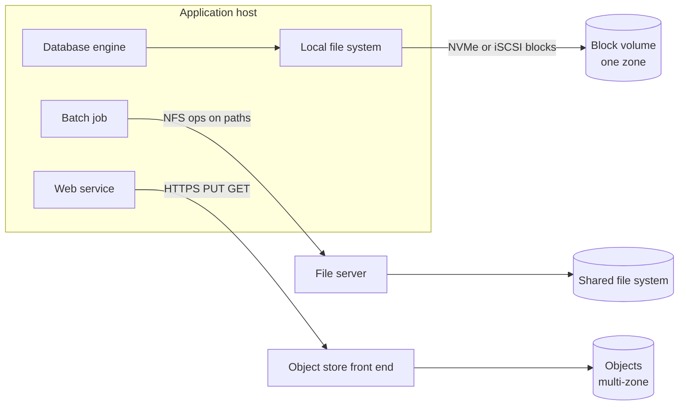
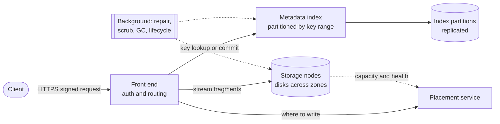
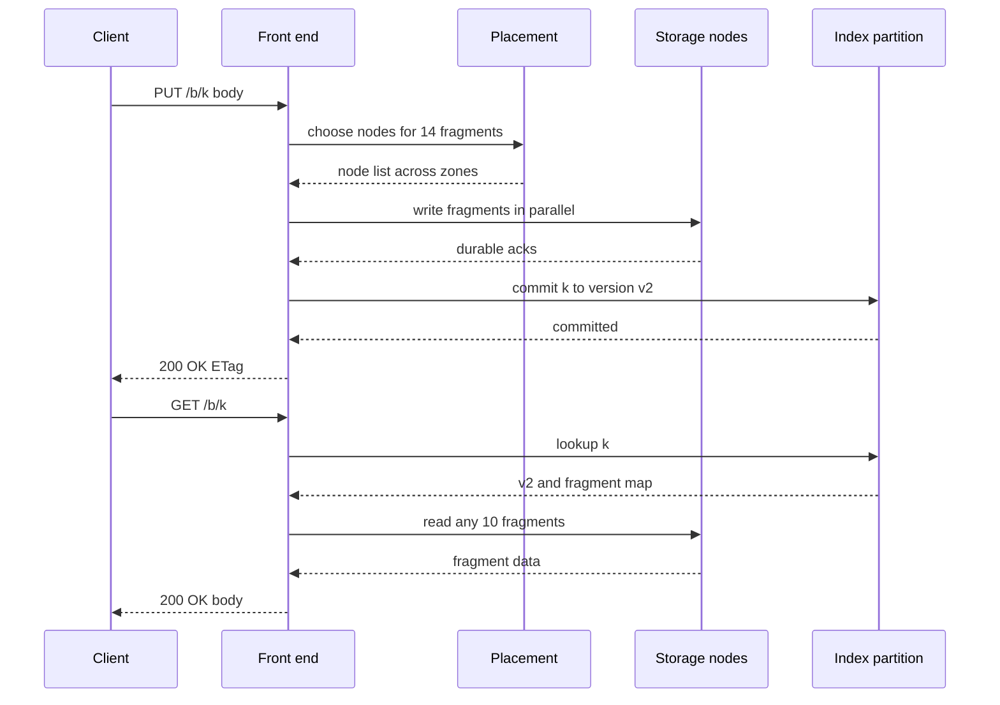
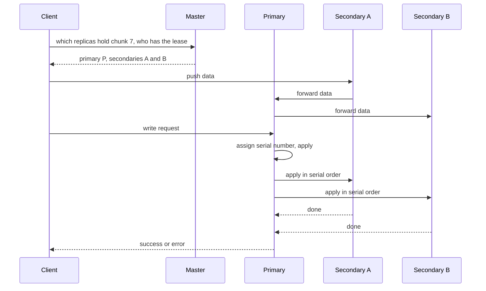
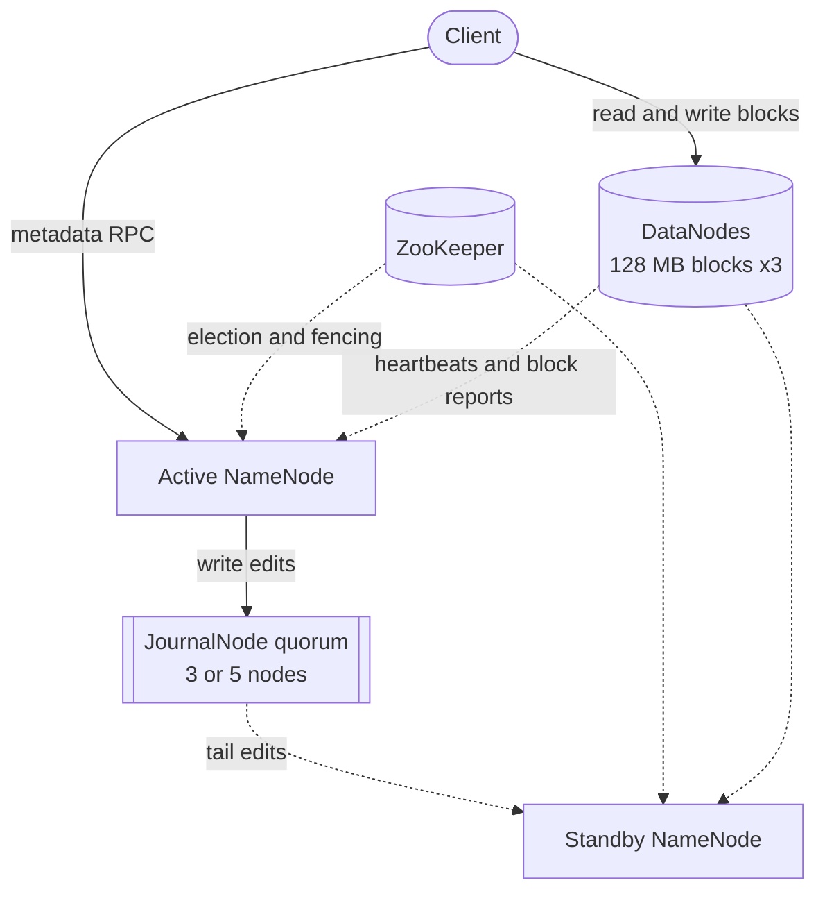
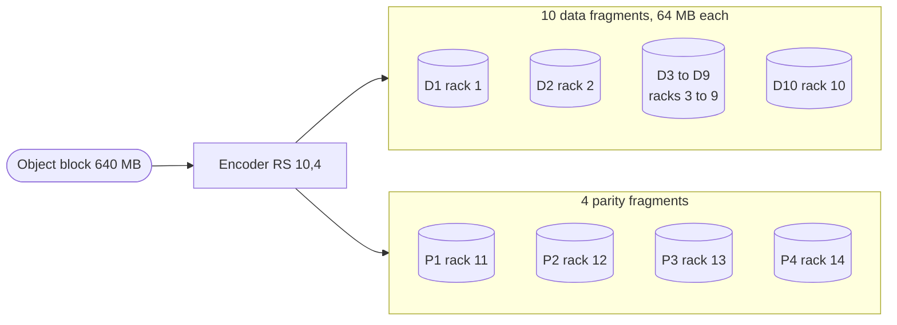
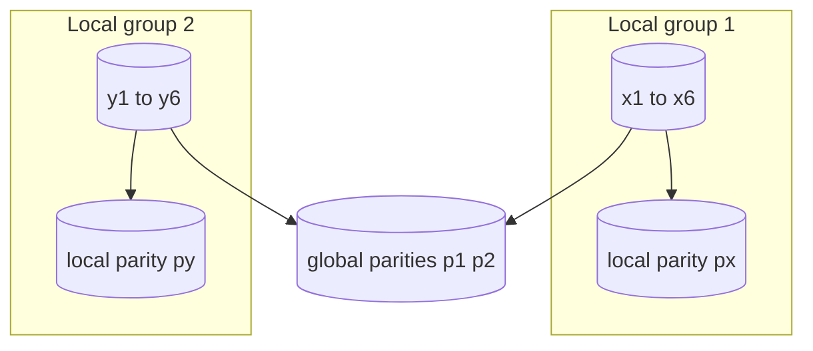
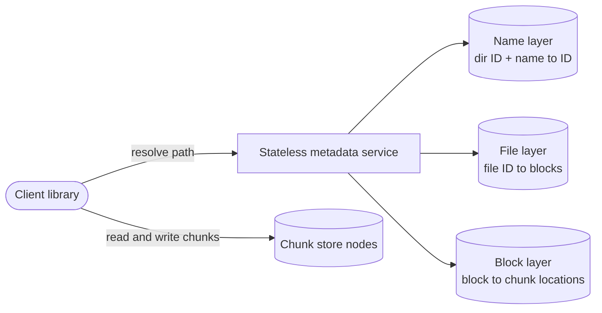
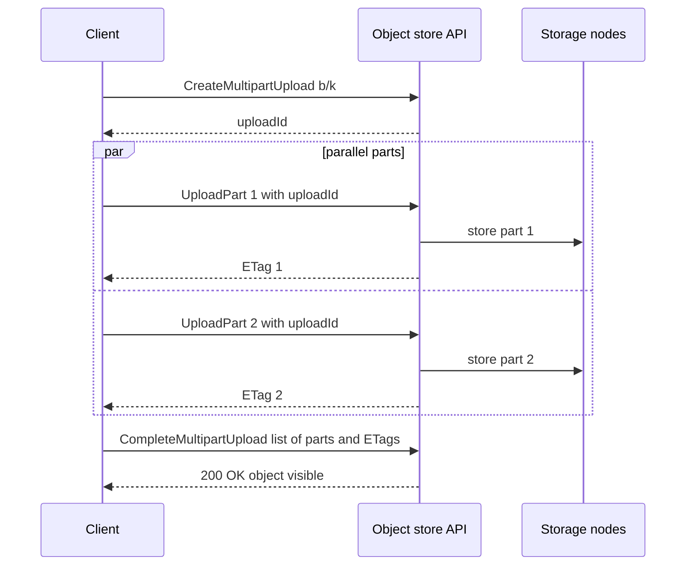
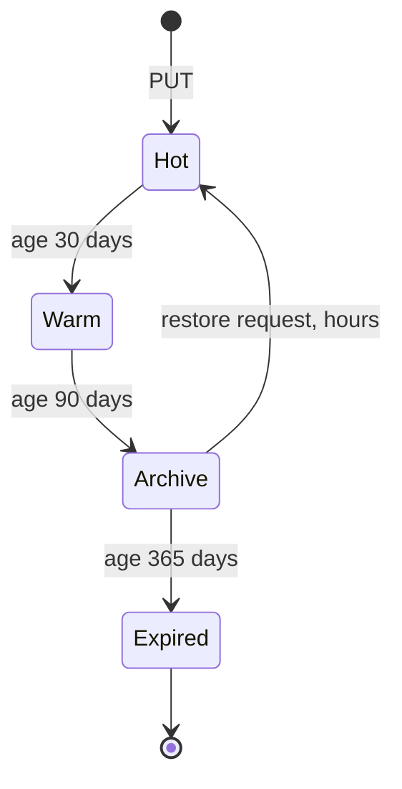

# Chapter 15 — Object, Block and File Storage

> **Level:** 2–3 · **Track:** A (Traditional) · **Estimated reading time:** 2.5 h

Chapters 11–14 were about databases: systems that store small, structured records and answer questions about them. Most of the bytes a company stores are not records at all. They are photos, videos, log files, backups, machine-learning datasets and database snapshots: large, mostly immutable blobs that are written once and read many times or never. In Chapter 1, PhotoShare's ADR-0003 moved every photo into "managed object storage", and at 10 million daily users that meant about 5 TB of new data per day (§1.9). This chapter opens that box. You will learn the three storage interfaces (blocks, files, objects), how S3-style object stores and GFS-style file systems are built, how erasure coding buys high durability for 1.4× raw capacity instead of 3×, why metadata is the real scaling limit, and how chunking, multipart upload and lifecycle tiers keep petabytes affordable.

## 15.1 Learning objectives

After this chapter you should be able to:

- Choose between block, file and object storage by interface, semantics, latency and throughput.
- Draw an S3-style object store (front end, metadata/index, placement, storage nodes) and trace a PUT and a GET through it.
- Explain GFS (single master, 64 MB chunks, leases, record append) and HDFS NameNode high availability.
- Calculate the storage overhead, fault tolerance, approximate durability and repair traffic of 3× replication, Reed–Solomon RS(10,4) and an Azure-style local reconstruction code.
- Estimate metadata memory and explain how namespaces are partitioned.
- Size a multipart upload, use presigned URLs safely, and explain why content-defined chunking survives insertions.
- Design and cost a lifecycle policy across hot, warm, cold and archive tiers.

## 15.2 Prerequisites

- Disks, SSDs, IOPS and throughput — §5.6 (block devices are the bottom layer of every design here).
- File systems, `fsync` and the page cache — §6.6 and §6.14 (file semantics and durability).
- MTBF, AFR and durability as a race between failure and repair — §4.15–§4.16 (the loss formula is generalized in §15.6).
- Hash functions and HMAC — §10.4.1 and §10.4.6 (content addressing and presigned URLs).
- Partitioning and consistent hashing — §14.6 and §14.8 (metadata and data placement).
- Units: in this chapter **MB/GB/TB/PB** are powers of ten for capacity and cost; **KiB/MiB/GiB** appear where a system defines a limit in powers of two (for example S3's 5 MiB minimum part size).

## 15.3 Block, file and object storage compared

### 15.3.1 Three interfaces to the same disks

::: definition
**Definition — Block, file and object storage.** **Block storage** exposes a numbered array of fixed-size blocks (typically 512 B or 4 KiB) that a client reads and writes by offset; the client's own file system or database gives the blocks meaning. **File storage** exposes a hierarchical namespace of directories and byte-addressable files with POSIX-like operations (open, read at offset, write at offset, rename, lock), shared by many clients over a protocol such as NFS or SMB. **Object storage** exposes a flat namespace of immutable **objects**, each a byte string plus metadata addressed by a key within a **bucket**, accessed over HTTP with whole-object PUT, GET (optionally a byte range), DELETE and LIST.
:::

#### First-principles explanation

Picture a warehouse. **Block storage** rents you a bare floor marked in numbered squares: you decide what goes where and keep your own map; the warehouse knows nothing about your boxes. **File storage** is a filing cabinet shared by an office: folders inside folders, anyone can open a document, change page 7 and put it back, and the cabinet makes sure two people do not scribble on the same page at once. **Object storage** is a coat check: you hand over a sealed parcel, get a ticket (the key), and later hand the ticket back to get the identical parcel. You cannot change one page of a parcel; you hand in a new parcel under the same ticket.

The more an interface promises (in-place updates, shared locks, atomic rename of a directory tree), the more coordination every operation needs and the harder it is to scale out. Object storage promises the least, which is why it routinely scales to trillions of items.

#### Why does this exist?

All three exist because applications need different contracts. A database engine (Chapter 13) wants raw blocks so that it controls page layout, write-ahead logging and `fsync` ordering itself. Many machines sharing a directory of model checkpoints want a POSIX file system. A web application storing uploads wants unlimited capacity, HTTP access and someone else to worry about durability; it never rewrites byte 4,000 of a photo.

#### How it works internally

1. **Block.** A volume is a virtual disk. Cloud services such as Amazon EBS and Google Persistent Disk attach a network volume to one VM over NVMe or iSCSI-style protocols, replicate its blocks within one zone, and let the guest run ext4, XFS or a database on it.
2. **File.** An NFS or SMB server (or a distributed service such as Amazon EFS, which speaks NFSv4.1) owns the namespace. Clients send `LOOKUP`, `READ(offset, count)`, `WRITE`, `RENAME`; the server keeps inodes, directories, permissions and locks and serializes conflicting updates.
3. **Object.** A client sends `PUT /bucket/key` with the full body; the service stores the bytes redundantly, records key → location in an index, and acknowledges. GET looks up the key and streams the bytes. There is no rename, append or partial overwrite: a "change" is a new PUT of the whole object.

**Figure 15.1 — Three storage interfaces over shared disks.**



**Reading the diagram.** Three clients on one host use three interfaces. The *database engine* runs its own file system on a *block volume*: the protocol carries block reads and writes by offset, and all meaning (files, pages) lives on the host. The *batch job* sends path-based NFS operations to a *file server*, which owns the namespace and locking for every client that mounts it. The *web service* sends whole-object HTTPS requests to an *object store front end*. All arrows are synchronous request/response. Storage boundaries: the block volume lives in one zone and attaches to one VM; the file system is shared; objects are spread across zones. Failure points: a zone outage takes the block volume with it (restore from snapshots); the file server's metadata path is a shared bottleneck. Scaling: block volumes scale up (bigger, faster volume); file systems scale up or partition the namespace (§15.7); object stores scale out horizontally.

#### Mathematical foundations

The single most useful model for comparing the three is the time to fetch $S$ bytes: a fixed first-byte latency plus a transfer term.

::: formula
**Access time for one read**

$$t \approx t_{\text{first}} + \frac{S}{B} \qquad\qquad t_{\text{parallel}} \approx t_{\text{first}} + \frac{S}{\min(c \cdot B,\; B_{\text{NIC}})}$$

| Symbol | Meaning | Units |
|---|---|---|
| $t$ | Time to read the whole request | s |
| $t_{\text{first}}$ | Time to first byte (network round trip, lookup, seek or flash read) | s |
| $S$ | Bytes requested | bytes |
| $B$ | Throughput of one stream (connection or volume) | bytes/s |
| $c$ | Number of parallel streams (for example byte-range GETs) | count |
| $B_{\text{NIC}}$ | Client network interface limit | bytes/s |
:::

::: example
**Worked example — Small random reads versus bulk reads.** Use illustrative values: a network SSD block volume with $t_{\text{first}} = 0.5$ ms and $B = 125$ MB/s; an object store with $t_{\text{first}} = 30$ ms and $B = 80$ MB/s per connection; a 10 Gb/s client NIC ($B_{\text{NIC}} = 1.25$ GB/s).

1. 4 KiB (4,096 B) read, block: $0.5 + 4096/125{,}000{,}000 \times 1000 = 0.5 + 0.033 = 0.53$ ms.
2. 4 KiB read, object: $30 + 4096/80{,}000{,}000 \times 1000 = 30 + 0.05 = 30.05$ ms, about 57× slower.
3. 1 GB read, block (one volume): $0.0005 + 10^9/1.25 \times 10^8 = 8.0$ s.
4. 1 GB read, object, one connection: $0.03 + 10^9/8 \times 10^7 = 12.5$ s.
5. 1 GB read, object, 16 parallel range GETs: $\min(16 \times 80, 1250) = 1250$ MB/s, so $0.03 + 0.8 = 0.83$ s.

**Interpretation.** For tiny random reads the fixed latency dominates and the block volume wins by more than an order of magnitude. For bulk reads the transfer term dominates, and the object store wins because it lets you open many independent streams to many storage nodes, while one volume has a fixed throughput cap. **Engineering implication.** Put latency-sensitive random I/O (database pages) on block storage; put large, sequentially read data (media, logs, training data, backups) on object storage and read it with parallel range requests. Never use an object store as if it were a disk for a database.
:::

**Table 15.1 — Block, file and object storage compared.** Latency figures are typical orders of magnitude (as of 2026), not guarantees.

| Aspect | Block | File | Object |
|---|---|---|---|
| What it is | Virtual disk of numbered blocks | Shared directory tree of files | Flat bucket of immutable key → blob |
| Interface | NVMe/iSCSI/SCSI commands | NFS, SMB, POSIX | HTTP REST: PUT, GET, DELETE, LIST |
| Update model | Overwrite any block in place | Overwrite/append at any offset; rename; locks | Replace whole object (new version) |
| Sharing | One host (multi-attach rare) | Many hosts concurrently | Unlimited clients over the internet |
| Typical first-byte latency | ~0.1–2 ms (network SSD) | ~1–10 ms | ~10–100+ ms (single-digit ms for premium one-zone classes) |
| Throughput scaling | Per-volume cap | Per file system; often bursts | Near-linear with parallel requests |
| Consistency | Strong (single writer) | Close-to-open (NFS) to strong | Strong read-after-write (S3 since Dec 2020; GCS; Azure Blob) |
| Cost (relative) | Highest per GB, pay for provisioned size | High | Lowest, pay for bytes stored and requests |
| Examples | Amazon EBS, Google Persistent Disk, Azure Managed Disks | NFS, Amazon EFS, Google Filestore, Azure Files, Lustre | Amazon S3, Google Cloud Storage, Azure Blob Storage, Ceph RGW, MinIO |
| Choose when | Databases, boot disks, low-latency random I/O | Shared POSIX access, legacy apps, HPC scratch | Media, backups, logs, data lakes, ML datasets |

#### Real-world industry applications

::: industry
**Cloud block, file and object services.** AWS documents EBS gp3 volumes with a baseline of 3,000 IOPS and 125 MiB/s that can be provisioned higher, and EBS volumes are created in a single Availability Zone; Amazon EFS is accessed with NFSv4.1 and stores data across multiple zones in its regional classes; Amazon S3 is designed for 99.999999999% durability and, since December 2020, provides strong read-after-write consistency for PUT and DELETE of objects and for LIST, automatically and at no extra cost [AWS S3 consistency docs; AWS EBS docs]. Google Cloud Storage documents strong global consistency for read-after-write, read-after-delete and object listing [Google Cloud Storage consistency docs]. *Evidence: Primary* — [AWS S3 consistency docs; AWS EBS docs; Google Cloud Storage consistency docs]
:::

#### Common misconceptions

::: mistake
**"S3 is a file system."** Tools that mount a bucket as a directory make it look like one, but `rename` becomes copy-plus-delete of every object, appending means rewriting the whole object, and there are no locks. Programs that assume POSIX semantics (for example, writing a file in place and renaming it atomically) can be slow or incorrect on such mounts.
:::

## 15.4 Object storage architecture (the S3 model)

### 15.4.1 Buckets, keys and a flat namespace

::: definition
**Definition — Bucket, key, object and flat namespace.** A **bucket** is a named container with its own access policy, region and configuration. An **object** is an immutable byte string (from zero bytes to tens of terabytes) plus system metadata (size, content type, checksum, version ID) and user metadata. A **key** is the object's full name within the bucket, for example `photos/2026/10/u42/abc.jpg`. The namespace is **flat**: the slashes are ordinary characters, and "folders" are an illusion produced by listing keys that share a **prefix** and grouping them at a **delimiter** (usually `/`).
:::

#### First-principles explanation

A hierarchical file system is a tree, and trees need coordination: renaming a directory atomically moves everything beneath it, and creating a file must check and update its parent directory. If millions of clients create files in the same directory, that one directory becomes a lock everyone fights over. A flat namespace removes the tree. Each key is independent, so the system can sort all keys and split the sorted list into ranges, giving each range to a different metadata server, exactly like range partitioning a database table (§14.6). Listing "the folder" `photos/2026/10/` becomes a range scan from that prefix to the next one.

#### Why does this exist?

The web needed storage reachable over HTTP that never filled up. Immutable whole objects make that tractable: no partial overwrites to replicate, no locks to hold across a network partition, and bytes that never change, so caches and CDNs (Chapter 21) can store them safely.

### 15.4.2 Components of an S3-style object store

AWS has published only fragments of S3's internals (cited below). The design that follows is a generic, teaching architecture that matches the public behavior of S3, Google Cloud Storage, Azure Blob Storage and open-source systems such as Ceph's RADOS Gateway; it is not a description of any one product.

**Figure 15.2 — Generic S3-style object store (illustrative).**



**Reading the diagram.** The *client* sends an HTTPS request signed with its credentials. The stateless *front end* authenticates, authorizes and routes it. The *metadata index* maps (bucket, key, version) to the locations of the object's data; it is partitioned by key range so that LIST by prefix is a range scan, and each partition is replicated (a consensus-replicated store is the usual choice, Chapter 26). The *placement service* chooses which storage nodes, in which failure domains, receive a new object's fragments, using asynchronous health and capacity reports (dotted). *Storage nodes* own disks and store fragments with checksums. All client-facing arrows are synchronous. *Background workers* (dotted, asynchronous) re-create lost fragments, scrub checksums, garbage-collect unreferenced data and apply lifecycle rules (§15.9). Storage boundaries: small, hot, strongly consistent metadata is separated from huge, append-only data. Failure points: an unavailable index partition makes intact data unreachable; storage-node failures are routine and repaired in the background. Scaling: add front ends for request rate, split index partitions for key-space hot spots, add storage nodes for capacity.

#### How it works internally

**PUT (write path):**

1. The front end authenticates the request (for example AWS Signature Version 4, an HMAC over the request, §10.4.6) and checks the bucket policy.
2. It asks the placement service for a set of storage nodes spread across failure domains (disks, racks, zones).
3. It streams the body, splits it into chunks if it is large, and writes each chunk redundantly: replicas or erasure-coded fragments (§15.6). It computes a checksum and verifies any checksum the client sent.
4. Only after enough fragments are durable does it **commit** a new metadata record (key, version ID, size, checksum, fragment locations) to the index partition that owns the key. This commit is the linearization point: before it, readers see the old version (or nothing); after it, every reader sees the new one.
5. It returns `200 OK` with an ETag. Data written by a PUT that failed before step 4 is unreferenced and later removed by garbage collection.

**GET (read path):** authenticate → look up the key's latest committed version in the index → read fragments from storage nodes (only $k$ of $k+m$ are needed for an erasure-coded object, so the front end can ignore the slowest) → verify checksums → stream to the client.

**Figure 15.3 — PUT then GET in an S3-style store (illustrative).**



**Reading the diagram.** Five participants exchange synchronous HTTP or RPC messages, top to bottom in time. On the write, data flows to the *storage nodes* before any metadata changes; the *index partition* commit is the single step that makes version v2 visible. On the read, the *front end* first resolves the key to a version and a fragment map, then fetches fragments; in this RS(10,4) illustration any 10 of 14 suffice. Failure points: if the front end crashes after writing fragments but before the commit, the client sees an error and retries, and the orphaned fragments are garbage; if it crashes after the commit but before replying, the object exists and a retry simply writes it again (PUT of the same bytes is idempotent). Scaling: the fragment writes and reads fan out in parallel, so large objects are limited by aggregate node bandwidth, not by one disk.

#### Consistency: what "strong read-after-write" means

Because the index commit is a single atomic step per key, a store that keeps each index partition linearizable (§25.3) can promise that once a PUT returns, any subsequent GET or LIST anywhere sees it. Historically S3 cached metadata in a way that let reads miss recent writes; AWS described adding a cache-coherence protocol in which a "witness" component is notified of every object change, so that front ends can tell when their cached metadata is stale [Vogels 2021]. Two caveats remain. Concurrent PUTs to one key are not merged: the last commit wins, so read-modify-write needs conditional writes (`If-None-Match`, `If-Match`, supported by S3 since 2024). Bucket configuration and cross-region replication remain asynchronous.

#### Mathematical foundations

Index partitions have finite throughput, so request rate per key range is a design input. AWS documents that an application can achieve at least 3,500 PUT/COPY/POST/DELETE or 5,500 GET/HEAD requests per second per partitioned prefix, and that S3 scales by partitioning further as load grows [AWS S3 performance docs].

::: formula
**Prefixes needed for a target request rate**

$$N_{\text{prefix}} = \left\lceil \frac{R_{\text{peak}}}{r_{\text{prefix}}} \right\rceil$$

| Symbol | Meaning | Units |
|---|---|---|
| $N_{\text{prefix}}$ | Distinct key prefixes over which requests must be spread | count |
| $R_{\text{peak}}$ | Peak request rate of one type (writes or reads) | requests/s |
| $r_{\text{prefix}}$ | Sustained rate one partitioned prefix supports | requests/s |
:::

::: example
**Worked example — Log ingestion into an object store.** A logging pipeline writes 20,000 small objects per second at peak with keys like `logs/2026-10-30T12/<host>/<seq>`.

1. $N_{\text{prefix}} = \lceil 20{,}000 / 3{,}500 \rceil = \lceil 5.71 \rceil = 6$ prefixes at minimum.
2. Problem: every key in the current hour shares one leading prefix, so all writes land in one key range until the store splits it.
3. Fix: put a short hash of the host first, for example `logs/a7/2026-10-30T12/<host>/<seq>` with 16 hex buckets, giving at least 16 prefixes and headroom of $16 \times 3{,}500 = 56{,}000$ writes/s.

**Interpretation.** Time-ordered keys concentrate load on the newest range (the hot-partition problem of §14.10). **Engineering implication.** Design keys for the index, not for humans: spread writes with a hashed component and keep the time component later in the key. Better still, batch 20,000 tiny records per second into a few larger objects (§15.8), which also cuts request fees.
:::

#### Real-world industry applications

::: industry
**Amazon S3 — what AWS has published.** AWS's report on the February 2017 US-EAST-1 disruption names two S3 subsystems: an *index subsystem* that manages the metadata and location information of all objects in the region, and a *placement subsystem* that allocates storage for new objects and depends on the index subsystem; both had to be fully restarted [AWS 2017]. AWS engineers have described ShardStore, the key-value storage engine on S3 storage nodes that holds shards of customer objects, and its validation with lightweight formal methods [Bornholt et al. 2021]. Vogels described the metadata cache-coherence protocol behind strong consistency [Vogels 2021]. Anything beyond these statements in Figure 15.2 is illustrative.
*Evidence: Primary* — [AWS 2017; Bornholt et al. 2021; Vogels 2021]
:::

::: industry
**Facebook Haystack — packing small objects.** Storing each photo as a file cost Facebook several disk reads per photo just for directory and inode metadata. Haystack appends many photos ("needles") into large volume files and keeps an in-memory index from photo ID to (volume, offset, size), so a read needs about one disk operation [Beaver et al. 2010]. The lesson generalizes: an object store's per-object metadata cost, not its byte capacity, is what small objects stress.
*Evidence: Primary* — [Beaver et al. 2010]
:::

#### Advantages and disadvantages

Object storage gives unlimited capacity, high durability, parallel throughput and the lowest price per GB, in exchange for tens of milliseconds of first-byte latency, per-request charges, no in-place updates or multi-key rename, and coordination left to the application.

#### Failure scenarios

| What goes wrong | Why | Detection | Recovery | Prevention |
|---|---|---|---|---|
| Orphaned storage | PUTs that failed after writing data, abandoned multipart uploads | Storage used exceeds sum of indexed sizes | Garbage collection; abort-incomplete-upload lifecycle rule | Make GC and lifecycle rules part of the design |
| Lost update | Two clients read-modify-write the same key | Missing data reported by users | Restore from versioning | Conditional writes (`If-Match`) or a database as the source of truth |

#### Common misconceptions

::: mistake
**"Renaming a folder is cheap."** There is no folder. Renaming `photos/2026/` means copying and deleting every object under that prefix, one request each. Design keys so that you never need to rename them, and keep human-facing names in a database.
:::

## 15.5 Distributed file systems: GFS, HDFS, Colossus and Tectonic

### 15.5.1 The Google File System (GFS)

::: definition
**Definition — Distributed file system.** A file system whose namespace and data are spread across many machines, so that files can be larger than any one disk and throughput can grow with the number of machines, while clients still use file-like operations (create, open, read, write or append, delete).
:::

#### First-principles explanation

Think of a library with one head librarian and a thousand shelves in separate rooms. The librarian keeps only the catalog: which book is split into which volumes and which rooms hold each volume. Readers ask the librarian once, then walk directly to the rooms. The librarian never carries books, so one person can manage a huge library. That is the GFS design.

#### Why does this exist?

Google needed to store web crawls and indexes on thousands of commodity machines, some always failing, for workloads dominated by large sequential reads and concurrent *appends*. GFS was designed for exactly that: component failure as the norm, multi-gigabyte files, appends, and high sustained bandwidth over low latency [Ghemawat et al. 2003].

#### How it works internally

1. **One master, many chunkservers.** Files are split into fixed **64 MB chunks**, each identified by a globally unique 64-bit handle and stored as a Linux file on **chunkservers**, by default as three replicas. A single **master** holds all metadata in memory: the namespace, the file → chunk mapping, and chunk locations. The master persists namespace and mapping changes in an **operation log** replicated to other machines, with periodic checkpoints; it does *not* persist chunk locations but learns them from chunkservers at start-up and through heartbeats.
2. **Why 64 MB.** Large chunks mean few chunks, so the master needs less than 64 bytes of metadata per chunk and clients rarely need to ask it anything; a client caches chunk locations and talks to chunkservers directly. The cost: a popular small file is one chunk on three servers, a hot spot.
3. **Reads.** The client converts (file, byte offset) into a chunk index, asks the master for the handle and replica locations, caches them, and reads from the nearest replica.
4. **Leases and mutation order.** For each chunk being modified the master grants a **lease** (initially 60 seconds, renewable through heartbeats) to one replica, the **primary**. The primary picks a serial order for all mutations to that chunk, so all replicas apply them in the same order without the master on the data path. (Leases in general: §26.11.)
5. **Decoupled data and control flow.** The client pushes data to all replicas along a chain of chunkservers, each forwarding to the next nearest while still receiving (pipelining), so each machine's full outbound bandwidth is used. Only after all replicas hold the data does the client send the small write request to the primary.
6. **Record append.** The client supplies only data; the primary chooses the offset and appends the record atomically *at least once*. A failed append is retried, so replicas may contain duplicates or padding, which applications skip using checksums and unique record IDs.
7. **Housekeeping.** Each chunk has a version number to detect stale replicas that missed mutations while down; deleted files are renamed to hidden names and garbage-collected lazily; chunkservers checksum every 64 KB block on read.

**Figure 15.4 — GFS write with a lease-holding primary.**



**Reading the diagram.** The *client* asks the *master* (control flow) which replica holds the lease, and caches the answer. Data flows along a chain ordered by network topology, not roles, so the client uploads each byte once. The small write request goes to the *primary*, which assigns a serial number and tells both *secondaries* to apply mutations in that order. All messages are synchronous RPCs. Storage boundaries: metadata on the master, chunk bytes only on chunkservers. Failure points: a failed secondary makes the client retry (the region is inconsistent until it succeeds); a dead primary's lease expires and the master grants a new one. Scaling: the master handles only small metadata RPCs, so data bandwidth grows with the number of chunkservers.

#### Mathematical foundations

::: formula
**Metadata memory for an in-memory namespace**

$$M = N_{\text{files}} \cdot b_{\text{file}} + N_{\text{chunks}} \cdot b_{\text{chunk}} \qquad N_{\text{chunks}} \approx \sum_{\text{files}} \left\lceil \frac{\text{file size}}{C} \right\rceil$$

| Symbol | Meaning | Units |
|---|---|---|
| $M$ | Memory needed by the metadata server | bytes |
| $N_{\text{files}}$ | Number of files (and directories) | count |
| $N_{\text{chunks}}$ | Number of chunks or blocks | count |
| $b_{\text{file}}, b_{\text{chunk}}$ | Bytes of metadata per file and per chunk | bytes |
| $C$ | Chunk (block) size | bytes |
:::

::: example
**Worked example — Why chunk size and file count limit the master.** Use GFS's figure of under 64 bytes per chunk and a commonly quoted HDFS rule of thumb of about 150 bytes per file or block object in the NameNode heap.

1. GFS, 1 PB of large files in 64 MB chunks: $10^{15}/6.4 \times 10^{7} = 1.56 \times 10^{7}$ chunks; $\times\, 64$ B $= 1.0 \times 10^{9}$ B $\approx 1$ GB. One machine copes easily.
2. Same 1 PB in 4 MB chunks: 16× as many chunks, about 16 GB. Still feasible, but every client request now also hits the master 16× as often.
3. HDFS cluster with 300 million files averaging 1.5 blocks: $N = 3 \times 10^{8} + 4.5 \times 10^{8} = 7.5 \times 10^{8}$ objects; $\times\, 150$ B $= 1.1 \times 10^{11}$ B $\approx 113$ GB of heap.
4. The same bytes stored as 3 billion small files: at least $6 \times 10^{9}$ objects, about 900 GB, beyond any practical single heap.

**Interpretation.** A single metadata server scales with the *number* of files and chunks, not with bytes. **Engineering implication.** Single-master designs work for large files; small-file workloads must either pack files together (Haystack, §15.4; HAR or sequence files in Hadoop) or move to a partitioned metadata service (§15.7).
:::

### 15.5.2 HDFS and NameNode high availability

HDFS, the Hadoop Distributed File System, follows the GFS design with different names: a **NameNode** (the master) keeps the namespace and block map in RAM, and **DataNodes** (chunkservers) store **blocks**, typically 128 MB, with a default replication factor of three [Shvachko et al. 2010]. DataNodes send heartbeats every few seconds and periodic block reports; a DataNode silent for about ten minutes is considered dead and its blocks are re-replicated. Writes go through a pipeline of DataNodes, as in GFS. HDFS supports single-writer append rather than concurrent record append, and places replicas rack-aware.

The original NameNode was a single point of failure. Hadoop 2 added **high availability**: an *active* and a *standby* NameNode share the edit log through a quorum of **JournalNodes**, DataNodes report blocks to both, and a ZooKeeper-based failover controller elects the active one and fences the old one [Apache Hadoop HA docs]. **Federation** runs several independent NameNodes, each owning part of the namespace, to go past one heap's limit.

**Figure 15.5 — HDFS with NameNode high availability.**



**Reading the diagram.** The *client* sends metadata RPCs to the *active NameNode* and streams block data directly to and from *DataNodes*. The active NameNode writes every namespace change to a majority of *JournalNodes* (synchronously) before acknowledging; the *standby* tails those edits asynchronously and stays nearly current. *DataNodes* report to both, so the standby knows block locations at failover. *ZooKeeper* (dotted) holds the election lock; failover controllers on each NameNode use it to promote the standby and fence the old active, preventing split brain (§26.12–§26.13). Storage boundaries: the namespace is in NameNode RAM backed by the journal; block bytes are on DataNodes. Failure points: active NameNode loss costs seconds of metadata unavailability; losing a JournalNode majority blocks writes. Scaling: data scales with DataNodes; metadata scales only by federation.

### 15.5.3 Colossus and Tectonic: distributing the master

Both GFS and HDFS hit the same wall: one metadata server's memory and request rate. Their successors keep the client library and chunk servers but move metadata into a scalable database.

::: industry
**Google Colossus.** Google has published only an overview. A 2021 Google Cloud blog describes GFS's successor as a client library, scalable metadata services ("curators") storing metadata in Bigtable, "D" file servers holding data, and background "custodians" for durability and rebalancing; data is replicated or Reed–Solomon encoded per workload [Hildebrand and Serenyi 2021].
*Evidence: Primary* — [Hildebrand and Serenyi 2021]
:::

::: industry
**Facebook Tectonic.** Tectonic, an exabyte-scale multitenant file system, consolidated Facebook's blob storage (Haystack and f4) and its data-warehouse HDFS clusters. Its metadata is split into Name, File and Block layers (Figure 15.8) stored in ZippyDB, a sharded key-value store, behind stateless metadata services; data flows directly between client library and chunk-store nodes. ZippyDB lacks cross-shard transactions, so some recursive operations are restricted. Blocks are replicated or Reed–Solomon encoded; blob storage appends small writes to replicas and Reed–Solomon encodes them later [Pan et al. 2021].
*Evidence: Primary* — [Pan et al. 2021]
:::

#### Alternatives and trade-offs

**Table 15.2 — GFS, HDFS and Tectonic compared.**

| Aspect | GFS (2003) | HDFS (2010) | Tectonic (2021) |
|---|---|---|---|
| Metadata | Single in-memory master + replicated log | NameNode in RAM; HA standby; federation | Sharded key-value store, stateless services |
| Unit | 64 MB chunk | 128 MB block (configurable) | Block of chunks |
| Redundancy | 3× replication | 3× replication; erasure coding from Hadoop 3 | Replication or Reed–Solomon per tenant |
| Write semantics | Concurrent record append, at least once | Single writer, append | Single writer per file; tenant-specific |
| Scaling limit | Master memory and RPC rate | NameNode heap | Key-value store shards (horizontally scalable) |

#### Failure scenarios

| What goes wrong | Why | Detection | Recovery | Prevention |
|---|---|---|---|---|
| Duplicate records after append | Client retried a partially failed record append | Duplicate record IDs downstream | Deduplicate on read | Unique record IDs and checksums in the payload |
| Re-replication storm | Rack failure loses thousands of blocks at once | Under-replicated block count spikes | Throttled, prioritized re-replication (blocks with one copy first) | Rack-aware placement; repair bandwidth budgets |

## 15.6 Replication versus erasure coding

### 15.6.1 Reed–Solomon codes

::: definition
**Definition — Erasure code and RS(k, m).** An **erasure code** transforms $k$ data fragments into $k + m$ fragments such that the original data can be rebuilt from some subset of them after the others are lost ("erased"). A **Reed–Solomon** code RS($k$, $m$) is a **maximum distance separable (MDS)** code: *any* $k$ of the $k+m$ fragments suffice, so it tolerates the loss of any $m$ fragments. A code is **systematic** when the first $k$ fragments are the unmodified data, so healthy reads need no decoding.
:::

#### First-principles explanation

Store 5, 7 and 2 together with their sum, 14. Lose any one of the four and you can recompute it: $14 - 5 - 2 = 7$. RAID-5 does this with XOR: one parity block protects against any one loss. Reed–Solomon generalizes it. Treat the $k$ data symbols as the values of a polynomial of degree less than $k$ at $k$ known points. Two points fix a line and three fix a parabola; in general $k$ points fix a degree-$(k-1)$ polynomial. Evaluate that polynomial at $m$ extra points and store those values as parity. Any $k$ surviving values pin down the polynomial again, and therefore all the data. The arithmetic is done in a finite field (in practice GF($2^8$), so each symbol is one byte) so that values never grow and division always works [Reed and Solomon 1960; Plank 1997].

#### Why does this exist?

Three-way replication tolerates two failures but stores 3 bytes per byte. At exabyte scale the extra copies cost real money: hundreds of thousands of disks, the racks and the power for them. Erasure coding reaches the same or better durability for 1.2–1.5× overhead. Facebook's f4 warm-blob store reports moving from an effective replication factor of 3.6 in Haystack to 2.1 by using RS(10,4) within a datacenter and XOR across datacenters [Muralidhar et al. 2014].

#### How it works internally

1. Split an object (or a large block) into $k$ equal data fragments, padding the last.
2. Compute $m$ parity fragments, byte position by byte position, by multiplying the data symbols by a fixed encoding matrix (or, equivalently, evaluating the polynomial at the parity points).
3. Place all $k + m$ fragments of a **stripe** on different disks, ideally different racks or zones, so one failure domain holds at most a few fragments.
4. Reads normally fetch the $k$ data fragments (systematic code). If one is slow or missing, fetch any parity fragment instead and decode: a degraded read.
5. Repair: when a disk dies, for each stripe that lost a fragment, read $k$ surviving fragments, decode, and write the lost one to a new disk.

**Figure 15.6 — An RS(10,4) stripe across 14 failure domains.**



**Reading the diagram.** A 640 MB block enters the *encoder*, which writes ten 64 MB data fragments and four 64 MB parity fragments, each to a different rack. Arrows are synchronous writes. Failure points: any four of the fourteen racks can fail with no data loss; a fifth concurrent loss before repair loses the stripe. Raw capacity used is $14 \times 64 = 896$ MB for 640 MB of data (1.4×), versus 1,920 MB for three replicas. Scaling: stripes are independent, so encoding and repair parallelize across the cluster, but rebuilding one fragment reads ten, from ten racks.

#### Mathematical foundations

::: formula
**Overhead, fault tolerance and repair reads of a (k, m) code**

$$\text{overhead} = \frac{k + m}{k} \qquad \text{tolerated losses} = m \qquad \text{repair read per lost fragment} = r \times F$$

| Symbol | Meaning | Units |
|---|---|---|
| $k$ | Data fragments per stripe | count |
| $m$ | Parity fragments per stripe | count |
| overhead | Raw bytes stored per logical byte | dimensionless (×) |
| $r$ | Fragments read to rebuild one: 1 for replication, $k$ for RS, local group size for LRC | count |
| $F$ | Fragment size | bytes |
:::

Replication is the special case $k = 1$: three-way replication is a (1, 2) code with overhead 3× and $r = 1$.

::: formula
**Approximate annual probability of losing a stripe (generalizing §4.16)**

$$P_{\text{loss/yr}} \approx \frac{n!}{(n - m - 1)!}\;\lambda^{m+1}\;T^{\,m} \times H, \qquad n = k + m, \;\; \lambda T \ll 1$$

| Symbol | Meaning | Units |
|---|---|---|
| $n$ | Fragments per stripe (replicas for replication) | count |
| $m$ | Losses tolerated | count |
| $\lambda$ | Per-fragment (per-disk) failure rate, AFR/8,760 | failures/hour |
| $T$ | Mean time to detect and rebuild one lost fragment | hours |
| $H$ | Hours per year (8,760) | hours/year |
:::

**Derivation.** Exactly as in §4.16: the first loss happens at rate $n\lambda$; the stripe is lost if $m$ more of the survivors fail, one after another, each before the previous repair completes, with probabilities $(n-1)\lambda T, (n-2)\lambda T, \ldots, (n-m)\lambda T$. Multiplying gives $n(n-1)\cdots(n-m)\,\lambda^{m+1} T^m$ per hour. For three replicas ($n = 3$, $m = 2$) this is $6\lambda^3T^2$, the §4.16 result.

::: example
**Worked example — 3× replication versus RS(10,4): durability and cost.** Use the §4.16 assumptions: AFR 2%, so $\lambda = 2.28 \times 10^{-6}$ per hour; $T = 24$ h, so $\lambda T = 5.48 \times 10^{-5}$. Note that $\lambda^{m+1}T^m H = \text{AFR} \times (\lambda T)^m$.

1. 3× replication: $\frac{3!}{0!} = 6$; $P = 6 \times 0.02 \times (5.48 \times 10^{-5})^2 = 6 \times 0.02 \times 3.00 \times 10^{-9} = 3.6 \times 10^{-10}$ per group per year.
2. RS(10,4): $n = 14$, $m = 4$; $\frac{14!}{9!} = 14 \times 13 \times 12 \times 11 \times 10 = 240{,}240$; $(\lambda T)^4 = 9.01 \times 10^{-18}$; $P = 240{,}240 \times 0.02 \times 9.01 \times 10^{-18} = 4.3 \times 10^{-14}$ per stripe per year.
3. Per petabyte with 64 MB fragments: replication has $10^{15}/6.4 \times 10^{7} = 1.56 \times 10^{7}$ groups, so $5.6 \times 10^{-3}$ expected loss events per year; RS(10,4) stripes hold 640 MB of data, so $1.56 \times 10^{6}$ stripes and $6.8 \times 10^{-8}$ loss events per year.
4. Cost for 10 PB of logical data at an illustrative $\$10$ per raw TB-month: replication needs 30 PB raw, $\$300{,}000$ per month; RS(10,4) needs 14 PB raw, $\$140{,}000$ per month, saving $\$1.92$ million per year.

**Interpretation.** Under independent failures RS(10,4) is both cheaper (1.4× against 3×) and far more durable, because it tolerates four losses instead of two: about 8,000 times less likely to lose a given stripe, and, since each stripe holds ten times as much data as a replica group, about 80,000 times fewer expected loss events per petabyte. **Engineering implication.** Erasure-code large, cold or warm data. The independence assumption is optimistic for both schemes (§4.16): correlated failures dominate real loss [Ford et al. 2010], so spread a stripe's fragments across racks and zones, and remember the hidden costs below — CPU for encoding, latency for small objects, and repair traffic.
:::

::: formula
**Daily repair read traffic in a fleet**

$$R_{\text{day}} = \frac{N_{\text{disk}} \times \text{AFR}}{365} \times D_{\text{used}} \times r$$

| Symbol | Meaning | Units |
|---|---|---|
| $R_{\text{day}}$ | Bytes read per day to rebuild failed disks | bytes/day |
| $N_{\text{disk}}$ | Disks in the fleet | count |
| AFR | Annualized failure rate | fraction/year |
| $D_{\text{used}}$ | Data stored per disk | bytes |
| $r$ | Fragments read per fragment rebuilt | count |
:::

::: example
**Worked example — Repair bandwidth for a 10,000-disk cluster.** Disks of 20 TB at 60% full ($D_{\text{used}} = 12$ TB), AFR 2%.

1. Failures per day: $10{,}000 \times 0.02 / 365 = 0.548$.
2. Data lost per day: $0.548 \times 12 = 6.58$ TB.
3. 3× replication ($r = 1$): 6.58 TB/day of reads.
4. RS(10,4) ($r = 10$): 65.8 TB/day, a sustained $65.8 \times 10^{12} / 86{,}400 = 761$ MB/s, about 6.1 Gb/s, most of it crossing racks.
5. LRC(12,2,2) (below, $r = 6$ for one lost data fragment): 39.5 TB/day, about 457 MB/s.

**Interpretation.** Erasure coding saves capacity but multiplies repair traffic by $k$. Briefly unavailable machines (reboots, upgrades) add more reconstruction: a study of a Facebook warehouse cluster using RS(10,4) reported recovery traffic on the order of a hundred terabytes per day crossing racks [Rashmi et al. 2013]. **Engineering implication.** Budget network capacity for repair, delay repair of transient failures for a few minutes, and consider codes that reduce $r$.
:::

#### Code example

The program below implements XOR parity and a toy systematic Reed–Solomon-style code. For readability it works over the prime field GF(257) with Lagrange interpolation, so a parity symbol can be 256; production libraries (for example Intel ISA-L or Jerasure) use GF($2^8$), but the "any $k$ of $k+m$" property is identical.

```python
# A toy erasure code: XOR parity (m = 1) and a Reed-Solomon-style (k, m) code.
# The RS code works over the prime field GF(257) so the arithmetic is plain
# modular integer maths; production systems use GF(2^8) so every symbol is a byte.
import itertools
import random

P = 257  # prime modulus; symbols are integers 0..256


def xor_parity(blocks):
    """RAID-5 style parity: byte-wise XOR of all data blocks."""
    parity = bytearray(len(blocks[0]))
    for b in blocks:
        for i, byte in enumerate(b):
            parity[i] ^= byte
    return bytes(parity)


def lagrange_at(points, x):
    """Evaluate, at x, the unique polynomial of degree < len(points)
    passing through points [(xi, yi)], all arithmetic mod P."""
    total = 0
    for i, (xi, yi) in enumerate(points):
        num, den = 1, 1
        for j, (xj, _) in enumerate(points):
            if j != i:
                num = num * (x - xj) % P
                den = den * (xi - xj) % P
        total = (total + yi * num * pow(den, P - 2, P)) % P  # pow(.., P-2) = inverse
    return total


def rs_encode(data, k, m):
    """Systematic encoding of one stripe column: fragment i (i = 1..k) holds
    data[i-1]; parity fragments k+1..k+m hold the polynomial's values there."""
    pts = list(zip(range(1, k + 1), data))
    return data + [lagrange_at(pts, x) for x in range(k + 1, k + m + 1)]


def rs_decode(survivors, k):
    """Rebuild the k data symbols from ANY k surviving (index, value) pairs."""
    pts = survivors[:k]
    return [lagrange_at(pts, x) for x in range(1, k + 1)]


if __name__ == "__main__":
    # 1. XOR parity: lose any one block, rebuild it from the others.
    d = [b"GFS!", b"HDFS", b"S3ok"]
    p = xor_parity(d)
    rebuilt = xor_parity([d[0], d[2], p])  # pretend d[1] was lost
    print("XOR rebuilt block 1:", rebuilt, rebuilt == d[1])

    # 2. RS(4, 2): 4 data symbols, 2 parity symbols, survives ANY 2 losses.
    k, m = 4, 2
    data = [ord(c) for c in "EC4u"]
    stripe = rs_encode(data, k, m)
    print("stripe (data + parity):", stripe)
    ok = 0
    for lost in itertools.combinations(range(k + m), m):
        survivors = [(i + 1, v) for i, v in enumerate(stripe) if i not in lost]
        ok += rs_decode(survivors, k) == data
    print(f"RS({k},{m}) recovered data in {ok} of "
          f"{len(list(itertools.combinations(range(k + m), m)))} two-loss patterns")

    # 3. RS(10, 4) on random bytes: lose 4 random fragments, decode, compare.
    rng = random.Random(7)
    k, m = 10, 4
    data = [rng.randrange(256) for _ in range(k)]
    stripe = rs_encode(data, k, m)
    lost = set(rng.sample(range(k + m), m))
    survivors = [(i + 1, v) for i, v in enumerate(stripe) if i not in lost]
    print("RS(10,4) lost fragments", sorted(lost), "-> recovered:",
          rs_decode(survivors, k) == data, "| symbols read for repair:", k)
```

Output (Python 3):

```text
XOR rebuilt block 1: b'HDFS' True
stripe (data + parity): [69, 67, 52, 117, 98, 88]
RS(4,2) recovered data in 15 of 15 two-loss patterns
RS(10,4) lost fragments [1, 6, 12, 13] -> recovered: True | symbols read for repair: 10
```

What to notice:

- XOR parity is its own inverse: XOR-ing the survivors with the parity yields the missing block. It tolerates exactly one loss.
- `rs_encode` keeps the data unchanged (systematic) and appends parity, so healthy reads never decode.
- The RS(4,2) loop tries all $\binom{6}{2} = 15$ ways to lose two fragments and recovers every time: the MDS property.
- Rebuilding any fragment reads $k$ others; that is the repair-traffic multiplier of the formula above. Real codes apply this per byte position across fragments of many megabytes.

### 15.6.2 Local reconstruction codes

Repair cost led Microsoft to design **local reconstruction codes (LRC)** for Windows Azure Storage. LRC($k$, $l$, $g$) splits the $k$ data fragments into $l$ local groups, adds one XOR-like **local parity** per group, and adds $g$ **global parities** computed over all data. A single lost data fragment, by far the most common case, is rebuilt from its local group only. Azure's LRC(12,2,2) uses two groups of six: overhead $16/12 = 1.33\times$, a single-fragment repair reads 6 fragments instead of 12, it tolerates any three failures, and it also survives a large fraction of four-failure patterns [Huang et al. 2012]. Compared with RS(6,3), which also reads 6 fragments per repair, LRC(12,2,2) stores less (1.33× against 1.5×) with similar durability.

**Figure 15.7 — Azure-style LRC(12,2,2) stripe.**



**Reading the diagram.** Twelve data fragments form two *local groups* of six. Each group has its own *local parity*, computed only from that group; the two *global parities* are computed from all twelve. Arrows are write-time dependencies; all sixteen fragments sit in different failure domains. Failure points and recovery: if `x3` fails, the system reads `x1`, `x2`, `x4`, `x5`, `x6` and `px` (six fragments) and never touches group 2; only rarer multi-failure patterns need the global parities and wider reads. Scaling: smaller repair reads mean less cross-rack traffic and faster repair, which also shrinks $T$ in the durability formula.

**Table 15.3 — Redundancy schemes compared (independent failures, AFR 2%, $T$ = 24 h).**

| Scheme | Overhead | Losses tolerated | Reads per single repair | Approx. $P_{\text{loss/yr}}$ per group | Typical use |
|---|---|---|---|---|---|
| 3× replication | 3.0× | 2 | 1 | $3.6 \times 10^{-10}$ | Hot data, small objects, metadata |
| RS(6,3) | 1.5× | 3 | 6 | $1.0 \times 10^{-11}$ | HDFS default EC policy (RS-6-3) |
| LRC(12,2,2) | 1.33× | any 3 (some 4) | 6 | $\le 1.4 \times 10^{-10}$ (counting only 3-loss tolerance) | Azure storage |
| RS(10,4) | 1.4× | 4 | 10 | $4.3 \times 10^{-14}$ | f4; HDFS-RAID [Sathiamoorthy et al. 2013] |

#### Alternatives and trade-offs

Replication wins for small objects (a 4 KB object should not become ten 400-byte fragments), hot data and low write latency. Erasure coding wins for large, warm and cold data. Many systems use both: write new data replicated (fast, simple), then **re-encode** it asynchronously once it is sealed or cold, as Azure does for sealed extents and as Tectonic does for blob storage [Huang et al. 2012; Pan et al. 2021].

#### Failure scenarios

| What goes wrong | Why | Detection | Recovery | Prevention |
|---|---|---|---|---|
| Repair saturates the network | $k$-fold repair reads after a rack failure | Cross-rack link utilization, repair queue depth | Throttle and prioritize stripes with the fewest survivors | LRC or smaller $k$; repair bandwidth budget |
| Too many fragments in one domain | Placement ignores racks or zones | Placement audit | Migrate fragments | Placement constraint: at most $m$ per failure domain, ideally fewer |

::: mistake
**"RS(10,4) means 4 out of 10 can fail."** It means 4 out of 14 fragments can fail, any 4, data or parity. And it does not mean "40% overhead buys 4 failures" for free: every single repair reads 10 fragments.
:::

## 15.7 Metadata services

### 15.7.1 Scaling the namespace

::: definition
**Definition — Metadata service.** The component that maps names to data: directory entries, file or object attributes (size, owner, permissions, version, checksum) and the locations of each chunk or fragment. It is on the path of every open, create, list and delete, while the data path bypasses it.
:::

#### First-principles explanation

Return to the library. Adding shelves is easy; the catalog is the hard part, because every reader consults it and every new book changes it. Data scales by adding disks; metadata scales only if the catalog itself can be split without breaking operations that span several entries, such as moving a directory.

#### How it works internally

Five techniques recur, usually in combination:

1. **One in-memory server plus a replicated log** (GFS, HDFS): simple and fast, limited by RAM and request rate (§15.5 example).
2. **Static namespace partitioning**: several independent NameNodes or file systems under one tree (HDFS federation); cross-volume rename becomes a copy and load is balanced by hand.
3. **Dynamic subtree partitioning**: Ceph's metadata servers migrate hot directory subtrees between servers as load shifts [Weil et al. 2006].
4. **Hash partitioning in a scalable database**: entries keyed by (parent-directory ID, name) and (file ID, block index) in a sharded store, as in Tectonic (ZippyDB) and Colossus (Bigtable). Listing a directory stays on one shard; cross-shard operations such as directory rename need distributed transactions (Chapter 28) or are restricted.
5. **Compute placement instead of storing it**: Ceph's CRUSH function derives an object's storage nodes from its name and the cluster map, the same idea as consistent hashing (§14.8), so the metadata service need not store per-object locations at all [Weil et al. 2006].

Object stores avoid the hardest part, directory semantics, by having a flat namespace partitioned by key range (§15.4).

**Figure 15.8 — Layered, partitioned file-system metadata (after Tectonic).**



**Reading the diagram.** The *client library* resolves a path through a *stateless metadata service*, which reads three layers stored in a sharded key-value store: the *Name layer* (directory entries, sharded by directory ID), the *File layer* (file → block list, sharded by file ID) and the *Block layer* (block → chunk locations, sharded by block ID). All metadata calls are synchronous. Data then flows directly between client and *chunk store nodes*. Storage boundary: metadata in the key-value store, bytes on chunk nodes. Failure points: a hot directory concentrates load on one Name-layer shard; a multi-shard operation can fail halfway without transactions. Scaling: each layer scales independently by adding shards, and the metadata service scales by adding stateless instances [Pan et al. 2021].

#### Advantages, disadvantages and failure scenarios

Partitioned metadata removes the single-server ceiling but brings back every problem of a partitioned database: hot partitions (one directory receiving millions of creates), cross-partition operations and consistency between layers.

::: recommendation
**Design for metadata first.** Estimate the number of files or objects and the metadata operations per second before estimating bytes. Prefer fewer, larger objects; avoid huge single directories; and avoid workflows that rename or list large trees.
:::

## 15.8 Multipart upload, chunking and deduplication

### 15.8.1 Multipart upload

::: definition
**Definition — Multipart upload.** A protocol for uploading one large object as independently uploaded **parts**: the client *initiates* an upload and receives an upload ID, uploads numbered parts (in any order, in parallel, retrying any part), then *completes* the upload with the list of part numbers and their ETags, at which point the store assembles the object atomically. Until completion, or after an *abort*, the object is not visible.
:::

#### Why does this exist?

A single 200 GB PUT over one connection at 50 MB/s takes over an hour, and a network blip at 95% forces a restart from zero. Splitting the object makes the upload parallel (faster) and restartable (only the failed part is retried). As of 2026, Amazon S3 documents parts of 5 MiB to 5 GiB (the last part may be smaller), up to 10,000 parts per upload, a maximum single PUT of 5 GB, and a maximum object size of about 50 TB (48.8 TiB, raised from the long-standing 5 TB) [AWS S3 multipart docs].

#### How it works internally

**Figure 15.9 — Multipart upload sequence.**



**Reading the diagram.** The *client* initiates an upload and receives an `uploadId`. It then uploads parts concurrently (the `par` block), each a synchronous HTTP request stored durably on *storage nodes* and acknowledged with an ETag (a checksum the client keeps). The final *Complete* request is the commit point: the index records the object as the ordered concatenation of the listed parts, and only then does it become visible. Failure points: a failed part is retried; an upload never completed or aborted leaves billed, invisible parts for a lifecycle rule to delete (§15.9). Scaling: parts upload over many connections and land on many storage nodes, so throughput grows until the client's NIC saturates.

::: formula
**Part sizing and upload time**

$$p_{\min} = \max\!\left(5\ \text{MiB},\; \frac{S}{N_{\max}}\right) \qquad N = \left\lceil \frac{S}{p} \right\rceil \qquad t \approx \frac{S}{\min(c \cdot b,\; B_{\text{NIC}})}$$

| Symbol | Meaning | Units |
|---|---|---|
| $S$ | Object size | bytes |
| $p$, $p_{\min}$ | Chosen and minimum part size | bytes |
| $N_{\max}$ | Maximum parts per upload (10,000 in S3) | count |
| $N$ | Number of parts | count |
| $c$ | Concurrent part uploads | count |
| $b$ | Throughput per connection | bytes/s |
| $B_{\text{NIC}}$ | Client network limit | bytes/s |
:::

::: example
**Worked example — Uploading a 200 GB database backup.** One connection achieves 50 MB/s; the NIC is 10 Gb/s (1.25 GB/s).

1. Minimum part size: $200 \times 10^9 / 10{,}000 = 20$ MB, which is above 5 MiB (5.24 MB), so $p_{\min} = 20$ MB.
2. Choose $p = 64$ MiB $= 67.1$ MB: $N = \lceil 2 \times 10^{11} / 6.71 \times 10^{7} \rceil = 2{,}981$ parts.
3. Single PUT: not allowed (above 5 GB), and would take $2 \times 10^{11} / 5 \times 10^{7} = 4{,}000$ s.
4. Sixteen concurrent parts: $\min(16 \times 50, 1250) = 800$ MB/s, so $t = 2 \times 10^{11} / 8 \times 10^{8} = 250$ s.
5. Cost of a network error: retry one 67 MB part, about 1.3 s at 50 MB/s, instead of restarting.

**Interpretation.** Parallelism gives a 16× speed-up until the NIC is the limit (at 25 connections). **Engineering implication.** Choose a part size that keeps $N$ well under 10,000 with headroom for growth, use 8–32 concurrent parts, verify each part's checksum, and always configure an abort rule for incomplete uploads.
:::

### 15.8.2 Presigned URLs

A **presigned URL** is an object URL that carries the bucket, key, HTTP method, an expiry time and a signature computed with the issuer's credentials (an HMAC under AWS Signature Version 4, §10.4.6). Anyone holding it can perform exactly that operation until expiry (at most seven days with SigV4) [AWS S3 presigned URL docs]. PhotoShare uses them so that a phone uploads a photo *directly* to object storage: the API server authenticates the user, chooses the key and returns a presigned PUT URL valid for a few minutes, so upload bandwidth never touches the application tier.

::: warning
**A presigned URL is a bearer token.** Keep expiries short, scope each URL to one key and one method, enforce size and content type (for example with signed POST policies or post-upload validation), never log URLs in full, and note that the URL's power ends when the signing credential is revoked or expires.
:::

### 15.8.3 Content-defined chunking and deduplication

::: definition
**Definition — Content-defined chunking (CDC).** Splitting a byte stream into variable-size chunks whose boundaries are chosen by the content itself: a rolling hash is computed over a small sliding window, and a boundary is declared wherever the hash matches a pattern (for example, its low 13 bits equal a fixed value). Each chunk is then identified by a cryptographic hash of its bytes, so identical chunks are stored once (**deduplication**).
:::

#### First-principles explanation

Cut a book into pieces of exactly 1,000 characters, insert one word on page 1, and every later piece shifts: a backup system sees a new book. Cut instead after every sentence ending in a particular word, and the insertion changes only the first piece; later cuts stay put relative to the text. That is content-defined chunking. LBFS introduced it for network file systems, using Rabin fingerprints over a 48-byte window and declaring a boundary when the low 13 bits matched, for an expected 8 KB chunk, with minimum and maximum chunk sizes of 2 KB and 64 KB [Muthitacharoen et al. 2001; Rabin 1981].

#### Mathematical foundations

::: formula
**Expected chunk size and deduplication index size**

$$E[\text{chunk}] \approx s_{\min} + 2^{b} \qquad M_{\text{index}} = \frac{U}{E[\text{chunk}]} \times e$$

| Symbol | Meaning | Units |
|---|---|---|
| $b$ | Number of hash bits that must match (boundary probability $2^{-b}$ per byte) | bits |
| $s_{\min}$ | Minimum chunk size (no boundary is accepted earlier) | bytes |
| $E[\text{chunk}]$ | Expected chunk size (ignoring the maximum cap) | bytes |
| $U$ | Unique data stored | bytes |
| $e$ | Index entry size (hash plus location) | bytes |
:::

::: example
**Worked example — LBFS parameters and a backup index.** With $b = 13$ and $s_{\min} = 2$ KiB: $E \approx 2{,}048 + 8{,}192 = 10{,}240$ B. A backup service with $U = 100$ TB of unique data and 40-byte entries (a 32-byte SHA-256 plus an 8-byte location):

1. Chunks: $10^{14} / 10{,}240 = 9.77 \times 10^{9}$.
2. Index: $9.77 \times 10^{9} \times 40 = 3.9 \times 10^{11}$ B $\approx 391$ GB.
3. With $b = 20$ (about 1 MiB chunks): $10^{14}/(2{,}048 + 1{,}048{,}576) \times 40 \approx 3.8$ GB.

**Interpretation.** Smaller chunks find more duplicates but the index grows inversely with chunk size and soon exceeds RAM. **Engineering implication.** Choose the chunk size from the index budget and the expected edit granularity; large-scale systems use larger chunks, sampled or tiered indexes, and keep only hot index entries in memory.
:::

#### Code example

```python
# Content-defined chunking (CDC) versus fixed-size chunking, LBFS-style parameters.
# A Rabin-Karp polynomial rolling hash stands in for a true Rabin fingerprint
# (which uses polynomial arithmetic over GF(2)); the boundary logic is the same.
import hashlib
import random

WINDOW = 48                      # bytes in the rolling window (as in LBFS)
MASK = (1 << 13) - 1             # 13 low bits -> expected chunk ~ 2^13 = 8 KiB
MAGIC = 0x78                     # boundary when (hash & MASK) == MAGIC
MIN_CHUNK, MAX_CHUNK = 2 * 1024, 64 * 1024
BASE, MOD = 257, (1 << 61) - 1
BASE_OUT = pow(BASE, WINDOW, MOD)  # weight of the byte leaving the window


def cdc_chunks(data):
    chunks, start, h = [], 0, 0
    for i, byte in enumerate(data):
        h = (h * BASE + byte) % MOD
        if i >= WINDOW:
            h = (h - data[i - WINDOW] * BASE_OUT) % MOD   # roll the oldest byte out
        size = i - start + 1
        if (size >= MIN_CHUNK and (h & MASK) == MAGIC) or size >= MAX_CHUNK:
            chunks.append(data[start:i + 1])
            start = i + 1
    if start < len(data):
        chunks.append(data[start:])
    return chunks


def fixed_chunks(data, size=8 * 1024):
    return [data[i:i + size] for i in range(0, len(data), size)]


def shared_fraction(old, new):
    """Fraction of the new version's bytes found in chunks already stored."""
    stored = {hashlib.sha256(c).digest() for c in old}
    reused = sum(len(c) for c in new if hashlib.sha256(c).digest() in stored)
    return reused / sum(len(c) for c in new)


if __name__ == "__main__":
    rng = random.Random(42)
    v1 = bytes(rng.randrange(256) for _ in range(2_000_000))   # 2 MB "file"
    v2 = b"inserted header!" + v1[:900_000] + b"edit" + v1[900_000:]

    for name, chunker in (("fixed 8 KiB", fixed_chunks), ("content-defined", cdc_chunks)):
        a, b = chunker(v1), chunker(v2)
        avg = sum(map(len, a)) / len(a)
        print(f"{name:16s} chunks={len(a):4d} avg={avg:8.0f} B "
              f"reused after edit={shared_fraction(a, b):6.1%}")
```

Output (Python 3, about 2 s):

```text
fixed 8 KiB      chunks= 245 avg=    8163 B reused after edit=  0.0%
content-defined  chunks= 185 avg=   10811 B reused after edit= 98.5%
```

What to notice:

- The hash depends only on the last 48 bytes, so after an insertion the boundaries re-synchronize within one chunk, and every later chunk is byte-identical to before.
- Fixed-size chunking reuses nothing: a 16-byte insertion at the front shifts every block boundary.
- The measured average (about 10.8 KB) matches $s_{\min} + 2^{13} \approx 10.2$ KB within sampling noise.

::: mistake
**"Deduplicate everything, including encrypted data."** Encryption with random IVs makes identical plaintext produce different ciphertext, so deduplication must happen before encryption or use deliberate (and privacy-weakening) convergent encryption. Cross-user deduplication can also leak whether a file exists elsewhere; many services deduplicate only within one account.
:::

## 15.9 Storage tiers and lifecycle policies

::: definition
**Definition — Storage tier and lifecycle policy.** A **storage tier** (storage class) is a price/performance point for the same data: **hot** (frequent access, highest storage price, no retrieval fee), **warm** or infrequent access (cheaper storage, per-GB retrieval fee, minimum storage duration), **cold** (cheaper again, slower or costlier retrieval) and **archive** (cheapest storage, retrieval in hours). A **lifecycle policy** is a set of rules, usually by prefix, tag or age, that automatically transitions objects between tiers and expires (deletes) them.
:::

Access frequency falls with age: photos are viewed for days, logs queried for a week and kept for years. Facebook built f4 specifically for such "warm" blobs, moving them from triple-replicated Haystack to erasure-coded storage [Muralidhar et al. 2014].

**Figure 15.10 — A lifecycle policy for log objects.**



**Reading the diagram.** Each state is a storage class; transitions are applied asynchronously by the store's lifecycle engine, typically once a day, so ages are approximate. *Hot* serves reads in milliseconds; *Warm* serves them in milliseconds but charges per GB retrieved; *Archive* requires a restore that takes hours before the object can be read and creates a temporary hot copy. Failure points: a rule on the wrong prefix makes data unreadable for hours or deletes it; test rules and enable versioning. Every transition is a billed request.

**Table 15.4 — Illustrative object-storage classes (Amazon S3, us-east-1 list prices, as of 2026).**

| Tier | Example class | Storage $/GB-month | Retrieval | Minimum duration |
|---|---|---|---|---|
| Hot | S3 Standard | 0.023 | none | none |
| Warm | S3 Standard-IA | 0.0125 | $0.01/GB | 30 days; 128 KB minimum billable size |
| Cold | S3 Glacier Instant Retrieval | 0.004 | $0.03/GB, milliseconds | 90 days |
| Archive | S3 Glacier Deep Archive | 0.00099 | hours (about 12 h standard) | 180 days |

::: formula
**Cost of one cohort of data over its lifetime**

$$C = \sum_{\text{tiers } i} V \cdot p_i \cdot t_i \;+\; \sum_{\text{transitions } j} N_{\text{obj}} \cdot q_j \;+\; V_{\text{read}} \cdot g$$

| Symbol | Meaning | Units |
|---|---|---|
| $V$ | Volume of the cohort | GB |
| $p_i$, $t_i$ | Storage price and months spent in tier $i$ | $/GB-month, months |
| $N_{\text{obj}}$ | Number of objects | count |
| $q_j$ | Price per lifecycle transition request into tier $j$ | $/request |
| $V_{\text{read}}$, $g$ | Data retrieved and its per-GB retrieval fee | GB, $/GB |
:::

::: example
**Worked example — One month of logs kept for a year (as of 2026, illustrative list prices).** A cohort of $V = 100$ TB $= 100{,}000$ GB of logs in 1 million objects of 100 MB. Assume transition requests cost $\$0.01$ per 1,000 into Standard-IA and $\$0.05$ per 1,000 into Deep Archive (verify current prices).

1. All Standard for 12 months: $100{,}000 \times 0.023 \times 12 = \$27{,}600$.
2. Lifecycle: 1 month Standard $= \$2{,}300$; 2 months Standard-IA $= 100{,}000 \times 0.0125 \times 2 = \$2{,}500$; 9 months Deep Archive $= 100{,}000 \times 0.00099 \times 9 = \$891$. Storage subtotal $\$5{,}691$.
3. Transitions: $10^6 \times 0.01/1000 + 10^6 \times 0.05/1000 = \$10 + \$50 = \$60$.
4. Total $\approx \$5{,}751$: a 79% saving.
5. Small-object trap: the same 100 TB as 1 billion 100 KB objects makes the Deep Archive transitions alone cost $10^9 \times 0.05/1000 = \$50{,}000$, more than the whole Standard-only bill, and every 100 KB object in Standard-IA is billed as 128 KB.

**Interpretation.** Tiering is worth roughly 4–5× for large objects that cool predictably. **Engineering implication.** Aggregate small objects before tiering them, respect minimum durations (deleting a Deep Archive object after 30 days still bills 180), and use automatic access-based tiering when access patterns are unknown.
:::

::: recommendation
**Lifecycle hygiene.** Always add rules to abort incomplete multipart uploads after a few days and to expire noncurrent versions in versioned buckets. Without them, invisible parts and old versions quietly become a large share of the bill.
:::

## 15.10 Summary and revision notes

::: summary
- **Block** storage exposes numbered blocks to one host (databases, boot disks; sub-millisecond to millisecond latency). **File** storage exposes a shared POSIX tree (NFS/SMB; shared access, metadata-bound). **Object** storage exposes immutable key → blob over HTTP (unlimited scale, tens of ms first byte, parallel throughput, cheapest per GB).
- An S3-style store separates a stateless **front end**, a key-range-partitioned **metadata index**, a **placement** service and **storage nodes**. A PUT writes data first and commits metadata last; the commit is the linearization point that gives strong read-after-write consistency (S3 since December 2020).
- **GFS**: one in-memory master off the data path, 64 MB chunks, three replicas, leases that let a primary order mutations, pipelined data flow, at-least-once record append. **HDFS** copies the design; HA adds a standby NameNode, a JournalNode quorum and ZooKeeper fencing. **Colossus** and **Tectonic** move metadata into scalable databases (Bigtable, ZippyDB).
- **Erasure coding** RS($k$,$m$): overhead $(k+m)/k$, survives any $m$ losses, repair reads $k$ fragments. RS(10,4) costs 1.4× versus 3× for replication and, under independence, is far more durable; loss $\approx \frac{n!}{(n-m-1)!}\lambda^{m+1}T^m H$. **LRC** cuts single-fragment repair reads (Azure LRC(12,2,2): 1.33×, 6 reads).
- Metadata, not bytes, limits scale: memory ≈ objects × bytes per entry. Partition it by subtree, by hash in a sharded store, or compute placement (CRUSH).
- **Multipart upload** makes large uploads parallel and restartable (S3: 5 MiB–5 GiB parts, ≤ 10,000 parts). **Presigned URLs** delegate one operation for a limited time. **Content-defined chunking** keeps chunk boundaries stable under insertion, enabling deduplication; index size ∝ 1/chunk size.
- **Lifecycle policies** move cooling data to cheaper tiers (4–5× savings for large objects); minimum durations, transition fees and minimum billable sizes punish small objects.
:::

## 15.11 Knowledge checkpoint

1. Name one workload that fits each of block, file and object storage, and say why.
2. In an object-store PUT, why is data written before metadata is committed?
3. What did S3's December 2020 change guarantee, and what remains asynchronous?
4. Why did GFS choose 64 MB chunks? Give one benefit and one cost.
5. What is a lease in GFS and what problem does it solve?
6. Compute the overhead and tolerated losses of RS(6,3) and RS(10,4).
7. Why does RS(10,4) generate about ten times the repair traffic of replication?
8. How does LRC(12,2,2) repair a single lost data fragment?
9. Estimate NameNode heap for 200 million files of one block each at 150 bytes per object.
10. What is the minimum part size for a 300 GB object in S3, and why?
11. Why does inserting one byte at the start of a file defeat fixed-size deduplication but not CDC?

<details><summary>Answers</summary>

1. Block: a PostgreSQL data directory (random page I/O, one host). File: shared model checkpoints read by many training nodes (POSIX, shared). Object: user photos (immutable, large, HTTP, unlimited).
2. So that the key never points at incomplete data: the metadata commit is the atomic visibility point, and orphaned data from failed PUTs can be garbage-collected.
3. Strong read-after-write for PUT and DELETE of objects and for LIST. Bucket configuration changes and cross-region replication remain eventually consistent.
4. Benefit: few chunks, so small master memory and few master requests. Cost: small files occupy one chunk on few servers and can become hot spots.
5. A time-limited grant making one replica the primary for a chunk; it orders concurrent mutations without involving the master, and expires safely if the primary fails.
6. RS(6,3): 1.5×, any 3. RS(10,4): 1.4×, any 4.
7. Rebuilding one fragment requires reading $k = 10$ surviving fragments, versus one surviving replica.
8. It reads the other five data fragments of its local group plus that group's local parity, six fragments in all.
9. $(2 \times 10^8 + 2 \times 10^8) \times 150 = 6 \times 10^{10}$ B, about 60 GB.
10. $3 \times 10^{11} / 10{,}000 = 30$ MB, because at most 10,000 parts are allowed (and 30 MB exceeds the 5 MiB floor).
11. Fixed boundaries are at fixed offsets, so every block shifts; CDC boundaries depend on local content and re-synchronize after the insertion.
</details>

## 15.12 Interview questions

### Basic

**Q1. When would you use object storage rather than a block volume?**
**Answer.** For large, immutable, independently addressed data read sequentially or by many clients: media, backups, logs, datasets. It offers unlimited capacity, high durability and parallel throughput at the lowest price, but tens of milliseconds of first-byte latency and no in-place updates. Databases and anything needing low-latency random I/O stay on block storage.

**Q2. How would PhotoShare let users upload photos without loading the API servers?**
**Answer.** The API authenticates the user, writes a pending photo row, and returns a short-lived presigned PUT URL for a server-chosen key. The phone uploads directly; an upload event triggers thumbnail jobs and activates the row. Videos use multipart upload. Keep expiries short; validate size and type.

### Intermediate

**Q3. Explain replication versus erasure coding and when you would choose each.**
**Answer.** Replication: simple, fast, cheap repair (read one copy), 3× overhead. RS($k$,$m$): overhead $(k+m)/k$ (1.4× for RS(10,4)), tolerates any $m$ losses, but repair reads $k$ fragments and small objects encode poorly. Replicate hot data, small objects and metadata; erasure-code large warm and cold data, often by re-encoding after it is sealed.

**Q4. Walk through a GFS write and explain the role of the lease.**
**Answer.** The client asks the master which replica holds the chunk's lease, pushes data along a chain of all replicas, then sends the write to the primary. The primary assigns a serial order, applies it, forwards it to the secondaries and replies when all apply. The lease (60 s, renewable) lets the primary order mutations without the master and expires safely if it dies.

**Q5. A team writes a million files per hour into one HDFS directory and the cluster slows down. Why, and what do you do?**
**Answer.** Every create is a NameNode metadata operation and each small file costs heap. Pack records into larger files (Parquet, hourly compaction), spread directories, use federation, or move to an object store with hashed prefixes.

### Advanced

**Q6. Design the durability scheme for a 50 PB archive with eleven-nines durability and minimal cost.**
**Answer.** Use a wide erasure code such as RS(10,4) or an LRC, with each stripe's fragments spread across racks and, for zone failure, across three zones (or a geo-level XOR as in f4). Compute loss probability with the formula of §15.6 using a pessimistic AFR and realistic repair time, then add margin for correlated failures. Budget repair bandwidth, scrub checksums, keep versioning or an offline copy against bugs and deletion, and tier by age.

**Q7. How does an object store provide strong read-after-write consistency at scale?**
**Answer.** Make each key's metadata update a single atomic commit in a linearizable, replicated index partition, after data is durable. Caches in front of the index must not serve stale entries: invalidate or validate them, for example against a component that records the latest change per key, as AWS describes with its witness. Concurrent writers still race; offer conditional writes for compare-and-swap.

## 15.13 Practical exercises

1. Extend the RS program to GF($2^8$) using log and antilog tables and verify that RS(10,4) recovers all $\binom{14}{4} = 1{,}001$ four-loss patterns.
2. Using the §15.6 formula, tabulate $P_{\text{loss/yr}}$ for RS(6,3), RS(10,4) and 3× replication with $T$ = 6, 24 and 168 hours.
3. Write a lifecycle policy for PhotoShare: originals to infrequent access after 60 days, thumbnails kept hot, abort incomplete uploads after 7 days. Estimate the first-year saving for 5 TB/day of new photos.

## 15.14 Design challenges

1. **Video archive.** Design storage for a service ingesting 2 PB of video per month, with hot playback of the newest 30 days and rare access afterwards. Choose redundancy per tier, a chunking and upload protocol, metadata design, and a lifecycle policy; estimate raw capacity, repair traffic and monthly cost.
2. **Training-data lake.** Thousands of GPU nodes read a 5 PB dataset of 50 billion small images each epoch. Choose a parallel file system or object storage, pack samples into shards, and keep metadata off the critical path (see Chapter 61).

## 15.15 References

1. Ghemawat, S., Gobioff, H., and Leung, S.-T. "The Google File System." *SOSP*, 2003.
2. Shvachko, K., Kuang, H., Radia, S., and Chansler, R. "The Hadoop Distributed File System." *IEEE MSST*, 2010.
3. Huang, C., Simitci, H., Xu, Y., Ogus, A., Calder, B., Gopalan, P., Li, J., and Yekhanin, S. "Erasure Coding in Windows Azure Storage." *USENIX ATC*, 2012.
4. Pan, S., et al. "Facebook's Tectonic Filesystem: Efficiency from Exascale." *USENIX FAST*, 2021. https://www.usenix.org/conference/fast21/presentation/pan
5. Muralidhar, S., et al. "f4: Facebook's Warm BLOB Storage System." *OSDI*, 2014.
6. Muthitacharoen, A., Chen, B., and Mazières, D. "A Low-bandwidth Network File System." *SOSP*, 2001.
7. Rabin, M. O. *Fingerprinting by Random Polynomials*. Technical Report TR-15-81, Harvard University, 1981.
8. Reed, I. S., and Solomon, G. "Polynomial Codes over Certain Finite Fields." *Journal of the Society for Industrial and Applied Mathematics* 8(2), 1960.
9. Plank, J. S. "A Tutorial on Reed-Solomon Coding for Fault-Tolerance in RAID-like Systems." *Software: Practice and Experience* 27(9), 1997.
10. Beaver, D., Kumar, S., Li, H. C., Sobel, J., and Vajgel, P. "Finding a Needle in Haystack: Facebook's Photo Storage." *OSDI*, 2010.
11. Weil, S. A., Brandt, S. A., Miller, E. L., Long, D. D. E., and Maltzahn, C. "Ceph: A Scalable, High-Performance Distributed File System." *OSDI*, 2006.
12. Rashmi, K. V., Shah, N. B., Gu, D., Kuang, H., Borthakur, D., and Ramchandran, K. "A Solution to the Network Challenges of Data Recovery in Erasure-coded Distributed Storage Systems: A Study on the Facebook Warehouse Cluster." *USENIX HotStorage*, 2013.
13. Bornholt, J., et al. "Using Lightweight Formal Methods to Validate a Key-Value Storage Node in Amazon S3." *SOSP*, 2021.
14. Vogels, W. "Diving Deep on S3 Consistency." *All Things Distributed*, 2021. https://www.allthingsdistributed.com/2021/04/s3-strong-consistency.html
15. Amazon Web Services. *Summary of the Amazon S3 Service Disruption in the Northern Virginia (US-EAST-1) Region*. 2017. https://aws.amazon.com/message/41926/
16. Hildebrand, D., and Serenyi, D. "Colossus under the hood: a peek into Google's scalable storage system." *Google Cloud Blog*, 2021.
17. Amazon Web Services. *Amazon S3 User Guide*: consistency model; multipart upload limits; performance design patterns; presigned URLs; lifecycle management. https://docs.aws.amazon.com/AmazonS3/latest/userguide/ (accessed 2026).
18. Amazon Web Services. *Amazon EBS User Guide*: "Amazon EBS volume types". Accessed 2026.
19. Amazon Web Services. *Amazon S3 pricing*. https://aws.amazon.com/s3/pricing/ (accessed 2026).
20. Google Cloud. *Cloud Storage documentation*: "Consistency". Accessed 2026.
21. Apache Software Foundation. *Apache Hadoop documentation*: "HDFS High Availability Using the Quorum Journal Manager"; "HDFS Erasure Coding". https://hadoop.apache.org/docs/
22. Sathiamoorthy, M., et al. "XORing Elephants: Novel Erasure Codes for Big Data." *PVLDB* 6(5), 2013.
23. Ford, D., et al. "Availability in Globally Distributed Storage Systems." *OSDI*, 2010.

## 15.16 Open verification items

- S3 maximum object size: AWS pages state both "50 TB" and 48.8 TiB (10,000 × 5 GiB); confirm the current figure and announcement date (docs.aws.amazon.com was unreachable from the authoring environment).
- S3 conditional writes: `If-None-Match` (2024) and `If-Match` (late 2024) availability dates and scope.
- Table 15.4 prices, transition-request prices ($0.01 and $0.05 per 1,000), Deep Archive retrieval times and minimum durations: verify against the AWS pricing page as of 2026.
- Exact title and URL of the Google Cloud Colossus blog post [Hildebrand and Serenyi 2021].
- HDFS "about 150 bytes per namespace object" rule of thumb: confirm a primary source.
- Recovery-traffic magnitude in [Rashmi et al. 2013] ("on the order of a hundred terabytes per day").
- Typical object-store first-byte latency range in Table 15.1.
