# Chapter 16 — Search Systems

> **Level:** 3 · **Track:** A (Traditional) · **Estimated reading time:** 5 h

Type "wireless noise cancelling headphones" into an online store and, within about a tenth of a second, a ranked list comes back from tens of millions of products. A B-tree index (§11.8) cannot do this: it finds rows whose key *equals* or *starts with* a value, so `WHERE description LIKE '%noise%'` reads every row, and even then the database has no notion of which match is *best*.

Search systems solve three problems that ordinary databases do not:

1. **Finding documents by the words inside them**, quickly, across billions of words. The answer is the **inverted index** (§16.3), together with the text analysis that decides what counts as a "word" (§16.4).
2. **Ordering matches by relevance**, so the most useful result comes first. The answer is a scoring function, today usually **BM25** (§16.5).
3. **Doing both at scale and in near real time**, while documents are being added, changed and deleted. The answer is immutable index segments that are merged in the background (§16.6), partitioned and replicated across nodes (§16.7). Elasticsearch and OpenSearch package all of this (§16.8), and an indexing pipeline keeps the index in step with the source of truth (§16.10).

Autocomplete (§16.9) has a latency budget so tight that it gets its own data structures, and §16.11 bridges to semantic and hybrid retrieval (Chapters 74–75). These ideas are stable: Brin and Page's 1998 Google prototype already had an inverted index, position "hit lists" and a ranking function combining text scores with PageRank [Brin and Page 1998].

The running example is product search for an online electronics store. Figure 16.1 shows its two halves.

**Figure 16.1 — The two paths of a search system.**

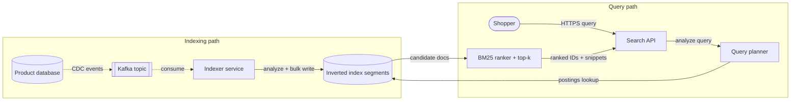

**Reading the diagram.** The left subgraph is the **indexing path**. The product database is the source of truth; change data capture (CDC) publishes every insert, update and delete as an event to a Kafka topic. Those dotted arrows are asynchronous: the shopper never waits for them. The indexer consumes events, runs text analysis and writes to the index in bulk. The right subgraph is the **query path**, which is synchronous (solid arrows) from the shopper's HTTPS request to the ranked response. The query is analyzed with the *same* rules as the documents, the planner looks up postings lists, and the ranker scores candidates and keeps the top *k*. There are two storage boundaries, the product database and the index, and they are eventually consistent with each other; the lag between them is the **freshness** of search (§16.10). Failure points: if Kafka or the indexer stalls, search keeps serving but grows stale; if the index is unavailable, search fails even though the database is healthy. The two paths scale independently: indexing by adding partitions and indexer consumers, querying by adding replicas (§16.7).

## 16.1 Learning objectives

After this chapter you should be able to:

- Explain how an inverted index, postings lists, positions and skip pointers answer keyword, Boolean and phrase queries, and estimate an index's size with delta and variable-byte compression.
- Design an analysis chain (tokenizer, lowercasing, stemming or lemmatization, stop words, n-grams, synonyms) and predict how each choice changes recall, precision and index size.
- Compute TF-IDF and BM25 scores by hand, explain the roles of $k_1$ and $b$, and apply field boosting.
- Describe how Lucene builds indexes from immutable segments, handles deletes with tombstones, and merges segments, and estimate merge write amplification.
- Compare document and term partitioning, compute scatter–gather tail latency, and explain query-then-fetch, deep-pagination cost and the global-versus-local IDF problem.
- Describe the Elasticsearch/OpenSearch cluster model: node roles, shards, replicas, the translog, refresh, flush and near-real-time search.
- Design an autocomplete service with a trie or FST holding precomputed top-*k* completions and meet a 100 ms end-to-end budget.
- Build a near-real-time indexing pipeline with CDC and Kafka, and reason about its freshness latency and refresh-interval trade-offs.

## 16.2 Prerequisites

- B-trees and secondary indexes — §11.7–§11.8 (the inverted index is a different answer to the same "avoid a full scan" problem).
- Log-structured storage, LSM trees and compaction — §13.7–§13.9 (Lucene segments are an LSM-like design; this chapter cross-references rather than repeats).
- Partitioning and replication — §14.3 and §14.6–§14.7 (search clusters apply them to indexes).
- Percentiles and fan-out amplification — §4.8 (scatter–gather latency builds directly on $p^N$).
- Logarithms — §4.4 (IDF and merge-tier arithmetic use them).
- Tries — §17.11 gives the data structure; this chapter applies it to autocomplete.
- Python 3.10 or later to run the listings; all use only the standard library.

## 16.3 Inverted indexes

### 16.3.1 From the index at the back of a book to an inverted index

::: definition
**Definition — Inverted index.** A mapping from each distinct **term** (a normalized word or token) to a **postings list**: the sorted list of identifiers of the documents that contain the term, optionally with the term's frequency and positions in each document. The set of all terms is the **dictionary** (or **vocabulary**, or **lexicon**).
:::

#### First-principles explanation

Open a textbook at the back. The index lists "Bloom filter … 211, 340, 512". Nobody reads the whole book to find Bloom filters; you look up the word and jump to the pages. The book's body maps *page → words*. The index at the back is that mapping turned inside out: *word → pages*. That is all an inverted index is. The "forward" direction (document → terms) is how documents are written; the "inverted" direction (term → documents) is how they are searched.

Three refinements make it a search index: page numbers become small-integer **document identifiers (docIDs)**; each list is kept **sorted** by docID so lists combine cheaply; and each entry can carry the **term frequency** (tf) and **positions** of the word, for ranking and phrase matching.

#### Why does this exist?

Consider answering "documents containing *noise* and *headphones*" by scanning. A catalog of 100 million documents averaging 2.4 KB of text is 240 GB. Reading 240 GB at a generous 10 GB/s of memory bandwidth takes 24 s per query on one core, before any matching work. An inverted index instead reads two postings lists. If *noise* appears in 1 million documents and *headphones* in 100,000, the engine touches about 1.1 million entries; at roughly 2.4 bytes per compressed entry (§16.3.5) that is about 2.6 MB, read in well under a millisecond. The index trades storage and indexing work for a 10,000-fold reduction in query work.

#### How it works internally

1. **Analyze** each document into terms with positions (§16.4).
2. **Assign** a docID; Lucene assigns them in insertion order within each segment, so postings are naturally sorted (§16.6).
3. **Append** the docID (with tf and positions) to the postings list of each distinct term.
4. **Store** the dictionary in a structure supporting exact and prefix lookup; Lucene uses a block tree indexed by a finite-state transducer (§16.9.3).
5. **Compress** postings (§16.3.4) and write them sequentially.

#### Architecture diagram

**Figure 16.2 — Dictionary, postings lists and positions.**

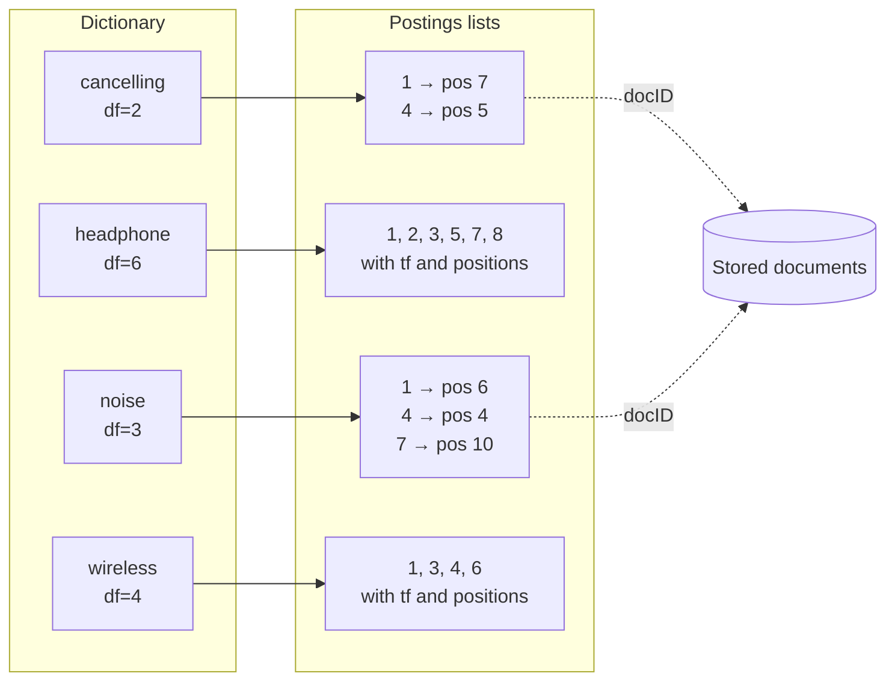

**Reading the diagram.** The left subgraph is the dictionary: one entry per distinct term with its **document frequency** (df, the number of documents containing it). Each solid arrow is a pointer, in practice a file offset, from a dictionary entry to its postings list. The right subgraph shows postings for the body field of this chapter's eight-product example (§16.5.4): *noise* occurs in documents 1, 4 and 7, at positions 6, 4 and 10. The dotted arrows show the last step of a query: docIDs are turned into displayable results by fetching stored fields, a separate storage structure. The dictionary is small and usually memory-resident; postings are large and read sequentially; stored documents are read only for the final top results. Failure points are corruption of any of the three structures, which is why Lucene checksums every file. Scaling is by partitioning documents across shards, each with its own complete dictionary and postings (§16.7).

### 16.3.2 Query evaluation with postings lists

Because postings are sorted, Boolean operators become list operations:

- **AND** (*noise* AND *wireless*) is an **intersection**: walk both lists in step, advancing whichever pointer holds the smaller docID, and output docIDs found in both. Cost is $O(L_1 + L_2)$ for lists of lengths $L_1$ and $L_2$.
- **OR** is a **union**, also a linear merge; ranked retrieval is usually OR-like, with scoring sorting candidates. **NOT** is a list difference.
- A **phrase query** ("noise cancelling") first intersects the lists, then checks positions: a document matches only if *cancelling* occurs at position $p+1$ for some position $p$ of *noise*. Positional data typically makes the index two to four times larger, which is why some fields are indexed without positions (in Elasticsearch, `index_options: docs` or `freqs`).

Process the **rarest term first**: an intersection is never larger than its shortest list.

### 16.3.3 Skip pointers

Intersecting a list of 200,000 docIDs with one of 1,000 by linear merge costs about 200,000 comparisons, almost all of them spent stepping through the long list past docIDs that cannot match. **Skip pointers** are shortcuts stored every $s$ entries of a postings list: "the entry $s$ positions ahead holds docID $X$". When the target docID is beyond $X$, the iterator jumps $s$ entries at once.

Lucene exposes this as an iterator operation, `advance(target)`: move to the first docID $\geq$ target. Its postings formats store multi-level skip data so `advance` can take long jumps, then shorter ones, then scan within one compressed block [Lucene Docs: postings format]. The skip interval trades jump distance against scan length. Manning et al. suggest $\sqrt{L}$ for a list of length $L$ [Manning et al. 2008, §2.3], but that heuristic assumes lists of similar length. When a short list of $m$ targets drives a long list of length $L$, the total cost is roughly $L/s$ skip-follows plus $m \cdot s/2$ in-block steps, minimized at $s = \sqrt{2L/m}$.

```python
"""Intersect two sorted postings lists (AND query), with and without skip pointers,
counting comparisons. The skip version drives from the shorter list and calls advance(target),
the operation Lucene's postings iterators expose."""
import math
import random

def intersect_linear(a, b):
    """Textbook merge: step whichever pointer holds the smaller docID."""
    i = j = comparisons = 0
    out = []
    while i < len(a) and j < len(b):
        comparisons += 1
        if a[i] == b[j]:
            out.append(a[i]); i += 1; j += 1
        elif a[i] < b[j]:
            i += 1
        else:
            j += 1
    return out, comparisons

class SkipPostings:
    """A postings list with a skip pointer every `step` entries."""
    def __init__(self, doc_ids, step=None):
        self.ids = doc_ids
        self.step = step or max(1, int(math.sqrt(len(doc_ids))))
        self.pos = 0
        self.comparisons = 0

    def advance(self, target):
        """Move to the first docID >= target; return it (or None when exhausted)."""
        ids, s = self.ids, self.step
        nxt = (self.pos // s + 1) * s                    # next skip-pointer position
        while nxt < len(ids) and ids[nxt] <= target:     # follow skips while they do not overshoot
            self.comparisons += 1
            self.pos, nxt = nxt, nxt + s
        while self.pos < len(ids) and ids[self.pos] < target:   # then scan inside one block
            self.comparisons += 1
            self.pos += 1
        return ids[self.pos] if self.pos < len(ids) else None

def intersect_with_skips(short, long_list, step=None):
    it = SkipPostings(long_list, step)
    out = []
    for doc in short:                                    # drive from the rarer term
        it.comparisons += 1
        found = it.advance(doc)
        if found is None:
            break
        if found == doc:
            out.append(doc)
    return out, it.comparisons

if __name__ == "__main__":
    random.seed(7)
    N = 1_000_000
    common = sorted(random.sample(range(N), 200_000))   # e.g. "wireless": 20% of docs
    rare = sorted(random.sample(range(N), 1_000))       # e.g. "anc": 0.1% of docs
    r1, c1 = intersect_linear(common, rare)
    assert r1 == sorted(set(common) & set(rare))
    print(f"matches={len(r1)}  linear merge: {c1:,} comparisons")
    for step in (447, 128, 20):                       # sqrt(L), Lucene's block size, sqrt(2L/m)
        r2, c2 = intersect_with_skips(rare, common, step)
        assert r2 == r1
        print(f"skip every {step:>3}: {c2:>7,} comparisons  ({c1 / c2:.0f}x fewer)")
```

Output (Python 3.13):

```text
matches=184  linear merge: 200,611 comparisons
skip every 447: 121,210 comparisons  (2x fewer)
skip every 128:  53,587 comparisons  (4x fewer)
skip every  20:  20,909 comparisons  (10x fewer)
```

What to notice:

- The intersection is **driven by the rare list**: 1,000 calls to `advance`, not 200,000 steps.
- The $\sqrt{L} = 447$ heuristic helps only 2× here because each `advance` then scans about 224 entries inside a block. Spacing tuned to the list-length ratio, $\sqrt{2 \times 200{,}000 / 1{,}000} = 20$, gives 10×. Multi-level skip lists, as in Lucene, get coarse and fine jumps without choosing one spacing.
- In a real engine the bigger win is **decoding**: a skipped compressed block is never decompressed.

### 16.3.4 Compression: delta encoding and variable-byte codes

A docID stored as a 32-bit integer costs 4 bytes. Postings lists hold one entry per (term, document) pair, so they dominate index size. Two observations make them highly compressible.

**Delta (gap) encoding.** A sorted list such as 824, 829, 215406 can be stored as its first value followed by differences: 824, 5, 214577. A frequent term has small gaps (a term in 20% of documents has an average gap of 5), and small numbers need few bits. Rare terms have large gaps but short lists, so they contribute little to total size.

**Variable-byte (VByte) codes.** Encode each gap in as many bytes as it needs, using 7 data bits per byte and the eighth bit as a flag. In Lucene's `VInt` convention the low-order 7 bits come first and a high bit of 1 means "more bytes follow" [Lucene Docs: DataOutput.writeVInt]. Manning et al. describe the same code with the flag set on the *last* byte instead [Manning et al. 2008, §5.3.1]; the two are equivalent in size.

::: formula
**Variable-byte length of an integer**

$$\text{bytes}(g) = \max\!\left(1, \left\lceil \frac{\lfloor \log_2 g \rfloor + 1}{7} \right\rceil\right)$$

| Symbol | Meaning | Units |
|---|---|---|
| $g$ | The integer to encode, here a docID gap ($g \geq 1$) | count |
| $\lfloor \log_2 g \rfloor + 1$ | Number of significant bits in $g$ | bits |
| $\text{bytes}(g)$ | Encoded length, 7 payload bits per byte | bytes |
:::

**Table 16.1 — Variable-byte length by gap size.**

| Gap range | Significant bits | VByte bytes | Saving versus 4-byte integer |
|---|---|---|---|
| 1–127 | 1–7 | 1 | 75% |
| 128–16,383 | 8–14 | 2 | 50% |
| 16,384–2,097,151 | 15–21 | 3 | 25% |
| 2,097,152–268,435,455 | 22–28 | 4 | 0% |

::: example
**Worked example — encoding 824, 829, 215406.**

1. Gaps: 824, 829 − 824 = 5, 215406 − 829 = 214577.
2. 824 has 10 significant bits (512 ≤ 824 < 1024), so $\lceil 10/7 \rceil = 2$ bytes. Split into 7-bit groups: $824 = 6 \times 128 + 56$. Low group first with the continuation bit set: $56 + 128 = 184$ = `10111000`; then `00000110` (6, no continuation).
3. 5 fits in one byte: `00000101`.
4. 214577 has 18 bits ($2^{17} = 131072 \leq 214577 < 262144$), so 3 bytes. $214577 = 13 \times 16384 + 12 \times 128 + 49$, giving `10110001` (49 + 128), `10001100` (12 + 128), `00001101` (13).
5. Total: 6 bytes instead of 12.

**Interpretation.** Half the space is saved even here; frequent terms, whose gaps fit in one byte, save 75%. **Engineering implication.** The postings that make queries slow (common terms) compress best, so compression cuts I/O on the hot path, not just disk.
:::

The listing below implements delta + VByte, checks the worked example, and measures the average bytes per posting on a synthetic collection of 200,000 documents whose term document frequencies follow Zipf's law (a few very common terms, a long tail of rare ones).

```python
"""Delta (gap) encoding + variable-byte (VByte) compression of a postings list,
and a measurement of bytes per posting on a synthetic Zipf-distributed collection."""
import random

def vbyte_encode(n):
    """Lucene-style VInt: 7 data bits per byte, low-order group first,
    high bit = 1 means 'more bytes follow'."""
    out = bytearray()
    while n >= 0x80:
        out.append((n & 0x7F) | 0x80)
        n >>= 7
    out.append(n)
    return bytes(out)

def vbyte_decode_all(data):
    nums, n, shift = [], 0, 0
    for byte in data:
        n |= (byte & 0x7F) << shift
        if byte & 0x80:
            shift += 7
        else:
            nums.append(n)
            n, shift = 0, 0
    return nums

def compress_postings(doc_ids):
    gaps = [doc_ids[0]] + [b - a for a, b in zip(doc_ids, doc_ids[1:])]
    return b"".join(vbyte_encode(g) for g in gaps)

def decompress_postings(data):
    doc_ids, total = [], 0
    for gap in vbyte_decode_all(data):
        total += gap
        doc_ids.append(total)
    return doc_ids

if __name__ == "__main__":
    ids = [824, 829, 215406]            # the example used in Manning et al. (2008), ch. 5
    blob = compress_postings(ids)
    print("gaps:", [ids[0]] + [b - a for a, b in zip(ids, ids[1:])])
    print("bytes:", " ".join(f"{b:08b}" for b in blob), f"({len(blob)} bytes vs {4*len(ids)} raw)")
    assert decompress_postings(blob) == ids

    # Synthetic collection: N docs, vocabulary with Zipfian document frequencies.
    random.seed(16)
    N, M, total_postings_target = 200_000, 50_000, 10_000_000
    weights = [1 / r for r in range(1, M + 1)]                 # Zipf, exponent 1
    scale = total_postings_target / sum(weights)
    raw_bytes = vb_bytes = postings = 0
    for w in weights:
        df = max(1, min(N, int(w * scale)))
        doc_ids = sorted(random.sample(range(N), df))
        vb_bytes += len(compress_postings(doc_ids))
        raw_bytes += 4 * df
        postings += df
    print(f"postings={postings:,}  raw={raw_bytes/1e6:.1f} MB  vbyte={vb_bytes/1e6:.1f} MB  "
          f"bytes/posting={vb_bytes/postings:.2f}  ratio={vb_bytes/raw_bytes:.2f}")
```

Output (about 7 s):

```text
gaps: [824, 5, 214577]
bytes: 10111000 00000110 00000101 10110001 10001100 00001101 (6 bytes vs 12 raw)
postings=8,946,910  raw=35.8 MB  vbyte=12.5 MB  bytes/posting=1.39  ratio=0.35
```

What to notice:

- Decoding has a data-dependent branch per byte, which is why production engines moved to **block** codes.
- On the Zipfian collection, docID postings shrink to **1.39 bytes each**, 35% of their raw size. Manning et al. report the same order for the Reuters RCV1 collection: about 100 million postings take 400 MB as 32-bit integers and 116 MB with variable-byte gaps [Manning et al. 2008, Table 5.6].

Lucene's postings formats (Lucene 5 through at least 9) group docID deltas and frequencies into blocks of 128 and store each block with **frame-of-reference bit packing**: every value uses the bit width of the block's largest value, decoded without branches; list tails use VInt [Lucene Docs: postings format]. Bit packing decodes several times faster than VByte, especially with SIMD [Lemire and Boytsov 2015]. Zobel and Moffat survey the wider family (Elias, Golomb, VByte) and its ratio-versus-speed trade-off [Zobel and Moffat 2006].

### 16.3.5 Estimating index size

::: formula
**Inverted index size (one copy)**

$$S_{\text{index}} \approx \underbrace{N \cdot u \cdot (b_d + b_f)}_{\text{docIDs + frequencies}} + \underbrace{N \cdot L \cdot b_p}_{\text{positions}} + \underbrace{M \cdot b_t}_{\text{dictionary}}$$

| Symbol | Meaning | Units |
|---|---|---|
| $N$ | Number of documents | documents |
| $u$ | Average number of *distinct* terms per document (postings per document) | postings/document |
| $L$ | Average number of tokens per document (one position each) | tokens/document |
| $b_d$, $b_f$ | Compressed bytes per docID gap and per term frequency | bytes |
| $b_p$ | Compressed bytes per position gap | bytes |
| $M$ | Number of distinct terms in the collection | terms |
| $b_t$ | Dictionary bytes per term (term text + pointers + statistics) | bytes |
:::

::: example
**Worked example — 100 million product and review documents.** Assume $N = 10^8$, $L = 400$ tokens, $u = 200$ distinct terms per document, $M = 5 \times 10^7$ distinct terms (part numbers and misspellings make vocabularies large), $b_d = 1.4$ bytes (measured above), $b_f = 1$ byte, $b_p = 1.5$ bytes, $b_t = 20$ bytes. Sizes in SI units (1 GB = $10^9$ bytes).

1. Postings: $N \cdot u = 10^8 \times 200 = 2 \times 10^{10}$.
2. DocIDs and frequencies: $2 \times 10^{10} \times (1.4 + 1) = 4.8 \times 10^{10}$ bytes = 48 GB.
3. Positions: $N \cdot L = 4 \times 10^{10}$ tokens × 1.5 bytes = $6 \times 10^{10}$ bytes = 60 GB.
4. Dictionary: $5 \times 10^7 \times 20 = 10^9$ bytes = 1 GB.
5. Total inverted index ≈ 48 + 60 + 1 = **109 GB**.
6. Uncompressed for comparison (4-byte docID, tf and position): $2 \times 10^{10} \times 8 + 4 \times 10^{10} \times 4 = 160 + 160 = 320$ GB, about 3× larger.
7. The raw text is $4 \times 10^{10}$ tokens × about 6 bytes = 240 GB, so the positional index is about 45% of the text and the non-positional part about 20%.

**Interpretation.** Positions cost more than docIDs and frequencies combined. **Engineering implication.** Elasticsearch also stores the original JSON (`_source`), **doc values** (a column store for sorting and aggregations) and **norms** (per-field length factors); budget roughly the index again for these, then multiply by $1 + r$ for $r$ replicas: about $2 \times (109 + 110) \approx 440$ GB with one replica, before merge headroom (§16.6). Dropping positions from fields never used in phrases is the largest single saving.
:::

#### Real-world industry applications

::: industry
**Early Google: barrels and hit lists.** Brin and Page's prototype partitioned its forward index into 64 "barrels" by word ID and sorted each barrel to produce the inverted index. Each posting carried a compact "hit list" (two bytes per hit, including capitalization and font size), and "fancy" hits from titles and anchor text were kept separately so queries could consult short, high-value lists first [Brin and Page 1998]. That idea survives as field-specific and tiered indexes.
*Evidence: Primary* — [Brin and Page 1998]
:::

#### Failure scenarios

**Table 16.2 — Inverted index failure scenarios.**

| What goes wrong | Why | Detection | Recovery | Prevention |
|---|---|---|---|---|
| Query on a common term is slow | Postings list of tens of millions of entries is fully decoded and scored | Slow-query log; per-term latency | Add top-*k* pruning (§16.5.6); cache results | Block-max skipping; avoid stop-word-only queries on huge fields |
| Index far larger than estimated | Positions and n-gram fields indexed everywhere | Per-field disk usage API | Reindex with `index_options: freqs` where phrases are unused | Review mappings before launch |
| Corrupted segment after disk fault | Bit rot or torn write | Checksum mismatch on open | Recover shard from a replica or snapshot | Replicas on separate failure domains; checksums (Lucene has them) |

#### Common misconceptions

::: mistake
**Mistake — "An inverted index is just a secondary index on a text column."** A B-tree maps one value per row; an inverted index maps *many* terms per document, keeps term statistics for ranking and positions for phrases, and is built and compressed in bulk. That is why relational databases ship separate full-text index types (PostgreSQL's GIN, for example).
:::

## 16.4 Tokenization and analysis

### 16.4.1 The analysis chain

::: definition
**Definition — Analysis.** The process that converts raw text into the terms stored in (or looked up from) an inverted index. An **analyzer** is a pipeline of zero or more **character filters** (rewrite the raw character stream), exactly one **tokenizer** (split the stream into tokens with positions and offsets) and zero or more **token filters** (modify, remove or add tokens).
:::

#### First-principles explanation

An inverted index matches terms *exactly*: `Headphones` and `headphone` are different keys, though a shopper does not care. Analysis decides which strings count as "the same word", as a librarian filing "Colour", "color" and "COLORS" under one card does by hand. Every decision moves the balance between two quality measures. **Recall** is the fraction of relevant documents that are returned; **precision** is the fraction of returned documents that are relevant. Aggressive normalization (stemming, synonyms, folding accents) raises recall and risks precision: "university" and "universe" both stem to "univers" under the Porter stemmer. Conservative analysis does the opposite.

#### How it works internally

**Figure 16.3 — An analysis chain applied at index time and at query time.**

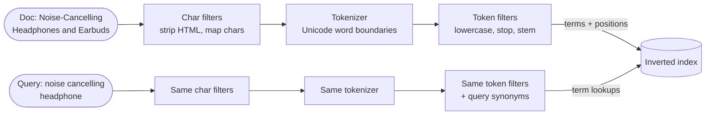

**Reading the diagram.** Two inputs enter the same pipeline: a document at index time (top) and a query at search time (bottom). Character filters run first on raw text (stripping HTML, mapping "&" to "and"); the tokenizer then splits text into tokens with positions; token filters normalize them. The index stores terms with positions; the query side only looks terms up. All steps are synchronous, in-process transformations; the only storage boundary is the index. The critical failure point is **asymmetry**: if the two pipelines diverge, for example because the index was built with stemming and the query analyzer was changed later, queries look up terms that were never stored and silently return nothing. Changing index-time analysis therefore requires a full reindex (§16.10.2); query-time-only filters such as synonyms can change without one. Analysis is CPU-bound and scales with indexer nodes.

**Table 16.3 — Analysis chain components and their trade-offs.**

| Component | Example | Raises | Risks |
|---|---|---|---|
| Char filter | Strip HTML; map "½" to "1/2" | Clean tokens | Losing meaningful symbols |
| Standard tokenizer | Unicode word boundaries (UAX #29) | Language-neutral splitting | "C++", "U.S.A.", "e-mail" split oddly |
| Lowercase | "Wi-Fi" → "wi", "fi" | Recall | "US" (country) vs "us" (pronoun) |
| ASCII folding | "café" → "cafe" | Recall for unaccented queries | Precision in languages where accents matter |
| Stop words | Drop "the", "of" | Index size, speed | Queries like "The Who", "to be or not to be" |
| Stemming | "running" → "run" | Recall | Over-stemming ("universe" ~ "university") |
| Synonyms | "tv" → "television" | Recall | Drift ("apple" fruit vs company) |
| Edge n-grams | "head" → h, he, hea, head | Prefix matching | Index 3–10× larger |

### 16.4.2 Tokenizers and normalization

A **whitespace tokenizer** splits on spaces and keeps punctuation attached ("headphones,"). Lucene's **standard tokenizer** implements the Unicode word-break rules of UAX #29. Specialized tokenizers handle emails, URLs and paths, and `keyword` fields (SKUs, IDs, tags) keep the whole value as one token. **Unicode normalization** (NFC/NFKC) makes "é" as one code point equal to "e" plus a combining accent; normalization bugs are a classic cause of "the product is indexed but search cannot find it".

### 16.4.3 Stemming versus lemmatization

**Stemming** chops suffixes by rule. The Porter stemmer [Porter 1980] applies several dozen suffix-rewriting rules in five steps and maps "connection", "connected" and "connecting" to "connect". The "S" stemmer removes only plural endings [Harman 1991]; Lucene ships it as a minimal English stemmer, and this chapter's code uses it. **Lemmatization** maps a word to its dictionary form (lemma) using a vocabulary and part-of-speech information: "better" → "good", "mice" → "mouse", "was" → "be".

**Table 16.4 — Stemming versus lemmatization.**

| | Stemming | Lemmatization |
|---|---|---|
| What it is | Rule-based suffix stripping | Dictionary + morphology lookup |
| Output | A stem, possibly not a word ("univers") | A real word (lemma) |
| Speed | Very fast, no dictionary | Slower; needs POS tagging for accuracy |
| Recall | High (aggressive) | High for irregular forms |
| Precision | Can conflate unrelated words | Better |
| Languages | Per-language rule sets (Snowball) | Needs a lexicon per language |
| Choose when | Large English corpora, speed matters | Morphologically rich languages, precision matters |

Manning et al. observe that stemming helps recall but hurts precision, and its net effect on English retrieval quality is modest; for languages with richer morphology (Finnish, Hungarian, Arabic) normalization matters much more [Manning et al. 2008, §2.2.4].

### 16.4.4 Stop words

**Stop words** ("the", "a", "of") have the longest postings lists, so dropping them once saved much space. Modern engines usually *keep* them: their small gaps compress to a byte, BM25's IDF already gives them near-zero weight (§16.5.3), and dropping them breaks phrases and queries such as "The Who". Elasticsearch's standard analyzer keeps them by default. If you remove them, keep the position gaps (as this chapter's analyzer does) so phrase matching stays correct.

### 16.4.5 n-grams and edge n-grams

A **character n-gram** is a substring of length $n$. Indexing all trigrams of "headphone" (hea, ead, adp, dph, …) lets the engine match substrings, misspellings and languages without spaces. An **edge n-gram** keeps only prefixes (h, he, hea, head, …), which supports search-as-you-type (§16.9.4). Both multiply the number of postings: a word of length $\ell$ produces $\ell - n + 1$ n-grams, so a trigram field is several times larger than a word field and its postings lists for common grams are very long.

### 16.4.6 Synonyms

Synonyms map equivalent terms ("tv" ⇔ "television"). At **index time** they enlarge the index and every change needs a reindex; at **query time** they cost slightly more per query but can be updated freely, so most teams apply them there. Multi-word synonyms ("ny" ⇔ "new york") produce expansions of different lengths, which Lucene represents as a token *graph*; its synonym-graph filter is meant for query time.

### 16.4.7 Language issues

- **No word separators.** Chinese, Japanese and Thai need dictionary-based segmenters (such as Lucene's Kuromoji for Japanese) or overlapping character bigrams, which need no dictionary but index more terms.
- **Compounds.** German "Kopfhörerverstärker" (headphone amplifier) needs decompounding so that "Kopfhörer" finds it.
- **Script rules.** Arabic needs letter-variant and diacritic normalization; Turkish has dotted and dotless "i", so naive lowercasing is wrong.
- **Mixed-language catalogs.** Give each language its own field and analyzer (`title.en`, `title.de`) rather than forcing one analyzer onto all text.

An Elasticsearch analyzer is declared in the index settings and attached to fields in the mapping:

```json
{
  "settings": {
    "analysis": {
      "filter": {
        "product_synonyms": { "type": "synonym_graph", "synonyms": ["tv, television", "anc, noise cancelling"] }
      },
      "analyzer": {
        "product_index":  { "tokenizer": "standard", "filter": ["lowercase", "asciifolding", "porter_stem"] },
        "product_search": { "tokenizer": "standard", "filter": ["lowercase", "asciifolding", "product_synonyms", "porter_stem"] }
      }
    }
  },
  "mappings": {
    "properties": {
      "title": { "type": "text", "analyzer": "product_index", "search_analyzer": "product_search" },
      "sku":   { "type": "keyword" }
    }
  }
}
```

What to notice: the index and search analyzers share tokenizer and normalization but the synonym graph is applied only at search time; `sku` is a `keyword` field, indexed as a single unanalyzed token for exact matching.

#### Real-world industry applications

::: industry
**GitHub code search.** Source code defeats word analyzers: users search for punctuation (`foo(`), want no stemming or stop-word removal, and use regular expressions. GitHub's engine (Blackbird, written in Rust) therefore indexes character n-grams and answers a query by intersecting the postings lists of the query's n-grams, then verifying candidate documents; GitHub reported an index of about 25 TB built from 115 TB of source content [Clem 2023]. Trade-off: n-gram postings are numerous and long, which GitHub offset by indexing each unique file content only once and by sharding.
*Evidence: Primary* — [Clem 2023]
:::

#### Failure scenarios

**Table 16.5 — Analysis failure scenarios.**

| What goes wrong | Why | Detection | Recovery | Prevention |
|---|---|---|---|---|
| Known document not found | Index and query analyzers differ | `_analyze` API on both strings | Align analyzers; reindex | One analyzer definition shared by both sides; tests |
| Irrelevant matches after a release | Aggressive stemmer or bad synonym | Relevance test set regression | Roll back query-time synonyms | Offline relevance evaluation gate |
| Index size jumps 5× | n-gram filter added to a large field | Disk usage alert | Move n-grams to a dedicated subfield | Size test on a sample before deploy |

#### Common misconceptions

::: mistake
**Mistake — "Better analysis is always more normalization."** Every normalization merges distinct strings. For SKUs, error codes, names and code, normalization destroys meaning. Analyze each field according to how people search it, and keep an unanalyzed `keyword` subfield for exact matching.
:::

## 16.5 Ranking: TF-IDF and BM25

### 16.5.1 What a ranking function does

::: definition
**Definition — Relevance score.** A number computed for each (query, document) pair that estimates how well the document satisfies the query. A **ranking function** computes it; the engine returns the $k$ highest-scoring documents.
:::

#### First-principles explanation

A sensible librarian asked for "noise cancelling headphones" reasons three ways. A book mentioning *noise cancelling* ten times is more on topic than one mentioning it once, but not ten times more (**term frequency, with diminishing returns**). *Headphones* appears in half the catalog, so matching it says little, while rare *cancelling* is informative (**inverse document frequency**). And a leaflet mentioning *noise* once is more focused than an encyclopedia mentioning it once (**length normalization**). BM25 writes these three intuitions as one formula.

The theoretical justification is the **probability ranking principle**: if documents are ranked by their probability of relevance to the query, the ranking is optimal for any measure that rewards putting relevant documents first [Robertson 1977]. BM25 approximates that probability from term statistics alone [Robertson and Zaragoza 2009].

### 16.5.2 TF-IDF

Karen Spärck Jones observed in 1972 that a term's value for retrieval falls as the number of documents containing it rises [Spärck Jones 1972]. Combined with term frequency, this gives the classic **TF-IDF** weight, the basis of the vector space model in which documents and queries are vectors of term weights compared by cosine similarity (§4.9.2).

::: formula
**TF-IDF weight of term $t$ in document $d$**

$$w_{t,d} = \text{tf}_{t,d} \times \log_{10}\frac{N}{\text{df}_t} \qquad \text{score}(q,d) = \sum_{t \in q} w_{t,d}$$

| Symbol | Meaning | Units |
|---|---|---|
| $\text{tf}_{t,d}$ | Occurrences of term $t$ in document $d$ | count |
| $N$ | Documents in the collection | documents |
| $\text{df}_t$ | Documents containing $t$ | documents |
| $w_{t,d}$ | Weight of $t$ in $d$ | dimensionless |
:::

::: example
**Worked example — TF-IDF on the product catalog.** The body field of the eight-product catalog (§16.5.4) has $N = 8$. *noise* occurs in 3 documents and *headphone* in 6.

1. $\text{idf}(\textit{noise}) = \log_{10}(8/3) = \log_{10} 2.667 = 0.426$.
2. $\text{idf}(\textit{headphone}) = \log_{10}(8/6) = 0.125$.
3. A document containing *noise* once scores 0.426 for that term; one containing *noise* 10 times scores 4.26.

**Interpretation.** IDF makes *noise* 3.4× more valuable than *headphone*, as intended, but raw tf grows without limit (keyword stuffing wins) and nothing corrects for length. **Engineering implication.** Lucene's TF-IDF variant (with $\sqrt{\text{tf}}$ and length factors) was the default until Lucene 6 and Elasticsearch 5.0 switched to BM25 [Elastic Docs: similarity].
:::

### 16.5.3 BM25

**BM25** ("Best Matching 25", the 25th weighting scheme in the Okapi experiments at City University London) comes from the probabilistic relevance framework [Robertson and Zaragoza 2009]. It keeps IDF, makes term frequency **saturate**, and normalizes by document length relative to the average.

::: formula
**BM25 inverse document frequency (Lucene form)**

$$\text{IDF}(t) = \ln\!\left(1 + \frac{N - n_t + 0.5}{n_t + 0.5}\right)$$

| Symbol | Meaning | Units |
|---|---|---|
| $N$ | Documents in the collection (or shard; see §16.7.5) | documents |
| $n_t$ | Documents containing term $t$ (document frequency) | documents |
| $\text{IDF}(t)$ | Weight of a match on $t$ | dimensionless |
:::

The classic Robertson–Spärck Jones form, $\ln\frac{N - n_t + 0.5}{n_t + 0.5}$, becomes *negative* for terms in more than half the documents; Lucene adds 1 inside the logarithm so that every match contributes a small positive amount.

::: formula
**BM25 score**

$$\text{score}(q, d) = \sum_{t \in q} \text{IDF}(t) \cdot \frac{f_{t,d}\,(k_1 + 1)}{f_{t,d} + k_1\left(1 - b + b \cdot \dfrac{|d|}{\text{avgdl}}\right)}$$

| Symbol | Meaning | Units |
|---|---|---|
| $f_{t,d}$ | Frequency of term $t$ in document (field) $d$ | count |
| $\lvert d \rvert$ | Length of $d$ in terms after analysis | terms |
| $\text{avgdl}$ | Average length of that field across the collection | terms |
| $k_1$ | Term-frequency saturation parameter; Lucene default 1.2 (typical 1.2–2.0) | dimensionless |
| $b$ | Length-normalization strength, 0 (none) to 1 (full); default 0.75 | dimensionless |
| $\text{score}(q,d)$ | Relevance score; only comparable within one query | dimensionless |
:::

Two properties follow from the formula. As $f_{t,d} \to \infty$ the fraction approaches $k_1 + 1$, so a term can never contribute more than $(k_1 + 1) \cdot \text{IDF}$: repetition has diminishing returns. And the denominator grows with $|d|/\text{avgdl}$, so the same tf in a longer document scores less; $b$ controls how strongly.

**Table 16.6 — BM25 term-frequency factor ($k_1 = 1.2$, $b = 0.75$) versus raw tf.**

| tf | Raw TF-IDF factor | BM25, $\lvert d \rvert$ = 0.5 avgdl | BM25, $\lvert d \rvert$ = avgdl | BM25, $\lvert d \rvert$ = 2 avgdl |
|---|---|---|---|---|
| 1 | 1 | 1.257 | 1.000 | 0.710 |
| 2 | 2 | 1.600 | 1.375 | 1.073 |
| 5 | 5 | 1.913 | 1.774 | 1.549 |
| 10 | 10 | 2.047 | 1.964 | 1.818 |
| ∞ | ∞ | 2.200 | 2.200 | 2.200 |

Reading down a column shows saturation: 1 to 10 occurrences raises the BM25 factor by less than 2.6×, against 10× for raw tf. Reading across a row shows length normalization: the same tf is worth less in a longer document.

::: example
**Worked example — BM25 for *noise* in two product descriptions.** From the catalog in §16.5.4: $N = 8$ body fields, $n_{\textit{noise}} = 3$, $\text{avgdl} = 68/8 = 8.5$ terms. Document 4 (earbuds) has $|d| = 7$; document 7 (kids' headphones) has $|d| = 12$. Each contains *noise* once. $k_1 = 1.2$, $b = 0.75$.

1. IDF: $\ln\!\left(1 + \frac{8 - 3 + 0.5}{3 + 0.5}\right) = \ln(1 + 1.5714) = \ln 2.5714 = 0.9445$.
2. Length factor, document 4: $k_1(1 - b + b \cdot 7/8.5) = 1.2 \times (0.25 + 0.6176) = 1.2 \times 0.8676 = 1.0412$.
3. TF part, document 4: $\frac{1 \times 2.2}{1 + 1.0412} = \frac{2.2}{2.0412} = 1.0778$.
4. Score, document 4: $0.9445 \times 1.0778 = 1.018$.
5. Length factor, document 7: $1.2 \times (0.25 + 0.75 \times 12/8.5) = 1.2 \times 1.3088 = 1.5706$; TF part $2.2 / 2.5706 = 0.8558$; score $0.9445 \times 0.8558 = 0.808$.
6. Saturation check for document 4: with tf = 2 the TF part would be $4.4 / 3.0412 = 1.447$, with tf = 5 it would be $11 / 6.0412 = 1.821$, never exceeding 2.2.

**Interpretation.** The same single mention of *noise* is worth 26% more in the short, focused earbuds description than in the longer kids' description, and repeating it five times would raise its weight by only 69%. The listing below reproduces 1.0179 and 0.8083. **Engineering implication.** BM25 resists keyword stuffing and long-document bias out of the box, which is why it is the default in Lucene, Elasticsearch, OpenSearch and Solr. Tune $k_1$ and $b$ per field only against a relevance test set; for very short fields such as titles, a lower $b$ is common because length differences carry little meaning.
:::

::: note
**Lucene's scores versus the textbook formula.** Lucene 8 removed the constant factor $(k_1 + 1)$ from the numerator because it does not change the ranking; Elasticsearch preserves the classic score values by applying the constant as a boost, which is why `explain` output in Elasticsearch shows a factor of 2.2 [Lucene MIGRATE notes for 8.0]. Lucene also stores document length in a lossy one-byte **norm**, so its scores differ slightly from exact arithmetic.
:::

### 16.5.4 A complete engine in one listing

The listing below implements the analysis chain of §16.4 (tokenize, lowercase, stop words keeping position gaps, S-stemmer), a positional inverted index over two fields, BM25 with per-field boosts, and phrase matching.

```python
"""A tiny search engine: analysis, a positional inverted index, BM25 with field boosts.
Standard library only. Run: python3 search_engine.py"""
import math
import re
from collections import defaultdict

STOP_WORDS = {"a", "an", "and", "the", "for", "with", "of", "in", "to", "is", "are"}

def s_stem(token):
    """Harman's 'S' stemmer: strips only plural endings (like Lucene's EnglishMinimalStemFilter)."""
    if len(token) > 3 and token.endswith("ies") and not token.endswith(("eies", "aies")):
        return token[:-3] + "y"
    if len(token) > 3 and token.endswith("es") and not token.endswith(("aes", "ees", "oes")):
        return token[:-1]
    if len(token) > 3 and token.endswith("s") and not token.endswith(("us", "ss")):
        return token[:-1]
    return token

def analyze(text):
    """Tokenize on non-alphanumerics, lowercase, drop stop words, stem. Keeps positions."""
    out = []
    for pos, raw in enumerate(re.findall(r"[a-z0-9]+", text.lower())):
        if raw not in STOP_WORDS:
            out.append((s_stem(raw), pos))
    return out

class InvertedIndex:
    def __init__(self, fields):
        self.fields = fields
        # postings[field][term] -> {doc_id: [positions]}  (doc_ids inserted in increasing order)
        self.postings = {f: defaultdict(dict) for f in fields}
        self.doc_len = {f: {} for f in fields}
        self.n_docs = 0

    def add(self, doc_id, doc):
        self.n_docs += 1
        for f in self.fields:
            tokens = analyze(doc[f])
            self.doc_len[f][doc_id] = len(tokens)
            for term, pos in tokens:
                self.postings[f][term].setdefault(doc_id, []).append(pos)

    def avgdl(self, f):
        return sum(self.doc_len[f].values()) / self.n_docs

    def idf(self, f, term):
        n = len(self.postings[f].get(term, {}))
        return math.log(1 + (self.n_docs - n + 0.5) / (n + 0.5))   # Lucene's BM25 IDF

    def bm25_term(self, f, term, doc_id, k1=1.2, b=0.75):
        tf = len(self.postings[f].get(term, {}).get(doc_id, []))
        if tf == 0:
            return 0.0
        norm = k1 * (1 - b + b * self.doc_len[f][doc_id] / self.avgdl(f))
        return self.idf(f, term) * tf * (k1 + 1) / (tf + norm)

    def search(self, query, boosts, k=5):
        terms = [t for t, _ in analyze(query)]
        scores = defaultdict(float)
        for f, boost in boosts.items():
            for term in terms:                       # OR semantics: any matching term scores
                for doc_id in self.postings[f].get(term, {}):
                    scores[doc_id] += boost * self.bm25_term(f, term, doc_id)
        return sorted(scores.items(), key=lambda kv: (-kv[1], kv[0]))[:k]

    def phrase(self, f, phrase):
        """Docs where the analyzed terms appear at consecutive positions (stop-word gaps kept)."""
        toks = analyze(phrase)
        first, offsets = toks[0][0], [p - toks[0][1] for _, p in toks]
        hits = []
        for doc_id, positions in self.postings[f].get(first, {}).items():
            for p in positions:
                if all(p + off in self.postings[f].get(t, {}).get(doc_id, [])
                       for (t, _), off in zip(toks[1:], offsets[1:])):
                    hits.append(doc_id)
                    break
        return sorted(hits)

DOCS = {
    1: {"title": "Wireless noise cancelling headphones",
        "body": "Over-ear wireless headphones with active noise cancelling and a 30 hour battery."},
    2: {"title": "Wired studio headphones",
        "body": "Closed-back wired headphones for mixing and mastering in the studio."},
    3: {"title": "Portable Bluetooth speaker",
        "body": "Waterproof wireless speaker with deep bass. Pairs with phones and headphones."},
    4: {"title": "Noise cancelling wireless earbuds",
        "body": "True wireless earbuds with noise cancelling and a charging case."},
    5: {"title": "Headphone stand",
        "body": "Aluminum stand for headphones with a cable organizer."},
    6: {"title": "Wireless charging pad",
        "body": "Fast wireless charger for phones and earbuds. Charging cable included."},
    7: {"title": "Kids headphones",
        "body": "Volume-limited wired headphones for kids. Foldable, light, and less noise on long trips."},
    8: {"title": "Travel case for headphones and earbuds",
        "body": "Hard shell case that protects headphones, earbuds, cables and chargers on trips."},
}

if __name__ == "__main__":
    idx = InvertedIndex(["title", "body"])
    for doc_id, doc in DOCS.items():
        idx.add(doc_id, doc)

    print("analyze('Noise-Cancelling Headphones'):", analyze("Noise-Cancelling Headphones"))
    print("postings[body]['noise']:", dict(idx.postings["body"]["noise"]))
    print(f"N={idx.n_docs}  avgdl(title)={idx.avgdl('title'):.3f}  avgdl(body)={idx.avgdl('body'):.3f}")
    q = "wireless noise cancelling headphones"
    for f in ("title", "body"):
        row = {t: (len(idx.postings[f].get(t, {})), round(idx.idf(f, t), 4)) for t, _ in analyze(q)}
        print(f"df, idf in {f}:", row)
    print("\nBM25, body only:")
    for d, s in idx.search(q, {"body": 1.0}, k=8):
        print(f"  doc {d}: {s:.4f}  ({DOCS[d]['title']})")
    print("\nBM25, title^2 + body:")
    for d, s in idx.search(q, {"title": 2.0, "body": 1.0}, k=8):
        print(f"  doc {d}: {s:.4f}  ({DOCS[d]['title']})")
    print("\nterm 'noise' in body of doc 7:", round(idx.bm25_term("body", "noise", 7), 4),
          " len =", idx.doc_len["body"][7])
    print("term 'noise' in body of doc 4:", round(idx.bm25_term("body", "noise", 4), 4),
          " len =", idx.doc_len["body"][4])
    print("phrase 'noise cancelling' in body:", idx.phrase("body", "noise cancelling"))
    print("phrase 'cancelling noise' in body:", idx.phrase("body", "cancelling noise"))
```

Output:

```text
analyze('Noise-Cancelling Headphones'): [('noise', 0), ('cancelling', 1), ('headphone', 2)]
postings[body]['noise']: {1: [6], 4: [4], 7: [10]}
N=8  avgdl(title)=3.125  avgdl(body)=8.500
df, idf in title: {'wireless': (3, 0.9445), 'noise': (2, 1.2809), 'cancelling': (2, 1.2809), 'headphone': (5, 0.4925)}
df, idf in body: {'wireless': (4, 0.6931), 'noise': (3, 0.9445), 'cancelling': (2, 1.2809), 'headphone': (6, 0.3254)}

BM25, body only:
  doc 4: 3.1456  (Noise cancelling wireless earbuds)
  doc 1: 3.0255  (Wireless noise cancelling headphones)
  doc 7: 1.0868  (Kids headphones)
  doc 3: 1.0437  (Portable Bluetooth speaker)
  doc 6: 0.7102  (Wireless charging pad)
  doc 5: 0.3913  (Headphone stand)
  doc 2: 0.3507  (Wired studio headphones)
  doc 8: 0.2905  (Travel case for headphones and earbuds)

BM25, title^2 + body:
  doc 1: 10.2012  (Wireless noise cancelling headphones)
  doc 4: 9.4376  (Noise cancelling wireless earbuds)
  doc 6: 2.6306  (Wireless charging pad)
  doc 7: 2.2419  (Kids headphones)
  doc 5: 1.5464  (Headphone stand)
  doc 2: 1.3521  (Wired studio headphones)
  doc 8: 1.1742  (Travel case for headphones and earbuds)
  doc 3: 1.0437  (Portable Bluetooth speaker)

term 'noise' in body of doc 7: 0.8083  len = 12
term 'noise' in body of doc 4: 1.0179  len = 7
phrase 'noise cancelling' in body: [1, 4]
phrase 'cancelling noise' in body: []
```

What to notice:

- **Body-only BM25 ranks the earbuds above the headphones** that exactly match the query. Document 4's description is shorter (7 terms versus 10), and *headphone* is so common (in 6 of 8 bodies, IDF 0.33) that matching it barely helps. Lexical scoring has no idea that headphones are what the shopper wants.
- **Boosting the title field 2×** fixes the order: the title "Wireless noise cancelling headphones" matches all four terms, adding $2 \times 3.588 = 7.18$ to document 1. Field structure is one of the strongest relevance signals available.
- The stop word "with" was removed, but positions were kept, so *noise* in document 4 is at position 4, not 3; phrase queries stay correct, and word order matters ("cancelling noise" matches nothing).
- A real engine never scores every matching document this way; see §16.5.6.

### 16.5.5 Field boosting and beyond

Field boosting weights each field's score, as in Elasticsearch's `multi_match` with `"fields": ["title^2", "body"]`. Summing per-field scores double-counts a term that appears in both fields, each saturating separately; **BM25F** combines weighted term frequencies across fields *before* saturation [Robertson et al. 2004], as Elasticsearch's `combined_fields` query does. Text relevance is rarely the whole ranking: **function scoring** adds signals such as $\log(1 + \text{sales})$, and **learning to rank** reorders a few hundred BM25 candidates with a trained model (Chapter 81).

### 16.5.6 Retrieving the top *k* efficiently

Scoring every document that matches any query term is wasteful: an OR query containing *headphone* may match millions of documents, but the user sees ten. Because each term's contribution is bounded by $(k_1 + 1)\cdot\text{IDF}(t)$, an engine can compute an upper bound on any document's score and skip documents that cannot beat the current $k$-th best score. **WAND** and its refinement **Block-Max WAND** store the maximum score per postings block and skip whole blocks [Ding and Suel 2011]. Lucene 8 added block-max WAND, and Elasticsearch 7 accordingly stopped counting total hits exactly by default (`track_total_hits` defaults to 10,000), since an exact count would force every match to be visited [Elastic Docs: track_total_hits].

**Figure 16.4 — Ranked query pipeline inside one shard.**

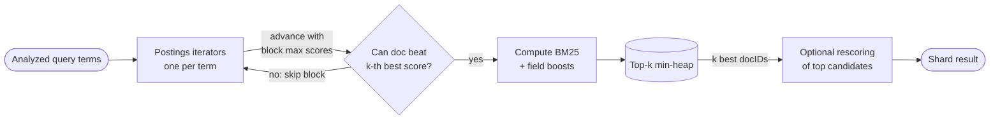

**Reading the diagram.** Each query term opens an iterator over its postings list. Before fully scoring a candidate, the WAND decision compares the sum of per-block maximum scores with the score of the current $k$-th best document held in a min-heap; if the bound is too low, whole blocks are skipped (the loop back to the iterators). Survivors are scored exactly and offered to the heap, an in-memory structure of size $k$. An optional rescoring stage applies more expensive signals (phrase proximity, a learned model) to only the top few hundred. All steps are synchronous and CPU-bound within one shard; the storage boundary is the postings files, usually served from the operating system page cache. Failure points are queries whose terms are all very common (little skipping possible) and very large $k$ (deep pagination, §16.7.4). Scaling is by splitting the index into more shards, each running this pipeline in parallel.

#### Real-world industry applications

::: industry
**Wikipedia's CirrusSearch.** Wikimedia runs on-wiki search for Wikipedia and its sister projects with CirrusSearch, a MediaWiki extension backed by Elasticsearch. Pages are indexed with per-language analysis chains, and ranking combines text relevance with signals such as incoming links and page popularity, with rescoring profiles configurable per wiki [MediaWiki: CirrusSearch].
*Evidence: Primary* — [MediaWiki: CirrusSearch]
:::

#### Failure scenarios

**Table 16.7 — Ranking failure scenarios.**

| What goes wrong | Why | Detection | Recovery | Prevention |
|---|---|---|---|---|
| Accessories outrank the product searched for | Text match ignores intent; short bodies win | Click-through and relevance judgments | Boost title; add category signals | Offline evaluation set (NDCG) |
| Keyword stuffing by sellers | Unbounded tf in a custom scorer | Manual review, anomaly scores | Switch to BM25; cap field length | BM25 saturation; quality signals |

#### Common misconceptions

::: mistake
**Mistake — "A BM25 score of 12 means a better match than a score of 6 on another query."** BM25 scores depend on the query's terms, their IDF and the collection statistics. They rank documents *within* one query and have no absolute meaning; never threshold them globally or compare them across queries or indexes. Normalize, or use rank positions, when fusing result lists (§16.11).
:::

## 16.6 Index construction and segment merging

### 16.6.1 Why indexes are built from immutable segments

::: definition
**Definition — Segment.** A self-contained, immutable mini-index (its own dictionary, postings, stored fields, norms and doc values) covering a subset of documents. A Lucene index is a set of segments plus a **commit point** file (`segments_N`) listing which segments are live; a search runs over every live segment and combines the results.
:::

#### First-principles explanation

Compressed, sorted postings are excellent to read and terrible to update: inserting a docID mid-list means rewriting it. So search engines do what log-structured databases do (§13.7–§13.8): buffer new documents in memory, write the buffer out as a new small segment, and **merge** small segments into larger ones in the background, with segments playing the role of SSTables. Manning et al. describe the batch ancestors, blocked sort-based and single-pass in-memory indexing [Manning et al. 2008, ch. 4]. Immutable segments can be cached without invalidation, read without locks, copied as plain files for backup or replication, and compressed aggressively.

#### How it works internally

1. **Buffer.** The index writer analyzes incoming documents into an in-memory buffer. Documents in the buffer are *not* searchable.
2. **Refresh (flush to a segment).** The buffer is written as a new segment and a new searcher is opened that includes it. In Lucene terms this is opening a near-real-time reader; Elasticsearch calls it a **refresh** and by default does it every second (§16.8.4). The segment may sit only in the operating system's page cache: it is searchable but not yet durable.
3. **Commit.** Periodically, segment files are fsynced and a new `segments_N` file is written atomically. Only committed segments survive a crash without replay; Elasticsearch covers the gap with its translog (§16.8.3).
4. **Merge.** A background merge scheduler picks groups of segments, merges their postings into one new segment (dropping deleted documents), then swaps it in and deletes the old files once no reader uses them.

**Figure 16.5 — Lifecycle of a Lucene segment.**

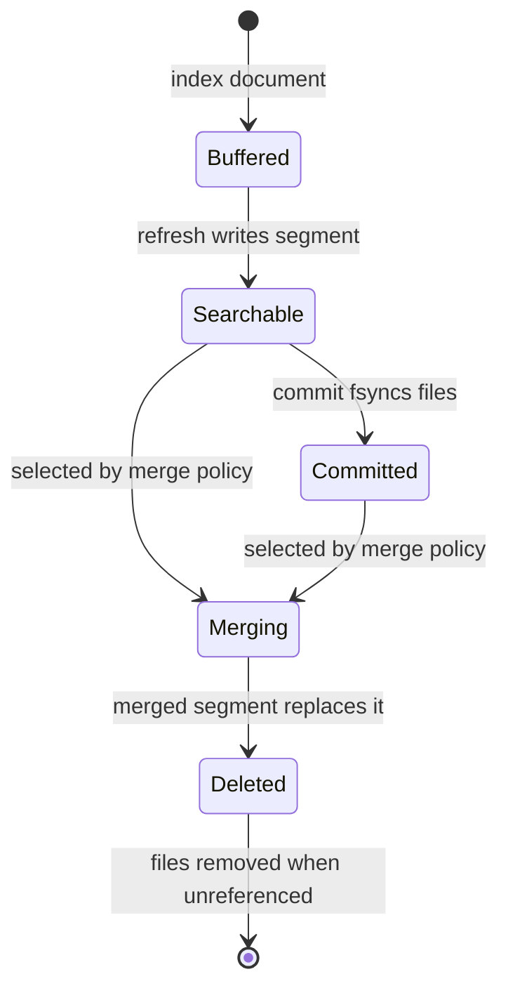

**Reading the diagram.** A document enters the in-memory buffer (not yet visible). A refresh writes the buffer out as a segment that searches can see, a cheap operation because it need not wait for the disk. A commit fsyncs segment files and records them in the commit point, making them crash-durable; this is the expensive storage boundary. Either a searchable or a committed segment can be chosen for merging; once the merged segment is in place, the originals are marked deleted and their files removed when the last reader using them closes. All transitions are asynchronous background work relative to queries. Failure points: a crash loses searchable-but-uncommitted segments (recovered from the translog in Elasticsearch); a merge that runs out of disk fails and must be retried. Merging is throttled so it does not starve queries of I/O.

### 16.6.2 Deletes and updates as tombstones

Immutable segments cannot remove a document. Instead Lucene records deletions in a per-segment **live-docs bitset** (one bit per document) written as a separate small file: a **tombstone**. Searches skip documents whose bit is cleared. An **update** is a delete of the old version plus an add of the new one, which lands in a new segment. The space and the CPU spent iterating past deleted postings are reclaimed only when the segment is merged.

Consequences: deleted documents still count in term statistics until merged away, so replicas with different merge histories can score slightly differently; and update-heavy fields (prices, stock) generate many deletes, so keep volatile fields out of the text index where possible.

### 16.6.3 Merge policy

A **merge policy** decides which segments to merge. Lucene's default, `TieredMergePolicy`, groups segments into size tiers, allows about 10 segments per tier, merges up to 10 similar-sized segments at a time, favors merges that reclaim many deletes, and by default stops producing segments larger than about 5 GB [Lucene Docs: TieredMergePolicy]. The analysis is the same as size-tiered compaction in LSM stores (§13.9): each byte is rewritten once per tier it climbs.

::: formula
**Write amplification of tiered merging**

$$W \approx 1 + \log_m \frac{S_{\max}}{S_{\text{flush}}}$$

| Symbol | Meaning | Units |
|---|---|---|
| $W$ | Bytes written to disk per byte of new index data | dimensionless |
| $m$ | Merge factor: segments merged together per tier | count |
| $S_{\max}$ | Maximum merged segment size | bytes |
| $S_{\text{flush}}$ | Typical size of a newly flushed segment | bytes |
:::

::: example
**Worked example — merge cost at a 1-second refresh.** An index receives 2,000 documents/s; each adds about 1 KB to the index; refresh every 1 s gives $S_{\text{flush}} = 2$ MB. $S_{\max} = 5$ GB, $m = 10$.

1. $S_{\max}/S_{\text{flush}} = 5{,}000 / 2 = 2{,}500$.
2. $\log_{10} 2{,}500 = 3.40$, so $W \approx 4.4$.
3. Write bandwidth: $2{,}000 \times 1\ \text{KB} \times 4.4 = 8.8$ MB/s, plus the translog.
4. With a 30-second refresh, $S_{\text{flush}} = 60$ MB, ratio 83, $\log_{10} 83 = 1.92$, $W \approx 2.9$: one-third less merge I/O.

**Interpretation.** Frequent refreshes create many tiny segments that are rewritten several times. **Engineering implication.** For bulk loads and write-heavy indexes, lengthen or disable refresh (§16.10.1). For read-only indexes (yesterday's logs), **force-merge** to one segment once: queries then search one dictionary instead of dozens.
:::

The following simulation of an idealized tiered policy confirms the formula: with three tiers above the flush size and $m = 10$, every unit of data is written exactly four times.

```python
"""Simulate a simplified tiered merge policy and measure write amplification:
every refresh flushes one small segment; whenever `merge_factor` segments of the same tier
exist they are merged into one segment of the next tier, until the size cap is reached."""
import math

def simulate(flushes, merge_factor=10, max_tier=3):
    tiers = [0] * (max_tier + 1)      # number of live segments in each tier
    written = 0                       # units written: flushes + merge output
    for _ in range(flushes):
        tiers[0] += 1
        written += 1                  # the flush itself writes one unit
        t = 0
        while t < max_tier and tiers[t] == merge_factor:
            tiers[t] = 0
            tiers[t + 1] += 1
            written += merge_factor ** (t + 1)    # merged segment size in units
            t += 1
    return written / flushes, sum(tiers)

if __name__ == "__main__":
    for flushes in (1_000, 100_000):
        wa, live = simulate(flushes)
        print(f"flushes={flushes:>7,}  write amplification={wa:.2f}  live segments={live}")
    print("predicted 1 + log10(max/min) =", 1 + math.log10(10 ** 3))
```

Output:

```text
flushes=  1,000  write amplification=4.00  live segments=1
flushes=100,000  write amplification=4.00  live segments=100
predicted 1 + log10(max/min) = 4.0
```

What to notice: once segments reach the cap they stop merging, so the number of live segments grows linearly with data (100 capped segments after 100,000 flushes); that is why large indexes are split into shards and time-based indexes rather than grown without bound.

::: mistake
**Mistake — "Deleting documents frees disk space immediately."** A delete sets a bit. Disk is reclaimed only when a merge rewrites the segment, and a merge temporarily needs space for both old and new segments. Clusters that are nearly full can fail to merge, accumulate deletes, and degrade; keep at least 15–20% free disk on data nodes and watch Elasticsearch's disk watermarks.
:::

## 16.7 Distributed search

### 16.7.1 Document partitioning versus term partitioning

When an index outgrows one node, or one node cannot serve the query rate, the index is partitioned. Search engines use the word **shard** for a partition (§14.6); this chapter uses the two interchangeably. There are two ways to cut an inverted index [Manning et al. 2008, §20.3].

- **Document partitioning** (local index): each shard holds *all* terms for a subset of documents, a complete small index. Every query goes to every shard, and a coordinator merges the per-shard top-*k* lists.
- **Term partitioning** (global index): each shard holds the *complete* postings lists for a subset of terms. A query visits only the shards owning its terms, but a multi-term query must ship long postings lists between nodes to intersect or score them.

**Figure 16.6 — Document partitioning versus term partitioning.**

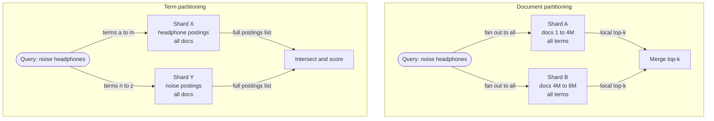

**Reading the diagram.** In the upper subgraph the query fans out synchronously to every document shard; each shard runs the complete pipeline of Figure 16.4 on its own documents and returns only its top *k* (a few kilobytes), which a coordinator merges. In the lower subgraph the query goes only to the shards that own its terms, but each returns an entire postings list, potentially megabytes, which must be intersected and scored centrally. Each shard is its own storage boundary. Failure points: under document partitioning a slow or dead shard affects every query (mitigated by replicas); under term partitioning a hot term overloads one shard, and a dead shard makes every query containing its terms incomplete. Document partitioning scales by adding shards and replicas; term partitioning scales poorly for multi-term queries because network transfer grows with postings length.

**Table 16.8 — Document versus term partitioning.**

| | Document partitioning | Term partitioning |
|---|---|---|
| What it is | Each shard indexes a subset of documents | Each shard owns all postings of a subset of terms |
| Query fan-out | All shards | Only shards owning query terms |
| Network per query | Small (top-*k* per shard) | Large (full postings lists) |
| Load balance | Even (random document assignment) | Skewed (Zipfian term popularity) |
| Indexing a document | Writes to one shard | Writes to many shards (one per term) |
| Tail latency | Max of $S$ shard latencies | Fewer shards, but long transfers |
| Used by | Lucene-based engines, Google (as published), Earlybird | Research systems; rarely in production |
| Choose when | Almost always | Very high query rate of single-term lookups |

Document partitioning wins in practice because it is simple, balanced and fault-tolerant; Dean's retrospective describes Google's serving system as replicated document-partitioned shards behind fan-out servers [Dean 2009].

### 16.7.2 Replicas

Each shard has $r$ **replicas** on other nodes and zones, for **availability** and **query throughput** (any copy can answer). Replicas do not speed up indexing: every copy indexes every write. If each query costs $c$ CPU-seconds on each of $S$ shards at peak rate $\lambda$, the cluster needs about $\lambda S c / U$ cores at utilization $U$: 2,000 queries/s × 10 shards × 4 ms ÷ 0.5 = 160 cores, or 10 sixteen-core nodes holding, say, 20 shard copies.

### 16.7.3 Scatter–gather and tail latency

A document-partitioned query is a **scatter–gather**: a coordinator scatters the query to one copy of each of $S$ shards and gathers their answers. The response time is the *maximum* of $S$ shard latencies, so the fan-out amplification of §4.8.4 applies directly.

::: formula
**Scatter–gather tail latency**

$$P(\text{query fast}) = p^{S} \qquad q_{\text{shard}} = q_{\text{query}}^{1/S}$$

| Symbol | Meaning | Units |
|---|---|---|
| $p$ | Probability one shard answers within threshold $T$ | dimensionless |
| $S$ | Number of shards the query waits for | count |
| $P(\text{query fast})$ | Probability all $S$ shards answer within $T$ | dimensionless |
| $q_{\text{query}}$ | Target percentile for the whole query (e.g. 0.99) | dimensionless |
| $q_{\text{shard}}$ | Percentile each shard must meet at $T$ | dimensionless |
:::

::: example
**Worked example — 20 and 100 shards.** Each shard's latency is log-normal with median 8 ms and p99 25.6 ms (simulated below). Assume independence.

1. $S = 20$: $P(\text{all} \leq 25.6\ \text{ms}) = 0.99^{20} = 0.818$; 18% of queries wait longer than the shard p99.
2. For the *query* p99 to be 25.6 ms, each shard needs $0.99^{1/20} = 0.99950$, its p99.95 at 25.6 ms.
3. $S = 100$: $0.99^{100} = 0.366$. The query median becomes the shard's $0.5^{1/100} = $ p99.3, which is 27.4 ms, more than three times the shard median, and the query p99 is about 51 ms.

**Interpretation.** Adding shards makes every shard's work smaller but makes the query wait for the unluckiest of more shards. **Engineering implication.** Use the fewest shards that meet size and throughput needs (§16.8.2), and use tail-tolerant techniques: **hedged requests** to a second replica after a delay [Dean and Barroso 2013], **adaptive replica selection** that routes to the replica with the best recent latency and queue length (on by default in Elasticsearch since 7.0, based on the C3 algorithm [Suresh et al. 2015]), and per-shard **timeouts with partial results**, accepting slightly incomplete answers rather than slow ones.
:::

```python
"""Scatter-gather tail latency: a query waits for the slowest of S shards.
Monte Carlo check of P(all fast) = p**S, and the latency percentiles of max(S shard latencies)."""
import math
import random

def shard_latency_ms(rng):
    # Log-normal per-shard latency: median 8 ms, a heavy-ish right tail (p99 ~ 25.6 ms).
    return 8.0 * math.exp(rng.gauss(0.0, 0.5))

def percentile(sorted_vals, q):
    return sorted_vals[min(len(sorted_vals) - 1, int(q * len(sorted_vals)))]

if __name__ == "__main__":
    rng = random.Random(42)
    trials = 20_000
    single = sorted(shard_latency_ms(rng) for _ in range(200_000))
    t99 = percentile(single, 0.99)
    print(f"one shard: p50={percentile(single, 0.50):.1f} ms  p99={t99:.1f} ms")
    print(" S   P(all<shard p99) sim  0.99**S   query p50   query p99")
    for S in (1, 10, 50, 100, 200):
        maxes = sorted(max(shard_latency_ms(rng) for _ in range(S)) for _ in range(trials))
        fast = sum(m <= t99 for m in maxes) / trials
        print(f"{S:>3}   {fast:>18.3f}  {0.99 ** S:>7.3f}   {percentile(maxes, 0.5):>6.1f} ms"
              f"   {percentile(maxes, 0.99):>6.1f} ms")
```

Output:

```text
one shard: p50=8.0 ms  p99=25.6 ms
 S   P(all<shard p99) sim  0.99**S   query p50   query p99
  1                0.991    0.990      8.0 ms     25.2 ms
 10                0.904    0.904     16.9 ms     37.7 ms
 50                0.614    0.605     24.0 ms     46.9 ms
100                0.367    0.366     27.4 ms     51.1 ms
200                0.136    0.134     30.9 ms     56.3 ms
```

What to notice: the simulation matches $0.99^S$; the query *median* at 100 shards (27.4 ms) is worse than a single shard's p99. Real shard latencies are also correlated (garbage-collection pauses, merges, a noisy neighbor), which makes the tail worse than the independent model.

### 16.7.4 Two-phase query-then-fetch

Shipping full documents from every shard would waste bandwidth, since most are discarded during the merge. Elasticsearch therefore runs a search in two phases [Elastic Docs: search_type].

**Figure 16.7 — Query-then-fetch across three shards.**

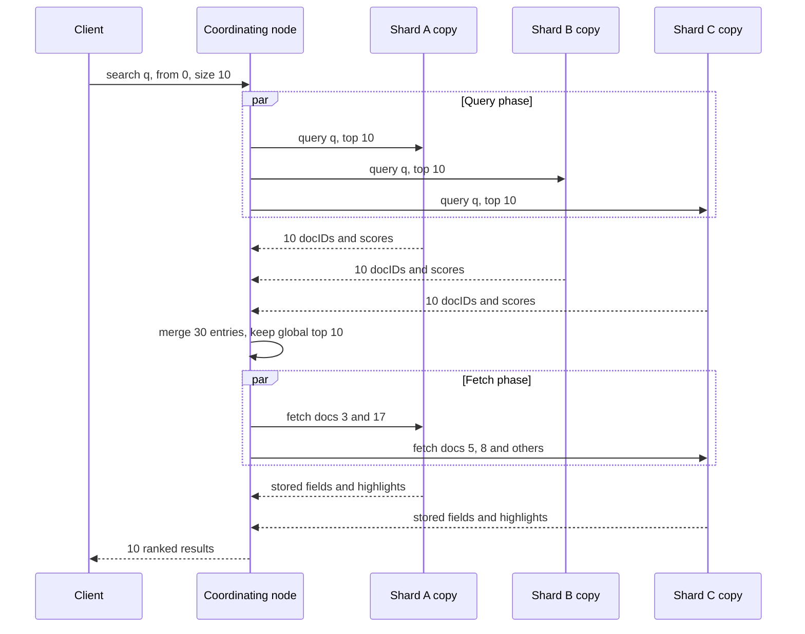

**Reading the diagram.** The client sends one request to any node, which acts as **coordinating node**. In the **query phase** it sends the query in parallel to one copy of every shard; each returns only docIDs and scores for its local top 10. The coordinator merges the 30 entries into a global top 10. In the **fetch phase** it asks only the shards that own those 10 documents for stored fields (`_source`) and highlighted snippets; shard B contributed nothing to the top 10, so it is not contacted. All calls are synchronous RPCs over the cluster transport protocol; each shard copy is a storage boundary. Failure points: a slow shard delays the query phase for everyone (§16.7.3); a shard copy that fails between phases forces a retry on another replica. The design scales because the expensive document payload is read for only $k$ documents, not $S \times k$.

::: formula
**Deep pagination cost at the coordinator**

$$E = S \cdot (\textit{from} + \textit{size})$$

| Symbol | Meaning | Units |
|---|---|---|
| $S$ | Shards queried | count |
| $\textit{from}$ | Offset of the first requested result | results |
| $\textit{size}$ | Results per page | results |
| $E$ | Entries every query phase must return and the coordinator must merge | entries |
:::

::: example
**Worked example — page 500.** $S = 20$ shards, 20 results per page.

1. Page 1: $E = 20 \times (0 + 20) = 400$ entries.
2. Page 500: $\textit{from} = 499 \times 20 = 9{,}980$, so $E = 20 \times 10{,}000 = 200{,}000$ entries, 500× more, and each shard must also keep a heap of 10,000.

**Interpretation.** Deep pages cost in proportion to their depth. **Engineering implication.** Elasticsearch rejects requests with $\textit{from} + \textit{size}$ above `index.max_result_window`, 10,000 by default. Use `search_after` with a sort tiebreaker (and a point-in-time snapshot) for deep scrolling, and the scroll or point-in-time APIs for exports.
:::

### 16.7.5 Global versus local IDF

Each shard computes BM25 with its own $N$, $n_t$ and avgdl. When documents are spread uniformly at random, local statistics are close to global ones. When they are not, scores from different shards are not comparable.

::: example
**Worked example — skewed term distribution.** Two shards hold 1,000,000 documents each. Custom routing by seller put most "anc" listings on shard B: shard A has 10 documents containing *anc*, shard B has 1,000.

1. Local IDF on A: $\ln(1 + 999{,}990.5 / 10.5) = 11.46$.
2. Local IDF on B: $\ln(1 + 999{,}000.5 / 1{,}000.5) = 6.91$.
3. Global IDF ($N = 2{,}000{,}000$, $n = 1{,}010$): $\ln(1 + 1{,}998{,}990.5 / 1{,}010.5) = 7.59$.

**Interpretation.** An *anc* match on shard A scores 66% higher than an identical match on shard B, purely because of where documents live, so shard A's weak matches crowd out shard B's strong ones. **Engineering implication.** Elasticsearch's default `query_then_fetch` uses local statistics. `dfs_query_then_fetch` adds a preliminary round trip that collects term statistics from all shards and scores with global values, at the cost of extra latency [Elastic Docs: search_type]. Prefer random document routing so local statistics converge; use DFS for small or skewed indexes and in relevance tests.
:::

**Routing** is the other side of the trade-off. By default Elasticsearch places a document on a shard by hashing its ID. A custom routing key (tenant ID, seller ID) places all of one tenant's documents on one shard, so a tenant-scoped query hits one shard instead of $S$, removing fan-out at the cost of skew and the IDF effect above.

#### Real-world industry applications

::: industry
**Twitter Earlybird.** Twitter's real-time search engine kept recent tweets in in-memory inverted indexes partitioned by document across many Earlybird servers, with a front-end (Blender) scattering each query and merging results. Indexing used a single writer and many concurrent readers per index, coordinated with memory barriers rather than locks, so that tweets became searchable within about 10 seconds of creation while queries averaged about 50 ms at billions of queries per day (2012 figures) [Busch et al. 2012].
*Evidence: Primary* — [Busch et al. 2012]
:::

## 16.8 Elasticsearch and OpenSearch architecture

Elasticsearch wraps Lucene in a distributed system: a JSON-over-HTTP API, cluster membership, shard placement, replication and recovery. OpenSearch is a fork of Elasticsearch 7.10.2 created in 2021 after Elastic changed its license; the two share the architecture described here, though they have diverged in features since [OpenSearch Docs].

### 16.8.1 Cluster, nodes and roles

::: definition
**Definition — Elasticsearch cluster.** A set of nodes that share one cluster state (index definitions, mappings and the location of every shard copy). An **index** is a logical collection of documents divided into **primary shards**; each primary has zero or more **replica shards**; every shard is one Lucene index.
:::

Nodes take one or more **roles** [Elastic Docs: node roles]: **master-eligible** nodes elect one elected master that owns and publishes the cluster state (a quorum-based protocol since 7.0, so three master-eligible nodes tolerate the loss of one); **data** nodes hold shards and execute queries and indexing (subdivided into hot, warm, cold and frozen tiers for time-based data); **ingest** nodes run preprocessing pipelines; and **coordinating-only** nodes route requests and merge results.

**Figure 16.8 — A three-zone Elasticsearch cluster with two primaries and one replica each.**

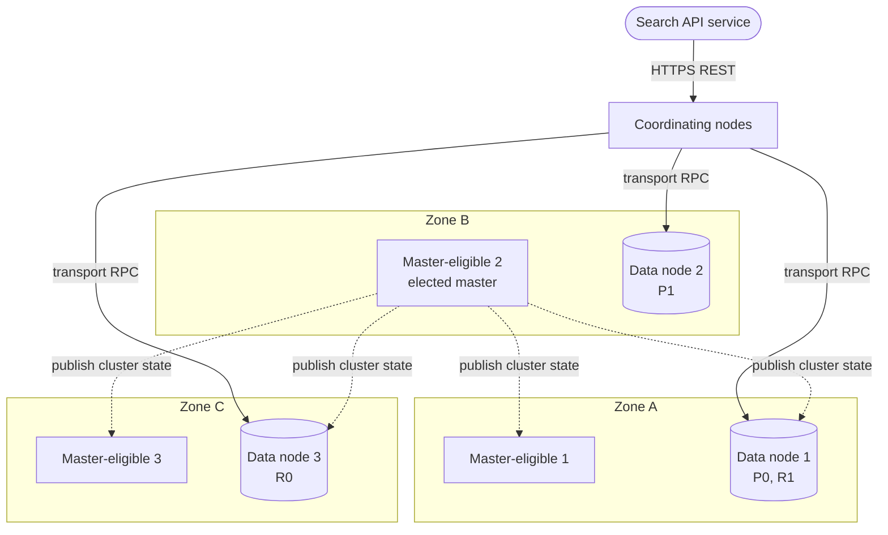

**Reading the diagram.** Clients call coordinating nodes over HTTPS; coordinating nodes talk to data nodes over Elasticsearch's binary transport protocol (synchronous RPCs, solid arrows). The index has two primary shards, P0 and P1, and one replica of each, R0 and R1; the allocator never places a primary and its replica on the same node and, with allocation awareness configured, not in the same zone. The elected master publishes cluster-state updates asynchronously (dotted arrows) to every node; it does not sit on the data path. Storage boundaries are the data nodes' local disks. Failure points: losing data node 2 promotes R1 to primary and starts rebuilding a replica elsewhere; losing one master-eligible node leaves a quorum of two; losing a whole zone still leaves one copy of each shard. Scaling: add data nodes (shards rebalance automatically), add replicas for query throughput, and add coordinating nodes for heavy aggregations.

### 16.8.2 Shards, routing and sizing

A document goes to shard $\text{hash}(\textit{routing}) \bmod N_{\text{primaries}}$, where routing defaults to the document ID and the hash is Murmur3 [Elastic Docs: _routing]. Because the formula depends on the number of primaries, that number is fixed when the index is created; changing it requires the split or shrink APIs (by integer factors) or a reindex. Replica count can be changed at any time. Since Elasticsearch 7.0 a new index has one primary and one replica by default.

Elastic's sizing guidance (as of 2025) is to aim for shards of roughly 10–50 GB and fewer than about 200 million documents each [Elastic Docs: size your shards]. Too-large shards recover slowly after node failure; too many small shards waste per-shard memory and inflate fan-out (§16.7.3). For the 440 GB catalog of §16.3.5 (about 220 GB of primary data), five primaries of roughly 44 GB fit the guidance. For logs and events, use **time-based indexes** with rollover and lifecycle policies, so old indexes can be force-merged, moved to cheaper tiers and deleted whole.

### 16.8.3 The write path: primary–backup replication and the translog

Elasticsearch uses primary–backup replication, modeled on Microsoft's PacificA protocol [Elastic Docs: data replication model].

**Figure 16.9 — Indexing one document with one replica.**

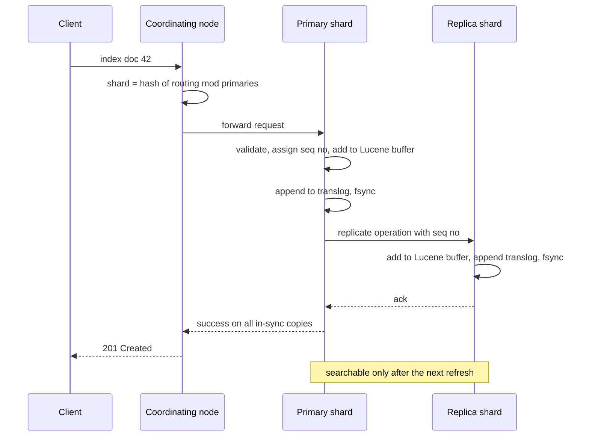

**Reading the diagram.** The coordinating node computes the shard and forwards the request to the node holding that shard's primary. The primary validates the document, assigns a sequence number (used to bring replicas back in sync after failures), indexes it into Lucene's in-memory buffer and appends it to the **translog**, a per-shard write-ahead log (§13.5) that by default is fsynced before the request is acknowledged (`index.translog.durability: request`). The primary then forwards the operation to all **in-sync** replicas in parallel and acknowledges only when they have all responded. Every arrow is synchronous; the disk boundary is the translog fsync on each copy. Failure points: a replica that fails to respond is reported to the master and removed from the in-sync set rather than blocking writes; a primary failure promotes an in-sync replica. The acknowledged document is durable but not yet visible to search; visibility comes at the next refresh. Indexing throughput scales with primaries, not replicas.

**Table 16.9 — Refresh, flush and merge in Elasticsearch.**

| Operation | What it does | Default trigger | Makes data | Cost |
|---|---|---|---|---|
| Index (ack) | Buffer + translog fsync | Each request | Durable, not searchable | One fsync per request or bulk |
| Refresh | Write buffer as segment, reopen searcher | Every 1 s if the index was searched in the last 30 s | Searchable | New small segment; merge load |
| Flush | Lucene commit (fsync segments), trim translog | Translog size threshold | Durable without replay | Heavy fsync |
| Merge | Combine segments, drop deletes | Merge policy | Smaller, faster index | Background I/O and CPU |

This split is what **near-real-time** means: a write is durable at acknowledgement (thanks to the translog) and searchable about one refresh interval later, without paying for a Lucene commit on every write [Elastic Docs: near real-time search]. A client that must read its own write can pass `refresh=wait_for`, which blocks the response until the next scheduled refresh.

### 16.8.4 Read path and memory

Queries rely on the operating system **page cache** for segment files (leave about half of RAM outside the JVM heap for it), the **shard request cache** for aggregations and the **node query cache** for filter bitsets. Elastic recommends a heap of at most half of RAM and below the roughly 31 GB compressed-pointer limit [Elastic Docs: heap size]; **doc values** serve sorting and aggregations from disk-based columns rather than heap.

**Table 16.10 — Elasticsearch, OpenSearch and Solr compared (as of 2025).**

| | Elasticsearch | OpenSearch | Apache Solr |
|---|---|---|---|
| What it is | Lucene-based distributed engine by Elastic | Community fork of Elasticsearch 7.10.2 (Linux Foundation) | Apache Lucene project's search server |
| Coordination | Built-in quorum-based cluster coordination | Inherited from Elasticsearch | ZooKeeper (SolrCloud) |
| Replication | Document replication; stateless serverless offering | Document or segment replication | Replica types NRT, TLOG, PULL |
| Advantages | Feature velocity, ecosystem | Open-source license, AWS managed service | Mature, flexible configuration |
| Disadvantages | Licensing changes over time | Features lag or differ from Elasticsearch | Smaller operational ecosystem today |
| Choose when | You want the reference product and its tooling | You want Apache-licensed software or AWS OpenSearch Service | Existing Solr expertise or ZooKeeper-based operations |

OpenSearch's **segment replication** copies segment files from primary to replicas instead of re-indexing each document on every replica, trading replica freshness for lower replica CPU [OpenSearch Docs: segment replication].

#### Failure scenarios

**Table 16.11 — Distributed search and cluster failure scenarios.**

| What goes wrong | Why | Detection | Recovery | Prevention |
|---|---|---|---|---|
| Cluster status red | All copies of a primary lost | Cluster health API | Restore shard from snapshot; reindex from source | Replicas across zones; snapshots |
| Mapping explosion | Dynamic mapping of arbitrary JSON keys creates thousands of fields | Field count; cluster-state size | Reindex with strict mapping | `dynamic: strict`; field limits |
| Hot shard | Custom routing on a skewed key | Per-shard latency and CPU | Reroute; split shard | Random routing; routing partitions |
| Long GC pauses, node drops out | Heap too large or full | GC logs; node-left events | Reduce heap pressure; restart | Heap ≤ 50% RAM; circuit breakers |
| Stale results | Indexing pipeline lag | Freshness metric (§16.10.3) | Scale consumers | Alert on consumer lag |

::: mistake
**Mistake — "Elasticsearch can be our primary database."** It is durable per shard and replicated, but it has no multi-document transactions, near-real-time rather than immediate visibility, and mapping changes often require reindexing. Treat it as a derived, rebuildable view of a system of record (§16.10.2).
:::

## 16.9 Typeahead and autocomplete

### 16.9.1 Requirements and the latency budget

::: definition
**Definition — Autocomplete (typeahead).** A service that, given the prefix a user has typed so far, returns a short ranked list (typically 5–10) of likely completions, usually popular past queries or entity names, on every keystroke or after a short pause.
:::

#### First-principles explanation

Autocomplete is a friend finishing your sentences: useful only if the suggestion arrives before your next keystroke, 150–300 ms later. Nielsen's guideline is that about 0.1 s feels instantaneous [Nielsen 1993], so the whole round trip must fit in roughly 100 ms. That pushes design toward precomputation: answers for popular prefixes are computed offline and looked up, not searched.

**Table 16.12 — End-to-end latency budget for one suggestion request.**

| Stage | Budget | Notes |
|---|---|---|
| Client event handling | ≤ 5 ms | Plus an optional 30–50 ms debounce, outside the budget |
| Network round trip | 30–50 ms | Reused HTTP/2 or HTTP/3 connection; nearby edge |
| Load balancer and gateway | 2–5 ms | No per-request authentication call |
| Suggestion lookup | ≤ 5 ms at p99 | In-memory trie or FST; no disk |
| Serialization and render | ~16 ms | One frame at 60 Hz |
| **Total** | **≈ 55–80 ms** | Leaves headroom under 100 ms |

::: formula
**Autocomplete load and precomputed-index memory**

$$\lambda_{\text{ac}} = \lambda_{\text{search}} \cdot c \cdot f \qquad M_{\text{top-}k} \approx P \cdot k \cdot b$$

| Symbol | Meaning | Units |
|---|---|---|
| $\lambda_{\text{search}}$ | Searches started per second | searches/s |
| $c$ | Characters typed per search before selecting or submitting | characters |
| $f$ | Fraction of keystrokes that send a request (after debounce and client caching) | dimensionless |
| $\lambda_{\text{ac}}$ | Suggestion request rate | requests/s |
| $P$ | Number of trie nodes (distinct prefixes) with stored suggestions | nodes |
| $k$ | Suggestions stored per prefix | count |
| $b$ | Bytes per stored suggestion reference | bytes |
| $M_{\text{top-}k}$ | Memory for the precomputed lists | bytes |
:::

::: example
**Worked example — sizing typeahead for the store.** 50 million searches/day, peak-to-average ratio 2, $c = 8$, $f = 0.5$. The suggestion corpus is 10 million distinct past queries, giving an assumed $P = 6 \times 10^7$ trie nodes after prefix sharing; $k = 10$, $b = 4$ bytes (a query ID).

1. Average search rate: $5 \times 10^7 / 86{,}400 = 579$ searches/s; peak $\approx 1{,}157$/s.
2. Peak suggestion rate: $1{,}157 \times 8 \times 0.5 \approx 4{,}630$ requests/s, four times the search rate.
3. Memory for top-10 lists: $6 \times 10^7 \times 10 \times 4 = 2.4 \times 10^9$ bytes = 2.4 GB, plus the trie nodes themselves and the query strings (10 M × ~20 bytes = 200 MB).

**Interpretation.** Autocomplete usually generates more requests than search itself, but each is a memory lookup. **Engineering implication.** A few replicated in-memory nodes handle this load. Memory, not CPU, is the constraint, so cap precomputation at short prefixes (for example up to 10 characters), drop rare queries, and cache the responses for the most popular one- and two-character prefixes at the CDN or in the client.
:::

### 16.9.2 Tries with precomputed top-*k*

A **trie** (§17.11) stores strings as paths from the root, one character per edge; all strings with a given prefix live under one node. Finding that node takes $O(\ell)$ steps for a prefix of length $\ell$. The naive next step, walking the whole subtree to find the most popular completions, can touch millions of nodes for a one-letter prefix. The fix is to **store the top-*k* completions at every node**, computed bottom-up offline: a node's list is the best $k$ among its own query (if one ends there) and its children's lists.

**Figure 16.10 — A trie with top-2 completions stored at each node.**

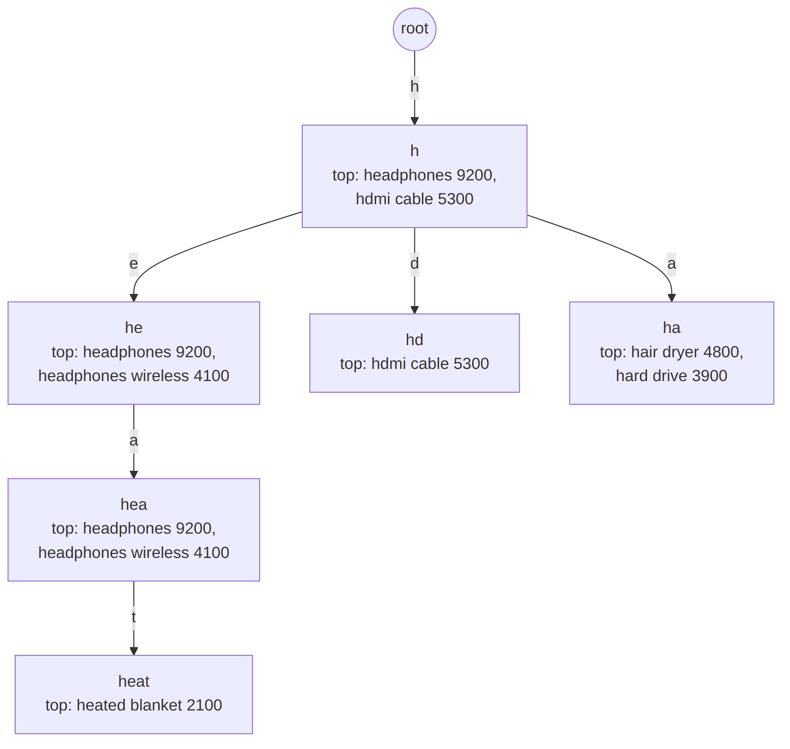

**Reading the diagram.** Each node is a prefix; edges are labeled with the next character. Each node stores its precomputed top-2 list with popularity counts from the query log. A lookup for "hea" follows three edges from the root and returns the list stored at that node with no further traversal. "heated blanket" lives under "heat" and appears in the lists of "he" and "hea" only when $k \geq 3$, because two headphone queries outrank it. The structure is read-only in memory; it is rebuilt offline and swapped in atomically. Failure points: an outdated build (stale trends) and memory exhaustion as the corpus grows. It scales by replication, and by partitioning on the first character or two of the prefix if one node cannot hold it.

```python
"""Trie-based autocomplete with the top-k completions precomputed at every node.
Lookup cost is O(len(prefix)) and independent of how many queries share the prefix."""
import heapq

class Node:
    __slots__ = ("children", "count", "top")
    def __init__(self):
        self.children = {}      # char -> Node
        self.count = 0          # popularity if a query ends here, else 0
        self.top = []           # precomputed [(count, query)] best-first, length <= k

class Autocomplete:
    def __init__(self, k=3):
        self.root, self.k, self.nodes = Node(), k, 1

    def insert(self, query, count):
        node = self.root
        for ch in query:
            if ch not in node.children:
                node.children[ch] = Node()
                self.nodes += 1
            node = node.children[ch]
        node.count += count

    def build_top_k(self, node=None, prefix=""):
        """Post-order pass: a node's top-k = best k of (itself, children's top-k lists)."""
        node = node or self.root
        candidates = [(node.count, prefix)] if node.count else []
        for ch, child in node.children.items():
            self.build_top_k(child, prefix + ch)
            candidates.extend(child.top)
        node.top = heapq.nlargest(self.k, candidates, key=lambda c: c[0])

    def suggest(self, prefix):
        node = self.root
        for ch in prefix.lower():
            node = node.children.get(ch)
            if node is None:
                return []
        return [q for _, q in node.top]

    def suggest_by_dfs(self, prefix):
        """Without precomputation: walk the whole subtree. Returns (suggestions, nodes visited)."""
        node = self.root
        for ch in prefix:
            node = node.children.get(ch)
            if node is None:
                return [], 0
        found, stack, visited = [], [(node, prefix)], 0
        while stack:
            n, p = stack.pop()
            visited += 1
            if n.count:
                found.append((n.count, p))
            stack.extend((c, p + ch) for ch, c in n.children.items())
        best = heapq.nlargest(self.k, found, key=lambda c: c[0])
        return [q for _, q in best], visited

QUERY_LOG = {   # query -> times searched in the last 7 days (illustrative)
    "headphones": 9200, "headphones wireless": 4100, "headphone stand": 800,
    "headphones for kids": 1500, "head torch": 650, "heated blanket": 2100,
    "hdmi cable": 5300, "hard drive": 3900, "hair dryer": 4800, "hammock": 300,
}

if __name__ == "__main__":
    ac = Autocomplete(k=3)
    for q, c in QUERY_LOG.items():
        ac.insert(q, c)
    ac.build_top_k()
    for prefix in ("h", "he", "hea", "head", "headphones ", "x"):
        print(f"{prefix!r:>15} -> {ac.suggest(prefix)}")
    dfs, visited = ac.suggest_by_dfs("h")
    assert dfs == ac.suggest("h")
    print(f"trie nodes={ac.nodes}; DFS for 'h' visits {visited} nodes, precomputed lookup reads 1 node")
```

Output:

```text
            'h' -> ['headphones', 'hdmi cable', 'hair dryer']
           'he' -> ['headphones', 'headphones wireless', 'heated blanket']
          'hea' -> ['headphones', 'headphones wireless', 'heated blanket']
         'head' -> ['headphones', 'headphones wireless', 'headphones for kids']
  'headphones ' -> ['headphones wireless', 'headphones for kids']
            'x' -> []
trie nodes=82; DFS for 'h' visits 81 nodes, precomputed lookup reads 1 node
```

What to notice: the build pass is one post-order traversal costing $O(\text{nodes} \cdot k \log k)$, done offline; the online lookup reads $\ell$ nodes regardless of corpus size; and a ten-query log already needs 82 nodes, which is why production systems compress the trie.

### 16.9.3 Finite-state transducers in Lucene

A trie shares common *prefixes* only. A **finite-state transducer (FST)** is a minimal automaton that shares both prefixes and suffixes ("-phones", "-ing") and attaches an output, such as a weight or an ordinal, to each accepted string. Minimal acyclic automata can be built incrementally from sorted input in linear time [Daciuk et al. 2000]. Lucene uses FSTs for its term-dictionary index, and Elasticsearch's **completion suggester** (the `completion` field type) stores weighted suggestions in a per-segment FST held in memory, giving top-*k* lookups in microseconds with optional fuzzy matching and context filters [Elastic Docs: completion suggester]. Because the FST lives inside segments, suggestions update through normal indexing and refresh.

**Table 16.13 — Autocomplete approaches.**

| Approach | How it works | Advantages | Disadvantages | Choose when |
|---|---|---|---|---|
| Trie with top-*k* per node | Offline build from query logs | Fastest; full control of ranking | Custom service; rebuilds | Very high traffic; query-log suggestions |
| FST completion suggester | Weighted FST per segment | Built in; compact; fuzzy | Prefix-only; weights static per document | Entity names in Elasticsearch |
| Edge n-gram field | Index every prefix as a term | Matches inner words, full query features | Index 3–10× larger; slower | Suggestions need filters and scoring |
| `search_as_you_type` field | Managed shingles and edge n-grams | Easy, infix-friendly | Same costs as edge n-grams | Small to medium catalogs |

### 16.9.4 Serving architecture

**Figure 16.11 — Autocomplete: offline build and online serving.**

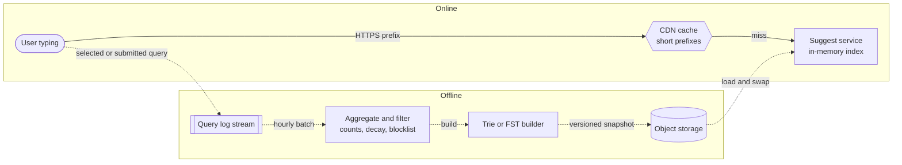

**Reading the diagram.** The offline subgraph runs asynchronously (dotted arrows): query logs are aggregated with time decay so trends surface, filtered against a blocklist of offensive or unsafe completions, built into a trie or FST, and published as a versioned snapshot to object storage. Online, the user's prefix goes over HTTPS to a CDN that caches responses for popular short prefixes; misses reach stateless suggest-service replicas that hold the whole structure in memory and swap in new snapshots atomically. The user's eventual query flows back into the log, closing the loop. Storage boundaries are the log, object storage and each replica's memory. Failure points: a bad snapshot (roll back to the previous version), a poisoned log (rate-limit and filter per user), and stale caches during breaking news (short TTLs). Scaling: add replicas; partition by prefix if memory runs out; personalize by blending global suggestions with the user's own recent queries at request time.

## 16.10 Near-real-time indexing

### 16.10.1 The refresh interval trade-off

::: definition
**Definition — Near-real-time (NRT) search.** A search system in which newly written documents become searchable after a short, bounded delay (typically one second to a minute) rather than immediately, because making them visible requires creating a new segment and reopening the searcher.
:::

Each refresh creates a segment and a new searcher; refreshing more often gives fresher results but more tiny segments, more merging (§16.6.3) and lower indexing throughput.

**Table 16.14 — Choosing a refresh interval.**

| Setting | Freshness | Indexing throughput | Merge load | Typical use |
|---|---|---|---|---|
| 1 s (default) | ~1 s | Lowest | Highest ($W \approx 4.4$ in §16.6.3) | Product, user-facing content |
| 30 s | ~30 s | Higher | Lower ($W \approx 2.9$) | Logs, metrics, analytics |
| `-1` (disabled) during bulk load, replicas 0 | None until re-enabled | Highest | Lowest | Initial load or full reindex |
| `refresh=wait_for` on a request | Caller waits for next refresh | Unchanged | Unchanged | Read-your-writes for one client |

Never call an explicit refresh after every write: it turns each document into its own segment and can collapse indexing throughput.

### 16.10.2 The indexing pipeline: CDC and Kafka

The source of truth is usually a relational database. Writing to the database *and* to the search index from application code (**dual writes**) loses updates whenever one write succeeds and the other fails, and can apply concurrent updates in different orders to the two stores [Kleppmann 2017, ch. 11]. The robust pattern is to derive the index from the database's own change log.

**Figure 16.12 — Near-real-time indexing pipeline with CDC and Kafka.**

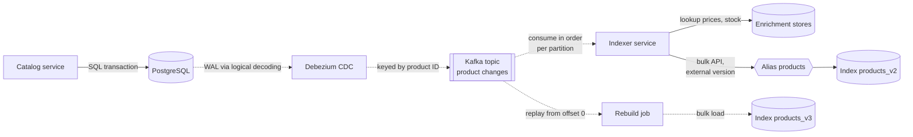

**Reading the diagram.** The catalog service writes only to PostgreSQL, synchronously. Debezium reads the write-ahead log through logical decoding and publishes each committed change to Kafka asynchronously, keyed by product ID so that all changes to one product land in one partition, in order. The indexer consumes partitions, enriches each event into a complete search document (prices, stock, review counts from other stores), and writes in bulk through an **alias**, a stable name pointing at the current physical index. Each write carries an external version (for example the source log sequence number), so a replayed or reordered older event is rejected and the pipeline stays idempotent under at-least-once delivery (§22.15). Deletes arrive as delete events and become delete requests. Storage boundaries: the database, the Kafka log, the enrichment stores and the index. Failure points: indexer lag (search becomes stale, never wrong), poison events (send to a dead-letter topic), and Kafka retention shorter than a rebuild. Scaling: more Kafka partitions and indexer consumers. The lower path shows a full **rebuild**: a job replays the topic (or a snapshot plus the topic) into `products_v3` with refresh disabled; when it catches up, the alias is switched atomically from v2 to v3, a zero-downtime reindex used for analyzer or mapping changes.

### 16.10.3 Freshness budget

::: formula
**End-to-end freshness latency**

$$T_{\text{fresh}} \approx T_{\text{cdc}} + T_{\text{queue}} + T_{\text{batch}} + T_{\text{index}} + T_{\text{refresh}}$$

| Symbol | Meaning | Units |
|---|---|---|
| $T_{\text{cdc}}$ | Commit to event published in Kafka | s |
| $T_{\text{queue}}$ | Time the event waits for the indexer (consumer lag) | s |
| $T_{\text{batch}}$ | Wait for a bulk request to fill or its timer to fire | s |
| $T_{\text{index}}$ | Bulk request execution on primary and replicas | s |
| $T_{\text{refresh}}$ | Wait for the next refresh: uniform in $[0, I]$, mean $I/2$ | s |
| $T_{\text{fresh}}$ | Commit in source database to searchable | s |
:::

::: example
**Worked example — how fresh is a price change?** $T_{\text{cdc}} = 0.2$ s, $T_{\text{queue}} = 0.3$ s at normal load, bulk requests flush every 1 s (mean wait 0.5 s, worst 1 s), $T_{\text{index}} = 0.1$ s, refresh interval $I = 1$ s (mean 0.5 s, worst 1 s).

1. Mean: $0.2 + 0.3 + 0.5 + 0.1 + 0.5 = 1.6$ s.
2. Worst case without backlog: $0.2 + 0.3 + 1 + 0.1 + 1 = 2.6$ s.
3. With $I = 30$ s: mean $1.1 + 15 = 16.1$ s, worst $31.6$ s.
4. During a backlog of 600,000 events drained at 5,000 events/s: $T_{\text{queue}}$ grows by 120 s.

**Interpretation.** At default settings the pipeline, not Lucene, dominates freshness, and backlog dominates everything. **Engineering implication.** Publish freshness as a service-level objective (for example 99% of changes searchable within 5 s), measure it end to end by writing canary documents and timing when they become searchable, and alert on consumer lag.
:::

::: mistake
**Mistake — "Kafka gives us exactly-once, so the index is always consistent."** Consumers see events at least once and may restart from older offsets; enrichment lookups may read newer data than the event. Make every index write idempotent with external versions, design documents to be fully rebuilt from current source state, and reconcile periodically by comparing counts or checksums between source and index.
:::

## 16.11 Beyond lexical matching: a bridge to semantic and hybrid search

BM25 matches *words*. It cannot know that "ANC earbuds" and "noise cancelling in-ear headphones" describe the same thing unless synonyms are configured by hand, and the listing in §16.5.4 ranked earbuds above headphones because it understands nothing. **Semantic (dense) retrieval** encodes queries and documents as embedding vectors with a neural model and retrieves nearest neighbors by cosine similarity (§4.9.2), using approximate nearest neighbor (ANN) indexes such as HNSW. It captures meaning but can miss exact identifiers (part numbers, error codes) that BM25 matches perfectly.

**Hybrid retrieval** runs both and fuses the lists. Because BM25 scores and cosine similarities live on different scales (§16.5 misconception), fusion usually uses ranks: **reciprocal rank fusion** adds $1/(60 + \text{rank})$ from each list [Cormack et al. 2009]. A cross-encoder reranker may then reorder the top few dozen. Lucene, Elasticsearch and OpenSearch now include vector fields and ANN search alongside inverted indexes, so one cluster can serve both (as of 2025).

**Figure 16.13 — Hybrid retrieval (preview of Chapters 74–75).**

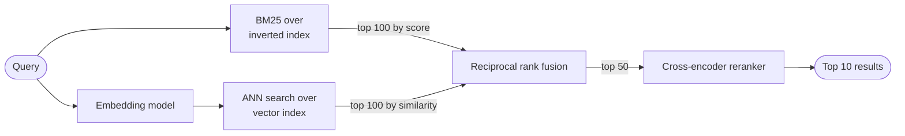

**Reading the diagram.** The query takes two synchronous paths in parallel: lexical retrieval over the inverted index of this chapter, and an embedding model followed by ANN search over a vector index. Each returns its top 100 candidates; rank fusion merges them without comparing raw scores, and an optional reranker spends expensive model inference on only the top 50. The two indexes are separate storage boundaries that must be kept in step by the same indexing pipeline (§16.10.2), with embeddings computed at indexing time. Failure points: the embedding model adds latency and a GPU or CPU dependency on the query path; if it fails, falling back to BM25 alone keeps search available. Chapter 74 covers vector indexes and Chapter 75 covers hybrid retrieval, fusion and reranking in depth.

## 16.12 Summary and revision notes

::: summary
- An **inverted index** maps each term to a sorted postings list of docIDs (with tf and positions). AND is intersection, OR is union, phrases check positions; evaluate the rarest term first. **Skip pointers** (`advance(target)`) let a short list drive a long one; spacing near $\sqrt{2L/m}$ beats the $\sqrt{L}$ heuristic for unequal lists.
- **Compression:** delta-encode docIDs, then VByte (7 bits per byte) or block bit-packing (Lucene: blocks of 128). Measured ≈ 1.4 bytes per docID posting. Index size $\approx N u (b_d + b_f) + N L b_p + M b_t$; positions often cost more than docIDs; budget again as much for `_source`, doc values and norms, then multiply by replicas.
- **Analysis** (char filters → tokenizer → token filters) must match at index and query time. Stemming raises recall and risks precision; lemmatization is more precise and costlier; keep stop words but preserve positions; n-grams enable substring and prefix search at large size cost; apply synonyms at query time; analyze each language in its own field.
- **BM25:** $\text{IDF} = \ln(1 + (N - n + 0.5)/(n + 0.5))$; tf saturates at $k_1 + 1$ ($k_1 = 1.2$); length normalization via $b = 0.75$. Scores are comparable only within one query. Field boosts or BM25F add structure; WAND and Block-Max WAND skip blocks that cannot reach the top *k*.
- **Segments** are immutable; refresh makes them searchable, commit makes them durable; deletes are live-docs tombstones; updates are delete + add; tiered merging rewrites each byte about $1 + \log_m(S_{\max}/S_{\text{flush}})$ times.
- **Distributed search** uses document partitioning, replicas for availability and throughput, scatter–gather ($P = p^S$, so use few shards and tail-tolerant techniques), query-then-fetch, bounded pagination ($S(\textit{from} + \textit{size})$), and local IDF unless `dfs_query_then_fetch` is used.
- **Elasticsearch/OpenSearch:** master-eligible, data, ingest and coordinating roles; shard = hash(routing) mod primaries; shards of about 10–50 GB; primary–backup replication with a fsynced translog; refresh every 1 s gives near-real-time visibility.
- **Autocomplete** must fit ≈ 100 ms end to end: precompute top-*k* per prefix in a trie or FST, serve from memory, cache short prefixes, rebuild offline from query logs with decay and blocklists.
- **NRT pipeline:** CDC → Kafka (keyed by document ID) → indexer with external versions → alias; freshness ≈ CDC + lag + batch + index + refresh; reindex by replay into a new index and alias swap.
:::

## 16.13 Knowledge checkpoint

1. Why can a B-tree index not answer `LIKE '%noise%'` efficiently, and what does an inverted index store instead?
2. Encode the postings list 3, 130, 131 with delta + VByte. How many bytes?
3. When does a skip pointer help an intersection, and what spacing suits a 1,000-entry list driving a 1,000,000-entry list?
4. Give one risk each of stemming, stop-word removal and index-time synonyms.
5. What happens if the query analyzer applies a stemmer that the index analyzer did not?
6. Compute the BM25 IDF of a term in 1 of 8 documents.
7. What value does the BM25 term-frequency factor approach as tf grows, and why does that matter?
8. Why is an update in Lucene more expensive than an insert?
9. A cluster refreshes every 1 s with 1 MB flushes and a 5 GB segment cap, merge factor 10. Estimate write amplification.
10. A query fans out to 50 shards whose p99 is 30 ms. What fraction of queries wait longer than 30 ms?
11. Why does Elasticsearch limit `from + size` to 10,000 by default?
12. When does local IDF distort ranking, and what is the fix?
13. Why is the number of primary shards fixed at index creation?
14. Why is autocomplete precomputed rather than searched per keystroke?
15. Name two ways the indexing pipeline stays correct under at-least-once delivery.

<details><summary>Answers</summary>

1. A B-tree orders whole keys, so it helps only with equality or prefix predicates; an infix pattern forces a full scan. An inverted index stores term → sorted docIDs, so each word is a direct lookup.
2. Gaps 3, 127, 1 → each fits in 7 bits → 3 bytes (`00000011 01111111 00000001`), versus 12 bytes raw.
3. When one list is much shorter, so many entries of the long list can be jumped. $\sqrt{2 \times 10^6 / 10^3} \approx 45$.
4. Stemming: conflates unrelated words ("universe"/"university"). Stop words: breaks queries like "The Who". Index-time synonyms: changes need a full reindex and inflate the index.
5. Query terms are stems that were never indexed in that form, so matches silently disappear.
6. $\ln(1 + 7.5/1.5) = \ln 6 = 1.79$.
7. $k_1 + 1$ (2.2 at default). It caps the benefit of repetition, defeating keyword stuffing.
8. It is a delete (tombstone bit in the old segment) plus a full re-index of the new version into a new segment, and the dead copy occupies space until merged.
9. $1 + \log_{10}(5{,}000/1) = 1 + 3.7 = 4.7$.
10. $1 - 0.99^{50} = 1 - 0.605 = 39.5\%$.
11. Every shard must return and the coordinator must merge $S \times (\textit{from} + \textit{size})$ entries; deep pages are expensive and can exhaust memory. Use `search_after` instead.
12. When a term's documents are unevenly spread across shards (custom routing, small indexes); use `dfs_query_then_fetch` or random routing.
13. Routing computes hash(routing) mod number of primaries; changing it would move most documents. Split/shrink by integer factors or reindex.
14. The budget is ≈ 100 ms end to end, request rate exceeds search rate, and answers for a prefix change slowly, so a memory lookup of a precomputed list is cheaper and faster.
15. Key events by document ID for per-document ordering, and write with external versions so stale or replayed events are rejected; additionally reconcile periodically.
</details>

## 16.14 Interview questions

### Basic

**Q1. Explain how a search engine finds documents containing two words.**

**Answer.** Text is analyzed into terms, and an inverted index maps each term to a sorted postings list of docIDs. The query is analyzed the same way, both postings lists are fetched, and they are intersected by walking them in docID order, starting from the shorter list and using skip pointers to jump through the longer one. Matching docIDs are scored (BM25) and the top *k* are returned, with stored fields fetched only for those.

**Q2. What is BM25 and how does it improve on TF-IDF?**

**Answer.** BM25 sums, over query terms, IDF times a term-frequency factor $f(k_1 + 1)/(f + k_1(1 - b + b|d|/\text{avgdl}))$. Unlike raw TF-IDF, term frequency saturates (repetition has diminishing returns, bounded by $k_1 + 1$), and document length is normalized against the average with strength $b$. Defaults $k_1 = 1.2$, $b = 0.75$ work well and are tuned per field against a relevance set.

### Intermediate

**Q3. Search results take up to 30 seconds to reflect product edits. Where do you look?**

**Answer.** Decompose freshness into CDC lag, Kafka consumer lag, bulk batching, indexing time and refresh interval. Check whether the index has `refresh_interval: 30s` (common copy-paste from logging setups) or is search-idle; check consumer lag and whether a hot partition or slow enrichment lookups throttle the indexer; check for bulk rejections and retries. Fix the dominant term, add an end-to-end canary freshness metric and alert on lag.

**Q4. How many shards would you give a 300 GB product index serving 3,000 queries per second?**

**Answer.** Size shards by data first: with 10–50 GB guidance, 6–10 primaries (say 8 of about 37 GB). Then size copies for throughput: measure per-shard query cost, e.g. 5 ms CPU; $3{,}000 \times 8 \times 5\ \text{ms} = 120$ core-seconds/s, so 240 cores at 50% utilization, about 15 sixteen-core nodes, so 8 primaries with enough replicas (for example 2 replicas, 24 copies) spread across three zones. Avoid many small shards: fan-out raises tail latency as $p^S$. Validate with a load test.

### Advanced

**Q5. Design search for a multi-tenant SaaS with 50,000 tenants of very different sizes.**

**Answer.** Shared indexes with tenant ID filters are efficient for small tenants; route by tenant ID so a tenant's query hits one shard, using routing partitions (`routing_partition_size`) so large tenants spread over several shards. Give the largest tenants dedicated indexes to isolate load and allow custom analyzers. Watch the local-IDF problem: per-tenant statistics differ, so test relevance per tenant or accept local statistics. Enforce tenant filters in the search API, never in the client; cap per-tenant request rates; and use aliases with filters per tenant for migrations between shared and dedicated indexes.

**Q6. Your 200-shard cluster's p99 latency is 400 ms while median shard latency is 10 ms. Diagnose and fix.**

**Answer.** Scatter–gather means each query waits for the slowest of 200 shards: $0.99^{200} = 13\%$ of queries are fully fast at the shard p99. Look for correlated stalls (GC pauses, merges, hot nodes, uneven shard placement) using per-node latency. Fixes in order: reduce shard count by merging small indexes (shrink API, larger shards); enable or tune adaptive replica selection and add replicas so slow copies are avoided; hedge requests after the shard p95; set per-shard timeouts with partial results; and move heavy aggregations to separate coordinating nodes.

## 16.15 Practical exercises

1. **Extend the engine.** Add Boolean AND with skip-pointer intersection to the §16.5.4 listing, then add BM25F-style scoring (combine weighted tf across fields before saturation) and compare the ranking for "wireless noise cancelling headphones".
2. **Measure compression.** Change the Zipf exponent in the §16.3.4 listing to 0.8 and 1.2 and report bytes per posting; then implement frame-of-reference bit packing for blocks of 128 gaps and compare size and decoding time with VByte.
3. **Analyzer laboratory.** Run Elasticsearch or OpenSearch locally and use the `_analyze` API to compare the standard, English and a custom analyzer on ten product titles containing hyphens, accents, model numbers and plurals.
4. **Refresh experiment.** Bulk-index one million synthetic documents with refresh intervals of 1 s, 30 s and disabled; record indexing throughput, segment counts over time and merge statistics, and compare with the write-amplification formula.
5. **Autocomplete from logs.** Feed a real or synthetic query log into the §16.9.2 trie with exponential time decay on counts and a blocklist; measure memory per million queries and lookup latency.

## 16.16 Design challenges

1. **Marketplace product search.** 200 million listings, 20,000 searches/s peak, prices and stock updated 5,000 times/s, freshness SLO of 5 s for stock. Decide what goes in the text index versus a fast-changing side store, shard and replica counts, the CDC pipeline and how stock filters are applied without reindexing documents for every change.
2. **Log search.** 2 TB/day of application logs, 30-day retention, most queries over the last hour. Design time-based indexes, rollover size, hot/warm tiers, refresh interval and force-merge policy, and compute the storage footprint with one replica.
3. **Global autocomplete.** 300 million users in 40 languages, suggestions within 100 ms p99 worldwide, trending queries reflected within 15 minutes, unsafe suggestions filtered. Design the build pipeline, per-language tries or FSTs, edge caching and the rollback mechanism.

## 16.17 References

1. Manning, C. D., Raghavan, P., Schütze, H. *Introduction to Information Retrieval*. Cambridge University Press, 2008. https://nlp.stanford.edu/IR-book/
2. Robertson, S., Zaragoza, H. *The Probabilistic Relevance Framework: BM25 and Beyond*. Foundations and Trends in Information Retrieval 3(4), 2009.
3. Zobel, J., Moffat, A. *Inverted Files for Text Search Engines*. ACM Computing Surveys 38(2), 2006.
4. Brin, S., Page, L. *The Anatomy of a Large-Scale Hypertextual Web Search Engine*. Computer Networks and ISDN Systems 30(1–7), 1998.
5. Spärck Jones, K. *A Statistical Interpretation of Term Specificity and Its Application in Retrieval*. Journal of Documentation 28(1), 1972.
6. Robertson, S. E. *The Probability Ranking Principle in IR*. Journal of Documentation 33(4), 1977.
7. Robertson, S., Zaragoza, H., Taylor, M. *Simple BM25 Extension to Multiple Weighted Fields*. Proceedings of CIKM, 2004.
8. Porter, M. F. *An Algorithm for Suffix Stripping*. Program 14(3), 1980.
9. Harman, D. *How Effective Is Suffixing?* Journal of the American Society for Information Science 42(1), 1991.
10. Ding, S., Suel, T. *Faster Top-k Document Retrieval Using Block-Max Indexes*. Proceedings of SIGIR, 2011.
11. Lemire, D., Boytsov, L. *Decoding Billions of Integers per Second through Vectorization*. Software: Practice and Experience 45(1), 2015.
12. Daciuk, J., Mihov, S., Watson, B. W., Watson, R. E. *Incremental Construction of Minimal Acyclic Finite-State Automata*. Computational Linguistics 26(1), 2000.
13. Dean, J., Barroso, L. A. *The Tail at Scale*. Communications of the ACM 56(2), 2013.
14. Dean, J. *Challenges in Building Large-Scale Information Retrieval Systems*. Keynote, ACM WSDM, 2009.
15. Suresh, L., Canini, M., Schmid, S., Feldmann, A. *C3: Cutting Tail Latency in Cloud Data Stores via Adaptive Replica Selection*. USENIX NSDI, 2015.
16. Busch, M., Gade, K., Larson, B., Lok, P., Luckenbill, S., Lin, J. *Earlybird: Real-Time Search at Twitter*. IEEE ICDE, 2012.
17. Clem, T. *The Technology behind GitHub's New Code Search*. GitHub Blog, 2023. https://github.blog/engineering/architecture-optimization/the-technology-behind-githubs-new-code-search/
18. Cormack, G. V., Clarke, C. L. A., Büttcher, S. *Reciprocal Rank Fusion Outperforms Condorcet and Individual Rank Learning Methods*. Proceedings of SIGIR, 2009.
19. Kleppmann, M. *Designing Data-Intensive Applications*. O'Reilly Media, 2017.
20. Nielsen, J. *Usability Engineering*. Academic Press, 1993 (response-time limits; also "Response Times: The 3 Important Limits", Nielsen Norman Group).
21. Apache Lucene. *Lucene documentation: postings format, DataOutput.writeVInt, TieredMergePolicy, BM25Similarity, MIGRATE notes for 8.0*. https://lucene.apache.org/core/
22. Elastic. *Elasticsearch Reference: near real-time search; data replication model; search_type; track_total_hits; _routing; node roles; similarity; completion suggester; heap size*. https://www.elastic.co/guide/en/elasticsearch/reference/current/index.html
23. Elastic. *Size your shards*. Elastic documentation. https://www.elastic.co/docs/deploy-manage/production-guidance/optimize-performance/size-shards
24. OpenSearch Project. *OpenSearch documentation, including segment replication*. https://opensearch.org/docs/latest/
25. Wikimedia. *Extension:CirrusSearch*. MediaWiki. https://www.mediawiki.org/wiki/Extension:CirrusSearch

## 16.18 Open verification items

- Lucene postings layout (blocks of 128 with frame-of-reference packing, multi-level skip data) is stated for Lucene 5–9; confirm against Lucene 10's current postings format.
- `TieredMergePolicy` defaults (about 10 segments per tier, merge 10 at once, 5 GB maximum merged segment) — confirm current Lucene values.
- Lucene 8 removal of $(k_1+1)$ (LUCENE-8563) and Elasticsearch's compensating 2.2 boost in `explain` — confirmed via issue tracker and forum summaries only.
- Manning et al. Table 5.6 figures (400 MB raw, 116 MB VByte for RCV1) quoted from memory.
- Earlybird "within 10 seconds" and "50 ms average" confirmed via search snippets, not full text.
- GitHub 25 TB / 115 TB figures from search summaries of the blog.
- Elastic Cloud Serverless "stateless" description and Elasticsearch BM25 switch version (5.0) — check docs.
- Workload numbers in worked examples (catalog size, query rates, $P = 6 \times 10^7$ trie nodes) are Illustrative.
