# Chapter 17 — Data Structures and Algorithms for Scale

> **Level:** 2–3 · **Track:** A (Traditional) · **Estimated reading time:** 6 h

A hash table, a sorted array and a B-tree will carry you a long way. Then the numbers grow. You need to know whether one of 3 billion usernames is taken without reading a disk. You need to count the distinct visitors to a site that gets 50 billion page views a day. You need the 100 most-shared links of the last hour in a stream of a million events per second. You need every driver within a kilometer of a rider, out of a million moving cars. And you need IDs for all of these things, generated on a thousand machines at once, without the machines talking to each other.

Exact answers to these questions cost memory, disk reads or coordination in proportion to the data, and at scale that cost is too high. The structures in this chapter accept a small, *bounded* and *quantifiable* error, or a small amount of randomness, in exchange for memory measured in kilobytes, constant-time operations and no coordination. A Bloom filter answers "have I seen this?" in about 10 bits per item with a 1% false-positive rate. A HyperLogLog counts a billion distinct items in 12 KB with 0.81% standard error. A Count-Min sketch tracks frequencies in a fixed table whatever the number of distinct keys. A geohash turns a two-dimensional search into a range scan over a one-dimensional index. A Snowflake ID packs a timestamp, a machine number and a counter into 64 bits so that a thousand machines can mint 4 billion IDs per second without talking to one another.

For every structure you will learn the idea first, then the mechanism, then the formula that sizes it, then a worked example, then runnable Python that checks the formula against a measurement. The chapter ends with tries and reservoir sampling, two smaller tools that turn up in search and in observability.

## 17.1 Learning objectives

After this chapter you should be able to:

- State the properties a non-cryptographic hash function must have, measure uniformity with a chi-square test, and explain how hash flooding works and how keyed hashes such as SipHash stop it.
- Size a Bloom filter for a target false-positive rate (bits per element and number of hash functions), predict its false-positive rate, and verify the prediction by measurement.
- Choose between Bloom, counting Bloom and cuckoo filters when deletions are needed.
- Explain how HyperLogLog estimates cardinality from leading zeros, compute its memory and standard error, and merge sketches across servers.
- Size a Count-Min sketch from an error target $\varepsilon$ and confidence $\delta$, and build a heavy-hitters (top-*k*) pipeline with a heap or the Space-Saving algorithm.
- Explain why skip lists give expected $O(\log n)$ search and why Redis uses them for sorted sets.
- Build a Merkle tree, produce and verify an inclusion proof, and explain how replicas use Merkle trees for anti-entropy.
- Encode a geohash, choose a precision for a search radius, and compare geohash, quadtrees, S2 and H3 for proximity search.
- Compare UUIDv4, UUIDv7, Snowflake, ULID and ticket servers, and compute the capacity and lifetime of a Snowflake bit layout.
- Use a trie for prefix lookup and reservoir sampling for uniform samples from a stream of unknown length.

## 17.2 Prerequisites

- Powers of two and logarithms — §4.3, §4.4 (every sizing formula here is a logarithm or an exponent).
- Probability essentials: complement, independence, expected value — §4.6 (false-positive rates and error bounds are probabilities).
- Cryptographic hash functions and the birthday bound — §10.4.1 (this chapter covers the fast, non-cryptographic kind and reuses the birthday bound for IDs).
- B-trees and indexes — §11.7, §11.8 (geospatial indexes reduce two dimensions to one so that a B-tree or sorted set can serve them).
- LSM trees, memtables and SSTables — §13.8 (the most common home of Bloom filters and skip lists).
- Partitioning by hash — §14.6 (hash quality decides partition balance).

## 17.3 Hash functions at scale

### 17.3.1 What a hash function must do

::: definition
**Definition — Hash function.** A deterministic function $h$ that maps an input of any length to a fixed-size integer (for example 32, 64 or 128 bits), called the **hash** or **digest**. A **non-cryptographic hash function** is designed for speed and statistical uniformity on ordinary inputs. A **cryptographic hash function** additionally resists an adversary who tries to find collisions or preimages (§10.4.1).
:::

#### First-principles explanation

Imagine a cloakroom with 1,000 numbered hooks. You want to hang each coat on a hook chosen by a rule, so that later you can go straight to the right hook instead of searching all of them. A good rule looks at the whole ticket and scatters tickets evenly: no hook gets 50 coats while others are empty. It must give the same hook for the same ticket every time. And it must be fast, because the queue is long. That rule is a hash function, and the hooks are **buckets**.

Every structure in this chapter starts with a hash. A hash table uses it to pick a bucket. A partitioned database uses it to pick a node (§14.6). A Bloom filter uses it to pick bits. HyperLogLog treats its output bits as coin flips. If the hash is poor, every structure built on it inherits the flaw: hot buckets, hot partitions, false-positive rates far above the formula, cardinality estimates that are simply wrong.

#### Why does this exist?

Hash tables have existed since the 1950s, but at scale three demands sharpen. **Throughput**: a cache node may hash millions of keys per second, so a hash costing 1 µs would burn a core by itself. **Uniformity on structured input**: real keys are not random. They look like `user:1`, `user:2`, `user:3`, and a weak hash maps such near-identical keys to near-identical outputs. **Adversarial input**: when an attacker controls the keys (HTTP parameters, JSON field names), they can choose keys that all collide (§17.3.4).

#### How it works internally

A modern non-cryptographic hash such as MurmurHash3 processes the input in fixed-size blocks and repeats three cheap operations: multiply by a large odd constant, rotate the bits, and XOR the result into a running state. A **finalizer** (or **mix**) step then scrambles the state so that every input bit affects every output bit. Four properties matter:

1. **Determinism.** Same input and seed, same output, on every machine and every run. Partitioning depends on this. A hash that changes between versions or processes re-routes every key.
2. **Uniformity.** For realistic key sets, outputs are spread evenly over the output range, so `h(key) mod B` spreads evenly over $B$ buckets.
3. **Avalanche.** Flipping one input bit flips each output bit with probability close to 1/2. This is what makes `user:1` and `user:2` land far apart.
4. **Speed.** A few CPU cycles per byte, and low fixed overhead for short keys, which dominate in practice.

Some hashes also accept a **seed**: a number mixed into the initial state. Different seeds give effectively independent hash functions from the same code. Bloom filters and Count-Min sketches use this, and keyed hashes (§17.3.4) make the seed secret.

### 17.3.2 MurmurHash3 and xxHash

**MurmurHash3**, written by Austin Appleby and released with his SMHasher test suite in the early 2010s, has 32-bit and 128-bit variants. It is the default partitioner hash in Apache Cassandra (`Murmur3Partitioner`) and is widely used in Bloom filter libraries and stream processors [Appleby: SMHasher; Apache Cassandra Docs]. **xxHash**, by Yann Collet, offers XXH32, XXH64 and the newer XXH3 family. Its author reports throughput above MurmurHash3, especially for long inputs on CPUs with vector instructions [Collet: xxHash]. Both pass the SMHasher statistical tests and neither is cryptographic: an attacker who knows the algorithm and seed can construct collisions.

**Table 17.1 — Hash functions you will meet in system design.**

| Function | Output | Keyed / adversary-resistant? | Relative speed | Typical use |
|---|---|---|---|---|
| CRC32 | 32 bits | No; designed for error detection | Very fast (hardware instruction) | Checksums, some sharding (Redis Cluster uses CRC16) |
| FNV-1a | 32/64 bits | No | Fast for short keys, weak mixing | Small in-process tables |
| MurmurHash3 | 32/128 bits | No (seeded, not secret) | Fast | Partitioners, Bloom filters, sketches |
| xxHash (XXH64, XXH3) | 64/128 bits | No | Very fast | Checksums, sketches, deduplication |
| SipHash | 64 bits | Yes, with a secret 128-bit key | Moderate | Hash tables exposed to untrusted keys |
| SHA-256, BLAKE2/BLAKE3 | 256 bits | Yes (cryptographic) | Slowest of these, still GB/s for BLAKE3 | Content addressing, Merkle trees, integrity |

Relative speeds are qualitative and depend on key length and CPU; benchmark on your own hardware (as of 2025). The code in this chapter uses BLAKE2b from Python's standard library because it is portable and well mixed, not because it is the fastest choice.

::: recommendation
**Pick the hash by threat model, then by speed.** If an adversary can choose the keys of an in-memory hash table, use a keyed hash (SipHash) or a structure with bounded worst case. If keys come from your own system (partitioning, sketches, Bloom filters), use MurmurHash3 or xxHash. If the hash must prove integrity (content addressing, Merkle trees), use a cryptographic hash. Never change the partitioning hash of a live system without a migration plan, because every key moves.
:::

### 17.3.3 Measuring uniformity

#### Mathematical foundations

If a hash is uniform, each of $n$ keys lands in each of $B$ buckets independently with probability $1/B$. Bucket counts then follow a binomial distribution, which for large $n$ is close to a Poisson distribution with mean $n/B$.

::: formula
**Expected bucket load and the chi-square uniformity test**

$$\mu = \frac{n}{B}, \qquad \sigma \approx \sqrt{\frac{n}{B}}, \qquad \chi^2 = \sum_{i=1}^{B} \frac{(c_i - \mu)^2}{\mu}, \qquad \mathbb{E}[\chi^2] \approx B - 1, \quad \mathrm{sd}(\chi^2) \approx \sqrt{2(B-1)}$$

| Symbol | Meaning | Units |
|---|---|---|
| $n$ | Number of keys hashed | keys |
| $B$ | Number of buckets | buckets |
| $\mu$ | Expected keys per bucket | keys/bucket |
| $\sigma$ | Standard deviation of a bucket's count under a uniform hash | keys/bucket |
| $c_i$ | Observed number of keys in bucket $i$ | keys |
| $\chi^2$ | Chi-square statistic: total squared deviation from uniform | dimensionless |
:::

::: example
**Worked example — what "uniform" looks like for 100,000 keys in 1,024 buckets.**

1. Mean load: $\mu = 100{,}000 / 1{,}024 = 97.7$ keys per bucket.
2. Spread: $\sigma \approx \sqrt{97.7} = 9.9$. About 95% of buckets should hold between $97.7 - 2 \times 9.9 = 78$ and $97.7 + 2 \times 9.9 = 118$ keys.
3. The fullest of 1,024 buckets is typically about 3.2 standard deviations above the mean: $97.7 + 3.2 \times 9.9 \approx 129$ keys.
4. The chi-square statistic for a uniform hash should be near $B - 1 = 1{,}023$, with standard deviation $\sqrt{2 \times 1{,}023} = 45$. Values above about $1{,}023 + 3 \times 45 = 1{,}158$ suggest non-uniformity.

*Interpretation.* Even a perfect hash does not give every bucket exactly 97.7 keys; a 30% spread between the emptiest and fullest bucket is normal. *Engineering implication.* When you size a partitioned system, provision for the fullest partition, not the average one. With few keys per bucket the relative spread $\sigma/\mu = 1/\sqrt{\mu}$ is large, one reason partitioned systems use many virtual nodes per server (§14.8).
:::

#### Code example

The program below implements MurmurHash3 (x86, 32-bit) in pure Python, checks it against the reference value, and compares it with a deliberately bad hash (the sum of the bytes) on 100,000 structured keys.

```python
import random

def murmur3_32(data: bytes, seed: int = 0) -> int:
    """MurmurHash3 x86_32 (Appleby), pure Python. Returns an unsigned 32-bit int."""
    c1, c2, mask = 0xCC9E2D51, 0x1B873593, 0xFFFFFFFF
    h = seed & mask
    n_blocks = len(data) // 4
    for i in range(n_blocks):                      # body: 4-byte little-endian blocks
        k = int.from_bytes(data[4 * i:4 * i + 4], "little")
        k = (k * c1) & mask
        k = ((k << 15) | (k >> 17)) & mask         # rotl32(k, 15)
        k = (k * c2) & mask
        h ^= k
        h = ((h << 13) | (h >> 19)) & mask         # rotl32(h, 13)
        h = (h * 5 + 0xE6546B64) & mask
    tail, k = data[4 * n_blocks:], 0               # tail: remaining 1-3 bytes
    for i, byte in enumerate(tail):
        k |= byte << (8 * i)
    if tail:
        k = (k * c1) & mask
        k = ((k << 15) | (k >> 17)) & mask
        k = (k * c2) & mask
        h ^= k
    h ^= len(data)                                 # finalization ("fmix32")
    h ^= h >> 16
    h = (h * 0x85EBCA6B) & mask
    h ^= h >> 13
    h = (h * 0xC2B2AE35) & mask
    h ^= h >> 16
    return h

def additive_hash(data: bytes) -> int:
    """A deliberately bad hash: sum of byte values."""
    return sum(data)

def bucket_stats(hash_fn, keys, buckets):
    counts = [0] * buckets
    for key in keys:
        counts[hash_fn(key) % buckets] += 1
    expected = len(keys) / buckets
    chi2 = sum((c - expected) ** 2 / expected for c in counts)
    return max(counts), sum(1 for c in counts if c == 0), chi2

print(f"murmur3_32('hello') = {murmur3_32(b'hello'):#010x}")   # reference: 0x248bfa47

# 100,000 realistic, highly structured keys: "user:0" ... "user:99999"
keys = [f"user:{i}".encode() for i in range(100_000)]
B = 1024                                           # expected ~97.7 keys per bucket
for name, fn in [("additive", additive_hash), ("murmur3", murmur3_32)]:
    mx, empty, chi2 = bucket_stats(fn, keys, B)
    print(f"{name:9s} max bucket = {mx:6d}  empty buckets = {empty:4d}  chi-square = {chi2:12.0f}")
```

Output (Python 3.13):

```text
murmur3_32('hello') = 0x248bfa47
additive  max bucket =   5520  empty buckets =  888  chi-square =      3598840
murmur3   max bucket =    132  empty buckets =    0  chi-square =         1105
```

What to notice:

- The pure-Python MurmurHash3 matches the reference value `0x248bfa47` for `"hello"` with seed 0, and it also matched the C library on a set of test strings and seeds during preparation of this chapter.
- MurmurHash3's fullest bucket (132) is close to the predicted ~129, and its chi-square (1,105) is within two standard deviations of 1,023: statistically indistinguishable from uniform.
- The additive hash leaves 888 of 1,024 buckets empty. The sum of the bytes of `user:NNNNN` can take fewer than 150 distinct values (between 553 and 790), so all 100,000 keys crowd into 136 buckets and one bucket holds 5,520 keys. Structured keys expose weak hashes immediately.
- `hash mod B` is used here for clarity. With a power-of-two $B$, `mod` keeps only the low bits; that is safe only when the hash mixes well into its low bits, as MurmurHash3's finalizer does.

### 17.3.4 Hash flooding and keyed hashes

A chained hash table does $O(1)$ work per operation *on average*. If every key lands in one bucket, each insert walks a chain of all earlier keys, and inserting $n$ keys costs $\sum_{i=1}^{n} i \approx n^2/2$ comparisons. Crosby and Wallach showed in 2003 that attackers can exploit this **algorithmic complexity attack** by sending inputs crafted to collide [Crosby & Wallach 2003]. In December 2011, Klink and Wälde demonstrated it against the hash tables that web frameworks in PHP, Java, Python, Ruby and ASP.NET used to store HTTP form parameters [Klink & Wälde 2011]. A single request with many colliding parameter names could occupy a CPU core for a long time. This is **hash flooding**.

::: example
**Worked example — the cost of 100,000 colliding keys.**

1. Uniform hash: about $100{,}000 \times 1 = 10^5$ bucket operations.
2. All keys colliding: about $n^2/2 = (10^5)^2/2 = 5 \times 10^9$ key comparisons.
3. At an optimistic $10^9$ comparisons per second per core, that is 5 s of CPU for one request; at a more realistic $10^8$ per second for string comparisons in an interpreted runtime, 50 s.

*Interpretation.* The attacker's cost is one request of a few megabytes; yours is seconds of CPU. A few such requests per second saturate a server. *Engineering implication.* Any hash table filled from untrusted input needs either a secret-keyed hash or a bounded worst case.
:::

Three defenses are used in practice:

1. **Keyed hashes.** SipHash, by Aumasson and Bernstein, is a fast pseudorandom function keyed with a 128-bit secret chosen randomly at process start [Aumasson & Bernstein 2012]. Without the key, an attacker cannot predict which keys collide. Python adopted SipHash for `str` and `bytes` hashing in version 3.4 [PEP 456], and Rust's standard `HashMap` uses a SipHash variant by default. A side effect: Python's built-in `hash()` of a string differs between processes, so never use it for partitioning or persistence.
2. **Bounded worst case.** Since Java 8, `HashMap` converts a bucket's long linked list into a balanced tree, so a flooded bucket costs $O(\log n)$ per operation rather than $O(n)$ [JEP 180].
3. **Input limits.** Cap the number of parameters, JSON keys or headers per request. This is cheap and worth doing even with the first two defenses.

**Figure 17.1 — Uniform hashing versus hash flooding.**


**Reading the diagram.** The upper group shows three structured keys entering MurmurHash3. Because of avalanche, the nearly identical keys land in unrelated buckets (17, 803, 412), so each bucket holds about $n/B$ keys and operations stay constant-time. The lower group shows an attacker who knows an unkeyed hash function and its seed and has precomputed keys that all map to bucket 5. Every insert walks the whole chain, so total work grows quadratically (the hexagon marks the external effect: CPU exhaustion). All arrows are synchronous in-process calls; the buckets are in-memory storage. The failure point is the hash function itself, not capacity: adding servers does not help, because each server is flooded by the requests it receives. The fix is to make the bucket choice unpredictable (a secret SipHash key per process) or to bound the cost per bucket (tree bins).

### 17.3.5 From hashes to partitions

Hashing a key and taking `mod N` spreads keys evenly over $N$ nodes. But when $N$ changes, almost every key moves: a key stays put only when `h mod N` equals `h mod (N+1)`, which is true for about $1/(N+1)$ of keys. **Consistent hashing** places nodes and keys on a ring so that adding or removing a node moves only about $1/N$ of the keys, and virtual nodes smooth out the load. Jump consistent hash and rendezvous (highest-random-weight) hashing achieve the same goal with different trade-offs. Chapter 14 owns this topic: see §14.8 for the ring, virtual nodes, load-imbalance analysis and the alternatives, and §3.3.2 for a guided walk-through. For this chapter, remember one consequence: consistent hashing assumes the underlying hash is uniform. A poor hash defeats it.

#### Failure scenarios

**Table 17.2 — Hash-function failure scenarios.**

| What goes wrong | Why | Detection | Recovery | Prevention |
|---|---|---|---|---|
| One partition gets 5× the traffic of others | Weak hash on structured keys, or `mod` of a power of two keeping poorly mixed low bits | Per-partition request and size metrics; chi-square on a key sample | Re-hash with a better function (requires data migration) | Use MurmurHash3/xxHash; test with real key samples |
| CPU pinned by a few requests | Hash flooding of an unkeyed table | Profiling shows time inside hash-table insert; requests with thousands of parameters | Rate-limit offending clients; restart with patched runtime | Keyed hash (SipHash), tree bins, parameter-count limits |
| Keys "move" after a deploy | Language runtime's built-in `hash()` is randomized per process or changed between versions | Cache hit ratio collapses after a deploy; data written under one hash not found | Roll back; rebuild index | Use an explicitly specified, versioned hash for anything persisted or shared |
| Different services disagree on a key's partition | One service hashes UTF-8 bytes, another UTF-16, or seeds differ | Cross-service lookups miss | Fix encoding and seed; backfill | Specify encoding, algorithm, seed and byte order in the interface contract |

#### Common misconceptions

::: mistake
**"A 64-bit hash never collides, so I can use it as a unique ID."** By the birthday bound (§10.4.1), collisions among random 64-bit values become likely at about $2^{32} \approx 4.3$ billion items. A fingerprint is fine for sharding or deduplication hints, but anything that must be unique needs either a collision check or a much larger space (§17.10).
:::

::: mistake
**"Cryptographic hashes are always better."** They are slower and solve a different problem. SHA-256 cannot be "more uniform" than MurmurHash3 on ordinary keys in any way that matters for bucketing. Use cryptographic hashes where an adversary benefits from a collision (integrity, content addressing), keyed hashes where an adversary chooses keys for your table, and fast hashes everywhere else.
:::

## 17.4 Bloom filters and cuckoo filters

### 17.4.1 The membership problem

::: definition
**Definition — Bloom filter.** A probabilistic data structure for set membership, introduced by Burton Bloom in 1970, that stores a set of $n$ items in an array of $m$ bits using $k$ hash functions [Bloom 1970]. A query answers either "definitely not in the set" or "probably in the set". It never gives a **false negative** (saying "no" for an item that was added), and gives a **false positive** (saying "yes" for an item that was not added) with a probability $p$ that depends on $m$, $n$ and $k$.
:::

#### First-principles explanation

Picture a nightclub bouncer with a terrible memory but a good stamp pad. Instead of remembering faces, each guest who enters gets three stamps, on positions of a wall chart chosen by the letters of their name. Later someone asks, "Was Alice here?" The bouncer checks Alice's three positions. If any position is unstamped, Alice was certainly never here, because her entry would have stamped all three. If all three are stamped, she was *probably* here, but those stamps might have been made by other guests whose positions happened to overlap hers. The wall chart is tiny compared with a guest list, it never forgets anyone who entered, and occasionally it vouches for a stranger.

That asymmetry is the whole point. A Bloom filter is useful wherever "definitely not" lets you skip something expensive and an occasional "maybe" costs only a little wasted work.

#### Why does this exist?

Bloom's 1970 paper was about a hyphenation program whose dictionary of exceptions did not fit in memory; a small in-memory filter let the program skip the disk for most words [Bloom 1970]. The same shape of problem appears everywhere at scale:

- An LSM-tree database (§13.8) stores data in many immutable files. A read for a key that does not exist would otherwise touch every file. A Bloom filter per file, held in memory, says "not in this file" for most of them.
- A web crawler must avoid fetching the same URL twice among billions. An exact set of URLs would take hundreds of gigabytes.
- A CDN should not write an object to disk the first time it is requested, because most objects are never requested again.
- A sign-up form must tell users quickly whether a username is taken without a database round trip for every keystroke.

In each case, the exact structure (a hash set, an index lookup) costs memory or I/O proportional to the data, and the filter turns most of those costs into a memory lookup of a few bits.

### 17.4.2 How it works internally

1. **Create** an array of $m$ bits, all 0, and choose $k$ independent hash functions $h_1, \ldots, h_k$, each mapping an item to a position in $[0, m)$.
2. **Insert** item $x$: compute $h_1(x), \ldots, h_k(x)$ and set those $k$ bits to 1. Bits already set stay set.
3. **Query** item $y$: compute the same $k$ positions. If any bit is 0, answer "definitely not present". If all are 1, answer "probably present".
4. **Never delete** by clearing bits. A bit may have been set by several items, so clearing it for one item would make the filter forget others (a false negative). §17.4.6 shows the variants that support deletion.

In practice you do not need $k$ unrelated hash functions. Kirsch and Mitzenmacher proved that two hashes $h_a$ and $h_b$ combined as $g_i(x) = h_a(x) + i \cdot h_b(x) \bmod m$ for $i = 0, \ldots, k-1$ give the same asymptotic false-positive rate [Kirsch & Mitzenmacher 2006]. One 128-bit hash split into two 64-bit halves is therefore enough.

Two filters built with the same $m$, $k$ and hash functions can be combined: the bitwise OR is a filter for the **union** of the two sets. The bitwise AND approximates the intersection but has a higher false-positive rate than a filter built directly from the intersection.

#### Architecture diagram

**Figure 17.2 — Inserting and querying a Bloom filter with k = 3.**

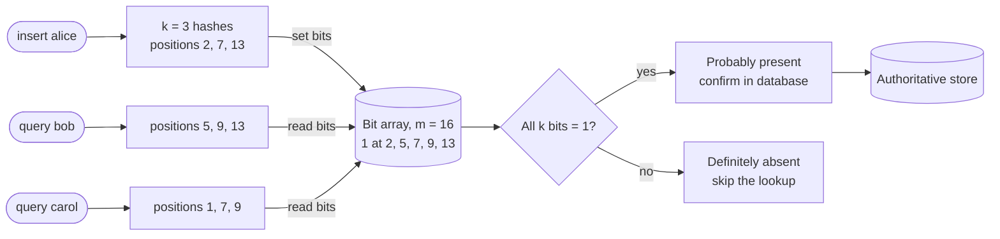

**Reading the diagram.** Inserting `alice` hashes her three times and sets bits 2, 7 and 13. Some earlier insert (not shown) set bits 5 and 9. A query for `bob` hashes to 5, 9 and 13. All three are 1, so the filter answers "probably present", even though `bob` was never inserted: bits 5 and 9 came from another item and bit 13 from `alice`. That is a false positive, and the only consequence is an unnecessary check against the authoritative store (the cylinder on the right). A query for `carol` hits bit 1, which is 0, so the filter answers "definitely absent" and the expensive lookup is skipped. Every arrow is a synchronous in-memory operation costing nanoseconds; the only I/O is the confirmation step. The filter is a cache-like accelerator in front of storage: if it is lost, correctness is unaffected and it can be rebuilt by re-inserting every item; if it is undersized, the "probably" answers become frequent and the savings vanish (§17.4.3). To scale, you partition the filter alongside the data it summarizes, one filter per file or per shard.

### 17.4.3 Mathematical foundations

After inserting $n$ items with $k$ hashes into $m$ bits, the probability that a particular bit is still 0 is $(1 - 1/m)^{kn} \approx e^{-kn/m}$, because each of the $kn$ bit-settings misses that bit with probability $1 - 1/m$. A false positive needs all $k$ positions of a new item to be 1. Treating the positions as independent gives the standard approximation [Bloom 1970; Broder & Mitzenmacher 2004].

::: formula
**Bloom filter false-positive rate**

$$p \approx \left(1 - e^{-kn/m}\right)^{k}$$

| Symbol | Meaning | Units |
|---|---|---|
| $p$ | Probability that a query for an item not in the set returns "probably present" | probability (0–1) |
| $n$ | Number of items inserted | items |
| $m$ | Size of the bit array | bits |
| $k$ | Number of hash functions (bit positions per item) | count |
| $e^{-kn/m}$ | Approximate fraction of bits still 0 | fraction |
:::

::: example
**Worked example — predicting the false-positive rate.** You allocate $m = 10{,}000{,}000$ bits (1.25 MB) for $n = 1{,}000{,}000$ items with $k = 7$.

1. Exponent: $kn/m = 7 \times 10^6 / 10^7 = 0.7$.
2. Fraction of bits still 0: $e^{-0.7} = 0.4966$. So $1 - 0.4966 = 0.5034$ of the bits are 1, which is about half.
3. False-positive rate: $0.5034^7$. Take logs: $7 \times \ln 0.5034 = 7 \times (-0.6864) = -4.805$; $e^{-4.805} = 0.0082$.

*Interpretation.* About 0.82% of queries for absent items return "maybe": 82 in 10,000. *Engineering implication.* If each "maybe" costs a 10 ms disk read and absent-key queries arrive at 10,000 per second, the filter turns 10,000 disk reads per second into 82, at a memory cost of 1.25 MB.
:::

The number of hash functions involves a trade-off. More hashes check more bits per query, which lowers $p$, but also set more bits per insert, which fills the array and raises $p$. Minimizing $p$ over $k$ gives a clean answer.

::: formula
**Optimal number of hash functions**

$$k^{*} = \frac{m}{n} \ln 2 \approx 0.693 \, \frac{m}{n}, \qquad p\big|_{k = k^*} = \left(\tfrac{1}{2}\right)^{k^*}$$

| Symbol | Meaning | Units |
|---|---|---|
| $k^{*}$ | Number of hash functions that minimizes $p$ (round to an integer) | count |
| $m/n$ | Bits per element | bits/item |
| $\ln 2$ | Natural logarithm of 2, ≈ 0.693 | dimensionless |
:::

::: example
**Worked example — choosing k.** With $m/n = 10$ bits per element: $k^* = 10 \times 0.693 = 6.93$, so use $k = 7$. At the optimum, exactly half of the bits are 1 ($e^{-k^* n/m} = e^{-\ln 2} = 1/2$) and $p = 0.5^{6.93} = 0.0082$, matching the previous example.

*Interpretation.* The optimum is the point where the array is half full. A filter whose bits are mostly 1 is overloaded; one whose bits are mostly 0 is wasting memory or using too few hashes. *Engineering implication.* The fraction of 1 bits is a cheap health metric. Export it, and alert when it passes about 0.5 for a filter sized at the optimum.
:::

In practice you start from the false-positive rate you can tolerate and ask how much memory you need. Substituting $k^*$ into the formula and solving for $m$ gives the sizing rule.

::: formula
**Bits per element for a target false-positive rate**

$$\frac{m}{n} = \frac{-\ln p}{(\ln 2)^2} \approx 1.44 \log_2 \frac{1}{p}, \qquad k = -\log_2 p$$

| Symbol | Meaning | Units |
|---|---|---|
| $m/n$ | Bits of filter needed per inserted item | bits/item |
| $p$ | Target false-positive rate | probability |
| $(\ln 2)^2$ | ≈ 0.4805 | dimensionless |
| $k$ | Matching number of hash functions (rounded) | count |
:::

::: example
**Worked example — a username-availability filter for 1 billion accounts.** You want "is this username taken?" answered in memory with a 1% false-positive rate.

1. Bits per element: $-\ln 0.01 / 0.4805 = 4.605 / 0.4805 = 9.585$ bits.
2. Total: $9.585 \times 10^9$ bits $= 1.198 \times 10^9$ bytes $\approx 1.2$ GB (decimal).
3. Hash functions: $k = -\log_2 0.01 = 6.64$, so 7.
4. For 0.1%: $-\ln 0.001 / 0.4805 = 6.908 / 0.4805 = 14.38$ bits per element, 1.8 GB, $k = 10$.
5. Compare with an exact set: 1 billion usernames averaging 12 bytes, plus about 40 bytes of hash-table and object overhead each, is roughly $52 \times 10^9$ bytes = 52 GB.

*Interpretation.* Each 10× reduction in $p$ costs a fixed $\ln 10 / (\ln 2)^2 = 4.79$ extra bits per element, independent of how large the items are. *Engineering implication.* The filter fits in one server's memory (or is replicated to every API node), while the exact set would need a cluster. A "taken" answer is confirmed against the database before it is shown to the user; a "free" answer is always correct, and those are exactly the answers that need to be fast while the user types.
:::

**Table 17.3 — Bloom filter sizing at the optimal k.**

| Target $p$ | Bits per element | Hash functions $k$ | Memory for $10^9$ items |
|---|---|---|---|
| 10% | 4.79 | 3 | 0.60 GB |
| 1% | 9.59 | 7 | 1.20 GB |
| 0.1% | 14.38 | 10 | 1.80 GB |
| 0.01% | 19.17 | 13 | 2.40 GB |
| 0.001% | 23.96 | 17 | 3.00 GB |

The approximation treats bit positions as independent, which they are not quite. Bose and colleagues showed the classic formula slightly underestimates the true rate for small filters [Bose et al. 2008]. For filters of millions of bits the difference is negligible, as the next measurement shows.

### 17.4.4 Implementation and measured validation

```python
import hashlib
import math

class BloomFilter:
    """Standard Bloom filter using Kirsch-Mitzenmacher double hashing."""

    def __init__(self, n_expected: int, fp_target: float):
        # m = -n ln p / (ln 2)^2 ; k = (m / n) ln 2
        self.m = math.ceil(-n_expected * math.log(fp_target) / math.log(2) ** 2)
        self.k = max(1, round(self.m / n_expected * math.log(2)))
        self.bits = bytearray((self.m + 7) // 8)

    def _positions(self, item: str):
        digest = hashlib.blake2b(item.encode(), digest_size=16).digest()
        h1 = int.from_bytes(digest[:8], "little")
        h2 = int.from_bytes(digest[8:], "little") | 1     # odd, so it never sticks at h1
        return [(h1 + i * h2) % self.m for i in range(self.k)]

    def add(self, item: str) -> None:
        for pos in self._positions(item):
            self.bits[pos >> 3] |= 1 << (pos & 7)

    def __contains__(self, item: str) -> bool:
        return all(self.bits[pos >> 3] & (1 << (pos & 7)) for pos in self._positions(item))

def predicted_fp(m: int, n: int, k: int) -> float:
    return (1 - math.exp(-k * n / m)) ** k

n, probes = 100_000, 1_000_000
print(f"{'target p':>9} {'m (bits)':>10} {'bits/item':>9} {'k':>3} {'predicted':>10} {'measured':>10}")
for target in (0.05, 0.01, 0.001):
    bf = BloomFilter(n, target)
    for i in range(n):
        bf.add(f"member-{i}")
    assert all(f"member-{i}" in bf for i in range(n))    # no false negatives, ever
    fps = sum(f"stranger-{i}" in bf for i in range(probes))
    print(f"{target:9.3f} {bf.m:10d} {bf.m / n:9.2f} {bf.k:3d} "
          f"{predicted_fp(bf.m, n, bf.k):10.5f} {fps / probes:10.5f}")

# What happens if you insert 3x more items than the filter was sized for?
bf = BloomFilter(n, 0.01)
for i in range(3 * n):
    bf.add(f"member-{i}")
fps = sum(f"stranger-{i}" in bf for i in range(probes))
print(f"overfilled 3x: predicted {predicted_fp(bf.m, 3 * n, bf.k):.4f}, measured {fps / probes:.4f}")
```

Output:

```text
 target p   m (bits) bits/item   k  predicted   measured
    0.050     623523      6.24   4    0.05027    0.05044
    0.010     958506      9.59   7    0.01004    0.01018
    0.001    1437759     14.38  10    0.00100    0.00098
overfilled 3x: predicted 0.4360, measured 0.4376
```

What to notice:

- The sizing rule reproduces Table 17.3: 9.59 bits and $k = 7$ for 1%, 14.38 bits and $k = 10$ for 0.1%.
- Measured rates match predictions to within sampling noise. With $10^6$ probes and $p = 0.001$, you expect $1{,}000 \pm 32$ false positives; 980 is well inside that. (An earlier run with only 200,000 probes measured 0.00117, 2.4 standard deviations high. Measure enough probes to resolve the rate you care about.)
- The `assert` confirms the defining guarantee: every inserted item is found.
- Overfilling is the most common real failure. A filter sized for 100,000 items holding 300,000 has a 44% false-positive rate, which makes it nearly useless. Size for the *maximum* expected $n$, or rebuild when $n$ grows.
- `h2` is forced odd. Otherwise $h_2 = 0$ would make all $k$ positions identical.

### 17.4.5 Bloom filters in system architecture

**Figure 17.3 — Bloom filters on the read path of an LSM-tree storage engine.**

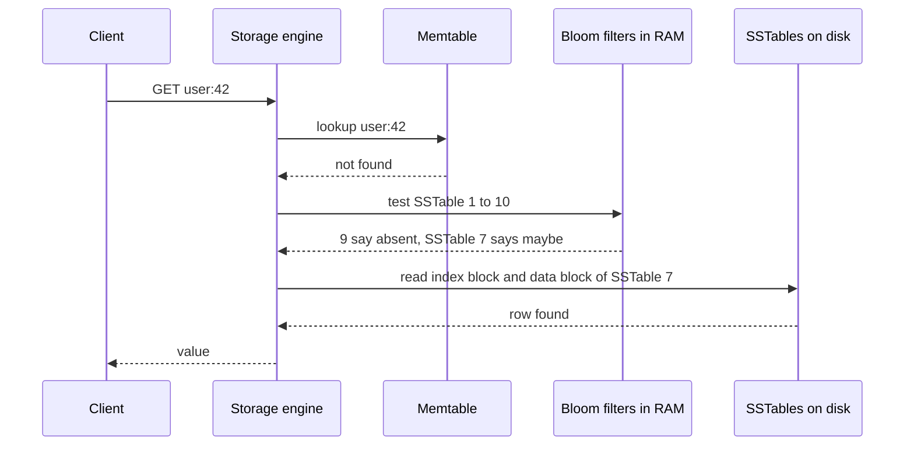

**Reading the diagram.** A client asks the storage engine for `user:42`. The engine first checks the in-memory memtable (§13.8). On a miss it would normally have to search every SSTable on disk, newest first. Instead it tests the key against each SSTable's Bloom filter, which lives in RAM and costs well under a microsecond per test. Nine filters answer "definitely absent", so those files are never touched. Only SSTable 7 answers "maybe", and the engine reads one index block and one data block from it. All calls are synchronous; the storage boundary is between the RAM-resident filters and memtable and the disk-resident SSTables. If the key did not exist at all, the expected number of wasted disk reads with ten files at $p = 1\%$ is $10 \times 0.01 = 0.1$ instead of 10. Failure points: filters that are evicted from memory under pressure turn every lookup into disk reads (watch filter memory and block-cache hit ratio); filters cannot help range scans, because a range does not hash to bit positions (prefix Bloom filters help only for scans within a known key prefix). Scaling is automatic, since each new SSTable carries its own filter, built once when the file is written. Chapter 13 (§13.10) covers the storage-engine details; this chapter owns the filter's mathematics.

::: industry
**Google Bigtable and Apache Cassandra.** Bigtable lets clients enable Bloom filters per locality group so that reads for rows or columns that do not exist do not touch the SSTables on disk; the paper notes that most lookups for non-existent data then never touch disk [Chang et al. 2006]. Cassandra keeps a Bloom filter per SSTable and exposes its false-positive target as the table option `bloom_filter_fp_chance`, trading memory for fewer disk reads per table [Apache Cassandra Docs].
*Evidence: Primary* — [Chang et al. 2006; Apache Cassandra Docs]
:::

::: industry
**Akamai's "one-hit wonders".** Akamai engineers reported that a large share of the objects requested from their CDN servers are requested only once, so writing every object to disk on its first request wastes disk bandwidth and evicts useful content. Their servers use a Bloom filter to record objects seen once and cache an object only on its second request within a period [Maggs & Sitaraman 2015]. The filter costs a few bits per URL and turns "cache on first request" into "cache on second request" without storing the URLs themselves.
*Evidence: Primary* — [Maggs & Sitaraman 2015]
:::

### 17.4.6 Counting Bloom filters

A standard Bloom filter cannot delete. A **counting Bloom filter** replaces each bit with a small counter, typically 4 bits [Fan et al. 2000]. Insert increments the $k$ counters, delete decrements them, and a query checks that all $k$ counters are non-zero. The false-positive rate is the same as for a bit filter with the same $m$ and $k$, because "counter > 0" plays the role of "bit = 1". The costs are memory (4× a plain filter for 4-bit counters) and two failure modes: a counter can overflow if more than 15 items map to it (with optimal $k$ the probability is astronomically small, which is why 4 bits suffice [Fan et al. 2000; Broder & Mitzenmacher 2004]), and deleting an item that was never inserted decrements counters that belong to other items, creating false negatives. Only delete items you know are present.

Fan and colleagues introduced counting filters for the **Summary Cache** protocol, in which cooperating web proxies exchanged compact summaries of their cache contents instead of querying one another on every miss [Fan et al. 2000]. Proxies insert and evict objects constantly, so the summary had to support deletion.

### 17.4.7 Cuckoo filters

A **cuckoo filter** supports deletion with less memory than a counting Bloom filter and, for low false-positive rates, less memory than a plain Bloom filter [Fan et al. 2014].

::: definition
**Definition — Cuckoo filter.** A hash table of $b$-slot buckets that stores a short **fingerprint** of each item (an $f$-bit hash) in one of two candidate buckets. Membership checks two buckets for a matching fingerprint; deletion removes one copy of the fingerprint.
:::

#### How it works internally

The name comes from the cuckoo bird, which lays its egg in another bird's nest and pushes an existing egg out.

1. For item $x$, compute a fingerprint $\mathit{fp} = $ an $f$-bit hash of $x$, and the first bucket $i_1 = h(x) \bmod B$.
2. Compute the alternate bucket $i_2 = i_1 \oplus h(\mathit{fp})$. This is **partial-key cuckoo hashing**: because XOR is its own inverse, $i_1 = i_2 \oplus h(\mathit{fp})$, so you can find an entry's other bucket from the fingerprint alone, without the original item.
3. **Insert**: if either bucket has a free slot, store $\mathit{fp}$ there. Otherwise pick one of the two buckets, evict a random fingerprint from it, store $\mathit{fp}$ in its place, and move the evicted fingerprint to *its* alternate bucket, repeating up to a limit (for example 500 kicks). If the limit is reached, the table is full.
4. **Lookup**: return true if either bucket contains $\mathit{fp}$.
5. **Delete**: remove one copy of $\mathit{fp}$ from whichever bucket holds it.

**Figure 17.4 — Inserting into a full cuckoo filter by relocation.**


**Reading the diagram.** Item `x` produces a fingerprint and two candidate buckets. If either has room the insert ends immediately, which is the common case below about 90% load. When both are full, the filter displaces a resident fingerprint `fp_y` from bucket 40 and relocates it to its own alternate bucket, computed from `fp_y` alone. The loop repeats until a free slot appears. All steps are synchronous in-memory operations; insert latency is usually a few bucket accesses but grows sharply as the table approaches full, which is the main failure point. The dotted edge marks the rare outcome where relocation gives up: the filter has reached capacity and must be rebuilt larger (cuckoo filters cannot grow in place, because the original items are not stored). Lookups and deletes always touch exactly two buckets, which is why lookups are fast and cache-friendly.

#### Mathematical foundations

A lookup compares the query's fingerprint against up to $2b$ stored fingerprints, and each matches by chance with probability $2^{-f}$.

::: formula
**Cuckoo filter false-positive bound and space cost**

$$\varepsilon \le \frac{2b}{2^{f}}, \qquad f \ge \log_2 \frac{2b}{\varepsilon}, \qquad \text{bits per item} = \frac{f}{\alpha} \approx \frac{\log_2(1/\varepsilon) + \log_2(2b)}{\alpha}$$

| Symbol | Meaning | Units |
|---|---|---|
| $\varepsilon$ | False-positive rate | probability |
| $b$ | Slots per bucket (4 is the common choice) | slots |
| $f$ | Fingerprint length | bits |
| $\alpha$ | Load factor reached before inserts fail (≈ 0.95 for $b = 4$) | fraction |
:::

::: example
**Worked example — cuckoo versus Bloom at 1% and 0.1%.** Take $b = 4$ and $\alpha = 0.95$, so $\log_2(2b) = 3$.

1. At $\varepsilon = 1\%$: $\log_2 100 = 6.64$; cuckoo needs $(6.64 + 3)/0.95 = 10.1$ bits per item. Bloom needs 9.59.
2. At $\varepsilon = 0.1\%$: $\log_2 1000 = 9.97$; cuckoo needs $(9.97 + 3)/0.95 = 13.7$ bits. Bloom needs 14.38.
3. Crossover: cuckoo wins when $1.44x > (x + 3)/0.95$, where $x = \log_2(1/\varepsilon)$, i.e. $1.37x > x + 3$, so $x > 8.1$ and $\varepsilon < 0.4\%$. Fan and colleagues' **semi-sorting** optimization saves one bit per item, which moves the crossover to about 3% [Fan et al. 2014].

*Interpretation.* Bloom filters pay 44% overhead over the information-theoretic minimum $\log_2(1/\varepsilon)$; cuckoo filters pay a fixed 2–3 bits plus the load-factor loss. *Engineering implication.* For low false-positive rates, or whenever you need deletion, a cuckoo filter is the better default; for high rates (≥ 3%) and append-only sets, a Bloom filter is smaller and simpler, and it degrades gracefully when overfilled where a cuckoo filter refuses inserts.
:::

#### Code example

```python
import hashlib
import random

class CuckooFilter:
    """Cuckoo filter (Fan et al. 2014): b slots per bucket, f-bit fingerprints,
    partial-key cuckoo hashing. Supports delete. num_buckets must be a power of two."""

    def __init__(self, num_buckets: int, bucket_size: int = 4, fp_bits: int = 8, max_kicks: int = 500):
        assert num_buckets & (num_buckets - 1) == 0
        self.nb, self.b, self.f, self.max_kicks = num_buckets, bucket_size, fp_bits, max_kicks
        self.buckets = [[] for _ in range(num_buckets)]
        self.count = 0
        self.victim = None          # (bucket, fp) left homeless by a failed insert
        self.rng = random.Random(7)

    def _hash(self, data: bytes) -> int:
        return int.from_bytes(hashlib.blake2b(data, digest_size=8).digest(), "little")

    def _fingerprint_and_index(self, item: str):
        h = self._hash(item.encode())
        fp = (h >> 32) & ((1 << self.f) - 1) or 1       # fingerprint 0 is reserved for "empty"
        return fp, (h & 0xFFFFFFFF) % self.nb

    def _alt_index(self, index: int, fp: int) -> int:
        # i2 = i1 XOR hash(fp): applying it twice returns the original bucket
        return (index ^ self._hash(fp.to_bytes(4, "little"))) % self.nb

    def add(self, item: str) -> bool:
        if self.victim is not None:
            return False                                 # full: refuse further inserts
        fp, i1 = self._fingerprint_and_index(item)
        i2 = self._alt_index(i1, fp)
        for i in (i1, i2):
            if len(self.buckets[i]) < self.b:
                self.buckets[i].append(fp)
                self.count += 1
                return True
        i = self.rng.choice((i1, i2))                    # both full: evict ("kick") a victim
        for _ in range(self.max_kicks):
            j = self.rng.randrange(self.b)
            fp, self.buckets[i][j] = self.buckets[i][j], fp
            i = self._alt_index(i, fp)
            if len(self.buckets[i]) < self.b:
                self.buckets[i].append(fp)
                self.count += 1
                return True
        self.victim = (i, fp)                            # keep the homeless fingerprint
        self.count += 1                                  # so nothing is ever lost
        return False

    def __contains__(self, item: str) -> bool:
        fp, i1 = self._fingerprint_and_index(item)
        i2 = self._alt_index(i1, fp)
        if self.victim is not None and self.victim[1] == fp and self.victim[0] in (i1, i2):
            return True
        return fp in self.buckets[i1] or fp in self.buckets[i2]

    def delete(self, item: str) -> bool:
        fp, i1 = self._fingerprint_and_index(item)
        i2 = self._alt_index(i1, fp)
        if self.victim is not None and self.victim[1] == fp and self.victim[0] in (i1, i2):
            self.victim = None
            self.count -= 1
            return True
        for i in (i1, i2):
            if fp in self.buckets[i]:
                self.buckets[i].remove(fp)
                self.count -= 1
                return True
        return False

cf = CuckooFilter(num_buckets=2 ** 15, bucket_size=4, fp_bits=8)   # 131,072 slots
capacity = cf.nb * cf.b
inserted = 0
while cf.add(f"member-{inserted}"):
    inserted += 1
inserted += 1                                            # the failed item is held as the victim
print(f"filter full at load factor {inserted / capacity:.3f}")
assert all(f"member-{i}" in cf for i in range(inserted))  # no false negatives

probes = 500_000
fps = sum(f"stranger-{i}" in cf for i in range(probes))
bound = 2 * cf.b / 2 ** cf.f
print(f"false-positive rate: measured {fps / probes:.4f}, bound 2b/2^f = {bound:.4f}")
print(f"bits per stored item: {cf.f * capacity / inserted:.2f}")

for i in range(0, inserted, 2):                          # delete every second member
    assert cf.delete(f"member-{i}")
still_there = all(f"member-{i}" in cf for i in range(1, inserted, 2))
print(f"after deleting half: count = {cf.count}, all survivors found = {still_there}")
```

Output:

```text
filter full at load factor 0.963
false-positive rate: measured 0.0298, bound 2b/2^f = 0.0312
bits per stored item: 8.30
after deleting half: count = 63135, all survivors found = True
```

What to notice:

- With $b = 4$ the table filled to 96.3% before the first insert failed, consistent with the ~95% load factor reported by Fan and colleagues.
- The measured false-positive rate (2.98%) sits just under the bound $2b/2^f = 8/256 = 3.1\%$; the bound assumes all $2b$ slots are full, and here 96% are.
- Deletion works: after removing every second item, every survivor is still found. Deleting an item that was never inserted could remove another item's matching fingerprint, so production code must only delete items known to be present.
- The `victim` slot mirrors the reference implementation: when relocation gives up, the last displaced fingerprint is kept aside so that no previously inserted item becomes a false negative.

#### Alternatives and trade-offs

**Table 17.4 — Approximate membership filters compared.**

| | Bloom | Counting Bloom | Cuckoo | Static filters (XOR, ribbon) |
|---|---|---|---|---|
| What it is | Bit array, $k$ hashes | Bloom with 4-bit counters | Fingerprints in 2 candidate buckets | Fingerprints placed by solving equations over a fixed set |
| Delete | No | Yes (only items present) | Yes (only items present) | No; rebuild |
| Bits per item at 1% | 9.6 | ~38 | ~10 (~9 with semi-sorting) | ~8–9.8 |
| Lookup memory accesses | $k$ (scattered) | $k$ | 2 buckets | ~3 |
| Behavior when overfilled | Degrades smoothly ($p$ rises) | Degrades; counters may overflow | Inserts fail | Must know the set in advance |
| Union of two filters | Bitwise OR | Add counters | Not directly | Not directly |
| Choose when | Append-only sets, simplicity, mergeability | Deletion with modest memory pressure | Deletion; low $p$ | Immutable sets, e.g. per-file filters |

XOR filters [Graf & Lemire 2020] and the ribbon filters available in RocksDB are built once for a known set and cannot be modified, which suits per-file filters in LSM storage engines. A **quotient filter** is another fingerprint-based design that supports deletion and merging and keeps entries in sorted order; it is less common in practice.

#### Failure scenarios

**Table 17.5 — Bloom and cuckoo filter failure scenarios.**

| What goes wrong | Why | Detection | Recovery | Prevention |
|---|---|---|---|---|
| False-positive rate far above target | More items inserted than the filter was sized for | Fraction of 1 bits > 0.5; measured "maybe then not found" ratio | Rebuild a larger filter from the source data | Size for peak $n$ with headroom; scalable (layered) filters that add a new filter when one fills |
| False negatives appear | Bits cleared on delete, or counting-filter delete of a non-member | Items known to exist are reported absent | Rebuild from source | Never clear bits; delete only confirmed members |
| Disk reads spike after restart or memory pressure | Filters evicted from RAM or not yet loaded | Block-cache misses; read latency up | Pin filter blocks in memory | Budget filter memory explicitly (≈ 1.2 bytes/key at 1%) |
| Union gives garbage | Filters built with different $m$, $k$ or hash seeds were OR-ed | Union reports nearly everything present | Rebuild with shared parameters | Version the parameters with the filter |
| Cuckoo insert fails in production | Table reached ~95% load | Insert error rate > 0 | Allocate a larger filter and re-insert | Monitor load factor; resize at 80–90% |

#### Common misconceptions

::: mistake
**"A Bloom filter tells me an item is in the set."** It tells you an item is *probably* in the set, or *definitely not* in it. The negative answer is the useful one. Any design that acts on a positive answer without confirmation (for example, rejecting a username as taken without checking) must accept being wrong $p$ of the time.
:::

::: mistake
**"Bigger items need bigger filters."** Filter size depends only on the number of items and the target false-positive rate, not on item size. A 2 KB URL and an 8-byte integer each cost 9.6 bits at 1%.
:::

## 17.5 HyperLogLog

### 17.5.1 Counting distinct items from leading zeros

::: definition
**Definition — HyperLogLog (HLL).** A probabilistic algorithm that estimates the number of distinct items (the **cardinality**) in a multiset using $m$ small registers, with relative standard error about $1.04/\sqrt{m}$, independent of the cardinality itself [Flajolet et al. 2007].
:::

#### First-principles explanation

Suppose a friend flips a coin repeatedly and tells you only the longest run of heads that started a sequence: "Once I got five heads in a row before the first tail." A run of five heads has probability $1/32$, so your friend probably made about 32 attempts. A run of 20 heads suggests about a million attempts. You learned the number of attempts from one small number, the longest run.

Hash each item to a uniform bit string and read its leading zeros as coin flips. The probability that a hash starts with at least $r - 1$ zeros, so that its first 1-bit is at position $r$ or later, is $2^{-(r-1)}$. If the largest such position over all items is $R$, there were probably about $2^R$ *distinct* items. Duplicates do not matter: the same item always hashes to the same bits, so seeing it twice cannot raise the maximum. One maximum is very noisy (one lucky hash doubles the estimate), so HLL keeps many independent maxima and averages them.

#### Why does this exist?

Counting distinct items exactly needs memory proportional to the number of distinct items: a set of 1 billion 8-byte user IDs is at least 8 GB, and you may want one count per page, per day, per country. Analytics systems ask "how many unique users?" millions of times per day, and they need to combine counts across servers and time windows. A sum of per-server distinct counts double-counts users seen by two servers; HLL sketches can be merged without double counting.

#### How it works internally

1. Choose precision $p$; allocate $m = 2^p$ registers, all 0.
2. For each item, compute a 64-bit hash. The first $p$ bits choose register $j$. In the remaining $64 - p$ bits, find $\rho$, the position of the leftmost 1-bit (1 if the first bit is 1).
3. Set $M[j] = \max(M[j], \rho)$.
4. To estimate, combine the registers with a **harmonic mean**, which damps the effect of a few unusually large registers, and multiply by a bias-correction constant.
5. For small cardinalities, when many registers are still 0, switch to **linear counting**: $m \ln(m/V)$, where $V$ is the number of zero registers.
6. To **merge** sketches from several servers, take the register-wise maximum. The result is exactly the sketch that one server would have built from the combined stream.

**Figure 17.5 — The HyperLogLog update and estimate path.**

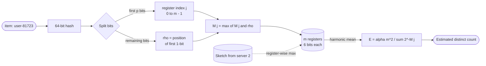

**Reading the diagram.** Each item is hashed once. The leading $p$ bits pick one of $m$ registers; the position of the first 1-bit among the remaining bits is that item's "longest run" observation. The register keeps only the maximum it has seen, so memory never grows. Updates are synchronous, constant-time, in-memory operations. The dotted edge shows the asynchronous merge path: sketches built on other servers or for other hours are combined with a register-wise maximum, typically in a batch or query layer, and the merged sketch answers "distinct users across all servers" with the same accuracy as one sketch. The estimate is computed on demand from the registers. Failure points: a poor hash breaks the coin-flip assumption and biases every estimate; mixing sketches built with different hash functions or precisions produces nonsense. Scaling is by sharding the stream freely and merging later, which is the property that makes HLL valuable in distributed analytics.

#### Mathematical foundations

::: formula
**HyperLogLog estimate and standard error**

$$E = \alpha_m \, m^2 \left( \sum_{j=1}^{m} 2^{-M[j]} \right)^{-1}, \qquad \alpha_m \approx \frac{0.7213}{1 + 1.079/m}, \qquad \mathrm{SE} \approx \frac{1.04}{\sqrt{m}}, \qquad \text{memory} = m \times 6 \text{ bits}$$

| Symbol | Meaning | Units |
|---|---|---|
| $E$ | Estimated number of distinct items | items |
| $m$ | Number of registers, $m = 2^p$ | registers |
| $M[j]$ | Value of register $j$: the largest first-1-bit position seen | count |
| $\alpha_m$ | Bias-correction constant (valid for $m \ge 128$) | dimensionless |
| $\mathrm{SE}$ | Relative standard error of $E$ | fraction |
| 6 bits | Register width: enough to hold values up to 63, sufficient for a 64-bit hash | bits |
:::

::: example
**Worked example — Redis's HyperLogLog.** Redis uses $p = 14$.

1. Registers: $m = 2^{14} = 16{,}384$.
2. Standard error: $1.04/\sqrt{16{,}384} = 1.04/128 = 0.0081$, i.e. 0.81%.
3. Memory: $16{,}384 \times 6 = 98{,}304$ bits $= 12{,}288$ bytes $= 12$ KiB.
4. For 1 billion distinct users, one standard error is $\pm 8.1$ million, and about 95% of estimates fall within two standard errors, $\pm 16.3$ million.
5. An exact set of 1 billion 8-byte IDs needs at least 8 GB, about 650,000 times more memory.
6. Daily uniques for each of 1 million pages: $10^6 \times 12$ KiB ≈ 12.3 GB in dense form. Most pages have few visitors, and a **sparse representation** stores only non-zero registers for small sketches, so the real total is far smaller.

*Interpretation.* Accuracy depends only on $m$. Quadrupling memory halves the error: $p = 16$ (48 KiB) gives 0.41%. *Engineering implication.* For dashboards, 0.81% is invisible; for billing or anything a customer can dispute, use exact counts.
:::

Heule, Nunkesser and Hall at Google described **HyperLogLog++**, three changes that most production systems now use: a 64-bit hash, which removes the large-cardinality correction the original 32-bit version needed as hash collisions became likely; an empirically measured bias correction for cardinalities up to about $5m$, where the raw estimate is biased; and a sparse representation with higher precision for small sets [Heule et al. 2013].

#### Code example

```python
import hashlib
import math

class HyperLogLog:
    """HyperLogLog (Flajolet et al. 2007) with 2^p registers and a 64-bit hash.
    Includes the linear-counting correction for small cardinalities."""

    def __init__(self, p: int = 14, salt: bytes = b""):
        self.p, self.m = p, 1 << p
        self.registers = bytearray(self.m)
        self.salt = salt
        self.alpha = 0.7213 / (1 + 1.079 / self.m)        # bias constant for m >= 128

    def add(self, item: str) -> None:
        x = int.from_bytes(hashlib.blake2b(item.encode(), digest_size=8, salt=self.salt).digest(), "big")
        j = x >> (64 - self.p)                            # first p bits choose the register
        w = x & ((1 << (64 - self.p)) - 1)                # remaining 64 - p bits
        rank = (64 - self.p) - w.bit_length() + 1         # position of the leftmost 1-bit
        if rank > self.registers[j]:
            self.registers[j] = rank

    def count(self) -> float:
        z = sum(2.0 ** -r for r in self.registers)
        estimate = self.alpha * self.m * self.m / z       # normalized harmonic mean
        zeros = self.registers.count(0)
        if estimate <= 2.5 * self.m and zeros:            # small range: linear counting
            estimate = self.m * math.log(self.m / zeros)
        return estimate

    def merge(self, other: "HyperLogLog") -> None:
        self.registers = bytearray(max(a, b) for a, b in zip(self.registers, other.registers))

n, trials = 100_000, 50
print(f"{'p':>3} {'registers':>9} {'memory':>9} {'predicted SE':>12} {'measured RMS err':>16}")
for p in (10, 12, 14):
    errors = []
    for t in range(trials):
        h = HyperLogLog(p, salt=t.to_bytes(4, "little"))
        for i in range(n):
            h.add(f"user-{i}")
        errors.append((h.count() - n) / n)
    rms = math.sqrt(sum(e * e for e in errors) / trials)
    mem = h.m * 6 / 8                                     # 6-bit registers, as in Redis
    print(f"{p:3d} {h.m:9d} {mem:7.0f} B {1.04 / math.sqrt(h.m):12.4f} {rms:16.4f}")

# Mergeability: two days of visitors with 50,000 in common
day1, day2 = HyperLogLog(14), HyperLogLog(14)
for i in range(0, 150_000):
    day1.add(f"user-{i}")
for i in range(100_000, 250_000):
    day2.add(f"user-{i}")
day1.merge(day2)
print(f"union estimate {day1.count():,.0f} (true 250,000)")
```

Output:

```text
  p registers    memory predicted SE measured RMS err
 10      1024     768 B       0.0325           0.0383
 12      4096    3072 B       0.0163           0.0162
 14     16384   12288 B       0.0081           0.0073
union estimate 248,111 (true 250,000)
```

What to notice:

- Each trial uses a different hash salt, which acts as an independent hash function, so the RMS error over trials estimates the standard error. With 50 trials, the measured RMS itself is uncertain by about ±10%. The $p = 12$ and $p = 14$ rows match the prediction; the $p = 10$ row is 18% high, and a separate 200-trial run at $n = 20{,}000$ measured 0.0330 against the predicted 0.0325.
- The sketch for 100,000 distinct users is 12 KB whether the stream has 100,000 events or 100 billion.
- The merged sketch estimates the two-day union at 248,111, an error of −0.76%, without double-counting the 50,000 users present on both days.
- `salt` is a keyed BLAKE2b parameter. Every sketch that you intend to merge must use the same hash and salt.

::: industry
**Redis `PFADD`, `PFCOUNT`, `PFMERGE`.** Redis implements HyperLogLog as a string value with 16,384 6-bit registers (12 KB) and a sparse encoding for small cardinalities; its documentation states a standard error of 0.81% [Redis Docs: HyperLogLog; Sanfilippo 2014]. A typical use is one key per page per day (`PFADD uniques:2026-10-30:/home u42`), merged with `PFMERGE` into weekly keys. Google BigQuery exposes HyperLogLog++ through its `HLL_COUNT` functions, so partial sketches can be stored in tables and merged later [Google Cloud Docs: BigQuery HLL functions].
*Evidence: Primary* — [Redis Docs: HyperLogLog; Google Cloud Docs]
:::

#### Failure scenarios and misconceptions

| What goes wrong | Why | Detection | Recovery | Prevention |
|---|---|---|---|---|
| Intersection estimate is meaningless | Computed as $\lvert A\rvert + \lvert B\rvert - \lvert A \cup B\rvert$; errors scale with the large sets | Negative or wildly varying estimates | Use exact counts or MinHash-based estimates for intersections | Only rely on HLL for unions and single-set counts |
| Merged count is far too high | Sketches built with different hashes, salts or precisions | Union exceeds sum of parts | Rebuild from raw data | Version the hash and $p$ with the sketch |
| Small counts are biased | Raw estimator range below ~$5m$ | Systematic error in tests with known small sets | Use HLL++ bias correction or linear counting | Use a library that implements HLL++ |

::: mistake
**"HLL counts events."** It counts *distinct* items. Adding the same user a million times leaves the sketch unchanged. If you want the number of events, use a counter; if you want per-item frequencies, use a Count-Min sketch (§17.6).
:::

::: mistake
**"Intersections work like unions."** For two sets of 10 million users with 100,000 in common, each cardinality has a standard error of about 81,000 at $p = 14$, so the inclusion–exclusion estimate of the intersection has an error larger than the intersection itself.
:::

## 17.6 Count-Min sketch and heavy hitters

### 17.6.1 The Count-Min sketch

::: definition
**Definition — Count-Min sketch.** A $d \times w$ array of counters with one hash function per row that estimates the frequency of any item in a stream. Each update increments one counter per row; each query returns the minimum of the item's $d$ counters. The estimate never underestimates and, with probability at least $1 - \delta$, overestimates by at most $\varepsilon N$, where $N$ is the total of all updates [Cormode & Muthukrishnan 2005].
:::

#### First-principles explanation

Imagine counting votes with a few small tally sheets instead of one line per candidate. Each sheet has a few hundred boxes, and each candidate is assigned one box per sheet by a different rule. Boxes are shared, so any box may contain votes for several candidates: every box *overcounts* its candidates. But the candidates sharing a box differ from sheet to sheet, so a candidate's least-inflated box, the minimum across sheets, is close to the truth. Adding more boxes per sheet reduces how much each box is inflated; adding more sheets reduces the chance that *every* box is badly inflated.

#### Why does this exist?

You want per-item counts over a stream with millions of distinct keys: requests per client IP for abuse detection, plays per song, queries per search term. An exact hash map needs memory proportional to the number of distinct keys, and an attacker can create unbounded keys (random IPs, random query strings). The sketch has a fixed size chosen in advance, supports addition (two sketches with the same hashes merge by adding their arrays element-wise), and gives a guaranteed error bound.

#### Architecture diagram

**Figure 17.6 — A Count-Min sketch with d = 3 rows.**

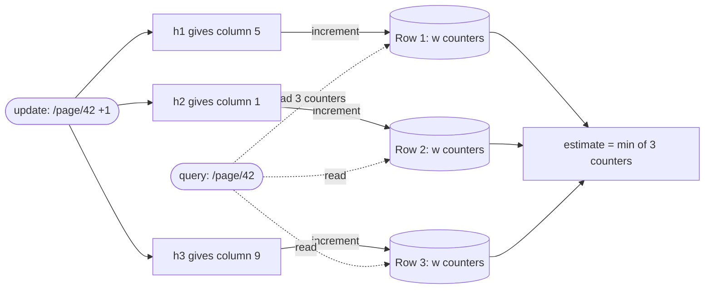

**Reading the diagram.** An update hashes the item once per row and increments exactly one counter in each row, so it costs $d$ memory writes regardless of how many distinct items exist. A query (dotted, because it is typically issued by a separate reader such as a dashboard or a rate limiter) reads the same $d$ counters and returns their minimum. Each counter is a storage cell shared by every item that hashes to it, which is why estimates only err upward. The rows are independent, so the structure is easy to partition: each stream partition keeps its own sketch with the same hash functions, and a merger adds the arrays. Failure points: counters that overflow (use 64-bit counters for long-lived sketches), sketches built with different hash seeds being merged, and the error bound growing with $N$, so a sketch that is never reset or decayed becomes less accurate over time.

#### Mathematical foundations

::: formula
**Count-Min sizing and error bound**

$$w = \left\lceil \frac{e}{\varepsilon} \right\rceil, \qquad d = \left\lceil \ln \frac{1}{\delta} \right\rceil, \qquad f_x \le \hat{f}_x \le f_x + \varepsilon N \text{ with probability } \ge 1 - \delta$$

| Symbol | Meaning | Units |
|---|---|---|
| $w$ | Counters per row (width) | counters |
| $d$ | Rows, one hash function each (depth) | rows |
| $\varepsilon$ | Error as a fraction of the stream total | fraction |
| $\delta$ | Probability that the error bound is exceeded for a given query | probability |
| $N$ | Sum of all updates in the stream | events |
| $f_x$, $\hat{f}_x$ | True and estimated count of item $x$ | events |
| $e$ | Euler's number, ≈ 2.718 | dimensionless |
:::

::: example
**Worked example — sizing a per-URL request counter.** You want errors of at most 0.1% of traffic ($\varepsilon = 0.001$) with 99% confidence ($\delta = 0.01$).

1. Width: $w = \lceil 2.718 / 0.001 \rceil = 2{,}719$.
2. Depth: $d = \lceil \ln 100 \rceil = \lceil 4.605 \rceil = 5$.
3. Counters: $2{,}719 \times 5 = 13{,}595$; with 4-byte counters, 54.4 KB.
4. For a stream of $N = 10^6$ requests, each estimate is within $+1{,}000$ of the truth with probability 99%.
5. Scale it up: a day of $N = 10^{10}$ requests gives an error bound of $10^7$. A URL with a true count of 50,000 is lost in that noise, while one with $10^8$ requests is estimated within 10%.

*Interpretation.* The error is additive and proportional to the *whole stream*, not to the item. Count-Min is accurate for heavy items and useless for rare ones. *Engineering implication.* Use it for heavy hitters, rate limiting of abusive keys and frequency-based admission (as in TinyLFU caches, §20.9). Reset or decay the sketch per window so that $N$ stays bounded.
:::

A common refinement is **conservative update**: on each update, increment only those of the item's $d$ counters that equal the current minimum. It reduces overestimation substantially and keeps the no-underestimate guarantee, but sketches updated this way can no longer be merged by simple addition with exact equivalence to a single sketch.

### 17.6.2 Heavy hitters and top-k

**Heavy hitters** are items whose frequency exceeds a threshold, such as 0.1% of traffic; **top-*k*** asks for the $k$ most frequent items. Two approaches dominate.

1. **Count-Min plus a min-heap.** On each update, query the sketch for the item's estimate. Keep a min-heap of the $k$ items with the largest estimates; if the new estimate exceeds the heap's minimum, replace that minimum. Memory is the sketch plus $k$ entries.
2. **Space-Saving** [Metwally et al. 2005]. Keep exactly $k$ (item, count) counters. If the item has a counter, increment it. If there is a free counter, take it. Otherwise, evict the item with the smallest count $c_{\min}$ and give the newcomer count $c_{\min} + 1$: it inherits the evicted count as an upper bound on how often it might have appeared unseen.

::: formula
**Space-Saving guarantee**

$$c_x - f_x \le c_{\min} \le \frac{N}{k}, \qquad f_x > \frac{N}{k} \Rightarrow x \text{ is monitored}$$

| Symbol | Meaning | Units |
|---|---|---|
| $k$ | Number of counters | counters |
| $N$ | Stream length | events |
| $c_x$, $f_x$ | Reported and true count of monitored item $x$ | events |
| $c_{\min}$ | Smallest counter value | events |
:::

::: example
**Worked example — 100 counters over 1 million events.** $N/k = 10^6/100 = 10{,}000$. Any URL with more than 10,000 requests (1% of traffic) is guaranteed to be among the 100 monitored items, and each reported count overestimates by at most 10,000. *Interpretation.* Accuracy is again relative to the whole stream, but memory is just $k$ entries. *Engineering implication.* To report a reliable top 10, monitor several times more counters than 10, so that items ranked 11–100 absorb the churn.
:::

**Figure 17.7 — A distributed top-k pipeline.**

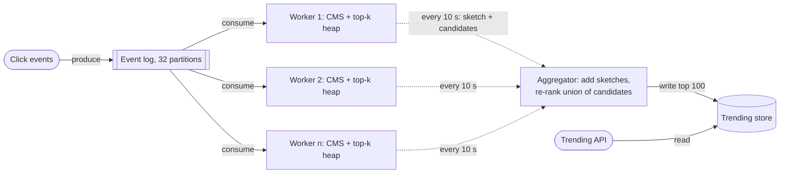

**Reading the diagram.** Click events enter a partitioned event log (Chapter 30). Each worker consumes some partitions and maintains a local Count-Min sketch and a heap of candidate heavy hitters. Every 10 seconds the workers asynchronously ship their sketches and candidate lists to an aggregator (dotted arrows). The aggregator adds the sketches, re-estimates every candidate against the merged sketch, and writes the global top 100 to a store that the trending API reads synchronously. A globally heavy item that is moderately frequent on every worker might miss each local top-*k*; sending more candidates per worker (for example top 1,000 to produce a global top 100), or partitioning the log by item key so that each item's events land on one worker, reduces that risk. Failure points: a slow worker delays the window (use event-time windows with a lateness bound, Chapter 31), and the aggregator is a single point of failure that should be restartable from the log. The aggregator does little work, so scaling is mainly adding workers and partitions.

#### Code example

```python
import hashlib
import heapq
import math
import random
from collections import Counter

class CountMinSketch:
    """Count-Min sketch (Cormode & Muthukrishnan 2005): d rows x w counters."""

    def __init__(self, epsilon: float, delta: float):
        self.w = math.ceil(math.e / epsilon)               # width from accuracy
        self.d = math.ceil(math.log(1 / delta))            # depth from confidence
        self.table = [[0] * self.w for _ in range(self.d)]
        self.total = 0

    def _columns(self, item: str):
        digest = hashlib.blake2b(item.encode(), digest_size=16).digest()
        h1 = int.from_bytes(digest[:8], "little")
        h2 = int.from_bytes(digest[8:], "little")
        return [(h1 + r * h2) % self.w for r in range(self.d)]

    def add(self, item: str, count: int = 1) -> None:
        self.total += count
        for row, col in enumerate(self._columns(item)):
            self.table[row][col] += count

    def estimate(self, item: str) -> int:
        return min(self.table[row][col] for row, col in enumerate(self._columns(item)))

class TopK:
    """Heavy hitters: a Count-Min sketch plus a min-heap of the k largest estimates."""

    def __init__(self, k: int, epsilon: float, delta: float):
        self.k, self.cms = k, CountMinSketch(epsilon, delta)
        self.heap, self.members = [], {}                   # heap of (estimate, item)

    def add(self, item: str) -> None:
        self.cms.add(item)
        est = self.cms.estimate(item)
        if item in self.members:
            self.members[item] = est                       # lazily refreshed below
        elif len(self.heap) < self.k:
            self.members[item] = est
            heapq.heappush(self.heap, (est, item))
        elif est > self.heap[0][0]:
            # refresh stale heap entries before deciding whom to evict
            self.heap = [(self.members[i], i) for _, i in self.heap]
            heapq.heapify(self.heap)
            if est > self.heap[0][0]:
                _, evicted = heapq.heapreplace(self.heap, (est, item))
                del self.members[evicted]
                self.members[item] = est

    def top(self):
        return sorted(((c, i) for i, c in self.members.items()), reverse=True)

def space_saving(stream, k):
    """Metwally et al. 2005: k counters; the newcomer replaces the minimum and inherits its count."""
    counters = {}
    for item in stream:
        if item in counters:
            counters[item] += 1
        elif len(counters) < k:
            counters[item] = 1
        else:
            victim = min(counters, key=counters.get)      # O(k); production uses a stream-summary list
            counters[item] = counters.pop(victim) + 1
    return sorted(((c, i) for i, c in counters.items()), reverse=True)

# A Zipf-like stream: 1,000,000 events over 100,000 distinct URLs (exponent 1.1)
rng = random.Random(1)
universe = 100_000
weights = [1 / (r ** 1.1) for r in range(1, universe + 1)]
stream = [f"/page/{r}" for r in rng.choices(range(1, universe + 1), weights=weights, k=1_000_000)]
truth = Counter(stream)

eps, delta = 0.001, 0.01
cms = CountMinSketch(eps, delta)
for item in stream:
    cms.add(item)
N = cms.total
errors = [cms.estimate(x) - c for x, c in truth.items()]
assert min(errors) >= 0                                     # never underestimates
print(f"w = {cms.w}, d = {cms.d}, counters = {cms.w * cms.d:,} vs distinct items = {len(truth):,}")
print(f"error bound eps*N = {eps * N:,.0f}; max error = {max(errors)}; "
      f"mean error = {sum(errors) / len(errors):.1f}; "
      f"items over bound = {sum(e > eps * N for e in errors)} of {len(errors):,} (delta allows {delta:.0%})")

tk = TopK(10, eps, delta)
for item in stream:
    tk.add(item)
true_top = [i for i, _ in truth.most_common(10)]
print("CMS+heap top-10 recall:", len(set(i for _, i in tk.top()) & set(true_top)) / 10)
ss = space_saving(stream, 100)
print("Space-Saving (100 counters) top-10 recall:", len(set(i for _, i in ss[:10]) & set(true_top)) / 10)
print("true top-3:", truth.most_common(3))
print("Space-Saving top-3:", [(i, c) for c, i in ss[:3]])
```

Output:

```text
w = 2719, d = 5, counters = 13,595 vs distinct items = 64,589
error bound eps*N = 1,000; max error = 2474; mean error = 61.1; items over bound = 1 of 64,589 (delta allows 1%)
CMS+heap top-10 recall: 1.0
Space-Saving (100 counters) top-10 recall: 1.0
true top-3: [('/page/1', 134738), ('/page/2', 63178), ('/page/3', 40195)]
Space-Saving top-3: [('/page/1', 134738), ('/page/2', 63178), ('/page/3', 40195)]
```

What to notice:

- Width 2,719 and depth 5 reproduce the worked example. The `assert` confirms that no estimate is below the truth.
- Only 1 of 64,589 items exceeded the $\varepsilon N = 1{,}000$ bound, far fewer than the 1% that $\delta$ permits; the bound is conservative. The mean overestimate is just 61.
- Both heavy-hitter methods recover the true top 10 exactly on this skewed (Zipf) stream. Real traffic is usually skewed like this, which is why these methods work well in practice. On a nearly uniform stream there are no heavy hitters to find, and both methods return arbitrary items.
- Space-Saving's top three counts are exact here, because those items were never evicted.
- Production Space-Saving uses a "stream-summary" linked structure for $O(1)$ eviction instead of `min()` over a dictionary.

::: industry
**Twitter Algebird and Redis Stack.** Twitter open-sourced Algebird, a Scala library of mergeable aggregations (Count-Min sketch, HyperLogLog, Bloom filters and others) designed to be combined across Hadoop, Scalding and Storm jobs: each partition builds a sketch and the framework adds them [Twitter: Algebird]. The RedisBloom module (bundled in Redis Stack, and in Redis Open Source since Redis 8 as of 2025) provides `CMS.INCRBY`/`CMS.QUERY` for Count-Min sketches and `TOPK.ADD`/`TOPK.LIST` for top-*k* tracking [Redis Docs: Count-min sketch; Top-K].
*Evidence: Primary* — [Twitter: Algebird; Redis Docs]
:::

::: mistake
**"Count-Min gives each item's count within ε percent."** The bound is $\varepsilon N$, a fraction of the *entire stream*. An item with 0.001% of traffic can be overestimated by 100× its true count. Report Count-Min estimates only for items well above $\varepsilon N$.
:::

## 17.7 Skip lists

### 17.7.1 Probabilistic levels instead of rebalancing

::: definition
**Definition — Skip list.** An ordered linked list augmented with extra levels of "express" pointers. Each node is promoted to the next level with probability $p$ (typically 1/2 or 1/4), so level $i$ contains about a fraction $p^i$ of the nodes. Search, insert and delete take expected $O(\log n)$ time [Pugh 1990].
:::

#### First-principles explanation

A subway line has local trains that stop at every station and an express train that stops at every fourth. To reach station 37, you ride the express to station 36, the last express stop before your destination, then switch to the local for one stop. A skip list stacks several such express lines. Unlike a planned subway, it chooses each station's express status by coin flip, so no central planner has to rebalance anything when stations are added.

#### Why does this exist?

Balanced search trees (red–black, AVL) guarantee $O(\log n)$ operations, but their rebalancing rotations are intricate and touch several nodes per update. That makes them hard to implement correctly and very hard to make concurrent. Pugh's insight was that randomization gives the same *expected* performance with a far simpler algorithm: an insert changes only the predecessors' pointers at the levels the new node occupies, and no other part of the structure moves [Pugh 1990].

#### How it works internally

1. **Search** for key $x$: start at the head's top level. Move right while the next key is less than $x$; when it is not, drop down a level. At level 0, the next node is $x$ if $x$ is present.
2. **Insert** $x$: search as above, remembering the last node visited on each level (the update path). Draw a random level $\ell$: start at 1 and add a level while a coin with probability $p$ comes up heads. Splice the new node in after the remembered node on each of levels $1..\ell$.
3. **Delete**: search, then unlink the node from each level it occupies.
4. **Range scan** $[a, b]$: search for $a$, then walk level 0 until passing $b$. This is why skip lists suit ordered data such as leaderboards and memtables.

**Figure 17.8 — A skip list with three levels; searching for 40.**

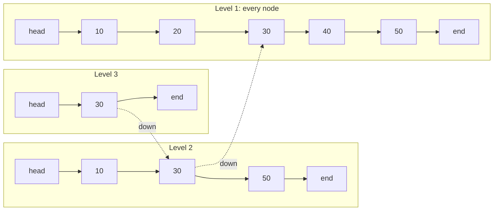

**Reading the diagram.** Each subgraph is one level; solid arrows are forward pointers within a level, and the dotted arrows show the search path moving down a level at node 30 (one node object holds all its levels; the copies are drawn per level for clarity). A search for 40 starts at the top-level head, moves right to 30, sees that the next key at level 3 is the end marker, drops to level 2, sees 50 > 40, drops to level 1 and steps once to 40: four forward moves instead of four steps along the bottom list, a gap that widens as $n$ grows. Everything is in memory and synchronous. Failure points: an unlucky sequence of coin flips can make one search slow (the guarantee is probabilistic), and pointer chasing across scattered nodes causes CPU cache misses (§5.4), which is why on-disk indexes use B-trees instead. Concurrency scales well because an insert locks or compare-and-swaps only the few predecessor pointers it changes.

#### Mathematical foundations

::: formula
**Skip list levels, search cost and memory**

$$L(n) = \log_{1/p} n, \qquad \mathbb{E}[\text{search path}] \le \frac{L(n)}{p} + \frac{1}{1-p}, \qquad \mathbb{E}[\text{pointers per node}] = \frac{1}{1-p}$$

| Symbol | Meaning | Units |
|---|---|---|
| $n$ | Number of elements | elements |
| $p$ | Probability of promoting a node to the next level | probability |
| $L(n)$ | Expected number of levels in use | levels |
| Search path | Forward moves plus level drops during one search | steps |
| Pointers per node | Average forward pointers stored per element | pointers |
:::

::: example
**Worked example — choosing p for one million elements.**

1. $p = 1/2$: $L = \log_2 10^6 = 19.9$ levels; search path $\le 19.9/0.5 + 1/0.5 = 41.9$ steps; 2.00 pointers per node.
2. $p = 1/4$: $L = \log_4 10^6 = 6/\log_{10} 4 = 6/0.602 = 9.97$ levels; search path $\le 9.97/0.25 + 1/0.75 = 41.2$ steps; 1.33 pointers per node.

*Interpretation.* Both choices give about 40 steps, but $p = 1/4$ stores a third fewer pointers. *Engineering implication.* This is why Redis uses $p = 1/4$: 8 bytes saved per pointer across millions of sorted-set members is real memory, and search cost barely changes.
:::

#### Code example and measured validation

```python
import math
import random

class Node:
    __slots__ = ("key", "forward")
    def __init__(self, key, level):
        self.key, self.forward = key, [None] * level

class SkipList:
    """Pugh's skip list with promotion probability p (Redis uses p = 0.25, max level 32)."""

    def __init__(self, p: float = 0.25, max_level: int = 32, seed: int = 0):
        self.p, self.max_level = p, max_level
        self.head = Node(None, max_level)
        self.level = 1
        self.pointers = 0                                # total forward pointers allocated
        self.rng = random.Random(seed)

    def _random_level(self) -> int:
        lvl = 1
        while self.rng.random() < self.p and lvl < self.max_level:
            lvl += 1
        return lvl

    def insert(self, key) -> None:
        update, x = [self.head] * self.max_level, self.head
        for i in reversed(range(self.level)):           # descend, remembering the last node per level
            while x.forward[i] and x.forward[i].key < key:
                x = x.forward[i]
            update[i] = x
        lvl = self._random_level()
        self.level = max(self.level, lvl)
        node = Node(key, lvl)
        self.pointers += lvl
        for i in range(lvl):                             # splice in at each of its levels
            node.forward[i], update[i].forward[i] = update[i].forward[i], node

    def search(self, key):
        """Return (found, number of key comparisons)."""
        x, steps = self.head, 0
        for i in reversed(range(self.level)):
            while x.forward[i] and x.forward[i].key < key:
                x, steps = x.forward[i], steps + 1
            steps += 1                                   # the comparison that stopped us
        x = x.forward[0]
        return (x is not None and x.key == key), steps

    def range(self, lo, hi):
        """All keys in [lo, hi]: find lo in O(log n), then walk level 0."""
        x = self.head
        for i in reversed(range(self.level)):
            while x.forward[i] and x.forward[i].key < lo:
                x = x.forward[i]
        x, out = x.forward[0], []
        while x and x.key <= hi:
            out.append(x.key)
            x = x.forward[0]
        return out

for p in (0.5, 0.25):
    for n in (10_000, 100_000, 1_000_000):
        sl = SkipList(p=p, seed=42)
        keys = list(range(n))
        random.Random(1).shuffle(keys)
        for k in keys:
            sl.insert(k)
        probe = random.Random(2).sample(range(n), 2_000)
        avg = sum(sl.search(k)[1] for k in probe) / len(probe)
        L = math.log(n, 1 / p)
        bound = L / p + 1 / (1 - p)                       # Pugh's expected-cost bound
        print(f"p={p:<4} n={n:>9,}  levels={sl.level:2d}  log_1/p(n)={L:5.1f}  "
              f"avg comparisons={avg:5.1f}  Pugh bound={bound:5.1f}  "
              f"pointers/node={sl.pointers / n:4.2f} (expect {1 / (1 - p):4.2f})")
print("range(500, 505):", sl.range(500, 505))
```

Output (about 40 s in CPython):

```text
p=0.5  n=   10,000  levels=14  log_1/p(n)= 13.3  avg comparisons= 27.5  Pugh bound= 28.6  pointers/node=1.98 (expect 2.00)
p=0.5  n=  100,000  levels=17  log_1/p(n)= 16.6  avg comparisons= 32.7  Pugh bound= 35.2  pointers/node=2.00 (expect 2.00)
p=0.5  n=1,000,000  levels=20  log_1/p(n)= 19.9  avg comparisons= 38.4  Pugh bound= 41.9  pointers/node=2.00 (expect 2.00)
p=0.25 n=   10,000  levels= 7  log_1/p(n)=  6.6  avg comparisons= 23.8  Pugh bound= 27.9  pointers/node=1.33 (expect 1.33)
p=0.25 n=  100,000  levels= 9  log_1/p(n)=  8.3  avg comparisons= 31.9  Pugh bound= 34.6  pointers/node=1.34 (expect 1.33)
p=0.25 n=1,000,000  levels=11  log_1/p(n)= 10.0  avg comparisons= 37.4  Pugh bound= 41.2  pointers/node=1.33 (expect 1.33)
range(500, 505): [500, 501, 502, 503, 504, 505]
```

What to notice:

- The number of levels in use tracks $\log_{1/p} n$, and the measured search path stays below Pugh's bound at every size.
- Going from $10^4$ to $10^6$ elements (100×) adds only about 11–14 comparisons: logarithmic growth.
- Pointers per node match $1/(1-p)$ exactly, confirming the memory saving of $p = 1/4$.

::: industry
**Redis sorted sets and LSM memtables.** A Redis sorted set (`ZADD`, `ZRANGE`, `ZRANK`) larger than a small threshold is stored as a hash table from member to score plus a skip list ordered by (score, member). The skip list uses $p = 1/4$ and a maximum of 32 levels, and each forward pointer records a *span* (how many level-0 nodes it jumps), so `ZRANK` can sum spans along the search path and return a rank in $O(\log n)$. Small sorted sets use a compact listpack instead [Redis Docs: Sorted sets; Redis source `t_zset.c`]. LevelDB and RocksDB use a skip list as the default in-memory memtable, because it supports concurrent inserts and ordered iteration for flushing to sorted SSTables [RocksDB Wiki: MemTable]. Java's `ConcurrentSkipListMap` is a lock-free sorted map built on the same idea.
*Evidence: Primary* — [Redis Docs; RocksDB Wiki]
:::

::: mistake
**"Skip lists guarantee O(log n)."** The bound is on the *expected* cost over the random coin flips. The probability of a much slower search falls off exponentially, so in practice it never matters, but an adversary who can predict your random number generator could build a degenerate list. Seed it from a good source.
:::

## 17.8 Merkle trees

### 17.8.1 Hash trees for verification and anti-entropy

::: definition
**Definition — Merkle tree (hash tree).** A tree in which every leaf holds the hash of a data block and every interior node holds the hash of its children's hashes. The **root hash** summarizes the entire data set: changing any block changes the root [Merkle 1987].
:::

#### First-principles explanation

Two libraries want to check that their copies of a 1-million-book catalog are identical. Comparing every entry means sending a million entries across town. Instead, each library writes a one-line summary of each shelf, then of each aisle (computed from its shelves' summaries), then of each floor, then of the building. They phone each other and compare the building summaries. If those match, they are done. If not, they compare the floor summaries, then only the aisles on mismatched floors, then only the shelves in mismatched aisles. With a tree of summaries, the work is proportional to the number of *differences* times the depth of the tree, not to the size of the catalog.

#### Why does this exist?

Merkle introduced hash trees in the late 1970s so that one signature over a root could authenticate many values [Merkle 1987]. Distributed systems use them for two jobs: **verification** (prove that one record belongs to a data set identified by a trusted root, without sending the data set) and **anti-entropy** (find which parts of two replicas differ, sending only a few hashes).

#### How it works internally

1. Hash each record to make the leaves. Use a cryptographic hash such as SHA-256 when an adversary might forge data; replicas that only need to detect accidental divergence can use a cheaper hash.
2. Hash adjacent pairs to make the next level up, and repeat until one root remains. Prefix leaf and interior inputs with different bytes (for example `0x00` and `0x01`, as Certificate Transparency does [RFC 6962]) so that an interior node can never be passed off as a leaf.
3. **Inclusion proof** for record $i$: the sibling hash at each level on the path from leaf $i$ to the root. A verifier recomputes the root from the record and the siblings and compares it with the trusted root.
4. **Anti-entropy**: two replicas compare roots; if they differ, they compare children and descend only into subtrees whose hashes differ, until they reach the divergent leaves.

**Figure 17.9 — A Merkle tree over four records and the inclusion proof for record C.**

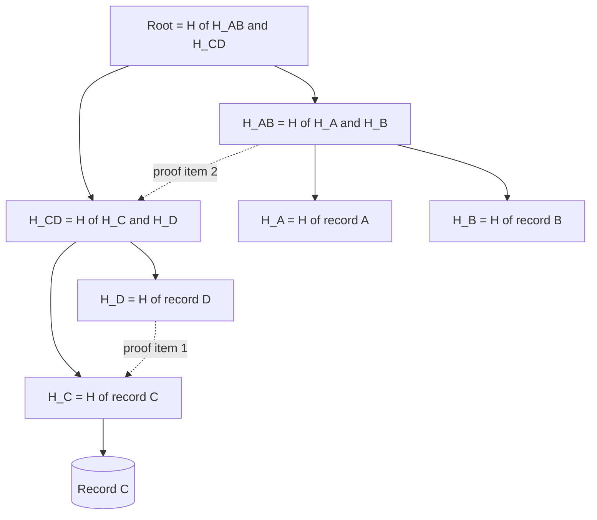

**Reading the diagram.** Leaves (bottom) are hashes of records; each parent hashes its two children; the root summarizes everything. To prove that record C is in the set, the server sends C plus two sibling hashes (dotted edges): $H_D$ and $H_{AB}$. The verifier computes $H_C$, then $H_{CD} = H(H_C, H_D)$, then $H(H_{AB}, H_{CD})$, and compares the result with a root it already trusts (from a signed log head or a block header). Records live in storage; hashes can be cached in memory or stored beside the data. The computation is synchronous and local to the verifier. Failure points: a stale root (the verifier must obtain the root through a trusted channel), and rebuilding large trees after many updates, which costs CPU; incremental trees update only the path from a changed leaf to the root. The structure scales logarithmically: a billion records need a proof of only 30 hashes.

::: formula
**Merkle proof size and anti-entropy cost**

$$h = \lceil \log_2 n \rceil, \qquad \text{proof size} = h \times H_{\text{bytes}}, \qquad \text{hashes compared} \le 1 + 2\,k\,h$$

| Symbol | Meaning | Units |
|---|---|---|
| $n$ | Number of leaves (records or key ranges) | leaves |
| $h$ | Tree height | levels |
| $H_{\text{bytes}}$ | Size of one hash (32 for SHA-256) | bytes |
| $k$ | Number of divergent leaves between two replicas | leaves |
:::

::: example
**Worked example — 1,048,576 records on two replicas.**

1. Height: $h = \log_2 2^{20} = 20$.
2. Inclusion proof: $20 \times 32 = 640$ bytes, compared with sending all leaf hashes ($2^{20} \times 32$ B = 33.6 MB) or the data itself.
3. Anti-entropy with $k = 2$ divergent records: at most $1 + 2 \times 2 \times 20 = 81$ hash comparisons out of about 2.1 million tree nodes.

*Interpretation.* Both costs grow with $\log n$; anti-entropy cost grows with the number of differences, not the data size. *Engineering implication.* Replicas can run anti-entropy continuously in the background at negligible network cost when they are mostly in sync, which is the normal case.
:::

```python
import hashlib

def h(data: bytes) -> bytes:
    return hashlib.sha256(data).digest()

def leaf_hash(record: bytes) -> bytes:
    return h(b"\x00" + record)          # domain separation: leaves and interior nodes
def node_hash(left: bytes, right: bytes) -> bytes:
    return h(b"\x01" + left + right)    # can never be confused (cf. RFC 6962)

def build(records):
    """Return all levels, leaves first. An odd node is promoted unchanged."""
    level = [leaf_hash(r) for r in records]
    levels = [level]
    while len(level) > 1:
        nxt = [node_hash(level[i], level[i + 1]) for i in range(0, len(level) - 1, 2)]
        if len(level) % 2:
            nxt.append(level[-1])
        levels.append(nxt)
        level = nxt
    return levels

def proof(levels, index):
    """Sibling hashes from leaf to root: the audit path for one record."""
    path = []
    for level in levels[:-1]:
        sibling = index ^ 1
        if sibling < len(level):
            path.append((sibling < index, level[sibling]))   # (sibling is on the left?, hash)
        index //= 2
    return path

def verify(record, path, root):
    acc = leaf_hash(record)
    for sibling_is_left, sib in path:
        acc = node_hash(sib, acc) if sibling_is_left else node_hash(acc, sib)
    return acc == root

def diff(a, b, level=None, index=0, found=None):
    """Anti-entropy: descend only into subtrees whose hashes differ. Returns (leaf indexes, hashes compared)."""
    if found is None:
        level, found = len(a) - 1, ([], [0])
    found[1][0] += 1
    if a[level][index] == b[level][index]:
        return found
    if level == 0:
        found[0].append(index)
        return found
    for child in (2 * index, 2 * index + 1):
        if child < len(a[level - 1]):
            diff(a, b, level - 1, child, found)
    return found

records = [f"key-{i}=value-{i}".encode() for i in range(1 << 20)]       # 1,048,576 records
replica_a = build(records)
records_b = list(records)
for i in (12_345, 777_777):                                               # two divergent records
    records_b[i] = b"stale"
replica_b = build(records_b)

root = replica_a[-1][0]
p = proof(replica_a, 424_242)
print(f"tree height = {len(replica_a) - 1}, proof length = {len(p)} hashes = {32 * len(p)} bytes")
print("valid record verifies:", verify(records[424_242], p, root))
print("tampered record verifies:", verify(b"key-424242=forged", p, root))
leaves, compared = diff(replica_a, replica_b)
print(f"roots equal: {replica_a[-1][0] == replica_b[-1][0]}; divergent leaves: {leaves}; "
      f"hashes compared: {compared[0]} of {sum(len(l) for l in replica_a):,}")
```

Output:

```text
tree height = 20, proof length = 20 hashes = 640 bytes
valid record verifies: True
tampered record verifies: False
roots equal: False; divergent leaves: [12345, 777777]; hashes compared: 79 of 2,097,151
```

What to notice: the proof is exactly 20 hashes (640 bytes); a forged record fails verification against the same proof; and the anti-entropy walk finds both divergent records after 79 comparisons, just under the bound of 81.

**Figure 17.10 — Merkle-tree anti-entropy between two replicas.**

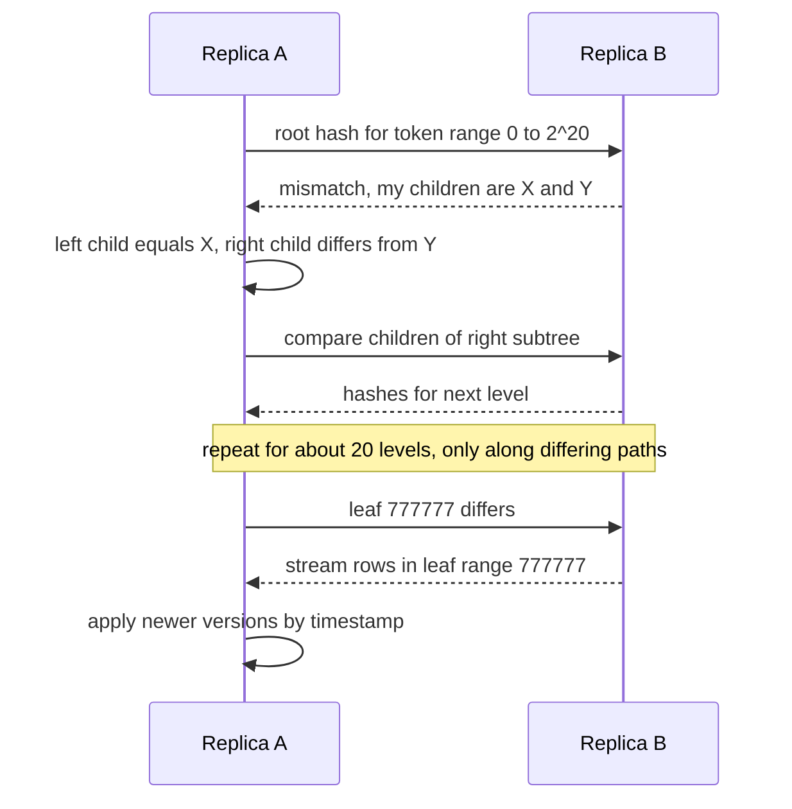

**Reading the diagram.** Replica A starts a background repair for one key range by sending its root hash. Replica B replies that its root differs and returns its two child hashes. A compares them with its own, finds that only the right subtree differs, and asks for the next level of that subtree only. The exchange descends about 20 levels and touches only differing paths. At the leaves, the replicas exchange the actual rows for the divergent range, and each applies the newer version using the system's conflict-resolution rule (§27.14). Every message is a synchronous request/response over the internode protocol, but the repair as a whole is asynchronous with respect to client traffic. Storage boundaries: trees are built by scanning each replica's local data (an expensive, I/O-heavy step), then compared over the network. Failure points: building trees on a busy node competes with client reads; a tree whose leaves cover large ranges forces "overstreaming" of whole ranges for one changed row; and comparing trees built at different moments reports spurious differences for in-flight writes. Systems scale this by repairing ranges incrementally and on a schedule.

::: industry
**Dynamo, Cassandra and Git.** Amazon's Dynamo keeps one Merkle tree per key range hosted by a node and uses it to detect and repair divergence between replicas after failures [DeCandia et al. 2007]. Apache Cassandra's anti-entropy repair (`nodetool repair`) builds Merkle trees over token ranges on each replica, compares them and streams only mismatched ranges [Apache Cassandra Docs: Repair]. Git stores every file, directory and commit as an object named by the hash of its content; a commit names the tree hash, which names subtree and file hashes, forming a Merkle structure in which identical commit hashes imply identical histories [Chacon & Straub 2014]. Certificate Transparency logs use Merkle trees so that anyone can verify, with logarithmic-size proofs, that a certificate is in the log and that the log is append-only (§10.5) [RFC 6962].
*Evidence: Primary* — [DeCandia et al. 2007; Apache Cassandra Docs; Chacon & Straub 2014; RFC 6962]
:::

Chapter 27 (§27.13) places Merkle-tree anti-entropy alongside read repair and hinted handoff in leaderless replication.

## 17.9 Geospatial indexing

### 17.9.1 Why location needs its own index

"Find all drivers within 1 km" looks like a database query: `WHERE lat BETWEEN ... AND lon BETWEEN ...`. A B-tree on `lat` can use only one of the two ranges efficiently. It returns a horizontal strip around the whole planet at the right latitude, and the database then filters that strip by longitude. A composite index on `(lat, lon)` has the same problem, because a B-tree orders keys along one dimension. The fix is to map two-dimensional positions onto a one-dimensional key so that points close on the map usually have close keys. Curves that do this are called **space-filling curves**, and every index in this section is a variation on the idea: divide the map into **cells**, give each cell an ID, index points by cell ID, and answer a proximity query by looking up a small set of cells and filtering the candidates by exact distance.

### 17.9.2 Geohash

::: definition
**Definition — Geohash.** A string encoding of a latitude/longitude cell, published by Gustavo Niemeyer in 2008, formed by alternately bisecting the longitude and latitude ranges, interleaving the resulting bits (longitude first) and writing every 5 bits as one base-32 character [Niemeyer 2008]. Each additional character subdivides the cell into 32 smaller cells, so a geohash that is a prefix of another names a cell containing it.
:::

#### How it works internally

1. Start with longitude range $[-180, 180]$ and latitude range $[-90, 90]$.
2. Take the longitude midpoint. If the point is east of it, emit bit 1 and keep the upper half; otherwise emit 0 and keep the lower half.
3. Do the same with latitude, and keep alternating.
4. Group bits in fives and map each group to the alphabet `0123456789bcdefghjkmnpqrstuvwxyz` (the letters a, i, l and o are omitted to avoid confusion with digits).

The interleaving traces a **Z-order (Morton) curve**: within each cell the four sub-quadrants are visited in a Z pattern. Points with a long shared prefix are close together. The reverse is not always true. Two points a meter apart on either side of a major cell boundary, such as the equator or the prime meridian, can have geohashes with no common prefix at all. Proximity search must therefore always look at neighboring cells, never at a prefix alone.

**Figure 17.11 — Geohash refinement: each character narrows the cell.**

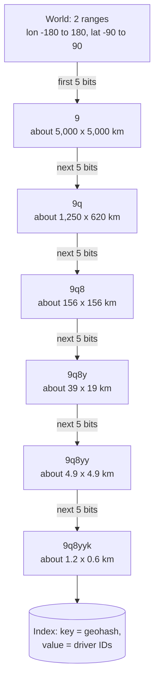

**Reading the diagram.** Each arrow appends one character (5 bits) and shrinks the cell by a factor of 32 in area; the sizes are at the equator, and widths shrink by $\cos(\text{latitude})$ toward the poles. The chain shows the cells containing a point in San Francisco. Because a longer geohash extends a shorter one, a range scan over keys starting with `9q8yy` in any ordered store (B-tree, sorted set, LSM tree) returns every point in that 4.9 km cell, which is how geohash turns a 2-D query into 1-D range scans. All steps are pure computation; the only storage is the index at the bottom. The failure point is the boundary effect described above, and the main scaling decision is the precision, which trades the number of cells scanned against the number of false candidates per cell.

::: formula
**Geohash cell size**

$$b_{\text{lon}} = \left\lceil \frac{5L}{2} \right\rceil, \quad b_{\text{lat}} = \left\lfloor \frac{5L}{2} \right\rfloor, \quad W = \frac{360^\circ}{2^{b_{\text{lon}}}} \times 111.32 \cos\varphi \ \text{km}, \quad H = \frac{180^\circ}{2^{b_{\text{lat}}}} \times 110.57 \ \text{km}$$

| Symbol | Meaning | Units |
|---|---|---|
| $L$ | Geohash length | characters |
| $b_{\text{lon}}$, $b_{\text{lat}}$ | Bits spent on longitude and latitude | bits |
| $W$, $H$ | Cell width (east–west) and height (north–south) | km |
| $\varphi$ | Latitude of the cell | degrees |
| 111.32, 110.57 | Approximate km per degree of longitude at the equator and of latitude | km/degree |
:::

::: example
**Worked example — a 6-character cell in San Francisco ($\varphi = 37.77^\circ$).**

1. Bits: $5 \times 6 = 30$, so $b_{\text{lon}} = 15$, $b_{\text{lat}} = 15$.
2. Width: $360/32{,}768 = 0.010986^\circ$; $\times 111.32 = 1.223$ km at the equator; $\times \cos 37.77^\circ = 0.7905$ gives 0.967 km.
3. Height: $180/32{,}768 = 0.005493^\circ \times 110.57 = 0.607$ km.

*Interpretation.* A 6-character cell here is about 970 m × 610 m, not square. *Engineering implication.* The 3 × 3 block of cells around a point extends at least one cell height, 610 m, in every direction. That covers a 500 m search radius but **not** a 1 km radius. The program below measures what happens if you ignore this.
:::

**Table 17.6 — Geohash precision (cell size at the equator, computed by the program below).**

| Length | Bits | Width | Height | Typical use |
|---|---|---|---|---|
| 1 | 5 | 5,009 km | 4,976 km | Continent |
| 2 | 10 | 1,252 km | 622 km | Large country region |
| 3 | 15 | 157 km | 156 km | Metropolitan region |
| 4 | 20 | 39.1 km | 19.4 km | City |
| 5 | 25 | 4.9 km | 4.9 km | District; 1–2 km searches |
| 6 | 30 | 1.2 km | 0.61 km | Neighborhood; ~500 m searches |
| 7 | 35 | 153 m | 152 m | Block |
| 8 | 40 | 38 m | 19 m | Building |
| 9 | 45 | 4.8 m | 4.8 m | Doorway (beyond typical GPS accuracy) |
| 10 | 50 | 1.2 m | 0.59 m | Below GPS accuracy |

#### Code example: geohash encoding and a proximity search

```python
import math
import random
from collections import defaultdict

BASE32 = "0123456789bcdefghjkmnpqrstuvwxyz"          # no a, i, l, o

def encode(lat: float, lon: float, length: int) -> str:
    """Interleave longitude and latitude bisection bits (longitude first), 5 bits per character."""
    lat_rng, lon_rng = [-90.0, 90.0], [-180.0, 180.0]
    out, bits, bit_count, even = [], 0, 0, True
    while len(out) < length:
        rng, val = (lon_rng, lon) if even else (lat_rng, lat)
        mid = (rng[0] + rng[1]) / 2
        if val >= mid:
            bits, rng[0] = (bits << 1) | 1, mid
        else:
            bits, rng[1] = bits << 1, mid
        even, bit_count = not even, bit_count + 1
        if bit_count == 5:
            out.append(BASE32[bits])
            bits, bit_count = 0, 0
    return "".join(out)

def decode_box(gh: str):
    """Return (lat_min, lat_max, lon_min, lon_max) of a geohash cell."""
    lat_rng, lon_rng, even = [-90.0, 90.0], [-180.0, 180.0], True
    for ch in gh:
        v = BASE32.index(ch)
        for shift in range(4, -1, -1):
            rng = lon_rng if even else lat_rng
            mid = (rng[0] + rng[1]) / 2
            if (v >> shift) & 1:
                rng[0] = mid
            else:
                rng[1] = mid
            even = not even
    return lat_rng[0], lat_rng[1], lon_rng[0], lon_rng[1]

def neighbors(gh: str):
    """The 8 surrounding cells (center-offset method; ignores the poles and the antimeridian)."""
    la0, la1, lo0, lo1 = decode_box(gh)
    dlat, dlon = la1 - la0, lo1 - lo0
    clat, clon = (la0 + la1) / 2, (lo0 + lo1) / 2
    return [encode(clat + i * dlat, clon + j * dlon, len(gh))
            for i in (-1, 0, 1) for j in (-1, 0, 1) if (i, j) != (0, 0)]

def covering(lat: float, lon: float, radius_km: float, length: int):
    """All cells of this length that intersect the circle's bounding box (exact recall)."""
    la0, la1, lo0, lo1 = decode_box(encode(lat, lon, length))
    dlat, dlon = la1 - la0, lo1 - lo0
    ri = math.ceil(radius_km / (dlat * 111.0))             # rows needed above and below
    rj = math.ceil(radius_km / (dlon * 111.0 * math.cos(math.radians(lat))))
    clat, clon = (la0 + la1) / 2, (lo0 + lo1) / 2
    return [encode(clat + i * dlat, clon + j * dlon, length)
            for i in range(-ri, ri + 1) for j in range(-rj, rj + 1)]

def haversine_km(lat1, lon1, lat2, lon2):
    r = 6371.0088
    p1, p2 = math.radians(lat1), math.radians(lat2)
    dp, dl = p2 - p1, math.radians(lon2 - lon1)
    a = math.sin(dp / 2) ** 2 + math.cos(p1) * math.cos(p2) * math.sin(dl / 2) ** 2
    return 2 * r * math.asin(math.sqrt(a))

print("encode(57.64911, 10.40744, 11) =", encode(57.64911, 10.40744, 11))   # reference: u4pruydqqvj

print(f"{'len':>3} {'bits':>4} {'cell width (equator)':>21} {'cell height':>12}")
for length in range(1, 11):
    lon_bits = math.ceil(5 * length / 2)
    lat_bits = 5 * length // 2
    w_km = 360 / 2 ** lon_bits * 111.32
    h_km = 180 / 2 ** lat_bits * 110.57
    fmt = lambda km: f"{km:,.1f} km" if km >= 1 else f"{km * 1000:,.2f} m"
    print(f"{length:3d} {5 * length:4d} {fmt(w_km):>21} {fmt(h_km):>12}")

# Proximity search: 200,000 drivers around San Francisco; find those within 1 km of a rider
rng = random.Random(3)
drivers = [(37.70 + rng.random() * 0.12, -122.52 + rng.random() * 0.14) for _ in range(200_000)]
rider = (37.7749, -122.4194)
truth = {i for i, d in enumerate(drivers) if haversine_km(*rider, *d) <= 1.0}
for P, method in ((6, "3x3"), (5, "3x3"), (6, "cover")):
    index = defaultdict(list)                        # geohash -> driver ids (in production: a sorted key range)
    for i, (lat, lon) in enumerate(drivers):
        index[encode(lat, lon, P)].append(i)
    cell = encode(*rider, P)
    cells = [cell] + neighbors(cell) if method == "3x3" else covering(*rider, 1.0, P)
    candidates = [i for c in cells for i in index[c]]
    hits = {i for i in candidates if haversine_km(*rider, *drivers[i]) <= 1.0}
    la0, la1, lo0, lo1 = decode_box(cell)
    print(f"P={P} {method:5s} cell {cell}: {haversine_km(la0, lo0, la0, lo1) * 1000:,.0f} m x "
          f"{haversine_km(la0, lo0, la1, lo0) * 1000:,.0f} m; {len(cells)} cells -> "
          f"{len(candidates):,} candidates, {len(hits):,} within 1 km, "
          f"recall {len(hits) / len(truth):.3f} (brute force finds {len(truth):,})")
```

Output:

```text
encode(57.64911, 10.40744, 11) = u4pruydqqvj
len bits  cell width (equator)  cell height
  1    5            5,009.4 km   4,975.6 km
  2   10            1,252.3 km     622.0 km
  3   15              156.5 km     155.5 km
  4   20               39.1 km      19.4 km
  5   25                4.9 km       4.9 km
  6   30                1.2 km     607.38 m
  7   35              152.87 m     151.84 m
  8   40               38.22 m      18.98 m
  9   45                4.78 m       4.75 m
 10   50                1.19 m       0.59 m
P=6 3x3   cell 9q8yyk: 966 m x 611 m; 9 cells -> 6,470 candidates, 3,601 within 1 km, recall 0.942 (brute force finds 3,822)
P=5 3x3   cell 9q8yy: 3,864 m x 4,887 m; 9 cells -> 130,946 candidates, 3,822 within 1 km, recall 1.000 (brute force finds 3,822)
P=6 cover cell 9q8yyk: 966 m x 611 m; 25 cells -> 17,908 candidates, 3,822 within 1 km, recall 1.000 (brute force finds 3,822)
```

What to notice:

- The encoder reproduces the widely used reference geohash `u4pruydqqvj` for (57.64911, 10.40744), and the precision table reproduces Table 17.6.
- **The 3 × 3 trick at 6 characters silently misses 5.8% of drivers within 1 km**, exactly as the worked example predicted: the cells are only 611 m tall.
- Dropping to 5 characters restores full recall but scans 130,946 candidates, 65% of all drivers, because each cell is now about 4 km on a side.
- Covering the circle's bounding box with 25 six-character cells gives full recall with 17,908 candidates, 7× fewer than the 5-character scan. The general rule: pick the precision from the radius, then cover the search area with as many cells as it takes.
- Drivers are uniformly spread at about 1,220 per km² in this test, so the expected count within 1 km is $\pi \times 1^2 \times 1{,}220 \approx 3{,}830$; brute force found 3,822.

### 17.9.3 Quadtrees

A geohash grid is fixed: a 6-character cell in central Manhattan may hold thousands of drivers while one over a lake holds none. A **quadtree** adapts to density [Finkel & Bentley 1974]. Each node covers a rectangle and holds up to a capacity, say 100 points. When it overflows, it splits into four children (NW, NE, SW, SE) and redistributes its points. Dense areas become deep and fine; empty areas stay as one large leaf. A proximity query descends only into nodes whose rectangles intersect the search circle.

**Figure 17.12 — An adaptive quadtree: dense areas split further.**

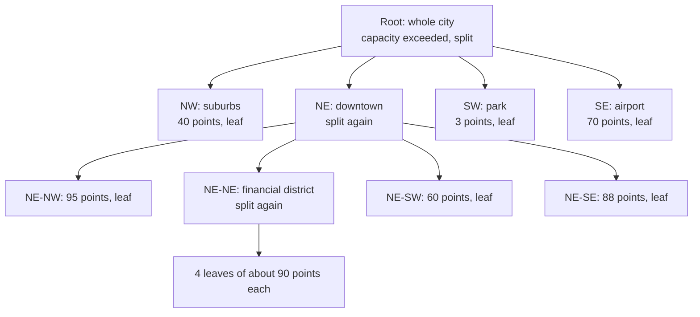

**Reading the diagram.** The root covers the city and has split because it exceeded its capacity. Three quadrants are leaves with few enough points; downtown (NE) has split again, and its financial district has split a third time. A query near the park reads one leaf; a query downtown descends three levels to a small leaf. The tree lives in memory on the service that owns it; edges are parent-to-child pointers, traversed synchronously. Failure points: moving points (drivers report every few seconds) force constant removal and reinsertion and occasional splits and merges, which complicates concurrency; and an in-memory tree on one server is a single point of failure, so production designs shard it by region and rebuild it from the location stream after a restart. Quadtrees suit in-memory indexes of moderately dynamic points; for a persistent index on an ordinary database, the fixed cells of geohash or S2 fit B-trees better.

### 17.9.4 Google S2

**S2** is Google's open-source spherical geometry library [S2 Geometry Docs]. It avoids the distortion of latitude/longitude grids, whose cells become slivers near the poles, by projecting the sphere onto the six faces of a cube. Each face is divided as a quadtree, and the cells are ordered along a **Hilbert curve**, a space-filling curve that, unlike the Z-curve, never jumps: consecutive cells always share an edge. A cell is named by a 64-bit **cell ID** that encodes the face, the path down the quadtree and the level (0–30). Because children's IDs fall in a contiguous range inside their parent's, "all points in this cell" is a range scan on a 64-bit integer column. A **region coverer** approximates any shape (circle, polygon) with a small set of cells at mixed levels, and a query becomes a handful of integer ranges.

::: formula
**Average S2 cell area at level L**

$$\bar{A}_L \approx \frac{4\pi R^2}{6 \times 4^{L}} = \frac{510.1 \times 10^{6} \text{ km}^2}{6 \times 4^{L}}$$

| Symbol | Meaning | Units |
|---|---|---|
| $\bar{A}_L$ | Average area of a level-$L$ cell | km² |
| $R$ | Earth's mean radius, ≈ 6,371 km | km |
| $L$ | Cell level, 0 (a cube face) to 30 | level |
:::

::: example
**Worked example — which S2 level for a 1 km search?** Level 12: $85.0 \times 10^6 / 4^{12} = 85.0 \times 10^6 / 16{,}777{,}216 = 5.07$ km², cells about 2.3 km across. Level 13: 1.27 km², about 1.1 km across. Level 30: $85.0 \times 10^6 / 4^{30}$ km² $= 7.4 \times 10^{-11}$ km² $\approx 0.74$ cm². *Interpretation.* Each level divides area by 4, and 31 levels span from a sixth of the planet to under a square centimeter. *Engineering implication.* Index points at a fine level (often the leaf ID itself) and let the region coverer pick coarse cells for the query, so that one index serves every search radius.
:::

### 17.9.5 Uber H3

**H3** is Uber's open-source hexagonal grid [H3 Docs; Brodsky 2018]. It projects the globe onto an icosahedron and tiles it with hexagons at 16 resolutions (0–15). Resolution 0 has 122 base cells, and each finer resolution has about 7 times as many cells (aperture 7). Twelve cells at every resolution must be pentagons, because a sphere cannot be tiled with hexagons alone. A hexagon's six neighbors all share an edge and all lie the same distance from its center, whereas a square cell has four edge neighbors and four corner neighbors at 1.41× the distance. That makes hexagons a natural unit for analyzing movement, smoothing values over neighborhoods ("rings") and pricing by area. The trade-off is hierarchy: seven child hexagons do not exactly tile their parent, so parent–child containment is approximate, unlike S2 and geohash.

**Table 17.7 — Selected H3 resolutions (average hexagon, from the H3 library version 4).**

| Resolution | Average area | Average edge length | Cells on Earth | Typical use |
|---|---|---|---|---|
| 0 | 4,357,449 km² | 1,281 km | 122 | Continental |
| 5 | 252.9 km² | 9.85 km | 2,016,842 | Regional demand |
| 7 | 5.16 km² | 1.41 km | 98,825,162 | City districts |
| 8 | 0.737 km² | 531 m | 691,776,122 | Neighborhood supply and demand |
| 9 | 0.105 km² | 201 m | 4,842,432,842 | Pickup zones, street blocks |
| 10 | 0.0150 km² | 75.9 m | 33,897,029,882 | Fine-grained locations |
| 15 | 0.90 m² | 0.58 m | about $5.7 \times 10^{14}$ | Sub-meter (beyond GPS accuracy) |

A k-ring query (`grid_disk` in H3 v4) returns a hexagon and all hexagons within $k$ steps: 7 cells for $k = 1$ and 19 for $k = 2$ ($1 + 3k(k+1)$).

::: industry
**Uber.** Uber's engineering blog describes building H3 to analyze supply, demand and pricing across cities: events are bucketed by hexagon, and hexagons' equal-distance neighbors make smoothing across adjacent areas straightforward. Uber open-sourced the library in 2018 [Brodsky 2018; H3 Docs]. **Redis** offers geospatial commands (`GEOADD`, `GEOSEARCH`) that store each member's 52-bit interleaved geohash as its sorted-set score, so a radius search becomes range scans over the cells that cover the area, followed by a distance filter [Redis Docs: Geospatial].
*Evidence: Primary* — [Brodsky 2018; H3 Docs; Redis Docs]
:::

### 17.9.6 Putting it together: a proximity service

**Figure 17.13 — A nearby-drivers service built on a cell index.**

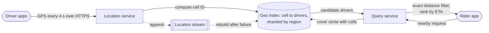

**Reading the diagram.** Drivers send positions every 4 seconds; the location service computes each position's cell (geohash, S2 or H3) and moves the driver between cells in the geo index, which is held in memory (Redis or a custom service) and sharded by region so that a city's index fits on one shard. Every update is also appended asynchronously to a location stream (dotted), which feeds analytics and lets a failed index shard be rebuilt in seconds. A rider's request goes to the query service, which covers the search circle with cells, reads candidates from the index synchronously, filters them by exact distance and ranks them by estimated arrival time from a routing service (not shown). Load: 1 million active drivers at one update per 4 s is 250,000 writes per second, so the index must be in memory and partitioned. Failure points: a stale driver entry (a driver whose app died) needs a TTL on each entry; a hot shard during a big event needs finer cells or a shard split; and cells straddling a shard boundary make the query fan out to two shards. Chapter 55 (§55.1, §55.2) develops this into a full ride-matching design.

**Table 17.8 — Geospatial indexes compared.**

| | Geohash | Quadtree | S2 | H3 | R-tree |
|---|---|---|---|---|---|
| Cell shape | Lat/lon rectangles | Adaptive rectangles | Spherical quadrilaterals | Hexagons (+12 pentagons) | Bounding boxes of data |
| Key | Base-32 string (prefix = parent) | Tree path | 64-bit ID (range = parent) | 64-bit ID | None (tree pages) |
| Adapts to density | No | Yes | No (coverer mixes levels) | No | Yes |
| Works in any ordered store | Yes | No (in memory) | Yes | Yes (exact match per cell) | No (specialized index) |
| Distortion | High near poles | Depends on projection | Low | Low | — |
| Neighbor queries | 8 neighbors, boundary quirks | Tree walk | Edge neighbors | Uniform rings | Box overlap |
| Choose when | Simple prefix/range scans, Redis, Elasticsearch | In-memory dynamic points | Global coverage, polygons, ranges on integers | Movement analytics, aggregation, pricing | Polygons and shapes in PostGIS (GiST) |

::: mistake
**"Searching the 3 × 3 block of geohash cells finds everything within the radius."** Only if the cell's smaller side is at least the radius, and cell width shrinks with latitude. The measurement above lost 5.8% of results at 1 km with 6-character cells. Derive precision from the radius and latitude, or use a region coverer.
:::

## 17.10 Unique ID generation

### 17.10.1 What an ID scheme must provide

Every row, message, order and event needs an identifier. On one database, an auto-increment column does the job. Across hundreds of services and partitioned databases, you need IDs that are:

1. **Unique** across all generators, forever.
2. **Generated without coordination** on the hot path, so that ID creation adds no network round trip and survives the loss of any central service.
3. **Roughly time-ordered** (often called **k-sortable**): IDs created later sort later. This keeps B-tree inserts near the right-hand edge of the index (§11.8, §13.6), lets you paginate by ID, and lets you find recent items with a range scan.
4. **Compact**: 64 bits fits a `BIGINT` and halves index size compared with 128 bits.
5. **Not leaking** information you would rather hide, such as exact creation time, order volume or which machine created the record.

No scheme maximizes all five. The rest of this section compares the main families.

### 17.10.2 UUIDv4 and UUIDv7

RFC 9562 (May 2024) defines the current **UUID** (universally unique identifier) versions, all 128 bits, and replaces RFC 4122 [RFC 9562]. **UUIDv4** is 122 random bits plus 6 fixed version and variant bits. **UUIDv7** puts a 48-bit Unix timestamp in milliseconds in the most significant bits, followed by the version, 12 bits that may be random or a sub-millisecond counter, the variant, and 62 more random bits. UUIDv7 therefore sorts by creation time, which UUIDv4 cannot. Inserting random UUIDv4 keys into a large B-tree touches a random leaf page each time, so once the index exceeds memory nearly every insert reads a page from disk and splits pages all over the tree. UUIDv7 inserts land on the rightmost pages, which stay hot in the buffer pool.

Collisions between random IDs are governed by the birthday bound (§10.4.1).

::: formula
**Birthday bound for random identifiers**

$$P_{\text{collision}} \approx 1 - e^{-n^2 / (2N)} \approx \frac{n^2}{2N} \ \ (\text{when small}), \qquad n_{50\%} \approx \sqrt{2N \ln 2} \approx 1.18\sqrt{N}$$

| Symbol | Meaning | Units |
|---|---|---|
| $n$ | Number of IDs generated within one collision domain | IDs |
| $N$ | Number of possible values, $2^{\text{random bits}}$ | values |
| $P_{\text{collision}}$ | Probability that at least two IDs are equal | probability |
| $n_{50\%}$ | Number of IDs at which a collision becomes a coin flip | IDs |
:::

::: example
**Worked example — how safe are UUIDv4 and UUIDv7?**

1. UUIDv4: $N = 2^{122} = 5.3 \times 10^{36}$. For one trillion IDs, $n^2/(2N) = 10^{24}/(1.06 \times 10^{37}) = 9.4 \times 10^{-14}$. A coin-flip collision needs $n_{50\%} = 1.18 \times \sqrt{5.3 \times 10^{36}} = 2.7 \times 10^{18}$ IDs.
2. UUIDv7 with all 74 non-timestamp bits random: only IDs created in the same millisecond can collide, so $N = 2^{74} = 1.9 \times 10^{22}$ per millisecond. At 1 million IDs per second (1,000 per ms): $10^6/(3.8 \times 10^{22}) = 2.6 \times 10^{-17}$ per millisecond; over a year of $3.16 \times 10^{10}$ ms, $8.3 \times 10^{-7}$.

*Interpretation.* Both are safe for any realistic system, though UUIDv7 gives up some margin for its ordering. *Engineering implication.* The practical risk is not mathematics but bad randomness: a VM image cloned with the same random-number-generator state, or a non-cryptographic generator seeded with the time, produces real duplicates. Use the operating system's cryptographic random source, and keep a unique constraint on the column.
:::

### 17.10.3 Twitter Snowflake

In 2010 Twitter moved tweets off a single MySQL database and needed 64-bit IDs that were roughly time-ordered and could be produced at high rate on many machines without coordination. Its answer, **Snowflake**, was a small Thrift service that composed IDs from a timestamp, a machine number and a counter. Its README listed the requirements as at least 10,000 IDs per second per process with a response time of 2 ms plus network latency [Twitter: Snowflake 2010].

**Figure 17.14 — The Snowflake 64-bit ID layout.**

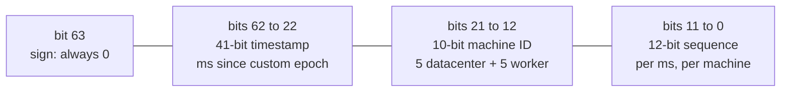

**Reading the diagram.** The fields are concatenated from the most significant bit (left) to the least (right). The sign bit is always 0 so that IDs are positive in languages with signed 64-bit integers. The 41-bit timestamp counts milliseconds since a custom epoch (Twitter's is 1288834974657, 4 November 2010 at 01:42:54.657 UTC [Twitter: Snowflake IdWorker]); because it occupies the high bits, IDs sort by time across all machines, to within clock skew. The 10-bit machine ID (Twitter split it into 5 datacenter and 5 worker bits) makes IDs from different generators distinct, so no generator ever talks to another; the only coordination is assigning machine IDs once, by configuration or a coordination service (§26.8). The 12-bit sequence counts IDs within one millisecond on one machine. Failure points: two generators accidentally given the same machine ID produce duplicates; a clock that moves backward could reissue old timestamps; and a machine that exhausts 4,096 IDs in one millisecond must wait for the next.

::: formula
**Snowflake capacity and lifetime**

$$\text{rate}_{\text{machine}} = 2^{S} \times 1000 \ \text{IDs/s}, \qquad \text{rate}_{\text{cluster}} = 2^{M} \times \text{rate}_{\text{machine}}, \qquad \text{lifetime} = \frac{2^{T}}{1000 \times 3600 \times 24 \times 365.25} \ \text{years}$$

| Symbol | Meaning | Units |
|---|---|---|
| $T$ | Timestamp bits (millisecond resolution) | bits |
| $M$ | Machine-ID bits | bits |
| $S$ | Sequence bits | bits |
| $\text{rate}$ | Maximum sustained ID generation rate | IDs/s |
| lifetime | Time from the epoch until the timestamp field overflows | years |
:::

::: example
**Worked example — the 41/10/12 layout.**

1. Per machine: $2^{12} = 4{,}096$ IDs per millisecond, or $4{,}096{,}000$ IDs/s.
2. Cluster: $2^{10} = 1{,}024$ machines × 4,096,000 = $4.19 \times 10^9$ IDs/s.
3. Lifetime: $2^{41} = 2{,}199{,}023{,}255{,}552$ ms $= 2.199 \times 10^{12} / 3.156 \times 10^{10} = 69.7$ years. From Twitter's 2010 epoch, IDs run out in July 2080.
4. Re-budgeting for a sharded database: Instagram described a variant with 41 timestamp bits, 13 bits of logical shard ID and 10 sequence bits, generated inside PostgreSQL [Instagram Engineering 2012]: $2^{13} = 8{,}192$ shards, each producing up to $2^{10} = 1{,}024$ IDs per millisecond.

*Interpretation.* Every bit moved from one field to another doubles one limit and halves another. *Engineering implication.* Choose the epoch as late as possible (the year you launch), size machine bits for the largest fleet you can imagine including restarts and short-lived containers, and write the layout down: the ID format is a public contract once clients store IDs.
:::

#### Code example

```python
import datetime as dt
import os
import threading
import time
import uuid

TWITTER_EPOCH_MS = 1288834974657           # 2010-11-04 01:42:54.657 UTC, from Twitter's IdWorker
TIMESTAMP_BITS, MACHINE_BITS, SEQUENCE_BITS = 41, 10, 12
MAX_MACHINE = (1 << MACHINE_BITS) - 1      # 1023
MAX_SEQUENCE = (1 << SEQUENCE_BITS) - 1    # 4095

class ClockMovedBackwards(Exception):
    pass

class Snowflake:
    """64-bit IDs: 1 unused sign bit | 41-bit ms timestamp | 10-bit machine id | 12-bit sequence."""

    def __init__(self, machine_id: int, epoch_ms: int = TWITTER_EPOCH_MS, clock=lambda: time.time_ns() // 1_000_000):
        if not 0 <= machine_id <= MAX_MACHINE:
            raise ValueError("machine id must fit in 10 bits")
        self.machine_id, self.epoch_ms, self.clock = machine_id, epoch_ms, clock
        self.last_ms, self.sequence = -1, 0
        self.lock = threading.Lock()

    def next_id(self) -> int:
        with self.lock:
            now = self.clock()
            if now < self.last_ms:                      # NTP stepped the clock back
                raise ClockMovedBackwards(f"refusing to issue IDs for {self.last_ms - now} ms")
            if now == self.last_ms:
                self.sequence = (self.sequence + 1) & MAX_SEQUENCE
                if self.sequence == 0:                  # 4,096 IDs used this ms: wait for the next
                    while now <= self.last_ms:
                        now = self.clock()
            else:
                self.sequence = 0
            self.last_ms = now
            return ((now - self.epoch_ms) << (MACHINE_BITS + SEQUENCE_BITS)) \
                | (self.machine_id << SEQUENCE_BITS) | self.sequence

def decode(snowflake_id: int, epoch_ms: int = TWITTER_EPOCH_MS):
    ms = (snowflake_id >> (MACHINE_BITS + SEQUENCE_BITS)) + epoch_ms
    machine = (snowflake_id >> SEQUENCE_BITS) & MAX_MACHINE
    seq = snowflake_id & MAX_SEQUENCE
    return dt.datetime.fromtimestamp(ms / 1000, dt.timezone.utc), machine, seq

def uuid7() -> uuid.UUID:
    """RFC 9562 UUIDv7: 48-bit Unix ms | ver=7 | 12 random bits | var=10 | 62 random bits."""
    ms = time.time_ns() // 1_000_000
    rand = int.from_bytes(os.urandom(10), "big")      # 80 random bits, 74 of them used
    value = (ms & ((1 << 48) - 1)) << 80
    value |= 0x7 << 76                                 # version
    value |= ((rand >> 62) & 0xFFF) << 64              # rand_a (12 bits)
    value |= 0b10 << 62                                # variant
    value |= rand & ((1 << 62) - 1)                    # rand_b (62 bits)
    return uuid.UUID(int=value)

gen = Snowflake(machine_id=37)
ids = [gen.next_id() for _ in range(200_000)]
assert len(set(ids)) == len(ids) and ids == sorted(ids)   # unique and strictly increasing
print("sample id:", ids[-1], "->", decode(ids[-1]))
start = time.perf_counter()
for _ in range(200_000):
    gen.next_id()
print(f"this Python generator: {200_000 / (time.perf_counter() - start):,.0f} IDs/s")

per_machine = (MAX_SEQUENCE + 1) * 1000
print(f"capacity: {per_machine:,} IDs/s per machine, {per_machine * (MAX_MACHINE + 1):,} IDs/s cluster")
lifetime_ms = 1 << TIMESTAMP_BITS
years = lifetime_ms / (1000 * 3600 * 24 * 365.25)
end = dt.datetime.fromtimestamp((TWITTER_EPOCH_MS + lifetime_ms) / 1000, dt.timezone.utc)
print(f"lifetime: 2^41 ms = {lifetime_ms:,} ms = {years:.1f} years; Twitter-epoch IDs run out {end:%Y-%m-%d}")

# A clock that jumps back 5 ms
fake = iter([1000, 1001, 996, 1002])
g = Snowflake(1, epoch_ms=0, clock=lambda: next(fake))
g.next_id(); g.next_id()
try:
    g.next_id()
except ClockMovedBackwards as e:
    print("clock step:", e)

u = [uuid7() for _ in range(3)]
print("uuid7:", u[0], "version", u[0].version, "| uuid4:", uuid.uuid4())
```

Output (IDs, dates and the rate vary by run and machine):

```text
sample id: 2116059594966061194 -> (datetime.datetime(2026, 10, 30, 6, 48, 16, 583000, tzinfo=datetime.timezone.utc), 37, 138)
this Python generator: 1,671,382 IDs/s
capacity: 4,096,000 IDs/s per machine, 4,194,304,000 IDs/s cluster
lifetime: 2^41 ms = 2,199,023,255,552 ms = 69.7 years; Twitter-epoch IDs run out 2080-07-10
clock step: refusing to issue IDs for 5 ms
uuid7: 01a18b90-fa5a-78bc-a410-f69281e34317 version 7 | uuid4: 07ac5358-bdb5-42c6-bed7-46d2df7a34d6
```

What to notice:

- 200,000 IDs from one generator are unique and strictly increasing, and decoding recovers the creation time, machine 37 and the sequence number.
- Even an interpreted Python generator produces about 1.7 million IDs per second, well above Twitter's 10,000 per second requirement; the 4,096-per-millisecond sequence limit (4.1 million per second) is the real ceiling.
- When the clock steps backward by 5 ms, the generator refuses to issue IDs instead of risking duplicates, which is what Twitter's original `IdWorker` does [Twitter: Snowflake IdWorker]. Alternatives are to wait out small steps, or to keep using the last timestamp and borrow sequence numbers. Configure NTP to slew rather than step the clock (§24.9).
- This `uuid7()` does not guarantee ordering among IDs created in the same millisecond. RFC 9562 §6.2 describes counter-based methods that do.

### 17.10.4 ULID

A **ULID** (universally unique lexicographically sortable identifier) is 128 bits: a 48-bit millisecond timestamp followed by 80 random bits, written as 26 characters of Crockford's base-32 [ULID Spec]. Its string form sorts in time order, which suits systems whose keys are strings (object-store paths, DynamoDB sort keys, log file names). The 48-bit timestamp lasts until the year 10889. In its "monotonic" mode, a generator increments the random part instead of drawing a new one when several IDs share a millisecond. UUIDv7 now provides the same properties in a standard UUID layout, so new systems that need a 128-bit sortable ID usually choose UUIDv7.

### 17.10.5 Database sequences and ticket servers

The simplest unique ID is a database sequence. Flickr scaled it with **ticket servers**: dedicated MySQL instances whose only job is to hand out numbers [Flickr: Ticket Servers 2010]. Each request runs `REPLACE INTO Tickets64 (stub) VALUES ('a'); SELECT LAST_INSERT_ID();` against a one-row table with an auto-increment column. Two ticket servers run side by side, one configured to produce odd numbers and the other even numbers (`auto_increment_increment = 2` with offsets 1 and 2), so either can fail without stopping ID generation.

**Figure 17.15 — Flickr-style ticket servers.**

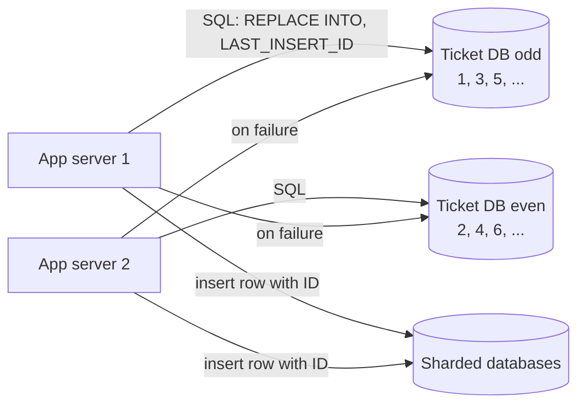

**Reading the diagram.** Application servers fetch an ID from either ticket database with one synchronous SQL round trip, then use it as the primary key when inserting into the sharded databases. The two ticket databases never communicate: odd and even numbers cannot collide, which removes coordination between them. If one fails, clients switch to the other (the cross arrows), at the cost of IDs that are no longer issued in global order. Failure points: every ID costs a network round trip, and the ticket tier is a dependency on the write path; its capacity is that of a single-row update on MySQL. A common scaling trick is to fetch **blocks** of IDs (for example 1,000 at a time) and hand them out locally, which divides ticket-server load by the block size but makes IDs only roughly ordered.

**Table 17.9 — Unique ID schemes compared.**

| | UUIDv4 | UUIDv7 | Snowflake-style | ULID | Sequence / ticket server |
|---|---|---|---|---|---|
| Size | 128 bits | 128 bits | 64 bits | 128 bits (26 chars) | 64 bits |
| Time-ordered | No | Yes (ms) | Yes (ms, within clock skew) | Yes (ms) | Yes per server; roughly with blocks |
| Coordination | None | None | Assign machine IDs once | None | Round trip per ID or block |
| Uniqueness | Probabilistic (122 bits) | Probabilistic per ms (74 bits) | Guaranteed if machine IDs unique and clock monotonic | Probabilistic per ms (80 bits) | Guaranteed |
| Leaks | Nothing | Creation time | Creation time, machine, volume | Creation time | Volume (sequential) |
| Index locality | Poor (random inserts) | Good | Good | Good | Best |
| Main failure mode | Bad randomness | Bad randomness | Duplicate machine ID; clock steps | Bad randomness | Ticket tier outage |
| Choose when | Unguessable public IDs; low insert rates | Default 128-bit key | Compact keys at very high rates | String keys that must sort | Small systems; strict ordering needed |

::: mistake
**"Time-ordered IDs give a total order of events."** Snowflake and UUIDv7 IDs from different machines are ordered only to within the clock skew between those machines, typically milliseconds (§24.9). Two events a millisecond apart on different servers may receive IDs in the opposite order. If you need causal order, use logical clocks or a single sequencer (§24.10).
:::

::: mistake
**"Sequential IDs in URLs are harmless."** They reveal your growth rate and invite enumeration: anyone can try `/orders/1001`, `/orders/1002`. Authorization must stop enumeration either way (§10.7.1), but a random or opaque public ID mapped to the internal sequential key removes the information leak.
:::

## 17.11 Tries

### 17.11.1 Prefix trees

::: definition
**Definition — Trie (prefix tree).** A tree in which each edge is labeled with a character and each node represents the string spelled by the path from the root; nodes that end a stored key are marked. Looking up a key or a prefix of length $L$ takes $O(L)$ steps, independent of how many keys are stored [Fredkin 1960].
:::

A trie answers the question a hash table cannot: "which stored keys *start with* this prefix?" Walk down $L$ edges to the prefix node; its subtree holds every completion. **Radix trees** (Patricia tries) compress chains of single-child nodes into one edge labeled with a string, which cuts node count and pointer overhead dramatically. Tries are used for autocomplete, longest-prefix matching in IP routing tables, and as compact sorted dictionaries; Redis uses a radix tree internally for streams [Redis Docs: Streams]. Chapter 16 (§16.9) builds a production autocomplete on tries and finite-state transducers, including precomputed top-*k* completions at each node; this section gives only the structure.

**Figure 17.16 — A trie holding sync, syntax, system and scale.**

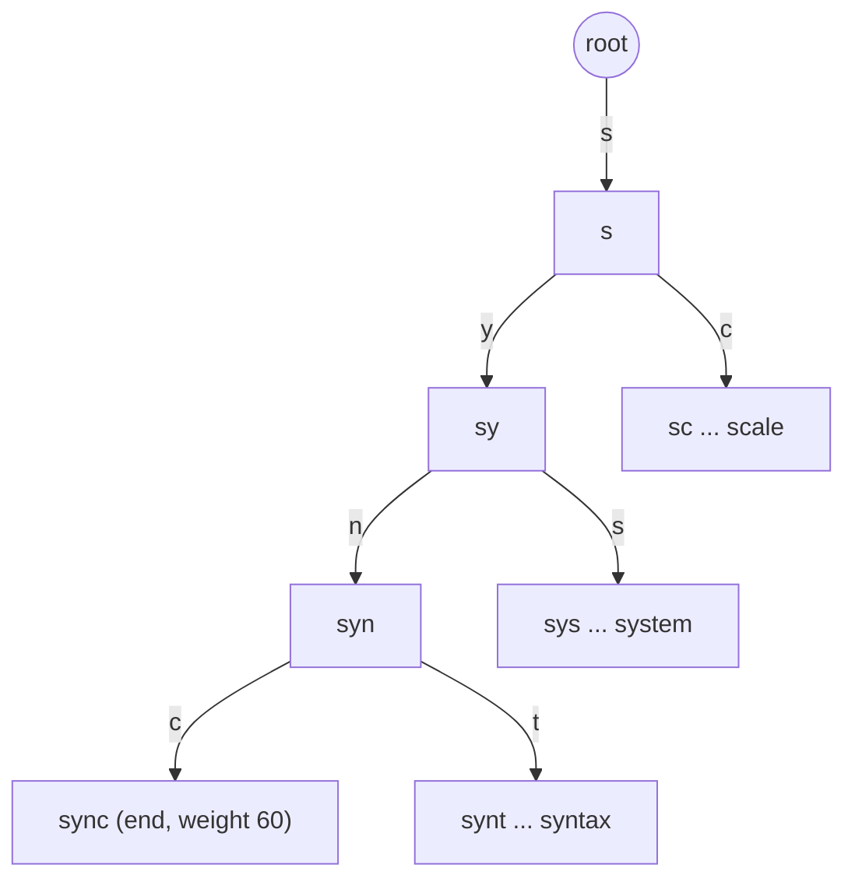

**Reading the diagram.** Each edge adds one character; the ellipses abbreviate chains of single-child nodes that a radix tree would store as one edge. A query for the prefix `syn` follows three edges and then enumerates the subtree: `sync` and `syntax`. All operations are in-memory pointer walks. The main failure point is memory: a naive trie with one node per character can use tens of bytes per character, so large dictionaries use radix trees, arrays of children, or succinct encodings. Tries scale by sharding on the first characters of the key, with care for skewed prefixes (many queries start with "s" and few with "x").

```python
import heapq

class TrieNode:
    __slots__ = ("children", "weight")
    def __init__(self):
        self.children, self.weight = {}, 0              # weight > 0 marks the end of a stored word

class Trie:
    def __init__(self):
        self.root, self.nodes = TrieNode(), 1

    def insert(self, word: str, weight: int) -> None:
        node = self.root
        for ch in word:
            if ch not in node.children:
                node.children[ch] = TrieNode()
                self.nodes += 1
            node = node.children[ch]
        node.weight += weight

    def top_k(self, prefix: str, k: int):
        """Walk to the prefix node (O(len(prefix))), then collect its subtree's k heaviest words."""
        node = self.root
        for ch in prefix:
            node = node.children.get(ch)
            if node is None:
                return []
        found, stack = [], [(node, prefix)]
        while stack:
            cur, word = stack.pop()
            if cur.weight:
                found.append((cur.weight, word))
            stack.extend((child, word + ch) for ch, child in cur.children.items())
        return heapq.nlargest(k, found)

t = Trie()
for word, w in [("system", 90), ("systems", 40), ("syscall", 25), ("sync", 60),
                ("synchronous", 30), ("syntax", 20), ("scale", 80), ("schema", 50)]:
    t.insert(word, w)
print(t.top_k("sy", 3))
print(t.top_k("syn", 5))
print("nodes:", t.nodes, "for", sum(len(w) for w in ["system", "systems", "syscall", "sync",
      "synchronous", "syntax", "scale", "schema"]), "characters")
```

Output:

```text
[(90, 'system'), (60, 'sync'), (40, 'systems')]
[(60, 'sync'), (30, 'synchronous'), (20, 'syntax')]
nodes: 32 for 52 characters
```

What to notice: shared prefixes are stored once (32 nodes for 52 characters), and the cost of `top_k` is the prefix walk plus the size of the subtree. For a short prefix such as "s" in a large dictionary the subtree is huge, which is why production autocomplete stores precomputed top-*k* lists at each node (§16.9).

## 17.12 Reservoir sampling and streaming algorithms

### 17.12.1 Reservoir sampling

::: definition
**Definition — Reservoir sampling.** An algorithm that maintains a uniform random sample of $k$ items from a stream whose length $n$ is not known in advance, using $O(k)$ memory and a single pass: after any number of items, every item seen so far is in the sample with probability $k/n$ [Vitter 1985].
:::

#### First-principles explanation and mechanism

You want 1,000 representative requests from a day of traffic for debugging, but you do not know how many requests the day will bring, and you cannot store them all. Sampling each request with a fixed probability gives the wrong sample size if traffic differs from your guess. Reservoir sampling (**Algorithm R**, which Knuth attributes to Alan Waterman) adjusts as it goes:

1. Put the first $k$ items in the reservoir.
2. For the $n$-th item ($n > k$), draw a random integer $j$ in $[0, n)$. If $j < k$, replace reservoir slot $j$ with the new item; otherwise discard it.

::: formula
**Reservoir sampling inclusion probability**

$$P(\text{item } i \text{ in sample after } n \text{ items}) = \frac{k}{i} \times \prod_{j=i+1}^{n} \left(1 - \frac{1}{j}\right) = \frac{k}{i} \times \frac{i}{n} = \frac{k}{n}, \qquad \mathbb{E}[\text{replacements}] \approx k \ln \frac{n}{k}$$

| Symbol | Meaning | Units |
|---|---|---|
| $k$ | Reservoir size | items |
| $n$ | Items seen so far | items |
| $i$ | Arrival position of a particular item ($i > k$) | position |
| $1 - 1/j$ | Probability that item $j$ does not evict this item: it is chosen with probability $k/j$ and then evicts one of $k$ slots | probability |
:::

::: example
**Worked example — sampling traces.** A service handles 600,000 requests per minute and keeps a reservoir of $k = 1{,}000$ per minute. Each request is kept with probability $1{,}000/600{,}000 = 1/600$. The expected number of reservoir writes per minute is about $1{,}000 + 1{,}000 \times \ln(600{,}000/1{,}000) = 1{,}000 + 1{,}000 \times 6.40 = 7{,}400$, not 600,000. *Interpretation.* Late items are rarely written, so the cost is dominated by drawing a random number per item. *Engineering implication.* Vitter's Algorithm Z [Vitter 1985] and Li's Algorithm L [Li 1994] compute how many items to *skip* before the next replacement, drawing about $O(k \log(n/k))$ random numbers instead of $n$; use them when random-number generation dominates.
:::

#### Code example and measured validation

```python
import math
import random
from collections import Counter

def reservoir_sample(stream, k, rng=random):
    """Algorithm R: a uniform sample of k items from a stream of unknown length, in O(k) memory."""
    reservoir = []
    for n, item in enumerate(stream, start=1):
        if n <= k:
            reservoir.append(item)                     # fill the reservoir first
        else:
            j = rng.randrange(n)                       # uniform in [0, n)
            if j < k:                                  # happens with probability k / n
                reservoir[j] = item                    # evict a uniformly chosen resident
    return reservoir

def reservoir_sample_skip(stream, k, rng=random):
    """Algorithm L (Li 1994): same distribution, but jumps over items, so it draws
    O(k log(n/k)) random numbers instead of n."""
    it = iter(stream)
    reservoir = [x for _, x in zip(range(k), it)]
    w = math.exp(math.log(rng.random()) / k)
    while True:
        skip = math.floor(math.log(rng.random()) / math.log(1 - w))
        for _ in range(skip):                          # discard without drawing randomness
            if next(it, None) is None:
                return reservoir
        item = next(it, None)
        if item is None:
            return reservoir
        reservoir[rng.randrange(k)] = item
        w *= math.exp(math.log(rng.random()) / k)

# Validate uniformity: every one of n = 1,000 items should be chosen with probability k/n = 0.01
n, k, trials = 1_000, 10, 50_000
rng = random.Random(5)
for name, fn in (("Algorithm R", reservoir_sample), ("Algorithm L", reservoir_sample_skip)):
    counts = Counter()
    for _ in range(trials):
        counts.update(fn(range(n), k, rng))
    freqs = [counts[i] / trials for i in range(n)]
    expected = k * trials / n                          # 500 selections per item
    chi2 = sum((counts[i] - expected) ** 2 / expected for i in range(n))
    print(f"{name}: inclusion prob. min {min(freqs):.4f}  max {max(freqs):.4f}  "
          f"(target {k / n:.4f}); first decile {sum(freqs[:100]) / 100:.4f}, "
          f"last decile {sum(freqs[-100:]) / 100:.4f}; chi-square {chi2:.0f} on {n - 1} dof")
```

Output:

```text
Algorithm R: inclusion prob. min 0.0087  max 0.0115  (target 0.0100); first decile 0.0100, last decile 0.0100; chi-square 957 on 999 dof
Algorithm L: inclusion prob. min 0.0087  max 0.0113  (target 0.0100); first decile 0.0100, last decile 0.0100; chi-square 969 on 999 dof
```

What to notice: early and late items are equally likely to be chosen (first and last deciles both 0.0100), and the chi-square statistics (957 and 969 on 999 degrees of freedom) are what a uniform sample produces. The spread from 0.0087 to 0.0115 is ordinary sampling noise over 50,000 trials. The skip-based Algorithm L produces the same distribution with far fewer random draws. (The `None` sentinel in this sketch assumes the stream contains no `None` items.)

Two extensions are common. **Weighted reservoir sampling** keeps items with probability proportional to a weight, for example to oversample slow or failed requests [Efraimidis & Spirakis 2006]. **Distributed reservoir sampling** tags each item with a random key and keeps the $k$ items with the smallest keys; because "smallest $k$ keys" merges across partitions, each partition samples independently and a coordinator merges the results.

### 17.12.2 The streaming toolbox

Every structure in this chapter is a **streaming algorithm**: one pass, memory far smaller than the data, and an answer whose error you can state in advance. Most are also **mergeable**, which is what makes them fit distributed systems: compute per partition, combine centrally.

**Table 17.10 — Streaming and probabilistic structures at a glance.**

| Question | Structure | Memory | Error | Mergeable | Section |
|---|---|---|---|---|---|
| Have I seen $x$? | Bloom / cuckoo filter | ~10 bits per item at 1% | False positives only | Bloom: OR | §17.4 |
| How many distinct items? | HyperLogLog | 12 KB for 0.81% | ±$1.04/\sqrt{m}$ relative | Register max | §17.5 |
| How often did $x$ occur? | Count-Min sketch | $\lceil e/\varepsilon\rceil \times \lceil \ln(1/\delta)\rceil$ counters | $+\varepsilon N$, probability $1-\delta$ | Add arrays | §17.6 |
| Which items are most frequent? | Space-Saving; CMS + heap | $k$ counters | $\le N/k$ | Approximately | §17.6.2 |
| What is the p99? | HDR histogram, t-digest, KLL sketch | KBs | Bounded relative or rank error | Yes | §4.8, Chapter 40 |
| Give me a fair sample | Reservoir sampling | $k$ items | Exact distribution | Smallest-$k$ random keys | §17.12.1 |
| Do two replicas differ? | Merkle tree | Hash per range | Exact (with cryptographic hash) | — | §17.8 |

## 17.13 Summary and revision notes

::: summary
- **Hashing.** Good non-cryptographic hashes (MurmurHash3, xxHash) are deterministic, uniform and avalanche well. Test uniformity with chi-square ($\approx B - 1$ for a good hash). Use keyed SipHash for tables filled from untrusted input (hash flooding), cryptographic hashes for integrity. Consistent hashing is in §14.8.
- **Bloom filters.** $p \approx (1 - e^{-kn/m})^k$; optimal $k = (m/n)\ln 2$, where half the bits are set; $m/n = -\ln p/(\ln 2)^2$: 9.6 bits at 1%, +4.8 bits per 10× lower $p$. No false negatives; no deletes; OR merges. Overfilling 3× pushed a 1% filter to 44%.
- **Deletion.** Counting Bloom filters (4-bit counters, 4× memory) or cuckoo filters (fingerprints in two buckets, ~95% load, $\varepsilon \le 2b/2^f$, smaller than Bloom below about 3% with semi-sorting).
- **HyperLogLog.** Leading zeros of hashes estimate cardinality; $m = 2^p$ registers, SE $= 1.04/\sqrt{m}$; Redis: 12 KB, 0.81%. Merge by register-wise max; unions are accurate, intersections are not. HLL++ adds 64-bit hashing, bias correction and sparse storage.
- **Count-Min.** $w = \lceil e/\varepsilon \rceil$, $d = \lceil \ln(1/\delta) \rceil$; never underestimates; error $\le \varepsilon N$ with probability $1-\delta$, relative to the whole stream. Heavy hitters: CMS + heap, or Space-Saving with error $\le N/k$.
- **Skip lists.** Random levels with probability $p$; expected $O(\log n)$; $1/(1-p)$ pointers per node. Redis sorted sets ($p = 1/4$, spans for rank) and LSM memtables.
- **Merkle trees.** Root hash summarizes data; inclusion proofs of $\lceil \log_2 n \rceil$ hashes; anti-entropy cost grows with differences × depth (Dynamo, Cassandra, Git, Certificate Transparency).
- **Geospatial.** Map 2-D to 1-D cells. Geohash: interleaved bits, base-32, prefix = containment, boundary quirks; choose precision from radius and latitude or cover the area. Quadtrees adapt to density. S2: cube + Hilbert curve + 64-bit IDs, area $/4$ per level. H3: hexagons, aperture 7, uniform neighbors.
- **IDs.** UUIDv4 (random, poor index locality), UUIDv7 (time-ordered, RFC 9562), Snowflake (41/10/12 bits: 4.1 M IDs/s per machine, 69.7 years), ULID, ticket servers. Time-ordered IDs are ordered only within clock skew.
- **Streaming.** Tries answer prefix queries in $O(L)$. Reservoir sampling keeps a uniform $k$-sample with probability $k/n$ in one pass. Prefer mergeable sketches in distributed systems: compute per partition, combine centrally.
:::

## 17.14 Knowledge checkpoint

1. Why does the sum-of-bytes hash perform so badly on keys such as `user:12345`?
2. What is hash flooding, and name two defenses.
3. A Bloom filter has $m = 8 \times 10^6$ bits, $n = 10^6$ items and $k = 6$. What is its false-positive rate?
4. How many bits per element and how many hash functions do you need for $p = 0.1\%$?
5. Why can you not delete from a standard Bloom filter?
6. In a cuckoo filter, why is the alternate bucket computed as $i_1 \oplus h(\mathit{fp})$ rather than from the original item?
7. What are the memory and standard error of a HyperLogLog with $p = 12$?
8. Why can HyperLogLog sketches be merged without double counting?
9. Size a Count-Min sketch for $\varepsilon = 0.0001$ and $\delta = 0.001$.
10. With Space-Saving and $k = 500$ counters over $N = 10^7$ events, what is the maximum overestimate?
11. What are the expected levels and pointers per node of a skip list with $p = 1/4$ and $n = 4^{10}$?
12. How many hashes are in a Merkle inclusion proof for $10^9$ records?
13. How large is a 6-character geohash cell at latitude 60°?
14. Why do H3 hexagons suit neighborhood smoothing better than square cells?
15. How long do 41-bit millisecond timestamps last, and how many IDs per second can one Snowflake machine issue?
16. Why do random UUIDv4 primary keys slow down inserts into a large B-tree?
17. What is the probability that the 10th item of a stream is in a reservoir of size 5 after 1,000 items?

<details>
<summary>Answers</summary>

1. The sum takes fewer than 150 distinct values for these keys, so they crowd into a few buckets; there is no avalanche.
2. An attacker sends keys that all collide in an unkeyed hash table, making inserts $O(n)$ each and total work $O(n^2)$. Defenses: a keyed hash with a secret per-process key (SipHash), tree-structured buckets (Java 8), and limits on parameter counts.
3. $kn/m = 0.75$; $1 - e^{-0.75} = 0.5276$; $0.5276^6 = 0.0216$, about 2.2%.
4. $6.908/0.4805 = 14.4$ bits per element; $k = 10$.
5. A bit may have been set by several items; clearing it for one would cause false negatives for others.
6. Because only the fingerprint is stored. XOR with the fingerprint's hash is its own inverse, so either bucket can compute the other from the fingerprint alone during relocation.
7. $m = 4{,}096$ registers × 6 bits = 3,072 bytes; SE $= 1.04/64 = 1.63\%$.
8. Registers keep maxima, and the maximum is idempotent and order-independent: a register-wise max equals the sketch of the combined stream.
9. $w = \lceil 2.718/0.0001 \rceil = 27{,}183$; $d = \lceil \ln 1000 \rceil = 7$; 190,281 counters.
10. $N/k = 10^7/500 = 20{,}000$.
11. $\log_4 4^{10} = 10$ levels; $1/(1 - 0.25) = 1.33$ pointers per node.
12. $\lceil \log_2 10^9 \rceil = 30$ hashes (960 bytes with SHA-256).
13. Width $1.223 \times \cos 60^\circ = 0.61$ km; height 0.61 km, about 610 m × 610 m.
14. All six neighbors share an edge and are equidistant from the center, so a $k$-ring is a uniform neighborhood; squares have edge and corner neighbors at different distances.
15. $2^{41}$ ms = 69.7 years; $4{,}096 \times 1{,}000 = 4{,}096{,}000$ IDs per second.
16. Each insert targets a random leaf page; once the index exceeds memory, most inserts need a disk read and cause page splits across the tree. Time-ordered keys append near the rightmost pages, which stay cached.
17. $k/n = 5/1{,}000 = 0.5\%$, the same as every other item.

</details>

## 17.15 Interview questions

### Basic

**Q1. How would you check username availability for 1 billion users as the user types?**
**Answer.** Put a Bloom filter of all usernames in memory on each API node: at 1% false positives that is 9.6 bits per name, about 1.2 GB, with $k = 7$. A "definitely absent" answer is shown immediately; a "maybe taken" answer is confirmed against the database (a unique index on the username column), which also handles races at sign-up time. Rebuild or grow the filter as the user base grows, and add new names to it on sign-up.

**Q2. How would you count daily unique visitors per page for a site with 10 million pages?**
**Answer.** One HyperLogLog per page per day (Redis `PFADD`), 12 KB dense at 0.81% error, much less for small pages thanks to the sparse encoding. Weekly and monthly uniques come from `PFMERGE`, not from summing daily counts. Exact counts are needed only for billing-grade metrics.

**Q3. Why might you choose UUIDv7 over UUIDv4 for primary keys?**
**Answer.** UUIDv7 is time-ordered, so inserts go to the right edge of the B-tree index, keeping hot pages in memory and reducing page splits; it also allows rough time-range queries and pagination by ID. UUIDv4 is better when IDs must reveal nothing, including creation time.

### Intermediate

**Q4. Design a "trending hashtags in the last 10 minutes" feature for 500,000 tweets per second.**
**Answer.** Partition the stream (by hashtag, so each tag's counts land on one worker). Each worker keeps per-minute Count-Min sketches and a Space-Saving or CMS-plus-heap candidate list. Every few seconds workers send their top candidates to an aggregator, which sums the last ten one-minute windows and ranks by a velocity score (current versus baseline rate) rather than raw counts, so permanently popular tags do not dominate. With $\varepsilon = 10^{-5}$ the per-window error is $10^{-5} \times 3 \times 10^7 = 300$ mentions, small next to trending tags with tens of thousands. Discuss spam filtering and late events.

**Q5. Your geohash-based "nearby restaurants" search misses results near cell edges. Why, and how do you fix it?**
**Answer.** Points close to the query point but across a cell boundary have different prefixes, and a 3 × 3 block covers less than the radius when cells are smaller than the radius. Fix: choose precision from the radius and latitude, compute the full set of cells covering the circle's bounding box, scan all of them, then filter by exact distance. Or use S2's region coverer.

**Q6. Two replicas of a 2 TB key-value store may have diverged after a network partition. How do you find and fix the differences efficiently?**
**Answer.** Build a Merkle tree per token range on each replica, compare roots, and descend into differing subtrees; at the leaves, stream only the differing ranges and resolve conflicts with the system's rule (timestamps, vector clocks, §27.14). Cost scales with the number of differences times tree depth. Leaf granularity trades tree size against overstreaming. Throttle tree building, which requires scanning data.

### Advanced

**Q7. An LSM-based store's read latency for missing keys doubled after a data-size increase. What could be wrong with the Bloom filters?**
**Answer.** Possibilities: filters sized by an outdated $n$ or a configured bits-per-key too low for the new number of SSTables (expected wasted reads = files × $p$); filter blocks evicted from the block cache because total filter memory grew (≈ 1.2 bytes per key at 1%), so filters themselves now cost disk reads; or many more levels/files after compaction changes. Check filter-useful and filter-miss metrics and block-cache hit ratio, pin filter and index blocks, lower $p$ for the deepest level, or use a partitioned filter.

**Q8. Design ID generation for a multi-region payments platform producing 2 million IDs per second.**
**Answer.** A Snowflake-style 64-bit layout with an explicit region field: for example 41 bits of milliseconds from a 2026 epoch (69.7 years), 3 bits of region, 7 bits of worker within the region, 12 bits of sequence ($2^{10}$ generators × 4.1 M/s gives ample headroom). Assign worker IDs through a lease in a coordination service so that two processes never share one, and refuse to issue IDs while a lease is lost. Handle clock steps by waiting out small ones and failing over large ones. Expose IDs externally only through opaque tokens if volume should stay private. Keep a unique constraint on storage as a final defense.

**Q9. A product manager wants "users who visited both page A and page B this month" from your HyperLogLog sketches. What do you say?**
**Answer.** HLL estimates unions well, but an intersection via inclusion–exclusion has an absolute error on the order of the errors of the large sets: with 10 M users each and a 100,000-user overlap at 0.81%, the noise exceeds the answer. Options: MinHash-based sketches (estimate the Jaccard similarity, then multiply by the union), exact computation in a batch job over the raw logs, or theta sketches that support set operations with stated error.

## 17.16 Practical exercises

1. **Hash uniformity.** Replace `murmur3_32` in §17.3.3 with Python's FNV-1a and with CRC32 (`zlib.crc32`). Compare chi-square values on `user:N` keys and on 100,000 random UUID strings.
2. **Bloom filter health.** Extend the §17.4.4 program to print the fraction of 1 bits as you insert from 0 to 3× the design capacity, and plot it against the measured false-positive rate.
3. **Scalable Bloom filter.** Implement a filter that adds a new, larger Bloom filter with a tighter $p$ each time the current one reaches capacity, so the overall false-positive rate stays below a target.
4. **HyperLogLog bias.** Run the §17.5 program for $n$ from 100 to 200,000 with $p = 12$ and plot the relative error. Find where the raw estimator is biased and where linear counting takes over.
5. **Conservative update.** Modify the Count-Min sketch to use conservative update and compare mean and maximum error on the Zipf stream.
6. **Geohash versus H3.** Repeat the proximity search with H3 (`pip install h3`) at resolution 8 using `grid_disk`, and compare candidate counts with the geohash covering approach.

## 17.17 Design challenges

1. **Web crawler frontier.** Design deduplication of URLs for a crawler that discovers 5 billion URLs per day and keeps 100 billion known URLs. Size the filter (or filters), decide how to handle false positives (missed pages) versus false negatives (impossible by design), and explain how the filter is partitioned across crawler nodes.
2. **Real-time analytics.** A product analytics service ingests 2 million events per second and must answer, within 5 seconds of an event: unique users per feature per hour, the top 50 features by usage, and p99 latency per endpoint. Choose a sketch for each, size it, show how per-partition sketches are merged, and state the error each answer carries.
3. **Nearby search at global scale.** Design the location index for a delivery app with 3 million active couriers in 800 cities, updates every 5 seconds, and queries for the 20 nearest couriers within 3 km. Compare geohash, S2 and H3 for this use, choose a cell size, estimate write load and memory per shard, and describe how the system behaves when a stadium event concentrates 20,000 couriers in a few cells.

## 17.18 References

1. Apache Cassandra Documentation. Bloom filters; Repair; Partitioners. https://cassandra.apache.org/doc/latest/
2. Appleby, A. *SMHasher* (MurmurHash3 reference implementation and test suite). https://github.com/aappleby/smhasher
3. Aumasson, J.-P., Bernstein, D. J. "SipHash: A Fast Short-Input PRF." *INDOCRYPT 2012*, LNCS 7668. Springer, 2012.
4. Bloom, B. H. "Space/Time Trade-offs in Hash Coding with Allowable Errors." *Communications of the ACM* 13(7):422–426, 1970.
5. Bose, P., Guo, H., Kranakis, E., Maheshwari, A., Morin, P., Morrison, J., Smid, M., Tang, Y. "On the False-Positive Rate of Bloom Filters." *Information Processing Letters* 108(4):210–213, 2008.
6. Brodsky, I. "H3: Uber's Hexagonal Hierarchical Spatial Index." Uber Engineering Blog, 2018. https://www.uber.com/blog/h3/
7. Broder, A., Mitzenmacher, M. "Network Applications of Bloom Filters: A Survey." *Internet Mathematics* 1(4):485–509, 2004.
8. Chacon, S., Straub, B. *Pro Git*, 2nd ed. Apress, 2014. https://git-scm.com/book
9. Chang, F., Dean, J., Ghemawat, S., Hsieh, W. C., Wallach, D. A., Burrows, M., Chandra, T., Fikes, A., Gruber, R. E. "Bigtable: A Distributed Storage System for Structured Data." *OSDI*, 2006.
10. Collet, Y. *xxHash*. https://github.com/Cyan4973/xxHash
11. Cormode, G., Muthukrishnan, S. "An Improved Data Stream Summary: The Count-Min Sketch and Its Applications." *Journal of Algorithms* 55(1):58–75, 2005.
12. Crosby, S. A., Wallach, D. S. "Denial of Service via Algorithmic Complexity Attacks." *USENIX Security Symposium*, 2003.
13. DeCandia, G., Hastorun, D., Jampani, M., Kakulapati, G., Lakshman, A., Pilchin, A., Sivasubramanian, S., Vosshall, P., Vogels, W. "Dynamo: Amazon's Highly Available Key-Value Store." *SOSP*, 2007.
14. Efraimidis, P. S., Spirakis, P. G. "Weighted Random Sampling with a Reservoir." *Information Processing Letters* 97(5):181–185, 2006.
15. Fan, B., Andersen, D. G., Kaminsky, M., Mitzenmacher, M. D. "Cuckoo Filter: Practically Better Than Bloom." *ACM CoNEXT*, 2014.
16. Fan, L., Cao, P., Almeida, J., Broder, A. Z. "Summary Cache: A Scalable Wide-Area Web Cache Sharing Protocol." *IEEE/ACM Transactions on Networking* 8(3):281–293, 2000.
17. Finkel, R. A., Bentley, J. L. "Quad Trees: A Data Structure for Retrieval on Composite Keys." *Acta Informatica* 4(1):1–9, 1974.
18. Flajolet, P., Fusy, É., Gandouet, O., Meunier, F. "HyperLogLog: The Analysis of a Near-Optimal Cardinality Estimation Algorithm." *Analysis of Algorithms (AofA)*, DMTCS Proceedings, 2007.
19. Flickr Engineering. "Ticket Servers: Distributed Unique Primary Keys on the Cheap." code.flickr.net, 2010.
20. Fredkin, E. "Trie Memory." *Communications of the ACM* 3(9):490–499, 1960.
21. Google Cloud. *BigQuery documentation: HyperLogLog++ functions*. https://cloud.google.com/bigquery/docs/reference/standard-sql/hll_functions
22. Graf, T. M., Lemire, D. "Xor Filters: Faster and Smaller Than Bloom and Cuckoo Filters." *ACM Journal of Experimental Algorithmics* 25, 2020.
23. H3 Project. *H3 documentation*. https://h3geo.org/docs/
24. Heule, S., Nunkesser, M., Hall, A. "HyperLogLog in Practice: Algorithmic Engineering of a State of the Art Cardinality Estimation Algorithm." *EDBT*, 2013.
25. Instagram Engineering. "Sharding & IDs at Instagram." Instagram Engineering Blog, 2012.
26. Kirsch, A., Mitzenmacher, M. "Less Hashing, Same Performance: Building a Better Bloom Filter." *European Symposium on Algorithms (ESA)*, 2006.
27. Klink, A., Wälde, J. "Efficient Denial of Service Attacks on Web Application Platforms." *28th Chaos Communication Congress (28C3)*, 2011.
28. Li, K.-H. "Reservoir-Sampling Algorithms of Time Complexity O(n(1 + log(N/n)))." *ACM Transactions on Mathematical Software* 20(4):481–493, 1994.
29. Maggs, B. M., Sitaraman, R. K. "Algorithmic Nuggets in Content Delivery." *ACM SIGCOMM Computer Communication Review* 45(3), 2015.
30. Merkle, R. C. "A Digital Signature Based on a Conventional Encryption Function." *Advances in Cryptology — CRYPTO '87*, LNCS 293. Springer, 1988.
31. Metwally, A., Agrawal, D., El Abbadi, A. "Efficient Computation of Frequent and Top-k Elements in Data Streams." *International Conference on Database Theory (ICDT)*, 2005.
32. Niemeyer, G. Geohash (public-domain geocoding system, geohash.org), 2008.
33. OpenJDK. *JEP 180: Handle Frequent HashMap Collisions with Balanced Trees*. https://openjdk.org/jeps/180
34. Python Software Foundation. *PEP 456 — Secure and Interchangeable Hash Algorithm*. https://peps.python.org/pep-0456/
35. Pugh, W. "Skip Lists: A Probabilistic Alternative to Balanced Trees." *Communications of the ACM* 33(6):668–676, 1990.
36. Redis Documentation. HyperLogLog; Sorted sets; Geospatial; Streams; Count-min sketch; Top-K. https://redis.io/docs/
37. Laurie, B., Langley, A., Kasper, E. *RFC 6962: Certificate Transparency*. IETF, 2013. https://www.rfc-editor.org/rfc/rfc6962
38. Davis, K., Peabody, B., Leach, P. *RFC 9562: Universally Unique IDentifiers (UUIDs)*. IETF, 2024. https://www.rfc-editor.org/rfc/rfc9562
39. RocksDB Wiki. *MemTable*. https://github.com/facebook/rocksdb/wiki/MemTable
40. S2 Geometry. *S2 Geometry Library documentation*. https://s2geometry.io/
41. Sanfilippo, S. "Redis New Data Structure: the HyperLogLog." antirez.com, 2014.
42. Twitter. *snowflake* (archived repository, tag `snowflake-2010`: README and `IdWorker.scala`). https://github.com/twitter-archive/snowflake
43. Twitter. *Algebird: Abstract Algebra for Scala*. https://github.com/twitter/algebird
44. ULID. *Universally Unique Lexicographically Sortable Identifier specification*. https://github.com/ulid/spec
45. Vitter, J. S. "Random Sampling with a Reservoir." *ACM Transactions on Mathematical Software* 11(1):37–57, 1985.

## 17.19 Open verification items

- Twitter's 2010 "Announcing Snowflake" blog post (author, exact date, URL) could not be fetched; layout, epoch and requirements were verified against the archived GitHub repository (tag `snowflake-2010`) instead.
- Flickr ticket-servers post: confirm author (believed Kay Kremerskothen) and date (February 2010).
- Akamai one-hit-wonder share and the second-request caching rule: confirm wording in Maggs & Sitaraman (2015).
- Counting Bloom filter overflow bound (4-bit counters suffice): confirm statement in Fan et al. (2000).
- Redis sorted-set constants ($p = 1/4$, 32 levels) and listpack thresholds: confirm against current `t_zset.c`/`redis.conf` (as of 2025). RedisBloom bundling in Redis 8: confirm.
- RocksDB ribbon filters and default skip-list memtable: confirm current RocksDB wiki.
- Niemeyer (2008) geohash: no formal publication; confirm citation form.
- xxHash versus MurmurHash3 speed claims: author benchmarks only.
