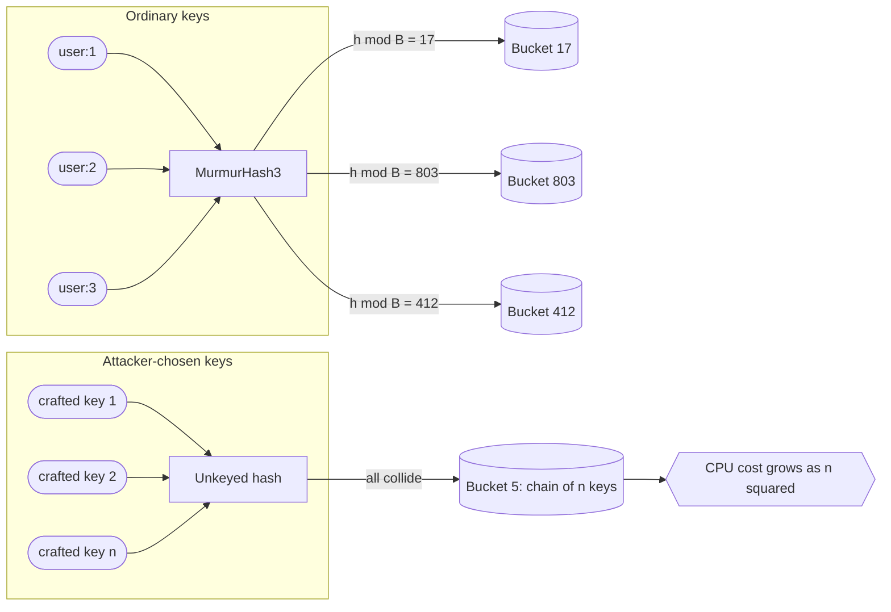
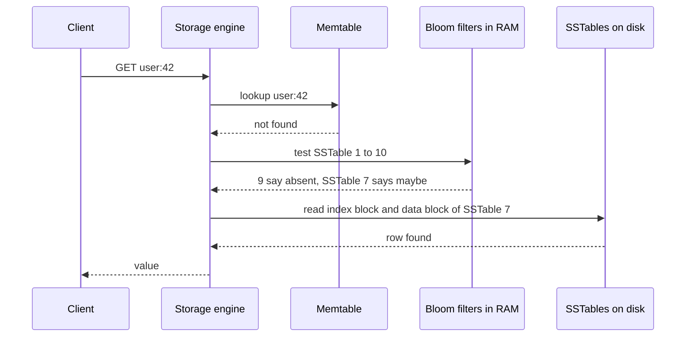
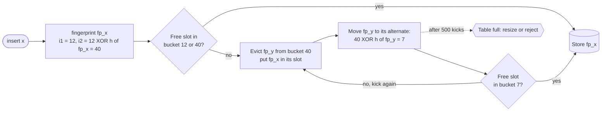

# Chapter 17 — Data Structures and Algorithms for Scale

> **Level:** 2–3 · **Track:** A (Traditional) · **Estimated reading time:** 6 h

A hash table, a sorted array and a B-tree will carry you a long way. Then the numbers grow. You need to know whether one of 3 billion usernames is taken without reading a disk. You need to count the distinct visitors to a site that gets 50 billion page views a day. You need the 100 most-shared links of the last hour in a stream of a million events per second. You need every driver within a kilometer of a rider, out of a million moving cars. And you need IDs for all of these things, generated on a thousand machines at once, without the machines talking to each other.

Exact answers to these questions cost memory, disk reads or coordination in proportion to the data, and at scale that cost is too high. The structures in this chapter accept a small, *bounded* and *quantifiable* error, or a small amount of randomness, in exchange for memory measured in kilobytes, constant-time operations and no coordination. A Bloom filter answers "have I seen this?" in about 10 bits per item with a 1% false-positive rate. A HyperLogLog counts a billion distinct items in 12 KB with 0.81% standard error. A Count-Min sketch tracks frequencies in a fixed table whatever the number of distinct keys. A geohash turns a two-dimensional search into a range scan over a one-dimensional index. A Snowflake ID packs a timestamp, a machine number and a counter into 64 bits so that a thousand machines can mint 4 billion IDs per second without talking to one another.

For every structure you will learn the idea first, then the mechanism, then the formula that sizes it, then a worked example, then runnable Python that checks the formula against a measurement. The chapter ends with tries and reservoir sampling, two smaller tools that turn up in search and in observability.

## 17.1 Learning objectives

After this chapter you should be able to:

- State the properties a non-cryptographic hash function must have, measure uniformity with a chi-square test, and explain how hash flooding works and how keyed hashes such as SipHash stop it.
- Size a Bloom filter for a target false-positive rate (bits per element and number of hash functions), predict its false-positive rate, and verify the prediction by measurement.
- Choose between Bloom, counting Bloom and cuckoo filters when deletions are needed.
- Explain how HyperLogLog estimates cardinality from leading zeros, compute its memory and standard error, and merge sketches across servers.
- Size a Count-Min sketch from an error target $\varepsilon$ and confidence $\delta$, and build a heavy-hitters (top-*k*) pipeline with a heap or the Space-Saving algorithm.
- Explain why skip lists give expected $O(\log n)$ search and why Redis uses them for sorted sets.
- Build a Merkle tree, produce and verify an inclusion proof, and explain how replicas use Merkle trees for anti-entropy.
- Encode a geohash, choose a precision for a search radius, and compare geohash, quadtrees, S2 and H3 for proximity search.
- Compare UUIDv4, UUIDv7, Snowflake, ULID and ticket servers, and compute the capacity and lifetime of a Snowflake bit layout.
- Use a trie for prefix lookup and reservoir sampling for uniform samples from a stream of unknown length.

## 17.2 Prerequisites

- Powers of two and logarithms — §4.3, §4.4 (every sizing formula here is a logarithm or an exponent).
- Probability essentials: complement, independence, expected value — §4.6 (false-positive rates and error bounds are probabilities).
- Cryptographic hash functions and the birthday bound — §10.4.1 (this chapter covers the fast, non-cryptographic kind and reuses the birthday bound for IDs).
- B-trees and indexes — §11.7, §11.8 (geospatial indexes reduce two dimensions to one so that a B-tree or sorted set can serve them).
- LSM trees, memtables and SSTables — §13.8 (the most common home of Bloom filters and skip lists).
- Partitioning by hash — §14.6 (hash quality decides partition balance).

## 17.3 Hash functions at scale

### 17.3.1 What a hash function must do

::: definition
**Definition — Hash function.** A deterministic function $h$ that maps an input of any length to a fixed-size integer (for example 32, 64 or 128 bits), called the **hash** or **digest**. A **non-cryptographic hash function** is designed for speed and statistical uniformity on ordinary inputs. A **cryptographic hash function** additionally resists an adversary who tries to find collisions or preimages (§10.4.1).
:::

#### First-principles explanation

Imagine a cloakroom with 1,000 numbered hooks. You want to hang each coat on a hook chosen by a rule, so that later you can go straight to the right hook instead of searching all of them. A good rule looks at the whole ticket and scatters tickets evenly: no hook gets 50 coats while others are empty. It must give the same hook for the same ticket every time. And it must be fast, because the queue is long. That rule is a hash function, and the hooks are **buckets**.

Every structure in this chapter starts with a hash. A hash table uses it to pick a bucket. A partitioned database uses it to pick a node (§14.6). A Bloom filter uses it to pick bits. HyperLogLog treats its output bits as coin flips. If the hash is poor, every structure built on it inherits the flaw: hot buckets, hot partitions, false-positive rates far above the formula, cardinality estimates that are simply wrong.

#### Why does this exist?

Hash tables have existed since the 1950s, but at scale three demands sharpen. **Throughput**: a cache node may hash millions of keys per second, so a hash costing 1 µs would burn a core by itself. **Uniformity on structured input**: real keys are not random. They look like `user:1`, `user:2`, `user:3`, and a weak hash maps such near-identical keys to near-identical outputs. **Adversarial input**: when an attacker controls the keys (HTTP parameters, JSON field names), they can choose keys that all collide (§17.3.4).

#### How it works internally

A modern non-cryptographic hash such as MurmurHash3 processes the input in fixed-size blocks and repeats three cheap operations: multiply by a large odd constant, rotate the bits, and XOR the result into a running state. A **finalizer** (or **mix**) step then scrambles the state so that every input bit affects every output bit. Four properties matter:

1. **Determinism.** Same input and seed, same output, on every machine and every run. Partitioning depends on this. A hash that changes between versions or processes re-routes every key.
2. **Uniformity.** For realistic key sets, outputs are spread evenly over the output range, so `h(key) mod B` spreads evenly over $B$ buckets.
3. **Avalanche.** Flipping one input bit flips each output bit with probability close to 1/2. This is what makes `user:1` and `user:2` land far apart.
4. **Speed.** A few CPU cycles per byte, and low fixed overhead for short keys, which dominate in practice.

Some hashes also accept a **seed**: a number mixed into the initial state. Different seeds give effectively independent hash functions from the same code. Bloom filters and Count-Min sketches use this, and keyed hashes (§17.3.4) make the seed secret.

### 17.3.2 MurmurHash3 and xxHash

**MurmurHash3**, written by Austin Appleby and released with his SMHasher test suite in the early 2010s, has 32-bit and 128-bit variants. It is the default partitioner hash in Apache Cassandra (`Murmur3Partitioner`) and is widely used in Bloom filter libraries and stream processors [Appleby: SMHasher; Apache Cassandra Docs]. **xxHash**, by Yann Collet, offers XXH32, XXH64 and the newer XXH3 family. Its author reports throughput above MurmurHash3, especially for long inputs on CPUs with vector instructions [Collet: xxHash]. Both pass the SMHasher statistical tests and neither is cryptographic: an attacker who knows the algorithm and seed can construct collisions.

**Table 17.1 — Hash functions you will meet in system design.**

| Function | Output | Keyed / adversary-resistant? | Relative speed | Typical use |
|---|---|---|---|---|
| CRC32 | 32 bits | No; designed for error detection | Very fast (hardware instruction) | Checksums, some sharding (Redis Cluster uses CRC16) |
| FNV-1a | 32/64 bits | No | Fast for short keys, weak mixing | Small in-process tables |
| MurmurHash3 | 32/128 bits | No (seeded, not secret) | Fast | Partitioners, Bloom filters, sketches |
| xxHash (XXH64, XXH3) | 64/128 bits | No | Very fast | Checksums, sketches, deduplication |
| SipHash | 64 bits | Yes, with a secret 128-bit key | Moderate | Hash tables exposed to untrusted keys |
| SHA-256, BLAKE2/BLAKE3 | 256 bits | Yes (cryptographic) | Slowest of these, still GB/s for BLAKE3 | Content addressing, Merkle trees, integrity |

Relative speeds are qualitative and depend on key length and CPU; benchmark on your own hardware (as of 2025). The code in this chapter uses BLAKE2b from Python's standard library because it is portable and well mixed, not because it is the fastest choice.

::: recommendation
**Pick the hash by threat model, then by speed.** If an adversary can choose the keys of an in-memory hash table, use a keyed hash (SipHash) or a structure with bounded worst case. If keys come from your own system (partitioning, sketches, Bloom filters), use MurmurHash3 or xxHash. If the hash must prove integrity (content addressing, Merkle trees), use a cryptographic hash. Never change the partitioning hash of a live system without a migration plan, because every key moves.
:::

### 17.3.3 Measuring uniformity

#### Mathematical foundations

If a hash is uniform, each of $n$ keys lands in each of $B$ buckets independently with probability $1/B$. Bucket counts then follow a binomial distribution, which for large $n$ is close to a Poisson distribution with mean $n/B$.

::: formula
**Expected bucket load and the chi-square uniformity test**

$$\mu = \frac{n}{B}, \qquad \sigma \approx \sqrt{\frac{n}{B}}, \qquad \chi^2 = \sum_{i=1}^{B} \frac{(c_i - \mu)^2}{\mu}, \qquad \mathbb{E}[\chi^2] \approx B - 1, \quad \mathrm{sd}(\chi^2) \approx \sqrt{2(B-1)}$$

| Symbol | Meaning | Units |
|---|---|---|
| $n$ | Number of keys hashed | keys |
| $B$ | Number of buckets | buckets |
| $\mu$ | Expected keys per bucket | keys/bucket |
| $\sigma$ | Standard deviation of a bucket's count under a uniform hash | keys/bucket |
| $c_i$ | Observed number of keys in bucket $i$ | keys |
| $\chi^2$ | Chi-square statistic: total squared deviation from uniform | dimensionless |
:::

::: example
**Worked example — what "uniform" looks like for 100,000 keys in 1,024 buckets.**

1. Mean load: $\mu = 100{,}000 / 1{,}024 = 97.7$ keys per bucket.
2. Spread: $\sigma \approx \sqrt{97.7} = 9.9$. About 95% of buckets should hold between $97.7 - 2 \times 9.9 = 78$ and $97.7 + 2 \times 9.9 = 118$ keys.
3. The fullest of 1,024 buckets is typically about 3.2 standard deviations above the mean: $97.7 + 3.2 \times 9.9 \approx 129$ keys.
4. The chi-square statistic for a uniform hash should be near $B - 1 = 1{,}023$, with standard deviation $\sqrt{2 \times 1{,}023} = 45$. Values above about $1{,}023 + 3 \times 45 = 1{,}158$ suggest non-uniformity.

*Interpretation.* Even a perfect hash does not give every bucket exactly 97.7 keys; a 30% spread between the emptiest and fullest bucket is normal. *Engineering implication.* When you size a partitioned system, provision for the fullest partition, not the average one. With few keys per bucket the relative spread $\sigma/\mu = 1/\sqrt{\mu}$ is large, one reason partitioned systems use many virtual nodes per server (§14.8).
:::

#### Code example

The program below implements MurmurHash3 (x86, 32-bit) in pure Python, checks it against the reference value, and compares it with a deliberately bad hash (the sum of the bytes) on 100,000 structured keys.

```python
import random

def murmur3_32(data: bytes, seed: int = 0) -> int:
    """MurmurHash3 x86_32 (Appleby), pure Python. Returns an unsigned 32-bit int."""
    c1, c2, mask = 0xCC9E2D51, 0x1B873593, 0xFFFFFFFF
    h = seed & mask
    n_blocks = len(data) // 4
    for i in range(n_blocks):                      # body: 4-byte little-endian blocks
        k = int.from_bytes(data[4 * i:4 * i + 4], "little")
        k = (k * c1) & mask
        k = ((k << 15) | (k >> 17)) & mask         # rotl32(k, 15)
        k = (k * c2) & mask
        h ^= k
        h = ((h << 13) | (h >> 19)) & mask         # rotl32(h, 13)
        h = (h * 5 + 0xE6546B64) & mask
    tail, k = data[4 * n_blocks:], 0               # tail: remaining 1-3 bytes
    for i, byte in enumerate(tail):
        k |= byte << (8 * i)
    if tail:
        k = (k * c1) & mask
        k = ((k << 15) | (k >> 17)) & mask
        k = (k * c2) & mask
        h ^= k
    h ^= len(data)                                 # finalization ("fmix32")
    h ^= h >> 16
    h = (h * 0x85EBCA6B) & mask
    h ^= h >> 13
    h = (h * 0xC2B2AE35) & mask
    h ^= h >> 16
    return h

def additive_hash(data: bytes) -> int:
    """A deliberately bad hash: sum of byte values."""
    return sum(data)

def bucket_stats(hash_fn, keys, buckets):
    counts = [0] * buckets
    for key in keys:
        counts[hash_fn(key) % buckets] += 1
    expected = len(keys) / buckets
    chi2 = sum((c - expected) ** 2 / expected for c in counts)
    return max(counts), sum(1 for c in counts if c == 0), chi2

print(f"murmur3_32('hello') = {murmur3_32(b'hello'):#010x}")   # reference: 0x248bfa47

# 100,000 realistic, highly structured keys: "user:0" ... "user:99999"
keys = [f"user:{i}".encode() for i in range(100_000)]
B = 1024                                           # expected ~97.7 keys per bucket
for name, fn in [("additive", additive_hash), ("murmur3", murmur3_32)]:
    mx, empty, chi2 = bucket_stats(fn, keys, B)
    print(f"{name:9s} max bucket = {mx:6d}  empty buckets = {empty:4d}  chi-square = {chi2:12.0f}")
```

Output (Python 3.13):

```text
murmur3_32('hello') = 0x248bfa47
additive  max bucket =   5520  empty buckets =  888  chi-square =      3598840
murmur3   max bucket =    132  empty buckets =    0  chi-square =         1105
```

What to notice:

- The pure-Python MurmurHash3 matches the reference value `0x248bfa47` for `"hello"` with seed 0, and it also matched the C library on a set of test strings and seeds during preparation of this chapter.
- MurmurHash3's fullest bucket (132) is close to the predicted ~129, and its chi-square (1,105) is within two standard deviations of 1,023: statistically indistinguishable from uniform.
- The additive hash leaves 888 of 1,024 buckets empty. The sum of the bytes of `user:NNNNN` can take fewer than 150 distinct values (between 553 and 790), so all 100,000 keys crowd into 136 buckets and one bucket holds 5,520 keys. Structured keys expose weak hashes immediately.
- `hash mod B` is used here for clarity. With a power-of-two $B$, `mod` keeps only the low bits; that is safe only when the hash mixes well into its low bits, as MurmurHash3's finalizer does.

### 17.3.4 Hash flooding and keyed hashes

A chained hash table does $O(1)$ work per operation *on average*. If every key lands in one bucket, each insert walks a chain of all earlier keys, and inserting $n$ keys costs $\sum_{i=1}^{n} i \approx n^2/2$ comparisons. Crosby and Wallach showed in 2003 that attackers can exploit this **algorithmic complexity attack** by sending inputs crafted to collide [Crosby & Wallach 2003]. In December 2011, Klink and Wälde demonstrated it against the hash tables that web frameworks in PHP, Java, Python, Ruby and ASP.NET used to store HTTP form parameters [Klink & Wälde 2011]. A single request with many colliding parameter names could occupy a CPU core for a long time. This is **hash flooding**.

::: example
**Worked example — the cost of 100,000 colliding keys.**

1. Uniform hash: about $100{,}000 \times 1 = 10^5$ bucket operations.
2. All keys colliding: about $n^2/2 = (10^5)^2/2 = 5 \times 10^9$ key comparisons.
3. At an optimistic $10^9$ comparisons per second per core, that is 5 s of CPU for one request; at a more realistic $10^8$ per second for string comparisons in an interpreted runtime, 50 s.

*Interpretation.* The attacker's cost is one request of a few megabytes; yours is seconds of CPU. A few such requests per second saturate a server. *Engineering implication.* Any hash table filled from untrusted input needs either a secret-keyed hash or a bounded worst case.
:::

Three defenses are used in practice:

1. **Keyed hashes.** SipHash, by Aumasson and Bernstein, is a fast pseudorandom function keyed with a 128-bit secret chosen randomly at process start [Aumasson & Bernstein 2012]. Without the key, an attacker cannot predict which keys collide. Python adopted SipHash for `str` and `bytes` hashing in version 3.4 [PEP 456], and Rust's standard `HashMap` uses a SipHash variant by default. A side effect: Python's built-in `hash()` of a string differs between processes, so never use it for partitioning or persistence.
2. **Bounded worst case.** Since Java 8, `HashMap` converts a bucket's long linked list into a balanced tree, so a flooded bucket costs $O(\log n)$ per operation rather than $O(n)$ [JEP 180].
3. **Input limits.** Cap the number of parameters, JSON keys or headers per request. This is cheap and worth doing even with the first two defenses.

**Figure 17.1 — Uniform hashing versus hash flooding.**



**Reading the diagram.** The upper group shows three structured keys entering MurmurHash3. Because of avalanche, the nearly identical keys land in unrelated buckets (17, 803, 412), so each bucket holds about $n/B$ keys and operations stay constant-time. The lower group shows an attacker who knows an unkeyed hash function and its seed and has precomputed keys that all map to bucket 5. Every insert walks the whole chain, so total work grows quadratically (the hexagon marks the external effect: CPU exhaustion). All arrows are synchronous in-process calls; the buckets are in-memory storage. The failure point is the hash function itself, not capacity: adding servers does not help, because each server is flooded by the requests it receives. The fix is to make the bucket choice unpredictable (a secret SipHash key per process) or to bound the cost per bucket (tree bins).

### 17.3.5 From hashes to partitions

Hashing a key and taking `mod N` spreads keys evenly over $N$ nodes. But when $N$ changes, almost every key moves: a key stays put only when `h mod N` equals `h mod (N+1)`, which is true for about $1/(N+1)$ of keys. **Consistent hashing** places nodes and keys on a ring so that adding or removing a node moves only about $1/N$ of the keys, and virtual nodes smooth out the load. Jump consistent hash and rendezvous (highest-random-weight) hashing achieve the same goal with different trade-offs. Chapter 14 owns this topic: see §14.8 for the ring, virtual nodes, load-imbalance analysis and the alternatives, and §3.3.2 for a guided walk-through. For this chapter, remember one consequence: consistent hashing assumes the underlying hash is uniform. A poor hash defeats it.

#### Failure scenarios

**Table 17.2 — Hash-function failure scenarios.**

| What goes wrong | Why | Detection | Recovery | Prevention |
|---|---|---|---|---|
| One partition gets 5× the traffic of others | Weak hash on structured keys, or `mod` of a power of two keeping poorly mixed low bits | Per-partition request and size metrics; chi-square on a key sample | Re-hash with a better function (requires data migration) | Use MurmurHash3/xxHash; test with real key samples |
| CPU pinned by a few requests | Hash flooding of an unkeyed table | Profiling shows time inside hash-table insert; requests with thousands of parameters | Rate-limit offending clients; restart with patched runtime | Keyed hash (SipHash), tree bins, parameter-count limits |
| Keys "move" after a deploy | Language runtime's built-in `hash()` is randomized per process or changed between versions | Cache hit ratio collapses after a deploy; data written under one hash not found | Roll back; rebuild index | Use an explicitly specified, versioned hash for anything persisted or shared |
| Different services disagree on a key's partition | One service hashes UTF-8 bytes, another UTF-16, or seeds differ | Cross-service lookups miss | Fix encoding and seed; backfill | Specify encoding, algorithm, seed and byte order in the interface contract |

#### Common misconceptions

::: mistake
**"A 64-bit hash never collides, so I can use it as a unique ID."** By the birthday bound (§10.4.1), collisions among random 64-bit values become likely at about $2^{32} \approx 4.3$ billion items. A fingerprint is fine for sharding or deduplication hints, but anything that must be unique needs either a collision check or a much larger space (§17.10).
:::

::: mistake
**"Cryptographic hashes are always better."** They are slower and solve a different problem. SHA-256 cannot be "more uniform" than MurmurHash3 on ordinary keys in any way that matters for bucketing. Use cryptographic hashes where an adversary benefits from a collision (integrity, content addressing), keyed hashes where an adversary chooses keys for your table, and fast hashes everywhere else.
:::

## 17.4 Bloom filters and cuckoo filters

### 17.4.1 The membership problem

::: definition
**Definition — Bloom filter.** A probabilistic data structure for set membership, introduced by Burton Bloom in 1970, that stores a set of $n$ items in an array of $m$ bits using $k$ hash functions [Bloom 1970]. A query answers either "definitely not in the set" or "probably in the set". It never gives a **false negative** (saying "no" for an item that was added), and gives a **false positive** (saying "yes" for an item that was not added) with a probability $p$ that depends on $m$, $n$ and $k$.
:::

#### First-principles explanation

Picture a nightclub bouncer with a terrible memory but a good stamp pad. Instead of remembering faces, each guest who enters gets three stamps, on positions of a wall chart chosen by the letters of their name. Later someone asks, "Was Alice here?" The bouncer checks Alice's three positions. If any position is unstamped, Alice was certainly never here, because her entry would have stamped all three. If all three are stamped, she was *probably* here, but those stamps might have been made by other guests whose positions happened to overlap hers. The wall chart is tiny compared with a guest list, it never forgets anyone who entered, and occasionally it vouches for a stranger.

That asymmetry is the whole point. A Bloom filter is useful wherever "definitely not" lets you skip something expensive and an occasional "maybe" costs only a little wasted work.

#### Why does this exist?

Bloom's 1970 paper was about a hyphenation program whose dictionary of exceptions did not fit in memory; a small in-memory filter let the program skip the disk for most words [Bloom 1970]. The same shape of problem appears everywhere at scale:

- An LSM-tree database (§13.8) stores data in many immutable files. A read for a key that does not exist would otherwise touch every file. A Bloom filter per file, held in memory, says "not in this file" for most of them.
- A web crawler must avoid fetching the same URL twice among billions. An exact set of URLs would take hundreds of gigabytes.
- A CDN should not write an object to disk the first time it is requested, because most objects are never requested again.
- A sign-up form must tell users quickly whether a username is taken without a database round trip for every keystroke.

In each case, the exact structure (a hash set, an index lookup) costs memory or I/O proportional to the data, and the filter turns most of those costs into a memory lookup of a few bits.

### 17.4.2 How it works internally

1. **Create** an array of $m$ bits, all 0, and choose $k$ independent hash functions $h_1, \ldots, h_k$, each mapping an item to a position in $[0, m)$.
2. **Insert** item $x$: compute $h_1(x), \ldots, h_k(x)$ and set those $k$ bits to 1. Bits already set stay set.
3. **Query** item $y$: compute the same $k$ positions. If any bit is 0, answer "definitely not present". If all are 1, answer "probably present".
4. **Never delete** by clearing bits. A bit may have been set by several items, so clearing it for one item would make the filter forget others (a false negative). §17.4.6 shows the variants that support deletion.

In practice you do not need $k$ unrelated hash functions. Kirsch and Mitzenmacher proved that two hashes $h_a$ and $h_b$ combined as $g_i(x) = h_a(x) + i \cdot h_b(x) \bmod m$ for $i = 0, \ldots, k-1$ give the same asymptotic false-positive rate [Kirsch & Mitzenmacher 2006]. One 128-bit hash split into two 64-bit halves is therefore enough.

Two filters built with the same $m$, $k$ and hash functions can be combined: the bitwise OR is a filter for the **union** of the two sets. The bitwise AND approximates the intersection but has a higher false-positive rate than a filter built directly from the intersection.

#### Architecture diagram

**Figure 17.2 — Inserting and querying a Bloom filter with k = 3.**


**Reading the diagram.** Inserting `alice` hashes her three times and sets bits 2, 7 and 13. Some earlier insert (not shown) set bits 5 and 9. A query for `bob` hashes to 5, 9 and 13. All three are 1, so the filter answers "probably present", even though `bob` was never inserted: bits 5 and 9 came from another item and bit 13 from `alice`. That is a false positive, and the only consequence is an unnecessary check against the authoritative store (the cylinder on the right). A query for `carol` hits bit 1, which is 0, so the filter answers "definitely absent" and the expensive lookup is skipped. Every arrow is a synchronous in-memory operation costing nanoseconds; the only I/O is the confirmation step. The filter is a cache-like accelerator in front of storage: if it is lost, correctness is unaffected and it can be rebuilt by re-inserting every item; if it is undersized, the "probably" answers become frequent and the savings vanish (§17.4.3). To scale, you partition the filter alongside the data it summarizes, one filter per file or per shard.

### 17.4.3 Mathematical foundations

After inserting $n$ items with $k$ hashes into $m$ bits, the probability that a particular bit is still 0 is $(1 - 1/m)^{kn} \approx e^{-kn/m}$, because each of the $kn$ bit-settings misses that bit with probability $1 - 1/m$. A false positive needs all $k$ positions of a new item to be 1. Treating the positions as independent gives the standard approximation [Bloom 1970; Broder & Mitzenmacher 2004].

::: formula
**Bloom filter false-positive rate**

$$p \approx \left(1 - e^{-kn/m}\right)^{k}$$

| Symbol | Meaning | Units |
|---|---|---|
| $p$ | Probability that a query for an item not in the set returns "probably present" | probability (0–1) |
| $n$ | Number of items inserted | items |
| $m$ | Size of the bit array | bits |
| $k$ | Number of hash functions (bit positions per item) | count |
| $e^{-kn/m}$ | Approximate fraction of bits still 0 | fraction |
:::

::: example
**Worked example — predicting the false-positive rate.** You allocate $m = 10{,}000{,}000$ bits (1.25 MB) for $n = 1{,}000{,}000$ items with $k = 7$.

1. Exponent: $kn/m = 7 \times 10^6 / 10^7 = 0.7$.
2. Fraction of bits still 0: $e^{-0.7} = 0.4966$. So $1 - 0.4966 = 0.5034$ of the bits are 1, which is about half.
3. False-positive rate: $0.5034^7$. Take logs: $7 \times \ln 0.5034 = 7 \times (-0.6864) = -4.805$; $e^{-4.805} = 0.0082$.

*Interpretation.* About 0.82% of queries for absent items return "maybe": 82 in 10,000. *Engineering implication.* If each "maybe" costs a 10 ms disk read and absent-key queries arrive at 10,000 per second, the filter turns 10,000 disk reads per second into 82, at a memory cost of 1.25 MB.
:::

The number of hash functions involves a trade-off. More hashes check more bits per query, which lowers $p$, but also set more bits per insert, which fills the array and raises $p$. Minimizing $p$ over $k$ gives a clean answer.

::: formula
**Optimal number of hash functions**

$$k^{*} = \frac{m}{n} \ln 2 \approx 0.693 \, \frac{m}{n}, \qquad p\big|_{k = k^*} = \left(\tfrac{1}{2}\right)^{k^*}$$

| Symbol | Meaning | Units |
|---|---|---|
| $k^{*}$ | Number of hash functions that minimizes $p$ (round to an integer) | count |
| $m/n$ | Bits per element | bits/item |
| $\ln 2$ | Natural logarithm of 2, ≈ 0.693 | dimensionless |
:::

::: example
**Worked example — choosing k.** With $m/n = 10$ bits per element: $k^* = 10 \times 0.693 = 6.93$, so use $k = 7$. At the optimum, exactly half of the bits are 1 ($e^{-k^* n/m} = e^{-\ln 2} = 1/2$) and $p = 0.5^{6.93} = 0.0082$, matching the previous example.

*Interpretation.* The optimum is the point where the array is half full. A filter whose bits are mostly 1 is overloaded; one whose bits are mostly 0 is wasting memory or using too few hashes. *Engineering implication.* The fraction of 1 bits is a cheap health metric. Export it, and alert when it passes about 0.5 for a filter sized at the optimum.
:::

In practice you start from the false-positive rate you can tolerate and ask how much memory you need. Substituting $k^*$ into the formula and solving for $m$ gives the sizing rule.

::: formula
**Bits per element for a target false-positive rate**

$$\frac{m}{n} = \frac{-\ln p}{(\ln 2)^2} \approx 1.44 \log_2 \frac{1}{p}, \qquad k = -\log_2 p$$

| Symbol | Meaning | Units |
|---|---|---|
| $m/n$ | Bits of filter needed per inserted item | bits/item |
| $p$ | Target false-positive rate | probability |
| $(\ln 2)^2$ | ≈ 0.4805 | dimensionless |
| $k$ | Matching number of hash functions (rounded) | count |
:::

::: example
**Worked example — a username-availability filter for 1 billion accounts.** You want "is this username taken?" answered in memory with a 1% false-positive rate.

1. Bits per element: $-\ln 0.01 / 0.4805 = 4.605 / 0.4805 = 9.585$ bits.
2. Total: $9.585 \times 10^9$ bits $= 1.198 \times 10^9$ bytes $\approx 1.2$ GB (decimal).
3. Hash functions: $k = -\log_2 0.01 = 6.64$, so 7.
4. For 0.1%: $-\ln 0.001 / 0.4805 = 6.908 / 0.4805 = 14.38$ bits per element, 1.8 GB, $k = 10$.
5. Compare with an exact set: 1 billion usernames averaging 12 bytes, plus about 40 bytes of hash-table and object overhead each, is roughly $52 \times 10^9$ bytes = 52 GB.

*Interpretation.* Each 10× reduction in $p$ costs a fixed $\ln 10 / (\ln 2)^2 = 4.79$ extra bits per element, independent of how large the items are. *Engineering implication.* The filter fits in one server's memory (or is replicated to every API node), while the exact set would need a cluster. A "taken" answer is confirmed against the database before it is shown to the user; a "free" answer is always correct, and those are exactly the answers that need to be fast while the user types.
:::

**Table 17.3 — Bloom filter sizing at the optimal k.**

| Target $p$ | Bits per element | Hash functions $k$ | Memory for $10^9$ items |
|---|---|---|---|
| 10% | 4.79 | 3 | 0.60 GB |
| 1% | 9.59 | 7 | 1.20 GB |
| 0.1% | 14.38 | 10 | 1.80 GB |
| 0.01% | 19.17 | 13 | 2.40 GB |
| 0.001% | 23.96 | 17 | 3.00 GB |

The approximation treats bit positions as independent, which they are not quite. Bose and colleagues showed the classic formula slightly underestimates the true rate for small filters [Bose et al. 2008]. For filters of millions of bits the difference is negligible, as the next measurement shows.

### 17.4.4 Implementation and measured validation

```python
import hashlib
import math

class BloomFilter:
    """Standard Bloom filter using Kirsch-Mitzenmacher double hashing."""

    def __init__(self, n_expected: int, fp_target: float):
        # m = -n ln p / (ln 2)^2 ; k = (m / n) ln 2
        self.m = math.ceil(-n_expected * math.log(fp_target) / math.log(2) ** 2)
        self.k = max(1, round(self.m / n_expected * math.log(2)))
        self.bits = bytearray((self.m + 7) // 8)

    def _positions(self, item: str):
        digest = hashlib.blake2b(item.encode(), digest_size=16).digest()
        h1 = int.from_bytes(digest[:8], "little")
        h2 = int.from_bytes(digest[8:], "little") | 1     # odd, so it never sticks at h1
        return [(h1 + i * h2) % self.m for i in range(self.k)]

    def add(self, item: str) -> None:
        for pos in self._positions(item):
            self.bits[pos >> 3] |= 1 << (pos & 7)

    def __contains__(self, item: str) -> bool:
        return all(self.bits[pos >> 3] & (1 << (pos & 7)) for pos in self._positions(item))

def predicted_fp(m: int, n: int, k: int) -> float:
    return (1 - math.exp(-k * n / m)) ** k

n, probes = 100_000, 1_000_000
print(f"{'target p':>9} {'m (bits)':>10} {'bits/item':>9} {'k':>3} {'predicted':>10} {'measured':>10}")
for target in (0.05, 0.01, 0.001):
    bf = BloomFilter(n, target)
    for i in range(n):
        bf.add(f"member-{i}")
    assert all(f"member-{i}" in bf for i in range(n))    # no false negatives, ever
    fps = sum(f"stranger-{i}" in bf for i in range(probes))
    print(f"{target:9.3f} {bf.m:10d} {bf.m / n:9.2f} {bf.k:3d} "
          f"{predicted_fp(bf.m, n, bf.k):10.5f} {fps / probes:10.5f}")

# What happens if you insert 3x more items than the filter was sized for?
bf = BloomFilter(n, 0.01)
for i in range(3 * n):
    bf.add(f"member-{i}")
fps = sum(f"stranger-{i}" in bf for i in range(probes))
print(f"overfilled 3x: predicted {predicted_fp(bf.m, 3 * n, bf.k):.4f}, measured {fps / probes:.4f}")
```

Output:

```text
 target p   m (bits) bits/item   k  predicted   measured
    0.050     623523      6.24   4    0.05027    0.05044
    0.010     958506      9.59   7    0.01004    0.01018
    0.001    1437759     14.38  10    0.00100    0.00098
overfilled 3x: predicted 0.4360, measured 0.4376
```

What to notice:

- The sizing rule reproduces Table 17.3: 9.59 bits and $k = 7$ for 1%, 14.38 bits and $k = 10$ for 0.1%.
- Measured rates match predictions to within sampling noise. With $10^6$ probes and $p = 0.001$, you expect $1{,}000 \pm 32$ false positives; 980 is well inside that. (An earlier run with only 200,000 probes measured 0.00117, 2.4 standard deviations high. Measure enough probes to resolve the rate you care about.)
- The `assert` confirms the defining guarantee: every inserted item is found.
- Overfilling is the most common real failure. A filter sized for 100,000 items holding 300,000 has a 44% false-positive rate, which makes it nearly useless. Size for the *maximum* expected $n$, or rebuild when $n$ grows.
- `h2` is forced odd. Otherwise $h_2 = 0$ would make all $k$ positions identical.

### 17.4.5 Bloom filters in system architecture

**Figure 17.3 — Bloom filters on the read path of an LSM-tree storage engine.**



**Reading the diagram.** A client asks the storage engine for `user:42`. The engine first checks the in-memory memtable (§13.8). On a miss it would normally have to search every SSTable on disk, newest first. Instead it tests the key against each SSTable's Bloom filter, which lives in RAM and costs well under a microsecond per test. Nine filters answer "definitely absent", so those files are never touched. Only SSTable 7 answers "maybe", and the engine reads one index block and one data block from it. All calls are synchronous; the storage boundary is between the RAM-resident filters and memtable and the disk-resident SSTables. If the key did not exist at all, the expected number of wasted disk reads with ten files at $p = 1\%$ is $10 \times 0.01 = 0.1$ instead of 10. Failure points: filters that are evicted from memory under pressure turn every lookup into disk reads (watch filter memory and block-cache hit ratio); filters cannot help range scans, because a range does not hash to bit positions (prefix Bloom filters help only for scans within a known key prefix). Scaling is automatic, since each new SSTable carries its own filter, built once when the file is written. Chapter 13 (§13.10) covers the storage-engine details; this chapter owns the filter's mathematics.

::: industry
**Google Bigtable and Apache Cassandra.** Bigtable lets clients enable Bloom filters per locality group so that reads for rows or columns that do not exist do not touch the SSTables on disk; the paper notes that most lookups for non-existent data then never touch disk [Chang et al. 2006]. Cassandra keeps a Bloom filter per SSTable and exposes its false-positive target as the table option `bloom_filter_fp_chance`, trading memory for fewer disk reads per table [Apache Cassandra Docs].
*Evidence: Primary* — [Chang et al. 2006; Apache Cassandra Docs]
:::

::: industry
**Akamai's "one-hit wonders".** Akamai engineers reported that a large share of the objects requested from their CDN servers are requested only once, so writing every object to disk on its first request wastes disk bandwidth and evicts useful content. Their servers use a Bloom filter to record objects seen once and cache an object only on its second request within a period [Maggs & Sitaraman 2015]. The filter costs a few bits per URL and turns "cache on first request" into "cache on second request" without storing the URLs themselves.
*Evidence: Primary* — [Maggs & Sitaraman 2015]
:::

### 17.4.6 Counting Bloom filters

A standard Bloom filter cannot delete. A **counting Bloom filter** replaces each bit with a small counter, typically 4 bits [Fan et al. 2000]. Insert increments the $k$ counters, delete decrements them, and a query checks that all $k$ counters are non-zero. The false-positive rate is the same as for a bit filter with the same $m$ and $k$, because "counter > 0" plays the role of "bit = 1". The costs are memory (4× a plain filter for 4-bit counters) and two failure modes: a counter can overflow if more than 15 items map to it (with optimal $k$ the probability is astronomically small, which is why 4 bits suffice [Fan et al. 2000; Broder & Mitzenmacher 2004]), and deleting an item that was never inserted decrements counters that belong to other items, creating false negatives. Only delete items you know are present.

Fan and colleagues introduced counting filters for the **Summary Cache** protocol, in which cooperating web proxies exchanged compact summaries of their cache contents instead of querying one another on every miss [Fan et al. 2000]. Proxies insert and evict objects constantly, so the summary had to support deletion.

### 17.4.7 Cuckoo filters

A **cuckoo filter** supports deletion with less memory than a counting Bloom filter and, for low false-positive rates, less memory than a plain Bloom filter [Fan et al. 2014].

::: definition
**Definition — Cuckoo filter.** A hash table of $b$-slot buckets that stores a short **fingerprint** of each item (an $f$-bit hash) in one of two candidate buckets. Membership checks two buckets for a matching fingerprint; deletion removes one copy of the fingerprint.
:::

#### How it works internally

The name comes from the cuckoo bird, which lays its egg in another bird's nest and pushes an existing egg out.

1. For item $x$, compute a fingerprint $\mathit{fp} = $ an $f$-bit hash of $x$, and the first bucket $i_1 = h(x) \bmod B$.
2. Compute the alternate bucket $i_2 = i_1 \oplus h(\mathit{fp})$. This is **partial-key cuckoo hashing**: because XOR is its own inverse, $i_1 = i_2 \oplus h(\mathit{fp})$, so you can find an entry's other bucket from the fingerprint alone, without the original item.
3. **Insert**: if either bucket has a free slot, store $\mathit{fp}$ there. Otherwise pick one of the two buckets, evict a random fingerprint from it, store $\mathit{fp}$ in its place, and move the evicted fingerprint to *its* alternate bucket, repeating up to a limit (for example 500 kicks). If the limit is reached, the table is full.
4. **Lookup**: return true if either bucket contains $\mathit{fp}$.
5. **Delete**: remove one copy of $\mathit{fp}$ from whichever bucket holds it.

**Figure 17.4 — Inserting into a full cuckoo filter by relocation.**



**Reading the diagram.** Item `x` produces a fingerprint and two candidate buckets. If either has room the insert ends immediately, which is the common case below about 90% load. When both are full, the filter displaces a resident fingerprint `fp_y` from bucket 40 and relocates it to its own alternate bucket, computed from `fp_y` alone. The loop repeats until a free slot appears. All steps are synchronous in-memory operations; insert latency is usually a few bucket accesses but grows sharply as the table approaches full, which is the main failure point. The dotted edge marks the rare outcome where relocation gives up: the filter has reached capacity and must be rebuilt larger (cuckoo filters cannot grow in place, because the original items are not stored). Lookups and deletes always touch exactly two buckets, which is why lookups are fast and cache-friendly.

#### Mathematical foundations

A lookup compares the query's fingerprint against up to $2b$ stored fingerprints, and each matches by chance with probability $2^{-f}$.

::: formula
**Cuckoo filter false-positive bound and space cost**

$$\varepsilon \le \frac{2b}{2^{f}}, \qquad f \ge \log_2 \frac{2b}{\varepsilon}, \qquad \text{bits per item} = \frac{f}{\alpha} \approx \frac{\log_2(1/\varepsilon) + \log_2(2b)}{\alpha}$$

| Symbol | Meaning | Units |
|---|---|---|
| $\varepsilon$ | False-positive rate | probability |
| $b$ | Slots per bucket (4 is the common choice) | slots |
| $f$ | Fingerprint length | bits |
| $\alpha$ | Load factor reached before inserts fail (≈ 0.95 for $b = 4$) | fraction |
:::

::: example
**Worked example — cuckoo versus Bloom at 1% and 0.1%.** Take $b = 4$ and $\alpha = 0.95$, so $\log_2(2b) = 3$.

1. At $\varepsilon = 1\%$: $\log_2 100 = 6.64$; cuckoo needs $(6.64 + 3)/0.95 = 10.1$ bits per item. Bloom needs 9.59.
2. At $\varepsilon = 0.1\%$: $\log_2 1000 = 9.97$; cuckoo needs $(9.97 + 3)/0.95 = 13.7$ bits. Bloom needs 14.38.
3. Crossover: cuckoo wins when $1.44x > (x + 3)/0.95$, where $x = \log_2(1/\varepsilon)$, i.e. $1.37x > x + 3$, so $x > 8.1$ and $\varepsilon < 0.4\%$. Fan and colleagues' **semi-sorting** optimization saves one bit per item, which moves the crossover to about 3% [Fan et al. 2014].

*Interpretation.* Bloom filters pay 44% overhead over the information-theoretic minimum $\log_2(1/\varepsilon)$; cuckoo filters pay a fixed 2–3 bits plus the load-factor loss. *Engineering implication.* For low false-positive rates, or whenever you need deletion, a cuckoo filter is the better default; for high rates (≥ 3%) and append-only sets, a Bloom filter is smaller and simpler, and it degrades gracefully when overfilled where a cuckoo filter refuses inserts.
:::

#### Code example

```python
import hashlib
import random

class CuckooFilter:
    """Cuckoo filter (Fan et al. 2014): b slots per bucket, f-bit fingerprints,
    partial-key cuckoo hashing. Supports delete. num_buckets must be a power of two."""

    def __init__(self, num_buckets: int, bucket_size: int = 4, fp_bits: int = 8, max_kicks: int = 500):
        assert num_buckets & (num_buckets - 1) == 0
        self.nb, self.b, self.f, self.max_kicks = num_buckets, bucket_size, fp_bits, max_kicks
        self.buckets = [[] for _ in range(num_buckets)]
        self.count = 0
        self.victim = None          # (bucket, fp) left homeless by a failed insert
        self.rng = random.Random(7)

    def _hash(self, data: bytes) -> int:
        return int.from_bytes(hashlib.blake2b(data, digest_size=8).digest(), "little")

    def _fingerprint_and_index(self, item: str):
        h = self._hash(item.encode())
        fp = (h >> 32) & ((1 << self.f) - 1) or 1       # fingerprint 0 is reserved for "empty"
        return fp, (h & 0xFFFFFFFF) % self.nb

    def _alt_index(self, index: int, fp: int) -> int:
        # i2 = i1 XOR hash(fp): applying it twice returns the original bucket
        return (index ^ self._hash(fp.to_bytes(4, "little"))) % self.nb

    def add(self, item: str) -> bool:
        if self.victim is not None:
            return False                                 # full: refuse further inserts
        fp, i1 = self._fingerprint_and_index(item)
        i2 = self._alt_index(i1, fp)
        for i in (i1, i2):
            if len(self.buckets[i]) < self.b:
                self.buckets[i].append(fp)
                self.count += 1
                return True
        i = self.rng.choice((i1, i2))                    # both full: evict ("kick") a victim
        for _ in range(self.max_kicks):
            j = self.rng.randrange(self.b)
            fp, self.buckets[i][j] = self.buckets[i][j], fp
            i = self._alt_index(i, fp)
            if len(self.buckets[i]) < self.b:
                self.buckets[i].append(fp)
                self.count += 1
                return True
        self.victim = (i, fp)                            # keep the homeless fingerprint
        self.count += 1                                  # so nothing is ever lost
        return False

    def __contains__(self, item: str) -> bool:
        fp, i1 = self._fingerprint_and_index(item)
        i2 = self._alt_index(i1, fp)
        if self.victim is not None and self.victim[1] == fp and self.victim[0] in (i1, i2):
            return True
        return fp in self.buckets[i1] or fp in self.buckets[i2]

    def delete(self, item: str) -> bool:
        fp, i1 = self._fingerprint_and_index(item)
        i2 = self._alt_index(i1, fp)
        if self.victim is not None and self.victim[1] == fp and self.victim[0] in (i1, i2):
            self.victim = None
            self.count -= 1
            return True
        for i in (i1, i2):
            if fp in self.buckets[i]:
                self.buckets[i].remove(fp)
                self.count -= 1
                return True
        return False

cf = CuckooFilter(num_buckets=2 ** 15, bucket_size=4, fp_bits=8)   # 131,072 slots
capacity = cf.nb * cf.b
inserted = 0
while cf.add(f"member-{inserted}"):
    inserted += 1
inserted += 1                                            # the failed item is held as the victim
print(f"filter full at load factor {inserted / capacity:.3f}")
assert all(f"member-{i}" in cf for i in range(inserted))  # no false negatives

probes = 500_000
fps = sum(f"stranger-{i}" in cf for i in range(probes))
bound = 2 * cf.b / 2 ** cf.f
print(f"false-positive rate: measured {fps / probes:.4f}, bound 2b/2^f = {bound:.4f}")
print(f"bits per stored item: {cf.f * capacity / inserted:.2f}")

for i in range(0, inserted, 2):                          # delete every second member
    assert cf.delete(f"member-{i}")
still_there = all(f"member-{i}" in cf for i in range(1, inserted, 2))
print(f"after deleting half: count = {cf.count}, all survivors found = {still_there}")
```

Output:

```text
filter full at load factor 0.963
false-positive rate: measured 0.0298, bound 2b/2^f = 0.0312
bits per stored item: 8.30
after deleting half: count = 63135, all survivors found = True
```

What to notice:

- With $b = 4$ the table filled to 96.3% before the first insert failed, consistent with the ~95% load factor reported by Fan and colleagues.
- The measured false-positive rate (2.98%) sits just under the bound $2b/2^f = 8/256 = 3.1\%$; the bound assumes all $2b$ slots are full, and here 96% are.
- Deletion works: after removing every second item, every survivor is still found. Deleting an item that was never inserted could remove another item's matching fingerprint, so production code must only delete items known to be present.
- The `victim` slot mirrors the reference implementation: when relocation gives up, the last displaced fingerprint is kept aside so that no previously inserted item becomes a false negative.

#### Alternatives and trade-offs

**Table 17.4 — Approximate membership filters compared.**

| | Bloom | Counting Bloom | Cuckoo | Static filters (XOR, ribbon) |
|---|---|---|---|---|
| What it is | Bit array, $k$ hashes | Bloom with 4-bit counters | Fingerprints in 2 candidate buckets | Fingerprints placed by solving equations over a fixed set |
| Delete | No | Yes (only items present) | Yes (only items present) | No; rebuild |
| Bits per item at 1% | 9.6 | ~38 | ~10 (~9 with semi-sorting) | ~8–9.8 |
| Lookup memory accesses | $k$ (scattered) | $k$ | 2 buckets | ~3 |
| Behavior when overfilled | Degrades smoothly ($p$ rises) | Degrades; counters may overflow | Inserts fail | Must know the set in advance |
| Union of two filters | Bitwise OR | Add counters | Not directly | Not directly |
| Choose when | Append-only sets, simplicity, mergeability | Deletion with modest memory pressure | Deletion; low $p$ | Immutable sets, e.g. per-file filters |

XOR filters [Graf & Lemire 2020] and the ribbon filters available in RocksDB are built once for a known set and cannot be modified, which suits per-file filters in LSM storage engines. A **quotient filter** is another fingerprint-based design that supports deletion and merging and keeps entries in sorted order; it is less common in practice.

#### Failure scenarios

**Table 17.5 — Bloom and cuckoo filter failure scenarios.**

| What goes wrong | Why | Detection | Recovery | Prevention |
|---|---|---|---|---|
| False-positive rate far above target | More items inserted than the filter was sized for | Fraction of 1 bits > 0.5; measured "maybe then not found" ratio | Rebuild a larger filter from the source data | Size for peak $n$ with headroom; scalable (layered) filters that add a new filter when one fills |
| False negatives appear | Bits cleared on delete, or counting-filter delete of a non-member | Items known to exist are reported absent | Rebuild from source | Never clear bits; delete only confirmed members |
| Disk reads spike after restart or memory pressure | Filters evicted from RAM or not yet loaded | Block-cache misses; read latency up | Pin filter blocks in memory | Budget filter memory explicitly (≈ 1.2 bytes/key at 1%) |
| Union gives garbage | Filters built with different $m$, $k$ or hash seeds were OR-ed | Union reports nearly everything present | Rebuild with shared parameters | Version the parameters with the filter |
| Cuckoo insert fails in production | Table reached ~95% load | Insert error rate > 0 | Allocate a larger filter and re-insert | Monitor load factor; resize at 80–90% |

#### Common misconceptions

::: mistake
**"A Bloom filter tells me an item is in the set."** It tells you an item is *probably* in the set, or *definitely not* in it. The negative answer is the useful one. Any design that acts on a positive answer without confirmation (for example, rejecting a username as taken without checking) must accept being wrong $p$ of the time.
:::

::: mistake
**"Bigger items need bigger filters."** Filter size depends only on the number of items and the target false-positive rate, not on item size. A 2 KB URL and an 8-byte integer each cost 9.6 bits at 1%.
:::
