# Chapter 18 — Scalability

> **Level:** 2 · **Track:** A (Traditional) · **Estimated reading time:** 3.5 h

A system that works for a thousand users does not automatically work for ten million. Somewhere between the two, a CPU saturates, a connection limit is reached, a lock becomes hot or a bill becomes absurd. **Scalability** is the discipline of growing capacity *predictably*: knowing which resource runs out next, what more of it costs, and how long it takes to add. Chapter 2 sketched QuickBite, our hypothetical food-delivery platform, and estimated its load at 2 million daily active users (§2.11). This chapter carries QuickBite from a 1,000-user pilot to 10 million users, one architecture per stage. Along the way you learn the two basic moves (bigger machines or more machines), why the second move requires stateless services, how to find what stops scaling, how autoscalers decide, and how to write a capacity plan with explicit headroom.

Several topics are only summarized here because other chapters own them: load-balancing algorithms (Chapter 19), caching (Chapter 20), replication and sharding (Chapter 14), queueing mathematics (§4.10–§4.13) and the estimation handbook (Chapter 89).

## 18.1 Learning objectives

After this chapter you should be able to:

- Explain the limits and cost curve of vertical scaling, and name the situations in which it is the right answer.
- State the preconditions for horizontal scaling and design a stateless service by externalizing session and other state.
- Use the resource model and the Universal Scalability Law to predict where adding nodes stops paying off.
- Configure target-tracking autoscaling, choose its signal and target, and size headroom for warm-up delay.
- Check a connection-pool configuration against a database's connection limit before the autoscaler breaks it.
- Choose a database-scaling option from a decision table and place a design on the X, Y and Z axes of the scale cube.
- Produce a capacity plan with peak-to-average ratios, N+1/N+2 or zone-level redundancy, a growth forecast and lead times.

## 18.2 Prerequisites

- The resource model, service demand and the utilization law — §2.6 (used to find bottlenecks).
- Back-of-the-envelope estimation and the QuickBite assumptions — §2.7 and §2.11 (the running example).
- Queueing delay versus utilization — §4.10 (why target utilization is below 100%).
- Little's Law — §4.11 (connection and concurrency sizing).
- Amdahl's Law and the Universal Scalability Law — §4.12–§4.13 (applied here, not re-derived).
- Statelessness, cookies and sessions — §8.3.2 and §8.10 (externalized state).
- Connection pooling and PgBouncer — §14.13 (connection budgets).

Units: KB, MB, GB are powers of ten; RPS means requests per second; all QuickBite figures are teaching assumptions, not measurements of a real company.

## 18.3 Vertical scaling

### 18.3.1 Scaling up

::: definition
**Definition — Scalability.** The ability of a system to handle a growing workload by adding resources, with throughput rising roughly in proportion to the resources added and latency staying within its objective. A system is *not* scalable for a workload if adding resources yields little or no extra throughput, or if the cost per unit of work rises sharply.
:::

::: definition
**Definition — Vertical scaling (scaling up).** Increasing the capacity of a single node by giving it more or faster CPU cores, memory, storage or network bandwidth, for example by moving a database from an 8-core to a 64-core machine.
:::

#### First-principles explanation

A bakery with one oven is falling behind. The first fix is obvious: buy a bigger oven. Nothing else changes. The recipes, the staff and the shop layout all stay the same. That is vertical scaling. It works until no bigger oven exists, until the biggest ovens cost far more per loaf than two smaller ones, or until the baker, not the oven, is the limit.

#### Why does this exist?

Vertical scaling is the cheapest move in *engineering effort*. The software is unchanged, so there is no new failure mode, no data distribution and no coordination protocol to design. A single relational database primary (Chapter 11) holds all its data in one place and gives you transactions and joins for free. Keeping it on one node as long as possible is often the most valuable architectural decision a young product makes.

#### How it works internally

1. Measure which resource is saturated (§2.6). Scaling up the wrong resource buys nothing.
2. Move to a larger node. In the cloud this is usually a stop, resize and restart, or a failover to a pre-built larger replica. On owned hardware it means adding memory or replacing the server.
3. Re-tune software limits that were sized for the old machine: thread pools, buffer pool size (§13.4), `max_connections`, file-descriptor limits. A 64-core database with a 16-thread pool is still a 16-thread database.
4. Re-measure. The bottleneck may now be a lock, a single-threaded component or memory bandwidth (§5.9, §5.10).

#### The limits of vertical scaling

**Table 18.1 — Where vertical scaling stops.**

| Limit | What happens | Example |
|---|---|---|
| Hardware ceiling | No larger node exists | As of 2026, general-purpose cloud instances top out at a few hundred vCPUs and a few TB of memory |
| Serial code | Extra cores sit idle | A single-threaded event loop or a global lock caps throughput (Amdahl, §4.12) |
| Coherency inside the node | Throughput flattens or falls | Cache-line contention and NUMA traffic between sockets (§5.10) |
| Availability | One node is one failure domain | Resizing needs a restart or failover; the node is a single point of failure |
| Cost | Price per unit of throughput rises | Large nodes deliver less throughput per dollar (below) |
| Blast radius | Every user shares the node | One bad query affects everyone |

#### The cost curve

Two effects shape the cost of scaling up. First, **price per core**. Within one cloud instance family, price is roughly proportional to size as of 2026: twice the vCPUs costs about twice as much. Beyond the largest standard size, specialized high-memory or multi-socket machines carry a premium, and on owned hardware high-end multi-socket servers have long cost more per unit of performance than commodity ones [Barroso et al. 2018]. Second, **throughput per core** falls as the node grows, because contention and coherency inside the node grow with core count. Combining a linear price with USL throughput (§4.13) gives a simple model of the cost curve.

::: formula
**Relative cost per unit of throughput on one node**

$$k(N) = \frac{N}{C(N)} = 1 + \alpha (N - 1) + \beta N (N - 1)$$

| Symbol | Meaning | Units |
|---|---|---|
| $N$ | Cores (or vCPUs) in the node; price assumed proportional to $N$ | count |
| $C(N)$ | USL relative capacity: throughput at $N$ cores divided by throughput at 1 core | dimensionless |
| $\alpha$ | Contention coefficient inside the node | dimensionless |
| $\beta$ | Coherency coefficient inside the node | dimensionless |
| $k(N)$ | Cost per unit of throughput relative to a 1-core node | dimensionless (×) |
:::

The formula is just the USL denominator: if price grows with $N$ and throughput with $C(N)$, the ratio is what is left. It assumes linear pricing; on owned hardware or specialized instances, multiply by the price premium as well.

::: example
**Worked example — Is the 192-core database node worth it?** A load test of QuickBite's order database at several core counts fits $\alpha = 0.02$ and $\beta = 0.00005$ (assumed values for the exercise).

1. $N = 8$: $C = 8/(1 + 0.14 + 0.0028) = 8/1.1428 = 7.00$; $k = 1.14$.
2. $N = 32$: $C = 32/(1 + 0.62 + 0.0496) = 32/1.6696 = 19.17$; $k = 1.67$.
3. $N = 96$: $C = 96/(1 + 1.90 + 0.456) = 96/3.356 = 28.61$; $k = 3.36$.
4. $N = 192$: $C = 192/(1 + 3.82 + 1.8336) = 192/6.6536 = 28.86$; $k = 6.65$.

**Interpretation.** Doubling from 96 to 192 cores doubles the price and adds less than 1% throughput. Each unit of throughput on the 192-core node costs 6.65 times as much as on a single core, and twice as much as on the 96-core node. **Engineering implication.** Scale up while $k(N)$ is still close to linear (here, up to roughly 32 cores). Past the knee, spend effort on removing contention (shorter transactions, fewer hot rows) or on scaling out. Fit $\alpha$ and $\beta$ from measurements at several sizes (§23.10); a two-point test cannot reveal the knee (§4.13).
:::

#### When vertical scaling is the right answer

- **The workload needs a single coherent copy of state**, such as a transactional database primary, a lock manager or an in-memory matching engine. Splitting it would add coordination that costs more than the bigger node.
- **You are below the knee of the cost curve.** Going from 4 to 16 cores typically costs little in efficiency.
- **Time matters more than elegance.** Resizing takes minutes to hours; sharding takes months. Scaling up buys time to build the horizontal design properly.
- **The team is small.** One large node has far fewer moving parts to operate than ten small ones.
- **Per-node software licences** are not a factor, or favor fewer, larger nodes.

::: industry
**Stack Overflow.** Stack Overflow has publicly described serving its very large Q&A traffic with a small number of servers, including a handful of SQL Server machines with very large memory and on the order of ten web servers, preferring to scale up and to optimize code rather than to distribute the database.
*Evidence: Primary* — [Craver 2016]
:::

::: mistake
**"Vertical scaling is old-fashioned; real systems scale out."** Most successful systems scaled up first and still run their most coherent component (often the primary database) on one large node. The mistake is not scaling up; it is scaling up *past the knee* without a plan for what comes next.
:::

## 18.4 Horizontal scaling

### 18.4.1 Scaling out

::: definition
**Definition — Horizontal scaling (scaling out).** Increasing capacity by adding more nodes that share the workload, for example by running 20 identical application servers behind a load balancer instead of one. Removing nodes when load falls is **scaling in**.
:::

#### First-principles explanation

The bakery opens a second shop with its own oven and staff, then a third. Each shop is ordinary and cheap, and the chain can keep opening shops. But now customers need to be sent to a shop with spare capacity, every shop needs the same recipes, and anything that must be shared (the one supplier of flour, the single account book) becomes the new limit.

#### Why does this exist?

Horizontal scaling removes the hardware ceiling, keeps cost per unit of throughput nearly constant while the work is independent, and turns failures from outages into reduced capacity: losing one of 20 nodes removes 5% of capacity. Barroso, Hölzle and Ranganathan argue that warehouse-scale computers are built from large numbers of commodity servers for exactly these reasons: cost efficiency and tolerance of individual failures through software [Barroso et al. 2018].

#### How it works internally

1. **Make nodes interchangeable.** Any node can serve any request, which requires that no node holds state that others need (§18.5).
2. **Distribute the load.** A load balancer, DNS or the client spreads requests across nodes (§18.6, Chapter 19).
3. **Detect and remove failed nodes.** Health checks stop traffic to a node that fails (§19.5).
4. **Add and remove nodes automatically** from a template (a machine image or container image) as load changes (§18.8).
5. **Push shared state down to a tier that scales differently**: a database, cache or partitioned store (§18.9).

**Figure 18.1 — Vertical versus horizontal scaling.**

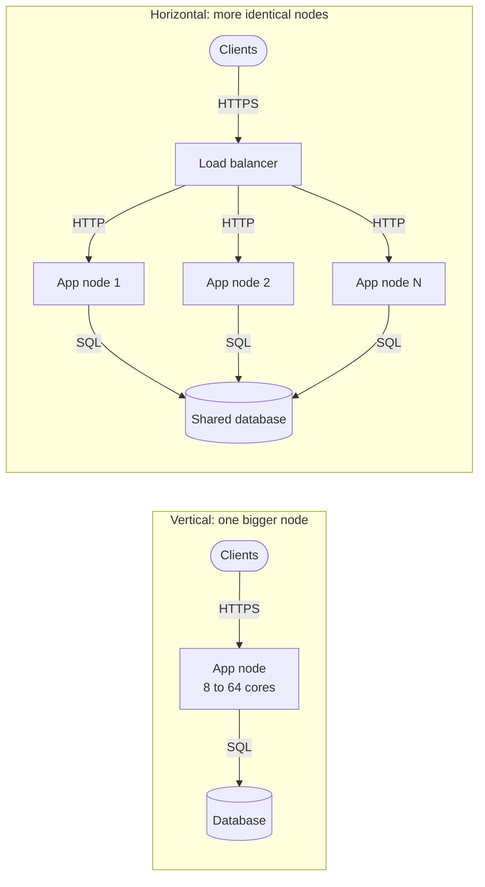

**Reading the diagram.** On the left, clients reach one large node over HTTPS; capacity grows only by enlarging it, and it is a single failure point. On the right, a load balancer spreads HTTP requests over $N$ identical nodes, and the others absorb a failed node's share. All arrows are synchronous. The storage boundary in both is the database, and on the right all $N$ nodes converge on it: scaling out the application tier *moves* the bottleneck to the shared tier (§18.7), which scales separately (§18.9).

#### Advantages, disadvantages and alternatives

**Table 18.2 — Vertical and horizontal scaling compared.**

| | Vertical scaling | Horizontal scaling |
|---|---|---|
| What it is | Bigger node | More nodes |
| How it works | Resize, restart or fail over | Load balancer plus identical, replaceable nodes |
| Advantages | No code change; transactions and joins stay local | No hardware ceiling; failures reduce capacity instead of causing outages |
| Disadvantages | Ceiling; single failure domain; cost knee | Needs stateless design, distribution, coordination for shared state |
| Performance | Lowest latency (no network hops between parts) | Near-linear throughput while work is independent |
| Operational complexity | Low | Medium (fleet, deploys, autoscaling) to high (distributed data) |
| Cost | Linear, then superlinear past the knee | Roughly linear, plus coordination overhead |
| Choose when | Coherent state; below the knee; urgent relief | Stateless tiers; growth beyond one node; high availability |

In practice you use both: scale out the stateless tiers, scale up the stateful tier until it reaches its knee, then partition it (Chapter 14).

#### Failure scenarios

**Table 18.3 — Horizontal scaling failure scenarios.**

| What goes wrong | Why | Detection | Recovery | Prevention |
|---|---|---|---|---|
| Throughput flat after adding nodes | Bottleneck is a shared tier | Per-tier utilization; USL fit | Scale or relieve the shared tier | Find the bottleneck before scaling (§18.7) |
| Users lose sessions on scale-in | State held in node memory | Logouts after deploys or scale-in | Move state out | Stateless design (§18.5) |
| New nodes overloaded on arrival | Cold caches, JIT warm-up | High p99 on young nodes | Slow-start traffic ramp | Warm-up and readiness probes (§18.8) |
| Database connection limit hit | Every node opens its own pool | `too many clients` errors | Pooler; smaller pools | Connection budget (§18.8.5) |

::: mistake
**"Adding nodes always adds capacity."** Only while the work is independent. With contention or coherency, throughput flattens and then falls (§4.13). Measure the gain from each added node (§18.7).
:::

## 18.5 Stateless vs stateful services

### 18.5.1 What "stateless" really means

::: definition
**Definition — Stateless service.** A service whose instances keep no client-specific or request-spanning data in local memory or disk that another instance would need. Any instance can serve any request, and an instance can be killed at any moment without losing anything except the requests it is processing (§8.3.2).
:::

::: definition
**Definition — Stateful service.** A service whose instances hold data that must survive between requests and that clients or other instances depend on: a database, a cache node, a WebSocket server holding live connections, or an application server keeping sessions in memory.
:::

#### First-principles explanation

Chapter 8 used two waiters: one memorizes your order, the other pins it to a shared board. The second waiter is stateless *because the board exists*. State did not disappear; it moved to a place built to hold it. "Stateless" is therefore a property of one tier, bought by making another tier stateful on purpose.

#### Why does this exist?

Every scaling move in this chapter (adding nodes, removing nodes, replacing a failed node, rolling out a new version, shifting traffic between zones) is trivial for a stateless tier and hard for a stateful one. Concentrating state in a few tiers that are designed for it (databases, caches, session stores) leaves the large, expensive compute tier free to scale elastically.

#### How it works internally: where state goes

**Table 18.4 — Externalizing state from an application server.**

| State in the server | Where it moves | Cost per request | See |
|---|---|---|---|
| Login session | Shared session store keyed by session ID, or a signed token in the client | ~0.5–1 ms store lookup, or signature check | §8.10, §8.13 |
| Shopping cart, draft order | Database or session store | One read or write | Chapter 11 |
| Cached query results | Shared cache tier | ~0.5 ms network round trip | Chapter 20 |
| Uploaded files in progress | Object storage, multipart or presigned upload | Direct client upload | §15.8 |
| Scheduled jobs, timers | Queue or job scheduler | Asynchronous | Chapter 30 |
| Rate-limit counters | Shared counter store | One atomic increment | §22.8 |
| Local disk logs | Log shipping to a central store | Asynchronous | Chapter 40 |

Some local state is harmless: a **read-only cache** that can be rebuilt (a menu cache with a TTL), compiled code and configuration loaded at start. The test is simple: *if this instance vanished now, would any user or other instance notice anything beyond a retry?* If not, the instance is stateless for scaling purposes.

#### Sticky sessions

**Session affinity**, also called **sticky sessions**, makes the load balancer send all requests from one client to the same instance, usually with a cookie or a hash of the client address (§19.6). It lets a stateful server *look* stateless to the load balancer.

**Figure 18.2 — Sticky sessions versus an externalized session store.**

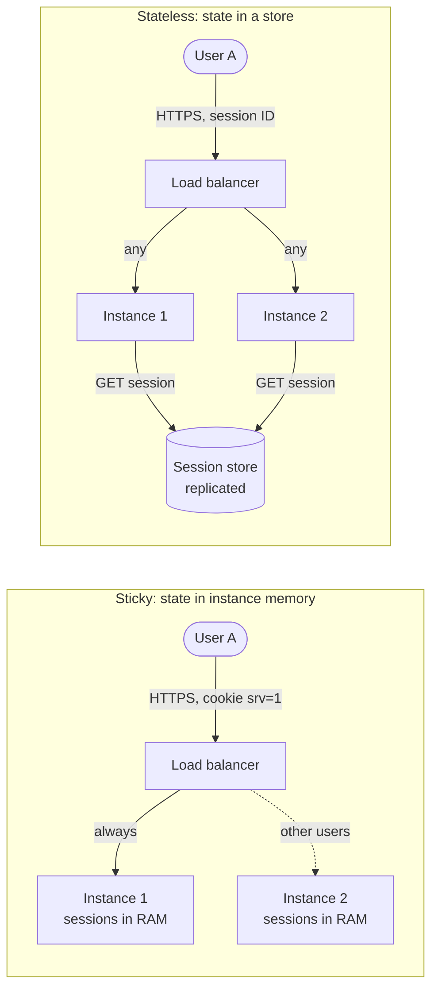

**Reading the diagram.** On the left, the load balancer pins User A to instance 1 by a cookie, and A's session lives only in instance 1's memory. If scale-in, a deploy or a crash removes instance 1, A is logged out; heavy users stay stuck on an overloaded instance. On the right, any instance can serve any request and fetches the session synchronously from a replicated session store (storage boundary) in about a millisecond. The store becomes a critical dependency that must be replicated (Chapter 20), but instances can be added, drained or killed freely, and scale independently of session capacity.

**Table 18.5 — Ways to handle session state.**

| | Sticky sessions | Shared session store | Client-side token (signed cookie, JWT) |
|---|---|---|---|
| How it works | LB pins client to instance | Instances look up session by ID | Client carries signed state |
| Advantages | No code change; fastest local access | Instances disposable; revocation is one delete | No server lookup; no store to run |
| Disadvantages | Session loss on instance loss; uneven load; blocks scale-in | Extra hop; store must be highly available | Size limits; revocation is hard before expiry |
| Choose when | Short-term migration of a legacy app | Default for server-rendered and API sessions | Short-lived access tokens (§8.13) |

Affinity is not always a smell. It is a legitimate **performance** optimization when the state is a rebuildable cache, for example routing a user to the instance that already holds their data warm, provided correctness never depends on it. Long-lived connections such as WebSockets are inherently stateful at the connection level; they are scaled with connection-aware techniques (§9.9).

#### Failure scenarios

The classic state-related failures (mass logout on deploy, sessions lost at scale-in, a session-store outage that logs everyone out, a hot instance under affinity) appear in Table 8.1 and Table 18.3. All share one prevention: decide where each piece of state lives *before* the tier needs to scale, and replicate that place.

::: mistake
**"Stateless means the system has no state."** It means *this tier* keeps none between requests. The engineering work is choosing where state lives and making that place durable, available and fast enough.
:::

## 18.6 Load distribution

Horizontal scaling needs something to spread requests across nodes. This section is a map; Chapter 19 is the territory.

**Figure 18.3 — Layers of load distribution.**

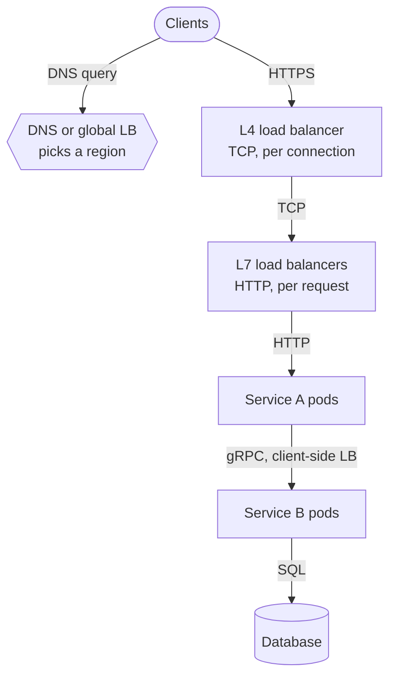

**Reading the diagram.** **DNS or global server load balancing** (hexagon) steers each client to a region, at the granularity of DNS answers and their TTLs (§19.9). A **layer-4 load balancer** spreads TCP connections without reading requests; a **layer-7 load balancer** routes each HTTP request by path, header or cookie (§19.3). Inside, **client-side load balancing** lets service A pick a pod of service B from a registry (§19.10). All arrows are synchronous. Failure points: the load balancers, made redundant with pairs, anycast or ECMP (§19.8), and stale DNS answers. Each layer scales horizontally; the database at the bottom does not, by this mechanism.

The algorithm matters most when requests differ in cost. Round robin suits uniform requests; least-outstanding-requests and **power of two choices** avoid piling work on a slow node; consistent hashing keeps related requests together for cache locality (§14.8, §19.4). Good algorithms approximate one shared queue in front of all servers, which beats separate queues (Figure 4.4).

## 18.7 Bottleneck identification

### 18.7.1 Where scaling stops

::: definition
**Definition — Scaling bottleneck.** The resource that limits throughput as load or node count grows: the resource with the largest service demand per unit of capacity (§2.6). For a horizontally scaled system, it is usually a resource that *all* nodes share and that cannot itself be scaled out by adding application nodes.
:::

#### First-principles explanation

Adding checkout lanes to a supermarket helps until every lane waits for the single price-check clerk. The clerk was always there; with two lanes she was idle most of the time, and with twenty she is the whole story. Horizontal scaling multiplies the parts you replicate and leaves untouched the parts you share, so the shared parts eventually dominate.

#### How it works internally

1. **List the resources on the request path** using the resource model of Table 2.7: CPU, memory, disk, network and software resources (locks, pools, single-threaded components).
2. **Classify each as per-node or shared.** Per-node resources (application CPU) grow with $N$; shared ones (the database primary, a global counter, a leader, a license server, a third-party rate limit) do not.
3. **Compute utilization at the target load** with the utilization law $U = X D / c$ (§2.6). The largest is the bottleneck now.
4. **Ask what grows with $N$.** Connection counts, health-check traffic, cache-invalidation fan-out and membership gossip all grow with node count, sometimes as $N^2$. These are the coherency terms of the USL.
5. **Fit the USL** to load-test throughput at several node counts (§4.13, §23.10) [Gunther 2007]. Its coefficients tell you whether you face contention ($\alpha$), coherency ($\beta$) or neither.
6. **Relieve, then repeat.** The bottleneck moves.

**Figure 18.4 — The shared-resource funnel.**

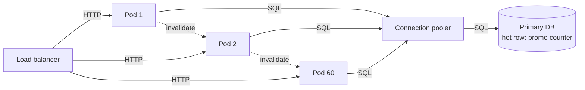

**Reading the diagram.** Sixty pods scale out freely behind the load balancer (synchronous HTTP) but converge, through a pooler, on one primary database and one hot row: a promotion counter that every order updates under a lock, a *contention* cost (USL $\alpha$). The dotted arrows are asynchronous cache invalidations between pods; their number grows with pod pairs, a *coherency* cost (USL $\beta$). Storage boundary: the database. Failure point: the hot row saturates while pod CPUs look idle. Adding pods worsens both costs.

#### Mathematical foundations

The USL itself is in §4.13. For a capacity decision you need one derived quantity: what the *next* node buys.

::: formula
**Marginal throughput of the $N$-th node**

$$\Delta X(N) = X_1 \left[ C(N) - C(N-1) \right] \qquad E(N) = \frac{C(N)}{N}$$

| Symbol | Meaning | Units |
|---|---|---|
| $X_1$ | Throughput of one node (measured) | requests/s |
| $C(N)$ | USL relative capacity at $N$ nodes (§4.13) | dimensionless |
| $\Delta X(N)$ | Extra throughput gained by adding node $N$ | requests/s |
| $E(N)$ | Scaling efficiency: fraction of linear scaling achieved | dimensionless (0–1) |
:::

::: example
**Worked example — How many pods can QuickBite usefully run?** A load test of the order API, where every order updates a promotion counter row and pods broadcast invalidations, fits $\alpha = 0.03$ and $\beta = 0.0002$. One pod sustains $X_1 = 800$ RPS. The product team wants 15,000 RPS for a national promotion.

1. Peak concurrency: $N^* = \sqrt{(1 - 0.03)/0.0002} = \sqrt{4{,}850} = 69.6$ pods.
2. Maximum throughput: $C(70) = 70 / (1 + 0.03 \times 69 + 0.0002 \times 70 \times 69) = 70/(1 + 2.07 + 0.966) = 70/4.036 = 17.34$, so $X_{max} \approx 17.34 \times 800 = 13{,}875$ RPS.
3. Marginal gain at 40 pods: $C(40) = 16.116$ and $C(39) = 16.008$, so $\Delta X(40) = 800 \times 0.108 \approx 87$ RPS, about one-ninth of what the first pod delivered.
4. Efficiency at 40 pods: $E(40) = 16.116/40 = 0.40$. You pay for 40 pods and get the work of 16.

**Interpretation.** No number of pods reaches 15,000 RPS; the system peaks at about 13,900 RPS near 70 pods and degrades beyond. **Engineering implication.** Stop scaling out and remove the shared costs: split the counter into per-shard sub-counters that are summed periodically (§14.10), and replace pod-to-pod invalidation with a TTL or a pub/sub channel (§20.10). Re-test and re-fit; if $\alpha$ falls to 0.005 and $\beta$ to 0.00001, $N^*$ rises to about 315 pods.
:::

::: warning
**The autoscaler cannot see the knee.** A CPU-based autoscaler adds pods whenever pods are busy. Past $N^*$, extra pods add contention, latency rises, pods stay busy, and the autoscaler adds still more. Cap `maxReplicas` below the measured knee and alert when the cap is reached.
:::

::: mistake
**"Low utilization everywhere means we can scale."** If latency rises with load while every hardware dashboard is calm, the bottleneck is a software resource: a lock, a pool or a single-threaded component (§2.6).
:::

## 18.8 Scaling application servers

### 18.8.1 Preconditions

A stateless application tier scales out only if four things are true:

1. **Instances are disposable**: built from an immutable image, configured from the environment, holding no state (§18.5).
2. **Readiness is explicit.** A **readiness probe** tells the load balancer when a new instance can take traffic, separately from a **liveness probe** that says whether it should be restarted.
3. **Shutdown is graceful.** On a termination signal the instance stops accepting new requests, finishes in-flight ones within a deadline (**connection draining**), closes pools and exits.
4. **Dependencies can take the extra load.** Each new instance opens connections and sends queries to shared tiers (§18.8.5).

### 18.8.2 Autoscaling and its signals

::: definition
**Definition — Autoscaling.** Automatically changing the number of instances of a service in response to a measured or forecast signal, within configured minimum and maximum bounds. **Reactive** autoscaling responds to current metrics; **scheduled** autoscaling follows a calendar; **predictive** autoscaling acts on a forecast.
:::

A thermostat is the right analogy: it measures the room, compares it with a set point and switches the heating on or off. Like a thermostat, an autoscaler reacts *after* the temperature changes and the heater takes time to warm up, so the set point must leave room for that delay.

**Table 18.6 — Autoscaling signals.**

| Signal | Good for | Weakness |
|---|---|---|
| CPU utilization | CPU-bound stateless services | Misses I/O-bound services whose threads wait idle; noisy |
| Requests per second per instance | Uniform request cost; needs a measured per-instance capacity | Breaks when the request mix changes |
| In-flight requests (concurrency) | I/O-bound services; follows Little's Law ($L = \lambda W$) | Rises when a dependency slows, which more instances may not fix |
| Queue depth or consumer lag per worker | Asynchronous workers (Chapter 30) | Needs a target derived from the latency objective |
| Latency (p95, p99) | Guard rail and alerting | Lagging, nonlinear, and caused by dependencies as often as by load |
| Schedule | Known daily or weekly peaks | Misses surprises |
| Forecast | Ramps faster than reaction time | Wrong when the forecast is wrong |

The best primary signal is one that is **proportional to load and inversely proportional to instance count**: doubling the instances should halve it. CPU and per-instance request rate usually qualify; latency usually does not.

### 18.8.3 Target tracking

**Target tracking** keeps a per-instance metric near a set point by resizing the fleet in proportion to the error. It is the algorithm of the Kubernetes Horizontal Pod Autoscaler (HPA) and of AWS target-tracking policies [Kubernetes Docs: HPA], [AWS Docs: EC2 Auto Scaling].

::: formula
**Target-tracking replica count (Kubernetes HPA)**

$$n_{desired} = \left\lceil n_{current} \times \frac{m_{current}}{m_{target}} \right\rceil \quad \text{if } \left| \frac{m_{current}}{m_{target}} - 1 \right| > \tau$$

| Symbol | Meaning | Units |
|---|---|---|
| $n_{current}$ | Current number of replicas | pods |
| $n_{desired}$ | Replica count the autoscaler requests, clamped to [min, max] | pods |
| $m_{current}$ | Current per-replica metric, averaged over replicas | metric units (e.g. % CPU, RPS) |
| $m_{target}$ | Target per-replica metric | same units |
| $\tau$ | Tolerance band within which no action is taken (default 0.1 as of 2026) | dimensionless |
:::

::: example
**Worked example — Two HPA decisions for QuickBite.**

*CPU target.* 10 replicas average 90% CPU against a 60% target. Ratio $= 90/60 = 1.5$, outside the ±0.1 band. $n_{desired} = \lceil 10 \times 1.5 \rceil = 15$. After scaling, the same load spread over 15 pods averages $90 \times 10 / 15 = 60\%$, exactly the target.

*Request-rate target.* 14 pods average 650 RPS against a target of 500 RPS per pod (assuming a measured 830 RPS per pod at the p99 objective, so 500 is about 60%). Ratio $= 1.3$; $n_{desired} = \lceil 14 \times 1.3 \rceil = \lceil 18.2 \rceil = 19$. If instead they averaged 530 RPS, the ratio 1.06 is inside the band and nothing happens.

**Interpretation.** The rule is proportional: double the per-pod metric, double the pods. The tolerance stops it reacting to noise. **Engineering implication.** Choose $m_{target}$ from a load test, not from intuition: it is the per-instance throughput at which latency still meets the objective, times a safety factor for reaction time (next section).
:::

**Figure 18.5 — The autoscaling control loop.**

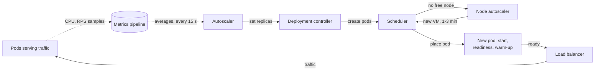

**Reading the diagram.** Pods report metrics asynchronously (dotted) to a metrics pipeline, the storage boundary for recent samples. The autoscaler reads averages periodically (every 15 s by default in Kubernetes) and sets a new replica count; the deployment controller creates pods and the scheduler places them. If no node has room, a node autoscaler must first create a virtual machine, typically adding one to several minutes. The new pod pulls its image, starts and passes readiness before receiving traffic, often with cold caches. Failure points: stale metrics, image-registry outages, exhausted quotas. The sum of these delays is the **reaction time** that headroom must cover.

#### Flapping and scale-in

Scaling in too eagerly causes **flapping**: remove pods, utilization rises, add pods, repeat. Autoscalers therefore scale in slowly. The Kubernetes HPA, for example, uses by default the highest recommendation of the last five minutes when scaling down (a **stabilization window**) [Kubernetes Docs: HPA]. Scale up fast, scale down slowly: the cost of a few spare pods for five minutes is small; the cost of being under capacity during a rebound is an incident.

### 18.8.4 Warm-up and reaction time

A new instance is not useful the moment it is requested. Its delay is the sum of metric collection, the evaluation period, possibly provisioning a machine, pulling the image, starting the process, passing readiness, and **warm-up**: the period in which caches are empty, connection pools are filling and just-in-time compilers have not yet optimized hot code. During all of this the *existing* instances absorb the growing load.

::: formula
**Target utilization that survives reaction time**

$$u_{target} \le \frac{u_{safe}}{1 + r \times T_{react}}$$

| Symbol | Meaning | Units |
|---|---|---|
| $u_{target}$ | Utilization set point for the autoscaler | fraction |
| $u_{safe}$ | Highest utilization at which latency still meets the objective (from load tests and §4.10) | fraction |
| $r$ | Fastest expected load growth, relative to current load | fraction per minute |
| $T_{react}$ | Reaction time: metric delay + evaluation + provisioning + start + warm-up | minutes |
:::

The derivation is one line: during $T_{react}$ load grows by a factor of about $1 + rT_{react}$ while capacity stays fixed, so utilization must start that factor below $u_{safe}$. It is a linear approximation, good when $rT_{react}$ is below about 0.5.

::: example
**Worked example — Choosing QuickBite's CPU target.** Load tests show p99 stays within objective up to $u_{safe} = 0.85$. Dinner ramps grow load by up to $r = 15\%$ per minute. Reaction time: metric delay 0.5 min, evaluation 0.25 min, pod start and readiness 1 min, warm-up equivalent to 0.5 min of lost capacity, so $T_{react} = 2.25$ min.

1. $1 + r T_{react} = 1 + 0.15 \times 2.25 = 1.3375$.
2. $u_{target} \le 0.85 / 1.3375 = 0.636$. Choose **60%**.
3. If the cluster has no spare nodes and a node autoscaler adds 2 min: $T_{react} = 4.25$, $1 + 0.6375 = 1.6375$, $u_{target} \le 0.52$. Choose **50%**, which means about 20% more pods at all times.

**Interpretation.** Slow provisioning is paid for with permanently idle capacity. **Engineering implication.** Shorten $T_{react}$ instead of lowering the target: keep a small buffer of spare nodes (low-priority placeholder pods that real pods can evict), use pre-initialized warm pools, slim images, and send a new instance a slowly increasing share of traffic (**slow start**) while it warms.
:::

The simulation below checks the formula against a model of the HPA with startup and warm-up delays. Load doubles from 6,000 to 12,000 RPS over five minutes, a growth of 10–20% per minute.

```python
"""Target-tracking autoscaler with startup delay and warm-up (Section 18.8).

A simplified model of the Kubernetes HPA rule
    desired = ceil(current * current_metric / target_metric)
applied every 15 s to CPU utilization. New pods serve nothing for STARTUP_S seconds,
then serve at half capacity for WARMUP_S seconds (cold caches, JIT compilation).
Load ramps linearly from 6,000 to 12,000 RPS over five minutes.
"""
import math

POD_RPS = 1_000        # requests/s one warm pod handles at 100% CPU
STARTUP_S = 60         # scheduling + image pull + process start + readiness probe
WARMUP_S = 60          # serving at half capacity while caches and JIT warm up
SYNC_S = 15            # autoscaler evaluation period
METRIC_LAG_S = 30      # age of the utilization sample the autoscaler sees
TOLERANCE = 0.10       # no action while |ratio - 1| <= 10%
RAMP_S = 300           # load doubles over five minutes, starting at t = 60 s


def load(t):
    return 6_000 + 6_000 * min(max(t - 60, 0), RAMP_S) / RAMP_S


def run(target):
    pods = [-10_000] * math.ceil(6_000 / (POD_RPS * target))   # start times; all warm
    worst, overloaded = 0.0, 0
    for t in range(0, 1_200):
        cap = 0.0
        for start in pods:
            age = t - start
            if age >= STARTUP_S + WARMUP_S:
                cap += POD_RPS
            elif age >= STARTUP_S:
                cap += POD_RPS / 2
        util = load(t) / cap
        worst = max(worst, util)
        overloaded += util > 1.0
        if t % SYNC_S == 0 and t >= METRIC_LAG_S:
            # Average CPU over all pods as the autoscaler sees it; pods that are
            # not ready count as idle, as the HPA assumes when scaling up.
            seen = load(t - METRIC_LAG_S) / (len(pods) * POD_RPS)
            ratio = seen / target
            if abs(ratio - 1) > TOLERANCE:
                desired = math.ceil(len(pods) * ratio)
                if desired > len(pods):
                    pods += [t] * (desired - len(pods))
    return worst, overloaded, len(pods)


print("target  peak util  seconds >100%  final pods")
for target in (0.5, 0.6, 0.7, 0.8):
    worst, over, final = run(target)
    print(f"{target:5.0%}   {worst:8.0%}   {over:12d}   {final:9d}")
```

Output:

```text
target  peak util  seconds >100%  final pods
  50%        74%              0          23
  60%        88%              0          19
  70%       102%              9          17
  80%       116%            184          15
```

What to notice:

- At an 80% target the fleet spends about three minutes above 100% utilization, during which queues grow without bound (§4.10). At 60% the worst moment is 88%, close to $u_{safe} = 0.85$. That is consistent with the formula, because this ramp starts at 20% per minute, a little faster than the 15% assumed in the worked example.
- The final pod counts differ by only 8 pods (23 versus 15), but the overload differs by minutes. Headroom is cheap insurance against reaction time.
- The model ignores backlog carried over from overloaded seconds, so real overload lasts longer than shown.

::: industry
**Predictive autoscaling.** Netflix described Scryer, a system that forecasts each service's traffic from historical daily and weekly patterns and scales capacity *ahead* of the predicted demand, with reactive autoscaling kept as a safety net for surprises. Cloud providers offer similar predictive scaling for virtual-machine groups.
*Evidence: Primary* — [Netflix 2013], [AWS Docs: EC2 Auto Scaling]
:::

### 18.8.5 Connection pools versus database limits

Every application instance keeps a **connection pool** to the database (§7.16, §14.13). Pool size is set per instance, but the database's connection limit is set per database. Horizontal scaling multiplies the first and leaves the second fixed. PostgreSQL runs one backend process per connection, reserves a few slots for superusers, and refuses the rest with `FATAL: sorry, too many clients already` [PostgreSQL Docs: Connections].

::: formula
**Connection budget**

$$n_{max} \times p + \sum_j n_j p_j \le M - R$$

| Symbol | Meaning | Units |
|---|---|---|
| $n_{max}$ | Maximum replicas of the scaled service (autoscaler `maxReplicas`) | pods |
| $p$ | Maximum pool size per replica | connections |
| $n_j, p_j$ | Replicas and pool size of every other client service $j$ | pods, connections |
| $M$ | Database `max_connections` | connections |
| $R$ | Connections reserved for superusers, replication, monitoring and migrations | connections |
:::

**Figure 18.6 — Two hundred pods against one connection limit.**

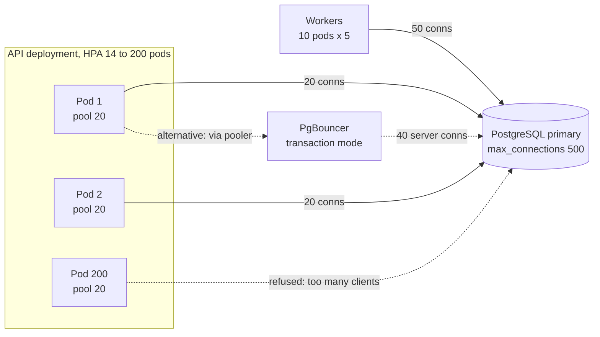

**Reading the diagram.** The API deployment grows from 14 to 200 pods with pools of up to 20, and workers hold another 50 connections. All speak the PostgreSQL protocol synchronously to one primary whose `max_connections` of 500 is the hard limit (storage boundary). The dotted edge from pod 200 shows connections refused once the budget is spent. The dotted path through PgBouncer is the alternative: the pooler multiplexes client connections onto about 40 server connections (§14.13), decoupling pod count from database connections. Failure point: the limit is reached exactly when traffic peaks and the autoscaler is adding pods.

::: example
**Worked example — QuickBite's promotion-night outage, on paper.** PostgreSQL primary: $M = 500$. Reserved: 3 superuser slots plus 27 for replication, monitoring and migrations, so $R = 30$. Workers: $10 \times 5 = 50$. API pods: pool 20, HPA from 14 to 200 replicas.

1. Budget for the API: $500 - 30 - 50 = 420$ connections.
2. At the minimum of 14 pods: $14 \times 20 = 280$. Fits.
3. The autoscaler crosses $420/20 = 21$ pods during a normal dinner peak. Pod 22 cannot fill its pool; its readiness check fails or its requests error. CPU stays high, so the autoscaler adds more pods, which also fail.
4. At the maximum of 200 pods: $200 \times 20 = 4{,}000$ connections, 9.5 times the budget.
5. What the database actually needs, by Little's Law (§4.11): at peak about 4,000 queries/s that reach the database (most browse reads are served by the cache) at about 2 ms each, plus 60 order transactions/s at about 15 ms, gives $4{,}000 \times 0.002 + 60 \times 0.015 = 8 + 0.9 \approx 9$ busy connections on average. With 3× burst headroom, about 30.

*Three fixes.*

- **Shrink the pool:** $p = \lfloor 420/200 \rfloor = 2$. At 14 pods each pod then has 2 connections for about $9/14 = 0.64$ busy on average: workable, but a single slow query blocks half a pod's pool.
- **Cap the autoscaler:** `maxReplicas` = 21. Safe for the database, but caps the API tier at 21 pods even when the bottleneck is CPU.
- **Add a transaction-mode pooler** (§14.13): pods keep pools of 10 to PgBouncer (2,000 cheap client connections), and PgBouncer holds 40 server connections, comfortably above the 30 needed. Pod count and database connections are now independent.

**Interpretation.** The configuration that worked at 14 pods was a latent outage at 22. **Engineering implication.** Check the connection budget whenever you change `maxReplicas`, pool size or the number of client services, and put a pooler in front of PostgreSQL before the API tier autoscales. Size the *server* side of the pool from Little's Law, not from pod count.
:::

#### Failure scenarios

**Table 18.7 — Application-tier scaling failures.**

| What goes wrong | Why | Detection | Recovery | Prevention |
|---|---|---|---|---|
| Overload during ramps | Reaction time longer than the headroom covers | Utilization > $u_{safe}$ while scaling | Shed load (§22.9) | Lower target; shorten $T_{react}$; scheduled scaling |
| Runaway scale-out | Bottleneck downstream keeps pods busy | Replicas at max; DB saturated | Cap replicas; fix bottleneck | `maxReplicas` below the knee |
| Connection exhaustion | Pods × pool > `max_connections` | `too many clients` errors | Lower pool; restart pooler | Connection budget; transaction pooler |
| Flapping | Scale-in too fast | Oscillating replica count | Lengthen stabilization | Scale down slowly |
| Cold-start storms | Many new pods with empty caches hit the DB at once | DB load spike after scale-out | Slow start | Warm caches; shared cache tier |
| Quota or capacity exhaustion | Cloud account or zone out of instances | Pending pods; API errors | Other instance types or zones | Quota reviews in the capacity plan |

::: mistake
**"Autoscaling replaces capacity planning."** An autoscaler only moves between `minReplicas` and `maxReplicas`, using nodes, quotas and database connections that someone had to plan. It handles hourly variation, not next year's growth.
:::

## 18.9 Scaling databases (overview)

Once the application tier is stateless, the database is usually the bottleneck, because it is the tier that holds the shared, coherent state. Chapters 11–14 treat its scaling options in depth. This section is a decision aid: start from the symptom, try the cheapest option that addresses it, and escalate only when measurements say so.

**Table 18.8 — Database scaling options: a decision table.**

| Option | Fixes this symptom | Adds read capacity | Adds write capacity | Adds storage | Cost and complexity | See |
|---|---|---|---|---|---|---|
| Query and index tuning | Slow queries, full scans | Yes | Yes | No | Low | §11.7–§11.10 |
| Connection pooler | Too many connections; per-connection memory | Indirectly | Indirectly | No | Low | §14.13 |
| Vertical scaling | Any resource saturated, below the cost knee | Yes | Yes | Yes | Low, until the knee | §18.3 |
| Cache in front of the DB | Read-heavy, repetitive reads | Yes (large) | No | No | Medium: invalidation | Chapter 20 |
| Read replicas | Read-heavy; analytics on the primary | Yes | No | No | Medium: replication lag | §14.3–§14.4 |
| Functional split (Y axis) | Unrelated tables compete for one server | Yes | Yes | Yes | Medium: no cross-DB joins | §18.10 |
| Storage engine choice | Write-heavy ingest; space amplification | Depends | Yes (LSM) | Depends | Medium | §13.7–§13.11 |
| Partitioning or sharding (Z axis) | Writes or data beyond one primary | Yes | Yes | Yes | High: shard key, resharding, cross-shard queries | §14.6–§14.12 |
| Distributed SQL (NewSQL) | Need SQL and transactions beyond one node | Yes | Yes | Yes | High: latency, cost | §12.11 |
| NoSQL key-value or wide-column store | Simple access patterns at very high scale | Yes | Yes | Yes | Medium to high: data-model redesign | Chapter 12 |
| Separate read model (CQRS, search index) | Queries the primary schema serves badly | Yes | No | Yes | Medium to high: asynchronous updates | §32.4, Chapter 16 |
| Archiving and tiering | Table and index growth from old data | Indirectly | Indirectly | Frees space | Low to medium | §15.9 |

Three rules summarize the table. **Reads and writes scale differently:** caches and replicas multiply reads; only partitioning or a bigger primary multiplies writes, so measure the read-to-write ratio first (117:1 for QuickBite browsing, §2.11). **Cheap fixes first:** indexing, pooling, caching and a bigger node often buy an order of magnitude together, while sharding is a one-way door (§2.8) that costs months. **Plan the hard move early:** §18.11.4 turns this into a lead-time calculation.

## 18.10 The scale cube

### 18.10.1 Three axes of scaling

::: definition
**Definition — Scale cube.** A model by Martin Abbott and Michael Fisher that classifies every scaling technique along three independent axes [Abbott and Fisher 2015]: the **X axis**, cloning identical copies of a service or its data behind a load balancer; the **Y axis**, splitting by function, service or resource so that each part handles different work; and the **Z axis**, splitting by customer, requester or other key so that each part handles the same work for a subset of the data or users.
:::

#### First-principles explanation

The bakery chain again. **X axis**: open more identical shops, each making everything. **Y axis**: split the work so one kitchen makes bread, another cakes, another sandwiches, each sized for its own demand. **Z axis**: give each city its own complete operation that serves only that city's customers. The axes combine: each city (Z) can have specialized kitchens (Y), each with several identical ovens (X).

#### Why does this exist?

Engineers tend to reach for one familiar technique. The cube forces the question "which kind of split solves *this* bottleneck?" Each axis relieves a different limit and costs something different.

**Figure 18.7 — The scale cube applied to QuickBite.**

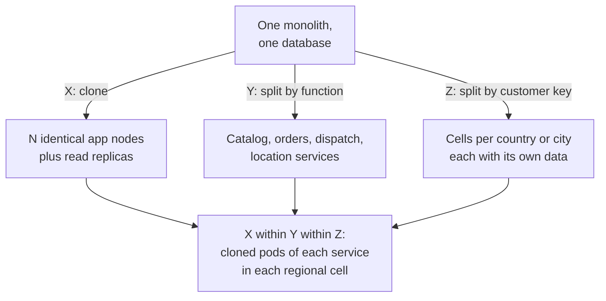

**Reading the diagram.** The top node is the starting point: one deployable unit and one database. Arrows are design moves, not request flows, so no protocols apply. X clones the application and read-only data; the shared primary remains. Y splits by function into services, each with its own data store (a storage boundary per service). Z splits by a customer key such as country, so each cell holds only its customers' data and contains its own failures. Large systems end up at the bottom node, combining all three. Failure points differ by axis: X still shares the database, Y adds network calls, Z adds a routing layer and cross-cell operations.

**Table 18.9 — The three axes compared.**

| | X axis: clone | Y axis: split by function | Z axis: split by key |
|---|---|---|---|
| What it is | Identical copies behind a load balancer | Different services for different work | Same service, different subsets of customers or data |
| Relieves | Compute and read capacity | Codebase size, team coupling, mixed workloads | Write capacity, data size, blast radius, data residency |
| Advantages | Simplest; no code change if stateless | Independent scaling and deployment | Near-linear scaling; failure isolation |
| Disadvantages | Shared data tier remains; caches duplicated | Network calls, distributed transactions | Routing layer; cross-cell queries and rebalancing |
| Operational complexity | Low | Medium to high | High |
| Examples | Stateless pods, read replicas | Microservices (Chapter 34), separate location service | Sharding (Chapter 14), cells (§33.12), regional stacks (Chapter 44) |
| Choose when | First, for stateless tiers | Parts of the system have very different load or owners | One primary or one failure domain is too big |

::: example
**Worked example — Which axis for which QuickBite bottleneck?** At 2 million daily users (§2.11):

1. *Browse reads, 7,000 RPS.* Independent requests, read-only, cacheable. **X axis**: about 18 cloned API pods plus a menu cache (§18.11).
2. *Courier location writes, 5,000/s, about 83 times the order write rate.* A different workload from orders in rate, data shape and consistency. **Y axis**: a separate location service with its own in-memory store, as §2.8 decided.
3. *Order writes heading for the WAL limit of about 500/s* (§2.10) as QuickBite expands into several countries. **Z axis**: partition orders by country or city, which also satisfies data-residency rules and contains failures.

**Interpretation.** Each bottleneck has a natural axis, determined by whether the work is identical (X), different (Y) or identical on separable data (Z). **Engineering implication.** Name the axis explicitly in design reviews; "we will shard" and "we will add microservices" are answers to different problems.
:::

::: industry
**Cells and shuffle sharding at AWS.** AWS publishes guidance on **cell-based architecture**: dividing a service into independent cells, each a complete copy of the stack serving a subset of customers, behind a thin routing layer [AWS 2023]. Its Builders' Library also describes **shuffle sharding**, which assigns each customer to a random combination of nodes so that one customer's harmful traffic affects few others [MacCárthaigh 2019]. Both are Z-axis splits, chosen as much to limit the blast radius of failures as to add capacity.
*Evidence: Primary* — [AWS 2023], [MacCárthaigh 2019]
:::

::: mistake
**"Z axis means database sharding."** Sharding a database is one Z-axis split. Abbott and Fisher's Z axis can split the *whole stack* (application pods, caches and data) by customer, which also isolates failures. Conversely, splitting into microservices is a Y-axis move and adds no write capacity to a shared database.
:::

## 18.11 Capacity planning

### 18.11.1 The planning loop

::: definition
**Definition — Capacity planning.** The recurring process of forecasting demand, translating it into the resources needed to serve it within the service-level objective with stated headroom and redundancy, and acquiring those resources before they are needed, allowing for the lead time to obtain them.
:::

Capacity planning is the scalability counterpart of a household budget: forecast income and expenses, keep a reserve for emergencies, and order large purchases early enough to arrive on time. Google's SRE book lists its mandatory steps as an accurate forecast of organic demand that extends beyond the lead time for acquiring capacity, the inclusion of inorganic demand such as launches and marketing campaigns, and regular load testing to relate raw resources to service capacity [Beyer et al. 2016].

**Figure 18.8 — The capacity planning loop.**

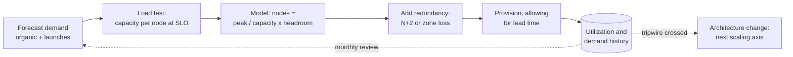

**Reading the diagram.** This is a process, not a running system. Load tests convert requests per second into nodes; the per-node capacity $c$ must be measured at the latency objective, not at saturation. The model adds queueing headroom, the redundancy step adds failure headroom, and provisioning starts early enough to cover lead time: minutes for cloud instances, weeks for quotas or reservations, months for hardware or a re-architecture. Utilization history (a storage boundary) feeds the next forecast (dotted). The second dotted exit matters most: when a tripwire (§2.7) fires, the answer is a design change, not more nodes.

### 18.11.2 Headroom and redundancy

::: formula
**Provisioned capacity with headroom**

$$N = \left\lceil \frac{R_{peak} \, (1 + g)^{L}}{c \times u_{target}} \right\rceil \qquad N_{total} = N + k \quad \text{or} \quad N_{total} = \left\lceil N \times \frac{Z}{Z - f} \right\rceil$$

| Symbol | Meaning | Units |
|---|---|---|
| $R_{peak}$ | Current design peak load | requests/s |
| $g$ | Demand growth rate per period | fraction per month |
| $L$ | Lead time to add capacity | months |
| $c$ | Per-node throughput at which latency meets the objective (measured) | requests/s per node |
| $u_{target}$ | Target utilization (queueing and reaction-time headroom, §18.8.4) | fraction |
| $N$ | Nodes needed to serve the load with headroom | nodes |
| $k$ | Spare nodes for failures and deploys (N+1: $k = 1$; N+2: $k = 2$) | nodes |
| $Z, f$ | Failure domains (zones) used, and how many may fail at once | count |
| $N_{total}$ | Nodes to provision | nodes |
:::

Three kinds of headroom hide in this formula: **queueing headroom** ($u_{target} < 1$, because latency grows as $1/(1-\rho)$, §4.10), **growth headroom** ($(1+g)^L$, because capacity takes time to arrive), and **failure headroom** ($k$ or $Z/(Z-f)$). N+2 is the common rule for services: one spare for an unplanned failure, a second for the node that is down for maintenance or a deploy at the same moment [Beyer et al. 2016]. The zone form provisions so that losing $f$ of $Z$ zones leaves enough capacity *without any scaling action*, a property AWS calls **static stability** [Weiss and Furr 2020].

::: example
**Worked example — QuickBite's API fleet at 2 million users.** From §2.11: $R_{peak} = 6{,}667$ RPS (rounded to 7,000 in Chapter 2), $c = 1{,}000$ RPS per node, $u_{target} = 0.6$.

1. *Servers needed now:* $6{,}667 / (1{,}000 \times 0.6) = 11.1$, so $N = 12$.
2. *N+2:* $N_{total} = 14$, the figure Chapter 2 used. Spread over 3 zones as 5, 5 and 4, losing a 5-node zone leaves 9 nodes: $6{,}667 / 9{,}000 = 74\%$ utilization. The service survives, but above its 60% target and with no room for a burst.
3. *Zone-safe, $Z = 3$, $f = 1$:* $N_{total} = \lceil 12 \times 3/2 \rceil = 18$, six per zone. Losing a zone leaves 12 nodes at $6{,}667/12{,}000 = 56\%$.
4. *With growth headroom:* demand grows $g = 8\%$ per month and new reserved capacity takes $L = 3$ months to arrange. $(1.08)^3 = 1.26$, so plan for $6{,}667 \times 1.26 = 8{,}398$ RPS: $N = \lceil 8{,}398 / 600 \rceil = 14$, and zone-safe $N_{total} = 21$.

**Interpretation.** Moving from N+2 to zone-level static stability costs 4 more nodes (29% more) and buys survival of a whole-zone outage within target. **Engineering implication.** Decide which failure the fleet must absorb without scaling, write it down in the capacity plan, and size for it; autoscalers may not be able to add capacity during a zone outage, when every other customer is trying to do the same.
:::

### 18.11.3 Peak-to-average ratio and the cost of peaks

::: formula
**Peak-to-average ratio and average fleet utilization**

$$PAR = \frac{R_{peak}}{R_{avg}} \qquad \bar{u} = \frac{R_{avg}}{N_{total} \times c}$$

| Symbol | Meaning | Units |
|---|---|---|
| $R_{avg}$ | Average load over a day (or week) | requests/s |
| $PAR$ | Peak-to-average ratio | dimensionless |
| $\bar{u}$ | Average utilization of a statically provisioned fleet | fraction |
:::

::: example
**Worked example — How idle is a fleet sized for dinner?** QuickBite's browse load averages $2{,}000{,}000 \times 30 / 86{,}400 = 694$ RPS and peaks at 6,667 RPS.

1. $PAR = 6{,}667 / 694 = 9.6$. This follows from the assumptions: 20% of the day's traffic in one hour is $0.2 \times 24 = 4.8$ times the daily average, and the burst factor of 2 doubles it.
2. Static, zone-safe fleet of 18 nodes: $\bar{u} = 694 / (18 \times 1{,}000) = 3.9\%$.
3. With autoscaling between a floor of 6 nodes (two per zone) and 18, the fleet follows demand; if it averages 8 nodes, $\bar{u} = 694/8{,}000 = 8.7\%$, and the fleet costs less than half as much.

**Interpretation.** A fleet sized for a sharp peak, with queueing and failure headroom, is idle most of the day. Barroso and Hölzle reported that servers in large datacenters typically operate at 10–50% of their maximum utilization [Barroso and Hölzle 2007]. **Engineering implication.** The higher the PAR, the more autoscaling, scheduled scaling or sharing capacity with batch work pays off. A low PAR (a steady workload) favors reserved, statically sized capacity.
:::

### 18.11.4 Forecasting and lead time

Forecasts combine **organic growth**, extrapolated from history (often as a compound monthly rate with daily and weekly seasonality), with **inorganic** steps: launches, marketing campaigns, new countries, and events such as holidays [Beyer et al. 2016]. The crucial output is not a number but a *date*: when will each component cross its usable capacity, and is that further away than the time needed to fix it?

::: formula
**Time until a component's capacity is exhausted**

$$D(t) = D_0 (1 + g)^t \qquad t_{exhaust} = \frac{\ln (C_{usable} / D_0)}{\ln (1 + g)} \qquad t_{start} = t_{exhaust} - L_{fix}$$

| Symbol | Meaning | Units |
|---|---|---|
| $D_0$ | Current peak demand on the component | operations/s |
| $g$ | Compound growth rate per period | fraction per month |
| $C_{usable}$ | Usable capacity: limit × target utilization | operations/s |
| $t_{exhaust}$ | Periods until demand reaches usable capacity | months |
| $L_{fix}$ | Lead time of the fix, including a safety margin | months |
| $t_{start}$ | Latest month to start the fix | months |
:::

::: example
**Worked example — When must QuickBite start partitioning orders?** The order database's WAL disk caps it at about 500 orders/s (§2.6); at $u_{target} = 0.6$, $C_{usable} = 300$ orders/s. Today $D_0 = 56$ orders/s at 2 million users, growing 8% per month.

1. $C_{usable} / D_0 = 300 / 56 = 5.36$; $\ln 5.36 = 1.678$; $\ln 1.08 = 0.0770$.
2. $t_{exhaust} = 1.678 / 0.0770 = 21.8$ months.
3. Partitioning by region (§14.7) is estimated at 6 months of work plus a 3-month margin: $L_{fix} = 9$. So $t_{start} = 21.8 - 9 \approx 13$ months from now.
4. Sensitivity: at 12% monthly growth, $t_{exhaust} = 1.678 / \ln 1.12 = 1.678/0.1133 = 14.8$ months, and the project must start in about 6 months.

**Interpretation.** The same headroom means two years at one growth rate and barely more than one at another. **Engineering implication.** Put $t_{start}$ for every architectural limit into the capacity plan, recompute it monthly from measured growth, and treat crossing it as a tripwire (§2.7). Group commit (§13.5) could raise the limit about 4× (an assumed factor, §2.10) and push $t_{exhaust}$ out by $\ln 4 / \ln 1.08 = 18$ months, a cheaper first move worth evaluating before partitioning.
:::

::: industry
**Intent-based capacity planning at Google.** The SRE book describes Auxon, a tool in which teams state capacity *intent* (dependencies, service-level requirements, N+2 redundancy, budget) and a solver produces the resource allocation, replacing hand-maintained spreadsheets of machine counts.
*Evidence: Primary* — [Beyer et al. 2016]
:::

### 18.11.5 Worked capacity plan: QuickBite from 1,000 to 10 million users

The plan reuses Chapter 2's per-user assumptions: 30 browse requests and 0.25 orders per daily active user (DAU), 20% of daily traffic in the busiest hour, a burst factor of 2, one active courier per 100 DAU at peak sending a location every 4 s, and $c = 1{,}000$ RPS per API node at $u_{target} = 0.6$. Two zones are used for the first two stages and three thereafter, and no stage runs fewer than two API nodes. The program below computes every row of Table 18.10.

```python
"""QuickBite capacity plan from 1k to 10M daily active users (Section 18.11).

All inputs are teaching assumptions carried over from Chapter 2 (Table 2.10, Section 2.11).
"""
import math

BROWSE_PER_DAU = 30      # browse requests per DAU per day
ORDERS_PER_DAU = 0.25    # orders per DAU per day
BUSY_HOUR_SHARE = 0.20   # share of daily traffic in the busiest hour
BURST = 2.0              # burst factor above the busiest-hour average
COURIERS_PER_DAU = 0.01  # couriers active at peak per DAU (20,000 at 2M DAU)
UPDATE_INTERVAL_S = 4    # courier location update interval
NODE_RPS = 1_000         # sustained RPS per API node (measured, Section 2.11)
U_TARGET = 0.6           # target utilization per node


def peak(daily):
    return daily * BUSY_HOUR_SHARE / 3_600 * BURST


def api_nodes(rps, zones):
    work = max(1, math.ceil(rps / (NODE_RPS * U_TARGET)))
    if zones == 1:
        return work, work + 1                     # N+1 on one zone
    return work, math.ceil(work * zones / (zones - 1))  # survive one zone loss


stages = [  # (name, DAU, zones)
    ("S1 pilot", 1_000, 2),
    ("S2 city", 20_000, 2),
    ("S3 region", 200_000, 3),
    ("S4 country", 2_000_000, 3),
    ("S5 multi-country", 10_000_000, 3),
]

print(f"{'stage':17} {'DAU':>10} {'browse/s':>9} {'avg/s':>7} {'PAR':>4} "
      f"{'orders/s':>8} {'loc w/s':>8} {'work':>5} {'total':>5} {'avg util':>8}")
for name, dau, zones in stages:
    browse_peak = peak(dau * BROWSE_PER_DAU)
    browse_avg = dau * BROWSE_PER_DAU / 86_400
    orders_peak = peak(dau * ORDERS_PER_DAU)
    loc_writes = dau * COURIERS_PER_DAU / UPDATE_INTERVAL_S
    work, total = api_nodes(browse_peak, zones)
    total = max(total, 2)                         # never fewer than two nodes
    avg_util = browse_avg / (total * NODE_RPS)
    print(f"{name:17} {dau:>10,} {browse_peak:>9,.0f} {browse_avg:>7,.0f} "
          f"{browse_peak / browse_avg:>4.1f} {orders_peak:>8.2f} {loc_writes:>8,.0f} "
          f"{work:>5} {total:>5} {avg_util:>8.1%}")
```

Output:

```text
stage                    DAU  browse/s   avg/s  PAR orders/s  loc w/s  work total avg util
S1 pilot               1,000         3       0  9.6     0.03        2     1     2     0.0%
S2 city               20,000        67       7  9.6     0.56       50     1     2     0.3%
S3 region            200,000       667      69  9.6     5.56      500     2     3     2.3%
S4 country         2,000,000     6,667     694  9.6    55.56    5,000    12    18     3.9%
S5 multi-country  10,000,000    33,333   3,472  9.6   277.78   25,000    56    84     4.1%
```

What to notice: the API fleet is never the hard part; at every stage the interesting limits are elsewhere (the order database, the location write path, availability). The minimum of two nodes dominates the first three stages, which is why their average utilization rounds to zero.

**Table 18.10 — QuickBite capacity plan by stage.**

| Stage | DAU | Peak browse RPS | Peak orders/s | Location writes/s | API nodes | What changes, and why |
|---|---|---|---|---|---|---|
| S1 pilot | 1,000 | 3 | 0.03 | 2.5 | 2 | Monolith; managed DB; second node only for availability |
| S2 city | 20,000 | 67 | 0.6 | 50 | 2 | Standby DB, CDN for images, job queue |
| S3 region | 200,000 | 667 | 5.6 | 500 | 3 (autoscaled) | Cache, pooler, location moves to an in-memory store |
| S4 country | 2,000,000 | 6,667 | 56 | 5,000 | 18 (autoscaled) | Y-axis location service, event log, read replicas |
| S5 multi-country | 10,000,000 | 33,333 | 278 | 25,000 | 84 in 4 cells | Z-axis regional cells; orders partitioned by region |

**Figure 18.9 — Stage S1: 1,000 DAU.**

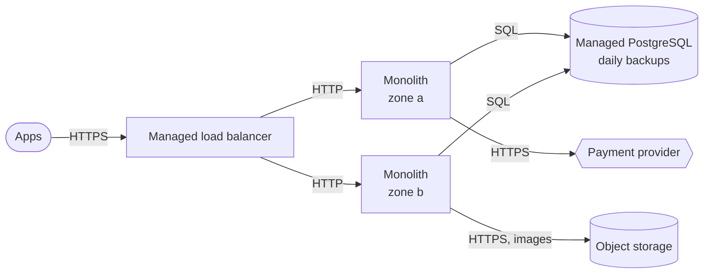

**Reading the diagram.** The three apps call a managed load balancer over HTTPS, which forwards synchronous HTTP to two copies of the modular monolith (§2.8) in different zones. Sessions live in the database from day one, so the nodes are stateless. One managed PostgreSQL instance with backups is the only database; images go to object storage; the payment provider is external. Failure point: the single database instance, acceptable for a pilot. Peak load (3 RPS) would fit on a laptop; the second node exists for deploys and failures, not capacity.

**Figure 18.10 — Stage S2: 20,000 DAU (one city).**

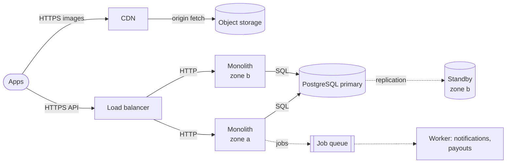

**Reading the diagram.** Paying customers arrive, so availability matters more than capacity. A CDN serves menu images. The database gains a standby in a second zone, fed by replication (dotted), with automatic failover (§14.4). Notifications and payouts move asynchronously to a job queue and worker, so a slow third party cannot hold an API request. Storage boundaries: object storage, primary and standby, the queue. The API tier is still two nodes at 67 RPS.

**Figure 18.11 — Stage S3: 200,000 DAU (one region).**

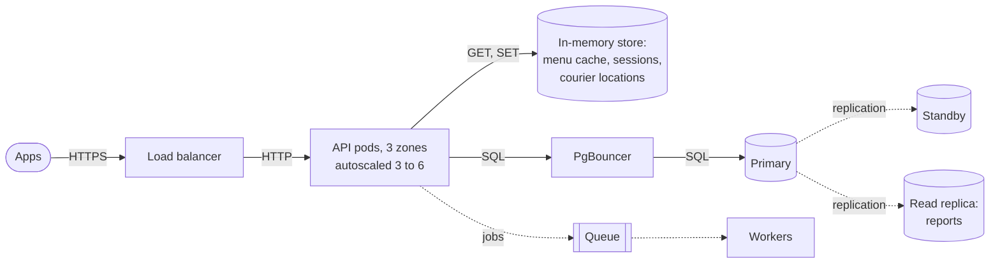

**Reading the diagram.** Menu queries are now the database's largest cost, so a replicated in-memory store caches menus with a TTL and holds sessions (Chapter 20). Courier locations, 500 writes/s of short-lived data, move there too. The API runs as autoscaled pods across three zones behind a transaction-mode pooler, which fixes the connection budget before autoscaling can break it (§18.8.5). A read replica serves reports. Failure point: the in-memory store is on the critical path for sessions, so it is replicated across zones.

**Figure 18.12 — Stage S4: 2,000,000 DAU (one country).**

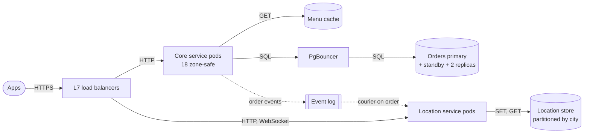

**Reading the diagram.** This is Chapter 2's container view (Figure 2.7) sized by this chapter's arithmetic. The location path (5,000 writes/s) is a separate service with a store partitioned by city: a Y-axis split that also serves the 2,500 tracking reads/s. The core service runs 18 zone-safe pods (§18.11.2) and publishes order events asynchronously to a durable log that the location service consumes. The orders primary runs at about 11% of its WAL limit (56 of 500 orders/s), so it is not partitioned yet, but §18.11.4 has started the clock.

**Figure 18.13 — Stage S5: 10,000,000 DAU (several countries).**

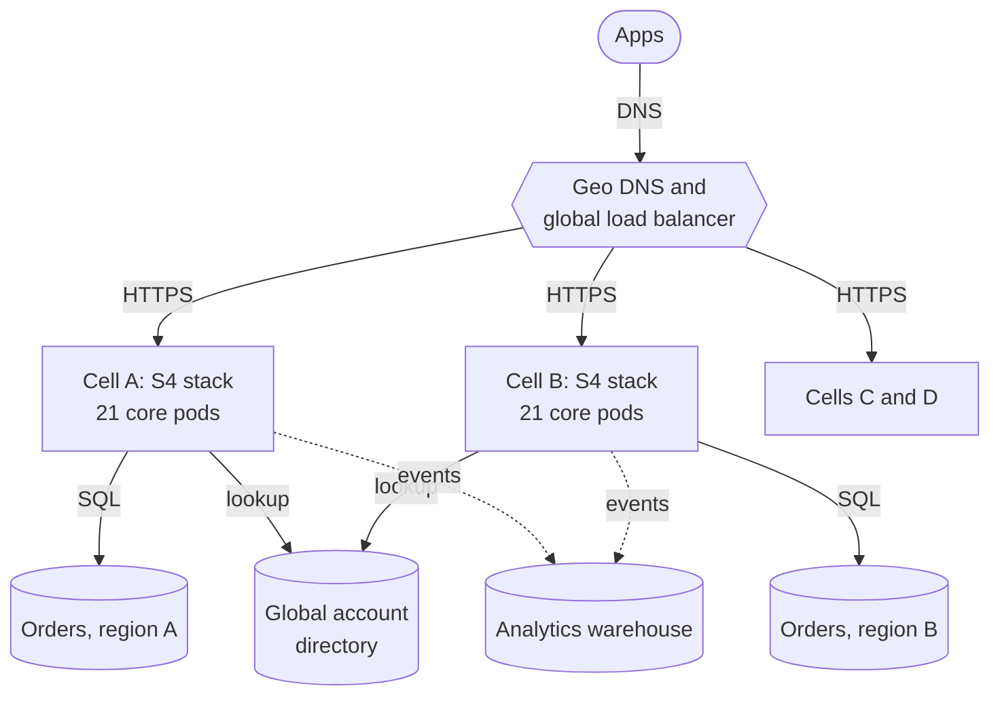

**Reading the diagram.** Order writes would reach 278/s, 93% of one primary's usable 300/s, and expansion brings data-residency rules, so the system splits on the Z axis into four regional **cells**, each a complete S4 stack with its own orders database serving one region. Assuming four equal cells, each peaks at 8,333 browse RPS: $\lceil 8{,}333/600 \rceil = 14$ working pods, 21 zone-safe, 84 in total. Global DNS routes users to their cell; a small global account directory maps accounts to cells; events flow asynchronously to a global analytics warehouse. Failure is contained to one cell. Cross-cell operations, such as a traveler ordering abroad, become explicit exceptions (Chapter 44, §33.12).

#### Failure scenarios and misconceptions

**Table 18.11 — Capacity planning failure scenarios.**

| What goes wrong | Why | Detection | Recovery | Prevention |
|---|---|---|---|---|
| Outage at a known peak | Planned for average load | Saturation at the same hour daily | Emergency scale-up; shed load | Plan with PAR and burst factors |
| Zone loss overloads survivors | Sized N+k, not zone-safe | Utilization jump on zone failure | Shed non-critical traffic | Static stability, $Z/(Z-f)$ |
| Capacity arrives too late | Lead time ignored | Forecast crosses usable capacity before the fix is ready | Vertical stopgap | $t_{start}$ tripwires |
| Wrong per-node capacity | $c$ measured at saturation, or with an unrealistic request mix | p99 breach below planned load | Re-measure | Load test at the latency objective |
| Launch traffic unplanned | Inorganic demand missed | Marketing calendar surprises | Pre-scale; queue sign-ups | Include launches in forecasts |

::: mistake
**"Plan for average load and let the autoscaler handle peaks."** QuickBite's PAR is 9.6. An autoscaler with a two-minute reaction time cannot add 9× capacity in time for a dinner rush that ramps in minutes, and it is bounded by `maxReplicas`, quotas and database connections that only a plan provides. Use scheduled scaling for known peaks and the autoscaler for the surprises.
:::

::: mistake
**"Headroom is waste."** Queueing headroom keeps latency within objective (§4.10), failure headroom keeps the service up when a zone fails, and growth headroom covers lead time. Waste is headroom nobody can justify; write the reason for each factor into the plan.
:::

## 18.12 Summary and revision notes

::: summary
- **Vertical scaling** is the cheapest move in effort and keeps state coherent, but it hits a hardware ceiling, keeps one failure domain, and gets expensive past the knee: with linear pricing, cost per unit of throughput is $k(N) = N/C(N) = 1 + \alpha(N-1) + \beta N(N-1)$.
- **Horizontal scaling** removes the ceiling and turns failures into lost capacity, but needs interchangeable nodes, load distribution, and a shared tier that can take the combined load.
- **Stateless** means a tier keeps no state another instance needs; state moves to session stores, databases, caches and clients. Sticky sessions hide state rather than removing it.
- **Bottlenecks** in scaled-out systems are shared resources. Use the resource model (§2.6) and fit the USL; the marginal gain $\Delta X(N) = X_1[C(N) - C(N-1)]$ shows when another node stops paying. Cap autoscalers below the knee.
- **Target tracking:** $n_{desired} = \lceil n \cdot m_{current}/m_{target} \rceil$ with a tolerance band; scale up fast, down slowly. Choose $u_{target} \le u_{safe}/(1 + rT_{react})$ and shorten reaction time with warm pools and spare nodes.
- **Connection budget:** $n_{max} p + \sum n_j p_j \le M - R$. Autoscaling multiplies pools; put a transaction pooler in front of PostgreSQL and size server connections by Little's Law.
- **Databases:** caches and replicas scale reads; only partitioning (or a bigger primary) scales writes. Try cheap fixes first (Table 18.8).
- **Scale cube:** X clones, Y splits by function, Z splits by customer or key. Each relieves a different bottleneck.
- **Capacity planning:** $N = \lceil R_{peak}(1+g)^L/(c\,u_{target}) \rceil$, then N+2 or zone-safe $\lceil N Z/(Z-f) \rceil$. PAR reveals idle cost. Turn forecasts into dates: $t_{exhaust} = \ln(C_{usable}/D_0)/\ln(1+g)$, and start fixes $L_{fix}$ earlier.
:::

## 18.13 Knowledge checkpoint

1. Give two reasons vertical scaling stops being the right answer.
2. With linear pricing and USL coefficients $\alpha = 0.02$, $\beta = 0.00005$, what is the relative cost per unit of throughput at 32 cores?
3. What test tells you whether an application instance is stateless?
4. Why do sticky sessions make scale-in harder?
5. 12 pods average 75% CPU with a 50% target. How many pods does the HPA request?
6. Why do autoscalers scale down more slowly than they scale up?
7. $u_{safe} = 0.8$, load grows at 10% per minute, reaction time is 3 minutes. What is the highest safe target?
8. A database has `max_connections` = 300 and 20 reserved. Pods have pools of 10. What is the largest safe `maxReplicas` with no other clients?
9. Which database-scaling options add write capacity?
10. Classify: read replicas; a separate payments service; one database per country.
11. Why is N+2 not the same as zone-safe for 14 nodes in 3 zones?
12. Peak 9,000 RPS, average 1,500 RPS. What is the PAR, and what does it suggest?
13. Usable capacity is 4 times current demand and demand grows 5% per month. When is it exhausted?

<details><summary>Answers</summary>

1. Any two of: no larger node exists; cost per unit of throughput rises past the knee; a single node is one failure domain; serial code or in-node coherency leaves added cores idle.
2. $k(32) = 1 + 0.02 \times 31 + 0.00005 \times 32 \times 31 = 1 + 0.62 + 0.0496 = 1.67$.
3. If it vanished now, would any user or other instance notice anything beyond a retry? If not, it is stateless.
4. Removing an instance destroys the sessions pinned to it, so scale-in either logs users out or must wait for sessions to expire.
5. $\lceil 12 \times 75/50 \rceil = 18$.
6. To avoid flapping: removing capacity too early causes a rebound that needs it back, and under-capacity is costlier than a few minutes of spare pods.
7. $0.8 / (1 + 0.1 \times 3) = 0.8/1.3 = 0.615$, so about 60%.
8. $\lfloor (300 - 20)/10 \rfloor = 28$ pods.
9. A bigger primary, a functional split onto separate databases, partitioning or sharding, distributed SQL, and write-optimized or partitioned NoSQL stores. Caches and read replicas do not.
10. X axis; Y axis; Z axis.
11. N+2 tolerates any two node failures, but 14 nodes in 3 zones put 5 in one zone; losing that zone removes 5. Zone-safe sizing provisions $Z/(Z-f)$ times the needed nodes.
12. PAR = 6. A statically sized fleet would be idle most of the day; autoscaling or scheduled scaling pays off.
13. $\ln 4 / \ln 1.05 = 1.386/0.0488 = 28.4$ months.
</details>

## 18.14 Interview questions

### Basic

**Q1. What is the difference between vertical and horizontal scaling, and when would you choose each?**
**Answer.** Vertical adds resources to one node: no code change, transactions stay local, but there is a ceiling, one failure domain and a rising cost per unit of throughput past the knee. Horizontal adds nodes: no ceiling and graceful degradation, but it needs stateless nodes, load distribution and a shared tier that can keep up. Scale the stateless tiers out from the start; scale the database up until its knee, then partition.

**Q2. How do you make a service stateless?**
**Answer.** Move every piece of request-spanning state to a tier built for it: sessions to a replicated session store or signed tokens, carts and drafts to the database, cached data to a shared cache, uploads to object storage, timers to a queue. Keep only rebuildable local caches. Add readiness probes and graceful shutdown so instances can be added and removed safely.

### Intermediate

**Q3. Your API autoscales from 10 to 100 pods during a sale, and the database starts refusing connections. What happened and how do you fix it?**
**Answer.** Pods times pool size exceeded `max_connections` minus reserved slots. Short term: lower pool sizes or cap replicas. Proper fix: a transaction-mode pooler such as PgBouncer, with server connections sized by Little's Law (transaction rate × hold time × headroom), and a connection-budget check whenever replicas or pools change. Also verify that the database itself is not the real bottleneck.

**Q4. How do you choose the autoscaling metric and target?**
**Answer.** Pick a metric proportional to load and inversely proportional to replicas: CPU for CPU-bound services, in-flight requests for I/O-bound ones, backlog per worker for queues. Load-test to find the per-pod throughput at which p99 meets the objective ($u_{safe}$), then lower the target by the load growth expected during the reaction time: $u_{safe}/(1 + rT_{react})$. Add scheduled scaling for known peaks.

### Advanced

**Q5. Adding servers no longer increases throughput. How do you investigate?**
**Answer.** Measure throughput at several node counts and fit the USL. A large $\alpha$ points to a shared, serialized resource (a hot row, a global lock, a single primary); a significant $\beta$ points to coordination that grows with node pairs (invalidation broadcasts, gossip, distributed locks). Confirm with per-resource utilization (USE, §2.6) and profiling. Fix the shared cost by partitioning or removing it; cap the autoscaler below the knee meanwhile.

**Q6. Walk through a capacity plan for a service growing from one city to several countries.**
**Answer.** Convert users to peak rates (busy-hour share, burst factor); measure per-node capacity at the latency objective; compute nodes at a target utilization; add N+2 or zone-safe redundancy and growth over lead time. For each shared component, compute when demand crosses usable capacity and subtract the fix's lead time. Map each limit to an axis: X for stateless tiers, Y for very different workloads such as location updates, Z (cells, partitions) for write limits and data residency.

## 18.15 Practical exercises

1. Run the autoscaler simulation with a 2-minute load ramp and with `STARTUP_S = 180`. Find the highest target that avoids overload in each case and compare it with the formula in §18.8.4.
2. Extend the capacity-plan program to compute PgBouncer server connections per stage, assuming 2 ms per query and that 40% of browse requests miss the cache.
3. Load-test any small web service at 1, 2, 4, 8 and 16 workers, fit the USL coefficients and report $N^*$.

## 18.16 Design challenges

1. **Ticket on-sale.** A concert-ticket service sees 100 times its normal load for 10 minutes when sales open. Design the scaling strategy: what is pre-scaled, what autoscales, what queues users, and how the inventory database avoids a hot row.
2. **QuickBite in a new continent.** Extend the S5 design to a continent with strict data-residency laws and a different payment provider. Decide what is global, what is per cell, and how a traveler's account works across cells.

## 18.17 References

1. Abbott, M. L., and Fisher, M. T. *The Art of Scalability: Scalable Web Architecture, Processes, and Organizations for the Modern Enterprise*, 2nd ed. Addison-Wesley, 2015.
2. Amazon Web Services. *Amazon EC2 Auto Scaling User Guide*: target tracking scaling policies, instance warm-up, warm pools and predictive scaling. Accessed 2026.
3. Amazon Web Services. *Reducing the Scope of Impact with Cell-Based Architecture*. AWS Well-Architected whitepaper, 2023.
4. Barroso, L. A., and Hölzle, U. "The Case for Energy-Proportional Computing." *IEEE Computer* 40(12), 2007.
5. Barroso, L. A., Hölzle, U., and Ranganathan, P. *The Datacenter as a Computer: Designing Warehouse-Scale Machines*, 3rd ed. Morgan & Claypool, 2018.
6. Beyer, B., Jones, C., Petoff, J., and Murphy, N. R. (eds.). *Site Reliability Engineering: How Google Runs Production Systems*. O'Reilly Media, 2016. Chapters 1, 2 and 18. https://sre.google/sre-book/table-of-contents/
7. Craver, N. "Stack Overflow: The Architecture – 2016 Edition." nickcraver.com, 2016.
8. Gunther, N. J. *Guerrilla Capacity Planning: A Tactical Approach to Planning for Highly Scalable Applications and Services*. Springer, 2007.
9. Kubernetes Documentation. "Horizontal Pod Autoscaling." kubernetes.io, accessed 2026.
10. MacCárthaigh, C. "Workload isolation using shuffle-sharding." *Amazon Builders' Library*, 2019.
11. Netflix Technology Blog. "Scryer: Netflix's Predictive Auto Scaling Engine." 2013.
12. PostgreSQL Global Development Group. *PostgreSQL Documentation*: "Connections and Authentication" (`max_connections`, `superuser_reserved_connections`). Accessed 2026.
13. Weiss, B., and Furr, M. "Static stability using Availability Zones." *Amazon Builders' Library*, 2020.

## 18.18 Open verification items

- Kubernetes HPA defaults (tolerance 0.1, 15 s sync period, 300 s scale-down stabilization) and the documentation URL, as of 2026.
- Largest general-purpose cloud instance sizes in Table 18.1, as of 2026.
- Stack Overflow server counts in [Craver 2016] and the post's URL.
- Publication years of [Weiss and Furr 2020] and [Netflix 2013]; exact title of [AWS 2023].
- That the SRE book's N+2 guidance and Auxon description are in the chapters cited.
