# Chapter 19 — Load Balancing

> **Level:** 2 · **Track:** A (Traditional) · **Estimated reading time:** 5 h

Chapter 18 made the case for horizontal scaling: run many identical, stateless copies of a service instead of one big machine. That decision creates a new problem the moment you make it. Clients know one name, `api.example.com`, but there are now forty servers behind it. Something must pick a server for every connection or request, notice when a server dies, and keep doing so while servers come and go. That something is a **load balancer**, and it sits on the critical path of almost every request in a modern system.

Load balancing looks simple ("send each request to the next server") and hides some of the most instructive ideas in system design. A balancer that ignores load can push slow servers into collapse while fast ones idle. A balancer that chases the least-loaded server can stampede it. A balancer that remembers which server holds a user's session cannot also spread load perfectly. And a balancer is itself a server that can fail, so you must balance the balancers. This chapter works through each of these problems with the mechanism, the arithmetic and a simulation that you can run.

## 19.1 Learning objectives

After this chapter you should be able to:

- Distinguish layer 4 from layer 7 load balancing, and choose between TLS termination, re-encryption and passthrough, and between NAT, full-proxy and direct server return forwarding.
- Implement round robin, smooth weighted round robin, least connections, EWMA-based least response time and power of two choices, and predict how each behaves on heterogeneous servers.
- State the maximum-load results for one and two random choices, and use a simulation to compare p99 queue lengths across algorithms, including with stale load information.
- Explain consistent hashing with bounded loads and Maglev hashing, build a Maglev lookup table and measure its disruption when a backend fails.
- Configure active and passive health checks, compute detection time and the requests lost during it, and avoid flapping and ejection cascades.
- Weigh session affinity methods (cookies, source-IP hashing, consistent hashing) against their costs.
- Design redundant load balancer tiers with VRRP, anycast and ECMP, compute failover times, and drain connections safely.
- Explain where DNS-based global server load balancing fits and where it falls short, and compare proxy, client-side, sidecar and lookaside load balancing.
- Compare NGINX, HAProxy, Envoy, AWS ALB/NLB and Google Maglev for a given workload.

## 19.2 Prerequisites

- IP routing, BGP and anycast — §7.5 (anycast and ECMP are how balancers themselves are made redundant).
- DNS resolution, TTLs and DNS-based load balancing — §7.6.4, §7.6.5 (global load balancing starts in DNS).
- TCP handshakes, TLS 1.3 and HTTP/2 multiplexing — §7.7, §7.9, §7.10 (they decide what a balancer can see and what a connection costs).
- Reverse proxies and NAT — §7.12, §7.13 (a load balancer is a reverse proxy or a NAT device with a selection policy).
- Queueing basics: utilization, M/M/1, shared versus separate queues, Little's Law — §4.10, §4.11 (every algorithm here is an attempt to approximate one shared queue).
- Percentiles and tail latency — §4.8.
- Consistent hashing and virtual nodes — §14.8 (this chapter builds on it and does not repeat the derivations).
- Stateless versus stateful services — §18.5.

## 19.3 Layer 4 versus layer 7 load balancing

### 19.3.1 What a load balancer is

::: definition
**Definition — Load balancer.** A component that receives traffic addressed to a single service endpoint, the **virtual IP address (VIP)** or service name, and distributes it across a **pool** of **backends** (also called *upstreams*, *targets* or *real servers*) according to a **balancing algorithm**, while excluding backends that are unhealthy.
:::

::: definition
**Definition — Layer 4 (L4) and layer 7 (L7) load balancing.** An **L4 load balancer** makes its decision from transport-layer information (IP addresses, ports, protocol) and balances **connections or flows**: every packet of one TCP connection goes to the same backend. An **L7 load balancer** terminates the client connection, parses the application protocol (usually HTTP), and balances **requests**: two requests on one connection may go to different backends.
:::

#### First-principles explanation

Picture a large post office with twenty counters. An L4 balancer is the doorman: he looks only at the envelope (who sent it, which door it came through) and points each arriving customer to a counter, and that customer stays at the counter for the whole visit, however many errands they have. An L7 balancer is a receptionist who opens each letter, reads what it asks for ("passport renewal", "parcel pickup"), and sends each errand to the counter that handles it, possibly a different counter for each errand. The receptionist is far more flexible but must open every letter, which takes time and trust: she must hold the keys to the envelopes (TLS keys).

#### Why does this exist?

Both kinds exist because there is a trade-off between **cost per byte** and **intelligence per request**. Network-level balancers in front of Google, Meta or a cloud region carry terabits per second; touching only packet headers lets them do that on commodity servers [Eisenbud et al. 2016]. Application-level routing (send `/api/search` to the search service, retry a failed idempotent `GET` on another backend, spread gRPC calls that share one HTTP/2 connection) needs the request itself. Large sites therefore stack both: L4 in front for scale and resilience, L7 behind it for routing (§19.8, Figure 19.9).

#### How it works internally

An **L4 balancer** comes in two forms:

1. **Packet-forwarding L4** (Linux IPVS, Maglev, Meta's Katran, AWS Network Load Balancer). It does not terminate TCP. For the first packet of a flow it picks a backend by hashing the **5-tuple** (source IP, source port, destination IP, destination port, protocol) or by algorithm, records the choice in a **connection-tracking table**, and rewrites or encapsulates each packet toward that backend. The backend completes the TCP handshake with the client itself.
2. **Connection-terminating L4 proxy** (HAProxy `mode tcp`, NGINX `stream`). It accepts the client's TCP connection, opens a second TCP connection to a chosen backend, and copies bytes in both directions without parsing them.

An **L7 balancer** (NGINX `http`, HAProxy `mode http`, Envoy, AWS Application Load Balancer) always terminates:

1. Accept the client TCP connection and, for HTTPS, complete the TLS handshake with the site's certificate (**TLS termination**).
2. Parse each HTTP request: method, path, `Host`, headers.
3. Apply **routing rules** (host- and path-based) to choose a pool, then the balancing algorithm to choose a backend in it.
4. Forward the request over a pooled, often long-lived connection to the backend, adding headers such as `X-Forwarded-For` (§7.12).
5. Stream the response back, optionally compressing, caching or retrying on failure.

**TLS choices.** With **termination**, the balancer decrypts and forwards plaintext inside the private network. With **re-encryption** (TLS bridging), it decrypts, inspects, and opens a new TLS connection to the backend, which zero-trust networks (§10.10) often require. With **passthrough**, an L4 balancer forwards encrypted bytes untouched and may route on the **Server Name Indication (SNI)** field, which travels unencrypted in the TLS ClientHello; it cannot see paths or headers, but certificates and keys stay on the backends.

#### Architecture diagram

**Figure 19.1 — An L4 balancer forwards flows; an L7 balancer terminates connections and routes requests.**

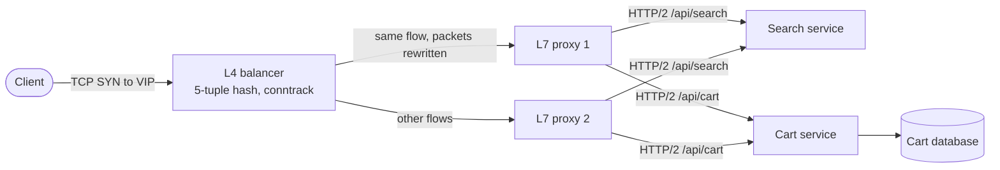

**Reading the diagram.** The client opens one TCP connection to the VIP. The L4 balancer sees only packet headers; it hashes the 5-tuple, remembers the choice in its connection table, and sends every packet of this flow to the same L7 proxy. The proxy terminates TCP and TLS, reads each HTTP request, and routes `/api/search` and `/api/cart` to different services over pooled HTTP/2 connections. All arrows are synchronous request/response paths. The cart database is the only storage boundary; both balancer tiers are stateless apart from soft connection state. Failure points: losing the L4 node breaks the flows it carries unless its peers can rebuild the mapping (§19.8); losing an L7 proxy breaks the connections it terminated, and clients reconnect. Scaling: add L4 nodes behind ECMP and add L7 proxies behind the L4 tier.

#### Forwarding modes and direct server return

A packet-forwarding balancer must decide how replies get back to the client.

::: definition
**Definition — Direct server return (DSR).** A forwarding mode in which the balancer delivers request packets to the backend but the backend sends responses **directly to the client**, using the VIP as its source address, bypassing the balancer on the return path.
:::

**Figure 19.2 — Full-proxy (NAT) forwarding versus direct server return.**

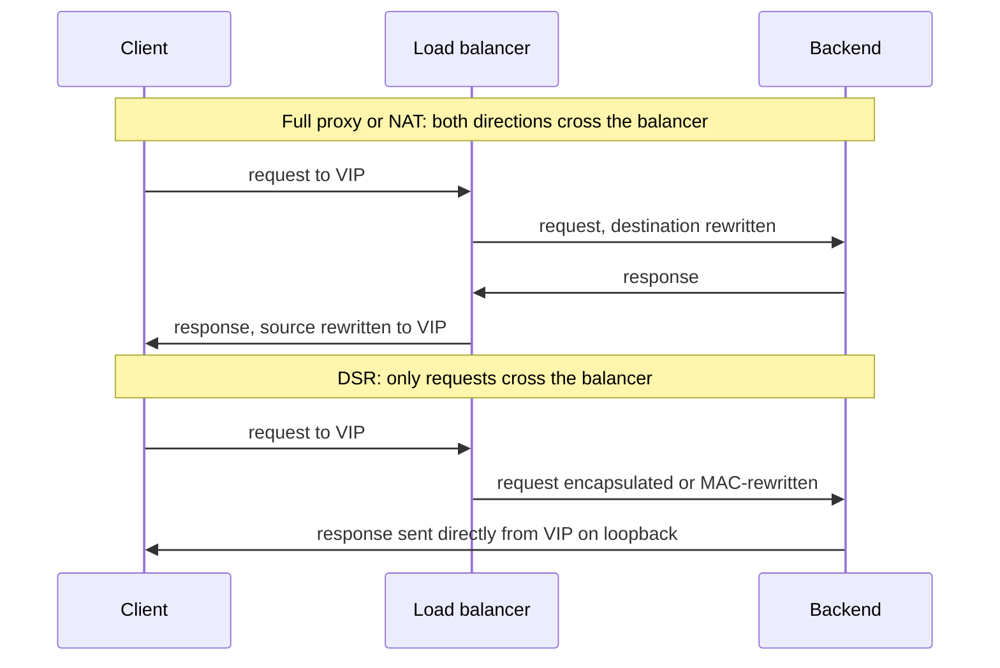

**Reading the diagram.** In the upper half every byte, in both directions, passes through the balancer, which rewrites addresses each way; the backend may not even know the client's address unless the balancer passes it (PROXY protocol or `X-Forwarded-For`). In the lower half the balancer forwards only requests. It either rewrites the destination MAC address (backend on the same layer-2 segment) or wraps the packet in an outer IP header (IP-in-IP, GRE or GUE tunnels, which can cross subnets). The backend has the VIP configured on a loopback interface, so it accepts the packet and replies from the VIP straight to the client. All flows are synchronous. Failure point: with DSR the balancer never sees responses, so it cannot detect a backend that accepts requests but never answers, and tunnel headers shrink the usable MTU. Scaling benefit: response bytes, often ten or more times request bytes, never load the balancer.

::: formula
**Balancer bandwidth by forwarding mode**

$$B_{\text{proxy}} = R\,(s_{\text{req}} + s_{\text{resp}}), \qquad B_{\text{DSR}} = R\,s_{\text{req}}$$

| Symbol | Meaning | Units |
|---|---|---|
| $B_{\text{proxy}}$ | Bandwidth through the balancer when both directions cross it | bytes/second |
| $B_{\text{DSR}}$ | Bandwidth through the balancer with direct server return | bytes/second |
| $R$ | Request rate | requests/second |
| $s_{\text{req}}$, $s_{\text{resp}}$ | Average request and response size on the wire | bytes |
:::

::: example
**Worked example — a video-thumbnail service.** $R = 100{,}000$ requests/s, $s_{\text{req}} = 2$ KB, $s_{\text{resp}} = 50$ KB (SI units).

1. Full proxy: $100{,}000 \times (2{,}000 + 50{,}000) = 5.2 \times 10^9$ bytes/s $= 41.6$ Gbit/s.
2. DSR: $100{,}000 \times 2{,}000 = 2 \times 10^8$ bytes/s $= 1.6$ Gbit/s.
3. Ratio: $41.6 / 1.6 = 26$.

*Interpretation.* With DSR, one balancer with a 10 Gbit/s NIC has room to spare; a full proxy needs at least five such NICs before any headroom. *Engineering implication.* For download-heavy L4 traffic, DSR is the cheapest scaling lever; it is unavailable at L7, because an L7 proxy must see the response to do its job.
:::

**Table 19.1 — Forwarding modes of an L4 balancer.**

| Mode | How it works | Client IP at backend | Return path | Constraints |
|---|---|---|---|---|
| Destination NAT | Rewrite destination IP; backend's gateway is the balancer | Preserved | Through balancer | Backends must route replies via the balancer |
| Full NAT / L4 proxy | Rewrite source and destination, or terminate TCP | Lost (use PROXY protocol) | Through balancer | Port exhaustion on the balancer's source IPs |
| DSR, L2 (MAC rewrite) | Rewrite destination MAC only | Preserved | Direct | Same layer-2 segment; VIP on loopback; ARP suppressed |
| DSR, tunnel | Encapsulate in IP-in-IP, GRE or GUE | Preserved | Direct | MTU and MSS clamping; backend decapsulates |

These are the modes of Linux Virtual Server (LVS-NAT, LVS-DR and LVS-TUN), which IPVS implements in the kernel [Zhang 2000]. Maglev encapsulates packets to backends in GRE and relies on DSR [Eisenbud et al. 2016].

#### Advantages and disadvantages

**Table 19.2 — Layer 4 versus layer 7 load balancing.**

| Aspect | Layer 4 | Layer 7 |
|---|---|---|
| What it is | Flow or connection balancer | Request balancer and reverse proxy |
| Unit of balancing | TCP connection or UDP flow | HTTP request or gRPC call |
| Sees | IPs, ports, protocol (and SNI if it peeks) | Method, path, headers, cookies, body |
| TLS | Passthrough (or termination in an L4 proxy) | Termination or re-encryption |
| Advantages | Very high throughput, protocol-agnostic, DSR possible, low added latency | Content routing, retries, per-request balancing, header rewriting, observability per request |
| Disadvantages | Long-lived connections pin load; no content routing | CPU for TLS and parsing; holds keys; more complex failure modes |
| Performance | Line rate on commodity servers (10 Gbit/s per Maglev machine) | Bounded by TLS handshakes and request parsing per core |
| Operational complexity | Routing integration (BGP, ECMP), tunnels | Configuration surface: routes, timeouts, retries |
| Choose when | Non-HTTP protocols, extreme volume, first tier of a stack | HTTP/gRPC services, microservices, canary routing |

#### Failure scenarios

| What goes wrong | Why | Detection | Recovery | Prevention |
|---|---|---|---|---|
| gRPC traffic piles onto one backend | L4 balances HTTP/2 connections, and one connection carries thousands of calls | Per-backend request rate skewed; one hot CPU | Recycle connections | L7 or client-side per-call balancing (§19.10); maximum connection age |
| Large uploads fail through a DSR tunnel | Encapsulation overhead exceeds path MTU; ICMP blocked | Hung connections at specific payload sizes | Lower MSS | MSS clamping; jumbo frames inside the datacenter |
| Rate limits apply to the balancer, not users | Full NAT hides client IPs | Every request "comes from" a few balancer IPs | Read client IP from PROXY protocol or trusted headers | Enable PROXY protocol; trust headers only from your own proxies |
| Connection-table exhaustion | SYN flood or very many idle flows | Table-full counters; new flows dropped | Shorter idle timeouts | SYN cookies; size tables for peak flows; DDoS scrubbing (§10.11) |

::: mistake
**"An L4 balancer cannot handle HTTPS."** It can: with passthrough it forwards encrypted bytes and never needs keys, and with SNI it can even pick a pool per hostname. What it cannot do is route on anything *inside* the encrypted stream, such as the URL path.
:::

::: mistake
**"Putting HTTP/2 behind an L4 balancer spreads load."** It spreads *connections*. A client that multiplexes all its calls over one HTTP/2 connection sends all of them to one backend. This is the classic surprise when teams adopt gRPC behind a cloud L4 balancer (§8.8).
:::

## 19.4 Load-balancing algorithms

A balancing algorithm answers one question per connection or request: *which backend?* Section 4.10.4 showed why the answer matters: one shared queue feeding all servers beats separate queues by a wide margin, because no server idles while work waits elsewhere. A load balancer cannot build one shared queue across machines; it must commit each request to one server's queue at arrival. Every algorithm below is a different approximation of the shared queue, trading information for cost.

### 19.4.1 Round robin and weighted round robin

::: definition
**Definition — Round robin (RR).** Send the $k$-th request to backend $k \bmod N$. **Weighted round robin (WRR)** gives backend $i$ an integer weight $w_i$ and sends it a share $w_i / \sum_j w_j$ of requests in each cycle.
:::

#### First-principles explanation

A teacher handing out exam papers walks along the row giving one to each desk in turn. Nobody gets two before everyone has one, and the teacher needs no information about the students. That is round robin: perfectly fair in *count*, blind to *effort*. If some desks hold students who work twice as fast, you give them two papers per round: weighted round robin.

#### Why does this exist?

Round robin needs no state beyond a counter and no feedback from backends, so it is cheap, predictable and easy to debug. It is the default in NGINX, HAProxy (`roundrobin`), Envoy and AWS ALB. It works well when backends are identical and requests cost about the same. Weights handle the commonest exception: a mixed fleet in which some machines have more cores.

#### How it works internally

A naive WRR repeats each backend $w_i$ times in a row: with weights $a{:}5, b{:}1, c{:}1$ it sends `a a a a a b c`, five requests in a burst to `a`. NGINX uses **smooth weighted round robin**, which interleaves [NGINX source: ngx_http_upstream_round_robin.c]:

1. Each backend keeps a *current weight*, initially 0.
2. On each pick, add every backend's configured weight to its current weight.
3. Choose the backend with the largest current weight.
4. Subtract the total of all weights from the chosen backend's current weight.

Over one cycle of $\sum w_i$ picks each backend is chosen exactly $w_i$ times, and the chosen backend is pushed to the back of the line each time, so picks are spread out.

#### Mathematical foundations

::: formula
**Weighted round-robin share**

$$\lambda_i = \lambda \cdot \frac{w_i}{\sum_{j=1}^{N} w_j}, \qquad \rho_i = \frac{\lambda_i}{\mu_i}$$

| Symbol | Meaning | Units |
|---|---|---|
| $\lambda$ | Total request rate into the pool | requests/second |
| $\lambda_i$ | Request rate sent to backend $i$ | requests/second |
| $w_i$ | Configured weight of backend $i$ | dimensionless |
| $N$ | Number of backends | count |
| $\mu_i$ | Capacity (service rate) of backend $i$ | requests/second |
| $\rho_i$ | Utilization of backend $i$ | dimensionless |
:::

::: example
**Worked example — a mixed fleet.** Three backends with 8, 16 and 32 cores; each core serves 125 requests/s, so $\mu = 1{,}000$, $2{,}000$ and $4{,}000$ requests/s. Total load $\lambda = 5{,}600$ requests/s.

1. Unweighted RR: each gets $5{,}600/3 = 1{,}867$ requests/s. Utilizations: $1{,}867/1{,}000 = 1.87$ (overloaded, queue grows without bound), $0.93$ and $0.47$.
2. Weights 1 : 2 : 4 (proportional to cores), $\sum w = 7$: $\lambda_i = 800$, $1{,}600$, $3{,}200$ requests/s.
3. Utilizations: $800/1{,}000 = 0.8$, $1{,}600/2{,}000 = 0.8$, $3{,}200/4{,}000 = 0.8$.

*Interpretation.* Total capacity is 7,000 requests/s, so the pool is at 80%, yet unweighted RR drives the smallest machine to 187% while the largest idles at 47%. *Engineering implication.* RR is only safe on homogeneous pools; with mixed instance types, set weights proportional to measured capacity, or use a load-aware algorithm.
:::

#### Code example

```python
"""Smooth weighted round robin, the algorithm NGINX uses for weighted upstreams."""
from collections import Counter


class SmoothWRR:
    def __init__(self, weights: dict):
        self.weights = dict(weights)              # server -> configured weight
        self.current = {s: 0 for s in weights}    # server -> current weight
        self.total = sum(weights.values())

    def pick(self) -> str:
        # 1. Every server earns its weight.
        for s, w in self.weights.items():
            self.current[s] += w
        # 2. The richest server wins (ties: first in insertion order).
        best = max(self.current, key=self.current.get)
        # 3. The winner pays the total, so it falls behind the others.
        self.current[best] -= self.total
        return best


def naive_wrr(weights: dict) -> list:
    """Repeat each server w times in a row: correct shares, bursty order."""
    return [s for s, w in weights.items() for _ in range(w)]


if __name__ == "__main__":
    w = {"a": 5, "b": 1, "c": 1}
    lb = SmoothWRR(w)
    seq = [lb.pick() for _ in range(7)]
    print("naive :", " ".join(naive_wrr(w)))
    print("smooth:", " ".join(seq))
    assert seq == ["a", "a", "b", "a", "c", "a", "a"]

    w2 = {"s1": 1, "s2": 2, "s3": 4}               # 8, 16 and 32 cores
    lb2 = SmoothWRR(w2)
    counts = Counter(lb2.pick() for _ in range(7_000))
    print("shares over 7,000 picks:", dict(counts))
    assert counts == {"s1": 1_000, "s2": 2_000, "s3": 4_000}
```

What to notice:

- The smooth sequence for weights 5, 1, 1 is `a a b a c a a`, the sequence documented in the NGINX source, instead of five `a`s in a row.
- Shares are exact over each cycle: 1,000, 2,000 and 4,000 picks out of 7,000.
- The algorithm is $O(N)$ per pick; NGINX accepts that because pools are small. Large pools use precomputed schedules or randomized weighted choice.

::: industry
**Google: weighted round robin driven by backend reports.** Google's SRE book describes datacenter load balancing in which clients weight backends using utilization and error rates that the backends report in their responses, after finding that plain round robin and "least-loaded" round robin left large utilization differences between the most and least loaded tasks. gRPC's `weighted_round_robin` policy, which takes weights from backend load reports, follows the same idea.
*Evidence: Primary* — [Beyer et al. 2016, ch. 20; gRPC Docs: Load balancing]
:::

### 19.4.2 Least connections

::: definition
**Definition — Least connections.** Send each new connection or request to the backend with the fewest **active** (in-flight) connections or requests, as counted by the balancer. *Weighted least connections* divides each count by the backend's weight. Envoy calls the request-counting variant **least request**; AWS ALB calls it **least outstanding requests**.
:::

#### First-principles explanation

At a supermarket you do not join checkouts in turn; you join the shortest line. A fast cashier's line empties quickly, so she gets more customers without anyone measuring her speed. Least connections works the same way: the count of in-flight requests is a free, real-time signal that combines how much work a backend has and how fast it clears it.

#### How it works internally

1. The balancer increments a counter for a backend when it forwards a request (or opens a connection) and decrements it when the response completes (or the connection closes).
2. For each new request it scans for the minimum count, breaking ties randomly (ties in a fixed order send every tie to backend 0).
3. Weighted versions compare $\text{active}_i / w_i$.

The count is **local to one balancer**. With ten balancer instances, each sees only the connections it opened itself.

#### Mathematical foundations

::: formula
**Little's Law per backend (§4.11)**

$$L_i = \lambda_i \, W_i \quad\Longrightarrow\quad \lambda_i = \frac{L_i}{W_i}$$

| Symbol | Meaning | Units |
|---|---|---|
| $L_i$ | Average in-flight requests at backend $i$ (its "connections") | requests |
| $\lambda_i$ | Request rate sent to backend $i$ | requests/second |
| $W_i$ | Average time a request spends at backend $i$ | seconds |
:::

::: example
**Worked example — least connections finds the fast server.** A pool has a fast backend ($W = 50$ ms) and a slow one ($W = 200$ ms, perhaps on a noisy host). Least connections keeps both at about the same count, say $L = 20$.

1. Fast: $\lambda = 20 / 0.050 = 400$ requests/s.
2. Slow: $\lambda = 20 / 0.200 = 100$ requests/s.
3. Split: $400/(400+100) = 80\%$ to the fast backend, with no configuration.
4. Round robin at the same 500 requests/s sends 250 to each; the slow one then holds $250 \times 0.2 = 50$ in-flight requests (more, as its queue grows), $2.5 \times$ the fast one.

*Interpretation.* Equalizing in-flight counts makes the rate to each backend inversely proportional to its latency. *Engineering implication.* Least connections is the robust default when request costs vary widely (search queries, report generation) or backends differ, and essential for long-lived connections (WebSockets, §9.6), where round robin balances connection *arrivals* but not connection *lifetimes*.
:::

::: warning
**The fast-failure sinkhole.** A backend that fails instantly (returns `503` in 1 ms because its database is down) has the fewest in-flight requests, so least connections sends it *more* traffic. The Google SRE book describes the same trap for "least-loaded" balancing [Beyer et al. 2016, ch. 20]. Pair load-aware algorithms with passive health checks that count errors (§19.5.3).
:::

### 19.4.3 Least response time and EWMA

::: definition
**Definition — Least response time.** Choose the backend with the lowest recent latency, usually an **exponentially weighted moving average (EWMA)** of observed response times, often multiplied by the in-flight count so that both queue length and speed count.
:::

An EWMA is a running average that forgets: every new sample pulls the estimate a fraction $\alpha$ of the way toward itself. It needs one number per backend, reacts to changes, and ignores old history.

::: formula
**Exponentially weighted moving average**

$$S_k = \alpha\, x_k + (1 - \alpha)\, S_{k-1}, \qquad S_k - x^{*} = (1-\alpha)^k (S_0 - x^{*}) \text{ after a step to } x^{*}, \qquad \alpha = 1 - e^{-\Delta t/\tau}$$

| Symbol | Meaning | Units |
|---|---|---|
| $S_k$ | Latency estimate after $k$ samples | ms |
| $x_k$ | The $k$-th observed latency | ms |
| $\alpha$ | Smoothing factor, $0 < \alpha \le 1$ | dimensionless |
| $x^{*}$ | New steady latency after a sudden change | ms |
| $\Delta t$, $\tau$ | Time since previous sample; decay time constant (time-based variant) | seconds |
:::

::: example
**Worked example — how fast does the estimate notice a slowdown?** A backend's latency jumps from 20 ms to 200 ms (garbage-collection storm). $\alpha = 0.1$.

1. After $k$ samples: $S_k = 200 - 180 \times 0.9^k$.
2. $k = 10$: $0.9^{10} = 0.349$, $S = 200 - 62.8 = 137$ ms.
3. $k = 22$: $0.9^{22} = 0.098$, $S = 200 - 17.7 = 182$ ms, within 10% of the truth.
4. At 100 requests/s to this backend, 22 samples arrive in 0.22 s; at 1 request/s, it takes 22 s.

*Interpretation.* Per-sample smoothing reacts at the speed of traffic; a backend that receives little traffic (because it looked slow) updates slowly. The time-based form $\alpha = 1 - e^{-\Delta t/\tau}$ makes the memory a fixed duration $\tau$ instead. *Engineering implication.* Choose $\tau$ near the timescale of the problems you want to dodge (seconds for GC pauses), and make a backend's estimate decay back toward the pool average when it gets no samples, so a once-slow backend is retried.
:::

::: industry
**Twitter Finagle and Linkerd: power of two choices with peak EWMA.** Finagle, Twitter's RPC library, offers a "peak EWMA" balancer: it tracks an EWMA of round-trip time that jumps *up* immediately on a slow response and decays slowly, multiplies it by the outstanding request count, and compares two randomly chosen backends. Linkerd, which grew out of Finagle, uses the same latency-aware power-of-two-choices approach.
*Evidence: Primary* — [Twitter: Finagle documentation, Load balancers]
:::

### 19.4.4 Power of two choices

::: definition
**Definition — Power of two choices (P2C).** For each request, pick **two** backends uniformly at random and send the request to the less loaded of the two (by in-flight count, EWMA latency or another load signal).
:::

#### First-principles explanation

Return to the supermarket, but now the store is enormous, with 500 checkouts, and you cannot see all the lines. If you join a random line, sooner or later you join a terrible one. If you glance at just *two* random lines and join the shorter, you almost never join a terrible line, because both would have to be terrible. The surprise is how much that one extra glance buys: the worst line in the store shrinks *exponentially*.

#### Why does this exist?

Least connections needs a global, current view of every backend's load. That is cheap for one balancer and 10 backends, but not for 50 balancers and 5,000 backends: each balancer sees only its own traffic, and load reports arrive late. When many balancers all pick "the least loaded backend" from the same stale information, they all pick the *same* backend and swamp it, a **herd effect** (Figure 19.3). Random choice avoids herds but tolerates bad luck. Two random choices keep almost all the benefit of full information, avoid the herd, and cost two lookups [Mitzenmacher 2001].

**Figure 19.3 — Herd behavior with stale load information, and how two random choices avoid it.**

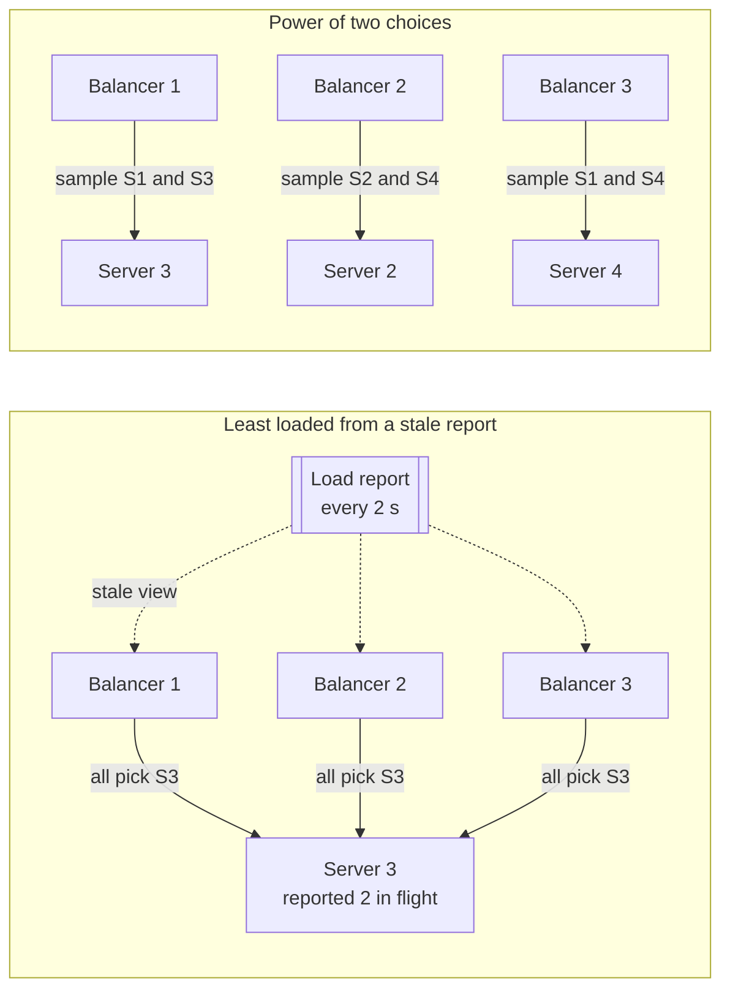

**Reading the diagram.** On the left, three balancers receive the same load report asynchronously (dotted arrows) every 2 seconds. Server 3 looked idlest in the last report, so all three send every new request to it (solid, synchronous forwarding) until the next report, by which time Server 3 is the busiest and the herd moves on. On the right, each balancer samples two different random servers per request and picks the lighter one; the choices scatter across the pool, so stale or partial information cannot concentrate load. There is no storage boundary; the failure point is the shared, stale view on the left. Scaling: P2C needs no coordination between balancers, so it scales to any number of them.

#### Mathematical foundations

The classic model is **balls into bins**: throw $n$ balls into $n$ bins, each ball choosing its bin(s) at random.

::: formula
**Maximum load with one and with $d$ random choices** [Azar et al. 1999]

$$\text{one choice: } \max \text{load} = \frac{\ln n}{\ln \ln n}\,(1 + o(1)), \qquad d \ge 2 \text{ choices: } \max \text{load} = \frac{\ln \ln n}{\ln d} + \Theta(1) \quad \text{(with high probability)}$$

| Symbol | Meaning | Units |
|---|---|---|
| $n$ | Number of balls (requests) and of bins (servers) | count |
| $d$ | Number of random bins examined per ball | count |
| $\max \text{load}$ | Largest number of balls in any bin | balls |
| $o(1)$, $\Theta(1)$ | A term that vanishes as $n$ grows; a bounded constant | — |
:::

::: example
**Worked example — one million balls into one million bins.**

1. $\ln n = \ln 10^6 = 13.82$; $\ln \ln n = \ln 13.82 = 2.63$.
2. One choice, leading term: $13.82 / 2.63 = 5.26$.
3. Two choices, leading term: $2.63 / \ln 2 = 2.63 / 0.693 = 3.79$.
4. Measured (listing below): 9.0 with one choice, 4.0 with two, 3.0 with three.

*Interpretation.* The leading term underestimates the one-choice case at practical sizes (the $o(1)$ factor is large), but the shape is right: the worst bin with one choice grows almost like $\log n$, while with two choices it grows like $\log \log n$, which is below 5 for any $n$ you will meet. Going from two choices to three helps far less than going from one to two. *Engineering implication.* Two samples are the sweet spot: almost all the benefit, no coordination, and no herd.
:::

Mitzenmacher analyzed the dynamic version, the **supermarket model**: requests arrive as a Poisson stream at rate $\lambda n$ to $n$ servers of rate 1, each joining the shorter of $d$ random queues [Mitzenmacher 2001].

::: formula
**Queue-length tail in the supermarket model (large $n$)**

$$s_i = \lambda^{i} \;\; (d = 1), \qquad s_i = \lambda^{\frac{d^{i} - 1}{d - 1}} \;\; (d \ge 2), \qquad \text{so for } d = 2:\; s_i = \lambda^{2^{i} - 1}$$

| Symbol | Meaning | Units |
|---|---|---|
| $s_i$ | Fraction of servers with at least $i$ requests (queued or in service) | dimensionless |
| $\lambda$ | Utilization: arrival rate per server divided by service rate | dimensionless |
| $d$ | Number of queues sampled per request | count |
| $i$ | Queue-length threshold | requests |
:::

::: example
**Worked example — at 90% utilization.** $\lambda = 0.9$.

1. Random ($d = 1$): $s_5 = 0.9^5 = 0.59$, so 59% of servers have 5 or more requests. $s_{10} = 0.9^{10} = 0.35$.
2. Two choices: $s_5 = 0.9^{2^5 - 1} = 0.9^{31} = 0.038$, so 3.8%. $s_{10} = 0.9^{1023} \approx 10^{-47}$: effectively never.
3. Three choices: $s_5 = 0.9^{(3^5-1)/2} = 0.9^{121} \approx 2.9 \times 10^{-6}$.

*Interpretation.* With one choice the tail decays geometrically; with two it decays **doubly exponentially**. *Engineering implication.* At high utilization the difference is between a long tail of overloaded servers and none, which is exactly what p99 latency measures.
:::

#### Code example

```python
"""Balls into bins: maximum load with d = 1, 2, 3 random choices."""
import math
import random


def max_load(n: int, d: int, rng: random.Random) -> int:
    """Throw n balls into n bins; each ball goes to the least loaded of d random bins."""
    bins = [0] * n
    for _ in range(n):
        if d == 1:
            i = rng.randrange(n)
        else:
            i = min((rng.randrange(n) for _ in range(d)), key=bins.__getitem__)
        bins[i] += 1
    return max(bins)


if __name__ == "__main__":
    rng = random.Random(42)
    trials = 5
    print(f"{'n':>9} | {'d=1':>5} {'d=2':>5} {'d=3':>5} | "
          f"{'ln n/ln ln n':>12} {'ln ln n/ln 2':>12} {'ln ln n/ln 3':>12}")
    for n in (1_000, 10_000, 100_000, 1_000_000):
        t = trials if n < 1_000_000 else 2
        row = [sum(max_load(n, d, rng) for _ in range(t)) / t for d in (1, 2, 3)]
        lnln = math.log(math.log(n))
        print(f"{n:>9,} | {row[0]:5.1f} {row[1]:5.1f} {row[2]:5.1f} | "
              f"{math.log(n) / lnln:12.2f} {lnln / math.log(2):12.2f} {lnln / math.log(3):12.2f}")
```

Output (Python 3.13):

```text
        n |   d=1   d=2   d=3 | ln n/ln ln n ln ln n/ln 2 ln ln n/ln 3
    1,000 |   5.4   3.0   2.2 |         3.57         2.79         1.76
   10,000 |   6.6   3.0   3.0 |         4.15         3.20         2.02
  100,000 |   7.4   3.2   3.0 |         4.71         3.53         2.22
1,000,000 |   9.0   4.0   3.0 |         5.26         3.79         2.39
```

What to notice:

- Going from $10^3$ to $10^6$ bins, the one-choice maximum grows from 5.4 to 9.0; the two-choice maximum barely moves (3.0 to 4.0).
- The measured values sit above the leading terms by a roughly constant amount, the $\Theta(1)$ and $o(1)$ terms.
- `min(..., key=bins.__getitem__)` keeps the code to one line per ball; sampling with replacement (a ball may sample the same bin twice) does not change the result measurably.

::: industry
**Envoy and NGINX ship P2C.** Envoy's default least-request balancer, when all hosts have equal weight, picks two random hosts and chooses the one with fewer active requests; the number of choices is configurable. NGINX supports `random two least_conn`, which its documentation recommends for setups in which several balancers serve the same backends (as of 2026).
*Evidence: Primary* — [Envoy Docs: Load balancers; NGINX Docs: ngx_http_upstream_module]
:::

### 19.4.5 Simulation: algorithms on heterogeneous servers

Theory assumes identical servers; real fleets are mixed. The simulation below has ten FIFO servers, five of rate 1 and five of rate 2 (total capacity 15 requests per time unit), Poisson arrivals and exponential service times. For every request it records the **queue length it finds** at its chosen server and its latency, then reports mean, p99 and maximum after discarding a warm-up. The third experiment gives load-aware policies a view of queue lengths refreshed only every 2 time units, which models many balancers sharing periodic load reports.

```python
"""Compare load-balancing policies on heterogeneous servers.

Ten FIFO servers: five 'slow' (1 request/s each) and five 'fast' (2 requests/s each).
Poisson arrivals, exponential service times. For each policy we record, for every
request, the queue length it finds at its chosen server (requests already there)
and its latency (waiting + service). Times are in units of the slow server's mean
service time.
"""
import random
from collections import deque

SPEEDS = [1.0] * 5 + [2.0] * 5          # service rate of each server, requests/s


def percentile(sorted_xs, p):
    """Nearest-rank percentile of an already sorted list."""
    k = max(0, min(len(sorted_xs) - 1, int(round(p / 100 * len(sorted_xs) + 0.5)) - 1))
    return sorted_xs[k]


class Policy:
    def __init__(self, n, rng):
        self.n, self.rng, self.i = n, rng, -1

    def pick(self, qlen):              # qlen[i] = requests at server i now
        raise NotImplementedError


class Random(Policy):
    def pick(self, qlen):
        return self.rng.randrange(self.n)


class RoundRobin(Policy):
    def pick(self, qlen):
        self.i = (self.i + 1) % self.n
        return self.i


class WeightedRR(Policy):              # smooth WRR, weights = server speeds
    def __init__(self, n, rng):
        super().__init__(n, rng)
        self.cur = [0.0] * n

    def pick(self, qlen):
        for s in range(self.n):
            self.cur[s] += SPEEDS[s]
        best = max(range(self.n), key=self.cur.__getitem__)
        self.cur[best] -= sum(SPEEDS)
        return best


class LeastConnections(Policy):        # global view, random tie-break
    def pick(self, qlen):
        m = min(qlen)
        return self.rng.choice([s for s in range(self.n) if qlen[s] == m])


class PowerOfTwo(Policy):              # sample two distinct servers, keep the shorter queue
    def pick(self, qlen):
        a, b = self.rng.sample(range(self.n), 2)
        if qlen[a] == qlen[b]:
            return self.rng.choice((a, b))
        return a if qlen[a] < qlen[b] else b


def simulate(policy_cls, load, refresh=0.0, requests=200_000, seed=1):
    """refresh > 0: the policy sees queue lengths that are refreshed only every
    `refresh` time units, as when many balancers share load reports."""
    rng = random.Random(seed)
    n = len(SPEEDS)
    lam = load * sum(SPEEDS)                       # arrival rate for target utilization
    policy = policy_cls(n, random.Random(seed + 1))
    departures = [deque() for _ in range(n)]       # FIFO departure times per server
    t, found, latency = 0.0, [], []
    view, next_refresh = [0] * n, 0.0
    for _ in range(requests):
        t += rng.expovariate(lam)
        for dq in departures:                      # drop requests that finished
            while dq and dq[0] <= t:
                dq.popleft()
        qlen = [len(dq) for dq in departures]
        if t >= next_refresh:                      # refresh = 0 means a live view
            view, next_refresh = qlen, t + refresh
        s = policy.pick(view)
        start = departures[s][-1] if departures[s] else t
        done = start + rng.expovariate(SPEEDS[s])
        departures[s].append(done)
        found.append(qlen[s])
        latency.append(done - t)
    warm = requests // 10                          # discard warm-up
    found, latency = sorted(found[warm:]), sorted(latency[warm:])
    return {
        "q_mean": sum(found) / len(found), "q_p99": percentile(found, 99),
        "q_max": found[-1], "lat_mean": sum(latency) / len(latency),
        "lat_p99": percentile(latency, 99),
    }


POLICIES = [Random, RoundRobin, WeightedRR, LeastConnections, PowerOfTwo]

if __name__ == "__main__":
    for load, refresh in ((0.6, 0.0), (0.85, 0.0), (0.85, 2.0)):
        print(f"\nLoad {load:.0%} of capacity, arrival rate {load * sum(SPEEDS):.2f}/s, "
              + ("live load view" if refresh == 0 else f"load view refreshed every {refresh:g} s"))
        print(f"{'policy':<17}{'queue mean':>11}{'queue p99':>10}{'queue max':>10}"
              f"{'lat mean':>10}{'lat p99':>9}")
        for cls in (POLICIES if refresh == 0 else POLICIES[2:]):   # load-aware only
            r = simulate(cls, load, refresh)
            print(f"{cls.__name__:<17}{r['q_mean']:>11.2f}{r['q_p99']:>10d}{r['q_max']:>10d}"
                  f"{r['lat_mean']:>10.2f}{r['lat_p99']:>9.2f}")
```

Output (Python 3.13; times in units of the slow server's mean service time):

```text
Load 60% of capacity, arrival rate 9.00/s, live load view
policy            queue mean queue p99 queue max  lat mean  lat p99
Random                  4.74        35        85      5.28    37.99
RoundRobin              2.37        19        33      3.05    21.39
WeightedRR              0.61         4        11      1.06     5.54
LeastConnections        0.08         1         2      0.75     4.01
PowerOfTwo              0.52         3         5      1.11     5.58

Load 85% of capacity, arrival rate 12.75/s, live load view
policy            queue mean queue p99 queue max  lat mean  lat p99
Random               1154.35      4168      4415   1151.50  4157.78
RoundRobin           1200.44      4280      4465   1199.30  4277.65
WeightedRR              2.92        15        26      2.59    13.79
LeastConnections        0.58         3         7      1.09     5.52
PowerOfTwo              1.75         6        10      1.98     8.93

Load 85% of capacity, arrival rate 12.75/s, load view refreshed every 2 s
policy            queue mean queue p99 queue max  lat mean  lat p99
WeightedRR              2.92        15        26      2.59    13.79
LeastConnections        6.14        27        42      4.91    25.42
PowerOfTwo              2.53         8        15      2.58    11.26
```

What to notice:

- **Load-oblivious policies fail on mixed fleets.** At 60% total load, random and round robin send 0.9 requests per time unit to each slow server, so the slow servers run at 90% while the fast ones idle at 45%. The p99 queue length is 19 for RR and 35 for random, against 1 to 4 for the others. At 85%, they send 1.275 per time unit to servers that can do 1.0: those queues grow without bound, and the numbers simply reflect how long the run was.
- **Round robin beats random** at the same shares because its arrivals are evenly spaced instead of bursty, but spacing cannot fix a wrong share.
- **Least connections with a live, global view is best**, with p99 queue length 1 at 60% and 3 at 85%. It is the shared-queue ideal of §4.10.4, achievable by a single balancer.
- **With a 2-second-old view, least connections is the worst load-aware policy** (p99 queue 27, p99 latency 25.4) because of the herd effect; P2C degrades only from 6 to 8, and still beats a perfectly tuned weighted RR (15).
- Weighted RR is excellent when weights match capacity exactly. In production they rarely do for long: noisy neighbors, cache warm-up and GC change effective capacity by the minute.

### 19.4.6 Consistent hashing for request routing

Hash-based balancing sends all requests with the same **key** (a user ID, a cache key, a video ID) to the same backend, so that the backend's cache, local state or open session is reused. Plain `hash(key) mod N` remaps nearly every key when $N$ changes. **Consistent hashing** places backends and keys on a ring so that adding or removing one of $N$ backends moves only about $1/N$ of keys; virtual nodes even out the arcs. The derivations, code and alternatives (jump hash, rendezvous hashing) are in §14.8 and are not repeated here.

For load balancing, two limits of the plain ring matter. First, **balance depends on keys, not just arcs**: a ring can split the key *space* evenly and still send a hot key's traffic to one server. Second, **lookups cost $O(\log M)$** binary search over $M$ ring points, and per-packet L4 balancers want $O(1)$. The next two techniques address these limits. Ring hashing is available in HAProxy (`hash-type consistent`), NGINX (`hash ... consistent`, Ketama-compatible) and Envoy (`RING_HASH`).

### 19.4.7 Consistent hashing with bounded loads

::: definition
**Definition — Consistent hashing with bounded loads.** A variant of consistent hashing in which every backend has a **capacity** of $\lceil (1+\varepsilon)\, m/n \rceil$ for $m$ current items (requests, sessions) and $n$ backends. An item goes to the first backend clockwise from its hash that is below capacity, so overflow from a full backend walks on to the next [Mirrokni, Thorup & Zadimoghaddam 2018].
:::

#### First-principles explanation

Each customer has a favorite checkout (her hash). Normally she goes there. The store sets a rule: no line may be more than 25% longer than the average. If her favorite line is at the limit, she walks to the next checkout along the row, and the next, until she finds one under the limit. Most customers still get their favorite, regulars still mostly see the same cashier, and no line can grow past the cap even when one cashier is everyone's favorite.

#### Why does this exist?

Hash-based routing exists for locality: a video's segments cached on one server, a user's state in one process. But popularity is skewed (§14.10): one viral video can draw a third of all requests and melt its server. Bounded loads keep most of the locality while making overload impossible by construction. The paper proves that when an item or backend is added or removed, the expected number of items that move exceeds the minimum by only a factor $O(1/\varepsilon^2)$ for $\varepsilon \le 1$, and by $1 + O(\log c / c)$ for $c = 1 + \varepsilon \ge 2$ [Mirrokni, Thorup & Zadimoghaddam 2018].

::: formula
**Bounded-load capacity**

$$\text{cap} = \left\lceil (1 + \varepsilon)\,\frac{m}{n} \right\rceil$$

| Symbol | Meaning | Units |
|---|---|---|
| $\text{cap}$ | Maximum items any backend may hold | items |
| $\varepsilon$ | Allowed overload above the average, $\varepsilon > 0$ | dimensionless |
| $m$ | Items currently assigned (for request routing: in-flight requests) | items |
| $n$ | Number of backends | count |
:::

::: example
**Worked example — 10,000 in-flight requests on 40 cache servers.**

1. Average: $m/n = 10{,}000 / 40 = 250$ requests per server.
2. $\varepsilon = 0.25$: cap $= \lceil 1.25 \times 250 \rceil = \lceil 312.5 \rceil = 313$.
3. $\varepsilon = 1$: cap $= \lceil 2 \times 250 \rceil = 500$.
4. With Zipf-distributed popularity over 2,000 videos, the most popular video alone draws about $1/H_{2000} \approx 1/8.2 \approx 12\%$ of requests, roughly 1,200, nearly five servers' worth, where $H_{2000}$ is the 2,000th harmonic number.

*Interpretation.* A plain ring must put all ~1,200 requests for the top video on one server ($\approx 5\times$ average); the bounded ring spills them across about four consecutive servers on the ring. *Engineering implication.* $\varepsilon$ is a dial between cache locality (large $\varepsilon$) and balance (small $\varepsilon$); values between 0.25 and 1 are common starting points.
:::

```python
"""Consistent hashing with bounded loads (Mirrokni, Thorup & Zadimoghaddam)."""
import bisect
import hashlib
import math
import random
from collections import Counter


def h(s: str) -> int:
    return int.from_bytes(hashlib.md5(s.encode()).digest()[:8], "big")


class Ring:
    def __init__(self, servers, vnodes=100):
        pts = sorted((h(f"{s}#{v}"), s) for s in servers for v in range(vnodes))
        self.pos = [p for p, _ in pts]
        self.owner = [s for _, s in pts]
        self.servers = list(servers)

    def assign(self, keys, eps=None):
        """Place each key (a request or session) in order. eps=None: plain
        consistent hashing. Otherwise no server may exceed ceil((1+eps)*m/n)."""
        cap = math.inf if eps is None else math.ceil((1 + eps) * len(keys) / len(self.servers))
        load, where = Counter(), []
        for k in keys:
            i = bisect.bisect_right(self.pos, h(k)) % len(self.pos)
            while load[self.owner[i]] >= cap:         # full: keep walking clockwise
                i = (i + 1) % len(self.pos)
            load[self.owner[i]] += 1
            where.append(self.owner[i])
        return load, where


if __name__ == "__main__":
    rng = random.Random(7)
    servers = [f"cache-{i}" for i in range(40)]
    # 10,000 in-flight requests for 2,000 objects with Zipf(1.0) popularity:
    # every request for the same object hashes to the same point.
    objects = [f"video:{i}" for i in range(2_000)]
    zipf_w = [1 / (r + 1) for r in range(len(objects))]
    requests = rng.choices(objects, weights=zipf_w, k=10_000)
    avg = len(requests) / len(servers)
    ring = Ring(servers)
    for eps in (None, 1.0, 0.25):
        load, where = ring.assign(requests, eps)
        first = sum(1 for k, s in zip(requests, where)
                    if s == ring.owner[bisect.bisect_right(ring.pos, h(k)) % len(ring.pos)])
        label = "plain ring" if eps is None else f"bounded eps={eps}"
        print(f"{label:<18} max load {max(load.values()):5d} ({max(load.values()) / avg:4.2f}x avg)"
              f"  on first-choice server {first / len(requests):6.1%}")

    # Membership change: add a 41st server, count requests that change server.
    bigger = Ring(servers + ["cache-40"])
    for eps in (None, 1.0, 0.25):
        _, before = ring.assign(requests, eps)
        _, after = bigger.assign(requests, eps)
        moved = sum(1 for a, b in zip(before, after) if a != b) / len(requests)
        print(f"add 41st server, eps={eps}: {moved:5.1%} of requests change server")
```

Output (Python 3.13):

```text
plain ring         max load  1534 (6.14x avg)  on first-choice server 100.0%
bounded eps=1.0    max load   500 (2.00x avg)  on first-choice server  83.2%
bounded eps=0.25   max load   313 (1.25x avg)  on first-choice server  72.5%
add 41st server, eps=None:  1.0% of requests change server
add 41st server, eps=1.0:  1.9% of requests change server
add 41st server, eps=0.25:  3.3% of requests change server
```

What to notice:

- The plain ring's busiest server holds 6.1 times the average because every request for a hot video lands on the same point. The cap is met exactly: 500 and 313.
- With $\varepsilon = 0.25$, 72.5% of requests still reach their first-choice server; the rest are hot-object overflow.
- Bounded loads cost some stability: adding a server moves 3.3% of requests instead of 1.0%, because changing $n$ changes the cap and shifts overflow chains.
- For request routing, $m$ is the number of in-flight requests, so the cap moves continuously with traffic; the code takes a static snapshot for clarity.

::: industry
**Vimeo and HAProxy.** Vimeo's video-delivery team found that plain consistent hashing across its cache servers overloaded the servers holding popular videos, implemented the bounded-loads algorithm in HAProxy, and reported a large drop in cache-tier bandwidth imbalance. HAProxy exposes it as `hash-balance-factor` (a value of 125 corresponds to $\varepsilon = 0.25$). Google has reported using the algorithm in Google Cloud Pub/Sub.
*Evidence: Primary* — [Rodland 2016; HAProxy Docs: hash-balance-factor; Mirrokni & Zadimoghaddam 2017]
:::

### 19.4.8 Maglev hashing

::: definition
**Definition — Maglev hashing.** A consistent-hashing scheme that builds a **lookup table** of prime size $M$ in which every entry names a backend. Each backend has its own pseudo-random **preference permutation** of table positions; backends take turns claiming their next preferred empty position until the table is full. A packet's backend is `table[hash(5-tuple) mod M]`: one array read [Eisenbud et al. 2016].
:::

#### First-principles explanation

Think of a school assigning 7 lockers to 3 students. Each student has a private, shuffled list of locker preferences. In rounds, each student claims the first locker on their list that is still free. Everyone ends up with almost the same number of lockers (rounds give each student one per round), and if one student leaves and the process is rerun, most lockers go to the same owners as before, because everyone's preference list is unchanged.

#### Why does this exist?

Google's Maglev is a software L4 balancer that has served Google's traffic since 2008, running on commodity Linux servers behind routers that spread packets across Maglev machines with ECMP [Eisenbud et al. 2016]. Two requirements shaped its hashing:

1. **Any Maglev machine must route any packet of a flow to the same backend**, even if the packet reaches a different Maglev machine after a router change, so the choice must be a deterministic function of the 5-tuple and the backend set.
2. **Per-packet cost must be tiny**: the paper reports a single machine saturating a 10 Gbit/s link with small packets, which leaves no room for a binary search per packet.

A ring with virtual nodes gives (1) but $O(\log M)$ lookups and imperfect balance unless the vnode count is large. Maglev hashing gives near-perfect balance and $O(1)$ lookup, at the price of slightly more disruption than the theoretical minimum.

#### How it works internally

**Figure 19.4 — Maglev: ECMP spreads packets over balancer machines; each machine maps flows to backends with the same lookup table.**

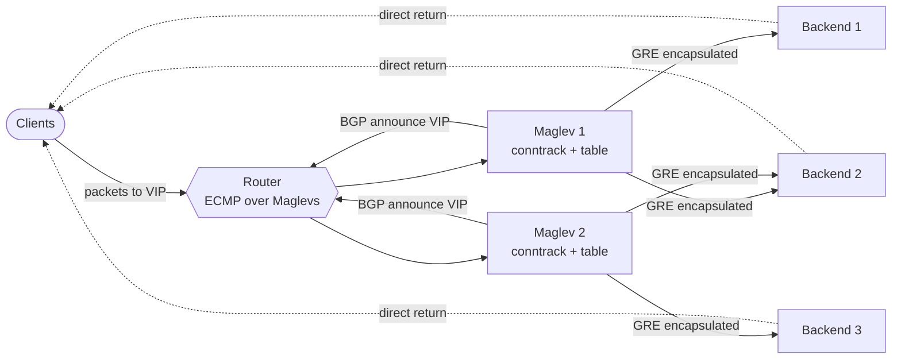

**Reading the diagram.** Each Maglev machine announces the service VIPs to the router by BGP; the router spreads packets across all announcing machines by hashing headers (ECMP, §19.8.3). A Maglev machine looks the flow up in its local connection-tracking table; on a miss it reads `table[hash(5-tuple) mod M]`, records the result, and forwards the packet to the backend inside a GRE tunnel. Backends reply directly to clients (dotted, to mark the asymmetric return path that bypasses Maglev; it is still synchronous TCP). No storage is involved: tables are computed from configuration, and connection state is soft. Failure points: if a Maglev machine dies, the router drops its BGP route and rehashes its flows to other machines, which have no connection-table entries but compute the same table, so most flows land on the same backend. Scaling: add Maglev machines (ECMP) or backends (table rebuild).

The table is filled as follows:

1. For each backend $i$, compute $\text{offset}_i$ and $\text{skip}_i$ from two hashes of its name.
2. Its preference list is $\text{perm}_i[j] = (\text{offset}_i + j \cdot \text{skip}_i) \bmod M$ for $j = 0, 1, \ldots, M-1$. Because $M$ is prime and $1 \le \text{skip}_i < M$, this visits every position exactly once.
3. Set every entry empty. Loop over backends in turn: backend $i$ walks its list from where it stopped to the first empty position, claims it, and the turn passes. Stop when all $M$ entries are full.
4. To look up a packet, compute `table[hash(5-tuple) mod M]`.

Because each round gives every backend one entry, entry counts differ by at most one. Weights can be added by letting heavier backends take more turns. The paper chooses $M$ much larger than the number of backends (it suggests $M > 100N$) so that a one-entry difference is a small fraction of each backend's share.

::: formula
**Maglev preference permutation**

$$\text{offset}_i = h_1(\text{name}_i) \bmod M, \qquad \text{skip}_i = h_2(\text{name}_i) \bmod (M - 1) + 1, \qquad \text{perm}_i[j] = (\text{offset}_i + j \cdot \text{skip}_i) \bmod M$$

| Symbol | Meaning | Units |
|---|---|---|
| $M$ | Lookup-table size, a prime | entries |
| $h_1$, $h_2$ | Two independent hash functions | — |
| $\text{offset}_i$ | Backend $i$'s first preferred position | entry index |
| $\text{skip}_i$ | Step between backend $i$'s successive preferences, $1 \le \text{skip}_i \le M-1$ | entries |
| $\text{perm}_i[j]$ | Backend $i$'s $j$-th preferred position | entry index |
:::

::: example
**Worked example — filling a table of size 7.** Backends B0 (offset 3, skip 4), B1 (offset 0, skip 2), B2 (offset 3, skip 1).

1. Preference lists: B0: $3, 0, 4, 1, 5, 2, 6$ (each step adds 4 mod 7). B1: $0, 2, 4, 6, 1, 3, 5$. B2: $3, 4, 5, 6, 0, 1, 2$.
2. Round 1: B0 claims 3. B1 claims 0. B2 wants 3 (taken), claims 4.
3. Round 2: B0's next is 0 (taken), then 4 (taken), claims 1. B1 claims 2. B2 claims 5.
4. Round 3: B0 tries 5, 2 (taken), claims 6. Table full: `[B1, B0, B1, B0, B2, B2, B0]`, counts 3, 2, 2.
5. B1 fails; rebuild with B0 and B2: B0 claims 3, B2 claims 4; B0 claims 0, B2 claims 5; B0 claims 1, B2 claims 6; B0 claims 2. Table: `[B0, B0, B0, B0, B2, B2, B2]`.
6. Compare: entries 0 and 2 (B1's) had to move. Entry 6 moved from B0 to B2 although B0 is still alive.

*Interpretation.* Balance is exact up to one entry, but disruption is not minimal: one of seven entries (14%) moved between survivors. *Engineering implication.* With realistic sizes the extra disruption is small (listing below), and Maglev's connection tracking hides it for established flows; only new flows, or flows that move to another Maglev machine, follow the new table.
:::

```python
"""Maglev lookup-table population (Eisenbud et al., NSDI 2016) and its disruption."""
import hashlib
from collections import Counter


def _h(s: str, salt: str) -> int:
    return int.from_bytes(hashlib.md5((salt + s).encode()).digest()[:8], "big")


def offset_skip(name: str, m: int):
    return _h(name, "offset") % m, _h(name, "skip") % (m - 1) + 1


def populate(backends, m, params=None):
    """Return a lookup table of size m (m prime). params optionally maps a
    backend name to a fixed (offset, skip) pair, for hand-checkable examples."""
    perms = []
    for b in backends:
        off, skip = params[b] if params else offset_skip(b, m)
        perms.append((off, skip))
    nxt = [0] * len(backends)        # next preference index for each backend
    table = [None] * m
    filled = 0
    while True:
        for i, (off, skip) in enumerate(perms):     # one turn per backend
            c = (off + nxt[i] * skip) % m
            while table[c] is not None:              # preferred slot taken: try next
                nxt[i] += 1
                c = (off + nxt[i] * skip) % m
            table[c] = backends[i]
            nxt[i] += 1
            filled += 1
            if filled == m:
                return table


if __name__ == "__main__":
    # Small example: M = 7, three backends with hand-picked offset and skip.
    p = {"B0": (3, 4), "B1": (0, 2), "B2": (3, 1)}
    print("B0..B2 table:", populate(["B0", "B1", "B2"], 7, p))
    print("B1 removed  :", populate(["B0", "B2"], 7, p))

    # Realistic size: M = 65,537 (prime), 100 backends; then backend-42 fails.
    M = 65_537
    names = [f"backend-{i}" for i in range(100)]
    before = populate(names, M)
    counts = Counter(before)
    print(f"entries per backend: min {min(counts.values())}, max {max(counts.values())}, "
          f"ideal {M / len(names):.1f}")
    after = populate([n for n in names if n != "backend-42"], M)
    changed = sum(1 for a, b in zip(before, after) if a != b)
    collateral = sum(1 for a, b in zip(before, after) if a != b and a != "backend-42")
    print(f"backend-42 removed: {changed / M:.2%} of entries changed "
          f"(minimum {counts['backend-42'] / M:.2%}); "
          f"{collateral / M:.2%} moved between surviving backends")
```

Output (Python 3.13):

```text
B0..B2 table: ['B1', 'B0', 'B1', 'B0', 'B2', 'B2', 'B0']
B1 removed  : ['B0', 'B0', 'B0', 'B0', 'B2', 'B2', 'B2']
entries per backend: min 655, max 656, ideal 655.4
backend-42 removed: 1.66% of entries changed (minimum 1.00%); 0.66% moved between surviving backends
```

What to notice:

- With 100 backends and $M = 65{,}537$, every backend owns 655 or 656 entries: imbalance 0.15%, far better than a ring with a few hundred vnodes per node (§14.8.4).
- Removing one backend changes 1.66% of entries: the unavoidable 1.00% plus 0.66% collateral movement between survivors, a trade Maglev accepts for $O(1)$ lookups and balance.
- Building the table is $O(M \log M)$ expected work and takes well under a second here; the paper's implementation rebuilds when backend health changes.

::: industry
**Open-source Maglev-style L4 balancers.** Meta's **Katran** is an L4 balancer built on the Linux kernel's XDP and eBPF facilities that uses a Maglev-style lookup table and IP-in-IP encapsulation toward backends. GitHub's **GLB Director** takes a different route: it uses rendezvous hashing to build a forwarding table in which every row lists a primary and a secondary backend, and a backend that receives a packet for a flow it does not know forwards it to the secondary ("second chance"), so connections survive backend set changes without shared connection state.
*Evidence: Primary* — [Meta Engineering 2018 (Katran); Julienne 2018 (GLB)]
:::

### 19.4.9 Choosing an algorithm

**Table 19.3 — Load-balancing algorithms compared.**

| Algorithm | Load signal | State | Strength | Weakness | Choose when |
|---|---|---|---|---|---|
| Round robin | None | Counter | Simple, predictable | Overloads slow backends | Identical backends, uniform requests |
| Smooth weighted RR | Static weights | Weights | Handles known capacity differences | Weights go stale | Mixed instance types |
| Least connections | Local in-flight count | Count per backend | Adapts to speed and request cost | Herds with many balancers; fast-failure sinkhole | Single balancer tier, variable request cost, long-lived connections |
| Least response time (EWMA) | Observed latency | EWMA per backend | Avoids slow backends | Feedback oscillation; slow to retry | Latency-sensitive RPC |
| Power of two choices | In-flight or EWMA, two samples | Same as above | Near-optimal, no herding, $O(1)$ | Slightly worse than perfect information | Many balancers or client-side balancing |
| Ring consistent hash | Key | Ring, $O(\log M)$ | Locality, minimal movement | Hot keys overload one backend | Caches, sticky routing |
| Bounded-load hash | Key + in-flight count | Ring + counts | Locality with a load cap | More movement; needs load counts | Caches with skewed popularity |
| Maglev hash | 5-tuple or key | Table of $M$ entries | $O(1)$ lookup, even balance | Small extra disruption | L4 packet balancers |

::: recommendation
**A default ladder.** Start with round robin for identical stateless backends. Move to least request with P2C (Envoy's default, NGINX `random two least_conn`, HAProxy `leastconn` or `random(2)`) as soon as requests vary in cost or several balancers share backends. Use a hash, bounded if keys are skewed, only when locality pays for itself, and measure the cache hit ratio to prove it.
:::

::: mistake
**"Least connections is always better than round robin."** With a single balancer, a live count and homogeneous backends, it is. With many balancers that each see a fraction of traffic, or with load counts that lag, it herds (19.4.5 measured p99 queue 27 versus 8 for P2C). And it rewards backends that fail fast.
:::

## 19.5 Health checks

### 19.5.1 Active and passive checks

::: definition
**Definition — Health check.** A mechanism by which a balancer decides whether a backend should receive traffic. An **active** check sends synthetic probes (a TCP connect, an HTTP `GET /healthz`, a gRPC health RPC) on a timer. A **passive** check, also called **outlier detection**, watches real traffic for errors, timeouts or latency and **ejects** misbehaving backends for a period.
:::

A lifeguard does two things: every few minutes she scans the whole pool (active), and she reacts at once when she hears a shout (passive). Neither alone is enough. Active checks find dead backends even when no traffic flows, but are slow and test only what the probe touches. Passive checks react within milliseconds on busy services, but need traffic and cannot tell a broken backend from a bad request.

#### How it works internally

1. **Probe.** Every interval $I$ (HAProxy default 2 s), send a probe with a timeout.
2. **Thresholds.** Mark a backend down after $F$ consecutive failures (*fall*, HAProxy default 3) and up after $R$ consecutive successes (*rise*, default 2) [HAProxy Docs]. AWS ALB target groups default to a 30 s interval, 2 failures and 5 successes (as of 2026).
3. **Outlier detection.** Envoy, by default, ejects a host after 5 consecutive `5xx` responses, for a base time of 30 s multiplied by the number of times it has been ejected, and never ejects more than 10% of a cluster at once (as of 2026) [Envoy Docs: Outlier detection]. NGINX open source marks a server unavailable for `fail_timeout` (10 s) after `max_fails` (1) failures.
4. **Fail open.** If too many backends look unhealthy, the checks are probably wrong. Envoy's **panic threshold** (default 50%) makes it ignore health and balance across all hosts; AWS ALB routes to all targets when all fail their checks.

**Figure 19.5 — Health state of one backend as seen by the balancer.**

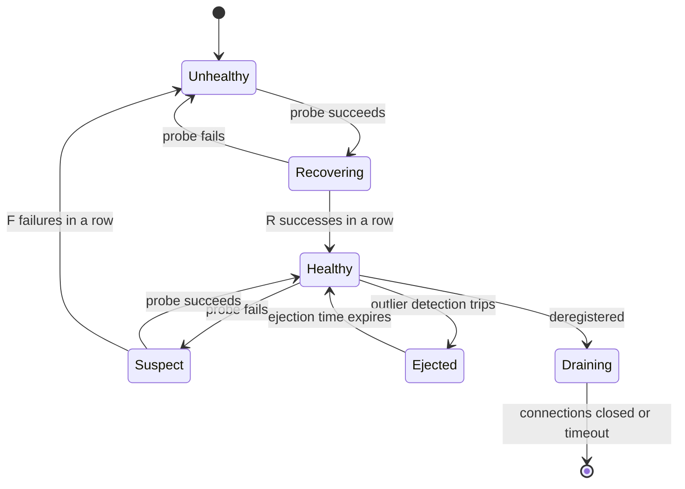

**Reading the diagram.** A new backend starts unhealthy and must pass $R$ probes before it gets traffic, so a half-started process is not flooded. A single failed probe makes it *suspect* but keeps it in rotation; only $F$ consecutive failures remove it. These thresholds give **hysteresis**, which prevents flapping on one lost packet. In parallel, passive outlier detection on live responses can eject a backend immediately, for a time that grows with repeat offenses. *Draining* is the orderly exit (§19.8.4). Transitions are driven asynchronously by probe timers and response observations; state is per balancer, so two balancers may briefly disagree. Failure point: a probe path that does not exercise the real dependency path reports healthy while users fail. Scaling: probe traffic grows with balancers × backends (below).

::: formula
**Detection time and requests lost to a dead backend**

$$T_{\text{detect}} \approx F \cdot I + T_{o}, \qquad N_{\text{lost}} \approx \frac{\lambda}{n}\, T_{\text{detect}}$$

| Symbol | Meaning | Units |
|---|---|---|
| $T_{\text{detect}}$ | Worst-case time from failure to removal | seconds |
| $F$ | Consecutive failures required (fall threshold) | count |
| $I$ | Probe interval | seconds |
| $T_o$ | Probe timeout | seconds |
| $N_{\text{lost}}$ | Requests sent to the dead backend meanwhile (without retries) | requests |
| $\lambda$, $n$ | Total request rate; number of backends | requests/second; count |
:::

::: example
**Worked example — active versus passive detection.** 10 backends, $\lambda = 5{,}000$ requests/s, so 500 requests/s each. A backend's process hangs.

1. HAProxy defaults: $F = 3$, $I = 2$ s, timeout 2 s: $T_{\text{detect}} \approx 3 \times 2 + 2 = 8$ s; $N_{\text{lost}} \approx 500 \times 8 = 4{,}000$ requests.
2. ALB defaults: $F = 2$, $I = 30$ s, timeout 5 s: $T_{\text{detect}} \approx 65$ s; $N_{\text{lost}} \approx 32{,}500$ requests.
3. Passive, 5 consecutive errors (if the hang yields fast errors): ejection after 5 requests, about $5/500 = 10$ ms.

*Interpretation.* Active checks alone cost thousands of failed requests per incident; passive checks cut that by orders of magnitude on busy pools. *Engineering implication.* Use both, retry idempotent requests on another backend (§22.12), and tune active intervals for low-traffic pools where passive detection has nothing to observe.
:::

### 19.5.2 What a health check should test

A **shallow** check (process up, port open) misses a backend whose database connection pool is exhausted. A **deep** check that calls every dependency has the opposite failure: when a *shared* dependency slows down, every backend fails its check at once and the balancer ejects the whole pool, turning a partial degradation into a full outage. The common compromise: health endpoints test the backend's own ability to serve (threads available, local caches loaded, not shutting down), report dependency trouble through metrics rather than through health, and rely on the panic threshold as a backstop. Kubernetes separates the two ideas into **liveness** (restart me) and **readiness** (send me traffic) probes (§42.7).

Probe load is real at scale: 1,000 sidecar proxies each checking 100 backends every 5 s generate $1{,}000 \times 100 / 5 = 20{,}000$ probes per second. Meshes therefore lean on passive detection and on health status pushed by the control plane.

#### Failure scenarios

**Table 19.4 — Health-check failure scenarios.**

| What goes wrong | Why | Detection | Recovery | Prevention |
|---|---|---|---|---|
| Whole pool ejected | Deep checks fail on a shared dependency | Healthy-host count drops to 0 | Panic threshold / fail open | Shallow readiness checks; dependency signals as metrics |
| Flapping | Thresholds of 1; probe timeout near p99 latency | Backend toggles every few seconds | Raise rise/fall; longer timeout | Hysteresis; ejection time growing with repeats |
| Healthy but broken | Probe path skips the failing code path | Errors rise while health is green | Passive ejection | Probe a representative path; outlier detection |
| Ejection cascade | Overload makes backends fail; ejecting them overloads the rest | Ejections rise with load | Cap ejected fraction (Envoy 10%) | Load shedding (§22.9) instead of ejection |
| Thundering return | Recovered backend receives a full share while caches are cold | Latency spike after recovery | Slow start | Ramp weights over 30–60 s (HAProxy `slowstart`, Envoy slow start) |

## 19.6 Session affinity

::: definition
**Definition — Session affinity (sticky sessions).** A balancer policy that sends all requests of one client session to the same backend, identified by a cookie, the client's IP address or a request key.
:::

Affinity exists because some backends keep per-user state in memory: a shopping cart, a WebSocket subscription buffer (§9.6), a local cache of the user's data. It is the balancing equivalent of always seeing the same doctor: convenient, until she is on holiday.

**Figure 19.6 — Balancer-inserted affinity cookie.**

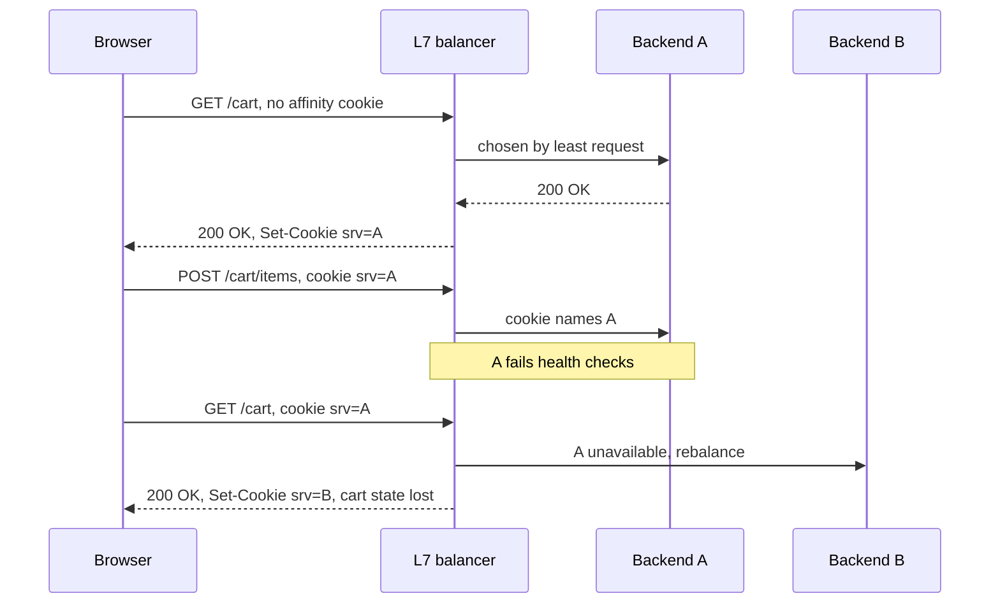

**Reading the diagram.** The first request has no cookie, so the balancer chooses normally and adds a cookie naming the backend (in practice an opaque or encrypted value, so clients cannot pick backends). Later requests carry the cookie and go to A. When A fails, the balancer must break affinity and send the client to B, and any state held only in A's memory is lost. All calls are synchronous. The storage boundary is A's process memory, which is exactly the problem. Scaling: affinity skews load, because a few heavy sessions stay pinned to one backend.

**Table 19.5 — Session affinity methods.**

| Method | How it works | Advantages | Disadvantages | Choose when |
|---|---|---|---|---|
| Balancer cookie | Balancer sets a cookie naming the backend | Precise, survives client IP changes | HTTP only; L7 needed | Web apps with in-memory sessions |
| Application cookie | Balancer hashes an app's session cookie | Uses existing session ID | Same as above | Frameworks with session IDs |
| Source-IP hash | Hash client IP (L4 works) | No cookies, any protocol | Carrier-grade NAT puts many users on one IP; mobile clients change IP | Non-HTTP protocols, coarse affinity |
| Consistent hash on key | Hash user ID or header (§19.4.6–19.4.8) | Minimal remapping on resize; works without the client's help | Hot keys; needs a key | Caches, sharded in-memory state |

::: recommendation
**Prefer statelessness to stickiness.** Keep session state in a shared store (Redis, a database) or in a signed token (§8.13), and make every backend able to serve every request (§18.5). Then affinity becomes an *optimization* for cache locality, not a *correctness* requirement, and deploys, autoscaling and failures stop logging users out.
:::

## 19.7 Active–passive and active–active balancer pairs

A balancer is a single point of failure until it has a partner.

::: definition
**Definition — Active–passive and active–active.** In an **active–passive** pair, one balancer carries all traffic while a standby monitors it and takes over the VIP on failure. In **active–active**, all balancers carry traffic at once (spread by DNS, ECMP or anycast), and survivors absorb a failed member's share.
:::

**Figure 19.7 — Active–passive versus active–active balancer tiers.**

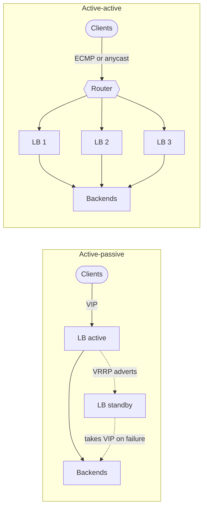

**Reading the diagram.** Left: all traffic for the VIP reaches the active balancer; the standby receives only heartbeat advertisements (dotted, asynchronous) and claims the VIP when they stop. Right: a router spreads flows across three active balancers; a failed balancer's route is withdrawn and its flows rehash to the others. Both tiers are stateless toward the backends except for connection tables. Failure points: on the left, failover time and split brain (both claim the VIP); on the right, flows that move between balancers (§19.8.3). Scaling: active–passive scales only vertically; active–active scales by adding members.

::: formula
**Safe utilization for active–active with $k$ tolerated failures**

$$U_{\max} = \frac{N - k}{N}$$

| Symbol | Meaning | Units |
|---|---|---|
| $U_{\max}$ | Highest normal utilization per balancer that still fits all traffic after $k$ failures | dimensionless |
| $N$ | Balancers in the active–active group | count |
| $k$ | Simultaneous failures to tolerate | count |
:::

::: example
**Worked example — how many balancers?** Peak traffic needs 30 Gbit/s; each balancer handles 10 Gbit/s; tolerate one failure ($k = 1$).

1. $N = 4$: $U_{\max} = 3/4 = 75\%$; normal load per balancer $30/4 = 7.5$ Gbit/s $= 75\%$. Exactly at the limit.
2. $N = 5$: $U_{\max} = 80\%$; normal load $6$ Gbit/s $= 60\%$, leaving margin.
3. An active–passive pair would need two 30 Gbit/s balancers, with $U_{\max} = 50\%$ of the installed hardware.

*Interpretation.* Active–passive wastes half of the hardware but is simple; active–active wastes $k/N$, which shrinks as $N$ grows. *Engineering implication.* Use active–passive for small sites and appliances, active–active behind ECMP or anycast once traffic exceeds one box. Either way, **test** failover: a standby that has never taken traffic is a hope, not a plan.
:::

## 19.8 Balancer failure and redundancy

### 19.8.1 VRRP and keepalived

The **Virtual Router Redundancy Protocol (VRRP)** lets several machines on one LAN share a virtual IP: the highest-priority machine is the active owner (the RFC's "Master" state) and multicasts advertisements every `Advertisement_Interval`; backups take over when advertisements stop and announce the VIP's new location with gratuitous ARP [RFC 5798]. **keepalived** implements VRRP on Linux and is the usual way to make an HAProxy or NGINX pair highly available.

**Figure 19.8 — VRRP failover between two balancers.**

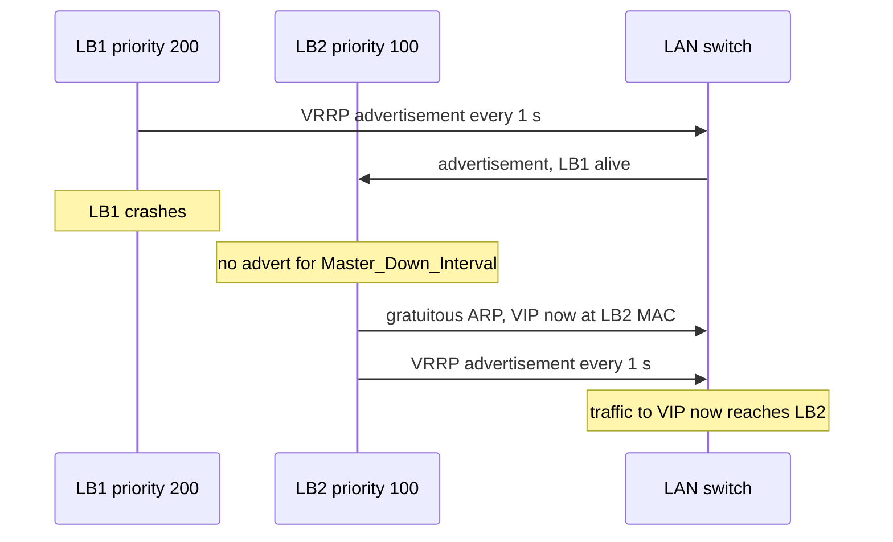

**Reading the diagram.** LB1 owns the VIP and advertises periodically (asynchronous multicast). When LB1 dies, LB2 waits out the master-down interval, then sends a gratuitous ARP so the switch and neighbors map the VIP to its MAC address, and begins advertising itself. Connections in flight through LB1 are lost unless connection state was synchronized (keepalived can pair with `conntrackd`). Failure points: if advertisements are blocked while both machines are alive (a firewall rule, a partitioned link), both claim the VIP, which is **split brain** (§26.12). Many clouds do not support multicast or gratuitous ARP; there, use the provider's managed balancer or a floating-IP API.

::: formula
**VRRP failover time** [RFC 5798, §6.1]

$$T_{\text{skew}} = \frac{(256 - P)\, A}{256}, \qquad T_{\text{down}} = 3A + T_{\text{skew}}$$

| Symbol | Meaning | Units |
|---|---|---|
| $A$ | Advertisement interval (VRRPv3 allows centisecond values) | seconds |
| $P$ | Backup router's priority, 1–254 | dimensionless |
| $T_{\text{skew}}$ | Extra wait so higher-priority backups take over first | seconds |
| $T_{\text{down}}$ | Master-down interval: silence before a backup takes over | seconds |
:::

::: example
**Worked example — default versus tuned timers.**

1. $A = 1$ s, $P = 100$: $T_{\text{skew}} = 156 / 256 = 0.61$ s; $T_{\text{down}} = 3 + 0.61 = 3.61$ s.
2. $A = 0.1$ s, $P = 100$: $T_{\text{skew}} = 0.061$ s; $T_{\text{down}} = 0.361$ s.
3. At 20,000 new connections/s, a 3.61 s gap affects about 72,000 connection attempts, most of which clients retry.

*Interpretation.* Failover takes seconds with defaults and a few hundred milliseconds when tuned. *Engineering implication.* Shorter intervals detect faster but raise the risk of false failovers under CPU or network jitter; 100 ms is common on dedicated links, 1 s across busier ones.
:::

### 19.8.2 Anycast

At Internet scale, the same VIP is announced by BGP from many sites (§7.5.3). Routers send each client to a nearby site, and a site that fails withdraws its route. Anycast makes the *first* hop redundant across sites and absorbs DDoS traffic, but it relies on BGP convergence (seconds to minutes) and can move long-lived TCP flows to a site without their state. Section 7.5.3 describes the 2021 Facebook outage in which every site withdrew at once.

### 19.8.3 ECMP and consistent hashing

Inside a site, the router in front of the balancers uses **equal-cost multipath (ECMP)**: it has several next hops for the VIP (one per balancer, each announcing the VIP by BGP) and picks one per packet by hashing header fields, so all packets of a flow take the same path [RFC 2992]. When a balancer fails, the router removes one next hop and **rehashes**.

::: formula
**Flows remapped when one of $N$ next hops is removed**

$$f_{\text{mod}} \approx 1 - \frac{1}{N}, \qquad \tfrac{1}{4} \lesssim f_{\text{threshold}} \le \tfrac{1}{2}, \qquad f_{\min} = \frac{1}{N}$$

| Symbol | Meaning | Units |
|---|---|---|
| $f_{\text{mod}}$ | Fraction of flows that change next hop with `hash mod N` | dimensionless |
| $f_{\text{threshold}}$ | Same, for the hash-threshold method analyzed in RFC 2992 (depends on which region is removed) | dimensionless |
| $f_{\min}$ | Minimum: only the failed hop's flows move (resilient or consistent hashing) | dimensionless |
| $N$ | Next hops (balancers) before the failure | count |
:::

::: example
**Worked example — eight balancers, one fails.**

1. Modulo hashing: $1 - 1/8 = 87.5\%$ of flows land on a different balancer.
2. Hash-threshold: between 28.6% (a middle region removed) and 50% (an end region removed), computed for $N = 8$.
3. Resilient hashing: only the failed balancer's $12.5\%$.
4. With 1 million active flows: 875,000, 286,000–500,000, or 125,000 flows arrive at a balancer that has no connection-table entry for them.

*Interpretation.* Rehashing moves many flows that were on healthy balancers. *Engineering implication.* Balancers behind ECMP must choose backends with a **consistent** function of the 5-tuple (Maglev hashing, §19.4.8) so that a flow that changes balancer still reaches the same backend, and switches should use resilient ECMP hashing where available.
:::

**Figure 19.9 — A layered, redundant front end.**

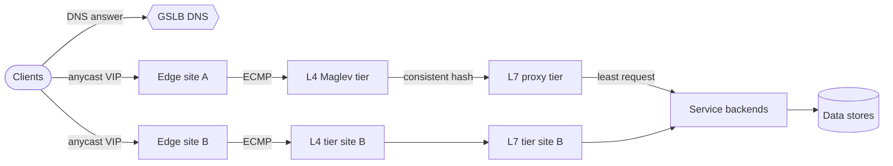

**Reading the diagram.** DNS (§19.9) picks a region or returns an anycast address; anycast picks the nearest edge site; ECMP spreads flows across the L4 tier; the L4 tier consistently hashes flows to L7 proxies; L7 proxies balance requests across service backends with a load-aware algorithm. Every arrow is a synchronous path for requests. Each layer's redundancy covers the layer below's single points of failure: anycast covers site loss, ECMP covers balancer loss, consistent hashing covers rehashing, health checks cover backend loss. The data stores are the storage boundary. Scaling: each tier scales horizontally and independently. This is the shape Google describes for its frontend (DNS, Maglev, then Google Front End proxies) [Beyer et al. 2016, ch. 19].

### 19.8.4 Connection draining

Removing a backend or balancer on purpose (deploy, scale-in) should break nothing. **Connection draining** (AWS: *deregistration delay*, default 300 s as of 2026; Google SRE: **lame duck** state) works in four steps:

1. Mark the backend *draining*: no new connections or requests, but in-flight ones continue.
2. For HTTP/1.1, send `Connection: close` on responses; for HTTP/2 and gRPC, send `GOAWAY` so clients open new connections elsewhere.
3. Wait until in-flight requests reach zero or a drain timeout expires (set it above the p99.9 request duration).
4. Close remaining long-lived connections (WebSockets, streams), preferably with a reconnect hint and jitter, so clients do not reconnect in one wave (§9.6).

::: mistake
**"The load balancer is the one component that doesn't need redundancy because it's so simple."** Balancers fail through software bugs, configuration pushes, certificate expiry, connection-table exhaustion and capacity. Every balancer tier needs at least two members, a tested failover path, and staged configuration rollouts.
:::

**Table 19.6 — Balancer-tier failure scenarios.**

| What goes wrong | Why | Detection | Recovery | Prevention |
|---|---|---|---|---|
| Bad configuration everywhere | Global push of a broken rule | Error spike across all sites at once | Roll back | Staged rollout; config validation; canary balancers |
| Split brain | VRRP adverts lost while both nodes live | Duplicate-IP alerts; ARP flapping | Fence one node | Dedicated heartbeat links; unicast VRRP; managed VIPs |
| Mass connection resets | ECMP rehash after a balancer change | Reset spike on scale events | Clients reconnect | Consistent hashing; resilient ECMP; graceful BGP withdraw |
| Certificate expiry | Manual renewal forgotten | TLS handshake failures | Deploy new certificate | Automated issuance (ACME); expiry alerts |

## 19.9 DNS and global server load balancing

**Global server load balancing (GSLB)** chooses a *region or site* before any connection exists, usually by answering DNS queries differently per client. Section 7.6.5 covered DNS load balancing and its limits; Chapter 44 covers global traffic management in depth. Here is the essential shape.

**Figure 19.10 — DNS-based global server load balancing.**

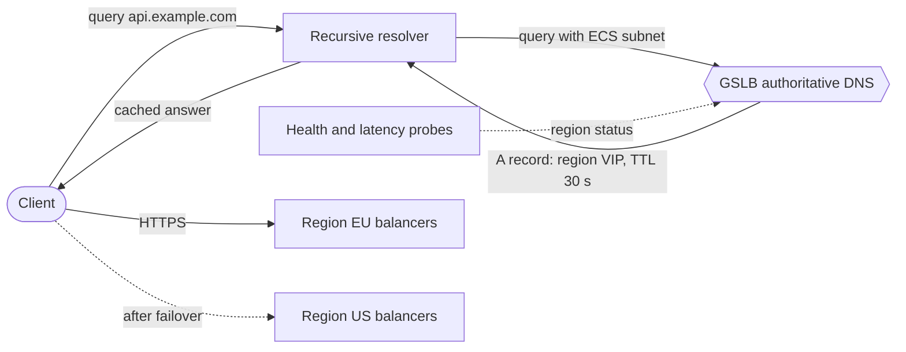

**Reading the diagram.** The client's resolver asks the GSLB's authoritative server, which chooses a region from the resolver's location (or the client subnet, if the resolver sends EDNS Client Subnet), from latency measurements, configured weights, and region health fed asynchronously by probes. The answer is cached for its TTL by the resolver, then used by the client to connect synchronously to that region's balancers. Failure point: when a region fails, clients keep using cached answers until the TTL expires, and some clients and resolvers keep them longer. Scaling: DNS answers are cheap; the regional balancer stack (Figure 19.9) does the heavy lifting.

Policies include **geo-DNS** (nearest region by location), **latency-based** routing (the region with the lowest measured latency from the resolver's network; AWS Route 53 offers this), **weighted** answers (send 5% to a new region), and **failover** (primary unless unhealthy). The limits are those of §7.6.5: caching makes control coarse and failover TTL-bound, the resolver is not the client, and DNS sees no server load. Anycast (§19.8.2) is the main alternative for picking a site and fails over at BGP speed; many providers combine the two.

## 19.10 Client-side load balancing

Every proxy is an extra network hop, an extra machine to run, and an extra failure point. Inside a datacenter, the client can balance for itself.

::: definition
**Definition — Client-side load balancing.** The calling process obtains the list of backend endpoints from service discovery (§34.7) and chooses a backend for each request itself, with no proxy in the path. A **lookaside** balancer is an external service that tells clients *which* backends to use (and with what weights) while the traffic still flows directly from client to backend.
:::

**Figure 19.11 — Four places to put the balancing decision.**

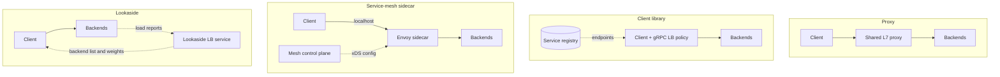

**Reading the diagram.** Solid arrows are synchronous request paths; dotted arrows are asynchronous control traffic. The **proxy** puts a shared hop in every request. The **library** model (gRPC's `round_robin`, `least_request`, `weighted_round_robin` and `ring_hash` policies) balances per call inside the client, using endpoints from a registry (storage boundary). The **sidecar** model moves the library into a local proxy that every language can use, configured by a control plane through Envoy's xDS APIs (§34.10). The **lookaside** model centralizes the *decision* while keeping traffic direct: backends report load to the lookaside service, which hands clients weighted backend lists [gRPC Docs: Load balancing]. Failure points: a stale registry (clients call dead endpoints) and a control plane outage (sidecars keep their last configuration, which is why they must fail static, not fail closed). Scaling: no proxy tier to provision; costs move into every client.

Client-side balancing gives per-request (not per-connection) balancing for gRPC, saves a hop (often 0.1–1 ms inside a datacenter), and removes a tier. Its costs: every client needs the logic (or a sidecar); clients must be trusted to behave; and connections multiply. With 1,000 client instances and 1,000 backends, full mesh means $10^6$ connections. Google's answer is **subsetting**: each client connects to a deterministic subset of backends (the SRE book discusses subsets of 20 to 100), chosen so that every backend gets about the same number of clients [Beyer et al. 2016, ch. 20]. With a subset of 20, the connection count falls to 20,000. P2C works well inside a subset because it needs no global view.

::: industry
**Kubernetes Services.** A Kubernetes `ClusterIP` Service is a form of client-side L4 balancing: `kube-proxy` on every node programs iptables, IPVS or nftables rules so that connections to the Service IP are spread over pod endpoints on the *client's* node, with no central balancer. Because it balances connections, long-lived gRPC connections still need L7 or library balancing (§42.9).
*Evidence: Primary* — [Kubernetes Docs: Virtual IPs and Service Proxies]
:::

## 19.11 Choosing a load balancer: products compared

**Table 19.7 — Load balancer products (as of 2026; check current documentation).**

| Product | Layer | Algorithms (selection) | Health checking | Notable traits | Choose when |
|---|---|---|---|---|---|
| NGINX (open source) | L7 HTTP; L4 `stream` | Smooth WRR, `least_conn`, `ip_hash`, `hash ... consistent`, `random two least_conn` | Passive (`max_fails`); active in NGINX Plus | Also a web server and cache; huge install base | Web front ends, simple reverse proxying |
| HAProxy | L4 and L7 | `roundrobin`, `leastconn`, `source`, `uri`, `hdr`, `random(<draws>)`, consistent hash with `hash-balance-factor` | Active (rise/fall, agent checks) and passive (`observe`) | Very detailed statistics, stick tables, mature | High-performance self-managed balancing |
| Envoy | L4 and L7 (HTTP/1, HTTP/2, HTTP/3, gRPC) | Round robin, least request (P2C), ring hash, Maglev, random | Active, outlier detection, panic threshold | Dynamic xDS configuration; service-mesh data plane | Microservices, gRPC, meshes |
| AWS Application Load Balancer | L7 managed | Round robin, least outstanding requests, weighted random | Active per target group | Managed TLS, path/host routing, WAF integration | HTTP services on AWS |
| AWS Network Load Balancer | L4 managed (TCP, UDP, TLS) | Flow hash | Active per target group | Static IP per zone, client IP preserved, very high scale | Non-HTTP, extreme volume, static IPs |
| Google Maglev | L4 software, in-house | Maglev hashing + connection tracking | Backend health drives table | ECMP + BGP, GRE to backends, DSR; underlies Google Cloud's network load balancing | Not a product you run; the reference design for software L4 |

Two other open designs are worth knowing: IPVS (in the Linux kernel, used by keepalived and by `kube-proxy` in IPVS mode) and eBPF/XDP balancers such as Katran and Cilium's.

## 19.12 Summary and revision notes

::: summary
- **L4 versus L7.** L4 balances flows from packet headers (line rate, any protocol, DSR possible); L7 terminates TLS and balances requests (content routing, retries, per-call gRPC balancing). Large sites stack ECMP → L4 → L7. DSR keeps response bytes off the balancer: $B = R\,s_{\text{req}}$ instead of $R(s_{\text{req}} + s_{\text{resp}})$.
- **Algorithms.** Every algorithm approximates one shared queue. RR and smooth WRR ignore load: unweighted RR drove a slow server to 187% while the pool sat at 80%. Least connections equalizes $L_i = \lambda_i W_i$, so rate is inversely proportional to latency; it herds on stale data and rewards fast failures. EWMA latency adapts at the speed of traffic.
- **Power of two choices.** Max load falls from $\approx \ln n / \ln\ln n$ to $\ln\ln n / \ln 2 + O(1)$; queue tails fall from $\lambda^i$ to $\lambda^{2^i - 1}$. In the simulation, P2C's p99 queue was 6 (live) and 8 (stale view), against 27 for least connections on a stale view.
- **Hashing.** Consistent hashing (§14.8) gives locality; bounded loads cap each backend at $\lceil (1+\varepsilon)m/n \rceil$ for a little extra movement; Maglev gives $O(1)$ lookup and balance within one entry, at the cost of ~0.66% collateral disruption for 100 backends.
- **Health.** Active checks detect in $\approx F \cdot I + T_o$ (8 s with HAProxy defaults); passive outlier detection in milliseconds. Use hysteresis, cap ejections, fail open below a panic threshold, keep readiness checks shallow.
- **Affinity.** Cookies, source-IP or key hashing; all trade balance and resilience for locality. Externalize state so affinity is only an optimization.
- **Redundancy.** Active–passive wastes 50%; active–active wastes $k/N$. VRRP fails over in $3A + (256-P)A/256$ (3.61 s by default). ECMP rehashing moves up to $1 - 1/N$ of flows, so L4 tiers need consistent hashing. Drain before removal.
- **Global and client-side.** DNS GSLB picks regions, limited by TTLs and resolver location; anycast fails over at BGP speed. Client-side, sidecar and lookaside balancing remove a hop and balance per call; subsetting bounds connection counts.
:::

## 19.13 Knowledge checkpoint

1. Why can an L4 balancer not route `/api/search` and `/api/cart` to different pools when TLS is passed through?
2. A service returns 40 KB responses to 1 KB requests at 50,000 requests/s. What bandwidth crosses the balancer with a full proxy and with DSR?
3. List the smooth WRR sequence for weights $a{:}3, b{:}1$.
4. Two backends have mean latencies of 20 ms and 80 ms. Under least connections, what fraction of traffic goes to the faster one?
5. Why does least connections herd when many balancers share periodic load reports?
6. For $\lambda = 0.8$, what fraction of servers have at least 4 requests with one and with two random choices?
7. With 9,000 sessions, 30 servers and $\varepsilon = 0.5$, what is the bounded-load capacity?
8. Why must the Maglev table size be prime?
9. A pool uses $I = 5$ s, $F = 3$, timeout 1 s, and receives 200 requests/s per backend. How many requests reach a dead backend before removal?
10. Why can deep health checks cause a full outage?
11. Name two problems with source-IP affinity.
12. Six active–active balancers must survive two failures. What is the highest safe utilization?
13. Compute the VRRP master-down interval for $A = 0.5$ s and backup priority 150.
14. Why do balancers behind ECMP need consistent hashing to backends?
15. What is the difference between client-side and lookaside load balancing?

<details>
<summary>Answers</summary>

1. The path is inside the encrypted stream; without terminating TLS the balancer sees only IPs, ports and the SNI hostname.
2. Full proxy: $50{,}000 \times 41{,}000 = 2.05$ GB/s $= 16.4$ Gbit/s. DSR: $50{,}000 \times 1{,}000 = 50$ MB/s $= 0.4$ Gbit/s.
3. Current weights start at 0. Picks: $a$ (3,1 → $-1$,1), $a$ (2,2 → tie, $a$ first → $-2$,2), $b$ (1,3 → 1,$-1$), $a$ (4,0 → 0,0). Sequence `a a b a`.
4. $\lambda \propto 1/W$: $(1/20)/(1/20 + 1/80) = 0.05/0.0625 = 80\%$.
5. All balancers see the same "least loaded" backend until the next report and all send it traffic, overloading it; the next report then moves the herd elsewhere.
6. One choice: $0.8^4 = 0.41$. Two choices: $0.8^{15} = 0.035$.
7. $\lceil 1.5 \times 9{,}000/30 \rceil = \lceil 450 \rceil = 450$.
8. So that every skip value in $1..M-1$ is coprime with $M$, making each preference list a full permutation of positions.
9. $T_{\text{detect}} \approx 3 \times 5 + 1 = 16$ s; $200 \times 16 = 3{,}200$ requests.
10. When a shared dependency degrades, every backend fails its check together and the balancer ejects all of them.
11. Many users share one IP behind carrier-grade NAT, causing hot spots; mobile clients change IP and lose affinity.
12. $(6-2)/6 = 66.7\%$.
13. $T_{\text{skew}} = 106 \times 0.5/256 = 0.207$ s; $T_{\text{down}} = 1.5 + 0.207 = 1.71$ s.
14. A router rehash moves flows to other balancers that have no connection state; only a deterministic, consistent mapping sends those flows to the same backend.
15. Client-side: the client chooses backends itself from a registry. Lookaside: a central service decides backends and weights (from load reports) and tells clients, while traffic still goes directly to backends.

</details>

## 19.14 Interview questions

### Basic

**Q1. What is the difference between an L4 and an L7 load balancer, and when would you use each?**
**Answer.** L4 balances TCP/UDP flows on headers, so it is fast, protocol-agnostic and can use DSR, but every request on a connection goes to one backend. L7 terminates TLS, parses HTTP, and balances and routes each request, at higher CPU cost. Use L4 for non-HTTP traffic and as the high-volume first tier; L7 for HTTP and gRPC services, path routing and retries. Large systems use both.

**Q2. Your backends are a mix of 8-core and 32-core machines. Which algorithm do you use?**
**Answer.** Not plain round robin, which gives equal shares and overloads small machines. Weighted round robin with weights 1:4 works if capacity is stable; least request with power of two choices adapts automatically to actual speed and is safer when performance drifts.

### Intermediate

**Q3. Explain power of two choices and why it beats "always pick the least loaded server" in large systems.**
**Answer.** Sample two random backends and pick the less loaded. The maximum load drops from about $\ln n/\ln\ln n$ to $\ln\ln n/\ln 2$, and queue tails fall doubly exponentially. "Least loaded" needs a global, fresh view; with many balancers and stale reports they all pick the same backend (herding). P2C's randomness scatters choices, needs no coordination and tolerates staleness: in our simulation its p99 queue was 8 versus 27 for least connections with 2-second-old data.

**Q4. Design health checking for 300 backends behind a fleet of balancers.**
**Answer.** Active HTTP readiness checks (2–5 s interval, fall 3, rise 2) testing the backend's own ability to serve, plus passive outlier detection (eject after 5 consecutive 5xx, exponential ejection time, at most 10% ejected). A panic threshold fails open if more than half look unhealthy. Slow start on recovery. Retries of idempotent requests on another backend. Watch probe volume and prefer passive signals at mesh scale.

**Q5. How do you remove a backend without dropping requests?**
**Answer.** Deregister it so the balancer stops sending new requests, send `Connection: close` or HTTP/2 `GOAWAY`, wait for in-flight requests up to a drain timeout above p99.9 duration, then close long-lived connections with jittered reconnect hints, and only then stop the process.

### Advanced

**Q6. Design the front-end load-balancing stack for a global service at 5 Tbit/s.**
**Answer.** GSLB DNS or anycast to pick a site; within the site, ECMP across a software L4 tier (Maglev-style hashing plus connection tracking, DSR or encapsulation) sized for $N-k$ survivors; an L7 proxy tier that terminates TLS and routes by path with least request/P2C; client-side or mesh balancing inside. Discuss consistent hashing across ECMP changes, connection draining, staged configuration rollouts, DDoS absorption, and failure domains per site.

**Q7. A cache tier uses consistent hashing on object ID and one server is at 100% CPU during a viral event. What do you do?**
**Answer.** The hot key is pinned to one point on the ring. Switch to consistent hashing with bounded loads ($\varepsilon \approx 0.25$) so overflow spills to the next servers, or replicate hot keys to several servers and choose among them with P2C; add a small in-process cache in front for the hottest objects. Accept slightly lower hit ratio for a capped load.

**Q8. Your gRPC service sits behind an AWS NLB and one pod receives most of the traffic. Why, and how do you fix it?**
**Answer.** NLB balances TCP connections, and gRPC multiplexes all calls from a client over one long-lived HTTP/2 connection, so a few clients pin to a few pods. Fixes: an L7 balancer that balances per call (ALB with gRPC, Envoy), client-side balancing with a gRPC policy over headless-service endpoints, or a mesh sidecar; as a stopgap, a maximum connection age forcing periodic reconnects.

## 19.15 Practical exercises

1. Add a `WeightedLeastConnections` policy to the §19.4.5 simulation and compare it with P2C at 85% load, with live and stale views.
2. Extend the simulation to model 5 independent balancers, each counting only its own in-flight requests. Which policy wins now?
3. Change the §19.4.8 program to measure disruption when a backend is *added*, and plot collateral movement against $M/N$.
4. Configure HAProxy with three backends and `hash-balance-factor 125`; drive skewed traffic with a load generator and record per-server request counts.
5. Set up two VMs with keepalived and measure failover time for advertisement intervals of 1 s and 0.1 s.

## 19.16 Design challenges

1. **Video edge cache.** 200 cache servers per site serve 2 million objects with Zipf popularity. Choose the routing scheme from the L7 tier to the caches, set $\varepsilon$, estimate hit ratio loss versus plain consistent hashing, and describe behavior during a cache server failure.
2. **Internal RPC platform.** 3,000 services, 40,000 pods, mostly gRPC. Choose between proxy, sidecar, library and lookaside balancing; size subsets; define health checking and outlier detection; explain what happens when the control plane is unavailable for 10 minutes.

## 19.17 References

1. Amazon Web Services. *Elastic Load Balancing User Guides: Application Load Balancers; Network Load Balancers* (target groups, health checks, routing algorithms, deregistration delay). https://docs.aws.amazon.com/elasticloadbalancing/
2. Azar, Y., Broder, A. Z., Karlin, A. R., Upfal, E. "Balanced Allocations." *SIAM Journal on Computing* 29(1):180–200, 1999.
3. Beyer, B., Jones, C., Petoff, J., Murphy, N. R. (eds.). *Site Reliability Engineering: How Google Runs Production Systems*. O'Reilly, 2016. Chapter 19, "Load Balancing at the Frontend"; Chapter 20, "Load Balancing in the Datacenter." https://sre.google/sre-book/table-of-contents/
4. Eisenbud, D. E., Yi, C., Contavalli, C., Smith, C., Kononov, R., Mann-Hielscher, E., Cilingiroglu, A., Cheyney, B., Shang, W., Hosein, J. D. "Maglev: A Fast and Reliable Software Network Load Balancer." *13th USENIX Symposium on Networked Systems Design and Implementation (NSDI)*, 2016.
5. Envoy Project. *Envoy documentation: Load balancing; Health checking; Outlier detection; Panic threshold*. https://www.envoyproxy.io/docs/envoy/latest/intro/arch_overview/upstream/upstream
6. gRPC Authors. *Load Balancing in gRPC*. https://github.com/grpc/grpc/blob/master/doc/load-balancing.md
7. HAProxy Technologies. *HAProxy Configuration Manual* (`balance`, `hash-type`, `hash-balance-factor`, health-check options). https://docs.haproxy.org/
8. Hopps, C. *RFC 2992: Analysis of an Equal-Cost Multi-Path Algorithm*. IETF, 2000. https://www.rfc-editor.org/rfc/rfc2992
9. Julienne, T. "GLB: GitHub's open source load balancer." GitHub Blog, 2018. https://github.blog/
10. Kubernetes Authors. *Virtual IPs and Service Proxies*. https://kubernetes.io/docs/reference/networking/virtual-ips/
11. Meta Engineering. "Open-sourcing Katran, a scalable network load balancer." engineering.fb.com, 2018. https://github.com/facebookincubator/katran
12. Mirrokni, V., Thorup, M., Zadimoghaddam, M. "Consistent Hashing with Bounded Loads." *Proceedings of the 29th ACM-SIAM Symposium on Discrete Algorithms (SODA)*, 587–604, 2018. arXiv:1608.01350.
13. Mirrokni, V., Zadimoghaddam, M. "Consistent Hashing with Bounded Loads." Google Research Blog, 2017. https://research.google/blog/consistent-hashing-with-bounded-loads/
14. Mitzenmacher, M. "How Useful Is Old Information?" *IEEE Transactions on Parallel and Distributed Systems* 11(1):6–20, 2000.
15. Mitzenmacher, M. "The Power of Two Choices in Randomized Load Balancing." *IEEE Transactions on Parallel and Distributed Systems* 12(10):1094–1104, 2001.
16. Nadas, S. (ed.). *RFC 5798: Virtual Router Redundancy Protocol (VRRP) Version 3 for IPv4 and IPv6*. IETF, 2010. https://www.rfc-editor.org/rfc/rfc5798
17. NGINX. *Module ngx_http_upstream_module* and source file `src/http/ngx_http_upstream_round_robin.c`. https://nginx.org/en/docs/http/ngx_http_upstream_module.html
18. Rodland, A. "Improving load balancing with a new consistent-hashing algorithm." Vimeo Engineering Blog, 2016.
19. Twitter. *Finagle documentation: Clients — Load balancing*. https://twitter.github.io/finagle/guide/Clients.html
20. Zhang, W. "Linux Virtual Server for Scalable Network Services." *Ottawa Linux Symposium*, 2000.

## 19.18 Open verification items

- Maglev paper: confirm GRE encapsulation wording, the $M > 100N$ guidance and the table sizes used in its evaluation (65,537 is used here as a typical prime); full author list.
- AWS defaults (ALB health-check interval 30 s, thresholds 5/2, deregistration delay 300 s) and Envoy outlier-detection defaults (5 consecutive 5xx, 30 s base, 10% max): confirm against current documentation (as of 2026).
- HAProxy: default `<draws>` for `balance random`; `hash-balance-factor` semantics.
- Vimeo post (Rodland 2016): exact title, date and reported results; Google Cloud Pub/Sub use per Google Research blog (2017).
- Katran blog post: authors and date.
- Google SRE book subset sizes (20–100): confirm wording in ch. 20.
