# Chapter 20 — Caching

> **Level:** 2 · **Track:** A (Traditional) · **Estimated reading time:** 5 h

Almost every large system you will design reads far more than it writes, and reads the same few things again and again. A product page, a user's profile, a feed's first screen: each is computed from durable storage that takes milliseconds to answer and can serve only so many queries per second. A **cache** keeps a copy of recent answers in faster memory, closer to whoever asks, so that most requests never reach the slow store. Done well, a cache cuts average latency by an order of magnitude and database load by two. Done badly, it serves stale data, melts the database when it empties, and hides bugs that appear only under load.

You already met caches inside a CPU (§5.4) and inside a database (§13.4). This chapter is about the caches you add yourself: in the browser, at the edge, in your application and in dedicated cache servers such as Redis and Memcached. It explains why a cache holding 1% of your data can absorb more than half the traffic, how to read and write through a cache without corrupting it, how to choose an eviction policy, and how to survive the three classic failure modes of production caches: stampedes, penetration and avalanches.

## 20.1 Learning objectives

After this chapter you should be able to:

- Compute effective latency and backend load from a hit ratio, and explain why the miss ratio, not the hit ratio, is the number to watch.
- Explain with the Zipf distribution why small caches capture most requests, and estimate the hit ratio of a cache of a given size.
- Place caches in the right layers (client, CDN, gateway, in-process, remote, database) and choose between in-process and remote caches.
- Describe how Redis and Memcached work internally: event loop, data structures, persistence, replication, Redis Cluster hash slots, the slab allocator and segmented LRU.
- Draw the sequence of cache-aside, read-through, write-through, write-back and write-around, and identify the consistency races in each.
- Choose TTLs, add jitter, and choose among LRU, LFU, ARC and W-TinyLFU using measured hit ratios.
- Design invalidation with TTLs, explicit deletes, change data capture and versioned keys.
- Prevent cache stampedes with locks, leases, probabilistic early expiration (XFetch) and stale-while-revalidate, and size XFetch's parameter.
- Defend against cache penetration, avalanches and hot keys.

## 20.2 Prerequisites

- Latency numbers and percentiles — §5.9.4, §4.8 (every argument here compares memory, network and disk latencies, and tails matter).
- CPU caches and average memory access time — §5.4.5 (the same formula governs application caches).
- Buffer pools and eviction (LRU, clock, LRU-K) — §13.4 (database-side caching and scan resistance).
- Read replicas and replication lag — §14.3–§14.4 (caches and replicas are both stale copies).
- Consistent hashing — §14.8 (how keys are spread over cache nodes).
- Bloom filters and Count-Min sketches — §17.4, §17.6 (used against penetration, for hot-key detection and in TinyLFU).

## 20.3 Cache fundamentals and hit ratio

### 20.3.1 What a cache is

::: definition
**Definition — Cache.** A store that holds copies of data whose authoritative version lives elsewhere (the **backing store** or **source of truth**), placed so that reading the copy is faster or cheaper than reading the original. A lookup that finds the data is a **hit**; one that does not is a **miss**. The **cache hit ratio** $h$ is hits divided by lookups; the **miss ratio** is $1 - h$.
:::

#### First-principles explanation

A reference librarian keeps a shelf of the 200 books people ask for most behind the desk. Most questions are answered from that shelf in seconds; the rare request for an obscure title means a trip to the stacks, after which the book may replace something on the shelf that nobody has asked for lately. Three questions decide how well this works: how often the shelf has the book (hit ratio), how much faster the shelf is than the stacks (the latency gap), and what happens when a book on the shelf is out of date because a new edition came out (staleness).

#### Why does this exist?

Two engineering problems motivate every cache. **Latency**: a key–value read from memory on another machine in the same datacenter costs about 0.2–0.5 ms, while a database query that touches disk or does real work costs 2–50 ms; a page that makes 20 such reads cannot meet a 200 ms budget without caching. **Capacity**: a database primary may sustain 10,000–50,000 simple queries per second, and every extra read replica adds cost and replication lag (§14.3). A cache node serving 100,000+ reads per second from RAM is cheaper per read by one to two orders of magnitude. Caches buy both, at the price of **staleness**, **memory cost** and **another component that can fail**.

#### How it works internally

Every cache, from an L1 CPU cache to a CDN, implements the same five decisions:

1. **Lookup**: map a **cache key** (for example `user:42:profile:v3`) to a stored entry, usually through a hash table.
2. **Fill**: on a miss, fetch from the backing store and decide whether to store the result (**admission**).
3. **Expiry**: decide how long an entry is trusted (**time to live**, TTL, §20.8).
4. **Eviction**: when memory is full, decide which entry to discard (§20.9).
5. **Invalidation**: when the source changes, remove or update the copy (§20.10).

**Figure 20.1 — The hit and miss paths of a cache in front of a database.**

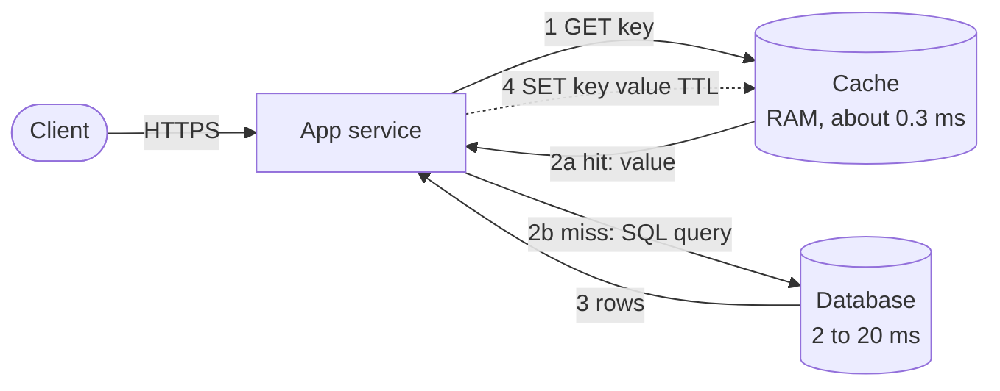

**Reading the diagram.** The client calls the application service over HTTPS. The service first asks the cache (a separate in-memory store reached over TCP); on a hit (2a) it answers immediately. On a miss (2b) it queries the database, then writes the result into the cache (4) so the next reader hits. Steps 1–3 are synchronous; the fill (dotted) need not delay the response. Two storage boundaries exist: the disposable cache in RAM and the durable database. Failure points: a cache outage turns every request into path 2b, multiplying database load (§20.13); a fill that races with a write can store stale data (§20.7.2). Scaling: the cache tier scales by partitioning keys over nodes (§20.14); the database sees only misses.

### 20.3.2 Hit ratio, effective latency and backend load

#### Mathematical foundations

You met this formula for CPU caches as average memory access time (§5.4.5). For an application cache, every request pays for the lookup, and a miss adds the backend read.

::: formula
**Effective latency and backend load of a look-aside cache**

$$T_{\text{eff}} = t_c + (1 - h)\, t_b \qquad\qquad R_{\text{db}} = (1 - h)\, R_{\text{read}} + R_{\text{write}}$$

| Symbol | Meaning | Units |
|---|---|---|
| $T_{\text{eff}}$ | Mean latency of a read through the cache | ms |
| $t_c$ | Cache lookup latency (paid on hits and misses) | ms |
| $t_b$ | Backend read latency, including the fill | ms |
| $h$ | Cache hit ratio | dimensionless (0–1) |
| $R_{\text{read}}$ | Read requests reaching the cache | requests/s |
| $R_{\text{write}}$ | Writes, which go to the database regardless | requests/s |
| $R_{\text{db}}$ | Requests reaching the database | requests/s |
:::

::: example
**Worked example — What one percentage point of hit ratio is worth.** A profile service receives $R_{\text{read}} = 50{,}000$ reads/s and $R_{\text{write}} = 500$ writes/s. A Redis lookup costs $t_c = 0.3$ ms; a database read costs $t_b = 8$ ms.

1. At $h = 0.90$: $T_{\text{eff}} = 0.3 + 0.10 \times 8 = 1.1$ ms; $R_{\text{db}} = 0.10 \times 50{,}000 + 500 = 5{,}500$ queries/s.
2. At $h = 0.98$: $T_{\text{eff}} = 0.3 + 0.02 \times 8 = 0.46$ ms; $R_{\text{db}} = 1{,}000 + 500 = 1{,}500$ queries/s.
3. At $h = 0.99$: $T_{\text{eff}} = 0.3 + 0.01 \times 8 = 0.38$ ms; $R_{\text{db}} = 500 + 500 = 1{,}000$ queries/s.
4. Going from 99% to 98% raises *read* traffic at the database from 500 to 1,000 queries/s: a one-point drop in hit ratio **doubles** the database's read load.
5. Tail: with a 2% miss ratio, more than 1% of requests are misses, so the p99 latency is a miss (about 8.3 ms) even though the mean is 0.46 ms.

**Interpretation.** Gains at high hit ratios look small as percentages but are large as ratios of miss ratios. **Engineering implication.** Monitor and alert on the miss ratio and on absolute database queries per second, size the database for the miss traffic you would see after a cache restart (§20.13), and remember that the mean hides the tail: p99 latency is set by misses whenever the miss ratio exceeds 1%.
:::

::: mistake
**"Our cache hit ratio is 95%, so the cache is working."** A hit ratio is meaningless without the miss *rate* in requests per second and the backend's capacity. 95% of 1,000 RPS leaves 50 misses per second, trivial; 95% of 1,000,000 RPS leaves 50,000, enough to overwhelm most databases. Also check whether the hit ratio is computed per request or per key lookup: a page with 20 lookups and one miss is a "95% hit ratio" but a 100% slow page.
:::

### 20.3.3 Popularity skew: why small caches work

#### First-principles explanation

If every key were equally popular, a cache holding 1% of the keys would serve 1% of requests, and caching would rarely be worth it. Real access patterns are highly skewed: a few celebrities, products and videos receive most of the traffic, and a long tail of items is requested rarely. Skew is what makes caching pay.

::: definition
**Definition — Zipf (Zipf-like) distribution.** A popularity law in which the item of popularity rank $i$ is requested with probability proportional to $1/i^{s}$, where $s > 0$ is the **skew exponent**. Breslau et al. found that requests to web proxies follow a Zipf-like law with an exponent below 1 and that, as a consequence, hit ratio grows roughly logarithmically with cache size [Breslau et al. 1999].
:::

#### Mathematical foundations

::: formula
**Zipf request probability and the hit ratio of an ideal top-C cache**

$$p_i = \frac{1/i^{s}}{H_{N,s}}, \qquad H_{n,s} = \sum_{j=1}^{n} \frac{1}{j^{s}}, \qquad h_{\text{ideal}}(C) = \frac{H_{C,s}}{H_{N,s}} \;\overset{s=1}{\approx}\; \frac{\ln C + \gamma}{\ln N + \gamma}$$

| Symbol | Meaning | Units |
|---|---|---|
| $N$ | Number of distinct keys | keys |
| $C$ | Cache capacity | entries |
| $i$ | Popularity rank (1 = most popular) | dimensionless |
| $s$ | Zipf skew exponent | dimensionless |
| $p_i$ | Probability that a request is for rank $i$ | dimensionless |
| $H_{n,s}$ | Generalized harmonic number | dimensionless |
| $h_{\text{ideal}}(C)$ | Hit ratio of a cache that always holds the top $C$ keys | dimensionless |
| $\gamma$ | Euler–Mascheroni constant, ≈ 0.5772 | dimensionless |
:::

::: example
**Worked example — One percent of the catalog, two thirds of the traffic.** $N = 10^6$ keys with $s = 1$; the cache holds $C = 10^4$ entries (1%).

1. $\ln C + \gamma = \ln 10^4 + 0.5772 = 9.210 + 0.577 = 9.787$.
2. $\ln N + \gamma = \ln 10^6 + 0.5772 = 13.816 + 0.577 = 14.393$.
3. $h_{\text{ideal}} = 9.787 / 14.393 = 0.680$: 1% of the keys can serve 68% of requests (the exact sum, computed by the program below, is also 68.0%).
4. Doubling the cache to $2 \times 10^4$: $(\ln(2 \times 10^4) + 0.577)/14.393 = (9.903 + 0.577)/14.393 = 0.728$. Twice the memory buys only 4.8 more points.

**Interpretation.** Under Zipf, each *doubling* of cache size adds a roughly constant number of points ($\ln 2 / 14.393 \approx 4.8$ here), so the first gigabytes of cache are worth far more than the last. **Engineering implication.** Size a cache by plotting hit ratio against size from a real trace and stop where the next doubling no longer pays for itself in database capacity; for lower skew ($s < 1$) the curve is flatter and you need a larger fraction of the data.
:::

#### Code example

The program computes the ideal hit ratio and then simulates a real LRU cache on a sampled Zipf trace, for three skews and three cache sizes.

```python
"""Why small caches work: the ideal hit ratio of a cache that holds the C most
popular of N keys under Zipf popularity, versus a simulated LRU cache."""
import itertools
import random
from collections import OrderedDict

def zipf_weights(n, s):
    """Unnormalized Zipf weights 1/i^s for ranks 1..n."""
    return [1.0 / i ** s for i in range(1, n + 1)]

def ideal_hit_ratio(weights, c):
    """Fraction of requests for the top-c keys: H(c, s) / H(n, s)."""
    return sum(weights[:c]) / sum(weights)

def zipf_trace(weights, length, seed=1):
    """Sample `length` requests; key i has probability weights[i] / sum."""
    cum = list(itertools.accumulate(weights))
    return random.Random(seed).choices(range(len(weights)), cum_weights=cum, k=length)

def lru_hit_ratio(trace, capacity, warmup):
    cache, hits = OrderedDict(), 0
    for t, key in enumerate(trace):
        if key in cache:
            cache.move_to_end(key)
            hits += t >= warmup
        else:
            cache[key] = None
            if len(cache) > capacity:
                cache.popitem(last=False)          # evict least recently used
    return hits / (len(trace) - warmup)

if __name__ == "__main__":
    N, LENGTH, WARMUP = 100_000, 1_000_000, 200_000
    sizes = [100, 1_000, 10_000]                    # 0.1%, 1%, 10% of the keys
    print(f"N = {N:,} keys, {LENGTH:,} requests; hit ratio by cache size")
    print("   s   policy        " + "".join(f"{c / N:>9.1%}" for c in sizes))
    for s in (0.7, 0.9, 1.0):
        w = zipf_weights(N, s)
        trace = zipf_trace(w, LENGTH)
        ideal = [ideal_hit_ratio(w, c) for c in sizes]
        lru = [lru_hit_ratio(trace, c, WARMUP) for c in sizes]
        print(f"{s:>4}   ideal top-C   " + "".join(f"{h:>9.1%}" for h in ideal))
        print(f"{s:>4}   LRU (sim)     " + "".join(f"{h:>9.1%}" for h in lru))
    w = zipf_weights(1_000_000, 1.0)
    print(f"worked example: N = 1e6, s = 1, C = 1e4 -> ideal "
          f"{ideal_hit_ratio(w, 10_000):.1%}")
```

Output (Python 3.13, about 4 s):

```text
N = 100,000 keys, 1,000,000 requests; hit ratio by cache size
   s   policy             0.1%     1.0%    10.0%
 0.7   ideal top-C       10.2%    23.1%    48.8%
 0.7   LRU (sim)          2.4%    10.9%    34.7%
 0.9   ideal top-C       29.0%    47.4%    70.7%
 0.9   LRU (sim)         15.6%    34.2%    60.5%
 1.0   ideal top-C       42.9%    61.9%    81.0%
 1.0   LRU (sim)         29.0%    50.6%    73.7%
worked example: N = 1e6, s = 1, C = 1e4 -> ideal 68.0%
```

What to notice:

- Skew dominates: with 1% of keys cached, the ideal hit ratio is 23% at $s = 0.7$ but 62% at $s = 1.0$. Measure your skew before promising a hit ratio.
- Each tenfold increase in size adds a roughly constant number of points, the logarithmic growth Breslau et al. observed.
- LRU falls 8–13 points short of the ideal because it keeps whatever was used last, including one-off keys from the tail. §20.9 measures policies that close most of that gap.
- `warmup` excludes the first 200,000 requests, so the numbers describe a warm cache; a cold cache after a restart does much worse (§20.13).

## 20.4 CPU cache versus application cache

The principles are the same at every level of the memory hierarchy: locality, a hit/miss formula, eviction and coherence. The engineering is very different, as Table 20.1 shows.

**Table 20.1 — CPU caches (Chapter 5) versus application caches (this chapter).**

| Aspect | CPU cache (L1–L3) | Application cache (Redis, Memcached, in-process) |
|---|---|---|
| Unit | 64-byte cache line | Whole object or query result, bytes to megabytes |
| Hit latency | ~1–15 ns | ~50 ns (in-process) to ~0.3 ms (remote) |
| Managed by | Hardware, transparently | Your code: keys, TTLs, fills and invalidation are explicit |
| Placement and eviction | Set-associative, pseudo-LRU (§5.4.4) | Hash table plus LRU, LFU, W-TinyLFU or approximations |
| Coherence | Hardware protocol (MESI, §5.4.6) keeps copies consistent | None by default: you invalidate, expire or accept staleness |
| Failure | Never "down" | Can fail, restart empty or be partitioned from clients |
| What a miss costs | ~100 ns DRAM access | 2–50 ms database query, and load on a shared database |

The most important row is coherence. A CPU guarantees that no core reads a stale line after another core's write commits. An application cache gives you no such guarantee: you must design how copies are invalidated (§20.10), and you must decide how stale is acceptable for each piece of data. The second most important row is failure: a CPU cache never disappears, but a cache cluster can restart empty and expose the database to the full read load.

## 20.5 Where to cache

### 20.5.1 The layers

A request passes through several places where a copy can be kept. The closer to the client, the more latency and backend work a hit saves, but the less control you have over invalidation and the more copies there are to keep fresh.

**Figure 20.2 — Cache layers from the client to the database.**

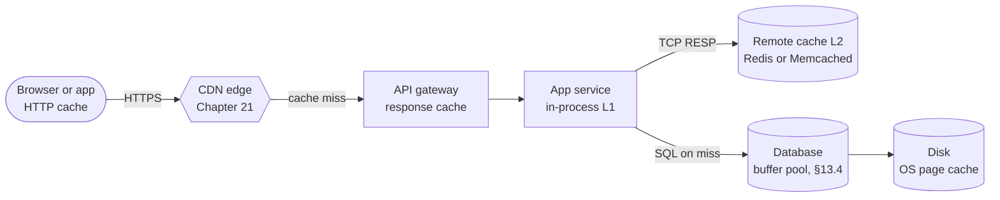

**Reading the diagram.** From left to right the copies get more authoritative and more expensive to reach. The browser's HTTP cache can answer with no network at all; the CDN edge (an external system, Chapter 21) answers from a nearby point of presence; the gateway caches whole responses; the service's in-process L1 cache answers in microseconds; the remote L2 cache answers in a fraction of a millisecond over the Redis or Memcached protocol; the database's buffer pool and the operating system's page cache avoid disk reads. All arrows are synchronous request paths; each layer forwards only its misses. Storage boundaries: client device, CDN, application memory, cache cluster, database. Failure points: a copy in a layer you do not control (browser, CDN) cannot be deleted instantly; each extra layer adds a place where data can be stale. Scaling: each layer absorbs a share of traffic so the next sees only misses.

**Table 20.2 — What each cache layer is good for.**

| Layer | Typical hit latency | Stores | Invalidation | Best for |
|---|---|---|---|---|
| Client (browser, mobile) | 0 (no network) | HTTP responses, app state | Only by TTL or validation (`ETag`) | Static assets, per-user data that may be slightly old |
| CDN edge | 5–30 ms from the user | Public HTTP responses | TTL, purge API (seconds, §21.6) | Images, video, scripts, public pages |
| API gateway | Sub-ms after reaching it | Whole API responses | TTL, explicit purge | Expensive public `GET`s |
| In-process (L1) | 50 ns–1 µs | Objects in the heap | TTL; broadcast or none | Very hot, small, read-mostly data |
| Remote (L2) | 0.2–0.5 ms in-datacenter | Serialized objects, counters, sessions | Delete on write, TTL, CDC | Shared hot data across many service instances |
| Database | Inside the query | Pages, query plans | Automatic, coherent | Everything; you tune its size (§13.4.3) |

### 20.5.2 Client and HTTP caching

HTTP caching is standardized in RFC 9111 [RFC 9111]; §21.6.1 treats it in depth for CDNs. The origin controls client and intermediary caches with headers:

- `Cache-Control: max-age=600` lets any cache reuse the response for 600 s; `s-maxage` sets a different lifetime for shared caches such as CDNs; `private` forbids shared caches from storing a per-user response; `no-store` forbids storage altogether; `no-cache` permits storage but requires revalidation before each use.
- **Validators**: an `ETag` (an opaque version identifier) or `Last-Modified`. When a stored response is stale, the client sends `If-None-Match: "<etag>"`; if nothing changed, the server replies `304 Not Modified` with no body, saving bandwidth but not the round trip.
- `stale-while-revalidate=60` lets a cache serve a stale response for up to 60 s while it refreshes in the background, and `stale-if-error` lets it serve stale content when the origin fails [RFC 5861]. §20.11.4 applies the same idea to server-side caches.

For static assets, the standard trick is **cache busting**: put a content hash in the file name (`app.3f9a2c.js`) and set a TTL of a year. The URL changes whenever the content changes, so no invalidation is ever needed.

### 20.5.3 CDN and gateway

A **CDN** is a geographically distributed set of HTTP caches; Chapter 21 covers its architecture, tiered caching and purge. An **API gateway** or reverse proxy (NGINX, Envoy, Varnish) can cache whole responses keyed by method, URL and selected headers. The risk at both layers is the **cache key**: if a response varies by a header (language, authorization) that is not part of the key, one user's response can be served to another. Never cache authenticated responses in a shared layer unless the key includes the identity and the response is marked accordingly.

### 20.5.4 Application caches: in-process versus remote

An **in-process cache** (Caffeine in Java, an LRU dictionary in Python, `ristretto` in Go) lives in the service's own heap. A **remote cache** (Redis, Memcached) is a separate cluster shared by all instances.

**Table 20.3 — In-process versus remote application caches.**

| Aspect | In-process (L1) | Remote (L2) |
|---|---|---|
| What it is | A map in the service's memory | A separate in-memory server cluster |
| How it works | Direct object reference; no serialization | Network round trip; serialize and deserialize |
| Advantages | ~100 ns hits; no network; survives cache-cluster outage | Shared by all instances; one copy to invalidate; large capacity |
| Disadvantages | One copy per instance (N× memory, N× misses); hard to invalidate; lost on deploy | ~0.3 ms per hit; network and serialization CPU; another system to operate |
| Performance | Millions of lookups/s per core | 100,000+ simple ops/s per Redis node, more with I/O threads or Memcached threads |
| Operational complexity | Low, but GC pressure in managed runtimes | Medium: clustering, failover, memory tuning |
| Cost | Uses service RAM (multiplied by instance count) | Dedicated nodes |
| Use cases | Configuration, feature flags, hot keys (§20.15) | Sessions, profiles, rendered fragments, counters |
| Choose when | Data is small, very hot and tolerates seconds of staleness | Data is shared, larger, or must be invalidated reliably |

Production systems often use both: an L1 with a TTL of seconds in front of an L2 with a TTL of minutes. The L1 absorbs hot keys; the L2 provides a single place to invalidate.

### 20.5.5 Database-side caching

The database already caches pages in its buffer pool (§13.4) and the operating system caches file blocks (§6.6.6). These caches are **coherent**: they never return stale data, because the database owns both the copy and the original. They cannot, however, avoid the cost of parsing, planning and executing a query, or of a network hop to the database. MySQL removed its query cache in version 8.0 because invalidating every cached result on every write to a table scaled poorly under concurrency [MySQL Server Team 2017]. Materialized views (§11.5.5) and read replicas (§14.3) are the database's own answers to repeated expensive reads.

::: recommendation
**Cache as close to the client as freshness allows.** Static, versioned assets: browser and CDN, one-year TTL. Public pages: CDN with short TTL plus purge. Per-user API data: remote cache with delete-on-write. Very hot small objects: add an in-process L1 with a TTL of a few seconds. Never add a layer without stating how it is invalidated and what happens when it is empty.
:::

## 20.6 Redis and Memcached internals

Redis and Memcached are the two dominant remote caches. Both keep data in RAM, speak simple protocols over TCP and answer in well under a millisecond. They differ in what they are: Memcached is a deliberately minimal, multithreaded cache of opaque byte strings; Redis is a single-threaded data-structure server that also persists and replicates. This section covers the internals that explain their behavior; §20.16 compares them.

### 20.6.1 Redis: a single-threaded event loop

::: definition
**Definition — Event loop.** A single thread that waits on many sockets at once with an operating-system readiness API (`epoll` on Linux, `kqueue` on BSD and macOS, §6.13.2–§6.13.4) and handles each ready socket in turn, without blocking on any one of them.
:::

#### First-principles explanation

Picture one very fast chef who never waits: while one order's water heats, he chops for the next. Because only he touches the kitchen, nobody needs to lock the knife drawer. Redis executes every command on one main thread. Each command runs to completion before the next starts, so every command is **atomic** without locks, and operations such as `INCR`, `LPUSH` or a Lua script never interleave.

#### How it works internally

1. The main thread calls `epoll_wait` to learn which client sockets are readable.
2. For each, it reads bytes, parses commands in the **RESP** protocol and looks up the key in the **keyspace**, a hash table that grows by **incremental rehashing** (two tables; each operation moves a few buckets, so no single command pays for a full resize).
3. It executes the command against the in-memory data structure and appends the reply to the client's output buffer.
4. Before sleeping again it writes pending replies and runs timers: **active expiry**, which samples keys with TTLs and deletes expired ones, background rehashing and replication bookkeeping.

Two kinds of helper threads relieve the main thread. **Background I/O threads** free large values (`UNLINK`, lazy freeing), close files and `fsync` the append-only file. **I/O threads** (Redis 6.0 onward, `io-threads`) read and parse requests and write replies in parallel, while command execution stays single-threaded [Redis Docs: Redis configuration]. Valkey 8.0 reworked this design so the main thread and I/O threads run concurrently; its maintainers report up to about 1.2 million requests per second on one AWS r7g instance (as of 2024) [Valkey Blog 2024].

**Figure 20.3 — Redis's event loop with I/O threads.**

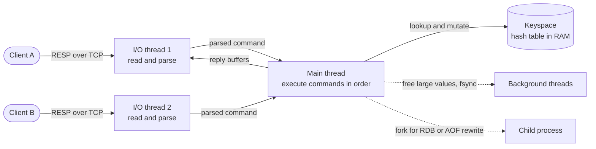

**Reading the diagram.** Clients send RESP commands over TCP. I/O threads (optional) do socket reads, parsing and reply writes in parallel; the single main thread executes every command against the in-RAM keyspace, which is why commands are atomic. Slow side work runs asynchronously (dotted): background threads free memory and `fsync` the log, and a forked child writes snapshots. Storage boundary: RAM for the dataset; disk only for persistence files. Failure points: any slow command (`KEYS *`, a huge `DEL`, a long Lua script) blocks *all* clients; `fork` of a large process can pause the main thread for milliseconds. Scaling: one Redis process uses essentially one core for execution, so you scale out with Redis Cluster (§20.6.4) or run several processes per machine.

::: warning
**One slow command stalls everyone.** `KEYS *` on 10 million keys, `HGETALL` on a hash of a million fields, or `DEL` of a huge set (use `UNLINK`) blocks the event loop for tens to hundreds of milliseconds, and every other client waits. Use `SCAN`, bounded ranges and `SLOWLOG` to find the culprits.
:::

### 20.6.2 Data structures and encodings

Redis values are typed. **Strings** (binary-safe, up to 512 MB) hold serialized objects and counters (`INCR`); **hashes** hold objects field by field; **lists** are queues; **sets** and **sorted sets** support membership and ranking (`ZADD`, `ZRANGE`), the latter as a skip list plus hash table (§17.7); **streams** are append-only logs; and HyperLogLog, bitmaps and geospatial indexes are built on strings and sorted sets (§17.5, §17.9) [Redis Docs: Data types]. Small collections use a compact contiguous **listpack** encoding and are converted to hash tables or skip lists when they exceed thresholds such as `hash-max-listpack-entries` (128 by default), trading CPU for memory.

### 20.6.3 Persistence: RDB and AOF

A cache can lose its contents, but a cold restart of a large cache is expensive (§20.13), and Redis is also used for data that must survive restarts.

**Table 20.4 — Redis persistence options.**

| Option | How it works | Data lost on crash | Cost |
|---|---|---|---|
| None | Pure in-memory | Everything | None |
| RDB snapshot | `fork()`; the child writes a compact binary snapshot while copy-on-write (§6.6.5) preserves the parent's view | Writes since the last snapshot (minutes) | Fork pause; up to 2× memory if many pages change during the dump |
| AOF, `appendfsync everysec` | Every write command appended to a log; `fsync` once per second; the log is periodically rewritten | About 1 s of writes | Disk bandwidth; rewrite cost |
| AOF, `appendfsync always` | `fsync` before acknowledging | Nothing acknowledged | Throughput limited by `fsync` latency |
| RDB + AOF (RDB preamble) | Rewritten AOF starts with an RDB image, then appends | About 1 s | Fast restart, small log |

[Redis Docs: Persistence]. For a pure cache, many teams disable AOF and keep RDB only for faster warm restarts.

### 20.6.4 Replication and Redis Cluster

**Replication** is asynchronous: a primary streams its command stream to replicas, which acknowledge offsets. A replica that disconnects briefly resumes from a **replication backlog** (`PSYNC` with a replication ID and offset); otherwise it receives a full RDB snapshot. Because acknowledgments arrive after the client's reply, a failover can lose the last writes; `WAIT` reduces but does not eliminate this [Redis Docs: Replication]. **Redis Sentinel** monitors a primary and promotes a replica for unpartitioned deployments.

::: definition
**Definition — Hash slot (Redis Cluster).** One of 16,384 buckets into which Redis Cluster divides the keyspace: `slot = CRC16(key) mod 16384`. Each primary owns a set of slots. If a key contains `{...}`, only the substring inside the braces (a **hash tag**) is hashed, so related keys can be forced into one slot [Redis Docs: Cluster specification].
:::

Clients cache the slot-to-node map. A node that receives a request for a slot it does not own replies `MOVED <slot> <host:port>`; during resharding a slot being migrated returns `ASK` for keys already moved. Nodes exchange state over a gossip **cluster bus** (by default the client port + 10,000), detect failures, and a majority of primaries authorizes a replica to take over a failed primary's slots. Multi-key commands and transactions work only when all keys share a slot.

**Figure 20.4 — Redis Cluster: hash slots, redirects and replicas.**

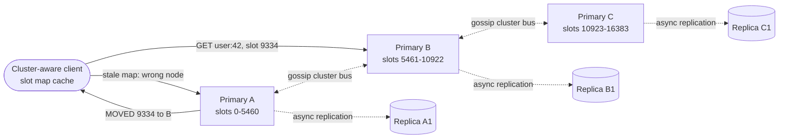

**Reading the diagram.** The client hashes the key with CRC16, takes it modulo 16,384 and sends the command directly to the owning primary (here slot 9334 on B). If its cached map is stale it reaches the wrong node, which answers `MOVED`; the client updates its map and retries. Each primary replicates asynchronously (dotted) to at least one replica; primaries and replicas gossip on the cluster bus. Storage boundaries: each primary holds only its slots' data. Failure points: a primary failure loses writes not yet replicated; a minority side of a network partition stops accepting writes after the node timeout; keys without a shared hash tag cannot be used together. Scaling: add primaries and move slots to them; because slots, not keys, move, resharding is incremental. The slot space is a fixed-partition scheme (§14.9.2) rather than a hash ring (§20.14).

### 20.6.5 Memcached: threads, slabs and segmented LRU

Memcached stores opaque values (1 MB maximum by default) under string keys and supports `get`, `set`, `add`, `delete`, `incr`, compare-and-set (`cas`) and, since 1.6, a **meta protocol** with flags for serving stale items and electing a single client to refresh them [Memcached Docs: Meta commands]. It has no persistence across restarts by default and no built-in replication; clients spread keys over servers by consistent hashing (§20.14).

**Threads.** One listener thread accepts connections and hands each to one of `-t` worker threads (4 by default), each running its own `libevent` loop. Workers share one hash table protected by striped item locks, so one Memcached process uses many cores [Memcached Docs: Overview].

**The slab allocator.** Calling `malloc` and `free` for millions of objects of varying sizes fragments the heap. Memcached instead carves memory into 1 MB **pages**, assigns each page to a **slab class**, and cuts the page into equal **chunks**. Chunk sizes grow geometrically by the growth factor `-f` (1.25 by default): 96, 120, 152, 192, 240, 304 bytes and so on. An item (key, value and a header of about 50 bytes) goes into the smallest chunk that fits.

**Figure 20.5 — Memcached's slab allocator and per-class LRUs.**

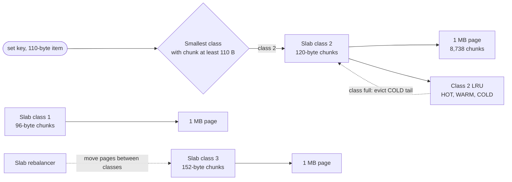

**Reading the diagram.** A 110-byte item does not fit a 96-byte chunk, so it goes to class 2 (120-byte chunks); a 1 MB page holds $\lfloor 1{,}048{,}576 / 120 \rfloor = 8{,}738$ of them. Each class has its own LRU, so when class 2 is full Memcached evicts the coldest class-2 item, even if other classes have free chunks (dotted, asynchronous maintenance). Storage boundary: all in RAM (optional flash extension: extstore). Failure point: **slab calcification**, where pages assigned long ago to one size class cannot serve a new size mix; the background slab rebalancer moves pages to classes under eviction pressure. Scaling: add memory or servers; workers scale with cores.

::: formula
**Slab internal fragmentation**

$$c_{k+1} \approx f \cdot c_k, \qquad \text{waste}(x) = c_k - x \text{ for } c_{k-1} < x \le c_k, \qquad \frac{\text{waste}}{c_k} < 1 - \frac{1}{f}, \qquad \mathbb{E}\!\left[\frac{\text{waste}}{c_k}\right] \approx \frac{1}{2}\left(1 - \frac{1}{f}\right)$$

| Symbol | Meaning | Units |
|---|---|---|
| $c_k$ | Chunk size of slab class $k$ (rounded to 8 bytes) | bytes |
| $f$ | Growth factor between classes (`-f`) | dimensionless |
| $x$ | Item size, including header | bytes |
| waste | Unused bytes in the chunk | bytes |
:::

::: example
**Worked example — Memory for 20 million session objects.** Each item is a 40-byte key, a 300-byte value and a 50-byte header: $x = 390$ bytes.

1. Classes near 390 bytes: 304, then $304 \times 1.25 = 380$ (chunk 384), then $384 \times 1.25 = 480$. The item exceeds 384, so it uses a 480-byte chunk.
2. Waste per item: $480 - 390 = 90$ bytes, 18.8% of the chunk, close to the worst case $1 - 1/1.25 = 20\%$.
3. Memory: $20 \times 10^6 \times 480 = 9.6 \times 10^9$ bytes = 9.6 GB, versus 7.8 GB of actual item bytes.
4. With a mixed size distribution the expected waste is about $\tfrac{1}{2}(1 - 0.8) = 10\%$.

**Interpretation.** Slab allocation trades 10–20% of memory for no external fragmentation and constant-time allocation. **Engineering implication.** If one item size dominates, check `stats slabs` and consider a smaller growth factor (for example `-f 1.08`) so a class lands just above your common size; budget memory by chunk size, not value size.
:::

**Segmented LRU.** Since version 1.5.0, each slab class's LRU is split into **HOT**, **WARM** and **COLD** sub-LRUs plus a **TEMP** queue for items with very short TTLs. New items enter HOT; items reaching the tail of HOT or WARM move to COLD unless they were accessed, in which case active items move to WARM; evictions take the tail of COLD. A background **LRU maintainer** thread moves items between segments, so a cache hit only sets a flag instead of relinking a shared list under a lock, and an **LRU crawler** reclaims expired items [Memcached Blog: Modern LRU]. The design is the scan-resistant midpoint idea of InnoDB's buffer pool (§13.4.2) applied to a cache.

::: industry
**Netflix EVCache.** Netflix built EVCache, a client library and tooling around Memcached, to cache data for its streaming services; writes are replicated to copies in several availability zones and regions by the client so a zone failure does not empty the cache, and it was open-sourced [Netflix: EVCache]. The design shows the Memcached philosophy: keep the server simple and put replication and routing in the client or a proxy.
*Evidence: Primary* — [Netflix: EVCache]
:::

## 20.7 Caching patterns: cache-aside, read-through, write-through, write-back, write-around

A caching pattern answers two questions: *who* fills the cache on a read miss (your code or the cache), and *what happens to the cache* on a write. Each answer moves the consistency risk somewhere else.

### 20.7.1 Cache-aside (look-aside)

::: definition
**Definition — Cache-aside.** The application reads the cache first; on a miss it reads the database and populates the cache itself. On a write it updates the database and then **deletes** (invalidates) the cache entry. The cache never talks to the database. Also called **look-aside** or **demand-filled** caching.
:::

**Figure 20.6 — Cache-aside read and write paths.**

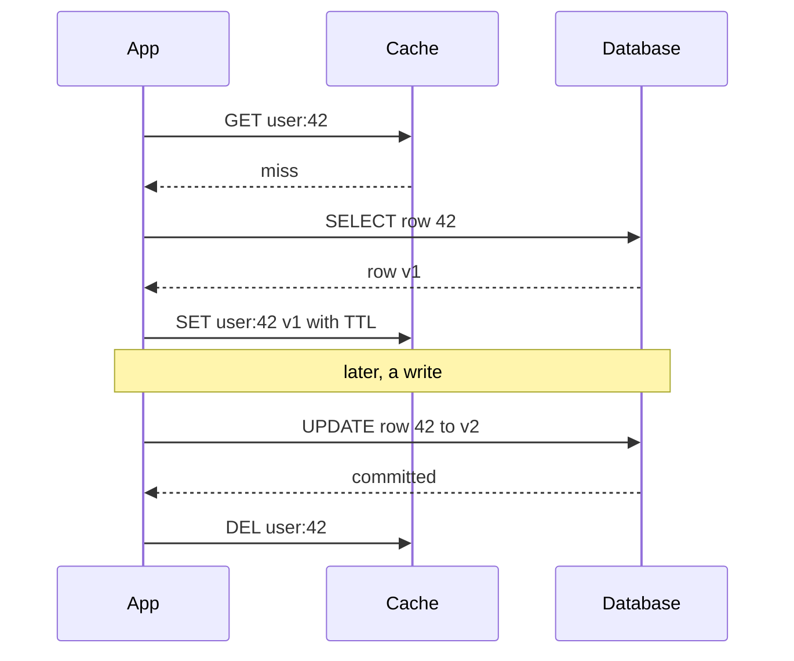

**Reading the diagram.** All calls are synchronous and initiated by the application, which holds the logic for both stores. On a miss it reads the database and sets the value with a TTL; on a write it commits to the database first, then deletes the key so the next read refills it. Storage boundaries: cache and database, with no transaction spanning both. Failure points: the delete can fail after the commit (the TTL then bounds staleness), and a concurrent read can re-insert old data (§20.7.2). Scaling: the cache holds only what was read, so memory follows the working set.

Cache-aside is the default for remote caches because it is simple, keeps the cache optional (if the cache is down, reads go to the database) and caches only data that is actually read. Facebook's Memcache deployment is the canonical large-scale example [Nishtala et al. 2013].

**Why delete instead of update?** If writers *set* the new value, two concurrent writers can commit to the database in one order and set the cache in the other, leaving the older value cached indefinitely. A delete is idempotent: whichever order deletes arrive in, the result is "absent", and the next read loads the committed value. Nishtala et al. chose deletes for exactly this reason [Nishtala et al. 2013].

### 20.7.2 Consistency races in cache-aside

Deleting after the write narrows the window for stale data but does not close it.

**Figure 20.7 — The stale-set race in cache-aside.**

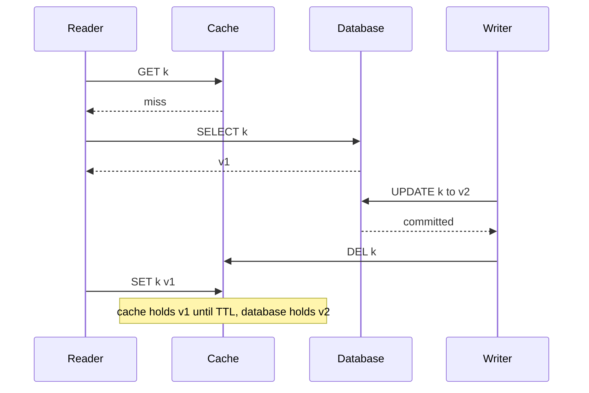

**Reading the diagram.** Time flows downward. The reader misses and reads $v_1$ but is delayed (a GC pause, a slow network) before setting it. Meanwhile the writer commits $v_2$ and deletes the key, which is already absent. The reader's late `SET` then installs $v_1$, and every subsequent reader sees stale data until the TTL expires. All steps are synchronous; the hazard is the gap between the reader's database read and its cache write. The race is rare, but at millions of reads per second rare events happen every day.

The opposite ordering is worse. If the writer deletes the cache *before* updating the database, any reader arriving between the delete and the commit refills the cache with the old value, a window as long as the write transaction.

Mitigations, from simplest to strongest:

1. **Short TTLs** bound how long a stale entry can survive. Always set one.
2. **Delayed double delete**: delete, commit, then delete again after a delay longer than a typical read–fill (for example 500 ms). It shrinks the window but is a heuristic.
3. **Leases**: on a miss the cache hands the reader a token; a delete invalidates outstanding tokens, and a `SET` with an invalid token is rejected. In Figure 20.7 the writer's `DEL` would void the reader's lease, so the stale `SET` fails [Nishtala et al. 2013]. Memcached's `cas` and meta-protocol tokens provide similar building blocks.
4. **Versioned sets**: store a version (a database row version or commit LSN) with the value and set only if the cached version is older, using compare-and-set or a server-side script.
5. **Invalidation from the database's change stream** (§20.10.2): deletes are issued after commit by a process that tails the log, so no application crash can skip them.

### 20.7.3 Read-through

::: definition
**Definition — Read-through.** The application asks only the cache; on a miss the *cache* loads the value from the database through a configured loader, stores it and returns it.
:::

**Figure 20.8 — Read-through.**

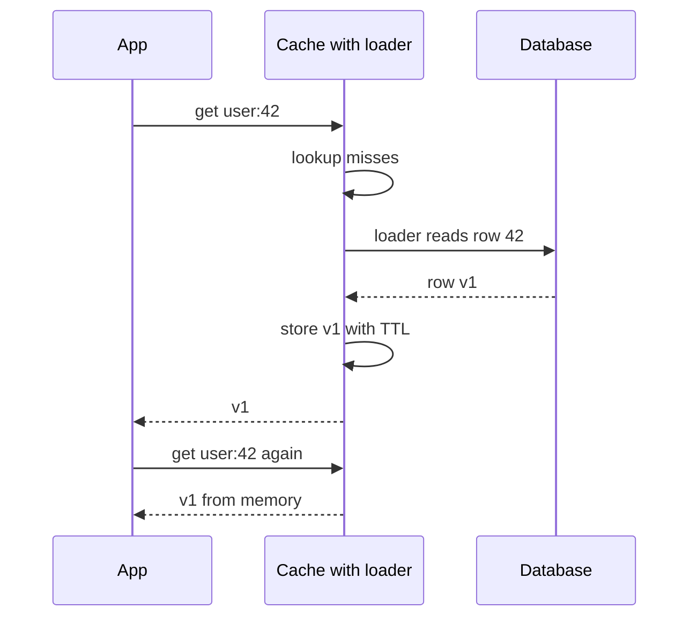

**Reading the diagram.** The application sees one synchronous interface; loading is the cache's job. Because the loader sits inside the cache, concurrent misses for the same key can be **coalesced** into one database read, which removes the stampede problem of §20.11 for that process. Storage boundaries and failure points are as in cache-aside, except that a cache outage now also blocks reads unless the client falls back. Caffeine's `LoadingCache` and Guava's `CacheBuilder` are in-process read-through caches; remote read-through is usually provided by a proxy or a cache product's loader plug-in.

### 20.7.4 Write-through

::: definition
**Definition — Write-through.** Every write goes to the cache, which synchronously writes it to the database before acknowledging; the cache is updated and the database is updated as one client-visible operation.
:::

**Figure 20.9 — Write-through.**

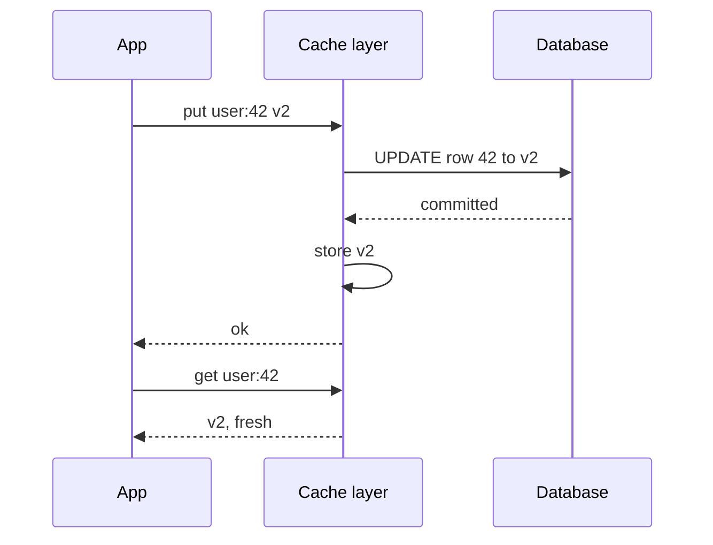

**Reading the diagram.** The write is acknowledged only after both the database commit and the cache update, so a subsequent read through the same cache sees the new value. Write latency is the sum of both, and every written key is cached, even if never read. Failure points: a crash between the database commit and the cache store leaves the cache without the value (harmless) or, if ordered the other way, with a value the database never committed (harmful), so the database must be written first. Writes that bypass the cache layer (an admin script, another service) still make it stale.

### 20.7.5 Write-back (write-behind)

::: definition
**Definition — Write-back.** Writes update only the cache and are acknowledged immediately; the cache marks entries **dirty** and flushes them to the database asynchronously, in batches or after a delay.
:::

**Figure 20.10 — Write-back.**

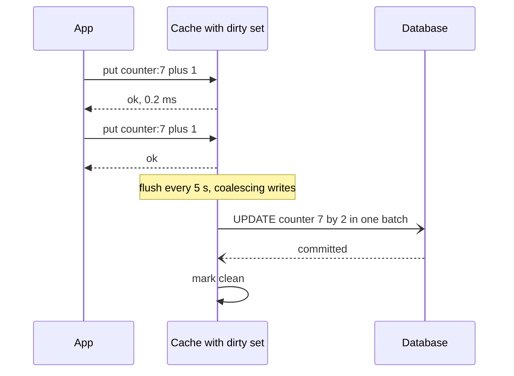

**Reading the diagram.** Writes are acknowledged from memory; the flush to the database is asynchronous (open arrowheads) and coalesces many writes to the same key into one. This is how CPU caches (§5.4) and database buffer pools (§13.4) handle writes. The storage boundary that matters is the dirty set: until flushed, acknowledged data exists only in cache memory. Failure point: a cache node crash loses every unflushed write unless the cache itself is replicated or logged. Scaling: write-back absorbs write bursts that the database could not take directly.

::: formula
**Data at risk under write-back**

$$W_{\text{risk}} \approx r_w \times T_{\text{flush}}, \qquad \text{write reduction} = \frac{r_w}{r_{\text{flush}}}$$

| Symbol | Meaning | Units |
|---|---|---|
| $W_{\text{risk}}$ | Acknowledged writes that a crash can lose | writes |
| $r_w$ | Write rate into the cache | writes/s |
| $T_{\text{flush}}$ | Maximum time a dirty entry waits before flushing | s |
| $r_{\text{flush}}$ | Database writes per second after coalescing | writes/s |
:::

::: example
**Worked example — View counters.** A video service counts 200,000 views/s spread over 50,000 videos active in any 5-second window, flushing every $T_{\text{flush}} = 5$ s.

1. Writes at risk: $200{,}000 \times 5 = 10^6$ view increments lost if a node crashes just before a flush.
2. Database load after coalescing: at most 50,000 rows updated per 5 s, so $r_{\text{flush}} = 10{,}000$ writes/s.
3. Write reduction: $200{,}000 / 10{,}000 = 20\times$.

**Interpretation.** For view counts, losing a few seconds of increments is acceptable, and a 20× write reduction is decisive. **Engineering implication.** Use write-back only for data whose loss you can tolerate or reconstruct (counters, metrics, presence); for orders and payments, the database must commit first.
:::

### 20.7.6 Write-around

::: definition
**Definition — Write-around.** Writes go directly to the database and bypass the cache; the cache is populated only by reads (usually cache-aside), and the written key is invalidated or left to expire.
:::

**Figure 20.11 — Write-around.**

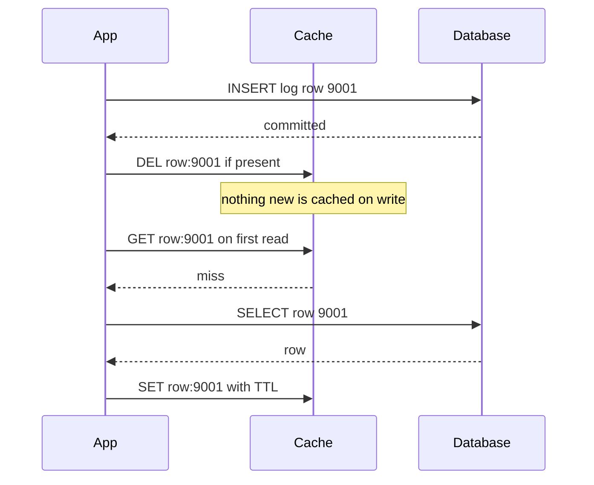

**Reading the diagram.** The write path touches the database (and at most deletes a stale key); only a later read caches the row. This avoids filling the cache with data that is written once and rarely read, such as logs, uploads or audit rows, which would evict hot entries. The cost is that the first read after a write is always a miss. In practice cache-aside with delete-on-write *is* write-around; the name matters when contrasting it with write-through.

### 20.7.7 Choosing a pattern

**Table 20.5 — Caching patterns compared.**

| Pattern | Read miss filled by | Write path | Consistency risk | Write latency | Choose when |
|---|---|---|---|---|---|
| Cache-aside | Application | DB, then delete key | Stale-set race; missed deletes | DB only | Default for remote caches |
| Read-through | Cache loader | (combine with a write pattern) | As cache-aside | — | In-process caches; coalescing misses |
| Write-through | Cache loader | Cache writes DB synchronously | Writes bypassing the layer | DB + cache | Read-after-write freshness via one layer |
| Write-back | Cache loader | Cache only; async flush | Loss of unflushed writes | Cache only | Counters, bursts, tolerable loss |
| Write-around | Application | DB only | First read misses | DB only | Write-heavy, rarely re-read data |

::: mistake
**"Write-through means the cache and database are always consistent."** Only for writers that go through that cache layer, and only if the database is written first. Concurrent writers, a second cache tier, or a batch job writing the database directly all reintroduce staleness. No pattern gives you linearizability across two stores without a protocol (Chapter 25); pick the pattern whose failure mode you can tolerate.
:::

## 20.8 Time to live (TTL)

::: definition
**Definition — Time to live (TTL).** The maximum time an entry may be served after it was stored. After the TTL the entry is treated as absent (or, with stale-while-revalidate, as stale). Redis removes expired keys lazily when they are accessed and actively by periodically sampling keys that have a TTL [Redis Docs: EXPIRE].
:::

A TTL is your **staleness budget** and your safety net: even if every invalidation mechanism fails, no entry is wrong for longer than its TTL. Choose it per data type from the question "how wrong may a user see this, and for how long?": seconds for prices and inventory, minutes for profiles, hours for rendered public pages, a year for content-addressed assets. Shorter TTLs cost more misses: an entry read $\lambda$ times per second with TTL $T$ misses about once per $T$ seconds, a miss ratio near $1/(\lambda T)$ for hot keys.

The danger is synchronized expiry. If a deploy, a batch job or a cache restart writes a million keys in one minute with the same TTL, they all expire in the same minute an hour later, and the database receives a million refills at once. **Jitter** spreads them out.

::: formula
**TTL with uniform jitter**

$$T_i = T_{\text{base}} + U_i, \quad U_i \sim \text{Uniform}(0, J), \qquad \text{peak refills/s} \approx \frac{K}{\max(J, t_{\text{write}})}$$

| Symbol | Meaning | Units |
|---|---|---|
| $T_i$ | TTL given to key $i$ | s |
| $T_{\text{base}}$ | Base TTL | s |
| $J$ | Jitter range | s |
| $K$ | Keys written together | keys |
| $t_{\text{write}}$ | Time span over which the keys were originally written | s |
:::

::: example
**Worked example — Choosing a jitter range.** A nightly job writes $K = 1{,}200{,}000$ product keys in 60 s with $T_{\text{base}} = 3{,}600$ s. The database can absorb 2,000 extra refill queries/s.

1. Without jitter: $1{,}200{,}000 / 60 = 20{,}000$ refills/s for a minute, an hour later. Ten times the safe level.
2. Required spread: $J \ge 1{,}200{,}000 / 2{,}000 = 600$ s.
3. Use $T_i = 3{,}600 + \text{Uniform}(0, 600)$ s. Peak refill rate: $1{,}200{,}000 / 600 = 2{,}000$ queries/s.
4. The cost: the longest-lived entries are now 4,200 s old, so the staleness bound grows from 60 to 70 minutes.

**Interpretation.** Jitter converts a spike into a plateau whose height you choose. **Engineering implication.** Add jitter of 10–20% to every TTL by default; for the very hottest keys combine it with the stampede defenses of §20.11, because jitter spreads *different* keys but cannot help one key that everyone reads.
:::

## 20.9 Eviction: LRU, LFU, ARC and TinyLFU

When memory is full, the cache must choose a **victim**. The ideal is Belady's MIN: evict the entry whose next use is furthest in the future [Belady 1966]. It needs knowledge of the future, so real policies predict the future from the past using **recency** (used lately?), **frequency** (used often?) or both. §13.4.2 covered LRU, clock and LRU-K inside databases; here we focus on policies used by application caches.

### 20.9.1 LRU and LFU

**LRU** (least recently used) keeps entries in a list ordered by last access, moving an entry to the head on each hit and evicting from the tail; a hash map plus a doubly linked list gives $O(1)$ operations. It adapts instantly to change but is polluted by **scans** and one-hit wonders: a burst of keys read once pushes out keys that are read every second.

**LFU** (least frequently used) evicts the entry with the smallest access count. It protects consistently popular keys from scans but has two flaws: it must store counts, and old counts never fade, so yesterday's hits keep today's useless entries in the cache (**cache pollution by history**). Practical LFUs age counts by halving or decay.

### 20.9.2 ARC

**ARC** (Adaptive Replacement Cache) keeps two LRU lists of cached entries, $T_1$ for keys seen once recently and $T_2$ for keys seen at least twice, plus two **ghost lists** $B_1$ and $B_2$ that remember only the *keys* recently evicted from each [Megiddo & Modha 2003]. A hit in ghost list $B_1$ means "$T_1$ was too small" and shifts the target size $p$ toward recency; a hit in $B_2$ shifts it toward frequency. ARC therefore tunes itself between LRU and LFU with no parameters, resists scans, and costs $O(1)$ per access with metadata for $2C$ keys. OpenZFS's ARC is a modified version of it [OpenZFS Docs]. IBM held a patent on ARC, which kept it out of some open-source projects.

### 20.9.3 TinyLFU and W-TinyLFU

::: definition
**Definition — TinyLFU.** An **admission policy**: when the cache is full and a new candidate arrives, admit it only if its estimated access frequency exceeds that of the victim the eviction policy would remove. Frequencies are estimated by a small approximate sketch (a Count-Min sketch with 4-bit counters, §17.6) over a sample of recent requests, and **aged** by halving every counter after a fixed number of requests [Einziger, Friedman & Manes 2017].
:::

Admission solves LRU's problem from the other side: instead of choosing a better victim, it refuses to let a one-hit wonder in at all. Pure TinyLFU, however, rejects new keys that are about to become popular, because they have no history yet. **W-TinyLFU** adds a small **window** LRU (1% of capacity by default) that admits everything; entries leaving the window compete through TinyLFU for a place in the **main** area, a segmented LRU with a probation and a protected segment. A **doorkeeper** Bloom filter can absorb first occurrences so they do not take sketch counters. Caffeine, the standard Java cache library, uses W-TinyLFU and adapts the window size with a hill-climbing algorithm [Caffeine Wiki: Efficiency].

**Figure 20.12 — W-TinyLFU: window, admission filter and segmented main cache.**

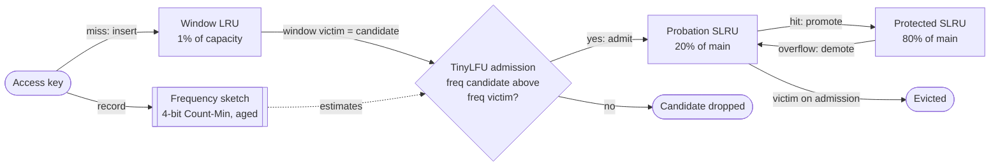

**Reading the diagram.** Every access updates the frequency sketch. A missed key first enters the small window LRU, which gives new keys a chance to prove themselves. When the window overflows, its LRU entry becomes a candidate and is compared with the probation segment's LRU victim; the one with the higher estimated frequency stays. Hits in probation promote entries to the protected segment, whose overflow is demoted back to probation. All of this is in-process memory and synchronous; the sketch is shared state read by the admission decision (dotted). Failure points: a stale sketch (fixed by periodic halving) and hash-flooding attacks on admission (Caffeine adds a little randomness). Scaling: sketch memory is about 8 bytes per cache entry.

### 20.9.4 Redis's approximated LRU and LFU

Redis does not keep a global LRU list, which would cost two pointers per key and a list update on every read. Each object header instead stores a 24-bit clock of its last access. When memory exceeds `maxmemory`, Redis **samples** `maxmemory-samples` keys (5 by default), adds the best candidates to a small pool of 16, and evicts the one idle longest; 10 samples come very close to true LRU [Redis Docs: Key eviction]. In LFU mode the same 24 bits hold a 16-bit decay timestamp and an 8-bit **logarithmic counter** (a Morris counter), incremented with probability that falls as the counter grows (`lfu-log-factor`, default 10) and decremented as time passes (`lfu-decay-time`, default 1 minute); new keys start at 5 so they are not evicted immediately. The policy is chosen with `maxmemory-policy`: `noeviction` (the default, which rejects writes when full), `allkeys-lru`, `allkeys-lfu`, `allkeys-random`, and `volatile-*` variants that consider only keys with a TTL, plus `volatile-ttl`.

::: warning
**A Redis used as a cache must not run with `noeviction`.** With the default policy a full Redis rejects writes with an out-of-memory error, so cache fills fail and every request becomes a miss. Set `maxmemory` below physical RAM (leave room for fork copy-on-write and fragmentation) and choose `allkeys-lru` or `allkeys-lfu`.
:::

### 20.9.5 Measuring policies on a Zipf trace

The program implements LRU, LFU (with least-recently-used tie-breaking), ARC from the paper's pseudocode, and a simplified W-TinyLFU (no doorkeeper or hill climbing), and runs them on three traces of 400,000 requests over 50,000 keys: stationary Zipf ($s = 0.9$); the same Zipf interrupted every 8,000 requests by a scan of 2,000 never-repeated keys; and Zipf whose popularity ranks are reshuffled four times.

```python
"""Hit ratios of LRU, LFU, ARC and a simplified W-TinyLFU on three synthetic traces."""
import itertools
import random
from collections import OrderedDict, defaultdict

class LRU:
    def __init__(self, capacity):
        self.c, self.d = capacity, OrderedDict()
    def access(self, key):                       # returns True on a hit
        if key in self.d:
            self.d.move_to_end(key)
            return True
        self.d[key] = None
        if len(self.d) > self.c:
            self.d.popitem(last=False)
        return False

class LFU:
    """O(1) in-cache LFU: evict the lowest count, least recent among ties."""
    def __init__(self, capacity):
        self.c, self.freq = capacity, {}
        self.buckets, self.min_f = defaultdict(OrderedDict), 0
    def access(self, key):
        if key in self.freq:
            f = self.freq[key]
            del self.buckets[f][key]
            if not self.buckets[f] and self.min_f == f:
                self.min_f = f + 1
            self.freq[key] = f + 1
            self.buckets[f + 1][key] = None
            return True
        if len(self.freq) >= self.c:
            victim, _ = self.buckets[self.min_f].popitem(last=False)
            del self.freq[victim]
        self.freq[key], self.min_f = 1, 1
        self.buckets[1][key] = None
        return False

class ARC:
    """Adaptive Replacement Cache [Megiddo & Modha 2003]: T1/T2 hold data,
    B1/B2 are ghost lists of recently evicted keys, p is T1's target size."""
    def __init__(self, capacity):
        self.c, self.p = capacity, 0
        self.t1, self.t2, self.b1, self.b2 = (OrderedDict() for _ in range(4))
    def _replace(self, in_b2):
        if self.t1 and (not self.t2 or len(self.t1) > self.p
                        or (in_b2 and len(self.t1) == self.p)):
            k, _ = self.t1.popitem(last=False)
            self.b1[k] = None
        else:
            k, _ = self.t2.popitem(last=False)
            self.b2[k] = None
    def access(self, x):
        if x in self.t1:                         # second hit: recency -> frequency
            del self.t1[x]
            self.t2[x] = None
            return True
        if x in self.t2:
            self.t2.move_to_end(x)
            return True
        if x in self.b1:                         # T1 was too small: grow p
            self.p = min(self.c, self.p + max(len(self.b2) // len(self.b1), 1))
            self._replace(False)
            del self.b1[x]
            self.t2[x] = None
            return False
        if x in self.b2:                         # T2 was too small: shrink p
            self.p = max(0, self.p - max(len(self.b1) // len(self.b2), 1))
            self._replace(True)
            del self.b2[x]
            self.t2[x] = None
            return False
        l1 = len(self.t1) + len(self.b1)
        if l1 == self.c:
            if len(self.t1) < self.c:
                self.b1.popitem(last=False)
                self._replace(False)
            else:
                self.t1.popitem(last=False)
        else:
            total = l1 + len(self.t2) + len(self.b2)
            if total >= self.c:
                if total == 2 * self.c:
                    self.b2.popitem(last=False)
                self._replace(False)
        self.t1[x] = None
        return False

SEEDS = (0x9E3779B97F4A7C15, 0xC2B2AE3D27D4EB4F, 0x165667B19E3779F9, 0xD6E8FEB86659FD93)

class CountMin4:
    """Count-Min sketch (4 rows) with 4-bit counters (cap 15) and periodic halving."""
    def __init__(self, capacity):
        self.bits = max(4, (capacity * 4 - 1).bit_length())   # width >= 4 x capacity
        self.rows = [[0] * (1 << self.bits) for _ in SEEDS]
        self.samples, self.reset_at = 0, 10 * capacity
    def _cols(self, key):                        # multiplicative hashing of int keys
        return [(((key + 1) * s) & 0xFFFFFFFFFFFFFFFF) >> (64 - self.bits) for s in SEEDS]
    def add(self, key):
        for row, col in zip(self.rows, self._cols(key)):
            if row[col] < 15:
                row[col] += 1
        self.samples += 1
        if self.samples >= self.reset_at:        # aging: halve every counter
            self.rows = [[v >> 1 for v in row] for row in self.rows]
            self.samples //= 2
    def estimate(self, key):
        return min(row[col] for row, col in zip(self.rows, self._cols(key)))

class WTinyLFU:
    """1% window LRU, then a TinyLFU admission filter guarding a segmented LRU
    main area (20% probation, 80% protected), as in Caffeine (simplified)."""
    def __init__(self, capacity):
        self.wcap = max(1, capacity // 100)
        main = capacity - self.wcap
        self.prot_cap = int(main * 0.8)
        self.main_cap = main
        self.window, self.prob, self.prot = OrderedDict(), OrderedDict(), OrderedDict()
        self.sketch = CountMin4(capacity)
    def access(self, key):
        self.sketch.add(key)
        if key in self.window:
            self.window.move_to_end(key)
            return True
        if key in self.prot:
            self.prot.move_to_end(key)
            return True
        if key in self.prob:                     # promote on second hit
            del self.prob[key]
            self.prot[key] = None
            if len(self.prot) > self.prot_cap:
                k, _ = self.prot.popitem(last=False)
                self.prob[k] = None              # demote to probation MRU
            return True
        self.window[key] = None
        if len(self.window) > self.wcap:
            cand, _ = self.window.popitem(last=False)
            if len(self.prob) + len(self.prot) < self.main_cap:
                self.prob[cand] = None
            elif self.prob or self.prot:
                seg = self.prob if self.prob else self.prot
                victim = next(iter(seg))
                if self.sketch.estimate(cand) > self.sketch.estimate(victim):
                    del seg[victim]              # admit candidate, evict victim
                    self.prob[cand] = None       # else: candidate is dropped
        return False

def zipf_cum(n, s):
    return list(itertools.accumulate(1.0 / i ** s for i in range(1, n + 1)))

def stationary(n, length, rng, s=0.9):
    return rng.choices(range(n), cum_weights=zipf_cum(n, s), k=length)

def with_scans(n, length, rng, s=0.9, burst=8_000, scan=2_000):
    """Zipf bursts interleaved with scans of keys that are never seen again."""
    cum, out, fresh = zipf_cum(n, s), [], n
    while len(out) < length:
        out += rng.choices(range(n), cum_weights=cum, k=burst)
        out += range(fresh, fresh + scan)
        fresh += scan
    return out[:length]

def shifting(n, length, rng, s=0.9, phases=4):
    """Popularity ranks are reshuffled at the start of every phase."""
    cum, out = zipf_cum(n, s), []
    for _ in range(phases):
        perm = list(range(n))
        rng.shuffle(perm)
        out += [perm[r] for r in rng.choices(range(n), cum_weights=cum,
                                             k=length // phases)]
    return out

def hit_ratio(policy, trace, warmup):
    hits = 0
    for t, key in enumerate(trace):
        if policy.access(key) and t >= warmup:
            hits += 1
    return hits / (len(trace) - warmup)

if __name__ == "__main__":
    N, LENGTH = 50_000, 400_000
    rng = random.Random(7)
    traces = {"stationary Zipf": stationary(N, LENGTH, rng),
              "Zipf + scans": with_scans(N, LENGTH, rng),
              "shifting Zipf": shifting(N, LENGTH, rng)}
    policies = [("LRU", LRU), ("LFU", LFU), ("ARC", ARC), ("W-TinyLFU", WTinyLFU)]
    for cap in (500, 2_500):
        print(f"cache = {cap:,} entries ({cap / N:.0%} of {N:,} keys)")
        print(f"  {'trace':<17}" + "".join(f"{name:>11}" for name, _ in policies))
        for tname, trace in traces.items():
            row = [hit_ratio(cls(cap), trace, LENGTH // 10) for _, cls in policies]
            print(f"  {tname:<17}" + "".join(f"{h:>11.1%}" for h in row))
```

Output (about 13 s):

```text
cache = 500 entries (1% of 50,000 keys)
  trace                    LRU        LFU        ARC  W-TinyLFU
  stationary Zipf        32.3%      42.5%      43.0%      43.5%
  Zipf + scans           25.2%      33.8%      34.3%      34.6%
  shifting Zipf          32.1%      14.8%      42.1%      41.9%
cache = 2,500 entries (5% of 50,000 keys)
  trace                    LRU        LFU        ARC  W-TinyLFU
  stationary Zipf        50.1%      58.3%      58.3%      59.4%
  Zipf + scans           36.4%      46.2%      46.9%      47.1%
  shifting Zipf          49.7%      33.3%      55.7%      54.2%
```

What to notice:

- On the stationary trace the ideal top-$C$ hit ratios are 45.8% (1%) and 62.0% (5%). W-TinyLFU gets within 2.5 points of ideal; LRU is 12–13 points behind.
- Scans hurt LRU most (−7 to −14 points); in this trace 20% of requests are unrepeatable scan keys, so 80% of the ideal, about 36.6% at 1%, is the ceiling, and ARC and W-TinyLFU reach about 34%.
- In-cache LFU collapses on the shifting trace (14.8%) because entries that were hot in an earlier phase keep their high counts. Aging in W-TinyLFU and adaptation in ARC avoid this.
- The sketch's hash matters. An earlier version of this program that indexed rows with Python's tuple `hash((row, key))` produced correlated rows and lost 2–7 points; a multiplicative hash per row fixed it (§17.3).
- These are synthetic traces. Caffeine's published comparisons on real traces (database, search, analytics) show the same ordering in most cases, with W-TinyLFU at or near the top [Caffeine Wiki: Efficiency], but you should replay a trace of your own before switching.

**Table 20.6 — Eviction and admission policies.**

| Policy | Signal | Scan resistant | Adapts to change | Metadata | Used in |
|---|---|---|---|---|---|
| LRU | Recency | No | Instantly | List pointers per entry | Defaults in many libraries |
| Sampled LRU | Approximate recency | No | Instantly | 24-bit clock per key | Redis `allkeys-lru` |
| LFU with decay | Frequency | Yes | Slowly | Counter per entry | Redis `allkeys-lfu` |
| Segmented LRU | Recency with probation | Partly | Quickly | Segment flag | Memcached (HOT/WARM/COLD), InnoDB midpoint |
| ARC | Recency and frequency, self-tuning | Yes | Yes | Ghost keys for $2C$ entries | OpenZFS (modified) |
| W-TinyLFU | Frequency-based admission plus recency | Yes | Yes (aging, adaptive window) | ~8 bytes per entry sketch | Caffeine |

## 20.10 Cache invalidation

Invalidation keeps copies from outliving the truth. There are four mechanisms, and serious systems combine them.

### 20.10.1 TTL and explicit deletes

**TTL-only** invalidation is simple and self-healing but guarantees staleness up to the TTL. **Explicit deletes** from the code path that writes (cache-aside, §20.7.1) make data fresh within milliseconds, but every write path must remember to delete every affected key: the profile, the list it appears in, the rendered page fragment. A missed path is a staleness bug that the TTL eventually hides, which is why you always keep a TTL as a backstop.

### 20.10.2 Event-driven invalidation from the change stream

Instead of trusting every writer, derive deletes from the database's own log. A **change data capture** (CDC) process tails the commit log (MySQL binlog, PostgreSQL logical decoding, §32.6), maps each changed row to cache keys and issues deletes. Because the log contains only committed changes, in commit order, nothing is invalidated too early and no application crash can skip an invalidation.

**Figure 20.13 — CDC-driven invalidation across regions (after Facebook's mcsqueal).**

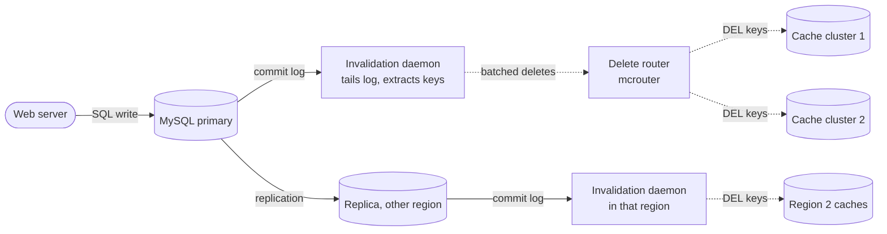

**Reading the diagram.** The web server writes only to the database (synchronous). An invalidation daemon on the database host reads the commit log, extracts the keys to delete, batches them and sends them asynchronously (dotted) through a routing layer to every cache cluster that may hold a copy. In another region, the replica's own log drives deletes for local caches, so caches there are invalidated only after the replica has the new data, avoiding a refill from a lagging replica. Storage boundaries: database, log, many cache clusters. Failure points: daemon lag (staleness grows with it), a lost batch (re-read from the log position), and a delete that overtakes replication (the reason for per-region daemons). Scaling: deletes are batched to reduce packet rates.

::: industry
**Facebook: mcsqueal and leases.** Facebook's Memcache deployment served billions of requests per second as a demand-filled look-aside cache in front of MySQL. Invalidation daemons called **mcsqueal** run on each database, extract deletes from committed transactions and broadcast them, batched, through **mcrouter** to all front-end clusters; in remote regions the replica's daemons do the same. **Leases** (64-bit tokens issued on a miss and voided by a delete) prevent stale sets, and, because a server returns a token only once every 10 seconds per key, they also throttle thundering herds; the paper reports a peak database query rate falling from 17K/s to 1.3K/s in one instance. A small **gutter** pool (about 1% of servers) takes over for failed cache servers with short TTLs, so a failure does not dump its load onto the databases [Nishtala et al. 2013].
*Evidence: Primary* — [Nishtala et al. 2013]
:::

### 20.10.3 Versioned keys

Instead of deleting, change the key. Store a version number per entity (or per namespace) and include it in every cache key: `product:42:v17`. A write increments the version in the database (or in a small, strongly consistent version store); readers fetch the current version, then the versioned key. Old entries become unreachable and age out by TTL or eviction. Versioned keys make invalidation of whole groups cheap (bump `catalog_version` to invalidate every catalog page) and never suffer the stale-set race, because a stale value is written under an old key nobody reads. The cost is an extra lookup for the version and wasted memory until old versions are evicted. Content-hashed asset URLs (§20.5.2) are the same idea.

::: mistake
**"There are only two hard things in computer science: cache invalidation and naming things."** The quip, usually attributed to Phil Karlton, is often used to excuse not designing invalidation. The hard part is enumerating which keys depend on which rows. Write the dependency down: for each cached object, list the tables and columns it is derived from and the mechanism (TTL, delete, CDC, version) that invalidates it.
:::

## 20.11 Cache stampede

::: definition
**Definition — Cache stampede (thundering herd, dog-piling).** When a popular entry expires or is evicted, many concurrent requests miss at once and all recompute or reload it, multiplying load on the backend exactly when it is busiest.
:::

If a key is read $\lambda$ times per second and recomputing it takes $\delta$ seconds, about $\lambda\delta$ requests miss before the first refill lands. For $\lambda = 2{,}000$ requests/s and a 500 ms query, that is 1,000 identical queries.

### 20.11.1 Locks, leases and single-flight

Let one request recompute and make the others wait or use a stale copy.

- **Single-flight (request coalescing)** inside a process: concurrent misses for a key share one in-flight load (Go's `singleflight`, Caffeine's `LoadingCache`). Across $A$ app instances this still allows $A$ loads.
- **Distributed lock**: the first misser sets `SET lock:k token NX PX 3000`; others wait briefly and retry the cache, or serve stale data. The lock needs a timeout in case the holder dies (§26.10).
- **Leases** in Memcache (§20.10.2): the cache itself hands out one token per key per interval and tells other clients to retry shortly.

**Figure 20.14 — Stampede protection with a lease: one recompute, others wait or serve stale.**

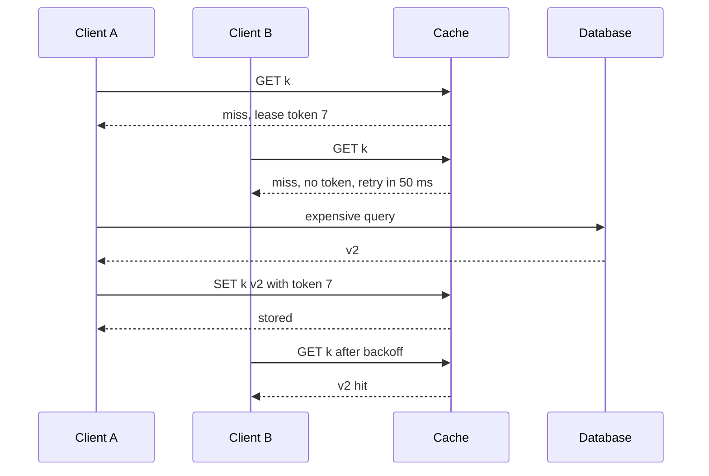

**Reading the diagram.** The cache grants a lease token only to the first misser; later missers receive "retry" (or a stale value if one is kept), so only client A queries the database. The `SET` succeeds only with a valid token, which also blocks the stale-set race of Figure 20.7. All calls are synchronous; B's wait is a short backoff. Failure points: if A dies, the token expires after its lease time and another client gets one; waiting clients add latency. Scaling: database load per key is one query per refresh regardless of $\lambda$.

### 20.11.2 Probabilistic early expiration (XFetch)

Locks add coordination. **XFetch** avoids it: each reader independently decides, with a probability that rises as expiry approaches, to recompute *before* the entry expires, while everyone else keeps getting hits [Vattani, Chierichetti & Lowenstein 2015].

::: formula
**XFetch early-recomputation rule and its consequences (Poisson arrivals)**

$$\text{recompute if } \; t - \delta\,\beta\,\ln(u) \ge t_{\text{exp}}, \quad u \sim \text{Uniform}(0,1] \qquad\Rightarrow\qquad P(\text{early} \mid r) = e^{-r/(\delta\beta)}$$

$$\mathbb{E}[\text{lead}] \approx \delta\beta\left(\ln(\lambda\delta\beta) + \gamma\right), \qquad \mathbb{E}[\text{recomputes per refresh}] \approx e^{1/\beta}$$

| Symbol | Meaning | Units |
|---|---|---|
| $t$ | Current time | s |
| $t_{\text{exp}}$ | Entry's expiry time | s |
| $r = t_{\text{exp}} - t$ | Time remaining before expiry | s |
| $\delta$ | Measured recompute time, stored with the value | s |
| $\beta$ | Aggressiveness; 1 is the recommended default | dimensionless |
| $u$ | Uniform random number per request | dimensionless |
| $\lambda$ | Request rate for the key | requests/s |
| $\gamma$ | Euler–Mascheroni constant, ≈ 0.5772 | dimensionless |
:::

Since $-\ln u$ is exponentially distributed, each request triggers with probability $e^{-r/(\delta\beta)}$. With Poisson arrivals, triggers form a process of intensity $\lambda e^{-r/(\delta\beta)}$, so the remaining time at the first trigger has a Gumbel distribution, giving the expected lead. Requests during the $\delta$ seconds that recompute takes may trigger again; the expected number of extra triggers is $e^{1/\beta} - 1$, independent of $\lambda$.

::: example
**Worked example — A hot key with a 2-second recompute.** $\lambda = 100$ requests/s, $\delta = 2$ s, $\beta = 1$, TTL 60 s.

1. Per-request trigger probability with 10 s left: $e^{-10/2} = e^{-5} = 0.0067$; with 2 s left: $e^{-1} = 0.37$.
2. Expected lead: $\lambda\delta\beta = 200$; $\ln 200 = 5.298$; $2 \times (5.298 + 0.577) = 11.75$ s before expiry.
3. Recomputes per refresh: $e^{1} \approx 2.72$, against $\lambda\delta = 200$ with no protection.
4. Extra cost: the entry is refreshed every $60 - 11.75 + 2 \approx 50$ s instead of 62 s, about 23% more refreshes.
5. With $\beta = 2$: lead $4 \times (\ln 400 + 0.577) = 4 \times 6.569 = 26.3$ s and $e^{0.5} = 1.65$ recomputes; with $\beta = 0.5$: lead 5.2 s and $e^{2} = 7.4$ recomputes.

**Interpretation.** $\beta$ trades earlier refreshes for fewer duplicate recomputations; the lead grows only logarithmically with traffic, so XFetch scales to any $\lambda$. **Engineering implication.** Store $\delta$ with each value, start with $\beta = 1$, and if duplicate recomputes are expensive combine XFetch with a non-blocking lock so only the first trigger recomputes; no request ever waits.
:::

The simulation below checks these numbers.

```python
"""One hot key under Poisson traffic: recomputations and misses per refresh for
no protection, a recompute lock, and XFetch [Vattani et al. 2015]."""
import math
import random

def simulate(policy, rate=100.0, ttl=60.0, delta=2.0, beta=1.0,
             hours=3.0, seed=42):
    rng = random.Random(seed)
    expiry = ttl                         # value computed at t = 0
    inflight = []                        # finish times of running recomputes
    t, end = 0.0, hours * 3600
    recomputes = misses = requests = episodes = 0
    last_episode, leads = -1e9, []

    def start(now):
        nonlocal recomputes, episodes, last_episode
        recomputes += 1
        inflight.append(now + delta)
        if now > last_episode + delta:   # first recompute of a new refresh
            episodes += 1
            last_episode = now
            leads.append(expiry - now)   # > 0 means refreshed before expiry

    while True:
        t += rng.expovariate(rate)       # next request (Poisson arrivals)
        if t >= end:
            break
        requests += 1
        for f in [f for f in inflight if f <= t]:
            inflight.remove(f)           # a recompute finished: store value
            expiry = f + ttl
        if t >= expiry:                  # value missing: the request misses
            misses += 1
            if policy == "none" or not inflight:
                start(t)                 # "lock" lets only one recompute run
        elif policy.startswith("xfetch"):
            early = t - delta * beta * math.log(rng.random()) >= expiry
            if early and (policy == "xfetch" or not inflight):
                start(t)                 # "xfetch+lock" also skips duplicates
    return dict(requests=requests, episodes=episodes,
                per_refresh=recomputes / episodes, miss_ratio=misses / requests,
                mean_lead=sum(leads) / len(leads))

if __name__ == "__main__":
    rate, delta = 100.0, 2.0
    print(f"rate {rate:.0f} req/s, TTL 60 s, recompute time {delta:.0f} s, 3 hours")
    print(f"{'policy':<14}{'beta':>5}{'recomputes/refresh':>20}{'miss ratio':>12}"
          f"{'mean lead (s)':>15}{'theory lead':>13}")
    runs = [("none", 1.0), ("lock", 1.0), ("xfetch", 0.5), ("xfetch", 1.0),
            ("xfetch", 2.0), ("xfetch+lock", 1.0)]
    for policy, beta in runs:
        r = simulate(policy, rate=rate, delta=delta, beta=beta)
        theory = (f"{delta * beta * (math.log(rate * delta * beta) + 0.5772):.2f}"
                  if policy.startswith("xfetch") else "-")
        print(f"{policy:<14}{beta:>5}{r['per_refresh']:>20.2f}{r['miss_ratio']:>12.4%}"
              f"{r['mean_lead']:>15.2f}{theory:>13}")
```

Output:

```text
rate 100 req/s, TTL 60 s, recompute time 2 s, 3 hours
policy         beta  recomputes/refresh  miss ratio  mean lead (s)  theory lead
none            1.0              202.77     3.1517%          -0.01            -
lock            1.0                1.00     3.2451%          -0.01            -
xfetch          0.5                6.71     0.0000%           5.30         5.18
xfetch          1.0                2.50     0.0000%          12.05        11.75
xfetch          2.0                1.66     0.0000%          26.58        26.27
xfetch+lock     1.0                1.00     0.0000%          11.83        11.75
```

What to notice:

- Without protection each refresh costs about 200 recomputations ($\lambda\delta$) and 3.2% of requests miss ($\delta / (\text{TTL} + \delta) = 2/62$).
- A lock fixes the duplicate work but not the misses: requests during the recompute still wait.
- XFetch removes misses entirely, and its leads match the formula within half a second. Duplicate recomputes (6.71, 2.50, 1.66) sit within sampling error of $e^{1/\beta}$ (7.39, 2.72, 1.65); averaged over 40 simulated hours they are 7.50, 2.71 and 1.63.
- XFetch plus a non-blocking lock gives exactly one recompute and no misses.

### 20.11.3 Stale-while-revalidate

Keep entries past their **soft TTL**: after it, serve the stale value immediately and trigger one background refresh; delete only at a later **hard TTL**. This is HTTP's `stale-while-revalidate` (§20.5.2) applied to an application cache, and it gives the same result as XFetch plus a lock when traffic is steady. It also enables **stale-if-error**: if the database is down, keep serving the last good value. The price is explicit staleness, so use it only where showing a value a few seconds old is acceptable.

## 20.12 Cache penetration

::: definition
**Definition — Cache penetration.** Requests for keys that do not exist in the database. Because there is nothing to cache, every such request misses and reaches the database. A bug or an attacker iterating random IDs can push the database's full read load through the cache.
:::

Two defenses work together:

1. **Negative caching**: cache the "not found" result under the key with a short TTL (for example 30–60 s), so repeated lookups of the same missing key hit. It fails against random keys, each requested once, and wastes memory on them.
2. **A Bloom filter of existing keys** in front of the cache: if the filter says "definitely absent", return 404 without touching cache or database. False positives (1% at about 9.6 bits per key, §17.4.3) only let a small fraction through. The filter must be updated on insert and rebuilt periodically to remove deleted keys, or use a cuckoo filter that supports deletion (§17.4.7).

**Figure 20.15 — Defenses against cache penetration.**

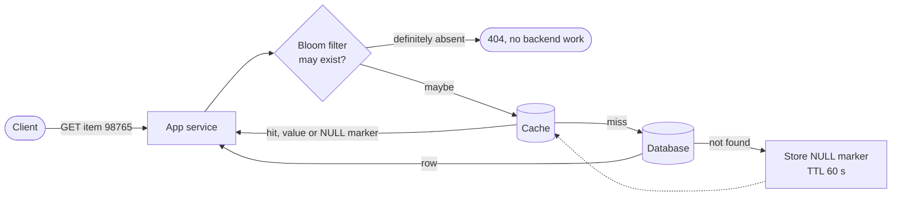

**Reading the diagram.** The in-memory Bloom filter rejects most nonexistent IDs before any network call. IDs that pass go to the cache, which may return a value or a cached "not found" marker; only true misses reach the database, and a not-found answer is stored as a marker with a short TTL (dotted fill). All checks are synchronous. Storage boundaries: filter in process memory (or Redis), cache, database. Failure points: a stale filter that does not know about new items would return false 404s, so new keys must be added to the filter before they are visible; negative markers must be deleted when the item is created. Scaling: at 1% false positives, an attack of 100,000 random IDs per second lets about 1,000 through to the cache tier.

Rate limiting per client (§22.3) and validating ID formats before lookup complete the defense.

## 20.13 Cache avalanche

::: definition
**Definition — Cache avalanche.** A large fraction of cache entries becomes unavailable at once, because many keys expire together or because cache nodes fail or restart, so the database suddenly receives the full read load.
:::

The arithmetic of §20.3.2 explains why this is fatal: at $h = 0.99$ the database sees 1% of reads; with the cache gone it sees 100%, a 100× jump that no database is provisioned for. A database that slows down under the load then causes timeouts and retries, which add more load (§22.12).

Defenses:

- **TTL jitter** (§20.8) so mass-written keys do not expire together.
- **Replicated, highly available cache** (Redis replicas with automatic failover; a gutter pool, §20.10.2), so one node failure does not empty its share of keys.
- **Warming**: before a new or restarted cache takes traffic, load the hottest keys from a key list, a snapshot (RDB) or a warm peer; Facebook warms a new cluster by letting it read from a warm cluster's caches instead of the database [Nishtala et al. 2013].
- **Tiered fallback**: an in-process L1 (§20.5.4) and stale-if-error serving keep answering hot keys during an L2 outage.
- **Protect the database**: admission control, load shedding and circuit breakers (§22.9, §22.13) so it degrades by rejecting a fraction of requests rather than collapsing.

**Table 20.7 — The three classic cache failure modes.**

| What goes wrong | Why | Detection | Recovery | Prevention |
|---|---|---|---|---|
| Stampede | One hot key expires; $\lambda\delta$ concurrent recomputes | Spikes of identical queries; per-key miss bursts | Shed load; serve stale | Leases or single-flight, XFetch, stale-while-revalidate |
| Penetration | Requests for nonexistent keys bypass the cache | High miss ratio with many "not found" results | Block abusive clients | Negative caching, Bloom filter, rate limits, ID validation |
| Avalanche | Many keys expire together, or cache nodes fail | Hit ratio collapses; database QPS jumps | Throttle, warm caches, fail over | Jitter, replication, warming, L1 and stale-if-error, load shedding |

## 20.14 Distributed caching and consistent hashing

A single cache node is limited by its RAM (tens to hundreds of GB) and, for Redis, by one execution core. A distributed cache partitions keys over $N$ nodes. With `hash(key) mod N`, adding a node remaps about $N/(N+1)$ of keys, which for a cache means that fraction of entries effectively vanishes: a self-inflicted avalanche. **Consistent hashing** with virtual nodes moves only about $1/(N+1)$ of keys and spreads the moved load evenly; §14.8 derives it, and §3.3.2 works through a cache example. Three routing designs exist:

- **Client-side routing**: the client library holds the ring (most Memcached clients, Ketama hashing).
- **Proxy routing**: a proxy such as mcrouter or Twemproxy routes, replicates and fails over on behalf of thin clients.
- **Server-assisted routing**: Redis Cluster's fixed 16,384 slots with `MOVED` redirects (§20.6.4), which moves whole slots on resharding rather than ring arcs.

When a node fails, its keys move to their successors cold. Replication (Redis replicas, EVCache copies) or a gutter pool avoid that miss spike.

## 20.15 Hot keys

::: definition
**Definition — Hot key.** A single key whose request rate exceeds what the node holding it can serve, so partitioning cannot help: all requests for one key go to one node.
:::

A celebrity's post, a flash-sale product or a global configuration key can draw hundreds of thousands of requests per second. **Detect** hot keys by sampling requests into a Count-Min sketch or top-$k$ structure per cache client or proxy (§17.6), or with server tools such as `redis-cli --hotkeys` (which needs an LFU eviction policy). Then **mitigate**:

1. **Local L1 caches** with a short TTL in each app instance, so each instance asks the remote cache at most once per TTL. Redis 6's **client-side caching** sends invalidation messages to clients that track the keys they cached [Redis Docs: Client-side caching].
2. **Key replication**: store copies under `k#0` … `k#r-1` on different nodes, read a random copy and write or delete all copies.
3. **Request coalescing** at the proxy so concurrent identical gets become one.

**Figure 20.16 — Hot-key mitigation with L1 caches and replicated keys.**

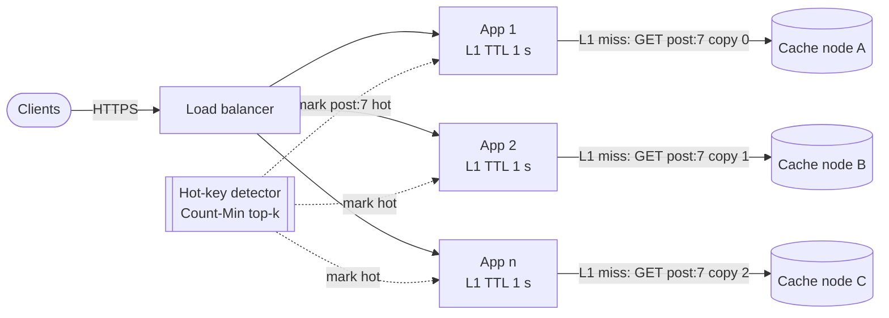

**Reading the diagram.** The load balancer spreads requests over $n$ app instances. Each keeps hot keys in its in-process L1 for one second, so it sends at most one request per second per hot key to the remote tier, and it picks one of three replicated copies at random, spreading that traffic over three cache nodes. A detector fed by sampled requests marks keys hot asynchronously (dotted), so only hot keys pay for replication. Storage boundaries: process memory and three cache nodes. Failure points: L1 staleness up to its TTL, and writes or deletes that must reach every copy. Scaling: more app instances raise the remote request rate linearly, so lengthen the L1 TTL or add copies.

::: formula
**Remote load from a hot key with L1 caches and replication**

$$R_{\text{remote}} \le \min\!\left(\lambda_k,\ \frac{A}{T_{L1}}\right), \qquad R_{\text{per node}} = \frac{R_{\text{remote}}}{r}$$

| Symbol | Meaning | Units |
|---|---|---|
| $\lambda_k$ | Request rate for the hot key | requests/s |
| $A$ | Number of app instances with an L1 cache | instances |
| $T_{L1}$ | L1 TTL | s |
| $r$ | Number of replicated copies of the key | copies |
| $R_{\text{remote}}$, $R_{\text{per node}}$ | Requests to the remote tier, and to each node holding a copy | requests/s |
:::

::: example
**Worked example — A viral post.** $\lambda_k = 600{,}000$ requests/s; one cache node can serve about 100,000 requests/s (illustrative).

1. Without mitigation: 600,000 requests/s to one node, six times its capacity.
2. Replication alone with $r = 8$: $600{,}000 / 8 = 75{,}000$ per node, under capacity but with little headroom.
3. L1 caches on $A = 300$ instances with $T_{L1} = 1$ s: $R_{\text{remote}} \le 300 / 1 = 300$ requests/s.

**Interpretation.** A one-second L1 cuts remote load by a factor of 2,000 at the cost of up to one second of staleness. **Engineering implication.** Use L1 caching for read-hot keys whenever a second of staleness is acceptable; reserve key replication for keys that must stay fresher or for write-hot counters (which need sharded counters instead, §14.10).
:::

## 20.16 Redis versus Memcached

**Table 20.8 — Redis (and Valkey) versus Memcached.**

| Aspect | Redis / Valkey | Memcached |
|---|---|---|
| What it is | In-memory data-structure server | In-memory cache of opaque blobs |
| How it works | Single-threaded command execution; optional I/O threads | Multithreaded workers sharing one hash table; slab allocator |
| Advantages | Rich types (hashes, sorted sets, streams), atomic scripts, persistence, replication, Cluster, pub/sub | Simple; scales vertically across cores; predictable memory; very mature |
| Disadvantages | One core executes commands; fork for persistence; more to tune | Strings only; no persistence or replication (client or proxy must provide them) |
| Performance | ~100,000+ ops/s per core; more with I/O threads or pipelining | Millions of ops/s per server with many threads |
| Operational complexity | Medium–high (Sentinel or Cluster, persistence, memory policy) | Low (stateless nodes, client-side hashing) |
| Cost | Higher memory overhead per small key; replicas double RAM | Low overhead; slab waste 10–20% |
| Use cases | Sessions, leaderboards, rate limiters, queues, caches needing structure | Large look-aside caches of serialized objects |
| Choose when | You need data structures, atomic operations or durability | You need a fast, simple, horizontally scaled cache |

**Licensing (as of 2026).** Redis was BSD-licensed until March 2024, when Redis 7.4 moved to a dual RSALv2/SSPLv1 license, which is not an open-source license under the OSI definition. The Linux Foundation then launched **Valkey**, a BSD-licensed fork of Redis 7.2.4 supported by several cloud providers. Redis 8.0 (2025) added the OSI-approved AGPLv3 as a third licensing option [Redis Blog 2024; Redis Blog 2025; Linux Foundation 2024]. Managed services such as AWS ElastiCache offer Valkey, Redis OSS and Memcached engines. For system design the engines are protocol-compatible for the features in this chapter; check the license and feature set of the specific version you deploy.
