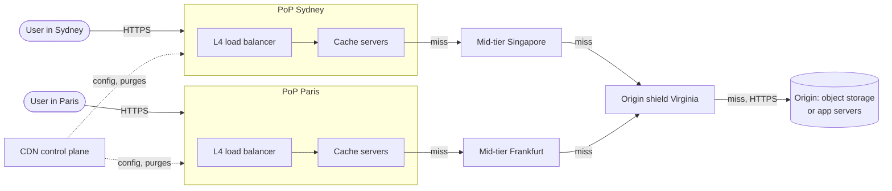
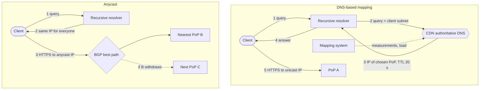
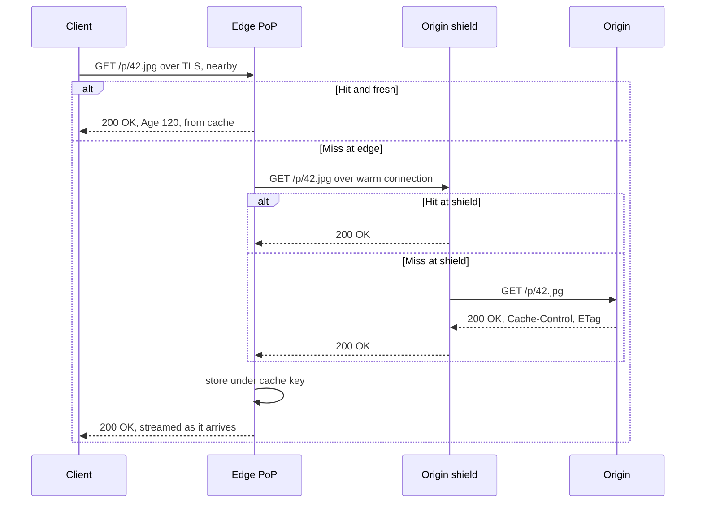
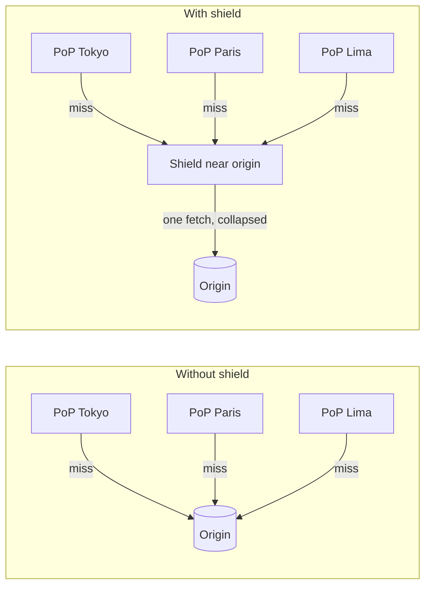
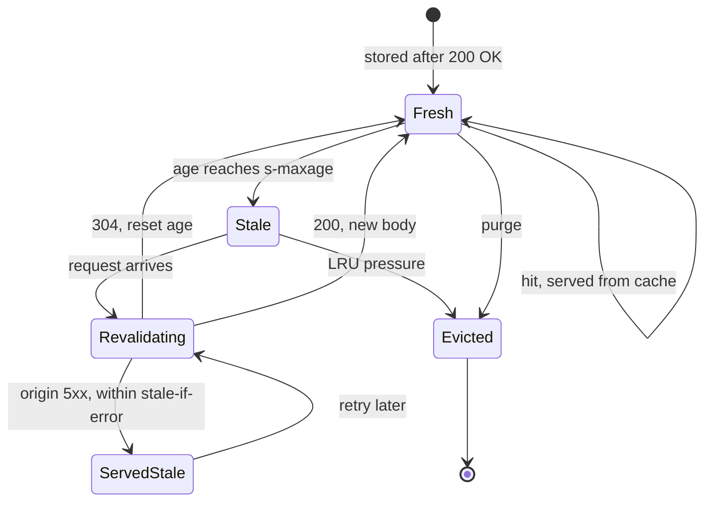
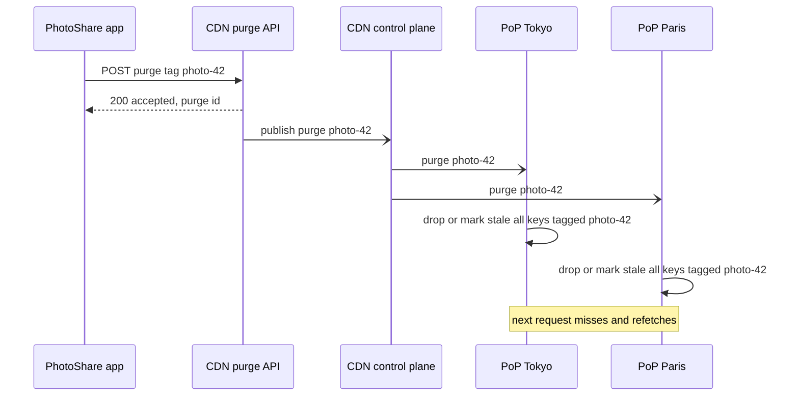
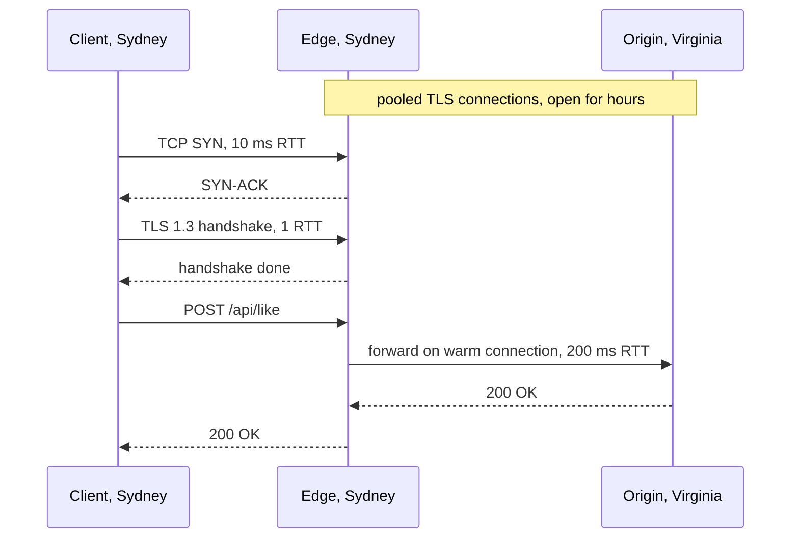
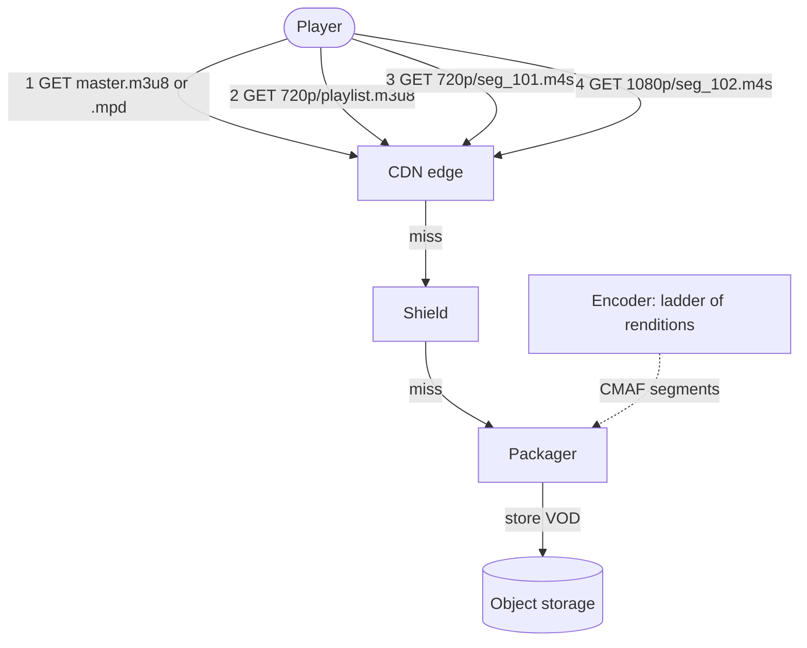
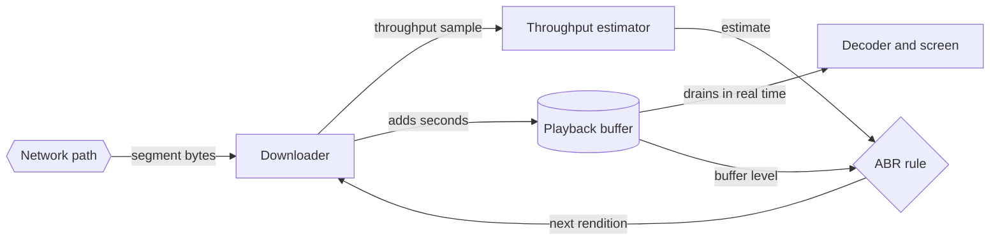
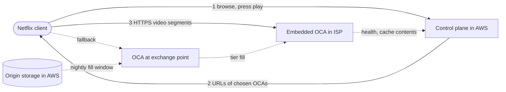

# Chapter 21 — Content Delivery Networks

> **Level:** 2 · **Track:** A (Traditional) · **Estimated reading time:** 3 h

At 10 million daily users, PhotoShare serves about 28 Gbit/s of images at peak (§1.9). Chapter 1 drew the box that makes this affordable, a **CDN**, as a hexagon labeled "external". This chapter opens the hexagon. A CDN is a geographically distributed cache built from the ideas of Chapters 7 and 20: anycast and DNS steer each user to a nearby site, TLS terminates close to the user, and a hierarchy of caches keeps most requests away from your servers. You will learn how shielding turns hundreds of misses into one, how cache keys and headers decide what is shared, how to purge in a fraction of a second, how video adapts to the network, and how Netflix built a CDN inside other people's networks.

## 21.1 Learning objectives

After this chapter you should be able to:

- Draw a CDN (points of presence, mid-tier, origin) and trace a cache hit and a cache miss end to end.
- Compare DNS-based request routing with anycast and choose between them.
- Compute request and byte offload ratios, compose hit ratios across cache tiers, and estimate origin bandwidth and monthly egress cost.
- Explain why origin shielding reduces origin load and quantify the reduction with a Poisson model and a simulation.
- Design cache keys and `Cache-Control` policies (`max-age`, `s-maxage`, `stale-while-revalidate`, `stale-if-error`, `ETag`) under RFC 9111, and choose between URL purge, tag-based purge and versioned URLs.
- Explain dynamic site acceleration and edge-side includes, and estimate when they help.
- Size video delivery for an adaptive bitrate ladder and compare throughput-based and buffer-based bitrate adaptation.
- Describe edge compute runtimes, Netflix Open Connect and the CDN's role in security.

## 21.2 Prerequisites

- Anycast, BGP, DNS resolution and TTLs — §7.5–§7.6 (both request-routing methods build on them).
- TCP handshake, slow start, TLS 1.3, HTTP/2 and HTTP/3 — §7.7, §7.9, §7.10 (the latency a CDN removes is round trips).
- HTTP methods, status codes, `ETag` and conditional requests — §8.7–§8.8.
- Cache hit ratio, TTL, eviction and stampedes — §20.3, §20.8, §20.9, §20.11 (a CDN is a cache; this chapter does not repeat the general theory).
- Consistent hashing — §14.8 (used inside each CDN site).
- Units: **MB/GB/TB/PB** are powers of ten; bit rates use **Mb/s** and **Gb/s** (10⁶ and 10⁹ bits per second). One byte is eight bits.

## 21.3 CDN architecture

### 21.3.1 What a CDN is and why it exists

::: definition
**Definition — Content delivery network (CDN).** A distributed system of caching reverse proxies (§7.12) deployed in many network locations, which serves content on behalf of an **origin** (the authoritative server for the content) from the location nearest each user, fetching from the origin only on a cache miss.
:::

#### First-principles explanation

A bestselling author lives in one city. If every reader had to travel there to buy a book, the queue would stretch for kilometers and most readers would give up. Instead, the publisher prints copies and ships them to bookshops in every town. Readers walk to a local shop; only when a shop runs out does it order from the warehouse. A CDN is that network of bookshops: the **origin** is the author's house, the **edge** servers are the bookshops, and a **cache miss** is a shop reordering from the warehouse.

#### Why does this exist?

A CDN solves four problems at once:

1. **Latency.** Light in fiber covers about 200 km per millisecond, so a Sydney user talking to a server in Virginia pays roughly 200 ms per round trip, and a fresh HTTPS fetch needs several round trips (§7.15). An edge 10 ms away cuts each round trip twentyfold.
2. **Origin load.** A hit is served without touching the origin, so the origin is sized for misses, not for total traffic.
3. **Egress cost and backbone capacity.** Bytes served from inside or near the user's network do not cross expensive long-haul links or the origin's metered egress.
4. **Surges and attacks.** Hundreds of sites with terabits of aggregate capacity absorb flash crowds and DDoS floods that would saturate any single data center (§10.11).

#### Mathematical foundations

::: formula
**Time to fetch an object over a new connection**

$$T_{\text{fetch}} \approx \left(n_{\text{hs}} + \left\lceil \log_2\!\left(\frac{S}{W_0} + 1\right)\right\rceil\right) \times \text{RTT} + t_{\text{server}}$$

| Symbol | Meaning | Units |
|---|---|---|
| $n_{\text{hs}}$ | Handshake round trips before the request (TCP + TLS 1.3 = 2; QUIC = 1; reused connection = 0) | round trips |
| $S$ | Response size | bytes |
| $W_0$ | Initial congestion window (typically 10 segments × 1,460 B ≈ 14.6 KB) | bytes |
| $\lceil \log_2(S/W_0 + 1) \rceil$ | Slow-start rounds to deliver $S$, the first of which carries the request (§7.7.7) | round trips |
| RTT | Round-trip time between client and server | s |
| $t_{\text{server}}$ | Server processing time | s |
:::

::: example
**Worked example — A 100 KB photo from Virginia versus a Sydney edge.**

1. Slow-start rounds: $S/W_0 = 100{,}000 / 14{,}600 = 6.85$; $\log_2(7.85) = 2.97$, so 3 rounds (14.6 + 29.2 + 58.4 = 102.2 KB ≥ 100 KB).
2. Round trips: $n_{\text{hs}} = 2$ (TCP + TLS 1.3), so $2 + 3 = 5$.
3. From the origin (RTT 200 ms): $5 \times 200 = 1{,}000$ ms, plus server time.
4. From a Sydney edge (RTT 10 ms), on a cache hit: $5 \times 10 = 50$ ms.

**Interpretation.** The same bytes arrive 20 times sooner, and no amount of origin bandwidth could close that gap: the cost is round trips, not throughput. **Engineering implication.** For small and medium objects, moving the server closer beats every other optimization; on a cache miss the edge still saves the handshakes, as §21.7.2 shows.
:::

### 21.3.2 Points of presence

::: definition
**Definition — Point of presence (PoP).** A CDN site in one metropolitan area or interconnection facility, containing load balancers, caching proxy servers with RAM and SSD storage, and connections to local networks. Large CDNs operate hundreds of PoPs; some also place servers inside Internet service provider (ISP) networks.
:::

Inside a PoP, a request passes through three layers:

1. **Layer 4 load balancing.** Routers spread packets across servers with equal-cost multipath (ECMP) and a stateless L4 load balancer (§19.3, §19.8).
2. **TLS termination and HTTP processing.** A proxy (for example Varnish, NGINX, Apache Traffic Server, or a CDN's own software) decrypts the request, applies rules, and computes the cache key (§21.6.2).
3. **Cache lookup across the PoP.** Rather than store each popular object on all 100 servers, the PoP hashes the cache key to an "owner" server with consistent hashing (§14.8), so each object is stored roughly once per PoP. Consistent hashing was invented for exactly this problem [Karger et al. 1997].

The cache itself is a two-level store: hot objects in RAM and the long tail on SSD, with eviction policies of the kind described in §20.9.

**Figure 21.1 — A CDN: users, PoPs, mid-tier and origin.**



**Reading the diagram.** Users (stadiums) connect over HTTPS to the nearest PoP, where an L4 load balancer spreads connections across cache servers. A miss moves one hop inward at a time: to a regional mid-tier cache, then to an origin shield near the origin, and finally to the origin (object storage or application servers). Solid arrows are synchronous request/response paths; the dotted arrows from the control plane are asynchronous pushes of configuration and purge commands. Storage boundaries: every PoP, mid-tier and shield holds a cache (RAM and SSD); only the origin holds the authoritative copy. Failure points: a PoP outage (users are rerouted, §21.3.3), a shield outage (misses must bypass it), and the origin itself. Scaling: add servers inside a PoP, add PoPs for coverage, and add tiers to protect the origin (§21.5).

### 21.3.3 Request routing: DNS versus anycast

Before a user can hit a cache, something must decide *which* PoP serves them. Two mechanisms dominate, both introduced in Chapter 7.

**DNS-based routing.** The site's hostname is a CNAME to a CDN-controlled name (`img.photoshare.example` → `photoshare.cdn-provider.example`). The CDN's authoritative DNS answers each query with a PoP chosen by a **mapping system** from network measurements, PoP health and load, and the resolver's location. Akamai describes this design, with short TTLs so users can be re-steered quickly [Nygren et al. 2010]. The weakness from §7.6.5 applies: the DNS server sees the *resolver's* address, not the user's. The **EDNS Client Subnet** extension lets a resolver pass a truncated client prefix, such as a /24, to the authoritative server [RFC 7871]; Akamai reported substantial latency improvements for users of public resolvers after adopting it ("end-user mapping") [Chen et al. 2015].

**Anycast routing.** Every PoP announces the same IP prefix over BGP (§7.5.3), and routing delivers each packet to the "closest" site by BGP policy; DNS returns the same address everywhere. Cloudflare describes serving its services from every data center over anycast [Cloudflare Docs: Network]. A PoP that withdraws its announcement disappears from routing within seconds to minutes. The weaknesses: BGP's "closest" is not always lowest latency, and load is hard to steer without changing announcements that affect many networks. A measurement study of Microsoft's anycast CDN found that anycast picked a good PoP for most clients but a noticeably worse one for a meaningful minority [Calder et al. 2015].

**Figure 21.2 — Request routing with DNS mapping versus anycast.**



**Reading the diagram.** In the DNS mode (top), steps 1–4 are synchronous DNS exchanges over UDP; the mapping system feeds the authoritative servers asynchronously (dotted). The choice is cached for the answer's TTL, so a PoP failure is corrected only as TTLs expire. In the anycast mode (bottom), BGP chooses per packet; when PoP B withdraws its route (dotted), packets flow to PoP C and in-flight TCP connections reset. No storage is involved; failure points are the resolver, the mapping system and routing instability. Scaling: add PoPs (and, for DNS, measurements).

**Table 21.1 — DNS-based routing versus anycast.**

| | DNS-based mapping | Anycast |
|---|---|---|
| Who chooses the PoP | CDN's mapping system, per DNS answer | BGP, per packet |
| Granularity | Per resolver (per client subnet with ECS) | Per network path |
| Load control | Fine: change answers per network | Coarse: change announcements |
| Failover speed | Bounded by DNS TTL and client caching | Seconds to minutes (BGP convergence) |
| DDoS absorption | Attack aimed at one PoP's IPs | Attack spread across all PoPs automatically |
| Risks | Resolver far from user; stale answers | Suboptimal paths; connection resets on route change |
| Choose when | You need precise steering, many small or ISP-embedded sites | You want simplicity, resilience and DDoS dispersion |

Real CDNs combine the two, for example anycast for DNS servers and DNS steering for some customers. Global traffic management across your own regions uses the same tools (§19.9, Chapter 44).

### 21.3.4 Anatomy of a cache hit and a cache miss

**Figure 21.3 — A cache hit and a cache miss at an edge PoP.**



**Reading the diagram.** Time runs downward. TLS ends at the nearby edge. On a fresh hit the edge answers at once, adding an `Age` header (seconds spent in cache). On a miss it forwards over a long-lived connection to the shield; only a shield miss reaches the origin. All exchanges are synchronous, and responses are **streamed**: the edge forwards bytes while still receiving them. Storage boundaries: edge and shield caches, and the origin. Failure points: a slow or down shield or origin (the edge may serve stale, §21.6.1). Scaling: more tiers or bigger caches raise the hit ratio.

Three details matter in production:

- **Request collapsing.** If 500 users request the same uncached object within 50 ms, a naive edge sends 500 origin requests. CDNs **collapse** concurrent misses for one cache key into one upstream fetch, the stampede defense of §20.11 applied at the edge.
- **Negative caching.** Error responses such as `404` can be cached briefly, so a burst of requests for a missing object does not become a burst at the origin.
- **Range requests.** For large files the edge caches fixed-size chunks (say 1–2 MB), so a seek into a video need not fetch the first gigabyte.

**Table 21.2 — CDN architecture failure scenarios.**

| What goes wrong | Why | Detection | Recovery | Prevention |
|---|---|---|---|---|
| PoP outage | Power, fiber or software failure | Synthetic probes per PoP; traffic drop | Withdraw anycast route or remove from DNS answers | Capacity headroom in neighboring PoPs |
| Users mapped far away | Resolver location, BGP policy | Real-user latency by network | Adjust mapping or announcements | ECS; per-network latency monitoring |
| Origin overwhelmed after a purge | Every PoP misses at once | Origin RPS spike; edge 5xx | Serve stale; rate-limit fetches | Shielding, request collapsing, soft purge |
| Bad configuration pushed globally | One change reaches all PoPs | Error-rate jump everywhere | Roll back config | Staged rollout to canary PoPs |

## 21.4 Edge, mid-tier and origin

### 21.4.1 Three tiers

::: definition
**Definition — Cache tiers.** The **edge** tier is the set of PoPs that accept user connections. A **mid-tier** (also *parent*, *regional* or *upper-tier* cache) is a smaller set of larger caches that edges consult on a miss. An **origin shield** is a mid-tier designated as the single path to a given origin. The **origin** is the customer's own infrastructure that holds the authoritative content.
:::

#### First-principles explanation

Return to the bookshops. A town shop stocks the 2,000 titles its customers buy most; for an obscure title it phones the regional warehouse, which stocks 200,000, and only the warehouse contacts the publisher. Each tier holds more items, serves larger areas, and sees only what the tier below could not answer.

#### Why does this exist?

Edges must be numerous and close to users, so each one is small relative to the catalog and sees only a slice of the audience. For long-tail content (most images, most video titles, most software versions) each edge misses often. A mid-tier aggregates the misses of many edges, so an object requested once in each of 50 cities becomes popular *at the mid-tier* and is fetched from the origin once.

**Table 21.3 — Roles of the cache tiers.**

| | Edge PoP | Mid-tier / shield | Origin |
|---|---|---|---|
| Location | Near users, often in ISPs or exchange points | Few, well-connected regions; shield near the origin | Your region(s) or cloud |
| Count | Tens to thousands | A handful to tens | One to a few |
| Cache size per site | Small relative to catalog | Large | Holds everything (authoritative) |
| Sees | All user requests | Edge misses | Shield misses |
| Main job | Latency, TLS termination, absorbing traffic | Aggregating misses, protecting origin | Correctness and freshness |

The origin can be **object storage** (static assets, images, video files; §15.4), an **application tier** behind a load balancer (HTML, APIs), or a **media packager** (live video). Whatever it is, the origin should accept traffic only from the CDN: allow-list the CDN's address ranges or require a shared secret header or mutual TLS on origin pulls (§21.11), otherwise attackers bypass the cache and hit the origin directly.

::: industry
**Akamai, Amazon CloudFront and Cloudflare tiering.** Akamai's 2010 description of its platform includes **tiered distribution**: edge clusters fetch from a smaller set of well-provisioned "parent" clusters rather than from the origin, which Akamai reports dramatically reduces origin load for content with a long tail [Nygren et al. 2010]. CloudFront documents **regional edge caches** between its edge locations and the origin, and an optional **Origin Shield** layer through which all requests for an origin pass [AWS Docs: CloudFront Origin Shield]. Cloudflare documents **Tiered Cache**, in which lower-tier data centers fetch from upper-tier data centers instead of the origin [Cloudflare Docs: Tiered Cache].
*Evidence: Primary* — [Nygren et al. 2010]; [AWS Docs: CloudFront Origin Shield]; [Cloudflare Docs: Tiered Cache]
:::

## 21.5 Cache hierarchy and origin shielding

### 21.5.1 Offload ratio

::: definition
**Definition — Offload ratio.** The fraction of traffic a CDN serves without contacting the origin. **Request offload** counts requests; **byte offload** counts bytes. Both are a cache hit ratio (§20.3) measured at the boundary between the CDN and the origin.
:::

::: formula
**Request and byte offload**

$$O_R = 1 - \frac{N_{\text{origin}}}{N_{\text{total}}} \qquad O_B = 1 - \frac{V_{\text{origin}}}{V_{\text{total}}}$$

| Symbol | Meaning | Units |
|---|---|---|
| $O_R$, $O_B$ | Request offload, byte offload | dimensionless (0–1) |
| $N_{\text{origin}}$ | Requests the CDN sent to the origin | requests |
| $N_{\text{total}}$ | Requests users sent to the CDN | requests |
| $V_{\text{origin}}$ | Bytes the origin sent to the CDN | bytes |
| $V_{\text{total}}$ | Bytes the CDN sent to users | bytes |
:::

::: example
**Worked example — Two offloads for the same day.** A CDN receives $N_{\text{total}} = 10^9$ requests carrying $V_{\text{total}} = 500$ TB, and sends $N_{\text{origin}} = 4 \times 10^7$ requests to the origin, which return $V_{\text{origin}} = 40$ TB.

1. $O_R = 1 - 4 \times 10^7 / 10^9 = 1 - 0.04 = 0.96$.
2. $O_B = 1 - 40 / 500 = 1 - 0.08 = 0.92$.

**Interpretation.** Misses are disproportionately large objects (long-tail videos, rarely downloaded installers), so byte offload is lower than request offload here; with other mixes it can be higher. **Engineering implication.** Origin CPU and request rate follow $O_R$; origin egress cost and bandwidth follow $O_B$. Track both, and do not quote one when the decision depends on the other.
:::

### 21.5.2 Composing tiers

A request reaches the origin only if it misses at *every* tier, so the miss ratios multiply.

::: formula
**Origin fraction and origin bandwidth across tiers**

$$f_{\text{origin}} = \prod_{i=1}^{k} (1 - h_i) \qquad B_{\text{origin}} = B_{\text{users}} \times (1 - O_B)$$

| Symbol | Meaning | Units |
|---|---|---|
| $h_i$ | Hit ratio of tier $i$, measured on the requests that *reach* that tier | dimensionless |
| $k$ | Number of cache tiers (browser, edge, mid-tier, …) | count |
| $f_{\text{origin}}$ | Fraction of all requests that reach the origin, $1 - O_R$ | dimensionless |
| $B_{\text{users}}$ | Bandwidth delivered to users | Gb/s |
| $B_{\text{origin}}$ | Bandwidth the origin must serve | Gb/s |
:::

::: example
**Worked example — Facebook's photo-serving stack.** A study of Facebook photo traffic found that browser caches served 65.5% of requests, edge caches 20.0%, the origin cache (a shield-like tier in Facebook's data centers) 4.6%, and the Haystack storage backend the remaining 9.9% [Huang et al. 2013].

1. Browser: $h_1 = 0.655$; $34.5\%$ of requests continue.
2. Edge: $h_2 = 20.0 / 34.5 = 0.580$; $14.5\%$ continue.
3. Origin cache: $h_3 = 4.6 / 14.5 = 0.317$.
4. Check: $(1 - 0.655)(1 - 0.580)(1 - 0.317) = 0.345 \times 0.420 \times 0.683 = 0.099$, the 9.9% that reached storage.

Now apply the bandwidth form to PhotoShare's 28 Gb/s peak: at $O_B = 0.90$, $B_{\text{origin}} = 28 \times 0.10 = 2.8$ Gb/s; at $O_B = 0.98$, only $0.56$ Gb/s.

**Interpretation.** No single tier is spectacular (the edge hit ratio is 58%, the origin cache's 32%), yet together they keep 90% of requests away from storage. A tier with a modest hit ratio still pays off when the tier behind it is expensive. **Engineering implication.** Measure each tier's hit ratio on *its own* input, and remember that raising offload from 90% to 98% cuts origin load fivefold.
:::

### 21.5.3 Origin shielding

::: definition
**Definition — Origin shielding.** Routing every cache miss for an origin through one designated cache tier (the **shield**), so that the origin sees at most one request per object per freshness period, regardless of how many edge PoPs missed.
:::

#### Why does this exist?

Without a shield, each PoP is an independent client of your origin. An object that is cold everywhere is fetched once *per PoP*, and when a TTL expires, every PoP that holds it revalidates separately. With 300 PoPs, a purge of a popular object turns into up to 300 near-simultaneous origin requests, the CDN-scale version of a cache stampede (§20.11).

::: formula
**Origin fetches per object per TTL window, without and with a shield**

$$F_{\text{no shield}} \approx N\left(1 - e^{-\lambda T / N}\right) \qquad F_{\text{shield}} \approx 1$$

| Symbol | Meaning | Units |
|---|---|---|
| $N$ | Number of edge PoPs, with requests spread evenly among them | count |
| $\lambda$ | Global request rate for the object | requests/s |
| $T$ | Freshness lifetime (TTL) of the object | s |
| $1 - e^{-\lambda T/N}$ | Probability that a given PoP sees at least one request in $T$ (Poisson arrivals) | dimensionless |
| $F$ | Expected origin fetches for the object per window $T$ | fetches |
:::

::: example
**Worked example — A long-tail photo and a popular photo across 100 PoPs, TTL 1 hour.**

1. Long-tail photo, $\lambda = 0.01$ req/s: $\lambda T = 36$ requests per hour; $\lambda T / N = 0.36$; $e^{-0.36} = 0.698$.
2. $F_{\text{no shield}} = 100 \times (1 - 0.698) = 30.2$ origin fetches per hour, out of 36 requests: the edges' hit ratio for this object is $1 - 30.2/36 = 16\%$.
3. Popular photo, $\lambda = 1$ req/s: $\lambda T / N = 36$, so $e^{-36} \approx 0$ and $F_{\text{no shield}} \approx 100$ fetches per hour out of 3,600 requests (97.2% edge hit ratio).
4. With a shield that retains both objects, $F_{\text{shield}} = 1$ per hour in each case.

**Interpretation.** The shield cuts origin fetches 30-fold for the long-tail photo and 100-fold for the popular one. **Engineering implication.** Shielding matters most when there are many PoPs, a long tail of content, short TTLs, or frequent purges; it matters little for a tiny catalog of very hot objects.
:::

**Figure 21.4 — Origin traffic without and with a shield.**



**Reading the diagram.** On the left, three PoPs (rectangles) each send their miss for the same object straight to the origin (cylinder), so the origin serves it three times, or 300 times with 300 PoPs. On the right, every miss goes to a shield located close to the origin; the shield collapses concurrent requests and fetches once. All arrows are synchronous HTTPS. Storage boundaries: every PoP and the shield are caches; the origin is authoritative. Failure points: the shield is a concentration point, so it is itself a cluster of servers, and edges must be able to bypass it (or use a backup shield) if it fails. Scaling: shield capacity scales by consistent hashing objects across shield servers; a second shield region adds redundancy.

### 21.5.4 Origin egress and cost

::: formula
**Monthly delivery cost**

$$C = V \times p_{\text{cdn}} + V \times (1 - O_B) \times p_{\text{origin}}$$

| Symbol | Meaning | Units |
|---|---|---|
| $V$ | Bytes delivered to users per month | GB |
| $p_{\text{cdn}}$ | CDN delivery price | \$/GB |
| $p_{\text{origin}}$ | Origin egress price (cloud Internet egress) | \$/GB |
| $O_B$ | Byte offload | dimensionless |
| $C$ | Monthly delivery cost (excluding request fees and commitments) | \$ |
:::

::: example
**Worked example — PhotoShare's image bill, with and without a shield.** Prices are **illustrative, as of 2026**: cloud Internet egress list prices at petabyte-scale tiers are on the order of \$0.05/GB, and large customers negotiate CDN delivery far below list prices; assume $p_{\text{cdn}} = \$0.01$/GB and $p_{\text{origin}} = \$0.05$/GB.

1. Volume: 9.3 Gb/s average (§1.9) $= 1.16$ GB/s; $\times\ 2{,}592{,}000$ s per 30-day month $= 3.01 \times 10^6$ GB, about 3 PB.
2. CDN delivery: $3.0 \times 10^6 \times 0.01 = \$30{,}000$.
3. Origin egress without shield ($O_B = 0.90$): $3.0 \times 10^5$ GB $\times\ 0.05 = \$15{,}000$.
4. Origin egress with shield ($O_B = 0.98$): $6.0 \times 10^4$ GB $\times\ 0.05 = \$3{,}000$.
5. Without any CDN, the origin would serve everything: $3.0 \times 10^6 \times 0.05 = \$150{,}000$, and would need about 28 Gb/s of peak serving capacity.

**Interpretation.** The shield saves \$12,000 per month (\$144,000 per year) on egress and cuts peak origin bandwidth from 2.8 to 0.56 Gb/s. **Engineering implication.** Check whether your cloud waives origin-to-CDN egress for its own CDN (several do), include shield request fees, and remember that offload also shrinks the origin fleet, which is often the larger saving.
:::

### 21.5.5 Simulating shielding

The model above assumes caches never evict. The program below drops that assumption: 20 edge PoPs, each a byte-capacity LRU cache holding 3% of a 50,000-object catalog, receive one million Zipf-distributed requests (exponent 1.0, the skew typical of web content), with and without a shield.

```python
# Two-tier CDN simulation: how much traffic reaches the origin with and
# without an origin shield. Edge PoPs and the shield are byte-capacity LRU caches;
# object popularity follows a Zipf distribution.
import random
from collections import OrderedDict


class LRUCache:
    """Least-recently-used cache whose capacity is measured in bytes."""

    def __init__(self, capacity_bytes):
        self.capacity = capacity_bytes
        self.used = 0
        self.items = OrderedDict()          # key -> size, oldest first

    def get(self, key):
        if key in self.items:
            self.items.move_to_end(key)     # mark as most recently used
            return True
        return False

    def put(self, key, size):
        if size > self.capacity:
            return                          # too big to cache at all
        if key in self.items:
            self.used -= self.items.pop(key)
        while self.used + size > self.capacity:
            _, old_size = self.items.popitem(last=False)   # evict LRU
            self.used -= old_size
        self.items[key] = size
        self.used += size


def make_workload(n_objects, n_requests, n_pops, alpha, seed):
    """Return object sizes and a trace of (pop, object) requests."""
    rng = random.Random(seed)
    sizes = [rng.choice([20_000, 50_000, 200_000, 1_000_000]) for _ in range(n_objects)]
    cum, total = [], 0.0
    for rank in range(1, n_objects + 1):    # Zipf: weight of rank k is 1/k^alpha
        total += 1.0 / rank ** alpha
        cum.append(total)
    objs = rng.choices(range(n_objects), cum_weights=cum, k=n_requests)
    pops = [rng.randrange(n_pops) for _ in range(n_requests)]
    return sizes, list(zip(pops, objs))


def simulate(sizes, trace, n_pops, edge_bytes, shield_bytes=None):
    """Replay the trace. shield_bytes=None means edges go straight to origin."""
    edges = [LRUCache(edge_bytes) for _ in range(n_pops)]
    shield = LRUCache(shield_bytes) if shield_bytes else None
    s = dict(requests=0, edge_hits=0, shield_hits=0, origin_fetches=0,
             bytes_served=0, origin_bytes=0)
    for pop, obj in trace:
        size = sizes[obj]
        s["requests"] += 1
        s["bytes_served"] += size
        if edges[pop].get(obj):
            s["edge_hits"] += 1
            continue
        if shield is not None and shield.get(obj):
            s["shield_hits"] += 1
        else:                               # fetch from origin
            s["origin_fetches"] += 1
            s["origin_bytes"] += size
            if shield is not None:
                shield.put(obj, size)
        edges[pop].put(obj, size)
    s["request_offload"] = 1 - s["origin_fetches"] / s["requests"]
    s["byte_offload"] = 1 - s["origin_bytes"] / s["bytes_served"]
    return s


if __name__ == "__main__":
    N_OBJ, N_REQ, N_POPS = 50_000, 1_000_000, 20
    sizes, trace = make_workload(N_OBJ, N_REQ, N_POPS, alpha=1.0, seed=21)
    catalog = sum(sizes)
    edge = int(0.03 * catalog)              # each PoP holds 3% of the catalog
    print(f"catalog {catalog / 1e9:.1f} GB, {N_POPS} PoPs x {edge / 1e9:.2f} GB each")
    for label, shield in [("no shield", None),
                          ("shield 10% of catalog", int(0.10 * catalog)),
                          ("shield 30% of catalog", int(0.30 * catalog))]:
        r = simulate(sizes, trace, N_POPS, edge, shield)
        print(f"{label:<22} edge hit {r['edge_hits'] / r['requests']:6.1%}  "
              f"origin fetches {r['origin_fetches']:>7,}  "
              f"request offload {r['request_offload']:6.1%}  "
              f"byte offload {r['byte_offload']:6.1%}  "
              f"origin egress {r['origin_bytes'] / 1e9:5.1f} GB")
```

Output (Python 3.13, about 3 s):

```text
catalog 15.8 GB, 20 PoPs x 0.47 GB each
no shield              edge hit  58.3%  origin fetches 417,280  request offload  58.3%  byte offload  62.4%  origin egress 132.4 GB
shield 10% of catalog  edge hit  58.3%  origin fetches 278,623  request offload  72.1%  byte offload  74.9%  origin egress  88.2 GB
shield 30% of catalog  edge hit  58.3%  origin fetches 156,952  request offload  84.3%  byte offload  85.9%  origin egress  49.5 GB
```

What to notice:

- The edge hit ratio is identical in all three runs: the shield does not change what edges see, only where their misses go.
- A shield holding 30% of the catalog absorbs $1 - 156{,}952 / 417{,}280 = 62\%$ of edge misses and cuts origin egress from 132.4 GB to 49.5 GB. It aggregates 20 PoPs' long tails, so objects that are rare at each PoP are popular at the shield.
- `put` is byte-based, so one 1 MB object evicts fifty 20 KB ones; size-aware policies (§20.9) can do better.
- Tests in `code/ch21/test_listing_02.py` check LRU eviction, that shield hits plus origin fetches equal edge misses, that a shield never increases origin fetches, and that with unlimited caches the origin sees one fetch per object with a shield but one per (PoP, object) pair without.

#### Advantages, disadvantages and failure scenarios

A shield adds a hop (cheap if it sits near the origin) and concentrates traffic, so it must be redundant. Place it closest to the origin, not to users, with one shield per origin region.

::: mistake
**"Our CDN hit ratio is 95%, so the origin is safe."** A dashboard hit ratio usually counts edge hits only, often by request. The origin cares about requests and bytes that cross the CDN–origin boundary, including revalidations and purge-driven refetches. Measure offload at the origin's own access logs.
:::

## 21.6 Cache keys, HTTP caching headers and invalidation

### 21.6.1 Freshness and validation under RFC 9111

A CDN is a **shared cache** in the vocabulary of RFC 9111, which defines HTTP caching: it stores responses and reuses them for many users. The origin controls that reuse with response headers.

::: definition
**Definition — Freshness and validation.** A stored response is **fresh** while its age is below its **freshness lifetime** and may then be served without contacting the origin; once **stale**, it must normally be **revalidated**, by sending a conditional request (`If-None-Match` with the stored `ETag`, or `If-Modified-Since`), to which the origin answers `304 Not Modified` (keep using the copy) or `200 OK` with a new body [RFC 9111].
:::

**Table 21.4 — Caching directives a CDN designer uses.**

| Header or directive | Meaning | Typical use |
|---|---|---|
| `max-age=N` | Fresh for N seconds in any cache | Browser and CDN lifetime |
| `s-maxage=N` | Overrides `max-age` in shared caches only | CDN longer than browsers |
| `no-cache` | May store, but must revalidate before every use | HTML that must be current |
| `no-store` | Must not store at all | Sensitive responses |
| `private` | Only the user's own browser may store it | Personalized pages |
| `immutable` | Will never change during freshness; skip reload revalidation [RFC 8246] | Versioned assets |
| `stale-while-revalidate=N` | Serve stale for up to N s while refreshing in background [RFC 5861] | Hide origin latency |
| `stale-if-error=N` | Serve stale for up to N s if the origin errors [RFC 5861] | Survive origin outages |
| `ETag` / `If-None-Match` | Validator and conditional request; `304` if unchanged | Cheap revalidation |
| `Age` | Seconds the response has spent in caches | Lets browsers subtract CDN time |
| `CDN-Cache-Control` | Same directives, aimed only at CDNs [RFC 9213] | Separate CDN and browser policy |

**Figure 21.5 — Life of a cached response at the edge.**



**Reading the diagram.** States describe one stored response at one edge. A **Fresh** response is served directly until its age reaches the shared-cache lifetime. A request for a **Stale** response triggers revalidation, synchronously by default or in the background within the `stale-while-revalidate` window (the user gets the stale copy at once). A `304` or new `200` makes it fresh; an origin error within the `stale-if-error` window means stale content is served instead of an error. Purges and eviction remove it. The storage boundary is the edge cache; the failure point is the origin during revalidation; every PoP runs this machine independently, which is why shields matter (§21.5.3).

::: formula
**Freshness test in a shared cache**

$$\text{fresh} \iff a < L, \qquad L = \begin{cases}\texttt{s-maxage} & \text{if present}\\ \texttt{max-age} & \text{otherwise}\end{cases}$$

| Symbol | Meaning | Units |
|---|---|---|
| $a$ | Current age of the stored response, including time spent in upstream caches (`Age`) | s |
| $L$ | Freshness lifetime for a shared cache (RFC 9111 §4.2.1; `Expires` or heuristics apply if neither directive is present) | s |
:::

::: example
**Worked example — One header, three behaviors.** The origin sends `Cache-Control: max-age=60, s-maxage=600, stale-while-revalidate=30, stale-if-error=86400` with `ETag: "v7"`.

1. **Edge:** fresh for 600 s. Between ages 600 and 630 s it serves the stale copy and revalidates in the background. A `304` costs a few hundred bytes instead of re-sending, say, a 2 MB body.
2. **Browser:** uses `max-age=60`, but the edge forwards `Age`. A copy fetched from the edge at age 50 s is fresh in the browser for only $60 - 50 = 10$ s.
3. **Origin outage:** for up to 86,400 s after a copy goes stale, the edge may serve it instead of a `5xx`.

**Interpretation.** The CDN holds content ten times longer than browsers, because the CDN can be purged and browsers cannot. **Engineering implication.** Give browsers short lifetimes for anything that might need recall, give the CDN long lifetimes plus a purge path, and always add `stale-if-error`: it turns many origin outages into non-events.
:::

### 21.6.2 Cache keys

::: definition
**Definition — Cache key.** The value a cache uses to decide whether two requests may receive the same stored response. By default it is the method plus the full URL (scheme, host, path and query string), extended by any request headers listed in the response's `Vary` header.
:::

Two requests that should get the same bytes but differ in their key produce two cache entries and two origin fetches: the hit ratio **fragments**. Two requests that should get *different* bytes but share a key leak one user's response to another. Cache-key design steers between these.

- **Normalize.** Lowercase the host, sort query parameters, drop parameters that do not change the response (tracking tags such as `utm_source`, session IDs). An allow-list of meaningful parameters is safer than a deny-list.
- **Tame `Vary`.** `Vary: Accept-Encoding` is necessary for compressed text, but browsers send dozens of distinct `Accept-Encoding` strings; normalize them to a few values (`br`, `gzip`, `identity`). `Vary: User-Agent` creates thousands of variants and effectively disables caching; derive a small device class at the edge instead.
- **Strip cookies.** Cookies are usually ignored or excluded from the key for static assets; a response that depends on a cookie must be `private` or keyed on a small derived value (for example a language), never on the raw cookie.

```python
# Cache-key normalization: map many equivalent requests to one cache key.
from urllib.parse import parse_qsl, urlencode, urlsplit

KEEP_PARAMS = {"v", "lang"}   # allow-list: only params that change the bytes


def cache_key(url, accept_encoding=""):
    parts = urlsplit(url)
    host = parts.hostname.lower()             # hostnames are case-insensitive
    path = parts.path or "/"                  # paths are case-sensitive: keep
    params = sorted((k.lower(), v) for k, v in parse_qsl(parts.query)
                    if k.lower() in KEEP_PARAMS)
    # Collapse Accept-Encoding to the few variants the edge actually stores.
    enc = accept_encoding.lower()
    enc = "br" if "br" in enc else "gzip" if "gzip" in enc else "identity"
    query = urlencode(params)
    return f"{host}{path}" + (f"?{query}" if query else "") + f"|{enc}"


if __name__ == "__main__":
    requests = [
        ("https://CDN.example.com/js/app.js?v=7&lang=en", "gzip, deflate, br"),
        ("https://cdn.example.com/js/app.js?lang=en&v=7&utm_source=mail", "br;q=1.0, gzip;q=0.8"),
        ("https://cdn.example.com/js/app.js?LANG=en&v=7&sessionid=abc123", "br"),
        ("https://cdn.example.com/js/app.js?v=7&lang=en", "gzip, deflate"),
        ("https://cdn.example.com/js/app.js?v=7&lang=en", ""),
    ]
    keys = [cache_key(u, ae) for u, ae in requests]
    for k in keys:
        print(k)
    print("distinct keys:", len(set(keys)), "of", len(keys), "requests")
```

Output:

```text
cdn.example.com/js/app.js?lang=en&v=7|br
cdn.example.com/js/app.js?lang=en&v=7|br
cdn.example.com/js/app.js?lang=en&v=7|br
cdn.example.com/js/app.js?lang=en&v=7|gzip
cdn.example.com/js/app.js?lang=en&v=7|identity
distinct keys: 3 of 5 requests
```

What to notice: five raw requests collapse to three keys, one per encoding the edge must store; parameter order, host case, tracking tags and session IDs no longer fragment the cache; the path keeps its case because URL paths are case-sensitive.

::: warning
**Unkeyed inputs are a security boundary.** In **web cache poisoning**, an attacker sends a request whose *unkeyed* header (for example `X-Forwarded-Host`) changes the response, so the poisoned response is stored under a normal key and served to everyone [Kettle 2018]. In **web cache deception**, an attacker lures a victim to `/account/profile.css`; a lenient origin returns the private profile page, and a CDN that caches by extension stores it publicly [Gil 2017]. Defenses: key on every input that affects the response, cache by explicit `Cache-Control` rather than by file extension, and mark personalized responses `private`.
:::

### 21.6.3 Invalidation and purge

Expiry is passive. When content must change *now* (a corrected price, a deleted photo, a legal takedown), you need active invalidation (§20.10). CDNs offer three tools.

1. **Purge by URL.** An API call removes one cache key from every PoP. Simple, but you must know every URL and variant affected.
2. **Purge by surrogate key (tag).** The origin labels responses with tags, for example `Surrogate-Key: user-881 photo-42` on Fastly or `Cache-Tag` on Cloudflare; one API call then invalidates every response carrying a tag, across all variants and pages [Fastly Docs: Purging; Cloudflare Docs: Purge by tag]. A **soft purge** marks matching objects stale instead of deleting them, so `stale-while-revalidate` and `stale-if-error` still protect the origin.
3. **Versioned URLs.** Put a content hash or version in the URL (`app.3f9a1c.js`), cache it for a year with `immutable`, and "invalidate" by publishing new HTML that references a new URL. Nothing is purged; the old object simply stops being requested.

**Figure 21.6 — Tag-based purge propagation.**



**Reading the diagram.** The application calls the purge API synchronously; propagation to PoPs is asynchronous (open arrowheads), fanned out by the control plane. Each PoP keeps an index from tag to cache keys and applies the purge locally. Storage boundaries are the per-PoP caches. Failure points: a PoP partitioned from the control plane keeps serving old content until it reconnects or the TTL expires, so purge is fast in practice but not linearizable; mass refetching can stampede the origin unless a shield or soft purge is used. Scaling: purge is a broadcast whose cost grows with PoP count, not traffic.

::: industry
**Fastly Instant Purge.** Fastly built its CDN around fast invalidation of surrogate keys, broadcast to all PoPs. A Fastly developer advocate has written that a surrogate-key purge starts taking effect within a few milliseconds and completes at every PoP worldwide in around 150 ms, while "purge all" uses a different, slower mechanism [Betts, Fastly Blog]. Fast purge lets customers cache content once considered dynamic, such as news articles and API responses, with long TTLs and purge on change.
*Evidence: Primary* — [Betts, Fastly Blog]; [Fastly Docs: Purging]
:::

**Table 21.5 — Invalidation methods compared.**

| | URL purge | Tag purge | Versioned URL |
|---|---|---|---|
| How it works | Delete one key everywhere | Delete all keys with a tag | New URL; old one ages out |
| Advantages | Simple, universal | One call covers many pages | No purge needed; perfect browser caching |
| Disadvantages | Must enumerate variants | Tagging discipline; vendor-specific | Needs a reference that changes (HTML, manifest) |
| Origin impact | Refetch of that key | Refetch of every tagged key | None until new URL is requested |
| Choose when | Rare, specific fixes | Content shown on many pages (a photo in feeds) | Static assets (JS, CSS, images by hash) |

::: recommendation
**A default policy.** Version every static asset and cache it for a year with `immutable`. Serve HTML and API responses with a short browser lifetime, a longer `s-maxage`, `stale-while-revalidate` and `stale-if-error`, and tag them by the entities they display so a write can purge exactly what changed. For PhotoShare, a deleted photo is purged by tag `photo-42`, removing it from every feed page that embedded it.
:::

## 21.7 Static versus dynamic content

### 21.7.1 What can be cached

**Table 21.6 — Content classes and CDN treatment.**

| Class | Examples | Cacheable? | CDN treatment |
|---|---|---|---|
| Static, versioned | JS, CSS, fonts, images by hash | Yes, for a year | `immutable`, versioned URLs |
| Static, mutable | Photos, product images, video segments | Yes, hours to days | Long `s-maxage` plus tag purge |
| Shared dynamic | Home page, article, public API list | Yes, seconds to minutes | **Micro-caching** (1–10 s), `stale-while-revalidate`, request collapsing |
| Personalized | Feed, cart, account page | Mostly no | Cache fragments (ESI), or accelerate only |
| Writes | `POST` upload, checkout | No | Dynamic acceleration, WAF, rate limits |

Micro-caching is underrated: a shared page requested 2,000 times per second and cached for just 1 s sends at most one request per second per cache to the origin, a 99.95% offload at a cost of one second of staleness.

### 21.7.2 Dynamic site acceleration

::: definition
**Definition — Dynamic site acceleration (DSA).** Routing uncacheable requests through the CDN anyway, so that TCP and TLS terminate near the user and the edge forwards each request to the origin over pre-established, tuned, long-lived connections, sometimes along an overlay path chosen from measurements.
:::

The insight is that most of a dynamic request's latency is handshakes and slow start on a long path, not origin processing. Akamai's platform paper describes this suite: persistent connections between edge and origin, transport tuning, and overlay routing that picks a faster path through Akamai's own servers than BGP's default [Nygren et al. 2010].

::: formula
**Time to first byte, direct versus through an edge**

$$T_{\text{direct}} = (n_{\text{hs}} + 1)\,\text{RTT}_{uo} + t_{\text{app}} \qquad T_{\text{edge}} = (n_{\text{hs}} + 1)\,\text{RTT}_{ue} + \text{RTT}_{eo} + t_{\text{app}}$$

| Symbol | Meaning | Units |
|---|---|---|
| $n_{\text{hs}}$ | Client handshake round trips (2 for TCP + TLS 1.3, 0 if reused) | round trips |
| $\text{RTT}_{uo}$ | Round trip, user to origin | ms |
| $\text{RTT}_{ue}$ | Round trip, user to edge | ms |
| $\text{RTT}_{eo}$ | Round trip, edge to origin over a warm, already-open connection | ms |
| $t_{\text{app}}$ | Origin processing time | ms |
:::

::: example
**Worked example — A Sydney user calling a Virginia API.** $\text{RTT}_{uo} = \text{RTT}_{eo} = 200$ ms, $\text{RTT}_{ue} = 10$ ms, $t_{\text{app}} = 50$ ms.

1. New connection, direct: $(2 + 1) \times 200 + 50 = 650$ ms.
2. New connection, via edge: $(2 + 1) \times 10 + 200 + 50 = 280$ ms, saving 370 ms (57%).
3. Reused connection ($n_{\text{hs}} = 0$), direct: $200 + 50 = 250$ ms; via edge: $10 + 200 + 50 = 260$ ms.

**Interpretation.** The edge wins on new connections and loses about one user-edge RTT when the client already holds a warm connection. **Engineering implication.** DSA helps most for users far from the origin making few requests per connection (mobile apps, first page loads). Large responses also gain because the edge–origin connection's congestion window is already open, so slow start is not repeated.
:::

**Figure 21.7 — Dynamic site acceleration.**



**Reading the diagram.** Time runs downward. The client's handshakes are short because the edge is 10 ms away; the edge already holds encrypted, warmed-up connections to the origin (the note), so the request crosses the ocean exactly once each way. Every exchange is synchronous; nothing is cached, so the storage boundary is the origin alone. Failure points: the edge–origin pool (stale connections must be health-checked) and the origin itself. Scaling: the pool multiplexes many users' requests over few connections (HTTP/2), reducing the origin's connection count, a benefit of its own (§7.16).

### 21.7.3 Edge-side includes

A personalized page is often 95% shared content plus a small personal fragment. **Edge-side includes (ESI)**, a markup language specified in 2001 by Akamai and others, lets the origin return a cacheable page template containing include tags; the edge fetches each fragment separately, with its own cache policy, and assembles the page [Tsimelzon et al. 2001]:

```text
<html><body>
  <esi:include src="/fragments/header?user=$(HTTP_COOKIE{uid})"/>  <!-- private, uncached -->
  <esi:include src="/fragments/trending" />                         <!-- cached 60 s -->
</body></html>
```

ESI is supported by several CDNs and by Varnish in subsets; today the same composition is often written as edge compute code (§21.9) or done in the browser.

## 21.8 Video delivery

Video dominates Internet traffic by volume, and it is a CDN's ideal workload: large, immutable, highly shared files. Two ideas make it work: cut the video into small HTTP objects so ordinary caches can serve it, and let the player choose quality continuously.

### 21.8.1 Segments, manifests and the bitrate ladder

::: definition
**Definition — HTTP adaptive streaming.** Video is encoded at several quality levels (a **bitrate ladder**), each cut into **segments** of a few seconds stored as ordinary files. A **manifest** lists the levels and segment URLs. The player downloads the manifest, then fetches segments one by one over HTTP, choosing a level for each segment.
:::

Two formats dominate. **HLS** (HTTP Live Streaming), created by Apple and published as RFC 8216, uses text playlists (`.m3u8`): a multivariant (master) playlist listing renditions and a media playlist per rendition listing segments [RFC 8216]. **MPEG-DASH**, the international standard ISO/IEC 23009-1, uses an XML **Media Presentation Description** (MPD) [ISO/IEC 23009-1]. Historically HLS used MPEG-2 transport-stream segments and DASH used fragmented MP4, so a service supporting both stored everything twice. **CMAF** (Common Media Application Format, ISO/IEC 23000-19) defines one fragmented-MP4 segment format that both manifests can reference, halving storage and doubling cache efficiency.

```text
#EXTM3U
#EXT-X-STREAM-INF:BANDWIDTH=3300000,RESOLUTION=1280x720,CODECS="avc1.64001f,mp4a.40.2"
720p/playlist.m3u8
#EXT-X-STREAM-INF:BANDWIDTH=6600000,RESOLUTION=1920x1080,CODECS="avc1.640028,mp4a.40.2"
1080p/playlist.m3u8
```

**Figure 21.8 — HLS and DASH structure on a CDN.**



**Reading the diagram.** The player first fetches the master manifest, then a media playlist, then segments; step 4 switches to 1080p for the next segment, which is just a different URL. All player requests are synchronous HTTP GETs to the edge; misses go through the shield to the packager or to object storage. The encoder produces renditions asynchronously (dotted) as CMAF segments. Storage boundaries: edge and shield caches, and object storage for video on demand (VOD). Failure points: for live video, the packager and encoder (a missing segment stalls every viewer); for VOD, cold long-tail titles. Scaling: segments are immutable and cacheable for a long time; live media playlists change every segment and get TTLs of about half a segment duration.

### 21.8.2 Bandwidth arithmetic

::: formula
**Edge egress and storage for a bitrate ladder**

$$B_{\text{edge}} = V \times \sum_r s_r b_r \qquad B_{\text{origin,live}} \approx M \times \sum_r b_r \qquad S_{\text{title}} = \frac{D}{8} \sum_r b_r$$

| Symbol | Meaning | Units |
|---|---|---|
| $V$ | Concurrent viewers | viewers |
| $b_r$ | Bitrate of rendition $r$ | Mb/s |
| $s_r$ | Share of viewers on rendition $r$ ($\sum s_r = 1$) | dimensionless |
| $M$ | Number of shields (or PoPs, if unshielded) fetching each live rendition | count |
| $D$ | Title duration | s |
| $S_{\text{title}}$ | Stored size of one encoding of the full ladder | Mb ÷ 8 = MB |
:::

::: example
**Worked example — A live match for two million viewers.** Ladder: 0.4, 0.8, 1.5, 3.0, 4.5, 6.0 Mb/s (sum 16.2 Mb/s). Viewer shares: 5% at 0.8, 15% at 1.5, 30% at 3.0, 30% at 4.5, 20% at 6.0.

1. Mean bitrate: $0.04 + 0.225 + 0.9 + 1.35 + 1.2 = 3.715$ Mb/s.
2. Edge egress: $2 \times 10^6 \times 3.715 = 7.43 \times 10^6$ Mb/s $= 7.43$ Tb/s.
3. Origin egress with 10 shields: $10 \times 16.2 = 162$ Mb/s. Without shields, 200 PoPs each pull every rendition: $200 \times 16.2 = 3{,}240$ Mb/s.
4. Byte offload with shields: $1 - 162 / (7.43 \times 10^6) = 99.998\%$.
5. Storage for a 2-hour VOD title: $7{,}200 \times 16.2 / 8 = 14{,}580$ MB $\approx 14.6$ GB per codec.

**Interpretation.** The origin's job is trivial; the hard part is 7.4 Tb/s of edge capacity in the right places, which is why large live events are often spread across several CDNs. **Engineering implication.** Plan live events from the edge inward (capacity per metro and per ISP), and shield so the packager is never exposed to PoP count.
:::

### 21.8.3 Adaptive bitrate algorithms

The player's **adaptive bitrate (ABR)** algorithm chooses the rendition for each segment. Too high and the buffer drains and video **rebuffers** (freezes); too low and quality suffers needlessly; too jumpy and viewers notice switches.

- **Throughput-based.** Estimate bandwidth from recent segment downloads, typically a harmonic mean, which discounts outliers that would inflate an arithmetic mean, and choose the highest rendition below a safety fraction of it [Jiang et al. 2012].
- **Buffer-based (BBA).** Ignore the estimate in steady state and choose the rate from the buffer level: the minimum rate below a **reservoir**, the maximum above reservoir plus **cushion**, and linearly in between [Huang et al. 2014].
- **Hybrids and learning.** Model-predictive control combines both signals [Yin et al. 2015]; BOLA derives a buffer-based rule from utility maximization and is used in the open-source dash.js player [Spiteri et al. 2016]; Pensieve learns a policy with reinforcement learning [Mao et al. 2017].

::: formula
**Throughput rule and buffer-based rate map**

$$\hat{C} = \frac{n}{\sum_{i=1}^{n} 1/c_i}, \quad R_{\text{tput}} = \max\{b_r \le \beta \hat{C}\} \qquad R_{\text{BBA}}(x) = \begin{cases} b_{\min} & x \le x_r\\ b_{\min} + \frac{x - x_r}{x_c}(b_{\max} - b_{\min}) & x_r < x < x_r + x_c\\ b_{\max} & x \ge x_r + x_c\end{cases}$$

| Symbol | Meaning | Units |
|---|---|---|
| $c_i$ | Measured throughput of the $i$-th most recent segment download | Mb/s |
| $n$ | Number of recent segments averaged | count |
| $\hat{C}$ | Harmonic-mean throughput estimate | Mb/s |
| $\beta$ | Safety factor (e.g. 0.8) | dimensionless |
| $x$ | Current buffer level | s |
| $x_r$, $x_c$ | Reservoir and cushion | s |
| $b_{\min}$, $b_{\max}$ | Lowest and highest ladder rates; the BBA result is rounded down to a ladder rung | Mb/s |
:::

::: example
**Worked example — Both rules on the ladder above.** Throughput rule: the last five segments downloaded at 8, 7, 6, 2 and 8 Mb/s.

1. Harmonic mean: $5 / (0.125 + 0.143 + 0.167 + 0.5 + 0.125) = 5 / 1.060 = 4.72$ Mb/s; $\times 0.8 = 3.77$ → choose 3.0 Mb/s.
2. The arithmetic mean would be 6.2 Mb/s; $\times 0.8 = 4.96$ → 4.5 Mb/s, betting on a link that just delivered 2 Mb/s.

BBA with $x_r = 10$ s, $x_c = 30$ s: at a 25 s buffer, $0.4 + (15/30)(5.6) = 3.2$ → 3.0 Mb/s; at 8 s → 0.4 Mb/s; at 45 s → 6.0 Mb/s.

**Interpretation.** The throughput rule reacts to the network, the buffer rule to the consequence that matters, a draining buffer. **Engineering implication.** Throughput estimates are essential at startup, when the buffer is empty and says nothing; in steady state the buffer is the more reliable signal.
:::

**Figure 21.9 — The ABR control loop.**



**Reading the diagram.** The downloader fetches one segment at a time across the network (hexagon, outside the player's control), adding its duration to the buffer (cylinder), which the decoder drains at one second per second. The ABR rule reads the throughput estimate, the buffer level or both, and picks the next rendition, closing a feedback loop. Fetches are synchronous; the buffer decouples download from playback. The failure point is an empty buffer (a rebuffer). Each client runs its own loop; CDN load is the sum of their choices.

```python
# Throughput-based versus buffer-based (BBA-style) bitrate selection on the
# same synthetic bandwidth trace. Rates in Mb/s, times in seconds.
LADDER = [0.4, 0.8, 1.5, 3.0, 4.5, 6.0]   # bitrate ladder, Mb/s
SEG = 4.0                                  # segment duration, s
B_MAX = 60.0                               # player buffer limit, s
DT = 0.05                                  # simulation step, s


def bandwidth(t):
    """6 Mb/s, except a 60 s collapse to 0.6 Mb/s starting at t = 30 s."""
    return 0.6 if 30 <= t < 90 else 6.0


def throughput_rule(history, buffer):
    if not history:
        return LADDER[0]
    recent = history[-5:]
    estimate = len(recent) / sum(1 / x for x in recent)   # harmonic mean
    fits = [r for r in LADDER if r <= 0.8 * estimate]     # 20% safety margin
    return fits[-1] if fits else LADDER[0]


def buffer_rule(history, buffer, reservoir=10.0, cushion=30.0):
    if buffer <= reservoir:
        return LADDER[0]
    if buffer >= reservoir + cushion:
        return LADDER[-1]
    target = LADDER[0] + (buffer - reservoir) / cushion * (LADDER[-1] - LADDER[0])
    return max(r for r in LADDER if r <= target)


def play(rule, duration=200.0):
    t = buffer = stall = 0.0
    history, chosen, started = [], [], False
    while t < duration:
        rate = rule(history, buffer)
        bits, start = rate * SEG, t
        while bits > 0:                   # download one segment
            bits -= bandwidth(t) * DT
            t += DT
            if started:
                if buffer > 0:
                    buffer = max(0.0, buffer - DT)
                else:
                    stall += DT           # empty buffer: the video freezes
        history.append(rate * SEG / (t - start))
        buffer += SEG
        started = True
        chosen.append(rate)
        if buffer > B_MAX - SEG:          # buffer full: idle until room
            t += buffer - (B_MAX - SEG)
            buffer = B_MAX - SEG
    switches = sum(a != b for a, b in zip(chosen, chosen[1:]))
    return sum(chosen) / len(chosen), stall, switches


if __name__ == "__main__":
    for name, rule in [("throughput-based", throughput_rule), ("buffer-based", buffer_rule)]:
        avg, stall, switches = play(rule)
        print(f"{name:<17} mean bitrate {avg:4.2f} Mb/s  stalled {stall:4.1f} s  "
              f"switches {switches}")
```

Output:

```text
throughput-based  mean bitrate 3.48 Mb/s  stalled 17.3 s  switches 9
buffer-based      mean bitrate 3.64 Mb/s  stalled  0.0 s  switches 15
```

What to notice:

- Just before the collapse at $t = 30$ s, both rules request a 4.5 Mb/s segment (18 Mb), which takes about 29 s at 0.6 Mb/s. The throughput rule ramped up at once and holds only 15 s of buffer, so the video freezes; the buffer rule started conservatively, built 38.5 s of buffer, and rides it out.
- Afterwards the throughput rule's history still contains fast samples, so it overestimates and stalls again. The buffer rule oscillates between 0.4 and 0.8 Mb/s near its reservoir, hence more switches; real players add hysteresis.
- This is one synthetic trace, an illustration rather than a benchmark.

::: industry
**Netflix and buffer-based adaptation.** Netflix and Stanford researchers ran buffer-based algorithms in a randomized experiment on Netflix's production service. They reported that BBA reduced the rebuffer rate by roughly 10–20% compared with the then-default ABR algorithm while delivering a similar average video rate, and that throughput estimates remained useful during startup, when the buffer is still filling [Huang et al. 2014].
*Evidence: Primary* — [Huang et al. 2014]
:::

### 21.8.4 Live latency

For live video, the player starts several segments behind the newest one so that it has a buffer; RFC 8216 says a client should not start playback less than three target durations from the end of the playlist [RFC 8216].

::: formula
**Glass-to-glass latency of segmented live video**

$$L \approx t_{\text{enc}} + k \times D_{\text{seg}} + t_{\text{poll}}$$

| Symbol | Meaning | Units |
|---|---|---|
| $t_{\text{enc}}$ | Capture, encode and package delay | s |
| $k$ | Segments (or parts) held back by the player | count |
| $D_{\text{seg}}$ | Segment (or part) duration | s |
| $t_{\text{poll}}$ | Delay before the player learns a new segment exists, plus download | s |
| $L$ | Delay from camera to screen | s |
:::

::: example
**Worked example — Classic HLS versus low-latency parts.** Classic: $t_{\text{enc}} = 2$ s, $k = 3$, $D_{\text{seg}} = 6$ s, $t_{\text{poll}} \approx 3$ s, so $L \approx 2 + 18 + 3 = 23$ s. With 1 s parts and blocking playlist reloads: $L \approx 1 + 3 \times 1 + 0.5 = 4.5$ s.

**Interpretation.** Segment duration dominates. **Engineering implication.** Cutting latency means smaller units and push-like signaling, which multiplies requests per viewer and makes request collapsing at the CDN essential.
:::

**Low-Latency HLS** (introduced by Apple in 2019) adds **partial segments** published while the full segment is still being encoded, **blocking playlist reloads** (the edge holds a playlist request until the next part exists, removing polling delay) and **preload hints** [Apple Docs: Low-Latency HLS]. **Low-latency DASH** achieves similar results by delivering CMAF chunks of a segment with HTTP chunked transfer as they are encoded. Both demand CDNs that can hold requests open and stream objects that are still being written.

## 21.9 Edge computing on CDNs

Since every request already passes through a programmable proxy 10 ms from the user, you can run your own code there: validating tokens, A/B-test assignment, redirects, image-format choice, custom cache keys, page assembly. The problem is isolation: thousands of customers' code must share each server safely and start far faster than a container or virtual machine can.

**Table 21.7 — Edge compute runtimes (brief; as of 2026).**

| Platform | Isolation model | Where it runs | Notable limits and traits |
|---|---|---|---|
| Cloudflare Workers | V8 **isolates**: many customers' scripts in one process, each in its own JavaScript heap | Every Cloudflare data center | JavaScript and WebAssembly; isolates start in milliseconds, avoiding container cold starts [Bloom 2018] |
| CloudFront Functions | Lightweight JavaScript runtime | CloudFront edge locations | Viewer request and response only; sub-millisecond execution budget; no network calls [AWS 2021] |
| Lambda@Edge | AWS Lambda functions | Regional edge caches | Node.js and Python; network access; up to 5 s on viewer triggers and 30 s on origin triggers [AWS 2021] |
| Fastly Compute | WebAssembly module instantiated per request | Fastly PoPs | Any language compiling to Wasm (Rust, Go, JavaScript); sandbox per request [Fastly Docs: Compute] |

The design rule is to keep edge code stateless and cheap, and to treat edge storage (key-value stores, durable objects) as a separate consistency question. Runtimes, cold starts, Firecracker microVMs and edge data patterns are covered in depth in Chapter 48.

## 21.10 Netflix Open Connect

Netflix is the extreme case of video delivery: at peak it is one of the largest sources of Internet traffic, and its content is long-form, licensed, and therefore known in advance. Since 2012 it has delivered video through its own CDN, **Open Connect**.

::: industry
**Netflix Open Connect.** Netflix designs its own cache servers, **Open Connect Appliances (OCAs)**, and deploys them in two ways: **embedded** inside ISP networks, where Netflix provides the hardware to qualifying ISPs at no charge and the ISP provides space, power and connectivity, and at **Internet exchange points**, where Netflix peers with ISPs directly. The split of responsibilities is clean: services running in AWS handle everything before playback (browsing, authorization, choosing which OCAs a client should use) and return URLs pointing at OCAs; the OCAs then serve the video bytes. Rather than fill caches on demand, Netflix predicts what each OCA's population will watch and **proactively fills** OCAs during an off-peak **fill window** agreed with each ISP, so that peak-hour traffic is served almost entirely from caches that are already full. Fill is tiered: an OCA copies from a peer in the same location first, then from an upstream OCA, and only then from origin storage in AWS [Netflix TechBlog 2016].
*Evidence: Primary* — [Netflix Open Connect Overview]; [Netflix TechBlog 2016]
:::

**Figure 21.10 — Open Connect: control plane in the cloud, bytes from the ISP.**



**Reading the diagram.** Steps 1–2 are synchronous API calls to Netflix's control plane in AWS, which knows which OCAs hold each file and how healthy and loaded they are. Step 3 streams segments from an embedded OCA inside the user's ISP; an OCA at an exchange point is the fallback. Dotted edges are asynchronous: content is pushed from origin storage to exchange-point OCAs and then to embedded OCAs during off-peak fill windows, and OCAs report health and contents to the control plane. Storage boundaries: origin storage in AWS and each OCA's disks and flash. Failure points: an OCA failure (the client is directed to another), a missed fill (the title is served from a farther OCA), and the control plane (playback cannot start, but running streams continue). Scaling: add OCAs in ISPs, which also removes traffic from the ISP's transit links.

### 21.10.1 Why it works, and when it would not

Proactive fill turns caching into **replica placement**: with a known catalog and good popularity predictions, peak-hour hit ratios approach those of a perfect cache, and fill uses idle off-peak capacity. Embedding removes transit costs for both parties, which is why ISPs accept the boxes. It depends on a curated catalog, predictable demand and enormous volume; a site with viral user-generated content or modest volume is better served by a commercial CDN with tiered caching.

::: mistake
**"Netflix streams from AWS."** Netflix runs its control plane in AWS, but the video bytes come from Open Connect appliances, mostly inside or next to the viewer's ISP. Conflating the two leads to wildly wrong egress estimates in interviews (§54.2 develops the full design).
:::

## 21.11 CDN security

A CDN sits in front of everything, so it becomes the natural place for several security controls (Chapter 10 holds the foundations).

- **DDoS absorption.** Anycast spreads volumetric floods across every PoP, and the aggregate capacity of a large CDN exceeds any single attack's bandwidth; stateless edge proxies absorb SYN floods (Figure 10.9, §10.11).
- **WAF, bot management and rate limiting.** Application-layer rules, challenges and per-client limits (§22.3) run at the edge, before traffic reaches the origin.
- **TLS certificate management.** To terminate TLS, the CDN needs a certificate and private key for your domain. CDNs automate issuance and renewal with ACME [RFC 8555] and select certificates per hostname with SNI. If policy forbids handing over the private key, designs such as Cloudflare's **Keyless SSL** keep the key on the customer's server and perform only the private-key operation there [Sullivan 2014]. Certificate expiry at the edge is a classic outage (§10.5).
- **Origin protection.** Accept origin traffic only from the CDN, using address allow-lists plus authenticated origin pulls (mutual TLS) or a secret header; otherwise attackers bypass every control above.
- **Private content.** For PhotoShare's private photos, the API issues a short-lived **signed URL** or token (an HMAC over path and expiry, §10.4.6), and the edge verifies it before serving from cache. The signature is excluded from the cache key, so one cached copy serves all authorized viewers while unauthorized requests are rejected at the edge.

## 21.12 Summary and revision notes

::: summary
- A **CDN** is a hierarchy of caching reverse proxies: **edge PoPs** near users, **mid-tier/shield** caches, and the authoritative **origin**. It cuts latency (round trips, not bandwidth), origin load, egress cost and DDoS exposure.
- **Request routing**: DNS mapping steers precisely but per resolver and bounded by TTLs (ECS helps); **anycast** steers by BGP, fails over automatically and disperses attacks, but with coarse load control. Real CDNs combine them.
- **Offload**: $O_R$ (requests) and $O_B$ (bytes) differ; miss ratios multiply across tiers, $f_{\text{origin}} = \prod (1 - h_i)$; $B_{\text{origin}} = B_{\text{users}}(1 - O_B)$. Going from 90% to 98% offload cuts origin load fivefold.
- **Shielding** funnels all misses through one tier: per object and TTL the origin sees about 1 fetch instead of $N(1 - e^{-\lambda T/N})$. It matters most with many PoPs, long tails, short TTLs and frequent purges.
- **RFC 9111 headers**: `s-maxage` for the CDN, short `max-age` for browsers, `stale-while-revalidate` and `stale-if-error` for resilience, `ETag` with `304` for cheap revalidation, `private`/`no-store` for personal data.
- **Cache keys**: normalize (host case, sorted allow-listed parameters, collapsed `Accept-Encoding`), avoid `Vary: User-Agent` and raw cookies; unkeyed inputs enable cache poisoning.
- **Invalidation**: URL purge, **tag (surrogate-key) purge** in about 150 ms on fast CDNs, soft purge, and **versioned URLs** with `immutable` for static assets.
- **Dynamic content**: micro-caching, ESI fragments, and **dynamic site acceleration** (TLS near the user, warm connections to origin).
- **Video**: HLS (RFC 8216) and DASH (ISO/IEC 23009-1) cut renditions into segments listed in manifests; CMAF unifies segments. ABR is throughput-based (harmonic mean × safety factor), buffer-based (reservoir and cushion) or hybrid; live latency ≈ encode + held-back segments × duration, reduced by LL-HLS parts.
- **Netflix Open Connect** embeds appliances in ISPs and fills them proactively off-peak; the control plane lives in AWS. Edge compute (isolates, Wasm, Lambda@Edge) runs small stateless logic at PoPs (Chapter 48).
:::

## 21.13 Knowledge checkpoint

1. Why does a CDN reduce the time to fetch a 100 KB object even when the origin has plenty of bandwidth?
2. Give one advantage and one disadvantage of anycast relative to DNS-based routing.
3. A CDN's request offload is 97% but its byte offload is 85%. What does that suggest?
4. Edge hit ratio is 80% and shield hit ratio (on edge misses) is 60%. What fraction of requests reaches the origin?
5. Why does a shield help a long-tail object more than its edge hit ratio suggests?
6. With `Cache-Control: max-age=300` and `Age: 280` from the CDN, how long is the browser's copy fresh?
7. What does `stale-if-error=3600` allow?
8. Why is `Vary: User-Agent` harmful at a CDN?
9. Compare tag purge with versioned URLs.
10. When does dynamic site acceleration *not* reduce latency?
11. Why did HLS and DASH originally require storing video twice, and what fixed it?
12. Compute the harmonic mean of 4 and 1 Mb/s and explain why ABR uses it.
13. Why can Netflix fill caches before demand arrives, and why can most sites not?
14. How should a CDN serve private photos without caching one copy per user?

<details><summary>Answers</summary>

1. Fetch time is dominated by handshake and slow-start round trips; the edge shortens each round trip (for example from 200 ms to 10 ms).
2. Advantage: automatic failover and DDoS dispersion with one IP. Disadvantage: BGP may choose a non-lowest-latency PoP, and load is hard to steer.
3. Misses are disproportionately large objects (long-tail video or downloads); origin egress is driven by those.
4. $0.2 \times 0.4 = 0.08$, i.e. 8%.
5. The object is rare at each PoP but common across all of them; the shield aggregates those misses into one fetch per TTL.
6. $300 - 280 = 20$ s.
7. Serving the stale response for up to an hour after it becomes stale if the origin returns errors or is unreachable.
8. It creates a separate cache entry for every distinct User-Agent string (thousands), destroying the hit ratio.
9. Tag purge actively removes everything labeled with an entity, across pages, but needs tagging and a purge API; versioned URLs need no purge and cache forever, but need a referring document that changes.
10. When the client already has a warm connection to the origin, or the user is near the origin: the edge then adds about one user–edge RTT.
11. HLS used MPEG-2 transport stream and DASH fragmented MP4; CMAF defines one fragmented-MP4 format both manifests can reference.
12. $2 / (1/4 + 1/1) = 1.6$ Mb/s. It is dominated by slow samples, so a single fast outlier does not lead the player to choose a rate the link cannot sustain.
13. Its catalog is curated and demand is predictable from viewing history; user-generated, viral content is not predictable.
14. Verify a short-lived signed URL or token at the edge and exclude the signature from the cache key, so one cached copy serves all authorized viewers.
</details>

## 21.14 Interview questions

### Basic

**Q1. What is a CDN and when would you add one?**
**Answer.** A distributed set of caching reverse proxies near users that serves content for an origin. Add one when users are far from your servers, when static or shareable content dominates bandwidth, when origin egress or load is expensive, or when you need DDoS protection. Quantify the gain: round trips saved per request and origin bandwidth $B_{\text{users}}(1 - O_B)$.

**Q2. How does a user get routed to a nearby PoP?**
**Answer.** Either the CDN's DNS answers with a PoP chosen by a mapping system (using resolver location, ECS, load and health), or all PoPs announce the same anycast prefix and BGP delivers packets to the nearest. DNS gives finer control but is bounded by TTLs; anycast fails over automatically and spreads attacks.

### Intermediate

**Q3. Your origin falls over every time marketing purges the home page. Why, and what do you change?**
**Answer.** Every PoP misses simultaneously and fetches independently, a CDN-wide stampede. Enable origin shielding and request collapsing, use soft purge so stale content is served while revalidating, add `stale-while-revalidate`, purge by tag rather than everything, and cache the page briefly (micro-caching) instead of marking it uncacheable.

**Q4. Design the caching policy for PhotoShare.**
**Answer.** Images: URL carries photo ID and rendition, `s-maxage` of days, tagged by photo ID for deletion, private photos via edge-verified signed URLs. JS and CSS: hashed filenames, `max-age=31536000, immutable`. Feed API: `private`, or micro-cache public parts. Normalize keys, add `stale-if-error`, shield near the origin, and measure offload at the origin.

**Q5. How does a video player decide which quality to download?**
**Answer.** Throughput-based rules pick the highest ladder rung below a safety fraction of a harmonic-mean bandwidth estimate; buffer-based rules map buffer level to rate (minimum below a reservoir, maximum above reservoir plus cushion). Production players use hybrids: throughput at startup, buffer in steady state, with hysteresis to limit switching.

### Advanced

**Q6. Estimate CDN and origin capacity for a 5-million-viewer live event.**
**Answer.** With a mean bitrate of about 3.7 Mb/s, edge egress is $5 \times 10^6 \times 3.7 \approx 18.5$ Tb/s, so plan capacity per metro and per ISP and probably use several CDNs. Origin egress is only shields × the ladder sum (for example $20 \times 16.2 = 324$ Mb/s). Use 2–4 s segments or LL-HLS parts, short TTLs on live playlists, long TTLs on segments, request collapsing, redundant encoders and packagers, and a lower maximum rung as a load-shedding lever.

**Q7. Would you build your own CDN?**
**Answer.** Only at very large, predictable volume where transit costs dominate and you can run hardware and ISP partnerships, as Netflix does. Otherwise commercial CDNs (possibly several, steered by DNS) give reach, DDoS capacity and features at lower total cost; a middle path is a commercial CDN plus your own shield.

## 21.15 Practical exercises

1. Run the shielding simulation with Zipf exponents 0.7, 1.0 and 1.2 and with 5, 20 and 100 PoPs. Plot origin fetches with and without a 30% shield, and explain which parameter makes shielding most valuable.
2. Configure NGINX or Varnish as a caching reverse proxy in front of a small origin. Verify `s-maxage`, `stale-while-revalidate` and `stale-if-error` with `curl -I` while stopping the origin, and confirm request collapsing with 100 concurrent requests.
3. Extend the ABR program with a hybrid rule (throughput during the first 20 s, buffer afterwards, switch only if the new rate differs for two consecutive decisions). Compare stalls and switches on three bandwidth traces.

## 21.16 Design challenges

1. **Global news site.** 50 million page views per day, breaking-news articles that must update within 5 seconds of an edit, personalized headers, and an origin in one region. Choose cache keys, TTLs, tagging and purge strategy, ESI or edge compute for personalization, and shielding; estimate offload and origin request rate.
2. **Live sports streaming.** 3 million concurrent viewers across three continents with a 5-second latency target. Choose segment and part durations, ladder, CDN strategy (single or multi-CDN), shield placement and failure handling for an encoder outage; estimate edge and origin bandwidth.

## 21.17 References

1. Nygren, E., Sitaraman, R. K., and Sun, J. "The Akamai Network: A Platform for High-Performance Internet Applications." *ACM SIGOPS Operating Systems Review* 44(3), 2010.
2. Fielding, R., Nottingham, M., and Reschke, J. *RFC 9111: HTTP Caching*. IETF, 2022. https://www.rfc-editor.org/rfc/rfc9111
3. Fielding, R., Nottingham, M., and Reschke, J. *RFC 9110: HTTP Semantics*. IETF, 2022. https://www.rfc-editor.org/rfc/rfc9110
4. Nottingham, M. *RFC 5861: HTTP Cache-Control Extensions for Stale Content*. IETF, 2010.
5. McManus, P. *RFC 8246: HTTP Immutable Responses*. IETF, 2017.
6. Ludin, S., Nottingham, M., and Wu, Y. *RFC 9213: Targeted HTTP Cache Control*. IETF, 2022.
7. Pantos, R., and May, W. *RFC 8216: HTTP Live Streaming*. IETF, 2017. https://www.rfc-editor.org/rfc/rfc8216
8. ISO/IEC 23009-1. *Information technology — Dynamic adaptive streaming over HTTP (DASH) — Part 1: Media presentation description and segment formats*.
9. ISO/IEC 23000-19. *Information technology — Multimedia application format (MPEG-A) — Part 19: Common media application format (CMAF) for segmented media*.
10. Huang, T.-Y., Johari, R., McKeown, N., Trunnell, M., and Watson, M. "A Buffer-Based Approach to Rate Adaptation: Evidence from a Large Video Streaming Service." *ACM SIGCOMM*, 2014.
11. Jiang, J., Sekar, V., and Zhang, H. "Improving Fairness, Efficiency, and Stability in HTTP-based Adaptive Video Streaming with FESTIVE." *ACM CoNEXT*, 2012.
12. Yin, X., Jindal, A., Sekar, V., and Sinopoli, B. "A Control-Theoretic Approach for Dynamic Adaptive Video Streaming over HTTP." *ACM SIGCOMM*, 2015.
13. Spiteri, K., Urgaonkar, R., and Sitaraman, R. K. "BOLA: Near-Optimal Bitrate Adaptation for Online Videos." *IEEE INFOCOM*, 2016.
14. Mao, H., Netravali, R., and Alizadeh, M. "Neural Adaptive Video Streaming with Pensieve." *ACM SIGCOMM*, 2017.
15. Huang, Q., Birman, K., van Renesse, R., Lloyd, W., Kumar, S., and Li, H. C. "An Analysis of Facebook Photo Caching." *ACM SOSP*, 2013.
16. Grigorik, I. *High Performance Browser Networking*. O'Reilly, 2013. https://hpbn.co
17. Karger, D., Lehman, E., Leighton, T., Panigrahy, R., Levine, M., and Lewin, D. "Consistent Hashing and Random Trees: Distributed Caching Protocols for Relieving Hot Spots on the World Wide Web." *ACM STOC*, 1997.
18. Contavalli, C., van der Gaast, W., Lawrence, D., and Kumari, W. *RFC 7871: Client Subnet in DNS Queries*. IETF, 2016.
19. Chen, F., Sitaraman, R. K., and Torres, M. "End-User Mapping: Next Generation Request Routing for Content Delivery." *ACM SIGCOMM*, 2015.
20. Calder, M., Flavel, A., Katz-Bassett, E., Mahajan, R., and Padhye, J. "Analyzing the Performance of an Anycast CDN." *ACM IMC*, 2015.
21. Tsimelzon, M., et al. *ESI Language Specification 1.0*. W3C Note, 2001.
22. Kettle, J. "Practical Web Cache Poisoning." PortSwigger Research, 2018.
23. Gil, O. "Web Cache Deception Attack." Black Hat USA, 2017.
24. Netflix. *Open Connect Overview*. https://openconnect.netflix.com/Open-Connect-Overview.pdf (accessed 2026).
25. Netflix Technology Blog. "Netflix and Fill." 2016.
26. Bloom, Z. "Cloud Computing without Containers." *Cloudflare Blog*, 2018.
27. Amazon Web Services. "Introducing CloudFront Functions – Run Your Code at the Edge with Low Latency at Any Scale." *AWS News Blog*, 2021.
28. Amazon Web Services. *Amazon CloudFront Developer Guide*: "Using Amazon CloudFront Origin Shield"; regional edge caches. Accessed 2026.
29. Cloudflare. *Cloudflare documentation*: Network; Tiered Cache; Cache keys; Purge cache by tag. https://developers.cloudflare.com/ (accessed 2026).
30. Fastly. *Fastly documentation*: Purging (surrogate keys); Compute. https://www.fastly.com/documentation/ (accessed 2026).
31. Betts, A. "Is purging still the hardest problem in computer science?" *Fastly Blog*. https://www.fastly.com/blog/is-purging-still-the-hardest-problem-in-computer-science
32. Apple. *Enabling Low-Latency HTTP Live Streaming (HLS)*; *HLS Authoring Specification for Apple Devices*. Apple Developer documentation. Accessed 2026.
33. Sullivan, N. "Keyless SSL: The Nitty Gritty Technical Details." *Cloudflare Blog*, 2014.
34. Barnes, R., Hoffman-Andrews, J., McCarney, D., and Kasten, J. *RFC 8555: Automatic Certificate Management Environment (ACME)*. IETF, 2019.

## 21.18 Open verification items

- Fastly purge timing (~150 ms) and the publication date of [Betts, Fastly Blog]; fastly.com was unreachable from the authoring environment.
- Netflix Open Connect claims (no-charge embedded OCAs, AWS control plane, fill-window and tiered-fill order, 2012 launch): openconnect.netflix.com was unreachable; confirm against the Overview PDF and the 2016 "Netflix and Fill" post (exact date and authors).
- Huang et al. 2014: confirm the "10–20% rebuffer reduction" wording.
- Illustrative 2026 prices in §21.5.4 (\$0.05/GB origin egress tier, \$0.01/GB negotiated CDN rate).
- CloudFront Functions and Lambda@Edge limits (sub-millisecond; 5 s/30 s) as of 2026.
- LL-HLS details (part hold-back of about three parts; 2019 introduction).
- Exact title and authors of the ESI 1.0 W3C Note.
