# Chapter 22 — API and Traffic Management

> **Level:** 2–3 · **Track:** A (Traditional) · **Estimated reading time:** 3 h

Every service you build will eventually receive more requests than it can handle. Sometimes the cause is success (a launch, a viral post), sometimes abuse (a scraper, a credential-stuffing bot), and very often it is your own system: a slow database makes callers time out, the callers retry, and the retries triple the load on the database that was already struggling. Chapter 4 showed why this is dangerous: as utilization approaches 100%, queueing delay grows without bound (§4.10.3). This chapter is the toolbox for staying on the safe side of that curve. It covers **rate limiting** (deciding how much each client may send), **load shedding** and **backpressure** (what a server does when total demand exceeds capacity), the client-side disciplines of **timeouts, deadlines, retries, circuit breakers and bulkheads**, and finally **idempotency keys**, which make retries safe for operations that must never happen twice, such as charging a card.

The running example is PhotoShare from Chapter 1, which now offers a public API to third-party apps and sells a paid "PhotoShare Pro" subscription through an external payment provider. The API needs per-key quotas; the upload service needs protection from overload; and the subscription purchase must never charge a customer twice, even when the mobile network drops a response.

## 22.1 Learning objectives

After this chapter you should be able to:

- Choose where to enforce a rate limit (client, edge, gateway, service) and what to key it on, and signal limits correctly with HTTP 429, `Retry-After` and the draft `RateLimit` header fields.
- Implement and parameterize the token bucket, leaky bucket (including GCRA), fixed window, sliding log and sliding window counter algorithms, and compare their accuracy, memory and burst behavior with numbers.
- Design a distributed rate limiter (centralized Redis with Lua, local counting with synchronization, quota distribution) and quantify its latency/accuracy trade-off.
- Explain load shedding, priority-based shedding, CoDel-style queue control and adaptive LIFO, and compute when an overloaded server's goodput collapses.
- Size bounded queues and connection pools with Little's Law, and explain backpressure from TCP to reactive streams.
- Propagate deadlines across a call chain and allocate a timeout budget.
- Configure retries with exponential backoff, full/equal/decorrelated jitter and retry budgets, and calculate retry amplification in a deep call graph.
- Implement a circuit breaker and bulkheads, and choose their thresholds.
- Design an idempotency-key layer: key scope, request fingerprinting, storage schema, concurrency control, leases and retention.

## 22.2 Prerequisites

- Queueing, utilization and the M/M/1 latency curve — §4.10 (why overload makes latency explode).
- Little's Law, $L = \lambda W$ — §4.11 (sizing queues, pools and in-flight limits).
- TCP flow control and the receive window — §7.7.6 (the original backpressure mechanism).
- HTTP methods, safety and idempotency; status codes 429 and 503 — §8.6.3–§8.6.4 (this chapter builds the full idempotency design on them).
- gRPC status codes and deadlines — §8.8 (deadline propagation in RPC frameworks).
- Redis basics (in-memory key-value store) — §12.4 (the usual home for shared rate-limit counters; internals in §20.6).
- Units: time in milliseconds (ms) and seconds (s); request rates in requests per second (RPS); storage in decimal units (1 KB = 10³ bytes, 1 GB = 10⁹ bytes).

## 22.3 Rate limiting

### 22.3.1 What rate limiting is and why it exists

::: definition
**Definition — Rate limiting.** Enforcing an upper bound on how many requests (or how much work) a given **client identity** may submit to a resource over time. Requests beyond the bound are rejected (or, less often, delayed). The bound is usually stated as a **rate** (for example 100 requests per minute) plus a **burst** allowance.
:::

#### First-principles explanation

Think of a popular museum that sells timed entry tickets. The museum could let everyone in at once, but then the galleries would be so crowded that nobody could see anything, and one tour bus of 200 people arriving at 10:00 would ruin the visit for everyone else. So it caps entries per half hour and per booking. The cap protects the shared resource (gallery space), gives each visitor a fair share, and stops one large group from crowding out individuals. A rate limiter does the same for an API: it caps how many requests each client may make per unit of time, so that no single client can consume the shared capacity.

#### Why does this exist?

Rate limits solve five distinct problems, and naming which one you are solving determines the right design:

1. **Abuse and security.** Credential stuffing, scraping and application-layer denial-of-service send many requests from one identity or address (§10.3, §10.11). A per-account login limit of, say, 5 attempts per minute turns a million-password attack into a multi-year project.
2. **Fairness between tenants.** In a multi-tenant API, one customer's batch job must not starve everyone else. Limits per tenant enforce isolation.
3. **Protecting downstream capacity.** A service that can sustain 2,000 RPS on its database should not accept 10,000 RPS and let the database fall over.
4. **Cost control.** Some requests cost real money (a call to a paid third-party API, a GPU inference). Limits cap the bill.
5. **Product tiers.** "Free: 60 requests/minute; Pro: 5,000 requests/minute" is both a commercial offer and a capacity plan.

A rate limit is a *per-client* control. It does not protect a service when the *sum* of all clients' allowed traffic exceeds capacity; that is the job of load shedding (§22.9). Keep the two separate in your designs: rate limits answer "is this client within its contract?", load shedding answers "can I afford this request right now?".

### 22.3.2 Where to enforce limits

Limits can be enforced at four places, and mature systems use several of them in layers.

1. **Client side.** Well-behaved SDKs pace themselves (a local token bucket) and honor `Retry-After`. This reduces rejected traffic but cannot be trusted for protection, because malicious clients ignore it.
2. **Edge (CDN or WAF).** Coarse per-IP limits at the edge stop floods before they reach your network (§10.11). The edge sees every request but knows little about users.
3. **API gateway.** The gateway authenticates the request, so it can limit per API key, user or tenant, and per route. This is the most common place for contractual quotas.
4. **Service.** Inside the service you know the true cost of a request (rows scanned, bytes uploaded, model tokens generated) and can limit on cost rather than count, or protect one expensive dependency.

**Figure 22.1 — Layered rate limiting for the PhotoShare API.**

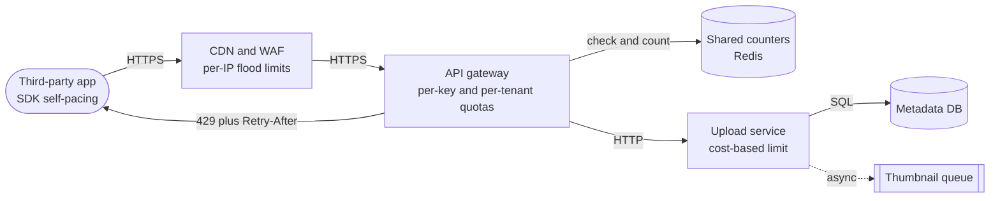

**Reading the diagram.** A third-party app (stadium) sends HTTPS requests through three enforcement layers. The *CDN/WAF* applies cheap per-IP limits before traffic reaches PhotoShare's network. The *API gateway* authenticates the API key and checks per-key and per-tenant quotas against *shared counters* in Redis (a storage boundary shared by all gateway nodes, §22.8). The *upload service* applies a cost-based limit (bytes per minute per user) because one upload can cost a thousand times more than a metadata read. All solid arrows are synchronous; the thumbnail queue is asynchronous. Rejected requests return 429 with `Retry-After` directly from whichever layer rejected them. Failure points: the Redis counter store is on the hot path of every request, so its outage policy (fail open or closed, §22.8.5) must be decided in advance. Scaling: edge and gateway scale horizontally; the counter store is partitioned by key.

### 22.3.3 Choosing the key

The **rate-limit key** is the identity whose usage is counted. Choosing it badly either lets abuse through or punishes innocent users.

**Table 22.1 — Rate-limit keys.**

| Key | Strengths | Weaknesses | Typical use |
|---|---|---|---|
| Client IP address | Available before authentication; stops anonymous floods | Many users share one IP behind carrier-grade NAT or corporate proxies (§7.13); attackers rotate IPs; trust `X-Forwarded-For` only from your own proxies (§7.12) | Edge flood control, login pages, sign-up |
| User or account ID | Fair per person; survives IP changes | Needs authentication first; one attacker can create many accounts | Per-user actions (posts, messages) |
| API key or OAuth client ID | Maps directly to a contract and a bill | A leaked key consumes the owner's quota | Public developer APIs |
| Tenant (organization) | Isolates customers in multi-tenant SaaS | One heavy user can exhaust a whole organization's quota | Enterprise plans, noisy-neighbor control |
| Route or operation, combined with one of the above | Expensive endpoints get tighter limits | More counters to store | `POST /uploads` stricter than `GET /photos` |
| Cost units | Reflects true resource use | Cost must be estimated before execution | GraphQL query cost (§8.7), LLM tokens |

Production systems usually apply **hierarchical limits**: a request must pass every applicable bucket, for example per-IP (edge) *and* per-key *and* per-tenant *and* a global ceiling for the route. The request is admitted only if all checks pass, and tokens are taken from all of them.

### 22.3.4 Telling the client: 429, Retry-After and RateLimit headers

A rejected client needs three facts: that it was limited (not that the server failed), when to come back, and ideally how much quota remains so it can pace itself before hitting the wall.

- **HTTP 429 Too Many Requests** means the client sent too many requests in a given time; it was defined in RFC 6585 [Nottingham and Fielding 2012]. It blames the client. **503 Service Unavailable** blames the server (overload or maintenance) and is the right status for load shedding (§22.9).
- **`Retry-After`** (RFC 9110 §10.2.3) gives either a number of seconds or an HTTP date after which the client may retry. Compute it from the limiter's state (the token bucket in §22.4 returns it exactly).
- **RateLimit header fields** are being standardized by the IETF HTTPAPI working group in the Internet-Draft *RateLimit header fields for HTTP* [Polli et al., draft]. As of 2026 this is still a **draft, not an RFC**, and its syntax has changed between versions. Early drafts used three fields (`RateLimit-Limit`, `RateLimit-Remaining`, `RateLimit-Reset`); recent drafts use two structured fields, `RateLimit-Policy` (the quota policy: quota `q` and window `w`) and `RateLimit` (current state: remaining `r` and seconds until reset `t`). Many public APIs still use their own `X-RateLimit-*` headers.

```text
HTTP/1.1 429 Too Many Requests
Content-Type: application/problem+json
Retry-After: 18
RateLimit-Policy: "default";q=100;w=60
RateLimit: "default";r=0;t=18

{"type": "https://api.photoshare.example/errors/rate-limited",
 "title": "Rate limit exceeded", "status": 429,
 "detail": "API key pk_live_42 is limited to 100 requests per 60 s."}
```

What to notice:

- The body uses the RFC 9457 problem-details format so clients can parse it; the headers carry the machine-readable timing.
- `Retry-After: 18` and `t=18` agree. Clients that only understand `Retry-After` still behave correctly.
- Send the `RateLimit` fields on *successful* responses too, so careful clients slow down before being rejected.

::: industry
**GitHub REST API rate-limit headers.** GitHub documents per-user and per-app limits for its REST API and returns `x-ratelimit-limit`, `x-ratelimit-remaining`, `x-ratelimit-used`, `x-ratelimit-reset` (a Unix timestamp) and `x-ratelimit-resource` on responses; when the limit is exceeded it returns 403 or 429, and for secondary limits it may send `retry-after` [GitHub Docs: REST rate limits]. The lesson is that de-facto conventions predate the IETF draft, so client libraries must handle several header dialects.
*Evidence: Primary* — [GitHub Docs: REST rate limits]
:::

**Table 22.2 — Rate-limiting failure scenarios.**

| What goes wrong | Why | Detection | Recovery | Prevention |
|---|---|---|---|---|
| Thousands of mobile users blocked at once | Per-IP limit applied to a carrier NAT address | 429 spike concentrated on few IPs with many user agents | Raise or bypass the IP limit for authenticated traffic | Key on user or API key after authentication; IP limits only pre-auth |
| Limits do nothing during an attack | Attacker rotates API keys or IPs | Total traffic high while every key is under its limit | Add tenant- and route-level ceilings | Hierarchical limits plus load shedding |
| Clients hammer after 429 | No `Retry-After`; SDK retries immediately | 429 rate rises in lockstep with request rate | Return `Retry-After`; block abusive keys | SDK backoff with jitter (§22.12) |
| Legitimate burst rejected | Burst allowance smaller than the client's natural burst (app start-up sync) | 429s at app launch time, low average usage | Increase bucket capacity | Size burst from observed per-session peaks (§22.4) |

::: mistake
**Mistake — "Rate limiting protects my service from overload."** It protects you from *individual* clients exceeding their contracts. If 10,000 well-behaved customers each stay within 100 RPS, they can still send 1,000,000 RPS in total. Capacity protection needs a global admission control layer: load shedding and backpressure (§22.9–§22.10).
:::

## 22.4 Token bucket

### 22.4.1 The algorithm

::: definition
**Definition — Token bucket.** A rate limiter that keeps a counter of **tokens**, refilled continuously at **rate** $r$ up to a maximum **capacity** (burst size) $b$. Each request consumes one token (or a cost $c$); a request that finds too few tokens is rejected. The long-run admitted rate is at most $r$, and up to $b$ requests may be admitted at once.
:::

#### First-principles explanation

Imagine a jar on your desk that a friend tops up with one sweet every six seconds, but the jar holds only 20 sweets; when it is full, new sweets fall on the floor. You may eat a sweet only if one is in the jar. If you have been away for an hour, you come back to a full jar and can eat 20 in a row (a **burst**), but after that you can eat only as fast as sweets arrive: ten per minute. The jar size limits the burst; the top-up speed limits the average.

#### Why does this exist?

Real clients are bursty: a mobile app opening fetches a profile, a feed and ten thumbnails in one second, then goes quiet for a minute. A limiter that allows exactly $r$ requests per second, evenly spaced, would reject legitimate bursts. The token bucket separates two promises, average rate and burst size, which is exactly how capacity is planned. It originated in network traffic shaping and policing, and it is the algorithm behind most API gateways' "rate and burst" settings.

#### How it works internally

You do not need a timer that adds tokens. Store two numbers per key, `tokens` and `last` (the time of the last update), and refill lazily when a request arrives:

1. `elapsed = now − last`; `tokens = min(b, tokens + elapsed × r)`; `last = now`.
2. If `tokens ≥ cost`: subtract the cost and admit.
3. Otherwise reject, and report `Retry-After = (cost − tokens) / r`.

**Figure 22.2 — Token bucket admission decision.**

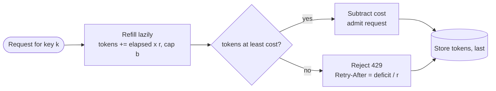

**Reading the diagram.** A request for key *k* triggers a lazy refill computed from the time since the last update, capped at capacity $b$. The decision node compares the token count with the request's cost; admitted requests subtract the cost, rejected requests compute how long until the deficit is refilled. Both paths write the two-number state back to storage (local memory on one node, or a shared store in §22.8). Everything is synchronous and constant-time: no timers, no background threads. The failure point is the read-modify-write on the state, which must be atomic when several threads or nodes share a key (§22.8.2). The structure scales to millions of keys because each costs only two numbers.

#### Mathematical foundations

::: formula
**Token bucket state and admission bound**

$$\text{tokens}(t) = \min\bigl(b,\ \text{tokens}(t_0) + r\,(t - t_0)\bigr) \qquad\qquad A(T) \le b + rT$$

| Symbol | Meaning | Units |
|---|---|---|
| $r$ | Refill rate (sustained allowed rate) | tokens/s (= requests/s at unit cost) |
| $b$ | Bucket capacity (maximum burst) | tokens |
| $t_0$, $t$ | Time of last update, current time | s |
| $A(T)$ | Maximum requests admitted in any interval of length $T$ | requests |
:::

The bound $A(T) \le b + rT$ says that over any interval the client can use what was saved in the bucket plus what drips in during the interval. It is the same "arrival curve" used in network calculus to describe policed traffic.

::: example
**Worked example — PhotoShare free tier: $r = 10$ RPS, $b = 20$.**

1. A client idle for a while has a full bucket of 20. It fires 50 requests at $t = 0$: the first 20 are admitted, 30 are rejected. Deficit for the next request is 1 token, so `Retry-After` $= 1/10 = 0.1$ s.
2. The client waits 1 s: the bucket refills $1 \times 10 = 10$ tokens, so 10 more requests succeed.
3. Maximum admitted in any 60 s interval: $A(60) = 20 + 10 \times 60 = 620$ requests, an average of 10.3 RPS. The burst adds only 3% over a minute.
4. Time to refill from empty to full: $b/r = 20/10 = 2$ s.
5. Sustained 15 RPS for 10 s against a full bucket (150 requests over a 9.93 s span): the bound is $20 + 10 \times 9.93 = 119.3$, so at most 119 are admitted; the code below admits exactly 119.

**Interpretation.** $r$ governs the minute-scale average; $b$ governs only the first seconds. **Engineering implication.** Set $r$ from capacity planning (what you can afford per client on average) and $b$ from observed client behavior (the largest legitimate burst, such as an app's start-up sync). If the downstream service cannot absorb $b$ requests at once from many clients simultaneously, the burst parameter, not the rate, is what will hurt you.
:::

#### Code example

```python
import random
import time


class FakeClock:
    """A controllable clock so tests are deterministic (time in seconds)."""
    def __init__(self, t=0.0):
        self.t = t
    def __call__(self):
        return self.t
    def advance(self, dt):
        self.t += dt


class TokenBucket:
    """Refill at `rate` tokens/s up to `capacity`; each request spends `cost` tokens."""
    def __init__(self, rate, capacity, clock=time.monotonic):
        self.rate, self.capacity, self.clock = float(rate), float(capacity), clock
        self.tokens = float(capacity)          # start full: a new client may burst at once
        self.last = clock()

    def _refill(self):
        now = self.clock()
        elapsed = max(0.0, now - self.last)    # ignore a clock that steps backwards
        self.tokens = min(self.capacity, self.tokens + elapsed * self.rate)
        self.last = now

    def try_acquire(self, cost=1.0):
        self._refill()
        if self.tokens >= cost:
            self.tokens -= cost
            return True
        return False

    def retry_after(self, cost=1.0):
        """Seconds until `cost` tokens are available: the value for a Retry-After header."""
        self._refill()
        return max(0.0, (cost - self.tokens) / self.rate)


if __name__ == "__main__":
    clock = FakeClock()
    tb = TokenBucket(rate=10, capacity=20, clock=clock)

    # 1. A burst of 50 requests at t = 0
    admitted = sum(tb.try_acquire() for _ in range(50))
    print(f"t=0.0 s burst of 50: admitted {admitted}, retry after {tb.retry_after():.2f} s")
    assert admitted == 20

    # 2. One second later the bucket has refilled 10 tokens
    clock.advance(1.0)
    admitted = sum(tb.try_acquire() for _ in range(50))
    print(f"t=1.0 s burst of 50: admitted {admitted}")
    assert admitted == 10

    # 3. Sustained 15 RPS for 10 s against a fresh (full) bucket
    clock, n_ok = FakeClock(), 0
    tb = TokenBucket(rate=10, capacity=20, clock=clock)
    for k in range(150):
        clock.t = k / 15
        n_ok += tb.try_acquire()
    bound = 20 + 10 * (149 / 15)               # b + r*T over the 9.93 s span
    print(f"15 RPS for 10 s: admitted {n_ok} of 150 (bound b + rT = {bound:.1f})")
    assert n_ok <= bound
```

Output:

```text
t=0.0 s burst of 50: admitted 20, retry after 0.10 s
t=1.0 s burst of 50: admitted 10
15 RPS for 10 s: admitted 119 of 150 (bound b + rT = 119.3)
```

What to notice:

- The clock is injected. Testing time-based code against `time.monotonic()` makes tests slow and flaky; a fake clock makes them exact. In production use a **monotonic** clock, never wall-clock time, which can jump backwards after an NTP correction (§24.9).
- `retry_after` falls out of the state for free, so the 429 response can tell the client exactly when to return.
- Non-unit `cost` turns the same class into a cost-based limiter (bytes uploaded, query cost, model tokens).

#### Real-world industry applications

::: industry
**Stripe's API rate limiters.** Stripe described four limiters in production: a per-user **request rate limiter** (the most important, implemented as a token bucket), a **concurrent requests limiter** that caps requests in flight per user, a **fleet usage load shedder** that reserves part of the infrastructure for critical requests, and a **worker utilization load shedder** that sheds lower-priority traffic first when workers are saturated. The token buckets live in Redis so that every API server shares them. Stripe also recommends starting with the request rate limiter and rolling out new limiters in "dark launch" mode, logging what would have been rejected before enforcing [Tarjan 2017].
*Evidence: Primary* — [Tarjan 2017]
:::

::: industry
**Amazon API Gateway throttling.** AWS documents that API Gateway throttles requests with a token bucket algorithm, where a *rate* (steady-state requests per second) and a *burst* (bucket capacity) can be configured per account, stage, method or usage-plan client; requests above the limits receive 429 [AWS Docs: API Gateway throttling].
*Evidence: Primary* — [AWS Docs: API Gateway throttling]
:::

#### Common misconceptions

::: mistake
**Mistake — "A token bucket with $r = 10$ RPS means no client ever exceeds 10 RPS."** Over a short window it can reach $b$ requests instantly; at $b = 20$, 20 requests arrive in the same millisecond. If the downstream can handle only 10 concurrent requests, you need a **concurrency limit** (requests in flight) as well as a rate limit. By Little's Law, in-flight requests $= \lambda W$ (§4.11), so a rate limit bounds concurrency only if latency $W$ stays bounded; when the backend slows down, the same rate produces more in-flight work.
:::

## 22.5 Leaky bucket

### 22.5.1 Two different algorithms with one name

::: definition
**Definition — Leaky bucket.** (a) **As a queue:** requests enter a FIFO buffer of capacity $Q$ that is drained at a constant rate $r$; arrivals that find the buffer full are dropped. Output is perfectly smooth. (b) **As a meter:** a counter (the "water level") increases by one per admitted request and leaks at rate $r$; a request that would overflow capacity is rejected immediately. The meter form makes the same admit/reject decisions as a token bucket with the same rate and capacity.
:::

#### First-principles explanation

Picture a bucket with a small hole in the bottom. Pour water in as unevenly as you like; it leaks out of the hole at a steady drip. If you pour too fast, the bucket overflows and the excess spills. In the **queue** form, the water is the requests themselves: they wait in the bucket and leave at a steady pace, so the downstream sees perfectly smooth traffic, but each request is *delayed*. In the **meter** form, the water is only a measurement: the request is either admitted immediately or rejected, and nothing waits.

#### Why does this exist?

The leaky bucket comes from telecommunications, where networks had to police and shape fixed-size cells so that a switch's buffers would not overflow. For APIs, the queue form is useful when the downstream truly needs a smooth arrival rate (for example, a partner API that permits exactly 5 calls per second, or a database bulk loader). The meter form is useful because it can be implemented with a *single* number per key, which makes it attractive for shared stores.

**Figure 22.3 — Leaky bucket as a queue versus as a meter.**

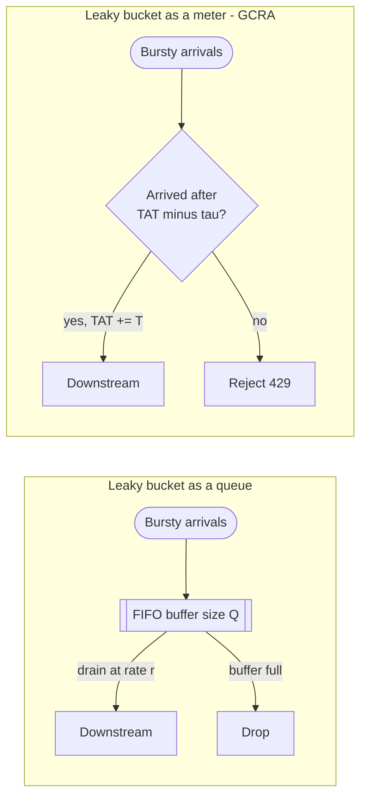

**Reading the diagram.** In the left subgraph, bursty arrivals are buffered in a FIFO queue (an in-memory storage boundary of size $Q$) and released at constant rate $r$; the release is asynchronous with respect to the arrival, and the cost is added latency of up to $Q/r$. When the buffer is full, arrivals are dropped. In the right subgraph, nothing is buffered: each arrival is checked against a single stored timestamp (the theoretical arrival time, TAT, explained below) and is admitted or rejected synchronously. The queue form shapes traffic; the meter form polices it. Failure points: the queue form holds requests in memory, so a crash loses them and a long queue adds latency that callers may time out on; the meter form has no such state. Scaling: the meter keeps one number per key, so it shards trivially.

### 22.5.2 GCRA: the leaky bucket as a single timestamp

The **Generic Cell Rate Algorithm (GCRA)** is the meter form defined for ATM (Asynchronous Transfer Mode) networks in ITU-T Recommendation I.371 and the ATM Forum Traffic Management specification [ITU-T I.371; ATM Forum TM 4.0]. Those documents give two equivalent formulations, a "virtual scheduling" algorithm and a "continuous-state leaky bucket"; the virtual-scheduling form is the one usually adapted for API rate limiting. Instead of counting tokens, it remembers when the next request is *due* if the client sent at exactly the allowed rate.

::: formula
**GCRA (virtual scheduling form)**

$$T = \frac{1}{r}, \qquad \tau = (b-1)\,T, \qquad \text{admit at time } t \iff t \ge \text{TAT} - \tau, \qquad \text{then } \text{TAT} \leftarrow \max(\text{TAT}, t) + T$$

| Symbol | Meaning | Units |
|---|---|---|
| $r$ | Sustained allowed rate | requests/s |
| $T$ | Emission interval: ideal spacing between requests | s |
| $b$ | Burst size (requests that may arrive back to back) | requests |
| $\tau$ | Tolerance: how early a request may be relative to its ideal schedule | s |
| TAT | Theoretical arrival time of the next request (the only stored state) | s (timestamp) |
| $t$ | Arrival time of the current request | s (timestamp) |
:::

::: example
**Worked example — GCRA with $r = 10$ RPS, $b = 20$.**

1. $T = 1/10 = 100$ ms; $\tau = 19 \times 100 = 1{,}900$ ms.
2. An idle client sends 50 requests at $t = 0$. TAT starts at 0 (or is reset to $t$ because $\max(\text{TAT}, t)$ ignores a stale past TAT).
3. Request 1: $0 \ge 0 - 1.9$ ✓; TAT $= 0.1$ s. Request 20: TAT before it is $1.9$; $0 \ge 1.9 - 1.9 = 0$ ✓; TAT becomes $2.0$.
4. Request 21: $0 \ge 2.0 - 1.9 = 0.1$? No → reject. `Retry-After` $=$ TAT $- \tau - t = 0.1$ s.

**Interpretation.** Exactly 20 admitted and a 0.1 s retry hint: identical to the token bucket in §22.4. **Engineering implication.** GCRA stores one timestamp per key instead of two numbers and needs no refill arithmetic, which makes it attractive in a shared store such as Redis, where state size and script simplicity matter.
:::

```python
import random


class GCRA:
    """Generic Cell Rate Algorithm, virtual-scheduling form. State per key: one integer (TAT).
    Times are integer nanoseconds so that repeated additions do not drift."""
    def __init__(self, rate, burst):
        self.T = round(1e9 / rate)          # emission interval (ns): ideal gap between requests
        self.tau = (burst - 1) * self.T     # tolerance (ns): how far ahead of schedule we accept
        self.tat = None                     # theoretical arrival time of the next request

    def try_acquire(self, now_s):
        now = round(now_s * 1e9)
        tat = now if self.tat is None else max(self.tat, now)
        if tat - now > self.tau:            # arrived earlier than TAT - tau: non-conforming
            return False
        self.tat = tat + self.T             # conforming: push the schedule one interval out
        return True

    def retry_after(self, now_s):
        """Seconds until the next request would conform."""
        return max(0.0, (self.tat - self.tau) / 1e9 - now_s)


def token_bucket_decisions(rate, capacity, times):
    """Reference token bucket (starts full) for comparison."""
    tokens, last, out = float(capacity), times[0], []
    for t in times:
        tokens = min(capacity, tokens + (t - last) * rate)
        last = t
        ok = tokens >= 1.0
        tokens -= 1.0 if ok else 0.0
        out.append(ok)
    return out


if __name__ == "__main__":
    g = GCRA(rate=10, burst=20)
    burst = [g.try_acquire(0.0) for _ in range(50)]
    print(f"burst of 50 at t=0: admitted {sum(burst)}, retry after {g.retry_after(0.0):.2f} s")

    # Equivalence check on 100,000 random arrivals (Poisson, average 14 RPS)
    rng = random.Random(7)
    times, t = [], 0.0
    for _ in range(100_000):
        t += rng.expovariate(14.0)
        times.append(t)
    g = GCRA(rate=10, burst=20)
    gcra = [g.try_acquire(x) for x in times]
    tb = token_bucket_decisions(10, 20, times)
    mismatches = sum(a != b for a, b in zip(gcra, tb))
    print(f"admitted: GCRA {sum(gcra)}, token bucket {sum(tb)}; "
          f"decisions that differ: {mismatches}")
    assert sum(burst) == 20 and mismatches == 0
```

Output:

```text
burst of 50 at t=0: admitted 20, retry after 0.10 s
admitted: GCRA 71137, token bucket 71137; decisions that differ: 0
```

What to notice:

- On 100,000 random arrivals the two algorithms make identical decisions: GCRA with $\tau = (b-1)/r$ *is* a token bucket of capacity $b$, stored differently.
- Times are integer nanoseconds. A first version of this listing used floating-point seconds and admitted only 19 of the burst, because $19 \times 0.1$ accumulated by repeated addition slightly exceeded $1.9$. Production GCRA implementations store integer time for the same reason.
- `max(self.tat, now)` is what stops an idle client from "banking" more than the burst: a TAT in the past is pulled forward to now.

#### Alternatives and trade-offs

Use the **queue form** only when the downstream requires smooth arrivals and the caller can tolerate waiting; bound the queue so that the maximum wait $Q/r$ stays below the caller's timeout (§22.10). Use the **meter form** (GCRA or token bucket) for API admission, where rejecting fast is better than queueing.

::: mistake
**Mistake — Treating "leaky bucket" and "token bucket" as rivals.** The leaky bucket *as a meter* and the token bucket are the same policy; only the bookkeeping differs. The genuine difference is between *shaping* (queue and delay, the leaky bucket as a queue) and *policing* (admit or reject immediately). When someone says "we use a leaky bucket", ask which one they mean.
:::

## 22.6 Fixed window

### 22.6.1 Counting per calendar window

::: definition
**Definition — Fixed window counter.** A limiter that divides time into aligned windows of length $W$ (for example each clock minute), keeps one counter per key per window, and admits a request if the current window's counter is below the limit $L$. The counter resets at each window boundary.
:::

#### How it works internally

1. Window index $= \lfloor t / W \rfloor$; counter key = `key:window_index`.
2. Increment the counter atomically (in Redis: `INCR` plus `EXPIRE` set to $W$).
3. Admit if the new value is at most $L$.

Its appeal is simplicity: one integer per key, one atomic increment, automatic cleanup. Its flaw is the **boundary burst**: the window resets regardless of when the client's requests happened, so a client can spend a full quota at the end of one window and another full quota at the start of the next.

**Figure 22.4 — The fixed-window boundary burst.**

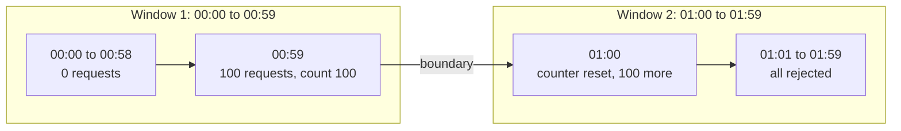

**Reading the diagram.** Time flows left to right across two one-minute windows with a limit of 100 per window. The client is idle for 59 seconds, sends 100 requests in the last second of window 1 (all admitted, counter reaches 100), then the counter resets at the boundary and the next 100 requests in the first second of window 2 are also admitted. The storage boundary is a per-window counter that is discarded at each boundary, which is why the history is forgotten. The failure point is the downstream service, which receives 200 requests in two seconds. Every client that discovers this pattern (or every client whose cron job fires at the top of the minute) produces synchronized bursts at window boundaries.

::: formula
**Worst-case burst of a fixed window**

$$A_{\max}(W) = 2L \qquad\qquad \text{peak short-term rate} \approx \frac{2L}{\delta}$$

| Symbol | Meaning | Units |
|---|---|---|
| $L$ | Limit per window | requests |
| $W$ | Window length | s |
| $A_{\max}(W)$ | Most requests admitted in some interval of length $W$ that straddles a boundary | requests |
| $\delta$ | Duration of the straddling burst (can be arbitrarily small) | s |
:::

::: example
**Worked example — 100 requests per minute.**

1. Intended average rate: $100/60 = 1.67$ RPS.
2. Client sends 100 requests during 00:59.00–00:59.99 and 100 during 01:00.00–01:00.99. All 200 are admitted (the code in §22.7 confirms it).
3. In the 2 s interval the client achieved $200/2 = 100$ RPS, which is $100/1.67 = 60$ times the intended average, and any 60 s interval containing both bursts held $2L = 200$ requests.

**Interpretation.** The limit holds per calendar window but not per sliding minute. **Engineering implication.** Fixed windows are acceptable for coarse quotas where a 2× overshoot is harmless (daily or monthly quotas, billing counts). For protecting a backend, use a token bucket or a sliding window, or add a short-window limit (for example 10 per second) on top of the per-minute one.
:::

## 22.7 Sliding window log and sliding window counter

### 22.7.1 Sliding window log

::: definition
**Definition — Sliding window log.** A limiter that stores the timestamp of every admitted request per key and admits a new request only if fewer than $L$ timestamps fall in the interval $(t - W, t]$.
:::

The log is exact: no interval of length $W$ ever contains more than $L$ admitted requests. In Redis it is typically a sorted set per key (`ZREMRANGEBYSCORE` to drop old entries, `ZCARD` to count, `ZADD` to record). Its cost is memory: up to $L$ timestamps per key. With 1 million active keys and a limit of 1,000 requests per hour, the worst case is $10^6 \times 1{,}000 \times 8$ bytes $= 8$ GB of raw timestamps, several times more inside a sorted set's per-entry overhead. Use the log when $L$ is small (login attempts: 5 per 15 minutes) or when exactness is a contractual requirement.

### 22.7.2 Sliding window counter

::: definition
**Definition — Sliding window counter.** A limiter that keeps fixed-window counters for the current and previous windows and estimates the count over the last $W$ seconds by weighting the previous window's count by the fraction of it that still overlaps the sliding interval.
:::

#### First-principles explanation

You know you made 84 phone calls last hour and 36 so far this hour, and it is now quarter past. How many calls did you make in the last 60 minutes? You do not know when last hour's calls happened, but if they were spread evenly, three-quarters of them (63) fell in the last 45 minutes of that hour, which is still inside your sliding hour. Your estimate is $63 + 36 = 99$. The sliding window counter makes exactly this assumption: the previous window's requests were uniformly spread.

::: formula
**Sliding window counter estimate**

$$\hat{N}(t) = C_{\text{prev}} \cdot \frac{W - e}{W} + C_{\text{curr}}, \qquad \text{admit if } \hat{N}(t) + 1 \le L$$

| Symbol | Meaning | Units |
|---|---|---|
| $\hat{N}(t)$ | Estimated requests in the sliding interval $(t-W, t]$ | requests |
| $C_{\text{prev}}$ | Count in the previous fixed window | requests |
| $C_{\text{curr}}$ | Count so far in the current fixed window | requests |
| $e$ | Time elapsed since the current window started | s |
| $W$ | Window length | s |
| $L$ | Limit per sliding window | requests |
:::

::: example
**Worked example — $L = 100$ per minute, 15 s into the current minute.**

1. $C_{\text{prev}} = 84$, $C_{\text{curr}} = 36$, $e = 15$ s, $W = 60$ s.
2. Overlap weight: $(60 - 15)/60 = 0.75$; weighted previous count: $84 \times 0.75 = 63$.
3. $\hat{N} = 63 + 36 = 99$. Admit test: $99 + 1 = 100 \le 100$ → admit; $C_{\text{curr}}$ becomes 37.
4. Next request at the same instant: $\hat{N} = 63 + 37 = 100$; $100 + 1 > 100$ → reject.
5. When does the next request fit? The previous window's contribution falls by $84/60 = 1.4$ requests per second, so after $1/1.4 \approx 0.71$ s the estimate drops to 99. `Retry-After` rounds up to 1 s.
6. Memory: two counters plus a window start, about 16 bytes per key, versus up to 8,000 bytes for a log at $L = 1{,}000$; for 1 million keys, 16 MB versus 8 GB.

**Interpretation.** Two integers per key give a smooth sliding limit with no boundary reset. **Engineering implication.** The sliding window counter is the usual choice for large-scale per-key limits measured in requests per minute or hour; its error depends on how uneven traffic is inside a window, which the code below measures.
:::

#### Code example

```python
import math
import random
from collections import deque


class FixedWindow:
    def __init__(self, limit, window):
        self.limit, self.window = limit, window
        self.start, self.count = None, 0

    def try_acquire(self, now):
        start = math.floor(now / self.window) * self.window
        if start != self.start:                      # a new window: reset the counter
            self.start, self.count = start, 0
        if self.count < self.limit:
            self.count += 1
            return True
        return False


class SlidingLog:
    def __init__(self, limit, window):
        self.limit, self.window, self.log = limit, window, deque()

    def try_acquire(self, now):
        while self.log and self.log[0] <= now - self.window:
            self.log.popleft()                       # forget requests older than one window
        if len(self.log) < self.limit:
            self.log.append(now)
            return True
        return False


class SlidingWindowCounter:
    """Two counters per key; estimate = prev * (overlap fraction) + curr."""
    def __init__(self, limit, window):
        self.limit, self.window = limit, window
        self.start, self.curr, self.prev = 0.0, 0, 0

    def estimate(self, now):
        start = math.floor(now / self.window) * self.window
        if start != self.start:                      # roll forward
            gap = round((start - self.start) / self.window)
            self.prev = self.curr if gap == 1 else 0  # an idle gap > 1 window empties both
            self.curr, self.start = 0, start
        overlap = 1.0 - (now - start) / self.window  # share of previous window still inside
        return self.prev * overlap + self.curr

    def try_acquire(self, now):
        if self.estimate(now) + 1 <= self.limit:     # never let the estimate exceed the limit
            self.curr += 1
            return True
        return False


def boundary_burst(limiter):
    """100 requests in the last second of a minute, 100 in the first second of the next."""
    times = [59 + i / 100 for i in range(100)] + [60 + i / 100 for i in range(100)]
    return sum(limiter.try_acquire(t) for t in times)


if __name__ == "__main__":
    L, W = 100, 60.0
    print("Boundary burst (limit 100 per 60 s, 200 requests within 2 s):")
    for name, cls in [("fixed window", FixedWindow), ("sliding log", SlidingLog),
                      ("sliding counter", SlidingWindowCounter)]:
        print(f"  {name:16s} admitted {boundary_burst(cls(L, W))}")

    # Worked example of section 22.7: prev = 84, curr = 36, 15 s into the window
    swc = SlidingWindowCounter(L, W)
    swc.start, swc.prev, swc.curr = 60.0, 84, 36
    print(f"\nestimate at t=75 s: {swc.estimate(75.0):.1f}; "
          f"next two requests: {swc.try_acquire(75.0)}, {swc.try_acquire(75.0)}")

    # Accuracy against the exact sliding log: 4 hours of random traffic
    def worst_window(ts):                            # most admitted requests in any 60 s span
        best, j = 0, 0
        for i, x in enumerate(ts):
            while ts[j] <= x - W:
                j += 1
            best = max(best, i - j + 1)
        return best

    print("\npattern  RPS  offered  | log: admitted worst60 | counter: admitted worst60 "
          "| fixed: admitted worst60")
    for pattern in ("steady", "on/off"):             # on/off: 40 s on, 20 s silent
        for rate in (1.5, 3.0):
            rng, times, t = random.Random(42), [], 0.0
            while t < 4 * 3600:
                t += rng.expovariate(rate)
                if pattern == "steady" or int(t // 20) % 3 != 2:
                    times.append(t)
            row = []
            for cls in (SlidingLog, SlidingWindowCounter, FixedWindow):
                lim = cls(L, W)
                ok = [x for x in times if lim.try_acquire(x)]
                row.append(f"{len(ok):>6} {worst_window(ok):>4}")
            print(f"{pattern:7s} {rate:4.1f} {len(times):>8}  |  " + "      |  ".join(row))

    assert boundary_burst(FixedWindow(L, W)) == 200
    assert boundary_burst(SlidingLog(L, W)) == 100
```

Output:

```text
Boundary burst (limit 100 per 60 s, 200 requests within 2 s):
  fixed window     admitted 200
  sliding log      admitted 100
  sliding counter  admitted 101

estimate at t=75 s: 99.0; next two requests: True, False

pattern  RPS  offered  | log: admitted worst60 | counter: admitted worst60 | fixed: admitted worst60
steady   1.5    21574  |   21034  100      |   21166  113      |   21383  115
steady   3.0    43246  |   23726  100      |   23683  105      |   24001  137
on/off   1.5    14342  |   14342   86      |   14339   85      |   14342   86
on/off   3.0    28717  |   23110  100      |   17845  100      |   23929  137
```

What to notice:

- **Boundary burst.** The fixed window admits all 200; the log admits exactly 100; the counter admits 101 (one extra request slips in 0.6 s after the boundary, once the previous window's weight has decayed by 1%).
- **Steady traffic.** The counter admits within 1% of the exact log, and its worst real 60 s window is 105–113 requests against a limit of 100: a 5–13% overshoot, versus 37% for the fixed window.
- **Periodic traffic.** When traffic is on for 40 s and off for 20 s in step with the window, the "uniform spread" assumption is systematically wrong and the counter admits 23% fewer requests than the log at 3 RPS (17,845 versus 23,110). The approximation is good for traffic that is random within a window and poor for traffic phase-locked to it.

::: industry
**Cloudflare's rate limiting.** Cloudflare described building rate limiting for millions of domains with exactly this two-counter sliding approximation, stored in its edge caches, chosen because it needs very little memory per key and copes well with bursts at window boundaries. In its write-up, an analysis of 400 million requests from 270,000 distinct sources found that 0.003% of requests were wrongly allowed or rate limited [Desgats 2017].
*Evidence: Primary* — [Desgats 2017]
:::

### 22.7.3 Comparing the algorithms

**Table 22.3 — Rate-limiting algorithms compared.**

| | Token bucket | Leaky bucket (queue) | GCRA (meter) | Fixed window | Sliding log | Sliding counter |
|---|---|---|---|---|---|---|
| What it is | Tokens refill at $r$ up to $b$ | FIFO drained at $r$ | One timestamp (TAT) | Counter per aligned window | Timestamp per request | Two window counters, weighted |
| State per key | 2 numbers | Queue of up to $Q$ requests | 1 number | 1 counter | Up to $L$ timestamps | 2 counters |
| Burst behavior | Up to $b$ at once | Absorbs bursts by delaying | Up to $b$ at once | Up to $2L$ across a boundary | Exactly $L$ per window | About $L$; small overshoot |
| Accuracy | Exact for its definition | Exact; adds latency | Exact (= token bucket) | Poor at boundaries | Exact | Approximate (uniformity assumption) |
| Rejects or delays? | Rejects | Delays, drops when full | Rejects | Rejects | Rejects | Rejects |
| Operational complexity | Low | Medium (queue, timeouts) | Low | Lowest | Medium (memory) | Low |
| Choose when | API rate plus burst | Downstream needs smooth flow | Minimal shared state | Coarse daily or monthly quotas | Small exact limits | Large-scale per-minute limits |

## 22.8 Distributed rate limiting

### 22.8.1 The problem

A gateway fleet of $N$ nodes behind a load balancer must enforce *one* limit per key, but each node sees only part of the key's traffic. Three facts make this hard: requests for a key may land on any node; traffic is rarely split evenly (long-lived connections and client-side load balancing concentrate a client on a few nodes, §19.6); and every coordination step either adds latency to the request or lets counts go stale.

### 22.8.2 Centralized counters: Redis with Lua

The simplest correct design puts the limiter state in one shared store, usually Redis, partitioned by key across shards. The naive implementation is a race condition.

**Figure 22.5 — The read-modify-write race in a shared counter.**

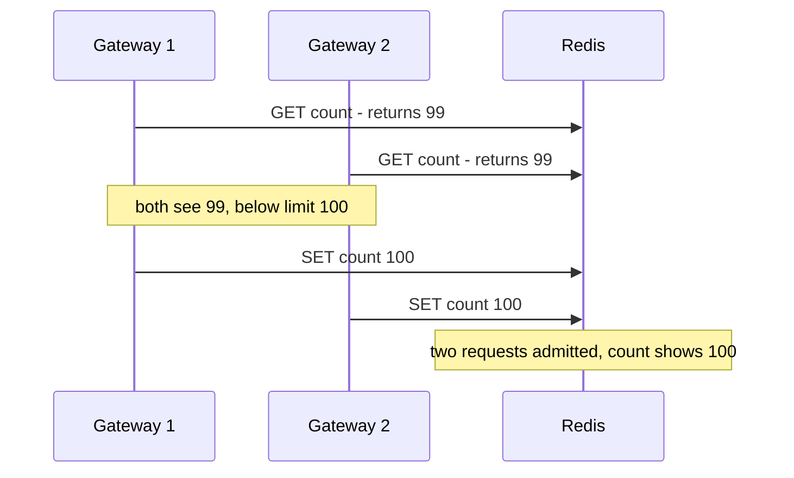

**Reading the diagram.** Two gateway nodes handle requests for the same key at the same moment. Each issues a synchronous `GET` to Redis, sees 99 (one below the limit), decides locally to admit, and writes back 100. Both requests are admitted, but the stored count says only one was: the limit is exceeded and the record is wrong. The failure point is the gap between reading and writing; under high concurrency for a hot key, many requests fall into that gap. Adding more gateway nodes makes it worse. The fix is to move the decision into the store so that read, decide and write are one atomic step.

Redis executes a Lua script atomically: no other command runs on that shard while the script executes [Redis Docs: Lua scripting]. The token bucket of §22.4 becomes:

```lua
-- Token bucket in Redis. KEYS[1] = bucket key; ARGV = rate (tokens/s), capacity, cost
local rate     = tonumber(ARGV[1])
local capacity = tonumber(ARGV[2])
local cost     = tonumber(ARGV[3])
local t        = redis.call('TIME')                 -- Redis server clock, not the caller's
local now      = tonumber(t[1]) + tonumber(t[2]) / 1000000
local state    = redis.call('HMGET', KEYS[1], 'tokens', 'ts')
local tokens   = tonumber(state[1]) or capacity     -- unknown key: start with a full bucket
local ts       = tonumber(state[2]) or now
tokens = math.min(capacity, tokens + math.max(0, now - ts) * rate)
local allowed, retry_after = 0, 0
if tokens >= cost then
  tokens, allowed = tokens - cost, 1
else
  retry_after = (cost - tokens) / rate
end
redis.call('HSET', KEYS[1], 'tokens', tokens, 'ts', now)
redis.call('PEXPIRE', KEYS[1], math.ceil(capacity / rate * 1000) + 1000)  -- idle keys vanish
return {allowed, tostring(retry_after)}            -- Lua numbers would be truncated to integers
```

What to notice:

- Tested against Redis 7.0: 50 pipelined calls on a fresh key with `rate=10, capacity=20, cost=1` returned 20 admits and 30 rejections. Load it once with `SCRIPT LOAD` and call it with `EVALSHA` so only the hash crosses the network.
- `TIME` uses the Redis server's clock, so gateway nodes with skewed clocks (§24.9) cannot corrupt the bucket. Redis 5 and later replicate a script's *effects* rather than re-running it on replicas, which is what makes calling `TIME` before a write safe.
- The key expires once a full bucket would have refilled, so idle keys cost no memory. All keys a script touches must be passed in `KEYS` and live on one shard in Redis Cluster; hierarchical limits for one request should share a hash tag such as `{tenant42}` if checked in one script.

**Figure 22.6 — Centralized rate limiting with an atomic script.**

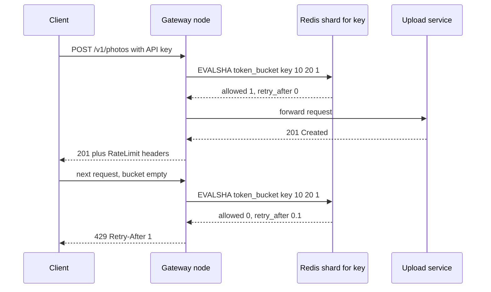

**Reading the diagram.** The client's request reaches a gateway node, which makes one synchronous round trip to the Redis shard that owns the key (keys are spread across shards by hashing, §14.8). The script runs atomically on that shard and returns the decision and a retry hint. Admitted requests are forwarded to the upload service; rejected ones are answered by the gateway with 429, never touching the service. The storage boundary is the Redis shard; its in-memory state may be lost on failover, which briefly resets some buckets (usually acceptable). Failure points: Redis latency adds to every request, a slow or failed shard blocks every key on it, and a single hot key concentrates load on one shard. Scaling: add shards; for very hot keys, use local pre-aggregation (§22.8.3).

### 22.8.3 Local counting with synchronization, and quota distribution

Two families avoid a remote call on every request.

1. **Local counting with periodic synchronization.** Each node counts locally and, every $\Delta$ seconds, exchanges counts with the others (directly, or via increments to a shared store). Between synchronizations a node decides on a stale view of the global count.
2. **Quota distribution (leases).** A coordinator divides the global limit into per-node allowances, in proportion to each node's recent demand, and re-divides them periodically. Each node enforces its allowance locally with a token bucket. This is the design of Google's open-source Doorman system and of several gateway "global rate limit" features; Envoy, for example, can call an external rate-limit service for global decisions and apply a local token bucket filter per instance [Envoy Docs: rate limiting].

**Figure 22.7 — Local enforcement with synchronization or quota leases.**

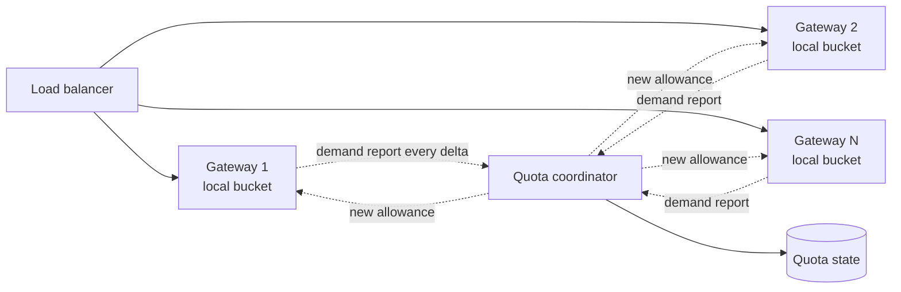

**Reading the diagram.** The load balancer spreads requests across $N$ gateway nodes, each deciding synchronously against a local bucket in its own memory, so the request path has no remote call. Asynchronously (dotted arrows), every node reports its recent demand to a quota coordinator, which computes new per-node allowances that sum to the global limit and pushes them back; the coordinator persists its state. In the synchronization variant, nodes exchange counts with each other instead of receiving allowances. Failure points: if the coordinator is unreachable, nodes keep their last allowance (graceful degradation); allowances lag demand by one period, so a sudden shift of traffic between nodes is under-served for up to $\Delta$. Scaling: coordination cost grows with $N$ per period, not with request rate.

#### Mathematical foundations

::: formula
**Overshoot of local counting with synchronization interval $\Delta$**

$$E_{\max} \approx \lambda \cdot \Delta \qquad\qquad M_{\text{sync}} = \frac{N(N-1)}{\Delta}\ \text{(all-to-all)} \quad \text{or} \quad \frac{2N}{\Delta}\ \text{(via a store or coordinator)}$$

| Symbol | Meaning | Units |
|---|---|---|
| $E_{\max}$ | Worst-case requests admitted beyond the limit per window | requests |
| $\lambda$ | Offered rate for the key across all nodes | requests/s |
| $\Delta$ | Synchronization interval | s |
| $N$ | Number of gateway nodes | nodes |
| $M_{\text{sync}}$ | Coordination messages per second (each message can carry all keys) | messages/s |
:::

The overshoot bound follows because, once the global count crosses the limit, no node learns of it until the next synchronization, and in the worst case every request arriving in that interval is admitted.

::: example
**Worked example — 10 gateways, limit 1,000 requests/s for one tenant, offered 3,000 RPS.**

1. $\Delta = 100$ ms: $E_{\max} \approx 3{,}000 \times 0.1 = 300$ excess requests per second, up to 30% over. Messages: $10 \times 9/0.1 = 900$/s all-to-all.
2. $\Delta = 10$ ms: $E_{\max} \approx 30$ (3%); messages $= 9{,}000$/s.
3. Centralized Redis: zero overshoot, but one round trip per request: 3,000 Redis calls/s for this tenant alone, and roughly 0.2–1 ms added to each request inside a datacenter (§7.15).
4. Simulation (below): with $\Delta = 100$ ms the measured overshoot averages 147/s (bound 300); with $\Delta = 10$ ms, 9.5/s (bound 30).

**Interpretation.** Accuracy, latency and coordination traffic form a triangle; you can pick two. **Engineering implication.** Choose centralized counters for contractual quotas on expensive operations (where 30% overshoot costs money), local-plus-sync or quotas for very high-rate, latency-critical paths where a few percent of overshoot is harmless.
:::

#### Code example: a Redis-free simulation

```python
"""Simulate one tenant's global limit of 1,000 requests per 1-second window, enforced by
10 gateway nodes that receive skewed traffic. No Redis needed: the 'central store' is a dict."""
import random

LIMIT, NODES, SECONDS = 1000, 10, 20
WEIGHTS = [0.5] + [0.5 / 9] * 9                 # node 0 gets half the tenant's traffic


def arrivals(offered_rps, seed=1):
    rng, events = random.Random(seed), []
    for node, w in enumerate(WEIGHTS):
        t = 0.0
        while True:
            t += rng.expovariate(offered_rps * w)
            if t >= SECONDS:
                break
            events.append((t, node))
    return sorted(events)


def static_split(events):
    """Each node enforces LIMIT/N locally. Zero coordination."""
    counts = {}
    def allow(t, node):
        k = (int(t), node)
        if counts.get(k, 0) < LIMIT / NODES:
            counts[k] = counts.get(k, 0) + 1
            return True
        return False
    return allow, lambda: 0


def centralized(events):
    """Every decision is an atomic increment on one shared counter (Redis + Lua in production)."""
    counts, calls = {}, [0]
    def allow(t, node):
        calls[0] += 1                            # one network round trip per request
        k = int(t)
        if counts.get(k, 0) < LIMIT:
            counts[k] = counts.get(k, 0) + 1
            return True
        return False
    return allow, lambda: calls[0]


def local_with_sync(events, sync_interval):
    """Nodes count locally and exchange counts every sync_interval seconds."""
    local = [0] * NODES                          # this window's admits per node (true values)
    seen = [0] * NODES                           # each node's last snapshot of the others' total
    state = {"window": 0, "next_sync": sync_interval, "msgs": 0}
    def allow(t, node):
        while t >= state["next_sync"]:           # periodic all-to-all exchange of counters
            total = sum(local)
            for i in range(NODES):
                seen[i] = total - local[i]
            state["msgs"] += NODES * (NODES - 1)
            state["next_sync"] += sync_interval
        if int(t) != state["window"]:            # new window: everyone resets
            state["window"] = int(t)
            local[:] = [0] * NODES
            seen[:] = [0] * NODES
        if seen[node] + local[node] < LIMIT:     # decide on a possibly stale global view
            local[node] += 1
            return True
        return False
    return allow, lambda: state["msgs"]


def quota_leases(events):
    """A coordinator re-divides the limit once per window in proportion to each node's
    demand in the previous window; nodes then enforce their quota locally."""
    quota = [LIMIT / NODES] * NODES
    demand, used = [0] * NODES, [0] * NODES
    state = {"window": 0, "msgs": 0}
    def allow(t, node):
        if int(t) != state["window"]:            # window boundary: report demand, get quotas
            total = sum(demand) or 1
            for i in range(NODES):
                quota[i] = LIMIT * demand[i] / total
            state["msgs"] += 2 * NODES           # N reports in, N quota grants out
            state["window"] = int(t)
            demand[:], used[:] = [0] * NODES, [0] * NODES
        demand[node] += 1
        if used[node] + 1 <= quota[node]:
            used[node] += 1
            return True
        return False
    return allow, lambda: state["msgs"]


def run(name, factory, events):
    allow, cost = factory(events)
    per_window = [0] * SECONDS
    for t, node in events:
        if allow(t, node):
            per_window[int(t)] += 1
    steady = per_window[1:]                      # skip the first window (warm-up)
    print(f"{name:26s} mean {sum(steady)/len(steady):7.1f}/s  max {max(steady):5d}  "
          f"coordination msgs/s {cost()/SECONDS:9.0f}")
    return per_window


if __name__ == "__main__":
    for offered in (1500, 3000):
        events = arrivals(offered)
        print(f"Offered {offered} RPS, global limit {LIMIT}/s, {NODES} nodes, node 0 gets 50%")
        s = run("static split (L/N each)", static_split, events)
        c = run("centralized counter", centralized, events)
        y100 = run("local + sync every 100 ms", lambda e: local_with_sync(e, 0.1), events)
        y10 = run("local + sync every 10 ms", lambda e: local_with_sync(e, 0.01), events)
        q = run("demand-weighted quotas", quota_leases, events)
        print()
        assert max(c) <= LIMIT and max(s) <= LIMIT and max(q) <= LIMIT
        assert max(y100) > LIMIT >= max(c)       # stale views overshoot; exact counting does not
```

Output:

```text
Offered 1500 RPS, global limit 1000/s, 10 nodes, node 0 gets 50%
static split (L/N each)    mean   840.1/s  max   895  coordination msgs/s         0
centralized counter        mean  1000.0/s  max  1000  coordination msgs/s      1495
local + sync every 100 ms  mean  1041.2/s  max  1079  coordination msgs/s       896
local + sync every 10 ms   mean  1005.5/s  max  1010  coordination msgs/s      8996
demand-weighted quotas     mean   995.4/s  max   997  coordination msgs/s        19

Offered 3000 RPS, global limit 1000/s, 10 nodes, node 0 gets 50%
static split (L/N each)    mean  1000.0/s  max  1000  coordination msgs/s         0
centralized counter        mean  1000.0/s  max  1000  coordination msgs/s      2979
local + sync every 100 ms  mean  1147.4/s  max  1170  coordination msgs/s       896
local + sync every 10 ms   mean  1009.5/s  max  1020  coordination msgs/s      8996
demand-weighted quotas     mean   994.5/s  max   996  coordination msgs/s        19
```

What to notice:

- **Static split under-admits under skew.** At 1,500 RPS the tenant is over its limit, yet it receives only 840/s: node 0 sees 750 RPS but may admit only 100, while the other nodes have unused allowance. It works only when every node's share of demand exceeds $L/N$ (the 3,000 RPS case).
- **Synchronization overshoots** in proportion to $\Delta$, within the $\lambda\Delta$ bound.
- **Quotas** are accurate here with only 19 messages per second because demand is stationary; a sudden traffic shift would be under-served until the next re-division.

### 22.8.4 Comparison

**Table 22.4 — Distributed rate-limiting strategies.**

| Strategy | Added latency | Accuracy | Coordination cost | Failure behavior | Choose when |
|---|---|---|---|---|---|
| Static split $L/N$ | None | Under-admits with skewed traffic | None | Independent | Even traffic, rough limits |
| Centralized (Redis + Lua) | One round trip per request | Exact | One call per request | Store outage blocks the decision | Contractual or costly limits |
| Local + periodic sync | None | Overshoot up to $\lambda\Delta$ | $O(N^2/\Delta)$ or $O(N/\Delta)$ | Stale but working | Very high rates, tolerant limits |
| Quota distribution (leases) | None | Exact sum; lags demand shifts | $O(N/\Delta)$ | Keeps last allowance | Large fleets, stable demand |
| Hybrid: local bucket batches reservations from a central store | Rare round trips | Bounded by batch size | One call per batch | Degrades to local | Hot keys at very high rates |

### 22.8.5 Failure scenarios

**Table 22.5 — Distributed limiter failure scenarios.**

| What goes wrong | Why | Detection | Recovery | Prevention |
|---|---|---|---|---|
| All requests fail when Redis is down | Limiter fails *closed* | Error spike on limiter calls | Switch to fail-open with local limits | Decide the policy per limit: fail open for quotas, fail closed for security limits such as login attempts |
| One Redis shard at 100% CPU | A single hot key (one huge tenant) | Per-shard CPU and latency skew | Split the key into sub-keys or use local pre-aggregation | Hot-key detection (§17.6, §20.15) |
| Limits overshoot after a deploy | All gateway nodes restarted with empty local counters | 429 rate drops to zero briefly | Self-healing after one window | Persist or warm local state; prefer central state for strict limits |
| Buckets drift or never refill | Gateway clocks skewed | Different nodes report different `Retry-After` | Use server-side time in the script | Store time from one clock (Redis `TIME`) |
| Limiter adds p99 latency | Synchronous call to a remote store on every request | Gateway p99 tracks Redis p99 | Short timeout on the limiter call, then fail open | Local caching of "deny" decisions until `Retry-After` |

## 22.9 Throttling and load shedding

### 22.9.1 Goodput and overload

::: definition
**Definition — Load shedding and throttling.** **Load shedding** is a server rejecting some requests early and cheaply (usually with 503) because accepting them would push it past capacity, regardless of whether each client is within its quota. **Throttling** is slowing a client down, by delaying or rejecting its requests; rate limiting is the quota-based form. **Goodput** is the rate of requests completed *usefully*: correctly and before the client gave up.
:::

A restaurant kitchen that accepts every order on a busy night ends up serving every dish late and cold; customers leave before their food arrives, so the kitchen works at full speed while producing nothing useful. A kitchen that tells new arrivals "45-minute wait, or try tomorrow" keeps serving the seated customers well. That is load shedding. The AWS Builders' Library describes exactly this failure: once latency exceeds client timeouts, a server can be 100% busy with throughput at its maximum while goodput falls toward zero, because every response arrives after the client stopped waiting [Yanacek: load shedding].

::: formula
**Time until goodput collapses without shedding**

$$q(t) = (\lambda - \mu)\,t, \qquad w(t) = \frac{q(t)}{\mu}, \qquad t_{\text{collapse}} = \frac{\mu \, T_{\text{out}}}{\lambda - \mu} \quad (\lambda > \mu)$$

| Symbol | Meaning | Units |
|---|---|---|
| $\lambda$ | Offered request rate | requests/s |
| $\mu$ | Server capacity (maximum completion rate) | requests/s |
| $q(t)$ | Queue length after $t$ seconds of overload (unbounded FIFO) | requests |
| $w(t)$ | Queueing delay seen by a request arriving at $t$ | s |
| $T_{\text{out}}$ | Client timeout | s |
| $t_{\text{collapse}}$ | Time after which every completed request is already too late | s |
:::

::: example
**Worked example — PhotoShare upload service, $\mu = 1{,}000$ RPS, clients time out after 1 s, a spike brings $\lambda = 1{,}500$ RPS.**

1. The queue grows at $1{,}500 - 1{,}000 = 500$ requests per second.
2. $t_{\text{collapse}} = 1{,}000 \times 1 / 500 = 2$ s. After two seconds the queue holds 1,000 requests and every new request waits 1 s, the full timeout.
3. From then on the server still completes 1,000 requests/s, but goodput is roughly zero. Worse, clients retry, raising $\lambda$ further (§22.12).
4. With shedding (a queue bounded at 200 requests, i.e. at most $200/1{,}000 = 200$ ms of waiting), the server rejects the excess 500 RPS in microseconds and goodput stays at 1,000 RPS.

**Interpretation.** Unbounded queueing turns a 50% overload into a 100% outage in two seconds. **Engineering implication.** Bound every queue by *time* (the client's timeout), reject at the front door when the bound is reached, and make rejection far cheaper than service.
:::

### 22.9.2 Priority-based shedding

Not all requests are equal. When PhotoShare is overloaded, a user's photo upload and checkout matter more than a background prefetch of recommendations or an analytics ping. **Priority-based shedding** assigns each request a **criticality** class at the edge and propagates it through the call graph; as load rises, the server sheds the lowest class first. Google's SRE book describes four classes: `CRITICAL_PLUS`, `CRITICAL`, `SHEDDABLE_PLUS` and `SHEDDABLE`, propagated automatically with RPCs [Beyer et al. 2016, ch. 21]. Stripe's worker-utilization load shedder similarly sheds test-mode and other lower-priority traffic before critical API methods [Tarjan 2017].

Clients can shed load too. The SRE book's **client-side adaptive throttling** has each client track, over the last two minutes, how many requests it sent and how many the backend accepted, and drop requests locally with a probability that rises as rejections grow.

::: formula
**Client-side adaptive throttling (Google SRE)**

$$P_{\text{reject}} = \max\!\left(0,\ \frac{\text{requests} - K \cdot \text{accepts}}{\text{requests} + 1}\right)$$

| Symbol | Meaning | Units |
|---|---|---|
| requests | Requests the client attempted in the recent window | count |
| accepts | Requests the backend accepted (did not reject for overload) | count |
| $K$ | Multiplier; how many requests per accept the client may still send (typically 2) | dimensionless |
| $P_{\text{reject}}$ | Probability the client rejects a new request locally, without sending it | dimensionless |
:::

::: example
**Worked example — A client in a two-minute window sent 10,000 requests and 4,000 were accepted, $K = 2$.**

1. $K \times \text{accepts} = 8{,}000$.
2. $P_{\text{reject}} = (10{,}000 - 8{,}000)/10{,}001 = 0.20$.
3. The client now drops 20% of new requests locally at zero network cost. If the backend recovers and accepts everything, $\text{requests} < 2 \times \text{accepts}$ and $P_{\text{reject}}$ returns to 0.

**Interpretation.** The client keeps sending until it sends about $K$ times what the backend accepts, so the backend still sees enough traffic to signal recovery. **Engineering implication.** Lower $K$ sheds more aggressively (less wasted backend work, slower recovery); $K = 2$ is a sensible default.
:::

### 22.9.3 Controlling queue delay: CoDel and adaptive LIFO

Queue *length* is a poor overload signal because a long queue of fast requests is harmless and a short queue of slow ones is not. **CoDel** (Controlled Delay), designed by Nichols and Jacobson for network routers, watches the time packets spend in the queue (their *sojourn time*). If the *minimum* sojourn time over an interval (100 ms by default) stays above a target (5 ms), the queue is a standing queue rather than a passing burst, and CoDel starts dropping, with the gap between drops shrinking as $\text{interval}/\sqrt{n}$ for the $n$-th drop: 100 ms, 70.7 ms, 57.7 ms, 50 ms, until the delay falls below target [Nichols and Jacobson 2012].

Facebook adapted the idea to RPC server queues and combined it with **adaptive LIFO** [Maurer 2015]. Normally the queue is FIFO. When the queue has not been empty for the last $N$ ms (100 ms worked well for Facebook), each request may wait at most $M$ ms (5 ms) before being rejected, and the queue switches to **LIFO**, serving the newest request first. The newest request is the one whose client is most likely still waiting; the oldest have probably timed out already, so serving them first would produce work nobody receives.

**Figure 22.8 — Overload control at a service: priority shedding and an adaptive queue.**

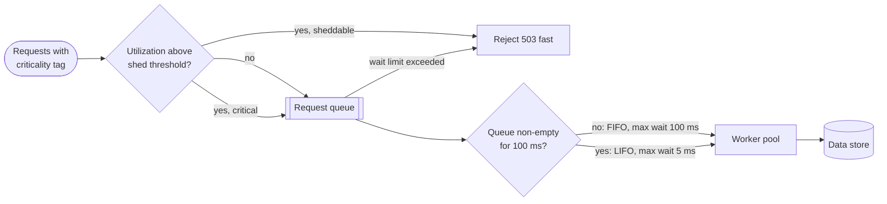

**Reading the diagram.** Requests arrive tagged with a criticality class set at the edge. An admission check compares current utilization (for example, busy workers over pool size) with a threshold: below it everything is queued; above it sheddable requests are rejected with a fast 503, while critical ones are still queued. The queue's discipline adapts: while it drains regularly it is FIFO with a generous wait limit; once it has stayed non-empty for 100 ms it switches to LIFO with a 5 ms limit, and requests exceeding their wait limit are rejected. Workers process requests synchronously against the data store. Failure points: misclassified traffic (everything tagged critical defeats the scheme), and a threshold set above the point where latency explodes. Scaling: these controls are local to each instance and need no coordination.

::: mistake
**Mistake — "Autoscaling makes load shedding unnecessary."** New instances take tens of seconds to minutes to start and warm up, while a queue can blow past client timeouts in two seconds (§22.9.1). Autoscaling fixes sustained overload; shedding survives the minutes until it does. You need both.
:::

## 22.10 Backpressure

::: definition
**Definition — Backpressure.** A flow-control mechanism in which a slower downstream component signals upstream components to reduce their sending rate, by blocking, by advertising available capacity, or by rejecting, so that work in progress stays bounded instead of piling up in unbounded buffers.
:::

On a factory assembly line, if the packing station falls behind, the line stops feeding it rather than heaping unpacked goods on the floor. The heap is an unbounded queue: it hides the problem, consumes space, and makes everything in it late. Backpressure is the stop signal travelling upstream.

TCP is the canonical example (§7.7.6): the receiver advertises its free buffer space as the receive window; when the application stops reading, the window drops to zero and the sender's `write()` blocks. Backpressure propagates automatically from a slow consumer to the producer's application. Systems break this chain whenever they insert an **unbounded** buffer: an in-memory list that a request handler appends to, an `asyncio` task created per message without limit, a broker topic with no consumer-lag alerting. Each turns backpressure into memory growth and latency.

Three rules give you backpressure at the application level:

1. **Bound every queue,** and size the bound from the latency you can tolerate, not from available memory (formula below).
2. **Decide what happens when it is full:** block the producer (pipelines inside one process), reject (request/response APIs: 503 or 429), or drop the oldest or least important (telemetry, video frames).
3. **Signal demand explicitly across asynchronous boundaries.** The **Reactive Streams** specification standardizes this for asynchronous stream libraries on the JVM: a subscriber calls `request(n)` to say it can accept $n$ more items, and a publisher may never send more than has been requested [Reactive Streams 2015]. Java 9's `java.util.concurrent.Flow` adopted the same interfaces, and gRPC and HTTP/2 use per-stream flow-control windows for the same purpose.

**Figure 22.9 — Backpressure through a processing pipeline.**

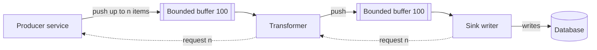

**Reading the diagram.** Items flow left to right from a producer through a transformer to a sink that writes to a database. Each hop has a bounded in-memory buffer (100 items). Demand flows right to left as asynchronous `request(n)` signals (dotted arrows): the sink requests more only when it has written what it holds, the transformer requests more from the producer only when it has demand from the sink. If the database slows, the sink's requests slow, the buffers fill and stay full, and the producer stops being asked for data, so memory use is bounded at about 200 items in flight. Failure points: any component that accepts data without demand (an unbounded buffer) breaks the chain. Scaling: add parallel sinks; the demand signal automatically lets the producer go faster.

::: formula
**Bounding a queue by time (Little's Law)**

$$Q_{\max} = \mu \times D_{\text{queue}}$$

| Symbol | Meaning | Units |
|---|---|---|
| $Q_{\max}$ | Maximum queue length | items |
| $\mu$ | Rate at which the consumer drains the queue | items/s |
| $D_{\text{queue}}$ | Maximum acceptable time an item may wait in the queue | s |
:::

::: example
**Worked example — Sizing the upload service's request queue.** Workers complete $\mu = 500$ requests/s; the gateway's timeout leaves at most 200 ms for queueing.

1. $Q_{\max} = 500 \times 0.2 = 100$ requests.
2. A request arriving behind 100 others waits $100/500 = 0.2$ s, the full budget; request 101 should be rejected immediately rather than queued to time out.
3. If workers slow to $\mu = 250$/s (a slow database), the same 100-item queue now means 400 ms of waiting. Bound queues by *measured wait time* (as CoDel does) rather than by item count when service time varies.

**Interpretation.** A queue longer than $\mu \times$ (timeout) holds only requests that are doomed to time out. **Engineering implication.** Default queue sizes in frameworks (often thousands, or unbounded) are almost always too large for interactive services.
:::

## 22.11 Timeouts and deadlines

::: definition
**Definition — Timeout and deadline.** A **timeout** is a relative duration after which a caller stops waiting for one operation (for example 300 ms). A **deadline** is an absolute point in time by which the *whole* request must complete; it is passed along the call chain so that every downstream call knows how much time remains.
:::

Without a timeout, a caller waiting on a dead or hung dependency waits forever, holding a thread, a connection and memory; by Little's Law (§4.11) the pool of held resources grows until the caller itself stops responding. Every network call therefore needs a timeout: connection establishment (short, about one round trip plus margin), and the request as a whole.

**Choosing a timeout.** Set it from the dependency's measured latency distribution, not from intuition. The AWS Builders' Library recommends choosing an acceptable rate of false timeouts (for example 0.1%) and using the corresponding latency percentile (p99.9) of the downstream service, plus padding for network variance [Brooker: timeouts and retries]. Too short, and healthy-but-slow requests are cut off and retried, adding load; too long, and resources are held by requests nobody is waiting for.

**Why deadlines must propagate.** Suppose each hop independently uses a 1 s timeout. The user's app gives up after 1 s, but a service three hops down started 600 ms late and keeps working for its full second, then the database query beneath it keeps running too. All of that work is wasted. With **deadline propagation**, the edge sets an absolute deadline and each hop passes the *remaining* time downstream; gRPC does this automatically, sending the remaining time in the `grpc-timeout` header and failing calls with `DEADLINE_EXCEEDED` once it passes [gRPC Docs: deadlines]. Over HTTP you carry it in a header of your own. Each service should check the remaining budget before starting expensive work and refuse work it cannot finish in time [Beyer et al. 2016, ch. 22].

::: formula
**Timeout budget along a call chain**

$$B_{i+1} = B_i - e_i - m_i, \qquad \text{start the call only if } B_{i+1} > \hat{s}_{i+1}$$

| Symbol | Meaning | Units |
|---|---|---|
| $B_i$ | Remaining budget when hop $i$ receives the request | ms |
| $e_i$ | Time hop $i$ spends before calling hop $i+1$ (local work, earlier calls) | ms |
| $m_i$ | Margin hop $i$ reserves to build and return its own response | ms |
| $B_{i+1}$ | Budget passed to hop $i+1$ | ms |
| $\hat{s}_{i+1}$ | Typical latency of hop $i+1$ (for example its p50) | ms |
:::

**Figure 22.10 — Deadline propagation through the PhotoShare Pro purchase path.**

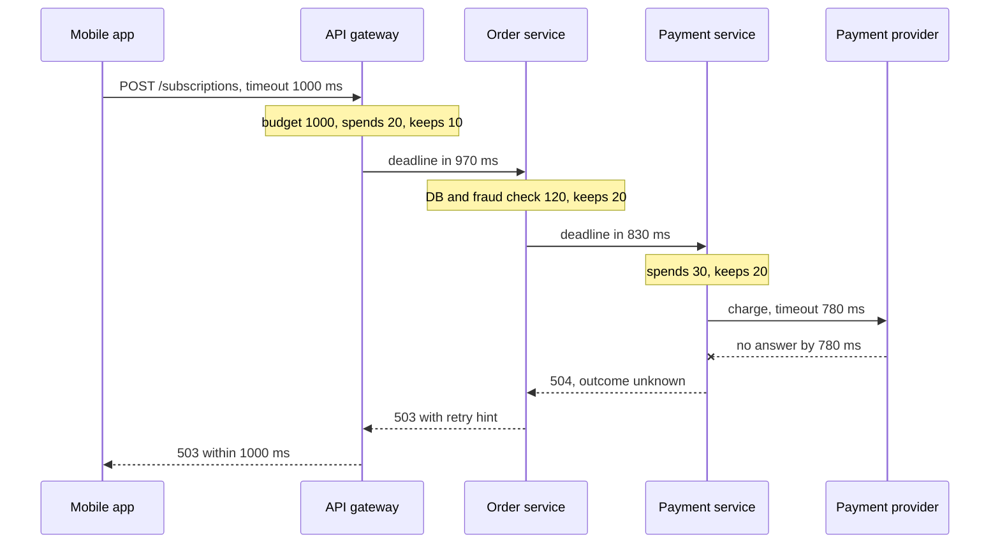

**Reading the diagram.** The mobile app waits at most 1,000 ms. Each hop subtracts the time it has already spent and a margin for its own response before passing the remaining budget downstream: 970, 830, then 780 ms for the external payment provider (hexagon in the architecture view; here a participant). All calls are synchronous. When the provider fails to answer within its budget, the payment service stops waiting and reports an *unknown outcome* (the charge may or may not have happened), and every hop still has its reserved margin to return an error before the app gives up. The storage boundary that matters is at the provider: its state is unknown, which is why the retry must carry an idempotency key (§22.15). Scaling: budgets are per request and need no shared state.

::: example
**Worked example — Budget for the purchase path, client deadline 1,000 ms.**

1. Gateway: $B_1 = 1{,}000$; $e_1 = 20$ (authentication, rate-limit check), $m_1 = 10$ → $B_2 = 970$ ms.
2. Order service: $e_2 = 120$ (database read, fraud check), $m_2 = 20$ → $B_3 = 830$ ms.
3. Payment service: $e_3 = 30$, $m_3 = 20$ → $B_4 = 780$ ms for the provider call. The provider's p50 is 300 ms and p99.9 is 900 ms, so $B_4 > \hat{s}_4$ and the call starts.
4. Contrast with fixed per-hop timeouts of 1 s, 1 s and 2 s: when the provider hangs, the payment service, which started the call at 170 ms, waits until 2,170 ms: 1,170 ms after the app has given up; every thread on the path is held for work nobody receives.

**Interpretation.** The provider gets 78% of the user's budget, the most that is consistent with the earlier hops. **Engineering implication.** Propagate absolute deadlines (or remaining durations), subtract as you go, and make inner timeouts shorter than outer ones. Note the provider's p99.9 (900 ms) exceeds its budget, so roughly 0.1–1% of purchases will hit the deadline; either raise the client budget or make the purchase asynchronous (accept with 202 and confirm by push).
:::

::: mistake
**Mistake — "A timeout means the operation failed."** It means *you do not know*. The request may never have arrived, may have failed, or may have succeeded with the response lost. For reads this ambiguity is harmless; for writes it is the central problem that idempotency keys solve (§22.15).
:::

## 22.12 Retries with exponential backoff and jitter

### 22.12.1 When to retry

Most failures in distributed systems are transient: a packet lost, a node restarting, a leader election (§26.5). Retrying converts many of these into successes at the cost of latency. But a retry is also *extra load sent to a system that just failed*, often because it was overloaded. Retry only when all of these hold:

1. The error is **retryable**: timeouts, connection resets, 429, 502, 503, 504, gRPC `UNAVAILABLE`. Never retry 400, 401, 403, 404 or 422; they will fail again.
2. The operation is **idempotent** or carries an idempotency key (§22.15).
3. **Time remains** in the deadline (§22.11).
4. The **retry budget** is not exhausted (§22.12.4).

### 22.12.2 Exponential backoff and jitter

Waiting a fixed time before retrying keeps pressure constant on a struggling server. **Exponential backoff** doubles the wait after each failure, up to a cap. But if many clients failed at the same moment (because the server hiccupped for all of them), they all back off by identical amounts and retry in synchronized waves. **Jitter** randomizes the wait to spread the waves out. Brooker's analysis for the AWS Architecture Blog compared three variants [Brooker 2015]:

::: formula
**Backoff with jitter (attempt $k = 1, 2, \dots$)**

$$s_k = \min(\text{cap},\ \text{base} \cdot 2^{k})$$

$$\text{full: } U(0, s_k) \qquad \text{equal: } \tfrac{s_k}{2} + U\!\left(0, \tfrac{s_k}{2}\right) \qquad \text{decorrelated: } \min\bigl(\text{cap},\ U(\text{base},\ 3\,w_{k-1})\bigr)$$

| Symbol | Meaning | Units |
|---|---|---|
| $k$ | Retry number | count |
| base | Initial backoff unit | ms |
| cap | Maximum wait | ms |
| $s_k$ | Exponential backoff ceiling for retry $k$ | ms |
| $U(a, b)$ | A uniformly random value between $a$ and $b$ | ms |
| $w_{k-1}$ | The previous wait for decorrelated jitter ($w_0 = \text{base}$) | ms |
:::

::: example
**Worked example — base 100 ms, cap 20 s.**

1. Ceilings $s_k$ for $k = 1 \dots 8$: 200, 400, 800, 1,600, 3,200, 6,400, 12,800, 20,000 (capped) ms.
2. Full jitter at $k = 3$: a wait anywhere in 0–800 ms, mean 400 ms. Equal jitter: 400–800 ms, mean 600 ms.
3. Cumulative worst-case wait before the 5th retry with full jitter: $200 + 400 + 800 + 1{,}600 + 3{,}200 = 6{,}200$ ms, so five retries do not fit a 1 s user deadline; they fit a background job.

**Interpretation.** Exponential growth reaches the cap quickly; jitter decides how evenly clients are spread within each ceiling. **Engineering implication.** For interactive requests, one or two retries with small bases are all the deadline allows; long backoff sequences belong to asynchronous work.
:::

#### Code example: measuring contention

The simulation has $N$ clients each needing one successful write to a contended resource with optimistic concurrency: a write conflicts and fails if another started less than 1 ms earlier. All clients begin within the same millisecond, as after a brief outage.

```python
"""N clients each need one successful write to a contended resource (optimistic
concurrency: if another write started less than WORK ms earlier, this one conflicts).
Compare backoff strategies by total calls (work) and time until every client succeeds."""
import heapq
import random

BASE, CAP, WORK = 5.0, 2000.0, 1.0               # milliseconds


def no_jitter(attempt, prev, rng):
    return min(CAP, BASE * 2 ** attempt)

def full_jitter(attempt, prev, rng):
    return rng.uniform(0, min(CAP, BASE * 2 ** attempt))

def equal_jitter(attempt, prev, rng):
    v = min(CAP, BASE * 2 ** attempt)
    return v / 2 + rng.uniform(0, v / 2)

def decorrelated_jitter(attempt, prev, rng):
    return min(CAP, rng.uniform(BASE, prev * 3))


def simulate(strategy, clients, seed, max_attempts=200):
    rng = random.Random(seed)
    # every client makes its first call within the same 1 ms (a synchronized wave)
    queue = [(rng.uniform(0, 1.0), c, 0, BASE) for c in range(clients)]
    heapq.heapify(queue)
    busy_until, calls, finish = -1.0, 0, 0.0
    while queue:
        t, c, attempt, prev = heapq.heappop(queue)
        calls += 1
        if t >= busy_until:                      # no conflicting write in flight: success
            busy_until, finish = t + WORK, t
        elif attempt + 1 < max_attempts:         # conflict: back off and try again
            sleep = strategy(attempt + 1, prev, rng)
            heapq.heappush(queue, (t + WORK + sleep, c, attempt + 1, sleep))
    return calls, finish


if __name__ == "__main__":
    strategies = [("exponential, no jitter", no_jitter), ("full jitter", full_jitter),
                  ("equal jitter", equal_jitter), ("decorrelated jitter", decorrelated_jitter)]
    seeds = range(20)
    for n in (25, 100):
        print(f"{n} clients (mean of {len(seeds)} runs)     calls   calls/client   time to finish")
        results = {}
        for name, fn in strategies:
            runs = [simulate(fn, n, s) for s in seeds]
            calls = sum(r[0] for r in runs) / len(runs)
            finish = sum(r[1] for r in runs) / len(runs)
            results[name] = calls
            print(f"  {name:24s} {calls:8.0f}   {calls / n:10.1f}   {finish:10.0f} ms")
        print()
        assert results["full jitter"] < results["exponential, no jitter"] / 3
```

Output:

```text
25 clients (mean of 20 runs)     calls   calls/client   time to finish
  exponential, no jitter        325         13.0        34575 ms
  full jitter                    76          3.1           93 ms
  equal jitter                   83          3.3          139 ms
  decorrelated jitter            73          2.9          108 ms

100 clients (mean of 20 runs)     calls   calls/client   time to finish
  exponential, no jitter       5050         50.5       184650 ms
  full jitter                   459          4.6          498 ms
  equal jitter                  475          4.8          636 ms
  decorrelated jitter           450          4.5          406 ms
```

What to notice:

- **Without jitter, contention is quadratic.** The clients stay synchronized forever, so each wave lets exactly one through: $100 + 99 + \dots + 1 = 5{,}050$ calls, and the last client finishes after three minutes because waits hit the 2 s cap.
- **Any jitter cuts work by 11×** (5,050 → about 460 calls) and completion time by over 300×. Full and decorrelated jitter are slightly better than equal jitter, matching Brooker's qualitative result; the exact numbers depend on the model.
- The workload is pessimistic (one success per conflict window), but the shape of the result holds whenever many clients fail together.

### 22.12.3 Retry storms and amplification

**Figure 22.11 — Retry amplification in a four-layer call graph.**

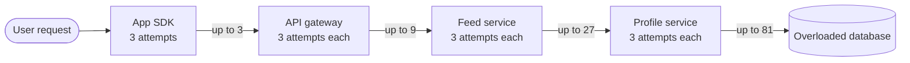

**Reading the diagram.** One user request enters at the left. Every layer is configured, reasonably in isolation, to make up to three attempts (one try plus two retries). When the database at the bottom fails every call, each layer's attempts multiply: 3 calls from the SDK to the gateway, 9 from the gateway to the feed service, 27 to the profile service and 81 to the database. All calls are synchronous. The failure point is the database, and the retries aim the multiplied load precisely at it, preventing recovery: a **retry storm**. The fix is structural: retry at one layer only (usually the one closest to the user or the one that knows the operation is idempotent), cap retries with budgets, and stop retrying when a circuit breaker opens (§22.13).

::: formula
**Retry amplification**

$$A = \prod_{i=1}^{d} a_i = a^{d}\ \ \text{(identical layers)}, \qquad \mathbb{E}[\text{attempts per layer}] = \sum_{j=0}^{a-1} p^{j} = \frac{1 - p^{a}}{1 - p}$$

| Symbol | Meaning | Units |
|---|---|---|
| $A$ | Worst-case calls reaching the bottom layer per user request | calls |
| $a_i$ | Maximum attempts (1 + retries) at layer $i$ | attempts |
| $d$ | Number of layers that retry | layers |
| $p$ | Probability that one attempt fails ($p < 1$) | dimensionless |
:::

::: example
**Worked example — 10,000 user RPS through four retrying layers.**

1. Database hard down ($p = 1$): $A = 3^4 = 81$; the database receives $10{,}000 \times 81 = 810{,}000$ RPS of doomed calls.
2. Database partly overloaded, $p = 0.5$: expected attempts per layer $= (1 - 0.5^3)/(1 - 0.5) = 1.75$; if failures compound through layers, the multiplier approaches $1.75^4 \approx 9.4$, a 9× load increase on a system already failing half its calls.
3. Retry only at the SDK: $A = 3$, so 30,000 RPS at worst.
4. Retry budget of 10% at every layer: each layer adds at most 10%, so $A \le 1.1^4 = 1.46$, about 14,600 RPS.

**Interpretation.** Per-layer retries look harmless locally but compound exponentially with depth. **Engineering implication.** Retry at one layer, or bound retries by a budget that is a fraction of normal traffic; never let every layer retry independently.
:::

### 22.12.4 Retry budgets

A **retry budget** caps retries as a fraction of successful or total requests, rather than per request. Google's SRE book describes a per-request limit (at most three attempts) combined with a per-client budget (retries no more than 10% of requests) [Beyer et al. 2016, ch. 21]. A simple implementation is a token bucket for retries: each success deposits 0.1 token, each retry spends 1, and when the bucket is empty the error is returned to the caller without a retry. When the dependency is healthy, occasional retries always find tokens; when it fails broadly, retries are limited to 10% extra load. The AWS SDKs implement a comparable client-side retry quota, and Envoy offers a retry budget expressed as a percentage of active requests [AWS SDK Docs: retry behavior; Envoy Docs: retry budgets].

::: industry
**AWS guidance on retries.** The Builders' Library article on timeouts and retries recommends capped exponential backoff with jitter, retrying at a single point in the stack, local retry limits implemented with a token bucket so that retries stop when most calls fail, and treating timeouts as signals to be measured; it also warns that retries are "selfish": they spend server resources to raise one client's chance of success [Brooker: timeouts and retries].
*Evidence: Primary* — [Brooker: timeouts and retries]
:::

**Table 22.6 — Retry failure scenarios.**

| What goes wrong | Why | Detection | Recovery | Prevention |
|---|---|---|---|---|
| Outage worsens as clients retry | Every layer retries; no budget | Request rate rises while success rate falls | Disable retries via configuration; open breakers; shed | One retrying layer, budgets, jitter |
| Synchronized retry waves every few seconds | Backoff without jitter; reconnect after a shared failure | Periodic spikes at backoff intervals | Add jitter, server-side shedding | Full or decorrelated jitter (§9.9 reconnect storms) |
| Duplicate side effects | Retried non-idempotent `POST` after a timeout | Duplicate rows seconds apart | Reconcile and refund | Idempotency keys (§22.15) |
| Retries outlive the user | Retry delays ignore the deadline | Work completing after client timeout | Check remaining budget before retrying | Deadline propagation (§22.11) |

## 22.13 Circuit breakers

::: definition
**Definition — Circuit breaker.** A client-side proxy for calls to a dependency that tracks recent failures and, when they cross a threshold, **opens**: it fails calls immediately without contacting the dependency for a cool-down period, then lets a few trial calls through (**half-open**) and **closes** again only if they succeed.
:::

An electrical circuit breaker cuts power when current is dangerous, so a fault in one appliance does not burn down the house; you reset it once the fault is fixed. The software version, popularized by Nygard's *Release It!* [Nygard 2018] and Fowler's description [Fowler 2014], protects two parties: the *caller*, which stops tying up threads waiting on a dead dependency, and the *dependency*, which gets breathing room to recover instead of a retry storm.

**Figure 22.12 — Circuit breaker state machine.**

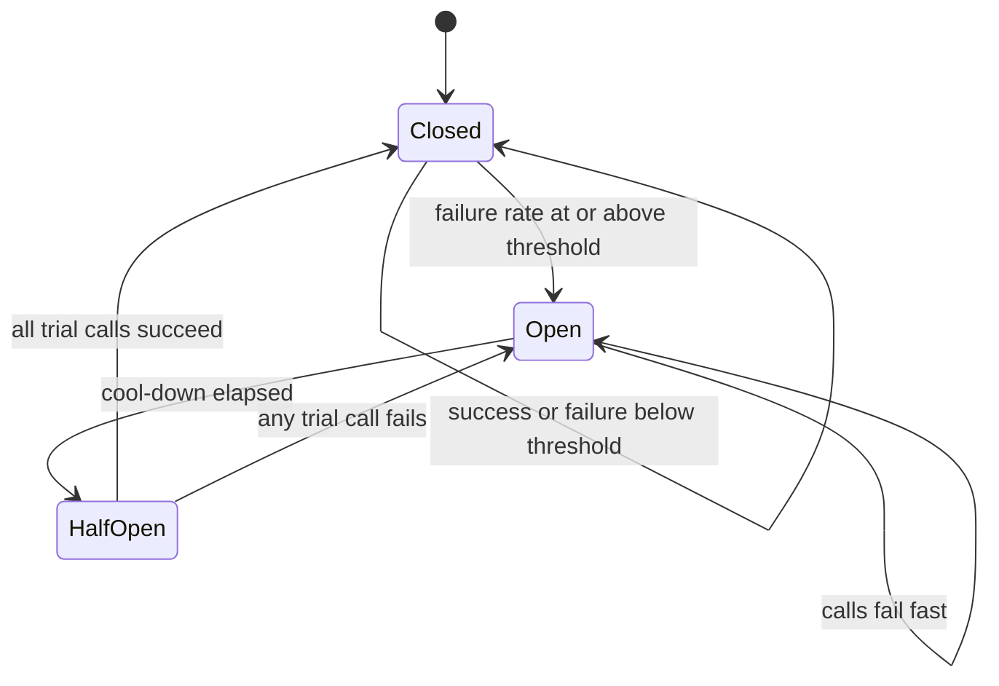

**Reading the diagram.** In **Closed**, calls pass through and outcomes are recorded in a sliding window (the last $n$ calls, or the last $t$ seconds). When the window's failure rate reaches the threshold (and a minimum number of calls has been seen), the breaker moves to **Open**, where every call fails immediately with a local error, costing microseconds and no network traffic. After the cool-down, the next caller moves it to **HalfOpen**, where a small fixed number of trial calls reach the dependency; one failure reopens it, success of all trials closes it. Transitions are local to each client instance (no shared storage), so different instances may briefly disagree. Failure points: thresholds set too low trip on normal noise; too high trip only after the damage is done. Fallbacks (cached data, a default, a degraded page) decide what the user sees while open.

**Choosing thresholds.**

- **Window and minimum volume.** Count-based (last 20–100 calls) or time-based (last 10 s). Require a minimum number of calls so that 2 failures out of 3 at 3 a.m. do not trip it. Netflix's Hystrix library, for example, documented defaults of a 10 s rolling window, a minimum of 20 requests and a 50% error threshold, with a 5 s sleep window [Netflix Hystrix wiki]; Hystrix has been in maintenance mode since 2018, and Resilience4j is a common successor on the JVM.
- **What counts as failure.** Timeouts, connection errors and 5xx, but not 4xx: a client's bad request says nothing about the dependency's health. Slow calls above a latency threshold can also count.
- **Cool-down.** Long enough for typical recovery (seconds to a minute), ideally with jitter so that many instances do not probe in unison.

### 22.13.1 Implementation and simulation

```python
import time
from collections import deque


class CircuitOpenError(Exception):
    """Raised instead of calling the dependency while the breaker is open."""


class CircuitBreaker:
    def __init__(self, failure_rate=0.5, window=20, open_for=5.0, probes=3,
                 clock=time.monotonic):
        self.failure_rate, self.window = failure_rate, window
        self.open_for, self.probes, self.clock = open_for, probes, clock
        self.state, self.opened_at = "closed", 0.0
        self.results = deque(maxlen=window)          # outcomes of the last `window` calls
        self.probes_sent = self.probe_successes = 0
        self.transitions = []

    def _move(self, state):
        self.transitions.append((round(self.clock(), 1), state))
        self.state = state

    def _allow(self):
        if self.state == "open":
            if self.clock() - self.opened_at < self.open_for:
                return False                         # fail fast: do not touch the dependency
            self._move("half_open")
            self.probes_sent = self.probe_successes = 0
        if self.state == "half_open":
            if self.probes_sent >= self.probes:      # only a few trial calls at a time
                return False
            self.probes_sent += 1
        return True

    def _record(self, ok):
        now = self.clock()
        if self.state == "half_open":
            if not ok:                               # dependency still sick: reopen
                self.opened_at = now
                self._move("open")
            else:
                self.probe_successes += 1
                if self.probe_successes >= self.probes:
                    self.results.clear()
                    self._move("closed")
            return
        self.results.append(ok)
        failures = self.results.count(False)
        if len(self.results) == self.window and failures / self.window >= self.failure_rate:
            self.opened_at = now
            self._move("open")

    def call(self, fn, *args, **kwargs):
        if not self._allow():
            raise CircuitOpenError("circuit open")
        try:
            result = fn(*args, **kwargs)
        except Exception:
            self._record(False)
            raise
        self._record(True)
        return result


if __name__ == "__main__":
    from itertools import count

    class Clock:
        t = 0.0
        def __call__(self):
            return self.t

    clock = Clock()
    breaker = CircuitBreaker(clock=clock)
    reached = short_circuited = failed = 0

    def dependency():
        global reached
        reached += 1
        if 10.0 <= clock.t < 28.0:                   # outage from t = 10 s to t = 28 s
            raise ConnectionError("upstream down")
        return "ok"

    for i in count():                                # 20 requests per second for 60 s
        clock.t = i * 0.05
        if clock.t >= 60.0:
            break
        try:
            breaker.call(dependency)
        except CircuitOpenError:
            short_circuited += 1
        except ConnectionError:
            failed += 1

    print(f"requests 1200, reached dependency {reached}, failed {failed}, "
          f"short-circuited {short_circuited}")
    print("transitions:", breaker.transitions)
    assert breaker.state == "closed" and short_circuited > 350 and failed < 20
```

Output:

```text
requests 1200, reached dependency 804, failed 13, short-circuited 396
transitions: [(10.5, 'open'), (15.5, 'half_open'), (15.5, 'open'), (20.5, 'half_open'), (20.5, 'open'), (25.5, 'half_open'), (25.5, 'open'), (30.5, 'half_open'), (30.6, 'closed')]
```

What to notice:

- The breaker trips 0.5 s into the 18 s outage (10 failures out of the last 20 calls) and probes every 5 s; only 13 calls fail against the dead dependency instead of 360.
- It closes at 30.6 s, 2.6 s after recovery: the cool-down trades recovery speed against probing load.
- Little's Law shows the saving: if each failed call had hung for a 2 s timeout, 360 calls over 18 s would have held $(360/18) \times 2 = 40$ threads continuously; with the breaker, almost none.

::: mistake
**Mistake — Using a breaker instead of a timeout.** A breaker learns only from completed calls. If calls hang with no timeout, nothing is ever recorded as failed and the breaker never opens. Timeouts come first; breakers build on them.
:::

## 22.14 Bulkheads

::: definition
**Definition — Bulkhead.** Partitioning a service's limited resources (threads, connections, memory, instances) into isolated pools, one per dependency, tenant or workload class, so that exhaustion of one pool cannot starve the others.
:::

A ship's hull is divided into watertight compartments (bulkheads): a breach floods one compartment, not the whole ship [Nygard 2018]. In a service, the classic failure is a shared thread pool: one slow dependency holds every thread, and requests that never touch that dependency also stall. Bulkheads give each dependency its own pool (or a semaphore limiting concurrent calls to it) sized from Little's Law, so that when a pool is full, calls to that dependency are rejected immediately while the rest of the service carries on. The same idea applies at larger scale: separate connection pools per database, separate instance groups for internal and public traffic, and cell-based architectures that confine a failure to one cell of customers (§33.12).

**Figure 22.13 — Bulkheads isolating dependencies in the feed service.**

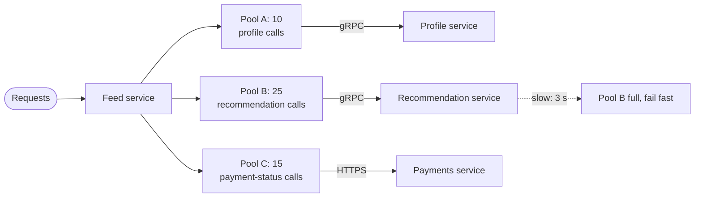

**Reading the diagram.** The feed service makes synchronous calls to three dependencies, each through its own bounded pool of concurrent slots. When the recommendation service slows to 3 s, its 25 slots fill and further calls fail fast (the feed is rendered without recommendations, a graceful degradation), while profile and payment-status calls keep their own slots and continue normally. There is no shared storage between pools. Failure points: pools sized too small reject healthy traffic; too large a sum exhausts the host. Scaling: pools are per instance, so fleet capacity for a dependency is pool size × instances.

::: example
**Worked example — Sizing the pools with Little's Law ($L = \lambda W$) and 1.5–2× headroom.**

1. Profile: 300 RPS × 0.020 s = 6 in flight → pool 10.
2. Recommendations: 100 RPS × 0.150 s = 15 → pool 25.
3. Payment status: 20 RPS × 0.400 s = 8 → pool 15.
4. Incident: recommendations slow to 3 s. Demand becomes $100 \times 3 = 300$ concurrent calls. In a single shared 200-thread pool, all 200 threads would block on recommendations within about 2 s and the whole feed would stop. With bulkheads, 25 slots are busy, about 275 RPS-worth of recommendation calls fail fast, and profile and payment calls use their own 25 slots normally.

**Interpretation.** Bulkheads convert a total outage into a partial degradation. **Engineering implication.** Give every remote dependency its own concurrency limit, combine it with timeouts and a breaker, and design the fallback the user sees when the bulkhead rejects.
:::

## 22.15 Idempotency and idempotency keys

### 22.15.1 Why retries need idempotency

Section 8.6.3 defined an **idempotent** operation: performing it $N > 0$ times has the same effect as performing it once. `GET`, `PUT` and `DELETE` are idempotent by definition; `POST` and most `PATCH` operations are not. Every technique in §22.11–§22.13 ends in the same place: a client that timed out does not know whether its request took effect, and the only safe way to find out is to send it again. For "create a charge", "send a message" or "place an order", a naive retry can do the thing twice. This chapter owns the deep treatment of how to make such operations safe to retry; Chapters 30 and 32 apply the same idea to message consumers (§32.10).

::: definition
**Definition — Idempotency key.** A unique value, generated by the client once per *logical* operation and sent with every attempt of that operation (for example in an `Idempotency-Key` header), that the server uses to recognize retries: the first attempt executes and its result is stored under the key; later attempts with the same key return the stored result instead of executing again.
:::

Think of a cloakroom ticket written *before* you hand over your coat. If you are not sure the attendant took it, you hand over the same ticket number again; the attendant checks the rack, sees ticket 417 already hanging, and hands back the same receipt instead of taking a second coat. The ticket must be chosen by the client, before the first attempt, because the problem is precisely that the client may never see the server's reply.

### 22.15.2 The protocol

Stripe's API popularized the pattern: clients send an `Idempotency-Key` header (a random V4 UUID is recommended) on `POST` requests, and the server guarantees at-most-once execution per key within a retention window [Leach 2017; Stripe Docs: idempotent requests]. The IETF HTTPAPI working group has an Internet-Draft standardizing the header, *The Idempotency-Key HTTP Header Field* [Jena and Dalal, draft], which, as of its 2025 revision, suggests 409 Conflict when a retry arrives while the original is still being processed and 422 when a key is reused with a different payload; it is a draft, not an RFC.

**Figure 22.14 — An idempotent purchase retried after a lost response.**

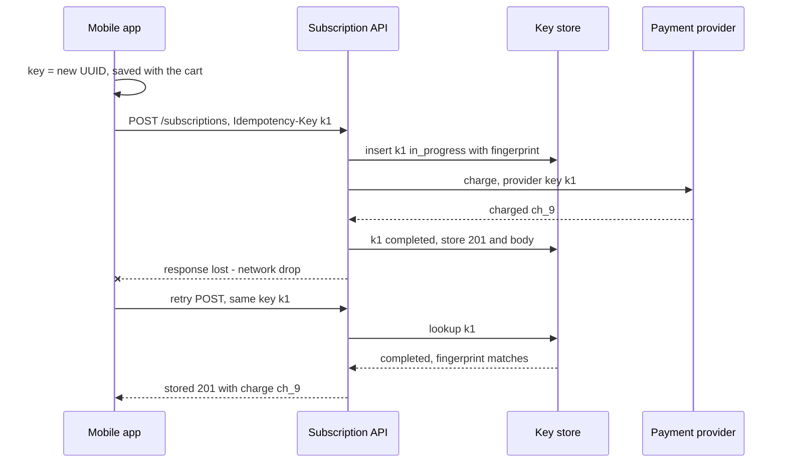

**Reading the diagram.** The app generates key `k1` *before* the first attempt and persists it with the cart, so a crash-and-restart of the app reuses the same key. The subscription API records `k1` as in progress in the key store (a storage boundary: a table in the API's own database), calls the external payment provider (passing a key derived from `k1`, so the provider deduplicates too), records the completed response, and replies. The reply is lost. The retry carries the same key; the API finds a completed record with a matching fingerprint and returns the stored response without calling the provider again. All calls shown are synchronous. Failure points: a crash between the provider's charge and the "completed" write (handled by the provider's own idempotency and recovery, §22.15.4), and a retry arriving while the first attempt is still running (handled by the in-progress state). Scaling: the key store is partitioned by account, like the data it protects.

### 22.15.3 Storage, fingerprinting and concurrency

A production idempotency layer must answer five questions.

1. **Scope.** Keys are unique *per client account*, not globally: the primary key is `(account_id, idem_key)`, so one customer cannot collide with, or probe, another's keys.
2. **Fingerprint.** Store a hash of the method, path and canonicalized body. A retry with the same key but a different body is a client bug (or a reused key) and must be rejected (422), not answered with the first request's result.
3. **Concurrency.** Two attempts with the same key can arrive at once (a client that retries before the first attempt times out at the server). Exactly one may execute: insert the key with a uniqueness constraint (`INSERT ... ON CONFLICT DO NOTHING`); the loser receives 409 and retries later.
4. **Crash recovery.** A worker can die after claiming a key. Give the claim a **lease** (`locked_until`); once it expires, a retry may take over. A worker that was merely slow must not then complete as well, so the final write checks that it still holds its lease, a **fencing token** (§26.13).
5. **Atomicity.** The business write (the charge row) and the "completed" record must commit in the *same* database transaction. Then a crash leaves either both or neither, and a takeover after lease expiry can safely re-execute.

**Figure 22.15 — Lifecycle of an idempotency-key record.**

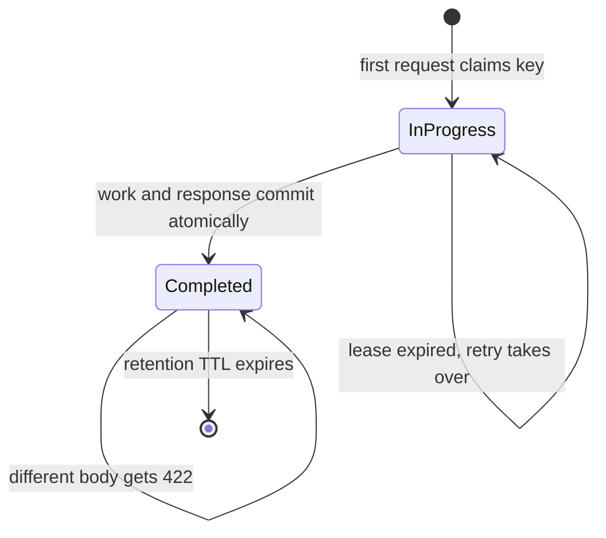

**Reading the diagram.** A record is created **InProgress** by the first request's insert, which the uniqueness constraint makes atomic. While in progress, a duplicate with an unexpired lease is told 409 Conflict; after the lease expires, a retry takes the lease over (the original worker's late completion is then rejected by the fencing check). The work and the stored response commit together, moving the record to **Completed**, after which retries receive the stored response and mismatched bodies receive 422. The record is deleted when its retention TTL expires; after that, the same key would execute again. Storage boundary: one row per key in the same database as the business data, which is what makes the atomic commit possible.

#### Code example

```python
import hashlib
import json
import sqlite3
import uuid

SCHEMA = """
CREATE TABLE idempotency_keys (
    account_id    TEXT    NOT NULL,
    idem_key      TEXT    NOT NULL,
    fingerprint   TEXT    NOT NULL,          -- hash of method + path + canonical body
    status        TEXT    NOT NULL,          -- 'in_progress' or 'completed'
    locked_until  REAL,                      -- lease for the worker executing the request
    response_code INTEGER,
    response_body TEXT,
    created_at    REAL    NOT NULL,
    PRIMARY KEY (account_id, idem_key)       -- keys are scoped to the caller
);
CREATE TABLE charges (id TEXT PRIMARY KEY, account_id TEXT, amount INTEGER, currency TEXT);
"""


def fingerprint(method, path, body):
    canonical = json.dumps(body, sort_keys=True, separators=(",", ":"))
    return hashlib.sha256(f"{method} {path}\n{canonical}".encode()).hexdigest()


class LeaseLost(Exception):
    """Another worker took over this key; our business writes must roll back."""


class IdempotencyLayer:
    def __init__(self, db, clock, lease=30.0, ttl=24 * 3600.0):
        self.db, self.clock, self.lease, self.ttl = db, clock, lease, ttl

    def claim(self, account, key, method, path, body):
        """Phase 1. Returns ('proceed', lease) or ('respond', (status, body))."""
        fp, now = fingerprint(method, path, body), self.clock()
        with self.db:                                    # one transaction
            self.db.execute("DELETE FROM idempotency_keys WHERE account_id=? AND idem_key=? "
                            "AND created_at < ?", (account, key, now - self.ttl))
            inserted = self.db.execute(
                "INSERT INTO idempotency_keys VALUES (?,?,?,'in_progress',?,NULL,NULL,?) "
                "ON CONFLICT DO NOTHING", (account, key, fp, now + self.lease, now)).rowcount
            if inserted:
                return "proceed", now + self.lease       # first time we see this key
            fp0, status, locked_until, code, resp = self.db.execute(
                "SELECT fingerprint, status, locked_until, response_code, response_body "
                "FROM idempotency_keys WHERE account_id=? AND idem_key=?", (account, key)).fetchone()
            if fp0 != fp:
                return "respond", (422, {"error": "idempotency key reused with different request"})
            if status == "completed":
                return "respond", (code, json.loads(resp))   # replay the stored response
            if locked_until > now:
                return "respond", (409, {"error": "request with this key is in progress"})
            self.db.execute("UPDATE idempotency_keys SET locked_until=? WHERE account_id=? "
                            "AND idem_key=?", (now + self.lease, account, key))
            return "proceed", now + self.lease           # previous worker died: take over

    def execute(self, account, key, lease, handler, body):
        """Phase 2. Business writes and the stored response commit atomically, and only
        if we still hold the lease we were given (the lease value acts as a fencing token)."""
        with self.db:
            code, resp = handler(self.db, account, body)
            done = self.db.execute(
                "UPDATE idempotency_keys SET status='completed', locked_until=NULL, "
                "response_code=?, response_body=? WHERE account_id=? AND idem_key=? "
                "AND status='in_progress' AND locked_until=?",
                (code, json.dumps(resp), account, key, lease)).rowcount
            if not done:
                raise LeaseLost(key)                     # exception => transaction rolls back
        return code, resp

    def handle(self, account, key, method, path, body, handler):
        action, value = self.claim(account, key, method, path, body)
        return value if action == "respond" else self.execute(account, key, value, handler, body)


def create_charge(db, account, body):
    charge_id = "ch_" + uuid.uuid4().hex[:12]
    db.execute("INSERT INTO charges VALUES (?,?,?,?)",
               (charge_id, account, body["amount"], body["currency"]))
    return 201, {"id": charge_id, "amount": body["amount"], "status": "succeeded"}


if __name__ == "__main__":
    class Clock:
        t = 1_000.0
        def __call__(self):
            return self.t

    clock, db = Clock(), sqlite3.connect(":memory:")
    db.executescript(SCHEMA)
    api = IdempotencyLayer(db, clock)
    charges = lambda: db.execute("SELECT COUNT(*) FROM charges").fetchone()[0]
    body, key = {"amount": 2000, "currency": "usd"}, str(uuid.uuid4())

    first = api.handle("acct_1", key, "POST", "/v1/charges", body, create_charge)
    retry = api.handle("acct_1", key, "POST", "/v1/charges", dict(body), create_charge)
    print("1. first call:", first)
    print("2. retry     :", retry, "| charges in DB:", charges())
    assert first == retry and charges() == 1

    other = api.handle("acct_1", key, "POST", "/v1/charges", {"amount": 9999, "currency": "usd"},
                       create_charge)
    print("3. same key, different body:", other[0])
    assert other[0] == 422

    k2 = str(uuid.uuid4())                               # two concurrent duplicates
    a = api.claim("acct_1", k2, "POST", "/v1/charges", body)
    b = api.claim("acct_1", k2, "POST", "/v1/charges", body)
    print("4. concurrent duplicate while first in progress:", b[1][0])
    assert a[0] == "proceed" and b[1][0] == 409

    clock.t += 31                                        # first worker stalls past its lease
    c = api.claim("acct_1", k2, "POST", "/v1/charges", body)
    api.execute("acct_1", k2, c[1], create_charge, body)  # the retry takes over and finishes
    try:
        api.execute("acct_1", k2, a[1], create_charge, body)  # the stalled worker wakes up
    except LeaseLost:
        print("5. stalled worker's late write rejected and rolled back")
    print("   retry took over:", c[0], "| charges in DB:", charges())
    assert c[0] == "proceed" and charges() == 2          # one charge per logical operation

    clock.t += 25 * 3600                                 # beyond the 24 h retention window
    late = api.handle("acct_1", key, "POST", "/v1/charges", body, create_charge)
    print("6. same key after TTL expired:", late[0], "| charges in DB:", charges())
    assert late[0] == 201 and charges() == 3             # the duplicate is no longer caught
```

Output (charge IDs are random):

```text
1. first call: (201, {'id': 'ch_56b3f43ff904', 'amount': 2000, 'status': 'succeeded'})
2. retry     : (201, {'id': 'ch_56b3f43ff904', 'amount': 2000, 'status': 'succeeded'}) | charges in DB: 1
3. same key, different body: 422
4. concurrent duplicate while first in progress: 409
5. stalled worker's late write rejected and rolled back
   retry took over: proceed | charges in DB: 2
6. same key after TTL expired: 201 | charges in DB: 3
```

What to notice:

- The uniqueness constraint, not application logic, decides who executes: `INSERT ... ON CONFLICT DO NOTHING` (SQLite 3.24+, PostgreSQL 9.5+) returns a row count of 1 for exactly one claimant.
- Canonical JSON (`sort_keys=True`) makes `{"a":1,"b":2}` and `{"b":2,"a":1}` the same fingerprint; whitespace and key order must not turn a retry into a "different request".
- Case 5 is the subtle one: without the `locked_until=?` fencing condition, the stalled worker's late commit would have created a second charge.
- Case 6 shows the retention trade-off: after the TTL the key is forgotten and a very late retry executes again.

### 22.15.4 External side effects, retention and alternatives

**Side effects outside your database.** The atomic commit in case 5 works only when the effect lives in the same database as the key. A call to a payment provider, an email gateway or another service cannot join your transaction. The remedies, in order of preference: pass an idempotency key *downstream* (derived from yours, for example `k1:charge`), so the provider deduplicates; split the request into **atomic phases** with recorded **recovery points**, so a retry resumes after the last completed phase instead of starting over, as described in Leach's PostgreSQL implementation [Leach 2017b]; or, for effects that cannot be made idempotent, record intent first and reconcile later (the transactional outbox, §32.5).

::: formula
**Idempotency-key storage**

$$S = \lambda_w \times T_{\text{ttl}} \times s_r$$

| Symbol | Meaning | Units |
|---|---|---|
| $S$ | Steady-state storage for key records | bytes |
| $\lambda_w$ | Rate of keyed (non-idempotent) requests | requests/s |
| $T_{\text{ttl}}$ | Retention window | s |
| $s_r$ | Average record size (key, fingerprint, stored response) | bytes |
:::

::: example
**Worked example — PhotoShare's write APIs.** 2,000 keyed `POST` requests per second at peak (use peak as a conservative average), 24 h retention, records of about 1 KB (a 36-byte key, a 32-byte fingerprint, a stored JSON response of most of the rest).

1. Records retained: $2{,}000 \times 86{,}400 = 172.8$ million.
2. Storage: $172.8 \times 10^6 \times 1{,}000$ bytes $= 172.8$ GB.
3. Storing only the response's status and resource ID (about 200 bytes per record) and re-reading the resource on replay cuts this to 34.6 GB.

**Interpretation.** Retention is a capacity decision, not a detail. **Engineering implication.** Choose $T_{\text{ttl}}$ longer than the longest realistic retry horizon (client backoff cap × attempts, plus offline mobile queues), partition the table by account or time so expiry is a cheap partition drop, and document the window so clients never retry a key after it.
:::

::: industry
**Stripe idempotency keys.** Stripe's documentation (as of 2026) describes keys of up to 255 characters, recommends V4 UUIDs, stores the status code and body of the first request for a key *whether it succeeded or failed* (including 500 errors) and returns them for retries, compares parameters and returns an error if a retry's parameters differ, and allows keys to be removed after they are at least 24 hours old. Leach's 2017 engineering post explains the motivation: networks fail in ambiguous ways, so clients must be able to retry any mutating request safely, with backoff and jitter [Stripe Docs: idempotent requests; Leach 2017].
*Evidence: Primary* — [Stripe Docs: idempotent requests; Leach 2017]
:::

::: industry
**Amazon EC2 client tokens.** EC2's `RunInstances` accepts a `ClientToken`; retrying with the same token returns the original result instead of launching more instances, and reusing a token with different parameters fails with an `IdempotentParameterMismatch` error. The AWS Builders' Library article on idempotent APIs explains why the service, not the client, must detect parameter mismatch and why the response to a retry should be semantically equivalent to the original [Yanacek: idempotent APIs].
*Evidence: Primary* — [Yanacek: idempotent APIs]
:::

**Alternatives.** Not every operation needs a key store. A **client-chosen resource ID** with `PUT /subscriptions/{uuid}` is naturally idempotent. **Conditional requests** (`If-Match` with an ETag, §8.6) make updates safe to retry. A **natural unique constraint** (one active subscription per user) rejects duplicates in the database. Idempotency keys are the general solution when the operation is a `POST` with server-assigned identity and real-world effects.

**Table 22.7 — Idempotency failure scenarios.**

| What goes wrong | Why | Detection | Recovery | Prevention |
|---|---|---|---|---|
| Customer charged twice | Key generated per *attempt*, not per operation | Two charges, two different keys, same cart | Refund and reconcile | Generate the key once and persist it with the cart |
| Retry gets the wrong result | No fingerprint; key reused for a new purchase | Responses that do not match request bodies | Return 422 on mismatch | Fingerprint method, path and canonical body |
| Double execution under concurrency | Check-then-insert race on the key | Duplicate effects milliseconds apart | Reconcile | Uniqueness constraint plus lease and fencing |
| Charge made, record says in progress | Crash between external call and commit | Stuck in-progress keys past lease | Retry passes the same downstream key; provider deduplicates | Downstream keys, recovery points |
| Late retry executes again | Retry after the retention TTL | Duplicates spaced by more than the TTL | Reconcile | TTL longer than client retry horizon |

::: mistake
**Mistake — "We return the stored response, so the operation is exactly-once."** Idempotency keys give *at-most-once execution per key within the retention window* on top of *at-least-once delivery* by the client: effectively-once processing. They say nothing about a client that generates a new key per attempt, a key that has expired, or a side effect that escaped your transaction. Exactly-once delivery is not achievable over an unreliable network; effectively-once processing is (§32.9).
:::

