# Chapter 23 — Performance Engineering

> **Level:** 3 · **Track:** A (Traditional) · **Estimated reading time:** 6 h

A checkout page that was fast last month now takes two seconds for one user in fifty. The dashboards show 40% CPU. Someone suggests doubling the instance count; someone else blames the database; a third engineer wants to rewrite the JSON serializer. All three are guessing. Performance engineering replaces the guessing with method: a checklist that finds the saturated resource, a profiler that finds the hot code, a load test that measures what users actually experience, and a model that predicts how many machines next year's traffic will need.

Chapter 4 gave you the mathematics (percentiles, queueing, Little's Law, the Universal Scalability Law) and Chapter 2 the bottleneck and the utilization law. This chapter turns them into a practice: where to look first, how to measure without fooling yourself, why the slowest 1% of requests dominates large systems, and how to cut that tail. Four runnable Python programs reproduce the key effects.

## 23.1 Learning objectives

After this chapter you should be able to:

- Apply the USE method to resources and the RED method or four golden signals to services, and follow a disciplined workflow from symptom to root cause.
- Choose between sampling and instrumenting profilers, read a CPU flame graph, explain why off-CPU analysis is needed for latency problems, and profile CPU and memory in Python with `cProfile` and `tracemalloc`.
- Distinguish open and closed workload models, demonstrate coordinated omission and correct for it, and record latency with HDR histograms.
- Quantify fan-out tail amplification and list the main sources of latency variability (garbage collection, queueing, background work, noisy neighbors, CPU throttling).
- Design hedged and tied requests, compute their latency benefit and extra load, and explain when hedging becomes dangerous.
- Size batches and pipelines with a latency–throughput model and decide when compression pays for its CPU cost.
- Explain generational garbage collection, stop-the-world pauses and the trade-offs among G1, ZGC, Shenandoah and the Go collector, and account for JIT warm-up in tests and deployments.
- Fit the Universal Scalability Law to benchmark data, predict the throughput peak and convert the model into a fleet size.

## 23.2 Prerequisites

- Percentiles, histograms and fan-out amplification — §4.8 (tail latency is the central quantity of this chapter).
- Queueing theory, Little's Law and the M/M/1 latency curve — §4.10, §4.11 (load testing and hedging both change utilization).
- Amdahl's Law and the Universal Scalability Law — §4.12, §4.13 (§23.10 fits the USL to data).
- The resource model, utilization law and USE method overview — §2.6 (§23.3 extends them into a full workflow).
- CPU caches, CPU-bound versus I/O-bound workloads — §5.4, §5.8 (what a CPU profile can and cannot show).
- Threads, scheduling and context switches — §6.3–§6.5 (on-CPU versus off-CPU time).
- TCP behavior, including Nagle's algorithm — §7.7.8 (the original batching trade-off).

## 23.3 Performance methodology

### 23.3.1 What performance engineering is

::: definition
**Definition — Performance engineering.** The practice of measuring, explaining and improving the **latency**, **throughput** and **resource efficiency** of a system against explicit targets, using repeatable methods rather than intuition. Its outputs are diagnoses (why is it slow?), changes (make it faster or cheaper) and predictions (how much capacity will we need?).
:::

#### First-principles explanation

A doctor facing a fever does not start with antibiotics. She takes vital signs in a fixed order, forms a hypothesis, orders a targeted test, treats, and follows up. In performance work the vital signs are a few metrics per resource and per service, the tests are profilers and tracers, and the follow-up is a measurement confirming the fix.

Brendan Gregg names the **anti-methods** that replace this discipline [Gregg 2020]: the *streetlight* anti-method (look only where your favorite tool shines), *random change* (tweak settings until the problem goes away) and *blame-someone-else* ("it's the network"). The methods below are evidence-driven and take minutes.

### 23.3.2 The USE method

::: definition
**Definition — USE method.** For every **resource**, check **U**tilization (the fraction of time the resource was busy, or the fraction of its capacity in use), **S**aturation (the amount of extra work queued because the resource could not service it) and **E**rrors (the count of error events) [Gregg USE]. A resource is any physical or software component with finite capacity: CPUs, memory, disks, network interfaces, controllers and interconnects, but also locks, thread pools, connection pools and file descriptors.
:::

#### Why does this exist?

Dashboards built from whatever metrics were easy to collect are both overwhelming and incomplete. USE inverts the process: start from the finite list of resources and ask three questions of each, so no saturated resource is missed because nobody graphed it. Chapter 2 introduced USE as a bottleneck finder (§2.6); here it becomes a complete procedure.

#### How it works internally

1. **Enumerate resources** from a block diagram of the server: CPUs, memory, disks and controllers, network interfaces, plus software resources.
2. **Check errors first.** They are quick to interpret (disk retries, NIC drops) and can explain everything else.
3. **Check utilization** per device and per CPU: an 8-core average of 25% can hide one core at 100% running a single-threaded event loop.
4. **Check saturation**: run-queue length, swapping, disk queue size, drops and retransmits, waiters on locks and pools. Sustained saturation is always a problem, because queued work is latency (§4.10).
5. **Iterate** until the problem is found or every resource is cleared.

**Figure 23.1 — The USE method procedure.**

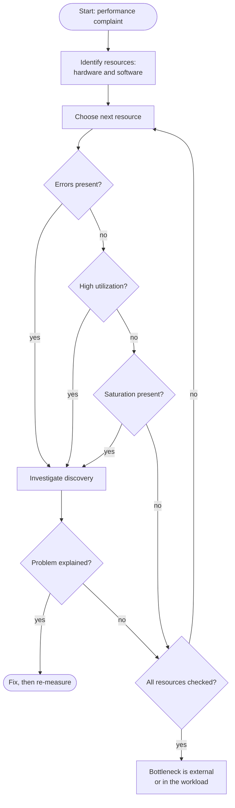

**Reading the diagram.** This is a reasoning loop, not a running system: there are no protocols or storage boundaries, and every arrow is a step the engineer takes. Iterating over a finite resource list is what makes the method complete, and each check is one counter, so a pass takes minutes. A finding must *explain* the complaint (a busy disk may be a symptom of swapping), otherwise the loop continues. The method's failure point is the resource list: a forgotten resource (a connection pool, a file-descriptor limit, a cloud API quota) can never be found. If every resource is clear, look outside the host (§23.3.3). The same checks scale to fleets per instance and resource class.

**Table 23.1 — USE metrics for common resources (Linux tools in parentheses).**

| Resource | Utilization | Saturation | Errors |
|---|---|---|---|
| CPU | Per-CPU busy % (`mpstat -P ALL`) | Run-queue length; scheduler latency (`vmstat` r column, `runqlat`) | Machine-check events (rare) |
| Memory | Used vs. available (`free`) | Swapping, page scanning, OOM kills (`vmstat` si/so, `dmesg`) | Allocation failures |
| Disk | Busy % per device (`iostat -x`) | Average queue size; await time (`iostat -x`) | Device errors (`smartctl`, kernel log) |
| Network interface | Throughput vs. link speed (`sar -n DEV`) | Drops, overruns, TCP retransmits (`nstat`, `ss -ti`) | Interface errors (`ip -s link`) |
| Container CPU limit | CPU time vs. quota | Throttled periods (`cpu.stat` in cgroup) | — |
| Thread / connection pool | Busy workers / pool size | Requests waiting for a worker | Rejected tasks, acquisition timeouts |
| Lock | Fraction of time held | Waiting threads; contention time | Deadlock detections, timeouts |

The container row deserves emphasis: a container that exhausts its CPU **quota** is **throttled** for the rest of the period even if the host is idle (§23.6.3), so host CPU looks low while latency spikes.

### 23.3.3 The RED method and the four golden signals

USE looks at a system from the inside; users experience it request by request. Two request-centric checklists cover that view.

::: definition
**Definition — RED method.** For every **service**, monitor **R**ate (requests per second), **E**rrors (failed requests per second) and **D**uration (the distribution of request latency, as a histogram from which percentiles are read). Tom Wilkie proposed it while at Weaveworks as a service-level complement to USE [Wilkie 2018].
:::

::: definition
**Definition — Four golden signals.** Google's site reliability engineering guidance says that if you can measure only four metrics of a user-facing system, measure **latency** (time to serve a request, tracking successful and failed requests separately), **traffic** (demand, such as requests per second), **errors** (rate of failed requests, explicit or implicit) and **saturation** (how "full" the service is, emphasizing its most constrained resource) [Beyer et al. 2016, ch. 6].
:::

The golden signals are RED plus saturation. Separating success and failure latency matters: a backend failing fast in 2 ms makes the latency histogram look *better* while users suffer. Saturation is the leading signal: a pool at 90% occupancy says users are *about* to hurt.

**Table 23.2 — USE, RED and the four golden signals compared.**

| | USE | RED | Four golden signals |
|---|---|---|---|
| Unit of analysis | Resource | Service (endpoint) | User-facing service |
| Questions | Busy? Queued? Failing? | How much? How many fail? How long? | RED + how full? |
| Best for | Root-causing on one host or component | Finding *which* service in a call graph is slow | Alerting and SLOs |
| Typical source | OS counters, cgroup stats, pool gauges | Request middleware, service mesh, load balancer logs | Same as RED plus capacity gauges |
| Blind spot | Code-level causes; external dependencies | Why a service is slow | Why a service is slow |
| Origin | Gregg (2012 onward) | Wilkie (Weaveworks) | Google SRE book (2016) |

### 23.3.4 From symptom to cause

A real investigation chains the checklists: RED narrows the problem to a service and endpoint, USE finds the saturated resource, a profiler (§23.4) or trace (§40.6) finds the responsible code or call, and a load test (§23.5) confirms the fix.

**Figure 23.2 — Workflow from symptom to cause.**

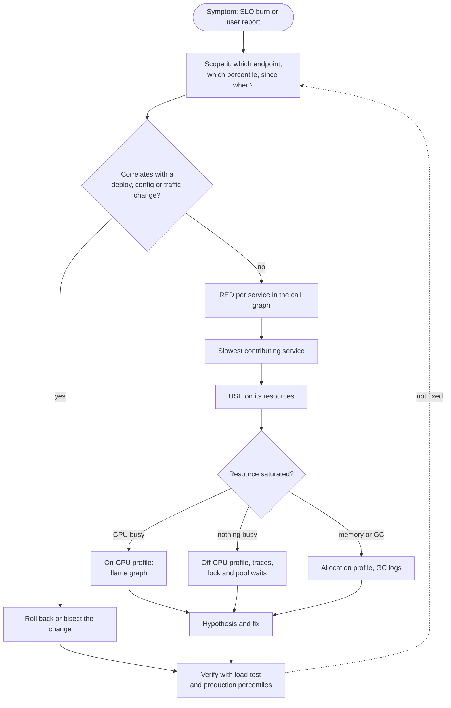

**Reading the diagram.** Start from a user-visible symptom and first ask *what changed*: most regressions follow a deployment, configuration change or traffic shift, and rollback is the fastest fix. Otherwise RED metrics across the call graph (from middleware or a service mesh, over HTTP or gRPC) locate the slowest service, and USE on its resources selects the instrument: a CPU flame graph if CPUs are busy; off-CPU analysis and traces if nothing is busy but requests wait (locks, pools, dependencies); allocation profiles and GC logs if memory dominates. Solid steps are synchronous actions; the dotted edge reopens the investigation if verification fails. The main failure point is skipping scoping: "the site is slow" without an endpoint, percentile and start time cannot converge.

::: example
**Worked example — Locating the bottleneck with the utilization law.** RED shows the `/search` endpoint's p99 rose from 120 ms to 900 ms at 2,400 RPS across 12 instances. USE on one instance (200 RPS) shows 8 CPUs at 35%, and a database connection pool of 16 connections reporting 14.8 busy on average with 40 waiters. Each request holds a connection for 74 ms.

1. Connection pool utilization by Little's Law (§4.11): $L = \lambda W = 200 \times 0.074 = 14.8$ connections, so $U = 14.8/16 = 92.5\%$.
2. CPU utilization is 35% per CPU, far from saturation, and the run queue is short.
3. Saturation evidence: 40 waiters on the pool. At 92.5% utilization a queue is expected (§4.10).
4. Hypothesis: connection hold time rose. Tracing shows a new query taking 50 ms inside each request; before the change hold time was 24 ms, giving $200 \times 0.024 = 4.8$ busy connections (30%).

**Interpretation.** The CPU dashboard (35%) said "plenty of capacity"; the pool said "saturated". **Engineering implication.** Software resources must be in your USE list and on your dashboards. The fix is to make the query faster or move it off the request path, not to add instances: twelve more instances would double the connection count the database must serve.
:::

::: mistake
**Mistake — Treating utilization as the only signal.** A disk at 60% utilization can still be the bottleneck if its queue is long and its requests are bursty, and a CPU at 100% may be harmless for a batch job. Utilization tells you how busy a resource is; saturation tells you whether work is *waiting* for it. Latency comes from waiting.
:::

## 23.4 Profiling CPU and memory

### 23.4.1 Sampling versus instrumentation

::: definition
**Definition — Profiler.** A tool that attributes a resource (CPU time, wall-clock time, allocated bytes, lock wait time) to the code locations that consumed it. A **sampling profiler** interrupts the program at a fixed frequency and records the current call stack; a function's share of samples estimates its share of time. An **instrumenting** (deterministic, tracing) profiler inserts hooks at every function entry and exit and records exact call counts and durations.
:::

#### First-principles explanation

To learn where a colleague spends the working day you could follow them with a stopwatch, logging every task switch (instrumentation), or glance at their desk at random moments a few hundred times and tally what you see (sampling). The stopwatch is exact but exhausting and changes their behavior; the glances are cheap, barely disturb anyone, and after a few hundred observations give percentages accurate to a point or two. Production profiling almost always uses sampling, because its overhead is fixed by the sampling rate rather than by how many functions the program calls.

#### How it works internally

1. A timer (or a hardware performance counter, such as "every 1 million CPU cycles") fires an interrupt or signal.
2. The handler walks the stack of the running thread: user frames via frame pointers, DWARF unwind tables or a runtime's own API, plus kernel frames.
3. The stack is stored as a list of addresses and later **symbolized** into function names.
4. Identical stacks are counted. The count for each stack, divided by the total, estimates the fraction of CPU time spent there.

Linux `perf` samples at, for example, `-F 99` (99 Hz per CPU). Gregg recommends 99 rather than 100 Hz so the sampler does not run in lockstep with periodic activity that fires at round frequencies [Gregg 2020].

::: formula
**Sampling error of a profile**

$$n = f \times T \times c \qquad \hat{p} = \frac{k}{n} \qquad \mathrm{SE}(\hat{p}) = \sqrt{\frac{\hat{p}\,(1 - \hat{p})}{n}}$$

| Symbol | Meaning | Units |
|---|---|---|
| $f$ | Sampling frequency per CPU | samples/second |
| $T$ | Profiling duration | seconds |
| $c$ | Number of busy CPUs sampled | count |
| $n$ | Total samples collected | samples |
| $k$ | Samples whose stack contains the function | samples |
| $\hat{p}$ | Estimated fraction of CPU time in the function | dimensionless |
| $\mathrm{SE}$ | Standard error of the estimate (binomial approximation) | dimensionless |
:::

::: example
**Worked example — How long to profile.** A service runs on 8 busy CPUs. You sample at 99 Hz for 30 s.

1. $n = 99 \times 30 \times 8 = 23{,}760$ samples.
2. A function at $\hat{p} = 2\%$: $\mathrm{SE} = \sqrt{0.02 \times 0.98 / 23{,}760} = \sqrt{8.25 \times 10^{-7}} = 0.00091$, i.e. ±0.09 percentage points; a 95% interval is about 2.0% ± 0.18%.
3. A function at $\hat{p} = 0.1\%$ (about 24 samples): $\mathrm{SE} = \sqrt{0.001 \times 0.999 / 23{,}760} = 0.000205$, a *relative* error of about 20%.

**Interpretation.** Thirty seconds measures anything that matters (above 1%) precisely; tiny functions are noisy, but they are not where the time is. **Engineering implication.** Profile for tens of seconds under representative load, and do not chase differences smaller than two standard errors between two profiles.
:::

Instrumentation has the opposite profile: exact counts, but overhead proportional to call frequency. A function called 10 million times per second with 50 ns of hook cost per call adds 0.5 CPU-seconds per second, which distorts exactly the small, hot functions you are trying to measure. Instrumentation is best for call counts, for coarse spans (the basis of distributed tracing, §40.6) and for offline analysis.

### 23.4.2 Flame graphs

A profile of a real service contains tens of thousands of distinct stacks, far too many to read as text. Gregg's **flame graph** visualizes them [Gregg 2016]: each box is a function in a stack; the y-axis is stack depth (callers below, callees above); the **width** of a box is proportional to the number of samples containing it; boxes are sorted alphabetically along the x-axis so identical stacks merge. The x-axis is *not* time.

**Figure 23.3 — From samples to a flame graph.**

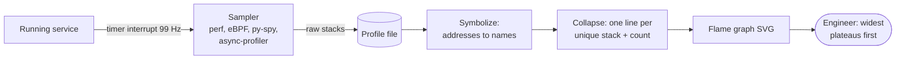

**Reading the diagram.** The sampler observes the running service from outside (perf and eBPF in the kernel, py-spy by reading the process's memory, async-profiler inside the JVM) and writes raw stacks to a profile file, which is the storage boundary; everything to its right runs offline and cannot hurt production. Symbolization maps instruction addresses to function names and fails when symbols are stripped or JIT-compiled code lacks a symbol map, which shows up as frames labeled with hexadecimal addresses. Collapsing merges identical stacks into counts, and the flame graph renders those counts as widths. All arrows are batch hand-offs, not request paths. The analysis rule is to look for the widest **plateaus**, boxes with a lot of width and nothing on top: those functions consume CPU themselves rather than through callees. Collecting continuously from every host (continuous profiling) scales this from one server to a fleet.

### 23.4.3 Off-CPU analysis

A CPU profile shows only time spent *running*. A request that takes 300 ms of wall-clock time but uses 5 ms of CPU is invisible to it. The missing 295 ms is **off-CPU time**: the thread was blocked on disk or network I/O, waiting for a lock, sleeping, or runnable but waiting for a CPU.

**Figure 23.4 — On-CPU and off-CPU thread states.**

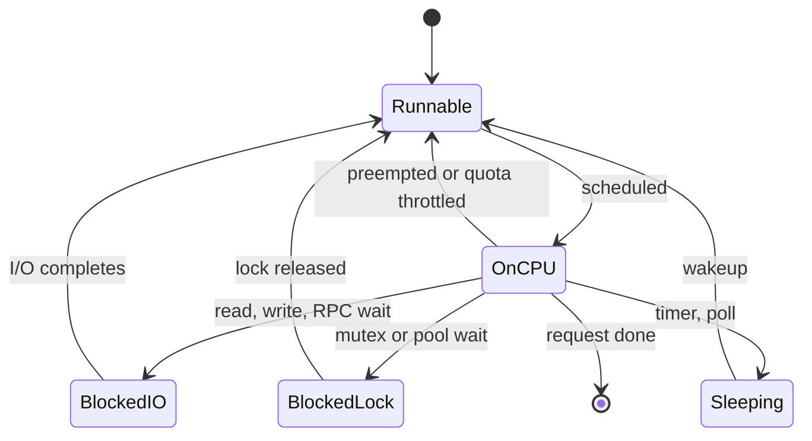

**Reading the diagram.** Only the `OnCPU` state appears in a CPU profile. Every other state is off-CPU, and each has a different cause and tool: time in `Runnable` is scheduler latency (measured by `runqlat`, caused by CPU saturation or container throttling); `BlockedIO` is time waiting on storage or network calls, synchronous from the thread's point of view even when the device works asynchronously; `BlockedLock` is contention on a mutex or a pool slot; `Sleeping` is voluntary. Transitions out of `OnCPU` are context switches (§6.4). **Off-CPU profiling** records the stack and duration at each switch-out, typically with eBPF (`offcputime` from the BCC tools), and renders an off-CPU flame graph where width is blocked *time*. Wall-clock profilers such as async-profiler's `wall` mode sample all threads regardless of state, combining both views. Failure point: in a thread-pool server, idle workers waiting for work dominate an off-CPU profile, so filter to threads serving requests.

The relationship is simple: wall-clock latency of a request equals its on-CPU time plus its off-CPU time. Latency problems in I/O-heavy services are usually off-CPU; throughput and cost problems are usually on-CPU.

### 23.4.4 Tools by runtime

**Table 23.3 — Common profilers (as of 2026).**

| Tool | Runtime | Method | Notable features |
|---|---|---|---|
| `perf` | Any (Linux) | Sampling via kernel perf events | CPU, hardware counters, kernel stacks; needs frame pointers or DWARF for user stacks |
| eBPF tools (BCC, bpftrace) | Any (Linux) | In-kernel programs on events | Low-overhead off-CPU, run-queue, block I/O latency histograms |
| py-spy | CPython | Sampling by reading process memory | No code change; attaches to a running PID; flame graph output |
| async-profiler | JVM | Sampling with perf events and JVM APIs | Avoids safepoint bias; CPU, allocation, lock and wall-clock modes |
| Java Flight Recorder | JVM | Built-in event recording | Low overhead, always-on in production; GC and lock events |
| pprof | Go | Built-in sampling (CPU 100 Hz), heap sampling | `net/http/pprof` endpoint; CPU, heap, goroutine, block, mutex profiles |
| `cProfile` | CPython | Instrumentation | Exact call counts; high overhead on small functions |
| `tracemalloc` | CPython | Allocation tracing | Live memory attributed to source lines; snapshot diffs |

**Safepoint bias** deserves a note. Older JVM profilers could only sample threads at **safepoints**, points where the JVM can safely inspect a thread, so time in long loops without safepoints was misattributed; a study of four Java profilers found they often disagreed about the hottest method [Mytkowicz et al. 2010]. Profilers built on the JVM's asynchronous stack-walking API plus OS signals, such as async-profiler, avoid this.

### 23.4.5 Allocation profiling

In garbage-collected runtimes, the **allocation rate** (bytes allocated per second) determines how often the collector runs (§23.9). An allocation profiler samples allocations and attributes bytes to stacks, so you can find the code that creates garbage. Two different questions need two different views: *who allocates most* (drives GC frequency and CPU) and *who holds memory now* (drives heap size and leaks). Comparing two heap snapshots taken minutes apart finds leaks: lines whose live size keeps growing.

The following program profiles CPU with `cProfile` and memory with `tracemalloc`. The function under test counts distinct users in a request log, once with a list (an O(n) membership test inside a loop) and once with a set.

```python
import cProfile
import json
import os
import pstats
import random
import tracemalloc

def make_events(n, seed=7):
    """Synthetic request log: JSON lines with a user id and a latency."""
    rng = random.Random(seed)
    return [json.dumps({"user": f"u{rng.randrange(5_000)}",
                        "ms": round(rng.lognormvariate(3, 1), 2)})
            for _ in range(n)]

def distinct_users_slow(events):
    seen = []                          # list: membership test is O(n)
    for line in events:
        user = json.loads(line)["user"]
        if user not in seen:
            seen.append(user)
    return len(seen)

def distinct_users_fast(events):
    return len({json.loads(line)["user"] for line in events})  # set: O(1)

def report(events):
    return distinct_users_slow(events), distinct_users_fast(events)

events = make_events(50_000)

# 1. CPU: cProfile is a deterministic (instrumenting) profiler
profiler = cProfile.Profile()
profiler.enable()
print("distinct users (slow, fast):", report(events))
profiler.disable()
stats = pstats.Stats(profiler)
print(f"{'function':<22}{'calls':>8}{'self s':>9}{'total s':>9}")
rows = sorted(((k, v) for k, v in stats.stats.items() if not k[2].startswith("<")),
              key=lambda kv: kv[1][3], reverse=True)[:6]       # by total time
for (filename, line, name), (cc, nc, tottime, cumtime, _) in rows:
    print(f"{name[:21]:<22}{nc:>8}{tottime:>9.3f}{cumtime:>9.3f}")

# 2. Memory: tracemalloc attributes live allocations to source lines
tracemalloc.start()
more_events = make_events(50_000)
snapshot = tracemalloc.take_snapshot()
tracemalloc.stop()
for stat in snapshot.statistics("lineno")[:2]:
    frame = stat.traceback[0]
    print(f"{os.path.basename(frame.filename)}:{frame.lineno:<4}"
          f"{stat.size / 1024:8.0f} KiB in {stat.count:6d} blocks")
```

Output (Python 3.13; timings vary by machine):

```text
distinct users (slow, fast): (5000, 5000)
function                 calls   self s  total s
report                       1    0.000    1.486
distinct_users_slow          1    1.028    1.266
loads                   100000    0.092    0.436
decode                  100000    0.142    0.314
distinct_users_fast          1    0.021    0.220
raw_decode              100000    0.072    0.072
encoder.py:263     3442 KiB in  50000 blocks
prof.py:11       434 KiB in      3 blocks
```

What to notice:

- **Self time versus total time.** `distinct_users_slow` has 1.03 s of *self* time: the `user not in seen` scan is an operator, not a function call, so cProfile charges it to the enclosing function. Its JSON parsing (`loads`, about 0.22 s per 50,000 calls) is the same in both versions. The fix (a set) makes the function about 6 times faster overall.
- **Call counts are exact**: 100,000 calls to `loads` (50,000 per version). A sampling profiler would give percentages but not counts.
- **Instrumentation overhead.** Each of the 100,000 `loads` calls passes through cProfile's hooks, so the absolute times are inflated; compare ratios, not absolutes.
- **tracemalloc** attributes 3.4 MiB of live memory to the JSON encoder's string-building line: 50,000 strings of about 70 bytes each. The list holding them (line 11) costs 434 KiB of pointers. In a production service the same view, diffed over time, finds leaks.

For a running production Python process you would use a sampling profiler instead: `py-spy record -o profile.svg --pid <PID> --duration 30` produces a flame graph without restarting or modifying the program.

#### Real-world industry applications

::: industry
**Google-Wide Profiling.** Google runs continuous, low-overhead sampling profiling across its fleet, collecting CPU and heap profiles from a small random subset of machines at a time and aggregating them in a central repository. The fleet-wide view lets engineers rank the most expensive functions across all services and attribute cost to specific libraries, which guides optimization work with the largest fleet-wide payoff. Trade-off: individual profiles are sparse, so the value comes from aggregation over many machines and long periods.
*Evidence: Primary* — [Ren et al. 2010]
:::

::: industry
**Netflix — mixed-mode flame graphs for Java.** Netflix engineers described producing CPU flame graphs that show JVM (Java), JIT-compiled, kernel and native frames together, by running the JVM with frame pointers preserved and exporting a symbol map for JIT-compiled code so `perf` can name those frames. Trade-off: preserving frame pointers costs a small amount of CPU, accepted for the visibility it gives.
*Evidence: Primary* — [Gregg and Spier 2015]
:::

#### Failure scenarios

| What goes wrong | Why | Detection | Recovery | Prevention |
|---|---|---|---|---|
| Flame graph has broken, shallow stacks | Binaries compiled without frame pointers | Many stacks end at `[unknown]` | Rebuild with frame pointers or use DWARF unwinding | Keep frame pointers in production builds |
| Optimized function shows no gain in production | Profiled a microbenchmark, not production workload | Production profile disagrees | Profile under real or replayed traffic | Continuous profiling |
| Latency problem, CPU profile shows nothing | Time is off-CPU | Wall time ≫ CPU time per request | Off-CPU or wall-clock profile | Collect both views |
| Profiler slows production noticeably | Instrumenting profiler on a hot path | Throughput drops when enabled | Switch to sampling | Use sampling at ≤ 100 Hz in production |

::: mistake
**Mistake — Optimizing the function with the largest *total* time.** `main` has 100% total time and nothing to optimize. Look for large *self* time (the plateaus of a flame graph). Conversely, a function with small self time but huge total time is a good target only if you can avoid *calling* the expensive callees.
:::

## 23.5 Load testing and benchmarking pitfalls

### 23.5.1 Kinds of performance test

**Table 23.4 — Performance test types.**

| Test | Question it answers | Typical shape |
|---|---|---|
| Microbenchmark | How fast is this function or data structure? | Tight loop in a harness (JMH, `pytest-benchmark`, Go `testing.B`) |
| Load test | Does the system meet its SLO at expected peak? | Steady target rate at forecast peak for 30–60 min |
| Stress test | Where and how does it break? | Rate ramps until errors or latency explode |
| Soak (endurance) test | Does it degrade over hours? | Moderate load for 8–72 h; watch memory, handles, GC |
| Spike test | Does it survive a sudden surge, and recover? | Step from normal to 3–10× for minutes |
| Capacity benchmark | Throughput as a function of concurrency or nodes | Series of steady runs at increasing $N$ (§23.10) |

All of them can be ruined by the same few mistakes, which this section covers in order of how much damage they do.

### 23.5.2 Open versus closed workload models

::: definition
**Definition — Open and closed workload models.** In an **open** model, new requests arrive at a rate that is independent of how fast the system answers: users on the internet do not wait for each other. In a **closed** model, a fixed population of $N$ users (or load-generator threads) each sends a request, waits for the response, optionally pauses for a **think time** $Z$, and only then sends the next. A **partly open** model has sessions that arrive openly but issue several requests each, closed-loop, within the session [Schroeder et al. 2006].
:::

**Figure 23.5 — Open and closed load generators.**

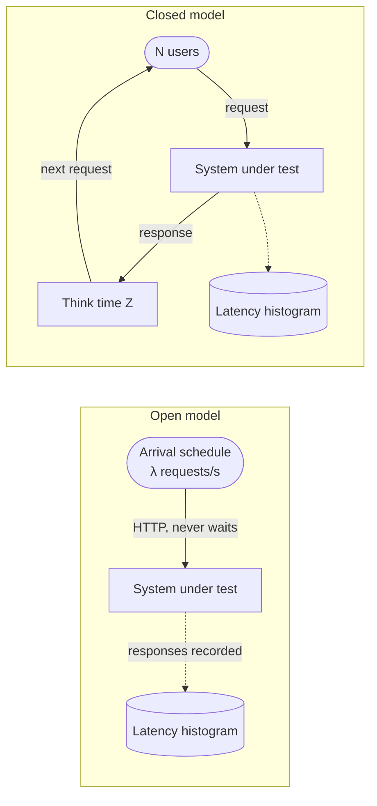

**Reading the diagram.** In the open subgraph, a scheduler issues requests (for example, HTTP) at a fixed or Poisson rate $\lambda$ and never waits for responses, so if the system slows down, requests pile up inside it, exactly as with real internet traffic. Responses are recorded asynchronously (dotted arrow) into a latency histogram, the storage boundary of the test. In the closed subgraph, each of $N$ users is in a synchronous loop: send, wait, think, repeat. When the system slows down, users send *less*, so the load generator quietly reduces the load at exactly the moment the system is struggling. The failure point of the closed model is therefore the measurement itself: it cannot drive the system into the queueing regime that real users would. To scale an open test you add generator machines until the target rate is achieved; to scale a closed test you add users, which raises load only while the system keeps up.

::: formula
**Interactive response time law (closed systems)**

$$X = \frac{N}{R + Z} \qquad\Longleftrightarrow\qquad R = \frac{N}{X} - Z$$

| Symbol | Meaning | Units |
|---|---|---|
| $N$ | Number of users (or load-generator threads) in the closed loop | count |
| $X$ | Throughput | requests/second |
| $R$ | Mean response time | seconds |
| $Z$ | Mean think time between a response and the next request | seconds |
:::

This is Little's Law (§4.11) applied to the whole loop of users plus system [Lazowska et al. 1984].

::: example
**Worked example — A closed test that cannot find the problem.** A load test uses $N = 50$ threads with no think time ($Z = 0$). With $R = 10$ ms the generator produces $X = 50/0.010 = 5{,}000$ RPS. Production peak is 5,000 RPS, open.

1. Suppose a regression doubles service time so $R = 20$ ms at the same concurrency. The closed test now produces $X = 50/0.020 = 2{,}500$ RPS: it halves the offered load and reports latency of 20 ms, "a bit slower".
2. In production the 5,000 RPS keeps arriving. If capacity has fallen to about 2,500 RPS, utilization exceeds 100%, the queue grows without bound (§4.10.3), and latency rises until requests time out.

**Interpretation.** The closed test turns an outage into a mild regression, because it measures the system at whatever rate the system can sustain. **Engineering implication.** To check an SLO at a target rate, use an open (constant-arrival-rate) generator. Use closed tests only for systems that really are closed (a fixed pool of batch workers, a connection-limited client) or to measure capacity curves as a function of concurrency (§23.10).
:::

Schroeder, Wierman and Harchol-Balter compared the two models analytically and with benchmarks and found the differences are not small: for the same load, mean response times differ greatly between the models, and techniques such as size-based scheduling help open systems far more than closed ones. They noted that many standard benchmarks used closed generators while real web traffic is better described as open or partly open [Schroeder et al. 2006].

### 23.5.3 Coordinated omission

::: definition
**Definition — Coordinated omission.** A measurement error in which the load generator, by waiting for slow responses before sending more requests, fails to send (and therefore fails to measure) the requests that would have experienced the slowness. The tester and the system "coordinate" to omit the worst samples. The term and diagnosis are due to Gil Tene [Tene, How NOT to Measure Latency].
:::

#### First-principles explanation

A supermarket manager measures checkout waits by sending one shopper through every two minutes and noting the time. At noon the till jams for 30 minutes. The shopper waits 30 minutes, reports one bad measurement, and then the next shopper goes at 12:32. Fifteen real customers who would have arrived during the jam, and waited between 2 and 30 minutes, were never sampled. The manager's report shows one bad wait out of hundreds: a p99 that looks perfect. Customers saw something very different.

**Figure 23.6 — How a closed-loop tester omits the stall.**

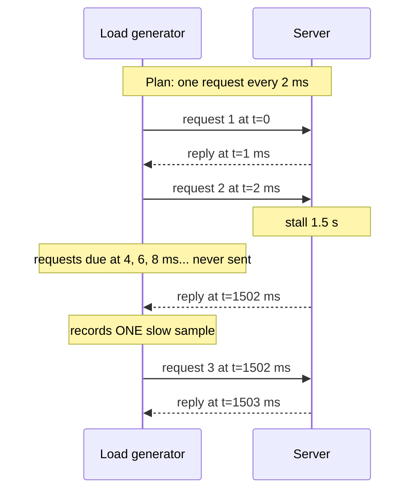

**Reading the diagram.** The generator intends to send one request every 2 ms over a single connection, synchronously waiting for each reply. When the server stalls for 1.5 s (a garbage-collection pause, a failover, a lock convoy), request 2 waits the whole time, and the 749 requests the plan scheduled during the stall are never sent. The generator records a single 1.5 s sample, then resumes as if nothing happened. In an open model those 749 requests would have queued at the server and each experienced a latency between 1.5 s and roughly 0 s, and the queue backlog would have delayed further requests after the stall ended. The failure point is the generator's coupling to the server; the fix is to decouple sending from receiving and to measure each request's latency from its *intended* send time.

::: formula
**Damage done by a stall in an open system**

$$\text{missed by closed tester} \approx \frac{T_s}{\Delta} \qquad t_{\text{drain}} = \frac{\lambda T_s}{\mu - \lambda} \qquad \text{affected requests} = \lambda\,(T_s + t_{\text{drain}}) = \frac{\lambda\,\mu\,T_s}{\mu - \lambda}$$

| Symbol | Meaning | Units |
|---|---|---|
| $T_s$ | Duration of the stall | seconds |
| $\Delta = 1/\lambda$ | Intended interval between requests | seconds |
| $\lambda$ | Intended (open) arrival rate | requests/second |
| $\mu$ | Service rate once the server resumes ($> \lambda$) | requests/second |
| $t_{\text{drain}}$ | Time to drain the backlog after the stall | seconds |
:::

::: example
**Worked example — A 1.5 s stall in a 60 s test.** $\lambda = 500$ RPS, $\Delta = 2$ ms, $\mu = 1{,}000$ RPS (1 ms per request), $T_s = 1.5$ s, test length 60 s (30,000 intended requests).

1. Missed by the closed tester: $1.5/0.002 = 750$ requests (about 2.5% of the test).
2. Backlog at the end of the stall: $500 \times 1.5 = 750$ requests; it drains at the net rate $\mu - \lambda = 500$/s, so $t_{\text{drain}} = 1.5$ s.
3. Affected requests: $500 \times (1.5 + 1.5) = 1{,}500$, which is 5% of the test. Their latencies fall linearly from 1.5 s to about 0.
4. True p99 is the 300th worst of these: $1.5 - 300 \times (1.5/1{,}500) = 1.2$ s.

**Interpretation.** The real p99 is 1.2 s, while the closed tester's p99 is the ordinary 1–2 ms service time. **Engineering implication.** Any test whose generator waits for responses will under-report every percentile that a stall touches, often by orders of magnitude.
:::

The following program simulates this exact scenario with three measurement strategies: the naive closed loop, the closed loop with HdrHistogram's after-the-fact correction (which adds the "missing" samples $v - \Delta, v - 2\Delta, \dots$ for each long sample $v$), and an open-loop generator that measures from the intended send time.

```python
import math
import random

RATE = 500                    # intended request rate, requests/second
INTERVAL = 1 / RATE           # 2 ms between scheduled sends
DURATION = 60.0               # seconds of test
STALL = (30.0, 31.5)          # server freezes for 1.5 s (GC pause, failover...)

class Server:
    """Single-threaded FIFO server; service time ~1 ms; one 1.5 s stall."""
    def __init__(self, seed=1):
        self.rng = random.Random(seed)
        self.free_at = 0.0
    def submit(self, t):
        start = max(t, self.free_at)
        if STALL[0] <= start < STALL[1]:          # frozen: wait for the stall to end
            start = STALL[1]
        service = 0.0008 + self.rng.expovariate(1 / 0.0002)
        if start < STALL[0] < start + service:    # stall hits mid-request
            service += STALL[1] - STALL[0]
        self.free_at = start + service
        return self.free_at                       # completion time

def closed_loop():
    """Naive tester: one connection; waits for each reply before sending the
    next; measures from the actual send time (like wrk or a simple script)."""
    server, t, lat = Server(), 0.0, []
    while t < DURATION:
        done = server.submit(t)
        lat.append(done - t)
        t = max(t + INTERVAL, done)               # late? just carry on from now
    return lat

def corrected(lat):
    """HdrHistogram-style correction: a reply that took v > INTERVAL implies
    missed sends that would have seen v - INTERVAL, v - 2*INTERVAL, ..."""
    out = []
    for v in lat:
        out.append(v)
        missing = v - INTERVAL
        while missing > INTERVAL:
            out.append(missing)
            missing -= INTERVAL
    return out

def open_loop():
    """Correct tester: sends on a fixed schedule whatever happens and measures
    from the *intended* send time (like wrk2, or k6 constant-arrival-rate)."""
    server, lat = Server(), []
    for i in range(int(DURATION * RATE)):
        t = i * INTERVAL
        lat.append(server.submit(t) - t)
    return lat

def pct(sorted_ms, q):
    return sorted_ms[max(math.ceil(q / 100 * len(sorted_ms)), 1) - 1]

print(f"{'tester':<22}{'count':>7}{'p50':>8}{'p90':>8}{'p99':>8}"
      f"{'p99.9':>8}{'max':>8}   (ms)")
for name, lat in (("closed loop (naive)", closed_loop()),
                  ("closed + correction", corrected(closed_loop())),
                  ("open loop (truth)", open_loop())):
    ms = sorted(v * 1000 for v in lat)
    print(f"{name:<22}{len(ms):>7}" +
          "".join(f"{pct(ms, q):>8.1f}" for q in (50, 90, 99, 99.9)) +
          f"{ms[-1]:>8.0f}")
```

Output:

```text
tester                  count     p50     p90     p99   p99.9     max   (ms)
closed loop (naive)     29245     0.9     1.3     1.7     2.1    1500
closed + correction     29994     0.9     1.3   902.2  1442.2    1500
open loop (truth)       30000     1.0     1.4  1199.8  1471.4    1501
```

What to notice:

- The naive tester sent 755 fewer requests and reports p99 = 1.7 ms. The truth is 1,200 ms, as the worked example predicted: a 700-fold understatement. Only the max (1.5 s) hints at the stall, and averages and p99 dashboards hide it.
- The correction recovers most of the tail (p99 902 ms) but not all: it reconstructs the requests missed *during* the stall but not the backlog that would have delayed requests *after* it, because the naive tester never built a queue.
- The open-loop tester's numbers are the only ones that describe what users would see. Its generator must itself never stall: real generators use many connections or asynchronous I/O so that a slow reply does not delay the next scheduled send.

### 23.5.4 Warm-up, think time and other pitfalls

- **Warm-up.** The first minutes of a test run against cold CPU caches, empty application caches, unfilled connection pools and, in JIT-compiled runtimes, interpreted code (§23.9.5). Discard a warm-up period, or better, report it separately: it is what users see after every deployment.
- **Think time.** Closed tests with $Z = 0$ model nobody. If you model users, use measured think times; if you need a target rate, use an open model and ignore think time altogether.
- **Generator saturation.** A generator at 100% CPU delays its own sends and timestamps; that is coordinated omission from the client side. Monitor the generators with USE as well.
- **Unrealistic data.** Requests for the same key hit caches; production requests do not. Replay sampled production traffic or generate keys from the measured popularity distribution.
- **Too-short runs.** Near saturation, averages converge slowly (§4.10.3), and a p99.9 needs thousands of samples per measurement window. Soak tests find leaks and GC behavior that 5-minute tests never see.
- **Averaging percentiles.** A p99 cannot be averaged across generators or time windows. Merge histograms, then read the percentile (§4.8.3).

### 23.5.5 Recording latency with HDR histograms

Storing every sample is impossible in long tests; fixed-width buckets lose resolution at either the low or high end. **HdrHistogram** keeps a configurable number of **significant decimal digits** across a wide dynamic range. Values are grouped into power-of-two "buckets", each split into a fixed number of linear "sub-buckets", so the absolute error grows with the value but the *relative* error stays below $10^{-d}$ [Tene, HdrHistogram].

::: formula
**HdrHistogram footprint (simplified from the reference implementation)**

$$s = 2^{\lceil \log_2 (2 \times 10^{d}) \rceil} \qquad b = 1 + \left\lceil \log_2 \frac{H}{s \cdot L} \right\rceil \qquad \text{counters} = (b + 1)\,\frac{s}{2} \qquad \text{memory} \approx 8 \times \text{counters}$$

| Symbol | Meaning | Units |
|---|---|---|
| $d$ | Significant decimal digits preserved | digits |
| $s$ | Sub-buckets per bucket | count |
| $L$, $H$ | Lowest discernible and highest trackable values | e.g. µs |
| $b$ | Number of power-of-two buckets | count |
| memory | Size with 64-bit counters | bytes |
:::

::: example
**Worked example — 1 µs to 1 hour at 3 significant digits.** $d = 3$, $L = 1$ µs, $H = 3.6 \times 10^9$ µs.

1. $s = 2^{\lceil \log_2 2{,}000 \rceil} = 2^{11} = 2{,}048$.
2. $H/(sL) = 3.6 \times 10^9 / 2{,}048 = 1.76 \times 10^6$; $\log_2$ of that is 20.7, so $b = 1 + 21 = 22$.
3. Counters $= 23 \times 1{,}024 = 23{,}552$; memory $= 23{,}552 \times 8 = 188{,}416$ bytes ≈ 184 KiB.

**Interpretation.** One fixed-size structure of under 200 KB records any latency from a microsecond to an hour with better than 0.1% relative error, and two such histograms merge by adding counters. **Engineering implication.** Record latency into HDR (or similar log-linear) histograms in both load generators and services, ship the histograms rather than precomputed percentiles, and merge them across hosts and time.
:::

### 23.5.6 Load-testing tools

**Table 23.5 — Load generators and their workload models (as of 2026).**

| Tool | Scripting | Open model | Closed model | Notes |
|---|---|---|---|---|
| wrk2 | Lua | Yes: constant throughput, `-R` rate | — | Measures from intended send time; HdrHistogram output |
| k6 | JavaScript | `constant-arrival-rate`, `ramping-arrival-rate` executors | `constant-vus`, `ramping-vus` executors | Documents the open/closed distinction explicitly |
| Gatling | Scala, Java, Kotlin | `constantUsersPerSec`, `rampUsersPerSec` injection | `constantConcurrentUsers` injection | Detailed HTML reports |
| Locust | Python | Approximate via `constant_throughput` per user | Default: users with `wait_time` | Easy to write; one user per greenlet |
| wrk (original) | Lua | — | Yes | Fast, but subject to coordinated omission |

Whatever the tool, check three things before trusting a result: that the achieved rate equals the target rate, that latency is measured from the intended send time, and that the generators themselves were not saturated.

::: industry
**Facebook — Kraken load tests with live traffic.** Rather than synthesize load, Facebook's Kraken system shifts a controlled share of *real* user traffic toward a target cluster or region (by adjusting load-balancer weights) while monitoring health metrics, and stops the test automatically if latency or error metrics degrade. Running such tests regularly revealed bottlenecks that synthetic tests had missed and let the company raise utilization safely. Trade-off: live-traffic tests need fast, automatic safety stops, because the "test load" is real users.
*Evidence: Primary* — [Veeraraghavan et al. 2016]
:::

::: mistake
**Mistake — "The load test passed at 10,000 RPS" when the generator achieved 6,000.** Closed-loop generators report whatever rate the system allowed. Always print the *achieved* request rate next to the latency results, and fail the test if it falls short of the target.
:::

## 23.6 Tail latency at scale

### 23.6.1 Fan-out amplification, quantified

Section 4.8.4 showed that a root waiting for $N$ independent leaves is slow whenever *any* leaf is slow: with a leaf p99 threshold, $1 - 0.99^{N}$ of root requests exceed it. The same idea gives the root's whole latency distribution.

::: formula
**Percentiles of a fan-out request**

$$P(T_{\text{root}} \le t) = F(t)^{N} \qquad t_q^{\text{root}} = F^{-1}\!\left(q^{1/N}\right) \qquad \text{exponential leaves: } t_q^{\text{root}} = m \ln \frac{1}{1 - q^{1/N}}$$

| Symbol | Meaning | Units |
|---|---|---|
| $F(t)$ | CDF of one leaf's latency | dimensionless |
| $N$ | Number of leaves the root waits for | count |
| $q$ | Desired root percentile (as a fraction) | dimensionless |
| $t_q^{\text{root}}$ | Root latency at percentile $q$ | ms |
| $m$ | Mean leaf latency for exponentially distributed leaves | ms |
:::

::: example
**Worked example — 100 leaves with exponential latency.** Leaf latency is exponential with mean $m = 10$ ms.

1. One leaf's p99: $10 \ln 100 = 46.1$ ms.
2. Root p50 with $N = 100$: $0.5^{1/100} = 0.99309$, so $t = 10 \ln(1/0.00691) = 10 \times 4.975 = 49.8$ ms.
3. Root p99: $0.99^{1/100} = 0.9998995$, so $t = 10 \ln(1/0.0001005) = 10 \times 9.205 = 92.1$ ms.

**Interpretation.** The root's *median* (49.8 ms) is worse than a single leaf's p99 (46.1 ms); the root's p99 is governed by the leaf's p99.99. **Engineering implication.** In a fan-out service, the leaf tail *is* the user-facing median. Either engineer leaves to an extreme percentile or use tail-tolerant techniques (§23.7) that break the $F^N$ law.
:::

Real leaves are not independent, which can help or hurt: a shared cause (a network switch hiccup) slows many leaves at once, while staggering background work keeps leaves from stalling together. Dean and Barroso measured a large fan-out service at Google and reported that waiting for the slowest 5% of leaf requests accounted for roughly half of the root's p99 latency [Dean and Barroso 2013].

### 23.6.2 Sources of variability

Dean and Barroso list the usual suspects: shared resources contended by co-located work, daemons and background activities, global resource sharing (switches, shared file systems), maintenance activities, queueing at many layers, CPU power and thermal throttling, SSD garbage collection, and garbage collection in the application runtime [Dean and Barroso 2013]. Figure 23.7 places them on a request path.

**Figure 23.7 — Where variability enters a request.**

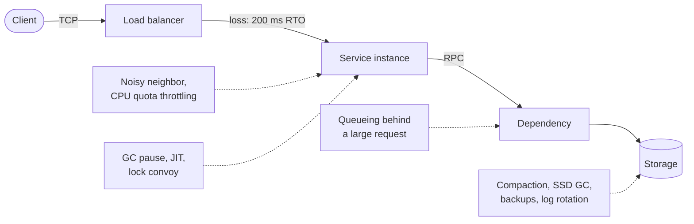

**Reading the diagram.** The solid arrows are the synchronous request path: TCP from client to load balancer, HTTP or RPC onward, and a storage read at the end (the storage boundary). Each dotted arrow is an asynchronous disturbance that does not belong to the request but delays it. On the network, a dropped packet costs at least a 200 ms retransmission timeout on Linux, hundreds of times a datacenter round trip (§7.7). On the instance, co-located tenants compete for caches and memory bandwidth, CPU quotas throttle bursts (§23.6.3), and runtime pauses stop all threads (§23.9). At the dependency, a request queued behind an expensive one inherits its delay (head-of-line blocking). At storage, compaction (§13.9), SSD garbage collection (§5.6) and backups steal I/O. Every box is a failure point for tail latency, and adding more of them in series or in parallel (scaling out) multiplies their effect.

**Table 23.6 — Common sources of tail latency.**

| Source | Typical magnitude | Detection | Mitigation |
|---|---|---|---|
| GC stop-the-world pause | 1 ms – seconds | GC logs; pause histograms | Lower allocation; concurrent collector (§23.9) |
| Queueing behind large requests | Size of the large request | Per-request size vs. latency | Split large requests; priority classes |
| Background tasks (compaction, backups) | 10s–100s of ms | Latency correlates with job schedule | Throttle; schedule off-peak; stagger across replicas |
| Noisy neighbor | 10s of % slowdown | Cache misses, steal time | Isolation, dedicated hosts, pinning |
| CPU quota throttling | Rest of a 100 ms period | `nr_throttled` in cgroup `cpu.stat` | Raise or remove limits; fewer threads |
| Packet loss | ≥ 200 ms per retransmission | TCP retransmit counters | Avoid drops; hedging (§23.7) |
| Cold start / JIT warm-up | 10s of seconds after deploy | p99 spike after each rollout | Warm-up traffic; load-balancer slow start |

### 23.6.3 A worked trap: CPU quota throttling

Linux enforces container CPU limits with the CFS bandwidth controller: in every **period** $P$ (100 ms by default) a cgroup may run for at most its **quota** $Q$ of CPU time, summed over all its threads. Kubernetes CPU limits are implemented this way.

::: formula
**Throttling under a CPU quota**

$$t_{\text{run}} = \frac{Q}{k} \qquad t_{\text{throttled}} = P - \frac{Q}{k} \qquad (\text{when } k > Q/P)$$

| Symbol | Meaning | Units |
|---|---|---|
| $P$ | Enforcement period | ms |
| $Q$ | CPU-time quota per period (2 CPUs = $2P$) | CPU·ms |
| $k$ | Threads runnable at the same time | count |
| $t_{\text{run}}$ | Wall time until the quota is exhausted | ms |
| $t_{\text{throttled}}$ | Wall time the whole cgroup is frozen | ms |
:::

::: example
**Worked example — Two CPUs of quota, eight busy threads.** $P = 100$ ms, $Q = 200$ ms (a limit of 2 CPUs), and a burst makes $k = 8$ threads runnable on an 8-core host.

1. $t_{\text{run}} = 200/8 = 25$ ms; $t_{\text{throttled}} = 100 - 25 = 75$ ms.
2. A request needing 40 ms of CPU on one of those threads gets 25 ms, waits 75 ms, then finishes after 15 ms more: latency 115 ms instead of 40 ms.
3. Average CPU use over the period is still only 2 cores out of 8, so host dashboards show 25%.

**Interpretation.** A limit expressed as an *average* (2 CPUs) is enforced over a short window, so bursty multi-threaded work is frozen for most of each period. **Engineering implication.** Watch throttled-period counters, size thread pools to the quota rather than the host's core count (runtimes such as the JVM and Go read the limit for this reason in recent versions), and consider CPU requests without hard limits for latency-sensitive services.
:::

Within a server, the main mitigations are **differentiated service classes** (serve interactive requests before batch requests), **breaking large requests** into smaller pieces so they do not block others, and **managing background activity** (throttle it, or synchronize it across machines so that it disturbs a short window rather than every request) [Dean and Barroso 2013]. Across servers, the more powerful approach is to *tolerate* variability rather than eliminate it, which is the subject of the next section.

## 23.7 Hedged and tied requests

### 23.7.1 Hedged requests

::: definition
**Definition — Hedged request.** A request sent to one replica and, if no response arrives within a **hedge delay** $d$, sent again to a second replica; the client uses whichever response arrives first and cancels or ignores the other [Dean and Barroso 2013].
:::

#### First-principles explanation

You order a taxi through one app. If no driver has accepted after five minutes, you order through a second app as well, and take whichever car arrives first. Most of the time the first app works and you never use the second. You pay a small cost (an occasional cancelled booking) to avoid the rare 40-minute wait. The key choice is the delay: order from both immediately and you double the load on drivers; wait too long and the hedge arrives too late to help.

**Figure 23.8 — A hedged request.**

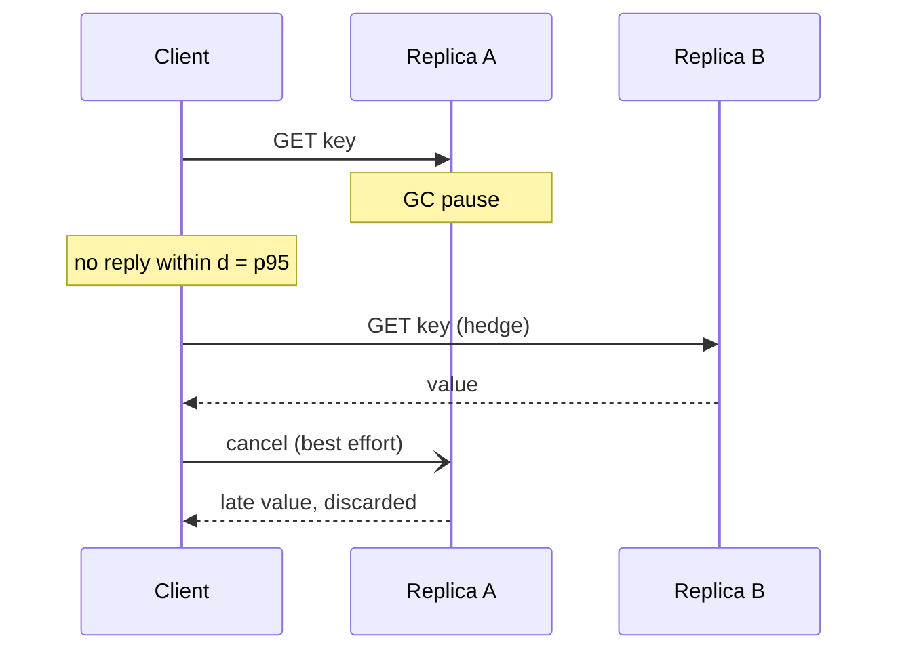

**Reading the diagram.** The client sends a synchronous RPC to replica A. Replica A is in a pause. When the hedge timer $d$ expires, the client sends the same idempotent read to replica B, which answers first; the client returns B's value to its caller. The cancellation to A is asynchronous and best effort: A may already have done the work, so the extra load is not fully recovered. Both replicas must hold the same data (a replication boundary), and the operation must be safe to execute twice, which is easy for reads and needs an idempotency key for writes (§22.15). The failure point is load: every hedge is extra work, so if many requests exceed $d$ because the whole system is slow, hedging adds load precisely when there is none to spare.

::: formula
**Hedged latency and extra load (independent replicas)**

$$T = \min(X_1,\; d + X_2) \qquad P(T > t) = \begin{cases} P(X > t) & t < d \\ P(X > t)\,P(X > t - d) & t \ge d \end{cases} \qquad \text{extra load} = P(X > d)$$

| Symbol | Meaning | Units |
|---|---|---|
| $X_1, X_2$ | Latencies of the primary and the hedge, same distribution as $X$ | ms |
| $d$ | Hedge delay | ms |
| $T$ | Latency seen by the client | ms |
| extra load | Fraction of requests that send a second copy | dimensionless |
:::

::: example
**Worked example — Hedging a bimodal leaf.** A replica answers in 8 ms with probability 0.98 and in 400 ms with probability 0.02 (a pause). Without hedging, p95 = 8 ms and p99 = 400 ms. Hedge after $d = 10$ ms.

1. With probability 0.98 the first reply arrives at 8 ms; no hedge is sent.
2. With probability 0.02 the hedge goes at 10 ms. It returns at $10 + 8 = 18$ ms with probability 0.98; otherwise both are slow and the reply arrives at 400 ms.
3. $P(T > 18\text{ ms}) = 0.02 \times 0.02 = 0.0004$. So p99 and p99.9 fall from 400 ms to 18 ms; only p99.96 and above remain at 400 ms.
4. Extra load $= P(X > 10\text{ ms}) = 2\%$.
5. With a 100-leaf fan-out: $P(\text{all leaves} \le 18\text{ ms}) = (1 - 0.0004)^{100} = 0.961$, versus $0.98^{100} = 0.133$ unhedged.

**Interpretation.** Two percent more requests turn 87% slow fan-out queries into 4% slow ones. **Engineering implication.** Hedge after roughly the p95 latency, so that extra load is bounded by about 5%, and only for idempotent operations.
:::

### 23.7.2 Simulating hedging, including its cost

The worked example ignores a crucial feedback: hedges add load, load raises queueing delay, and higher latency triggers more hedges. The simulation below models 20 FIFO replicas with Poisson arrivals. Each request needs about 1 ms of work, and 0.1% of requests trigger a 50 ms hiccup that also delays everything queued behind it. It compares no hedging, hedging after the unhedged p95, hedging with cancellation (a copy that has not started when the original finishes is dropped, the essence of tied requests), and over-eager hedging after the p50.

```python
import heapq
import math
import random

SERVERS = 20
N_REQ = 400_000

def service_time(rng):
    """~1 ms of work; 0.1% of requests hit a 50 ms hiccup (GC, compaction...)."""
    t = 0.0005 + rng.expovariate(1 / 0.0005)
    if rng.random() < 0.001:
        t += 0.050
    return t

def simulate(rho, hedge_after=None, cancel=False, seed=3):
    """FIFO replicas; Poisson arrivals; optional hedge to a second replica.
    Returns (latencies in ms, extra work as a fraction of original work)."""
    rng = random.Random(seed)
    lam = rho * SERVERS / 0.00105            # mean service time is 1.05 ms
    free_at = [0.0] * SERVERS
    events, t = [], 0.0                      # (submit_time, seq, req_id, is_hedge, avoid)
    for i in range(N_REQ):
        t += rng.expovariate(lam)
        heapq.heappush(events, (t, i, i, False, -1))
    done = [0.0] * N_REQ
    sent = [0.0] * N_REQ
    seq, base_work, extra_work = N_REQ, 0.0, 0.0
    while events:
        now, _, rid, is_hedge, avoid = heapq.heappop(events)
        server = rng.randrange(SERVERS)
        while server == avoid:
            server = rng.randrange(SERVERS)
        start = max(now, free_at[server])
        if is_hedge:
            if cancel and done[rid] <= start:  # original already answered: drop copy
                continue
            work = service_time(rng)
            free_at[server] = start + work
            extra_work += work
            done[rid] = min(done[rid], free_at[server])
        else:
            work = service_time(rng)
            free_at[server] = start + work
            base_work += work
            sent[rid], done[rid] = now, free_at[server]
            if hedge_after is not None and done[rid] > now + hedge_after:
                seq += 1
                heapq.heappush(events, (now + hedge_after, seq, rid, True, server))
    lat = sorted((d - s) * 1000 for d, s in zip(done, sent))
    return lat, extra_work / base_work

def pct(xs, q):
    return xs[max(math.ceil(q / 100 * len(xs)), 1) - 1]

for rho in (0.5, 0.8):
    base, _ = simulate(rho)
    d = pct(base, 95) / 1000                 # hedge after the unhedged p95
    print(f"utilization {rho:.0%}: hedge delay = p95 = {d*1000:.2f} ms")
    print(f"  {'policy':<16}{'p50':>8}{'p95':>8}{'p99':>8}{'p99.9':>8}{'extra work':>12}")
    for name, kw in (("no hedging", {}),
                     ("hedge at p95", {"hedge_after": d}),
                     ("hedge + cancel", {"hedge_after": d, "cancel": True}),
                     ("hedge at p50", {"hedge_after": pct(base, 50) / 1000})):
        lat, extra = simulate(rho, **kw)
        print(f"  {name:<16}" + "".join(f"{pct(lat, q):>8.1f}" for q in (50, 95, 99, 99.9))
              + f"{extra:>12.1%}")
```

Output (latencies in ms):

```text
utilization 50%: hedge delay = p95 = 5.89 ms
  policy               p50     p95     p99   p99.9  extra work
  no hedging           1.3     5.9    44.6    61.0        0.0%
  hedge at p95         1.3     6.5     8.6    28.3        5.8%
  hedge + cancel       1.3     6.4     8.5    26.3        5.0%
  hedge at p50        48.6   244.1   401.8   579.2       98.7%
utilization 80%: hedge delay = p95 = 45.05 ms
  policy               p50     p95     p99   p99.9  extra work
  no hedging           2.7    45.0    68.2   127.0        0.0%
  hedge at p95      3456.8 10502.8 11149.5 11550.1       75.5%
  hedge + cancel       3.2    45.7    51.7    74.6        3.9%
  hedge at p50      7696.8 14771.3 15513.6 15978.4      100.2%
```

What to notice:

- **At 50% utilization, hedging at p95 cuts p99 from 44.6 ms to 8.6 ms** (5×) and p99.9 by more than half, for about 6% extra work. The median is untouched.
- **At 80% utilization, the same policy without cancellation collapses** into a positive feedback loop: hedges raise utilization, queues grow, more requests exceed $d$, more hedges are sent. Extra work reaches 75%, demand exceeds capacity, and latency grows for as long as the run lasts (the absolute seconds depend on run length). The same policy *with* cancellation stays stable and still cuts the tail.
- **Hedging at p50 is a denial-of-service attack on yourself**: it nearly doubles the work at either load.
- The model cannot cancel an original once it is queued; real tied requests (below) can, so they do slightly better.

### 23.7.3 Tied requests

Hedging waits before sending the second copy, so it helps only the slowest few percent. **Tied requests** send both copies (almost) at once, but each copy carries the identity of the other server, and whichever server *starts* executing the request first sends a cancellation to the other [Dean and Barroso 2013]. The request thus waits in the *shorter* of two queues, which approximates a shared queue across servers (pooling, §4.10.4), and is executed only once in the common case.

**Figure 23.9 — Tied requests with cross-server cancellation.**

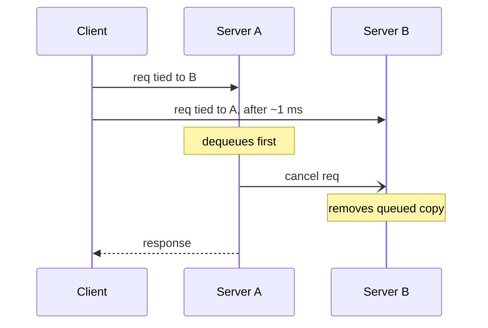

**Reading the diagram.** The client enqueues the same request on two servers, delaying the second send slightly (on the order of a network message delay) so that the two servers do not both start before the cancellation arrives. Each copy names its twin. When server A dequeues the request and starts work, it sends an asynchronous cancel message directly to server B, which removes its queued copy. Only one server performs the work, and the client receives one response. The failure window is the moment when both servers dequeue simultaneously, before the cancel arrives: then both execute, and the cost is one duplicate. The approach requires server-side support (queue manipulation and peer messages), unlike hedging, which is purely client-side.

Dean and Barroso report that in a BigTable benchmark, tied requests made the latency of a cluster running a concurrent large sort job nearly as good as that of an idle cluster without tied requests, at a disk-utilization cost below 1% [Dean and Barroso 2013]. They also report the hedged-request benchmark quoted in §4.8.4: hedging after 10 ms reduced the p99.9 of a 1,000-key read across 100 servers from 1,800 ms to 74 ms with 2% more requests.

#### Real-world industry applications

::: industry
**Speculative execution in batch and storage systems.** MapReduce schedules **backup tasks** for the last in-progress tasks of a job, taking whichever copy finishes first; the original paper reports a sort taking 44% longer with backup tasks disabled [Dean and Ghemawat 2004]. Apache Cassandra offers a per-table `speculative_retry` setting that sends a read to an extra replica when the first has not answered by a chosen percentile or fixed delay [Apache Cassandra Docs]. gRPC's retry design defines a `hedgingPolicy` with a maximum number of attempts and a hedging delay, and the server can throttle hedges with pushback [gRPC A6].
*Evidence: Primary* — [Dean and Ghemawat 2004], [Apache Cassandra Docs], [gRPC A6]
:::

#### Failure scenarios

| What goes wrong | Why | Detection | Recovery | Prevention |
|---|---|---|---|---|
| Overload spiral | Hedges add load as latency rises | Hedge rate climbs with latency | Disable hedging; shed load | Hedge budget (e.g., ≤ 5% of requests); adaptive delay |
| Duplicate side effects | Non-idempotent operation hedged | Duplicate records, double charges | Compensating actions | Hedge reads only, or use idempotency keys (§22.15) |
| No improvement | Replicas share the slow cause (same disk, same switch) | Hedge and primary equally slow | Choose replicas in other failure domains | Spread replicas across racks and zones |
| Hedges amplify retries | Hedging and retries both enabled at every layer | Request count ≫ user requests | Remove one layer's hedging | Hedge at one layer only, with a shared budget (§22.12) |

::: mistake
**Mistake — Hedging with a fixed delay forever.** A delay tuned to last quarter's p95 becomes the p60 after a regression, and the hedge rate jumps from 5% to 40%. Derive the delay from a recent latency histogram, cap the fraction of requests that may hedge, and turn hedging off when the service is overloaded.
:::

## 23.8 Batching, pipelining and compression

### 23.8.1 Batching with a size and a time limit

Section 4.18.6 modeled a batch of $B$ items as costing $t_0 + B t_1$: the fixed cost $t_0$ (a system call, a network round trip, a disk flush, a GPU kernel launch) is shared by all items. Real batchers close a batch on whichever comes first, a **size limit** or a **time limit**, so that light traffic is not stuck waiting for a full batch. Kafka's producer `batch.size` and `linger.ms` settings are exactly this pair (§31.6).

**Figure 23.10 — A batcher with size and time triggers.**

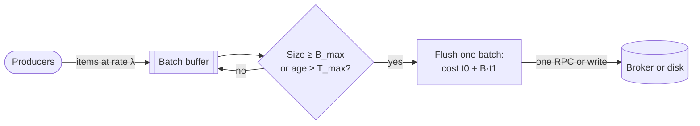

**Reading the diagram.** Producers append items asynchronously to an in-memory buffer (the subroutine shape), which is a failure point: anything in it is lost if the process crashes before the flush, unless callers wait for acknowledgment. A decision checks two triggers on every append and on a timer. When either fires, the batch is sent as a single synchronous RPC or write to the sink, which is the storage boundary. Under heavy load the size trigger fires first and batches are full, giving maximum throughput; under light load the time trigger fires first, bounding added latency at $T_{\max}$. Scaling options are more parallel batchers (one per partition or core) or a larger $B_{\max}$ when $t_0$ dominates.

::: formula
**Batch size and latency with a time limit**

$$B_{\text{eff}} \approx \min\!\left(B_{\max},\; \max(1, \lambda T_{\max})\right) \qquad X_{\max} = \frac{B_{\text{eff}}}{t_0 + B_{\text{eff}}\,t_1} \qquad W_{\text{worst}} \approx T_{\max} + t_0 + B_{\text{eff}}\,t_1$$

| Symbol | Meaning | Units |
|---|---|---|
| $\lambda$ | Item arrival rate | items/second |
| $B_{\max}$, $T_{\max}$ | Size and time limits of the batcher | items, seconds |
| $B_{\text{eff}}$ | Typical batch size actually sent | items |
| $t_0$, $t_1$ | Fixed cost per batch, marginal cost per item | seconds, seconds/item |
| $X_{\max}$ | Throughput one sender can sustain | items/second |
| $W_{\text{worst}}$ | Worst-case latency added by batching and sending | seconds |
:::

::: example
**Worked example — A log shipper.** Each send costs $t_0 = 0.5$ ms (round trip and system call) plus $t_1 = 10$ µs per record. Records arrive at $\lambda = 20{,}000$/s; one sender has one batch in flight at a time.

1. Unbatched ($B = 1$): $X_{\max} = 1/0.00051 = 1{,}961$/s. The sender falls 18,000 records/s behind.
2. With $T_{\max} = 5$ ms and $B_{\max} = 500$: $B_{\text{eff}} = \min(500, 20{,}000 \times 0.005) = 100$.
3. Batch time $= 0.5 + 100 \times 0.01 = 1.5$ ms, so $X_{\max} = 100/0.0015 = 66{,}667$/s: 3.3× headroom.
4. Worst-case added latency $\approx 5 + 1.5 = 6.5$ ms; the average record waits about half of $T_{\max}$, 2.5 ms.

**Interpretation.** A 5 ms latency budget buys a 34× throughput increase. **Engineering implication.** Choose $T_{\max}$ from the latency budget, not from throughput; at high load the batch fills before the timer anyway.
:::

**The Nagle analogy.** Nagle's algorithm (§7.7.8) is a batcher whose "timer" is the arrival of an acknowledgment: small writes are held while data is unacknowledged. It improves throughput for chatty senders, but combined with the receiver's delayed-ACK timer it adds tens of milliseconds to request/response traffic. The general lesson is that *two batchers in series can deadlock each other until a timer fires*. When you add batching to a client, check what the server does with small, incomplete messages.

### 23.8.2 Pipelining

**Pipelining** sends several requests on one connection without waiting for each response, overlapping network round trips with server work.

::: formula
**Sequential versus pipelined requests**

$$T_{\text{seq}} = n\,(r + s) \qquad T_{\text{pipe}} \approx r + n\,s \quad (\text{window} \ge n)$$

| Symbol | Meaning | Units |
|---|---|---|
| $n$ | Number of requests | count |
| $r$ | Network round-trip time | seconds |
| $s$ | Server processing time per request | seconds |
:::

::: example
**Worked example — 1,000 cache reads.** $r = 0.5$ ms within a datacenter, $s = 5$ µs per GET in an in-memory store.

1. Sequential: $1{,}000 \times (0.5 + 0.005) = 505$ ms.
2. Pipelined: $0.5 + 1{,}000 \times 0.005 = 5.5$ ms, 92× faster.

**Interpretation.** For small operations the round trip, not the server, is the cost. **Engineering implication.** Use pipelining or multi-key commands (Redis pipelines, `MGET`) and multiplexed protocols such as HTTP/2 for many small requests. Strict in-order pipelining suffers head-of-line blocking: one slow response delays all later ones, which is why HTTP/1.1 pipelining failed and HTTP/2 multiplexes independent streams (§7.10).
:::

### 23.8.3 Compression: ratio versus CPU

Compression trades CPU for bytes. It pays when bytes are the bottleneck (slow links, egress charges, storage cost, cache capacity) and loses when CPU is.

**Table 23.7 — Fast compressors on one CPU core (as of 2026; zstd project benchmark, lzbench on the Silesia corpus, Core i7-9700K).**

| Compressor and level | Ratio | Compression (MB/s) | Decompression (MB/s) |
|---|---|---|---|
| zstd 1.5.7, level 1 | 2.896 | 510 | 1,550 |
| brotli 1.1.0, level 1 | 2.883 | 290 | 425 |
| zlib 1.3.1, level 1 (gzip's DEFLATE) | 2.743 | 105 | 390 |
| lz4 1.10.0 | 2.101 | 675 | 3,850 |
| snappy 1.2.1 | 2.089 | 520 | 1,500 |

Source: [Zstandard README]. Higher levels of zstd, brotli and zlib compress much better and much more slowly; numbers depend heavily on data and hardware, so benchmark your own payloads.

::: formula
**When compression reduces transfer time (store-and-forward)**

$$t_{\text{plain}} = \frac{S}{W} \qquad t_{\text{comp}} = \frac{S}{C_c} + \frac{S}{\rho\,W} + \frac{S}{C_d} \qquad \text{compress if } \frac{1}{C_c} + \frac{1}{\rho W} + \frac{1}{C_d} < \frac{1}{W}$$

| Symbol | Meaning | Units |
|---|---|---|
| $S$ | Uncompressed size | MB |
| $W$ | Network (or disk) bandwidth | MB/s |
| $\rho$ | Compression ratio (original / compressed) | dimensionless |
| $C_c$, $C_d$ | Compression and decompression speed | MB/s |
:::

With streaming, the stages overlap and the time approaches the *slowest* stage instead of the sum, which favors compression further.

::: example
**Worked example — Shipping 100 MB.** Use Table 23.7.

1. 1 Gb/s link ($W = 125$ MB/s): plain $= 0.80$ s. lz4: $0.148 + 100/262.6 + 0.026 = 0.148 + 0.381 + 0.026 = 0.555$ s. zstd-1: $0.196 + 100/362 + 0.065 = 0.196 + 0.276 + 0.065 = 0.537$ s. zlib-1: $0.952 + 0.292 + 0.256 = 1.50$ s.
2. 10 Gb/s link ($W = 1{,}250$ MB/s): plain $= 0.08$ s; lz4 $= 0.148 + 0.038 + 0.026 = 0.212$ s; zstd-1 $= 0.196 + 0.028 + 0.065 = 0.288$ s.

**Interpretation.** On a 1 Gb/s link, fast compressors cut transfer time by about a third and zlib nearly doubles it; on a 10 Gb/s datacenter link, compression *slows* a single-stream transfer by 2.6–3.6× (parallel compression across cores narrows the gap). **Engineering implication.** Compress for slow or metered links, storage and cache capacity, and cross-region traffic (where egress is billed per byte); prefer zstd or lz4 over gzip for machine-to-machine traffic; compress batches rather than single small messages, since ratio improves with more context.
:::

## 23.9 Garbage collection and runtime effects

### 23.9.1 Generational garbage collection

::: definition
**Definition — Garbage collection (GC).** Automatic reclamation of heap memory that the program can no longer reach. A **tracing** collector finds live objects by following references from **roots** (stacks, globals, registers) and reclaims everything else. A **stop-the-world (STW) pause** is an interval in which all application threads (the **mutator**) are halted so the collector can work on a consistent heap [Jones et al. 2023].
:::

A restaurant can clear tables continuously while diners eat (concurrent collection) or close the dining room for ten minutes every hour to clean everything (stop-the-world). The second is simpler and faster overall, but every diner present at closing time waits. Most objects in typical programs die young: request buffers, temporary strings, iterators. This **weak generational hypothesis** motivates **generational** collection [Ungar 1984]: allocate new objects in a small **young generation**, collect it often and cheaply by copying the few survivors out, and promote long-lived objects to an **old generation** collected rarely.

**Figure 23.11 — Generational heap.**

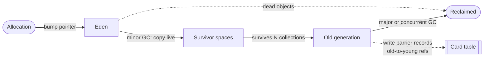

**Reading the diagram.** New objects are allocated in Eden by bumping a pointer, which is nearly free. When Eden fills, a minor collection copies live objects to a survivor space; everything left in Eden is reclaimed without being touched, so the cost of a minor GC is proportional to *survivors*, not to garbage. Objects that survive several minor collections are promoted to the old generation. To collect the young generation without scanning the whole old generation, a **write barrier** (a few instructions added to every reference store) records old-to-young pointers in a card table (dotted, asynchronous bookkeeping). The old generation is collected by a major collection, either stop-the-world or largely concurrent. Failure points: a promotion rate higher than the old generation's collection rate leads to a full, long STW collection; a heap too small for the live set leads to back-to-back collections.

::: formula
**GC frequency and pause exposure**

$$I_{\text{minor}} = \frac{E}{a} \qquad f_{\text{hit}} \approx \frac{p}{I_{\text{minor}}} \qquad \text{Go heap target} = H_{\text{live}} \times \left(1 + \frac{\text{GOGC}}{100}\right)$$

| Symbol | Meaning | Units |
|---|---|---|
| $E$ | Young-generation (Eden) size | MB |
| $a$ | Allocation rate | MB/s |
| $I_{\text{minor}}$ | Interval between minor collections | seconds |
| $p$ | STW pause per minor collection | seconds |
| $f_{\text{hit}}$ | Approximate fraction of requests that overlap a pause | dimensionless |
| $H_{\text{live}}$ | Live heap after the previous Go collection | MB |
| GOGC | Go's GC percentage setting (default 100) | percent |
:::

::: example
**Worked example — GC in the tail.** A JVM service allocates $a = 500$ MB/s with a 2 GB Eden; minor pauses are $p = 30$ ms. Its requests take 5 ms.

1. $I_{\text{minor}} = 2{,}000/500 = 4$ s between pauses.
2. Requests overlapping a pause $\approx (30 + 5)/4{,}000 \approx 0.9\%$ (a request is delayed if it is in flight when the pause starts or arrives during it). They are delayed by up to 30 ms, 15 ms on average.
3. So the service's p99 sits at the edge of the GC effect and its p99.9 includes most of a full pause; at 100-way fan-out, nearly every root request ($1 - 0.991^{100} = 60\%$) sees one.
4. Halving the allocation rate doubles the interval and halves the exposure. For a Go service with 1 GB live heap and GOGC = 100, the heap grows to $1 \times 2 = 2$ GB before the next cycle; GOGC = 50 caps it at 1.5 GB but runs GC twice as often.

**Interpretation.** GC pauses are a *rate* problem (how often) times a *size* problem (how long). **Engineering implication.** Reduce allocation first (it lowers both CPU and pause frequency), then choose a collector whose pause behavior fits the SLO.
:::

### 23.9.2 Collectors in practice

**Table 23.8 — Production collectors (as of 2026).**

| Collector | Runtime | Approach | Pause behavior | Choose when |
|---|---|---|---|---|
| Parallel | JVM | Generational, STW, multi-threaded | Long pauses, best throughput | Batch jobs where latency is irrelevant |
| G1 | JVM (default since JDK 9) | Region-based, generational, mostly concurrent marking, STW evacuation | Pause-time *goal* (default 200 ms), typically tens of ms | General-purpose services |
| ZGC | JVM (production since JDK 15; generational since JDK 21) | Concurrent marking and relocation with load barriers | Sub-millisecond pauses independent of heap size | Large heaps with strict tail SLOs |
| Shenandoah | JVM (production since JDK 15, in some builds) | Concurrent compaction with barriers | Short pauses independent of heap size | Similar to ZGC |
| Go GC | Go | Concurrent, non-generational, non-moving mark-sweep | Short STW phases; *GC assist* slows allocating goroutines | Default; tune GOGC and GOMEMLIMIT |
| CPython | Python | Reference counting plus a cycle collector | Immediate frees; occasional cycle-collection pauses | Default |

Concurrent collectors are not free. They use barriers on every reference load or store, keep spare CPU for collector threads (Go's collector targets about 25% of available CPU during marking [Go GC Guide]), and need heap headroom so the application does not outrun them. They trade throughput and memory for shorter pauses. Go 1.19 added `GOMEMLIMIT`, a soft memory limit that makes the collector run more often as the process approaches it, which fits containers with hard memory limits [Go GC Guide].

### 23.9.3 JIT warm-up and other runtime effects

A **just-in-time (JIT)** compiler, as in the JVM, .NET and JavaScript engines, starts by interpreting code, profiles it, and compiles hot methods with increasingly aggressive optimization, sometimes *deoptimizing* when an assumption breaks. A freshly started instance therefore runs several times slower for its first seconds to minutes. Effects: load tests without warm-up understate steady-state performance and overstate cold-start latency; every deployment and autoscaling event creates a p99 spike as new instances receive full traffic. Mitigations: replay warm-up traffic before marking an instance ready, use load-balancer **slow start** to ramp traffic onto new instances (§19.5), or reduce warm-up with ahead-of-time compilation and class-data sharing.

::: recommendation
**GC and runtime tuning heuristics.**

- Measure before tuning: enable GC logging (`-Xlog:gc*` on the JVM, `GODEBUG=gctrace=1` in Go) and plot pause durations and frequency against latency percentiles.
- Reduce allocation rate with an allocation profiler (§23.4.5): reuse buffers, avoid boxing, stream instead of materializing.
- Give the collector headroom: a heap of a few times the live set is a common starting point; a nearly full heap means frequent collections.
- Pick the collector by goal: throughput (Parallel), balanced (G1), tail latency on large heaps (ZGC or Shenandoah).
- In containers, set the heap from the container limit (for example `-XX:MaxRAMPercentage`, or `GOMEMLIMIT` below the cgroup limit) so the runtime is not killed before it collects.
- Never call explicit full GCs on a timer, and treat any full STW collection in a latency-sensitive service as an incident.
:::

::: industry
**Discord — GC spikes in a Go service.** Discord described a Go service holding a large in-memory cache that showed latency spikes about every two minutes. The cause was Go's forced garbage collection, which runs at least every two minutes even when little garbage exists; each cycle had to scan the large cache. Tuning reduced but did not remove the effect, and the team rewrote the service in Rust, which has no garbage collector, eliminating the spikes. Trade-off: a rewrite removed the runtime cause at significant engineering cost; reducing the number of heap pointers to scan is the usual cheaper alternative.
*Evidence: Primary* — [Howarth 2020]
:::

## 23.10 Capacity models from measurements

### 23.10.1 From benchmark to fleet

Section 4.13 introduced the Universal Scalability Law (USL) with known coefficients. In practice you *measure* throughput at several concurrency levels, *fit* the coefficients, and use the fitted model to predict the peak, choose an operating point and size the fleet [Gunther 2007].

**Figure 23.12 — Capacity modeling workflow.**

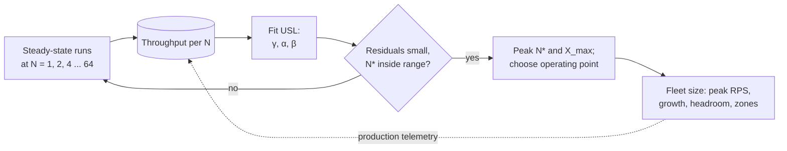

**Reading the diagram.** Each benchmark run is a closed-loop test at fixed concurrency $N$ (here the closed model is appropriate, because concurrency is the independent variable), long enough to reach steady state after warm-up. The measured throughputs are the stored data. The fit produces the three USL coefficients; the validation step sends you back to measure more points if the residuals are large or the predicted peak $N^*$ lies outside the measured range, because extrapolated peaks are unreliable. The operating point and fleet size follow by arithmetic. The dotted edge is the asynchronous feedback loop: production throughput and utilization per instance refine the model over time.

::: formula
**USL for measured throughput, and its linearized form**

$$X(N) = \frac{\gamma N}{1 + \alpha (N - 1) + \beta N (N - 1)} \qquad \frac{\gamma N}{X(N)} - 1 = \alpha (N - 1) + \beta N (N - 1)$$

| Symbol | Meaning | Units |
|---|---|---|
| $N$ | Concurrency (client threads, cores or nodes) | count |
| $X(N)$ | Measured throughput at concurrency $N$ | requests/second |
| $\gamma$ | Throughput at $N = 1$ (the slope of ideal linear scaling) | requests/second |
| $\alpha$, $\beta$ | Contention and coherency coefficients (§4.13) | dimensionless |
:::

The right-hand form is linear in $\alpha$ and $\beta$, so with $\gamma$ fixed at the measured $X(1)$ an ordinary least-squares fit gives a starting estimate; a nonlinear fit of all three parameters to the raw throughputs then refines it.

### 23.10.2 Fitting the USL in Python

The program fits benchmark data in two steps using only the standard library. The data are synthetic, generated from known coefficients ($\gamma = 950$, $\alpha = 0.03$, $\beta = 0.0004$) with 3% measurement noise, so you can see how well the fit recovers them.

```python
import math
import random

def usl(n, gamma, alpha, beta):
    """USL throughput: gamma = throughput at N = 1."""
    return gamma * n / (1 + alpha * (n - 1) + beta * n * (n - 1))

def solve(a, b):
    """Solve the small linear system a x = b by Gaussian elimination."""
    n = len(b)
    m = [row[:] + [b[i]] for i, row in enumerate(a)]
    for c in range(n):
        p = max(range(c, n), key=lambda r: abs(m[r][c]))
        m[c], m[p] = m[p], m[c]
        for r in range(c + 1, n):
            f = m[r][c] / m[c][c]
            for k in range(c, n + 1):
                m[r][k] -= f * m[c][k]
    x = [0.0] * n
    for r in range(n - 1, -1, -1):
        x[r] = (m[r][n] - sum(m[r][k] * x[k] for k in range(r + 1, n))) / m[r][r]
    return x

def fit_linearized(ns, xs):
    """Step 1: N*gamma/X - 1 = alpha (N-1) + beta N (N-1), with gamma = X(1)."""
    gamma = xs[ns.index(1)]
    rows = [(n - 1, n * (n - 1)) for n in ns]
    ys = [n * gamma / x - 1 for n, x in zip(ns, xs)]
    ata = [[sum(r[i] * r[j] for r in rows) for j in range(2)] for i in range(2)]
    aty = [sum(r[i] * y for r, y in zip(rows, ys)) for i in range(2)]
    alpha, beta = solve(ata, aty)
    return gamma, alpha, beta

def fit_nonlinear(ns, xs, p, iters=50):
    """Step 2: Gauss-Newton refinement of (gamma, alpha, beta) on throughput."""
    p = list(p)
    for _ in range(iters):
        r = [x - usl(n, *p) for n, x in zip(ns, xs)]
        jac = []
        for n in ns:
            row = []
            for k in range(3):
                h = 1e-6 * max(abs(p[k]), 1e-6)
                q = p[:]; q[k] += h
                row.append((usl(n, *q) - usl(n, *p)) / h)
            jac.append(row)
        jtj = [[sum(j[a] * j[b] for j in jac) for b in range(3)] for a in range(3)]
        jtr = [sum(j[a] * ri for j, ri in zip(jac, r)) for a in range(3)]
        step = solve(jtj, jtr)
        p = [pi + si for pi, si in zip(p, step)]
        if max(abs(s / pi) for s, pi in zip(step, p)) < 1e-10:
            break
    return p

# "Measured" throughput (req/s) at each client concurrency N. Synthetic:
# generated from gamma=950, alpha=0.03, beta=0.0004 with 3% noise.
rng = random.Random(11)
ns = [1, 2, 4, 8, 12, 16, 24, 32, 48, 64]
xs = [round(usl(n, 950, 0.03, 0.0004) * rng.gauss(1, 0.03)) for n in ns]

g, a, b = fit_linearized(ns, xs)
print(f"linearized fit : gamma={g:7.1f}  alpha={a:.4f}  beta={b:.6f}")
g, a, b = fit_nonlinear(ns, xs, (g, a, b))
print(f"nonlinear fit  : gamma={g:7.1f}  alpha={a:.4f}  beta={b:.6f}")

mean = sum(xs) / len(xs)
ss_res = sum((x - usl(n, g, a, b)) ** 2 for n, x in zip(ns, xs))
ss_tot = sum((x - mean) ** 2 for x in xs)
n_star = math.sqrt((1 - a) / b)
x_max = usl(n_star, g, a, b)
print(f"R^2 = {1 - ss_res / ss_tot:.4f}   N* = {n_star:.1f}   X(N*) = {x_max:,.0f} req/s")

print(f"{'N':>4}{'measured':>10}{'model':>9}{'R=N/X ms':>10}{'efficiency':>12}")
for n in ns + [96, 128]:
    model = usl(n, g, a, b)
    meas = f"{xs[ns.index(n)]:>10,}" if n in ns else f"{'-':>10}"
    print(f"{n:>4}{meas}{model:>9,.0f}{1000 * n / model:>10.2f}{model / (n * g):>12.0%}")
```

Output:

```text
linearized fit : gamma=  915.0  alpha=0.0238  beta=0.000502
nonlinear fit  : gamma=  885.4  alpha=0.0205  beta=0.000522
R^2 = 0.9983   N* = 43.3   X(N*) = 13,588 req/s
   N  measured    model  R=N/X ms  efficiency
   1       915      885      1.13        100%
   2     1,864    1,734      1.15         98%
   4     3,575    3,317      1.21         94%
   8     6,072    6,041      1.32         85%
  12     7,915    8,211      1.46         77%
  16     9,812    9,891      1.62         70%
  24    12,103   12,082      1.99         57%
  32    13,496   13,165      2.43         46%
  48    13,264   13,539      3.55         32%
  64    12,979   12,899      4.96         23%
  96         -   11,035      8.70         13%
 128         -    9,381     13.64          8%
```

What to notice:

- **The fit is excellent ($R^2 = 0.998$) yet the coefficients are off.** The true peak is at $N^* = \sqrt{0.97/0.0004} = 49$ with 13,770 req/s; the fit says 43 with 13,588 req/s. Throughput near the peak is flat, so the *location* of the peak is poorly determined while its *height* is well determined. Plan on throughput, not on the exact $N^*$.
- **The response-time column is Little's Law**: in a closed test with no think time, $R = N/X$ (§23.5.2). Past the peak, extra concurrency only adds queueing: latency quadruples from $N = 24$ to $N = 96$ while throughput falls.
- **Efficiency** $X(N)/(N\gamma)$ falls below 70% at $N = 16$; that is the knee, where adding concurrency starts buying much less throughput than it costs in latency.
- Rows 96 and 128 are extrapolations. Measure there before relying on them.

### 23.10.3 Converting a model into a fleet size

::: formula
**Fleet size from per-instance capacity**

$$n = \left\lceil \frac{\lambda_{\text{peak}}\,(1 + g)}{u \cdot X_{\max}} \right\rceil \qquad n_{\text{zones}} = Z \cdot \left\lceil \frac{n}{Z - 1} \right\rceil$$

| Symbol | Meaning | Units |
|---|---|---|
| $\lambda_{\text{peak}}$ | Forecast peak request rate | requests/second |
| $g$ | Growth allowance over the planning horizon | dimensionless |
| $X_{\max}$ | Fitted peak throughput of one instance | requests/second |
| $u$ | Target fraction of $X_{\max}$ at peak (headroom for queueing and variance) | dimensionless |
| $Z$ | Number of availability zones, sized to survive the loss of one | count |
:::

::: example
**Worked example — Sizing from the fitted model.** Forecast peak 150,000 RPS, growth allowance 30%, $X_{\max} = 13{,}588$ req/s per instance from the fit, target $u = 0.7$, three zones.

1. Per-instance planning capacity: $0.7 \times 13{,}588 = 9{,}512$ req/s. The fitted curve reaches this at $N \approx 16$, where $R \approx 1.6$ ms and efficiency is still 70%.
2. Demand with growth: $150{,}000 \times 1.3 = 195{,}000$ RPS.
3. $n = \lceil 195{,}000 / 9{,}512 \rceil = \lceil 20.5 \rceil = 21$ instances.
4. Survive a zone loss: each of the two remaining zones must carry the load, so $\lceil 21/2 \rceil = 11$ per zone, $3 \times 11 = 33$ instances.

**Interpretation.** Zone redundancy (33 vs 21) costs more than growth and headroom combined. **Engineering implication.** Re-run the benchmark and refit whenever code or instance type changes; the capacity estimate from Chapter 2 and Chapter 89 becomes a *measured* number only through this loop (§18.11 covers the planning process).
:::

::: mistake
**Mistake — Planning to the peak of the curve.** $X_{\max}$ is reached in a closed test at concurrency $N^*$, where latency is already several times its unloaded value; in production, arrivals are open and bursty, so running an instance near $X_{\max}$ puts it on the steep part of the queueing curve (§4.10.3). Plan to a fraction of the peak and verify the latency at that point with an open-model load test.
:::

## 23.11 Summary and revision notes

::: summary
- **Method beats intuition.** USE (utilization, saturation, errors per resource) finds saturated resources, including locks and pools; RED and the four golden signals (rate, errors, duration, plus saturation) find the slow service. Scope the symptom, check what changed, then profile.
- **Profiling.** Sampling profilers have overhead fixed by frequency and error $\sqrt{p(1-p)/n}$; instrumenting profilers give exact counts but distort hot paths. Flame-graph width is sample share; look for wide plateaus. CPU profiles miss off-CPU time (I/O, locks, run-queue waits), which usually dominates latency problems.
- **Load testing.** Closed generators reduce load when the system slows and hide outages; use open (constant-arrival-rate) generators for SLO tests. Coordinated omission can understate p99 by orders of magnitude: measure from the intended send time. Record latency in HDR histograms and merge, never average, percentiles.
- **Tail at scale.** For $N$-way fan-out, root percentiles are leaf percentiles at $q^{1/N}$; the leaf tail becomes the user median. Variability comes from GC, queueing, background work, noisy neighbors, CPU throttling and packet loss.
- **Hedging.** Hedge idempotent requests after about the p95 for about 5% extra load; tied requests with cancellation do better. Without budgets and cancellation, hedging can collapse a loaded system.
- **Batching, pipelining, compression.** Bound batch latency with a timer; pipeline small requests to amortize round trips; compress when bytes, not CPU, are the bottleneck (fast compressors help on 1 Gb/s links and hurt on 10 Gb/s single streams).
- **Runtimes.** GC exposure is pause frequency (allocation rate / young size) times pause length; reduce allocation first, then choose a collector for the goal. Warm up JIT runtimes before they take traffic.
- **Capacity.** Fit the USL to measured throughput, plan to a fraction of the fitted peak, then add growth and zone redundancy.
:::

## 23.12 Knowledge checkpoint

1. What are the three USE questions, and why are software resources part of the resource list?
2. How do the four golden signals differ from RED, and why should successful and failed request latencies be tracked separately?
3. A 20 s profile at 49 Hz on 4 busy CPUs shows a function in 5% of samples. What is the standard error?
4. Why can a CPU flame graph show nothing useful for a service whose p99 is 2 s?
5. State the interactive response time law and explain why a closed load test understates an overload.
6. Define coordinated omission and give two ways to avoid or correct it.
7. Why must percentiles from several load generators be computed from merged histograms?
8. Leaves have exponential latency with a 5 ms mean. What is the root's median with 50-way fan-out?
9. A container has a 1-CPU quota per 100 ms period and 4 runnable threads. How long is it throttled each period?
10. A replica answers in 5 ms with probability 0.97 and 300 ms otherwise. Hedging after 6 ms, what fraction of requests exceeds 11 ms, and what is the extra load?
11. Why did hedging without cancellation collapse at 80% utilization in the simulation of §23.7.2?
12. When does compression increase transfer time?
13. A JVM allocates 1 GB/s with a 4 GB young generation and 20 ms minor pauses. How often do pauses occur, and roughly what fraction of 10 ms requests overlap one?
14. Why is the location of the USL peak $N^*$ less reliable than its height?

<details><summary>Answers</summary>

1. Utilization, saturation, errors. Locks, pools and descriptor limits are finite and can saturate while hardware is idle, so omitting them hides real bottlenecks.
2. The golden signals add saturation, a leading indicator. Fast failures pull the latency distribution down, hiding user pain.
3. $n = 49 \times 20 \times 4 = 3{,}920$; $\mathrm{SE} = \sqrt{0.05 \times 0.95/3{,}920} = 0.0035$, i.e. ±0.35 percentage points.
4. The time is off-CPU: waiting on I/O, locks, pools or the run queue. Use off-CPU or wall-clock profiling and traces.
5. $X = N/(R + Z)$. When $R$ rises, a fixed population sends less, so offered load falls instead of queueing.
6. The generator waits for slow replies and so skips sends during stalls, omitting the worst samples. Use an open-model generator that measures from the intended send time (wrk2, k6 arrival-rate executors), or apply expected-interval correction.
7. Percentiles are not additive; averaging p99s from generators with different sample counts or distributions gives a number that is not the p99 of anything.
8. $0.5^{1/50} = 0.98623$; $t = 5 \ln(1/0.01377) = 5 \times 4.285 = 21.4$ ms.
9. $t_{\text{run}} = 100/4 = 25$ ms, so it is throttled for 75 ms per period.
10. $P(T > 11) = 0.03 \times 0.03 = 0.0009$ (0.09%); extra load is $P(X > 6) = 3\%$.
11. Hedges raised utilization, which raised latency, which pushed more requests past the fixed hedge delay, a positive feedback loop that drove demand above capacity.
12. When CPU time to compress and decompress exceeds the bandwidth time saved: $1/C_c + 1/(\rho W) + 1/C_d > 1/W$, typically on fast links with a single stream.
13. Every $4/1 = 4$ s; about $(20 + 10)/4{,}000 = 0.75\%$ of requests.
14. Throughput is flat near the peak, so many values of $N$ give nearly the same $X$; small noise moves $N^*$ a lot but $X_{\max}$ little.
</details>

## 23.13 Interview questions

### Basic

**Q1. A service's average latency is fine but users complain. Where do you start?** **Answer.** Look at percentiles (p99, p99.9) per endpoint from histograms, separated by success and error, and check what changed when the complaints began. Then apply RED across the call graph to find the slow service and USE on its resources. Averages hide tails; percentiles show what the unlucky fraction sees, and fan-out means that fraction is often most users.

**Q2. What is coordinated omission?** **Answer.** A load generator that waits for each response before sending the next stops sending during a stall, so the requests that would have suffered are never measured. Reported percentiles can be orders of magnitude too low. Use a constant-rate open generator that timestamps from the intended send time, and record into HDR histograms.

### Intermediate

**Q3. Design hedging for a key-value read path with a p99 problem.** **Answer.** Hedge only idempotent reads. Set the delay from a rolling histogram near the p95, cap hedges at about 5% of requests with a token-bucket budget, choose the second replica in a different failure domain, and cancel the loser. Disable hedging when the service is overloaded (rising queue depth or error rate) to avoid feedback. Measure p99, p99.9 and hedge rate before and after; consider tied requests if the storage servers can cancel queued work.

**Q4. CPU is at 30% but p99 is ten times the SLO. What could it be?** **Answer.** Off-CPU causes: a saturated connection or thread pool, lock contention, a slow dependency, GC pauses, CPU quota throttling (host CPU low, cgroup throttled), or packet retransmissions. Check pool waiters, cgroup `nr_throttled`, GC logs and retransmit counters, then take an off-CPU or wall-clock profile and traces of slow requests.

### Advanced

**Q5. How would you produce a capacity plan for a new service?** **Answer.** Build a representative workload from production traces; run warm, steady-state closed tests at increasing concurrency on the target instance type; fit the USL; check residuals and that the peak lies within the measured range. Choose an operating point at a fraction of the fitted peak, verified by an open-model test at that rate against the latency SLO. Size $n = \lceil \lambda_{\text{peak}}(1+g)/(u X_{\max}) \rceil$, add zone redundancy, and refit after every major change, comparing with production telemetry.

**Q6. A Java service's p99.9 spikes every few seconds. Walk through diagnosis and fixes.** **Answer.** Correlate spikes with GC logs. If they match minor pauses, measure the allocation rate and young-generation size: frequency is $E/a$, and pause length scales with survivors. Reduce allocation using an allocation profiler, size the heap with headroom, or move to a concurrent collector (ZGC or Shenandoah) for sub-millisecond pauses at some throughput and memory cost. If spikes follow deployments, the cause may be JIT warm-up: add warm-up traffic and load-balancer slow start. Also rule out container throttling and background jobs.

## 23.14 Practical exercises

1. Run the coordinated-omission program of §23.5.3 with the stall moved to $t = 5$ s and lengthened to 5 s. Predict the true p99 with the formula of §23.5.3 before running.
2. Modify the hedging simulation to use an adaptive delay (the running p95 of the last 10,000 requests) and a budget capping hedges at 5% of requests. Does it remain stable at 80% and 90% utilization?
3. Profile a Python program of your own with `py-spy record` and with `cProfile`. Compare the hottest functions and explain any differences.
4. Use k6 with a `constant-vus` executor and then a `constant-arrival-rate` executor against a test server that sleeps 1 s every 10 s. Compare reported p99 and achieved rates.
5. Collect throughput at eight concurrency levels from any local service (for example, a database with a benchmark tool) and fit the USL with the program of §23.10.2.

## 23.15 Design challenges

1. **Search fan-out.** A query fans out to 200 index partitions with leaf p99 = 20 ms and p99.9 = 120 ms. The product requires root p99 ≤ 80 ms. Choose a combination of replication, hedging, tied requests and partial results, and quantify the extra load.
2. **Load-test platform.** Design an internal load-testing service for 100 teams: open-model generators, HDR histogram aggregation, safety limits for tests against shared dependencies, and automatic comparison with the previous release.

## 23.16 References

1. Apache Cassandra. *Apache Cassandra Documentation — CREATE TABLE: `speculative_retry` option*. https://cassandra.apache.org/doc/latest/
2. Beyer, B., Jones, C., Petoff, J., Murphy, N. R. (eds.). *Site Reliability Engineering: How Google Runs Production Systems*, ch. 6 "Monitoring Distributed Systems." O'Reilly Media, 2016. https://sre.google/sre-book/monitoring-distributed-systems/
3. Dean, J., Barroso, L. A. "The Tail at Scale." *Communications of the ACM* 56(2):74–80, 2013.
4. Dean, J., Ghemawat, S. "MapReduce: Simplified Data Processing on Large Clusters." *USENIX Symposium on Operating Systems Design and Implementation (OSDI)*, 2004.
5. The Go Authors. *A Guide to the Go Garbage Collector*. https://go.dev/doc/gc-guide
6. Gregg, B. "The Flame Graph." *Communications of the ACM* 59(6):48–57, 2016.
7. Gregg, B. *Systems Performance: Enterprise and the Cloud*, 2nd ed. Addison-Wesley, 2020.
8. Gregg, B. *The USE Method*. brendangregg.com. https://www.brendangregg.com/usemethod.html
9. Gregg, B., Spier, M. "Java in Flames." Netflix Technology Blog, 2015.
10. gRPC Authors. *gRFC A6: gRPC Retry Design* (includes hedging policy). https://github.com/grpc/proposal/blob/master/A6-client-retries.md
11. Gunther, N. J. *Guerrilla Capacity Planning: A Tactical Approach to Planning for Highly Scalable Applications and Services*. Springer, 2007.
12. Howarth, J. "Why Discord Is Switching from Go to Rust." Discord Blog, 2020. https://discord.com/blog/why-discord-is-switching-from-go-to-rust
13. Jones, R., Hosking, A., Moss, E. *The Garbage Collection Handbook: The Art of Automatic Memory Management*, 2nd ed. CRC Press, 2023.
14. Lazowska, E. D., Zahorjan, J., Graham, G. S., Sevcik, K. C. *Quantitative System Performance: Computer System Analysis Using Queueing Network Models*. Prentice Hall, 1984.
15. Mytkowicz, T., Diwan, A., Hauswirth, M., Sweeney, P. F. "Evaluating the Accuracy of Java Profilers." *ACM SIGPLAN Conference on Programming Language Design and Implementation (PLDI)*, 2010.
16. Ren, G., Tune, E., Moseley, T., Shi, Y., Rus, S., Hundt, R. "Google-Wide Profiling: A Continuous Profiling Infrastructure for Data Centers." *IEEE Micro* 30(4):65–79, 2010.
17. Schroeder, B., Wierman, A., Harchol-Balter, M. "Open Versus Closed: A Cautionary Tale." *USENIX Symposium on Networked Systems Design and Implementation (NSDI)*, 2006.
18. Tene, G. "How NOT to Measure Latency." Conference talk, presented at several venues (e.g., Strange Loop 2015).
19. Tene, G. *HdrHistogram: A High Dynamic Range Histogram*. http://hdrhistogram.org/
20. Ungar, D. "Generation Scavenging: A Non-disruptive High Performance Storage Reclamation Algorithm." *ACM SIGSOFT/SIGPLAN Software Engineering Symposium on Practical Software Development Environments*, 1984.
21. Veeraraghavan, K., et al. "Kraken: Leveraging Live Traffic Tests to Identify and Resolve Resource Utilization Bottlenecks in Large Scale Web Services." *USENIX OSDI*, 2016.
22. Wilkie, T. "The RED Method: How to Instrument Your Services." Talk and Grafana Labs blog post, 2018.
23. Meta Platforms. *Zstandard (zstd) README — benchmark table*. https://github.com/facebook/zstd (accessed 2026).

## 23.17 Open verification items

- RED method: confirm Wilkie's original venue and date (Weaveworks-era talk, reportedly 2015; Grafana Labs blog 2018) and the exact title.
- Dean and Barroso (2013): confirm that the slowest 5% of leaves account for about half of root p99; the tied-request result (sort-job cluster near idle-cluster latency, disk overhead below 1%); and the hedging delay wording.
- Gregg and Spier "Java in Flames": confirm authorship, date and URL.
- Kraken (OSDI 2016): confirm the description of traffic shifting and safety stops; no numeric claims are made.
- Discord (2020): confirm the two-minute forced-GC explanation.
- Table 23.7: values copied from the zstd README as read in 2026; re-check before publication.
- JVM collector release versions (G1 default JDK 9; ZGC and Shenandoah production JDK 15; generational ZGC JDK 21) and Go's 25% marking CPU target.
- Tene talk: confirm a canonical venue and year.
