# Chapter 24 — Distributed Systems Fundamentals

> **Level:** 2–3 · **Track:** A (Traditional) · **Estimated reading time:** 3.5 h

Up to now, most of this book has let you pretend that a "system" is one computer plus some helpers. Replication (Chapter 14), caching (Chapter 20) and load balancing (Chapter 19) already broke that illusion in places: replicas lag, caches go stale, and a failover can leave two primaries. This chapter names the underlying reasons. Once work is spread across machines that talk only by sending messages over a network, three things you took for granted disappear: **a single, consistent view of whether something has failed**, **a shared clock**, and **guaranteed message delivery**. Every technique in Part V (consistency models in Chapter 25, consensus in Chapter 26, replication and failure detection in Chapter 27, distributed transactions in Chapter 28) responds to those three losses.

The chapter builds a vocabulary and a set of models. You will learn what a distributed system is and why we build them anyway; the eight fallacies that catch engineers out; the formal **system models** that state what a protocol may assume; network partitions, partial failures and gray failures; how physical clocks drift and how NTP and PTP correct them; and the **logical clocks** (Lamport, vector, hybrid) that order events without trusting physical time. It closes with two results every designer should know: the FLP impossibility and the end-to-end argument.

The running example is PhotoShare (Chapter 1), now deployed in two regions, `us-east` and `eu-west`. Its examples are *illustrative*: they show mechanisms, not a description of any real company's system.

## 24.1 Learning objectives

After this chapter you should be able to:

- Define a distributed system by its three essential properties (independent failure, no global clock, unreliable message passing) and explain the two generals problem.
- Justify a decision to distribute with one of four concrete reasons (scale, fault tolerance, latency, data residency) and quantify the availability gain from replication.
- Name the eight fallacies of distributed computing and give a concrete failure caused by each.
- State a protocol's **system model**: synchronous, partially synchronous or asynchronous timing, and crash-stop, crash-recovery, omission, timing or Byzantine faults, and compute the replica count each fault model needs.
- Distinguish complete, partial and asymmetric network partitions, and cite measured evidence of how often networks fail.
- Explain partial and gray failures, and set a timeout from latency data.
- Calculate clock drift, NTP offset and round-trip delay and their error bounds; explain PTP, leap seconds and smearing; and show with numbers why last-writer-wins loses data under clock skew.
- Implement Lamport clocks, vector clocks, version vectors and hybrid logical clocks, and choose among them.
- Explain what the FLP impossibility result forbids and how practical systems escape it.
- Apply the end-to-end argument to decide where checks such as integrity and deduplication belong.

## 24.2 Prerequisites

- Network latency components and the speed-of-light floor — §7.15 (message delay is never zero and is variable).
- TCP acknowledgments and retransmission — §7.7.5 (what a transport-level ACK does and does not promise).
- Primary–replica, synchronous and asynchronous replication, and multi-primary conflicts — §14.3–§14.5 (the replication settings in which clocks and partitions matter).
- Timeouts, retries and idempotency keys — §22.11–§22.15 (the request-level tools this chapter justifies).
- Probability of independent events and availability arithmetic — §4.6 and §4.14 (replication and fleet-failure calculations).
- Units: time in seconds (s), milliseconds (ms, 10⁻³ s), microseconds (µs, 10⁻⁶ s) and nanoseconds (ns, 10⁻⁹ s); drift in parts per million (ppm, 10⁻⁶); storage in decimal units (1 KB = 10³ bytes, 1 GB = 10⁹ bytes).

## 24.3 What is a distributed system?

### 24.3.1 Definition and the three defining properties

::: definition
**Definition — Distributed system.** A set of independent computers (**nodes**) that have no shared memory and no shared clock, communicate only by exchanging messages over a network, and cooperate to provide a service. Van Steen and Tanenbaum describe it from the user's side as "a collection of autonomous computing elements that appears to its users as a single coherent system" [van Steen and Tanenbaum 2017].
:::

Leslie Lamport gave the definition engineers remember. In an email of 28 May 1987 he wrote: "A distributed system is one in which the failure of a computer you didn't even know existed can render your own computer unusable" [Lamport 1987]. The joke is a precise observation: in a distributed system, your work depends on machines you cannot see, and their failures reach you in forms you did not expect.

#### First-principles explanation

Imagine running a restaurant chain whose branch managers can communicate only by post. Letters take an unpredictable time to arrive and sometimes get lost. No two branches' wall clocks agree exactly. A manager may quit without notice, and the other branches find out only when letters stop arriving, and even then cannot tell whether the manager has gone or the post is slow. Coordinating a menu change in this chain is hard for exactly the reasons distributed computing is hard.

The restaurant chain has the three properties that define every distributed system:

1. **Independent (partial) failure.** Each node can fail while others keep running. On one machine, a crash usually takes everything down together, which is simple to reason about. In a distributed system some parts work and some do not, and the working parts must decide what to do without knowing exactly which parts failed.
2. **No global clock.** Each node has its own clock, and the clocks disagree. There is no authoritative "now" that all nodes can read, so the order of events on different nodes is not directly observable.
3. **Unreliable, asynchronous communication.** Messages can be delayed by an unknown amount, lost, duplicated or reordered. A node learns about another node's state only through messages that are already out of date when they arrive.

**Figure 24.1 — One computer versus a distributed system.**

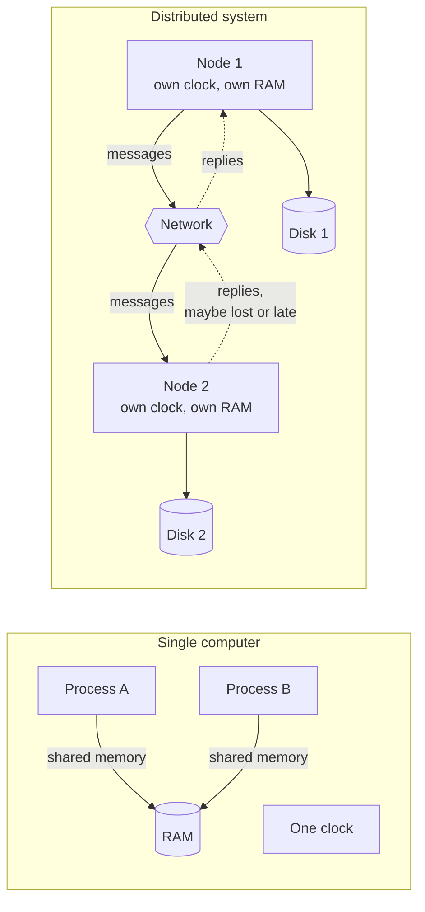

**Reading the diagram.** On the left, two processes share one memory and one clock: a write is visible to the other process within nanoseconds, and if the machine fails both processes stop together. On the right, each node has its own memory, disk (a separate storage boundary) and clock; the only connection is the network. Requests travel synchronously in the sense that a caller waits, but the dotted reply paths show what the caller cannot control: a reply may arrive late or never. Failure points are each node, each disk and the network itself, and they fail independently. Scaling comes from adding nodes, at the price of more independent failure points.

### 24.3.2 Why this is hard: uncertainty about other nodes

The three properties combine into one practical problem: **a node can never be certain of another node's current state.** When node 1 sends a request to node 2 and hears nothing for 2 seconds, the possibilities include: the request was lost; node 2 is slow; node 2 crashed before processing; node 2 processed it and crashed; the reply was lost; or the reply is still on its way. Node 1 sees exactly the same thing (silence) in all six cases (§24.8.1 draws them). Every distributed algorithm is, at heart, a strategy for acting correctly despite this ambiguity.

### 24.3.3 The two generals problem

The oldest illustration of this ambiguity is the **two generals problem**, first described by Akkoyunlu, Ekanadham and Huber [Akkoyunlu et al. 1975] and named by Jim Gray [Gray 1978].

::: definition
**Definition — Two generals problem.** Two armies camped on opposite hills must attack a city in the valley at the same time; either attacking alone is defeated. Their generals can communicate only by messengers who cross the valley and may be captured. The problem is to design a messaging protocol after which both generals are *certain* that they will attack together. No such protocol with a finite number of messages exists.
:::

**Figure 24.2 — The two generals problem: every acknowledgment needs another acknowledgment.**

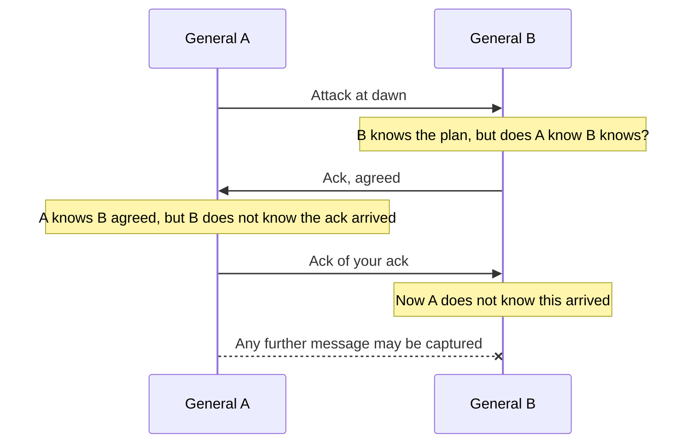

**Reading the diagram.** Solid arrows are messengers that arrived; the final arrow with a cross is a messenger captured in the valley. After each delivered message, the *sender* of the latest message is left unsure whether it arrived, so the other general's knowledge is always one level short of certainty. The failure point is the unreliable channel itself; adding more messengers raises the probability of agreement but never makes it certain, so this "protocol" does not scale toward certainty at any message count.

#### Why no finite protocol works

The proof is a short argument by contradiction. Suppose some protocol guarantees coordinated attack, and take the shortest such protocol, with $k$ messages. Consider the last message. Its sender must decide to attack whether or not it arrives, because the sender cannot observe its loss. So the receiver must also decide to attack whether or not it arrives, since the protocol guarantees agreement. Then the last message affects no decision and can be removed, giving a working protocol with $k-1$ messages. That contradicts "shortest", so no finite protocol exists.

#### What engineers do instead

You cannot achieve *certainty* of agreement over an unreliable channel, so practical systems settle for something weaker:

- **Make actions safe to repeat and keep trying.** TCP retransmits until acknowledged; an idempotency key (§22.15) makes a duplicated request harmless. Agreement is reached *eventually* rather than at a known moment.
- **Accept high probability.** Sending five independent messengers, each captured with probability 0.1, leaves a $0.1^5 = 10^{-5}$ chance that all are lost.
- **Use durable state and a protocol that may block.** Two-phase commit (§28.4) never lets participants disagree, but a participant that voted "yes" may have to wait indefinitely for the coordinator's decision.

::: mistake
**Mistake — "TCP solves the two generals problem."** TCP makes delivery *reliable while the connection works*, by retransmitting. It cannot tell the sender whether its final bytes were processed by the application before the peer crashed or the connection broke (§7.7). The connection-close handshake itself has the two generals shape, which is one reason for the `TIME_WAIT` state.
:::

## 24.4 Why distributed systems exist

### 24.4.1 Four reasons to pay the price

If distribution is this hard, why do it? Because a single computer cannot meet some requirements at all. **Table 24.1** lists the four main reasons; nearly every distributed design can be traced to at least one of them.

**Table 24.1 — Why systems are distributed.**

| Reason | The limit of one machine | Distributed answer | What it costs |
|---|---|---|---|
| Scale | Even the largest single servers top out at hundreds of cores and a few tens of terabytes of memory (as of 2026); one disk array holds finite data | Partition data and work across nodes (§14.6, Ch 18) | Cross-node queries, rebalancing, coordination |
| Fault tolerance | One machine, power supply or datacenter is a single point of failure | Replicate across nodes, racks, zones and regions (Ch 14, Ch 27) | Keeping replicas consistent; failover |
| Latency and geography | The speed of light: New York–London RTT is at least about 56 ms over fiber (§7.15.1) | Place replicas and computation near users (Ch 21, Ch 44) | Cross-region consistency and conflicts |
| Data residency | Law may require that personal data stay within a jurisdiction | Region-pinned partitions and processing | Fragmented operations; per-region capacity |

Two further reasons appear in practice. Some problems are **inherently distributed**: a payment network connects banks that will never share a computer, and a mobile app's offline edits live on the phone. And **organizations** distribute systems so that teams can deploy independently (Chapter 33 on microservices), which is a social reason with technical consequences.

**Data residency** deserves a precise statement because it is often overstated. The EU General Data Protection Regulation (GDPR) does not, in general, require data to be stored inside the EU; its Chapter V restricts *transfers* of personal data to countries outside it unless safeguards apply [EU 2016]. Other jurisdictions impose stricter localization rules for some data categories. Either way, a company serving those users needs data partitions pinned to regions, which is a distributed-systems requirement imposed by law.

#### Mathematical foundations: why replicate, and why failure is normal

::: formula
**Availability of $k$ independent replicas, and the chance that something in a fleet fails**

$$A_k = 1 - (1 - a)^k \qquad\qquad P_{\text{any}} = 1 - (1 - p)^n$$

| Symbol | Meaning | Units |
|---|---|---|
| $a$ | Availability of one replica (fraction of time it can serve) | dimensionless, 0–1 |
| $k$ | Number of replicas, any one of which can serve a request | count |
| $A_k$ | Availability of the replicated service, assuming independent failures and instant failover | dimensionless |
| $p$ | Probability that one node fails during a given period | dimensionless |
| $n$ | Number of nodes in the fleet | count |
| $P_{\text{any}}$ | Probability that at least one node fails in that period | dimensionless |
:::

::: example
**Worked example — PhotoShare's metadata service.**

1. One server has availability $a = 0.999$ (about 8.8 hours down per year).
2. With $k = 3$ independent replicas: $A_3 = 1 - (0.001)^3 = 1 - 10^{-9}$, nine nines on paper.
3. Now the fleet view. PhotoShare runs $n = 1{,}000$ nodes, each with probability $p = 0.001$ of failing on a given day. $P_{\text{any}} = 1 - 0.999^{1000}$. Since $\ln 0.999 \approx -0.0010005$, $0.999^{1000} \approx e^{-1.0005} \approx 0.368$, so $P_{\text{any}} \approx 0.632$.

Interpretation: replication makes the *service* far more available than any node, but the same scale guarantees that on about 63% of days *some* node fails. Failure is a daily routine, not an exception. Engineering implication: the nine nines are fiction, because replica failures are not independent (shared power, shared software bugs, shared network) and failover is not instant. The real gains come from placing replicas in separate failure domains and from making failover automatic and well tested, which is the subject of Chapter 27.
:::

::: recommendation
**Recommendation — Distribute only for a stated reason.** Write down which of the four reasons applies before splitting a system across machines. A single well-provisioned database server with a hot standby serves a surprising number of products, and it avoids most of the problems in this chapter. When you do distribute, the reason tells you what to optimize: scale favors partitioning, fault tolerance favors replication, latency favors locality, and residency favors region pinning.
:::

## 24.5 The eight fallacies of distributed computing

### 24.5.1 Origin and the list

Around 1994, L. Peter Deutsch, then at Sun Microsystems, wrote down seven false assumptions that programmers new to distributed applications invariably make; James Gosling later added an eighth. Bill Joy and Tom Lyon are credited with an earlier list of the first four. The list was never formally published; it circulated as a memo and was later explained in detail by Arnon Rotem-Gal-Oz [Rotem-Gal-Oz 2006].

The fallacies matter because each one is the hidden assumption behind a class of outages. Code written as if a remote call were a local function call (§8.8) silently assumes several of them at once.

**Table 24.2 — The eight fallacies and what each one breaks.**

| # | Fallacy | Reality | A concrete consequence | Mitigation |
|---|---|---|---|---|
| 1 | The network is reliable | Packets and connections are lost; switches and links fail daily | A payment request times out; the client retries; the customer is charged twice | Timeouts, retries with backoff, idempotency keys (§22.12, §22.15) |
| 2 | Latency is zero | Within a datacenter about 0.5 ms per round trip; across oceans 60–150 ms | A page making 100 sequential calls takes 50 ms in one region and about 7 s across regions | Batch calls, parallelize, colocate chatty services |
| 3 | Bandwidth is infinite | Links are finite and shared | Re-replicating 10 TB over a 1 Gbps link takes about 22 hours | Compress, ship deltas, throttle background traffic |
| 4 | The network is secure | Internal networks are routinely breached | Plaintext service-to-service traffic leaks credentials after one compromised host | Mutual TLS, zero trust (Ch 10) |
| 5 | Topology does not change | Nodes, routes and addresses change continuously | A client caches a server IP; the node is replaced; requests fail until restart | Service discovery, short DNS TTLs, re-resolution (§7.6) |
| 6 | There is one administrator | Many teams and providers control parts of the path | Another team changes a firewall rule or lets a certificate expire, and your service breaks | Explicit dependency contracts, certificate automation, change visibility |
| 7 | Transport cost is zero | Serialization costs CPU; providers charge for data transfer | Cross-zone chatter appears as a large line item on the cloud bill | Measure bytes per request, keep traffic zone-local where safe |
| 8 | The network is homogeneous | Mixed hardware, OS, protocol and software versions | During a rolling upgrade, v1 nodes cannot parse v2 messages and requests fail | Versioned, backward- and forward-compatible encodings |

### 24.5.2 The consequences in numbers

Three of the consequences in Table 24.2 are arithmetic worth checking yourself.

- **Fallacy 2.** A product page that issues 100 dependent calls, each a 0.5 ms round trip in one datacenter, spends $100 \times 0.5 = 50$ ms waiting on the network. Move the callee to another continent at 70 ms per round trip and the same code spends $100 \times 70 = 7{,}000$ ms. Nothing in the source code changed.
- **Fallacy 3.** Re-replicating a failed node's 10 TB onto a replacement over a 1 Gbps link takes $10 \times 10^{12} \times 8 / 10^9 = 80{,}000$ s, about 22 hours, during which the data has one fewer copy and the link is busy. This is why systems spread a failed node's data across many peers so that recovery runs in parallel (§27.12).
- **Fallacy 7.** At an *illustrative* transfer price of \$0.01 per GB, a service that moves 100 MB/s across zones pays for $100 \times 10^6 \times 86{,}400 = 8.64 \times 10^{12}$ bytes per day, about 8,640 GB, or roughly \$86 per day and \$31,500 per year, before any redundancy. Check your provider's current price list; the point is that bytes have a recurring cost.

::: industry
**AWS US-East, April 2011 — a topology change becomes an outage.** During a routine network capacity upgrade in one Availability Zone, traffic was shifted onto a lower-capacity network that could not carry it. Storage nodes of Elastic Block Store (EBS) lost contact with their replicas, concluded the replicas had failed, and all began searching for new space to re-mirror their data at once. The re-mirroring storm exhausted capacity and degraded EBS and dependent services for days. Fallacies 1, 3 and 5 combined: a topology change made the network unreliable, the recovery traffic assumed plentiful bandwidth, and a recovery mechanism designed for a few failed nodes misfired when many nodes saw failures simultaneously.
*Evidence: Primary* — [AWS 2011]
:::

::: mistake
**Mistake — "A remote procedure call is just a function call."** A local call either returns or throws, in nanoseconds. A remote call can also time out with an *unknown* outcome, take a million times longer, and run twice. RPC frameworks that hide this make the fallacies easy to commit; good ones expose deadlines and status codes (§8.8, §22.11).
:::

## 24.6 System models: timing and failures

### 24.6.1 Why a protocol needs a system model

A protocol is only correct *relative to its assumptions*. Raft (§26.7) is correct if nodes crash and restart but never lie; it is not correct if a node can send forged messages. A clock-based lease (§26.11) is safe only if clock drift is bounded. A **system model** writes these assumptions down so that you can check whether your environment satisfies them.

::: definition
**Definition — System model.** A precise statement of what a distributed algorithm may assume about (1) **timing**: bounds on message delay, processing speed and clock drift, and (2) **faults**: how nodes and links may misbehave. Proofs of correctness hold only within the stated model.
:::

Think of a model as the rules of a game. A chess strategy proven to win under standard rules is useless if your opponent may move two pieces per turn. In the same way, a protocol proven under the crash-stop model says nothing about a node with a corrupted disk that returns garbage.

### 24.6.2 Timing models

**Table 24.3 — Timing models.**

| Model | What is assumed | Strength of the assumption | What it allows | Realistic? |
|---|---|---|---|---|
| Synchronous | Known upper bounds on message delay, processing time and clock drift | Strongest | Perfect failure detection by timeout; consensus despite failures, even Byzantine with enough nodes | Only in special hardware (avionics buses); not in commodity networks |
| Partially synchronous | Bounds exist but are unknown, or known bounds hold only after an unknown **global stabilization time** (GST) | Middle | Consensus that is always safe and terminates once the system behaves | Yes: the model behind Paxos, Raft and most production systems |
| Asynchronous | No timing bounds at all; messages are eventually delivered | Weakest | Safety-only reasoning; deterministic consensus impossible with one crash (§24.13) | Safe to assume, but too weak to build consensus on alone |

The **partially synchronous** model was introduced by Dwork, Lynch and Stockmeyer [Dwork et al. 1988], and it is the model you should have in mind for real datacenters. Networks and machines are *usually* fast and predictable, but occasionally (during garbage-collection pauses, congestion or a partition) they are not, for an unknown length of time. A protocol designed for partial synchrony must never violate **safety** (nothing bad happens, such as two leaders committing different values) during bad periods, and it must make **progress** (liveness: something good eventually happens) once a good period lasts long enough.

### 24.6.3 Failure models

**Table 24.4 — Failure models, from most benign to most severe.**

| Model | What a faulty node may do | Real-world example | Detectable by others? | Nodes needed to tolerate $f$ faults in consensus | Typical systems |
|---|---|---|---|---|---|
| Crash-stop | Stops forever; until then behaves correctly | Hardware dies; VM terminated | Only by timeout (no certainty in async) | $2f+1$ | Textbook protocols; Paxos variants |
| Crash-recovery | Crashes, later restarts; keeps only what it wrote to stable storage | Process restart after an OOM kill; power cycle | Only by timeout | $2f+1$, with durable logs | Raft, ZooKeeper, most databases |
| Omission | Fails to send or receive some messages, otherwise correct | Full NIC buffer; overloaded switch dropping packets | Only by timeout | $2f+1$ | Covered by retransmission and quorums |
| Timing (performance) | Responds correctly but outside the assumed time bound | 30 s garbage-collection pause; fail-slow disk | Only relative to a bound | Depends on the timing model | Lease-based systems are vulnerable |
| Byzantine (arbitrary) | Anything: wrong values, contradictory messages to different peers, forged messages | Memory corruption, software bug, malicious operator | Not in general | $3f+1$ | Blockchains, some aerospace and financial systems |

A few clarifications make the table precise.

- **Crash-stop versus fail-stop.** Schlichting and Schneider defined a **fail-stop** processor as one that halts *and whose halting other processors can detect* [Schlichting and Schneider 1983]. Plain crash-stop gives no such notification, which is the realistic case: a crash looks like slowness until a timeout guesses otherwise.
- **Crash-recovery** is the model most production databases live in. Whatever a node promised before crashing (a vote, an acknowledgment) must be on stable storage before the promise is sent, or the node can "forget" it after restart and break the protocol. This is why Raft requires the current term and vote to be persisted before replying (§26.7).
- **Timing faults** only make sense where timing is assumed. A node that pauses for 30 s while holding a lease, then resumes and writes as if it still held it, is the classic example; fencing tokens (§26.13) exist for it.
- **Byzantine** comes from Lamport, Shostak and Pease's "Byzantine Generals" paper [Lamport et al. 1982]. It covers malice but also any arbitrary corruption, such as a bit flip that changes a message.

Links have models too. Cachin, Guerraoui and Rodrigues define **fair-loss links** (a message sent infinitely often is delivered infinitely often, but any single message may be lost), **stubborn links** (built on fair-loss by retransmitting forever) and **perfect links** (every message sent is delivered exactly once, with no creation of messages) built on stubborn links by acknowledgments and duplicate suppression [Cachin et al. 2011]. TCP is a practical approximation of a perfect link only while a connection lasts.

**Figure 24.3 — Failure models nest: each one includes the behaviors of those inside it.**

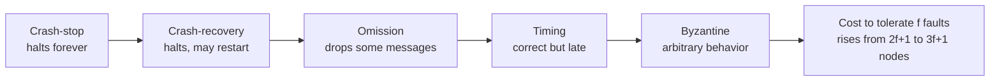

**Reading the diagram.** Each box is a fault model, and each arrow points to a strictly more general model: a crash is a special case of "stop sending messages" (omission), an omission is an infinitely late message (timing), and every behavior is a special case of arbitrary (Byzantine). An algorithm that tolerates a model on the right also tolerates every model to its left, but costs more. The final box shows that cost in replicas for consensus. This is a conceptual hierarchy, so there are no protocols, storage boundaries or synchronous/asynchronous paths on it; the practical failure point is choosing a model weaker than your real environment.

#### Mathematical foundations: replicas needed per fault model

::: formula
**Minimum replicas for consensus in the partially synchronous model**

$$n_{\text{crash}} \ge 2f + 1 \qquad\qquad n_{\text{Byz}} \ge 3f + 1$$

| Symbol | Meaning | Units |
|---|---|---|
| $f$ | Maximum number of nodes that may be faulty at once | count |
| $n_{\text{crash}}$ | Nodes needed when faults are crashes or omissions | count |
| $n_{\text{Byz}}$ | Nodes needed when faults may be arbitrary | count |
:::

The intuition for $2f+1$: any decision must be backed by a **majority quorum** of $f+1$ nodes, and any two majorities overlap in at least one node, so two conflicting decisions cannot both gather a quorum. For Byzantine faults, quorums of $2f+1$ out of $3f+1$ overlap in at least $f+1$ nodes, so at least one honest node is in every overlap. Quorums in depth are in §26.4.

::: example
**Worked example — How many replicas for PhotoShare's coordination service?**

1. Requirement: survive one zone outage, where each zone holds one replica, so $f = 1$.
2. Crash faults: $n \ge 2(1)+1 = 3$ replicas in 3 zones. A majority is 2, so with one zone down the other two still decide.
3. Survive two simultaneous zone losses ($f=2$): $n \ge 5$, so 5 replicas, which needs 5 failure domains.
4. If the same service had to tolerate one *Byzantine* replica: $n \ge 3(1)+1 = 4$, and every decision needs $2f+1 = 3$ matching votes.

Interpretation: tolerating arbitrary faults costs one third more replicas for $f = 1$ and many more messages per decision. Engineering implication: inside one organization's datacenters, use crash-recovery protocols plus checksums against corruption (§24.14); reserve Byzantine fault tolerance for mutually distrustful parties.
:::

::: industry
**Raft-based coordination stores.** etcd and ZooKeeper deployments almost always run 3 or 5 members: 3 tolerates one failure, 5 tolerates two. Even sizes add cost without adding tolerance (4 members still tolerate only one failure, because a majority is 3). Both assume crash-recovery faults and partial synchrony.
*Evidence: Primary* — [Ongaro and Ousterhout 2014]
:::

::: mistake
**Mistake — "Byzantine faults only matter for blockchains."** Byzantine behavior also comes from bugs, misconfiguration and hardware corruption. You rarely pay for full Byzantine fault tolerance inside a company, but you should still defend against its cheapest forms: end-to-end checksums against corruption and version checks against stale or mixed-version peers.
:::

## 24.7 Network partitions

### 24.7.1 Definition and types

::: definition
**Definition — Network partition.** A network fault after which some nodes that are running correctly cannot exchange messages with some other running nodes for a period of time. (This book reserves "partition" alone for a subset of data, §14.6; a network fault is always a **network partition**.)
:::

From inside a node, a partition is indistinguishable from the remote nodes having crashed: messages simply stop arriving. The difference matters enormously, because the "crashed" nodes are still running, may still serve clients, and may believe that *you* have crashed.

Partitions come in several shapes, and the less obvious shapes cause the worst bugs.

**Figure 24.4 — Three kinds of network partition.**

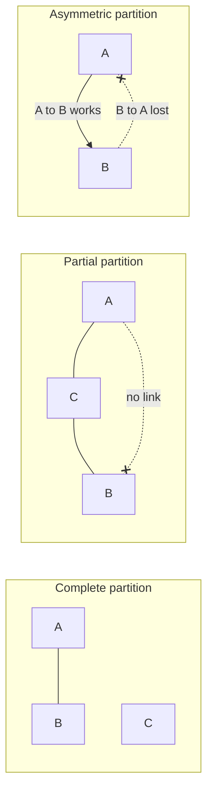

**Reading the diagram.** In the *complete* partition, the cluster splits cleanly: A and B talk to each other, C is cut off from both. In the *partial* partition, A and B cannot reach each other, yet both reach C, so C sees a healthy cluster while A and B each see a missing peer. In the *asymmetric* (one-way) partition, messages from A to B arrive but B's replies to A are lost. Solid lines are working links; dotted lines with crosses are failed directions. All traffic is the cluster's own heartbeat and data traffic; the failure points are the links, not the nodes, and adding nodes multiplies the number of links that can fail independently.

**Table 24.5 — Partition types and the trouble each one causes.**

| Type | What happens | Typical cause | Why it is dangerous |
|---|---|---|---|
| Complete | The network splits into groups that cannot talk to each other | Lost uplink, failed inter-region link | Each side may elect a leader or accept writes: **split brain** (§26.12) |
| Partial | Some pairs cannot communicate while others can | Misconfigured firewall rule, failed link in a mesh, one bad switch port | Nodes disagree about who is alive; leadership can flap as nodes reach different peers |
| Asymmetric (one-way) | Traffic flows in one direction only | Saturated queue in one direction, ACL or routing asymmetry | A leader receives requests and heartbeats but its replies are lost, so it believes it is healthy while followers elect another leader |
| Intermittent (flapping) | Connectivity repeatedly comes and goes | Faulty optics, overloaded link | Constant failovers; each one costs work and risks inconsistency |

### 24.7.2 How often do networks fail?

Engineers who assume partitions are rare are wrong, and there is evidence. Bailis and Kingsbury surveyed published post-mortems and studies in "The Network is Reliable" [Bailis and Kingsbury 2014]; the title is ironic. The evidence they collected includes:

- **Microsoft datacenters.** A measurement study of several Microsoft datacenters over a year [Gill et al. 2011] reported on average 5.2 device failures and 40.8 link failures per day, with a median time to repair of about five minutes and some failures lasting much longer. It also found that network redundancy was far less effective than hoped, improving the median traffic carried during failures by only about 43%.
- **Google clusters.** Jeff Dean's description of a typical first year of a new cluster included, among many other events, around 20 rack failures, about 5 racks that "go wonky" with half their packets lost, around 8 network maintenances of which several cause about 30 minutes of random connectivity loss, and about 3 router failures [Dean 2009].
- **Failures in deployed software.** Alquraan et al. studied 136 failures caused by network partitions in 25 widely used systems, including databases, coordination services and message brokers [Alquraan et al. 2018]. Most had catastrophic effects such as data loss, reappearance of deleted data and broken locks; many could be triggered by isolating a single node; and *partial* partitions were a significant and previously under-studied cause.

The conclusion is not that networks are bad, but that a large fleet experiences many small network faults every day. A system with thousands of nodes must assume that *some* pair of nodes cannot talk *right now*.

::: industry
**Cloudflare, November 2020 — a partial partition and a Raft cluster.** A network switch failed partially: some of the nodes of an etcd cluster (which uses Raft) could reach each other and some could not. The cluster repeatedly failed to keep a stable leader, and while leadership was unsettled it could not accept writes. Systems that depended on it, including the automation that manages database primaries, reacted with failovers that overloaded other databases, and Cloudflare's API and dashboard were degraded for several hours. Cloudflare titled its post-mortem "A Byzantine failure in the real world" because the partial connectivity gave different nodes contradictory views of the same cluster.
*Evidence: Primary* — [Lianza and Snook 2020]
:::

### 24.7.3 What a partition forces you to choose

During a partition, a node that receives a request for data it cannot coordinate on has two options:

1. **Refuse** (or wait) until it can reach enough peers. This preserves consistency but sacrifices availability on the minority side.
2. **Answer** with the data it has, and reconcile later. This preserves availability but allows the two sides to diverge, and the divergence must be resolved after the partition heals (version vectors, §24.11; conflict resolution, §27.14).

The precise statement of this trade-off is the CAP theorem, and its latency-aware extension is PACELC; both are in §25.8–§25.9. What this chapter adds is the observation behind them: you do not get to choose *whether* partitions happen, only what your system does when one does.

**Table 24.6 — Partition failure scenarios.**

| What goes wrong | Why | Detection | Recovery | Prevention |
|---|---|---|---|---|
| Two primaries accept conflicting writes | Each side of a complete partition elects a leader | Two nodes report the primary role; divergent replication positions | Pick one history; reconcile or discard the other's writes | Majority quorums; fencing tokens (§26.13) |
| Leader flapping during a partial partition | Different nodes see different sets of peers | Election count and term number climbing quickly | Isolate the bad link or node | Pre-vote and leader-stickiness checks in Raft (§26.7); per-link health monitoring |
| "Healthy" leader that nobody hears | Asymmetric partition drops the leader's outbound traffic | Followers time out while the leader's own metrics look normal | Step the leader down on loss of quorum acknowledgments | Leaders check that a quorum acknowledges them within a lease period |
| Recovery storm after healing | All nodes resynchronize at once | Bandwidth and CPU spikes right after connectivity returns | Throttle resynchronization | Rate-limited, prioritized anti-entropy (§27.13) |

::: mistake
**Mistake — "Partitions mean the cable was cut."** Most partitions in practice are partial, short, or caused by software and configuration: a firewall change, a full queue, a long garbage-collection pause that makes a node unreachable for 20 s. A node that is alive but paused is, to its peers, partitioned.
:::

## 24.8 Partial failures, gray failures and timeouts

### 24.8.1 Partial failure

::: definition
**Definition — Partial failure.** A state in which some components of a system have failed while others continue to work, so that an operation may be applied in some places and not others, and the working components cannot reliably tell which components failed.
:::

On one computer, partial failure is rare enough that most programs ignore it: if memory fails, the machine crashes. In a distributed system it is the normal state (§24.4.1 showed that a 1,000-node fleet sees a failure on most days). The hard part is not the failure but the *ambiguity*: a client cannot tell which of several very different situations it is in.

**Figure 24.5 — Six things that can happen to one request, all of which look the same to the client.**

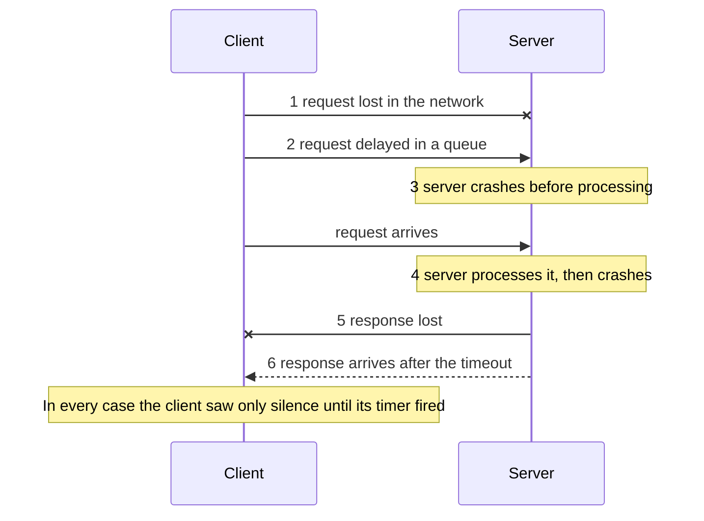

**Reading the diagram.** The client sends a synchronous request (solid arrows) and waits for a response (dashed arrow). Outcome 1 loses the request; 2 delays it; 3 and 4 are server crashes before and after the side effect; 5 loses the response; 6 delivers it too late to matter. Outcomes 4, 5 and 6 mean the operation *happened*; 1 and 3 mean it did not; 2 means it may still happen. The storage boundary is the server's database, which may or may not contain the effect. The failure points are the network in both directions and the server. Retrying is safe only if the operation is idempotent (§22.15), because in half of these cases the retry is a duplicate.

### 24.8.2 Gray failure

Crash failures are, in a sense, the easy case: the component is clearly dead. Huang et al. observed that many serious incidents in Microsoft's cloud were caused by something subtler, which they called **gray failure** [Huang et al. 2017].

::: definition
**Definition — Gray failure.** A component failure that is *differentially observable*: some observers (often the system's own failure detector) consider the component healthy, while others (often the applications using it) experience it as failed or badly degraded.
:::

Examples of gray failure include a network interface that drops 1% of packets (TCP throughput collapses, §7.15.3, but pings succeed); a disk that completes every I/O but takes 500 ms instead of 5 ms (a **fail-slow** fault; Gunawi et al. collected over a hundred such hardware cases from large production systems [Gunawi et al. 2018]); and a process whose heartbeat thread runs happily while its request-handling threads are deadlocked.

**Figure 24.6 — Gray failure is a disagreement between observers.**


**Reading the diagram.** The failure detector probes the storage node with a cheap heartbeat that never touches the disk, so it gets fast replies and concludes "healthy". The application's synchronous read and write requests go through the slow disk and time out (dotted arrow: the response effectively never arrives in time). The storage boundary, the node's disk, is the failure point, and it is invisible to the probe. Because the detector says healthy, the load balancer keeps sending traffic and no failover happens; adding more nodes does not help, since the sick node still receives its share. The fix is to make the detector observe what the application observes.

Huang et al. recommend closing the gap in observation: let detectors use signals from the applications themselves (error rates and latency measured by clients), and treat severe degradation as failure. In practice this means **health checks that exercise the real dependency path** (a health endpoint that performs a small read), **outlier detection** in load balancers (passive health checks, §19.5) that ejects a node whose error rate or latency is far worse than its peers', and treating a node that is "too slow" as down.

### 24.8.3 Timeouts: the only failure detector you have

In an asynchronous or partially synchronous system, there is no way to *know* that a remote node has crashed. The only evidence is the absence of a reply within some time. Every failure detector, from a simple timeout to the phi-accrual detector used by Cassandra and Akka to the SWIM gossip protocol (§27.10), is a policy for turning silence into a *suspicion*.

#### Mathematical foundations: choosing a timeout

::: formula
**Timeout from bounded delays, and its practical percentile form**

$$T = 2d + r \qquad\qquad T_{\text{practical}} = \text{RTT}_{p99.9} + r_{p99.9} + m$$

| Symbol | Meaning | Units |
|---|---|---|
| $d$ | Upper bound on one-way network delay | s |
| $r$ | Upper bound on the time the remote node takes to process the request | s |
| $T$ | Timeout after which the absence of a reply proves a fault (only if the bounds are real) | s |
| $\text{RTT}_{p99.9}$ | Measured 99.9th-percentile round-trip time | s |
| $r_{p99.9}$ | Measured 99.9th-percentile processing time | s |
| $m$ | Safety margin for pauses (garbage collection, scheduling) | s |
:::

If a real bound $d$ existed (a synchronous system), a reply would always arrive within $2d + r$, and a later reply would prove a fault. Real networks have no such bound, so the practical form uses a high percentile of measured behavior: the timeout then *mistakes* a slow node for a dead one with a small, chosen probability.

::: example
**Worked example — Timeout for PhotoShare's metadata replicas.**

1. Measured inside one region: RTT p50 = 0.4 ms, p99.9 = 4 ms; processing p99.9 = 20 ms.
2. Garbage-collection pauses on these JVM nodes reach 150 ms a few times a day; choose $m = 200$ ms.
3. $T_{\text{practical}} = 4 + 20 + 200 = 224$ ms; round to 250 ms for a request timeout.
4. For declaring a *node* dead (which triggers failover), require several consecutive misses: with heartbeats every 250 ms and 4 misses, detection takes about 1 s.

Interpretation: the timeout is dominated by the pause margin, not by the network. Choose $T$ too low and normal pauses trigger false failovers, which move load and can cascade; choose it too high and real failures leave users waiting. Engineering implication: measure pause times and tail latency before setting timeouts, use different values for "retry this request" (short, §22.11) and "fail over this node" (longer, with several misses), and prefer adaptive detectors that learn the delay distribution (§27.10).
:::

**Table 24.7 — Partial-failure scenarios.**

| What goes wrong | Why | Detection | Recovery | Prevention |
|---|---|---|---|---|
| Duplicate side effect after timeout | Request succeeded, response lost; client retried | Duplicate rows, double charges | Compensate or deduplicate | Idempotency keys (§22.15) |
| Healthy node declared dead | Timeout shorter than a garbage-collection pause | Failover events correlated with pause logs | Let the node rejoin as follower | Timeouts from measured p99.9 plus pause margin; several misses |
| Sick node kept in rotation | Gray failure: health check misses the slow path | Client-side p99 and error rate high for one node | Eject the node manually | Deep health checks; outlier ejection |
| Cascading slowness | Callers wait the full timeout on a slow dependency | Thread pools full; latency rises everywhere | Shed load; open circuit breakers | Deadlines, bulkheads, breakers (§22.11–§22.14) |

::: mistake
**Mistake — "If the node answered the health check, it is up."** A health check answers one narrow question. A node can pass it while failing every real request. Health is defined by what clients experience.
:::

::: tip
**Interview tip — Saying "the request timed out" precisely.** When a design question involves a remote write, say explicitly that a timeout means *unknown outcome*, list the three possibilities (not delivered, failed, succeeded with lost reply), and name the mechanism that makes retrying safe. Interviewers listen for this.
:::

## 24.9 Physical clocks: drift, NTP, PTP and skew

### 24.9.1 Two clocks in every computer

Every server has at least two clocks, and confusing them is a classic bug.

::: definition
**Definition — Time-of-day clock and monotonic clock.** A **time-of-day** (wall-clock) clock returns the current date and time, for example as seconds since the Unix epoch (Linux `CLOCK_REALTIME`, Python `time.time()`). It is synchronized with other machines and *can jump* forward or backward when corrected. A **monotonic** clock (Linux `CLOCK_MONOTONIC`, Python `time.monotonic()`) only moves forward at a steady rate from an arbitrary starting point. It is meaningless across machines but correct for measuring durations on one machine.
:::

Use the monotonic clock for timeouts, rate-limiter refill (§22.4) and latency measurement. Use the time-of-day clock only when you need a calendar time, and never assume two machines' wall clocks agree.

### 24.9.2 Quartz drift

A computer keeps time by counting the vibrations of a quartz crystal oscillator. The crystal's frequency depends on manufacturing tolerance, temperature and age, so it is never exactly the nominal value. The error is expressed in **parts per million (ppm)**: a clock with a drift rate of 1 ppm gains or loses 1 µs every second, which is 86.4 ms per day. Commodity server oscillators typically drift by tens of ppm, and Google's Spanner design conservatively assumes a worst case of 200 ppm [Corbett et al. 2012].

::: formula
**Clock drift and the resynchronization interval**

$$\Delta(t) = \rho\, t \qquad\qquad \Delta_{AB}(t) \le 2\rho\, t \qquad\qquad T_{\text{sync}} \le \frac{\varepsilon}{2\rho}$$

| Symbol | Meaning | Units |
|---|---|---|
| $\rho$ | Maximum drift rate of one clock | ppm (1 ppm = $10^{-6}$ s/s) |
| $t$ | Time since the clock was last synchronized | s |
| $\Delta(t)$ | Worst-case error of one clock relative to true time | s |
| $\Delta_{AB}(t)$ | Worst-case skew between two clocks drifting in opposite directions | s |
| $\varepsilon$ | Largest skew you can tolerate between any two clocks | s |
| $T_{\text{sync}}$ | Longest interval between synchronizations that keeps skew within $\varepsilon$ | s |
:::

::: example
**Worked example — Drift on PhotoShare's servers, and Spanner's sawtooth.**

1. A server drifts at $\rho = 50$ ppm $= 50 \times 10^{-6}$ s/s. Unsynchronized for a day: $\Delta = 50 \times 10^{-6} \times 86{,}400 = 4.32$ s.
2. Two servers, one fast and one slow at 50 ppm, diverge at $2 \times 50 = 100$ µs per second.
3. To keep them within $\varepsilon = 1$ ms: $T_{\text{sync}} \le 0.001 / (2 \times 50 \times 10^{-6}) = 10$ s.
4. Spanner: each server polls its time masters every 30 s and assumes 200 ppm, so uncertainty grows by up to $200 \times 10^{-6} \times 30 = 6$ ms between polls. Corbett et al. describe exactly this sawtooth of 0 to 6 ms on top of about 1 ms of communication delay, giving a total uncertainty $\varepsilon$ of about 1 to 7 ms [Corbett et al. 2012].

Interpretation: drift alone is small per second but unbounded over time, so clocks *must* be resynchronized continually. Engineering implication: an unsynchronized machine can be seconds off within a day. Alert on synchronization loss, not just on offset, because a host that silently stopped syncing will drift further every hour.
:::

### 24.9.3 NTP: synchronizing over a network

The **Network Time Protocol** (NTP), designed by David Mills and currently specified as NTPv4 in RFC 5905 [Mills et al. 2010], synchronizes a client's clock with servers over an ordinary packet network. Its central idea is to measure a round trip, assume the network delay is the same in both directions, and compute the offset from four timestamps.

**Figure 24.7 — The NTP on-wire exchange.**

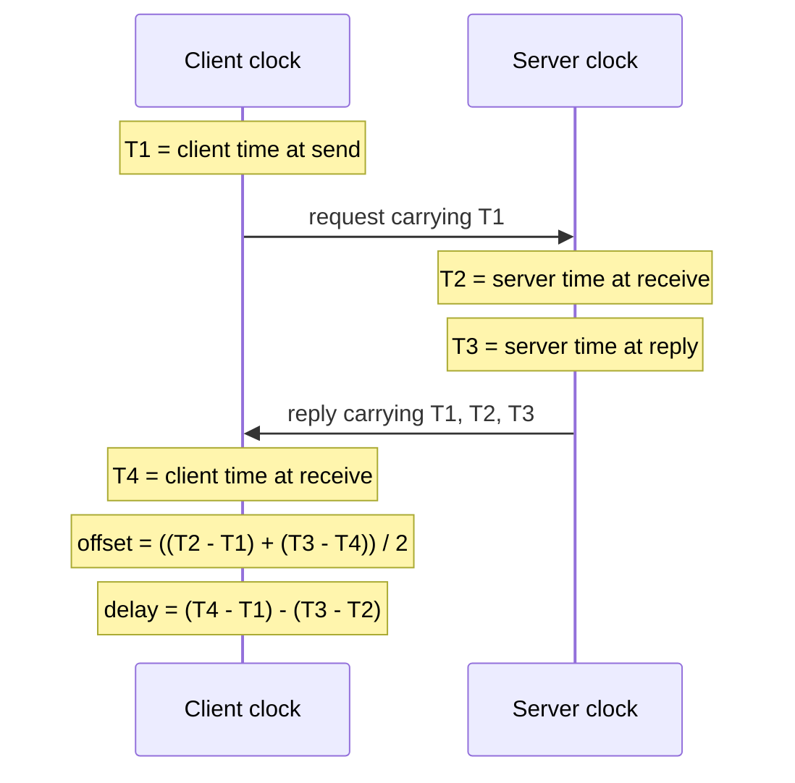

**Reading the diagram.** The client sends a UDP request (port 123) stamped with its own clock reading $T_1$; the server stamps arrival $T_2$ and departure $T_3$ with *its* clock; the client stamps arrival $T_4$ with its clock. Both arrows are one synchronous request/response. No storage is involved; the "state" is the client's clock. The failure points are asymmetric network delay (which biases the offset) and a wrong server clock (which NTP handles by querying several servers). NTP scales through a hierarchy of servers (Figure 24.8).

::: formula
**NTP offset, round-trip delay and error bound (RFC 5905)**

$$\theta = \frac{(T_2 - T_1) + (T_3 - T_4)}{2} \qquad \delta = (T_4 - T_1) - (T_3 - T_2) \qquad |\theta - \theta_{\text{true}}| \le \frac{\delta}{2}$$

| Symbol | Meaning | Units |
|---|---|---|
| $T_1$ | Client clock when the request is sent | s |
| $T_2$ | Server clock when the request arrives | s |
| $T_3$ | Server clock when the reply is sent | s |
| $T_4$ | Client clock when the reply arrives | s |
| $\theta$ | Estimated offset: server clock minus client clock; the client adds $\theta$ to correct itself | s |
| $\delta$ | Round-trip network delay, excluding the server's processing time | s |
| $\theta_{\text{true}}$ | Actual offset | s |
:::

The estimate is exact when the two directions take equal time. If the request takes $d_1$ and the reply $d_2$, the error is $(d_1 - d_2)/2$, and since $d_1 + d_2 = \delta$, the error can never exceed $\delta/2$. That is why NTP prefers samples with the *smallest* round-trip delay: they have the tightest error bound.

::: example
**Worked example — One NTP exchange, symmetric and asymmetric.**

Timestamps in seconds after 10:00:00: $T_1 = 0.000$ (client), $T_2 = 0.120$ (server), $T_3 = 0.121$ (server), $T_4 = 0.061$ (client).

1. Delay: $\delta = (0.061 - 0.000) - (0.121 - 0.120) = 0.061 - 0.001 = 0.060$ s = 60 ms.
2. Offset: $\theta = [(0.120 - 0.000) + (0.121 - 0.061)]/2 = (0.120 + 0.060)/2 = 0.090$ s = 90 ms. The client's clock is 90 ms behind the server's.
3. Check: if each direction took 30 ms and the client was 90 ms behind, the request sent at client time 0.000 (server time 0.090) arrives at server time 0.120, and the reply sent at 0.121 arrives at server time 0.151, which is client time 0.061. Both match.
4. Asymmetric case: suppose the request actually took 50 ms and the reply 10 ms (same $\delta = 60$ ms). NTP still computes 90 ms, but the true offset is $0.120 - 0.050 = 0.070$ s, an error of $(50 - 10)/2 = 20$ ms, within the bound $\delta/2 = 30$ ms.

Interpretation: NTP's accuracy is limited by path asymmetry, which it cannot see. Engineering implication: a client 60 ms away from its server cannot be sure of its time to better than ±30 ms from a single sample. That is why datacenters run their own stratum-1 or stratum-2 servers close to their machines, where round trips are well under a millisecond and the bound shrinks accordingly.
:::

**Figure 24.8 — The time-distribution hierarchy: NTP strata and a PTP domain.**

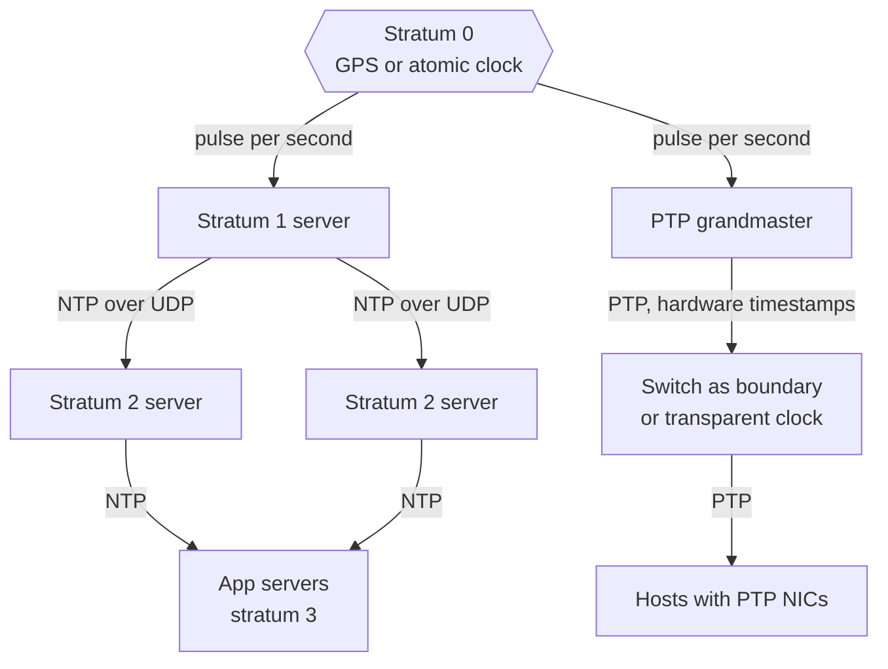

**Reading the diagram.** A **stratum** is the distance from a reference clock. Stratum 0 devices (GPS receivers, atomic clocks) are not on the network; they feed a stratum-1 server directly. Each NTP hop adds one stratum (up to 15; 16 means unsynchronized). Application servers query several stratum-2 servers so that one bad server (a **falseticker**) can be outvoted. The right-hand path is a PTP domain: a grandmaster clock distributes time through switches that participate in the protocol, to hosts whose network cards timestamp packets in hardware. All arrows are periodic request/response exchanges; the failure points are the reference (GPS antenna loss), a falseticker server, and network asymmetry. The hierarchy scales because each server serves many clients.

#### How an NTP client turns samples into a clock

An NTP daemon such as `ntpd` or `chrony` does much more than one exchange:

1. It polls several servers repeatedly (every 64 to 1,024 s by default in `ntpd`; more often when configured).
2. For each server it keeps recent samples and prefers those with the lowest delay $\delta$.
3. It runs a **selection** algorithm that finds the largest group of servers whose error intervals overlap, discarding falsetickers.
4. It combines the survivors into one offset estimate.
5. A **clock discipline** loop adjusts the local clock. Small offsets are corrected by **slewing**: running the clock slightly fast or slow (`ntpd` limits the slew rate to 500 ppm, i.e., 0.5 ms per second). Large offsets (by default more than 128 ms in `ntpd`) are corrected by **stepping**: jumping the clock, possibly *backwards*.

NTP typically keeps clocks within a few milliseconds over a good wide-area path, and within well under a millisecond on a quiet local network, but there is no hard guarantee: a congested or asymmetric path, a misconfigured server, or a virtual machine paused by its hypervisor can produce offsets of seconds.

### 24.9.4 PTP: sub-microsecond synchronization

The **Precision Time Protocol** (PTP), standardized as IEEE 1588 (the 2008 version, PTPv2, and the 2019 revision) [IEEE 2008; IEEE 2019], uses the same four-timestamp idea with three changes that improve accuracy by orders of magnitude:

1. **Hardware timestamping.** Network interface cards record the instant a packet crosses the wire, removing the variable delay of the operating system's network stack, which is the largest error source for software NTP.
2. **Network participation.** Switches act as **transparent clocks**, adding the time each packet spent queued inside them to a correction field, or as **boundary clocks**, which synchronize to the upstream clock and serve time downstream. Queuing delay, the main cause of asymmetry, is thereby measured rather than guessed.
3. **Frequent exchanges.** A grandmaster sends `Sync` messages (often many per second); hosts measure the path delay with `Delay_Req` and `Delay_Resp` messages.

In a well-built datacenter network, PTP achieves sub-microsecond synchronization. The cost is hardware: PTP-capable network cards, switches that support PTP, and reference clocks with GPS receivers or atomic oscillators.

::: industry
**Precision time in public clouds and at Meta.** Meta has described replacing NTP with PTP across its datacenters, citing sub-microsecond precision as the enabler for tighter consistency in distributed systems [Obleukhov and Byagowi 2022]. AWS announced in 2023 that the Amazon Time Sync Service offers microsecond-accurate time on supported instance types, using a hardware reference clock exposed through PTP, and publishes ClockBound, an open-source daemon that returns the current time together with an *error bound* rather than a single value [AWS 2023]. Both reflect the same trend: applications increasingly ask "what is the time *and how wrong could it be*?"
*Evidence: Primary* — [Obleukhov and Byagowi 2022; AWS 2023]
:::

### 24.9.5 Leap seconds and smearing

Atomic time (TAI) ticks uniformly. Civil time (UTC) is kept within 0.9 s of the Earth's slightly irregular rotation by inserting **leap seconds**: occasionally, the last minute of 30 June or 31 December has 61 seconds, ending `23:59:60`. Since 1972, 27 positive leap seconds have been added, the latest at the end of 31 December 2016, so TAI − UTC = 37 s. Unix time, which pretends every day has 86,400 seconds, cannot represent `23:59:60`; systems typically repeat a second, so time appears to go backwards.

Leap seconds have caused real outages. The leap second of 30 June 2012 triggered a Linux kernel timer bug that left many Java and MySQL processes spinning at full CPU across the industry. At the end of 2016, Cloudflare's DNS software computed a negative duration when time stepped backwards, which caused failures in some of its DNS resolutions [Graham-Cumming 2017].

The common mitigation is **leap smearing**: instead of inserting one extra second, time servers run their clocks slightly slow over a long window so that the extra second is absorbed gradually. Google's public NTP service smears linearly over the 24 hours from noon to noon UTC around the leap second [Google: Leap Smear].

::: formula
**Leap-smear rate**

$$r_{\text{smear}} = \frac{1\ \text{s}}{W} \qquad\qquad e_{\max} = 0.5\ \text{s}\ \text{(midpoint offset from UTC)}$$

| Symbol | Meaning | Units |
|---|---|---|
| $W$ | Smear window | s |
| $r_{\text{smear}}$ | Rate by which smeared clocks run slow during the window | ppm |
| $e_{\max}$ | Offset between a smeared clock and true UTC at the leap second instant | s |
:::

::: example
**Worked example — Google-style 24-hour smear.**

1. $W = 24 \times 3{,}600 = 86{,}400$ s.
2. $r_{\text{smear}} = 1 / 86{,}400 = 1.157 \times 10^{-5}$ s/s $\approx 11.6$ ppm.
3. At the leap second, a smeared clock is half-way through: it differs from UTC by 0.5 s.

Interpretation: 11.6 ppm is within the range that NTP clients slew routinely, so no client sees a step. Engineering implication: never mix smeared and non-smeared time sources in one fleet. Near the leap second, two groups of servers would disagree by up to 0.5 s, and a client using both kinds of server would see contradictory samples. In 2022 the General Conference on Weights and Measures resolved to let the difference between UT1 and UTC grow larger by 2035, which will in effect stop leap seconds being added [BIPM 2022]; until then, systems must handle them.
:::

### 24.9.6 Why wall-clock last-writer-wins loses data

Many replicated databases resolve concurrent writes to the same key with **last-writer-wins (LWW)**: every write carries a timestamp, and the write with the higher timestamp survives (Cassandra does this per cell, §12.6; multi-primary systems often offer it, §14.5). When timestamps come from wall clocks, clock skew decides which write "wins", not the actual order of events.

**Figure 24.9 — Last-writer-wins discards the later write when one clock runs fast.**

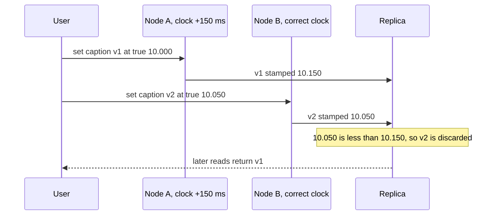

**Reading the diagram.** The user edits a PhotoShare caption through node A, then 50 ms later edits it again through node B (for example, after a load-balancer change). Both writes are synchronous to the receiving node, which replicates asynchronously to a replica (the storage boundary). Node A's clock is 150 ms fast, so its earlier write carries the larger timestamp. The replica applies LWW and silently discards v2, which the user wrote last. The failure point is node A's clock; no error is reported anywhere, and adding replicas does not help because every replica applies the same rule.

::: example
**Worked example — How large is the danger window?**

1. Skew between A and B: $\varepsilon = 150$ ms.
2. A write through B at true time $t$ loses to an earlier write through A at true time $t - x$ whenever A's stamp is larger: $(t - x) + 0.150 > t$, i.e., $x < 150$ ms.
3. So any two writes to the same key through these two nodes that are less than 150 ms apart may be reordered. PhotoShare's caption edits are rare, but an inventory counter updated 50 times per second from several nodes would lose updates constantly.

Interpretation: under LWW, the clock skew is the width of a window within which the database may discard *causally later* writes, without any error. Engineering implication: if you use LWW, keep skew far below the typical gap between conflicting writes, and use it only for data where losing one of two near-simultaneous writes is acceptable. Otherwise use logical clocks to capture causality (§24.10–§24.12), version vectors to detect concurrency (§24.11), conditional writes, or CRDTs that merge instead of discarding (§27.14).
:::

#### Code example

The following program checks the NTP arithmetic, the resynchronization interval and the LWW anomaly.

```python
"""Clock arithmetic: NTP offset/delay, drift-based resync interval,
and how last-writer-wins (LWW) loses a write when clocks are skewed."""


def ntp_offset_delay(t1, t2, t3, t4):
    """RFC 5905 on-wire calculation (all values in seconds).
    t1, t4 are read from the client clock; t2, t3 from the server clock."""
    offset = ((t2 - t1) + (t3 - t4)) / 2   # theta: server clock minus client clock
    delay = (t4 - t1) - (t3 - t2)          # delta: round trip minus server hold time
    return offset, delay


def resync_interval(max_skew_s, drift_ppm):
    """Longest interval between syncs that keeps two clocks within max_skew_s
    when each may drift up to drift_ppm in opposite directions."""
    return max_skew_s / (2 * drift_ppm * 1e-6)


class LWWRegister:
    """A replica that keeps the value with the highest wall-clock timestamp."""

    def __init__(self):
        self.value, self.ts = None, float("-inf")

    def apply(self, value, ts):
        if ts > self.ts:
            self.value, self.ts = value, ts
            return "applied"
        return "discarded"


if __name__ == "__main__":
    theta, delta = ntp_offset_delay(0.000, 0.120, 0.121, 0.061)
    print(f"NTP: offset {theta * 1000:.1f} ms, delay {delta * 1000:.1f} ms, "
          f"error bound +/-{delta / 2 * 1000:.1f} ms")

    print(f"Resync every {resync_interval(0.001, 50):.0f} s to stay within 1 ms at 50 ppm")

    # Node A's clock runs 150 ms fast; node B's clock is correct.
    skew = {"A": 0.150, "B": 0.000}
    writes = [  # (true time in s, node, value): the second write happens 50 ms later
        (10.000, "A", "caption v1"),
        (10.050, "B", "caption v2"),
    ]
    replica = LWWRegister()
    for true_t, node, value in writes:
        stamp = true_t + skew[node]                      # what the node's clock says
        print(f"t={true_t:.3f} node {node} writes {value!r:13} stamp={stamp:.3f}"
              f" -> {replica.apply(value, stamp)}")
    print(f"Final value: {replica.value!r} (the later write was lost)")
```

Output:

```text
NTP: offset 90.0 ms, delay 60.0 ms, error bound +/-30.0 ms
Resync every 10 s to stay within 1 ms at 50 ppm
t=10.000 node A writes 'caption v1'  stamp=10.150 -> applied
t=10.050 node B writes 'caption v2'  stamp=10.050 -> discarded
Final value: 'caption v1' (the later write was lost)
```

What to notice:

- `ntp_offset_delay` is a direct transcription of the RFC 5905 formulas; the sign convention is "server minus client".
- `LWWRegister.apply` returns `"discarded"` for the user's *latest* edit, and nothing in the system raises an error: LWW data loss is silent.
- Even if the replica received v2 first, the outcome is the same, because LWW orders by timestamp, not by arrival.

### 24.9.7 Clock sources and bounded uncertainty

**Table 24.8 — Clock synchronization options.**

| Option | How it works | Typical accuracy (as of 2026) | Cost | Use when |
|---|---|---|---|---|
| Unsynchronized quartz | Free-running oscillator | Drifts seconds per day | None | Never for timestamps shared across machines |
| NTP over the Internet | Software timestamps, public servers | Milliseconds to tens of milliseconds | Free | Laptops, small fleets, logging |
| NTP inside a datacenter | Local stratum-1/2 servers, short paths | Sub-millisecond to a few ms | Low | Default for server fleets |
| PTP with hardware timestamps | NIC and switch timestamping | Sub-microsecond in a well-built LAN | PTP-capable NICs, switches, grandmasters | Finance, telecom, databases that exploit tight bounds |
| Bounded-uncertainty APIs | Return an interval [earliest, latest] instead of one value | Interval width of microseconds to milliseconds | Infrastructure plus discipline in using the bound | Correctness that depends on time (leases, commit wait) |

The last row is the important idea for Part V. A timestamp without an error bound invites you to treat it as exact. Google's **TrueTime** API returns an interval guaranteed to contain true time; Spanner waits out the interval's width before making a commit visible, which turns bounded clock uncertainty into externally consistent transactions. That design, including **commit wait**, is covered in §28.8; AWS ClockBound (§24.9.4) provides a similar interval API.

**Table 24.9 — Clock failure scenarios.**

| What goes wrong | Why | Detection | Recovery | Prevention |
|---|---|---|---|---|
| Negative durations; timeouts fire early or never | Wall clock used for durations; NTP stepped it | Negative latency metrics; stuck timers | Restart affected processes | Monotonic clocks for all durations |
| Lost writes under LWW | Skew larger than gap between conflicting writes | Users report edits "reverting"; audit logs disagree | Restore from log if kept | Logical or hybrid clocks, version vectors, CRDTs |
| Two lease holders at once | Lease holder's clock slow or process paused | Two nodes acting as owner | Fencing rejects stale owner | Fencing tokens (§26.13); bounded-uncertainty clocks |
| One node far off after hypervisor pause or failed sync | Synchronization stopped silently | Offset and "last sync" metrics | Step clock; quarantine node | Alert on sync loss; nodes refuse to serve when offset exceeds a bound |
| Leap second crash or 0.5 s disagreement | Repeated second; mixed smeared and unsmeared sources | Errors clustered at 23:59:60 UTC | Restart; fix time sources | Smear consistently across the fleet |

::: mistake
**Mistake — "NTP keeps all our clocks in sync, so timestamps give a total order."** NTP gives you an *estimate* with an unknown error that is usually milliseconds and occasionally seconds. Two events on different machines less than the skew apart cannot be ordered by their timestamps (§17.10 makes the same point for time-ordered IDs). For ordering, use logical clocks; for real-time guarantees, use explicit uncertainty bounds.
:::

## 24.10 Logical clocks: Lamport clocks

### 24.10.1 Happened-before

Physical clocks cannot order events reliably across machines. Lamport's 1978 insight was that most systems do not need *real* time at all; they need to know which events could have *influenced* which [Lamport 1978].

::: definition
**Definition — Happened-before (→).** The smallest relation on events such that: (1) if $a$ and $b$ occur in the same process and $a$ comes first, $a \to b$; (2) if $a$ is the sending of a message and $b$ its receipt, $a \to b$; (3) if $a \to b$ and $b \to c$, then $a \to c$. Two distinct events are **concurrent** ($a \parallel b$) if neither $a \to b$ nor $b \to a$.
:::

Happened-before is **potential causality**: $a \to b$ means information from $a$ *could* have reached $b$. Concurrent events are those that could not have influenced each other, however their wall-clock times compare.

### 24.10.2 The algorithm

Think of each process keeping a page counter in its diary. It turns to a new page for every event, writes the page number on every letter it sends, and on receiving a letter, skips ahead past the letter's page number if that is higher.

::: definition
**Definition — Lamport clock.** Each process $P_i$ keeps an integer counter $C_i$, initially 0. **Rule 1:** before each event (local, send or receive), $C_i \leftarrow C_i + 1$; a send attaches the new $C_i$ to the message. **Rule 2:** on receiving a message with timestamp $t_m$, set $C_i \leftarrow \max(C_i, t_m)$, then apply rule 1. The event's timestamp is the resulting $C_i$.
:::

The rules guarantee the **clock condition**: if $a \to b$ then $C(a) < C(b)$. The converse does *not* hold: $C(a) < C(b)$ says only that $b$ did not happen before $a$.

### 24.10.3 A worked trace

**Figure 24.10 — Lamport timestamps on three processes.**

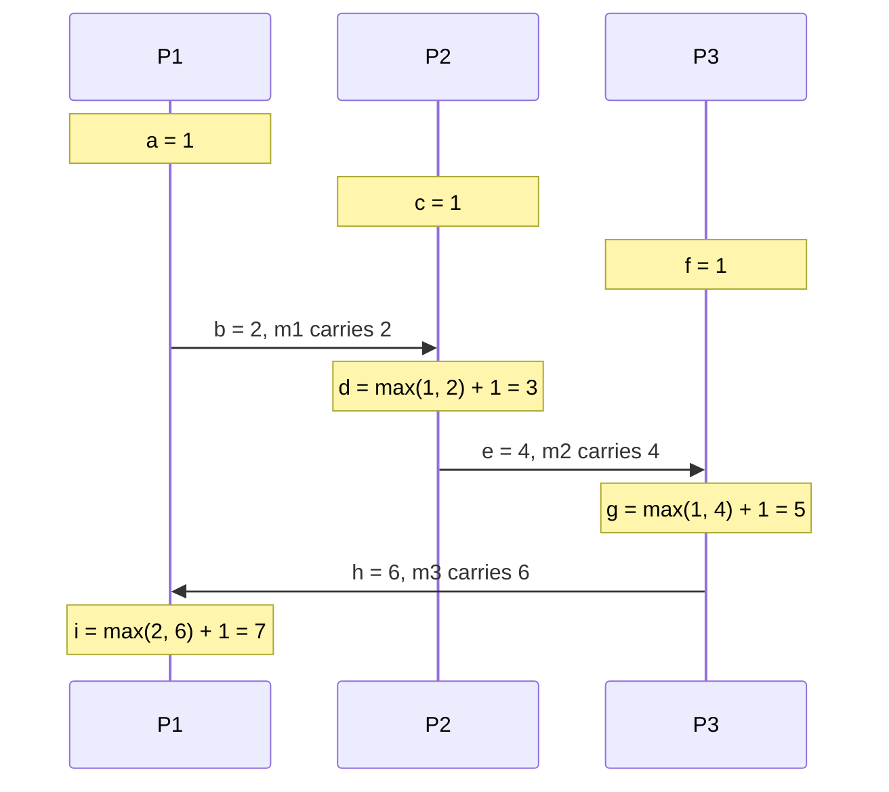

**Reading the diagram.** Each lifeline is a process; notes are events with their Lamport timestamps; arrows are asynchronous messages carrying the sender's timestamp. P1 does local event `a` and sends `m1` (event `b`); P2's receipt `d` jumps to $\max(1,2)+1=3$; the chain continues through P3 and back to P1. There is no storage or failure point here; the diagram shows only causality. Notice the limitation: `c` (1) has a smaller timestamp than `b` (2), yet they are concurrent, because nothing connects `c` to `b`. Lamport clocks scale to any number of processes at a cost of one integer per message.

### 24.10.4 Code example

```python
"""Lamport logical clocks: replay the trace of Figure 24.10 and derive a total order."""


class LamportProcess:
    def __init__(self, pid):
        self.pid, self.clock, self.log = pid, 0, []

    def _tick(self, name, kind):
        self.clock += 1                         # rule 1: increment before every event
        self.log.append((self.clock, self.pid, name, kind))
        return self.clock

    def local(self, name):
        return self._tick(name, "local")

    def send(self, name):
        return self._tick(name, "send")         # the message carries this timestamp

    def receive(self, name, msg_ts):
        self.clock = max(self.clock, msg_ts)    # rule 2: jump past the sender's time
        return self._tick(name, "receive")


if __name__ == "__main__":
    p1, p2, p3 = LamportProcess("P1"), LamportProcess("P2"), LamportProcess("P3")
    p1.local("a")
    m1 = p1.send("b")            # m1: P1 -> P2
    p2.local("c")
    p2.receive("d", m1)
    m2 = p2.send("e")            # m2: P2 -> P3
    p3.local("f")
    p3.receive("g", m2)
    m3 = p3.send("h")            # m3: P3 -> P1
    p1.receive("i", m3)

    events = p1.log + p2.log + p3.log
    for ts, pid, name, kind in sorted(events):  # total order: (timestamp, process id)
        print(f"{ts:>2} {pid} {name} ({kind})")
```

Output:

```text
 1 P1 a (local)
 1 P2 c (local)
 1 P3 f (local)
 2 P1 b (send)
 3 P2 d (receive)
 4 P2 e (send)
 5 P3 g (receive)
 6 P3 h (send)
 7 P1 i (receive)
```

What to notice:

- Sorting by the pair (timestamp, process ID) gives a **total order** that every process can compute identically and that is consistent with causality; ties such as `a`, `c`, `f` at 1 are broken by process ID.
- The total order is *arbitrary* among concurrent events: it places `c` before `b`, though neither influenced the other.

### 24.10.5 Uses and limits

Lamport used this total order to build a distributed mutual-exclusion algorithm in which every process applies requests in the same timestamp order [Lamport 1978]; the same idea underlies **state machine replication** (§26.3). Raft's **term** numbers behave like a Lamport clock: a node that sees a higher term adopts it, and messages from lower terms are rejected [Ongaro and Ousterhout 2014]. Fencing tokens (§26.13) are monotonically increasing numbers in the same spirit.

The limit is that a Lamport timestamp cannot tell you whether two events were concurrent. For conflict *detection* you need vector clocks.

## 24.11 Vector clocks and version vectors

### 24.11.1 The algorithm

Vector clocks were introduced independently by Fidge and Mattern [Fidge 1988; Mattern 1989]. Instead of one counter, each process keeps a counter *for every process*: its knowledge of how many events each process has performed.

::: definition
**Definition — Vector clock.** With $n$ processes, each process $P_i$ keeps a vector $V_i[1..n]$, initially all zeros. Before each event, $P_i$ increments $V_i[i]$; a send attaches a copy of $V_i$. On receiving a message carrying $V_m$, $P_i$ sets $V_i[k] \leftarrow \max(V_i[k], V_m[k])$ for every $k$, then increments $V_i[i]$.
:::

Comparison rules: $V \le W$ if $V[k] \le W[k]$ for all $k$; $V < W$ if $V \le W$ and $V \ne W$; $V \parallel W$ (concurrent) if neither $V \le W$ nor $W \le V$. Unlike Lamport clocks, vector clocks **characterize** causality exactly: $a \to b$ if and only if $V(a) < V(b)$.

**Figure 24.11 — Vector clocks on the same trace.**

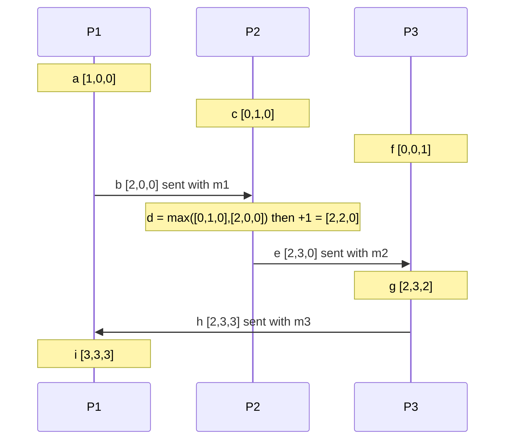

**Reading the diagram.** Entries are ordered [P1, P2, P3]. Each event increments its own process's entry; each receipt first takes the element-wise maximum with the message's vector. The messages are asynchronous, and each carries $n$ integers instead of one. Now concurrency is visible: `c` = [0,1,0] and `b` = [2,0,0] are incomparable (0 < 2 but 1 > 0), so they are concurrent; `b` = [2,0,0] ≤ `g` = [2,3,2] in every entry, so `b` → `g`. The cost, and the scaling limit, is that the vector grows with the number of processes.

### 24.11.2 Version vectors

A **version vector** applies the same idea to *replicas of a data item* rather than to events in processes [Parker et al. 1983]. Each replica that accepts writes for a key has an entry counting the updates it has issued to that key. When two versions of a key have incomparable version vectors, they were written concurrently and are kept as **siblings** for the application (or a merge function) to reconcile; when one dominates, it replaces the other. The client passes the version vector it read (its **context**) with each write, so the store knows which versions the client had seen.

**Figure 24.12 — Version vectors detect a concurrent shopping-cart update.**

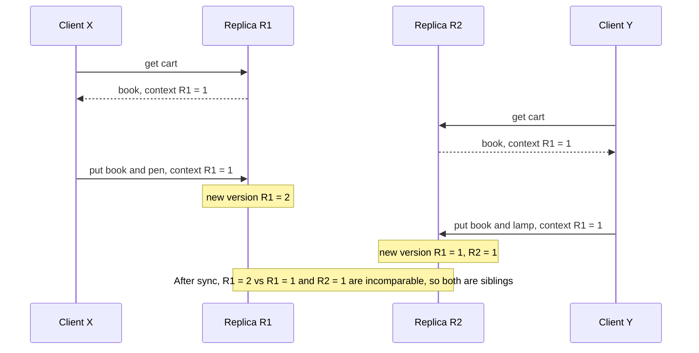

**Reading the diagram.** Both clients read the same version (context {R1: 1}) and write through different replicas, synchronously to that replica; replicas synchronize asynchronously afterwards. R1 issues {R1: 2}; R2 issues {R1: 1, R2: 1}. Neither vector dominates, so the store keeps both values as siblings, and the next reader receives both with a merged context and writes back a reconciled cart. The storage boundary is each replica's copy of the key. Compared with LWW (Figure 24.9), nothing is silently lost; the cost is that the application must merge.

### 24.11.3 Code example

```python
"""Vector clocks: comparison, the Figure 24.11 trace, and sibling detection with version vectors."""


def compare(v, w):
    """Return 'equal', 'before' (v happened before w), 'after' or 'concurrent'."""
    keys = set(v) | set(w)
    le = all(v.get(k, 0) <= w.get(k, 0) for k in keys)
    ge = all(v.get(k, 0) >= w.get(k, 0) for k in keys)
    if le and ge:
        return "equal"
    if le:
        return "before"
    if ge:
        return "after"
    return "concurrent"


def merge(v, w):
    return {k: max(v.get(k, 0), w.get(k, 0)) for k in sorted(set(v) | set(w))}


class VCProcess:
    def __init__(self, pid):
        self.pid, self.vc, self.events = pid, {}, {}

    def _tick(self, name):
        self.vc = dict(self.vc)
        self.vc[self.pid] = self.vc.get(self.pid, 0) + 1   # increment own entry
        self.events[name] = self.vc
        return self.vc

    def local(self, name):
        return self._tick(name)

    def send(self, name):
        return self._tick(name)                 # the message carries a copy of vc

    def receive(self, name, msg_vc):
        self.vc = merge(self.vc, msg_vc)        # element-wise maximum, then increment
        return self._tick(name)


class VersionedStore:
    """One key replicated with version vectors keyed by replica id. Concurrent
    writes are kept as siblings instead of being silently overwritten."""

    def __init__(self):
        self.siblings = []                      # list of (version_vector, value)

    def get(self):
        context = {}
        for vv, _ in self.siblings:
            context = merge(context, vv)
        return [val for _, val in self.siblings], context

    def put(self, replica, value, context):
        new_vv = dict(context)
        counter = max((vv.get(replica, 0) for vv, _ in self.siblings), default=0)
        new_vv[replica] = counter + 1           # replica issues its next counter value
        # Keep only siblings that the new write did not causally overwrite.
        self.siblings = [(vv, val) for vv, val in self.siblings
                         if compare(vv, new_vv) == "concurrent"]
        self.siblings.append((new_vv, value))


def fmt(v):
    return "[" + ",".join(str(v.get(p, 0)) for p in ("P1", "P2", "P3")) + "]"


if __name__ == "__main__":
    p1, p2, p3 = VCProcess("P1"), VCProcess("P2"), VCProcess("P3")
    p1.local("a"); m1 = p1.send("b")
    p2.local("c"); p2.receive("d", m1); m2 = p2.send("e")
    p3.local("f"); p3.receive("g", m2); m3 = p3.send("h")
    p1.receive("i", m3)
    ev = {**p1.events, **p2.events, **p3.events}
    for name in "abcdefghi":
        print(name, fmt(ev[name]))
    for x, y in [("b", "g"), ("c", "b"), ("f", "e"), ("a", "i")]:
        print(f"{x} vs {y}: {compare(ev[x], ev[y])}")

    store = VersionedStore()
    store.put("R1", "cart=[book]", {})
    _, ctx = store.get()                           # both clients read the same version
    store.put("R1", "cart=[book, pen]", ctx)       # client 1 writes via replica R1
    store.put("R2", "cart=[book, lamp]", ctx)      # client 2 writes via R2 concurrently
    values, ctx = store.get()
    print("siblings:", values, "context:", ctx)
    store.put("R1", "cart=[book, pen, lamp]", ctx) # client merges and writes back
    print("after merge:", store.get())

    # Pitfall: two clients write concurrently through the SAME replica.
    store = VersionedStore()
    store.put("R1", "v0", {})
    _, ctx = store.get()
    store.put("R1", "from client X", ctx)          # gets {R1: 2}
    store.put("R1", "from client Y", ctx)          # gets {R1: 3}, which dominates {R1: 2}
    print("same-replica concurrent writes:", store.get()[0])
```

Output:

```text
a [1,0,0]
b [2,0,0]
c [0,1,0]
d [2,2,0]
e [2,3,0]
f [0,0,1]
g [2,3,2]
h [2,3,3]
i [3,3,3]
b vs g: before
c vs b: concurrent
f vs e: concurrent
a vs i: before
siblings: ['cart=[book, pen]', 'cart=[book, lamp]'] context: {'R1': 2, 'R2': 1}
after merge: (['cart=[book, pen, lamp]'], {'R1': 3, 'R2': 1})
same-replica concurrent writes: ['from client Y']
```

What to notice:

- `compare` treats missing entries as 0, so vectors can be sparse maps rather than fixed arrays.
- The merged write carries the merged context {R1: 2, R2: 1}, so its new vector {R1: 3, R2: 1} dominates both siblings and replaces them.
- The last case is a real flaw of per-replica version vectors: two *concurrent* writes through the same replica get {R1: 2} and {R1: 3}, the second appears to dominate the first, and client X's write is lost. Dotted version vectors (§24.11.5) fix this.

### 24.11.4 Size growth

::: formula
**Vector clock metadata size**

$$S = n\,(b_{\text{id}} + b_{\text{ctr}}) \qquad\qquad M = K \cdot S$$

| Symbol | Meaning | Units |
|---|---|---|
| $n$ | Number of entries (processes, replicas or clients that have written) | count |
| $b_{\text{id}}$ | Bytes to identify an entry's owner | bytes |
| $b_{\text{ctr}}$ | Bytes per counter | bytes |
| $S$ | Metadata per version | bytes |
| $K$ | Number of keys stored | count |
| $M$ | Total version metadata | bytes |
:::

::: example
**Worked example — Server IDs versus client IDs.**

1. Entries keyed by replica: $n = 3$, 8-byte IDs and 8-byte counters. $S = 3 \times 16 = 48$ bytes. For $K = 10^9$ keys, $M = 48 \times 10^9$ bytes = 48 GB, acceptable next to the data.
2. Entries keyed by *client*, for a popular key written by 10,000 distinct users: $S = 10{,}000 \times 16 = 160{,}000$ bytes = 160 KB of metadata on one key, transferred on every read and write.
3. Over a fleet of 1,000 processes tracking event causality: $S = 1{,}000 \times 16 = 16$ KB on *every message*.

Interpretation: vector size grows with the number of writers, and Charron-Bost proved that no smaller timestamp can characterize causality in general [Charron-Bost 1991]. Engineering implication: key vectors by a small, stable set of replicas, not by clients or processes; when that is not possible, prune old entries, accepting that pruning can create false conflicts (siblings that were not really concurrent).
:::

::: industry
**Amazon Dynamo.** Dynamo tracked versions of shopping-cart objects with vector clocks of (node, counter) pairs, returned divergent versions to the client for semantic reconciliation, and truncated the vector by removing the oldest pair when it exceeded a threshold (about 10 pairs), accepting the small risk of losing causality information [DeCandia et al. 2007].
*Evidence: Primary* — [DeCandia et al. 2007]
:::

### 24.11.5 Dotted version vectors

The same-replica flaw above led to **dotted version vectors** (DVVs) [Preguiça et al. 2010]. A DVV pairs the causal context (a version vector of what the writer had seen) with a single **dot**, the (replica, counter) pair that identifies *this* write. Two writes through R1 with the same context get dots (R1, 2) and (R1, 3), but because neither write's context contains the other's dot, the store correctly recognizes them as concurrent. DVVs keep vectors bounded by the number of replicas while avoiding both lost updates and the "sibling explosion" of client-keyed vectors. Riak adopted dotted version vectors in version 2.0 [Riak Docs: Dotted Version Vectors].

**Table 24.10 — Logical clocks compared.**

| Clock | Size | Detects concurrency? | Close to real time? | Typical use |
|---|---|---|---|---|
| Lamport | 1 integer | No | No | Total order, terms, fencing tokens |
| Vector clock | $n$ entries (processes) | Yes | No | Causality tracking, debugging, causal broadcast |
| Version vector | $n$ entries (replicas) per key | Yes | No | Conflict detection in replicated stores |
| Dotted version vector | Replica entries plus one dot | Yes, including same-replica writes | No | Riak-style key-value stores |
| Hybrid logical clock | 64 bits | No | Yes, within skew | Timestamps for MVCC and snapshot reads |
