# Chapter 24 — Distributed Systems Fundamentals

> **Level:** 2–3 · **Track:** A (Traditional) · **Estimated reading time:** 3.5 h

Replication (Chapter 14), caching (Chapter 20) and load balancing (Chapter 19) already showed that work spread across machines behaves differently from work on one computer: replicas lag, caches go stale, failovers can leave two primaries. This chapter names the reasons. Once machines talk only by messages over a network, you lose **a consistent view of what has failed**, **a shared clock** and **guaranteed delivery**. Consistency models (Chapter 25), consensus (Chapter 26), replication and failure detection (Chapter 27) and distributed transactions (Chapter 28) all respond to those losses. This chapter supplies the vocabulary: system models, partitions and partial failures, physical and logical clocks, the FLP result and the end-to-end argument.

The running example is PhotoShare (Chapter 1), now deployed in two regions, `us-east` and `eu-west`. Its examples are *illustrative*, not a description of any real company's system.

## 24.1 Learning objectives

After this chapter you should be able to:

- Define a distributed system by its three essential properties and explain the two generals problem.
- Justify distribution by scale, fault tolerance, latency or data residency, and quantify replication's availability gain.
- Give a concrete failure caused by each of the eight fallacies of distributed computing.
- State a protocol's timing and failure model and compute the replicas each fault model needs.
- Distinguish complete, partial and asymmetric partitions, citing measured failure evidence.
- Explain partial and gray failures, and set a timeout from latency data.
- Calculate clock drift and NTP offset, delay and error bound; explain PTP and leap smearing; show why wall-clock last-writer-wins loses data.
- Implement and choose among Lamport clocks, vector clocks, version vectors and hybrid logical clocks.
- Explain what FLP forbids and how systems escape it, and apply the end-to-end argument.

## 24.2 Prerequisites

- Network latency components and the speed-of-light floor — §7.15 (message delay is never zero and is variable).
- TCP acknowledgments and retransmission — §7.7.5 (what a transport-level ACK does and does not promise).
- Primary–replica, synchronous and asynchronous replication, and multi-primary conflicts — §14.3–§14.5 (the replication settings in which clocks and partitions matter).
- Timeouts, retries and idempotency keys — §22.11–§22.15 (the request-level tools this chapter justifies).
- Probability of independent events and availability arithmetic — §4.6 and §4.14 (replication and fleet-failure calculations).
- Units: time in seconds (s), milliseconds (ms, 10⁻³ s), microseconds (µs, 10⁻⁶ s) and nanoseconds (ns, 10⁻⁹ s); drift in parts per million (ppm, 10⁻⁶); storage in decimal units (1 KB = 10³ bytes, 1 GB = 10⁹ bytes).

## 24.3 What is a distributed system?

### 24.3.1 Definition and the three defining properties

::: definition
**Definition — Distributed system.** A set of independent computers (**nodes**) that have no shared memory and no shared clock, communicate only by exchanging messages over a network, and cooperate to provide a service. Van Steen and Tanenbaum describe it from the user's side as "a collection of autonomous computing elements that appears to its users as a single coherent system" [van Steen and Tanenbaum 2017].
:::

Leslie Lamport's definition is the one engineers remember. In an email of 28 May 1987 he wrote: "A distributed system is one in which the failure of a computer you didn't even know existed can render your own computer unusable" [Lamport 1987]. The joke is a precise observation: in a distributed system, your work depends on machines you cannot see, and their failures reach you in forms you did not expect.

#### First-principles explanation

Imagine a restaurant chain whose managers communicate only by post: letters arrive late or never, no two branch clocks agree, and a manager who quits is noticed only when letters stop, which looks exactly like slow post. That chain has the three defining properties:

1. **Independent (partial) failure.** Some nodes fail while others run, and the survivors do not know exactly which failed.
2. **No global clock.** Clocks disagree, so the order of events on different nodes is not directly observable.
3. **Unreliable, asynchronous communication.** Messages may be delayed without bound, lost, duplicated or reordered, and are out of date when they arrive.

**Figure 24.1 — One computer versus a distributed system.**

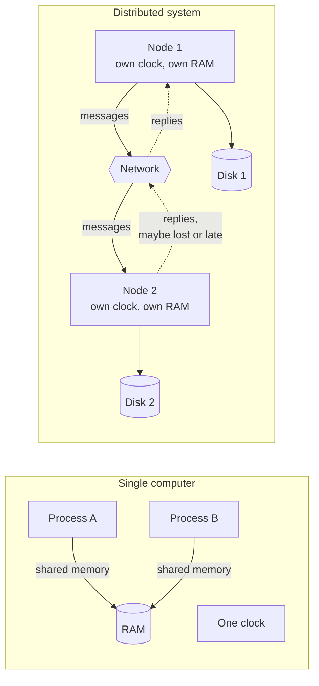

**Reading the diagram.** On the left, two processes share one memory and one clock: a write is visible to the other process within nanoseconds, and if the machine fails both processes stop together. On the right, each node has its own memory, disk (a separate storage boundary) and clock; the only connection is the network. Requests travel synchronously in the sense that a caller waits, but the dotted reply paths show what the caller cannot control: a reply may arrive late or never. Failure points are each node, each disk and the network itself, and they fail independently. Scaling comes from adding nodes, at the price of more independent failure points.

### 24.3.2 Why this is hard: uncertainty about other nodes

Together the properties mean **a node can never be certain of another node's current state.** Silence from node 2 could mean a lost request, a slow node, a crash before or after processing, a lost reply or a reply still in flight; §24.8.1 draws all six. Every distributed algorithm is a strategy for acting correctly despite this ambiguity.

### 24.3.3 The two generals problem

The oldest illustration of this ambiguity is the **two generals problem**, first described by Akkoyunlu, Ekanadham and Huber [Akkoyunlu et al. 1975] and named by Jim Gray [Gray 1978].

::: definition
**Definition — Two generals problem.** Two armies camped on opposite hills must attack a city in the valley at the same time; either attacking alone is defeated. Their generals can communicate only by messengers who cross the valley and may be captured. The problem is to design a messaging protocol after which both generals are *certain* that they will attack together. No such protocol with a finite number of messages exists.
:::

**Figure 24.2 — The two generals problem: every acknowledgment needs another acknowledgment.**

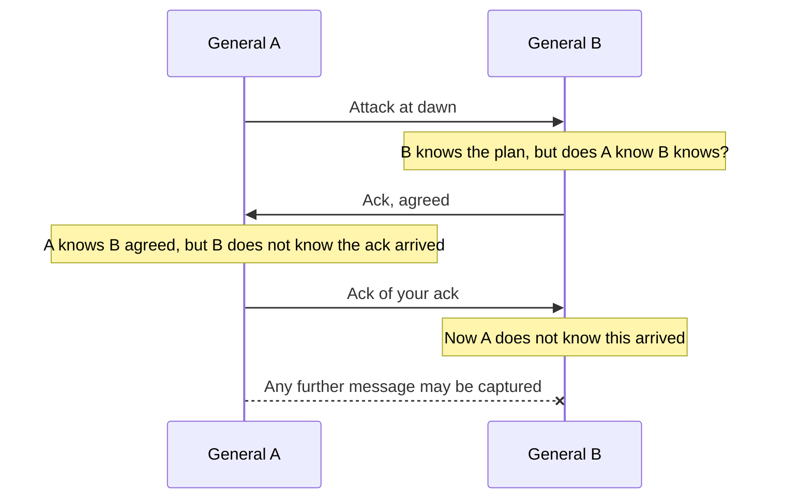

**Reading the diagram.** Solid arrows are messengers that arrived; the final arrow with a cross is a messenger captured in the valley. After each delivered message, the *sender* of the latest message is left unsure whether it arrived, so the other general's knowledge is always one level short of certainty. The failure point is the unreliable channel itself; adding more messengers raises the probability of agreement but never makes it certain, so this "protocol" does not scale toward certainty at any message count.

#### Why no finite protocol works

The proof is a short argument by contradiction. Suppose some protocol guarantees coordinated attack, and take the shortest such protocol, with $k$ messages. Consider the last message. Its sender must decide to attack whether or not it arrives, because the sender cannot observe its loss. So the receiver must also decide to attack whether or not it arrives, since the protocol guarantees agreement. Then the last message affects no decision and can be removed, giving a working protocol with $k-1$ messages. That contradicts "shortest", so no finite protocol exists.

#### What engineers do instead

Practical systems settle for less than certainty: **retry idempotent actions** until acknowledged (TCP, idempotency keys in §22.15); **accept high probability** (five messengers each captured with probability 0.1 all fail with probability $10^{-5}$); or **persist state and allow blocking**, as two-phase commit does (§28.4).

::: mistake
**Mistake — "TCP solves the two generals problem."** TCP makes delivery *reliable while the connection works*, by retransmitting. It cannot tell the sender whether its final bytes were processed by the application before the peer crashed or the connection broke (§7.7). The connection-close handshake itself has the two generals shape, which is one reason for the `TIME_WAIT` state.
:::

## 24.4 Why distributed systems exist

### 24.4.1 Four reasons to pay the price

If distribution is this hard, why do it? Because a single computer cannot meet some requirements at all. Table 24.1 lists the four main reasons.

**Table 24.1 — Why systems are distributed.**

| Reason | The limit of one machine | Distributed answer | What it costs |
|---|---|---|---|
| Scale | Even the largest single servers top out at hundreds of cores and a few tens of terabytes of memory (as of 2026); one disk array holds finite data | Partition data and work across nodes (§14.6, Ch 18) | Cross-node queries, rebalancing, coordination |
| Fault tolerance | One machine, power supply or datacenter is a single point of failure | Replicate across nodes, racks, zones and regions (Ch 14, Ch 27) | Keeping replicas consistent; failover |
| Latency and geography | The speed of light: New York–London RTT is at least about 56 ms over fiber (§7.15.1) | Place replicas and computation near users (Ch 21, Ch 44) | Cross-region consistency and conflicts |
| Data residency | Law may require that personal data stay within a jurisdiction | Region-pinned partitions and processing | Fragmented operations; per-region capacity |

Some problems are also **inherently distributed** (banks in a payment network, offline edits on phones), and organizations split systems so teams deploy independently (Chapter 34). On residency, be precise: the EU GDPR does not generally require storage inside the EU, but its Chapter V restricts *transfers* of personal data outside it without safeguards [EU 2016]; some other jurisdictions mandate localization. Either way, partitions get pinned to regions.

#### Mathematical foundations: why replicate, and why failure is normal

::: formula
**Availability of $k$ independent replicas, and the chance that something in a fleet fails**

$$A_k = 1 - (1 - a)^k \qquad\qquad P_{\text{any}} = 1 - (1 - p)^n$$

| Symbol | Meaning | Units |
|---|---|---|
| $a$ | Availability of one replica (fraction of time it can serve) | dimensionless, 0–1 |
| $k$ | Number of replicas, any one of which can serve a request | count |
| $A_k$ | Availability of the replicated service, assuming independent failures and instant failover | dimensionless |
| $p$ | Probability that one node fails during a given period | dimensionless |
| $n$ | Number of nodes in the fleet | count |
| $P_{\text{any}}$ | Probability that at least one node fails in that period | dimensionless |
:::

::: example
**Worked example — PhotoShare's metadata service.**

1. One server has availability $a = 0.999$ (about 8.8 hours down per year).
2. With $k = 3$ independent replicas: $A_3 = 1 - (0.001)^3 = 1 - 10^{-9}$, nine nines on paper.
3. Now the fleet view. PhotoShare runs $n = 1{,}000$ nodes, each with probability $p = 0.001$ of failing on a given day. $P_{\text{any}} = 1 - 0.999^{1000}$. Since $\ln 0.999 \approx -0.0010005$, $0.999^{1000} \approx e^{-1.0005} \approx 0.368$, so $P_{\text{any}} \approx 0.632$.

Interpretation: replication makes the *service* far more available than any node, but the same scale guarantees that on about 63% of days *some* node fails. Failure is a daily routine, not an exception. Engineering implication: the nine nines are fiction, because replica failures are not independent (shared power, shared software bugs, shared network) and failover is not instant. The real gains come from placing replicas in separate failure domains and from making failover automatic and well tested, which is the subject of Chapter 27.
:::

::: recommendation
**Recommendation — Distribute only for a stated reason.** A single well-provisioned database with a hot standby serves many products and avoids most of this chapter's problems. When you do distribute, the reason tells you what to optimize: partitioning for scale, replication for fault tolerance, locality for latency, region pinning for residency.
:::

## 24.5 The eight fallacies of distributed computing

### 24.5.1 Origin and the list

Around 1994, L. Peter Deutsch at Sun Microsystems listed seven false assumptions that newcomers to distributed applications make; James Gosling later added an eighth (Bill Joy and Tom Lyon are credited with the first four). The list circulated informally and was explained in detail by Rotem-Gal-Oz [Rotem-Gal-Oz 2006]. Each fallacy is the hidden assumption behind a class of outages; code that treats a remote call as a local one (§8.8) assumes several at once.

**Table 24.2 — The eight fallacies and what each one breaks.**

| # | Fallacy | Reality | A concrete consequence | Mitigation |
|---|---|---|---|---|
| 1 | The network is reliable | Packets and connections are lost; switches and links fail daily | A payment request times out; the client retries; the customer is charged twice | Timeouts, retries with backoff, idempotency keys (§22.12, §22.15) |
| 2 | Latency is zero | Within a datacenter about 0.5 ms per round trip; across oceans 60–150 ms | A page making 100 sequential calls takes 50 ms in one region and about 7 s across regions | Batch calls, parallelize, colocate chatty services |
| 3 | Bandwidth is infinite | Links are finite and shared | Re-replicating 10 TB over a 1 Gbps link takes about 22 hours | Compress, ship deltas, throttle background traffic |
| 4 | The network is secure | Internal networks are routinely breached | Plaintext service-to-service traffic leaks credentials after one compromised host | Mutual TLS, zero trust (Ch 10) |
| 5 | Topology does not change | Nodes, routes and addresses change continuously | A client caches a server IP; the node is replaced; requests fail until restart | Service discovery, short DNS TTLs, re-resolution (§7.6) |
| 6 | There is one administrator | Many teams and providers control parts of the path | Another team changes a firewall rule or lets a certificate expire, and your service breaks | Explicit dependency contracts, certificate automation, change visibility |
| 7 | Transport cost is zero | Serialization costs CPU; providers charge for data transfer | Cross-zone chatter appears as a large line item on the cloud bill | Measure bytes per request, keep traffic zone-local where safe |
| 8 | The network is homogeneous | Mixed hardware, OS, protocol and software versions | During a rolling upgrade, v1 nodes cannot parse v2 messages and requests fail | Versioned, backward- and forward-compatible encodings |

The arithmetic behind three rows: 100 calls × 0.5 ms = 50 ms, but × 70 ms = 7 s; $10 \times 10^{12} \times 8 / 10^9 = 80{,}000$ s ≈ 22 h to copy 10 TB at 1 Gbps (which is why recovery spreads a node's data over many peers, §27.12); and at an *illustrative* \$0.01/GB, 100 MB/s of cross-zone traffic is 8,640 GB/day, about \$86 per day.

::: industry
**AWS US-East, April 2011 — a topology change becomes an outage.** During a network upgrade in one Availability Zone, traffic was shifted onto a lower-capacity network. Elastic Block Store (EBS) nodes lost contact with their replicas and all began re-mirroring at once; the storm exhausted capacity and degraded EBS and dependent services for days. Fallacies 1, 3 and 5 combined: a topology change made the network unreliable, and recovery traffic assumed plentiful bandwidth.
*Evidence: Primary* — [AWS 2011]
:::

::: mistake
**Mistake — "A remote procedure call is just a function call."** A remote call can time out with an *unknown* outcome, take a million times longer, and run twice. Good RPC frameworks expose deadlines and status codes (§8.8, §22.11).
:::

## 24.6 System models: timing and failures

### 24.6.1 Why a protocol needs a system model

A protocol is correct only *relative to its assumptions*: Raft (§26.7) tolerates nodes that crash but not nodes that lie, and a clock-based lease (§26.11) is safe only if drift is bounded.

::: definition
**Definition — System model.** A precise statement of what a distributed algorithm may assume about (1) **timing**: bounds on message delay, processing speed and clock drift, and (2) **faults**: how nodes and links may misbehave. Proofs of correctness hold only within the stated model.
:::

Like a chess strategy proven under standard rules, a protocol proven for crash-stop nodes says nothing about a node that returns garbage from a corrupted disk.

### 24.6.2 Timing models

**Table 24.3 — Timing models.**

| Model | What is assumed | Strength of the assumption | What it allows | Realistic? |
|---|---|---|---|---|
| Synchronous | Known upper bounds on message delay, processing time and clock drift | Strongest | Perfect failure detection by timeout; consensus despite failures, even Byzantine with enough nodes | Only in special hardware (avionics buses); not in commodity networks |
| Partially synchronous | Bounds exist but are unknown, or known bounds hold only after an unknown **global stabilization time** (GST) | Middle | Consensus that is always safe and terminates once the system behaves | Yes: the model behind Paxos, Raft and most production systems |
| Asynchronous | No timing bounds at all; messages are eventually delivered | Weakest | Safety-only reasoning; deterministic consensus impossible with one crash (§24.13) | Safe to assume, but too weak to build consensus on alone |

The **partially synchronous** model of Dwork, Lynch and Stockmeyer [Dwork et al. 1988] fits real datacenters: usually timely, occasionally not (pauses, congestion, partitions) for an unknown time. A protocol for it must never violate **safety** (nothing bad happens) in bad periods and must make progress (**liveness**) once a good period lasts long enough.

### 24.6.3 Failure models

**Table 24.4 — Failure models, from most benign to most severe.**

| Model | What a faulty node may do | Real-world example | Detectable by others? | Nodes needed to tolerate $f$ faults in consensus | Typical systems |
|---|---|---|---|---|---|
| Crash-stop | Stops forever; until then behaves correctly | Hardware dies; VM terminated | Only by timeout (no certainty in async) | $2f+1$ | Textbook protocols; Paxos variants |
| Crash-recovery | Crashes, later restarts; keeps only what it wrote to stable storage | Process restart after an OOM kill; power cycle | Only by timeout | $2f+1$, with durable logs | Raft, ZooKeeper, most databases |
| Omission | Fails to send or receive some messages, otherwise correct | Full NIC buffer; overloaded switch dropping packets | Only by timeout | $2f+1$ | Covered by retransmission and quorums |
| Timing (performance) | Responds correctly but outside the assumed time bound | 30 s garbage-collection pause; fail-slow disk | Only relative to a bound | Depends on the timing model | Lease-based systems are vulnerable |
| Byzantine (arbitrary) | Anything: wrong values, contradictory messages to different peers, forged messages | Memory corruption, software bug, malicious operator | Not in general | $3f+1$ | Blockchains, some aerospace and financial systems |

Clarifications: a **fail-stop** processor, as defined by Schlichting and Schneider, halts *detectably* [Schlichting and Schneider 1983]; plain crash-stop does not, which is the realistic case. Under **crash-recovery**, anything a node promised (a vote, an acknowledgment) must reach stable storage before the promise is sent, which is why Raft persists its term and vote (§26.7). The classic **timing** fault is a lease holder that pauses for 30 s and then writes as if it still held the lease; fencing tokens (§26.13) exist for it. **Byzantine** faults, named in [Lamport et al. 1982], include bit flips and bugs, not just malice. Links have models too: **fair-loss**, **stubborn** (retransmit forever) and **perfect** (exactly-once delivery, built with acknowledgments and duplicate suppression) [Cachin et al. 2011]; TCP approximates a perfect link only while a connection lasts.

**Figure 24.3 — Failure models nest: each one includes the behaviors of those inside it.**

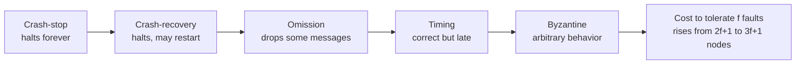

**Reading the diagram.** Each arrow points to a more general model: a crash is a special omission, an omission is an infinitely late message, and everything is a special case of Byzantine. Tolerating a model on the right tolerates all to its left, at higher cost (final box). The hierarchy is conceptual, with no protocols, storage boundaries or sync/async paths; the practical failure point is assuming a model weaker than reality.

#### Mathematical foundations: replicas needed per fault model

::: formula
**Minimum replicas for consensus in the partially synchronous model**

$$n_{\text{crash}} \ge 2f + 1 \qquad\qquad n_{\text{Byz}} \ge 3f + 1$$

| Symbol | Meaning | Units |
|---|---|---|
| $f$ | Maximum number of nodes that may be faulty at once | count |
| $n_{\text{crash}}$ | Nodes needed when faults are crashes or omissions | count |
| $n_{\text{Byz}}$ | Nodes needed when faults may be arbitrary | count |
:::

The intuition for $2f+1$: any decision must be backed by a **majority quorum** of $f+1$ nodes, and any two majorities overlap in at least one node, so two conflicting decisions cannot both gather a quorum. For Byzantine faults, quorums of $2f+1$ out of $3f+1$ overlap in at least $f+1$ nodes, so at least one honest node is in every overlap. Quorums in depth are in §26.4.

::: example
**Worked example — How many replicas for PhotoShare's coordination service?**

1. Requirement: survive one zone outage, where each zone holds one replica, so $f = 1$.
2. Crash faults: $n \ge 2(1)+1 = 3$ replicas in 3 zones. A majority is 2, so with one zone down the other two still decide.
3. Survive two simultaneous zone losses ($f=2$): $n \ge 5$, so 5 replicas, which needs 5 failure domains.
4. If the same service had to tolerate one *Byzantine* replica: $n \ge 3(1)+1 = 4$, and every decision needs $2f+1 = 3$ matching votes.

Interpretation: Byzantine tolerance costs a third more replicas at $f = 1$ and many more messages per decision. Engineering implication: inside one organization, use crash-recovery protocols plus checksums (§24.14); reserve Byzantine tolerance for mutually distrustful parties.
:::

::: industry
**Raft clusters such as etcd.** Raft clusters typically run 3 or 5 members: 3 tolerate one failure, 5 tolerate two, and 4 still tolerate only one (a majority is 3), so even sizes add cost without tolerance. Raft assumes crash-recovery faults and partial synchrony.
*Evidence: Primary* — [Ongaro and Ousterhout 2014]
:::

## 24.7 Network partitions

### 24.7.1 Definition and types

::: definition
**Definition — Network partition.** A network fault after which some nodes that are running correctly cannot exchange messages with some other running nodes for a period of time. (This book reserves "partition" alone for a subset of data, §14.6; a network fault is always a **network partition**.)
:::

From inside a node, a partition looks exactly like remote crashes, except that the "crashed" nodes keep running, may serve clients, and may believe *you* crashed. The less obvious shapes cause the worst bugs.

**Figure 24.4 — Three kinds of network partition.**

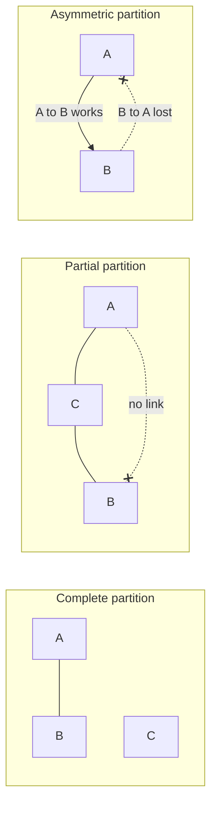

**Reading the diagram.** In the *complete* partition, the cluster splits cleanly: A and B talk to each other, C is cut off from both. In the *partial* partition, A and B cannot reach each other, yet both reach C, so C sees a healthy cluster while A and B each see a missing peer. In the *asymmetric* (one-way) partition, messages from A to B arrive but B's replies to A are lost. Solid lines are working links; dotted lines with crosses are failed directions. All traffic is the cluster's own heartbeat and data traffic; the failure points are the links, not the nodes, and adding nodes multiplies the number of links that can fail independently.

**Table 24.5 — Partition types and the trouble each one causes.**

| Type | What happens | Typical cause | Why it is dangerous |
|---|---|---|---|
| Complete | The network splits into groups that cannot talk to each other | Lost uplink, failed inter-region link | Each side may elect a leader or accept writes: **split brain** (§26.12) |
| Partial | Some pairs cannot communicate while others can | Misconfigured firewall rule, failed link in a mesh, one bad switch port | Nodes disagree about who is alive; leadership can flap as nodes reach different peers |
| Asymmetric (one-way) | Traffic flows in one direction only | Saturated queue in one direction, ACL or routing asymmetry | A leader receives requests and heartbeats but its replies are lost, so it believes it is healthy while followers elect another leader |
| Intermittent (flapping) | Connectivity repeatedly comes and goes | Faulty optics, overloaded link | Constant failovers; each one costs work and risks inconsistency |

### 24.7.2 How often do networks fail?

Bailis and Kingsbury's ironically titled survey "The Network is Reliable" collects the evidence [Bailis and Kingsbury 2014]:

- **Microsoft datacenters.** A measurement study of several Microsoft datacenters over a year [Gill et al. 2011] reported on average 5.2 device failures and 40.8 link failures per day, with a median time to repair of about five minutes and some failures lasting much longer. It also found that network redundancy was far less effective than hoped, improving the median traffic carried during failures by only about 43%.
- **Google clusters.** Jeff Dean's description of a typical first year of a new cluster included, among many other events, around 20 rack failures, about 5 racks that "go wonky" with half their packets lost, around 8 network maintenances of which several cause about 30 minutes of random connectivity loss, and about 3 router failures [Dean 2009].
- **Failures in deployed software.** Alquraan et al. studied 136 failures caused by network partitions in 25 widely used systems, including databases, coordination services and message brokers [Alquraan et al. 2018]. Most had catastrophic effects such as data loss, reappearance of deleted data and broken locks; many could be triggered by isolating a single node; and *partial* partitions were a significant and previously under-studied cause.

A large fleet therefore sees many small network faults every day: assume *some* pair of nodes cannot talk *right now*.

::: industry
**Cloudflare, November 2020 — a partial partition and a Raft cluster.** A partially failed switch left some members of an etcd (Raft) cluster able to reach each other and some not. The cluster could not keep a stable leader, so it could not accept writes; dependent automation that manages database primaries triggered failovers that overloaded other databases, and Cloudflare's API and dashboard were degraded for several hours. The post-mortem's title reflects that partial connectivity gave nodes contradictory views of the cluster.
*Evidence: Primary* — [Lianza and Snook 2020]
:::

### 24.7.3 What a partition forces you to choose

A node cut off from its peers can **refuse** (keeping consistency, losing availability on the minority side) or **answer** from local data and reconcile later (keeping availability, allowing divergence to be resolved with version vectors, §24.11, and conflict resolution, §27.14). CAP and PACELC (§25.8–§25.9) make this precise; you choose not *whether* partitions happen, only how to behave during one.

**Table 24.6 — Partition failure scenarios.**

| What goes wrong | Why | Detection | Recovery | Prevention |
|---|---|---|---|---|
| Two primaries accept conflicting writes | Each side of a complete partition elects a leader | Two nodes report the primary role; divergent replication positions | Pick one history; reconcile or discard the other's writes | Majority quorums; fencing tokens (§26.13) |
| Leader flapping during a partial partition | Different nodes see different sets of peers | Election count and term number climbing quickly | Isolate the bad link or node | Pre-vote and leader-stickiness checks in Raft (§26.7); per-link health monitoring |
| "Healthy" leader that nobody hears | Asymmetric partition drops the leader's outbound traffic | Followers time out while the leader's own metrics look normal | Step the leader down on loss of quorum acknowledgments | Leaders check that a quorum acknowledges them within a lease period |
| Recovery storm after healing | All nodes resynchronize at once | Bandwidth and CPU spikes right after connectivity returns | Throttle resynchronization | Rate-limited, prioritized anti-entropy (§27.13) |

::: mistake
**Mistake — "Partitions mean the cable was cut."** Most partitions in practice are partial, short, or caused by software and configuration: a firewall change, a full queue, a long garbage-collection pause that makes a node unreachable for 20 s. A node that is alive but paused is, to its peers, partitioned.
:::

## 24.8 Partial failures, gray failures and timeouts

### 24.8.1 Partial failure

::: definition
**Definition — Partial failure.** A state in which some components of a system have failed while others continue to work, so that an operation may be applied in some places and not others, and the working components cannot reliably tell which components failed.
:::

On one computer, partial failure is rare enough to ignore; in a fleet it is normal (§24.4.1). The hard part is the *ambiguity*.

**Figure 24.5 — Six things that can happen to one request, all of which look the same to the client.**

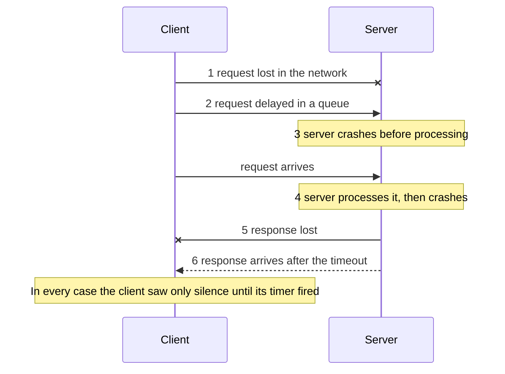

**Reading the diagram.** The client sends a synchronous request (solid arrows) and waits for a response (dashed arrow). Outcome 1 loses the request; 2 delays it; 3 and 4 are server crashes before and after the side effect; 5 loses the response; 6 delivers it too late to matter. Outcomes 4, 5 and 6 mean the operation *happened*; 1 and 3 mean it did not; 2 means it may still happen. The storage boundary is the server's database, which may or may not contain the effect. The failure points are the network in both directions and the server. Retrying is safe only if the operation is idempotent (§22.15), because in half of these cases the retry is a duplicate.

### 24.8.2 Gray failure

Crashes are the easy case. Huang et al. found that many serious incidents in Microsoft's cloud came from something subtler, **gray failure** [Huang et al. 2017].

::: definition
**Definition — Gray failure.** A component failure that is *differentially observable*: some observers (often the system's own failure detector) consider the component healthy, while others (often the applications using it) experience it as failed or badly degraded.
:::

Examples of gray failure include a network interface that drops 1% of packets (TCP throughput collapses, §7.15.3, but pings succeed); a disk that completes every I/O but takes 500 ms instead of 5 ms (a **fail-slow** fault; Gunawi et al. collected over a hundred such hardware cases from large production systems [Gunawi et al. 2018]); and a process whose heartbeat thread runs happily while its request-handling threads are deadlocked.

**Figure 24.6 — Gray failure is a disagreement between observers.**

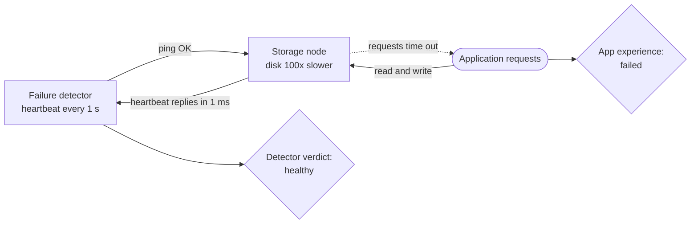

**Reading the diagram.** The failure detector probes the storage node with a cheap heartbeat that never touches the disk, so it gets fast replies and concludes "healthy". The application's synchronous read and write requests go through the slow disk and time out (dotted arrow: the response effectively never arrives in time). The storage boundary, the node's disk, is the failure point, and it is invisible to the probe. Because the detector says healthy, the load balancer keeps sending traffic and no failover happens; adding more nodes does not help, since the sick node still receives its share. The fix is to make the detector observe what the application observes.

Huang et al. recommend closing the observation gap: detect with what applications experience. In practice: **health checks that exercise the real dependency path**, **outlier ejection** of nodes whose client-observed errors or latency are far worse than their peers' (passive health checks, §19.5), and treating "too slow" as down.

### 24.8.3 Timeouts: the only failure detector you have

Without timing bounds you cannot *know* that a node crashed; you only see silence. Every failure detector, from a timeout to phi-accrual or SWIM (§27.10), turns silence into a *suspicion*.

#### Mathematical foundations: choosing a timeout

::: formula
**Timeout from bounded delays, and its practical percentile form**

$$T = 2d + r \qquad\qquad T_{\text{practical}} = \text{RTT}_{p99.9} + r_{p99.9} + m$$

| Symbol | Meaning | Units |
|---|---|---|
| $d$ | Upper bound on one-way network delay | s |
| $r$ | Upper bound on the time the remote node takes to process the request | s |
| $T$ | Timeout after which the absence of a reply proves a fault (only if the bounds are real) | s |
| $\text{RTT}_{p99.9}$ | Measured 99.9th-percentile round-trip time | s |
| $r_{p99.9}$ | Measured 99.9th-percentile processing time | s |
| $m$ | Safety margin for pauses (garbage collection, scheduling) | s |
:::

With real bounds, silence beyond $2d + r$ would prove a fault. Real networks have none, so the practical form accepts a small, chosen probability of mistaking slow for dead.

::: example
**Worked example — Timeout for PhotoShare's metadata replicas.**

1. Measured inside one region: RTT p50 = 0.4 ms, p99.9 = 4 ms; processing p99.9 = 20 ms.
2. Garbage-collection pauses on these JVM nodes reach 150 ms a few times a day; choose $m = 200$ ms.
3. $T_{\text{practical}} = 4 + 20 + 200 = 224$ ms; round to 250 ms for a request timeout.
4. For declaring a *node* dead (which triggers failover), require several consecutive misses: with heartbeats every 250 ms and 4 misses, detection takes about 1 s.

Interpretation: the pause margin, not the network, dominates. Too low a $T$ causes false failovers that can cascade; too high leaves users waiting. Engineering implication: measure pauses and tail latency first, use a short timeout for retrying a request (§22.11) and a longer, multi-miss rule for failing over a node, and prefer adaptive detectors (§27.10).
:::

**Table 24.7 — Partial-failure scenarios.**

| What goes wrong | Why | Detection | Recovery | Prevention |
|---|---|---|---|---|
| Duplicate side effect after timeout | Request succeeded, response lost; client retried | Duplicate rows, double charges | Compensate or deduplicate | Idempotency keys (§22.15) |
| Healthy node declared dead | Timeout shorter than a garbage-collection pause | Failover events correlated with pause logs | Let the node rejoin as follower | Timeouts from measured p99.9 plus pause margin; several misses |
| Sick node kept in rotation | Gray failure: health check misses the slow path | Client-side p99 and error rate high for one node | Eject the node manually | Deep health checks; outlier ejection |
| Cascading slowness | Callers wait the full timeout on a slow dependency | Thread pools full; latency rises everywhere | Shed load; open circuit breakers | Deadlines, bulkheads, breakers (§22.11–§22.14) |

::: mistake
**Mistake — "If the node answered the health check, it is up."** A health check answers one narrow question. Health is what clients experience.
:::

## 24.9 Physical clocks: drift, NTP, PTP and skew

### 24.9.1 Two clocks in every computer

::: definition
**Definition — Time-of-day clock and monotonic clock.** A **time-of-day** (wall-clock) clock returns the current date and time, for example as seconds since the Unix epoch (Linux `CLOCK_REALTIME`, Python `time.time()`). It is synchronized with other machines and *can jump* forward or backward when corrected. A **monotonic** clock (Linux `CLOCK_MONOTONIC`, Python `time.monotonic()`) only moves forward at a steady rate from an arbitrary starting point. It is meaningless across machines but correct for measuring durations on one machine.
:::

Use the monotonic clock for timeouts, rate-limiter refill (§22.4) and latency; never assume two machines' wall clocks agree.

### 24.9.2 Quartz drift

A computer counts the vibrations of a quartz crystal whose frequency varies with manufacturing tolerance, temperature and age. The error is expressed in **parts per million (ppm)**: 1 ppm is 1 µs per second, or 86.4 ms per day. Commodity server oscillators typically drift by tens of ppm, and Google's Spanner design conservatively assumes a worst case of 200 ppm [Corbett et al. 2012].

::: formula
**Clock drift and the resynchronization interval**

$$\Delta(t) = \rho\, t \qquad\qquad \Delta_{AB}(t) \le 2\rho\, t \qquad\qquad T_{\text{sync}} \le \frac{\varepsilon}{2\rho}$$

| Symbol | Meaning | Units |
|---|---|---|
| $\rho$ | Maximum drift rate of one clock | ppm (1 ppm = $10^{-6}$ s/s) |
| $t$ | Time since the clock was last synchronized | s |
| $\Delta(t)$ | Worst-case error of one clock relative to true time | s |
| $\Delta_{AB}(t)$ | Worst-case skew between two clocks drifting in opposite directions | s |
| $\varepsilon$ | Largest skew you can tolerate between any two clocks | s |
| $T_{\text{sync}}$ | Longest interval between synchronizations that keeps skew within $\varepsilon$ | s |
:::

::: example
**Worked example — Drift on PhotoShare's servers, and Spanner's sawtooth.**

1. A server drifts at $\rho = 50$ ppm $= 50 \times 10^{-6}$ s/s. Unsynchronized for a day: $\Delta = 50 \times 10^{-6} \times 86{,}400 = 4.32$ s.
2. Two servers, one fast and one slow at 50 ppm, diverge at $2 \times 50 = 100$ µs per second.
3. To keep them within $\varepsilon = 1$ ms: $T_{\text{sync}} \le 0.001 / (2 \times 50 \times 10^{-6}) = 10$ s.
4. Spanner: each server polls its time masters every 30 s and assumes 200 ppm, so uncertainty grows by up to $200 \times 10^{-6} \times 30 = 6$ ms between polls. Corbett et al. describe exactly this sawtooth of 0 to 6 ms on top of about 1 ms of communication delay, giving a total uncertainty $\varepsilon$ of about 1 to 7 ms [Corbett et al. 2012].

Interpretation: drift is tiny per second but unbounded over time, so clocks must be resynchronized continually. Engineering implication: alert on *synchronization loss*, not just offset; a host that silently stopped syncing drifts further every hour.
:::

### 24.9.3 NTP: synchronizing over a network

The **Network Time Protocol** (NTP), designed by David Mills and specified as NTPv4 in RFC 5905 [Mills et al. 2010], measures a round trip, assumes equal delay in both directions, and computes the offset from four timestamps.

**Figure 24.7 — The NTP on-wire exchange.**

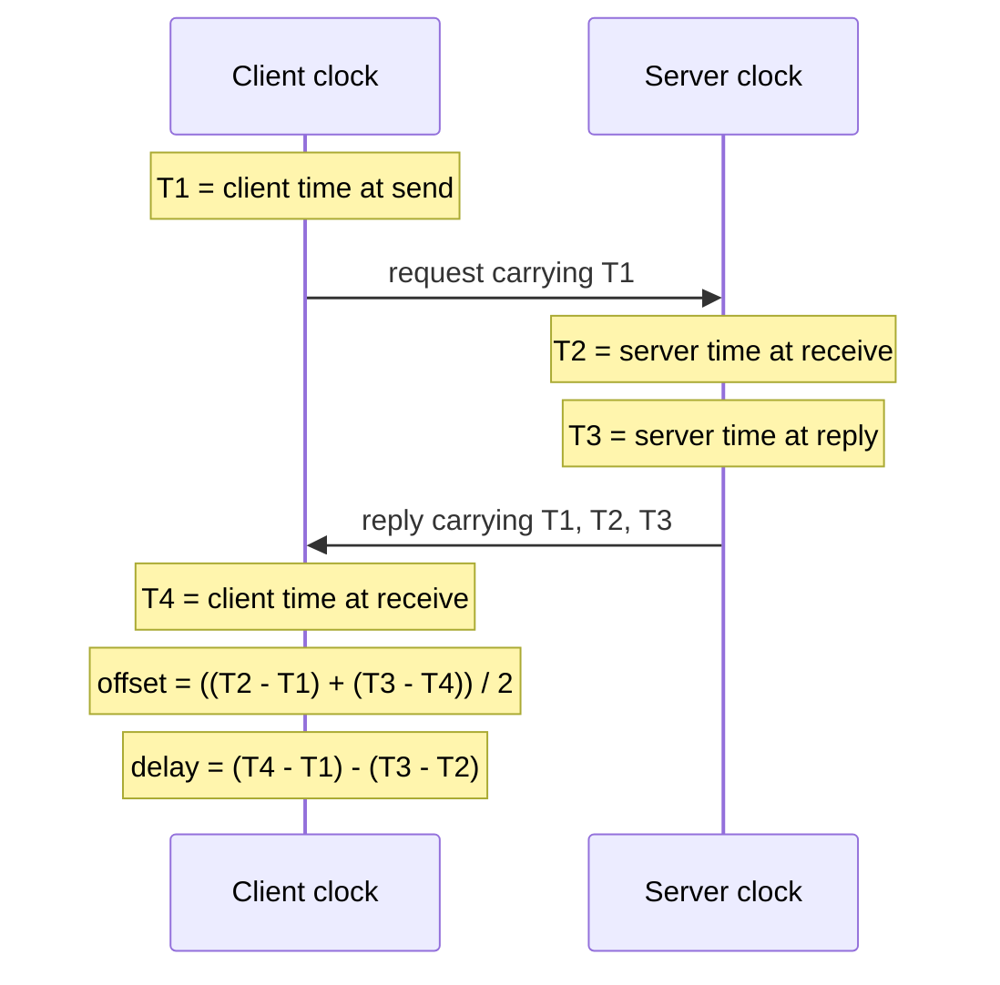

**Reading the diagram.** One synchronous UDP request/response (port 123): $T_1$ and $T_4$ are read from the client's clock, $T_2$ and $T_3$ from the server's. No storage is involved. Failure points: asymmetric delay (biases the offset) and a wrong server clock (handled by querying several servers). NTP scales through a server hierarchy (Figure 24.8).

::: formula
**NTP offset, round-trip delay and error bound (RFC 5905)**

$$\theta = \frac{(T_2 - T_1) + (T_3 - T_4)}{2} \qquad \delta = (T_4 - T_1) - (T_3 - T_2) \qquad |\theta - \theta_{\text{true}}| \le \frac{\delta}{2}$$

| Symbol | Meaning | Units |
|---|---|---|
| $T_1$ | Client clock when the request is sent | s |
| $T_2$ | Server clock when the request arrives | s |
| $T_3$ | Server clock when the reply is sent | s |
| $T_4$ | Client clock when the reply arrives | s |
| $\theta$ | Estimated offset: server clock minus client clock; the client adds $\theta$ to correct itself | s |
| $\delta$ | Round-trip network delay, excluding the server's processing time | s |
| $\theta_{\text{true}}$ | Actual offset | s |
:::

If the request takes $d_1$ and the reply $d_2$, the error is $(d_1 - d_2)/2$, at most $\delta/2$ because $d_1 + d_2 = \delta$; hence NTP prefers low-delay samples.

::: example
**Worked example — One NTP exchange, symmetric and asymmetric.**

Timestamps in seconds after 10:00:00: $T_1 = 0.000$ (client), $T_2 = 0.120$ (server), $T_3 = 0.121$ (server), $T_4 = 0.061$ (client).

1. Delay: $\delta = (0.061 - 0.000) - (0.121 - 0.120) = 0.061 - 0.001 = 0.060$ s = 60 ms.
2. Offset: $\theta = [(0.120 - 0.000) + (0.121 - 0.061)]/2 = (0.120 + 0.060)/2 = 0.090$ s = 90 ms. The client's clock is 90 ms behind the server's.
3. Check: if each direction took 30 ms and the client was 90 ms behind, the request sent at client time 0.000 (server time 0.090) arrives at server time 0.120, and the reply sent at 0.121 arrives at server time 0.151, which is client time 0.061. Both match.
4. Asymmetric case: suppose the request actually took 50 ms and the reply 10 ms (same $\delta = 60$ ms). NTP still computes 90 ms, but the true offset is $0.120 - 0.050 = 0.070$ s, an error of $(50 - 10)/2 = 20$ ms, within the bound $\delta/2 = 30$ ms.

Interpretation: NTP cannot see path asymmetry, so one sample over a 60 ms path is good only to ±30 ms. Engineering implication: run stratum-1 or stratum-2 servers inside the datacenter, where sub-millisecond round trips shrink the bound.
:::

**Figure 24.8 — The time-distribution hierarchy: NTP strata and a PTP domain.**

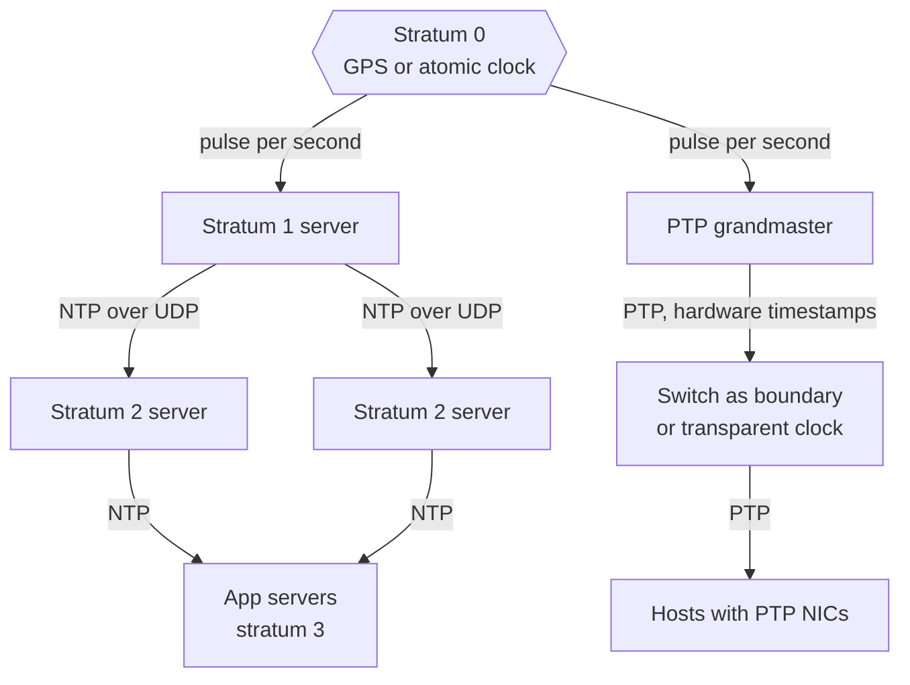

**Reading the diagram.** A **stratum** is the distance from a reference clock: stratum-0 devices (GPS, atomic clocks) feed stratum-1 servers directly, and each NTP hop adds one (16 means unsynchronized). Clients query several servers so a bad one (a **falseticker**) is outvoted. The right-hand PTP domain distributes time from a grandmaster through PTP-aware switches to hosts with hardware-timestamping NICs. Arrows are periodic request/response exchanges; failure points are reference loss, falsetickers and asymmetry; the tree scales because each server serves many clients.

#### How an NTP client turns samples into a clock

A daemon such as `ntpd` or `chrony` (1) polls several servers repeatedly (64–1,024 s by default in `ntpd`), (2) keeps the lowest-delay samples, (3) **selects** the largest group of servers whose error intervals overlap, discarding falsetickers, (4) combines the survivors, and (5) disciplines the clock: small offsets are **slewed** (`ntpd` runs the clock at most 500 ppm fast or slow), large ones (over 128 ms by default) are **stepped**, possibly *backwards*. Typical results are milliseconds over a good wide-area path and well under a millisecond on a quiet LAN, with no hard guarantee: congestion, asymmetry or a paused virtual machine can produce offsets of seconds.

### 24.9.4 PTP: sub-microsecond synchronization

The **Precision Time Protocol** (PTP, IEEE 1588-2008 and its 2019 revision) [IEEE 2008; IEEE 2019] uses the same four-timestamp idea with three improvements: **hardware timestamping** in the NIC removes operating-system stack jitter, the main error in software NTP; switches act as **transparent clocks** (adding their queuing time to a correction field) or **boundary clocks** (re-serving time downstream), so asymmetry is measured rather than guessed; and **frequent exchanges** (`Sync`, `Delay_Req`, `Delay_Resp`) track drift closely. A well-built network achieves sub-microsecond synchronization, at the cost of PTP-capable NICs, switches and GPS-referenced grandmasters.

::: industry
**Precision time in public clouds and at Meta.** Meta has described deploying PTP across its datacenters for sub-microsecond precision [Obleukhov and Byagowi 2022]. AWS announced microsecond-accurate time from the Amazon Time Sync Service on supported instances in 2023, and publishes ClockBound, a daemon that returns the time together with an *error bound* [AWS 2023]. Applications increasingly ask "what is the time, *and how wrong could it be*?"
*Evidence: Primary* — [Obleukhov and Byagowi 2022; AWS 2023]
:::

### 24.9.5 Leap seconds and smearing

UTC is kept within 0.9 s of the Earth's irregular rotation by **leap seconds**: a minute ending `23:59:60` on 30 June or 31 December. Since 1972, 27 have been added, the latest at the end of 2016 (TAI − UTC = 37 s). Unix time cannot represent `23:59:60`, so systems typically repeat a second and time appears to go backwards. The 2012 leap second triggered a Linux kernel timer bug that left many Java and MySQL processes spinning at full CPU; at the end of 2016, Cloudflare's DNS software computed a negative duration and some resolutions failed [Graham-Cumming 2017]. The mitigation is **leap smearing**: servers run slightly slow over a long window, absorbing the second gradually. Google smears linearly over 24 hours, noon to noon UTC [Google: Leap Smear].

::: formula
**Leap-smear rate**

$$r_{\text{smear}} = \frac{1\ \text{s}}{W} \qquad\qquad e_{\max} = 0.5\ \text{s}\ \text{(midpoint offset from UTC)}$$

| Symbol | Meaning | Units |
|---|---|---|
| $W$ | Smear window | s |
| $r_{\text{smear}}$ | Rate by which smeared clocks run slow during the window | ppm |
| $e_{\max}$ | Offset between a smeared clock and true UTC at the leap second instant | s |
:::

::: example
**Worked example — Google-style 24-hour smear.**

1. $W = 24 \times 3{,}600 = 86{,}400$ s.
2. $r_{\text{smear}} = 1 / 86{,}400 = 1.157 \times 10^{-5}$ s/s $\approx 11.6$ ppm.
3. At the leap second, a smeared clock is half-way through: it differs from UTC by 0.5 s.

Interpretation: 11.6 ppm is an ordinary slew, so no client sees a step. Engineering implication: never mix smeared and unsmeared sources, which would disagree by up to 0.5 s. In 2022 the CGPM resolved to let UT1 − UTC grow larger by 2035, in effect ending leap seconds [BIPM 2022]; until then, systems must handle them.
:::

### 24.9.6 Why wall-clock last-writer-wins loses data

Under **last-writer-wins (LWW)**, the write with the higher timestamp survives (Cassandra per cell, §12.6; many multi-primary systems, §14.5). With wall-clock timestamps, skew rather than event order decides the winner.

**Figure 24.9 — Last-writer-wins discards the later write when one clock runs fast.**

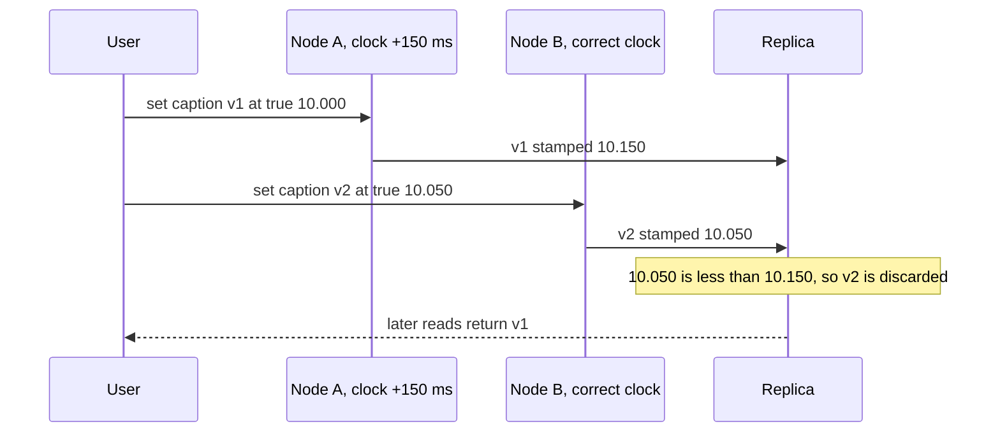

**Reading the diagram.** A user edits a PhotoShare caption through node A, then 50 ms later through node B. Each write is synchronous to its node and replicated asynchronously to the replica (the storage boundary). A's clock is 150 ms fast, so the earlier write carries the larger stamp and v2 is silently discarded. The failure point is A's clock; more replicas do not help, since all apply the same rule.

::: example
**Worked example — How large is the danger window?**

1. Skew between A and B: $\varepsilon = 150$ ms.
2. A write through B at true time $t$ loses to an earlier write through A at true time $t - x$ whenever A's stamp is larger: $(t - x) + 0.150 > t$, i.e., $x < 150$ ms.
3. So any two writes to the same key through these two nodes that are less than 150 ms apart may be reordered. PhotoShare's caption edits are rare, but an inventory counter updated 50 times per second from several nodes would lose updates constantly.

Interpretation: the skew is a window within which LWW silently discards *causally later* writes. Engineering implication: use wall-clock LWW only where losing one of two near-simultaneous writes is acceptable; otherwise use logical clocks (§24.10–§24.12), version vectors (§24.11), conditional writes, or CRDTs (§27.14).
:::

#### Code example

```python
"""Clock arithmetic: NTP offset/delay, drift-based resync interval,
and how last-writer-wins (LWW) loses a write when clocks are skewed."""


def ntp_offset_delay(t1, t2, t3, t4):
    """RFC 5905 on-wire calculation (all values in seconds).
    t1, t4 are read from the client clock; t2, t3 from the server clock."""
    offset = ((t2 - t1) + (t3 - t4)) / 2   # theta: server clock minus client clock
    delay = (t4 - t1) - (t3 - t2)          # delta: round trip minus server hold time
    return offset, delay


def resync_interval(max_skew_s, drift_ppm):
    """Longest interval between syncs that keeps two clocks within max_skew_s
    when each may drift up to drift_ppm in opposite directions."""
    return max_skew_s / (2 * drift_ppm * 1e-6)


class LWWRegister:
    """A replica that keeps the value with the highest wall-clock timestamp."""

    def __init__(self):
        self.value, self.ts = None, float("-inf")

    def apply(self, value, ts):
        if ts > self.ts:
            self.value, self.ts = value, ts
            return "applied"
        return "discarded"


if __name__ == "__main__":
    theta, delta = ntp_offset_delay(0.000, 0.120, 0.121, 0.061)
    print(f"NTP: offset {theta * 1000:.1f} ms, delay {delta * 1000:.1f} ms, "
          f"error bound +/-{delta / 2 * 1000:.1f} ms")

    print(f"Resync every {resync_interval(0.001, 50):.0f} s to stay within 1 ms at 50 ppm")

    # Node A's clock runs 150 ms fast; node B's clock is correct.
    skew = {"A": 0.150, "B": 0.000}
    writes = [  # (true time in s, node, value): the second write happens 50 ms later
        (10.000, "A", "caption v1"),
        (10.050, "B", "caption v2"),
    ]
    replica = LWWRegister()
    for true_t, node, value in writes:
        stamp = true_t + skew[node]                      # what the node's clock says
        print(f"t={true_t:.3f} node {node} writes {value!r:13} stamp={stamp:.3f}"
              f" -> {replica.apply(value, stamp)}")
    print(f"Final value: {replica.value!r} (the later write was lost)")
```

Output:

```text
NTP: offset 90.0 ms, delay 60.0 ms, error bound +/-30.0 ms
Resync every 10 s to stay within 1 ms at 50 ppm
t=10.000 node A writes 'caption v1'  stamp=10.150 -> applied
t=10.050 node B writes 'caption v2'  stamp=10.050 -> discarded
Final value: 'caption v1' (the later write was lost)
```

What to notice:

- `ntp_offset_delay` is a direct transcription of the RFC 5905 formulas; the sign convention is "server minus client".
- `LWWRegister.apply` returns `"discarded"` for the user's *latest* edit, and nothing in the system raises an error: LWW data loss is silent.
- Even if the replica received v2 first, the outcome is the same, because LWW orders by timestamp, not by arrival.

### 24.9.7 Clock sources and bounded uncertainty

**Table 24.8 — Clock synchronization options.**

| Option | How it works | Typical accuracy (as of 2026) | Cost | Use when |
|---|---|---|---|---|
| Unsynchronized quartz | Free-running oscillator | Drifts seconds per day | None | Never for timestamps shared across machines |
| NTP over the Internet | Software timestamps, public servers | Milliseconds to tens of milliseconds | Free | Laptops, small fleets, logging |
| NTP inside a datacenter | Local stratum-1/2 servers, short paths | Sub-millisecond to a few ms | Low | Default for server fleets |
| PTP with hardware timestamps | NIC and switch timestamping | Sub-microsecond in a well-built LAN | PTP-capable NICs, switches, grandmasters | Finance, telecom, databases that exploit tight bounds |
| Bounded-uncertainty APIs | Return an interval [earliest, latest] instead of one value | Interval width of microseconds to milliseconds | Infrastructure plus discipline in using the bound | Correctness that depends on time (leases, commit wait) |

The last row matters most for Part V. Google's **TrueTime** returns an interval guaranteed to contain true time, and Spanner waits out its width before making a commit visible (**commit wait**), turning bounded uncertainty into externally consistent transactions (§28.8).

**Table 24.9 — Clock failure scenarios.**

| What goes wrong | Why | Detection | Recovery | Prevention |
|---|---|---|---|---|
| Negative durations; timeouts fire early or never | Wall clock used for durations; NTP stepped it | Negative latency metrics; stuck timers | Restart affected processes | Monotonic clocks for all durations |
| Lost writes under LWW | Skew larger than gap between conflicting writes | Users report edits "reverting"; audit logs disagree | Restore from log if kept | Logical or hybrid clocks, version vectors, CRDTs |
| Two lease holders at once | Lease holder's clock slow or process paused | Two nodes acting as owner | Fencing rejects stale owner | Fencing tokens (§26.13); bounded-uncertainty clocks |
| One node far off after hypervisor pause or failed sync | Synchronization stopped silently | Offset and "last sync" metrics | Step clock; quarantine node | Alert on sync loss; nodes refuse to serve when offset exceeds a bound |
| Leap second crash or 0.5 s disagreement | Repeated second; mixed smeared and unsmeared sources | Errors clustered at 23:59:60 UTC | Restart; fix time sources | Smear consistently across the fleet |

::: mistake
**Mistake — "NTP keeps all our clocks in sync, so timestamps give a total order."** NTP gives an *estimate*, usually off by milliseconds and occasionally by seconds; events closer than the skew cannot be ordered by timestamp (§17.10 makes the same point for IDs). Use logical clocks for ordering and explicit uncertainty bounds for real-time guarantees.
:::

## 24.10 Logical clocks: Lamport clocks

### 24.10.1 Happened-before

Lamport's 1978 insight was that most systems need to know not *when* events happened but which could have *influenced* which [Lamport 1978].

::: definition
**Definition — Happened-before (→).** The smallest relation on events such that: (1) if $a$ and $b$ occur in the same process and $a$ comes first, $a \to b$; (2) if $a$ is the sending of a message and $b$ its receipt, $a \to b$; (3) if $a \to b$ and $b \to c$, then $a \to c$. Two distinct events are **concurrent** ($a \parallel b$) if neither $a \to b$ nor $b \to a$.
:::

Happened-before is **potential causality**: information from $a$ *could* have reached $b$.

### 24.10.2 The algorithm

Think of a diary page counter: turn a page per event, write the page number on each letter sent, and on receiving a letter skip past its page number if higher.

::: definition
**Definition — Lamport clock.** Each process $P_i$ keeps an integer counter $C_i$, initially 0. **Rule 1:** before each event (local, send or receive), $C_i \leftarrow C_i + 1$; a send attaches the new $C_i$ to the message. **Rule 2:** on receiving a message with timestamp $t_m$, set $C_i \leftarrow \max(C_i, t_m)$, then apply rule 1. The event's timestamp is the resulting $C_i$.
:::

The rules guarantee the **clock condition**: if $a \to b$ then $C(a) < C(b)$. The converse does *not* hold: $C(a) < C(b)$ says only that $b$ did not happen before $a$.

### 24.10.3 A worked trace

**Figure 24.10 — Lamport timestamps on three processes.**

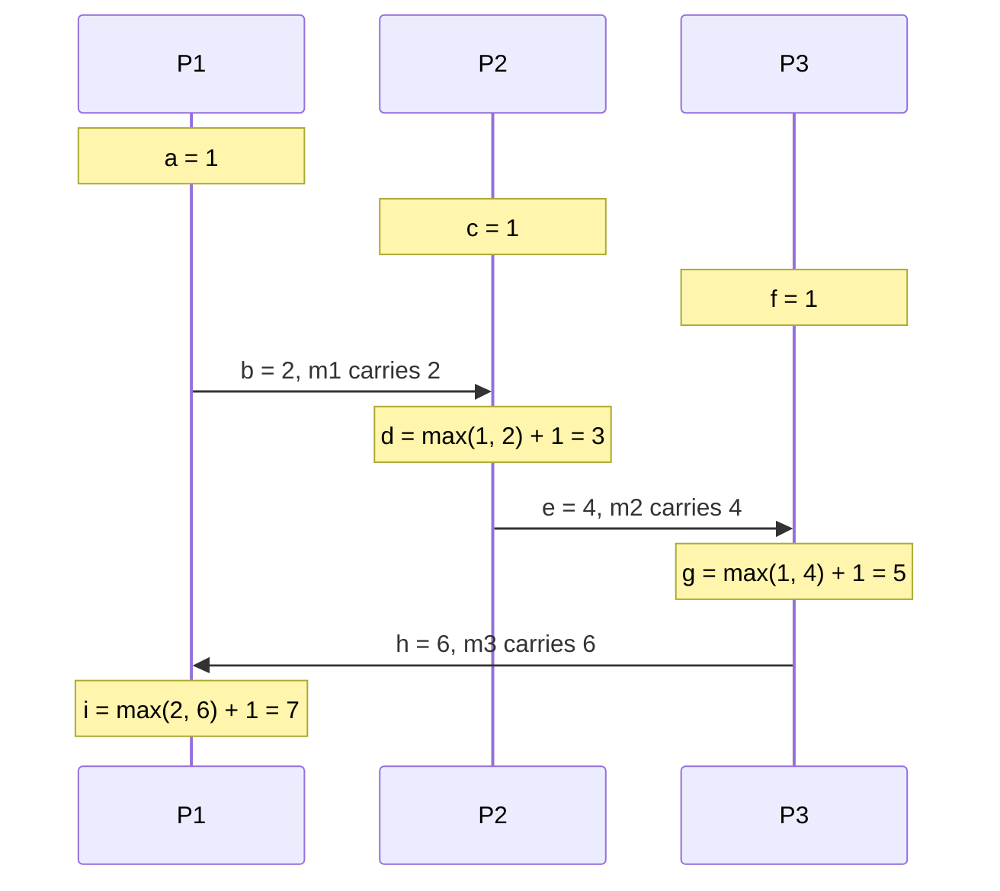

**Reading the diagram.** Lifelines are processes, notes are events with timestamps, and arrows are asynchronous messages carrying the sender's timestamp. P2's receipt `d` jumps to $\max(1,2)+1=3$, and the chain continues through P3 back to P1. There is no storage or failure point; only causality is shown. Note the limitation: `c` (1) < `b` (2), yet they are concurrent. The cost is one integer per message, at any scale.

### 24.10.4 Code example

```python
"""Lamport logical clocks: replay the trace of Figure 24.10 and derive a total order."""


class LamportProcess:
    def __init__(self, pid):
        self.pid, self.clock, self.log = pid, 0, []

    def _tick(self, name, kind):
        self.clock += 1                         # rule 1: increment before every event
        self.log.append((self.clock, self.pid, name, kind))
        return self.clock

    def local(self, name):
        return self._tick(name, "local")

    def send(self, name):
        return self._tick(name, "send")         # the message carries this timestamp

    def receive(self, name, msg_ts):
        self.clock = max(self.clock, msg_ts)    # rule 2: jump past the sender's time
        return self._tick(name, "receive")


if __name__ == "__main__":
    p1, p2, p3 = LamportProcess("P1"), LamportProcess("P2"), LamportProcess("P3")
    p1.local("a")
    m1 = p1.send("b")            # m1: P1 -> P2
    p2.local("c")
    p2.receive("d", m1)
    m2 = p2.send("e")            # m2: P2 -> P3
    p3.local("f")
    p3.receive("g", m2)
    m3 = p3.send("h")            # m3: P3 -> P1
    p1.receive("i", m3)

    events = p1.log + p2.log + p3.log
    for ts, pid, name, kind in sorted(events):  # total order: (timestamp, process id)
        print(f"{ts:>2} {pid} {name} ({kind})")
```

Output:

```text
 1 P1 a (local)
 1 P2 c (local)
 1 P3 f (local)
 2 P1 b (send)
 3 P2 d (receive)
 4 P2 e (send)
 5 P3 g (receive)
 6 P3 h (send)
 7 P1 i (receive)
```

What to notice:

- Sorting by the pair (timestamp, process ID) gives a **total order** that every process can compute identically and that is consistent with causality; ties such as `a`, `c`, `f` at 1 are broken by process ID.
- The total order is *arbitrary* among concurrent events: it places `c` before `b`, though neither influenced the other.

### 24.10.5 Uses and limits

Lamport used this total order for distributed mutual exclusion [Lamport 1978], the seed of **state machine replication** (§26.3). Raft's **terms** behave like a Lamport clock: a node adopts any higher term it sees and rejects lower ones [Ongaro and Ousterhout 2014]; fencing tokens (§26.13) are similar. What Lamport clocks cannot do is detect concurrency.

## 24.11 Vector clocks and version vectors

### 24.11.1 The algorithm

Vector clocks were introduced independently by Fidge and Mattern [Fidge 1988; Mattern 1989]. Instead of one counter, each process keeps a counter *for every process*: its knowledge of how many events each process has performed.

::: definition
**Definition — Vector clock.** With $n$ processes, each process $P_i$ keeps a vector $V_i[1..n]$, initially all zeros. Before each event, $P_i$ increments $V_i[i]$; a send attaches a copy of $V_i$. On receiving a message carrying $V_m$, $P_i$ sets $V_i[k] \leftarrow \max(V_i[k], V_m[k])$ for every $k$, then increments $V_i[i]$.
:::

Comparison rules: $V \le W$ if $V[k] \le W[k]$ for all $k$; $V < W$ if $V \le W$ and $V \ne W$; $V \parallel W$ (concurrent) if neither $V \le W$ nor $W \le V$. Unlike Lamport clocks, vector clocks **characterize** causality exactly: $a \to b$ if and only if $V(a) < V(b)$.

**Figure 24.11 — Vector clocks on the same trace.**

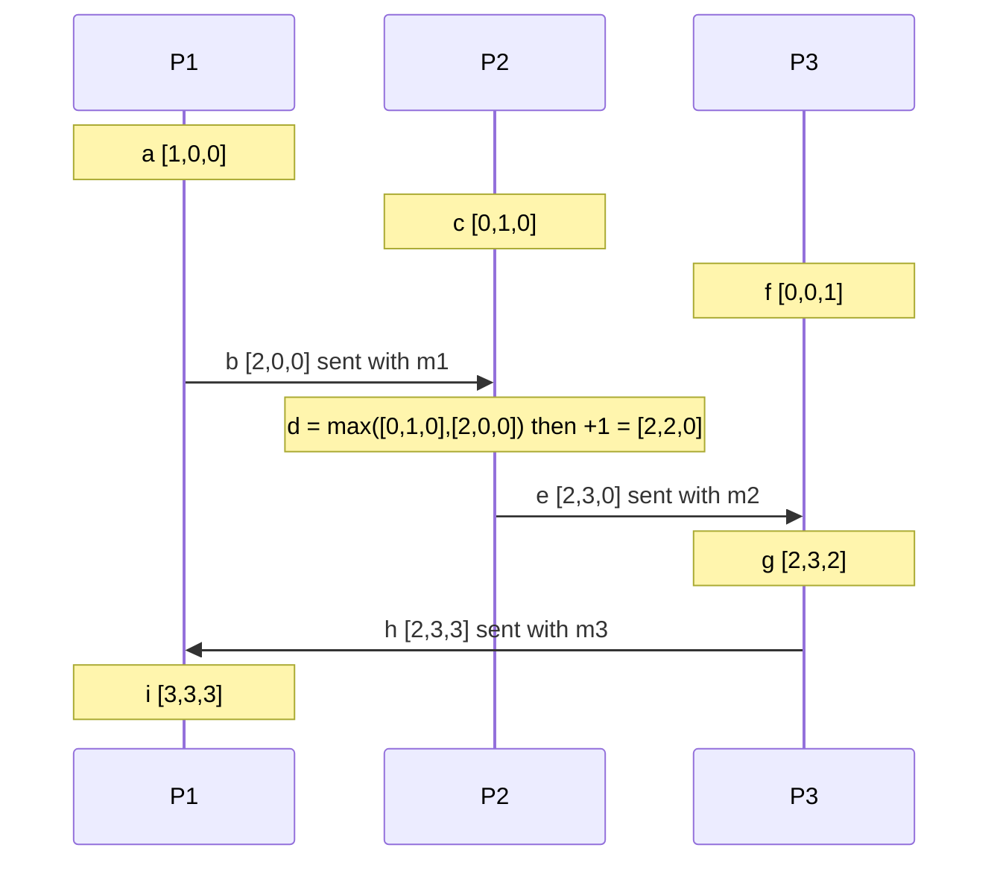

**Reading the diagram.** Entries are [P1, P2, P3]; each event increments its own entry, and each receipt first takes the element-wise maximum. Asynchronous messages now carry $n$ integers. Concurrency is visible: `c` = [0,1,0] and `b` = [2,0,0] are incomparable, while `b` ≤ `g` = [2,3,2] entry by entry, so `b` → `g`. The scaling limit is vector size, which grows with the number of processes.

### 24.11.2 Version vectors

A **version vector** applies the same idea to *replicas of a data item* rather than to events in processes [Parker et al. 1983]. Each replica that accepts writes for a key has an entry counting the updates it has issued to that key. When two versions of a key have incomparable version vectors, they were written concurrently and are kept as **siblings** for the application (or a merge function) to reconcile; when one dominates, it replaces the other. The client passes the version vector it read (its **context**) with each write, so the store knows which versions the client had seen. This section introduces the mechanism only; how replicated stores use siblings in practice (the Dynamo cart walk-through, Riak's causal contexts, merge functions and their pitfalls) is in §27.14.2.

**Figure 24.12 — Version vectors detect a concurrent shopping-cart update.**

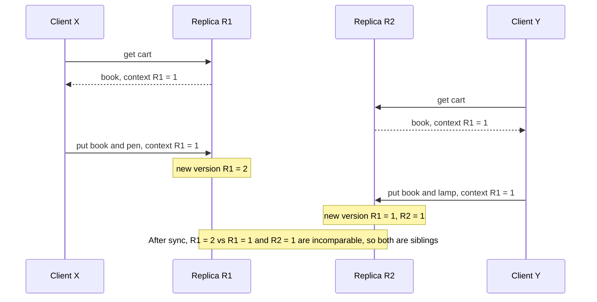

**Reading the diagram.** Both clients read context {R1: 1} and write synchronously through different replicas, which later synchronize asynchronously. Neither {R1: 2} nor {R1: 1, R2: 1} dominates, so both values are kept as siblings; the next reader gets both and writes back a merge. The storage boundary is each replica's copy. Unlike LWW (Figure 24.9), nothing is silently lost, at the cost of application merging.

### 24.11.3 Code example

```python
"""Vector clocks: comparison, the Figure 24.11 trace, and sibling detection with version vectors."""


def compare(v, w):
    """Return 'equal', 'before' (v happened before w), 'after' or 'concurrent'."""
    keys = set(v) | set(w)
    le = all(v.get(k, 0) <= w.get(k, 0) for k in keys)
    ge = all(v.get(k, 0) >= w.get(k, 0) for k in keys)
    if le and ge:
        return "equal"
    if le:
        return "before"
    if ge:
        return "after"
    return "concurrent"


def merge(v, w):
    return {k: max(v.get(k, 0), w.get(k, 0)) for k in sorted(set(v) | set(w))}


class VCProcess:
    def __init__(self, pid):
        self.pid, self.vc, self.events = pid, {}, {}

    def _tick(self, name):
        self.vc = dict(self.vc)
        self.vc[self.pid] = self.vc.get(self.pid, 0) + 1   # increment own entry
        self.events[name] = self.vc
        return self.vc

    def local(self, name):
        return self._tick(name)

    def send(self, name):
        return self._tick(name)                 # the message carries a copy of vc

    def receive(self, name, msg_vc):
        self.vc = merge(self.vc, msg_vc)        # element-wise maximum, then increment
        return self._tick(name)


class VersionedStore:
    """One key replicated with version vectors keyed by replica id. Concurrent
    writes are kept as siblings instead of being silently overwritten."""

    def __init__(self):
        self.siblings = []                      # list of (version_vector, value)

    def get(self):
        context = {}
        for vv, _ in self.siblings:
            context = merge(context, vv)
        return [val for _, val in self.siblings], context

    def put(self, replica, value, context):
        new_vv = dict(context)
        counter = max((vv.get(replica, 0) for vv, _ in self.siblings), default=0)
        new_vv[replica] = counter + 1           # replica issues its next counter value
        # Keep only siblings that the new write did not causally overwrite.
        self.siblings = [(vv, val) for vv, val in self.siblings
                         if compare(vv, new_vv) == "concurrent"]
        self.siblings.append((new_vv, value))


def fmt(v):
    return "[" + ",".join(str(v.get(p, 0)) for p in ("P1", "P2", "P3")) + "]"


if __name__ == "__main__":
    p1, p2, p3 = VCProcess("P1"), VCProcess("P2"), VCProcess("P3")
    p1.local("a"); m1 = p1.send("b")
    p2.local("c"); p2.receive("d", m1); m2 = p2.send("e")
    p3.local("f"); p3.receive("g", m2); m3 = p3.send("h")
    p1.receive("i", m3)
    ev = {**p1.events, **p2.events, **p3.events}
    for name in "abcdefghi":
        print(name, fmt(ev[name]))
    for x, y in [("b", "g"), ("c", "b"), ("f", "e"), ("a", "i")]:
        print(f"{x} vs {y}: {compare(ev[x], ev[y])}")

    store = VersionedStore()
    store.put("R1", "cart=[book]", {})
    _, ctx = store.get()                           # both clients read the same version
    store.put("R1", "cart=[book, pen]", ctx)       # client 1 writes via replica R1
    store.put("R2", "cart=[book, lamp]", ctx)      # client 2 writes via R2 concurrently
    values, ctx = store.get()
    print("siblings:", values, "context:", ctx)
    store.put("R1", "cart=[book, pen, lamp]", ctx) # client merges and writes back
    print("after merge:", store.get())

    # Pitfall: two clients write concurrently through the SAME replica.
    store = VersionedStore()
    store.put("R1", "v0", {})
    _, ctx = store.get()
    store.put("R1", "from client X", ctx)          # gets {R1: 2}
    store.put("R1", "from client Y", ctx)          # gets {R1: 3}, which dominates {R1: 2}
    print("same-replica concurrent writes:", store.get()[0])
```

Output:

```text
a [1,0,0]
b [2,0,0]
c [0,1,0]
d [2,2,0]
e [2,3,0]
f [0,0,1]
g [2,3,2]
h [2,3,3]
i [3,3,3]
b vs g: before
c vs b: concurrent
f vs e: concurrent
a vs i: before
siblings: ['cart=[book, pen]', 'cart=[book, lamp]'] context: {'R1': 2, 'R2': 1}
after merge: (['cart=[book, pen, lamp]'], {'R1': 3, 'R2': 1})
same-replica concurrent writes: ['from client Y']
```

What to notice:

- `compare` treats missing entries as 0, so vectors can be sparse maps rather than fixed arrays.
- The merged write carries the merged context {R1: 2, R2: 1}, so its new vector {R1: 3, R2: 1} dominates both siblings and replaces them.
- The last case is a real flaw of per-replica version vectors: two *concurrent* writes through the same replica get {R1: 2} and {R1: 3}, the second appears to dominate the first, and client X's write is lost. Dotted version vectors (§24.11.5) fix this.

### 24.11.4 Size growth

::: formula
**Vector clock metadata size**

$$S = n\,(b_{\text{id}} + b_{\text{ctr}}) \qquad\qquad M = K \cdot S$$

| Symbol | Meaning | Units |
|---|---|---|
| $n$ | Number of entries (processes, replicas or clients that have written) | count |
| $b_{\text{id}}$ | Bytes to identify an entry's owner | bytes |
| $b_{\text{ctr}}$ | Bytes per counter | bytes |
| $S$ | Metadata per version | bytes |
| $K$ | Number of keys stored | count |
| $M$ | Total version metadata | bytes |
:::

::: example
**Worked example — Server IDs versus client IDs.**

1. Entries keyed by replica: $n = 3$, 8-byte IDs and 8-byte counters. $S = 3 \times 16 = 48$ bytes. For $K = 10^9$ keys, $M = 48 \times 10^9$ bytes = 48 GB, acceptable next to the data.
2. Entries keyed by *client*, for a popular key written by 10,000 distinct users: $S = 10{,}000 \times 16 = 160{,}000$ bytes = 160 KB of metadata on one key, transferred on every read and write.
3. Over a fleet of 1,000 processes tracking event causality: $S = 1{,}000 \times 16 = 16$ KB on *every message*.

Interpretation: size grows with the number of writers, and Charron-Bost proved no smaller timestamp can characterize causality in general [Charron-Bost 1991]. Engineering implication: key vectors by a small, stable set of replicas; if you must prune entries, accept occasional false conflicts.
:::

::: industry
**Amazon Dynamo.** Dynamo tracked versions of shopping-cart objects with vector clocks of (node, counter) pairs, returned divergent versions to the client for semantic reconciliation, and truncated the vector by removing the oldest pair when it exceeded a threshold (about 10 pairs), accepting the small risk of losing causality information [DeCandia et al. 2007].
*Evidence: Primary* — [DeCandia et al. 2007]
:::

### 24.11.5 Dotted version vectors

**Dotted version vectors** (DVVs) fix the same-replica flaw [Preguiça et al. 2010]. A DVV pairs the writer's causal context with a **dot**, the (replica, counter) pair naming *this* write. Writes through R1 with dots (R1, 2) and (R1, 3) are recognized as concurrent because neither context contains the other's dot. DVVs stay bounded by the replica count while avoiding lost updates and client-keyed "sibling explosion"; Riak adopted them in version 2.0 [Riak Docs: Dotted Version Vectors].

**Table 24.10 — Logical clocks compared.**

| Clock | Size | Detects concurrency? | Close to real time? | Typical use |
|---|---|---|---|---|
| Lamport | 1 integer | No | No | Total order, terms, fencing tokens |
| Vector clock | $n$ entries (processes) | Yes | No | Causality tracking, debugging, causal broadcast |
| Version vector | $n$ entries (replicas) per key | Yes | No | Conflict detection in replicated stores |
| Dotted version vector | Replica entries plus one dot | Yes, including same-replica writes | No | Riak-style key-value stores |
| Hybrid logical clock | 64 bits | No | Yes, within skew | Timestamps for MVCC and snapshot reads |

## 24.12 Hybrid logical clocks

### 24.12.1 Why combine physical and logical time

Multi-version databases need timestamps that (1) respect causality, (2) stay close to real time so "read as of 10:00" means something, and (3) fit in 64 bits. Lamport clocks miss (2); physical clocks miss (1). Kulkarni et al.'s **hybrid logical clock** (HLC) provides all three [Kulkarni et al. 2014].

::: definition
**Definition — Hybrid logical clock.** A timestamp $(l, c)$ where $l$ is the largest physical clock value the node has seen (from its own clock or from any message) and $c$ is a logical counter that orders events sharing the same $l$. Timestamps compare lexicographically: first by $l$, then by $c$.
:::

### 24.12.2 The algorithm

For a local or send event at a node with physical clock $pt$: set $l' \leftarrow l$, $l \leftarrow \max(l', pt)$; if $l = l'$ then $c \leftarrow c + 1$, else $c \leftarrow 0$.

For a receive of a message stamped $(l_m, c_m)$: set $l \leftarrow \max(l', l_m, pt)$; then $c \leftarrow \max(c, c_m)+1$ if $l$ equals both $l'$ and $l_m$; $c \leftarrow c+1$ if $l = l'$ only; $c \leftarrow c_m + 1$ if $l = l_m$ only; otherwise $c \leftarrow 0$.

The paper proves that $e \to f$ implies $\text{hlc}(e) < \text{hlc}(f)$, that $l - pt \le \varepsilon$ (the clock skew) because $l$ is always some node's clock reading, and that $c$ stays small, so 48 bits of $l$ plus 16 bits of $c$ fit a 64-bit time field.

**Figure 24.13 — HLC keeps causal order when node A's clock runs 100 ms fast.**

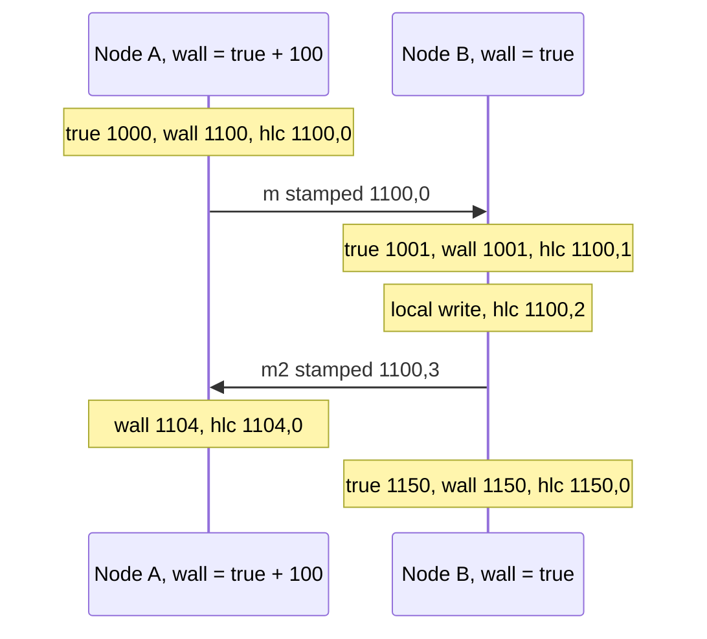

**Reading the diagram.** Times are in milliseconds. A's message reaches B when B's wall clock reads 1001, *before* the send stamp 1100; physical timestamps would invert the order. B's HLC adopts $l = 1100$ and counts with $c$, ordering the receipt and B's next write after the send. Messages are asynchronous; the clock has no storage boundary. At 1150, $l$ returns to physical time. The failure point is unbounded skew: one wildly fast clock drags every HLC forward, so production systems bound and monitor offsets.

### 24.12.3 Code example

```python
"""Hybrid logical clock (Kulkarni et al. 2014) on two nodes whose clocks disagree by 100 ms."""


class HLC:
    def __init__(self, physical_clock):
        self.pt = physical_clock      # function returning this node's wall clock, in ms
        self.l, self.c = 0, 0         # l: largest physical time seen; c: logical counter

    def now(self):
        """Timestamp a local or send event."""
        old_l = self.l
        self.l = max(old_l, self.pt())
        self.c = self.c + 1 if self.l == old_l else 0
        return (self.l, self.c)

    def update(self, msg):
        """Timestamp a receive event for a message stamped msg = (l_m, c_m)."""
        l_m, c_m = msg
        old_l = self.l
        self.l = max(old_l, l_m, self.pt())
        if self.l == old_l == l_m:
            self.c = max(self.c, c_m) + 1
        elif self.l == old_l:
            self.c += 1
        elif self.l == l_m:
            self.c = c_m + 1
        else:
            self.c = 0
        return (self.l, self.c)


def pack(ts):
    """48 bits of milliseconds plus a 16-bit counter fit in one 64-bit integer."""
    l, c = ts
    assert c < 2**16
    return (l << 16) | c


if __name__ == "__main__":
    true_ms = 1000
    a = HLC(lambda: true_ms + 100)    # node A's clock runs 100 ms fast
    b = HLC(lambda: true_ms)          # node B's clock is correct

    def show(event, node, ts, wall):
        print(f"true={true_ms} {event:<15} {node}: wall={wall}  hlc={ts}")

    ts = a.now()
    show("A sends m", "A", ts, true_ms + 100)
    true_ms += 1
    ts = b.update(ts)
    show("B receives m", "B", ts, true_ms)
    true_ms += 1
    ts = b.now()
    show("B local write", "B", ts, true_ms)
    true_ms += 1
    ts = b.now()
    show("B sends m2", "B", ts, true_ms)
    true_ms += 1
    ts = a.update(ts)
    show("A receives m2", "A", ts, true_ms + 100)
    true_ms = 1150
    ts = b.now()
    show("B local", "B", ts, true_ms)
    print("packed:", hex(pack(ts)), "->", ts == (pack(ts) >> 16, pack(ts) & 0xFFFF))
```

Output:

```text
true=1000 A sends m       A: wall=1100  hlc=(1100, 0)
true=1001 B receives m    B: wall=1001  hlc=(1100, 1)
true=1002 B local write   B: wall=1002  hlc=(1100, 2)
true=1003 B sends m2      B: wall=1003  hlc=(1100, 3)
true=1004 A receives m2   A: wall=1104  hlc=(1104, 0)
true=1150 B local         B: wall=1150  hlc=(1150, 0)
packed: 0x47e0000 -> True
```

What to notice:

- `update` is the only place causality enters: taking the maximum with $l_m$ guarantees the receipt is stamped after the send.
- $l$ never runs ahead of the fastest physical clock (1100 here), so HLC timestamps stay within the skew of real time.
- Like a Lamport clock, an HLC is a scalar and cannot detect concurrency.

### 24.12.4 HLC in production: uncertainty intervals

HLC orders causally related events, but two *unrelated* transactions on different nodes are ordered only up to the clock skew. CockroachDB, which uses HLC timestamps, handles this with a configured **maximum clock offset** (500 ms by default, as of 2026) and an **uncertainty interval** [Cockroach Labs Docs; Kimball 2016].

::: formula
**Read uncertainty interval**

$$t_r < t_w \le t_r + \varepsilon_{\max} \;\Rightarrow\; \text{restart the read at } t_w$$

| Symbol | Meaning | Units |
|---|---|---|
| $t_r$ | The reading transaction's HLC timestamp | s |
| $t_w$ | Commit timestamp of a value found by the read | s |
| $\varepsilon_{\max}$ | Configured maximum clock offset between any two nodes | s |
:::

Such a value *might* have committed before the read began in real time (the writer's clock may have been ahead), so the read moves up to $t_w$ and retries.

::: example
**Worked example — A read meets uncertain writes.**

1. $\varepsilon_{\max} = 500$ ms; a read starts at $t_r = $ 10:00:00.000.
2. It finds a value at 10:00:00.300: inside $(t_r, t_r + 0.5]$, so it restarts at $t_r' = $ 10:00:00.300 and returns that value.
3. A value at 10:00:00.700 lies beyond the window: it definitely happened after the read began, and is ignored.

Interpretation: correctness depends on the configured bound holding, so CockroachDB nodes monitor their offset against peers and shut down rather than serve near the maximum. Engineering implication: better synchronization buys performance; halving $\varepsilon_{\max}$ halves the restart window. Spanner goes further with TrueTime (§28.8).
:::

::: industry
**MongoDB and CockroachDB.** MongoDB's causal consistency sessions use a cluster-wide logical clock of the hybrid type, a (seconds, counter) pair gossiped on every message and signed to prevent malicious advancement [Tyulenev et al. 2019]. CockroachDB stamps every transaction with an HLC and uses the uncertainty interval above.
*Evidence: Primary* — [Tyulenev et al. 2019; Cockroach Labs Docs]
:::

## 24.13 The FLP impossibility result

### 24.13.1 The statement

::: definition
**Definition — FLP impossibility.** In a fully asynchronous message-passing system with reliable links, no *deterministic* protocol can solve **consensus** (all correct processes decide the same value, the value was proposed by some process, and every correct process eventually decides) if even one process may crash-stop [Fischer et al. 1985].
:::

The assumptions are generous (no lost messages, one clean crash); only a delay bound is missing.

### 24.13.2 Intuition

Call a system state **bivalent** if both decisions (0 and 1) are still reachable, and **univalent** once the outcome is fixed. FLP shows that (1) some initial state is bivalent, and (2) from any bivalent state, an adversarial scheduler can always deliver messages in an order that keeps the state bivalent. The key step is that there is always some pending message whose delivery would decide the outcome; the scheduler delays it. Because the system is asynchronous, a delayed message is indistinguishable from a crashed sender, so the protocol cannot safely decide without it, and the scheduler can repeat the trick forever.

**Figure 24.14 — The adversary keeps the protocol undecided.**

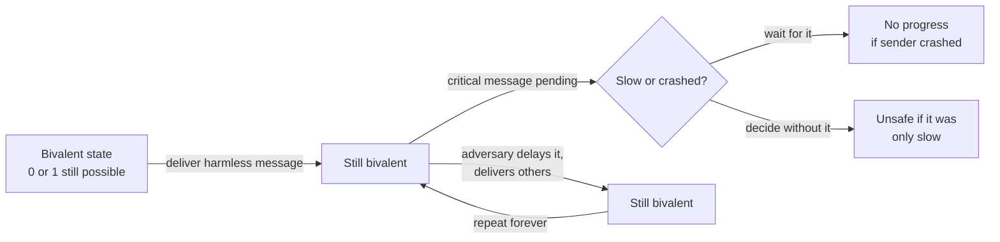

**Reading the diagram.** Nodes are global states of the protocol; edges are message deliveries chosen by the adversarial scheduler, which is how the asynchronous network is modeled. When a critical message is pending, the protocol faces the decision box: waiting risks blocking forever if the sender crashed, deciding risks disagreement if the sender was merely slow. The adversary always picks the delivery that keeps the system bivalent. There are no storage boundaries; the failure point is the inability to tell slow from crashed, and adding processes does not help.

### 24.13.3 What FLP does and does not forbid

**Table 24.11 — Reading FLP correctly.**

| FLP forbids | FLP does not forbid | How real systems escape |
|---|---|---|
| A deterministic protocol that *guarantees* termination in every asynchronous execution with one crash | Protocols that are always *safe* and terminate when the network behaves | **Partial synchrony** [Dwork et al. 1988]: Paxos and Raft never decide inconsistently and make progress after GST |
| | Protocols that terminate with probability 1 | **Randomization** [Ben-Or 1983]: coin flips defeat the adversarial schedule |
| | Protocols that use an oracle to suspect failures | **Failure detectors** [Chandra and Toueg 1996]: an eventually accurate detector suffices |
| | Solving weaker problems | Eventual consistency and CRDTs avoid consensus altogether (§27.14) |

In practice, a Raft cluster may fail to elect a leader during a storm of slow messages, stays *safe* throughout, and recovers once messages flow; its randomized election timeouts break symmetry, though they are not Ben-Or's algorithm [Ongaro and Ousterhout 2014].

::: mistake
**Mistake — "FLP proves consensus is impossible, so systems like etcd cannot work."** FLP rules out a *guarantee of termination* in a purely asynchronous model. Real systems keep safety unconditionally and obtain liveness from timeouts, i.e., from the assumption that the network is eventually timely. FLP is also distinct from CAP (§25.8), which concerns availability of reads and writes during a partition.
:::

## 24.14 The end-to-end argument

### 24.14.1 The principle

Saltzer, Reed and Clark's 1984 paper asks where in a layered system a function such as reliable delivery should be implemented [Saltzer et al. 1984]. Their answer, paraphrased: a function that can be implemented completely and correctly only with knowledge held by the application at the endpoints cannot be provided as a feature of the communication system alone. A lower layer may still provide a partial version, but only as a *performance optimization*.

Their example is **careful file transfer** from A's disk to B's disk. A reliable network still cannot prevent corruption in A's memory, a buffer copy or B's disk; only an application check at both ends (compare checksums of the stored and original file, retry on mismatch) covers every step.

**Figure 24.15 — Where errors can enter a file transfer, and which check covers them.**

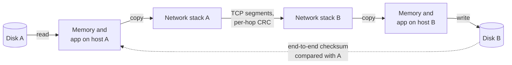

**Reading the diagram.** Data flows left to right between two storage boundaries (the disks) through several copies; every arrow is a failure point. TCP and link-layer checks protect only the middle arrow. The dotted arrow is the asynchronous end-to-end verification, which covers every step and scales at one checksum per file regardless of path length.

::: formula
**Undetected-corruption probability over many transfers**

$$P_{\text{bad}} = 1 - (1 - q)^N$$

| Symbol | Meaning | Units |
|---|---|---|
| $q$ | Probability that one transfer suffers corruption no lower layer catches | dimensionless |
| $N$ | Number of transfers | count |
| $P_{\text{bad}}$ | Probability that at least one transfer is silently corrupted | dimensionless |
:::

::: example
**Worked example — Rare errors at fleet scale.**

1. Assume, for illustration, that one transfer in $10^{10}$ suffers corruption missed by TCP and link checks: $q = 10^{-10}$.
2. PhotoShare's replication moves $N = 10^9$ blocks per day: $P_{\text{bad}} = 1 - (1 - 10^{-10})^{10^9} \approx 1 - e^{-0.1} \approx 0.095$.
3. Over a year: $N = 3.65 \times 10^{11}$, $P_{\text{bad}} \approx 1 - e^{-36.5} \approx 1$.

Interpretation: a probability that looks negligible per transfer becomes a near-certainty at scale. Engineering implication: verify integrity end to end (checksums stored with the data and checked on read). Stone and Partridge measured that real Internet traffic contains errors the TCP checksum fails to catch at rates far above what checksum theory predicts [Stone and Partridge 2000].
:::

::: industry
**Amazon S3, July 2008.** A single corrupted bit in messages of S3's internal gossip protocol, which carried no checksum of its own, spread incorrect server-state information through the system and caused a multi-hour outage. AWS's remedy included adding checksums to that internal state and its messages [AWS 2008].
*Evidence: Primary* — [AWS 2008]
:::

### 24.14.2 Applying the argument

- **Delivery versus processing.** A TCP acknowledgment means the peer's kernel buffered the bytes (§7.7), not that the application processed them. A message broker should be acknowledged *after* processing (Chapters 30–31).
- **Exactly-once effects.** No network can deliver exactly once; the endpoint achieves *effectively-once* processing with at-least-once delivery plus deduplication by idempotency key (§22.15).
- **Security.** Encryption hop by hop leaves data exposed at every intermediary; end-to-end encryption does not (Chapter 10).
- **Where lower layers still help.** Wi-Fi retransmits frames locally because an end-to-end retransmission would be far slower: the permitted "performance optimization".

::: mistake
**Mistake — "The network (or storage system) is reliable, so the application needn't check."** Each layer's guarantee covers only that layer. If the requirement is "the user's photo is stored intact and saved once", only the application can verify it.
:::

## 24.15 Summary and revision notes

::: summary
- Distributed systems have **independent failures, no global clock and unreliable messages**; the **two generals problem** shows certainty of agreement over a lossy channel is impossible.
- Distribute for **scale, fault tolerance, latency or data residency**. Replication gives $A_k = 1-(1-a)^k$ under independence, but fleets fail daily: $P_{\text{any}} = 1-(1-p)^n$.
- Each of the **eight fallacies** maps to a class of outages.
- State a **system model**: timing (synchronous, partially synchronous, asynchronous) and faults (crash-stop, crash-recovery, omission, timing, Byzantine). Consensus needs $2f+1$ nodes for crashes, $3f+1$ for Byzantine faults.
- **Network partitions** are complete, partial or asymmetric, and occur daily in large fleets; partial ones cause many catastrophic bugs.
- A timeout means **unknown outcome**. **Gray failures** are differentially observable; detect them with what clients experience. Set timeouts from measured p99.9 plus pause margin.
- Quartz drifts (1 ppm = 86.4 ms/day); NTP estimates $\theta = [(T_2-T_1)+(T_3-T_4)]/2$ with error up to $\delta/2$; PTP with hardware timestamps reaches sub-microsecond. Use monotonic clocks for durations; smear leap seconds consistently.
- **Wall-clock LWW** silently discards causally later writes that fall within the skew window.
- **Lamport clocks**: $a \to b \Rightarrow C(a) < C(b)$, total order with tie-breaking, no concurrency detection. **Vector clocks** characterize causality exactly at $O(n)$ size; **version vectors** detect concurrent writes as siblings; **dotted version vectors** fix same-replica lost updates.
- **HLC** $(l, c)$ is causal, within skew of real time, and 64 bits; real-time guarantees still need bounded skew (uncertainty intervals, TrueTime in §28.8).
- **FLP**: no deterministic asynchronous consensus guarantees termination with one crash; systems stay safe always and live under partial synchrony, randomization or failure detectors.
- **End-to-end argument**: integrity, deduplication and processing acknowledgments belong at the endpoints; lower layers only optimize.
:::

## 24.16 Knowledge checkpoint

1. Name the three properties that make a system distributed.
2. Why can no finite protocol solve the two generals problem?
3. One server is 99.9% available. What is the availability of 3 independent replicas, and why is that number optimistic?
4. Give a concrete consequence of the fallacy "latency is zero".
5. How many nodes does consensus need to tolerate 2 crash faults? 2 Byzantine faults?
6. What is the difference between a partial and an asymmetric partition?
7. Define gray failure and give one example.
8. A clock drifts at 20 ppm. How far off can it be after one hour?
9. NTP timestamps: $T_1 = 0$, $T_2 = 50$, $T_3 = 52$, $T_4 = 22$ ms. Compute offset, delay and error bound.
10. Under LWW, node A's clock is 80 ms fast. Which writes through node B can A's earlier writes override?
11. Lamport timestamps $C(a) = 3$, $C(b) = 5$. What can you conclude?
12. Compare [2,1,0] and [1,2,0]; then [1,1,0] and [2,1,3].
13. What problem do dotted version vectors solve?
14. Does FLP mean Raft can lose data? Explain.
15. State the end-to-end argument and give one application.

<details><summary>Answers</summary>

1. Independent (partial) failure, no shared clock, communication only by unreliable messages with unbounded delay.
2. The sender of the last message cannot know whether it arrived, so both must decide the same way without it; the message is then unnecessary, contradicting the assumption of a shortest protocol.
3. $1 - 0.001^3 = 1 - 10^{-9}$. Failures are correlated (shared power, network, software) and failover is not instant.
4. A chatty page with 100 sequential calls takes 50 ms at 0.5 ms per call in one region but about 7 s at 70 ms per call across regions.
5. $2f+1 = 5$; $3f+1 = 7$.
6. Partial: some pairs cannot communicate while others can (A and B both reach C but not each other). Asymmetric: one direction works and the other does not.
7. A failure seen by some observers but not others, e.g., a disk 100× slower that passes the heartbeat health check while application requests time out.
8. $20 \times 10^{-6} \times 3{,}600 = 0.072$ s = 72 ms.
9. $\delta = (22 - 0) - (52 - 50) = 20$ ms; $\theta = [(50 - 0) + (52 - 22)]/2 = 40$ ms (client behind by 40 ms); bound $\pm 10$ ms.
10. Any B write within 80 ms after an A write to the same key.
11. Only that $b \not\to a$; $a$ may have happened before $b$ or they may be concurrent.
12. [2,1,0] and [1,2,0] are concurrent; [1,1,0] < [2,1,3], so the first happened before the second.
13. Concurrent writes through the same replica, which per-replica version vectors misorder as one dominating the other, losing a write.
14. No. Raft is always safe; FLP only means that in bad asynchronous periods it may fail to make progress (elect a leader or commit).
15. A function that needs endpoint knowledge must be implemented at the endpoints; lower layers can only optimize. Example: checksum the stored file end to end, or deduplicate by idempotency key.
</details>

## 24.17 Interview questions

### Basic

**Q1. Why is building a distributed system harder than a single-machine one?** **Answer.** Three losses: partial failure (some parts fail, others continue, and nobody knows exactly which), no global clock (events on different machines cannot be ordered by time) and unreliable messaging (loss, delay, duplication). A timeout cannot distinguish a slow node from a dead one or tell whether a write happened, so designs need idempotency, quorums and logical ordering.

**Q2. Can you use server timestamps to order events across machines?** **Answer.** Only coarsely. NTP skew is milliseconds and occasionally seconds; clocks can step backwards. Events closer together than the skew may be misordered, which makes LWW lose writes. Use Lamport or hybrid logical clocks for causal order, vector clocks to detect concurrency, or a single sequencer; use bounded-uncertainty clocks when real-time order matters.

### Intermediate

**Q3. Design conflict handling for a shopping cart replicated across two regions.** **Answer.** Avoid LWW, which drops items. Track versions with version vectors keyed by replica (or dotted version vectors), keep concurrent versions as siblings, and merge on read (union of adds); represent removals with tombstones or use an observed-remove set CRDT (§27.14) so deletions are not resurrected. Discuss metadata size, sibling limits and the user experience of merges.

**Q4. A node passes health checks, yet its clients see 30% errors. What is happening and what would you change?** **Answer.** A gray failure: the probe does not exercise the failing path (disk, dependency, thread pool). Make health checks exercise real dependencies, add client-side outlier detection that ejects nodes with abnormal error rates or latency, and alert on client-observed rather than self-reported health.

### Advanced

**Q5. Explain FLP and how Raft copes with it.** **Answer.** In an asynchronous system no deterministic consensus protocol can guarantee termination if one process may crash, because a slow process is indistinguishable from a crashed one and an adversarial schedule can keep the system undecided. Raft keeps safety unconditionally (majority quorums, term checks, persisted votes) and gets liveness from partial synchrony: timeouts detect leader failure, and randomized election timeouts break split votes. During a bad network period it may stall, but never diverges.

**Q6. Your database uses HLC timestamps and a 500 ms maximum offset. Why do some reads restart, and how would you reduce restarts?** **Answer.** A read at $t_r$ that finds a value committed in $(t_r, t_r + 500\text{ ms}]$ cannot tell whether it committed before the read in real time, so it moves its timestamp forward and retries. Reduce restarts by improving clock synchronization (PTP or a precise cloud time service) and lowering the configured maximum offset, by monitoring offsets so nodes with bad clocks are removed, and by reducing contention on hot keys.

## 24.18 Practical exercises

1. Extend the Lamport listing with Lamport's mutual-exclusion algorithm (request, reply, release) for three processes and check that the lock is granted in timestamp order.
2. Modify the version-vector store to use dotted version vectors and show that the "same-replica" case keeps both writes as siblings.
3. Simulate 10 nodes with random drift between −50 and +50 ppm and NTP corrections every 64 s with ±2 ms error. Plot the maximum pairwise skew and count LWW inversions for writes 10 ms apart.
4. Run `chronyc tracking` (or `ntpq -p`) on a Linux machine; identify the stratum, offset, root delay and root dispersion, and explain each in terms of §24.9.3.
5. Using `tc netem` on two containers, create a one-way partition and observe how an etcd or Redis Sentinel cluster behaves.

## 24.19 Design challenges

1. **Global event log.** PhotoShare wants a per-user activity feed assembled from events produced in three regions, ordered so that a reply never appears before the comment it answers. Choose clocks (Lamport, HLC, vector), state the system model, quantify metadata overhead per event, and describe behavior during an inter-region partition.
2. **Clock-safe leases.** Design a leader lease for a job scheduler whose nodes use NTP with up to 50 ms skew and may pause for 2 s during garbage collection. Size lease duration and renewal interval, and explain why fencing tokens (§26.13) are still needed.

## 24.20 References

1. Akkoyunlu, E. A., Ekanadham, K., Huber, R. V. *Some Constraints and Tradeoffs in the Design of Network Communications*. Proc. 5th ACM Symposium on Operating Systems Principles (SOSP), 1975.
2. Alquraan, A., Takruri, H., Alfatafta, M., Al-Kiswany, S. *An Analysis of Network-Partitioning Failures in Cloud Systems*. 13th USENIX OSDI, 2018. https://www.usenix.org/conference/osdi18/presentation/alquraan
3. Amazon Web Services. *Amazon S3 Availability Event: July 20, 2008*. AWS Service Health Dashboard post-mortem, 2008. (Cited as AWS 2008.)
4. Amazon Web Services. *Summary of the Amazon EC2 and Amazon RDS Service Disruption in the US East Region*. AWS, April 2011. (Cited as AWS 2011.)
5. Amazon Web Services. *Amazon Time Sync Service now supports microsecond-accurate time*. AWS What's New, November 2023; and *ClockBound*. https://github.com/aws/clock-bound (Cited as AWS 2023.)
6. Bailis, P., Kingsbury, K. *The Network is Reliable: An informal survey of real-world communications failures*. ACM Queue 12(7), 2014; also Communications of the ACM 57(9), 2014.
7. Ben-Or, M. *Another Advantage of Free Choice: Completely Asynchronous Agreement Protocols*. Proc. ACM PODC, 1983.
8. BIPM. *Resolution 4 of the 27th CGPM: On the use and future development of UTC*. 2022.
9. Cachin, C., Guerraoui, R., Rodrigues, L. *Introduction to Reliable and Secure Distributed Programming*, 2nd ed. Springer, 2011.
10. Chandra, T. D., Toueg, S. *Unreliable Failure Detectors for Reliable Distributed Systems*. Journal of the ACM 43(2), 1996.
11. Charron-Bost, B. *Concerning the Size of Logical Clocks in Distributed Systems*. Information Processing Letters 39(1), 1991.
12. Cockroach Labs. *Operational FAQs* and *cockroach start* (`--max-offset`). CockroachDB documentation, accessed 2026. https://www.cockroachlabs.com/docs/
13. Corbett, J. C., et al. *Spanner: Google's Globally-Distributed Database*. 10th USENIX OSDI, 2012.
14. Dean, J. *Designs, Lessons and Advice from Building Large Distributed Systems*. Keynote, LADIS workshop, 2009.
15. DeCandia, G., et al. *Dynamo: Amazon's Highly Available Key-value Store*. Proc. ACM SOSP, 2007.
16. Dwork, C., Lynch, N., Stockmeyer, L. *Consensus in the Presence of Partial Synchrony*. Journal of the ACM 35(2):288–323, 1988.
17. European Union. *Regulation (EU) 2016/679 (General Data Protection Regulation)*, Chapter V. Official Journal of the EU, 2016. (Cited as EU 2016.)
18. Fidge, C. J. *Timestamps in Message-Passing Systems That Preserve the Partial Ordering*. Proc. 11th Australian Computer Science Conference, 1988, pp. 56–66.
19. Fischer, M. J., Lynch, N. A., Paterson, M. S. *Impossibility of Distributed Consensus with One Faulty Process*. Journal of the ACM 32(2):374–382, 1985.
20. Gill, P., Jain, N., Nagappan, N. *Understanding Network Failures in Data Centers: Measurement, Analysis, and Implications*. Proc. ACM SIGCOMM, 2011.
21. Google. *Leap Smear*. Google Public NTP documentation, accessed 2026. https://developers.google.com/time/smear
22. Graham-Cumming, J. *How and why the leap second affected Cloudflare DNS*. Cloudflare Blog, January 2017.
23. Gray, J. *Notes on Data Base Operating Systems*. In *Operating Systems: An Advanced Course*, LNCS 60, Springer, 1978.
24. Gunawi, H. S., et al. *Fail-Slow at Scale: Evidence of Hardware Performance Faults in Large Production Systems*. 16th USENIX FAST, 2018.
25. Huang, P., Guo, C., Zhou, L., Lorch, J. R., Dang, Y., Chintalapati, M., Yao, R. *Gray Failure: The Achilles' Heel of Cloud-Scale Systems*. Proc. HotOS XVI, ACM, 2017.
26. IEEE. *IEEE Std 1588-2008: Standard for a Precision Clock Synchronization Protocol for Networked Measurement and Control Systems*. 2008; revised as IEEE Std 1588-2019. (Cited as IEEE 2008; IEEE 2019.)
27. Kimball, S. *Living Without Atomic Clocks*. Cockroach Labs Blog, 2016.
28. Kleppmann, M. *Designing Data-Intensive Applications*, ch. 8 "The Trouble with Distributed Systems". O'Reilly, 2017.
29. Kulkarni, S. S., Demirbas, M., Madappa, D., Avva, B., Leone, M. *Logical Physical Clocks*. Proc. OPODIS 2014, LNCS 8878, Springer, 2014.
30. Lamport, L. *Time, Clocks, and the Ordering of Events in a Distributed System*. Communications of the ACM 21(7):558–565, 1978.
31. Lamport, L. Email message of 28 May 1987 defining a distributed system. Reproduced on Lamport's writings pages. https://lamport.azurewebsites.net/pubs/distributed-system.txt (Cited as Lamport 1987.)
32. Lamport, L., Shostak, R., Pease, M. *The Byzantine Generals Problem*. ACM TOPLAS 4(3):382–401, 1982.
33. Lianza, T., Snook, C. *A Byzantine failure in the real world*. Cloudflare Blog, 27 November 2020. https://blog.cloudflare.com/a-byzantine-failure-in-the-real-world/
34. Mattern, F. *Virtual Time and Global States of Distributed Systems*. In Cosnard, M., et al. (eds.), *Parallel and Distributed Algorithms*, North-Holland, 1989, pp. 215–226.
35. Mills, D., Martin, J., Burbank, J., Kasch, W. *Network Time Protocol Version 4: Protocol and Algorithms Specification*. RFC 5905, IETF, 2010.
36. Obleukhov, O., Byagowi, A. *How Precision Time Protocol is being deployed at Meta*. Engineering at Meta blog, 2022.
37. Ongaro, D., Ousterhout, J. *In Search of an Understandable Consensus Algorithm*. USENIX ATC, 2014.
38. Parker, D. S., et al. *Detection of Mutual Inconsistency in Distributed Systems*. IEEE Transactions on Software Engineering SE-9(3), 1983.
39. Preguiça, N., Baquero, C., Almeida, P. S., Fonte, V., Gonçalves, R. *Dotted Version Vectors: Logical Clocks for Optimistic Replication*. arXiv preprint, 2010.
40. Riak. *Dotted Version Vectors*. Riak KV documentation, accessed 2026. (Cited as Riak Docs: Dotted Version Vectors.)
41. Rotem-Gal-Oz, A. *Fallacies of Distributed Computing Explained*. White paper, 2006.
42. Saltzer, J. H., Reed, D. P., Clark, D. D. *End-to-End Arguments in System Design*. ACM Transactions on Computer Systems 2(4):277–288, 1984.
43. Schlichting, R. D., Schneider, F. B. *Fail-Stop Processors: An Approach to Designing Fault-Tolerant Computing Systems*. ACM Transactions on Computer Systems 1(3), 1983.
44. Stone, J., Partridge, C. *When the CRC and TCP Checksum Disagree*. Proc. ACM SIGCOMM, 2000.
45. Tyulenev, M., et al. *Implementation of Cluster-wide Logical Clock and Causal Consistency in MongoDB*. Proc. ACM SIGMOD, 2019.
46. van Steen, M., Tanenbaum, A. S. *Distributed Systems*, 3rd ed. distributed-systems.net, 2017.

## 24.21 Open verification items

- Lamport's 1987 email: exact URL on Lamport's site (the `distributed-system.txt` path was not confirmed).
- Gill et al. 2011 figures (5.2 device and 40.8 link failures per day; ~5-minute median repair; ~43% redundancy effectiveness) and Dean 2009 "first year of a cluster" counts, quoted from secondary summaries.
- Alquraan et al. 2018: exact share of catastrophic failures and of partial-partition failures.
- Attribution of the first four fallacies to Joy and Lyon, and the year Gosling added the eighth.
- CockroachDB default maximum offset (500 ms) and self-termination rule as of the current release.
- Meta PTP blog authors/date; AWS microsecond time announcement date; Riak 2.0 DVV adoption; Gunawi et al. case count.
- URLs for the AWS 2008 and 2011 post-mortems.
