# Chapter 25 — Consistency and Availability

> **Level:** 3 · **Track:** A (Traditional) · **Estimated reading time:** 6 h

A customer changes her shipping address and presses "Place order". The order service reads the address from a replica in another zone that has not yet received the change, and the parcel goes to her old flat. Nothing crashed, no disk failed and every component did exactly what its documentation promised. The bug is a mismatch between the guarantee the code assumed ("I will read what was just written") and the guarantee the database gave ("replicas converge eventually").

This chapter gives you a precise vocabulary for those guarantees. A **consistency model** is a contract between a data store and its clients: it says which values a read is allowed to return, given the writes that happened before or alongside it. Strong models make replicated data behave like a single copy and cost latency and availability. Weak models are fast and always answer, but let clients observe anomalies. Between the two lie sequential consistency, causal consistency and the session guarantees, each of which forbids a specific set of anomalies at a specific price.

Transaction isolation (§11.13) is a different axis; §25.3.1 and §25.7.5 keep the two apart. Three runnable Python programs accompany the chapter: a brute-force linearizability checker, a version-vector implementation of session guarantees, and a Monte Carlo simulation of probabilistically bounded staleness.

## 25.1 Learning objectives

After this chapter you should be able to:

- Define linearizability through real-time order and a legal sequential history, locate linearization points, and decide by hand or with a checker whether a register history is linearizable.
- Explain why a linearizable read or write costs at least one round trip to a quorum, and compute that latency for a given replica placement.
- Distinguish sequential consistency from linearizability with a concrete history, and explain why sequential consistency is not compositional.
- Define causal consistency, give an anomaly it prevents, and describe how COPS tracks and checks dependencies.
- State the four session guarantees of Terry et al., draw the anomaly each prevents and implement each with sticky routing, version tokens or log positions.
- Quantify eventual consistency with probabilistically bounded staleness (PBS) using a closed form and a simulation.
- State the CAP theorem as Gilbert and Lynch proved it, define its terms formally, and refute "pick two" and "CA system" claims.
- Classify real systems with PACELC, including configuration caveats, and choose consistency settings in Cassandra, DynamoDB, Cosmos DB, MongoDB and Spanner.
- Describe how Jepsen records histories, injects faults and checks them with Knossos-style and Elle-style checkers, and summarize published findings accurately.

## 25.2 Prerequisites

- Replication, replication lag and the two lag anomalies — §14.3, §14.4 (this chapter formalizes them).
- Transactions, isolation levels and anomalies — §11.12, §11.13 (to keep isolation and consistency separate).
- System models, network partitions and partial failures — §24.6–§24.8 (the CAP proof is a statement about an asynchronous network that can lose messages).
- Lamport clocks, the happens-before relation and vector clocks — §24.10, §24.11 (causal consistency is defined by happens-before; session guarantees are implemented with version vectors).
- Clock skew and NTP — §24.9 (why "latest" cannot simply be decided by wall-clock timestamps).
- Percentiles and latency distributions — §4.8 (PBS is a statement about latency distributions).

## 25.3 Linearizability

### 25.3.1 Histories, objects and two kinds of guarantee

Before defining any model you need the material every model is stated over: a **history**.

::: definition
**Definition — Operation, history.** An **operation** is one call by a client on a shared object, such as `write(x, 1)` or `read(x)`. It has an **invocation** event (the client sends the request, at real time $t_{\text{inv}}$) and, if the client hears back, a **response** event (at $t_{\text{resp}}$, carrying the return value). A **history** is the sequence of invocation and response events observed in one execution. An operation without a response is **pending**: it may or may not have taken effect.
:::

Two operations are **concurrent** if their intervals $[t_{\text{inv}}, t_{\text{resp}}]$ overlap. If operation $a$ responds before operation $b$ is invoked ($a.t_{\text{resp}} < b.t_{\text{inv}}$), then $a$ **precedes** $b$ in **real-time order**. Notice that real time is the time of an imaginary global observer; no node needs to know it, but the definitions use it.

A consistency model is a set of allowed histories; a store "provides" it if every history it can produce, under every allowed fault, is in the set [Viotti & Vukolić 2016]. This turns vague adjectives ("strongly consistent") into a test you can run.

Models come in two families that are often confused.

**Table 25.1 — Single-object consistency models versus transaction isolation models.**

| | Single-object (non-transactional) consistency | Transaction isolation |
|---|---|---|
| Unit of reasoning | One operation on one object (register, key, queue) | A transaction: a group of operations on many objects |
| Question answered | Which value may a read return, given writes by others and real time? | Which interleavings of concurrent transactions are allowed? |
| Classic strongest model | Linearizability [Herlihy & Wing 1990] | Serializability [Papadimitriou 1979] |
| Weaker models | Sequential, causal, session guarantees, eventual | Snapshot isolation, repeatable read, read committed |
| Mentions real time? | Linearizability does; sequential and causal do not | Plain serializability does not; strict serializability does |
| Typical anomalies | Stale read, reading back in time, missing own write | Dirty read, lost update, write skew (§11.13) |
| Where in this book | This chapter | §11.13–§11.15; distributed transactions Ch 28 |

The two meet at **strict serializability**: transactions are serializable *and* the serial order respects real time. Strict serializability is to transactions what linearizability is to single operations; Spanner calls it **external consistency** [Corbett et al. 2012]. A database can be serializable without being linearizable (a serializable replica that serves a consistent but stale snapshot), and linearizable without being serializable (a key-value store whose single-key operations are linearizable but which has no multi-key transactions). Keep the two axes apart in interviews and designs: "Which isolation level?" and "Which consistency model?" are separate questions.

### 25.3.2 The definition

::: definition
**Definition — Linearizability.** A history is **linearizable** if each operation can be assigned a single instant, its **linearization point**, somewhere between its invocation and its response, such that (1) the operations, ordered by these points, form a **legal sequential history** of the object (every read returns the value of the most recent preceding write), and (2) therefore whenever $a$ precedes $b$ in real time, $a$ comes before $b$ in that order. Pending operations may be either included (with a linearization point after their invocation) or dropped. An object is linearizable if all its histories are [Herlihy & Wing 1990].
:::

#### First-principles explanation

Imagine a single notebook on a table in a room. People walk in, write a value or read the latest value, and walk out. Each visit takes a moment, and two visitors can be in the room at once, but the notebook itself is changed at one instant. Anyone who arrives after you left must see your entry or a later one. Linearizability is the promise that a replicated system behaves *exactly* like that single notebook, even though behind the scenes there are five copies on three continents. Kleppmann calls this the **single-copy illusion** [Kleppmann 2017].

Consequently, once any client has read a new value, no client can afterwards read an older one, and "afterwards" is real time as observed by anybody, including a colleague you phone to say "I've just paid; can you see it?"

#### Why does this exist?

Herlihy and Wing introduced linearizability in 1990 as a correctness condition for concurrent objects (queues, counters, registers) in shared-memory multiprocessors [Herlihy & Wing 1990]. Distributed systems adopted it because many problems require a single, agreed, up-to-date value: a lock or lease must have one holder; a username must be unique; a bank balance must not be spent twice; a leader must be the only leader. In each case a stale read leads to two parties acting on contradictory information. Linearizability is also what makes higher-level protocols easy to reason about: a linearizable compare-and-set register is enough to build leader election and fencing tokens (Chapter 26).

Herlihy and Wing also proved that linearizability is **local** (compositional): a history over many objects is linearizable if and only if each object's sub-history is. Independently linearizable partitions therefore compose into a linearizable store. Section 25.4 shows that sequential consistency lacks this property.

### 25.3.3 Linearization points and checking a history

#### How it works internally

To check a history by hand:

1. Draw each operation as an interval on a timeline, one row per client.
2. For every operation, you may place its linearization point anywhere inside its interval.
3. Look for a placement in which reads return the latest preceding write. If one exists, the history is linearizable; the placement is a **witness**.
4. If every placement fails, the history is not linearizable.

The search is exponential in the worst case: Gibbons and Korach showed that checking whether a history of a read/write register is linearizable is NP-complete in general [Gibbons & Korach 1997]. Practical checkers prune aggressively and handle histories of thousands of operations when concurrency is modest (§25.11).

**Figure 25.1 — A linearizable history and its linearization points.**

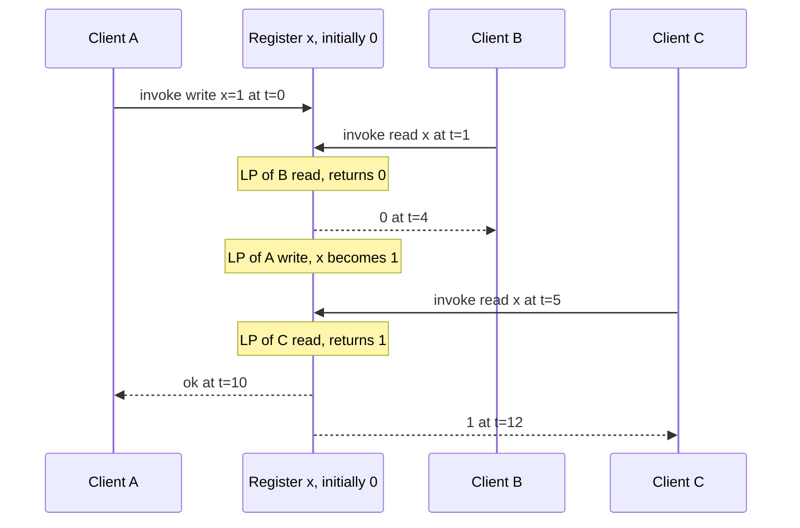

**Reading the diagram.** Time runs downward; solid arrows are invocations and dashed arrows responses, all synchronous request/response calls on one logical register. Client A's write lasts from t = 0 to t = 10, so it is concurrent with both reads. "LP" marks a chosen linearization point. B's read (t = 1 to 4) can be linearized before the write takes effect, so returning the old value 0 is legal; C's read (t = 5 to 12) is linearized after the write, so returning 1 is legal. The register behind the arrows may be five replicas, but the history is indistinguishable from one copy. The failure point to watch is a read that starts *after* a completed write or *after* another read that saw the new value; Figure 25.2 shows both.

**Figure 25.2 — Two non-linearizable histories: a stale read, and a new-then-old inversion.**

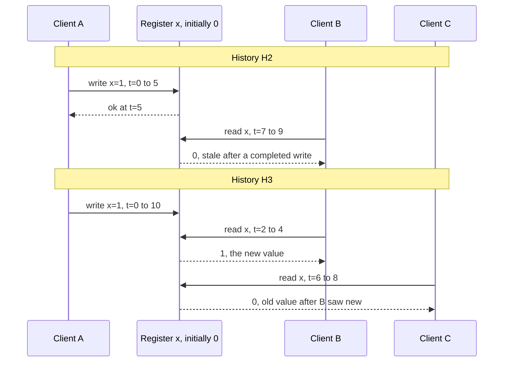

**Reading the diagram.** In H2 the write has *completed* (acknowledged at t = 5) before B's read begins at t = 7, so real-time order forces the write before the read; a read returning 0 has no legal placement. This is the classic asynchronous-replica bug: the write was acknowledged by the primary and the read went to a lagging replica. H3 is subtler: the write is still in progress, so either value is individually allowed, but once B has returned 1 (its linearization point is after the write's), C's read, which begins after B finished, must also see 1. Returning 0 means the system "un-wrote" a value someone already observed. H3 happens in leaderless quorum stores when a write has reached one replica but not a quorum, and two readers contact different replica sets (§25.3.5).

#### Code example

The program below is a brute-force checker for histories of read/write registers. It tries to build a legal sequential order one operation at a time, allowing an operation to go next only if no unplaced operation must precede it. With `real_time=True` the precedence rule is real-time order (linearizability); with `real_time=False` it is only each client's program order (sequential consistency, §25.4). Memoizing on the set of placed operations and the register state is the core idea of the Wing–Gong–Lowe family of checkers used by Knossos and Porcupine [Wing & Gong 1993; Lowe 2017].

```python
"""Brute-force checker: is a history of register operations linearizable,
or at least sequentially consistent? Each operation is
    (process, kind, key, value, invoke_time, response_time)
kind is "w" (write value) or "r" (read that returned value).
response_time None means the client never heard back (the op may or may not
have taken effect). All registers start at 0."""
from functools import lru_cache

INF = float("inf")

def check(history, real_time=True):
    ops = [(p, k, key, v, inv, INF if resp is None else resp)
           for p, k, key, v, inv, resp in history]
    n = len(ops)
    done = frozenset(i for i in range(n) if ops[i][5] != INF)

    def must_precede(a, b):
        """True if op a has to be ordered before op b."""
        if real_time:                       # linearizability: real-time order
            return ops[a][5] < ops[b][4]
        # sequential consistency: only each process's own program order
        return ops[a][0] == ops[b][0] and ops[a][4] < ops[b][4]

    @lru_cache(maxsize=None)
    def search(placed, state):              # placed: bitmask; state: sorted (key, value) pairs
        if all(placed >> i & 1 for i in done):
            return ()                       # every completed op is placed
        regs = dict(state)
        for i in range(n):
            if placed >> i & 1:
                continue
            # i can go next only if no unplaced op must precede it
            if any(not placed >> j & 1 and j != i and must_precede(j, i)
                   for j in range(n)):
                continue
            p, kind, key, v, _, _ = ops[i]
            if kind == "r" and regs.get(key, 0) != v:
                continue                    # read would return the wrong value
            new = dict(regs)
            if kind == "w":
                new[key] = v
            rest = search(placed | 1 << i, tuple(sorted(new.items())))
            if rest is not None:
                return (i,) + rest
        return None

    order = search(0, ())
    return None if order is None else [ops[i][:4] for i in order]

def describe(name, h):
    lin, sc = check(h, real_time=True), check(h, real_time=False)
    print(f"{name}: linearizable={lin is not None}, sequential={sc is not None}")
    if lin:
        print("   linearization:", " -> ".join(f"{p}:{k}({key}={v})" for p, k, key, v in lin))
    elif sc:
        print("   sequential order:", " -> ".join(f"{p}:{k}({key}={v})" for p, k, key, v in sc))

H1 = [("A", "w", "x", 1, 0, 10),   # write overlaps both reads
      ("B", "r", "x", 0, 1, 4),
      ("C", "r", "x", 1, 5, 12)]
H2 = [("A", "w", "x", 1, 0, 5),    # write finished at t=5 ...
      ("B", "r", "x", 0, 7, 9)]    # ... yet a later read sees the old value
H3 = [("A", "w", "x", 1, 0, 10),   # new-then-old inversion during a write
      ("B", "r", "x", 1, 2, 4),
      ("C", "r", "x", 0, 6, 8)]
H4 = [("A", "w", "x", 1, 0, 2),    # a process misses its own write
      ("A", "r", "x", 0, 3, 4)]
H5 = [("A", "w", "x", 1, 0, 2), ("A", "r", "y", 0, 3, 4),   # store buffering
      ("B", "w", "y", 1, 0, 2), ("B", "r", "x", 0, 3, 4)]
H6 = [("A", "w", "x", 1, 0, None), # write timed out: outcome unknown
      ("B", "r", "x", 1, 5, 6),
      ("C", "r", "x", 1, 7, 8)]

for name, h in [("H1", H1), ("H2", H2), ("H3", H3), ("H4", H4), ("H5", H5), ("H6", H6)]:
    describe(name, h)
x_only = [op for op in H5 if op[2] == "x"]
y_only = [op for op in H5 if op[2] == "y"]
print("H5 per key sequential:", check(x_only, False) is not None, check(y_only, False) is not None)
```

Running it prints:

```text
H1: linearizable=True, sequential=True
   linearization: B:r(x=0) -> A:w(x=1) -> C:r(x=1)
H2: linearizable=False, sequential=True
   sequential order: B:r(x=0) -> A:w(x=1)
H3: linearizable=False, sequential=True
   sequential order: C:r(x=0) -> A:w(x=1) -> B:r(x=1)
H4: linearizable=False, sequential=False
H5: linearizable=False, sequential=False
H6: linearizable=True, sequential=True
   linearization: A:w(x=1) -> B:r(x=1) -> C:r(x=1)
H5 per key sequential: True True
```

What to notice:

- `must_precede` is the only difference between the two models. Linearizability constrains order by real time across all clients; sequential consistency only by each client's own program order.
- H2 and H3 (Figure 25.2) fail linearizability but pass sequential consistency: the checker reorders B's or C's stale read before the write, which is legal when real time does not count.
- H6 contains a write whose client timed out. The checker may include it (it evidently took effect, since reads return 1). Treating timeouts as failures would wrongly flag this history; real checkers model them as **indeterminate**, exactly as here.
- H5 is discussed in §25.4.

### 25.3.4 Implementing linearizability

You can obtain linearizability in three ways, all of which route every operation through some point of agreement:

1. **Single copy or single leader with synchronous reads.** All reads and writes go to one node (a single PostgreSQL server, or the leader of a partition). It is linearizable as long as there is exactly one such node. After failover, the old leader must be prevented from serving, which needs leases or a consensus round (Chapter 26). A leader that serves reads from local state without confirming it is still leader can return stale data after a new leader has been elected elsewhere.
2. **Consensus-replicated log.** Raft, Multi-Paxos and ZAB (Chapter 26) order writes through a majority. Linearizable reads either go through the log too, or the leader confirms its leadership with a quorum heartbeat (Raft's ReadIndex) or relies on a time-based lease bounded by clock-drift assumptions [Ongaro 2014].
3. **Quorum registers without a leader.** The **ABD** algorithm of Attiya, Bar-Noy and Dolev [Attiya et al. 1995] implements a linearizable read/write register over $N$ replicas tolerating $f < N/2$ crashes, with no leader and no consensus. Each value carries a timestamp. A write sends (value, timestamp) to all replicas and waits for a majority to acknowledge. A read asks a majority for their (value, timestamp), picks the highest, and **writes it back** to a majority before returning.

**Figure 25.3 — ABD quorum read with write-back on three replicas.**

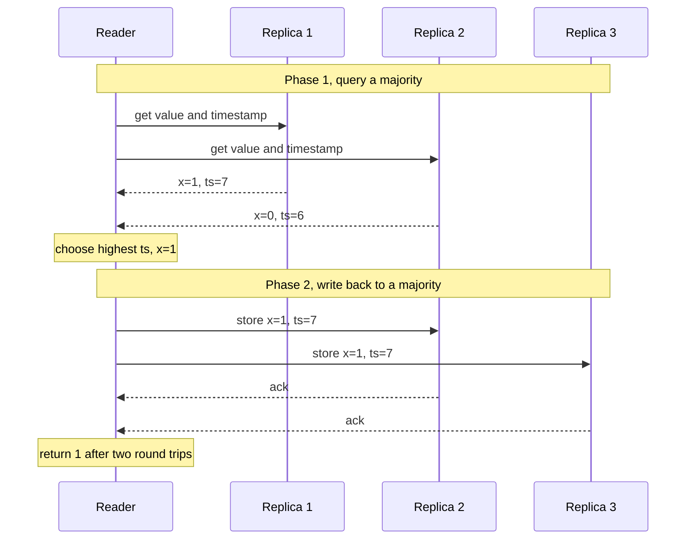

**Reading the diagram.** All calls are synchronous RPCs; the reader waits for two of three replies in each phase. Replica 1 holds a write that has reached only one node, the partial-write situation of history H3. Without phase 2, this reader returns 1 but a later reader querying Replicas 2 and 3 would return 0, an inversion. Phase 2 makes sure that any value a reader returns is stored on a majority, so every later majority overlaps it. The failure points are replica crashes (tolerated while a majority answers) and a network partition that leaves the reader with only a minority (the read blocks: this is the C-over-A choice of §25.8). Scaling is per object: different registers can live on different replica groups because linearizability is compositional.

#### Mathematical foundations

Every one of the three approaches needs a message exchange with a majority (or with a leader that has itself confirmed a majority) on the critical path. That is the price of linearizability.

::: formula
**Latency of a quorum operation**

$$T_{\text{op}} \approx k \times \text{RTT}_{(q)} + T_{\text{proc}}, \qquad q = \left\lfloor N/2 \right\rfloor + 1$$

| Symbol | Meaning | Units |
|---|---|---|
| $T_{\text{op}}$ | Latency of one linearizable read or write as seen by the client | ms |
| $k$ | Sequential round trips the protocol needs (ABD read: 2; ABD single-writer write: 1; Raft write via leader: 1 to the followers plus the client-to-leader trip) | count |
| $\text{RTT}_{(q)}$ | Round-trip time to the $q$-th closest replica, counting the coordinator itself if it holds a replica | ms |
| $q$ | Majority quorum size for $N$ replicas | replicas |
| $N$ | Number of replicas | replicas |
| $T_{\text{proc}}$ | Processing and disk flush time | ms |
:::

::: example
**Worked example — Five replicas across regions.** A register is replicated in five regions. From the coordinator in Virginia, the RTTs are: Virginia 0 ms (local replica), Ohio 12 ms, Oregon 65 ms, Ireland 75 ms, Frankfurt 90 ms. Take $T_{\text{proc}} = 1$ ms.

1. $q = \lfloor 5/2 \rfloor + 1 = 3$. Sorted RTTs: 0, 12, 65, 75, 90. The third smallest is $\text{RTT}_{(3)} = 65$ ms (Oregon).
2. One-round-trip write: $T \approx 1 \times 65 + 1 = 66$ ms.
3. ABD read with write-back: $T \approx 2 \times 65 + 1 = 131$ ms.
4. Now move the Oregon replica to a second Virginia zone (RTT 1 ms). Sorted: 0, 1, 12, 75, 90; $\text{RTT}_{(3)} = 12$ ms. Write ≈ 13 ms; read ≈ 25 ms.

**Interpretation.** Quorum latency is set by the *median* replica's distance, not the nearest one. Clustering a majority close together makes linearizable operations cheap for nearby clients, at the cost of a region failure taking down the majority. **Engineering implication.** Linearizable global data pays a cross-region round trip somewhere; you choose where. Spanner and CockroachDB place leaders and voting replicas near the dominant writers for that reason (§25.10, Chapter 28).
:::

Is this cost an artifact of particular algorithms, or fundamental? Lipton and Sandberg, and later Attiya and Welch, proved lower bounds in a model where message delays are between $d - u$ and $d$ [Lipton & Sandberg 1988; Attiya & Welch 1994].

::: formula
**Lower bound for sequentially consistent and linearizable registers**

$$t_{\text{read}} + t_{\text{write}} \ \ge\ d$$

| Symbol | Meaning | Units |
|---|---|---|
| $t_{\text{read}}$ | Worst-case time for a read to return | ms |
| $t_{\text{write}}$ | Worst-case time for a write to return | ms |
| $d$ | Maximum one-way message delay between replicas | ms |
:::

The bound holds already for sequential consistency, and linearizability, being stronger, inherits it. Attiya and Welch also showed that sequential consistency can make *either* reads *or* writes fast (local), while linearizability requires both reads and writes to wait for time proportional to the delay uncertainty. Causal consistency, by contrast, can be implemented with purely local reads and writes (§25.5). Kleppmann uses exactly this distinction to argue that latency, not partitions, is the more useful lens on consistency [Kleppmann 2015].

::: example
**Worked example — What the bound forbids.** Two data centers are 35 ms apart one way ($d = 35$ ms). A team wants a sequentially consistent register with 5 ms reads and 5 ms writes everywhere.

1. $t_{\text{read}} + t_{\text{write}} = 5 + 5 = 10$ ms.
2. $10 < 35$, so the bound is violated: no algorithm can achieve this, however clever.
3. Options: make writes slow ($t_{\text{write}} \ge 30$ ms, keeping 5 ms reads), make reads slow, or weaken the model to causal consistency, which allows both to be local.

**Interpretation.** This is an impossibility, not an engineering gap. **Engineering implication.** Push back early on "strongly consistent and single-digit-millisecond everywhere" and ask which operations truly need it.
:::

#### Real-world industry applications

::: industry
**Amazon S3 strong read-after-write consistency (2020).** S3 historically offered eventual consistency for overwrites and listings. In December 2020 it moved to strong read-after-write consistency for all PUTs and LISTs at no extra cost, using a cache-coherence protocol in which a witness component tracks object changes so front ends can tell when cached metadata is stale (§15.4). The change removed a whole class of data-lake bugs in which a job listed a prefix and missed files just written.
*Evidence: Primary* — [Vogels 2021; AWS Docs: S3 Consistency]
:::

::: industry
**etcd and Kubernetes.** Kubernetes stores cluster state in etcd, a Raft-replicated key-value store. Leader election among controllers relies on linearizable compare-and-set on a lease object. Jepsen's 2020 analysis found etcd's key-value operations, including multi-key transactions, to be strictly serializable under partitions, pauses, crashes and clock skew, while its lock API could not guarantee mutual exclusion (§25.11).
*Evidence: Primary* — [Kingsbury 2020a]
:::

#### Failure scenarios

**Table 25.2 — Failure scenarios that break linearizability.**

| What goes wrong | Why | Detection | Recovery | Prevention |
|---|---|---|---|---|
| Stale read from a deposed leader | Old leader is partitioned but still believes it leads and serves reads locally | Jepsen-style test with partitions; two nodes claim leadership | Step down on lease expiry | ReadIndex or quorum reads; leases with bounded clock drift |
| Read from asynchronous replica | Write acknowledged before replica applied it | Read-after-write probes; replica lag metrics | Route to primary | Synchronous apply, LSN-tracked reads (§25.6) |
| New-old inversion in quorum store | Partial write visible to one reader's quorum, not the next | Linearizability checker on recorded histories | Read repair | Write-back on read (ABD), or a consensus-replicated log |
| Clock-based "latest" wins | Last-writer-wins by wall clock picks a write that happened earlier | Lost-update tests with clock skew | Restore from log | Logical or hybrid timestamps (§24.12); consensus ordering |

#### Common misconceptions

::: mistake
**Mistake — "$R + W > N$ makes a Dynamo-style store linearizable."** Overlapping quorums guarantee that a read sees the latest *completed* write in the absence of failures, but they do not prevent the new-then-old inversion of H3 when a write is still in flight or partially failed, and sloppy quorums (§27.9) and last-writer-wins conflict resolution break the overlap entirely. Linearizability needs write-back on read or a consensus protocol on top of the quorum [Kleppmann 2017].
:::

::: mistake
**Mistake — "Linearizability means operations take effect when they are sent."** The linearization point may be anywhere between invocation and response. A client that sent a write and timed out does not know whether it happened; a correct client treats the outcome as unknown and retries idempotently (§22.15).
:::

## 25.4 Sequential consistency

### 25.4.1 Definition and contrast with linearizability

::: definition
**Definition — Sequential consistency.** A history is **sequentially consistent** if there is a single total order of all operations that is a legal sequential history of the objects and that respects each client's **program order** (the order in which that client issued its own operations). In Lamport's words, "the result of any execution is the same as if the operations of all the processors were executed in some sequential order, and the operations of each individual processor appear in this sequence in the order specified by its program" [Lamport 1979].
:::

#### First-principles explanation

Go back to the notebook. Sequential consistency still promises that everyone sees the *same story*, entries in one order, and that each person's own entries appear in the order that person wrote them. What it drops is the clock on the wall. The story may be told late: you may read the notebook as it was ten minutes ago, as long as everyone agrees on the sequence and you never see your own entries out of order. Linearizability is sequential consistency plus the rule that the agreed order must also match real time.

Lamport defined it in 1979 for multiprocessor memory. Most modern processors provide something weaker (x86-TSO, Arm's relaxed model) and offer fence instructions to recover it where needed (cache coherence, the layer underneath, is §5.4.6).

#### How it works internally

A common implementation in replicated stores is: **writes go through a single ordered log; reads are served by any replica that has applied a prefix of the log, and a client never reads from a replica behind the point it has already seen.** Every replica applies the same writes in the same order, so all clients see one sequence, but a replica may lag, so a read can return a value that is already overwritten elsewhere. That is the gap between Figures 25.1 and 25.4.

**Figure 25.4 — A sequentially consistent but not linearizable history (follower read).**

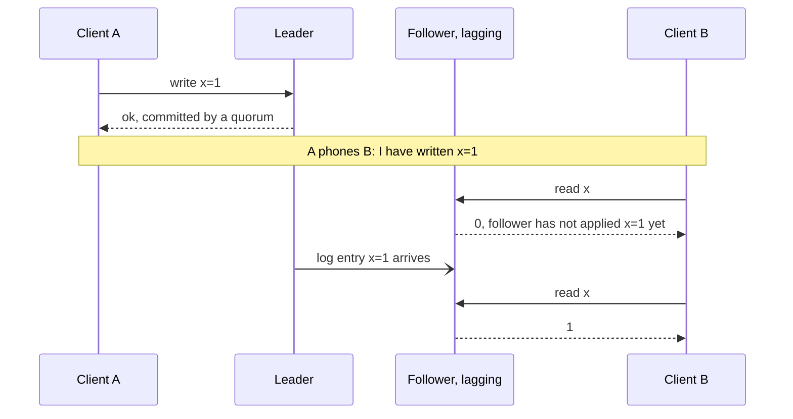

**Reading the diagram.** Writes are synchronous to a quorum through the leader; log shipping to this follower (open arrowhead) is asynchronous. B's first read starts after A's write completed in real time, so returning 0 violates linearizability. But the history is sequentially consistent: the total order "B reads 0, A writes 1, B reads 1" respects each client's program order. The out-of-band phone call is the failure point: it carries causality the storage system cannot see. Followers scale reads horizontally; the cost is exactly this staleness.

ZooKeeper behaves like this by design. Writes are linearizable through the ZAB atomic broadcast, but reads are served locally by whichever server the client is connected to, so reads may be stale. ZooKeeper guarantees that each client's operations are applied in FIFO order and that a client never sees an older state after a newer one, even after reconnecting to a different server. A client that needs the latest value calls `sync` before reading, which makes the server catch up with the leader at that moment [Hunt et al. 2010].

### 25.4.2 Sequential consistency is not compositional

Unlike linearizability, sequential consistency is not local: two objects can each be sequentially consistent while the system as a whole is not. History H5 from the checker of §25.3.3 is the textbook case, called **store buffering**:

- Client A writes `x = 1`, then reads `y` and gets 0.
- Client B writes `y = 1`, then reads `x` and gets 0.

Restricted to `x` alone (A's write, B's read of 0), the history is sequentially consistent: order B's read first. The same holds for `y` alone. The checker confirms both (`H5 per key sequential: True True`). But no single order works for both: whichever write comes first in the total order precedes, in program order, the other client's read, which must then return 1. The checker reports `sequential=False` for the combined history. Real multiprocessors produce exactly this outcome because each write sits in a store buffer while the following read goes to memory.

The consequence: sequentially consistent shards do not make a sequentially consistent store without cross-shard coordination, whereas linearizable shards do make a linearizable one.

::: industry
**ZooKeeper reads and `sync`.** ZooKeeper's paper describes reads served from a server's local replica as the source of its read throughput, which scales with the number of servers, while writes go through the leader. Applications that need a fresh read after an external signal (Figure 25.4's phone call) issue `sync` first, paying one leader round trip only on the paths that need it.
*Evidence: Primary* — [Hunt et al. 2010]
:::

::: mistake
**Mistake — "Sequential consistency is the same as serializability."** Sequential consistency orders individual operations on objects and says nothing about grouping operations into atomic transactions. Serializability orders transactions and, in its plain form, says nothing about real time or about each client's sessions. Neither implies the other.
:::

## 25.5 Causal consistency

### 25.5.1 Definition

Recall from §24.10 Lamport's **happens-before** relation: $a \rightarrow b$ if $a$ and $b$ are on the same process and $a$ comes first, or $a$ is the sending of a message and $b$ its receipt, or by transitivity. For a data store, the messages are writes and reads: if a client reads a value written by $w$, every later operation of that client is causally after $w$.

::: definition
**Definition — Causal consistency.** Writes that are **causally related** must be seen by every client in their causal order; writes that are **concurrent** (neither happens before the other) may be seen in different orders by different clients. Formally, each client's view must be a legal sequential history that respects the causal order induced by program order and reads-from [Ahamad et al. 1995].
:::

#### First-principles explanation

Picture a group chat. Ana asks "Who wants pizza?" and Ben replies "Me!". Causality says nobody may ever see Ben's reply without Ana's question above it, because Ben wrote it *after reading* the question. But if Ana and Chen post unrelated messages at the same moment, some phones may show Ana's first and others Chen's first; nothing is wrong with that. Causal consistency enforces the first rule and allows the second. It forbids exactly the anomalies that confuse humans (answers before questions, a comment on a photo that does not exist yet) while letting unrelated updates flow independently.

#### Why does this exist?

Causal consistency is a sweet spot for geo-replicated systems. It can be implemented so that every read and write completes at the local data center, with no cross-region wait, and it remains available during network partitions as long as a client stays connected to the same replica (it is **sticky available**, §25.7.5). Mahajan, Alvisi and Dahlin argued that no consistency model stronger than a variant they call real-time causal consistency can be both available under partitions and convergent [Mahajan et al. 2011]. Causal consistency is, in that sense, about the strongest model you can have while still choosing A in CAP.

**Figure 25.5 — A causality violation across regions.**

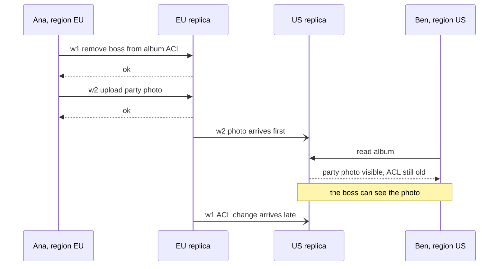

**Reading the diagram.** Ana's two writes go synchronously to her local EU replica; replication to the US (open arrowheads) is asynchronous and, here, reorders them because they travel on different partitions or connections. Ana issued w1 before w2, so w1 happens before w2. A replica that applies w2 without w1 lets the photo leak to the boss. The storage boundary is between the regions; the failure point is applying a write before its causal dependencies. A causally consistent store would hold w2 at the US replica until w1 is applied, and the scaling challenge is doing that check without serializing all writes.

### 25.5.2 How COPS tracks dependencies

**COPS** (Clusters of Order-Preserving Servers) is a geo-replicated key-value store from Lloyd, Freedman, Kaminsky and Andersen that provides **causal+ consistency**: causal consistency plus **convergent conflict handling**, so that replicas that receive concurrent writes to the same key resolve them identically and converge [Lloyd et al. 2011]. Its design shows the general recipe.

#### How it works internally

1. **The client library keeps a context.** Every value the client reads or writes adds an entry (key, version) to the client's context. These are the operations its next write may depend on.
2. **Writes carry dependencies.** A `put` is sent to the local cluster as `put_after(key, value, deps)`, where `deps` is the context. The local cluster applies it immediately, assigns it a version (a Lamport timestamp, so concurrent writes have a deterministic winner) and returns. The write is local: no cross-region wait.
3. **Nearest dependencies only.** Tracking every ancestor would grow without bound. Because dependencies are transitive, a write needs to list only its **nearest** dependencies; COPS clears the client's context after each put and replaces it with the new write, since that write already depends on everything before it.
4. **Remote clusters check before applying.** When a replicated write arrives at a remote cluster, the node owning that key issues `dep_check` calls to the nodes owning each dependency. Each call returns once that dependency (or a later version) is applied locally. Only then is the write made visible.
5. **Reads are local.** `get` returns whatever the local cluster has; every visible value already has its dependencies visible.
6. **COPS-GT** adds read-only **get transactions** that return a causally consistent snapshot of several keys.

**Figure 25.6 — COPS: local writes, asynchronous replication, dependency checks.**

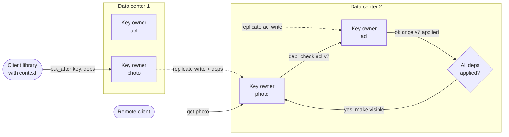

**Reading the diagram.** The client's write is acknowledged by the local key owner synchronously; replication between data centers (dotted) is asynchronous. In data center 2 the owner of `photo` asks the owner of `acl` whether version 7, the nearest dependency, is applied; the `dep_check` call blocks until it is. Only then does the photo become visible to remote clients, so no reader sees the photo without the ACL change. Each data center is a storage boundary holding a full replica, partitioned by consistent hashing within it. Failure points: a partition between data centers delays visibility of new writes there but never blocks local reads or writes. Scaling is horizontal because dependency checks touch only the partitions named in the dependency list, not a global sequencer.

#### Advantages and disadvantages

Causal consistency gives local-latency reads and writes in every region, survives partitions between regions, and forbids the anomalies users notice most. Its costs are metadata (dependency lists or vector clocks on every write), extra checks on the remote apply path, and **visibility delay**: a write whose dependency is stuck in a slow partition waits, so a hot dependency can hold up many writes. It also cannot enforce invariants such as uniqueness: two regions can concurrently register the same username, because concurrent writes are, by definition, allowed. Such operations still need coordination, so systems typically combine causal consistency for most data with linearizable operations for a few keys.

::: industry
**MongoDB causally consistent sessions.** Since version 3.6, MongoDB clients can open a causally consistent session. The driver carries an `operationTime` and `clusterTime` from each response into the next request, and a secondary that has not yet reached that time waits before answering. With read concern `majority` and write concern `majority`, the session provides read-your-writes, monotonic reads, monotonic writes and writes-follow-reads even when reads go to secondaries.
*Evidence: Primary* — [MongoDB Docs: Causal Consistency and Read and Write Concerns]
:::

::: mistake
**Mistake — "Causal consistency needs synchronized clocks."** It needs *logical* ordering: Lamport timestamps, vector clocks or explicit dependency lists (§24.10–§24.11). Physical clocks, or hybrid logical clocks (§24.12), are sometimes added to make versions human-meaningful or to support snapshot reads, but correctness does not depend on clock accuracy.
:::

## 25.6 Session guarantees

### 25.6.1 Four promises to one client

Global models constrain what *all* clients see. Often a weaker, cheaper promise suffices: that the system looks sensible *to each client individually*. Terry and colleagues, building the Bayou weakly connected replicated storage system at Xerox PARC, defined four such **session guarantees** [Terry et al. 1994]. A **session** is the sequence of operations a single client (an application instance, a browser tab, a user) performs; the guarantees hold within it.

::: definition
**Definition — Session guarantees.**
**Read-your-writes (RYW):** if a session writes $w$ and later reads, the read reflects $w$ (or a later write).
**Monotonic reads (MR):** if a session reads a value reflecting a set of writes, later reads reflect at least that set; the session never sees time go backwards.
**Monotonic writes (MW):** a session's writes are applied at every replica in the order the session issued them.
**Writes-follow-reads (WFR):** if a session reads a value produced by write $w_1$ and then writes $w_2$, every replica applies $w_1$ before $w_2$ (the new write is ordered after what the session saw).
:::

Together the four guarantees give each session a causally consistent view of its own interactions; causal consistency (§25.5) extends the same ordering across sessions that communicate through the data. Chapter 14 showed the first two failing with lagging read replicas (Figure 14.3). Figure 25.7 shows them in a multi-region setting, and Figure 25.8 shows the two write-side guarantees.

**Figure 25.7 — Read-your-writes and monotonic-reads violations behind a load balancer.**

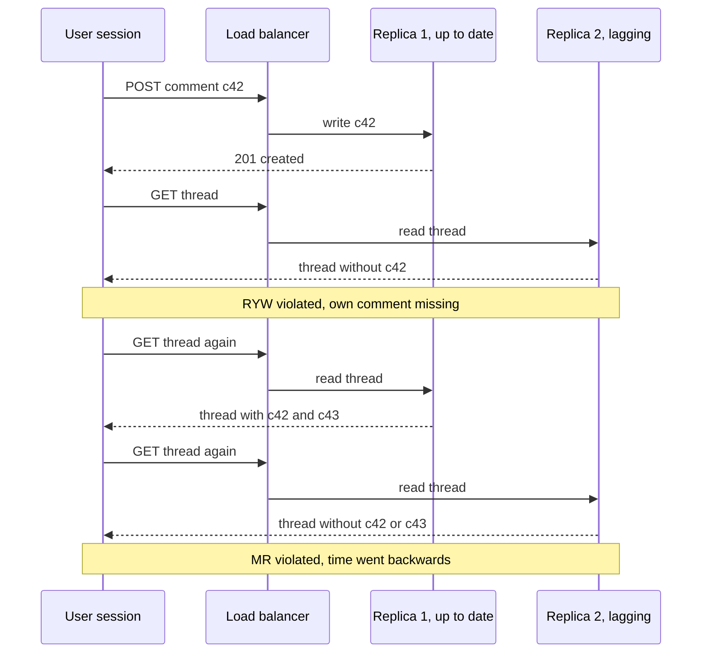

**Reading the diagram.** All calls are synchronous HTTP requests; replication between the replicas (not drawn) is asynchronous. The load balancer is the failure point: by choosing a replica per request with no memory of the session, it can send any read to the lagging replica. Adding replicas makes the anomaly more likely, not less. The fixes below constrain routing per session, not globally, so they keep most of the read scaling.

**Figure 25.8 — Monotonic-writes and writes-follow-reads violations.**

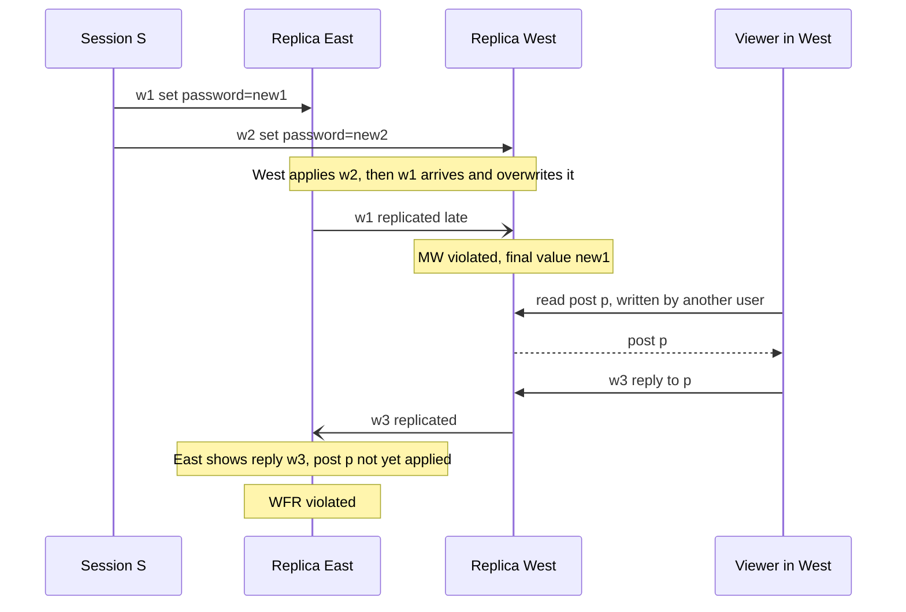

**Reading the diagram.** Writes go synchronously to whichever replica the session reaches; replication between regions (open arrowheads) is asynchronous and unordered. In the first half, the session's two writes arrive at West in the wrong order, so West ends with the older password: the session's own write order was not preserved. In the second half, the viewer's reply depends on a post it read, but East receives the reply before the post, so readers in East see an answer to nothing. Both failures sit in the replication path; the fix is to carry ordering metadata with writes so replicas delay out-of-order ones.

### 25.6.2 Implementation techniques

Terry et al. implemented all four guarantees with two sets per session, stored at the client: the **write-set** (identifiers of writes the session issued) and the **read-set** (identifiers of writes that produced values the session read). Compressed as **version vectors** (one counter per origin replica, §24.11), each set is small. A replica may serve a request only if its own vector *dominates* the required one:

- RYW: before a read, the replica must cover the write-set.
- MR: before a read, the replica must cover the read-set.
- MW: before a write, the replica must cover the write-set (so earlier writes are applied first).
- WFR: before a write, the replica must cover the read-set.

If no reachable replica qualifies, the client waits or tries another replica. Production systems use the same idea in simpler forms.

**Table 25.3 — Session guarantees and practical implementation techniques.**

| Guarantee | Anomaly prevented | Sticky sessions | Version token / LSN tracking | Other technique |
|---|---|---|---|---|
| Read-your-writes | Own write missing | Works only if writes and reads hit the same replica | Client keeps the commit LSN or GTID of its last write; read from a replica with applied LSN ≥ token, else wait or go to primary | Read from primary for a fixed window after a write (fails if lag exceeds window) |
| Monotonic reads | Data moving backwards | Pin a session to one replica: sufficient while it is up | Keep the highest LSN or vector observed; never read from a replica behind it | — |
| Monotonic writes | Own writes reordered | Single primary for the key already orders them | Sequence number per session; replica buffers out-of-order writes | Route all of a session's writes to one leader |
| Writes-follow-reads | Reply before the post it answers | — | Attach read-set vector to the write; remote replica delays apply until covered | Single-leader log orders all writes anyway |

Two practical points matter. First, **single-leader systems give MW and WFR for free** within one partition, because one log orders all writes; the session problems there are RYW and MR on followers (Chapter 14). Multi-leader and leaderless systems need all four. Second, **tokens must travel with the session**, not the connection: a user who writes on a phone and reads on a laptop gets RYW only if the token is stored server-side with the user or carried in a cookie.

#### Code example

The program below implements the Bayou approach with version vectors. A `Session` records the vectors of what it wrote and read; a replica may serve it only if its vector dominates what the enabled guarantees require.

```python
"""Bayou-style session guarantees with version vectors (after Terry et al. 1994).
A replica's vector counts how many writes from each origin it has applied.
The session remembers the vectors of what it wrote and what it read, and a
replica may serve the session only if its vector dominates the required one."""

def dominates(a, b):
    return all(a.get(k, 0) >= v for k, v in b.items())

def merge(a, b):
    return {k: max(a.get(k, 0), b.get(k, 0)) for k in a.keys() | b.keys()}

class Replica:
    def __init__(self, name):
        self.name, self.vv, self.log = name, {}, []
    def apply(self, origin, seq, item):        # anti-entropy delivers writes in order
        if self.vv.get(origin, 0) == seq - 1:
            self.vv[origin] = seq
            self.log.append(item)
    def local_write(self, item):
        seq = self.vv.get(self.name, 0) + 1
        self.apply(self.name, seq, item)
        return self.name, seq

class Session:
    def __init__(self, ryw=True, mr=True, mw=True, wfr=True):
        self.ryw, self.mr, self.mw, self.wfr = ryw, mr, mw, wfr
        self.read_vv, self.write_vv = {}, {}

    def can_read(self, rep):
        need = {}
        if self.ryw: need = merge(need, self.write_vv)   # see my own writes
        if self.mr:  need = merge(need, self.read_vv)    # never go backwards
        return dominates(rep.vv, need)

    def can_write(self, rep):
        need = {}
        if self.mw:  need = merge(need, self.write_vv)   # my writes stay in order
        if self.wfr: need = merge(need, self.read_vv)    # writes after what I read
        return dominates(rep.vv, need)

    def read(self, replicas):
        for rep in replicas:                             # try nearest first
            if self.can_read(rep):
                self.read_vv = merge(self.read_vv, rep.vv)
                return rep.name, list(rep.log)
        return None, "no replica is fresh enough: wait or go to another site"

    def write(self, replicas, item):
        for rep in replicas:
            if self.can_write(rep):
                origin, seq = rep.local_write(item)
                self.write_vv = merge(self.write_vv, {origin: seq})
                return rep.name
        return None

def own_write_then_read(**g):
    east, west = Replica("east"), Replica("west")
    s = Session(**g)
    s.write([east], "name=Ada")            # write lands in east
    return s.read([west, east])            # next request is routed to west first

def read_twice(**g):
    east, west = Replica("east"), Replica("west")
    east.local_write("comment 1")          # another user's write, not yet in west
    s = Session(**g)
    first = s.read([east])
    second = s.read([west, east])          # load balancer prefers west now
    return first, second

off = dict(ryw=False, mr=False, mw=False, wfr=False)
print("RYW off:", own_write_then_read(**off))
print("RYW on :", own_write_then_read())
print("MR off :", read_twice(**off))
print("MR on  :", read_twice())
```

Output:

```text
RYW off: ('west', [])
RYW on : ('east', ['name=Ada'])
MR off : (('east', ['comment 1']), ('west', []))
MR on  : (('east', ['comment 1']), ('east', ['comment 1']))
```

What to notice:

- `read_vv` absorbs the *whole* vector of the replica read, a conservative over-approximation of what the session saw. Bayou did the same; precise tracking would need per-write dependencies, as in COPS.
- Replacing the vector with a single log sequence number (LSN) gives the single-leader version used with PostgreSQL and MySQL replicas (§14.4.4): one counter suffices because there is one origin.

::: industry
**Azure Cosmos DB session consistency.** Cosmos DB's default consistency level, *session*, gives read-your-writes, monotonic reads, monotonic writes and writes-follow-reads within a session by returning a **session token** with every write; the SDK sends it with later reads, and a replica that has not caught up to the token either waits or the request is retried elsewhere. Clients that share a token (for example, by passing it between web servers) share the session.
*Evidence: Primary* — [Microsoft Docs: Cosmos DB Consistency Levels]
:::

::: mistake
**Mistake — "Sticky sessions give read-your-writes."** They give monotonic reads while the pinned replica is healthy. If writes go to a primary and reads to the pinned replica, the replica may not yet have the session's own write. And when the pinned replica fails, the session moves to another replica that may be further behind, breaking monotonic reads too, unless a token travels with it.
:::

## 25.7 Eventual consistency

### 25.7.1 Definition: a liveness promise, not a safety promise

::: definition
**Definition — Eventual consistency.** If no new updates are made to an object, eventually all reads return the last updated value [Vogels 2009]. Equivalently, replicas that have received the same set of updates **converge** to the same state. **Strong eventual consistency** strengthens this: replicas that have received the same updates are in the same state immediately, with no further coordination, which is what conflict-free replicated data types (CRDTs) guarantee (§27.14).
:::

Eventual consistency is a **liveness** property ("something good eventually happens") with no **safety** content ("nothing bad ever happens"). It says nothing about what you read *while* updates are flowing, and no bound on how long "eventually" is. A store that returned arbitrary values for an hour and then converged would technically comply [Bailis & Ghodsi 2013]. The engineering question is therefore quantitative: **how stale, how often?**

Eventual consistency also needs a **conflict resolution** rule for concurrent writes to the same key: last-writer-wins by timestamp (which silently discards one write), application merge (the Dynamo shopping cart unions concurrent versions [DeCandia et al. 2007]), or CRDTs. Chapter 27 (§27.13–§27.14) covers anti-entropy, read repair and conflict resolution.

### 25.7.2 Probabilistically bounded staleness

Bailis, Venkataraman, Franklin, Hellerstein and Stoica introduced **probabilistically bounded staleness (PBS)** to answer "how eventual?" for Dynamo-style stores with $N$ replicas, write quorum $W$ and read quorum $R$ [Bailis et al. 2012]. When $R + W \le N$ (a **partial quorum**), a read may miss the latest write. PBS predicts two quantities:

- **$t$-visibility:** the probability that a read issued $t$ ms after a write commits returns that write (or a newer one).
- **$k$-staleness:** the probability that a read returns a value no more than $k$ versions old.

#### Mathematical foundations

The simplest model assumes a write has reached exactly $W$ of $N$ replicas when it commits and has not spread further, and that a read contacts $R$ replicas chosen uniformly at random.

::: formula
**Probability that a partial-quorum read misses the latest write**

$$p_s = \frac{\binom{N-W}{R}}{\binom{N}{R}}, \qquad P(\text{more than } k \text{ versions stale}) = p_s^{\,k}$$

| Symbol | Meaning | Units |
|---|---|---|
| $p_s$ | Probability that all $R$ replicas read hold none of the latest write's $W$ copies | probability |
| $N$ | Replication factor | replicas |
| $W$ | Replicas that acknowledged the write when it committed | replicas |
| $R$ | Replicas whose responses the read waits for | replicas |
| $k$ | Number of most recent versions the read is allowed to miss | versions |
:::

::: example
**Worked example — Closed-form staleness for common settings.**

1. $N = 3$, $R = W = 1$: $p_s = \binom{2}{1}/\binom{3}{1} = 2/3 \approx 0.667$. Right after commit, two reads in three could miss the write if nothing propagates further.
2. $N = 3$, $R = 1$, $W = 2$: $p_s = \binom{1}{1}/\binom{3}{1} = 1/3$.
3. $N = 3$, $R = W = 2$: $\binom{1}{2} = 0$, so $p_s = 0$: the quorums overlap ($R + W > N$).
4. $N = 5$, $R = W = 2$: $p_s = \binom{3}{2}/\binom{5}{2} = 3/10 = 0.3$.
5. $k$-staleness for case 1 with $k = 3$ (the read may miss the last two versions but not three in a row): $p_s^3 = (2/3)^3 = 8/27 \approx 0.30$. With a newer write every few milliseconds, a $R = W = 1$ read lands on a replica missing three consecutive writes about 30% of the time in this pessimistic model.

**Interpretation.** The closed form is a worst case: it ignores the fact that the write keeps propagating to the other $N - W$ replicas after commit. **Engineering implication.** To get realistic numbers you must model propagation latency, which is what the Monte Carlo below does. The closed form is still useful for one thing: it shows that partial quorums are stale immediately after commit far more often than intuition suggests.
:::

#### How it works internally: the WARS model

PBS models four latency distributions per replica, which give it its name, **WARS**: **W** (write request reaches the replica and is applied), **A** (the acknowledgment returns to the coordinator), **R** (a later read request reaches the replica), **S** (the replica's response returns). The write commits when the $W$-th acknowledgment arrives. A read starting $t$ ms later returns the first $R$ responses; it is consistent if at least one of those replicas had applied the write before the read request reached it.

**Figure 25.9 — The WARS model of a partial-quorum write and read (N = 3, W = 1, R = 1).**

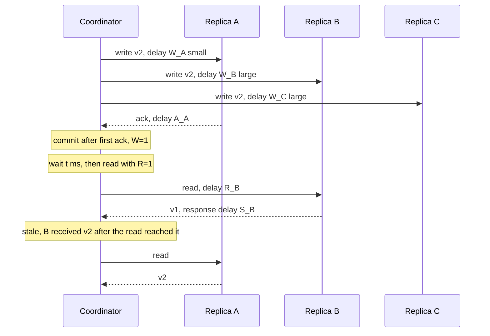

**Reading the diagram.** All messages are asynchronous one-way deliveries with random delays; the coordinator only waits for the first $W$ acknowledgments and the first $R$ read responses. The write is applied at A quickly and at B and C later. The read happens to be answered first by B, which had not yet applied v2, so it returns v1. Had the coordinator waited for two responses ($R = 2$), A's v2 would have been included and the higher version returned. Staleness depends on the race between write propagation (W) and the read's arrival (t + R), which is why $t$-visibility improves with $t$ and with slower reads. Failure points: a replica with a slow disk widens W; scaling the number of replicas without raising $R$ or $W$ makes misses more likely.

#### Code example

```python
"""PBS-style Monte Carlo (WARS model, after Bailis et al. 2012): probability
that a read issued t ms after a write commits returns that write (or newer)."""
import random
from math import comb

def one_trial(n, r, w, t, lat):
    W = [lat("W") for _ in range(n)]           # write reaches replica i
    A = [lat("A") for _ in range(n)]           # replica i's ack returns
    commit = sorted(W[i] + A[i] for i in range(n))[w - 1]   # w-th ack
    R = [lat("R") for _ in range(n)]           # read request reaches replica i
    S = [lat("S") for _ in range(n)]           # replica i's response returns
    first_r = sorted(range(n), key=lambda i: R[i] + S[i])[:r]
    # consistent if some responder already had the write when the read arrived
    return any(W[i] <= commit + t + R[i] for i in first_r)

def lat(kind, rng=random.Random(7)):
    if kind == "W":                            # propagate + apply: slow tail
        return 1.0 + rng.expovariate(1 / 4.0)  # mean 5 ms
    return 0.25 + rng.expovariate(1 / 0.5)     # A, R, S: mean 0.75 ms

def p_consistent(n, r, w, t, trials=100_000):
    return sum(one_trial(n, r, w, t, lat) for _ in range(trials)) / trials

if __name__ == "__main__":
    n = 3
    print("closed form, no propagation after commit: P(stale) = C(N-W,R)/C(N,R)")
    for r, w in [(1, 1), (1, 2), (2, 1), (2, 2)]:
        print(f"  N={n} R={r} W={w}: {comb(n - w, r) / comb(n, r):.3f}")
    ts = [0, 1, 2, 5, 10, 20]
    print("\nMonte Carlo P(consistent read) by delay t after commit (ms)")
    print("R W  " + "".join(f"{t:>8}" for t in ts))
    for r, w in [(1, 1), (1, 2), (2, 1), (2, 2)]:
        row = [p_consistent(n, r, w, t) for t in ts]
        print(f"{r} {w}  " + "".join(f"{p:8.4f}" for p in row))
```

Output (about 10 seconds; the seed makes it reproducible):

```text
closed form, no propagation after commit: P(stale) = C(N-W,R)/C(N,R)
  N=3 R=1 W=1: 0.667
  N=3 R=1 W=2: 0.333
  N=3 R=2 W=1: 0.333
  N=3 R=2 W=2: 0.000

Monte Carlo P(consistent read) by delay t after commit (ms)
R W         0       1       2       5      10      20
1 1    0.5000  0.6100  0.6975  0.8579  0.9600  0.9964
1 2    0.7568  0.8089  0.8514  0.9299  0.9792  0.9985
2 1    0.8253  0.8928  0.9354  0.9853  0.9989  1.0000
2 2    1.0000  1.0000  1.0000  1.0000  1.0000  1.0000
```

What to notice:

- The latency distributions are **illustrative**, not measurements: write application has a 1 ms floor plus an exponential tail with a 4 ms mean, network legs 0.25 ms plus a 0.5 ms exponential. Bailis et al. fitted distributions from production traces; with your own system, replace `lat` with samples from your latency histograms.
- At $t = 0$, $R = W = 1$ is consistent 50% of the time, better than the closed form's $1 - 2/3 = 33\%$, because propagation continues while the read is in flight.
- $R = 2, W = 1$ beats $R = 1, W = 2$ at every $t$ here even though both have $R + W = 3$: waiting for two read responses samples more replicas *after* propagation has progressed. Which is better depends on whether reads or writes dominate your latency budget.

::: example
**Worked example — Reading the simulation as an SLO.** A product team accepts that a profile edit may be invisible to *other* users for a short while, but wants at least 99% of reads issued 10 ms or more after a write to be fresh. With $N = 3$:

1. From the table, at $t = 10$ ms: $(R, W) = (1, 1)$ gives 0.9600, $(1, 2)$ gives 0.9792, $(2, 1)$ gives 0.9989.
2. Only $(2, 1)$ meets 99%. It also keeps writes at one acknowledgment.
3. Cost: every read waits for the second-fastest of three responses instead of the fastest. With legs averaging 0.75 ms each way that adds well under a millisecond at the median, but the read p99 rises with the second-order statistic.
4. The author's own writes still need read-your-writes (§25.6), which the probability does not provide.

**Interpretation.** PBS turns "eventually" into a curve you can put in a service level objective. **Engineering implication.** Measure the four WARS distributions in your deployment, rerun the simulation and choose $(R, W)$ per table; revisit when disks, load or topology change.
:::

### 25.7.3 Where eventual consistency fits

Eventual consistency is the right default for data where a short window of staleness is harmless and availability or latency dominates: counters of likes and views, recommendation features, product catalogs, DNS, caches, shopping carts with merge semantics. It is the wrong choice for anything whose correctness depends on a single current value: balances, inventory reservations, uniqueness, locks. Many systems combine the two per operation, which is the theme of §25.10.

::: mistake
**Mistake — "Eventual consistency means data is usually stale."** In well-run systems most reads are fresh; PBS-style measurements typically show staleness windows of milliseconds. The danger is not frequent staleness but *unbounded* staleness during incidents (a partitioned replica, a stalled replication stream) and the anomalies (reading backwards, missing own write) that the bare model permits. Add session guarantees and monitor replication lag.
:::

### 25.7.4 Models compared

**Table 25.4 — Single-object consistency models compared.**

| Model | What it guarantees | Allows | Latency of reads and writes | Available under partition? |
|---|---|---|---|---|
| Linearizable | One copy, real-time order | Nothing beyond concurrency | Quorum or leader round trip for both | No |
| Sequential | One agreed order, program order | Stale reads (order in the past) | One of reads or writes can be local | No |
| Causal | Causal order seen by all | Concurrent writes seen in different orders | Both local | Sticky available |
| Session guarantees (PRAM and friends) | Sensible view per session | Cross-session staleness and reordering | Local unless the replica is behind the token | Sticky or totally available |
| Eventual | Convergence when writes stop | Anything in between | Both local | Totally available |

### 25.7.5 The map of consistency models

The models of §25.3–§25.7 and the isolation levels of §11.13 form a partial order: model $A$ is **stronger** than $B$ if every history allowed by $A$ is allowed by $B$. Figure 25.10 draws that order after Jepsen's map of consistency models, which is itself based on Viotti and Vukolić and on Bailis et al.'s work on highly available transactions [Kingsbury: Consistency Models; Viotti & Vukolić 2016; Bailis et al. 2014].

**Figure 25.10 — The consistency hierarchy: transactional isolation (left) and single-object consistency (right).**

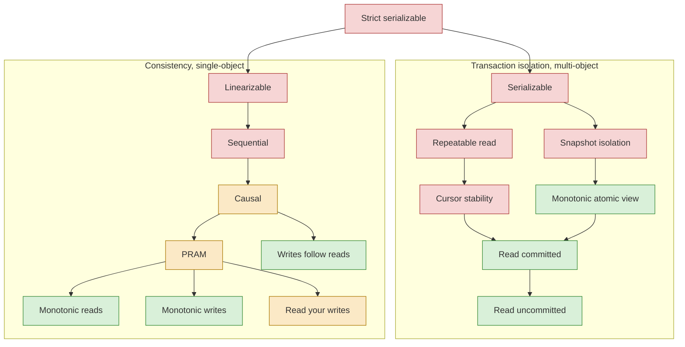

**Reading the diagram.** An arrow from $A$ to $B$ means $A$ implies $B$ (every $A$ history is a $B$ history); strength decreases downward. The left subgraph holds transaction isolation models, which constrain groups of operations over many objects; the right holds single-object consistency models; strict serializable at the top is the meeting point (serializable plus real time). Colors give availability under network partition as classified by Bailis et al. and Jepsen: red models cannot be totally available (some requests must block or fail in a partition); amber models are **sticky available**, meaning available as long as each client keeps talking to the same replicas; green models are **totally available**, so any non-failed replica can answer. Eventual consistency, a liveness property, is not drawn; it can be combined with any green or amber model. PRAM (pipelined RAM, [Lipton & Sandberg 1988]) is the combination of read-your-writes, monotonic reads and monotonic writes.

Two lessons from the map are worth memorizing. First, **the red-amber boundary is exactly the CAP boundary**: everything at or above sequential consistency cannot stay available in a partition, while causal consistency and below can (§25.8). Second, **isolation and consistency are orthogonal** until the very top: a serializable system can serve stale reads, and a linearizable key-value store can have no transactions at all.

## 25.8 The CAP theorem

### 25.8.1 The precise statement

Brewer conjectured in a 2000 keynote that a web service cannot be simultaneously consistent, available and partition-tolerant [Brewer 2000]. Gilbert and Lynch turned the conjecture into a theorem by defining each word [Gilbert & Lynch 2002].

::: definition
**Definition — CAP theorem (Gilbert and Lynch).** In an asynchronous network model, where messages may be delayed arbitrarily and there are no clocks, it is impossible to implement a read/write data object that guarantees both of the following in all fair executions, including those in which messages are lost:
**Consistency (C):** the object is **atomic**, that is, linearizable (§25.3).
**Availability (A):** every request received by a non-failing node must eventually result in a response.
**Partition tolerance (P)** is not a property the system chooses; it is the assumption that the network may lose arbitrarily many messages between nodes.
:::

Each term is narrower than its everyday meaning. "C" is linearizability of a single register, not ACID consistency or serializability. "A" requires *every* non-failing node to answer, with no time bound; a system that answers 99.99% of requests within 100 ms but refuses requests on a minority side is not "available" in the CAP sense, and a system that answers after an hour is. "P" is a network fault, not a design option.

#### How the proof works

**Figure 25.11 — The CAP proof scenario.**

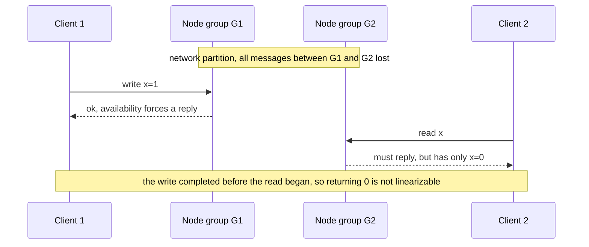

**Reading the diagram.** The nodes are split into two groups whose messages to each other are lost. Requests are synchronous from each client's point of view. Availability forces G1 to acknowledge the write without contacting G2, and forces G2 to answer the read without contacting G1. G2 cannot know about the write, so it returns the old value after the write completed: a violation of linearizability. The only escapes are for G1 to withhold its acknowledgment or G2 to withhold its answer until the partition heals, which gives up availability. Gilbert and Lynch also show the result holds in a partially synchronous model with local clocks.

### 25.8.2 Common misreadings

::: mistake
**Mistake — "Pick two of three."** You cannot "pick" P: partitions happen whether you choose them or not, so the real choice is what each operation does *during* a partition, C or A. When there is no partition, CAP says nothing, and a system can be both linearizable and available [Brewer 2012]. Drawing CAP as a triangle with three equal corners is the source of most confusion.
:::

::: mistake
**Mistake — "Our database is CA."** A single-node database is not partition-tolerant in any useful sense; it is simply not distributed. A distributed system that claims CA means "we assume partitions don't happen," and when one does, it will in fact sacrifice C or A, usually without having designed which [Kleppmann 2015].
:::

::: mistake
**Mistake — "System X is CP" or "AP" as a whole.** Most systems are neither in the strict sense. A Raft-based store is not CAP-available (the minority side refuses requests), but its follower reads are not CAP-consistent either. A Dynamo-style store with quorum reads and writes is not linearizable even without partitions (§25.3.4). Kleppmann argues that the labels should be dropped in favor of naming the actual consistency model and failure behavior of each operation [Kleppmann 2015].
:::

### 25.8.3 Brewer's "CAP twelve years later"

In 2012 Brewer revisited the theorem [Brewer 2012]. His main points:

1. **Partitions are rare**, so systems should not give up C or A when there is no partition.
2. **The choice is fine-grained**: per operation, per data item, per user, and it can change over time. A system can refuse to sell the last seat during a partition while still letting users browse.
3. **Partitions should be managed explicitly in three steps**: *detect* the partition (typically by timeout), enter a **partition mode** that limits some operations, then *recover* by merging state and **compensating** for mistakes, for example by refunding an oversold item. CRDTs and commutative operations make the merge mechanical.
4. **Latency and partitions are the same thing in practice**: a timeout is the only way to detect a partition, so every timeout decision is a small CAP decision.

Earlier, Fox and Brewer had framed the trade-off as **harvest** (the fraction of the data reflected in an answer) versus **yield** (the fraction of requests answered), pointing out that degrading harvest, such as a search result missing one shard, is often better than failing the request [Fox & Brewer 1999].

### 25.8.4 What CAP leaves out

Kleppmann's critique identifies the gaps [Kleppmann 2015]. CAP covers one consistency model (linearizability), one fault (a partition), and one notion of availability that no real system measures. It says nothing about latency, about crashed nodes, or about any model weaker than linearizability. His proposed alternative is to state, for each operation, how its latency depends on network delay $d$: linearizable operations take time proportional to $d$, causal operations can complete in constant time. This is the same insight as the lower bound of §25.3.4 and the motivation for PACELC.

::: tip
**Interview tip — Answer CAP questions in three sentences.** (1) CAP says that during a network partition a replicated register cannot be both linearizable and able to answer on every node. (2) So the real decision is per operation: refuse or delay (consistency) versus answer possibly stale or conflicting (availability), plus a plan to reconcile. (3) Outside partitions the trade-off is latency versus consistency, which is PACELC.
:::

## 25.9 PACELC

### 25.9.1 The formulation

Abadi observed that the consistency trade-off most systems actually make has nothing to do with partitions [Abadi 2012]. Keeping replicas synchronized costs round trips on every request, partition or not.

::: definition
**Definition — PACELC.** If there is a **P**artition, how does the system trade off **A**vailability and **C**onsistency; **E**lse, when the system is running normally, how does it trade off **L**atency and **C**onsistency? A system is labeled by its two choices, for example PA/EL or PC/EC.
:::

**Figure 25.12 — The PACELC decision for one operation.**

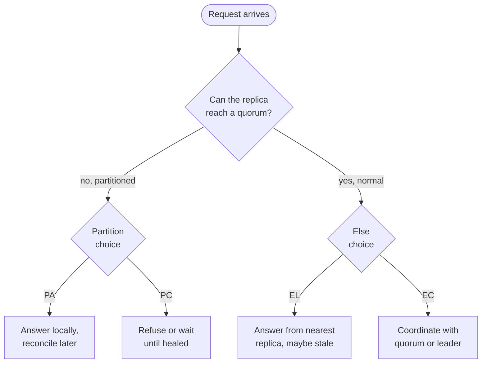

**Reading the diagram.** A request takes the left branch only while the replica cannot reach the nodes it needs; that is the CAP decision. The right branch is the everyday path, where the choice is between answering from the closest replica (low latency, possibly stale) and paying a synchronous round trip for consistency. Both decisions are made per operation and are often configurable. The failure point is the "can it reach a quorum?" test itself, which in practice is a timeout.

### 25.9.2 Classifying real systems

Abadi's 2012 paper labeled Dynamo, Cassandra and Riak as PA/EL; VoltDB/H-Store and Megastore as PC/EC; MongoDB as PA/EC; and Yahoo's PNUTS as PC/EL [Abadi 2012]. Configurations have changed since; Table 25.5 gives labels for typical settings as of 2026. Treat every label as a statement about a configuration, not about a product.

**Table 25.5 — PACELC classification of real systems, by configuration (as of 2026).**

| System | Typical configuration | P choice | E choice | Caveat |
|---|---|---|---|---|
| Cassandra | `ONE` or `LOCAL_ONE` reads and writes | PA | EL | `QUORUM` both ways gives PC/EC per request; lightweight transactions use Paxos (PC/EC) |
| DynamoDB (single region) | Default eventually consistent reads | PA | EL | `ConsistentRead=true` reads the leader replica: EC, and fails rather than serve stale data |
| DynamoDB global tables | Multi-Region eventual consistency (default) | PA | EL | Multi-Region strong consistency mode (GA 2025) is PC/EC, chosen at table creation |
| Cosmos DB | Session (default) | PA | EL within session rules | Strong is PC/EC; bounded staleness is PC within its bound |
| MongoDB | `w: majority`, reads from primary | PC | EC | Reads from secondaries are EL; `w: 1` (pre-5.0 default) risks rollback |
| Spanner | Read-write transactions, strong reads | PC | EC | Stale reads at a past timestamp are EL |
| CockroachDB | Default | PC | EC | Follower reads with `AS OF SYSTEM TIME` are EL |
| etcd, ZooKeeper | Default | PC | EC for writes | ZooKeeper reads are local (EL) unless preceded by `sync`; etcd serializable reads are EL |
| PostgreSQL with async replicas | Reads routed to replicas | PC for writes (one primary) | EL | Failover to an async replica can lose acknowledged writes |

#### Mathematical foundations

The cost of "EC" can be priced directly. DynamoDB bills reads in **read capacity units (RCUs)**: one RCU is one strongly consistent read per second of an item up to 4 KB, or two eventually consistent reads [AWS Docs: DynamoDB Read Consistency].

::: formula
**DynamoDB read capacity for a read rate**

$$\text{RCU} = r \times \left\lceil \frac{s}{4\ \text{KB}} \right\rceil \times f, \qquad f = \begin{cases} 1 & \text{strongly consistent} \\ 0.5 & \text{eventually consistent} \end{cases}$$

| Symbol | Meaning | Units |
|---|---|---|
| $\text{RCU}$ | Provisioned read capacity needed | RCU |
| $r$ | Read rate | reads/s |
| $s$ | Item size | KB |
| $f$ | Consistency factor | RCU per 4 KB read |
:::

::: example
**Worked example — Paying for EC.** A profile service reads 20,000 items per second, each 6 KB.

1. Size factor: $\lceil 6/4 \rceil = 2$.
2. Eventually consistent: $20{,}000 \times 2 \times 0.5 = 20{,}000$ RCU.
3. Strongly consistent: $20{,}000 \times 2 \times 1 = 40{,}000$ RCU.
4. If only the 5% of reads that follow the user's own edit need RYW and use strong reads: $20{,}000 \times 2 \times (0.95 \times 0.5 + 0.05 \times 1) = 40{,}000 \times 0.525 = 21{,}000$ RCU.

**Interpretation.** Strong reads double read cost; applying them only where a session guarantee needs them costs 5% more than all-eventual. **Engineering implication.** Choose consistency per call site, not per table; the latency and cost difference is a property of each operation.
:::

## 25.10 Consistency trade-offs in real databases

### 25.10.1 Tunable consistency

Modern databases rarely offer one model; they offer knobs, usually per request.

- **Cassandra** sets a consistency level per statement: `ONE`, `QUORUM`, `LOCAL_QUORUM` (a majority in the local data center), `EACH_QUORUM`, `ALL`, and `SERIAL`/`LOCAL_SERIAL` for Paxos-based lightweight transactions such as `INSERT ... IF NOT EXISTS` [Apache Cassandra Docs]. `LOCAL_QUORUM` reads and writes are the common production choice: overlapping quorums within a region, asynchronous replication to other regions (EL across regions).
- **DynamoDB** makes reads eventually consistent by default; `ConsistentRead=true` makes a `GetItem`, `Query` or `Scan` strongly consistent within a region, at twice the read cost (§25.9.2). Global secondary indexes support only eventually consistent reads [AWS Docs: DynamoDB Read Consistency].
- **MongoDB** combines write concern (`w: 1`, `w: majority`), read concern (`local`, `majority`, `linearizable`, `snapshot`) and read preference (primary or secondaries). `linearizable` read concern on the primary confirms with a majority before returning [MongoDB Docs: Read Concern].
- **Follower reads.** CockroachDB and Spanner let a query read a slightly old, consistent snapshot from the nearest replica: CockroachDB with `AS OF SYSTEM TIME follower_read_timestamp()`, Spanner with **bounded-staleness** or **exact-staleness** reads [CockroachDB Docs: Follower Reads; Google Cloud Docs: Spanner Reads]. The read is serializable but not linearizable: it is a correct view of the past.

### 25.10.2 Cosmos DB's five levels

Azure Cosmos DB exposes five named levels, which map neatly onto this chapter's models [Microsoft Docs: Cosmos DB Consistency Levels].

**Table 25.6 — Azure Cosmos DB consistency levels (as of 2026).**

| Level | Guarantee | Closest model in this chapter | Notes |
|---|---|---|---|
| Strong | Reads see the latest committed write | Linearizable | Writes wait for a majority in every region; not offered with multiple write regions |
| Bounded staleness | Reads lag writes by at most $K$ versions or $T$ seconds | Linearizable outside the window; consistent prefix inside it | Minimum bounds depend on single- or multi-region writes |
| Session (default) | RYW, MR, MW, WFR within a session token | Session guarantees (§25.6) | Other sessions see consistent prefix |
| Consistent prefix | Never see writes out of order or with gaps | Ordered prefix of a single log, no recency bound | Reads may be arbitrarily old |
| Eventual | Convergence only | Eventual | Lowest latency and cost |

### 25.10.3 External consistency in Spanner

Spanner provides **external consistency**, which is strict serializability for transactions: if transaction $T_1$ commits before $T_2$ starts, $T_1$'s commit timestamp is smaller [Corbett et al. 2012]. It achieves this with TrueTime, a clock API that returns an interval guaranteed to contain true time, and a **commit wait**: a transaction does not report success until its timestamp is definitely in the past everywhere. The cost is a wait proportional to clock uncertainty (single-digit milliseconds, per the paper) plus Paxos round trips. Chapter 28 (§28.8) treats the mechanism.

::: industry
**Amazon DynamoDB global tables with multi-Region strong consistency.** Global tables historically replicated asynchronously between regions with last-writer-wins resolution. In June 2025 AWS made a multi-Region strong consistency (MRSC) mode generally available, so that strongly consistent reads in any participating region return the latest write, with a recovery point objective of zero. The mode is selected when the table is created; writes pay cross-region replication latency.
*Evidence: Primary* — [AWS 2025: DynamoDB MRSC]
:::

::: recommendation
**Recommendation — Choose consistency per operation.** List each operation and ask: does a stale or reordered answer cause a wrong decision (money, inventory, uniqueness, authorization) or only a cosmetic glitch? Give the first group linearizable operations (leader reads, quorum reads, conditional writes, strong reads); give user-facing reads of a user's own data session guarantees; serve everything else eventually consistent from the nearest replica. Write the choice into the API documentation.
:::

## 25.11 Jepsen-style testing

### 25.11.1 Why test consistency?

A consistency model is a claim about *all* histories under *all* allowed faults. Unit tests exercise a handful of interleavings without faults, where most systems behave linearizably. Bugs live in rare windows: a leader paused by garbage collection while a new one is elected, a partition during a membership change, a clock jump during lease renewal. Kyle Kingsbury's **Jepsen** project, started in 2013, tests real databases by generating concurrent operations, injecting faults, recording the history, and checking it against a model [Kingsbury: Jepsen].

#### How it works internally

1. **Set up** a cluster (typically five nodes) and a control node that runs the test.
2. **Generate** a workload: many concurrent clients issue randomized operations, such as reads, writes and compare-and-set on registers, or transactions appending to lists.
3. **Inject faults** with a **nemesis**: network partitions (via firewall rules), process crashes and pauses (`SIGSTOP`), clock skew, disk faults, membership changes.
4. **Record a history**: every invocation and completion with its result, marking timed-out operations as **indeterminate** (`:info`), exactly like H6 in §25.3.3.
5. **Check** the history: a linearizability checker for single-object workloads, or a transactional checker for isolation levels.

**Figure 25.13 — Architecture of a Jepsen test.**

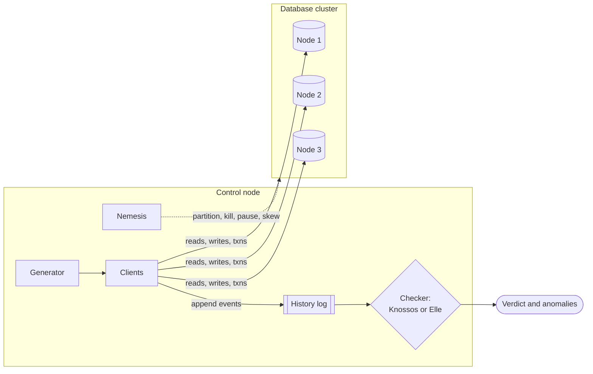

**Reading the diagram.** The generator schedules operations for many client threads, which call the database over its native protocol synchronously. The nemesis acts asynchronously on the nodes over SSH. Every event goes to the history log (the storage boundary for test evidence), and the checker analyzes it offline after the run. Failure points are deliberate: the nemesis creates them. The checker is the scaling bottleneck: linearizability checking is NP-complete, so tests keep concurrency and history length modest or partition the history by key.

### 25.11.2 Checkers

**Table 25.7 — History checkers.**

| Checker | What it checks | Method | Notes |
|---|---|---|---|
| Knossos | Linearizability of single objects | Search for a linearization, Wing–Gong–Lowe style | Jepsen's original checker (Clojure); cost grows quickly with concurrency |
| Porcupine | Linearizability | Same family, optimized, with per-key partitioning | Go; used in MIT 6.824 labs |
| Elle | Transaction isolation, from read uncommitted to strict serializable | Infers write-read, write-write and read-write dependencies, then finds cycles (Adya's phenomena) | Linear-time on suitable workloads such as list-append [Kingsbury & Alvaro 2020] |

Elle's key idea is to design the workload so that the history *reveals* the version order: if each transaction appends unique values to lists, a read of `[1, 2, 5]` proves that the append of 2 came before the append of 5. Dependency graphs can then be built directly, and any cycle is a named anomaly (G0, G1c, G-single, G2-item) [Adya 1999; Kingsbury & Alvaro 2020].

### 25.11.3 Published findings

Jepsen reports are public and detailed. Three examples show the range:

::: industry
**etcd 3.4.3 (2020).** Key-value operations, including multi-key transactions, appeared strictly serializable under partitions, pauses, crashes, clock skew and membership changes, and watches delivered changes in order apart from an undocumented edge case. etcd's locks, however, could not guarantee mutual exclusion in an asynchronous network, a fundamental limitation of lease-based locks that needs fencing tokens (§26.13).
*Evidence: Primary* — [Kingsbury 2020a]
:::

::: industry
**MongoDB 4.2.6 (2020).** Even with the strongest read and write concerns, transactions exhibited read skew, cyclic information flow, duplicate writes and internal consistency violations, so they did not provide snapshot isolation; under default settings transactions could lose writes. MongoDB changed the default write concern to `majority` in version 5.0.
*Evidence: Primary* — [Kingsbury 2020b; MongoDB Docs: Jepsen]
:::

::: industry
**PostgreSQL 12.3 (2020).** Using Elle, Jepsen found that the SERIALIZABLE level allowed G2-item anomalies (anti-dependency cycles) in healthy clusters without any faults, a bug in serializable snapshot isolation that the PostgreSQL developers then fixed. The same report noted that PostgreSQL's REPEATABLE READ is snapshot isolation.
*Evidence: Primary* — [Kingsbury 2020c]
:::

::: recommendation
**Recommendation — Test your own system's claims.** Record histories in integration tests (client, operation, invocation and completion time, result), run them through Porcupine, Knossos or Elle, and add fault injection: partition the leader, pause it beyond its lease, skew clocks. Treat every timeout as indeterminate. A single non-linearizable history with a short witness is worth more than months of green dashboards.
:::

## 25.12 Summary and revision notes

::: summary
- **Two axes.** Single-object consistency models (linearizable, sequential, causal, session, eventual) say which values reads may return; isolation levels (§11.13) say which transaction interleavings are allowed. Strict serializability is where they meet.
- **Linearizability** = a linearization point inside each operation's interval, giving a legal sequential history that respects real time; the single-copy illusion. It is compositional. Checking is NP-complete in general; brute force with memoization works for small histories. It costs a round trip to a quorum or a confirmed leader ($T \approx k \cdot \text{RTT}_{(q)}$), and $t_{\text{read}} + t_{\text{write}} \ge d$ already for sequential consistency.
- **Sequential consistency** drops real time but keeps one agreed order and program order; follower reads in ZooKeeper behave like this. It is not compositional (store buffering).
- **Causal consistency** orders only causally related writes, allows local reads and writes and is sticky available; COPS carries nearest dependencies and checks them before applying remote writes.
- **Session guarantees** (RYW, MR, MW, WFR) are implemented with read-sets and write-sets as version vectors, LSN tokens or sticky routing; tokens must travel with the session.
- **Eventual consistency** is liveness only. PBS quantifies it: $p_s = \binom{N-W}{R}/\binom{N}{R}$ immediately after commit, and a WARS simulation gives $t$-visibility curves you can put in an SLO.
- **CAP** (Gilbert and Lynch): in an asynchronous network that can lose messages, no register is both linearizable and available on every non-failed node. Not "pick two"; no meaningful "CA"; choose per operation what happens during a partition.
- **PACELC** adds the everyday trade-off: else, latency versus consistency. Labels describe configurations, not products.
- **Jepsen** records histories under injected faults and checks them with Knossos/Porcupine (linearizability) or Elle (isolation, via dependency cycles). Treat timeouts as indeterminate.
:::

## 25.13 Knowledge checkpoint

1. What makes two operations concurrent, and when does $a$ precede $b$ in real time?
2. Why is history H3 (a read returns 1 during a write, a later read returns 0) not linearizable, even though each read alone could be?
3. State the locality property of linearizability and why it matters for partitioned stores.
4. Give a history that is sequentially consistent but not linearizable.
5. Why does $R + W > N$ not by itself give linearizability?
6. Five replicas have RTTs 0, 2, 30, 80 and 85 ms from the coordinator. What is the latency of an ABD read?
7. Which session guarantee does a sticky replica provide, and which does it fail to provide?
8. In COPS, why does a client need to track only nearest dependencies?
9. Compute $p_s$ for $N = 5$, $R = 1$, $W = 2$.
10. What exactly do C, A and P mean in Gilbert and Lynch's proof?
11. Why is "CA system" a misleading label?
12. Classify Cassandra at `LOCAL_ONE` and Spanner strong reads in PACELC.
13. What does Elle need from a workload to infer the version order?
14. Why must a Jepsen history record timed-out operations as indeterminate?

<details><summary>Answers</summary>

1. Their invocation–response intervals overlap. $a$ precedes $b$ if $a$'s response happens before $b$'s invocation.
2. Once B returned 1, B's linearization point is after the write's. C's read starts after B finished, so its point is later still and must see 1.
3. A history is linearizable if and only if each object's sub-history is. Independently linearizable partitions compose into a linearizable store without cross-partition coordination for single-object operations.
4. H2: A writes $x = 1$ and completes; afterwards B reads 0. The order "B reads, then A writes" respects program order.
5. Partial writes, in-flight writes, sloppy quorums and last-writer-wins can let one reader see a new value and a later reader an old one; write-back or consensus is needed.
6. $q = 3$, $\text{RTT}_{(3)} = 30$ ms; two round trips, about 60 ms plus processing.
7. Monotonic reads while the replica is healthy; not read-your-writes if writes go elsewhere, and not monotonic reads across failover.
8. Dependencies are transitive: the nearest dependency already depends on everything before it, and the remote cluster applied it only after its own dependencies.
9. $\binom{3}{1}/\binom{5}{1} = 3/5 = 0.6$.
10. C: linearizable read/write register. A: every request to a non-failing node eventually gets a response. P: the network may lose arbitrarily many messages.
11. Partitions are not optional in a distributed system; a "CA" system just has not decided whether it will lose C or A when one happens.
12. Cassandra `LOCAL_ONE`: PA/EL. Spanner strong reads: PC/EC.
13. A way to recover each object's version order from reads, for example appends of unique values to lists, so dependencies can be inferred directly.
14. The operation may have taken effect; treating it as failed produces false alarms, and treating it as succeeded can hide real anomalies.
</details>

## 25.14 Interview questions

### Basic

**Q1. What is the difference between linearizability and serializability?** **Answer.** Linearizability is a recency guarantee for single operations on single objects: each operation appears to take effect at one instant between its call and return, respecting real time. Serializability is an isolation guarantee for transactions over many objects: the outcome equals some serial order, which need not respect real time. Strict serializability combines both.

**Q2. A user updates her profile and the page still shows the old one. What happened and how do you fix it?** **Answer.** The read went to a lagging replica, violating read-your-writes. Return the commit LSN or a session token with the write and read only from replicas that have applied it, or read from the primary for that user's own profile after a write.

### Intermediate

**Q3. Explain CAP precisely and say what your design does during a partition.** **Answer.** In an asynchronous network that can lose messages, a register cannot be both linearizable and answer on every non-failing node. Per operation, I decide: payments and inventory decrements refuse on the minority side (PC); browsing, carts and likes keep serving locally with merge or compensation afterwards (PA). Outside partitions, PACELC's latency–consistency choice applies: strong reads where a stale value causes a wrong decision, nearest-replica reads elsewhere.

**Q4. How would you implement monotonic reads across a fleet of read replicas?** **Answer.** Track, per session, the highest LSN (or version vector) it has observed; route reads only to replicas at or beyond it, waiting briefly or falling back to the primary otherwise. Sticky routing alone fails on replica failure.

### Advanced

**Q5. Your team wants a globally replicated, linearizable key-value store with 5 ms reads and writes on three continents. Respond.** **Answer.** Impossible: for sequential consistency already $t_r + t_w \ge d$, and cross-continent $d$ is tens of milliseconds. Offer alternatives: place each key's quorum near its main writer (fast for local users, slow for others); linearizable writes with follower reads that are bounded-stale; or causal consistency with local operations plus linearizable operations only for uniqueness and money.

**Q6. How would you test that a new replicated store is linearizable?** **Answer.** Jepsen-style: concurrent clients on a small key set doing reads, writes and compare-and-set; a nemesis partitioning, pausing and killing leaders and skewing clocks; record every invocation and completion, timeouts as indeterminate; check with Porcupine or Knossos per key. For transactions, use list-append workloads and Elle. Minimize failing histories and turn them into regression tests.

## 25.15 Practical exercises

1. Extend the checker of §25.3.3 with a compare-and-set operation and construct a history in which two CAS operations both succeed but the history is not linearizable.
2. Add a third replica and a write-side scenario to the session-guarantee program that demonstrates a monotonic-writes violation when `mw=False`.
3. Modify the PBS simulation so one of the three replicas has a 10× slower write path. How do the curves for $(R, W) = (1, 1)$ and $(2, 1)$ change?
4. Run Porcupine on histories produced by a toy key-value store with an asynchronous replica, and find the shortest non-linearizable history.

## 25.16 Design challenges

1. **Global collaborative documents.** Users in three regions edit shared documents. Choose consistency models for document contents, access control lists and document names (which must be unique per folder), and justify the latency each user sees.
2. **Ticketing.** A concert ticketing service must never oversell seats but must keep browsing available during a regional network partition. Describe partition detection, partition mode and recovery in Brewer's terms.

## 25.17 References

1. Abadi, D. "Consistency Tradeoffs in Modern Distributed Database System Design: CAP Is Only Part of the Story." *IEEE Computer* 45(2):37–42, 2012.
2. Adya, A. *Weak Consistency: A Generalized Theory and Optimistic Implementations for Distributed Transactions*. PhD thesis, MIT, 1999.
3. Ahamad, M., Neiger, G., Burns, J. E., Kohli, P., Hutto, P. W. "Causal Memory: Definitions, Implementation, and Programming." *Distributed Computing* 9(1):37–49, 1995.
4. Apache Cassandra. *Documentation — Consistency levels and lightweight transactions*. https://cassandra.apache.org/doc/latest/
5. Attiya, H., Bar-Noy, A., Dolev, D. "Sharing Memory Robustly in Message-Passing Systems." *Journal of the ACM* 42(1):124–142, 1995.
6. Attiya, H., Welch, J. L. "Sequential Consistency versus Linearizability." *ACM Transactions on Computer Systems* 12(2):91–122, 1994.
7. AWS. *Amazon DynamoDB Developer Guide — Read consistency*. https://docs.aws.amazon.com/amazondynamodb/latest/developerguide/HowItWorks.ReadConsistency.html
8. AWS. "Amazon DynamoDB global tables with multi-Region strong consistency is now generally available." AWS What's New, June 2025. https://aws.amazon.com/about-aws/whats-new/2025/06/amazon-dynamo-db-global-tables-multi-region-strong-consistency-generally-available/
9. AWS. *Amazon S3 User Guide — Amazon S3 data consistency model*. https://docs.aws.amazon.com/AmazonS3/latest/userguide/Welcome.html
10. Bailis, P., Venkataraman, S., Franklin, M. J., Hellerstein, J. M., Stoica, I. "Probabilistically Bounded Staleness for Practical Partial Quorums." *PVLDB* 5(8):776–787, 2012.
11. Bailis, P., Davidson, A., Fekete, A., Ghodsi, A., Hellerstein, J. M., Stoica, I. "Highly Available Transactions: Virtues and Limitations." *PVLDB* 7(3):181–192, 2014.
12. Bailis, P., Ghodsi, A. "Eventual Consistency Today: Limitations, Extensions, and Beyond." *ACM Queue* 11(3), 2013.
13. Brewer, E. "Towards Robust Distributed Systems." Keynote, *ACM Symposium on Principles of Distributed Computing (PODC)*, 2000.
14. Brewer, E. "CAP Twelve Years Later: How the 'Rules' Have Changed." *IEEE Computer* 45(2):23–29, 2012.
15. Cockroach Labs. *CockroachDB Docs — Follower Reads*. https://www.cockroachlabs.com/docs/stable/follower-reads
16. Corbett, J. C., et al. "Spanner: Google's Globally-Distributed Database." *USENIX OSDI*, 2012.
17. DeCandia, G., et al. "Dynamo: Amazon's Highly Available Key-value Store." *ACM SOSP*, 2007.
18. Fox, A., Brewer, E. A. "Harvest, Yield, and Scalable Tolerant Systems." *Workshop on Hot Topics in Operating Systems (HotOS-VII)*, 1999.
19. Gibbons, P. B., Korach, E. "Testing Shared Memories." *SIAM Journal on Computing* 26(4):1208–1244, 1997.
20. Gilbert, S., Lynch, N. "Brewer's Conjecture and the Feasibility of Consistent, Available, Partition-Tolerant Web Services." *ACM SIGACT News* 33(2):51–59, 2002.
21. Google Cloud. *Spanner documentation — Reads (strong, bounded-staleness and exact-staleness)*. https://cloud.google.com/spanner/docs/reads
22. Herlihy, M. P., Wing, J. M. "Linearizability: A Correctness Condition for Concurrent Objects." *ACM Transactions on Programming Languages and Systems* 12(3):463–492, 1990.
23. Hunt, P., Konar, M., Junqueira, F. P., Reed, B. "ZooKeeper: Wait-free Coordination for Internet-scale Systems." *USENIX ATC*, 2010.
24. Kingsbury, K. *Consistency Models* (map and model pages). jepsen.io. https://jepsen.io/consistency
25. Kingsbury, K. *Jepsen analyses and tools*. jepsen.io. https://jepsen.io/analyses
26. Kingsbury, K. "Jepsen: etcd 3.4.3." jepsen.io, 2020 (cited as 2020a). https://jepsen.io/analyses/etcd-3.4.3
27. Kingsbury, K. "Jepsen: MongoDB 4.2.6." jepsen.io, 2020 (2020b). https://jepsen.io/analyses/mongodb-4.2.6
28. Kingsbury, K. "Jepsen: PostgreSQL 12.3." jepsen.io, 2020 (2020c). https://jepsen.io/analyses/postgresql-12.3
29. Kingsbury, K., Alvaro, P. "Elle: Inferring Isolation Anomalies from Experimental Observations." *PVLDB* 14(3):268–280, 2020.
30. Kleppmann, M. "A Critique of the CAP Theorem." arXiv:1509.05393, 2015.
31. Kleppmann, M. *Designing Data-Intensive Applications*, ch. 9 "Consistency and Consensus." O'Reilly Media, 2017.
32. Lamport, L. "How to Make a Multiprocessor Computer That Correctly Executes Multiprocess Programs." *IEEE Transactions on Computers* C-28(9):690–691, 1979.
33. Lipton, R. J., Sandberg, J. S. "PRAM: A Scalable Shared Memory." Technical Report CS-TR-180-88, Princeton University, 1988.
34. Lloyd, W., Freedman, M. J., Kaminsky, M., Andersen, D. G. "Don't Settle for Eventual: Scalable Causal Consistency for Wide-Area Storage with COPS." *ACM SOSP*, 2011.
35. Lowe, G. "Testing for Linearizability." *Concurrency and Computation: Practice and Experience* 29(4), 2017.
36. Mahajan, P., Alvisi, L., Dahlin, M. "Consistency, Availability, and Convergence." Technical Report TR-11-22, University of Texas at Austin, 2011.
37. Microsoft. *Azure Cosmos DB documentation — Consistency levels*. https://learn.microsoft.com/azure/cosmos-db/consistency-levels
38. MongoDB. *MongoDB Manual — Causal Consistency and Read and Write Concerns; Read Concern*. https://www.mongodb.com/docs/manual/
39. MongoDB. *MongoDB and Jepsen*. https://www.mongodb.com/jepsen
40. Ongaro, D. *Consensus: Bridging Theory and Practice*. PhD thesis, Stanford University, 2014.
41. Papadimitriou, C. H. "The Serializability of Concurrent Database Updates." *Journal of the ACM* 26(4):631–653, 1979.
42. Terry, D. B., Demers, A. J., Petersen, K., Spreitzer, M. J., Theimer, M. M., Welch, B. B. "Session Guarantees for Weakly Consistent Replicated Data." *International Conference on Parallel and Distributed Information Systems (PDIS)*, 1994.
43. Viotti, P., Vukolić, M. "Consistency in Non-Transactional Distributed Storage Systems." *ACM Computing Surveys* 49(1), Article 19, 2016.
44. Vogels, W. "Eventually Consistent." *Communications of the ACM* 52(1):40–44, 2009.
45. Vogels, W. "Diving Deep on S3 Consistency." *All Things Distributed*, 2021. https://www.allthingsdistributed.com/2021/04/s3-strong-consistency.html
46. Wing, J. M., Gong, C. "Testing and Verifying Concurrent Objects." *Journal of Parallel and Distributed Computing* 17(1–2):164–182, 1993.
47. Athalye, A. *Porcupine: A fast linearizability checker in Go*. https://github.com/anishathalye/porcupine

## 25.18 Open verification items

- Attiya and Welch (1994): confirm the exact bounds attributed in §25.3.4 ($t_r + t_w \ge d$ for sequential consistency, credited also to Lipton and Sandberg; linearizability needing both operations to wait in proportion to delay uncertainty).
- Mahajan et al. (2011): confirm the precise statement of the real-time causal result.
- Jepsen map (Figure 25.10): re-check edges and availability colors against the current jepsen.io page (jepsen.io was unreachable from the build environment).
- PostgreSQL 12.3: confirm the fix release (believed 12.4).
- Cosmos DB: confirm minimum bounded-staleness $K$/$T$ values and that strong consistency is unavailable with multiple write regions.
- Spanner commit-wait magnitude ("single-digit milliseconds"); Brewer 2012 page numbers.
