# Chapter 26 — Consensus and Coordination

> **Level:** 3–4 · **Track:** A (Traditional) · **Estimated reading time:** 7 h

At 02:14 a database primary stops answering heartbeats. The failover controller promotes a replica. Ninety seconds later the old primary finishes a long garbage-collection pause, finds its network link healthy again, and keeps accepting writes, because nothing told it that it had been replaced. For a few minutes two nodes both believe they are the primary, and customers who wrote to the "wrong" one lose their orders when the clusters are reconciled. Nothing here was a bug in the usual sense: every node acted correctly on the information it had. The failure was a missing *agreement* about who was in charge.

This chapter is about that agreement. **Consensus** gets unreliable machines to decide one thing and never change their minds; **coordination** builds on it: leader election, locks, leases, configuration and membership. You will learn why majority quorums work, how Paxos and Raft agree despite crashes and lost messages, how ZooKeeper, etcd and Chubby package consensus as a service, and why even a correct lock service cannot stop a paused client unless storage checks a **fencing token**.

## 26.1 Learning objectives

After this chapter you should be able to:

- State the consensus problem (agreement, validity, termination) and explain how a replicated state machine turns single-value consensus into a fault-tolerant service.
- Compute quorum sizes, fault tolerance, availability and commit latency for 3-, 5- and 7-node clusters, and explain flexible quorums.
- Compare bully, ring and lease-based leader election and explain why electing a leader does not, by itself, give safety.
- Trace single-decree Paxos through prepare/promise and accept/accepted, including competing proposers, and explain how Multi-Paxos removes phase 1 from the common path.
- Explain Raft's terms, elections, log replication, log matching, commit rule and the "commit only current-term entries" subtlety; size election timeouts; describe snapshots, membership changes, ReadIndex and lease reads; and run a Raft simulator.
- Use ZooKeeper, etcd, Consul and Chubby primitives (ephemeral nodes, watches, revisions, leases, sequencers) to build election, locks and barriers.
- Evaluate distributed-lock designs, including the Redlock debate, and design leases with an explicit clock-safety margin.
- Diagnose split brain and prevent it with quorums, witnesses, STONITH and fencing tokens.

## 26.2 Prerequisites

- System models, partial failure and network partitions — §24.6–§24.8 (consensus algorithms are defined relative to a failure model).
- Physical clocks and clock skew — §24.9 (leases and lease reads depend on bounded clock drift).
- FLP impossibility — §24.13 (explains why every practical algorithm needs timeouts).
- Linearizability — §25.3 (the consistency level consensus-backed services provide).
- Primary–replica replication and failover — §14.3–§14.4 (consensus fixes the failover problems introduced there).
- Write-ahead logs and `fsync` — §13.5, §13.12 (every vote and log entry must be durable before it is acknowledged).

## 26.3 The consensus problem

### 26.3.1 Agreement, validity, termination

::: definition
**Definition — Consensus.** A set of processes, each of which may **propose** a value, must **decide** on a single value such that: **agreement** — no two correct processes decide differently; **validity** (integrity) — the decided value was proposed by some process; **termination** — every correct process eventually decides. Once decided, a value never changes.
:::

#### First-principles explanation

Picture five friends choosing a restaurant by text message. Messages arrive late or not at all, and any friend's phone may die mid-conversation. They want three things. Everyone who chooses must choose the *same* restaurant (agreement). The chosen restaurant must be one somebody actually suggested, not a default made up by the protocol (validity). And they must eventually stop arguing and eat (termination). The first two are **safety** properties: "nothing bad ever happens." The third is a **liveness** property: "something good eventually happens."

The difficulty is that a silent phone is ambiguous: is Dana's phone dead, or her reply just slow? Wait forever and the group may never decide; decide without her and Dana may later act on an older, different decision. Every consensus algorithm is a careful answer to this ambiguity.

#### Why does this exist?

Many problems reduce to consensus: choosing one leader, committing or aborting a distributed transaction, granting a lock to one client, agreeing on membership, and ordering writes to a replicated database. Solve consensus once and you can build all of these, which is why it sits underneath ZooKeeper, etcd, Consul, Chubby, Spanner, CockroachDB, TiKV and Kafka's KRaft controller (Chapter 31).

#### The impossibility result and how practice escapes it

Section 24.13 introduced the **FLP result** [Fischer, Lynch and Paterson 1985]: in a fully *asynchronous* system, where message delays have no upper bound, no deterministic algorithm can guarantee consensus if even one process may crash. The reason is exactly Dana's silent phone: the algorithm can never distinguish "crashed" from "slow," and an adversarial schedule can keep it undecided forever.

Practical algorithms escape FLP in a specific way. They **never compromise safety**, under any timing; they guarantee **termination only when the network behaves** for long enough, a model called **partial synchrony** [Dwork, Lynch and Stockmeyer 1988]. Paxos and Raft use timeouts to suspect failures and elect a new leader. A wrong suspicion costs time, never correctness. Keep this split in mind for the whole chapter: *safety from quorums, liveness from timeouts*.

::: concept
**Key insight — Safety from quorums, liveness from timers.** In Paxos, Raft and ZAB, the rules that prevent two different decisions depend only on counting votes from overlapping majorities. Clocks and timeouts are used only to decide *when to try again*. That is why a badly tuned timeout makes these systems slow or unavailable but never inconsistent, and why designs that use clocks for safety (leases, §26.11) need separate scrutiny.
:::

The failure model matters. Paxos and Raft assume **crash-recovery** faults (§24.6): nodes stop, may restart with their durable state intact, and never lie. Tolerating **Byzantine** nodes that send arbitrary or malicious messages needs different algorithms and $3f+1$ nodes; that is the subject of Chapter 45.

### 26.3.2 Replicated state machines

::: definition
**Definition — Replicated state machine (RSM).** A service implemented as a deterministic state machine that is copied onto several nodes. Each node applies the same sequence of commands, taken from a replicated **log**, in the same order, so every node passes through the same sequence of states and produces the same outputs [Schneider 1990].
:::

Single-value consensus decides one thing. A database needs to decide millions of things in order. The **replicated state machine** approach bridges the gap: run one instance of consensus per log position (slot 1, slot 2, …). Slot $i$ decides "the $i$-th command." Because each replica is deterministic and applies the same commands in the same order, the replicas stay identical without ever comparing their states.

**Figure 26.1 — A replicated state machine built on a consensus log.**

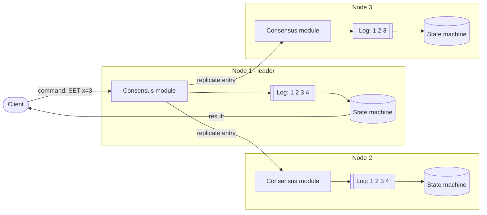

**Reading the diagram.** The client sends a command to the consensus module on the leader (Node 1). The module appends the command to its durable log (subroutine shape) and replicates it, over RPC, to the modules on the other nodes, which append it to their own logs. When a majority of logs contain the entry, it is **committed**; each node then feeds committed entries, in order, to its state machine (cylinder), and the leader returns the result. Write-path arrows are synchronous: the client waits until a majority has stored the entry. Node 3 is one entry behind, which is allowed, because a majority (Nodes 1 and 2) holds entry 4. Storage: each node owns its log and state; nothing is shared. Failure points: if Node 1 crashes, Nodes 2 and 3 elect a new leader whose log contains every committed entry. Scaling: adding nodes improves fault tolerance but not write throughput, because every node stores every entry.

Two consequences follow. First, the state machine must be **deterministic**: no reading the local clock, random numbers or unordered hash iteration inside `apply`. The leader picks such values and writes them into the command. Second, the log, not the state, is the source of truth; the state is a cache of "the log applied so far," which is why snapshots (§26.7.8) can replace the log prefix.

::: mistake
**Misconception — "Consensus makes the system faster or more scalable."** Consensus makes a service *fault-tolerant*, not fast. Every write waits for a majority round trip and a disk flush, and every node does every write. A 5-node etcd cluster has lower write throughput than a single node. Systems that need scale partition the data into many independent consensus groups (CockroachDB ranges, TiKV regions, Spanner splits), each small (§14.6, §28.10).
:::

## 26.4 Quorums

### 26.4.1 Majority quorums and the intersection property

::: definition
**Definition — Quorum.** A set of nodes whose agreement is sufficient for an operation to take effect. A **majority quorum** in a cluster of $N$ voting nodes is any set of more than $N/2$ nodes. The essential **intersection property**: any two majority quorums share at least one node.
:::

#### First-principles explanation

Think of a committee of five where a decision needs three signatures. Two rival decisions would need six signatures from five members, so someone signed both. If no member signs two conflicting decisions, conflicts are impossible. The overlapping member is the system's memory: whoever comes later meets at least one node that saw what came before.

**Figure 26.2 — Two majority quorums in a five-node cluster always intersect.**

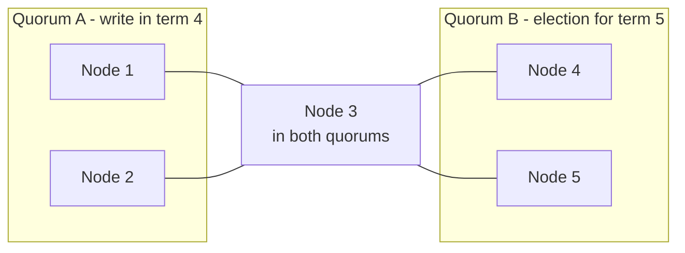

**Reading the diagram.** Quorum A is {1, 2, 3}, the nodes that stored a write in term 4. Quorum B is {3, 4, 5}, the nodes that voted in a later election. Links show membership only; no data flows. Both quorums have three of five members, so they share a node, here Node 3. Node 3 carries the term-4 write into the term-5 election: Raft's voting rule lets it refuse any candidate whose log lacks that write (§26.7.6). The failure point the figure guards against is the **minority partition**: {4, 5} alone cannot form a quorum, so it can neither elect a leader nor commit writes. Scaling the cluster changes the arithmetic but not the principle.

#### Mathematical foundations

::: formula
**Majority quorum size and fault tolerance**

$$q = \left\lfloor \frac{N}{2} \right\rfloor + 1 \qquad f = N - q = \left\lfloor \frac{N-1}{2} \right\rfloor \qquad \Longleftrightarrow \qquad N = 2f + 1$$

| Symbol | Meaning | Units |
|---|---|---|
| $N$ | Number of voting nodes | nodes |
| $q$ | Majority quorum size | nodes |
| $f$ | Crash failures tolerated while still able to form a quorum | nodes |
:::

::: example
**Worked example — 3, 4, 5 and 7 nodes.**

1. $N = 3$: $q = \lfloor 1.5 \rfloor + 1 = 2$; $f = 3 - 2 = 1$.
2. $N = 4$: $q = 2 + 1 = 3$; $f = 4 - 3 = 1$.
3. $N = 5$: $q = 2 + 1 = 3$; $f = 5 - 3 = 2$.
4. $N = 7$: $q = 3 + 1 = 4$; $f = 7 - 4 = 3$.

**Interpretation.** The fourth node buys nothing: a 4-node cluster tolerates one failure, like a 3-node cluster, but needs three acknowledgments instead of two and has one more machine that can fail. **Engineering implication.** Run an odd number of voters: 3 for most services, 5 when you want to survive one failure *during* planned maintenance of another, 7 rarely. Add read capacity with non-voting members (ZooKeeper observers, etcd learners) rather than voters.
:::

Fault tolerance is not the same as availability. If each node is independently available with probability $a$, the cluster is available when at least $q$ nodes are up.

::: formula
**Availability of a majority-quorum cluster (independent failures)**

$$A_{\text{cluster}} = \sum_{k=q}^{N} \binom{N}{k}\, a^{k} (1-a)^{N-k}$$

| Symbol | Meaning | Units |
|---|---|---|
| $A_{\text{cluster}}$ | Probability that a quorum of nodes is up | dimensionless |
| $a$ | Availability of one node | dimensionless |
| $N$, $q$ | Cluster size and quorum size | nodes |
| $\binom{N}{k}$ | Number of ways to choose which $k$ nodes are up | count |
:::

::: example
**Worked example — nodes that are each 99% available.**

1. $N = 3$, $q = 2$: $A = a^3 + 3a^2(1-a) = 0.970299 + 3 \times 0.9801 \times 0.01 = 0.970299 + 0.029403 = 0.999702$. Unavailability $2.98 \times 10^{-4}$, about 157 minutes per year.
2. $N = 5$, $q = 3$: $A = 0.99^5 + 5 \times 0.99^4 \times 0.01 + 10 \times 0.99^3 \times 0.01^2 = 0.950990 + 0.048030 + 0.000970 = 0.999990$. About 5.2 minutes per year.
3. $N = 7$, $q = 4$: $A \approx 0.99999966$, about 0.18 minutes (11 seconds) per year.
4. $N = 4$, $q = 3$: $A = 0.99^4 + 4 \times 0.99^3 \times 0.01 = 0.960596 + 0.038812 = 0.999408$, worse than $N = 3$.

**Interpretation.** Each step from 3 to 5 to 7 multiplies unavailability by roughly 0.03. **Engineering implication.** These numbers assume independent failures, which real systems violate: a shared rack switch, zone outage or bad configuration push takes out several nodes together. Place voters in distinct failure domains (one per zone in a 3-zone region), or the arithmetic above is fiction.
:::

**Table 26.1 — Majority quorums at a glance.**

| Voters $N$ | Quorum $q$ | Failures tolerated $f$ | Unavailability at $a = 0.99$ | Typical use |
|---|---|---|---|---|
| 1 | 1 | 0 | $1.0 \times 10^{-2}$ | Development only |
| 3 | 2 | 1 | $3.0 \times 10^{-4}$ | Default for etcd, ZooKeeper, Consul |
| 4 | 3 | 1 | $5.9 \times 10^{-4}$ | Avoid: worse than 3 |
| 5 | 3 | 2 | $9.9 \times 10^{-6}$ | Critical control planes, Chubby cells |
| 7 | 4 | 3 | $3.4 \times 10^{-7}$ | Rare; write latency and load grow |

### 26.4.2 The latency trade-off

Larger clusters are more available but slower to commit, because the leader must wait for more acknowledgments. The leader waits only for the fastest $q - 1$ followers (it counts itself), so commit latency is an **order statistic** of follower round-trip times.

::: formula
**Quorum commit latency**

$$L_{\text{commit}} \approx t_{\text{fsync}} + \mathrm{RTT}_{(q-1)}$$

| Symbol | Meaning | Units |
|---|---|---|
| $L_{\text{commit}}$ | Time from the leader receiving a write to the entry being committed | ms |
| $t_{\text{fsync}}$ | Time to flush the entry to durable storage (leader and followers flush in parallel) | ms |
| $\mathrm{RTT}_{(k)}$ | The $k$-th smallest round-trip time from the leader to its followers, including the followers' flush | ms |
| $q$ | Quorum size | nodes |
:::

::: example
**Worked example — a cluster spread across regions.** The leader is in Virginia. Candidate replica sites have round-trip times of 12 ms (Ohio), 25 ms (Montreal), 70 ms (Oregon), 140 ms (Frankfurt), 150 ms (London) and 210 ms (Tokyo). Assume $t_{\text{fsync}} = 1$ ms.

1. $N = 3$ (Virginia, Ohio, Montreal): $q - 1 = 1$ follower needed; fastest RTT is 12 ms; $L \approx 1 + 12 = 13$ ms.
2. $N = 5$ (add Oregon, Frankfurt): $q - 1 = 2$; second-fastest is 25 ms; $L \approx 26$ ms.
3. $N = 7$ (add London, Tokyo): $q - 1 = 3$; third-fastest is 70 ms; $L \approx 71$ ms.

**Interpretation.** Going from 3 to 7 replicas multiplies commit latency by about 5.5 here, because the quorum must now include a node on the far side of the continent. **Engineering implication.** Choose voter placement as carefully as voter count. A common pattern is 5 voters in three nearby regions (2 + 2 + 1), which survives a whole-region outage while the quorum stays within roughly 25 ms. Leader placement also matters: a leader in the "middle" region minimizes $\mathrm{RTT}_{(q-1)}$.
:::

### 26.4.3 Flexible quorums

A majority is sufficient for intersection, but it is not *necessary*. Howard, Malkhi and Spiegelman observed that Paxos uses quorums in two different phases: **phase 1** (leader election, "who is in charge and what might already be decided?") and **phase 2** (replication, "store this value"). Safety only requires that *every phase-1 quorum intersects every phase-2 quorum*; two phase-2 quorums need not intersect, because only one leader issues phase-2 requests for a given proposal number [Howard, Malkhi and Spiegelman 2016].

::: formula
**Flexible Paxos quorum condition**

$$|Q_1| + |Q_2| > N$$

| Symbol | Meaning | Units |
|---|---|---|
| $\lvert Q_1 \rvert$ | Size of a leader-election (phase-1) quorum | nodes |
| $\lvert Q_2 \rvert$ | Size of a replication (phase-2) quorum | nodes |
| $N$ | Number of acceptors | nodes |
:::

::: example
**Worked example — 7 acceptors.**

1. Majority quorums: $|Q_1| = |Q_2| = 4$; $4 + 4 = 8 > 7$. Each write waits for 3 followers; elections and replication each tolerate 3 failures.
2. Flexible choice: $|Q_2| = 3$, so $|Q_1| \ge 7 - 3 + 1 = 5$. Check: $3 + 5 = 8 > 7$.
3. With a stable leader, each write now waits for only 2 followers (the second-fastest RTT instead of the third), and replication continues while the leader and any 2 other nodes are up, tolerating 4 failures among the followers.
4. A leader change needs 5 of 7 nodes, so it tolerates only 2 failures.

**Interpretation.** Flexible quorums move fault tolerance from the rare path (elections) to the common path (writes). **Engineering implication.** This suits deployments where leader changes are rare and write latency dominates. It is risky if failures and leader changes are correlated (a zone loss both kills the leader and removes 3 nodes), so most production systems still use majorities.
:::

## 26.5 Leader election

### 26.5.1 Election algorithms

::: definition
**Definition — Leader election.** A protocol by which the nodes of a group choose one node, the **leader**, to coordinate some activity (ordering writes, running a scheduler, owning a partition), and choose a replacement when it fails. The goal is *at most one* leader at a time (safety) and *eventually some* leader (liveness).
:::

#### Why does this exist?

Most replicated systems are far simpler with one coordinator. A single leader can order writes without conflicts, assign work without double assignment, and answer "what is the latest value?" from its own memory. The cost is that the leader is a single point of failure, so the group needs a way to replace it quickly and without ever having two.

#### How it works internally: three classic approaches

1. **Bully algorithm** [Garcia-Molina 1982]. Every node has a unique, totally ordered ID. A node that suspects the leader has failed sends `ELECTION` to all nodes with higher IDs. If none answers within a timeout, it declares itself leader with a `COORDINATOR` message to everyone. If a higher node answers, that node takes over the election. The highest-ID live node always wins. Worst case $O(n^2)$ messages; it assumes reliable failure detection, which real networks do not provide.
2. **Ring algorithm** [Chang and Roberts 1979]. Nodes are arranged in a logical ring. An initiator sends its ID clockwise; each node forwards the larger of the incoming ID and its own, discarding smaller ones. When a node receives its own ID back, it is the maximum and announces itself. Average $O(n \log n)$ messages, worst case $O(n^2)$; a single broken link stalls it.
3. **Lease-based election on a consensus store.** Candidates race to create or acquire a key (say `/services/scheduler/leader`) in ZooKeeper, etcd or Consul. The store, itself replicated by consensus, lets exactly one candidate succeed and attaches a **lease** (a time-limited grant, §26.11). The winner renews the lease periodically; if it stops, the lease expires and another candidate wins. This is how almost every production system elects leaders today, including Kubernetes controllers (§26.9).

**Figure 26.3 — Lease-based leader election through a coordination service.**

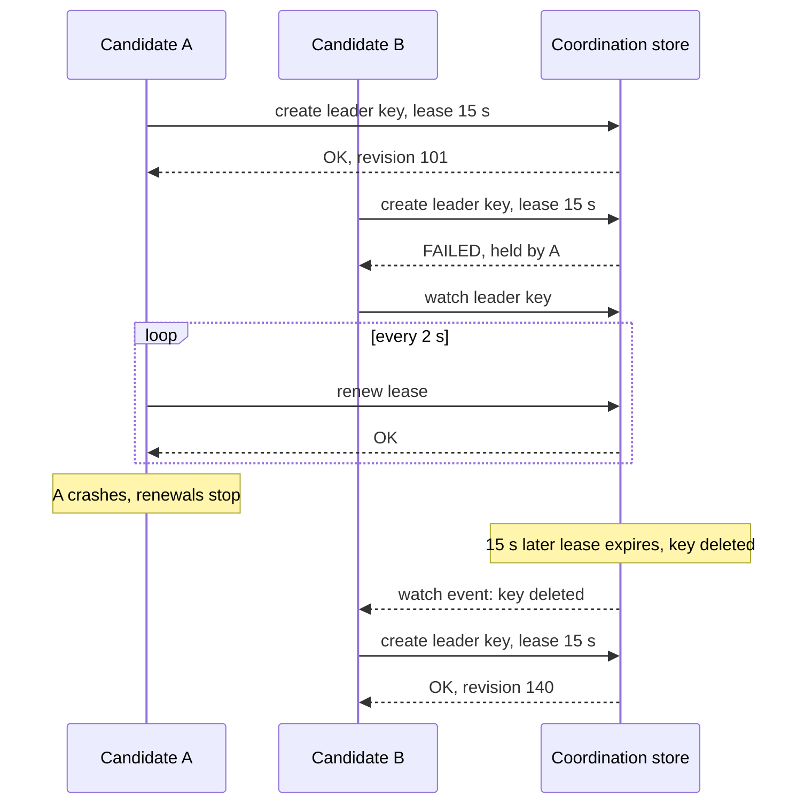

**Reading the diagram.** Both candidates call the coordination store with synchronous RPCs (solid: request; dashed: response). The store is a consensus-backed cluster whose atomic "create if absent" guarantees a single winner. A's lease is renewed every 2 s; when A crashes, nothing deletes the key until the 15 s lease expires. B learns of the expiry through a **watch** (an asynchronous notification it registered earlier) rather than by polling. The revision numbers (101, 140) increase with every write and can serve as fencing tokens (§26.13). Failure points: if A is merely *paused* rather than crashed, it may still believe it is leader after its lease expired; the store cannot reach into A to stop it. Scaling: one store cluster can host thousands of election keys for different services.

### 26.5.2 Why election alone does not give safety

Every algorithm above produces a node that *believes* it is the leader. None of them can make a deposed leader *stop believing it*. The old leader may be partitioned, paused for a garbage collection, or simply slow to notice that its lease expired. During that window there are two self-declared leaders, and if both act on shared state, you have split brain (§26.12).

Safe systems therefore add one of two mechanisms on top of election:

- **Every action is itself checked by a quorum.** In Raft and Paxos, a leader cannot commit anything without a majority acknowledging it *in its current term*. A deposed leader's requests carry an old term, and any majority contains at least one node that has seen the newer term and rejects them. The old leader may *believe* it leads, but it cannot *do* anything.
- **Every action carries an epoch the resource can check.** When the protected resource is outside the consensus group (a database, a file in object storage), the leader must present a monotonically increasing token, and the resource rejects stale ones. This is fencing (§26.13).

::: mistake
**Misconception — "Once we have leader election, only one node acts as leader."** Election guarantees at most one leader *per term or lease epoch* as seen by the election service. It says nothing about what an old leader does with its stale belief. Without quorum-checked actions or fencing, two nodes will eventually act as leader at the same time.
:::

## 26.6 Paxos

Leslie Lamport described Paxos as the legislature of a fictional Greek island whose part-time legislators wander in and out of the chamber [Lamport 1998]. The paper was written around 1990 and published in 1998; its allegory made it famously hard to read, and Lamport later restated the algorithm, beginning: "The Paxos algorithm, when presented in plain English, is very simple" [Lamport 2001]. This section follows that plain-English version.

### 26.6.1 Single-decree Paxos

::: definition
**Definition — Single-decree (basic) Paxos.** A consensus algorithm in which **proposers** suggest values, **acceptors** vote on them and **learners** find out the decided value. A value is **chosen** when a majority of acceptors has accepted it with the same proposal number. Paxos guarantees safety under any message delays, loss or reordering, and makes progress whenever one proposer can run both phases without interference from another.
:::

#### First-principles explanation

Imagine booking a room through five receptionists, each with a paper diary. A rival may be asking a different three at the same moment, so you first present a *ticket number* higher than any they have seen ("promise to ignore lower tickets") and ask whether they have already written a booking. If any has, you must *finish that booking* instead of yours. Only after a majority promises do you ask them to write the booking under your ticket. The first step discovers and protects the past; the second decides.

#### How it works internally

Each acceptor stores, durably: `promised_n` (highest proposal number it promised) and `(accepted_n, accepted_v)` (the last proposal it accepted, if any). Proposal numbers must be unique and totally ordered; the usual construction is a pair `(round, proposer_id)` compared lexicographically, so proposers never collide.

1. **Phase 1a — Prepare.** A proposer picks a proposal number $n$ higher than any it has used and sends `Prepare(n)` to the acceptors.
2. **Phase 1b — Promise.** An acceptor that receives `Prepare(n)` with $n >$ `promised_n` sets `promised_n = n`, writes it to disk, and replies `Promise(n, accepted_n, accepted_v)`. Otherwise it ignores the request or replies with a rejection containing `promised_n` (a useful hint).
3. **Value selection.** If the proposer receives promises from a majority, it looks at the accepted proposals they reported. If any acceptor reported one, the proposer **must** propose the value $v$ of the highest-numbered accepted proposal. Only if none reported anything may it propose its own value.
4. **Phase 2a — Accept.** The proposer sends `Accept(n, v)` to the acceptors.
5. **Phase 2b — Accepted.** An acceptor that receives `Accept(n, v)` with $n \ge$ `promised_n` records `(accepted_n, accepted_v) = (n, v)` durably and replies `Accepted(n, v)` to the proposer and the learners. Otherwise it rejects.
6. **Learning.** When a learner sees `Accepted(n, v)` from a majority for the same $n$, the value $v$ is chosen.

**Figure 26.4 — Single-decree Paxos without contention.**

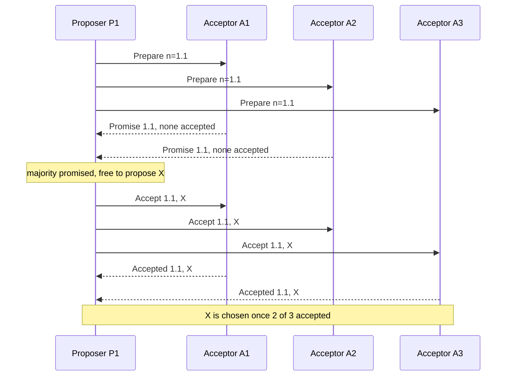

**Reading the diagram.** P1 uses proposal number 1.1 (round 1, proposer 1). All arrows are point-to-point RPCs; each acceptor must persist its promise or acceptance before replying, so every reply implies a disk flush. Two promises out of three form a majority, so P1 does not wait for A3's promise. Because no promise reported an accepted value, P1 may propose its own value X. Two `Accepted` replies (from A1 and A3) form a majority, and X is chosen at that instant, even before anyone knows it. Failure points: one acceptor can fail without blocking progress; if the proposer fails, a later proposer's phase 1 discovers X. Cost: two round trips and two durable writes per value.

#### Why the value-adoption rule makes Paxos safe

Suppose X was chosen with proposal 1.1, meaning a majority accepted it. Any later proposer with number $n > 1.1$ must collect promises from a majority, and that majority intersects the accepting majority (§26.4.1). So at least one promise reports "I accepted (1.1, X)." The adoption rule then forces the new proposer to propose X again. By induction on proposal numbers, every proposal after X was chosen carries X. Lamport's invariant: *if a value $v$ is chosen with number $n$, every higher-numbered proposal issued has value $v$* [Lamport 2001].

Note that a value can be chosen without its proposer knowing (replies lost), and an acceptor may hold an accepted value that is never chosen; neither breaks safety.

#### Dueling proposers

Paxos is safe but not guaranteed to terminate, and the classic way it stalls is two proposers repeatedly pre-empting each other.

**Figure 26.5 — Dueling proposers: safe but not live.**

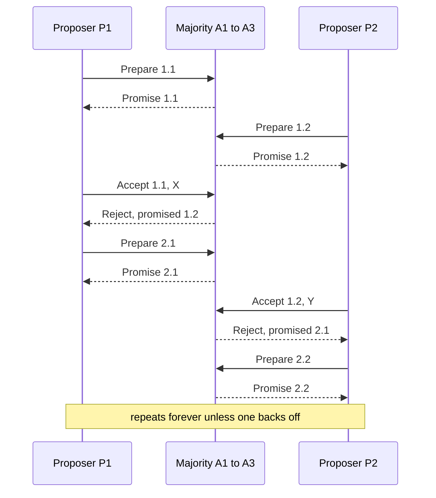

**Reading the diagram.** The acceptors are drawn as one participant to keep the picture readable; each arrow stands for messages to and replies from a majority. P1's prepare (1.1) succeeds, but before its accept arrives, P2's higher prepare (1.2) raises every acceptor's promise, so P1's accept is rejected. P1 retries with 2.1, which in turn invalidates P2's accept, and so on. No value is ever accepted by a majority, so nothing wrong is ever decided, but nothing is decided at all: this is the FLP adversarial schedule (§24.13) made concrete. The fixes are liveness mechanisms only: randomized back-off before retrying, and above all a single **distinguished proposer** (leader) chosen by a failure detector, which is exactly what Multi-Paxos and Raft provide.

### 26.6.2 Multi-Paxos

Running two round trips per log slot is expensive. **Multi-Paxos** observes that phase 1 does not depend on the value, so a stable leader can run phase 1 *once* for all future slots: `Prepare(n)` for "slot $i$ and every slot after it." Each acceptor's promise covers all those slots and reports any values it accepted in them. From then on, each new command needs only phase 2: one round trip and one durable write, the same cost as Raft's AppendEntries.

**Figure 26.6 — Multi-Paxos: phase 1 once, then one round trip per command.**

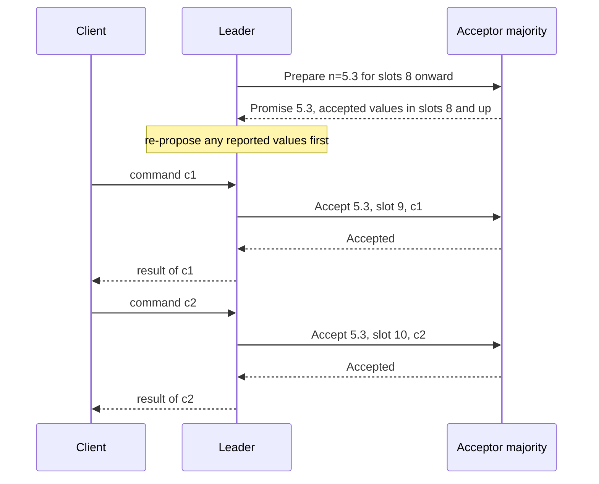

**Reading the diagram.** After becoming leader with number 5.3, the leader prepares every slot from 8 onward in one exchange (synchronous RPC to a majority). Promises report values already accepted in those slots; here slot 8 had one, so the leader re-proposes it before using new slots. Each client command then costs one `Accept`/`Accepted` round trip to a majority plus a durable write on each acceptor. The leader applies commands to its state machine in slot order and replies. Failure points: if the leader fails, another node runs phase 1 with a higher number and must fill any **gaps**, slots that were never chosen, with a no-op. Scaling: throughput is improved by batching many commands into one slot and pipelining several slots in flight.

#### Paxos in production

Google's **Paxos Made Live** is the best antidote to the idea that knowing the algorithm is enough [Chandra, Griesemer and Redstone 2007]. Building Chubby's replicated log needed additions the papers did not specify: master leases for local reads, epoch numbers to detect leader changes mid-operation, disk-corruption handling (a replica that lost its state must not vote as if it remembered its promises), snapshots, membership changes and extensive randomized testing. The authors conclude that there are significant gaps between the algorithm's description and a real system's needs.

::: industry
**Google Chubby's replicated log.** Problem: a lock service for thousands of machines that must survive replica failures. Architecture: five replicas per cell running Multi-Paxos with a leader ("master") holding a lease; the replicated log stores the lock-service database. Why chosen: safety without timing assumptions. Trade-off: most engineering effort went outside the core algorithm.
*Evidence: Primary* — [Chandra, Griesemer and Redstone 2007]; [Burrows 2006]
:::

**Table 26.2 — Paxos family vocabulary mapped to Raft.**

| Concept | Paxos / Multi-Paxos | Raft | ZAB |
|---|---|---|---|
| Leader identity epoch | Proposal number (round, id) | Term | Epoch (high 32 bits of zxid) |
| Phase 1 | Prepare / Promise | RequestVote (plus log check) | Discovery and synchronization |
| Phase 2 | Accept / Accepted | AppendEntries | Proposal / Ack / Commit |
| Log position | Slot (may have gaps) | Index (no gaps) | Counter (low 32 bits of zxid) |
| Who can become leader | Anyone; must learn and adopt prior values | Only a node with an up-to-date log | Node with the highest zxid, then synchronizes followers |

## 26.7 Raft

Raft was designed by Diego Ongaro and John Ousterhout with **understandability** as its primary goal [Ongaro and Ousterhout 2014]. It solves the same problem as Multi-Paxos with equivalent fault tolerance and performance, but it decomposes consensus into three nearly independent problems (leader election, log replication and safety) and removes freedoms Paxos allows, such as gaps in the log or a leader with a stale log. Raft is now the most widely implemented consensus algorithm: etcd, Consul, CockroachDB, TiKV, HashiCorp Vault's integrated storage and Kafka's KRaft (Chapter 31) all use it or close variants. Ongaro's PhD thesis extends the paper with membership changes, log compaction, client interaction and read optimizations [Ongaro 2014].

### 26.7.1 Terms, roles and state

::: definition
**Definition — Raft term.** A logical clock that divides time into consecutive, numbered periods. Each term begins with an election; if a candidate wins, it is the **leader** for the rest of the term, and there is at most one leader per term. Every RPC carries the sender's term; a node that sees a higher term immediately adopts it and becomes a follower; a request with a lower term is rejected.
:::

Every node is in one of three roles: **follower** (passive; answers RPCs), **candidate** (seeking votes) or **leader** (handles all client writes and replicates the log). Each node persists `currentTerm`, `votedFor` (the candidate it voted for in this term, if any) and its log, and must flush them to disk *before* replying to any RPC that changed them. Volatile state includes `commitIndex` (highest entry known committed) and `lastApplied`; leaders also keep `nextIndex[]` and `matchIndex[]` per follower.

**Figure 26.7 — Raft role transitions.**

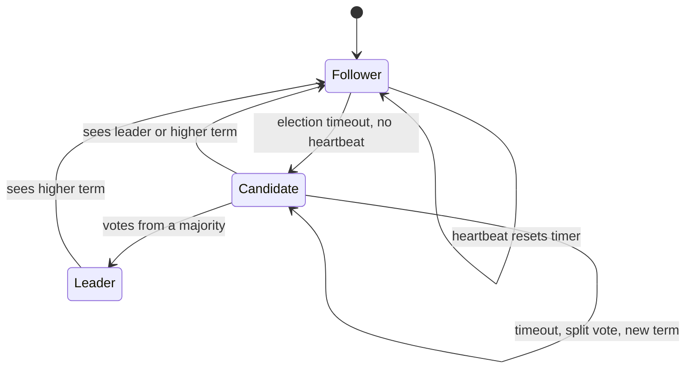

**Reading the diagram.** Every node starts as a follower. A follower that hears nothing from a leader for its randomized election timeout increments its term and becomes a candidate. A candidate becomes leader with votes from a majority, returns to follower if it receives an AppendEntries from a legitimate leader of its term or any message with a higher term, and starts a new election (with a new term) if its timeout expires first, typically after a split vote. A leader steps down only when it sees a higher term. All transitions are local decisions made from messages and timers; there is no central coordinator. Failure point: a leader that is partitioned away stays leader in its own view, but cannot commit anything, and steps down as soon as it hears the higher term.

### 26.7.2 Leader election

1. A follower's election timer expires. It increments `currentTerm`, votes for itself, persists both, and sends `RequestVote(term, candidateId, lastLogIndex, lastLogTerm)` to all peers.
2. A node grants its vote if the candidate's term is at least its own, it has not voted for someone else in this term, and the **candidate's log is at least as up-to-date** as its own: the candidate's last entry has a higher term, or the same term and an index at least as large. Each node votes for at most one candidate per term, first come, first served.
3. A candidate with votes from a majority becomes leader and immediately sends empty `AppendEntries` heartbeats to assert authority.
4. If two candidates split the vote, both time out and retry in a higher term. Raft makes this rare by drawing each timeout at random, for example uniformly from 150–300 ms, the range the paper recommends [Ongaro and Ousterhout 2014].

Raft's timing requirement is $\text{broadcastTime} \ll \text{electionTimeout} \ll \text{MTBF}$: heartbeats must arrive well within the timeout, or followers start needless elections; the timeout must be far shorter than the mean time between failures, or the system spends a noticeable share of its life leaderless.

::: formula
**Raft election timing and expected failover time**

$$h \approx \mathrm{RTT}_{\text{typ}}, \qquad T_{\min} \ge 10 \times \mathrm{RTT}_{\text{typ}}, \qquad T_{\text{failover}} \approx T_{\min} + \frac{W}{n+1} - \frac{h}{2} + \mathrm{RTT} + t_{\text{fsync}}$$

| Symbol | Meaning | Units |
|---|---|---|
| $h$ | Heartbeat interval | ms |
| $\mathrm{RTT}_{\text{typ}}$ | Typical round-trip time between members | ms |
| $T_{\min}$, $W$ | Election timeout is drawn uniformly from $[T_{\min}, T_{\min} + W]$ | ms |
| $n$ | Followers still alive after the leader fails | nodes |
| $T_{\text{failover}}$ | Expected time from leader crash to a new leader | ms |
:::

The heartbeat and 10× rules are the etcd tuning guidance [etcd Docs: Tuning]. The failover estimate adds three pieces: the earliest of $n$ uniform timers fires on average $W/(n+1)$ after $T_{\min}$; timers were last reset by a heartbeat on average $h/2$ before the crash; and the winner then needs one vote round trip with a disk flush.

::: example
**Worked example — two deployments.**

1. *Single data center*, RTT about 0.5 ms, Raft-paper settings: $h = 50$ ms, $T_{\min} = 150$ ms, $W = 150$ ms, 5 nodes so $n = 4$ survivors. $T_{\text{failover}} \approx 150 + 150/5 - 50/2 + 0.5 + 1 = 150 + 30 - 25 + 1.5 = 156.5$ ms.
2. *Cross-region*, RTT 70 ms: $h = 100$ ms (etcd's default), and $T_{\min} \ge 10 \times 70 = 700$ ms, so keep etcd's default of 1,000 ms; etcd's Raft library randomizes over $[T, 2T)$, so $W = 1{,}000$ ms. $T_{\text{failover}} \approx 1{,}000 + 1{,}000/5 - 50 + 70 + 1 = 1{,}221$ ms.

**Interpretation.** The simulator in §26.7.7, which uses the first deployment's settings, measures a median failover of 155 ms over 200 seeded runs, matching the estimate. **Engineering implication.** Failover time is dominated by the election timeout, which must grow with network RTT. Lowering it below about 10 RTTs trades faster failover for spurious elections whenever a p99.9 network hiccup or GC pause delays heartbeats.
:::

Randomization does not eliminate competing candidates; it makes them unlikely.

::: formula
**Probability that a second candidate starts before the first's votes arrive**

$$P_{\text{contend}} = 1 - \left(1 - \frac{\delta}{W}\right)^{n}$$

| Symbol | Meaning | Units |
|---|---|---|
| $\delta$ | Time for the first candidate's RequestVote to reach the others (one-way delay plus flush) | ms |
| $W$ | Width of the randomized timeout range | ms |
| $n$ | Number of followers whose timers are running | nodes |
| $P_{\text{contend}}$ | Probability that the gap between the first two timeouts is below $\delta$ | dimensionless |
:::

::: example
**Worked example — choosing the randomization width.** With $n = 4$ and $\delta = 10$ ms:

1. $W = 150$ ms: $1 - (1 - 10/150)^4 = 1 - 0.9333^4 = 1 - 0.7588 = 0.241$.
2. $W = 1{,}000$ ms: $1 - 0.99^4 = 1 - 0.9606 = 0.039$.
3. $W = 150$ ms but $\delta = 2$ ms (fast LAN, NVMe flush): $1 - 0.98667^4 = 0.052$.

**Interpretation.** This is an upper bound on split votes: contention does not always split the vote, because one candidate may still reach a majority first. **Engineering implication.** Keep $W$ at least an order of magnitude above $\delta$. A 200,000-trial Monte Carlo check of the first case gives 0.241, matching the formula.
:::

### 26.7.3 Log replication

Once elected, the leader accepts client commands, appends each as a new log entry `(term, index, command)`, and replicates it with `AppendEntries(term, leaderId, prevLogIndex, prevLogTerm, entries[], leaderCommit)`. Heartbeats are simply AppendEntries with no entries.

**Figure 26.8 — Replicating and committing one entry.**

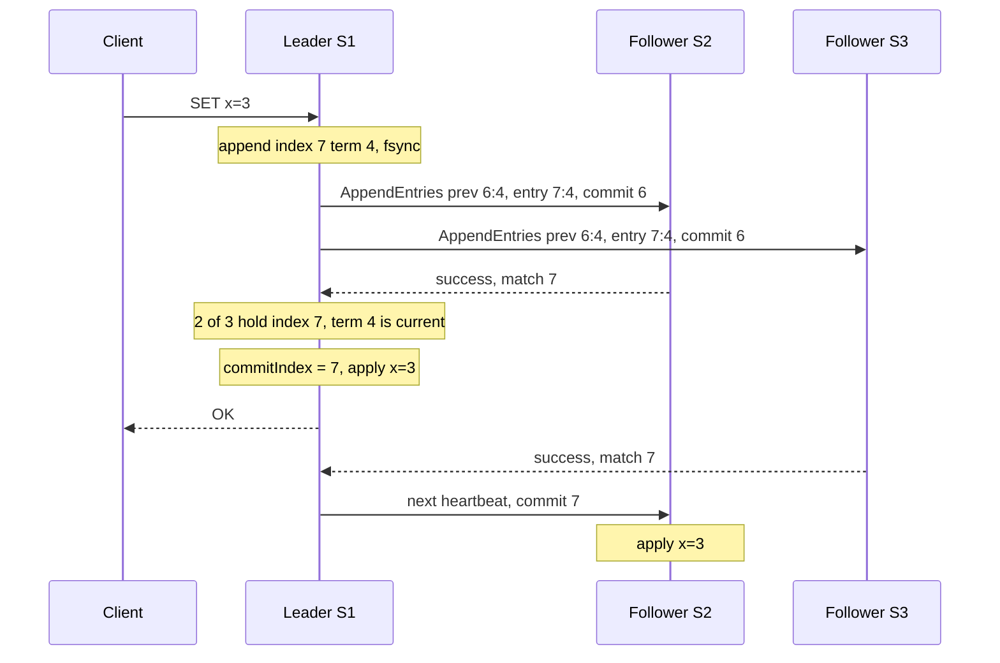

**Reading the diagram.** The client's write goes synchronously to the leader, which appends entry 7 (term 4) and flushes it. AppendEntries carries `prev 6:4`: "my entry before this one is index 6 with term 4"; a follower accepts only if its own log has that entry. As soon as one follower plus the leader (a majority of three) hold the entry, the leader advances `commitIndex`, applies the command and answers the client; S3's slower reply is not needed. Followers learn the new commit index on the next AppendEntries or heartbeat (asynchronous with respect to the client) and apply the entry then. Storage boundary: every node's log is on its own disk. Failure points: if the leader crashes after committing but before replying, the client must retry, so commands should be idempotent or deduplicated by client ID and sequence number (§22.15). Scaling: leaders batch many commands per AppendEntries and pipeline requests without waiting for replies.

### 26.7.4 The log matching property

::: definition
**Definition — Log matching property.** If two logs contain an entry with the same index and term, then (1) the entries store the same command, and (2) the logs are identical in all preceding entries.
:::

Part (1) holds because a leader creates at most one entry per index in its term and never changes it. Part (2) is enforced inductively by the **consistency check**: a follower accepts AppendEntries only if it has an entry matching `(prevLogIndex, prevLogTerm)`. When the check fails, the leader decrements `nextIndex` for that follower and retries until they find the last point of agreement; the follower then deletes everything after that point and appends the leader's entries. The leader never deletes or overwrites its own entries (**leader append-only**).

**Figure 26.9 — Repairing a divergent follower log.**

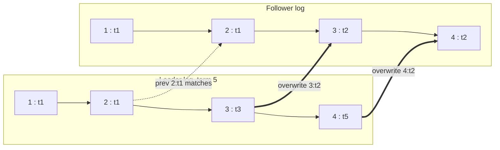

**Reading the diagram.** Each box is a log entry labeled `index : term`. The follower holds entries 3 and 4 from term 2 that were never committed (a term-2 leader wrote them and crashed). The leader first sends AppendEntries with `prev 4:t5`; the follower has no such entry, so it fails; the leader backs off to `prev 3:t3` (fails) and then `prev 2:t1` (dotted arrow: the consistency check succeeds). The follower then truncates after index 2 and accepts the leader's entries 3 and 4 (thick arrows). Data flows only from leader to follower. Failure point: a follower that has been offline for a long time costs many round trips if the leader backs off one entry at a time; real implementations let the follower return its conflicting term and the first index of that term so the leader skips a whole term per round trip, or send a snapshot (§26.7.8).

### 26.7.5 The commit rule and the "current term only" subtlety

A leader marks an entry committed when it is stored on a majority, **but only if the entry is from the leader's current term**. Entries from earlier terms are never committed by counting replicas; they become committed *indirectly* when a later current-term entry after them commits, by the log matching property. This is the scenario in Figure 8 of the Raft paper.

**Figure 26.10 — Why a leader must not commit old-term entries by counting replicas.**

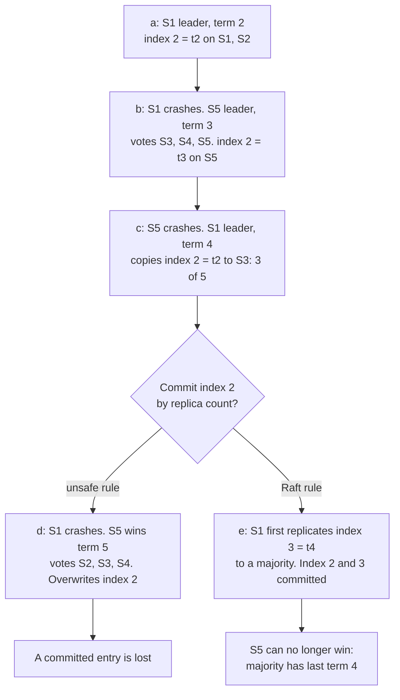

**Reading the diagram.** Read top to bottom. In (c), the term-2 entry at index 2 sits on a majority (S1, S2, S3), so a naive leader would call it committed. But S5's log ends with a term-3 entry, which is "more up-to-date" than term 2, so in (d) S5 can collect votes from S2, S3 and S4 and overwrite index 2 everywhere: the "committed" entry vanishes. Under Raft's rule (e), S1 must first get an entry of its own term 4 onto a majority. Those nodes now have last term 4, will refuse to vote for S5, and index 2 is committed safely as a prefix of index 3. The practical consequence is that a new leader immediately appends a **no-op entry** in its term so that earlier entries commit promptly; the simulator in §26.7.7 does exactly that.

### 26.7.6 Why Raft is safe

The core guarantee is **state machine safety**: if any node has applied a log entry at index $i$, no node ever applies a different entry at $i$. It follows from a chain of properties [Ongaro and Ousterhout 2014]:

1. **Election safety.** At most one leader per term, because each node votes once per term and two majorities intersect.
2. **Leader append-only** and **log matching** (§26.7.4).
3. **Leader completeness.** If an entry is committed in term $T$, it is present in the logs of all leaders of terms greater than $T$. Sketch: the entry is on a majority $M_1$; a later winner received votes from a majority $M_2$; some voter is in both; that voter only votes for a candidate whose log is at least as up-to-date as its own; with the current-term commit rule, "at least as up-to-date" implies the candidate's log contains the entry.
4. Since every future leader contains every committed entry, and followers only take entries from leaders, nodes apply the same entry at each index.

The thesis includes a formal proof of the single-node algorithm, and the authors model-checked a TLA+ specification [Ongaro 2014].

### 26.7.7 A runnable Raft simulator

The program below implements Raft's election and replication rules in a deterministic, tick-based simulation of five nodes. Messages take 2–8 ms, timeouts are drawn from 150–300 ms, heartbeats are sent every 50 ms (new entries ride on the next heartbeat), and a seeded random generator makes every run reproducible. It omits snapshots, membership changes and client sessions.

```python
"""A simplified, deterministic Raft simulator: leader election + log replication.

Time advances in 1 ms ticks. Messages take 2-8 ms. Nodes can crash and restart
(persistent state survives a crash; volatile state does not). Not production code:
no snapshots, no membership changes, no client sessions.
"""
import random

HEARTBEAT_MS = 50
ELECTION_MIN_MS, ELECTION_MAX_MS = 150, 300


class Node:
    def __init__(self, nid, peers, rng):
        self.id, self.peers, self.rng = nid, peers, rng
        # Persistent state (survives crashes)
        self.term, self.voted_for, self.log = 0, None, []   # log entries: (term, command)
        self.up = True
        self.reset_volatile(now=0)

    def reset_volatile(self, now):
        self.role, self.commit, self.votes = "follower", 0, set()
        self.next_idx, self.match_idx = {}, {}
        self.reset_election_timer(now)

    def reset_election_timer(self, now):
        self.deadline = now + self.rng.randint(ELECTION_MIN_MS, ELECTION_MAX_MS)

    def last_index(self):
        return len(self.log)

    def term_at(self, index):          # log indices are 1-based; index 0 has term 0
        return self.log[index - 1][0] if index > 0 else 0


class Cluster:
    def __init__(self, n=5, seed=7):
        self.rng = random.Random(seed)
        ids = list(range(1, n + 1))
        self.nodes = {i: Node(i, [p for p in ids if p != i], self.rng) for i in ids}
        self.inbox, self.now = [], 0                      # (deliver_at, dst, msg)

    def log_event(self, text):
        print(f"t={self.now:5d} ms  {text}")

    def send(self, src, dst, msg):
        msg["src"] = src
        self.inbox.append((self.now + self.rng.randint(2, 8), dst, msg))

    # ---------------- message handlers ----------------
    def step_down_if_stale(self, n, term):
        if term > n.term:
            n.term, n.voted_for, n.role = term, None, "follower"

    def handle(self, n, m):
        self.step_down_if_stale(n, m["term"])
        kind = m["type"]
        if kind == "RequestVote":
            up_to_date = (m["last_term"], m["last_index"]) >= (n.term_at(n.last_index()), n.last_index())
            grant = (m["term"] == n.term and n.voted_for in (None, m["src"]) and up_to_date)
            if grant:
                n.voted_for = m["src"]
                n.reset_election_timer(self.now)
            self.send(n.id, m["src"], {"type": "Vote", "term": n.term, "granted": grant})
        elif kind == "Vote" and n.role == "candidate" and m["term"] == n.term and m["granted"]:
            n.votes.add(m["src"])
            if len(n.votes) > (len(n.peers) + 1) // 2:
                self.become_leader(n)
        elif kind == "AppendEntries":
            ok = False
            if m["term"] == n.term:
                n.role = "follower"
                n.reset_election_timer(self.now)
                prev = m["prev_index"]
                if prev <= n.last_index() and n.term_at(prev) == m["prev_term"]:
                    ok = True
                    for k, entry in enumerate(m["entries"]):       # log matching: fix conflicts
                        idx = prev + 1 + k
                        if idx <= n.last_index() and n.term_at(idx) != entry[0]:
                            del n.log[idx - 1:]
                        if idx > n.last_index():
                            n.log.append(entry)
                    n.commit = max(n.commit, min(m["commit"], prev + len(m["entries"])))
            self.send(n.id, m["src"], {"type": "AppendReply", "term": n.term, "ok": ok,
                                       "match": m["prev_index"] + len(m["entries"])})
        elif kind == "AppendReply" and n.role == "leader" and m["term"] == n.term:
            p = m["src"]
            if m["ok"]:
                n.match_idx[p] = max(n.match_idx[p], m["match"])
                n.next_idx[p] = n.match_idx[p] + 1
                self.advance_commit(n)
            else:
                n.next_idx[p] = max(1, n.next_idx[p] - 1)          # back up and retry

    # ---------------- leader logic ----------------
    def become_leader(self, n):
        n.role = "leader"
        n.next_idx = {p: n.last_index() + 1 for p in n.peers}
        n.match_idx = {p: 0 for p in n.peers}
        self.log_event(f"n{n.id} becomes LEADER for term {n.term} (votes from {sorted(n.votes)})")
        n.log.append((n.term, "no-op"))                            # commit something in our term
        n.hb_due = self.now

    def advance_commit(self, n):
        for idx in range(n.last_index(), n.commit, -1):
            replicas = 1 + sum(1 for p in n.peers if n.match_idx[p] >= idx)
            # Commit rule: majority AND entry from the current term (Raft paper, Figure 8)
            if replicas > (len(n.peers) + 1) // 2 and n.term_at(idx) == n.term:
                self.log_event(f"n{n.id} commits up to index {idx} (on {replicas} nodes)")
                n.commit = idx
                break

    def replicate(self, n):
        for p in n.peers:
            prev = n.next_idx[p] - 1
            self.send(n.id, p, {"type": "AppendEntries", "term": n.term, "prev_index": prev,
                                "prev_term": n.term_at(prev), "entries": n.log[prev:],
                                "commit": n.commit})

    def client_write(self, command):
        leader = next((n for n in self.nodes.values() if n.up and n.role == "leader"), None)
        if leader is None:
            self.log_event(f"client write {command!r} rejected: no leader")
            return
        leader.log.append((leader.term, command))
        self.log_event(f"client write {command!r} -> leader n{leader.id} at index {leader.last_index()}")

    # ---------------- main loop ----------------
    def tick(self):
        self.now += 1
        due = [x for x in self.inbox if x[0] <= self.now]
        self.inbox = [x for x in self.inbox if x[0] > self.now]
        for _, dst, msg in sorted(due, key=lambda x: (x[0], x[1])):
            if self.nodes[dst].up and self.nodes[msg["src"]].up:   # crashed nodes drop traffic
                self.handle(self.nodes[dst], msg)
        for n in self.nodes.values():
            if not n.up:
                continue
            if n.role == "leader" and self.now >= n.hb_due:
                self.replicate(n)
                n.hb_due = self.now + HEARTBEAT_MS
            elif n.role != "leader" and self.now >= n.deadline:
                n.role, n.term, n.voted_for, n.votes = "candidate", n.term + 1, n.id, {n.id}
                n.reset_election_timer(self.now)
                self.log_event(f"n{n.id} times out, starts election for term {n.term}")
                for p in n.peers:
                    self.send(n.id, p, {"type": "RequestVote", "term": n.term,
                                        "last_index": n.last_index(),
                                        "last_term": n.term_at(n.last_index())})

    def run_until(self, t):
        while self.now < t:
            self.tick()

    def crash(self, nid):
        self.nodes[nid].up = False
        self.log_event(f"n{nid} CRASHES")

    def restart(self, nid):
        n = self.nodes[nid]
        n.up = True
        n.reset_volatile(self.now)
        self.log_event(f"n{nid} restarts as follower (term {n.term}, log length {n.last_index()})")


def check_safety(cluster):
    """State machine safety: committed prefixes on all nodes must agree."""
    committed = [n.log[:n.commit] for n in cluster.nodes.values()]
    longest = max(committed, key=len)
    return all(c == longest[:len(c)] for c in committed)


def failover_experiment(runs=200):
    """Crash the leader in many seeded runs; measure failover time and check safety."""
    import contextlib, io
    times, violations = [], 0
    for seed in range(1, runs + 1):
        with contextlib.redirect_stdout(io.StringIO()):          # silence per-run events
            c = Cluster(n=5, seed=seed)
            c.run_until(400)
            for k in range(6):
                c.client_write(f"op{k}")
                c.run_until(c.now + 60)
            old = next(n for n in c.nodes.values() if n.role == "leader")
            crashed_at = c.now
            c.crash(old.id)
            while not any(n.up and n.role == "leader" for n in c.nodes.values()):
                c.tick()
            times.append(c.now - crashed_at)
            c.run_until(c.now + 300)
            c.restart(old.id)
            c.run_until(c.now + 400)
        violations += not check_safety(c)
    times.sort()
    print(f"{runs} seeded runs: safety violations={violations}, failover ms: "
          f"median={times[runs // 2]}, p95={times[int(runs * 0.95)]}, max={times[-1]}")


if __name__ == "__main__":
    c = Cluster(n=5, seed=7)
    c.run_until(400)
    for cmd in ["x=1", "y=2"]:
        c.client_write(cmd)
    c.run_until(500)
    old = next(n.id for n in c.nodes.values() if n.role == "leader")
    c.crash(old)
    c.run_until(900)
    c.client_write("x=3")
    c.run_until(1000)
    c.restart(old)
    c.run_until(1200)
    print()
    for n in c.nodes.values():
        print(f"n{n.id} {n.role:9s} term={n.term} commit={n.commit} "
              f"log={[f'{t}:{cmd}' for t, cmd in n.log]}")
    print("state machine safety holds:", check_safety(c))
    failover_experiment()
```

Running it prints the following (deterministic for seed 7):

```text
t=  162 ms  n4 times out, starts election for term 1
t=  167 ms  n4 becomes LEADER for term 1 (votes from [1, 4, 5])
t=  172 ms  n4 commits up to index 1 (on 3 nodes)
t=  400 ms  client write 'x=1' -> leader n4 at index 2
t=  400 ms  client write 'y=2' -> leader n4 at index 3
t=  426 ms  n4 commits up to index 3 (on 3 nodes)
t=  500 ms  n4 CRASHES
t=  638 ms  n3 times out, starts election for term 2
t=  648 ms  n3 becomes LEADER for term 2 (votes from [2, 3, 5])
t=  662 ms  n3 commits up to index 4 (on 3 nodes)
t=  900 ms  client write 'x=3' -> leader n3 at index 5
t=  956 ms  n3 commits up to index 5 (on 3 nodes)
t= 1000 ms  n4 restarts as follower (term 1, log length 3)

n1 follower  term=2 commit=5 log=['1:no-op', '1:x=1', '1:y=2', '2:no-op', '2:x=3']
n2 follower  term=2 commit=5 log=['1:no-op', '1:x=1', '1:y=2', '2:no-op', '2:x=3']
n3 leader    term=2 commit=5 log=['1:no-op', '1:x=1', '1:y=2', '2:no-op', '2:x=3']
n4 follower  term=2 commit=5 log=['1:no-op', '1:x=1', '1:y=2', '2:no-op', '2:x=3']
n5 follower  term=2 commit=5 log=['1:no-op', '1:x=1', '1:y=2', '2:no-op', '2:x=3']
state machine safety holds: True
200 seeded runs: safety violations=0, failover ms: median=155, p95=276, max=360
```

What to notice:

- **Persistent versus volatile state.** `term`, `voted_for` and `log` survive `crash()`; `reset_volatile` wipes role, commit index and leader bookkeeping, as a real restart would. n4 rejoins with term 1, adopts term 2 from the first message it sees, and is brought up to date by the consistency check.
- **The up-to-date check** is one tuple comparison, `(last_term, last_index) >= (...)`, which compares terms first and indices second.
- **The commit rule** in `advance_commit` requires both a majority and `term_at(idx) == n.term`; each new leader appends a `no-op` so earlier entries commit through it (index 4 commits indices 1–4 for n3).
- **Writes wait for the next heartbeat** (400 ms write, 426 ms commit), a simplification; real leaders send AppendEntries immediately and batch.
- **Failover statistics** (median 155 ms) match the formula in §26.7.2. Change `ELECTION_MIN_MS` or the message delays and rerun to see the trade-offs.

### 26.7.8 Snapshots and log compaction

A log that grows forever exhausts disk and makes restarts replay hours of history. Each node independently takes a **snapshot** of its state machine at some applied index, records the `lastIncludedIndex` and `lastIncludedTerm` (needed for the consistency check of the next entry), and discards the log prefix. When a follower is so far behind that the leader has already discarded the entries it needs, the leader sends **InstallSnapshot** chunks instead of AppendEntries. Snapshotting must not block the state machine for long: implementations use copy-on-write structures or the storage engine's own consistent snapshot (etcd snapshots its bbolt database; CockroachDB and TiKV ship RocksDB-family SST files). Snapshot frequency is a trade-off between disk space and the cost of each snapshot; etcd, for example, triggers one after a configurable number of applied entries.

### 26.7.9 Membership changes

Replacing a failed node or growing from 3 to 5 voters changes the quorum definition, and switching all nodes at once is unsafe: during the transition some nodes may count majorities of the old configuration and others of the new, and two disjoint majorities could elect two leaders in the same term.

- **Joint consensus** (Raft paper). The leader first commits a configuration entry $C_{\text{old,new}}$; while it is in effect, every election and every commit needs a majority of $C_{\text{old}}$ *and* a majority of $C_{\text{new}}$. Once $C_{\text{old,new}}$ is committed, the leader commits $C_{\text{new}}$. Any change, including replacing several nodes at once, is safe.
- **Single-server changes** (thesis). If you add or remove only *one* voter at a time, every majority of the old configuration intersects every majority of the new one, so no joint phase is needed. Each configuration takes effect as soon as it is appended (not committed), and only one change may be in progress. In 2015 Ongaro reported a bug in the original single-server description that could lose a committed entry when changes overlapped with leader changes; the fix is that a new leader must commit an entry in its own term (the same no-op as in §26.7.5) before starting a membership change.

Production systems add **learners** (non-voting members in etcd, observers in ZooKeeper): a new node first catches up as a learner, which does not affect the quorum, and is promoted to voter only when its log is current. Without this, adding an empty node to a 3-node cluster (making it 4, quorum 3) means one slow catch-up plus one unrelated failure blocks all writes.

### 26.7.10 Linearizable reads: ReadIndex and lease reads

Serving a read from the leader's local state is *not* automatically linearizable (§25.3): a leader that has been partitioned may not yet know it was replaced, and could return a value that the new leader has already overwritten. Three remedies exist [Ongaro 2014]:

1. **Log reads.** Append the read to the log like a write. Correct, but costs a disk write per read.
2. **ReadIndex.** The leader records its current `commitIndex` as the read index, confirms it is still leader by exchanging a heartbeat round with a majority, waits until its state machine has applied up to the read index, then answers locally. Cost: one round trip, no disk write. Followers can serve reads the same way by asking the leader for a read index. A new leader must first commit its no-op entry, or its `commitIndex` may be stale.
3. **Lease reads.** After a successful heartbeat round started at time $t$, the leader assumes no other leader can exist before $t + T_{\min}$ (followers will not start an election sooner), shortened by a clock-drift margin. Within that window it answers reads with no network round trip. This trades a timing assumption for latency: a long pause on the leader, or clock rates that differ more than the margin, can return stale data.

**Figure 26.11 — ReadIndex: linearizable reads without writing to the log.**

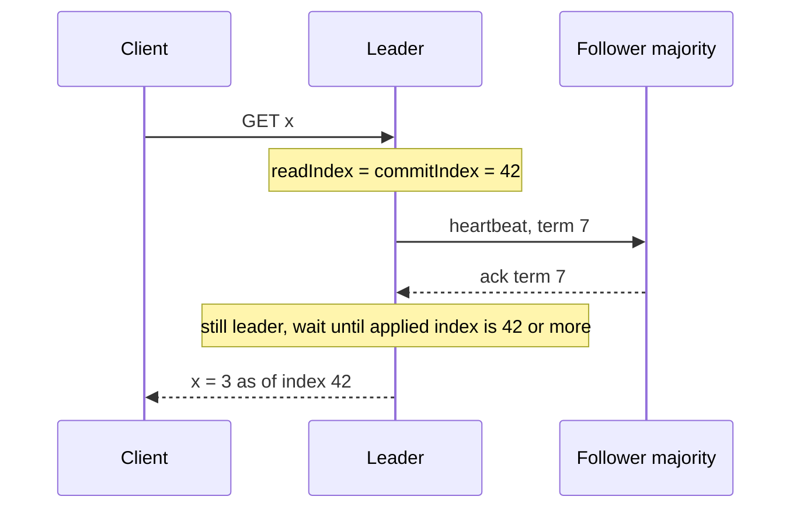

**Reading the diagram.** The read arrives at the leader, which notes the commit index (42) at that instant. The heartbeat round (synchronous, to a majority) proves no newer leader existed when the read started: if one had been elected, a majority would have a higher term and reject the heartbeat. The leader then waits for its state machine to apply index 42, guaranteeing the read reflects every write committed before it began, and replies from local memory. Storage boundary: nothing is written to disk. Failure point: if the heartbeat round fails, the leader aborts the read rather than risk staleness. Scaling: one heartbeat round can confirm leadership for a whole batch of pending reads.

etcd uses ReadIndex for its default linearizable reads and also offers **serializable** reads, served from any member's local state without a round trip, which may be stale [etcd Docs: API guarantees].

#### Failure scenarios

**Table 26.3 — Raft failure scenarios.**

| What goes wrong | Why | Detection | Recovery | Prevention |
|---|---|---|---|---|
| Repeated elections, no stable leader | Timeout below network or GC jitter; disk `fsync` stalls delay heartbeats | Term number climbing; leader-change metrics | Raise election timeout; move logs to fast dedicated disks | Size timeouts from p99.9 RTT and flush latency (§26.7.2) |
| Disruptive rejoining node | A partitioned node kept incrementing its term and forces the leader to step down when it returns | Term jumps after a partition heals | Automatic, after an extra election | **Pre-vote** [Ongaro 2014] plus **check quorum**: a node only becomes a candidate if a majority would vote for it |
| Writes blocked | Quorum lost (2 of 3 nodes down, or a 3-node cluster split 1/1/1 by zones) | Commit index stops advancing | Restore nodes; if a majority is permanently lost, rebuild from a backup or a forced single-node restart, accepting possible loss | 5 voters across 3 zones; learners for catch-up |
| Stale reads | Reads served locally by a deposed leader or follower | Jepsen-style tests (§25.11) | Switch to ReadIndex | Use ReadIndex or lease reads with a conservative margin |
| Data loss after crash | Vote or entry acknowledged before `fsync` | Divergent committed logs | Rebuild the replica from peers | Never disable `fsync`; check disks with checksums |

## 26.8 ZooKeeper and ZAB

### 26.8.1 The coordination-kernel idea

::: definition
**Definition — ZooKeeper.** A replicated coordination service that exposes a small, file-system-like tree of data nodes (**znodes**) with linearizable writes, FIFO per-client ordering, ephemeral and sequential nodes, and change notifications (**watches**). Applications build locks, leader election, barriers and configuration management on top of these primitives [Hunt et al. 2010].
:::

Before ZooKeeper (developed at Yahoo! and later an Apache project), each distributed system wrote its own election and membership code, usually with bugs. ZooKeeper's designers chose not to offer locks directly. Instead they offered a **wait-free** API (no operation blocks waiting on another client) from which clients compose **recipes**. The paper's title, *Wait-free coordination for Internet-scale systems*, states the philosophy.

#### How it works internally

- **Znodes.** Each holds a small blob of data (the default limit is about 1 MB; coordination data should be bytes to kilobytes) plus a version number used for conditional updates (`setData(path, data, expectedVersion)`).
- **Ephemeral znodes** exist only while the client **session** that created them is alive. A session is kept alive by heartbeats; if the server ensemble hears nothing for the session timeout, it expires the session and deletes its ephemeral nodes. This is ZooKeeper's failure detector.
- **Sequential znodes** get a monotonically increasing 10-digit suffix from their parent, for example `lock-0000000007`, giving a total order among competing clients.
- **Watches** are one-time triggers set by a read (`getData`, `exists`, `getChildren`); the server sends one notification when the node changes, and the client must re-read and re-arm. Version 3.6 added persistent and recursive watches.
- **Ordering guarantees.** All writes are linearizable and go through the leader. Reads are served by whichever server the client is connected to, from its local replica, so they are fast but may be stale; a client that needs the latest value calls `sync()` before reading. Each client's operations execute in the order it issued them, and a client sees a watch notification before it sees the data that triggered it.
- **Observers** are non-voting servers that receive committed updates and serve reads, adding read capacity without slowing writes.

### 26.8.2 ZAB: ZooKeeper Atomic Broadcast

ZooKeeper replicates its tree with **ZAB**, an atomic broadcast protocol designed for primary–backup systems [Junqueira, Reed and Serafini 2011]. Each update is a state change produced by the leader (not the client's original request), labeled with a 64-bit **zxid**: the high 32 bits are the leader's **epoch**, the low 32 bits a counter. In the broadcast phase the leader sends a proposal, followers write it to disk and acknowledge, and the leader commits once a quorum has acknowledged, much like Raft's AppendEntries. After a leader failure, ZAB runs **discovery** (the new leader learns the latest epoch and history from a quorum) and **synchronization** (it brings followers to its history) before broadcasting again. ZAB's distinguishing guarantee is **primary order**: all of a leader's changes are delivered in order, and a new leader's changes come after every change from previous leaders that was delivered. ZooKeeper's paper reports that read-dominated workloads reach tens to hundreds of thousands of operations per second [Hunt et al. 2010].

### 26.8.3 Recipes: leader election, locks and barriers

**Figure 26.12 — The ZooKeeper lock recipe with sequential ephemeral znodes.**

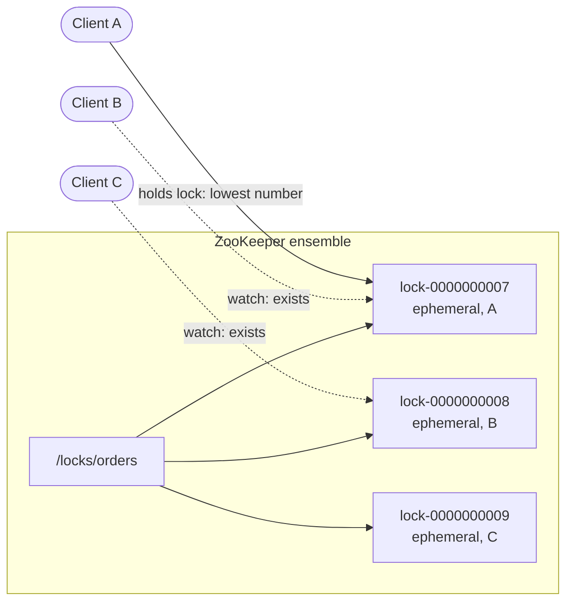

**Reading the diagram.** Each client creates an ephemeral sequential child of `/locks/orders` (synchronous write through the ZooKeeper leader) and lists the children. A's node has the lowest number, so A holds the lock. B and C do not poll: each sets a watch (dotted, asynchronous notification) on the node *immediately below its own*. When A releases the lock by deleting its node, or A's session expires and ZooKeeper deletes it, only B is notified; B re-lists the children, sees it is lowest, and proceeds. Watching only the predecessor avoids the **herd effect**, in which every waiter wakes on every release. Storage boundary: the queue of waiters lives entirely inside the replicated tree. Failure point: A can be paused past its session timeout and still believe it holds the lock; the node's creation zxid should be passed to the protected resource as a fencing token (§26.13).

- **Leader election** is the same recipe: the candidate with the lowest sequential node under `/election` is leader, and each other candidate watches its predecessor.
- **Barrier.** Workers wait until a node `/barrier/ready` exists (watch on `exists`); the coordinator creates it to release everyone. A **double barrier** has workers register ephemeral children on entry and waits until the count reaches $k$, then waits for all to leave.
- **Configuration and group membership.** Store configuration in a znode and watch it; each live member registers an ephemeral child under `/members`.

::: industry
**Apache HBase, Hadoop HDFS and Kafka.** HBase uses ZooKeeper to elect its active master and track live region servers; HDFS high availability uses it to elect and fence the active NameNode (§15.5.2). Kafka historically stored cluster metadata and its controller election in ZooKeeper, then replaced it with KRaft, a Raft-based metadata quorum; Kafka 4.0 (2025) removed ZooKeeper mode entirely (Chapter 31). The trend reflects operational cost: running a separate ZooKeeper ensemble alongside every cluster was a frequent source of outages and configuration mistakes.
*Evidence: Primary* — [Apache HBase Reference Guide]; [Apache Kafka KIP-500]
:::

## 26.9 etcd

etcd is a distributed key–value store replicated with Raft, created at CoreOS and now a Cloud Native Computing Foundation project. It is best known as the database behind Kubernetes [etcd Docs].

### 26.9.1 Data model: revisions, watches, leases and transactions

- **Flat, ordered key space.** Keys are byte strings; range queries over prefixes replace ZooKeeper's tree.
- **MVCC and revisions.** The store keeps a single cluster-wide **revision** counter that increases with every modification. Each key records `create_revision`, `mod_revision` and `version`. You can read any key "as of" an older revision until **compaction** removes history older than a chosen revision.
- **Watches** start from a revision and stream every subsequent change, so a client that reconnects at revision $r$ misses nothing (unless $r$ was compacted). This fixes ZooKeeper's classic one-shot watch gap.
- **Leases.** A lease has a TTL; keys can be attached to it; the client renews with `LeaseKeepAlive`. When the lease expires, all its keys are deleted, the equivalent of ephemeral znodes.
- **Transactions.** `Txn(If compare..., Then ops..., Else ops...)` executes atomically, enabling compare-and-swap on a key's value, version or revision.
- **Consistency.** Writes are linearizable through Raft; reads are linearizable by default (ReadIndex, §26.7.10) or serializable on request.

The `concurrency` package of the Go client implements election and mutexes from these primitives: each contender writes a key under a common prefix attached to its lease, and the contender whose key has the lowest `create_revision` holds the lock; the others watch the key just before theirs, mirroring Figure 26.12. That revision is a natural fencing token.

### 26.9.2 etcd in Kubernetes

The Kubernetes API server is etcd's only client. Every object is stored under a key such as `/registry/pods/<namespace>/<name>`, an object's `resourceVersion` is derived from etcd's revision, and the **watch** that drives every controller ("tell me about changes to pods since version $r$") is an etcd watch multiplexed by the API server. Because etcd holds the entire desired state of the cluster, its health defines the control plane's: Kubernetes documentation recommends running an odd number of members (typically 3 or 5) on dedicated, low-latency disks [Kubernetes Docs: etcd]. etcd's default storage quota is 2 GB, and keeping the dataset small (compaction, defragmentation, not storing large blobs) is a standing operational task.

::: industry
**Kubernetes controller leader election.** `kube-controller-manager` and `kube-scheduler` run several replicas but only one acts at a time. They do not use etcd leases directly; they compete to update a `Lease` object in the `coordination.k8s.io` API group through the API server, using optimistic concurrency on `resourceVersion`. The defaults are a 15 s lease duration, a 10 s renew deadline and a 2 s retry period, so a crashed leader is replaced in roughly 15–17 s. Trade-off: this is coarse failover, chosen to avoid churn, and it relies on clocks running at similar rates.
*Evidence: Primary* — [Kubernetes Docs: Leases]; [Kubernetes Docs: kube-controller-manager]
:::

## 26.10 Distributed locks

### 26.10.1 Why distributed locks are hard

A lock in a single process is simple because the operating system can see every thread and the lock holder cannot vanish without the kernel knowing. A distributed lock has none of these comforts:

1. **The holder can fail silently.** So locks need an expiry (a lease), or a crashed client holds the lock forever.
2. **Expiry means the holder can lose the lock without knowing.** A process paused for 20 s (garbage collection, VM migration, page faults on a swapped heap, a `SIGSTOP`) resumes believing it still holds a lock that expired 10 s ago.
3. **Messages are delayed.** A write sent while holding the lock can arrive at the storage system after the lock has passed to someone else.

Kleppmann distinguishes two purposes [Kleppmann 2016]. An **efficiency lock** prevents duplicate work (two workers computing the same report); an occasional double holder costs some wasted CPU. A **correctness lock** protects an invariant (two writers corrupting one file); a double holder causes data loss. The right design depends on which you have.

### 26.10.2 The Redlock debate

The Redis documentation describes **Redlock**, an algorithm for a lock across $N$ independent Redis primaries (typically 5) with no replication between them [Redis Docs: Distributed Locks]:

1. Record the current time. Try to acquire the lock on each instance in turn with `SET resource random_value NX PX ttl` and a short per-instance timeout.
2. The lock is acquired if a majority (3 of 5) succeeded and the total elapsed time is less than the TTL. The remaining **validity time** is the TTL minus the elapsed time minus an allowance for clock drift.
3. Otherwise, release on all instances (a script deletes the key only if it still holds `random_value`) and retry after a random delay.

In 2016 Martin Kleppmann published "How to do distributed locking," arguing that Redlock is unsuitable for correctness locks [Kleppmann 2016]. Salvatore Sanfilippo (antirez), Redis's creator, replied in "Is Redlock safe?" [Sanfilippo 2016]. The debate is a good model of how to reason about timing assumptions, so both sides are summarized here.

**Table 26.4 — The Redlock debate in brief.**

| Issue | Kleppmann's argument | antirez's reply |
|---|---|---|
| Paused or delayed clients | Any lease-based lock can expire while the holder is paused; Redlock offers no **fencing token** (the random value is not monotonic), so storage cannot reject the stale holder | This affects every lock with auto-release; Redlock checks elapsed time after acquisition, and the unique random value can be used for check-and-set at the resource |
| Timing assumptions | Safety depends on bounded network delay, bounded pauses and bounded clock drift; a clock jump on one instance (for example, an NTP step) can let two clients hold a majority | Redlock needs bounded clock *rate* error, not synchronized clocks; operators should configure time sync to slew, not step |
| What to use instead | For efficiency, a single Redis node is enough; for correctness, use a consensus system (ZooKeeper, etcd) **with fencing tokens** | If the resource can check tokens, it is already a linearizable store; Redlock with its assumptions is adequate for many uses |

A fair reading: both agree that an auto-expiring lock cannot by itself protect a resource against a paused holder. They disagree about how realistic the timing failures are, and whether a lock service that depends on them should be marketed for correctness. Redlock is therefore reasonable as an efficiency lock, but one Redis instance is simpler and almost as good for that. For correctness, use a consensus-backed lock and pass a monotonic token to the resource, or make the resource itself the arbiter (a conditional write such as compare-and-set on a version).

::: recommendation
**Recommendation — Choosing a lock.** (1) Can you avoid the lock? An idempotent operation, a conditional write or a single-writer partition (§14.6) is usually better. (2) If you need a lock for efficiency, a single Redis `SET NX PX` with a sensible TTL is fine. (3) If you need it for correctness, use etcd, ZooKeeper or Consul, and make the protected resource check a fencing token (§26.13). (4) Never hold a lock across an unbounded operation without renewing it and checking validity before each side effect.
:::

## 26.11 Leases

### 26.11.1 Leases and clocks

::: definition
**Definition — Lease.** A time-bounded grant of a right (to cache data, to act as leader, to hold a lock) from a grantor to a holder. Within the term the holder may act without consulting the grantor; after the term, the right lapses automatically, even if the holder has crashed or is unreachable [Gray and Cheriton 1989].
:::

#### First-principles explanation

A lease is a library loan: you may keep the book until the due date without phoning the library each day, and if you vanish, the library does not have to find you; the loan simply ends. Gray and Cheriton introduced leases for cache consistency in the V distributed file system: a server could update a file once every client lease on it had expired, even if a client was unreachable. Leases turn "wait for an unreachable node forever" into "wait at most $T$." The price is a dependence on clocks: the holder and the grantor must agree on how long $T$ is, even though each measures it with its own oscillator.

#### Mathematical foundations

The holder should start its timer *before* sending the request (so network delay counts against it), and the grantor starts its timer when it grants. Both clocks may run fast or slow relative to real time by at most a rate $\rho$.

::: formula
**Lease safety margin**

$$T_{\text{holder}} = T(1 - \rho) - d_{\max} \qquad T_{\text{grantor}} = T(1 + \rho)$$

| Symbol | Meaning | Units |
|---|---|---|
| $T$ | Nominal lease duration | s |
| $\rho$ | Maximum clock rate error relative to real time (drift bound) | dimensionless (e.g. $10^{-4}$ = 100 ppm) |
| $d_{\max}$ | Maximum time between the holder checking validity and its action taking effect (processing, network, budgeted pause) | s |
| $T_{\text{holder}}$ | Local elapsed time after which the holder must stop acting | s |
| $T_{\text{grantor}}$ | Local elapsed time after grant before the grantor may grant the right to someone else | s |
:::

::: example
**Worked example — a 10 s leader lease.** $T = 10$ s, $\rho = 10^{-4}$ (100 ppm, a generous bound for server oscillators), $d_{\max} = 0.5$ s.

1. Holder: $T(1 - \rho) = 10 \times 0.9999 = 9.999$ s; minus $d_{\max}$: $9.999 - 0.5 = 9.499$ s.
2. Grantor: $T(1 + \rho) = 10 \times 1.0001 = 10.001$ s.
3. Real-time gap: the holder stops at most $9.499/(1-\rho) + 0.5 \approx 10.0$ s after its request was sent; the grantor reassigns no earlier than $10.001/(1+\rho) = 10.0$ s after granting, which is later than the request was sent. The intervals do not overlap.
4. Renewal: renew at about $T/3$ to $T/2$ (3.3–5 s), so two consecutive renewals can fail before the lease lapses.

**Interpretation.** Clock drift contributes only about 1 ms of margin over 10 s; the 500 ms action budget dominates. **Engineering implication.** The real enemy is not drift but **unbounded pauses**: a 15 s GC pause between the validity check and the write blows through any margin. That is why leases need fencing tokens (§26.13) whenever the action has effects outside the holder's process, and why clock *steps* (an NTP correction that jumps time) must be prevented on lease holders.
:::

Leases appear throughout this book: GFS chunk leases (§15.5.1), Chubby sessions (§26.14), etcd and Consul session TTLs, Raft lease reads (§26.7.10), Kubernetes `Lease` objects (§26.9.2) and the idempotency-key claims of §22.15.

## 26.12 Split brain

### 26.12.1 Causes and prevention

::: definition
**Definition — Split brain.** A failure in which two or more parts of a cluster each believe they are the authoritative primary (or leader) and accept conflicting writes, so the system's state diverges.
:::

#### Causes

- **Failover without a quorum.** A two-node primary–standby pair loses its heartbeat link; each side sees the other as dead and promotes itself. With two nodes, neither side can tell a partition from a crash.
- **A paused or slow primary.** As in the chapter opening, the old primary resumes after being replaced and keeps serving, because nothing stops it.
- **Asymmetric partitions.** A can reach B but B cannot reach A, so the nodes disagree about who is alive.
- **Operator error.** Manually promoting a replica while the old primary is still reachable by some clients.

#### Prevention

1. **Quorum.** Only a side holding a majority of votes may act. A 3-node or 5-node consensus group cannot split brain by construction; the minority side stops.
2. **Witness (tie-breaker).** Two-site deployments add a lightweight third vote in a third location (a file-share or cloud witness in Windows Server Failover Clustering, an arbiter in MongoDB, a third etcd member), so one site can form a majority.
3. **STONITH ("shoot the other node in the head").** Before taking over, the survivor *forcibly* powers off or isolates the old primary through an out-of-band channel: a power distribution unit, a server management controller (IPMI), or a cloud API that stops the instance. Pacemaker clusters treat a failed fence as a failed failover. Brutal, but it converts "maybe still running" into "definitely off."
4. **Resource-level fencing.** Revoke the old primary's access to shared storage (SCSI persistent reservations, revoking a volume attachment) or have the resource reject stale epochs (§26.13).

::: industry
**GitHub, October 2018.** A 43-second loss of connectivity between GitHub's East Coast network hub and its primary East Coast data center led the cluster-management tool Orchestrator, which uses Raft among its own nodes, to promote MySQL primaries in the West Coast data center. Writes accepted on the East Coast during the brief window had not replicated West, so both sites now held writes the other lacked; GitHub chose data integrity over availability and spent about 24 hours reconciling and restoring service. The lesson: consensus among the *failover controllers* does not prevent divergence in the *data* they manage, and topology-aware failover policies matter.
*Evidence: Primary* — [GitHub 2018]
:::

## 26.13 Fencing tokens

::: definition
**Definition — Fencing token.** A number, increasing with every grant of a lock or lease, that the holder attaches to every request to the protected resource. The resource remembers the highest token it has accepted and rejects any request carrying a lower one.
:::

Fencing moves the final safety check from the client, which cannot know it has been paused, to the resource, which sees requests in the order they actually arrive. The two diagrams below follow Kleppmann's example [Kleppmann 2016].

**Figure 26.13 — Without fencing: a paused client corrupts storage.**

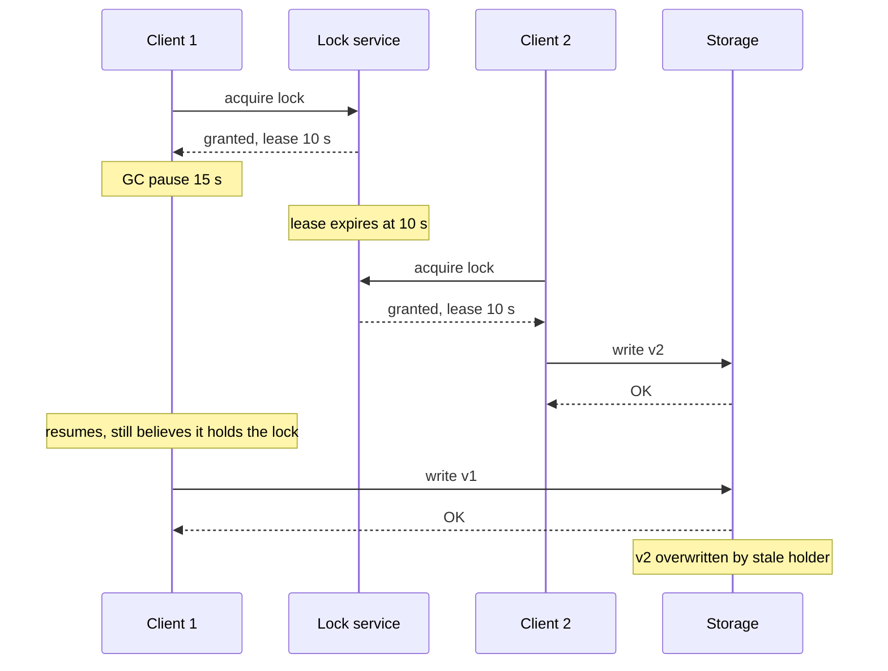

**Reading the diagram.** All arrows are synchronous RPCs. Client 1 holds a valid lease, then stops for 15 s; it has no way to observe its own pause. The lock service correctly expires the lease and grants it to Client 2, which writes. Client 1 resumes mid-operation and sends its write; the storage service has no information that distinguishes this write from a legitimate one, so it accepts it. Every component behaved correctly, yet Client 2's update is lost. The failure point is the gap between "checked the lock" and "write took effect," which no lock service can close from outside the client.

**Figure 26.14 — With fencing: the storage service rejects the stale holder.**

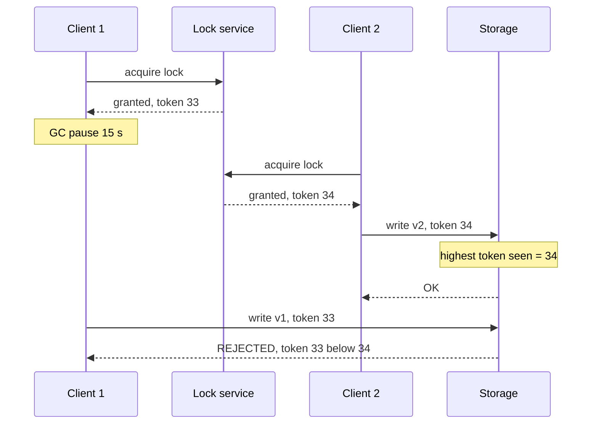

**Reading the diagram.** The lock service now hands out increasing tokens (33, then 34). Storage records the highest token it has accepted, durably and atomically with the write. Client 1's late write carries 33, which is lower than 34, so it is rejected and Client 1 learns it lost the lock. Ordering is decided at the storage boundary, where requests actually serialize. Failure points: the storage service must check and record tokens atomically (a conditional write); every path to the resource must pass the token; and if Client 1's write had arrived *before* Client 2's, it would have been accepted legitimately, which is correct because Client 2 had not yet written.

Good token sources are values the consensus system already increments: a Raft or ZAB index, a ZooKeeper zxid or znode version, an etcd revision, a Chubby **sequencer**, or a Kubernetes-style generation number. If the resource cannot check tokens (a legacy file server, an external payment API), fencing is impossible and you must fall back to idempotency keys (§22.15), STONITH or long lock-delays, accepting the residual risk.

::: mistake
**Misconception — "A random lock value works as a fencing token."** A random value lets the holder release only its own lock, but storage cannot tell whether value `a9f3` is newer or older than `71c2`. Fencing needs a *monotonic* order. The alternative is for the resource to support compare-and-set against the exact current owner value, which makes the resource itself the lock.
:::

## 26.14 Coordination services in practice

### 26.14.1 Chubby

::: definition
**Definition — Chubby.** Google's lock service, providing coarse-grained advisory locks and small files in a file-system-like namespace, replicated across a five-node **cell** with Paxos, and used chiefly for leader election, naming and storing small amounts of configuration [Burrows 2006].
:::

Burrows chose a *lock service* rather than a consensus library deliberately: many teams' programs were not designed for high availability, and acquiring a lock and writing a file was far easier to add to existing code than embedding Paxos. Key design points:

- **Coarse-grained locks**, held for hours or days (who is the master), not milliseconds. Load is therefore low and a brief Chubby outage does not stop lock holders that already hold their locks.
- **Sessions and KeepAlives.** Each client has a session with a lease. The client sends a KeepAlive RPC; the master holds it until the lease is near expiry and then replies with a new lease (12 s by default), piggybacking cache invalidations and events. If the lease lapses, the client enters **jeopardy**, disables its cache, and waits a **grace period** (45 s by default) for a new master before declaring the session lost.
- **Master election and master leases.** Replicas elect a master through Paxos; the master holds a lease of a few seconds during which no other master can be elected, letting it serve reads locally.
- **Consistent client caching** with invalidation: the master blocks a write until every caching client has invalidated, so reads are almost always local.
- **Sequencers and lock-delay.** A lock holder can obtain a **sequencer** (lock name, mode and generation number) and pass it to servers, which check it with Chubby: fencing tokens under another name. For servers that cannot check sequencers, Chubby imposes a **lock-delay** (up to one minute) before a lock released by a failed holder can be re-acquired.

**Figure 26.15 — How Bigtable and GFS use Chubby.**

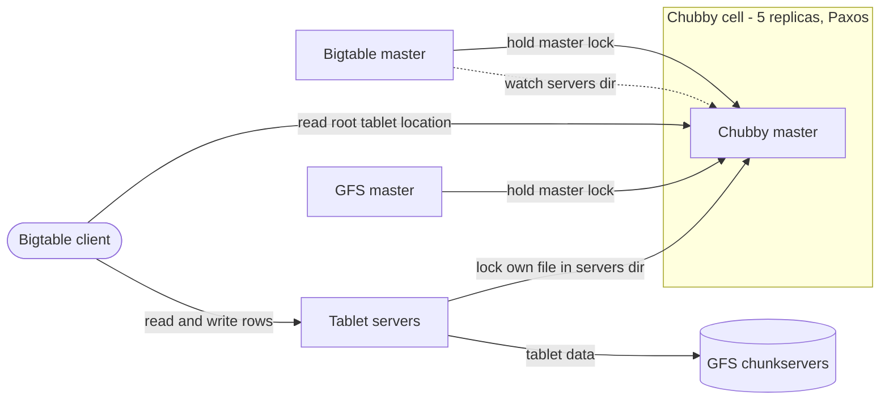

**Reading the diagram.** Solid arrows are synchronous RPCs; the dotted arrow is an asynchronous event subscription. Bigtable's master acquires an exclusive lock so at most one master acts; GFS elects its master the same way. Each tablet server creates and locks a uniquely named file in a servers directory; the Bigtable master watches that directory to discover servers and, if a server loses its lock, reassigns its tablets after deleting the file to ensure the server cannot serve again. Clients bootstrap by reading the root tablet's location from Chubby, then talk to tablet servers directly, which store data in GFS. Chubby is off the data path. Failure point: if Chubby is unavailable for long, Bigtable becomes unavailable; the Bigtable paper measured this effect as small but nonzero [Chang et al. 2006]. Scaling: clients cache Chubby data, and Chubby proxies can aggregate KeepAlives.

::: industry
**Chubby as Google's name service.** Burrows reports that Chubby's most popular use was not locking but naming: storing small files mapping service names to addresses, where Chubby's consistent caching outperformed time-based DNS caching. Trade-off: this concentrated a great deal of read load on one service, handled by caching and proxies.
*Evidence: Primary* — [Burrows 2006]
:::

### 26.14.2 Choosing a coordination service

**Table 26.5 — ZooKeeper vs etcd vs Consul vs Chubby (as of 2026).**

| | ZooKeeper | etcd | Consul | Chubby |
|---|---|---|---|---|
| What it is | Apache coordination service; hierarchical znodes | CNCF key–value store; Kubernetes' database | HashiCorp service-discovery and KV platform | Google-internal lock service |
| How it works | ZAB; leader orders writes; any server serves (possibly stale) reads | Raft; MVCC revisions; gRPC API | Raft among servers; gossip (Serf) among agents | Multi-Paxos in a 5-replica cell; master lease |
| Advantages | Mature recipes (Apache Curator); ephemeral and sequential nodes; observers | Revision-based watches; leases; transactions; linearizable reads by default | Health checks, DNS interface, multi-datacenter federation, sessions with lock-delay | Sequencers; lock-delay; consistent client caching |
| Disadvantages | JVM tuning; one-shot watches (before 3.6); stale reads unless `sync` | Dataset must stay small (2 GB default quota); sensitive to disk latency | KV is secondary to discovery; more moving parts | Not available outside Google |
| Performance | Reads scale with servers; writes bounded by leader and quorum | Writes bounded by leader, quorum and `fsync` | Similar to etcd for KV; gossip scales membership | Designed for low load: coarse locks, cached reads |
| Operational complexity | Medium–high (separate JVM ensemble) | Medium (defrag, compaction, backups) | Medium–high (servers plus agent on every node) | Run by a central team |
| Cost | Open source; 3–5 dedicated nodes | Open source; 3–5 nodes with fast SSDs | Open source plus commercial edition | Internal |
| Use cases | Hadoop, HBase, older Kafka, Solr | Kubernetes, CoreDNS, Vitess topology, many cloud-native systems | Service mesh, discovery, config, locks | GFS, Bigtable master election; naming |
| Choose when | You run the Hadoop ecosystem or need its recipes | You build on Kubernetes or need watches with history | You need discovery and health checking with locks | (Model for your designs) |

Two more options deserve a sentence. Many systems now **embed** Raft (via libraries such as etcd's `raft` package or HashiCorp's `raft`) instead of depending on an external service, as Kafka did with KRaft. And cloud providers offer managed primitives (conditional writes in DynamoDB or object storage) that can serve as leases or fencing points for coarse coordination without running any quorum yourself.

## 26.15 Summary and revision notes

::: summary
- **Consensus** means agreement, validity and termination. FLP forbids guaranteed termination in an asynchronous system, so practical algorithms keep safety always and achieve liveness under partial synchrony: *safety from quorums, liveness from timeouts*.
- A **replicated state machine** runs one consensus decision per log slot; deterministic replicas applying the same log stay identical.
- **Majority quorums** intersect. $N = 2f + 1$ tolerates $f$ crashes; use 3 or 5 voters, never an even number. Commit latency is the $(q-1)$-th fastest follower RTT, so placement matters as much as count. Flexible Paxos needs only $|Q_1| + |Q_2| > N$.
- **Leader election** (bully, ring, lease-based) yields a node that *believes* it leads. Safety needs quorum-checked actions or fencing.
- **Paxos**: prepare/promise discovers and locks out the past; accept/accepted decides; a proposer must adopt the highest-numbered accepted value it hears. Dueling proposers can livelock; Multi-Paxos uses a stable leader and skips phase 1.
- **Raft**: terms, randomized election timeouts, RequestVote with an up-to-date check, AppendEntries with a consistency check (log matching), commit only current-term entries (Figure 8), no-op on election, snapshots, joint or single-server membership changes, ReadIndex or lease reads.
- **ZooKeeper** (ZAB) offers znodes, ephemeral and sequential nodes and watches for recipes; **etcd** offers revisions, history-preserving watches, leases and transactions and backs Kubernetes; **Chubby** pioneered coarse-grained locks, sessions, KeepAlives, sequencers and lock-delay.
- **Distributed locks** with expiry cannot stop a paused holder. Redlock's debate centers on timing assumptions and missing fencing. **Leases** need a margin for drift and, more importantly, pauses.
- **Split brain** is prevented by quorums, witnesses, STONITH and resource fencing. **Fencing tokens** let the resource reject stale holders and are the final line of defense.
:::

## 26.16 Knowledge checkpoint

1. Which consensus properties are safety properties and which is a liveness property?
2. How many failures does a 6-voter cluster tolerate, and why is it a poor choice?
3. Five voters have follower RTTs of 2, 3, 40 and 45 ms. What is the commit latency with 1 ms flushes?
4. With $N = 9$ and $|Q_2| = 3$, what is the minimum phase-1 quorum in Flexible Paxos?
5. In Paxos, a proposer receives promises reporting accepted proposals (2.1, A) and (3.2, B). Which value must it propose?
6. Why can dueling proposers prevent Paxos from deciding, and what fixes it?
7. A Raft node's last entry is (index 9, term 3). A candidate's last entry is (index 12, term 2). Does the node grant its vote?
8. Why does a new Raft leader append a no-op entry?
9. What does the log matching property guarantee, and which check enforces it?
10. Why are single-server membership changes safe without joint consensus?
11. How does ReadIndex make a leader read linearizable without writing to the log?
12. Why do ZooKeeper lock waiters watch their predecessor rather than the lock holder?
13. A lease is 6 s, $\rho = 2 \times 10^{-4}$, $d_{\max} = 1$ s. When must the holder stop?
14. Why is a random lock value not a fencing token?

<details><summary>Answers</summary>

1. Agreement and validity are safety; termination is liveness.
2. $q = 4$, $f = 2$, the same as 5 voters, with one more machine to fail and a larger quorum to wait for.
3. $q - 1 = 2$ followers; the second-fastest RTT is 3 ms; $L \approx 1 + 3 = 4$ ms.
4. $|Q_1| \ge 9 - 3 + 1 = 7$.
5. B, the value of the highest-numbered accepted proposal (3.2).
6. Each proposer's higher prepare invalidates the other's pending accept, forever. A single distinguished leader plus randomized back-off.
7. No. The node's last term (3) is higher than the candidate's (2), so its log is more up-to-date regardless of length.
8. Entries from earlier terms can only be committed indirectly; committing a current-term entry commits them and enables ReadIndex.
9. Equal (index, term) implies identical prefixes; the AppendEntries `(prevLogIndex, prevLogTerm)` consistency check.
10. Any majority of a configuration with $N$ voters intersects any majority of one with $N \pm 1$ voters.
11. It fixes the commit index at the read's start, confirms leadership with a heartbeat round to a majority, and waits to apply up to that index.
12. To avoid the herd effect: each release wakes exactly one waiter.
13. $6 \times (1 - 0.0002) - 1 = 5.9988 - 1 = 4.9988$ s after sending the request.
14. Storage cannot order random values, so it cannot tell a newer holder from a stale one.
</details>

## 26.17 Interview questions

### Basic

**Q1. Why do consensus clusters usually have 3 or 5 nodes?** **Answer.** A majority quorum lets $2f+1$ nodes tolerate $f$ crashes. Three tolerates one, five tolerates two (one failure during maintenance of another). Even sizes add cost and latency without extra tolerance, and more than five adds write latency and leader load for little availability gain under correlated failures.

**Q2. What is a fencing token and when do you need one?** **Answer.** A monotonically increasing number issued with each lock or lease grant; the protected resource rejects requests with a token lower than the highest it has seen. You need it whenever a lock protects correctness and the resource is outside the lock service, because a paused or delayed holder can act after its lock expired.

### Intermediate

**Q3. Walk through a Raft leader failure and recovery.** **Answer.** Followers stop receiving heartbeats; the first whose randomized timeout fires increments its term and requests votes. Nodes vote once per term, only for candidates whose log is at least as up-to-date. With a majority, it becomes leader, appends a no-op, and repairs followers' logs through AppendEntries consistency checks. Uncommitted entries from the old leader may be overwritten; committed ones survive by leader completeness. Failover takes roughly one election timeout plus a round trip.

**Q4. Design leader election for a fleet of cron schedulers.** **Answer.** Use a lease-based election in etcd or ZooKeeper: create a key with a lease (for example, 15 s, renewed every 5 s), watch it if you lose. The leader checks lease validity before each job, carries the key's revision as a fencing token into the job store, and the store rejects stale tokens. Make jobs idempotent to tolerate the rare double run. State the failover time (about one lease duration).

### Advanced

**Q5. A team proposes Redlock to guard writes to a shared S3 object. Critique it.** **Answer.** Redlock's safety depends on bounded pauses, delays and clock drift, and its random values cannot fence. A GC pause can let two clients write. Instead use conditional writes on the object (compare an ETag or version, where supported) so the store itself arbitrates, or a consensus-backed lock whose revision the writer stores and checks atomically. If a lock is only for efficiency, a single Redis node suffices.

**Q6. Explain the Raft "Figure 8" problem and its fix.** **Answer.** A leader of term 4 replicates an entry from term 2 to a majority, then crashes. A node holding a conflicting term-3 entry can still win the next election, because term 3 is more up-to-date than term 2, and overwrite the "majority-replicated" entry. Raft therefore commits only entries from the leader's current term by counting replicas; earlier entries commit indirectly, which is why new leaders write a no-op immediately.

## 26.18 Practical exercises

1. Modify the simulator of §26.7.7 to partition the leader with one follower (a minority) for 500 ms. Verify that the minority leader cannot commit and that a new leader is elected on the majority side.
2. Remove the `n.term_at(idx) == n.term` check from `advance_commit` and construct a schedule reproducing Figure 26.10. Does `check_safety` detect the violation?
3. Set the election timeout range to 150–155 ms and measure split votes and failover times over 200 seeds; compare with the formula in §26.7.2.
4. Start a three-member etcd cluster locally, take a lock with `etcdctl lock`, pause the holder with `kill -STOP`, and observe the lease expiry and the next holder's revision.
5. Implement the ZooKeeper lock recipe with Apache Curator or `kazoo`, and verify that a release wakes only one waiter.

## 26.19 Design challenges

1. **Global configuration service.** Store feature flags read by 50,000 servers in three regions, updated a few times per hour. Choose voter count and placement, decide which reads must be linearizable, design watch fan-out (proxies or caches), and estimate commit latency and availability.
2. **Fenced job runner.** Design a system in which exactly one worker processes each partition of a queue, workers can pause for up to 30 s, and the output database supports conditional writes. Specify lease duration, renewal, fencing and recovery after a pause.

## 26.20 References

1. Burrows, M. "The Chubby Lock Service for Loosely-Coupled Distributed Systems." *USENIX Symposium on Operating Systems Design and Implementation (OSDI)*, 2006.
2. Chandra, T. D., Griesemer, R., Redstone, J. "Paxos Made Live: An Engineering Perspective." *ACM Symposium on Principles of Distributed Computing (PODC)*, 2007.
3. Chang, E., Roberts, R. "An Improved Algorithm for Decentralized Extrema-Finding in Circular Configurations of Processes." *Communications of the ACM* 22(5), 1979.
4. Chang, F., Dean, J., Ghemawat, S., et al. "Bigtable: A Distributed Storage System for Structured Data." *USENIX OSDI*, 2006.
5. Dwork, C., Lynch, N., Stockmeyer, L. "Consensus in the Presence of Partial Synchrony." *Journal of the ACM* 35(2), 1988.
6. etcd Authors. *etcd Documentation* (API guarantees; Tuning; Learner design). https://etcd.io/docs/
7. Fischer, M. J., Lynch, N. A., Paterson, M. S. "Impossibility of Distributed Consensus with One Faulty Process." *Journal of the ACM* 32(2), 1985.
8. Garcia-Molina, H. "Elections in a Distributed Computing System." *IEEE Transactions on Computers* C-31(1), 1982.
9. GitHub. "October 21 post-incident analysis." GitHub Blog, 2018. https://github.blog/news-insights/company-news/oct21-post-incident-analysis/
10. Gray, C. G., Cheriton, D. R. "Leases: An Efficient Fault-Tolerant Mechanism for Distributed File Cache Consistency." *ACM Symposium on Operating Systems Principles (SOSP)*, 1989.
11. Howard, H., Malkhi, D., Spiegelman, A. "Flexible Paxos: Quorum Intersection Revisited." arXiv:1608.06696, 2016 (also OPODIS 2016).
12. Hunt, P., Konar, M., Junqueira, F. P., Reed, B. "ZooKeeper: Wait-free Coordination for Internet-scale Systems." *USENIX Annual Technical Conference (ATC)*, 2010.
13. Junqueira, F. P., Reed, B. C., Serafini, M. "Zab: High-performance Broadcast for Primary-Backup Systems." *IEEE/IFIP Conference on Dependable Systems and Networks (DSN)*, 2011.
14. Kleppmann, M. "How to do distributed locking." Blog post, 8 February 2016. https://martin.kleppmann.com/2016/02/08/how-to-do-distributed-locking.html
15. Kleppmann, M. *Designing Data-Intensive Applications*, chapters 8–9. O'Reilly Media, 2017.
16. Kubernetes Authors. *Kubernetes Documentation*: "Leases"; "Operating etcd clusters for Kubernetes"; `kube-controller-manager` reference. https://kubernetes.io/docs/
17. Lamport, L. "The Part-Time Parliament." *ACM Transactions on Computer Systems* 16(2):133–169, 1998.
18. Lamport, L. "Paxos Made Simple." *ACM SIGACT News* 32(4):51–58, 2001.
19. Ongaro, D., Ousterhout, J. "In Search of an Understandable Consensus Algorithm." *USENIX ATC*, 2014. https://raft.github.io/
20. Ongaro, D. *Consensus: Bridging Theory and Practice*. PhD thesis, Stanford University, 2014.
21. Redis. *Distributed Locks with Redis* (Redlock). Redis documentation.
22. Sanfilippo, S. (antirez). "Is Redlock safe?" Blog post, February 2016. http://antirez.com/news/101
23. Schneider, F. B. "Implementing Fault-Tolerant Services Using the State Machine Approach: A Tutorial." *ACM Computing Surveys* 22(4), 1990.
24. Apache Software Foundation. *Apache HBase Reference Guide*; *KIP-500: Replace ZooKeeper with a Self-Managed Metadata Quorum*. https://hbase.apache.org/ ; https://cwiki.apache.org/confluence/display/KAFKA/

## 26.21 Open verification items

- Ongaro's 2015 raft-dev report of the single-server membership-change bug and its no-op fix (date, wording).
- GitHub October 2018 incident figures (43 s partition, about 24 h degradation) and the current blog URL.
- antirez reply URL (`antirez.com/news/101`) and the Redis documentation URL for Redlock.
- ZooKeeper throughput phrasing in Hunt et al. 2010; persistent recursive watches introduced in 3.6.0.
- etcd defaults as of 2026: 100 ms heartbeat, 1,000 ms election timeout, randomization over $[T, 2T)$, 2 GB quota; tuning guidance (heartbeat ≈ RTT, election ≥ 10 × RTT).
- Kubernetes controller defaults (15 s / 10 s / 2 s) as of 2026.
- Chubby defaults (12 s lease extension, 45 s grace, lock-delay up to 1 min) and Bigtable's measured Chubby-caused unavailability.
- Kafka 4.0 (2025) removing ZooKeeper mode.
