# Chapter 27 — Replication and Fault Tolerance

> **Level:** 3 · **Track:** A (Traditional) · **Estimated reading time:** 6 h

Chapter 14 introduced replication as a database scaling tool: one primary, a few read replicas, and a choice between synchronous and asynchronous commit (§14.3–§14.5). That picture stops being enough when you ask harder questions. What happens when the primary dies at the wrong moment? How does anyone *know* it died? Can a store keep accepting writes while half its nodes are unreachable, and what does it give up to do so? When two copies disagree, which one is right?

This chapter surveys the five families of replication strategy, works through primary–backup, chain, multi-leader and leaderless replication, and then treats the machinery that keeps replicas alive and consistent: quorums, hinted handoff, failure detection, failover, recovery, anti-entropy and conflict-free replicated data types (CRDTs). Consensus belongs to Chapter 26, consistency definitions to Chapter 25 and distributed transactions to Chapter 28.

## 27.1 Learning objectives

After this chapter you should be able to:

- Choose among primary–backup, chain, multi-leader, leaderless and consensus-based replication for a stated workload, and justify the choice in terms of latency, availability, consistency and operational cost.
- Explain state transfer versus operation shipping, and compute the data lost in an asynchronous failover.
- Describe chain replication and CRAQ, and compute their write latency and read throughput.
- Compare circular, star and all-to-all multi-leader topologies, and estimate conflict rates.
- State precisely what $R + W > N$ guarantees and what it does not, and compute quorum latency from the $k$-th fastest replica.
- Explain sloppy quorums and hinted handoff, and size hint storage.
- Tune heartbeat timeouts, compute a phi-accrual suspicion level, and derive SWIM detection time and gossip dissemination rounds.
- Build a failover time budget and a recovery time estimate.
- Use read repair and Merkle-tree anti-entropy, and choose among last-writer-wins, version vectors with siblings and CRDTs; implement G-Counter, PN-Counter, LWW-Register and OR-Set and test their merge laws.

## 27.2 Prerequisites

- Primary–replica replication, replication modes and lag — §14.3–§14.5 (this chapter builds on them rather than repeating them).
- Consistent hashing, virtual nodes and preference lists — §14.8 (leaderless stores place replicas on a ring).
- Merkle trees — §17.8 (the data structure behind anti-entropy).
- Availability, MTBF/MTTR and durability arithmetic — §4.14–§4.16 (every redundancy argument here reduces to them).
- Percentiles and tail latency — §4.8 (quorum latency is an order statistic).
- Failure models, partial failures, clocks and version vectors — §24.6–§24.11 (what can fail, and how causality is tracked).

## 27.3 Replication strategies overview

### 27.3.1 Five ways to keep copies

::: definition
**Definition — Replication strategy.** The rule that decides *which* replicas may accept a write, *in what order* the replicas apply writes, and *when* a write counts as done. The five families are **primary–backup**, **chain replication**, **multi-leader**, **leaderless** and **consensus-based** replication.
:::

#### First-principles explanation

Imagine a family keeping one shared shopping list on several phones. They can appoint one person as the list keeper who forwards every change (primary–backup). They can pass every change along a line of phones, and only the last phone answers "what is on the list?" (chain). Everyone can edit their own phone and sync later, sorting out clashes (multi-leader). Or anyone can write to any two of the three phones and read from any two, trusting that the pairs overlap (leaderless quorums). Finally, they can vote on each change, so that a majority must agree before it counts (consensus). Each rule is a different answer to the same trade-off among latency, availability during failures, and how surprising the list looks to someone reading it.

#### Why does this exist?

Replication exists for three reasons: **fault tolerance** (survive node, disk and zone failures), **latency** (serve users from a nearby copy) and **throughput** (spread reads, and sometimes writes, over more machines). No single strategy optimizes all three, because a write that must reach distant copies before it is acknowledged is slow, and a write that is acknowledged before reaching them can be lost or can conflict.

#### Decision table

**Table 27.1 — Replication strategies compared.**

| | Primary–backup | Chain | Multi-leader | Leaderless | Consensus-based |
|---|---|---|---|---|---|
| Who accepts writes | One primary | Head of chain | Every leader | Any replica, via a coordinator | Elected leader |
| Ordering | Primary's order | Chain order | None globally; conflicts | None; version vectors or timestamps | Agreed log |
| Write done when | Backups ack (sync) or at once (async) | Tail has it | Local leader commits | $W$ of $N$ ack | Majority ack |
| Strong reads | From primary | From tail | No | No (not even with $R + W > N$) | From leader with lease, or via log |
| Failover | External detector promotes a backup | Master service splices chain | Not needed for writes | Not needed | Built into protocol |
| Tolerates | $n-1$ crashes, if detector is correct | $n-1$ crashes | Region loss, partitions | Partitions, slow nodes | $f$ of $2f+1$ crashes |
| Typical systems | PostgreSQL, MySQL, Kafka ISR | FAWN-KV, CRAQ | Multi-region databases, offline apps | Dynamo, Cassandra, Riak | etcd, ZooKeeper, Spanner (Ch 26) |
| Choose when | One region, simple ops | High write throughput with strong reads | Multi-region writes or offline clients | Always-writable, latency-sensitive keys | Metadata, locks, strong consistency |

**Figure 27.1 — Choosing a replication strategy.**

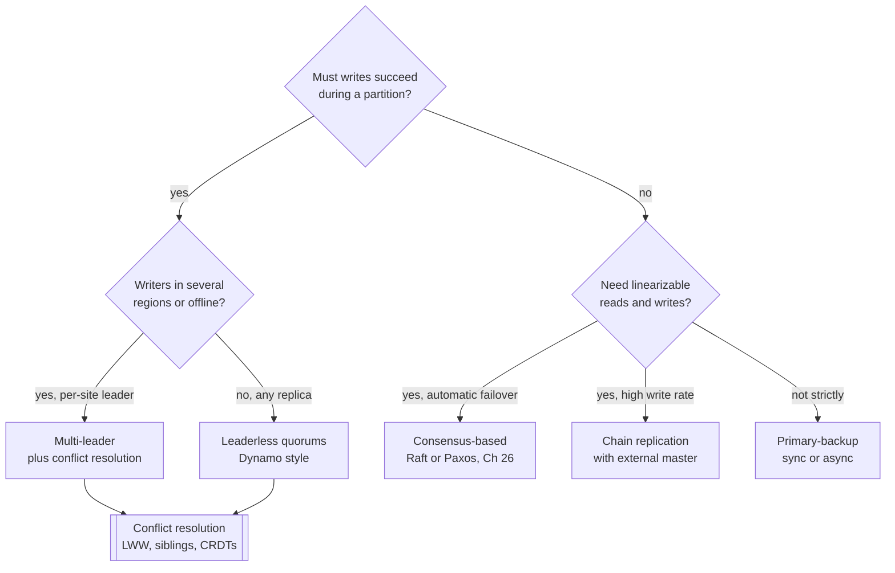

**Reading the diagram.** The diagram is a decision path, not a data flow. The first question splits designs that remain writable on both sides of a network partition (right branch, which must accept conflicts and resolve them, §27.14) from those that keep one ordering of writes (left branch). On the ordered side, consensus-based replication gives automatic, safe failover; chain replication gives high throughput with strong reads but relies on a separately replicated master service; primary–backup is simplest but its safety depends on the failure detector and fencing. Both availability-first branches feed into conflict resolution, the shared failure point: whichever resolver you choose decides which concurrent writes survive.

::: concept
**Concept — Replication is ordering plus acknowledgment.** Every strategy answers two questions: who decides the order of writes, and how many copies must hold a write before the client hears "done". Primary–backup, chain and consensus fix the order at one place; multi-leader and leaderless let order emerge and repair disagreements afterwards.
:::

## 27.4 Primary–backup replication

### 27.4.1 State transfer and operation shipping

::: definition
**Definition — Primary–backup replication.** One replica, the **primary**, receives all requests, executes them and propagates the result to one or more **backups**. If the primary fails, a backup is **promoted** to primary. It is also called **passive replication** [Alsberg and Day 1976; Budhiraja et al. 1993].
:::

#### First-principles explanation

A head chef cooks every dish while an apprentice watches and keeps an identical notebook. There are two ways to keep the notebook current. The chef can photograph the finished plate after each dish (**state transfer**: send the resulting state), or the chef can read out each instruction, "add 5 g salt", and the apprentice performs it on a copy of the dish (**operation shipping**: send the operation, also called log shipping or **active** replication when every replica executes it). Photographs are bigger but always exact. Instructions are small, but the apprentice's dish matches only if every instruction gives the same result on both stoves.

#### Why does this exist?

Primary–backup is the oldest and simplest fault-tolerance pattern. One node decides the order of operations, so there are no write conflicts and reads from the primary are linearizable while the primary is genuinely the only primary. Most relational databases (§14.3), Kafka partitions and many file systems use it.

#### How it works internally

1. The client sends a request to the primary.
2. The primary executes it and produces either a state delta (changed pages, rows) or an operation record (a log entry).
3. The primary sends the delta or record to the backups, in the order it executed them.
4. In **synchronous** mode the primary waits for the backups' acknowledgments before replying; in asynchronous mode it replies at once (§14.4 compares the modes).
5. A **failure detector** (§27.10) watches the primary. When it suspects a crash, a backup is chosen, made consistent with the most up-to-date surviving copy, **fenced** off from the old primary (§26.13) and promoted.

The trade-off between the two forms is concrete:

- **State transfer** is deterministic by construction, works for any computation and is the basis of physical (WAL) replication (§14.4.5). It costs bandwidth proportional to the amount of state changed, which can be large: one `UPDATE` that touches a million rows ships a million row images.
- **Operation shipping** sends the request, so it is compact, but every replica must execute it **deterministically**. Clocks, random numbers, thread scheduling and unordered iteration break determinism. Systems either forbid non-deterministic operations, log their results (for example, the value of `NOW()`), or replay at a very low level, as VMware Fault Tolerance does.

**Figure 27.2 — Primary–backup with a synchronous backup and the failover window.**

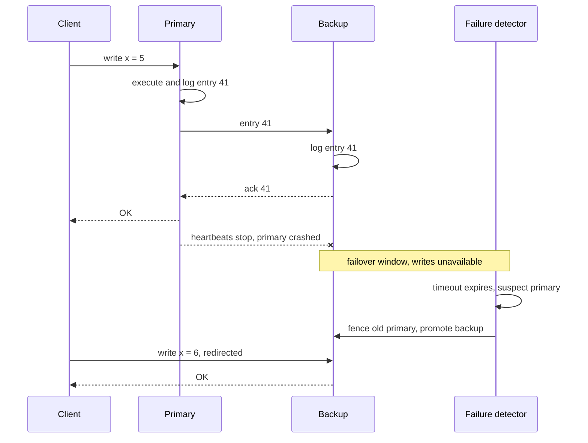

**Reading the diagram.** Solid arrows are synchronous messages; the client waits until the backup has logged entry 41, so a primary crash after the reply loses nothing. The crossed arrow marks the crash. From then until the detector's timeout expires and the backup is promoted, no write can succeed: that interval is the **failover window**, and it is dominated by detection time (§27.11). The storage boundaries are the two logs. The failure points are the detector (too slow lengthens the window; too eager causes needless failovers and possible split brain) and the backup itself (if it is down, synchronous commits stall). Scaling adds backups, which adds acknowledgments to wait for and copies for the primary to send.

#### Mathematical foundations

With asynchronous shipping, everything the primary acknowledged but had not yet shipped is lost when a backup is promoted.

::: formula
**Writes lost in an asynchronous failover**

$$L = r_w \times \ell$$

| Symbol | Meaning | Units |
|---|---|---|
| $L$ | Acknowledged writes lost when the most up-to-date backup is promoted | writes |
| $r_w$ | Write rate on the primary just before the crash | writes/s |
| $\ell$ | Replication lag of the promoted backup at the moment of the crash | s |
:::

::: example
**Worked example — Sizing the loss.** An order service commits $r_w = 2{,}000$ writes/s. Its asynchronous backup normally lags by 50 ms, but under a burst the lag reaches 500 ms.

1. Normal lag: $L = 2{,}000 \times 0.05 = 100$ acknowledged orders lost.
2. During the burst: $L = 2{,}000 \times 0.5 = 1{,}000$ orders lost.
3. With one synchronous backup in the same region: $\ell = 0$ for acknowledged writes, so $L = 0$, at a cost of one intra-region round trip per commit (about 0.5–1 ms, §14.4.1).

**Interpretation.** Asynchronous loss scales with load *and* lag, and lag grows exactly when the system is busiest. **Engineering implication.** If any loss is unacceptable, make at least one backup synchronous, or make failover choose only a backup known to hold every acknowledged write, and alert on lag in seconds as well as bytes.
:::

There is also a bandwidth cost. With $n$ replicas the primary sends every update $n - 1$ times, so its outbound network link limits write throughput: $X_{\max} = B_{\text{out}} / ((n-1) \cdot s)$ for updates of size $s$. That bottleneck is what chain replication removes (§27.5).

#### Real-world industry applications

::: industry
**VMware vSphere Fault Tolerance.** VMware FT replicates an entire virtual machine by operation shipping at the instruction level. The primary's hypervisor logs every non-deterministic event (interrupts, network packets, timer reads) and sends it over a logging channel; the backup replays the same execution. The **output rule** makes the primary delay any externally visible output until the backup has acknowledged the log entry that produced it, so a failover never contradicts what the outside world has already seen. Failure detection uses heartbeats plus an atomic test-and-set on shared storage to prevent both copies from going live.
*Evidence: Primary* — [Scales et al. 2010]
:::

::: industry
**Apache Kafka in-sync replicas.** Each Kafka partition has a leader and followers that fetch from it. Followers that keep up form the **in-sync replica set (ISR)**. A producer with `acks=all` is acknowledged once every current ISR member has the record, and `min.insync.replicas` sets how small the ISR may shrink before such writes are refused. A replica outside the ISR may become leader only if unclean leader election is enabled, which trades data loss for availability.
*Evidence: Primary* — [Apache Kafka Docs: Replication]
:::

#### Failure scenarios

**Table 27.2 — Failure scenarios in primary–backup replication.**

| What goes wrong | Why | Detection | Recovery | Prevention |
|---|---|---|---|---|
| Acknowledged writes vanish after failover | Async backup promoted while lagging | Gap in log positions; user reports | Replay old primary's unshipped log if disk survives | Sync backup or lossless semi-sync; promote most-advanced replica |
| Two primaries accept writes | Old primary was slow, not dead; detector misfired | Two nodes report primary role | Fence old primary; reconcile divergent writes | Leases and fencing tokens (§26.11–§26.13) |
| Replicas diverge silently | Non-deterministic operation shipped | Checksums differ between replicas | Rebuild backup by state transfer (§27.12) | Row-based or physical logs; log non-deterministic values |
| All commits stall | Sole synchronous backup is down | Commit latency spikes | Drop to async or add a backup | Quorum acks over ≥ 2 backups |

::: mistake
**Mistake — "A backup is a backup, so failover is safe."** A backup is only as current as its last acknowledged entry, and failover is only safe if the old primary is stopped. Without fencing, a primary paused for 20 s by garbage collection can wake up and accept writes alongside the new one.
:::

## 27.5 Chain replication

### 27.5.1 Writes at the head, reads at the tail

::: definition
**Definition — Chain replication.** Replicas are arranged in a linear **chain**. Every update enters at the **head** and is forwarded node by node to the **tail**; the tail replies to the client. Every query is answered by the tail. A separate, fault-tolerant **master** service detects failures and reconfigures the chain [van Renesse and Schneider 2004].
:::

#### First-principles explanation

Think of a bucket brigade. The first person takes a bucket from the well and passes it along the line, and only when the last person pours it on the fire is the job done. Anyone asking "how much water has reached the fire?" asks the last person, who has seen every bucket that counts. Each person passes each bucket exactly once, so no one is overloaded; the price is that a bucket must travel the whole line.

#### Why does this exist?

Primary–backup makes the primary send every update to every backup, and its reads are strong only at the primary. Van Renesse and Schneider designed chain replication for storage services that need both high throughput and strong consistency: each node forwards each update once, and because the tail only holds updates that every other node already has, reads at the tail are linearizable without extra coordination.

#### How it works internally

1. The client sends an update to the head. The head applies it and forwards it to its successor.
2. Each middle node applies the update, records it in a **Sent** list of updates forwarded but not yet confirmed, and forwards it.
3. The tail applies the update, replies to the client and sends an acknowledgment back up the chain, so predecessors can trim their Sent lists.
4. Queries go only to the tail, which reflects exactly the set of fully replicated updates.
5. The master (itself replicated with consensus, Chapter 26) detects crashes and repairs the chain:
   - **Head fails:** its successor becomes the head. Updates the old head received but had not forwarded are lost, but none had been acknowledged.
   - **Tail fails:** its predecessor becomes the tail. That node already holds everything the old tail held, and possibly more.
   - **Middle node fails:** the master links its predecessor to its successor, and the predecessor resends everything in its Sent list that the successor may have missed.
6. A new node is added at the tail end: it copies the current tail's state, then takes over as tail.

A chain of $n$ nodes tolerates $n - 1$ crashes, because any surviving node holds every acknowledged update.

**Figure 27.3 — Chain replication with an external master.**

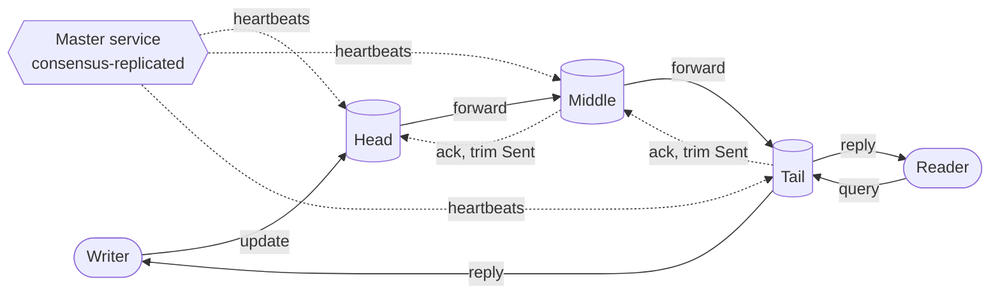

**Reading the diagram.** Updates flow synchronously left to right over TCP; the writer's reply comes from the tail, so the write's latency spans every hop. Readers talk only to the tail. Dotted arrows are asynchronous: acknowledgments flowing back up the chain to trim each node's Sent list, and the master's failure detection. Each node stores a full copy. Failure points are any chain node (repaired by the master as listed above) and the master itself, which is why the master must be consensus-replicated. Scaling: a longer chain adds fault tolerance and latency but no read capacity, since only the tail serves reads; systems scale out by running many chains, each owning a range of keys.

### 27.5.2 CRAQ: reading from every node

Chain replication has an obvious waste: $n - 1$ nodes hold the data but only the tail can answer queries. **CRAQ** (Chain Replication with Apportioned Queries) lets any node answer reads while keeping strong consistency [Terrace and Freedman 2009].

1. Each node may store several versions of an object. A version is **clean** once the node knows the tail has it, and **dirty** before that.
2. On an update, each node appends a new dirty version and forwards it. When the tail applies it, the version is committed; acknowledgments flow back, each node marks that version clean and deletes older ones.
3. On a read at any node: if the latest local version is clean, return it. If it is dirty, send a small **version query** to the tail, which returns its latest committed version number, and return that version (which the node has, because the chain delivers versions in order).

**Figure 27.4 — A CRAQ read that hits a dirty object.**

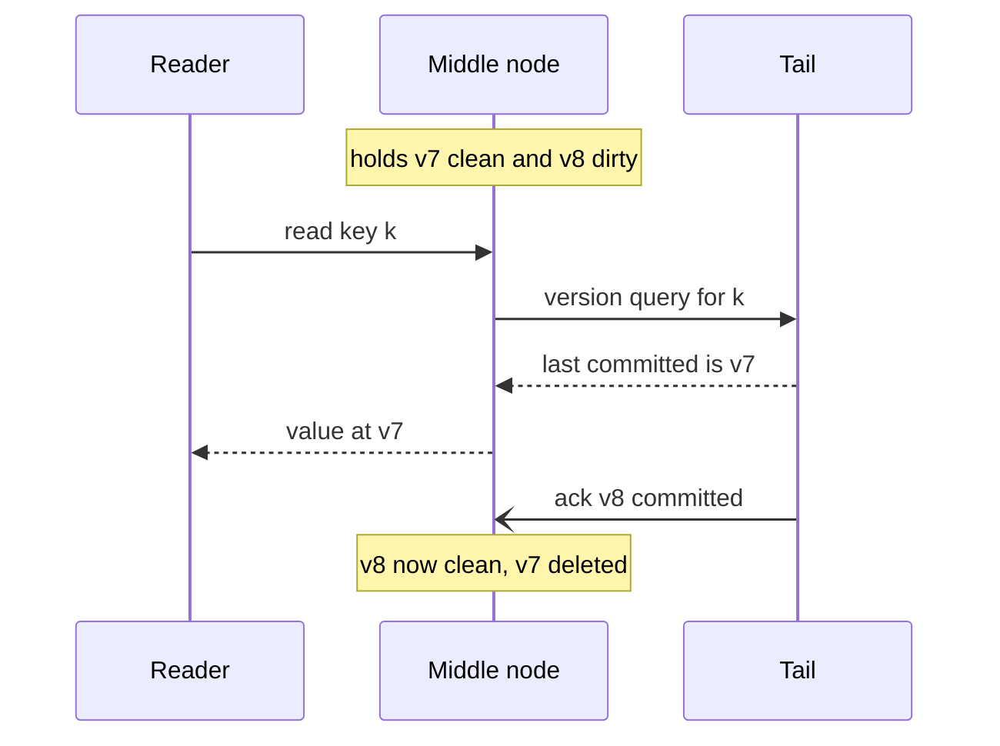

**Reading the diagram.** The reader contacts a middle node synchronously. Because the newest local version (v8) is dirty, that node asks the tail which version is committed, a message carrying only a version number, and returns v7, the value every other reader would also see. The later asynchronous acknowledgment marks v8 clean, after which the node answers locally. Storage holds several versions per key during an update. The failure point is the tail: dirty reads depend on it, so a write-heavy hot key concentrates version queries there. Read capacity scales with chain length when most objects are clean.

#### Mathematical foundations

::: formula
**Chain write latency and read capacity**

$$T_{\text{write}} \approx (n + 1)\,d + n\,s \qquad X_{\text{read}}^{\text{CR}} = c \qquad X_{\text{read}}^{\text{CRAQ}} \approx n\,c \;\text{(clean reads)}$$

| Symbol | Meaning | Units |
|---|---|---|
| $n$ | Number of nodes in the chain | nodes |
| $d$ | One-way network delay per hop | ms |
| $s$ | Processing time per node for an update | ms |
| $c$ | Read capacity of one node | reads/s |
| $T_{\text{write}}$ | Client-observed write latency (client → head → … → tail → client) | ms |
| $X_{\text{read}}$ | Read capacity of one chain | reads/s |
:::

::: example
**Worked example — Chain versus primary–backup in one datacenter.** Take $d = 0.25$ ms, $s = 0.05$ ms, $c = 50{,}000$ reads/s, 4 KB updates and 10 Gb/s network interfaces (1.25 GB/s each way).

1. Chain of 3: $T_{\text{write}} = 4 \times 0.25 + 3 \times 0.05 = 1.15$ ms. Chain of 5: $6 \times 0.25 + 5 \times 0.05 = 1.75$ ms.
2. Primary–backup with parallel fan-out: client → primary → backups → primary → client is 4 one-way hops regardless of $n$, so $4 \times 0.25 + 2 \times 0.05 = 1.1$ ms.
3. Write throughput limit from the busiest outbound link, $n = 5$: the primary sends $4 \times 4$ KB = 16 KB per write, so $1.25 \times 10^9 / 16{,}384 \approx 76{,}000$ writes/s. In a chain each node sends each update once: $1.25 \times 10^9 / 4{,}096 \approx 305{,}000$ writes/s.
4. Reads with $n = 3$: chain replication serves 50,000 reads/s at the tail; CRAQ serves up to about $3 \times 50{,}000 = 150{,}000$ reads/s if most reads find clean objects.

**Interpretation.** Chains trade latency that grows linearly with length for throughput that does not depend on length. **Engineering implication.** Keep chains short (3 is typical) and inside one datacenter; use CRAQ or many independent chains when reads dominate.
:::

#### Real-world industry applications

::: industry
**FAWN-KV.** FAWN-KV, a key-value store built on clusters of low-power nodes, places nodes on a consistent-hash ring and replicates each key range with chain replication along the ring, with a front-end that routes puts to the head and gets to the tail.
*Evidence: Primary* — [Andersen et al. 2009]
:::

::: industry
**CRAQ across datacenters.** The CRAQ paper describes chains that span datacenters, with chain membership kept in ZooKeeper, and offers eventual-consistency and bounded-staleness read modes in addition to strong reads, so applications can trade freshness for local reads.
*Evidence: Primary* — [Terrace and Freedman 2009]
:::

#### Advantages and disadvantages

Chain replication gives linearizable reads and writes, balanced network load and simple recovery rules. Its costs are write latency proportional to chain length, a single slow node slowing every write (there is no "fastest $k$ of $n$"), and dependence on an external master for every reconfiguration.

## 27.6 Multi-leader replication

### 27.6.1 Use cases and topologies

Chapter 14 introduced multi-primary replication for databases (§14.5). Here we generalize: **multi-leader replication** lets each of several leaders accept writes and asynchronously exchange them, and it reappears wherever writers cannot wait for a single authority.

::: definition
**Definition — Replication topology.** The graph along which leaders forward writes to each other: a **circular** ring, a **star** with a hub, or **all-to-all**.
:::

#### Why does this exist?

Three use cases recur:

1. **Multi-datacenter operation.** Each region has a leader, so writes take a local round trip (about 1 ms) instead of a cross-region one (70–150 ms), and a region keeps writing when cut off.
2. **Offline clients.** A calendar or notes app on a phone is a leader with a local database; it syncs when the network returns, possibly days later.
3. **Collaborative editing.** Every participant's editor applies its own keystrokes immediately and exchanges changes, so typing never waits for a server round trip.

All three accept the same consequence: two leaders can change the same item concurrently, and nobody finds out until the changes meet.

#### How it works internally

1. Each leader commits a write locally and tags it with its origin (a leader ID) and a version (a log position, timestamp or version vector).
2. The write is forwarded along the topology. A node that receives a write it has already seen, recognized by origin and version, drops it, which prevents infinite loops in rings.
3. A receiving leader **detects a conflict** if the incoming write and a local write touched the same item and neither causally precedes the other. Version vectors detect this exactly (§27.14); timestamps cannot.
4. The conflict is resolved by a policy (§27.14) or recorded for the application.

**Figure 27.5 — Multi-leader topologies.**

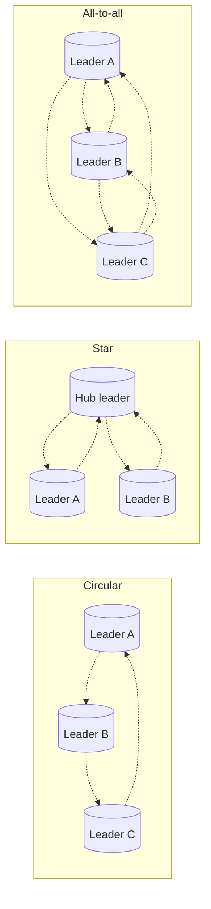

**Reading the diagram.** Every arrow is asynchronous replication of committed writes, typically a log stream over TCP. In the circular topology each write travels through every other leader in turn, so one failed or slow leader stops propagation for everyone downstream until the ring is reconfigured. In the star, the hub is a single point of failure for replication (though not for local writes). All-to-all has no single point of failure but sends every write along $m(m-1)$ links for $m$ leaders and allows writes to overtake each other on different paths. Each leader stores a full copy. Scaling beyond a handful of leaders multiplies both links and potential conflicts.

#### Mathematical foundations

How often do conflicts happen? Two writes to the same item conflict if they are made at different leaders within one replication delay of each other.

::: formula
**Conflict rate for one item written at two leaders**

$$\kappa \approx 2\,\lambda_A\,\lambda_B\,\Delta \qquad (\lambda_A \Delta \ll 1,\ \lambda_B \Delta \ll 1)$$

| Symbol | Meaning | Units |
|---|---|---|
| $\kappa$ | Expected conflicts per second for the item | conflicts/s |
| $\lambda_A, \lambda_B$ | Write rate to the item at leaders A and B | writes/s |
| $\Delta$ | Replication delay between the leaders | s |
:::

**Derivation.** Each write at A conflicts if B wrote the same item within $\Delta$ before or after it, a window of length $2\Delta$, which happens with probability about $2\Delta\lambda_B$ when that is small. Multiply by A's write rate.

::: example
**Worked example — Rare per key, common in aggregate.** Two regions replicate with $\Delta = 0.2$ s.

1. A busy shared document written 0.1 times per second in each region: $\kappa = 2 \times 0.1 \times 0.1 \times 0.2 = 0.004$ conflicts/s, about 14 per hour.
2. One million ordinary keys, each written 0.001 times per second in each region: per key $2 \times 10^{-6} \times 0.2 = 4 \times 10^{-7}$ conflicts/s; over all keys $0.4$ conflicts/s, about 34,600 per day.
3. Partitioned ownership, where each key is written in only one region: $\lambda_B = 0$, so $\kappa = 0$.

**Interpretation.** Conflicts grow with the product of the two write rates and with the delay; a partition that makes $\Delta$ last for minutes multiplies them. **Engineering implication.** Conflict resolution cannot be an afterthought you hope never runs. Either give each item a home leader, or make the resolution rule correct and tested (§27.14).
:::

#### Real-world industry applications

::: industry
**Amazon DynamoDB global tables.** Global tables replicate a table across Regions with every replica writable. For the multi-Region eventually consistent mode, AWS documents that concurrent updates to the same item are reconciled by last-writer-wins, so applications needing different semantics must avoid concurrent cross-Region writes to an item (as of 2026; AWS has since added a multi-Region strongly consistent option).
*Evidence: Primary* — [AWS Docs: DynamoDB Global Tables]
:::

::: industry
**CouchDB.** CouchDB replicates between any pair of databases, including offline devices. Each document has a revision tree; when replicas diverge, every node deterministically picks the same winning revision so readers agree, while the losing revisions are kept as conflicts that the application can read and merge.
*Evidence: Primary* — [Apache CouchDB Docs: Replication and Conflict Model]
:::

#### Failure scenarios

**Table 27.3 — Failure scenarios in multi-leader replication.**

| What goes wrong | Why | Detection | Recovery | Prevention |
|---|---|---|---|---|
| Replication stops for a subset of leaders | Ring or hub node failed | Replication lag grows on downstream leaders | Reconfigure ring or hub | All-to-all, or redundant hubs |
| Update applied before its insert | Messages overtook on different links | Apply errors, missing parents | Buffer and retry | Version vectors; causal delivery |
| Uniqueness violated | Two leaders accept same username | Duplicate detected after sync | Rename or merge manually | Route uniqueness checks to one home leader |
| Writes echo forever | Origin tag lost in transformation | Replication volume climbs | Drop duplicates by origin and version | Preserve origin IDs end to end |


## 27.7 Leaderless replication

### 27.7.1 Dynamo-style coordination

::: definition
**Definition — Leaderless replication.** Any replica of a key may accept reads and writes; the client, or a **coordinator** node acting for it, sends each request to several replicas in parallel and treats it as successful once enough of them respond. There is no failover because there is no leader [DeCandia et al. 2007].
:::

#### First-principles explanation

A club keeps its membership list on three noticeboards. To add a member, the secretary pins the notice on at least two boards. To check membership, a member looks at any two boards and believes the newer notice. Because two out of three and two out of three must share a board, the reader always sees at least one board with the latest notice, provided the notices carry dates that can be compared. No board is in charge, so losing one board stops nothing.

#### Why does this exist?

Amazon built Dynamo for the shopping cart, where refusing an "add to cart" during a failure costs money. A leader is a single point that must be detected dead and replaced; during that window writes stop. Leaderless replication keeps writing as long as *enough* replicas answer, and it masks slow replicas by not waiting for the slowest ones [DeCandia et al. 2007].

#### How it works internally

1. **Placement.** Keys are hashed onto a consistent-hash ring (§14.8). The **preference list** for a key is the first $N$ distinct physical nodes clockwise from its position; the list kept is longer than $N$ so that substitutes are known when nodes fail.
2. **Coordinator.** A request arrives at a partition-aware client library or at any node, which forwards it to a coordinator, typically the first healthy node in the key's preference list.
3. **Write.** The coordinator attaches a new version (a vector clock in Dynamo, a timestamp in Cassandra), writes locally and sends the write to the other replicas in parallel. It reports success once $W$ replicas, counting itself, acknowledge.
4. **Read.** The coordinator asks the replicas and waits for $R$ responses. If the versions differ, it returns the newest, or all causally concurrent versions for the client to reconcile (§27.14), and it may repair stale replicas (§27.13).
5. **Background repair.** Hinted handoff (§27.9) and Merkle-tree anti-entropy (§27.13) bring replicas that missed writes back into agreement.

**Figure 27.6 — A Dynamo-style write with N = 3 and W = 2.**

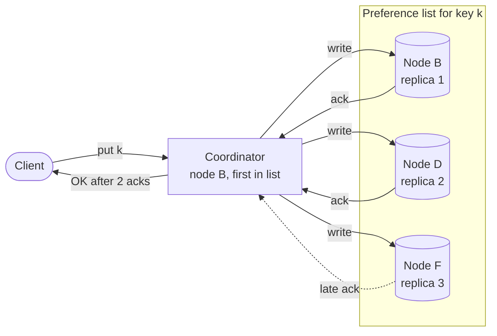

**Reading the diagram.** The client sends the write to a coordinator, here node B, which owns the first position in the key's preference list. The coordinator sends the write to all three replicas in parallel over the internal RPC protocol and replies once two acknowledgments arrive; the third (dotted) arrives later and is not waited for. Each replica stores the key in its local storage engine. Failure points: a replica that never receives the write (repaired later), and the coordinator crashing after some but not all replicas applied the write, leaving partial state (§27.8). Scaling adds nodes to the ring; each key still has exactly $N$ replicas.

::: industry
**Apache Cassandra.** Cassandra adopted Dynamo's ring, replication and repair mechanisms with a Bigtable-style data model [Lakshman and Malik 2010]. Any node can coordinate; a replication strategy chooses replicas per datacenter; each request carries a **consistency level** such as `ONE`, `QUORUM`, `LOCAL_QUORUM` or `ALL` that sets how many replica responses the coordinator waits for. Concurrent writes to a cell are resolved by timestamp (§27.14).
*Evidence: Primary* — [Lakshman and Malik 2010; Apache Cassandra Docs]
:::

## 27.8 Read and write quorums: R + W > N

### 27.8.1 The overlap argument

::: definition
**Definition — Quorum.** With $N$ replicas per key, a write is acknowledged after $W$ replicas confirm and a read returns after $R$ replicas respond. The configuration is a **strict quorum** when $R + W > N$, so every read set intersects every write set.
:::

::: formula
**Quorum overlap and fault tolerance**

$$|S_R \cap S_W| \;\ge\; R + W - N \qquad f_{\text{read}} = N - R \qquad f_{\text{write}} = N - W$$

| Symbol | Meaning | Units |
|---|---|---|
| $N$ | Replicas per key (replication factor) | replicas |
| $R$ | Responses a read waits for | replicas |
| $W$ | Acknowledgments a write waits for | replicas |
| $S_R, S_W$ | The sets of replicas that answered a read and acknowledged a write | sets |
| $f_{\text{read}}, f_{\text{write}}$ | Unavailable replicas a read or write can tolerate | replicas |
:::

**Derivation.** Both sets are drawn from $N$ replicas, so $|S_R \cup S_W| \le N$. Since $|S_R \cap S_W| = |S_R| + |S_W| - |S_R \cup S_W|$, the overlap is at least $R + W - N$, which is at least 1 exactly when $R + W > N$.

::: example
**Worked example — The N = 3 configurations.**

1. $R = 2, W = 2$: overlap $\ge 1$. Reads and writes each survive one unavailable replica. This is Dynamo's common configuration and Cassandra's `QUORUM` with RF = 3.
2. $R = 1, W = 3$: overlap $\ge 1$. Reads are fastest and survive two failures, but a single unavailable replica blocks every write.
3. $R = 3, W = 1$: overlap $\ge 1$. Writes survive two failures; a single unavailable replica blocks strong reads.
4. $R = 1, W = 1$: overlap $\ge -1$, meaning none is guaranteed. A read can miss the latest write entirely. This is `ONE`/`ONE`: fast and available, eventually consistent.
5. $R = 2, W = 1$ or $R = 1, W = 2$: $R + W = 3 = N$, no guaranteed overlap.

**Interpretation.** $R + W > N$ trades read cost against write cost along a line; it does not change total fault tolerance much. **Engineering implication.** Choose $W$ by how many failures writes must survive and how slow a write may be, then set $R = N - W + 1$, the cheapest read that still overlaps.
:::

### 27.8.2 What R + W > N does not guarantee

The overlap argument says that *some* replica in every read set holds the latest *completed* write. It is tempting to conclude that quorum reads are linearizable (§25.3). They are not, for five reasons [Kleppmann 2017, ch. 5]:

1. **Concurrent writes.** Two clients write the same key at the same time and their writes reach replicas in different orders. Overlap guarantees you see both, not that there is an agreed winner. With timestamps (last-writer-wins), one write is silently dropped (§27.14).
2. **A write concurrent with a read.** If a write has reached only some replicas when a read arrives, the read may or may not see it.
3. **Failed writes leave partial state.** If a write reaches one replica but fewer than $W$, the client is told it failed, but the one replica is not rolled back. Later reads may return the "failed" value, and may later stop returning it.
4. **Sloppy quorums.** If writes may go to substitute nodes outside the key's $N$ home replicas (§27.9), the read and write sets need not intersect at all.
5. **Lost replicas.** If a replica holding the new value fails and is rebuilt from a replica with the old value, the number of copies of the new value can fall below $W$.

**Figure 27.7 — R = W = 2, N = 3, and a read that goes back in time.**

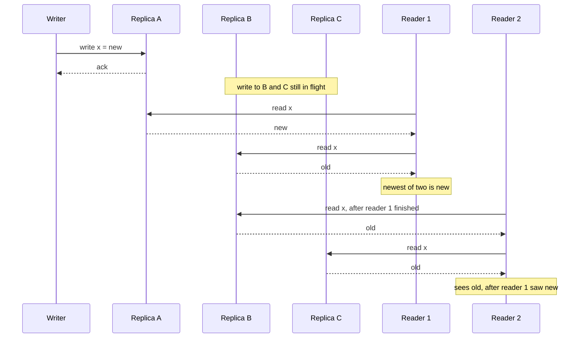

**Reading the diagram.** All calls are synchronous RPCs. The writer's update has reached only replica A. Reader 1 happens to include A in its quorum and returns `new`. Reader 2 starts strictly after Reader 1 finished but picks B and C, both still `old`. Each read overlapped every *completed* write (none has completed yet), so $R + W > N$ is not violated, yet the history is not linearizable: a later read observed an earlier state. The fix is for Reader 1 to write `new` back to a quorum before returning (**blocking read repair**, §27.13), which ABD-style register protocols do and which Cassandra performs for `QUORUM` reads that find a mismatch. Even then, operations that need compare-and-set require consensus (Chapter 26).

### 27.8.3 Latency: waiting for the k-th fastest replica

A quorum operation sends to all $N$ replicas and waits for the first $k$ replies, where $k = W$ for writes and $k = R$ for reads. Its latency is the **$k$-th order statistic** of the replica latencies: waiting for fewer replies hides the slow ones.

::: formula
**Latency of the k-th fastest of N replicas (independent, identically distributed)**

$$P\big(T_{(k)} > t\big) = \sum_{j=0}^{k-1} \binom{N}{j} F(t)^{j}\,\big(1 - F(t)\big)^{N-j} \qquad \mathbb{E}\big[T_{(k)}\big] = \mu \sum_{i=N-k+1}^{N} \frac{1}{i}\;\;\text{(exponential)}$$

| Symbol | Meaning | Units |
|---|---|---|
| $T_{(k)}$ | Time until the $k$-th reply arrives | ms |
| $F(t)$ | Probability that one replica replies within $t$ | dimensionless |
| $N$, $k$ | Replicas contacted; replies required | count |
| $j$ | Number of replicas that replied within $t$ (summation index) | count |
| $\mu$ | Mean latency of one replica, if exponentially distributed | ms |
:::

**Derivation.** The $k$-th reply is later than $t$ exactly when fewer than $k$ replicas have replied by $t$; the number that have is binomial with success probability $F(t)$. For exponential latencies, the gap before the first of $N$ replies has mean $\mu/N$, the next gap $\mu/(N-1)$, and so on, by memorylessness.

::: example
**Worked example — How much does W cost?** $N = 3$.

1. *Tail model.* Each replica is independently "slow" (a garbage-collection pause, say 50 ms) with probability $p = 0.01$, so $F(t) = 0.99$ for $t$ below 50 ms. The operation is slow when fewer than $k$ replicas are fast:
   - $k = 1$: $p^3 = 10^{-6}$.
   - $k = 2$: $p^3 + 3p^2(1-p) = 10^{-6} + 2.97 \times 10^{-4} = 2.98 \times 10^{-4}$.
   - $k = 3$: $1 - 0.99^3 = 0.0297$.
2. *Mean model.* Exponential replica latency with $\mu = 2$ ms: $k = 1$: $2 \times \tfrac{1}{3} = 0.67$ ms; $k = 2$: $2 \times (\tfrac{1}{3} + \tfrac{1}{2}) = 1.67$ ms; $k = 3$: $2 \times (\tfrac{1}{3} + \tfrac{1}{2} + 1) = 3.67$ ms.

**Interpretation.** Waiting for all three replicas exposes about 3% of operations, so the p99, to the 50 ms pause; waiting for two exposes 0.03%, beyond even the p99.9. **Engineering implication.** Quorums of two out of three keep the slowest replica off the tail. This is why Dynamo-style systems contact all $N$ replicas even when they need only $R$ or $W$ answers, and why "read from one replica, retry on timeout" is slower in the tail than a parallel quorum.
:::

The program below verifies the overlap table and both latency models.

```python
"""Quorum overlap and the latency of waiting for the k-th fastest of N replicas."""
from itertools import combinations
from math import comb
import random

def min_overlap(n, r, w):
    """Smallest possible intersection of any read set and any write set."""
    replicas = range(n)
    return min(len(set(rs) & set(ws))
               for rs in combinations(replicas, r)
               for ws in combinations(replicas, w))

def p_kth_slow(n, k, p_slow):
    """P(the k-th fastest reply is slow) = P(fewer than k replicas are fast)."""
    q = 1 - p_slow
    return sum(comb(n, j) * q**j * p_slow**(n - j) for j in range(k))

def mean_kth_exponential(n, k, mean):
    """E[k-th smallest of n i.i.d. exponential latencies with the given mean]."""
    return mean * sum(1 / i for i in range(n - k + 1, n + 1))

if __name__ == "__main__":
    n = 3
    print("R W  R+W>N  min overlap  read faults ok  write faults ok")
    for r in range(1, n + 1):
        for w in range(1, n + 1):
            print(f"{r} {w}  {str(r + w > n):5}  {min_overlap(n, r, w):^11}  "
                  f"{n - r:^14}  {n - w:^15}")

    print("\nP(k-th reply is slow), each replica slow with p = 0.01")
    for k in (1, 2, 3):
        print(f"  k = {k}: {p_kth_slow(n, k, 0.01):.3e}")

    random.seed(1)
    trials = 200_000
    print("\nk-th fastest of 3 exponential replies, mean 2 ms")
    for k in (1, 2, 3):
        sim = sum(sorted(random.expovariate(1 / 2.0) for _ in range(n))[k - 1]
                  for _ in range(trials)) / trials
        print(f"  k = {k}: formula {mean_kth_exponential(n, k, 2.0):.3f} ms, "
              f"simulated {sim:.3f} ms")
```

Output (abridged to the $R = W$ rows and the latency results):

```text
R W  R+W>N  min overlap  read faults ok  write faults ok
1 1  False       0             2                2
2 2  True        1             1                1
3 3  True        3             0                0

P(k-th reply is slow), each replica slow with p = 0.01
  k = 1: 1.000e-06
  k = 2: 2.980e-04
  k = 3: 2.970e-02

k-th fastest of 3 exponential replies, mean 2 ms
  k = 1: formula 0.667 ms, simulated 0.667 ms
  k = 2: formula 1.667 ms, simulated 1.666 ms
  k = 3: formula 3.667 ms, simulated 3.663 ms
```

What to notice:

- `min_overlap` checks every pair of read and write sets by brute force, confirming that the overlap is positive exactly when $R + W > N$.
- The simulated means match the harmonic-sum formula to three digits.

::: mistake
**Mistake — "QUORUM reads and writes make Cassandra linearizable."** They give overlap, not linearizability: concurrent writes are resolved by timestamp, failed writes are not rolled back, and only blocking read repair prevents the read anomaly of Figure 27.7. Compare-and-set needs Cassandra's Paxos-based lightweight transactions.
:::

## 27.9 Sloppy quorums and hinted handoff

### 27.9.1 Writing to a stand-in

::: definition
**Definition — Sloppy quorum and hinted handoff.** In a **sloppy quorum**, a write that cannot reach $W$ of a key's $N$ home replicas is accepted by the next healthy nodes on the ring instead, and still counts toward $W$. Each stand-in stores the write with a **hint** naming the intended home replica and **hands it off** when that replica recovers [DeCandia et al. 2007].
:::

#### First-principles explanation

A neighbor is away, so the courier leaves the parcel with the house next door, together with a note: "for number 12". When number 12 returns, the neighbor hands it over. Nothing is lost and the courier did not have to bring the parcel back, but if you go to number 12 asking for the parcel while it is still next door, you will not find it.

#### How it works internally

1. The coordinator walks the preference list beyond the first $N$ nodes when home replicas are unreachable, choosing the first $N$ *healthy* nodes.
2. A stand-in stores the write in a separate local hint store, tagged with the intended owner.
3. The stand-in periodically checks whether the owner is reachable again and, when it is, replays the hint and deletes it.
4. If the owner stays down longer than a configured **hint window**, the stand-in stops collecting hints, and Merkle-tree repair (§27.13) must restore the replica.

**Figure 27.8 — A sloppy quorum write and later handoff.**

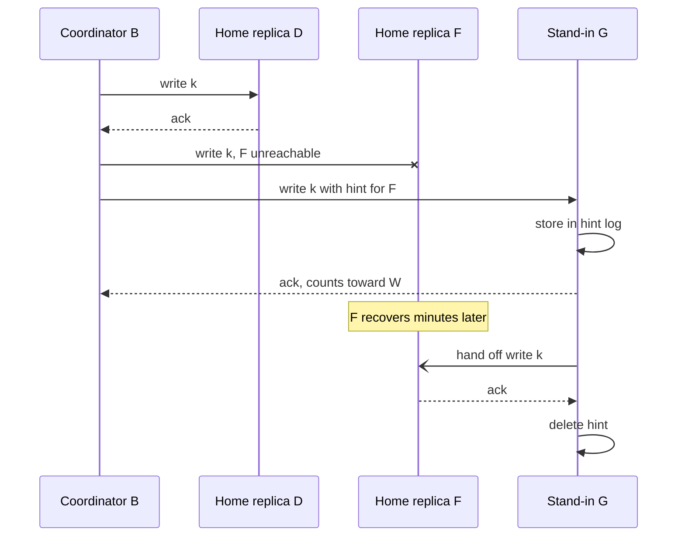

**Reading the diagram.** The coordinator's writes are synchronous RPCs. Home replica F is unreachable (crossed arrow), so stand-in G, the next node on the ring, accepts the write into a separate hint log, and its acknowledgment counts toward $W$. When F returns, G replays the write asynchronously (open arrowhead) and deletes the hint. Storage boundaries are the hint log on G and the main store on F. Failure points: G failing before handoff (the hint is lost, so anti-entropy must repair F), and reads in the meantime that go to the home replicas and miss the write, because G is not in their read set.

#### Mathematical foundations

::: formula
**Hint volume during an outage**

$$V_h = \frac{r_w \cdot N}{n} \cdot T_{\text{down}} \cdot s$$

| Symbol | Meaning | Units |
|---|---|---|
| $V_h$ | Total hints accumulated for the failed node across the cluster | bytes |
| $r_w$ | Cluster-wide client write rate | writes/s |
| $N$ | Replication factor | replicas |
| $n$ | Nodes in the cluster | nodes |
| $T_{\text{down}}$ | Time the node is down (capped by the hint window) | s |
| $s$ | Size of one write including overhead | bytes |
:::

::: example
**Worked example — A one-hour outage.** A 12-node cluster takes $r_w = 60{,}000$ writes/s with $N = 3$ and 1 KB writes.

1. Replica writes per node: $60{,}000 \times 3 / 12 = 15{,}000$ writes/s.
2. Hints for a one-hour outage: $15{,}000 \times 3{,}600 = 5.4 \times 10^{7}$ writes, $5.4 \times 10^{7} \times 1$ KB $= 54$ GB.
3. Spread over the 11 survivors: about 4.9 GB each.
4. Replay into the recovered node at 100 MB/s total: $54 \times 10^{9} / 10^{8} = 540$ s, about 9 minutes, during which that node still serves stale reads.

**Interpretation.** Hints are cheap for short outages and grow linearly with downtime. **Engineering implication.** Cap the hint window (Cassandra's default is 3 hours, as of Cassandra 4) so stand-ins do not fill their disks, alert when a node exceeds it, and run a full repair before the node rejoins the read path.
:::

#### Real-world industry applications

::: industry
**Dynamo versus Cassandra.** Dynamo used sloppy quorums: hinted writes count toward $W$, maximizing write availability at the cost of quorum overlap [DeCandia et al. 2007]. Cassandra stores hints too, but by default they do not count toward the consistency level; only `ANY` accepts a write stored solely as a hint. Cassandra's quorums are therefore strict, and hints are a best-effort repair mechanism [Apache Cassandra Docs: Hints].
*Evidence: Primary* — [DeCandia et al. 2007; Apache Cassandra Docs: Hints]
:::

::: warning
**Warning — Sloppy quorums break the overlap guarantee.** A write acknowledged by stand-ins G and H and a later read from home replicas D and F can share no node, even though $R + W > N$. Treat a sloppy quorum as a durability promise ("$W$ nodes hold this write"), not a consistency promise.
:::

## 27.10 Failure detection

### 27.10.1 Heartbeats and timeouts

::: definition
**Definition — Failure detector.** A component that outputs, for each monitored process, whether it currently **suspects** that process has crashed. It is **complete** if every crashed process is eventually suspected and **accurate** if live processes are not suspected. In an asynchronous network no detector can be both perfectly complete and perfectly accurate, because a slow process is indistinguishable from a dead one [Chandra and Toueg 1996].
:::

#### First-principles explanation

You phone a friend every evening. One evening there is no call. Did the friend's phone die, are they busy, or is the network down? If you raise the alarm after five minutes, you will often worry about nothing; if you wait a week, you will be late when something really happened. Every failure detector picks a point on this curve between **detection time** and **false-suspicion rate**.

#### How it works internally

1. Each node sends a **heartbeat** every $h$ seconds (push), or a monitor sends **pings** and expects replies (pull).
2. The monitor records the arrival time of the last heartbeat.
3. If nothing arrives within a **timeout** $T_{\text{out}}$, the node is suspected.

A crash happens at a random point in the heartbeat cycle, so the crash-to-suspicion time is between $T_{\text{out}} - h$ and $T_{\text{out}}$, about $T_{\text{out}} - h/2$ on average. A fixed timeout must be set above the worst normal gap: network jitter, garbage-collection pauses (often hundreds of milliseconds, sometimes seconds) and CPU starvation. A common rule of thumb is $T_{\text{out}}$ of three to five heartbeat intervals. The flaw is that one number cannot suit both a quiet LAN and a congested cross-region link.

### 27.10.2 The phi-accrual detector

Hayashibara et al. replaced the binary verdict with a continuous **suspicion level** $\varphi$ that adapts to the observed heartbeat history; each application then picks its own threshold [Hayashibara et al. 2004].

::: formula
**Phi-accrual suspicion level (normal model)**

$$\varphi(t_{\text{now}}) = -\log_{10}\Big(1 - F\big(t_{\text{now}} - t_{\text{last}}\big)\Big), \qquad F(\delta) = \Phi\!\Big(\frac{\delta - \mu}{\sigma}\Big)$$

| Symbol | Meaning | Units |
|---|---|---|
| $\varphi$ | Suspicion level; the detector's false-suspicion probability is about $10^{-\varphi}$ | dimensionless |
| $t_{\text{now}} - t_{\text{last}}$ | Time since the last heartbeat arrived, $\delta$ | ms |
| $\mu, \sigma$ | Mean and standard deviation of recent inter-arrival times (sliding window) | ms |
| $F$ | Estimated cumulative distribution of inter-arrival times | dimensionless |
| $\Phi$ | Standard normal cumulative distribution function | dimensionless |
:::

$1 - F(\delta)$ is the probability that a live node's next heartbeat would arrive even later than $\delta$. If you suspect the node now, that is roughly the probability you are wrong. So $\varphi = 1$ means a 10% chance of a mistake, $\varphi = 2$ means 1%, and $\varphi = 8$ means $10^{-8}$.

::: example
**Worked example — When does phi reach 8?** Heartbeats arrive every $\mu = 1{,}000$ ms with $\sigma = 100$ ms.

1. After 1,200 ms of silence: $z = (1{,}200 - 1{,}000)/100 = 2$; $1 - \Phi(2) = 0.0228$; $\varphi = -\log_{10} 0.0228 = 1.64$.
2. After 1,400 ms: $z = 4$; $1 - \Phi(4) = 3.17 \times 10^{-5}$; $\varphi = 4.50$.
3. After 1,500 ms: $z = 5$; $2.87 \times 10^{-7}$; $\varphi = 6.54$.
4. After 1,600 ms: $z = 6$; $9.87 \times 10^{-10}$; $\varphi = 9.01$.
5. Threshold 8 means $1 - \Phi(z) = 10^{-8}$, so $z = 5.61$: suspicion after $1{,}000 + 5.61 \times 100 = 1{,}561$ ms.
6. On a jittery link with $\sigma = 400$ ms, the same threshold waits $1{,}000 + 5.61 \times 400 = 3{,}245$ ms.

**Interpretation.** The same threshold produces a short timeout on a steady link and a long one on a noisy link, because it is a statement about error probability, not about time. **Engineering implication.** Set a floor on $\sigma$ (otherwise a very regular sender makes the detector hair-trigger) and an allowance for expected pauses, then tune one threshold for the whole fleet.
:::

```python
"""A phi-accrual failure detector (Hayashibara et al. 2004) with a normal model."""
from collections import deque
from math import erfc, log10, sqrt
import random
import statistics

class PhiAccrualDetector:
    def __init__(self, window=1000, min_std_ms=50.0):
        self.intervals = deque(maxlen=window)   # recent heartbeat inter-arrival times
        self.last = None
        self.min_std = min_std_ms              # floor so a very regular sender is not hair-trigger

    def heartbeat(self, now_ms):
        if self.last is not None:
            self.intervals.append(now_ms - self.last)
        self.last = now_ms

    def phi(self, now_ms):
        if len(self.intervals) < 2:
            return 0.0
        mu = statistics.fmean(self.intervals)
        sigma = max(statistics.stdev(self.intervals), self.min_std)
        z = (now_ms - self.last - mu) / sigma
        p_later = 0.5 * erfc(z / sqrt(2))       # P(next heartbeat arrives even later)
        return -log10(max(p_later, 1e-300))

if __name__ == "__main__":
    random.seed(42)
    d = PhiAccrualDetector()
    t = 0.0
    for _ in range(1000):                       # heartbeats every ~1,000 ms, sd ~100 ms
        t += random.gauss(1000, 100)
        d.heartbeat(t)
    mu = statistics.fmean(d.intervals)
    sd = statistics.stdev(d.intervals)
    print(f"learned mean {mu:.0f} ms, std {sd:.0f} ms")
    for silence in (1000, 1200, 1400, 1500, 1600, 2000):
        print(f"silent for {silence:>4} ms -> phi = {d.phi(t + silence):6.2f}")
    s = 1000
    while d.phi(t + s) < 8:                     # when does phi cross the threshold of 8?
        s += 1
    print(f"phi reaches 8 after {s} ms of silence")
```

Output:

```text
learned mean 998 ms, std 102 ms
silent for 1000 ms -> phi =   0.31
silent for 1200 ms -> phi =   1.62
silent for 1400 ms -> phi =   4.39
silent for 1500 ms -> phi =   6.36
silent for 1600 ms -> phi =   8.74
silent for 2000 ms -> phi =  22.34
phi reaches 8 after 1571 ms of silence
```

What to notice: the detector learns $\mu$ and $\sigma$ from a sliding window of 1,000 intervals; `erfc` computes the normal tail without losing precision; and the learned values (998 ms, 102 ms) give a crossing at 1,571 ms, close to the 1,561 ms of the worked example.

::: industry
**Cassandra and Akka.** Cassandra marks a node down when its phi value exceeds `phi_convict_threshold`, default 8. Its implementation models gossip inter-arrival times with an exponential rather than a normal distribution, so $\varphi$ grows linearly with silence [Apache Cassandra Docs; Cassandra source, `FailureDetector`]. Akka Cluster uses the normal model with a configurable threshold, a minimum standard deviation and an "acceptable heartbeat pause" [Akka Docs: Phi Accrual Failure Detector].
*Evidence: Primary* — [Apache Cassandra Docs; Akka Docs]
:::

### 27.10.3 Gossip and SWIM

All-to-all heartbeating costs $n(n-1)/h$ messages per second: 999,000 per second for 1,000 nodes at one per second. Large clusters instead spread information **epidemically**: each node periodically contacts a few random peers and exchanges what it knows, as an infection spreads [Demers et al. 1987].

::: definition
**Definition — Gossip protocol.** A protocol in which, every round, each node exchanges state with $f$ randomly chosen peers (the **fanout**). In **push** gossip informed nodes send updates; in **pull** gossip nodes ask peers for news; **push–pull** does both. **Anti-entropy** gossip exchanges full state; **rumor mongering** spreads only recent updates and stops after a while [Demers et al. 1987].
:::

::: formula
**Rounds for push gossip to reach every node**

$$T_{\text{rounds}} \approx \log_{1+f} n + \frac{\ln n}{f} \qquad \text{(for } f = 1\text{: } \log_2 n + \ln n + O(1)\text{)}$$

| Symbol | Meaning | Units |
|---|---|---|
| $T_{\text{rounds}}$ | Rounds until every node is informed | rounds |
| $n$ | Number of nodes | nodes |
| $f$ | Peers contacted per node per round | peers/round |
:::

**Derivation.** Early on almost every target is uninformed, so the informed set grows by a factor of about $1 + f$ per round: $\log_{1+f} n$ rounds to reach most nodes. At the end, each uninformed node escapes all $f$ pushes from nearly $n$ informed nodes with probability about $e^{-f}$ per round, so the uninformed count shrinks by $e^{-f}$ per round and the last one is reached after about $\ln n / f$ more rounds. Pittel proved the $f = 1$ case [Pittel 1987]. Pull shrinks the uninformed fraction from $p$ to about $p^2$ per round at the end, so push–pull finishes in $\log_3 n + O(\log \log n)$ rounds [Karp et al. 2000].

::: example
**Worked example — Spreading a membership change to 1,000 nodes.**

1. Push, $f = 1$: $\log_2 1{,}000 + \ln 1{,}000 = 9.97 + 6.91 = 16.9$ rounds.
2. Push, $f = 3$: $\log_4 1{,}000 + 6.91/3 = 4.98 + 2.30 = 7.3$ rounds.
3. Growth with size, $f = 1$: going to 10,000 nodes adds $\log_2 10 + \ln 10 = 3.32 + 2.30 = 5.6$ rounds.
4. With one round per second, a change reaches all 1,000 nodes in roughly 17–18 s by push alone.

**Interpretation.** Dissemination time grows with $\log n$, and each node's message load is constant ($f$ per round) regardless of cluster size. **Engineering implication.** Gossip scales membership and failure news to thousands of nodes, but a full spread takes tens of rounds; anything that must take effect everywhere *at once* belongs in a consensus-backed store (Chapter 26).
:::

**SWIM** combines a randomized failure detector with gossip dissemination [Das et al. 2002]. In each **protocol period** $T'$, every member:

1. Picks a random member $M_j$ and sends it a `ping`.
2. If no `ack` arrives within a short timeout, sends `ping-req` to $k$ other random members, asking them to ping $M_j$ and relay any ack. This indirect probe avoids blaming $M_j$ for a congested link between two particular nodes.
3. If still no ack, marks $M_j$ **suspect**, rather than dead, and spreads the suspicion. $M_j$ can refute it by gossiping an "alive" message with a higher **incarnation number**; if nobody refutes it within a suspicion timeout, $M_j$ is declared failed.
4. Membership updates (joins, suspicions, failures) are **piggybacked** on ping and ack messages, so dissemination costs no extra messages.

**Figure 27.9 — A SWIM protocol period with an indirect probe.**

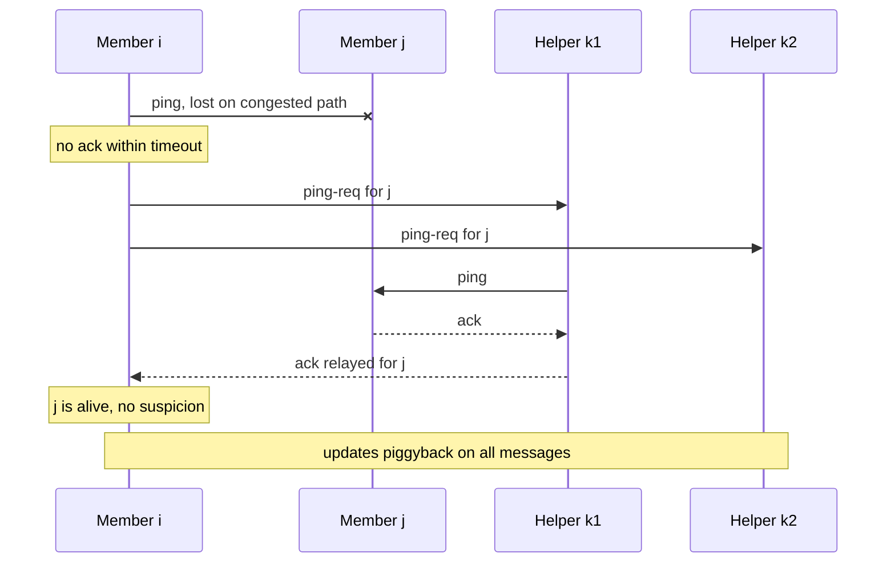

**Reading the diagram.** All messages are small UDP datagrams in typical implementations. Member $i$'s direct ping is lost, so it asks two helpers to probe $j$ for it; one helper's ping succeeds and its ack is relayed back, so $j$ is not suspected. Had both indirect probes failed, $i$ would gossip "$j$ suspect", and $j$ would have a suspicion timeout to refute it. No member stores more than the membership list. Failure points: a member that is itself overloaded may miss acks and wrongly suspect others, which the Lifeguard extensions address by lengthening its own timeouts [Dadgar et al. 2017]. Message load per member is constant as the group grows.

::: formula
**SWIM expected time to first detection**

$$\mathbb{E}[T_{\text{detect}}] = \frac{T'}{1 - \big(1 - \frac{1}{n-1}\big)^{n-1}} \;\xrightarrow{\;n \to \infty\;}\; T' \cdot \frac{e}{e-1} \approx 1.58\,T'$$

| Symbol | Meaning | Units |
|---|---|---|
| $T'$ | Protocol period | s |
| $n$ | Group size | members |
| $\mathbb{E}[T_{\text{detect}}]$ | Expected time until some member first probes the failed member | s |
:::

**Derivation.** Each of the $n - 1$ live members picks the failed member with probability $1/(n-1)$, so the chance that none does in a period is $(1 - \tfrac{1}{n-1})^{n-1} \approx e^{-1}$. The number of periods until someone does is geometric with success probability $1 - e^{-1}$, giving a mean of $1/(1 - e^{-1}) = e/(e-1)$.

::: example
**Worked example — Detection budget for 1,000 members.** $T' = 1$ s, $n = 1{,}000$.

1. $(1 - 1/999)^{999} = 0.3677$, so $\mathbb{E}[T_{\text{detect}}] = 1/(1 - 0.3677) = 1.58$ s.
2. Add a suspicion timeout of, say, 5 s for refutation: about 6.6 s from crash to declaration.
3. Spreading the verdict by piggybacking takes $O(\log n)$ further periods, about 10–17 at this size.
4. Message load: about 2 messages (ping and ack) per member per period, about 2,000 per second cluster-wide, versus 999,000 for all-to-all heartbeats.

**Interpretation.** Detection time is independent of group size; only dissemination grows, logarithmically. **Engineering implication.** SWIM-style membership is the standard choice for clusters of hundreds to thousands of nodes; tune the suspicion timeout, not the probe rate, to trade false positives for speed.
:::

The simulation below measures push, pull and push–pull dissemination and SWIM's first-detection time.

```python
"""Rounds for a rumor to reach every node: push, pull and push-pull gossip,
plus SWIM's expected time to first detection of a crashed member."""
import math
import random
import statistics

def spread(n, mode, fanout=1, rng=random):
    """Synchronous rounds: every node contacts `fanout` random peers per round."""
    informed = [False] * n
    informed[0] = True
    count, rounds = 1, 0
    while count < n:
        rounds += 1
        new = informed[:]                        # updates take effect next round
        for node in range(n):
            for _ in range(fanout):
                peer = rng.randrange(n - 1)
                peer += peer >= node             # a random peer other than itself
                if mode in ("push", "push-pull") and informed[node]:
                    new[peer] = True             # push: informed node tells peer
                if mode in ("pull", "push-pull") and informed[peer]:
                    new[node] = True             # pull: node asks peer for news
        informed = new
        count = sum(informed)
    return rounds

def swim_first_detection(n, rng=random):
    """Protocol periods until some live member pings the one crashed member."""
    periods = 0
    while True:
        periods += 1
        # each of the n-1 live members pings one random other member
        if any(rng.randrange(n - 1) == 0 for _ in range(n - 1)):
            return periods

if __name__ == "__main__":
    rng = random.Random(2026)
    n, trials = 1000, 100
    print(f"n = {n}, fanout 1, {trials} trials each")
    for mode in ("push", "pull", "push-pull"):
        r = [spread(n, mode, 1, rng) for _ in range(trials)]
        print(f"  {mode:9s}: mean {statistics.fmean(r):5.2f} rounds, max {max(r)}")
    print(f"  model log2(n) + ln(n) = {math.log2(n) + math.log(n):.2f} rounds (push)")
    for f in (2, 3):
        r = [spread(n, "push", f, rng) for _ in range(trials)]
        model = math.log(n, 1 + f) + math.log(n) / f
        print(f"  push, fanout {f}: mean {statistics.fmean(r):5.2f}, model {model:5.2f}")
    for size in (100, 1000, 10000):
        print(f"  push, n = {size:>5}: mean "
              f"{statistics.fmean(spread(size, 'push', 1, rng) for _ in range(30)):5.2f} rounds")

    d = [swim_first_detection(n, rng) for _ in range(5000)]
    print(f"SWIM first detection: mean {statistics.fmean(d):.3f} periods, "
          f"e/(e-1) = {math.e / (math.e - 1):.3f}")
```

Output:

```text
n = 1000, fanout 1, 100 trials each
  push     : mean 17.99 rounds, max 22
  pull     : mean 13.66 rounds, max 19
  push-pull: mean  9.13 rounds, max 10
  model log2(n) + ln(n) = 16.87 rounds (push)
  push, fanout 2: mean 10.62, model  9.74
  push, fanout 3: mean  8.28, model  7.29
  push, n =   100: mean 12.23 rounds
  push, n =  1000: mean 18.33 rounds
  push, n = 10000: mean 23.70 rounds
SWIM first detection: mean 1.597 periods, e/(e-1) = 1.582
```

What to notice:

- Push gossip takes about one round more than the model, the $O(1)$ term; each tenfold increase in $n$ adds about 5.6 rounds, as predicted.
- Push–pull halves the rounds because pull mops up the last uninformed nodes quadratically fast.
- SWIM's simulated detection time matches $e/(e-1)$ periods.

::: mistake
**Mistake — "A failure detector tells you a node is dead."** It tells you a node is *suspected*. A suspected primary may still be running and writing. Every action taken on suspicion, such as promoting a replica, must fence the suspect (§26.13).
:::

## 27.11 Failover

### 27.11.1 From detection to redirection

::: definition
**Definition — Failover.** The sequence that replaces a failed node in a role: **detection**, **election** of a replacement, **reconfiguration** (making the replacement consistent and fencing the old node) and **client redirection**.
:::

Leaderless systems need no failover for writes; primary–backup, chain and consensus systems do. Each step consumes part of the availability budget.

**Figure 27.10 — A failover time budget with DNS redirection.**

```mermaid
gantt
  title Failover timeline in seconds
  dateFormat s
  axisFormat %S
  section Detect
  Missed heartbeats      :d1, 0, 6s
  section Elect
  Choose most advanced   :d2, after d1, 1s
  section Reconfigure
  Fence and apply relay log :d3, after d2, 3s
  section Redirect
  DNS TTL expiry         :d4, after d3, 30s
```

**Reading the diagram.** Time runs left to right from the crash; each bar must finish before the next starts, so the steps are sequential. Detection waits for the timeout; election picks the replica holding the most acknowledged log (or runs a consensus election, §26.5); reconfiguration fences the old primary, applies any unapplied log and switches the replica to read–write mode; redirection waits for clients to learn the new address. The DNS bar dominates. The failure points are a premature detection (split brain if fencing fails) and redirection that never completes for clients that cache addresses beyond the TTL.

::: formula
**Failover time budget**

$$T_{\text{fo}} = T_{\text{detect}} + T_{\text{elect}} + T_{\text{reconfig}} + T_{\text{redirect}} \qquad D_{\text{yr}} = \nu \cdot T_{\text{fo}}$$

| Symbol | Meaning | Units |
|---|---|---|
| $T_{\text{fo}}$ | Time from crash until clients write successfully again | s |
| $T_{\text{detect}}$ | Time to suspect the failure | s |
| $T_{\text{elect}}$ | Time to choose a replacement | s |
| $T_{\text{reconfig}}$ | Time to fence, catch up and promote | s |
| $T_{\text{redirect}}$ | Time until clients reach the replacement | s |
| $\nu$ | Failovers per year | 1/year |
| $D_{\text{yr}}$ | Write downtime per year from failovers | s/year |
:::

::: example
**Worked example — DNS versus a proxy.** Heartbeats every 2 s with a 6 s timeout; election 1 s; reconfiguration 3 s.

1. DNS redirection with a 30 s TTL: $T_{\text{fo}} = 6 + 1 + 3 + 30 = 40$ s.
2. Proxy or virtual IP that switches in 1 s: $T_{\text{fo}} = 6 + 1 + 3 + 1 = 11$ s.
3. With $\nu = 6$ failovers a year (crashes, kernel patches, zone events): $6 \times 40 = 240$ s versus $6 \times 11 = 66$ s.
4. Against a 99.99% target (52.6 min = 3,156 s per year, §4.14): DNS failovers use 7.6% of the budget, the proxy 2.1%. Against a monthly budget of 4.32 min, one DNS failover uses 15%.

**Interpretation.** Redirection, not detection, is often the largest term. **Engineering implication.** Put a proxy, a virtual IP or a topology-aware client in front of a replicated primary, and measure each term in game days rather than assuming it.
:::

#### Dangers

- **Split brain.** If the old primary is merely slow or partitioned, it may still accept writes. Both "primaries" then diverge (§26.12). Only fencing, by lease expiry, a fencing token checked by storage, or cutting power, makes promotion safe.
- **Data loss with asynchronous replication.** The promoted replica lacks the last $r_w \ell$ writes (§27.4). Worse, when the old primary returns, its unreplicated writes conflict with new writes that reused the same keys or IDs.

::: industry
**GitHub, October 2018.** A 43-second loss of connectivity between GitHub's US East Coast network hub and its primary East Coast datacenter led its MySQL failover tooling (Orchestrator) to promote replicas in the US West Coast. When connectivity returned, the East Coast databases held writes not present in the West and vice versa, so GitHub could not simply fail back. It chose data integrity over speed and ran degraded for 24 hours and 11 minutes while reconciling; its follow-ups included preventing automatic cross-region promotion.
*Evidence: Primary* — [GitHub 2018]
:::

## 27.12 Recovery

### 27.12.1 Catching up, snapshotting and rebuilding

::: definition
**Definition — Replica recovery.** Returning a replica to full membership after a crash or replacement, by **log catch-up** (replaying missed log entries), **snapshot plus log** (installing a copy of the state, then replaying from the snapshot's position) or **rebuild** (copying all data from peers).
:::

#### How it works internally

1. **Log catch-up.** If the node's disk survived and the primary still retains every log entry since the node's last applied position, the node replays them (§14.4.2). PostgreSQL retains WAL for a replica through `wal_keep_size` or a **replication slot**; MySQL keeps binlogs for `binlog_expire_logs_seconds`.
2. **Snapshot plus log.** If the log has been truncated past the node's position, it installs a snapshot taken at a known log position and replays from there. PostgreSQL's `pg_basebackup` and Raft's `InstallSnapshot` (§26.7) work this way.
3. **Rebuild.** A replacement node in a leaderless store streams its token ranges from the surviving replicas; with virtual nodes (§14.8), many peers send in parallel. New writes for those ranges go to the joining node while it streams.

**Figure 27.11 — Choosing a recovery path.**

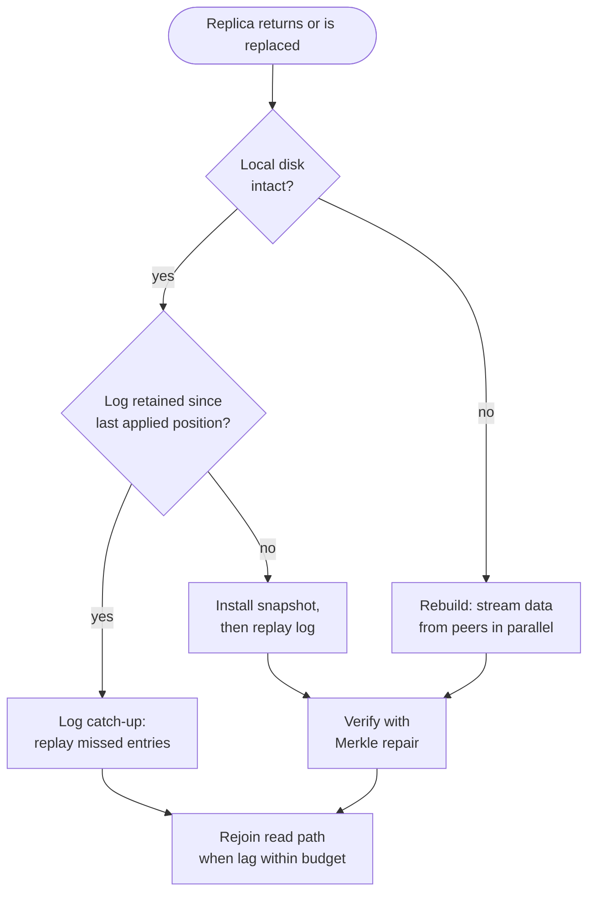

**Reading the diagram.** Decisions run top to bottom. Every path ends at the same gate: the replica rejoins the read path only once its lag is within the staleness budget. Snapshot and rebuild paths transfer bulk data over the network and are throttled to protect the sources; log catch-up streams only missed entries. Storage boundaries are the source's log retention (which decides the middle branch) and the new node's disk. Failure points: a second failure during a long rebuild, which leaves the data with fewer copies (§4.16), and a source overwhelmed by streaming.

::: formula
**Recovery time for snapshot plus log**

$$T_{\text{rec}} = \frac{D}{B_{\text{eff}}} + \frac{r_{\text{in}} \cdot D / B_{\text{eff}}}{r_{\text{apply}} - r_{\text{in}}}, \qquad B_{\text{eff}} = \min\big(\textstyle\sum_i B_{\text{src},i},\; B_{\text{dst}}\big)$$

| Symbol | Meaning | Units |
|---|---|---|
| $T_{\text{rec}}$ | Time until the replica is current | s |
| $D$ | Size of the snapshot or data to copy | bytes |
| $B_{\text{eff}}$ | Effective copy bandwidth | bytes/s |
| $B_{\text{src},i}$ | Throttled send rate of source $i$ | bytes/s |
| $B_{\text{dst}}$ | Receiver limit: NIC or disk write rate | bytes/s |
| $r_{\text{in}}$ | Rate of new log entries during the copy | entries/s |
| $r_{\text{apply}}$ | Rate at which the replica replays entries | entries/s |
:::

The second term is the catch-up time of §14.4.2 applied to the backlog accumulated during the copy.

::: example
**Worked example — Rebuilding a 2 TB replica.** New writes arrive at $r_{\text{in}} = 5{,}000$ entries/s and the replica applies $r_{\text{apply}} = 8{,}000$ entries/s.

1. One source throttled to 250 MB/s: copy $= 2 \times 10^{12} / 2.5 \times 10^{8} = 8{,}000$ s (2.2 h). Backlog $= 5{,}000 \times 8{,}000 = 4 \times 10^{7}$ entries; catch-up $= 4 \times 10^{7} / 3{,}000 = 13{,}333$ s (3.7 h). Total about 5.9 h.
2. Twenty sources at 100 MB/s each (2 GB/s) into a 10 Gb/s NIC (1.25 GB/s): $B_{\text{eff}} = 1.25$ GB/s; copy $= 1{,}600$ s (27 min). Backlog $8 \times 10^{6}$; catch-up 2,667 s (44 min). Total about 71 min.
3. Durability during recovery: from §4.16, the chance of losing a three-way replicated item grows with the square of repair time, so cutting 21,333 s to 4,267 s improves it by about $(21{,}333/4{,}267)^2 = 5^2 = 25$ times.

**Interpretation.** Recovery time is dominated by copy bandwidth and by apply headroom, and parallel sources help only until the receiver saturates. **Engineering implication.** Spread replicas with virtual nodes, keep apply headroom, and retain enough log that short outages never need a full copy.
:::

::: warning
**Warning — A rejoining replica can resurrect deleted data.** Leaderless stores record deletes as **tombstones** and purge them after a grace period (Cassandra's `gc_grace_seconds`, 10 days by default). A replica that was down longer than that, or never repaired within it, still holds the deleted rows and will spread them back. Repair every replica within the grace period, and never return a long-dead node without a full repair.
:::

## 27.13 Anti-entropy and read repair

### 27.13.1 Repairing on the read path and in the background

::: definition
**Definition — Read repair and anti-entropy.** **Read repair** fixes stale replicas discovered while serving a read: the coordinator writes the newest version back to replicas that returned older ones. **Anti-entropy** is a background process that compares whole replicas, typically with Merkle trees, and copies the differences [DeCandia et al. 2007; Demers et al. 1987].
:::

Hinted handoff repairs short outages, but hints can be lost and only cover writes made while the stand-in knew of the failure. Two further mechanisms close the gaps:

1. **Read repair.** On a read the coordinator compares versions, usually by requesting full data from one replica and digests (hashes) from the others. On a mismatch it fetches full data, computes the newest version, returns it and writes it back to the stale replicas. **Blocking** read repair finishes the write-back before replying, which is what prevents the anomaly of Figure 27.7; **asynchronous** read repair replies first. Read repair only fixes keys that are read, so rarely read keys can stay divergent indefinitely.
2. **Merkle-tree anti-entropy.** Each replica builds a hash tree over each key range (§17.8). Two replicas compare roots, descend only into differing subtrees and stream only the divergent leaf ranges. For two replicas of a million-leaf tree that differ in two leaves, this compares about 80 hashes instead of the whole data set (§17.8).

**Figure 27.12 — Blocking read repair with R = 2.**

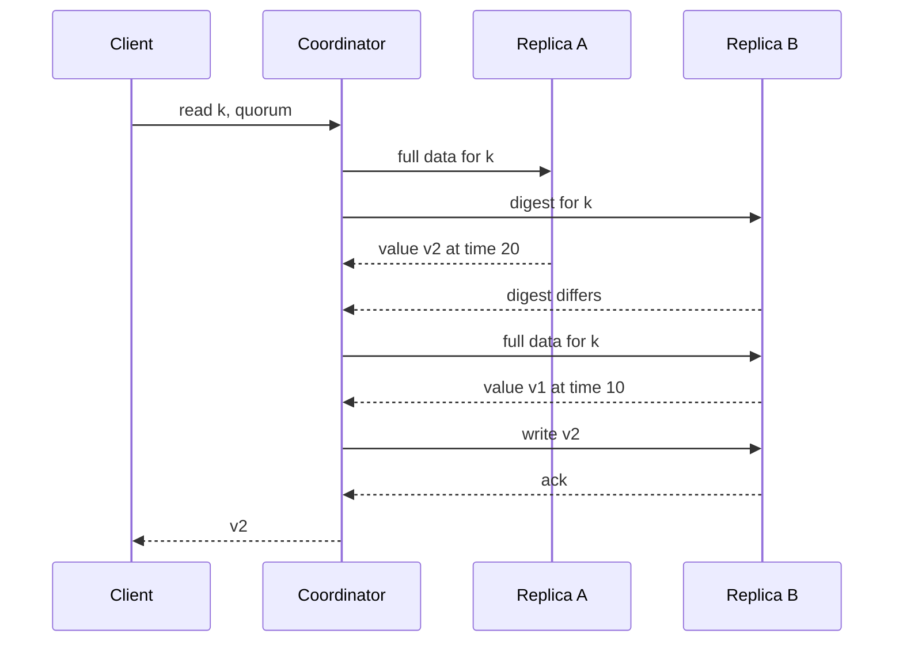

**Reading the diagram.** All calls are synchronous. Asking one replica for data and others for digests saves bandwidth when replicas agree, the common case. On a mismatch the coordinator fetches B's value, picks the newer one by timestamp (or by version vector), writes it to B and only then replies, so any later quorum read must meet a replica holding v2. The storage boundary is each replica's local store. Failure points: the extra round trips on mismatches inflate read tail latency, and a write-back racing a newer concurrent write must not overwrite it, which version comparison prevents.

::: industry
**Cassandra repair.** Cassandra's `nodetool repair` builds Merkle trees per token range on each replica, compares them and streams mismatched ranges; incremental repair limits the work to data written since the last repair. Operators are told to repair every node within `gc_grace_seconds` so that tombstones reach every replica before they are purged.
*Evidence: Primary* — [Apache Cassandra Docs: Repair]
:::

## 27.14 Conflict resolution: LWW, version vectors and CRDTs

### 27.14.1 Last-writer-wins

::: definition
**Definition — Last-writer-wins (LWW).** Each write carries a timestamp, and when replicas hold different values for an item, the one with the greatest timestamp is kept and the others are discarded.
:::

LWW is simple, needs no application code and always converges, which is why Cassandra and DynamoDB global tables use it. Its cost is **silent data loss**: of two concurrent writes, one is discarded even though both were acknowledged. Worse, "last" is decided by clocks that can disagree by milliseconds or more (§24.9), so a write that happened *later* in real time can lose to one whose node's clock runs fast.

::: example
**Worked example — Losing a later write to clock skew.** Node A's clock runs 5 ms fast. At real time 98 ms a client removes "milk" from a list through A, stamped 103. At real time 100 ms another client re-adds "milk" through B, stamped 100.

1. Real-time order: remove (98), then add (100). The user expects milk on the list.
2. LWW order: add (100) < remove (103), so the remove wins on every replica.
3. Any two writes closer together than the skew bound $\varepsilon$ can be misordered; with $\varepsilon = 5$ ms and a key written 10 times per second, about $10 \times 0.005 = 5\%$ of consecutive write pairs fall inside the window.

**Interpretation.** LWW is correct only when concurrent writes to the same item are rare or interchangeable. **Engineering implication.** Use LWW for immutable values or keys written by one client (insert-only events, cache entries), and something else for shared mutable state.
:::

### 27.14.2 Version vectors and siblings

Instead of picking a winner, a store can **detect** concurrency and keep every concurrent value as a **sibling**, letting the application merge. Detection uses **version vectors** (§24.11): a map from replica ID to a counter of writes coordinated by that replica.

::: formula
**Comparing version vectors**

$$V \le V' \iff \forall i:\ V[i] \le V'[i] \qquad V \parallel V' \iff V \not\le V' \,\wedge\, V' \not\le V \qquad \text{merge: } (V \sqcup V')[i] = \max(V[i], V'[i])$$

| Symbol | Meaning | Units |
|---|---|---|
| $V, V'$ | Version vectors of two versions of the same item | counters per replica |
| $V[i]$ | Number of writes to the item coordinated by replica $i$ that this version has seen | count |
| $V \le V'$ | $V'$ descends from $V$, so $V$ can be discarded | — |
| $V \parallel V'$ | The versions are concurrent: keep both as siblings | — |
| $\sqcup$ | Element-wise maximum, the vector of a merged version | — |
:::

::: example
**Worked example — The Dynamo shopping cart.** Following the Dynamo paper's example, with servers $S_x, S_y, S_z$:

1. A write coordinated by $S_x$ creates D1 with $\{S_x{:}1\}$; an update through $S_x$ creates D2, $\{S_x{:}2\}$. Since $\{S_x{:}1\} \le \{S_x{:}2\}$, D1 is discarded.
2. Two clients read D2 and write concurrently: through $S_y$, D3 $= \{S_x{:}2, S_y{:}1\}$; through $S_z$, D4 $= \{S_x{:}2, S_z{:}1\}$.
3. Compare D3 and D4: $S_y$ is 1 vs 0 and $S_z$ is 0 vs 1, so neither dominates. A read returns both siblings.
4. The client merges them (for a cart, the union of items) and writes back through $S_x$ with the merged context: D5 $= \{S_x{:}3, S_y{:}1, S_z{:}1\}$, which dominates both [DeCandia et al. 2007].

**Interpretation.** No write was lost, but the application had to merge, and a union merge re-adds an item that one sibling had deleted. **Engineering implication.** Siblings move conflict resolution into application code; give that code a deterministic, tested merge, or use a CRDT.
:::

**Figure 27.13 — Version vectors creating and resolving siblings.**

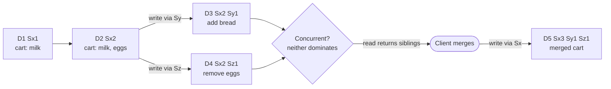

**Reading the diagram.** Boxes are versions of one key, labeled with their version vectors; arrows mean "descends from". D3 and D4 are written through different coordinators from the same parent, so their vectors are incomparable and the store keeps both. A read returns both siblings with their combined context; the client's merged write dominates both and replaces them. Storage holds every sibling until a merge, so a key with many unmerged concurrent writers grows. The failure point is the merge function: a union resurrects "eggs". Dynamo truncated vectors beyond a threshold of about 10 entries, which can cause false conflicts.

::: industry
**Riak siblings.** With `allow_mult` enabled, Riak keeps concurrent writes as siblings and returns them with a causal context that the client sends back with its resolved write; Riak 2.0 added dotted version vectors to avoid sibling explosion when many clients write through the same node, and built-in CRDT data types (counters, sets, maps, registers, flags) that merge automatically.
*Evidence: Primary* — [Riak KV Docs: Conflict Resolution; Riak KV Docs: Data Types; Preguiça et al. 2010]
:::

In production Dynamo, siblings were rare: the paper reports that 99.94% of requests saw exactly one version over a 24-hour period of the shopping cart service [DeCandia et al. 2007].

### 27.14.3 CRDTs

::: definition
**Definition — Conflict-free replicated data type (CRDT).** A data type whose replicas can be updated independently and concurrently without coordination and are guaranteed to converge to the same state once they have received the same updates, a property called **strong eventual consistency** [Shapiro et al. 2011a].
:::

#### First-principles explanation

Two scorekeepers at a basketball game each tally points on their own sheet. If each keeps a separate column per team scorer and only ever writes larger numbers in its own columns, then whenever they compare sheets, they can take the larger number in each column and agree, no matter how often or in what order they compare. A CRDT is a data structure designed so that "compare and combine" can never go wrong.

#### How it works internally

There are two styles, and each can emulate the other [Shapiro et al. 2011b]:

- **State-based CRDTs (CvRDTs)** ship whole states and combine them with a **merge** function. Convergence requires the states to form a **join semilattice**: merge must be **commutative** ($a \sqcup b = b \sqcup a$), **associative** ($(a \sqcup b) \sqcup c = a \sqcup (b \sqcup c)$) and **idempotent** ($a \sqcup a = a$), and every update must move the state upward. Then gossip may deliver states in any order, any number of times. **Delta-state** CRDTs ship only recent changes to cut bandwidth [Almeida et al. 2018].
- **Operation-based CRDTs (CmRDTs)** ship operations. Concurrent operations must commute, and the delivery layer must deliver every operation exactly once and in causal order.

The four classic designs are:

1. **G-Counter** (grow-only counter): one slot per replica; a replica increments only its own slot; value is the sum; merge takes the per-slot maximum.
2. **PN-Counter:** two G-Counters, one for increments and one for decrements; value is the difference.
3. **LWW-Register:** a value with a (timestamp, replica ID) stamp; merge keeps the larger stamp. It is LWW, packaged so that merge is a lattice join.
4. **OR-Set** (observed-remove set): each add creates a unique tag; a remove deletes only the tags it has observed. A concurrent add's new tag survives, so **add wins**. Removed tags must be remembered as tombstones, unless an optimized design summarizes them with version vectors [Bieniusa et al. 2012].

The program implements all four and checks the three merge laws, plus convergence under every merge order, on random histories.

```python
"""State-based CRDTs: G-Counter, PN-Counter, LWW-Register and OR-Set,
with randomized tests that merge is commutative, associative and idempotent."""
import copy
import itertools
import random

class GCounter:
    """Grow-only counter: one slot per replica; merge takes the per-slot max."""
    def __init__(self, replica):
        self.replica, self.slots = replica, {}
    def increment(self, n=1):
        assert n >= 0, "a G-Counter only grows"
        self.slots[self.replica] = self.slots.get(self.replica, 0) + n
    def value(self):
        return sum(self.slots.values())
    def merge(self, other):
        for r, v in other.slots.items():
            self.slots[r] = max(self.slots.get(r, 0), v)
    def state(self):
        return dict(sorted(self.slots.items()))

class PNCounter:
    """Counter with decrements: one G-Counter for increments, one for decrements."""
    def __init__(self, replica):
        self.p, self.n = GCounter(replica), GCounter(replica)
    def increment(self, k=1):
        self.p.increment(k)
    def decrement(self, k=1):
        self.n.increment(k)
    def value(self):
        return self.p.value() - self.n.value()
    def merge(self, other):
        self.p.merge(other.p)
        self.n.merge(other.n)
    def state(self):
        return (self.p.state(), self.n.state())

class LWWRegister:
    """Last-writer-wins register; ties on timestamp broken by replica ID."""
    def __init__(self, replica):
        self.replica, self.value_, self.stamp = replica, None, (0, "")
    def assign(self, value, timestamp):
        stamp = (timestamp, self.replica)
        if stamp > self.stamp:
            self.value_, self.stamp = value, stamp
    def value(self):
        return self.value_
    def merge(self, other):
        if other.stamp > self.stamp:
            self.value_, self.stamp = other.value_, other.stamp
    def state(self):
        return (self.value_, self.stamp)

class ORSet:
    """Observed-remove set: each add creates a unique tag; remove deletes only
    the tags it has observed, so a concurrent add survives (add wins)."""
    def __init__(self, replica):
        self.replica, self.adds, self.removes, self.seq = replica, set(), set(), 0
    def add(self, element):
        self.seq += 1                            # tag = (replica, sequence): globally unique
        self.adds.add((element, (self.replica, self.seq)))
    def remove(self, element):
        self.removes |= {t for t in self.adds if t[0] == element}
    def value(self):
        return {e for (e, tag) in self.adds - self.removes}
    def merge(self, other):
        self.adds |= other.adds
        self.removes |= other.removes
    def state(self):
        return (sorted(self.adds), sorted(self.removes))

def merged(a, b):
    """Return a copy of a merged with b, leaving both inputs unchanged."""
    out = copy.deepcopy(a)
    out.merge(b)
    return out

def random_replicas(cls, rng, ops=30):
    replicas = [cls(name) for name in "ABC"]
    for step in range(ops):
        r = rng.choice(replicas)
        if cls is GCounter:
            r.increment(rng.randint(1, 5))
        elif cls is PNCounter:
            (r.increment if rng.random() < 0.6 else r.decrement)(rng.randint(1, 5))
        elif cls is LWWRegister:
            r.assign(rng.choice("xyz"), timestamp=rng.randint(1, 20))
        else:
            (r.add if rng.random() < 0.6 else r.remove)(rng.choice("abcd"))
        if rng.random() < 0.3:                   # occasional partial gossip
            r.merge(rng.choice(replicas))
    return replicas

def check_laws(cls, trials=200, seed=7):
    rng = random.Random(seed)
    for _ in range(trials):
        a, b, c = random_replicas(cls, rng)
        assert merged(a, b).state() == merged(b, a).state(), "commutativity"
        assert merged(merged(a, b), c).state() == merged(a, merged(b, c)).state(), "associativity"
        assert merged(a, a).state() == a.state(), "idempotence"
        finals = [merged(merged(x, y), z).state() for x, y, z in itertools.permutations((a, b, c))]
        assert all(s == finals[0] for s in finals), "convergence in every merge order"
    return f"{cls.__name__:11s}: {trials} random histories, all laws hold"

class SumCounter(GCounter):
    """A broken design: merge adds slots instead of taking the maximum."""
    def merge(self, other):
        for r, v in other.slots.items():
            self.slots[r] = self.slots.get(r, 0) + v

if __name__ == "__main__":
    for cls in (GCounter, PNCounter, LWWRegister, ORSet):
        print(check_laws(cls))

    bad = SumCounter("A"); bad.increment(5)
    print("SumCounter: value 5, after merging a duplicate delivery:", merged(bad, bad).value())

    # Add-wins: A removes "milk" while B concurrently re-adds it.
    a, b = ORSet("A"), ORSet("B")
    a.add("milk"); b.merge(a)                    # both replicas see milk
    a.remove("milk")                             # A removes the tag it observed
    b.add("milk")                                # B adds again with a fresh tag
    a.merge(b); b.merge(a)
    print("OR-Set after concurrent remove and add:", a.value(), b.value())

    # The same story with LWW on timestamps loses B's add if A's clock is ahead.
    ra, rb = LWWRegister("A"), LWWRegister("B")
    ra.assign("<removed>", timestamp=103)        # A removes at real time 98; its clock is 5 ms fast
    rb.assign("milk", timestamp=100)             # B re-adds later, at real time 100
    ra.merge(rb); rb.merge(ra)
    print("LWW register after the same history:", ra.value(), rb.value())
```

Output:

```text
GCounter   : 200 random histories, all laws hold
PNCounter  : 200 random histories, all laws hold
LWWRegister: 200 random histories, all laws hold
ORSet      : 200 random histories, all laws hold
SumCounter: value 5, after merging a duplicate delivery: 10
OR-Set after concurrent remove and add: {'milk'} {'milk'}
LWW register after the same history: <removed> <removed>
```

What to notice:

- Each `merge` is a lattice join: per-slot `max`, set union, or the larger stamp. That is why all three laws hold on every random history, including histories with partial gossip between replicas.
- `SumCounter` looks plausible but is not idempotent: a duplicated gossip message doubles the count. Idempotence is what lets state-based CRDTs ride on unreliable, repeating gossip.
- The OR-Set keeps "milk" after a concurrent remove and re-add, matching user intent; the LWW register replays the clock-skew example of §27.14.1 and drops the later add.

#### Real-world industry applications

::: industry
**Redis active–active databases and collaborative editors.** Redis Enterprise's Active-Active databases replicate across regions with every replica writable and resolve concurrent updates with CRDT-based data types, such as counters that sum concurrent increments and sets with add-wins semantics [Redis Docs: Active-Active]. Libraries such as Automerge and Yjs apply sequence CRDTs to collaborative text and JSON documents.
*Evidence: Primary* — [Redis Docs: Active-Active; Automerge and Yjs project documentation]
:::

#### Alternatives and trade-offs

**Table 27.4 — Conflict-resolution strategies.**

| | Last-writer-wins | Version vectors + siblings | CRDTs |
|---|---|---|---|
| What it is | Keep greatest timestamp | Keep all concurrent values | Types whose merge always converges |
| Data loss | Silent, on concurrent writes | None | None, within the type's semantics |
| Application work | None | Write a merge for every type | Choose a type that fits |
| Metadata | One timestamp | One counter per coordinating replica | Per-replica slots or tags; tombstones |
| Clock dependence | Yes | No | Only for LWW-based types |
| Choose when | Immutable or single-writer data | Domain-specific merges | Counters, sets, maps, collaborative documents |

#### Failure scenarios

**Table 27.5 — Failure scenarios in conflict resolution.**

| What goes wrong | Why | Detection | Recovery | Prevention |
|---|---|---|---|---|
| Acknowledged update disappears | LWW discarded a concurrent write | Audit log shows the write; final value lacks it | Replay from audit log | Siblings or CRDTs for shared mutable data |
| Deleted item reappears | Union merge of siblings, or tombstone purged before repair | User reports | Delete again | OR-Set semantics; repair within grace period |
| Sibling explosion | Many clients write without causal context | Value size and sibling count metrics | Merge and write back | Always read before write; dotted version vectors |
| CRDT state grows without bound | Tombstones and per-replica entries never collected | State size metrics | Compaction at causal stability | Optimized OR-Set; retire replica IDs |

::: mistake
**Mistake — "CRDTs make every invariant safe."** CRDTs guarantee convergence, not application invariants. A PN-Counter for stock can converge to −3 because two regions each sold the last two items. Invariants such as "never below zero" or "unique username" still need coordination (Chapter 26) or escrow-style partitioning of the allowance.
:::

## 27.15 Summary and revision notes

::: summary
- A replication strategy decides who orders writes and how many copies must hold a write before it is acknowledged. Primary–backup, chain and consensus fix one order; multi-leader and leaderless let replicas diverge and repair afterwards.
- Primary–backup ships state or operations; asynchronous failover loses $r_w \ell$ writes, and safe promotion needs fencing.
- Chain replication: writes at the head, strong reads at the tail, $T_{\text{write}} \approx (n+1)d + ns$; CRAQ serves clean reads from any node.
- Multi-leader serves multi-region, offline and collaborative writers; ring and star topologies have single points of failure, all-to-all reorders messages; conflicts per item $\approx 2\lambda_A\lambda_B\Delta$.
- $R + W > N$ guarantees overlap with completed writes, not linearizability. Quorum latency is the $k$-th order statistic: 2-of-3 hides the slowest replica.
- Sloppy quorums and hinted handoff trade overlap for write availability; hints grow linearly with downtime.
- Phi-accrual turns silence into an error probability; SWIM detects in about $1.58\,T'$ with constant load per member; gossip spreads in $\approx \log_{1+f} n + \ln n / f$ rounds.
- Failover time is detection + election + reconfiguration + redirection; redirection often dominates. Recovery time is copy time plus catch-up of the backlog.
- Read repair fixes keys that are read; Merkle anti-entropy fixes everything, and must run within the tombstone grace period.
- LWW loses concurrent writes silently; version vectors keep siblings; CRDTs converge because merge is commutative, associative and idempotent, but do not protect invariants.
:::

## 27.16 Knowledge checkpoint

1. What is the difference between state transfer and operation shipping, and which needs determinism?
2. An asynchronous backup lags by 300 ms when the primary, taking 4,000 writes/s, crashes. How many acknowledged writes are lost?
3. Why are reads at the tail of a chain linearizable?
4. In CRAQ, what does a node do when asked to read an object whose newest local version is dirty?
5. Why can a circular multi-leader topology stop replicating when one node fails?
6. For $N = 5$, what is the smallest $R$ that overlaps $W = 3$, and how many failures can each tolerate?
7. Give two reasons why $R + W > N$ does not give linearizability.
8. With $N = 3$ and each replica independently slow with probability 0.02, what fraction of $W = 2$ writes are slow?
9. Why does a sloppy quorum weaken the overlap guarantee?
10. Heartbeats have $\mu = 500$ ms and $\sigma = 50$ ms. What is $\varphi$ after 600 ms of silence?
11. Why does SWIM use indirect probes?
12. Estimate push-gossip rounds with fanout 1 for 4,096 nodes.
13. Detection 4 s, election 2 s, reconfiguration 2 s, DNS TTL 60 s: what is the failover time, and what is the biggest lever?
14. Why can a node that was down for two weeks resurrect deleted rows?
15. Why must a state-based CRDT merge be idempotent?

<details><summary>Answers</summary>

1. State transfer sends resulting state; operation shipping sends the operation, which every replica must execute deterministically.
2. $4{,}000 \times 0.3 = 1{,}200$ writes.
3. The tail holds only updates every other chain node already has, and it is the only node that replies to writes and reads.
4. It asks the tail for the latest committed version number and returns that version.
5. Each write passes through every node in turn, so a failed node breaks the path until the ring is reconfigured.
6. $R = 3$ ($3 + 3 > 5$); reads and writes each tolerate 2 unavailable replicas.
7. Any two of: concurrent writes resolved by timestamp; writes concurrent with reads; failed writes not rolled back; sloppy quorums; replicas restored from stale copies.
8. $p^3 + 3p^2(1-p) = 8 \times 10^{-6} + 3 \times 0.0004 \times 0.98 = 0.001184$, about 0.12%.
9. Writes may be acknowledged by stand-ins outside the key's $N$ home replicas, so a read from home replicas may share no node with them.
10. $z = 2$, $1 - \Phi(2) = 0.0228$, $\varphi = 1.64$.
11. So that a lossy path between two particular members does not cause a false suspicion; other members probe on its behalf.
12. $\log_2 4{,}096 + \ln 4{,}096 = 12 + 8.3 \approx 20$ rounds, plus about one.
13. $4 + 2 + 2 + 60 = 68$ s; replace DNS redirection with a proxy, virtual IP or topology-aware client.
14. Its copies predate the deletes, and other replicas have purged their tombstones after the grace period, so repair copies the old rows back.
15. Gossip may deliver the same state many times; a non-idempotent merge (such as summing) would count it repeatedly.

</details>

## 27.17 Interview questions

### Basic

**Q1. What does R + W > N give you?**
**Answer.** Every read set intersects every completed write's set, so a read sees at least one replica with that write. It does not order concurrent writes, roll back failed ones or prevent a later read seeing an older value without blocking read repair.

**Q2. How do you detect a failed node?**
**Answer.** Heartbeats or pings with a timeout, ideally adaptive (phi-accrual) and, in large clusters, SWIM-style probing with indirect pings, suspicion and gossip. A detector only suspects; actions taken on suspicion must fence.

**Q3. What is last-writer-wins and when is it acceptable?**
**Answer.** Keep the value with the greatest timestamp. It silently drops concurrent writes and depends on clocks, so use it for immutable or single-writer data.

### Intermediate

**Q4. Walk through a database failover and its time budget.**
**Answer.** Detection (timeout), election (pick the most advanced replica or run consensus), reconfiguration (fence old primary, apply remaining log, promote), redirection (proxy, VIP or DNS). Quantify each term; redirection and detection usually dominate; add fencing against split brain and accept $r_w \ell$ loss if replication is asynchronous.

**Q5. Chain replication or primary–backup?**
**Answer.** Chain spreads network load evenly and gives strong reads at the tail, but write latency grows with chain length and one slow node slows every write. Primary–backup has constant-hop latency but the primary sends $n-1$ copies. Choose chain (or CRAQ) for high-throughput storage with a reliable master service.

**Q6. Why contact all N replicas if you need only R?**
**Answer.** Latency is the $R$-th order statistic of the replies; contacting all $N$ lets the fastest $R$ answer and keeps a slow replica off the tail.

### Advanced

**Q7. Design an inventory counter replicated in three regions with local writes.**
**Answer.** A PN-Counter converges but cannot enforce "stock ≥ 0". Partition the stock into per-region allowances (escrow), sell locally within the allowance, and rebalance allowances with a coordinated transfer when one runs low; strong checks only at the boundary.

**Q8. A Cassandra cluster shows deleted rows reappearing after a node replacement. Explain and fix.**
**Answer.** A replica missed deletes and was not repaired within `gc_grace_seconds`; the others purged their tombstones, so repair copied the old rows back. Run repair on every node within the grace period, never return long-dead nodes without full repair, and alert on repair age.

**Q9. Compare gossip dissemination and a consensus-backed store for cluster membership.**
**Answer.** Gossip spreads changes in $O(\log n)$ rounds with constant per-node load and no single point of failure, but views differ briefly. A consensus store gives one agreed view and fencing at the cost of a quorum round trip and limited write throughput. Many systems use gossip for liveness and consensus for authoritative ownership.

## 27.18 Practical exercises

1. Extend the quorum program to estimate p99 read and write latency for $N = 5$ from a measured latency sample, for every $(R, W)$ with $R + W > N$.
2. Add a suspicion timeout and incarnation numbers to the SWIM simulation and measure false positives with 5% packet loss.
3. Implement a delta-state G-Counter that ships only changed slots and measure bytes sent against the full-state version.
4. Implement an OR-Set that removes tombstones once every replica has acknowledged them, and test convergence with the law checker.

## 27.19 Design challenges

1. **Global shopping cart.** Three regions, writes always accepted, no lost additions. Choose replication, conflict resolution and repair, and explain deleted-item behavior.
2. **Metadata store failover.** A primary–backup metadata service must fail over in under 10 s with zero acknowledged-write loss. Produce the time budget and fencing design.
3. **Membership for 5,000 nodes.** Choose protocol parameters so a crash is declared within 10 s with a false-positive rate below one per day.

## 27.20 References

1. Almeida, P. S., Shoker, A., Baquero, C. *Delta State Replicated Data Types*. Journal of Parallel and Distributed Computing 111, 2018.
2. Alsberg, P. A., Day, J. D. *A Principle for Resilient Sharing of Distributed Resources*. Proc. 2nd International Conference on Software Engineering (ICSE), 1976.
3. Andersen, D. G., Franklin, J., Kaminsky, M., Phanishayee, A., Tan, L., Vasudevan, V. *FAWN: A Fast Array of Wimpy Nodes*. ACM SOSP, 2009.
4. Akka. *Phi Accrual Failure Detector*. Akka documentation, accessed 2026.
5. Apache Cassandra. *Documentation*: Dynamo architecture; Hints; Read repair; Repair; `cassandra.yaml`. Accessed 2026. https://cassandra.apache.org/doc/latest/
6. Apache CouchDB. *Replication and Conflict Model*. CouchDB documentation, accessed 2026.
7. Apache Kafka. *Documentation: Replication*. Accessed 2026. https://kafka.apache.org/documentation/
8. Attiya, H., Bar-Noy, A., Dolev, D. *Sharing Memory Robustly in Message-Passing Systems*. Journal of the ACM 42(1), 1995.
9. AWS. *Amazon DynamoDB Developer Guide: Global Tables*. Accessed 2026.
10. Bieniusa, A., Zawirski, M., Preguiça, N., Shapiro, M., Baquero, C., Balegas, V., Duarte, S. *An Optimized Conflict-free Replicated Set*. arXiv, 2012.
11. Budhiraja, N., Marzullo, K., Schneider, F. B., Toueg, S. *The Primary-Backup Approach*. In Mullender, S. (ed.), *Distributed Systems*, 2nd ed., ACM Press/Addison-Wesley, 1993.
12. Chandra, T. D., Toueg, S. *Unreliable Failure Detectors for Reliable Distributed Systems*. Journal of the ACM 43(2), 1996.
13. Dadgar, A., Phillips, J., Currey, J. *Lifeguard: SWIM-ing with Situational Awareness*. arXiv, 2017.
14. Das, A., Gupta, I., Motivala, A. *SWIM: Scalable Weakly-consistent Infection-style Process Group Membership Protocol*. IEEE/IFIP DSN, 2002.
15. DeCandia, G., Hastorun, D., Jampani, M., Kakulapati, G., Lakshman, A., Pilchin, A., Sivasubramanian, S., Vosshall, P., Vogels, W. *Dynamo: Amazon's Highly Available Key-value Store*. ACM SOSP, 2007.
16. Demers, A., Greene, D., Hauser, C., Irish, W., Larson, J., Shenker, S., Sturgis, H., Swinehart, D., Terry, D. *Epidemic Algorithms for Replicated Database Maintenance*. ACM PODC, 1987.
17. GitHub. *October 21 post-incident analysis*. GitHub Blog, 2018. https://github.blog/2018-10-30-oct21-post-incident-analysis/
18. Hayashibara, N., Défago, X., Yared, R., Katayama, T. *The φ Accrual Failure Detector*. IEEE SRDS, 2004.
19. Karp, R., Schindelhauer, C., Shenker, S., Vöcking, B. *Randomized Rumor Spreading*. IEEE FOCS, 2000.
20. Kleppmann, M. *Designing Data-Intensive Applications*, ch. 5 "Replication". O'Reilly, 2017.
21. Lakshman, A., Malik, P. *Cassandra: A Decentralized Structured Storage System*. ACM SIGOPS Operating Systems Review 44(2), 2010.
22. Pittel, B. *On Spreading a Rumor*. SIAM Journal on Applied Mathematics 47(1), 1987.
23. Preguiça, N., Baquero, C., Almeida, P. S., Fonte, V., Gonçalves, R. *Dotted Version Vectors: Logical Clocks for Optimistic Replication*. arXiv, 2010.
24. Redis. *Active-Active geo-distributed Redis*. Redis Enterprise documentation, accessed 2026.
25. Riak. *Riak KV documentation*: Conflict Resolution; Causal Context; Data Types. Accessed 2026.
26. Scales, D. J., Nelson, M., Venkitachalam, G. *The Design of a Practical System for Fault-Tolerant Virtual Machines*. ACM SIGOPS Operating Systems Review 44(4), 2010.
27. Shapiro, M., Preguiça, N., Baquero, C., Zawirski, M. *Conflict-free Replicated Data Types*. SSS 2011, LNCS 6976, 2011 (cited as 2011a).
28. Shapiro, M., Preguiça, N., Baquero, C., Zawirski, M. *A Comprehensive Study of Convergent and Commutative Replicated Data Types*. INRIA Research Report RR-7506, 2011 (cited as 2011b).
29. Terrace, J., Freedman, M. J. *Object Storage on CRAQ: High-throughput Chain Replication for Read-mostly Workloads*. USENIX ATC, 2009.
30. van Renesse, R., Schneider, F. B. *Chain Replication for Supporting High Throughput and Availability*. USENIX OSDI, 2004.

## 27.21 Open verification items

- GitHub 2018 incident figures (43 s partition, 24 h 11 min degradation) confirmed only via search summaries; github.blog was unreachable from this session.
- Cassandra's exponential-distribution phi model and the 3-hour default hint window should be checked against current (5.x) source and docs.
- Dynamo's "99.94% of requests saw one version" figure and the ~10-entry vector-clock truncation threshold: check against the paper text.
- DynamoDB global tables' LWW and strong-consistency mode wording (as of 2026).
- Exact titles/URLs for Akka, CouchDB, Redis and Riak documentation pages.
