# Chapter 28 — Distributed Transactions

> **Level:** 4 · **Track:** A (Traditional) · **Estimated reading time:** 6 h

On one database server a transaction is a solved problem: the write-ahead log, locks and MVCC of Chapter 11 make a transfer between two accounts all-or-nothing, isolated and durable. Partition the accounts across two servers (Chapter 14) and the guarantee disappears. Each server can still commit or abort *its own* half, but nothing forces the two halves to agree, and either server, or the network between them, can fail at any moment.

This chapter is about getting the guarantee back. It starts with the **atomic commitment problem** and the classic answer, two-phase commit, including exactly what must be logged and why it can block. It then follows the ideas that made distributed transactions practical at scale: running 2PC over replicated consensus groups, Percolator's timestamp oracle and primary lock, Spanner's TrueTime and commit wait, Calvin's deterministic ordering, and the commit protocols inside CockroachDB, YugabyteDB and TiDB. It ends with a decision procedure, because the cheapest distributed transaction is the one your data model avoids. Consensus itself is Chapter 26's subject, hybrid logical clocks are introduced in §24.12, and sagas and the transactional outbox are treated in depth in Chapter 32.

## 28.1 Learning objectives

After this chapter you should be able to:

- State the atomic commitment problem and explain why partial failure makes it harder than local commit.
- Walk through two-phase commit, naming every forced log write, and show where and why it blocks when the coordinator fails.
- Compute 2PC latency, the availability of a transaction spanning $k$ partitions ($A^k$) and the expected number of in-doubt transactions per coordinator crash.
- Explain presumed abort, XA and PostgreSQL prepared transactions, and recover an in-doubt transaction by hand.
- Explain why three-phase commit is non-blocking only under synchrony assumptions and why it is rarely deployed.
- Describe Percolator's write and read paths, Spanner's commit wait and external-consistency argument, and Calvin's deterministic execution, and compute their latencies.
- Compare CockroachDB, YugabyteDB, TiDB and Spanner, and choose a transaction strategy for a given workload.

## 28.2 Prerequisites

- Transactions, ACID, isolation anomalies (especially write skew), MVCC and two-phase locking — §11.11–§11.15 (this chapter distributes those mechanisms).
- Write-ahead logging and `fsync` — §13.5 and §6.14 (every protocol here is defined by what it forces to the log).
- Partitioning and the cross-shard transaction preview — §14.6–§14.7 and §14.12.
- Partial failure, clock skew and hybrid logical clocks — §24.8, §24.9 and §24.12.
- Consensus and leases — §26.3, §26.7 and §26.11 (2PC is made highly available by running it over consensus groups).
- Idempotency keys — §22.15 (commit and abort messages are retried and must be harmless when duplicated).

## 28.3 Why distributed transactions are hard

### 28.3.1 The atomic commitment problem

::: definition
**Definition — Atomic commitment.** A protocol by which a set of **participants** (nodes that each executed part of a transaction) reach a single outcome, commit or abort, such that: (1) all participants that decide reach the same decision; (2) a participant cannot reverse a decision once made; (3) commit is decided only if every participant voted yes; (4) if there are no failures and every participant voted yes, the decision is commit; and (5) once failures are repaired and no new ones occur for long enough, every participant eventually decides [Bernstein et al. 1987].
:::

#### First-principles explanation

Picture a wedding ceremony. The officiant asks each partner "Do you?" Each partner, before answering, must be *certain* they can follow through, because after saying "I do" they may not back out on their own. Only when both have said yes does the officiant pronounce the marriage, and from that moment it is binding on both. If the officiant faints after hearing two yeses but before pronouncing, the couple stands at the altar unable to leave and unable to celebrate. That picture, used by Gray, is two-phase commit, weakness included [Gray 1978].

The single-server version is easy because there is one log and one decision. One `fsync` of a commit record is the instant at which the whole transaction becomes durable. Across servers there is no shared instant. Each server can promise only things about its own log, and it learns about the others solely through messages that may be delayed, lost or never sent because the sender died.

#### Why does this exist?

Partitioning scales writes (Chapter 14), but business operations ignore partition boundaries: a transfer touches two accounts, an order touches stock and orders, a global index entry lives apart from its row (§14.11). Each needs all-or-nothing behavior across nodes.

### 28.3.2 Partial failure: a money transfer across two shards

::: definition
**Definition — Partial failure.** A failure in which some components of a distributed system fail, or become unreachable, while others keep running, and the running components cannot reliably tell which (§24.8).
:::

Take two PostgreSQL shards. Account 7 (balance \$500) lives on shard A and account 9 (balance \$0) on shard B. A service transfers \$100 by running an ordinary local transaction on each shard, one after the other.

**Figure 28.1 — A naive cross-shard transfer that loses money.**

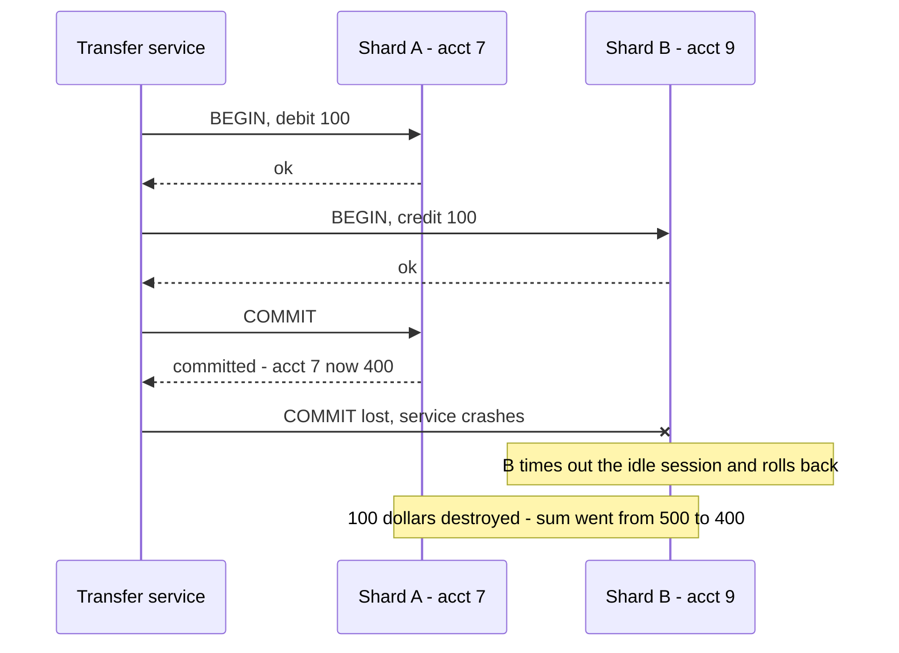

**Reading the diagram.** The transfer service talks to each shard over its own synchronous SQL connection; each shard has its own write-ahead log, so there are two independent storage boundaries. Shard A's commit is durable before the service even sends B's commit. The service crashes (the crossed arrow), B's session times out and B rolls back its half. Committing B first fails symmetrically, creating money. No ordering of two independent commits is safe, and scaling changes nothing: the flaw is in the protocol.

Three facts make the problem hard:

1. **No participant may commit until it knows every other participant can.** Shard B might fail a `CHECK` constraint, run out of disk or deadlock. A must not make its half permanent until that is ruled out.
2. **A participant that has promised cannot change its mind.** Once B has said "I can commit", it must keep that promise through crashes, so the promise itself must be durable.
3. **Silence is ambiguous.** A coordinator that hears nothing from B cannot distinguish "B crashed", "B is slow" and "the network dropped B's reply" (§24.7). Any protocol must be safe in all three cases.

::: concept
**Concept — Atomic commitment is a consensus problem with veto.** Every participant must agree on one value (commit or abort), and any single participant can force abort. The FLP result (§24.13) says no deterministic protocol can guarantee that agreement terminates in an asynchronous system with even one crash. Every protocol in this chapter therefore gives up something: two-phase commit gives up termination while the coordinator is down; three-phase commit assumes bounded delays; consensus-based commit needs a majority of replicas to be up.
:::

### 28.3.3 Isolation across partitions: snapshot isolation versus serializability

Atomicity is half the job. A distributed transaction must also be isolated (§11.13), which needs two things a single server gets for free:

1. **A consistent snapshot across partitions.** A reader must see either both halves of the transfer or neither. On one server a snapshot is a list of committed transaction IDs (§11.14). Across servers you need a common notion of "before" and "after": a central **timestamp oracle** (Percolator, TiDB), tightly bounded physical clocks (Spanner) or hybrid logical clocks with uncertainty handling (CockroachDB, YugabyteDB).
2. **Conflict detection across partitions.** Write-write conflicts are easy, because both writers touch the same key on the same partition. Read-write conflicts, the ones that cause **write skew**, are not: transaction T1 reads key $x$ on partition 1 and writes $y$ on partition 2, while T2 reads $y$ and writes $x$. Neither partition sees both edges of the dependency cycle.

That second point explains a pattern you will see throughout this chapter. **Snapshot isolation** (SI) needs only per-key write-write checks, so it distributes cheaply, and Percolator and TiDB offer it [Peng and Dabek 2010; Huang et al. 2020]. SI permits write skew: two transfers that each check "sum of a customer's two accounts $\ge$ 0" and each debit a *different* account can both commit and overdraw the customer, exactly the doctors-on-call anomaly of Figure 11.8 with the rows on different machines (§28.7.4 reproduces it). **Serializable** isolation needs either read locks held to commit (Spanner's two-phase locking for read-write transactions [Corbett et al. 2012]) or validation of reads at commit time (CockroachDB's timestamp ordering with read refresh [Taft et al. 2020]). Serializable snapshot isolation (SSI), which PostgreSQL implements on one node by tracking read-write dependencies [Cahill et al. 2008], is hard to distribute because the dependency graph spans partitions.

::: recommendation
**Recommendation — Know which isolation your distributed database gives by default.** Spanner and CockroachDB default to serializable; TiDB defaults to snapshot isolation (exposed as `REPEATABLE READ`); YugabyteDB's YSQL defaults to snapshot isolation in recent versions (as of 2026). Under SI, protect cross-row invariants with `SELECT ... FOR UPDATE` or a materialized conflict row (§11.13).
:::

::: mistake
**Common misconception — "Distributed transactions are just slow local transactions."** The extra latency is the visible cost. The deeper costs are new failure modes (a transaction stuck between commit and abort), new availability arithmetic (a transaction needs *every* participant), and anomalies that local snapshot isolation never had to handle across machines.
:::

## 28.4 Two-phase commit

### 28.4.1 The protocol

::: definition
**Definition — Two-phase commit (2PC).** An atomic commitment protocol in which one node, the **coordinator** (also called the transaction manager), first asks every participant (resource manager) to **prepare**, that is, to make its part of the transaction durable while keeping it invisible and to promise to commit on request; and then, only if every participant voted yes, durably records a **commit** decision and tells all participants to commit. Any no vote or timeout leads to abort [Gray 1978; Bernstein et al. 1987].
:::

#### Why does this exist?

Figure 28.1 failed because each shard decided alone. 2PC separates the *ability* to commit from the *decision* to commit. Phase 1 collects durable promises; phase 2 distributes one decision, made in one place and recorded in one log. The coordinator's log record is the distributed equivalent of the single-server commit record.

#### How it works internally

1. **Execution.** The application runs the transaction's reads and writes on each participant as usual; participants take locks (or write MVCC intents) and keep undo and redo information.
2. **Prepare.** When the application says commit, the coordinator sends `PREPARE` to every participant.
3. **Vote.** Each participant checks it can commit (constraints satisfied, no deadlock victim, resources available). If yes, it **forces a prepared record** to its log, containing enough to redo or undo its writes and to re-acquire its locks after a crash, then replies `YES`. From this moment it is **in doubt**: it may not commit or abort on its own. If it cannot commit, it aborts locally and replies `NO`.
4. **Decision.** If every vote is `YES`, the coordinator **forces a commit record** to its log. This write is the **commit point** of the whole distributed transaction. Any `NO` or a timeout leads to abort.
5. **Completion.** The coordinator sends `COMMIT` (or `ABORT`) to each participant, retrying until it is acknowledged. Each participant logs the outcome, releases its locks and sends `ACK`.
6. **Forget.** When all acknowledgments are in, the coordinator writes a non-forced end record and may discard its memory of the transaction.

**Figure 28.2 — Two-phase commit, happy path.**

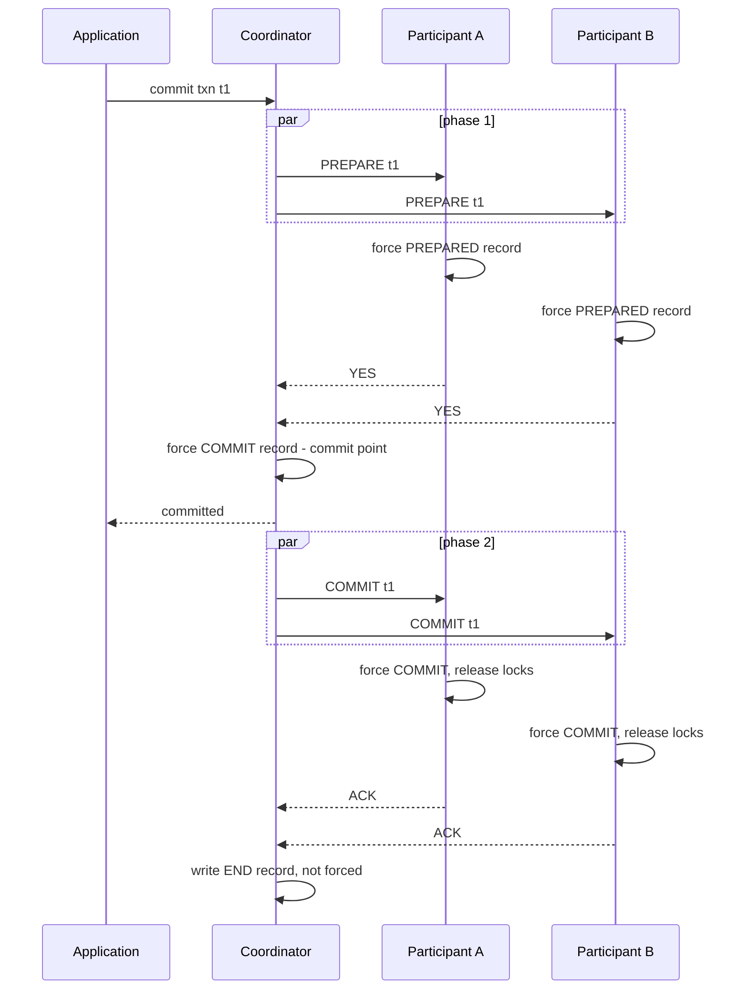

**Reading the diagram.** Three logs are involved: the coordinator's and each participant's, and every self-arrow is a write to one of them. Prepare messages go out in parallel, so phase 1 costs one round trip plus the slowest participant's forced write, not the sum. The coordinator may answer the application as soon as its commit record is durable: the outcome is now decided, and phase 2 only propagates it. Phase 2 messages are retried until acknowledged, so participants must treat duplicate `COMMIT`s as no-ops. The failure point is the interval between a participant's `YES` and its receipt of the decision (Figure 28.4). Messages grow as $4k$ for $k$ participants; latency stays two round trips.

### 28.4.2 What must be logged, and when

2PC is defined as much by its log writes as by its messages. A **forced** write is one the node `fsync`s (§6.14) before sending the next message, because the message makes a promise the node must keep after a crash.

**Table 28.1 — Log records in two-phase commit (basic protocol).**

| Who | Record | Forced? | When | Why it must be durable |
|---|---|---|---|---|
| Participant | PREPARED (redo/undo, lock list, coordinator ID) | Yes | Before sending `YES` | After a crash it must still be able to commit, and must keep others from seeing or changing the rows |
| Coordinator | COMMIT (transaction ID, participant list) | Yes | After all `YES`, before sending any `COMMIT` | The decision must survive a crash, or a recovered coordinator could abort a transaction some participant already committed |
| Participant | COMMIT | Yes | Before `ACK` | Once it acknowledges, the coordinator may forget, so the participant must not need to ask again |
| Coordinator | ABORT | Yes in basic 2PC; no under presumed abort | On any `NO` or timeout | See §28.4.5 |
| Participant | ABORT | Yes in basic 2PC; no under presumed abort | On receiving `ABORT` | See §28.4.5 |
| Coordinator | END | No | After all `ACK`s | Lets the coordinator garbage-collect; losing it causes only a harmless resend |

**Figure 28.3 — Coordinator and participant state machines.**

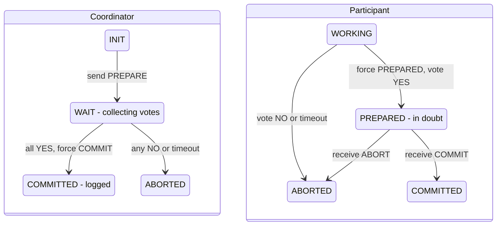

**Reading the diagram.** Each box is one node's local state, recovered from its log after a crash. The participant has a free choice only in WORKING: it may abort for any reason, including the coordinator taking too long to send `PREPARE`. PREPARED is the dangerous state, because it has no outgoing transition the participant can take alone; both exits are triggered by a message from the coordinator. The coordinator, by contrast, never blocks: in WAIT it may time out and abort. This asymmetry is the root of 2PC's blocking behavior.

**Recovery rules.** After a restart, each node reads its log:

- **Participant, no PREPARED record:** abort locally; the coordinator cannot have decided commit without its vote.
- **Participant, PREPARED plus COMMIT or ABORT:** redo or undo accordingly.
- **Participant, PREPARED only:** in doubt. Re-acquire the locks listed in the record, then ask the coordinator for the outcome, repeatedly, until it answers.
- **Coordinator, COMMIT without END:** resend `COMMIT` to every listed participant until all acknowledge.
- **Coordinator, no COMMIT record:** the transaction aborted (it may have been mid-vote at the crash); answer `ABORT` to any inquiry.

### 28.4.3 Blocking and in-doubt transactions

::: definition
**Definition — In-doubt (blocked) transaction.** A transaction at a participant that has voted yes but has not learned the outcome. It must hold its locks and cannot decide until the coordinator, or another participant that knows the outcome, answers.
:::

**Figure 28.4 — Coordinator failure after the votes: participants block.**

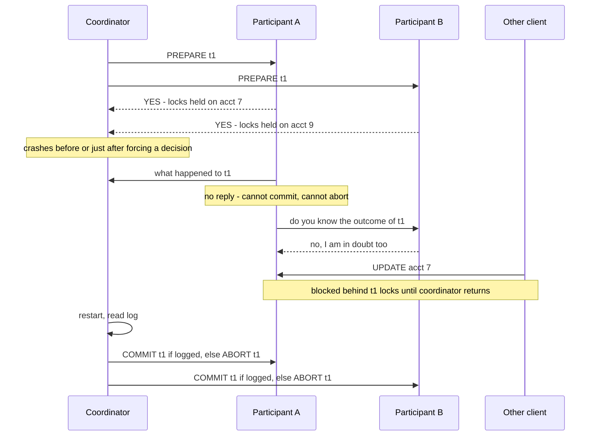

**Reading the diagram.** Both participants are in PREPARED and their locks are durable promises. A asks the coordinator (no answer), then tries the **cooperative termination protocol**: asking other participants. If any participant had not yet voted, or had already received a decision, A could decide. Here B is equally in doubt, and neither can tell whether the coordinator logged commit before dying; deciding either way could contradict a decision the coordinator already made. Unrelated client X now waits on account 7 for as long as the coordinator is down. The storage boundary that matters is the coordinator's log: only it holds the answer. Replicating that log (§28.4.8) is the fix.

How likely is this? A transaction is exposed while any participant is in doubt: from the first `YES` until every participant has the decision.

::: formula
**Exposure to in-doubt blocking**

$$w \approx \text{RTT} + t_{f,c} \qquad P_{\text{doubt}} = 1 - e^{-\lambda w} \approx \lambda w \qquad N_{\text{doubt}} = X\,w$$

| Symbol | Meaning | Units |
|---|---|---|
| $w$ | Window from the first YES vote reaching the coordinator's path until all participants hold the decision: half an RTT for votes, the coordinator's forced write, half an RTT for decisions | seconds |
| $\text{RTT}$ | Network round-trip time between coordinator and participants | seconds |
| $t_{f,c}$ | Time of the coordinator's forced log write | seconds |
| $\lambda$ | Coordinator crash rate | crashes/second |
| $P_{\text{doubt}}$ | Probability a given transaction is caught in doubt by a coordinator crash | dimensionless |
| $X$ | Rate of distributed transactions through this coordinator | transactions/second |
| $N_{\text{doubt}}$ | Expected number of transactions left in doubt by one crash (Little's Law, §4.11) | transactions |
:::

::: example
**Worked example — How many transactions does a coordinator crash strand?** A payments service coordinates $X = 2{,}000$ cross-shard transfers per second. RTT $= 0.5$ ms, coordinator forced write $t_{f,c} = 1$ ms, and the coordinator process crashes about once a month ($\lambda = 1 / 2{,}592{,}000$ s $= 3.86 \times 10^{-7}$ /s). Restarting it with its log takes 10 minutes when an operator must intervene.

1. Window: $w = 0.5 + 1 = 1.5$ ms $= 0.0015$ s.
2. Per-transaction probability: $P_{\text{doubt}} \approx 3.86 \times 10^{-7} \times 0.0015 = 5.8 \times 10^{-10}$, about one in 1.7 billion.
3. Stranded per crash: $N_{\text{doubt}} = 2{,}000 \times 0.0015 = 3$ transactions.
4. Each holds its row locks for the 10-minute outage. If one of those rows is a merchant's settlement account receiving 50 transfers/s, $50 \times 600 = 30{,}000$ transfers queue behind the lock or time out.

**Interpretation.** The probability per transaction is negligible; the *consequence* is not, because a few in-doubt transactions can freeze hot rows for the whole recovery time. **Engineering implication.** Minimize coordinator recovery time (automatic restart, a replicated coordinator log), keep hot rows out of distributed transactions, and alert on prepared transactions older than a few seconds.
:::

### 28.4.4 Latency and availability

::: formula
**Two-phase commit latency and participant lock hold time**

$$T_{\text{2PC}} \approx 2\,\text{RTT} + t_{f,p} + t_{f,c} \qquad T_{\text{hold}} \approx t_{f,p} + \text{RTT} + t_{f,c}$$

| Symbol | Meaning | Units |
|---|---|---|
| $T_{\text{2PC}}$ | Commit latency until every participant has received the decision | seconds |
| $\text{RTT}$ | Round trip between coordinator and the slowest participant | seconds |
| $t_{f,p}$ | Slowest participant's forced write of its PREPARED record (writes happen in parallel) | seconds |
| $t_{f,c}$ | Coordinator's forced write of the COMMIT record | seconds |
| $T_{\text{hold}}$ | Extra time a participant holds locks during commit, from forcing PREPARED until the decision arrives | seconds |
:::

The commit phase adds two sequential round trips and two sequential forced writes. Replying right after the coordinator's commit record (Figure 28.2) hides the second round trip from the client, but not from participants' lock hold time.

::: example
**Worked example — 2PC inside a datacenter and across regions.** Forced writes take $t_f = 1$ ms on cloud block storage; a local commit therefore costs about 1 ms.

1. Same datacenter, RTT $= 0.5$ ms: $T_{\text{2PC}} = 2(0.5) + 1 + 1 = 3$ ms, three times a local commit. Lock hold: $1 + 0.5 + 1 = 2.5$ ms.
2. Participants in two regions, RTT $= 70$ ms: $T_{\text{2PC}} = 140 + 2 = 142$ ms; lock hold $= 72$ ms.
3. A hot row protected by row locks can commit at most $1 / T_{\text{hold}}$ transactions per second (§11.15.3): about 400/s in one datacenter, about 14/s across regions.

**Interpretation.** Inside a datacenter, 2PC's latency is tolerable; its lock hold time, not its latency, is what limits contended rows. Across regions both explode. **Engineering implication.** Keep coordinators near participants, avoid multi-region 2PC on hot rows, and use group commit so that many transactions share each forced write.
:::

The availability arithmetic is harsher still. A distributed transaction commits only if the coordinator and *every* participant are reachable for its duration.

::: formula
**Availability of a transaction spanning $k$ partitions**

$$A_{\text{txn}} = A_c \prod_{i=1}^{k} A_i \;\approx\; A^{k} \quad \text{(equal partitions, coordinator co-located with one of them)}$$

| Symbol | Meaning | Units |
|---|---|---|
| $A_{\text{txn}}$ | Probability that the transaction can commit at a random moment | dimensionless |
| $A_c$ | Availability of the coordinator and its log | dimensionless |
| $A_i$ | Availability of partition $i$ | dimensionless |
| $k$ | Number of partitions the transaction touches | count |
:::

::: example
**Worked example — Ten shards at three nines versus ten consensus groups at five nines.** Assume independent failures and a 30-day month (43,200 minutes).

1. One unreplicated shard at $A = 0.999$: unavailable $0.001 \times 43{,}200 = 43.2$ min/month.
2. A transaction over $k = 10$ such shards: $0.999^{10} = 0.990045$, unavailable $0.009955 \times 43{,}200 \approx 430$ min, more than 7 hours a month.
3. If each partition is a consensus group (§26.7) with $A = 0.99999$: $0.99999^{10} = 0.99990$, unavailable about 4.3 min/month.

**Interpretation.** Fan-out multiplies unavailability almost linearly ($1 - A^k \approx k(1-A)$ for small $1-A$). **Engineering implication.** Never run 2PC over unreplicated nodes for anything that must stay up; make each participant a replicated group, and keep $k$ small by co-locating data that is written together (§14.7).
:::

### 28.4.5 Presumed abort and other optimizations

Basic 2PC forces records and collects acknowledgments for aborts as well as commits. Mohan, Lindsay and Obermarck, building IBM's R\* distributed database, observed that the coordinator can make one outcome the *default* for transactions it has no record of, and then skip logging for that outcome [Mohan et al. 1986].

::: definition
**Definition — Presumed abort (PA).** A 2PC variant in which a coordinator that has no information about a transaction answers inquiries with "abort". Aborts therefore need no forced coordinator record, no forced participant record and no acknowledgments.
:::

The argument is short. Under PA the coordinator forgets an aborted transaction immediately. If a participant later asks, the coordinator finds nothing and says "abort", which is correct. Commits are unchanged: the coordinator must force its commit record, and keep it until every participant has acknowledged, because forgetting a committed transaction would turn it into a presumed abort.

**Table 28.2 — Cost of commit protocol variants for one coordinator and $n$ participants.**

| Variant | Commit: forced writes | Commit: messages | Abort: forced writes | Abort: messages | Notes |
|---|---|---|---|---|---|
| Basic 2PC | $1 + 2n$ | $4n$ | $1 + 2n$ | $4n$ | Every outcome logged and acknowledged |
| Presumed abort | $1 + 2n$ | $4n$ | $n$ prepares only, nothing for the outcome | $3n$ (no ACK) | No information means abort; the usual choice in commercial systems |
| Presumed commit | $2 + n$ | $3n$ (no ACK) | $2 + 2n$ | $4n$ | Coordinator forces a "collecting" record listing participants before prepare |
| Read-only participant | 0 for that participant | 2 for that participant | — | — | Votes READ in phase 1 and drops out of phase 2 |
| One participant | 1 local commit | 2 | — | — | Skip 2PC entirely ("one-phase commit") |

Three other optimizations matter in practice:

1. **Read-only participants.** A participant that only read data has nothing to commit; it releases its read locks and votes READ, and the coordinator omits it from phase 2. If every participant is read-only, nothing is logged at all.
2. **One-phase commit.** A transaction that touched one participant needs no vote: the coordinator just commits it locally. Transaction managers do this automatically, which is why designing for single-partition transactions (§28.11) eliminates 2PC rather than merely shortening it.
3. **Coordinator co-located with a participant** (sometimes called the last-agent optimization). The coordinator's log is the same as one participant's, saving one round trip and one forced write; Spanner, CockroachDB and TiDB all place the coordinator's state in one of the participating partitions.

### 28.4.6 XA and prepared transactions in practice

::: definition
**Definition — XA.** The X/Open Distributed Transaction Processing standard interface between a **transaction manager** (TM, the coordinator) and **resource managers** (RMs: databases, message brokers), with an **application program** (AP) demarcating transactions. Its main calls are `xa_start` and `xa_end` (associate work with a global transaction ID, the XID), `xa_prepare`, `xa_commit`, `xa_rollback` and `xa_recover` (list in-doubt XIDs after a crash) [X/Open 1991].
:::

**Figure 28.5 — The X/Open DTP model.**

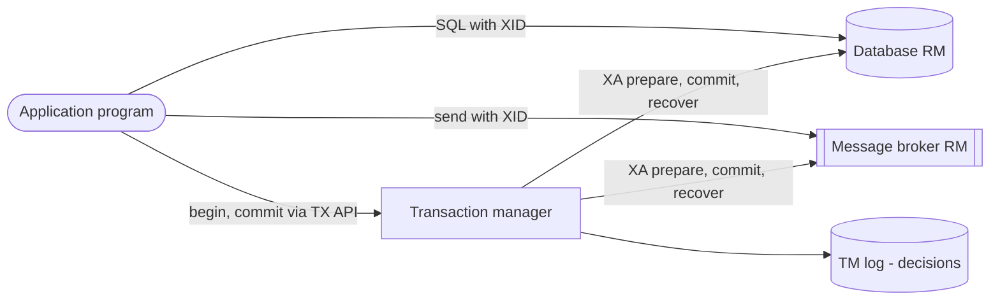

**Reading the diagram.** The application sends ordinary work directly to each resource manager, tagged with a global transaction ID; the transaction manager never sees the data. At commit, the TM runs 2PC over the XA interface and keeps its decisions in its own durable log, a separate storage boundary from every RM. All arrows are synchronous calls. Failure points: the TM log (lose it and in-doubt XIDs must be resolved by hand) and any RM that cannot answer `xa_recover`. Java's JTA is the best-known binding of this model.

PostgreSQL exposes the participant side directly. `PREPARE TRANSACTION 'gid'` performs phase 1, writing the transaction's state durably and dissociating it from the session; `COMMIT PREPARED` or `ROLLBACK PREPARED` performs phase 2, from any session; the view `pg_prepared_xacts` lists in-doubt transactions. The feature is disabled by default (`max_prepared_transactions = 0`) because orphaned prepared transactions are dangerous [PostgreSQL Docs: PREPARE TRANSACTION]. MySQL offers `XA START`, `XA END`, `XA PREPARE`, `XA COMMIT` and `XA RECOVER` [MySQL Docs: XA Transactions].

The following session ran against two PostgreSQL 16 servers (shard A on port 5433, shard B on 5434, both with `max_prepared_transactions = 10`), with the human operator acting as coordinator:

```sql
-- On shard A (acct 7 = 50000 cents) and shard B (acct 9 = 0): phase 1
BEGIN;                                            -- shard A
UPDATE accounts SET balance_cents = balance_cents - 10000 WHERE account_id = 7;
PREPARE TRANSACTION 'xfer-42';
BEGIN;                                            -- shard B
UPDATE accounts SET balance_cents = balance_cents + 10000 WHERE account_id = 9;
PREPARE TRANSACTION 'xfer-42';

-- The "coordinator" disappears. On shard A:
SELECT gid, prepared FROM pg_prepared_xacts;
SET lock_timeout = '1s';
UPDATE accounts SET balance_cents = balance_cents - 1 WHERE account_id = 7;

-- Restart shard A (pg_ctl restart), then:
SELECT gid FROM pg_prepared_xacts;
SELECT * FROM accounts;

-- The coordinator's log says COMMIT: phase 2 on both shards
COMMIT PREPARED 'xfer-42';                        -- shard A, then shard B
```

Output (shard A unless noted):

```text
   gid   |          prepared
---------+----------------------------
 xfer-42 | 2026-10-30 11:08:33.859+00

ERROR:  canceling statement due to lock timeout
CONTEXT:  while updating tuple (0,1) in relation "accounts"

   gid          <- after restart: the prepared transaction survived
---------
 xfer-42

 account_id | balance_cents      <- still invisible before COMMIT PREPARED
------------+---------------
          7 |         50000

 account_id | balance_cents      <- after COMMIT PREPARED on both shards
------------+---------------
          7 |         40000      (shard B: account 9 = 10000)
```

What to notice:

- The prepared transaction outlives its session *and a server restart*: that is the durable promise of phase 1, taken from the PREPARED record in the WAL.
- An unrelated update to account 7 blocks and times out: in-doubt transactions hold row locks indefinitely. PostgreSQL will never resolve them on its own, and they also hold back VACUUM (§11.14.2).

::: warning
**Warning — Heuristic decisions break atomicity.** When an in-doubt transaction blocks production for too long, operators (or XA resource managers configured to do so) may force a **heuristic commit** or **heuristic abort** without the coordinator. If the guess contradicts the coordinator's logged decision, the transaction is no longer atomic and the damage must be repaired by hand. XA reports this as a *heuristic hazard* or *heuristic mixed* outcome. Treat a heuristic decision as an incident, and record which XIDs were forced.
:::

### 28.4.7 A 2PC simulation with coordinator crash and recovery

The program below implements presumed-abort 2PC with durable logs that survive crashes and volatile lock tables that do not. Crash points can be injected into the coordinator, and the tests check that recovery from the logs alone always restores atomicity.

```python
"""Two-phase commit with presumed abort: coordinator crash and recovery from its log.

Each node has a durable log (a list that survives crash()) and volatile state
(locks, pending writes) that is lost on a crash and rebuilt from the log.
Run it directly with python3 to execute the scenario tests.
"""
import unittest


class Crash(Exception):
    """Raised when a node is killed at an injected crash point."""


class Participant:
    def __init__(self, name, balances):
        self.name, self.up = name, True
        self.data = dict(balances)        # committed state (durable)
        self.log = []                     # durable log: (record, txid, payload)
        self.locks, self.pending = {}, {}  # volatile: key -> txid, txid -> new values

    def prepare(self, txid, deltas):
        if not self.up:
            raise Crash(self.name)        # the coordinator sees a timeout
        new = {}
        for key, delta in deltas.items():
            if self.locks.get(key, txid) != txid:
                return "NO"               # row locked by an in-doubt or active txn
            new[key] = self.data[key] + delta
            if new[key] < 0:
                return "NO"               # invariant: no overdraft
        for key in new:
            self.locks[key] = txid
        self.pending[txid] = new
        self.log.append(("PREPARED", txid, new))   # forced before voting YES
        return "YES"

    def finish(self, txid, decision):
        """Apply COMMIT or ABORT. Idempotent: duplicates are harmless."""
        if not self.up:
            raise Crash(self.name)
        new = self.pending.pop(txid, None)
        if new is None:
            return "ACK"                  # already finished, or never prepared
        if decision == "COMMIT":
            self.data.update(new)
            self.log.append(("COMMIT", txid, None))   # forced, then ACK
        else:
            self.log.append(("ABORT", txid, None))    # not forced under presumed abort
        for key in new:
            del self.locks[key]
        return "ACK"

    def crash(self):
        self.up, self.locks, self.pending = False, {}, {}

    def recover(self):
        """Redo from the log: a PREPARED txn with no outcome is in doubt and relocked."""
        self.up = True
        done = {txid for rec, txid, _ in self.log if rec in ("COMMIT", "ABORT")}
        for rec, txid, new in self.log:
            if rec == "PREPARED" and txid not in done:
                self.pending[txid] = new
                for key in new:
                    self.locks[key] = txid

    def in_doubt(self):
        return sorted(self.pending)

    def resolve(self, coordinator):
        """Termination protocol: ask the coordinator about each in-doubt txn."""
        for txid in self.in_doubt():
            if not coordinator.up:
                return False              # blocked: cannot decide alone
            self.finish(txid, coordinator.outcome(txid))
        return True


class Coordinator:
    def __init__(self, participants):
        self.parts = {p.name: p for p in participants}
        self.log = []                     # durable
        self.up, self.crash_at = True, None

    def _point(self, where):
        if self.crash_at == where:
            self.up = False
            raise Crash("coordinator at " + where)

    def run(self, txid, plan):
        """plan: {participant name: {key: delta}}. Returns COMMIT or ABORT."""
        votes = {}
        for name, deltas in plan.items():          # phase 1: prepare
            try:
                votes[name] = self.parts[name].prepare(txid, deltas)
            except Crash:
                votes[name] = "NO"                 # timeout counts as NO
        self._point("after_votes")
        if all(v == "YES" for v in votes.values()):
            self.log.append(("COMMIT", txid, sorted(plan)))   # forced: commit point
            self._point("after_decision")
            self._send(txid, "COMMIT", sorted(plan))
            return "COMMIT"
        # presumed abort: no forced log record, no ACKs needed
        yes = [n for n, v in votes.items() if v == "YES"]
        for name in yes:
            try:
                self.parts[name].finish(txid, "ABORT")
            except Crash:
                pass                               # it will ask later; answer is ABORT
        return "ABORT"

    def _send(self, txid, decision, names):
        acked = 0
        for i, name in enumerate(names):
            try:
                self.parts[name].finish(txid, decision)
                acked += 1
            except Crash:
                pass
            if i == 0:
                self._point("mid_phase2")
        if acked == len(names):
            self.log.append(("END", txid, None))   # not forced; allows log truncation

    def outcome(self, txid):
        """Answer an inquiry. No COMMIT record means ABORT (presumed abort)."""
        return "COMMIT" if any(r == "COMMIT" and t == txid for r, t, _ in self.log) else "ABORT"

    def recover(self):
        """Re-drive phase 2 for every COMMIT without END; everything else is aborted."""
        self.up, self.crash_at = True, None
        ended = {t for r, t, _ in self.log if r == "END"}
        for rec, txid, names in list(self.log):
            if rec == "COMMIT" and txid not in ended:
                self._send(txid, "COMMIT", names)


def bank():
    a, b = Participant("A", {"acct7": 50_000}), Participant("B", {"acct9": 0})
    return a, b, Coordinator([a, b])


TRANSFER = {"A": {"acct7": -10_000}, "B": {"acct9": +10_000}}


class TwoPhaseCommitTests(unittest.TestCase):
    def total(self, a, b):
        return a.data["acct7"] + b.data["acct9"]

    def test_happy_path(self):
        a, b, c = bank()
        self.assertEqual(c.run("t1", TRANSFER), "COMMIT")
        self.assertEqual((a.data["acct7"], b.data["acct9"]), (40_000, 10_000))
        self.assertEqual([r for r, _, _ in c.log], ["COMMIT", "END"])
        self.assertEqual(a.locks, {})

    def test_no_vote_aborts_without_coordinator_log(self):
        a, b, c = bank()
        plan = {"A": {"acct7": -60_000}, "B": {"acct9": +60_000}}   # overdraft
        self.assertEqual(c.run("t1", plan), "ABORT")
        self.assertEqual(c.log, [])                # presumed abort: nothing logged
        self.assertEqual((a.data["acct7"], b.data["acct9"]), (50_000, 0))
        self.assertEqual((a.locks, b.locks), ({}, {}))

    def test_crash_before_decision_blocks_then_aborts(self):
        a, b, c = bank()
        c.crash_at = "after_votes"
        with self.assertRaises(Crash):
            c.run("t1", TRANSFER)
        self.assertEqual((a.in_doubt(), b.in_doubt()), (["t1"], ["t1"]))
        self.assertFalse(a.resolve(c))             # blocked while coordinator is down
        self.assertEqual(a.prepare("t2", {"acct7": -1}), "NO")   # row is locked
        c.recover()
        self.assertTrue(a.resolve(c) and b.resolve(c))
        self.assertEqual((a.data["acct7"], b.data["acct9"]), (50_000, 0))
        self.assertEqual((a.locks, b.locks), ({}, {}))

    def test_crash_after_decision_commits_on_recovery(self):
        a, b, c = bank()
        c.crash_at = "after_decision"
        with self.assertRaises(Crash):
            c.run("t1", TRANSFER)
        self.assertEqual(self.total(a, b), 50_000)
        self.assertEqual(a.data["acct7"], 50_000)  # nothing applied yet
        c.recover()                                # finds COMMIT without END
        self.assertEqual((a.data["acct7"], b.data["acct9"]), (40_000, 10_000))
        self.assertEqual(c.log[-1][0], "END")

    def test_crash_mid_phase2_is_completed(self):
        a, b, c = bank()
        c.crash_at = "mid_phase2"
        with self.assertRaises(Crash):
            c.run("t1", TRANSFER)
        self.assertEqual((a.data["acct7"], b.in_doubt()), (40_000, ["t1"]))
        self.assertFalse(b.resolve(c))             # still down
        c.recover()
        self.assertEqual(b.data["acct9"], 10_000)
        self.assertEqual(self.total(a, b), 50_000)  # money conserved

    def test_participant_crash_after_prepare_recovers_from_its_log(self):
        a, b, c = bank()
        c.crash_at = "after_decision"
        with self.assertRaises(Crash):
            c.run("t1", TRANSFER)
        b.crash()                                  # loses locks and pending writes
        b.recover()                                # rebuilds them from PREPARED
        self.assertEqual((b.in_doubt(), b.locks), (["t1"], {"acct9": "t1"}))
        c.recover()
        self.assertEqual(b.data["acct9"], 10_000)

    def test_unreachable_participant_means_abort(self):
        a, b, c = bank()
        b.crash()
        self.assertEqual(c.run("t1", TRANSFER), "ABORT")
        self.assertEqual((a.data["acct7"], a.locks), (50_000, {}))

    def test_duplicate_commit_is_idempotent(self):
        a, b, c = bank()
        c.run("t1", TRANSFER)
        a.finish("t1", "COMMIT")
        c.recover()
        self.assertEqual(a.data["acct7"], 40_000)


if __name__ == "__main__":
    unittest.main(verbosity=1)
```

Output (Python 3.13; the timing varies):

```text
........
----------------------------------------------------------------------
Ran 8 tests in 0.000s

OK
```

What to notice:

- The only thing that survives a coordinator crash is `self.log`, and recovery reads nothing else. A `COMMIT` without `END` is re-driven; any other transaction is aborted by presumption, which is why `test_no_vote_aborts_without_coordinator_log` can assert an empty log.
- `test_crash_before_decision_blocks_then_aborts` reproduces Figure 28.4: while the coordinator is down, `resolve` returns `False` and a competing transaction on account 7 is refused because the in-doubt transaction still holds the lock.
- `test_crash_mid_phase2_is_completed` shows a moment where A has committed and B has not. This is not an atomicity violation: the outcome was fixed at the commit record and recovery converges B to it.
- `outcome` is valid only for transactions the coordinator is no longer running; a real coordinator answers "ask later" for active ones.
- `finish` is idempotent because phase 2 messages are retried (§22.15).

### 28.4.8 Two-phase commit over consensus groups

Every blocking scenario above has the same cause: the decision lives in one node's log. Replace that log with a **replicated log** (Raft or Multi-Paxos, §26.6–§26.7) and the coordinator's crash is no longer a long outage, because a new leader of the coordinator's group takes over within an election timeout, reads the decision from the replicated log and finishes phase 2. Do the same for each participant, and a participant's prepared record survives the loss of any minority of its replicas.

**Figure 28.6 — Two-phase commit across consensus groups.**

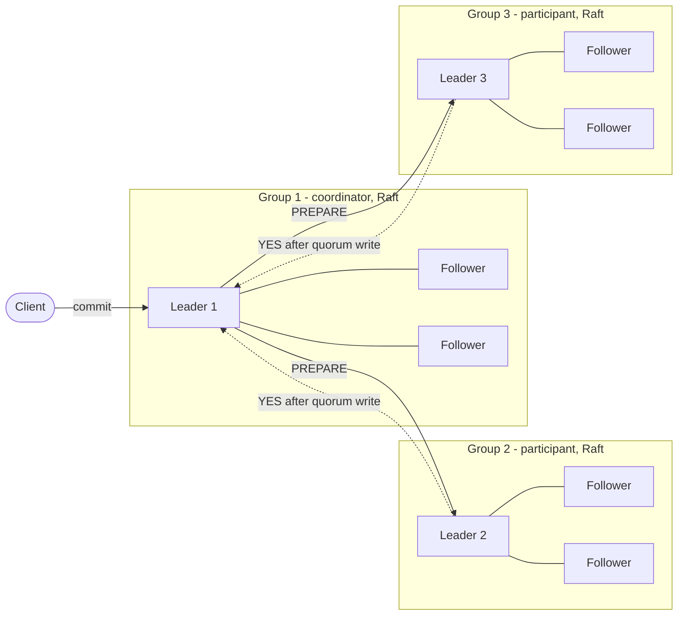

**Reading the diagram.** Each subgraph is a consensus group of three replicas, typically in three availability zones; "forcing a log record" now means replicating it to a quorum (two of three) of the group. The coordinator is the leader of one group, often a group that is also a participant. Solid arrows are synchronous requests; the dotted votes are replies that arrive only after the participant's prepared record is replicated. Failure points move from nodes to groups: losing one replica of any group is invisible to the transaction; losing a majority of one group blocks the transactions that touch it, as for any consensus system. Each transaction pays its slowest group's quorum write, twice.

Gray and Lamport generalized the idea as **Paxos Commit**, which runs one Paxos instance per participant's vote and tolerates $F$ failures of the acceptors with $2F+1$ acceptors; with $F = 0$ it reduces to 2PC [Gray and Lamport 2006]. Most production systems use the simpler structure of Figure 28.6, and so does nearly every system in the rest of this chapter.

::: industry
**Apache Kafka — 2PC with a replicated coordinator log.** Kafka transactions let a producer write atomically to several partitions and commit consumer offsets. A *transaction coordinator* records each transaction's state in the internal, replicated `__transaction_state` topic: it writes a prepare-commit entry (the commit point), then writes commit markers into every partition involved, then a completion entry. If the coordinator broker fails, a new leader for that `__transaction_state` partition reads the log and finishes the markers. Consumers in `read_committed` mode skip data whose markers are not yet written. See §31.11.
*Evidence: Primary* — [Kafka KIP-98 2017]
:::

### 28.4.9 Advantages, disadvantages and failure scenarios

**Advantages.** 2PC gives true atomicity and, combined with locking, serializability across independent resource managers. It is standardized (XA), supported by most relational databases and several brokers, and its logic is simple enough to verify.

**Disadvantages.** It blocks when the coordinator fails after votes; it holds locks across at least one round trip plus two forced writes; its availability is the product of its participants'; and it couples otherwise independent services in time, which is why microservice architectures avoid it (§28.6, Chapter 34).

**Table 28.3 — Two-phase commit failure scenarios.**

| What goes wrong | Why | Detection | Recovery | Prevention |
|---|---|---|---|---|
| Rows locked for minutes | Coordinator down while participants are in doubt | Age of `pg_prepared_xacts` / `XA RECOVER` entries | Restart coordinator from its log; resolve by GID | Replicated coordinator log; fast automatic restart |
| Orphaned prepared transaction | Coordinator's log lost or GID never recorded | Prepared transactions with unknown GID | Manual heuristic decision, then audit | Log GID and participant list before phase 2; never lose the TM log |
| Inconsistent outcome | Heuristic commit/abort contradicting the coordinator | Heuristic-mixed report; reconciliation | Manual compensation | Forbid heuristics without the coordinator's log |
| Transaction aborts under load | Participant times out waiting for `PREPARE` and aborts unilaterally | Abort rate and reason codes | Retry the transaction | Tune timeouts; avoid slow work between execution and commit |
| Duplicate commit applied twice | Retried phase 2 message not deduplicated | Balance reconciliation | Repair data | Idempotent `finish` keyed by transaction ID |
| VACUUM or purge stalls | Long-lived prepared transaction pins old versions | Table bloat, `age(datfrozenxid)` | Resolve the prepared transaction | Alert on prepared transactions older than seconds |

::: mistake
**Common misconception — "If the coordinator dies, participants can just time out and abort."** Before voting yes, they can. After voting yes, they cannot: the coordinator may have logged commit and told another participant, which has already made its half visible. A timeout-driven abort at that point violates atomicity.
:::

::: mistake
**Common misconception — "2PC guarantees all participants commit at the same instant."** It guarantees they reach the same *decision*. Participants apply it at different times, so a reader can see A's half before B's unless the system also provides consistent snapshots, which is what Percolator's timestamps and Spanner's commit wait add.
:::

## 28.5 Three-phase commit

### 28.5.1 How 3PC removes blocking

::: definition
**Definition — Three-phase commit (3PC).** A commit protocol that inserts a **pre-commit** phase between voting and committing, so that no participant can commit until every operational participant knows that all voted yes. Under a synchronous system model with reliable failure detection and no network partitions, it lets the surviving participants always reach a decision without the failed coordinator [Skeen 1981].
:::

#### Why does this exist?

2PC blocks because a prepared participant cannot tell whether some other node has already committed. Skeen proved that a commit protocol is non-blocking (for crash failures, in a synchronous system) only if no participant can be in a state from which *both* commit and abort are reachable in one step, and no non-committable state is adjacent to commit [Skeen 1981]. 2PC's PREPARED state violates the first rule. 3PC adds a buffer state so that "someone may have committed" implies "everyone already knows the vote was unanimous".

#### How it works internally

1. **CanCommit.** The coordinator asks each participant whether it can commit; each replies yes (and becomes *uncertain*, as in 2PC's PREPARED) or no.
2. **PreCommit.** If all said yes, the coordinator sends `PRE-COMMIT`; each participant logs it, enters the *pre-committed* state and acknowledges. Pre-committed means "everyone voted yes; I will commit unless I fail".
3. **DoCommit.** After all acknowledgments, the coordinator sends `COMMIT`.
4. **Termination when the coordinator fails.** The survivors elect a new coordinator, which collects their states. If any has committed, or any is pre-committed, it drives everyone to commit (sending `PRE-COMMIT` first to those still uncertain). If any has aborted, or *all* are merely uncertain, it aborts. Aborting is safe in the last case because nobody can have committed without first being pre-committed.

**Figure 28.7 — Three-phase commit.**

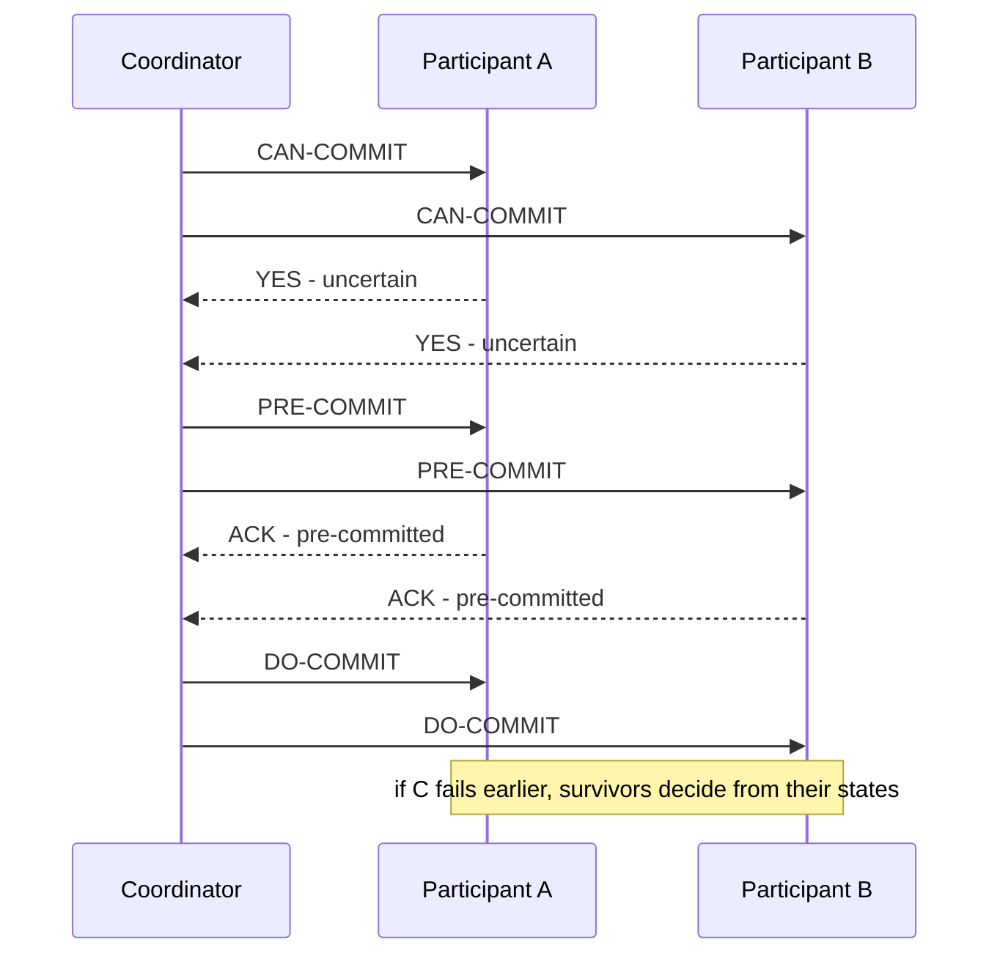

**Reading the diagram.** Each phase is a synchronous parallel fan-out, so 3PC costs three round trips instead of two; in a datacenter with RTT $= 0.5$ ms and 1 ms forced writes, about $3(0.5) + 2(1) = 3.5$ ms before the decision is known everywhere, versus 3 ms for 2PC. The extra round trip buys the invariant shown in the note: whenever any node may have committed, every live node is at least pre-committed, so the survivors can always decide among themselves. Failure points are the timeouts used to declare the coordinator dead, which must be accurate for the protocol to be safe.

### 28.5.2 Why 3PC fails under network partitions

The termination rule "all uncertain means abort" assumes that a node which cannot be reached has *crashed*. In an asynchronous network it may simply be on the other side of a partition (§24.7).

**Figure 28.8 — A partition makes 3PC decide both ways.**

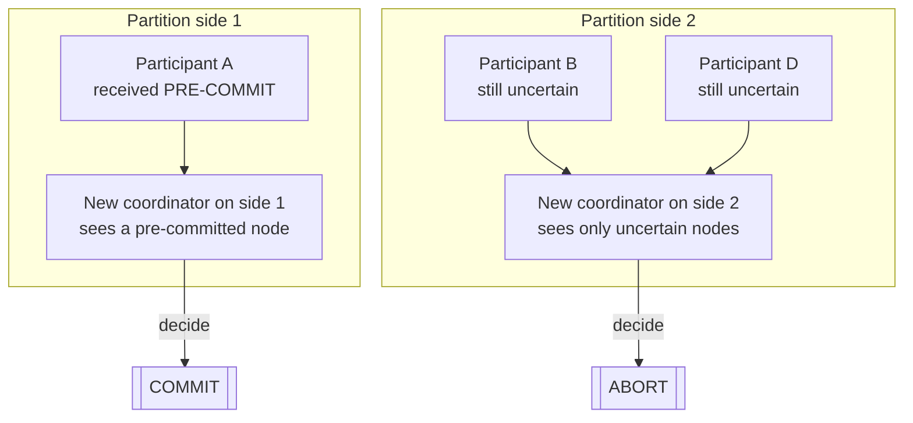

**Reading the diagram.** The original coordinator sent `PRE-COMMIT` to A and then lost connectivity; the network splits A from B and D. Each side runs the termination protocol with the nodes it can see. Side 1 contains a pre-committed node, so it commits; side 2 sees only uncertain nodes, so it aborts. Both decisions are durable, and the transaction is no longer atomic. The failure point is the timeout-based failure detector, which cannot distinguish crashed from partitioned. No amount of scaling fixes it; only a majority-based decision does.

3PC is rarely deployed for three reasons: real networks partition and timeouts misfire under GC pauses and overload (§23.9); it adds a round trip and a forced write to every commit; and running 2PC over consensus groups (§28.4.8) tolerates crashes *and* partitions, staying safe even when timeouts are wrong.

**Table 28.4 — Commit protocols compared.**

| Property | 2PC | 3PC | 2PC over consensus groups |
|---|---|---|---|
| Message rounds to decide | 2 | 3 | 2 (each a quorum write) |
| Blocks if coordinator crashes | Yes, until it recovers | No (synchronous model) | Only until a new leader is elected |
| Safe under network partition | Yes (blocks, never inconsistent) | No | Yes (minority side blocks) |
| Failure assumption | Crash-recovery | Crash-stop, bounded delays | Crash-recovery, majority up |
| Used in practice | XA, databases, brokers | Rarely | Spanner, CockroachDB, TiDB, YugabyteDB, Kafka |

::: mistake
**Common misconception — "3PC is 2PC without blocking."** It removes blocking only by assuming perfect failure detection. In an asynchronous network it trades 2PC's *blocking* for the far worse possibility of *inconsistency*.
:::

## 28.6 Sagas: a preview

::: definition
**Definition — Saga.** A long-lived transaction written as a sequence of local transactions $T_1, T_2, \dots, T_n$, each committed independently, where each $T_i$ has a **compensating transaction** $C_i$ that semantically undoes it. Either $T_1 \dots T_n$ all complete, or $T_1 \dots T_j, C_j \dots C_1$ run [Garcia-Molina and Salem 1987].
:::

A saga replaces atomicity with **semantic atomicity**: the system ends in a state equivalent to "all happened" or "none happened" as the *business* defines it, not byte for byte. Refunding a charge does not erase the charge; it adds a refund. Because each step commits locally, a saga holds no locks across services and never blocks on a coordinator, which is why it suits long-running business processes and microservices.

**Figure 28.9 — A transfer saga with compensation.**

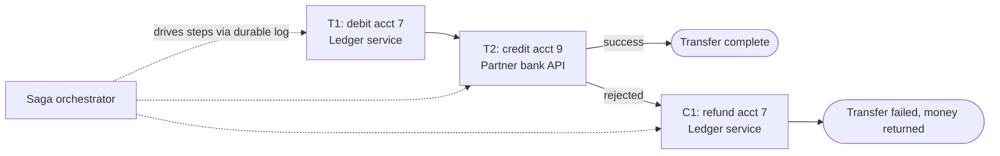

**Reading the diagram.** Each box is a local transaction in a different service with its own database; between steps, other transactions can see the intermediate state (account 7 debited, account 9 not yet credited). The orchestrator persists its progress and drives steps asynchronously (dotted arrows), retrying each step until it succeeds, so steps and compensations must be idempotent (§22.15). The failure point is the gap between steps: a saga provides no isolation, so another transaction might read the debited balance and refuse a payment it should have allowed.

The price is isolation, plus a compensation for every step, even steps that cannot truly be undone (an email sent). Chapter 32 covers sagas in depth (§32.7–§32.8) and the **transactional outbox** (§32.5), which makes "commit locally *and* publish a message" atomic without 2PC.

## 28.7 Percolator-style transactions

### 28.7.1 The problem Percolator solved

::: definition
**Definition — Percolator transaction.** A snapshot-isolated, multi-row, multi-table transaction built entirely by a client library on top of a store that offers only single-row atomic updates and multiple timestamped versions per cell. Ordering comes from a central **timestamp oracle**; atomicity comes from making one row's lock, the **primary lock**, the commit point for the whole transaction [Peng and Dabek 2010].
:::

#### First-principles explanation

Think of a team editing many pages of a shared binder. Before editing, each writer clips a sticky note to every page they will change, and every note says "see page 1". Page 1's note is special: whoever removes it and stamps page 1 "done at 14:02" has committed the whole edit, even if they collapse before unclipping the other notes. A reader who finds a stale note on page 37 just turns to page 1 to learn whether that edit happened.

#### Why does this exist?

Google's web index was rebuilt in large MapReduce batches, so a newly crawled page could take days to appear in search. Updating the index *incrementally* meant many concurrent workers changing billions of Bigtable rows (§14.6), each document touching many rows, with no stale or half-applied results. Bigtable offered only single-row transactions. Percolator added cross-row snapshot-isolated transactions and notifications on top, and Google reported that moving indexing to it cut the average age of documents in search results by 50% [Peng and Dabek 2010].

### 28.7.2 How it works internally

Every logical column is stored as several Bigtable columns, each holding timestamped versions.

**Table 28.5 — Percolator's columns for one logical cell.**

| Column | Version timestamp | Contents | Meaning |
|---|---|---|---|
| `data` | transaction start timestamp | The value | Written during prewrite, invisible until a `write` record points to it |
| `lock` | transaction start timestamp | Location of the primary lock (or "primary") | An uncommitted transaction holds this cell |
| `write` | transaction commit timestamp | Start timestamp of the committed `data` version | Makes `data@start_ts` visible to snapshots at or after `commit_ts` |

**Write path.**

1. **Start.** Get `start_ts` from the timestamp oracle. Buffer writes at the client.
2. **Prewrite (phase 1).** Pick one written cell as the **primary**; the rest are secondaries. For each cell, primary first, run a Bigtable single-row transaction that aborts if there is a `write` record with timestamp $\ge$ `start_ts` (a write-write conflict with a transaction that committed after our snapshot) or *any* `lock` (a concurrent writer); otherwise it writes `data@start_ts` and `lock@start_ts` pointing at the primary.
3. **Commit (phase 2).** Get `commit_ts` from the oracle. In one single-row transaction on the primary, check that our lock is still there, write `write@commit_ts` $\to$ `start_ts` and erase the lock. **This is the commit point.**
4. **Secondaries.** Write `write@commit_ts` and erase the lock on each secondary. This step can happen lazily, after replying to the client, because the outcome is already fixed.

**Figure 28.10 — A Percolator write of two cells.**

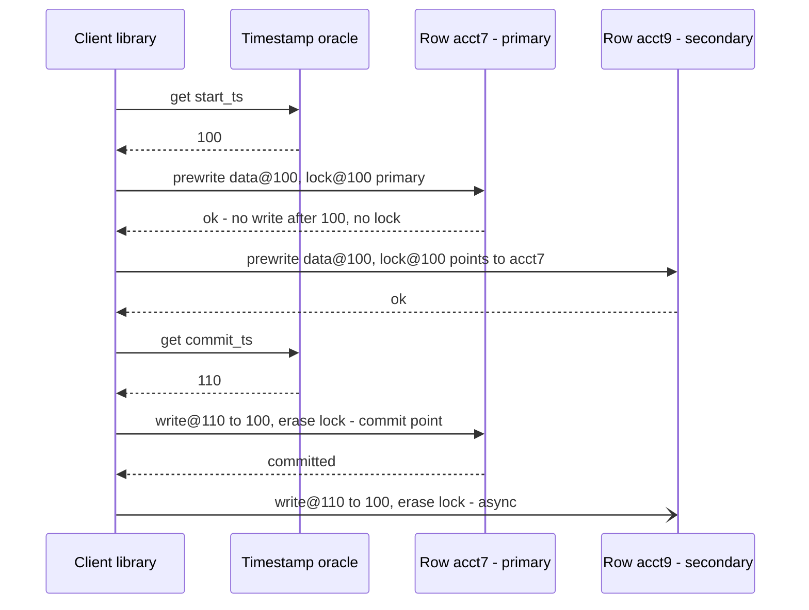

**Reading the diagram.** All coordination lives in the client library; there is no coordinator process and no coordinator log, because the primary row's lock *is* the coordinator's state, stored durably in replicated Bigtable. The oracle is a single logical service on every transaction's path, twice. Phase 1 messages to different rows can run in parallel after the primary's. The final secondary update is asynchronous (open arrowhead). Failure points: the client can die anywhere; after the primary's `write` record exists the transaction is committed and readers will roll the secondaries forward, before it they will roll everything back. Scaling: the oracle batches requests, and Peng and Dabek report a single oracle machine serving about two million timestamps per second.

**Read path and lazy cleanup.** A reader with snapshot `start_ts` checks for a `lock` with timestamp $\le$ `start_ts` on the cell. If one exists, a writer that may commit *before* our snapshot is in flight, so the reader waits. If the lock looks abandoned (Percolator checks writer liveness through Chubby, §26.14, and lock age), the reader cleans up by looking at the primary: if the primary's lock is still there, it erases it, rolling the transaction back; if the primary has a `write` record for that `start_ts`, it rolls this secondary forward by writing the same `write` record. Otherwise the reader returns the newest `data` version referenced by a `write` record with timestamp $\le$ `start_ts`.

::: concept
**Concept — Why a single-row atomic operation is enough.** 2PC needs a coordinator log so that one durable record decides the outcome. Percolator makes that record the primary cell's `write` entry, written by a single-row transaction in a replicated store. Every participant (every secondary lock) names the primary, so anyone can find the decision. There is no blocking on a coordinator: the decision is always readable, and an abandoned transaction can be resolved by whichever reader trips over it.
:::

### 28.7.3 TiKV and TiDB

TiDB is a MySQL-compatible distributed SQL database. Its storage layer, TiKV, implements Percolator's protocol over **Regions**, contiguous key ranges each replicated by Raft, and its **Placement Driver** (PD) acts as the timestamp oracle, handing out hybrid timestamps (physical milliseconds plus a logical counter) in batches [Huang et al. 2020]. Since v3.0.8, new clusters default to **pessimistic transactions**, which acquire Percolator-style locks during statement execution, as MySQL users expect, rather than discovering conflicts only at commit [TiDB Docs: Transactions]. Two later optimizations shorten the protocol: **async commit** returns to the client once all prewrites succeed, computing the commit timestamp from the participants' prewrite responses instead of a second oracle call; and **one-phase commit** writes a transaction confined to one Region in a single step.

::: formula
**Percolator commit latency**

$$T_{\text{perc}} \approx 2\,\text{RTT}_{\text{TSO}} + 2\,(\text{RTT} + t_w) \qquad T_{\text{async}} \approx \text{RTT}_{\text{TSO}} + \text{RTT} + t_w$$

| Symbol | Meaning | Units |
|---|---|---|
| $T_{\text{perc}}$ | Timestamp and commit overhead of a classic Percolator transaction (start and commit timestamps, prewrite, primary commit) | ms |
| $T_{\text{async}}$ | The same with async commit (no commit timestamp fetch, no wait for the primary commit) | ms |
| $\text{RTT}_{\text{TSO}}$ | Round trip to the timestamp oracle | ms |
| $\text{RTT}$ | Round trip from the client to the storage node | ms |
| $t_w$ | Durable, replicated write on the storage node (Raft quorum plus `fsync`) | ms |
:::

::: example
**Worked example — TiDB in one region.** Take $\text{RTT}_{\text{TSO}} = 0.5$ ms, $\text{RTT} = 0.5$ ms and $t_w = 2$ ms for a Raft write across three availability zones.

1. Classic: $2(0.5) + 2(0.5 + 2) = 1 + 5 = 6$ ms.
2. Async commit: $0.5 + 0.5 + 2 = 3$ ms, half the overhead.
3. If the PD leader is in another region with $\text{RTT}_{\text{TSO}} = 60$ ms, classic costs $120 + 5 = 125$ ms.

**Interpretation.** Percolator's latency is dominated by replicated writes inside a region, and by the oracle as soon as it is far away. **Engineering implication.** Keep the timestamp oracle in the region where transactions run, and treat a single global oracle as the scaling and geo-distribution limit of this design; Spanner (§28.8) removes it with clocks.
:::

### 28.7.4 A Percolator model you can run

```python
"""A Percolator-style transaction on a multi-version key-value store.

Each row has three columns, each a map timestamp -> value (as in Bigtable):
  data[ts]  = value written by the txn that started at ts
  lock[ts]  = name of the primary row, while the txn that started at ts is in flight
  write[cts] = start ts of the txn whose data became visible at commit ts cts
Assumes the holder of any lock a reader finds is dead (Percolator checks liveness first).
"""
import itertools


class Store:
    def __init__(self):
        self.rows = {}

    def row(self, key):
        return self.rows.setdefault(key, {"data": {}, "lock": {}, "write": {}})


class Oracle:                                     # the timestamp oracle
    def __init__(self):
        self._next = itertools.count(1)

    def ts(self):
        return next(self._next)


class Txn:
    def __init__(self, store, oracle):
        self.s, self.o = store, oracle
        self.start = oracle.ts()                  # snapshot timestamp
        self.writes = {}

    def get(self, key):
        r = self.s.row(key)
        for lts in [t for t in r["lock"] if t <= self.start]:
            self._cleanup(key, lts)               # stale lock below our snapshot
        visible = [c for c in r["write"] if c <= self.start]
        return r["data"][r["write"][max(visible)]] if visible else None

    def set(self, key, value):
        self.writes[key] = value

    def _prewrite(self, key, primary):
        r = self.s.row(key)
        if any(c >= self.start for c in r["write"]) or r["lock"]:
            return False                          # write-write conflict or locked
        r["data"][self.start] = self.writes[key]
        r["lock"][self.start] = primary
        return True

    def commit(self, crash=None):
        keys = sorted(self.writes)
        primary, secondaries = keys[0], keys[1:]
        for k in keys:                            # phase 1: prewrite, primary first
            if not self._prewrite(k, primary):
                self._rollback(keys)
                return False
        if crash == "before_primary":
            return None                           # client dies holding all locks
        commit_ts = self.o.ts()
        p = self.s.row(primary)                   # phase 2: single-row txn on primary
        if self.start not in p["lock"]:
            return False                          # someone rolled us back
        p["write"][commit_ts] = self.start
        del p["lock"][self.start]                 # <- the commit point
        if crash == "after_primary":
            return True                           # committed; secondaries still locked
        for k in secondaries:
            r = self.s.row(k)
            r["write"][commit_ts] = self.start
            r["lock"].pop(self.start, None)
        return True

    def _rollback(self, keys):
        for k in keys:
            r = self.s.row(k)
            if r["lock"].get(self.start) is not None:
                del r["lock"][self.start]
                del r["data"][self.start]

    def _cleanup(self, key, lts):
        """Roll a dead transaction forward or back, decided by its primary row."""
        r, primary = self.s.row(key), self.s.row(key)["lock"][lts]
        p = self.s.row(primary)
        if lts in p["lock"]:                      # primary never committed: roll back
            del p["lock"][lts]
            p["data"].pop(lts, None)
        committed = [c for c, st in p["write"].items() if st == lts]
        if committed and key != primary:          # roll forward this secondary
            r["write"][committed[0]] = lts
        elif not committed:
            r["data"].pop(lts, None)
        r["lock"].pop(lts, None)


def setup():
    s, o = Store(), Oracle()
    t = Txn(s, o)
    t.set("acct7", 500)
    t.set("acct9", 0)
    assert t.commit()
    return s, o


def transfer(s, o, amount, crash=None):
    t = Txn(s, o)
    t.set("acct7", t.get("acct7") - amount)
    t.set("acct9", t.get("acct9") + amount)
    return t.commit(crash)


def balances(s, o):
    t = Txn(s, o)
    return t.get("acct7"), t.get("acct9")


if __name__ == "__main__":
    # 1. Snapshot isolation: a reader that started earlier keeps its snapshot.
    s, o = setup()
    old_reader = Txn(s, o)
    assert transfer(s, o, 100)
    assert (old_reader.get("acct7"), old_reader.get("acct9")) == (500, 0)
    assert balances(s, o) == (400, 100)

    # 2. Write-write conflict: the second concurrent writer aborts.
    s, o = setup()
    t1, t2 = Txn(s, o), Txn(s, o)
    t1.set("acct7", 1)
    t2.set("acct7", 2)
    assert t1.commit() and not t2.commit()

    # 3. Client dies after committing the primary: a reader rolls the secondary forward.
    s, o = setup()
    assert transfer(s, o, 100, crash="after_primary")
    assert balances(s, o) == (400, 100)

    # 4. Client dies before the commit point: a reader rolls everything back.
    s, o = setup()
    transfer(s, o, 100, crash="before_primary")
    assert balances(s, o) == (500, 0)

    # 5. Write skew is allowed: invariant acct7 + acct9 >= 0 is violated.
    s, o = setup()
    a, b = Txn(s, o), Txn(s, o)
    if a.get("acct7") + a.get("acct9") >= 400:
        a.set("acct7", a.get("acct7") - 400)      # writes acct7 only
    if b.get("acct7") + b.get("acct9") >= 400:
        b.set("acct9", b.get("acct9") - 400)      # writes acct9 only
    assert a.commit() and b.commit()
    print("after write skew:", balances(s, o), "sum =", sum(balances(s, o)))
    print("all Percolator scenarios passed")
```

Output:

```text
after write skew: (100, -400) sum = -300
all Percolator scenarios passed
```

What to notice:

- Scenario 3 is the heart of the protocol: the client "dies" right after deleting the primary lock, yet the next reader returns (400, 100) because `_cleanup` finds the primary's `write` record and rolls `acct9` forward.
- Scenario 4 is the mirror image: with the primary lock still present, the reader rolls the whole transaction back. No coordinator was needed in either case.
- Scenario 5 is write skew (§28.3.3). The two transactions write disjoint rows, so no write-write check fires, and the customer ends \$300 overdrawn. TiDB users avoid this with `SELECT ... FOR UPDATE` on both rows.

::: industry
**Google Percolator — incremental web indexing.** Google replaced batch MapReduce index builds with Percolator-based incremental processing for its Caffeine indexing system. Transactions spanning many Bigtable rows and tables update the index as each document is crawled, with observers triggered by notifications. The trade-off was explicit: per-document processing used substantially more resources than batch processing, in exchange for much fresher results.
*Evidence: Primary* — [Peng and Dabek 2010]
:::

::: mistake
**Common misconception — "A leftover lock means data loss."** A Percolator lock left by a dead client is an unresolved, not a lost, transaction. Its fate is already fixed by the primary row; the first reader that needs the cell resolves it. What it costs is latency: readers wait, then pay for the cleanup.
:::

## 28.8 Spanner and TrueTime

### 28.8.1 The TrueTime API

::: definition
**Definition — TrueTime.** Google's clock API that returns time as an interval with a guaranteed error bound instead of a single value. `TT.now()` returns $[\textit{earliest}, \textit{latest}]$, guaranteed to contain the absolute time at which it was called; `TT.after(t)` is true if $t$ has definitely passed, and `TT.before(t)` is true if $t$ has definitely not arrived. The half-width of the interval is the **uncertainty** $\varepsilon$ [Corbett et al. 2012].
:::

#### First-principles explanation

Ordinary clocks lie with confidence: a server says 12:00:00.000 when the true time might be 11:59:59.950 (§24.9). TrueTime is a clock that admits its error: "it is between 11:59:59.996 and 12:00:00.004". To be sure an event happens after time $s$ everywhere, wait until your clock's *earliest* possible reading has passed $s$.

#### How it works internally

Each datacenter has **time masters** with GPS receivers and some with atomic clocks, which fail in different ways. A daemon on every machine polls several masters, rejects outliers and derives $\varepsilon$ from the masters' uncertainty, communication delay and a conservatively assumed local drift between polls (the paper uses 200 µs/s). In the 2012 paper, $\varepsilon$ followed a sawtooth from about 1 to 7 ms over each 30-second polling interval, averaging about 4 ms [Corbett et al. 2012]. If a machine's clock drifts or loses contact with masters, $\varepsilon$ grows; it never silently becomes wrong.

### 28.8.2 Read-write transactions and commit wait

Spanner shards data into **splits** replicated by Multi-Paxos groups spread over zones; each group's leader holds a time-based leader lease (§26.11) and a lock table, and runs two-phase locking for read-write transactions. A transaction that touches several groups runs 2PC across them (§28.4.8), with one group's leader as coordinator.

1. The client buffers writes and acquires read locks at participant leaders as it reads.
2. At commit, each participant leader acquires write locks, chooses a **prepare timestamp** larger than any timestamp it has assigned, and logs a prepare record through Paxos.
3. The coordinator leader, after receiving all prepare timestamps, chooses the **commit timestamp** $s$: at least every prepare timestamp, greater than `TT.now().latest` at the moment it received the commit request, and greater than any timestamp it has assigned.
4. It logs the commit record through Paxos and, *in parallel*, performs **commit wait**: it does not let anyone see the commit until `TT.after(s)` is true.
5. It then tells the client and the participants, which apply the writes at timestamp $s$ and release locks.

**Figure 28.11 — Spanner: transactions across Paxos groups.**

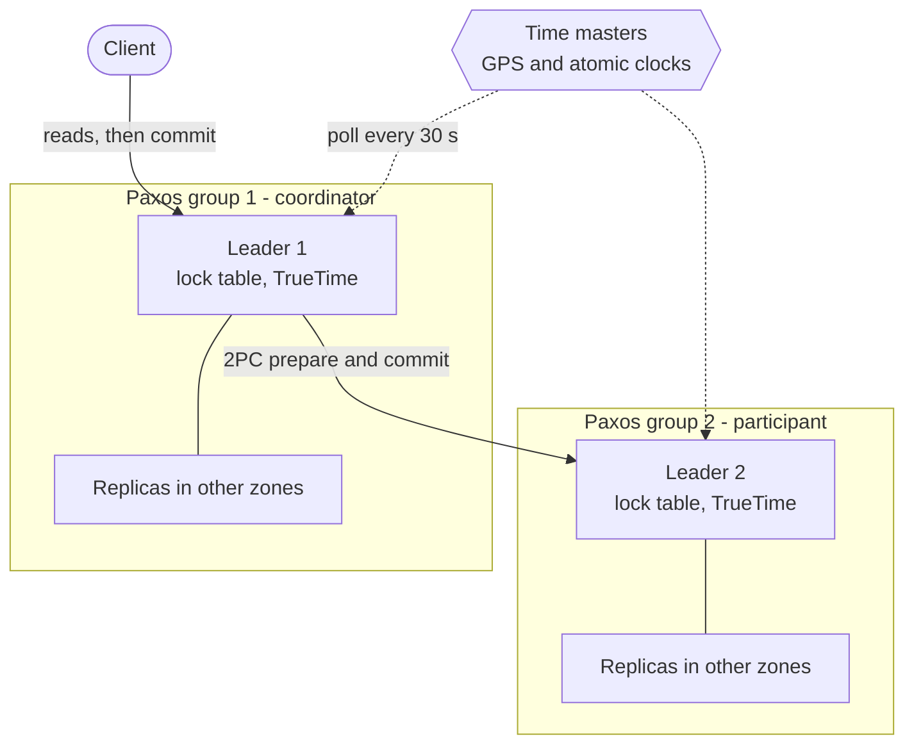

**Reading the diagram.** Each subgraph is a Paxos group whose leader serves locks and timestamps; replicas live in other zones or regions, so every "log" step is a Paxos round. 2PC runs only between leaders, synchronously. The time masters are an external dependency polled asynchronously (dotted); they bound $\varepsilon$ but sit on no transaction's critical path. Failure points: a leader failure costs a lease expiry and election; time master failures or network trouble widen $\varepsilon$, which slows commits but never breaks correctness. Scaling comes from adding splits and groups.

**Figure 28.12 — Commit wait timeline at the coordinator leader.**

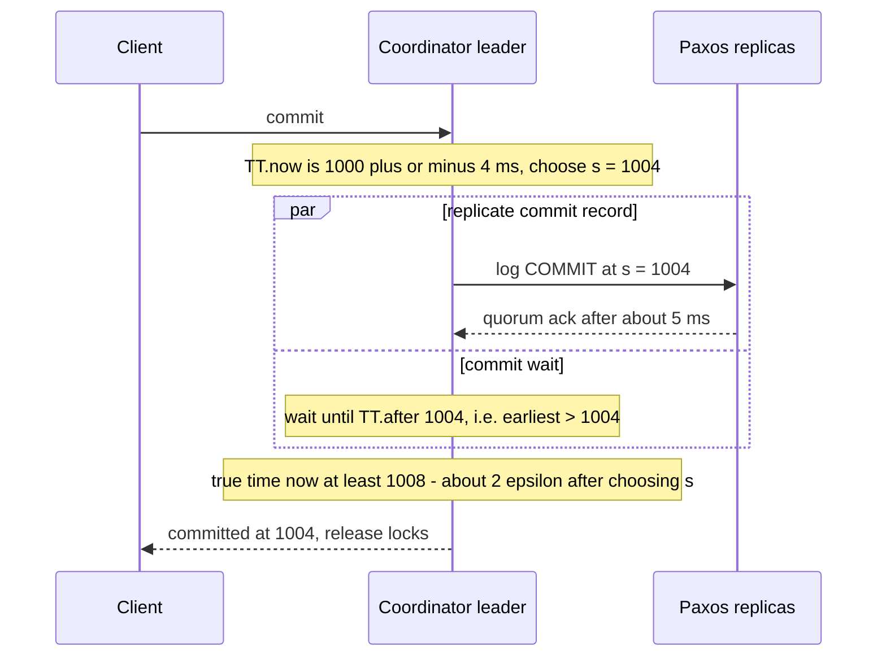

**Reading the diagram.** All times are milliseconds on an illustrative scale. When the request arrives, true time is somewhere in [996, 1004], so the leader picks $s = 1004$, the latest possible "now". It then waits until even the earliest possible reading exceeds 1004, which takes about $2\varepsilon = 8$ ms if $\varepsilon$ stays at 4 ms. Paxos replication runs in parallel, so the client sees roughly the larger of the two delays. The storage boundary is the Paxos log; locks are held until the end of commit wait, so wait time directly adds to contention on hot rows.

::: formula
**Commit wait**

$$T_{\text{wait}} \approx 2\,\bar{\varepsilon} \qquad T_{\text{commit}} \approx \max\left(T_{\text{Paxos}},\; 2\,\bar{\varepsilon}\right)$$

| Symbol | Meaning | Units |
|---|---|---|
| $T_{\text{wait}}$ | Time from choosing $s$ = `TT.now().latest` until `TT.after(s)` holds | ms |
| $\bar{\varepsilon}$ | Average TrueTime uncertainty (half-width) during the wait | ms |
| $T_{\text{Paxos}}$ | Time to replicate the commit record to a quorum | ms |
| $T_{\text{commit}}$ | Commit latency at the coordinator leader, ignoring 2PC phase 1 | ms |
:::

::: example
**Worked example — When does commit wait hurt?**

1. Regional configuration, replicas 1 ms apart, $T_{\text{Paxos}} \approx 2$ ms; with $\bar{\varepsilon} = 4$ ms, $T_{\text{wait}} = 8$ ms. $T_{\text{commit}} = \max(2, 8) = 8$ ms: commit wait dominates.
2. Multi-region configuration, quorum RTT 50 ms: $T_{\text{commit}} = \max(50, 8) = 50$ ms: commit wait is hidden entirely.
3. Clock trouble widens $\bar{\varepsilon}$ to 100 ms: $T_{\text{wait}} = 200$ ms in both configurations, and hot-row throughput under locking falls to at most $1/0.2 = 5$ commits/s.

**Interpretation.** Spanner converts clock uncertainty directly into commit latency, so the quality of the time infrastructure is a performance parameter. **Engineering implication.** Commodity NTP is usually accurate to milliseconds but gives no guaranteed bound (§24.9), so a safe configured bound must be hundreds of milliseconds (CockroachDB's default maximum offset is 500 ms, §28.10.1), which would make commit wait unacceptable; this is why systems without TrueTime-class clocks use HLCs and uncertainty intervals instead (§28.10).
:::

### 28.8.3 External consistency: a proof sketch

::: definition
**Definition — External consistency.** If transaction $T_1$ commits before $T_2$ starts, in absolute (wall-clock) time, then $T_1$'s commit timestamp is smaller than $T_2$'s. Combined with serializability, this is **strict serializability**: the serial order respects real-time order, as linearizability does for single objects (§25.3).
:::

Let $e_i^{\text{start}}$, $e_i^{\text{server}}$ and $e_i^{\text{commit}}$ be the events where $T_i$'s commit request reaches the coordinator, where it is assigned timestamp $s_i$, and where it becomes visible; let $t_{\text{abs}}(e)$ be absolute time. Suppose $t_{\text{abs}}(e_1^{\text{commit}}) < t_{\text{abs}}(e_2^{\text{start}})$. Then [Corbett et al. 2012]:

1. $s_1 < t_{\text{abs}}(e_1^{\text{commit}})$, by **commit wait**: $T_1$ is not visible until `TT.after(s_1)`.
2. $t_{\text{abs}}(e_1^{\text{commit}}) < t_{\text{abs}}(e_2^{\text{start}})$, the assumption.
3. $t_{\text{abs}}(e_2^{\text{start}}) \le t_{\text{abs}}(e_2^{\text{server}})$, by causality.
4. $t_{\text{abs}}(e_2^{\text{server}}) \le s_2$, by the **start rule**: $s_2 \ge$ `TT.now().latest` at that moment, which is at least the absolute time.

Chaining the inequalities gives $s_1 < s_2$. Both rules are needed: without commit wait, $s_1$ could be in the future of $T_2$'s start; without the start rule, $s_2$ could lag real time.

### 28.8.4 Read-only transactions and snapshot reads

A read-only transaction takes $s_{\text{read}} =$ `TT.now().latest` and reads at that timestamp, without locks, from *any* replica that is sufficiently up to date. A replica can serve a read at $t$ once $t \le t_{\text{safe}} = \min(t_{\text{safe}}^{\text{Paxos}}, t_{\text{safe}}^{\text{TM}})$: it has applied every Paxos write up to $t$, and no prepared-but-undecided transaction could still commit at or below $t$. Because commit timestamps are externally consistent, such a read sees every transaction that committed before it started. Reads at a timestamp in the past (**stale reads**, for example 10 s old) are cheaper still: any replica can serve them immediately. Read-only transactions are therefore never blocked by, and never block, read-write transactions.

### 28.8.5 Spanner and the CAP theorem

CAP (§25.8) says that during a network partition a system must give up either consistency or availability. Spanner chooses consistency: a minority side of a partition cannot commit. Brewer argues that Spanner is nevertheless "effectively CA": partitions are rare on Google's private network, and Spanner's measured availability exceeds five nines, so users experience a system that is both consistent and available. In the incident data he reports, network problems were a small minority of Spanner's outages, below user error, overload and bugs [Brewer 2017]. The lesson: availability is an engineering number, and a consistent system on a well-run network can beat a weakly consistent one on a poor network.

::: industry
**Google F1 on Spanner — the AdWords backend.** Google migrated its advertising backend from a sharded MySQL deployment to F1, a distributed SQL system built on Spanner, to get cross-shard transactions, consistent secondary indexes and resharding without application changes. The authors describe higher commit latency than MySQL, offset by hierarchical schemas that cluster related rows and by batching and parallelism.
*Evidence: Primary* — [Shute et al. 2013]
:::

::: mistake
**Common misconception — "Spanner works because Google's clocks are perfectly synchronized."** Its clocks are not perfect; they are *honest*. Correctness requires only that the true time lie inside TrueTime's interval. Tight intervals determine performance, not correctness.
:::

## 28.9 Calvin and deterministic databases

### 28.9.1 Agree on the order first, then execute

::: definition
**Definition — Deterministic database.** A database in which replicas and partitions first agree on a global order of transaction *inputs*, then execute transactions so that the outcome depends only on that order and the initial state. Every node that executes the same log reaches the same state, so no node needs to ask another whether to commit [Thomson et al. 2012].
:::

#### First-principles explanation

2PC is a meeting held *after* the work: "did everyone manage to do their part?" Calvin holds the meeting *before*: everyone agrees on the list of jobs and their order, then works through the list independently. If every worker follows the same list with the same rules, they cannot disagree about the outcome, so there is nothing to vote on.

#### Why does this exist?

In 2PC a participant can abort for *nondeterministic* reasons: a deadlock victim, a node crash, a timeout. The vote exists to catch those. Thomson and colleagues observed that if the system removes nondeterministic aborts, the vote becomes unnecessary, and locks no longer need to be held across a commit protocol. Contended transactions then hold locks only for their execution time, which is where Calvin's throughput advantage under contention comes from.

#### How it works internally

1. **Sequencing.** Clients send transaction requests to a sequencer on any node. Sequencers collect requests into **epochs** of 10 ms, replicate each batch (with Paxos, or asynchronously for lower latency and weaker durability) and send it to the schedulers of every partition the transactions touch. The merged batches form the global input log.
2. **Scheduling.** Each partition's scheduler acquires locks in global log order, deterministically: if T5 precedes T9 in the log and both want key $x$, T5 always gets it first. This rules out deadlocks.
3. **Execution.** Each participating partition performs its local reads and sends the results to the partitions that have writes; each of those runs the transaction logic and applies its own writes. A transaction that fails a constraint aborts on every partition alike, because every partition computes the same result.
4. **Failures.** A crashed node does not cause aborts; a replica, or the node after restart, replays the input log from a checkpoint and reaches the same state.

**Figure 28.13 — Calvin's architecture.**

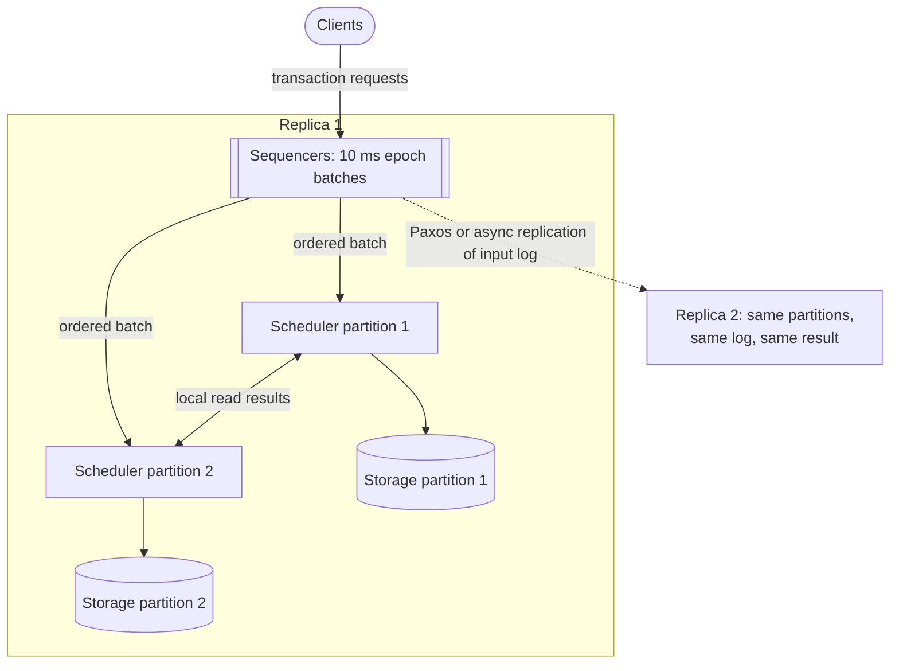

**Reading the diagram.** The sequencing layer is the only place where nodes coordinate synchronously, and what it replicates is the *input* (subroutine shape: a log), not the resulting data. Schedulers within a replica exchange read results directly (two-way arrow) and never exchange votes. Replica 2 receives the same log asynchronously or through Paxos and computes the same state independently, so storage on each replica is a pure function of the log. Failure points: an unreplicated batch lost with its sequencer, and a slow transaction stalling later conflicting ones. Scaling: add partitions; throughput grew nearly linearly in the paper's experiments on up to 100 machines.

::: formula
**Calvin transaction latency**

$$T_{\text{Calvin}} \approx \frac{e}{2} + T_{\text{rep}} + T_{\text{exec}}$$

| Symbol | Meaning | Units |
|---|---|---|
| $e$ | Epoch length; a request waits on average half an epoch to be batched | ms |
| $T_{\text{rep}}$ | Time to replicate the batch (Paxos round, or 0 for asynchronous) | ms |
| $T_{\text{exec}}$ | Lock wait, read forwarding and execution | ms |
| $T_{\text{Calvin}}$ | Expected time from request to result | ms |
:::

::: example
**Worked example — Calvin versus 2PC across regions.** Epoch $e = 10$ ms; three replicas in three regions with quorum RTT 70 ms; $T_{\text{exec}} = 2$ ms.

1. Calvin: $5 + 70 + 2 = 77$ ms, and locks are held for only about 2 ms.
2. 2PC over geo-replicated consensus groups: two quorum rounds, $\approx 140$ ms, with locks held across the second round of 70 ms or more.
3. In one region with $T_{\text{rep}} = 2$ ms: Calvin needs $5 + 2 + 2 = 9$ ms, slower than about 5 ms for 2PC over consensus groups.

**Interpretation.** Calvin wins across regions and under contention, because one agreement round replaces two and locks are not held during it; in a single region, batching delay can make it slower. **Engineering implication.** Calvin's lock hold time, not its latency, is what makes it attractive for high-contention workloads such as inventory or ticketing.
:::

### 28.9.2 Trade-offs and lineage

**Advantages.** No 2PC and no distributed deadlocks; cheap active replication of inputs instead of data; high throughput on contended keys; easy recovery by replay.

**Disadvantages.** Transactions must declare their read and write sets before execution. A transaction whose keys depend on data it reads (look up an index, then update the row it points to) needs a **reconnaissance** read first and must restart if the prediction proves wrong; the paper calls this optimistic lock location prediction. Interactive SQL sessions (`BEGIN`, think, `UPDATE`, think, `COMMIT`) do not fit at all. Every request pays half an epoch of batching. One slow or stalled transaction delays every later transaction that conflicts with it, because the order is fixed.

Calvin influenced commercial systems most visibly through **FaunaDB**, whose transaction engine was publicly described as Calvin-inspired; Fauna's hosted service shut down on 30 May 2025 [Fauna Docs: End of Life FAQ]. Later research, such as SLOG, extends deterministic ordering to geo-distributed data with region-local "home" data, so that single-home transactions avoid cross-region ordering [Ren et al. 2019].

::: mistake
**Common misconception — "Deterministic databases have no coordination."** They move all coordination to one place, before execution. The global sequencer is still a consensus problem; it is simply solved once per batch rather than once per transaction.
:::

## 28.10 Distributed SQL: CockroachDB, YugabyteDB and TiDB

### 28.10.1 CockroachDB

CockroachDB is a PostgreSQL-wire-compatible distributed SQL database that runs serializable transactions without specialized clocks [Taft et al. 2020].

#### How it works internally

1. **Ranges and leaseholders.** Data is a sorted key space split into **ranges** (512 MiB maximum by default in recent versions) each replicated with Raft. One replica holds a lease and serves reads and coordinates writes for the range.
2. **HLC timestamps.** Every transaction gets a timestamp from the gateway node's **hybrid logical clock** (§24.12), and MVCC versions are tagged with HLC timestamps.
3. **Transaction record and write intents.** A transaction writes provisional values called **write intents**, each pointing to a **transaction record** stored in the range of the transaction's first key. The record's status (`PENDING`, `STAGING`, `COMMITTED`, `ABORTED`) is the single source of truth, playing the role of Percolator's primary lock. Readers that meet an intent consult the record and may push or wait for the writer.
4. **Serializability by timestamp ordering.** Each leaseholder remembers the latest timestamp at which each key was read (the timestamp cache). A write below that timestamp is pushed to a higher one; before committing at the higher timestamp the transaction must **refresh** its reads, checking they are unchanged in between, or else retry.
5. **Uncertainty intervals.** Clocks may differ by up to a configured maximum offset (500 ms by default). A read at timestamp $t$ that finds a value with timestamp in $(t, t + \text{max offset}]$ cannot know whether that write happened before it in real time, so it restarts at a higher timestamp. Nodes whose clocks drift too far from their peers shut themselves down rather than risk anomalies.
6. **Parallel commits.** Instead of writing intents and *then* a committed record (two sequential consensus rounds), the coordinator writes the intents and a `STAGING` record listing them in parallel. A transaction is **implicitly committed** once the staging record and all its intents are replicated; the client is answered then, and the record is marked `COMMITTED` asynchronously [Cockroach Labs 2019].

**Figure 28.14 — CockroachDB parallel commits.**

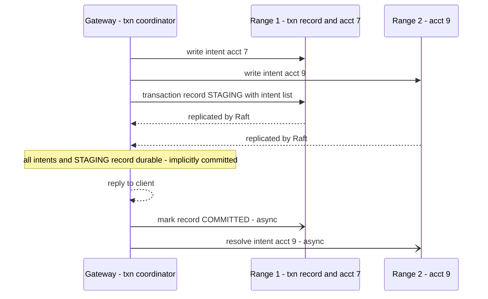

**Reading the diagram.** The three writes are independent Raft proposals in different ranges, issued concurrently, so the client waits for one consensus round, not two. "Implicitly committed" is a property any node can verify: a reader that finds a `STAGING` record checks whether every listed intent exists at the staged timestamp, and if so treats the transaction as committed. The asynchronous arrows clean up afterwards. If the gateway dies, a recovering transaction completes it if all intents exist, or prevents the missing intent from being written and aborts it.

::: formula
**Commit latency in consensus rounds**

$$T_{\text{serial}} \approx 2\,T_{\text{c}} \qquad T_{\text{parallel}} \approx T_{\text{c}}$$

| Symbol | Meaning | Units |
|---|---|---|
| $T_{\text{c}}$ | One consensus (Raft) round for the slowest range | ms |
| $T_{\text{serial}}$ | Commit with intents then a committed record | ms |
| $T_{\text{parallel}}$ | Commit with parallel commits | ms |
:::

::: example
**Worked example — A multi-region cluster.** Ranges have voters in three regions and $T_{\text{c}} = 40$ ms. Serial commit: $2 \times 40 = 80$ ms. Parallel commit: 40 ms, halving commit latency. In one region with $T_{\text{c}} = 2$ ms the saving is 2 ms, worth having but not decisive. **Engineering implication.** Commit protocols matter most where consensus rounds are expensive, which is exactly where geo-distributed SQL is deployed.
:::

### 28.10.2 YugabyteDB

YugabyteDB reuses PostgreSQL's query layer code above a distributed storage engine, **DocDB**, which splits tables into **tablets** replicated by Raft. Multi-tablet transactions write **provisional records** (intents) to each tablet and keep their state in a **transaction status tablet**, again a replicated record that decides the outcome. Timestamps come from **hybrid time**, an HLC, with a bounded maximum clock skew used for read uncertainty, as in CockroachDB. Single-row and single-tablet operations take a fast path without a status record. It supports snapshot, serializable and read committed isolation [YugabyteDB Docs: Distributed Transactions].

### 28.10.3 TiDB

TiDB, described in §28.7.3, runs Percolator over Raft Regions with a central timestamp oracle in PD, defaulting to snapshot isolation with pessimistic locking, with async commit and one-phase commit as optimizations [Huang et al. 2020].

**Table 28.6 — Distributed SQL databases compared (as of 2026).**

| Row | Spanner | CockroachDB | YugabyteDB | TiDB |
|---|---|---|---|---|
| What it is | Google's globally distributed database, managed service | PostgreSQL-wire-compatible distributed SQL | PostgreSQL-compatible distributed SQL | MySQL-compatible distributed SQL with HTAP |
| How it works | Paxos groups, 2PL, 2PC across groups, TrueTime commit wait | Raft ranges, HLC, intents, transaction record, parallel commits | Raft tablets, hybrid time, intents, status tablet | Raft Regions, PD timestamp oracle, Percolator 2PC |
| Default isolation | Serializable, externally consistent | Serializable | Snapshot (YSQL) | Snapshot (`REPEATABLE READ`), pessimistic locking |
| Advantages | Strongest guarantee; lock-free snapshot reads anywhere | No special clocks; geo-partitioning; serializable default | PostgreSQL feature compatibility; flexible isolation | MySQL compatibility; columnar replicas for analytics |
| Disadvantages | Google Cloud only; commit wait | Retries under contention; uncertainty restarts | Clock-skew bound; younger ecosystem | Central oracle limits geo-distribution |
| Performance | Bounded by Paxos RTT and $2\bar{\varepsilon}$ | One consensus round per commit with parallel commits | One consensus round for single-tablet writes | Oracle RTTs plus prewrite and commit; async commit saves one |
| Operational complexity | Low (managed) | Moderate; clock sync must be monitored | Moderate | Moderate to high: TiDB, TiKV, PD, TiFlash |
| Cost | Managed pricing per node or processing unit | Open-source core and commercial licenses; managed cloud | Open source; managed cloud | Open source; managed cloud |
| Use cases | Global financial, advertising, inventory systems | Multi-region OLTP with data residency | Migrating PostgreSQL apps that outgrew one node | Migrating sharded MySQL; real-time analytics on OLTP data |
| Choose when | You are on Google Cloud and need strict serializability globally | You need serializable SQL across regions on any cloud | You need PostgreSQL semantics at scale | You run MySQL and want to drop manual sharding |

::: industry
**CockroachDB — geo-distributed OLTP.** Taft and colleagues give the goals as surviving zone and region failures automatically while keeping serializable SQL, with per-table or per-row placement for latency and residency; parallel commits and pipelined writes help most in multi-region deployments.
*Evidence: Primary* — [Taft et al. 2020]
:::

::: mistake
**Common misconception — "A distributed SQL database makes cross-region transactions fast."** It makes them *correct*. Physics still sets the cost: any transaction whose data has voters in several regions pays at least one cross-region consensus round. Fast systems place data so that most transactions are regional.
:::

#### Failure scenarios in distributed SQL

| What goes wrong | Why | Detection | Recovery | Prevention |
|---|---|---|---|---|
| Spike in transaction retry errors | Contention, timestamp pushes failing read refresh | Retry and restart metrics by statement | Client retry loop with backoff | Shorter transactions; avoid hot keys; `SELECT ... FOR UPDATE` |
| Clock offset alarms, nodes exiting | NTP failure or VM pause beyond max offset | Clock-offset metrics | Fix time sync; restart nodes | Reliable time sync (PTP or cloud time service); alert early |
| Long-held locks after client crash | Abandoned intents or Percolator locks | Lock wait time | Lock resolution by readers, TTL expiry | Heartbeating transaction records; short TTLs |

## 28.11 Choosing a transaction strategy

Every mechanism in this chapter costs latency, availability or isolation. The best strategy therefore starts by *not needing* a distributed transaction, and climbs the ladder only as far as the requirements force it.

**Figure 28.15 — Choosing a transaction strategy.**

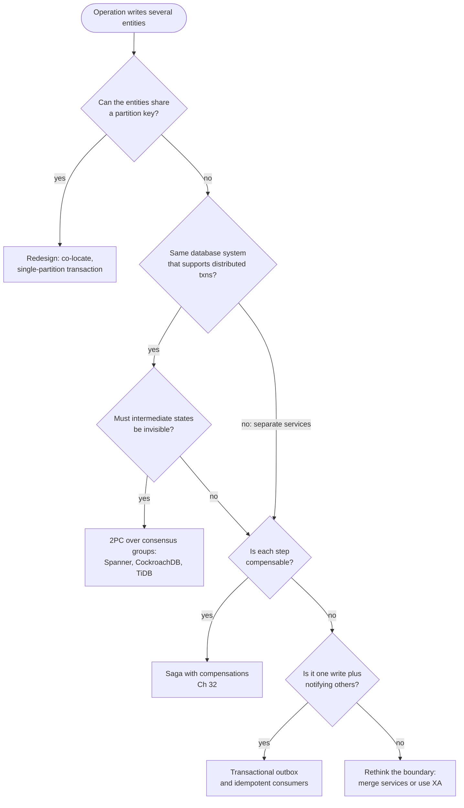

**Reading the diagram.** Decision nodes are questions about the data and the business, not the technology. The first question removes most distributed transactions: if a customer's orders and order lines share `customer_id` as partition key (§14.7), the transaction is local. Inside one distributed database, its own 2PC over consensus groups is the right tool when intermediate states must stay invisible; if they may be visible, the cheaper cross-service patterns also apply. Across services with separate databases, sagas (asynchronous, compensating) and the outbox (atomic local write plus at-least-once publication) replace atomic commitment with eventual, semantic consistency. Explicit XA across heterogeneous systems is the last resort.

**Table 28.7 — Transaction strategies compared.**

| Strategy | Atomicity | Isolation | Latency | Availability | Choose when |
|---|---|---|---|---|---|
| Single-partition transaction | Full | Full (local) | One local or quorum write | One partition's | You can choose the partition key |
| 2PC over consensus groups | Full | Serializable or SI | 2 quorum rounds (1 with parallel commits) | Product over groups, each highly available | Data is in one distributed database |
| Explicit 2PC / XA | Full | Depends on RMs | 2 RTT + 2 forced writes | Product over unreplicated RMs; blocks | Heterogeneous resources, short transactions, no alternative |
| Saga | Semantic | None between steps | Sum of local steps, asynchronous | High; steps retry independently | Long-running cross-service processes |
| Transactional outbox | Local write plus guaranteed publish | Local only | One local commit | One service's | One owner of the write, others react |

::: recommendation
**Recommendation — A default order of preference.** (1) Model data so that transactions are single-partition. (2) If not possible and the data lives in one system, use a distributed SQL database's native transactions and keep them short and regional. (3) Across service boundaries, use sagas and the outbox (Chapter 32), with idempotent consumers. (4) Use XA only for short transactions between a few resources you control, and operate its recovery deliberately: monitor in-doubt transactions, protect the transaction manager's log, forbid heuristic decisions without its records.
:::

::: example
**Worked example — A wallet service.** Each user's wallet and transaction history share partition key `user_id`, so a purchase is single-partition (step 1). Peer-to-peer transfers touch two users. At 500 transfers/s in one region on CockroachDB, a parallel commit adds one consensus round, about 2 ms, which is acceptable, so native transactions are chosen (step 2). Paying out to an external bank cannot join any transaction, so the payout is a saga: debit the wallet, call the bank, and refund on rejection; the debit and the "payout requested" event are written together with an outbox (step 3).
:::

## 28.12 Summary and revision notes

::: summary
- **Atomic commitment** needs every participant to reach the same irreversible decision, with any one able to veto. Partial failure and ambiguous silence make independent local commits unsafe (Figure 28.1).
- **2PC**: participants force a PREPARED record and vote; the coordinator forces the COMMIT record (the commit point) and propagates it. A prepared participant cannot decide alone, so a coordinator crash **blocks** in-doubt transactions and their locks.
- Exposure per crash is $N_{\text{doubt}} = Xw$ with $w \approx \text{RTT} + t_{f,c}$; latency is about $2\,\text{RTT} + 2t_f$; availability is $A^k$.
- **Presumed abort** removes forced writes and acknowledgments for aborts; read-only and one-phase optimizations remove 2PC for many transactions. XA and PostgreSQL `PREPARE TRANSACTION` expose 2PC; heuristic decisions break atomicity.
- **3PC** avoids blocking only with perfect failure detection; partitions make it inconsistent. Production systems run **2PC over consensus groups** instead.
- **Sagas** trade isolation for availability with compensations (Chapter 32).
- **Percolator** builds SI transactions from single-row atomicity: a timestamp oracle, prewrite locks pointing to a primary, and the primary's `write` record as commit point; readers roll abandoned transactions forward or back. TiDB uses it over Raft.
- **Spanner** assigns commit timestamps from TrueTime and waits about $2\bar{\varepsilon}$ before exposing a commit, yielding external consistency and lock-free snapshot reads.
- **Calvin** agrees on input order first and executes deterministically, eliminating 2PC at the cost of declared read/write sets and batching delay.
- **CockroachDB** uses HLCs, uncertainty intervals, transaction records and parallel commits (one consensus round); YugabyteDB uses hybrid time and a status tablet.
- Snapshot isolation distributes cheaply but permits **write skew**; serializability needs read locks or read validation.
- Prefer single-partition design, then native distributed transactions, then sagas and the outbox; use XA last.
:::

## 28.13 Knowledge checkpoint

1. Why can a participant abort unilaterally before voting yes but not after?
2. Which two log writes must be forced in 2PC's commit path, and what goes wrong if each is not?
3. What does a recovering coordinator do with a COMMIT record that has no END record?
4. Under presumed abort, why may the coordinator forget an aborted transaction immediately?
5. A coordinator handles 5,000 distributed transactions/s with RTT 1 ms and a 2 ms forced write. How many are left in doubt by a crash?
6. What is the availability of a transaction spanning 4 partitions at 99.9 % each?
7. Why does 3PC become unsafe under a network partition?
8. What is Percolator's commit point, and how does a reader resolve a lock left by a dead client?
9. Why must Spanner's coordinator perform commit wait?
10. With $\bar{\varepsilon} = 3$ ms and regional Paxos latency 4 ms, what is Spanner's approximate commit latency?
11. How does Calvin avoid 2PC, and what does it require from transactions?
12. What makes a CockroachDB transaction "implicitly committed"?
13. Why does snapshot isolation allow write skew across partitions?
14. Give the first strategy to try before any distributed transaction.

<details><summary>Answers</summary>

1. Before voting, no decision can include its yes vote, so abort is safe. After voting yes, the coordinator may already have logged commit.
2. The participant's PREPARED record (else a crash loses the promise and the participant might later be unable to commit) and the coordinator's COMMIT record (else a recovered coordinator could presume abort while some participant has committed).
3. Resends COMMIT to every listed participant until all acknowledge, then writes END.
4. Inquiries about a transaction it has no record of are answered "abort", which is correct for aborted transactions.
5. $w = 1 + 2 = 3$ ms; $N = 5{,}000 \times 0.003 = 15$.
6. $0.999^4 \approx 0.996$, about 173 minutes of unavailability per 30 days.
7. Each side runs the termination protocol; one side may see a pre-committed node and commit while the other sees only uncertain nodes and aborts.
8. Writing the primary cell's `write` record and erasing its lock. A reader checks the primary: lock still present means roll back; a `write` record for that start timestamp means roll the secondary forward.
9. To guarantee that its timestamp $s$ is in the past everywhere before anyone sees the commit, so any later transaction gets a larger timestamp (external consistency).
10. $\max(4, 2 \times 3) = 6$ ms.
11. It fixes a global input order before execution and executes deterministically, so there are no nondeterministic aborts to vote on. Transactions must declare read and write sets in advance.
12. A STAGING transaction record and all intents it lists are durably written at the staged timestamp.
13. SI checks only write-write conflicts; the two transactions write different keys, and the read-write dependencies span partitions that never compare notes.
14. Choose partition keys so the entities written together share a partition, making the transaction local.

</details>

## 28.14 Interview questions

### Basic

**Q1. Explain two-phase commit and its main weakness.**
**Answer.** A coordinator sends prepare; each participant forces a prepared record and votes; if all vote yes, the coordinator forces a commit record and tells everyone to commit, otherwise abort. The weakness is blocking: participants that voted yes cannot decide if the coordinator fails, and hold locks until it recovers. Also mention two round trips, two forced writes and $A^k$ availability.

**Q2. When would you use a saga instead of 2PC?**
**Answer.** When the steps cross service or organizational boundaries, run for seconds to days, involve external APIs that cannot participate in 2PC, or must stay available when one service is down. Each step must have a compensation and be idempotent, and the business must tolerate visible intermediate states.

### Intermediate

**Q3. How does Percolator achieve atomicity without a coordinator process?**
**Answer.** The primary lock stores the coordinator's state. Prewrite locks every cell, each secondary lock pointing to the primary. Committing writes the primary's `write` record at the commit timestamp in one single-row transaction; that is the commit point. Any reader finding a stale secondary lock looks at the primary to roll forward or back. Timestamps from the oracle give snapshot isolation; costs are two oracle calls and SI's write skew.

**Q4. Your XA-based order system has rows locked for 20 minutes after a deploy. Diagnose.**
**Answer.** Likely in-doubt prepared transactions: the deploy killed the transaction manager after participants voted yes. Check `pg_prepared_xacts` or `XA RECOVER` for old XIDs; bring the transaction manager back with its log so it re-drives outcomes; if the log is lost, resolve manually by auditing each XID. Prevent with graceful shutdown that drains transactions, a durable replicated TM log, and alerts on prepared-transaction age.

### Advanced

**Q5. Explain why Spanner's commit wait gives external consistency, and its cost.**
**Answer.** The coordinator picks $s \ge$ `TT.now().latest` and does not expose the commit until `TT.after(s)`, so $s$ is in the past when anyone can observe it. A transaction starting later gets a timestamp at least its own `TT.now().latest`, which exceeds true time and therefore $s$. Cost: about $2\bar{\varepsilon}$ per commit with locks held, overlapped with Paxos replication; it grows if clock uncertainty grows.

**Q6. Design transfers between accounts in a multi-region bank where most accounts are regional.**
**Answer.** Partition by home region and customer so most transfers are regional single- or multi-range transactions in a distributed SQL database with serializable isolation and parallel commits. Cross-region transfers either pay one cross-region consensus round, or become a saga through a regional clearing account with idempotent steps and an outbox. Quantify: regional commit about 2–5 ms, cross-region 70+ ms. Discuss write skew on overdraft checks and hot merchant accounts.

## 28.15 Practical exercises

1. Extend the simulation in §28.4.7 with a cooperative termination protocol: an in-doubt participant asks the others, and decides if any knows the outcome or has not voted. Add a test where it succeeds.
2. Convert the simulation to presumed commit and count forced writes and messages in both outcomes; compare with Table 28.2.
3. Repeat the PostgreSQL session of §28.4.6 and measure how long an unrelated `UPDATE` waits; then watch `age(datfrozenxid)` while a prepared transaction stays open.
4. Modify the Percolator model to prevent write skew in scenario 5 by having each transaction also lock the row it only read.
5. Compute Spanner commit latency for $\bar{\varepsilon} \in \{1, 4, 10\}$ ms against Paxos latencies of 2, 20 and 80 ms, and identify where commit wait matters.

## 28.16 Design challenges

1. **Ticketing flash sale.** 100,000 buyers compete for 5,000 seats in one stadium. Compare Calvin-style deterministic ordering, a single-partition design and 2PC across seat partitions on contention and latency.
2. **Cross-service checkout.** Order, inventory, payment and shipping services each own a database. Design checkout using sagas and an outbox; list each compensation and the isolation anomalies you accept.
3. **Global ledger.** A ledger must be strictly serializable across three continents with p99 commit below 200 ms. Choose a database, data placement and transaction pattern, and estimate latency.

## 28.17 References

1. Gray, J. *Notes on Data Base Operating Systems*. In *Operating Systems: An Advanced Course*, LNCS 60, Springer, 1978.
2. Bernstein, P. A., Hadzilacos, V., Goodman, N. *Concurrency Control and Recovery in Database Systems*. Addison-Wesley, 1987. Free online from Microsoft Research.
3. Skeen, D. *Nonblocking Commit Protocols*. ACM SIGMOD, 1981.
4. Mohan, C., Lindsay, B., Obermarck, R. *Transaction Management in the R\* Distributed Database Management System*. ACM Transactions on Database Systems 11(4), 1986.
5. Gray, J., Lamport, L. *Consensus on Transaction Commit*. ACM Transactions on Database Systems 31(1), 2006.
6. The Open Group (X/Open). *Distributed Transaction Processing: The XA Specification*. 1991.
7. Garcia-Molina, H., Salem, K. *Sagas*. ACM SIGMOD, 1987.
8. Peng, D., Dabek, F. *Large-scale Incremental Processing Using Distributed Transactions and Notifications*. USENIX OSDI, 2010.
9. Corbett, J. C., et al. *Spanner: Google's Globally-Distributed Database*. USENIX OSDI, 2012.
10. Brewer, E. *Spanner, TrueTime and the CAP Theorem*. Google, 2017.
11. Shute, J., et al. *F1: A Distributed SQL Database That Scales*. PVLDB 6(11), 2013.
12. Thomson, A., Diamond, T., Weng, S.-C., Ren, K., Shao, P., Abadi, D. J. *Calvin: Fast Distributed Transactions for Partitioned Database Systems*. ACM SIGMOD, 2012.
13. Ren, K., Li, D., Abadi, D. J. *SLOG: Serializable, Low-latency, Geo-replicated Transactions*. PVLDB 12(11), 2019.
14. Taft, R., et al. *CockroachDB: The Resilient Geo-Distributed SQL Database*. ACM SIGMOD, 2020.
15. Cockroach Labs. *Parallel Commits: An Atomic Commit Protocol for Globally Distributed Transactions*. Cockroach Labs Blog, 2019. https://www.cockroachlabs.com/blog/parallel-commits/
16. Huang, D., et al. *TiDB: A Raft-based HTAP Database*. PVLDB 13(12), 2020.
17. PingCAP. *TiDB Documentation: Transactions Overview; Pessimistic Transaction Mode*. https://docs.pingcap.com/tidb/stable/transaction-overview
18. Yugabyte. *YugabyteDB Documentation: Distributed Transactions*. https://docs.yugabyte.com/
20. Apache Kafka. *KIP-98: Exactly Once Delivery and Transactional Messaging*. 2017. https://cwiki.apache.org/confluence/display/KAFKA/KIP-98+-+Exactly+Once+Delivery+and+Transactional+Messaging
21. Cahill, M. J., Röhm, U., Fekete, A. D. *Serializable Isolation for Snapshot Databases*. ACM SIGMOD, 2008.
22. PostgreSQL Global Development Group. *PostgreSQL 16 Documentation: PREPARE TRANSACTION; pg_prepared_xacts*. https://www.postgresql.org/docs/16/sql-prepare-transaction.html
23. Oracle. *MySQL 8.4 Reference Manual: XA Transactions*. https://dev.mysql.com/doc/refman/8.4/en/xa.html
24. Fauna. *Fauna Service End of Life FAQ*. https://docs.fauna.com/fauna/current/eol-faq
25. Kleppmann, M. *Designing Data-Intensive Applications* (Ch. 7 "Transactions", Ch. 9 "Consistency and Consensus"). O'Reilly, 2017.

## 28.18 Open verification items

- Table 28.2 forced-write and message counts for presumed abort and presumed commit, against Mohan et al. 1986.
- Percolator oracle throughput (~2 million timestamps/s) and the 50 % document-age reduction.
- Brewer 2017: exact share of Spanner incidents attributed to the network (a secondary source says under 8 %).
- Calvin's near-linear scaling to 100 machines; FaunaDB's description as Calvin-inspired.
- Defaults as of 2026: CockroachDB range size (512 MiB), max offset (500 ms); YugabyteDB YSQL default isolation; TiDB async commit and 1PC status.
