# Chapter 29 — Distributed Data Processing

> **Level:** 3 · **Track:** Shared (A Traditional and B ML/AI) · **Estimated reading time:** 3 h

Chapters 11–15 stored data; Chapters 24–28 kept copies of it consistent. This chapter is about *computing over* data that is too large for one machine: counting a month of click logs, joining two billion orders with their customers, building a search index, or keeping a live per-minute fraud score for every card. The same few ideas recur across every engine you will meet: split the input, run the same function on each piece, move records with the same key to the same place (the **shuffle**), and recover from failures by recomputing rather than by replicating everything. You will learn them first through MapReduce, where every step is visible, then through Apache Spark, which keeps data in memory and plans whole jobs as graphs, and finally through stream processing and Apache Flink, where the input never ends and "when is a result complete?" becomes the central question. Chapter 61 (ML data pipelines) builds directly on this chapter, so the examples lean toward the log and event data that feed machine-learning systems.

## 29.1 Learning objectives

After this chapter you should be able to:

- Explain why batch systems treat inputs as immutable and optimize throughput over latency, and estimate the scan time of a job from data size and cluster bandwidth.
- Trace a MapReduce job through splits, map, partition, sort and spill, shuffle, merge and reduce; estimate its run time; and quantify what a combiner saves.
- Explain how MapReduce and Spark survive failures by re-execution and lineage, and how backup tasks cut straggler delay.
- Choose between a sort-merge (shuffle) join and a broadcast join with a cost calculation.
- Describe RDDs, narrow and wide dependencies, stages and tasks, caching, DataFrames, the Catalyst optimizer and Adaptive Query Execution, and write a correct PySpark job.
- Calculate shuffle volume and time on a rack-structured cluster, the slowdown caused by key skew, and the effect of salting.
- Explain data locality and why disaggregated object storage changed its importance.
- Define event time, processing time, windows, watermarks, triggers and allowed lateness, and compute the fraction of late events for a watermark delay.
- Explain Flink's architecture, keyed state, the RocksDB state backend, asynchronous barrier snapshotting and savepoints, and size a checkpoint interval.
- Compare Lambda and Kappa architectures, batch and stream processing, and Spark and Flink, and say where Apache Beam fits.

## 29.2 Prerequisites

- Distributed file systems and object storage — §15.4–§15.5 (GFS/HDFS chunks and S3-style stores are where batch inputs live).
- Columnar storage and Parquet — §13.13 (why analytical jobs read a few columns fast).
- Partitioning, hash and range — §14.6 and hot partitions §14.10 (the shuffle is partitioning on the fly).
- Datacenter networking and oversubscription — §7.17 (shuffle time is a network problem).
- Probability and Amdahl's Law — §4.6 and §4.12 (stragglers and the serial parts of a job).
- Clocks and logical time — §24.9–§24.10 (event time versus processing time; Chandy–Lamport builds on Lamport's ideas).
- Backpressure and idempotency — §22.10 and §22.15 (streaming operators slow their sources; sinks must tolerate replays).
- Units: **MB/GB/TB** are powers of ten; network speeds are in bits per second (Gb/s), so 25 Gb/s = 3.125 GB/s.

## 29.3 Batch processing concepts

### 29.3.1 Bounded, immutable inputs and throughput-first design

::: definition
**Definition — Batch processing.** Running a computation over a **bounded** dataset (one whose size is known when the job starts, such as "yesterday's logs") that reads immutable input files, writes new output files, and is judged mainly by **throughput** (bytes or records processed per second) and total completion time rather than by the latency of individual records.
:::

#### First-principles explanation

Imagine counting every word in a library. You could ask one person to read every book: correct, but it takes years. Or you could give each of 1,000 volunteers a shelf, have each write a tally sheet, then have a second group add the tally sheets together letter by letter: one person totals words beginning with "a", another "b", and so on. Nobody edits a book; the books are only read. If a volunteer goes home sick, you hand the same shelf to someone else and nothing is corrupted, because the shelf never changed. That is batch processing: **split, process in parallel, regroup by key, combine**, over inputs that do not change.

The Unix shell already works this way on one machine. To find the five most common URLs in a web server log you can write:

```bash
cat access.log | awk '{print $7}' | sort | uniq -c | sort -rn | head -5
```

Each program reads a stream, does one job, and writes a stream; the input file is never modified; and `sort` is the step that brings equal keys together so `uniq -c` can count them. MapReduce and its successors are this pipeline spread over thousands of machines, with the distributed file system playing the role of the pipe [Kleppmann 2017, ch. 10].

#### Why does this exist?

Three properties make large computations tractable:

1. **Immutable inputs.** If inputs are never modified, any piece of work can be rerun and will produce the same output. Fault tolerance becomes "do it again" rather than distributed transactions (Chapter 28). A buggy job can be fixed and rerun over the same input, which Kleppmann calls *human fault tolerance*.
2. **Bounded datasets.** Knowing the whole input exists lets the system sort it, count it, plan the work in waves, and decide when the job is finished.
3. **Throughput over latency.** Nobody waits on one record, so the system can batch I/O into large sequential reads and writes (100+ MB at a time), keep every disk and core busy, and accept tens of seconds of scheduling overhead. The figure of merit is cluster-hours per terabyte.

#### How it works internally

1. Store the input as large files split into blocks (128 MB in HDFS, §15.5.2) or objects.
2. Divide the input into **splits**, usually one per block, and run one **task** per split.
3. Run tasks in parallel on many nodes, each writing intermediate output locally.
4. Regroup intermediate records by key across the network.
5. Write the final output as new immutable files; a job "commits" by atomically renaming or registering its output directory.

**Figure 29.1 — A Unix pipeline and the distributed batch job that generalizes it.**

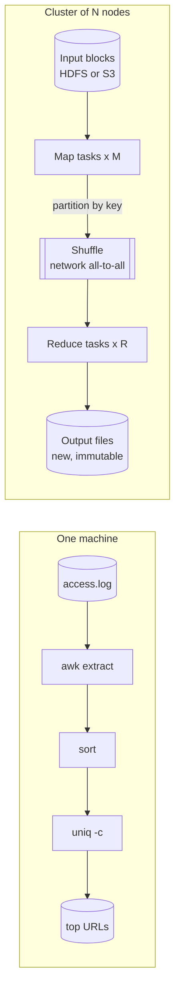

**Reading the diagram.** The top row is a single-machine pipeline: `awk` extracts the URL, `sort` brings equal URLs together, `uniq -c` counts them; data flows left to right through in-memory pipes and the input file is only read. The bottom row is the cluster equivalent. *Input blocks* in a distributed file system or object store feed *M map tasks* running in parallel; the *shuffle* (an asynchronous, all-to-all network transfer) plays the role of `sort` by delivering every record with the same key to one of *R reduce tasks*; reducers write *new output files*. Storage boundaries: inputs and outputs are durable and replicated; intermediate map output sits on local disks. Failure points: a dead node loses its running tasks and its local intermediate files, both recovered by rerunning tasks. Scaling: add nodes to raise M and R.

#### Mathematical foundations

The first estimate for any batch job is how long it takes just to read the input.

::: formula
**Scan time of a bounded dataset**

$$T_{\text{scan}} = \frac{D}{N \cdot b}$$

| Symbol | Meaning | Units |
|---|---|---|
| $T_{\text{scan}}$ | Time to read the whole input once, ignoring stragglers | s |
| $D$ | Input size | bytes |
| $N$ | Number of nodes reading in parallel | count |
| $b$ | Sustained read-and-process rate per node | bytes/s |
:::

::: example
**Worked example — Why a 10 TB log needs a cluster.** A day of clickstream logs is $D = 10$ TB $= 10^{13}$ B. One node can read and parse at $b = 500$ MB/s.

1. One node: $10^{13} / (5 \times 10^{8}) = 20{,}000$ s $\approx 5.6$ hours.
2. 100 nodes: $10^{13} / (100 \times 5 \times 10^{8}) = 200$ s $\approx 3.3$ minutes.
3. Reading only 3 of 30 columns from Parquet (§13.13) cuts effective $D$ to about 1 TB: 20 s on 100 nodes.

**Interpretation.** Parallelism converts hours into minutes, but only for the part that parallelizes; job start-up, the slowest task and any single-node step do not shrink (Amdahl's Law, §4.12). **Engineering implication.** Before tuning anything, reduce $D$ (columnar formats, partition pruning by date) and then raise $N$; later sections add the shuffle and straggler terms that this formula ignores.
:::

::: mistake
**"Batch means old-fashioned or slow."** Batch is a contract about bounded inputs and throughput, not about hardware. A modern Spark job over Parquet can finish in seconds; a streaming job can lag hours behind. Choose by whether the input is bounded and how fresh the output must be (§29.11).
:::

## 29.4 MapReduce

### 29.4.1 The programming model and word count

::: definition
**Definition — MapReduce.** A programming model and execution system in which the user writes two functions: **map**, which turns one input record into zero or more intermediate key–value pairs, and **reduce**, which receives one intermediate key with *all* values emitted for it and produces output. The system handles splitting, scheduling, regrouping by key, and failures [Dean and Ghemawat 2004].
:::

#### First-principles explanation

The model works because many computations have the same shape: *look at each record independently* (map), then *combine everything that shares a key* (reduce). Counting words, building an inverted index (word → documents), computing per-user totals and joining two tables by ID all fit. The user writes only the two functions; the framework supplies the parallelism. The signatures are:

```text
map:    (k1, v1)        -> list of (k2, v2)
reduce: (k2, list of v2) -> list of v3
```

For word count, map receives one line of text and emits `(word, 1)` for each word; reduce receives `("the", [1, 1, 1, …])` and emits `("the", count)`.

#### Why does this exist?

Google in the early 2000s ran hundreds of special-purpose programs over crawled documents and request logs. Each one reimplemented parallelization, data distribution and failure handling, which buried a few lines of logic under thousands of lines of plumbing. MapReduce extracted the plumbing into a library so that engineers without distributed-systems experience could use thousands of machines, and Google rewrote its production indexing system on it [Dean and Ghemawat 2004]. Hadoop MapReduce, the open-source reimplementation on HDFS, brought the same model to the rest of the industry.

### 29.4.2 Execution: splits, map, partition, sort and spill, shuffle, reduce

#### How it works internally

1. **Split.** The input is divided into $M$ splits, typically one per 64–128 MB block. A single **coordinator** (Google's paper calls it the master; Hadoop 1 the JobTracker; on YARN an ApplicationMaster) assigns map tasks to idle workers, preferring a worker that stores the split locally (§29.7).
2. **Map.** The worker parses records from its split and calls `map` on each one.
3. **Partition.** Each intermediate pair is assigned to one of $R$ reduce partitions, by default $\text{hash}(k) \bmod R$, so every pair with the same key goes to the same reducer no matter which mapper emitted it.
4. **Buffer, sort and spill.** Pairs accumulate in an in-memory buffer (100 MB by default in Hadoop). When it fills past a threshold, the worker sorts the buffer by (partition, key), optionally runs the **combiner**, and **spills** a sorted run to local disk. At the end of the task, the spill files are merge-sorted into one file per task, laid out partition by partition with an index.
5. **Shuffle.** Each reduce task fetches its partition from *every* map task's output over the network, usually starting while maps are still finishing. This all-to-all copy is the shuffle.
6. **Merge.** The reducer merge-sorts the $M$ sorted runs it fetched, spilling to disk if they do not fit in memory, so that all values for a key are adjacent.
7. **Reduce.** The reducer calls `reduce` once per key, streaming the sorted values, and writes output to the distributed file system as one file per reduce task (`part-00000`, `part-00001`, …). Output becomes visible by an atomic rename when the task commits.

A **combiner** is a reduce function run on the map side, on one mapper's output, before the shuffle. It is legal only when the reduce operation is associative and commutative (sum, count, max), because the reducer will combine partial results in an arbitrary grouping.

**Figure 29.2 — MapReduce job execution.**

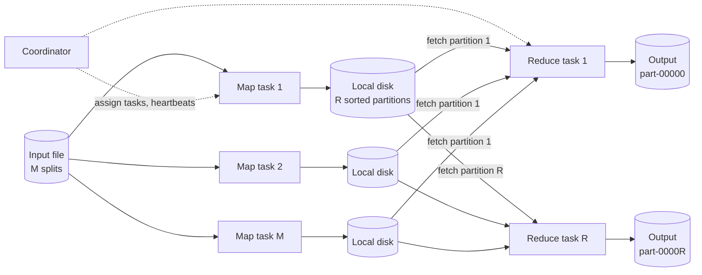

**Reading the diagram.** The *coordinator* (dotted arrows) assigns tasks and receives heartbeats; it never touches data. Each *map task* reads one split from the replicated *input file*, partitions and sorts its output, and writes it to its node's *local disk* as R sorted partitions. Each *reduce task* fetches its own partition from every map output (the HTTP-based shuffle; solid arrows are synchronous fetches), merges, reduces, and writes one *output* file back to the distributed file system. Storage boundaries: input and output are durable and replicated; intermediate data is local and unreplicated, which is cheap but means a lost node forces its map tasks to rerun. Scaling: map parallelism follows input size; reduce parallelism is chosen by the user (R), and the shuffle is $M \times R$ transfers.

**Figure 29.3 — Inside a map task and a reduce task.**

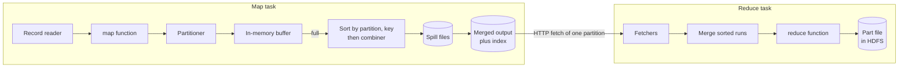

**Reading the diagram.** Within a map task, records flow from the *record reader* through the user's *map function* and the *partitioner* into a memory *buffer*. Each time the buffer fills, it is sorted by (partition, key), the *combiner* runs, and a *spill file* is written; at the end all spills are merged into one partitioned file with an index giving each partition's byte range. The reduce task's *fetchers* pull its partition from every map output, the *merge* step produces one sorted stream, and the *reduce function* writes a part file to HDFS. Failure points: a full disk during spill fails the task; a fetch failure from a dead node makes the coordinator rerun that map. Scaling: larger buffers mean fewer spills and merge passes.

#### Code example

The program below is a complete MapReduce engine in about 70 lines: map tasks with partitioning, per-partition sorting and an optional combiner; a shuffle that gives reducer $r$ run $r$ from every mapper; a k-way merge; and reduce. Map tasks that "crash" are re-executed. It runs word count with and without a combiner and a reduce-side join, and checks every answer against plain Python.

```python
"""A mini MapReduce engine: splits -> map -> (combine) -> partition -> sort -> shuffle -> reduce.
Map tasks are pure functions of their split, so a failed task is simply re-executed."""
import heapq
import itertools
import zlib
from collections import Counter, defaultdict


def hash_partition(key, num_reducers):
    # Deterministic across processes (Python's built-in hash() is salted per process).
    return zlib.crc32(repr(key).encode()) % num_reducers


class TaskFailure(Exception):
    pass


class MiniMapReduce:
    def __init__(self, mapper, reducer, num_reducers=4, combiner=None,
                 partitioner=hash_partition, max_attempts=4):
        self.mapper, self.reducer, self.combiner = mapper, reducer, combiner
        self.R, self.partitioner, self.max_attempts = num_reducers, partitioner, max_attempts
        self.stats = Counter()

    def _map_task(self, split, crash):
        if crash:                               # simulate a worker dying mid-task
            raise TaskFailure("worker lost")
        buckets = [defaultdict(list) for _ in range(self.R)]
        for record in split:
            for key, value in self.mapper(record):
                self.stats["map_output_records"] += 1
                buckets[self.partitioner(key, self.R)][key].append(value)
        runs = []                               # one sorted run per reducer partition
        for bucket in buckets:
            run = []
            for key in sorted(bucket):
                values = bucket[key]
                if self.combiner:               # local pre-aggregation before the shuffle
                    values = list(self.combiner(key, values))
                run.extend((key, v) for v in values)
            runs.append(run)
        return runs

    def run(self, splits, crash_first_attempt=()):
        map_outputs = []                        # map_outputs[m][r] = sorted run
        for m, split in enumerate(splits):
            for attempt in range(1, self.max_attempts + 1):
                try:
                    crash = m in crash_first_attempt and attempt == 1
                    map_outputs.append(self._map_task(split, crash))
                    break
                except TaskFailure:
                    self.stats["map_reexecutions"] += 1
            else:
                raise RuntimeError(f"map task {m} failed {self.max_attempts} times")
        result, reducer_input = {}, []
        for r in range(self.R):                 # shuffle: reducer r fetches run r from every mapper
            runs = [map_outputs[m][r] for m in range(len(map_outputs))]
            self.stats["shuffled_records"] += sum(len(run) for run in runs)
            reducer_input.append(sum(len(run) for run in runs))
            merged = heapq.merge(*runs, key=lambda kv: kv[0])   # k-way merge of sorted runs
            for key, group in itertools.groupby(merged, key=lambda kv: kv[0]):
                for out in self.reducer(key, (v for _, v in group)):
                    result[key] = out
        self.stats["max_reducer_input"] = max(reducer_input)
        return result


# ---- Job 1: word count ------------------------------------------------------
def wc_map(line):
    for word in line.lower().split():
        yield word.strip(".,;:!?\"'"), 1


def wc_sum(key, values):
    yield sum(values)


# ---- Job 2: reduce-side (sort-merge) join of users and orders ----------------
def join_map(record):
    table, row = record
    if table == "users":                        # ("users", (user_id, country))
        yield row[0], ("U", row[1])
    else:                                       # ("orders", (order_id, user_id, amount))
        yield row[1], ("O", (row[0], row[2]))


def join_reduce(user_id, tagged):
    country, orders = None, []
    for tag, payload in tagged:
        if tag == "U":
            country = payload
        else:
            orders.append(payload)
    yield sorted((oid, amt, country) for oid, amt in orders)   # orders enriched; None = no profile


if __name__ == "__main__":
    text = ["the quick brown fox", "jumps over the lazy dog", "the dog barks",
            "The fox runs. The dog sleeps!", "a quick test of the engine"] * 200
    splits = [text[i:i + 100] for i in range(0, len(text), 100)]        # 10 input splits
    expected = Counter(w.strip(".,;:!?\"'") for line in text for w in line.lower().split())

    plain = MiniMapReduce(wc_map, wc_sum, num_reducers=4)
    out_plain = plain.run(splits)
    combined = MiniMapReduce(wc_map, wc_sum, num_reducers=4, combiner=wc_sum)
    out_comb = combined.run(splits, crash_first_attempt={2, 7})
    assert out_plain == dict(expected) == out_comb
    print("distinct words:", len(out_comb), " 'the' =", out_comb["the"])
    print("map output records:", plain.stats["map_output_records"])
    print("shuffled without combiner:", plain.stats["shuffled_records"])
    print("shuffled with combiner:   ", combined.stats["shuffled_records"])
    print("re-executed map tasks:", combined.stats["map_reexecutions"])

    users = [("users", (u, c)) for u, c in [(1, "IN"), (2, "US"), (3, "DE")]]
    orders = [("orders", (100 + i, 1 + i % 4, 10 * i)) for i in range(8)]   # user 4 has no profile
    joined = MiniMapReduce(join_map, join_reduce, num_reducers=2).run([users, orders[:4], orders[4:]])
    assert joined[1] == [(100, 0, "IN"), (104, 40, "IN")]
    assert joined[4] == [(103, 30, None), (107, 70, None)]   # orphan orders keep country None
    print("join, user 2:", joined[2])
    print("all tests passed")
```

Output:

```text
distinct words: 15  'the' = 1200
map output records: 4800
shuffled without combiner: 4800
shuffled with combiner:    150
re-executed map tasks: 2
join, user 2: [(101, 10, 'US'), (105, 50, 'US')]
all tests passed
```

What to notice:

- `hash_partition` uses CRC32, not Python's `hash()`, because every mapper must send a key to the *same* reducer; a per-process salted hash would scatter a key across reducers and give wrong counts.
- The combiner cut shuffled records from 4,800 to 150 (10 splits × 15 distinct words) without changing the answer, because addition is associative and commutative.
- Two map tasks crashed and were rerun; the output is identical, because a map task depends only on its immutable split.
- `heapq.merge` is the reduce-side merge of sorted runs: it never loads all values for all keys at once, which is how real reducers handle partitions larger than memory.

#### Mathematical foundations

::: formula
**MapReduce job time (first-order estimate)**

$$T_{\text{job}} \approx T_0 + \left\lceil \frac{M}{N s_m} \right\rceil \frac{C}{r_m} + \frac{\sigma D}{N B} + \left\lceil \frac{R}{N s_r} \right\rceil \frac{\sigma D / R}{r_r}, \qquad M = \left\lceil \frac{D}{C} \right\rceil$$

| Symbol | Meaning | Units |
|---|---|---|
| $T_0$ | Job start-up and commit overhead | s |
| $D$ | Input size | bytes |
| $C$ | Split size | bytes |
| $M, R$ | Number of map and reduce tasks | count |
| $N$ | Worker nodes | count |
| $s_m, s_r$ | Map and reduce slots (concurrent tasks) per node | count |
| $r_m, r_r$ | Per-task processing rate of map and reduce | bytes/s |
| $\sigma$ | Shuffle ratio: map output bytes ÷ input bytes, after any combiner | dimensionless |
| $B$ | Effective per-node shuffle network bandwidth | bytes/s |
:::

::: example
**Worked example — A 1 TB log aggregation on 50 nodes.** $D = 10^{12}$ B, $C = 128$ MB, $N = 50$ nodes with $s_m = 16$ map slots and $s_r = 8$ reduce slots, $r_m = 10$ MB/s (parsing-heavy), $\sigma = 0.3$, $B = 1$ GB/s, $R = 400$, $r_r = 20$ MB/s, $T_0 = 20$ s.

1. Map tasks: $M = \lceil 10^{12} / 1.28 \times 10^{8} \rceil = 7{,}813$. Slots: $50 \times 16 = 800$. Waves: $\lceil 7{,}813 / 800 \rceil = 10$.
2. One map task: $128 / 10 = 12.8$ s, so the map phase takes $10 \times 12.8 = 128$ s.
3. Shuffle: $\sigma D = 300$ GB; per node $300 / 50 = 6$ GB at 1 GB/s $= 6$ s (much of it overlaps the map phase).
4. Reduce: $50 \times 8 = 400$ slots, so one wave. Each reducer gets $300 \text{ GB} / 400 = 750$ MB, taking $750 / 20 = 37.5$ s.
5. Total: $20 + 128 + 6 + 37.5 \approx 192$ s, about 3.2 minutes.

**Interpretation.** The map phase dominates; and because $7{,}813 / 800 = 9.77$, the tenth wave runs only 77% full, so 23% of the cluster idles for 12.8 s. **Engineering implication.** Choose split sizes so that tasks number either well below the slot count or many times above it, keep tasks to tens of seconds so the last wave is short, and remember this is a *lower bound*: one slow task in the last wave adds its whole delay (§29.4.3).
:::

::: formula
**Shuffle volume with and without a combiner**

$$V_{\text{no comb}} = n_{\text{pairs}} \cdot b_{\text{pair}}, \qquad V_{\text{comb}} \approx M \cdot u \cdot b_{\text{pair}}$$

| Symbol | Meaning | Units |
|---|---|---|
| $V$ | Bytes moved across the network in the shuffle | bytes |
| $n_{\text{pairs}}$ | Total intermediate pairs emitted by all mappers | count |
| $b_{\text{pair}}$ | Average serialized size of one key–value pair | bytes |
| $M$ | Map tasks | count |
| $u$ | Distinct keys per map task after combining ($u \le$ pairs per task) | count |
:::

::: example
**Worked example — Word count over 1 TB of text.** Assume 6 bytes per word on average (including the space), so a 128 MB split holds about $1.28 \times 10^{8} / 6 \approx 2.1 \times 10^{7}$ words; $M = 7{,}813$; $b_{\text{pair}} = 12$ B; about $u = 200{,}000$ distinct words per split.

1. Without a combiner: $n_{\text{pairs}} = 10^{12}/6 = 1.67 \times 10^{11}$ pairs; $V = 1.67 \times 10^{11} \times 12 = 2.0 \times 10^{12}$ B $= 2$ TB, twice the input.
2. With a combiner: $V = 7{,}813 \times 2 \times 10^{5} \times 12 = 1.9 \times 10^{10}$ B $\approx 19$ GB.
3. Reduction: $2{,}000 / 19 \approx 105\times$.

**Interpretation.** Emitting `(word, 1)` inflates the data because a 12-byte pair replaces a 6-byte word; local aggregation removes almost all of it because word frequencies are heavily repeated within a split. **Engineering implication.** Always pre-aggregate before a shuffle when the operation allows it; Spark's `reduceByKey` and DataFrame `groupBy().agg()` do this automatically (the `partial_count` step in the Spark plan of §29.5.4), while `groupByKey` does not.
:::

### 29.4.3 Fault tolerance: re-execution, stragglers and backup tasks

#### How it works internally

1. **Worker failure.** The coordinator pings workers. If one stops responding, every map task it *completed* is reset to idle and rescheduled, because its output lived on that worker's local disk and is now unreachable; its in-progress map and reduce tasks are rescheduled too. Completed reduce tasks are not rerun, because their output is already in the replicated file system. Reducers that had not yet fetched from the dead worker are told to fetch from the new attempt.
2. **Deterministic re-execution.** Because map and reduce are functions of immutable inputs, a rerun produces the same output. Atomic commit (rename of the task's temporary output file) ensures that if two attempts of the same task both finish, only one output is kept.
3. **Coordinator failure.** The original design simply aborted the job and let the client retry; later systems (YARN ApplicationMaster restart, Spark driver recovery in cluster mode) checkpoint progress.
4. **Stragglers and backup tasks.** A **straggler** is a task that runs far slower than its peers because of a bad disk, a noisy neighbor, or a misconfigured machine. Near the end of a phase the coordinator launches **backup** (speculative) copies of the remaining in-progress tasks on other workers and takes whichever finishes first. Google reported that a sort of 1 TB took 44% longer with backup tasks disabled [Dean and Ghemawat 2004].
5. **Bad records.** A record that deterministically crashes user code would fail every attempt. MapReduce can skip records that caused repeated failures instead of failing the job.

**Figure 29.4 — Lifecycle of a task under re-execution and speculation.**

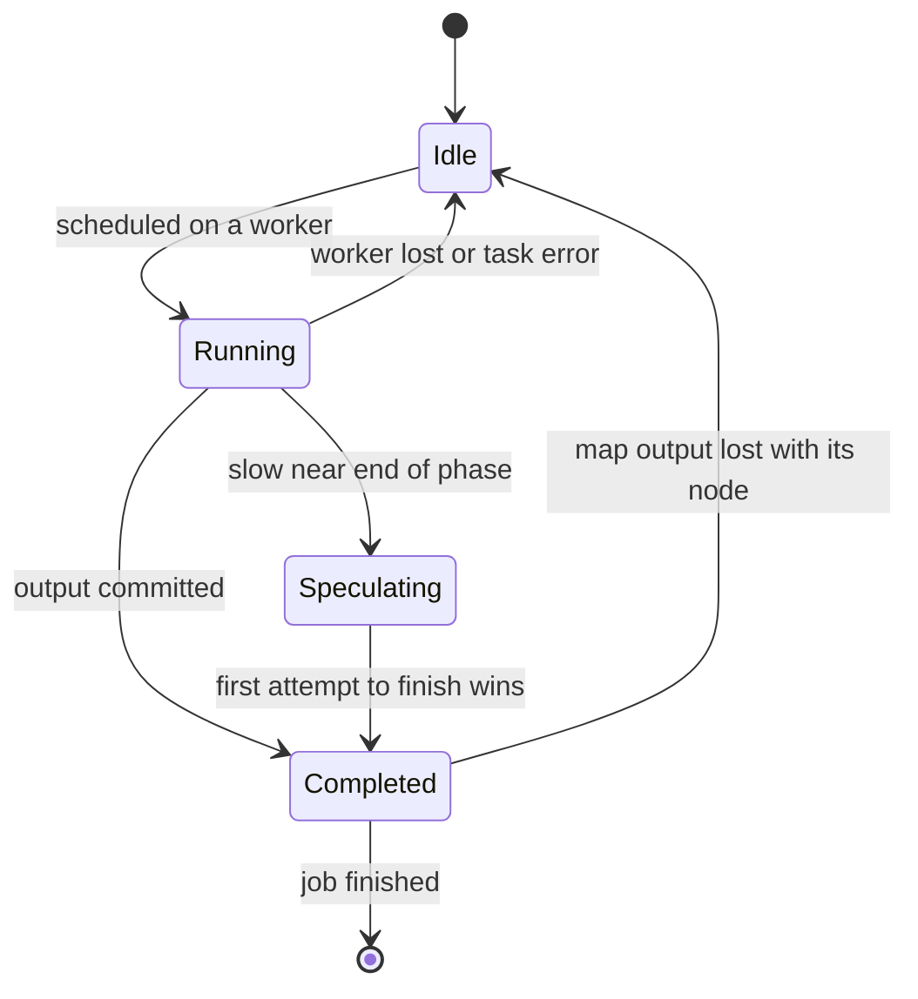

**Reading the diagram.** Each *task* starts *Idle*, is *Running* once a worker accepts it, and becomes *Completed* when its output is committed. A lost worker or task error sends it back to *Idle* for another attempt (up to a retry limit, four by default in Hadoop). A slow task near the end of a phase enters *Speculating*: a second attempt runs elsewhere, the first to commit wins and the other is killed. The unusual edge is *Completed → Idle*: a completed map task's output sits on unreplicated local disk, so losing the node invalidates it. Storage boundary: only committed reduce output is durable. Scaling: speculation costs a few percent extra work and removes most of the tail.

#### Mathematical foundations

::: formula
**Probability that a phase contains at least one straggler**

$$P(\text{at least one straggler}) = 1 - (1 - p)^{n} \approx 1 - e^{-np}$$

| Symbol | Meaning | Units |
|---|---|---|
| $p$ | Probability that any one task is a straggler | probability |
| $n$ | Number of tasks in the phase (or in its last wave) | count |
:::

::: example
**Worked example — Why big jobs always have a straggler.** Suppose $p = 0.001$: one task in a thousand lands on a machine that runs it 5× slower.

1. Whole map phase of the previous example: $n = 7{,}813$; $np = 7.8$; $P = 1 - e^{-7.8} = 0.9996$.
2. Only the last wave matters for completion time, because earlier slow tasks are hidden by later waves: $n = 613$ (the tasks in wave 10); $np = 0.613$; $P = 1 - e^{-0.613} = 0.46$.
3. Cost of that straggler: $5 \times 12.8 = 64$ s instead of 12.8 s, adding about 51 s to a 192 s job (+27%).
4. With a backup task launched when the phase is about 95% done, the copy finishes about 13 s after launch, so the delay drops to roughly one task duration.

**Interpretation.** At scale, "rare" slow machines are present in almost every job, and the slowest task, not the average, sets the finish time (the same tail effect as in §23.6). **Engineering implication.** Enable speculative execution for idempotent tasks, keep tasks short, and do not speculate tasks with side effects (writes to external databases) unless the writes are idempotent (§22.15).
:::

::: industry
**Google MapReduce (2004).** The original paper describes clusters of commodity PCs with 2–4 GB of RAM, 100 Mb/s or 1 Gb/s networking and local IDE disks, with GFS storing input and output. In the paper's sort benchmark ($10^{10}$ 100-byte records, about 1 TB, on roughly 1,800 machines), normal execution took 891 s; with backup tasks disabled it took 1,283 s, 44% longer; and deliberately killing 200 worker processes mid-job increased the time by only about 5%, because the lost tasks were simply re-executed.
*Evidence: Primary* — [Dean and Ghemawat 2004]
:::

### 29.4.4 Joins in MapReduce: sort-merge and broadcast

::: definition
**Definition — Reduce-side (sort-merge) join and broadcast (map-side) join.** In a **reduce-side join**, both inputs are mapped to `(join key, tagged record)`, shuffled so that all records with the same key meet at one reducer, sorted, and combined there. In a **broadcast join**, the smaller input is copied in full to every map task, loaded into an in-memory hash table, and each record of the larger input is joined locally by lookup, with no shuffle of the larger input.
:::

#### How it works internally

1. **Reduce-side join.** Mappers read both tables and tag each record with its source (`U` or `O` in the code above). The partitioner sends key $k$ from both tables to the same reducer. A **secondary sort** can order the user record before its orders, so the reducer holds only one user record in memory while streaming orders past it. This works for any input sizes, but shuffles *both* tables.
2. **Broadcast hash join.** The small table (say 5 GB of user profiles) is shipped to every task. Each mapper streams the large table and probes the hash table. Nothing large crosses the network, and no sort is needed. It fails if the small side does not fit in a task's memory.
3. **Partitioned (bucketed) map-side join.** If both inputs were *already* written partitioned and sorted by the join key into the same number of buckets, mapper $i$ can merge bucket $i$ of each input without a shuffle. Table formats and Spark "bucketed tables" exploit this.

**Figure 29.5 — Reduce-side join versus broadcast join.**

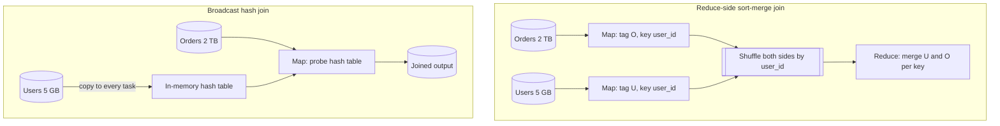

**Reading the diagram.** In the *reduce-side join*, both *orders* and *users* pass through mappers that key them by `user_id`; the *shuffle* moves both across the network (asynchronously, all-to-all) so that matching records meet in one *reducer*. In the *broadcast join*, the *users* table is copied once to every task and built into a *hash table*; *orders* are streamed and joined in place, and only the joined *output* is written. Storage boundaries: in both cases inputs and outputs are in durable storage; the hash table lives in task memory. Failure points: a broadcast table larger than memory causes out-of-memory failures; a reduce-side join on a skewed key overloads one reducer (§29.6.3). Scaling: the broadcast cost grows with the number of tasks, the shuffle cost with the size of both inputs.

#### Mathematical foundations

::: formula
**Network cost of a shuffle join versus a broadcast join**

$$V_{\text{shuffle}} \approx (|L| + |S|) \cdot \frac{N - 1}{N}, \qquad V_{\text{broadcast}} \approx |S| \cdot (N - 1)$$

Broadcast is cheaper when $|S| \cdot N < |L| + |S|$, roughly $|S| < |L| / (N - 1)$, and $|S|$ fits in each executor's memory.

| Symbol | Meaning | Units |
|---|---|---|
| $\lvert L \rvert, \lvert S \rvert$ | Size of the large and small input | bytes |
| $N$ | Number of executors or nodes receiving data | count |
| $V$ | Bytes sent over the network | bytes |
:::

::: example
**Worked example — Orders and users on 100 executors.** $|L| = 2$ TB of orders, $N = 100$.

1. $|S| = 5$ GB. Shuffle: $2.005 \text{ TB} \times 0.99 = 1.985$ TB. Broadcast: $5 \text{ GB} \times 99 = 495$ GB. Broadcast moves 4× less and skips sorting 2 TB.
2. $|S| = 50$ GB. Broadcast: $50 \times 99 = 4.95$ TB versus a shuffle of $2.05 \times 0.99 = 2.03$ TB. Shuffle wins, and 50 GB would not fit in most executors anyway.
3. Break-even: $|S| \approx 2 \text{ TB} / 99 \approx 20$ GB.

**Interpretation.** Broadcasting trades a copy per executor for avoiding a shuffle of the big side, which pays only while the small side is really small. **Engineering implication.** Spark broadcasts automatically below `spark.sql.autoBroadcastJoinThreshold` (10 MB by default, deliberately conservative), and Adaptive Query Execution can switch to a broadcast at run time when the actual size after filtering turns out small (§29.5.4). Raise the threshold cautiously and only with memory headroom.
:::

**Table 29.1 — Join strategies in distributed batch engines.**

| Aspect | Sort-merge (reduce-side) join | Broadcast hash join | Bucketed map-side join |
|---|---|---|---|
| What it is | Shuffle both sides by key, sort, merge | Copy small side to every task, hash lookup | Merge co-partitioned, pre-sorted inputs |
| Network cost | Both inputs once | Small input × tasks | None at query time |
| Memory need | Low (streams sorted runs) | Small side must fit per task | Low |
| Handles any size | Yes | No | Yes, if data was written bucketed |
| Skew sensitivity | High: a hot key overloads one reducer | Low | High |
| Choose when | Both sides large | One side ≲ tens of MB to a few GB | Repeated joins on the same key |

#### Failure scenarios

| What goes wrong | Why | Detection | Recovery | Prevention |
|---|---|---|---|---|
| Job never finishes; one reducer at 99% | Hot key or straggler | Task duration histogram; one task 10–100× median | Kill and resubmit with salting or speculation | Sample key frequencies; salting (§29.6.3); speculation |
| Map phase restarts late in the job | Node holding completed map output died | Fetch-failure counters in reducers | Coordinator reruns those maps | External shuffle service or replicated shuffle storage |
| Executors die with out-of-memory errors in a join | Broadcast side bigger than estimated | OOM logs; broadcast size in plan | Fall back to sort-merge join | Fresh table statistics; AQE |
| Duplicate rows in output | Two attempts both wrote output without atomic commit | Row counts exceed input-derived bound | Rerun with commit protocol | Commit by rename or table-format transaction |

::: mistake
**"A combiner is just the reducer run early, so any reducer can be a combiner."** Only associative and commutative operations qualify, and the combiner may run zero, one or many times. An average computed in the combiner and then averaged again in the reducer is wrong; emit `(sum, count)` pairs and divide only in the reducer.
:::

## 29.5 Apache Spark

### 29.5.1 Resilient Distributed Datasets and lineage

::: definition
**Definition — Resilient Distributed Dataset (RDD).** A read-only, partitioned collection of records that can be created only by deterministic operations (**transformations** such as `map`, `filter`, `join`) on stable storage or on other RDDs. Each RDD records its **lineage**, the graph of transformations that produced it, so a lost partition can be recomputed from its parents instead of being restored from a replica [Zaharia et al. 2012].
:::

#### First-principles explanation

A recipe card is cheaper to keep than a fridge full of prepared dishes. If someone drops the sauce, you do not need a backup sauce; you need the recipe and the raw ingredients, and you redo only the sauce. An RDD is a recipe plus a pointer to ingredients in durable storage. Spark keeps the dishes (partitions) in memory when it can, and if a node dies it reruns the recipe only for the partitions that node held.

#### Why does this exist?

MapReduce writes every job's output to the replicated distributed file system, and multi-step pipelines are chains of jobs. That is fine for one pass but wasteful for **iterative** algorithms (logistic regression, k-means, PageRank) that read the same data ten or a hundred times, and for **interactive** analysis where an analyst asks one question after another of the same dataset. Each iteration paid for a full disk read, deserialization and a triple-replicated write. Replicating in-memory data across machines for fault tolerance would cost network bandwidth comparable to the writes it saved. Lineage gives fault tolerance by logging the *coarse-grained* transformation once per dataset rather than every record [Zaharia et al. 2012].

#### How it works internally

1. **Transformations are lazy.** `rdd.map(f)` returns a new RDD object describing the computation; nothing runs.
2. **Actions trigger jobs.** `count()`, `collect()` or `saveAsTextFile()` submit a **job** for the final RDD's lineage graph.
3. **The driver plans, executors run.** The **driver** program holds the `SparkContext`, the **DAG scheduler** and the **task scheduler**. A **cluster manager** (YARN, Kubernetes or Spark's standalone manager) grants **executors**, long-lived JVM processes on worker nodes, each with a number of cores and a memory region for cached partitions and shuffle buffers.
4. **Recovery.** When an executor dies, the driver identifies which partitions it held, walks the lineage back to the nearest available ancestors (cached partitions, surviving shuffle files, or the input), and reruns only the needed tasks.
5. **Checkpointing** (`rdd.checkpoint()`) writes an RDD to reliable storage and truncates its lineage, which matters for very long lineages such as hundreds of iterations.

**Figure 29.6 — Spark runtime: driver, cluster manager and executors.**

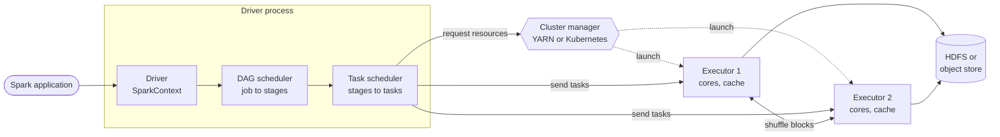

**Reading the diagram.** The *driver* runs the user's program and turns each action into a job; the *DAG scheduler* splits the job into stages and the *task scheduler* turns stages into tasks and places them, preferring executors that hold the data. The *cluster manager* (external, dotted launch arrows) starts *executors* asynchronously. Tasks are sent synchronously to executors, which read input from and write output to *durable storage*, and exchange *shuffle blocks* with one another. Storage boundaries: cached partitions and shuffle files live on executors and are not replicated; inputs and outputs are durable. Failure points: a dead executor loses its cache and shuffle files (recomputed from lineage); a dead driver loses the whole application unless it runs in cluster mode with restarts. Scaling: add executors, statically or with dynamic allocation.

### 29.5.2 Narrow and wide dependencies, stages and tasks

::: definition
**Definition — Narrow and wide dependencies.** A **narrow dependency** exists when each partition of the parent RDD is used by at most one partition of the child (`map`, `filter`, `union`, a join of co-partitioned inputs). A **wide (shuffle) dependency** exists when a child partition may depend on many or all parent partitions (`groupByKey`, `reduceByKey`, a join of unpartitioned inputs), which requires a shuffle.
:::

The distinction drives both performance and recovery. Narrow transformations can be **pipelined**: one task applies `map` then `filter` then another `map` to each record in a single pass, with no intermediate materialization. Recovering a narrow child partition needs one parent partition. A wide dependency is a barrier: every parent partition must be computed and its output written as shuffle files before any child partition can start, and losing a child partition may require recomputing many parents.

The DAG scheduler therefore cuts the lineage graph at every wide dependency. Each piece is a **stage**: a chain of narrow transformations ending in a shuffle write (a *shuffle map stage*) or in the action's result (a *result stage*). Each stage runs as one **task** per partition. Stages whose shuffle output already exists, for example from a cached or earlier job, are skipped.

**Figure 29.7 — Lineage of a word-count job cut into stages at the wide dependency.**

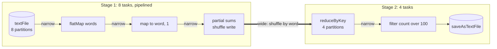

**Reading the diagram.** Stage 1 reads 8 input partitions; `flatMap`, `map` and the map-side partial sum are narrow, so each of the 8 tasks pipelines them record by record and ends by writing shuffle files partitioned by word. The thick arrow is the *wide* dependency: each of Stage 2's 4 tasks fetches its partition from all 8 Stage 1 outputs (asynchronous shuffle fetch). Stage 2 reduces, filters (narrow again) and writes to durable storage. Storage boundaries: the input and output are durable; shuffle files sit on executor disks between stages. Failure points: losing an executor in Stage 2 reruns only its Stage 2 tasks if the shuffle files survive, otherwise also the Stage 1 tasks that wrote them. Scaling: Stage 1 parallelism follows input partitions; Stage 2 parallelism is the shuffle partition count.

### 29.5.3 Caching and persistence

`rdd.persist(level)` or `df.cache()` asks Spark to keep the computed partitions after the first action so later actions reuse them. **Storage levels** choose the trade-off: `MEMORY_ONLY` keeps deserialized objects and recomputes partitions that do not fit; `MEMORY_AND_DISK` spills them to local disk instead (the default for DataFrame `cache()`); serialized and `_2` (replicated) variants trade CPU for memory or for faster recovery; `DISK_ONLY` avoids memory altogether. Cached blocks are evicted least-recently-used under memory pressure. Caching is a hint for reuse, not a durability mechanism: a lost cached partition is recomputed from lineage.

::: formula
**Speedup from caching an iterative job**

$$S = \frac{k \,(T_{\text{load}} + T_{\text{iter}})}{T_{\text{load}} + k \, T_{\text{iter}}} \;\xrightarrow{k \to \infty}\; 1 + \frac{T_{\text{load}}}{T_{\text{iter}}}$$

| Symbol | Meaning | Units |
|---|---|---|
| $S$ | Speedup of the cached version over reloading every iteration | dimensionless |
| $k$ | Number of iterations (or repeated queries) | count |
| $T_{\text{load}}$ | Time to read, parse and build the working dataset from storage | s |
| $T_{\text{iter}}$ | Compute time of one iteration over the in-memory data | s |
:::

::: example
**Worked example — Ten iterations of a training-feature job.** A logistic-regression job reads 1 TB of Parquet from object storage and parses it: $T_{\text{load}} = 60$ s on the cluster. Each gradient pass over the in-memory data takes $T_{\text{iter}} = 6$ s. $k = 10$.

1. Without caching: $10 \times (60 + 6) = 660$ s.
2. With caching: $60 + 10 \times 6 = 120$ s.
3. Speedup: $660 / 120 = 5.5\times$; the asymptotic limit is $1 + 60/6 = 11\times$.

**Interpretation.** Caching helps exactly when loading dominates per-iteration compute and the data is reused; for a single pass it only costs memory. **Engineering implication.** Cache the dataset that is reused, after the expensive parsing and filtering, check in the Spark UI that the cached fraction is near 100% (deserialized objects can be several times larger than compressed Parquet), and `unpersist()` it when done.
:::

::: industry
**RDD paper and the 100 TB sort.** The RDD paper reported Spark up to 20× faster than Hadoop for iterative applications and interactive queries over a 1 TB dataset in 5–7 s [Zaharia et al. 2012]. In 2014 Databricks reported sorting 100 TB with Spark in 23 minutes on 206 cloud machines, against a previous Hadoop MapReduce record of 72 minutes on 2,100 machines, crediting a sort-based shuffle and network-optimized transfers more than memory caching, since a sort of that size is disk- and network-bound [Xin 2014].
*Evidence: Primary* — [Zaharia et al. 2012; Xin 2014]
:::

### 29.5.4 DataFrames, Catalyst, Tungsten and Adaptive Query Execution

::: definition
**Definition — DataFrame, Dataset and Catalyst.** A **DataFrame** is a distributed table with a known schema (named, typed columns), manipulated with relational operators or SQL. A **Dataset** (Scala and Java) adds compile-time types to the same abstraction; in Python and R, every DataFrame is untyped at compile time. **Catalyst** is Spark SQL's extensible query optimizer, which turns DataFrame or SQL queries into an optimized physical plan using rule-based and cost-based transformations of trees [Armbrust et al. 2015].
:::

#### Why does this exist?

An RDD of Python or Java objects is opaque: Spark cannot see that a `lambda` only reads two fields, or that a filter could run before a join. DataFrames make the computation **declarative**: you say *what* (group by country, count), and the engine decides *how*. With a schema, Spark can read only needed columns from Parquet, push filters into the scan, choose join strategies from table sizes, and store rows in compact binary form instead of objects.

#### How it works internally

1. **Analysis.** The query is parsed into an unresolved logical plan; column and table names are resolved against the catalog.
2. **Logical optimization.** Rules rewrite the tree: predicate pushdown, column pruning, constant folding, combining filters and projections.
3. **Physical planning.** Candidate physical plans are generated (for example broadcast hash join versus sort-merge join) and one is chosen, using size statistics.
4. **Code generation.** **Tungsten**, Spark's execution layer, stores rows in a compact off-heap binary format, manages memory explicitly, and uses **whole-stage code generation** to fuse a chain of operators into one generated function per stage, avoiding per-row virtual calls (the `*(1)` markers in the plan below).
5. **Adaptive Query Execution (AQE).** Statistics guessed before running are often wrong. With AQE (on by default since Spark 3.2), Spark re-optimizes the remaining plan at each shuffle boundary using the *actual* sizes of completed shuffle outputs. It can (a) coalesce many small shuffle partitions into fewer, right-sized ones (target 64 MB by default); (b) switch a sort-merge join to a broadcast join when one side turned out small; and (c) split skewed partitions, those over 5× the median and over 256 MB by default, into smaller tasks [Apache Spark Docs: Performance Tuning].

**Figure 29.8 — Catalyst query planning with Adaptive Query Execution.**

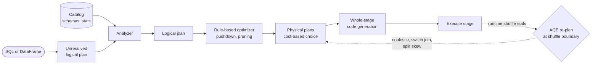

**Reading the diagram.** A query enters as an *unresolved logical plan*; the *analyzer* resolves names using the *catalog*; the *optimizer* applies rewrite rules; *physical planning* picks operators using statistics; *code generation* compiles each stage to bytecode; and stages *execute* on executors. The dotted loop is AQE: after each shuffle-producing stage finishes, real partition sizes flow back (asynchronously) and the not-yet-run part of the plan is re-optimized. All planning happens in the driver; only execution touches data. Failure points: stale or missing statistics cause bad initial choices, which AQE can partly correct but only at shuffle boundaries. Scaling: planning cost is independent of data size.

#### Code example

The PySpark program computes page views with the RDD API and the DataFrame API, joins events with users using a broadcast hint, prints the physical plan, and checks every result against plain Python. It was executed with PySpark 4.0.1 in local mode on Java 21.

```python
"""PySpark: the same aggregation with the RDD API and the DataFrame API, plus a broadcast join.
Tested with PySpark 4.0.1 in local mode (Java 21); results are checked against plain Python."""
import random
from collections import Counter

from pyspark.sql import SparkSession, functions as F

spark = (SparkSession.builder.master("local[4]").appName("ch29-demo")
         .config("spark.sql.shuffle.partitions", "8")          # default is 200
         .config("spark.sql.adaptive.enabled", "true")          # AQE (default on since 3.2)
         .getOrCreate())
spark.sparkContext.setLogLevel("ERROR")

rng = random.Random(29)
pages = ["/home", "/search", "/item", "/cart", "/checkout"]
events = [(rng.randrange(1_000), rng.choice(pages)) for _ in range(50_000)]
users = [(u, rng.choice(["IN", "US", "DE", "BR"])) for u in range(1_000)]

# 1. RDD API: explicit functions, lineage parallelize -> map -> reduceByKey
rdd = spark.sparkContext.parallelize(events, numSlices=8)
views_rdd = dict(rdd.map(lambda e: (e[1], 1)).reduceByKey(lambda a, b: a + b).collect())

# 2. DataFrame API: declarative, optimized by Catalyst
ev = spark.createDataFrame(events, ["user_id", "page"]).cache()      # reused twice below
us = spark.createDataFrame(users, ["user_id", "country"])
views_df = {r["page"]: r["n"] for r in ev.groupBy("page").agg(F.count("*").alias("n")).collect()}

# 3. Join + aggregate; the small side is broadcast, so the large side is never shuffled for the join
by_country = (ev.join(F.broadcast(us), "user_id")
                .groupBy("country", "page").agg(F.count("*").alias("views")))
by_country.explain()                        # physical plan: BroadcastHashJoin, then one Exchange
result = {(r["country"], r["page"]): r["views"] for r in by_country.collect()}

# Check against plain Python
truth_pages = Counter(p for _, p in events)
country = dict(users)
truth_join = Counter((country[u], p) for u, p in events)
assert views_rdd == views_df == dict(truth_pages)
assert result == dict(truth_join)
print("views per page:", dict(sorted(views_df.items())))
print("country/page groups:", len(result), "- all checks passed")
spark.stop()
```

Output (log lines removed; plan identifiers such as `#13` vary between runs):

```text
== Physical Plan ==
AdaptiveSparkPlan isFinalPlan=false
+- HashAggregate(keys=[country#13, page#1], functions=[count(1)])
   +- Exchange hashpartitioning(country#13, page#1, 8), ENSURE_REQUIREMENTS, [plan_id=90]
      +- HashAggregate(keys=[country#13, page#1], functions=[partial_count(1)])
         +- Project [page#1, country#13]
            +- BroadcastHashJoin [user_id#0L], [user_id#12L], Inner, BuildRight, false
               :- Filter isnotnull(user_id#0L)
               :  +- InMemoryTableScan [user_id#0L, page#1], [isnotnull(user_id#0L)]
               :        +- InMemoryRelation [user_id#0L, page#1], StorageLevel(disk, memory, deserialized, 1 replicas)
               :              +- *(1) Scan ExistingRDD[user_id#0L,page#1]
               +- BroadcastExchange HashedRelationBroadcastMode(List(input[0, bigint, false]),false), [plan_id=85]
                  +- Filter isnotnull(user_id#12L)
                     +- Scan ExistingRDD[user_id#12L,country#13]

views per page: {'/cart': 9945, '/checkout': 10053, '/home': 10073, '/item': 9954, '/search': 9975}
country/page groups: 20 - all checks passed
```

What to notice:

- Read the plan bottom-up. The users side goes through a `BroadcastExchange`; the events side is joined in place by `BroadcastHashJoin`, so the large input is never shuffled for the join.
- There is exactly one `Exchange` (shuffle), for the `groupBy`. Before it, `partial_count` is the map-side combiner of §29.4.2; after it, the final `count` merges partial counts.
- Catalyst inserted `Filter isnotnull(user_id)` on both sides on its own: an inner join can never match a null key, so filtering early is free.
- `StorageLevel(disk, memory, deserialized, 1 replicas)` is `MEMORY_AND_DISK`, the DataFrame `cache()` default.
- `AdaptiveSparkPlan isFinalPlan=false` means AQE may still rewrite the plan once the shuffle statistics exist.
- The RDD version gives the same answer, but Catalyst cannot see inside its lambdas, and in PySpark every record crosses the JVM–Python boundary. Prefer DataFrames and built-in functions; fall back to RDDs or Python user-defined functions only for logic that SQL cannot express.

::: mistake
**"`cache()` makes the next line faster."** `cache()` is lazy: it marks the DataFrame, and the first *action* both computes and stores it. Caching something used once only adds memory pressure, and calling `count()` just to "warm" a cache doubles the work if the data is not reused.
:::

## 29.6 Partitioning and shuffle

### 29.6.1 Hash and range partitioning

Every shuffle must decide which partition each key goes to. The two schemes are the same ones databases use for storage (§14.6), applied on the fly:

- **Hash partitioning**, $p = \text{hash}(k) \bmod P$, spreads keys evenly regardless of their values and is the default for aggregations and joins. Keys in one partition are in no useful order.
- **Range partitioning** assigns contiguous key ranges to partitions, so partition $i$ holds keys smaller than those in partition $i+1$. Concatenating the sorted partitions yields a globally sorted output, which is how `ORDER BY` and sort benchmarks work. The engine first **samples** the input to choose boundaries that give equal-sized ranges (Spark's `RangePartitioner` does this with an extra pass over a sample).

Both schemes balance *keys*, not *records*: a key with 20% of the records lands entirely in one partition under either. That is the skew problem of §29.6.3.

### 29.6.2 The cost of a shuffle

::: definition
**Definition — Shuffle.** The all-to-all redistribution of intermediate data between two stages, in which every task of the producing stage writes its output partitioned by key and every task of the consuming stage reads its partition from every producer. It costs serialization, local disk writes and reads, and network transfer, and it is a barrier between stages.
:::

On a cluster of $N$ nodes with keys spread evenly, a fraction $(N-1)/N$ of the shuffled data leaves its node. In a datacenter built from racks behind oversubscribed uplinks (§7.17), a fraction $(K-1)/K$ of it also leaves its rack when there are $K$ racks, and the rack uplinks are usually the tightest pipe.

**Figure 29.9 — A shuffle crossing rack uplinks.**

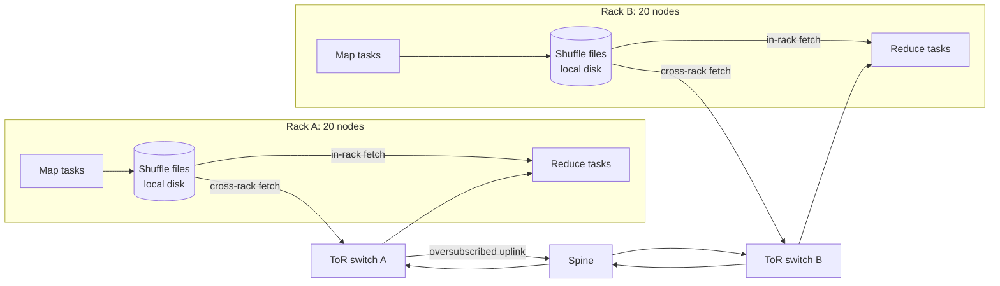

**Reading the diagram.** Map tasks in each rack write partitioned *shuffle files* to local disk. Reduce tasks fetch their partition from every file: fetches within a rack go through the top-of-rack switch only, while cross-rack fetches climb through the *ToR switch*, an *oversubscribed uplink* and the *spine*. All fetches are pull-based TCP transfers that start as soon as producers finish. Storage boundary: shuffle files are on unreplicated local disks. Failure points: a congested uplink slows every reducer at once; a lost node invalidates its shuffle files. Scaling: more partitions spread the work but create $M \times R$ ever-smaller blocks, which turn sequential I/O into random I/O.

::: formula
**Shuffle time lower bound on a rack-structured cluster**

$$T_{\text{shuffle}} \approx \max\!\left( \frac{V (N-1)/N}{N \, \eta B_{\text{NIC}}},\;\; \frac{V (K-1)/K}{K \, U},\;\; \frac{2V}{N B_{\text{disk}}} \right)$$

| Symbol | Meaning | Units |
|---|---|---|
| $V$ | Shuffled data volume | bytes |
| $N$, $K$ | Nodes and racks | count |
| $B_{\text{NIC}}$ | Network interface speed per node | bytes/s |
| $\eta$ | Achievable fraction of line rate | dimensionless |
| $U$ | Uplink capacity per rack | bytes/s |
| $B_{\text{disk}}$ | Local disk throughput per node (each byte written once, read once) | bytes/s |
:::

::: example
**Worked example — Shuffling 10 TB on a 100-node cluster.** $V = 10$ TB; $N = 100$ in $K = 5$ racks of 20; 25 Gb/s NICs ($B_{\text{NIC}} = 3.125$ GB/s) at $\eta = 0.7$; rack uplinks oversubscribed 4:1, so $U = 20 \times 3.125 / 4 = 15.6$ GB/s; NVMe $B_{\text{disk}} = 2$ GB/s.

1. NIC: each node sends $10 \text{ TB}/100 \times 0.99 = 99$ GB at $0.7 \times 3.125 = 2.19$ GB/s: $45$ s.
2. Uplinks: cross-rack data $= 10 \times 0.8 = 8$ TB, so each rack sends $1.6$ TB through $15.6$ GB/s: $102$ s.
3. Disk: each node writes 100 GB and reads 100 GB at 2 GB/s: $100$ s.
4. Lower bound: $\max(45, 102, 100) \approx 102$ s, about 1.7 minutes; serialization, compression and stragglers typically add 2–3× in practice.
5. Block count: with 128 MB input splits from 10 TB of input, $M \approx 78{,}000$ map tasks; with $R = 2{,}000$ reducers there are $1.56 \times 10^{8}$ shuffle blocks averaging $10^{13} / 1.56 \times 10^{8} = 64$ KB each.

**Interpretation.** Moving 10 TB is dominated by oversubscribed uplinks and local disks, not NICs; and tens of millions of 64 KB random reads would cripple hard disks. **Engineering implication.** Shrink $V$ first (filter and project before the shuffle, pre-aggregate, compress), then avoid it (broadcast joins, co-partitioned or bucketed inputs), and keep partitions around 100–200 MB so blocks stay large.
:::

::: industry
**LinkedIn Magnet: push-based shuffle.** LinkedIn found that pull-based shuffle on hard disks produced huge numbers of small random reads and frequent fetch failures. Magnet has map tasks *push* their blocks to remote shuffle services, which merge blocks for the same reduce partition into larger files, turning small random reads into large sequential ones and keeping a second copy of shuffle data. It was contributed to Apache Spark as push-based shuffle for YARN in Spark 3.2.
*Evidence: Primary* — [Shen et al. 2020; Apache Spark Docs: Configuration]
:::

### 29.6.3 Skew and salting

::: definition
**Definition — Partition skew and salting.** **Skew** is an uneven distribution of records across partitions, usually caused by a few very frequent keys (a celebrity user, a null or default value, a bot). **Salting** appends a random suffix from a small range to hot keys so their records spread over several partitions, then removes the suffix in a second, much smaller aggregation (or, for joins, replicates the matching rows of the other side once per salt value).
:::

A stage finishes only when its slowest task finishes, so the largest partition, not the average, sets the stage time.

::: formula
**Slowdown from a single hot key**

$$\text{skew} = \frac{\max_i L_i}{\bar{L}} \approx f P + (1 - f), \qquad \text{with salt } s:\; \text{skew} \approx \frac{f P}{s} + (1 - f)$$

| Symbol | Meaning | Units |
|---|---|---|
| $L_i$, $\bar{L}$ | Records in partition $i$; mean records per partition | records |
| $f$ | Fraction of all records carrying the hot key | dimensionless |
| $P$ | Number of shuffle partitions | count |
| $s$ | Salt range (hot key spread over $s$ partitions), $s \le P$ | count |
:::

::: example
**Worked example — A bot account with 20% of the events.** $P = 200$, $f = 0.2$, and an average task takes 30 s.

1. Unsalted: $\text{skew} = 0.2 \times 200 + 0.8 = 40.8$. The hot partition takes $40.8 \times 30 = 1{,}224$ s (20 minutes) while 199 tasks finish in 30 s.
2. Salt $s = 8$: $40/8 + 0.8 = 5.8$, so 174 s.
3. Salt $s = 64$: $40/64 + 0.8 = 1.4$ in theory; the simulation below measures 2.1 because 64 salted keys hashed into 200 partitions collide.

**Interpretation.** Adding partitions does not help: one key goes to one partition however many there are, and $fP$ even grows with $P$. **Engineering implication.** Find hot keys by sampling, salt only those, and let AQE's skew-join handling split oversized join partitions; filter out junk keys (nulls, test accounts) before the shuffle.
:::

```python
"""Partition skew and key salting: per-partition load before and after a two-stage aggregation."""
import random
import zlib
from collections import Counter


def partition(key, n):
    return zlib.crc32(repr(key).encode()) % n


def stage_loads(keys, n):
    loads = Counter(partition(k, n) for k in keys)
    return [loads.get(p, 0) for p in range(n)]


def skew_ratio(loads):
    return max(loads) / (sum(loads) / len(loads))     # slowest task / average task


rng = random.Random(1)
P = 200                                              # shuffle partitions
records = [("hot" if rng.random() < 0.20 else f"user{rng.randrange(100_000)}", 1)
           for _ in range(1_000_000)]                # one key carries 20% of all rows
truth = Counter()
for k, v in records:
    truth[k] += v

# Plain aggregation: every row of a key goes to one partition.
plain = stage_loads((k for k, _ in records), P)
print(f"plain  : max={max(plain):>7,}  mean={sum(plain) / P:>7,.0f}  skew={skew_ratio(plain):5.1f}x")

sample = Counter(k for k, _ in rng.sample(records, 10_000))   # find hot keys from a 1% sample
hot = {k for k, c in sample.items() if c > 0.01 * 10_000}
print("hot keys found by sampling:", hot)

for salt in (8, 64):
    # Stage 1: append a random salt to hot keys only, spreading each over `salt` partitions.
    salted = [((k, rng.randrange(salt) if k in hot else 0), v) for k, v in records]
    s1 = stage_loads((sk for sk, _ in salted), P)
    partial = Counter()
    for (k, s), v in salted:
        partial[(k, s)] += v                         # partial sums per (key, salt)
    # Stage 2: strip the salt and combine at most `salt` partial sums per key.
    s2 = stage_loads((k for k, _ in partial), P)
    final = Counter()
    for (k, _), v in partial.items():
        final[k] += v
    assert final == truth                            # salting never changes the answer
    print(f"salt={salt:<3}: stage1 max={max(s1):>7,} skew={skew_ratio(s1):5.1f}x | "
          f"stage2 rows={len(partial):,} skew={skew_ratio(s2):4.1f}x")
```

Output:

```text
plain  : max=204,210  mean=  5,000  skew= 40.8x
hot keys found by sampling: {'hot'}
salt=8  : stage1 max= 29,459 skew=  5.9x | stage2 rows=99,975 skew= 1.1x
salt=64 : stage1 max= 10,306 skew=  2.1x | stage2 rows=100,031 skew= 1.1x
```

What to notice: the measured unsalted skew (40.8×) matches the formula exactly; stage 2 handles only about 100,000 partial sums, so its cost is negligible; and the assertion proves the two-stage aggregation gives the same totals.

**Figure 29.10 — Two-stage aggregation with a salted hot key.**

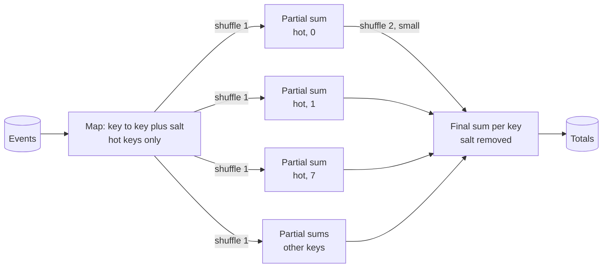

**Reading the diagram.** The first map step appends a salt (0–7) to the hot key only; the first shuffle spreads `hot` over eight partitions, each computing a *partial sum*, while other keys aggregate normally. The second shuffle carries at most eight rows per hot key, so it is tiny; the final stage removes the salt and adds the partial sums. Both shuffles are asynchronous all-to-all transfers. Failure point: salting a non-associative operation (a median) gives wrong answers. Scaling: choose $s$ so each salted piece is near the average partition size.

## 29.7 Data locality

::: definition
**Definition — Data locality.** Scheduling a task on or near the node that stores its input, so that the input is read from local disk or memory instead of over the network. Schedulers rank placements as **process-local** (data cached in the same executor), **node-local**, **rack-local** and **off-rack** (any).
:::

In 2004 the network was the scarcest resource: 1 Gb/s NICs (125 MB/s) shared with the shuffle, behind rack uplinks oversubscribed several times, while each node's local disks together delivered a few hundred MB/s. Moving computation to data, "compute-to-data", was therefore essential. GFS and HDFS expose block locations (§15.5), and the MapReduce coordinator tried node-local first, then rack-local; the paper reports that most input in large jobs was read locally and consumed no network bandwidth [Dean and Ghemawat 2004]. Spark's task scheduler waits a short time for a better locality level before accepting a worse one (`spark.locality.wait`, 3 s by default), an idea called **delay scheduling** that achieved near-perfect locality at small cost in fairness [Zaharia et al. 2010].

Two changes reduced locality's importance. Datacenter networks moved to 25–100 Gb/s NICs and Clos fabrics with much lower oversubscription (§7.17), so a node can read remotely at several GB/s, comparable to its local NVMe drives. And cloud deployments **disaggregated storage from compute**: data lives in object stores (§15.4) or a shared file system such as Colossus or Tectonic (§15.5.3), and stateless compute clusters scale up and down independently, even to zero. With columnar formats, a scan that reads 3 of 30 columns over a 3 GB/s remote path often beats a full local scan, and CPU spent decoding Parquet frequently becomes the bottleneck before the network does.

::: example
**Worked example — How much locality is worth, then and now.** Each node must read 100 GB of input.

1. 2004-style node: local disks 200 MB/s, effective remote rate about 25 MB/s (125 MB/s NIC behind 5:1 rack oversubscription). Fully local: $100{,}000/200 = 500$ s. Fully remote: $100{,}000/25 = 4{,}000$ s, 8× slower.
2. 2026-style node: local NVMe 6 GB/s; 100 Gb/s NIC delivering about 3 GB/s from an object store with parallel range reads. Local: $100/6 = 17$ s; remote: $100/3 = 33$ s, 2× slower, before columnar pruning, which applies equally to both.

**Interpretation.** Locality turned from an 8× factor into a 2× factor, which the elasticity and independent scaling of disaggregated storage usually outweigh. **Engineering implication.** In the cloud, put tables in object storage in a columnar format, cache hot data on executor-local SSDs, and spend tuning effort on shuffle and skew rather than on co-locating compute with storage. Locality still matters for the *shuffle*, which remains node-to-node.
:::

Object stores bring their own limits. Amazon S3 documents request-rate guidance per key prefix (at least 3,500 writes and 5,500 reads per second per prefix, as of 2026), listing millions of objects is slow, and renaming a directory is a copy. These are among the reasons table formats such as Apache Iceberg, Delta Lake and Apache Hudi track data files in metadata rather than by listing directories, and commit by atomically swapping a metadata pointer. Lakehouse table formats are treated in depth in Chapters 61–62.

## 29.8 Stream processing concepts

### 29.8.1 Unbounded data, event time and processing time

::: definition
**Definition — Stream processing, event time and processing time.** **Stream processing** runs a long-lived computation over an **unbounded** dataset, one that grows forever, producing results incrementally. Each record has an **event time**, when the event actually happened (stamped by the device or service that produced it), and a **processing time**, when the system observes it. The difference is the record's **event-time skew**, which is variable and unbounded in the worst case.
:::

#### First-principles explanation

Picture postcards from a group holiday. Each card shows the date it was written (event time), but they arrive in your mailbox days apart and out of order (processing time); one is stuck in a mailbag for a month. If you want "how many cards were written on Tuesday", you cannot answer when the first Wednesday card arrives; you have to decide how long to wait for stragglers, and what to do if a Tuesday card turns up after you announced the answer. Every streaming system makes exactly those two decisions.

#### Why does this exist?

Many businesses need answers continuously: fraud scores within seconds of a card swipe, dashboards that update every minute, ML features that reflect the last five minutes of user behavior (Chapter 62). Rerunning a batch job every few minutes over all history is wasteful and still has hours of latency at the boundaries. Grouping by processing time is easy but wrong: a phone that reconnects after a flight delivers yesterday's events today, and a consumer that restarts reprocesses old events in a burst, so processing-time counts change with operational accidents. Correct results require grouping by **event time** while data arrives out of order.

### 29.8.2 Windows

A **window** cuts an unbounded stream into finite chunks of event time so that aggregates can be computed and emitted.

- **Tumbling (fixed) windows** have size $W$ and do not overlap: [12:00, 12:01), [12:01, 12:02). Each event belongs to exactly one.
- **Sliding (hopping) windows** have size $W$ and slide $S < W$, so they overlap and each event belongs to $W/S$ windows ("last 10 minutes, updated every minute" puts each event in 10 windows, multiplying state and output).
- **Session windows** are per key and data-driven: a session continues while events arrive within a **gap** $g$ of each other and closes after $g$ of inactivity. Windows are merged when a new event bridges two of them.

**Figure 29.11 — Tumbling, sliding and session windows over the same events.**

```mermaid
gantt
  title Windows in event time, minutes
  dateFormat mm
  axisFormat %M
  section Tumbling 2 min
  W1 :t1, 00, 2m
  W2 :t2, 02, 2m
  W3 :t3, 04, 2m
  section Sliding 2 min every 1 min
  S1 :s1, 00, 2m
  S2 :s2, 01, 2m
  S3 :s3, 02, 2m
  S4 :s4, 03, 2m
  section Session gap 1 min user A
  Session 1 :a1, 00, 3m
  Session 2 :a2, 05, 1m
```

**Reading the diagram.** The horizontal axis is event time in minutes. *Tumbling* windows tile the axis without overlap. *Sliding* windows of two minutes start every minute, so any instant is covered by two windows. *Session* windows belong to one key (user A): events from minute 0 to minute 3 arrived less than a minute apart and form one session, then a gap of over a minute closes it, and a new session starts at minute 5. Storage implication: the engine keeps state per key per open window, so sliding windows multiply state by $W/S$ and sessions keep state until the gap expires. Failure point: a session with no end (a bot sending every 30 s) keeps state forever unless capped.

### 29.8.3 Watermarks, triggers, late data and accumulation

::: definition
**Definition — Watermark.** A watermark with value $t$ is a statement flowing through the stream: "no more events with event time $\le t$ are expected." It lets event-time operators decide that a window is complete. A **perfect** watermark is possible only with full knowledge of the sources; real systems use **heuristic** watermarks, such as the maximum event time seen minus a bound $\delta$ on out-of-orderness, which can be wrong. Events that arrive with event time behind the watermark are **late data**.
:::

The Dataflow Model, published by Google and the basis of Google Cloud Dataflow and Apache Beam, separates four questions [Akidau et al. 2015]:

1. **What** results are computed? The transformation: sums, joins, model features.
2. **Where** in event time are they grouped? The windowing.
3. **When** in processing time are results emitted? **Triggers**: at the watermark (the on-time result), optionally early (speculative results every minute before the watermark) and late (an update for each late event).
4. **How** do successive results for the same window relate? **Accumulation mode**: *discarding* (each firing reports only new data), *accumulating* (each firing reports the full total so far) or *accumulating and retracting* (each firing also withdraws the previous value, needed when downstream consumers aggregate further).

**Allowed lateness** bounds how long a window's state is kept after the watermark passes its end. Late events within it update the result; events beyond it are dropped or sent to a **side output** for separate handling. Without such a bound, state for every window ever opened would be kept forever.

**Figure 29.12 — A 10 s window with a watermark, a late update and a dropped event.**

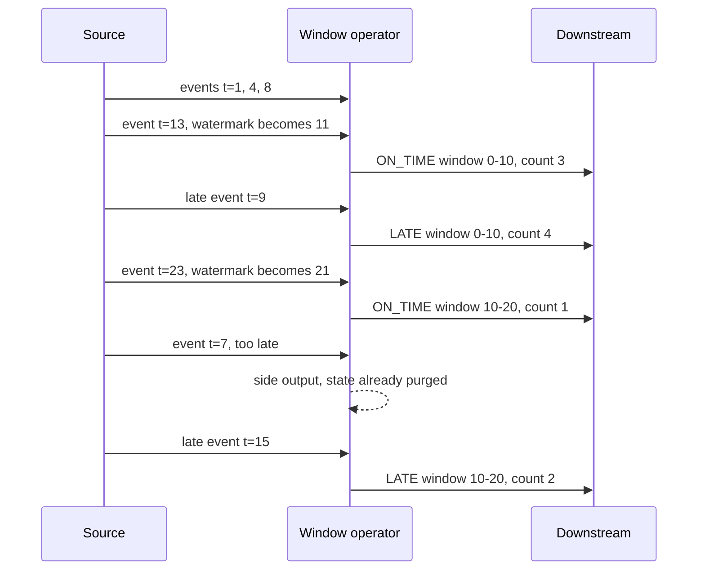

**Reading the diagram.** This is the scenario tested by the simulator below: 10 s tumbling windows, watermark = maximum event time − 2 s, allowed lateness 5 s, accumulating mode. The *source* delivers events in arrival order. Event 13 moves the watermark to 11, past the end of window [0, 10), so the *operator* emits its on-time count. Event 9 is late but within allowed lateness, so the window still has state and emits an updated count. When the watermark reaches 21, the state for [0, 10) is purged ($21 \ge 10 + 5$), so event 7 goes to the *side output*. Emissions are asynchronous messages downstream. Failure point: a downstream system that treats every emission as a new count would double-count; with accumulating mode it must overwrite (upsert) per window.

#### Mathematical foundations

::: formula
**Fraction of events that miss their tumbling window**

$$f_{\text{late}} \approx \frac{\mu}{W}\, e^{-\delta/\mu} \left(1 - e^{-W/\mu}\right) \qquad \text{added output latency} \approx \delta$$

Derivation: with exponentially distributed delay $d$ (mean $\mu$) and the watermark close to arrival time minus $\delta$, an event at offset $u$ before its window's end misses the window if $d > \delta + u$; averaging $e^{-(\delta+u)/\mu}$ over $u$ uniform on $[0, W)$ gives the formula.

| Symbol | Meaning | Units |
|---|---|---|
| $f_{\text{late}}$ | Fraction of events arriving after their window fired | dimensionless |
| $\mu$ | Mean delay between event time and arrival | s |
| $\delta$ | Watermark delay (bounded out-of-orderness) | s |
| $W$ | Window size | s |
:::

::: example
**Worked example — Choosing a watermark delay.** Mobile click events have mean delay $\mu = 2$ s; windows are $W = 60$ s.

1. $\delta = 0$: $f = (2/60)(1)(1 - e^{-30}) = 0.0333$, so 3.3% of events miss their window.
2. $\delta = 5$ s: $e^{-2.5} = 0.0821$; $f = 0.0333 \times 0.0821 = 0.0027$ (0.27%), and every result is emitted 5 s later.
3. $\delta = 10$ s: $e^{-5} = 0.0067$; $f = 0.022\%$, for 10 s of extra latency.

**Interpretation.** Each extra $\mu$ of waiting cuts late data by $e \approx 2.7\times$, and costs that much latency on *every* result. Real delay distributions have heavy tails (phones offline for hours), so no practical $\delta$ makes $f$ zero. **Engineering implication.** Pick $\delta$ for the latency the consumer can accept, set allowed lateness to absorb the tail (with late firings as updates), route anything later to a side output, and monitor the late fraction as a data-quality metric.
:::

#### Code example

The simulator implements tumbling and sliding event-time windows with a bounded-out-of-orderness watermark, allowed lateness, on-time and late firings, state garbage collection and a side output. It checks the scenario of Figure 29.12, sliding-window membership, and that no event is ever lost silently, then measures the late fraction for several watermark delays against the formula.

```python
"""Event-time windowing with a bounded-out-of-orderness watermark, allowed lateness,
on-time and late firings, and a side output for events that arrive too late."""
import math
import random


class EventTimeWindower:
    def __init__(self, size, slide=None, max_out_of_orderness=0.0, allowed_lateness=0.0):
        self.size, self.slide = size, slide or size        # slide == size -> tumbling windows
        self.delta, self.lateness = max_out_of_orderness, allowed_lateness
        self.max_ts = -math.inf
        self.state = {}             # keyed window state: (key, window_start) -> count
        self.fired = set()          # windows that already emitted their on-time result
        self.output = []            # (kind, key, start, end, count, emitted_at)
        self.dropped = []           # side output: (event_time, key, window_start)

    @property
    def watermark(self):            # "no more events older than this are expected"
        return self.max_ts - self.delta

    def window_starts(self, ts):
        start = math.floor(ts / self.slide) * self.slide
        starts = []
        while start > ts - self.size:                       # every window [s, s+size) holding ts
            starts.append(start)
            start -= self.slide
        return starts

    def on_event(self, ts, key, now):
        for start in self.window_starts(ts):
            w = (key, start)
            if self.watermark >= start + self.size + self.lateness:
                self.dropped.append((ts, key, start))       # state already purged: too late
                continue
            self.state[w] = self.state.get(w, 0) + 1
            if w in self.fired:                             # late, but within allowed lateness
                self.output.append(("LATE", key, start, start + self.size, self.state[w], now))
        self.max_ts = max(self.max_ts, ts)
        self._on_watermark(now)

    def _on_watermark(self, now):
        wm = self.watermark
        for w in sorted(self.state):
            key, start = w
            end = start + self.size
            if wm >= end and w not in self.fired:           # event-time trigger
                self.fired.add(w)
                self.output.append(("ON_TIME", key, start, end, self.state[w], now))
            if wm >= end + self.lateness:                   # garbage-collect window state
                del self.state[w]
                self.fired.discard(w)

    def end_of_input(self, now):
        self.max_ts = math.inf                              # final watermark flushes everything
        self._on_watermark(now)


def run(events, **cfg):
    """events: (event_time, key, arrival_time); processed in arrival order."""
    op = EventTimeWindower(**cfg)
    for ts, key, arrival in sorted(events, key=lambda e: e[2]):
        op.on_event(ts, key, arrival)
    op.end_of_input(max(e[2] for e in events))
    return op


def late_fraction_model(mean_delay, delta, size):
    """P(event misses its tumbling window) for exponential delays, uniform position in window."""
    return (mean_delay / size) * math.exp(-delta / mean_delay) * (1 - math.exp(-size / mean_delay))


if __name__ == "__main__":
    # Scenario: 10 s tumbling windows, watermark 2 s behind max event time, 5 s allowed lateness.
    ev = [(1, "a", 1.2), (4, "a", 4.1), (8, "a", 8.3), (13, "a", 13.0),   # wm reaches 11 -> fire [0,10)
          (9, "a", 13.5),                                                 # late, within lateness
          (23, "a", 23.0),                                                # wm 21 -> fire [10,20)
          (7, "a", 23.4),                                                 # wm 21 >= 10+5 -> dropped
          (15, "a", 23.6)]                                                # late update for [10,20)
    op = run(ev, size=10, max_out_of_orderness=2, allowed_lateness=5)
    for row in op.output:
        print(row)
    print("dropped:", op.dropped)
    assert op.output[0] == ("ON_TIME", "a", 0, 10, 3, 13.0)
    assert op.output[1] == ("LATE", "a", 0, 10, 4, 13.5)
    assert ("ON_TIME", "a", 10, 20, 1, 23.0) in op.output
    assert ("LATE", "a", 10, 20, 2, 23.6) in op.output
    assert op.dropped == [(7, "a", 0)]

    # Sliding windows: size 10, slide 5 -> each event lands in two windows.
    sl = run([(7, "k", 7), (12, "k", 12), (40, "k", 40)], size=10, slide=5)
    assert [(r[2], r[4]) for r in sl.output if r[0] == "ON_TIME"][:3] == [(0, 1), (5, 2), (10, 1)]

    # Simulation: 50 events/s for 2 h, exponential network delay (mean 2 s), 60 s windows.
    rng = random.Random(42)
    events, t = [], 0.0
    while t < 7200:
        t += rng.expovariate(50)
        events.append((t, "clicks", t + rng.expovariate(1 / 2.0)))
    print(f"{'delta s':>7} {'late model':>10} {'late sim':>9} {'emit delay s':>12}")
    for delta in (0, 2, 5, 10):
        op = run(events, size=60, max_out_of_orderness=delta, allowed_lateness=0)
        sim = len(op.dropped) / len(events)
        counted = sum(r[4] for r in op.output if r[0] == "ON_TIME")
        assert counted + len(op.dropped) == len(events)            # nothing lost silently
        on_time = [r for r in op.output if r[0] == "ON_TIME" and r[3] < 7200]
        lag = sum(r[5] - r[3] for r in on_time) / len(on_time)      # emission time - window end
        print(f"{delta:>7} {late_fraction_model(2.0, delta, 60):>10.4%} {sim:>9.4%} {lag:>12.2f}")
    print("all tests passed")
```

Output:

```text
('ON_TIME', 'a', 0, 10, 3, 13.0)
('LATE', 'a', 0, 10, 4, 13.5)
('ON_TIME', 'a', 10, 20, 1, 23.0)
('LATE', 'a', 10, 20, 2, 23.6)
('ON_TIME', 'a', 20, 30, 1, 23.6)
dropped: [(7, 'a', 0)]
delta s late model  late sim emit delay s
      0    3.3333%   2.9084%         0.25
      2    1.2263%   1.0811%         2.27
      5    0.2736%   0.2373%         5.25
     10    0.0225%   0.0172%        10.24
all tests passed
```

What to notice:

- The late check uses the watermark *before* the event advances it, so an event cannot rescue its own window.
- Window [20, 30) fires only at `end_of_input`, which sends a final infinite watermark; Flink does the same when a bounded source finishes.
- The simulation tracks the model closely but slightly below it: the maximum event time trails the arrival clock by about 0.25 s, adding that much extra slack (the "emit delay" column), and $e^{-0.25/2} = 0.88$ explains the gap.
- With $\delta = 0$ the operator is fast but loses about 3% of events; each extra 2 s of delay divides losses by about $e$.

### 29.8.4 State and exactly-once processing

Windows, joins, deduplication and per-user features all need **state** that outlives individual events: counts per open window, the last event per user, a model's running statistics. State is partitioned by key exactly like a shuffle, so each key's state lives in one operator instance. If a node fails, that state must be recovered *consistently with the input position*: restoring counts from 12:00 but resuming input from 12:05 loses five minutes; resuming from 11:55 double-counts five.

Engines achieve **exactly-once state semantics** (often called effectively-once) by periodically taking a **consistent distributed snapshot** of all operator state together with the source offsets, and on failure rolling everything back to the last snapshot and replaying the input from the recorded offsets. Events may be *processed* more than once, but each affects the state exactly once. The classic algorithm is Chandy and Lamport's: a special **marker** travels along every channel; a process records its state when the first marker arrives and records in-flight messages on channels whose markers have not yet arrived, yielding a consistent global state without stopping the system [Chandy and Lamport 1985]. Flink adapts it for dataflow graphs (§29.9.2). Results sent to external systems are exactly-once only if the sink is idempotent or transactional; see §32.9 for the limits and Chapter 31 for Kafka transactions.

::: industry
**Google MillWheel and Cloud Dataflow.** MillWheel, Google's earlier stream processor, introduced low watermarks computed from the oldest pending work across the pipeline, per-key persistent state, and exactly-once delivery through deduplicating record IDs [Akidau et al. 2013]. The Dataflow Model paper generalized these ideas into windowing, triggers and accumulation modes, and describes them as the model behind Google Cloud Dataflow; Apache Beam is its open-source SDK [Akidau et al. 2015].
*Evidence: Primary* — [Akidau et al. 2013; Akidau et al. 2015]
:::

::: mistake
**"Exactly-once means every event is processed exactly once."** It means the *effect on managed state* is as if each event were processed once. After a failure, events since the last checkpoint are reprocessed, and any non-transactional side effect (an email, an HTTP call, a write to a database without an idempotency key) happens again.
:::

## 29.9 Apache Flink

### 29.9.1 Architecture and state

::: definition
**Definition — Apache Flink.** An open-source distributed engine that executes dataflow programs as a graph of long-running, pipelined operators, treating batch as a bounded special case of streaming. It provides event-time processing with watermarks, large keyed state, and exactly-once state consistency through asynchronous distributed snapshots [Carbone et al. 2015a].
:::

A Flink cluster has a **JobManager**, which contains a resource manager, a dispatcher that accepts jobs, and one **JobMaster** per job that schedules tasks and coordinates checkpoints, and several **TaskManagers**, worker processes that each offer a fixed number of **task slots**. A job graph is turned into parallel subtasks; consecutive operators with the same parallelism and a one-to-one connection are **chained** into one task, so records pass between them as method calls. Unlike Spark's stage-at-a-time batch model, all stages of a streaming job run at once, and records flow continuously through network buffers between them, with **credit-based flow control** providing backpressure when a downstream task is slow (§22.10).

State comes in two kinds. **Keyed state** (value, list, map state) is scoped to the current key of a `keyBy` stream and partitioned with the stream; it is organized into **key groups**, whose number equals the job's **maximum parallelism**, so rescaling moves whole key groups between subtasks without rehashing keys. **Operator state** belongs to a parallel operator instance regardless of key; the classic example is a source's partition offsets.

**State backends** decide where working state lives. The **HashMapStateBackend** keeps state as objects on the JVM heap: fastest, but limited by memory and garbage-collection pressure. The **EmbeddedRocksDBStateBackend** keeps state in an embedded RocksDB LSM tree (§13.8) on local disk, serialized, so state can exceed memory by orders of magnitude at the cost of serialization on every access; it supports **incremental checkpoints** that upload only new SST files. Flink 2.0 (2025) added a disaggregated state backend, ForSt, that keeps the primary copy of state in remote storage (as of 2026). Checkpoints go to durable storage such as S3 or HDFS [Apache Flink Docs: State Backends; Carbone et al. 2017].

**Figure 29.13 — Flink cluster architecture.**

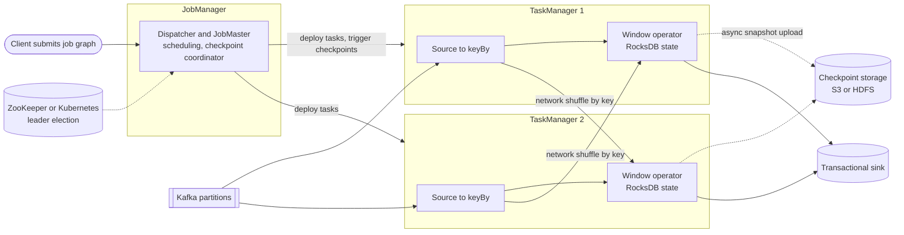

**Reading the diagram.** The *client* submits a job graph to the *JobManager*, whose JobMaster deploys tasks into *TaskManager* slots and runs the checkpoint coordinator. Sources read *Kafka partitions* and re-partition records by key over the network to the *window operators*, which keep keyed state in RocksDB on local disk. Data flows continuously; solid arrows are pipelined record streams with backpressure. Dotted arrows are asynchronous: state snapshots uploaded to *checkpoint storage*, and leader election for JobManager high availability. Failure points: a lost TaskManager triggers a restart of affected tasks from the last checkpoint; a lost JobManager fails over to a standby. Scaling: raise parallelism up to the maximum parallelism by restarting from a savepoint.

### 29.9.2 Asynchronous barrier snapshotting and savepoints

Flink's checkpointing is a variant of Chandy–Lamport for directed dataflow graphs, called **asynchronous barrier snapshotting** [Carbone et al. 2015b]:

1. The checkpoint coordinator tells every source to start checkpoint $n$. Each source records its input offset and emits a **barrier** $n$ into its output streams, between records.
2. An operator with several inputs **aligns**: once barrier $n$ arrives on one input, it buffers further records from that input until barrier $n$ has arrived on all inputs. Records before the barrier belong to checkpoint $n$; records after it to $n+1$.
3. When aligned, the operator takes a snapshot of its state and forwards barrier $n$ downstream. The snapshot is **asynchronous**: a quick copy-on-write or RocksDB snapshot is taken synchronously, and the upload to durable storage happens in the background while processing continues.
4. Sinks acknowledge; when every task has acknowledged, the coordinator marks checkpoint $n$ complete. Transactional sinks then commit the output written during that checkpoint (two-phase commit), which is how Flink achieves end-to-end exactly-once with Kafka.
5. On failure, all tasks restart, load their state from checkpoint $n$, and sources rewind to the recorded offsets.

For acyclic graphs, aligned barriers mean in-flight channel contents need not be saved, unlike in Chandy–Lamport. Under heavy backpressure, however, barriers queue behind buffered data and checkpoints become slow; **unaligned checkpoints** (Flink 1.11+) let barriers overtake buffered records and store those in-flight buffers as part of the snapshot, closer to the original algorithm.

**Figure 29.14 — Barrier alignment in a two-input operator.**

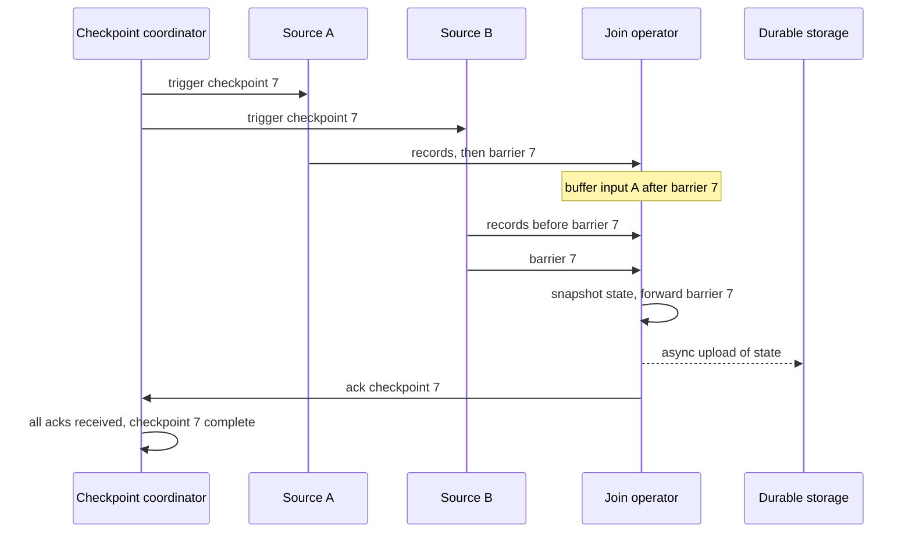

**Reading the diagram.** The *coordinator* triggers checkpoint 7 at both *sources*, which record their offsets and inject barriers. Barrier 7 reaches the *join operator* first from source A, so the operator pauses input A (buffering) while it keeps consuming B until B's barrier arrives. Then it snapshots state, forwards the barrier, uploads state asynchronously (dotted) to *durable storage* and acknowledges. Failure points: if any task fails before acknowledging, checkpoint 7 is abandoned and recovery uses checkpoint 6. Scaling: alignment time grows with backpressure and skew between inputs, which is what unaligned checkpoints address.

A **savepoint** is a checkpoint triggered by the user, stored in a canonical format and never deleted automatically. Savepoints are used to upgrade job code, change parallelism, migrate clusters or update Flink itself: stop the job with a savepoint, deploy the new version, and resume from it. Operators need stable IDs (`uid`) so that state can be mapped to the new job graph.

::: formula
**Checkpoint interval: overhead versus recovery**

$$T_{\text{opt}} \approx \sqrt{2\, C\, M_f}, \qquad T_{\text{catch-up}} \approx \frac{\lambda \left(T/2 + T_{\text{restart}} + T_{\text{restore}}\right)}{\mu - \lambda}$$

| Symbol | Meaning | Units |
|---|---|---|
| $T$, $T_{\text{opt}}$ | Checkpoint interval; interval minimizing total lost time (Young's approximation) | s |
| $C$ | Throughput-equivalent cost of one checkpoint | s |
| $M_f$ | Mean time between failures of the job | s |
| $\lambda$ | Input rate | events/s |
| $\mu$ | Maximum processing rate of the job | events/s |
| $T_{\text{restart}}$, $T_{\text{restore}}$ | Time to reschedule tasks; time to download state | s |
| $T_{\text{catch-up}}$ | Time to work off the backlog after restoring | s |
:::

::: example
**Worked example — A fraud-feature job with 2 TB of state.** $\lambda = 200{,}000$ events/s, $\mu = 500{,}000$ events/s; state is 2 TB over 50 TaskManagers (40 GB each), restored at 1 GB/s per node, so $T_{\text{restore}} = 40$ s; $T_{\text{restart}} = 20$ s; the job fails about once a day ($M_f = 86{,}400$ s); each asynchronous checkpoint costs about $C = 2$ s of throughput.

1. Young's interval: $\sqrt{2 \times 2 \times 86{,}400} = \sqrt{345{,}600} = 588$ s, about 10 minutes.
2. Catch-up at $T = 600$ s: backlog $= 200{,}000 \times (300 + 20 + 40) = 7.2 \times 10^{7}$ events; $7.2 \times 10^{7} / 300{,}000 = 240$ s. Results are stale for $20 + 40 + 240 = 300$ s.
3. At $T = 60$ s: backlog $= 200{,}000 \times 90 = 1.8 \times 10^{7}$; catch-up 60 s; stale for 120 s. Overhead rises to $2/60 = 3.3\%$ of throughput, from 0.3%.
4. With a transactional sink, output becomes visible only when a checkpoint completes, so $T = 600$ s would add up to 10 minutes of end-to-end latency.

**Interpretation.** Young's formula balances overhead against lost work, but streaming adds two costs it ignores: catch-up after recovery, which grows with $T$ and explodes as $\lambda \to \mu$, and sink visibility latency, which equals $T$. **Engineering implication.** Streaming jobs usually checkpoint every 10 s to a few minutes, keep $\mu$ at least 2× $\lambda$ for recovery headroom, use incremental RocksDB checkpoints and local recovery to cut $T_{\text{restore}}$, and alert when checkpoint duration approaches the interval.
:::

#### Failure scenarios

| What goes wrong | Why | Detection | Recovery | Prevention |
|---|---|---|---|---|
| Checkpoints time out repeatedly | Backpressure delays barriers; slow uploads | Checkpoint duration and alignment metrics | Unaligned checkpoints; scale out the slow operator | Capacity headroom; incremental checkpoints |
| State grows without bound | Session windows or keys never expire | State size per checkpoint rising steadily | Restart from savepoint with state TTL | State TTL, allowed-lateness bounds |
| Watermark stops advancing | An idle source partition emits no events | Watermark lag metric flat | Mark idle sources (`withIdleness`) | Idleness timeouts on every source |
| Duplicates downstream after restart | Non-transactional sink replayed | Duplicate keys in sink | Deduplicate by event ID | Transactional or idempotent sink |

## 29.10 Lambda and Kappa architectures

::: definition
**Definition — Lambda and Kappa architectures.** The **Lambda architecture** runs two parallel paths over the same immutable master dataset: a **batch layer** that periodically recomputes complete, accurate views from all history, and a **speed layer** that processes recent data incrementally with low latency; a **serving layer** merges the two at query time [Marz and Warren 2015]. The **Kappa architecture** uses a single stream-processing path over a replayable log; to change logic or fix a bug, it reprocesses history by replaying the log through a new version of the job [Kreps 2014].
:::

Lambda arose when stream processors were approximate and fragile (early Storm offered at-least-once processing and no consistent state), while batch jobs were trustworthy but hours behind. Running both gave freshness from one path and correctness from the other, and the batch recomputation healed any errors the speed layer made. The cost, as Kreps argued, is maintaining **the same logic twice** in two different frameworks, and keeping them semantically identical as both evolve. Kappa removes the duplication once the stream engine is itself correct (exactly-once state, event-time windows) and the log retains enough history: to deploy version 2, start a second job reading the log from the beginning into a new output table, let it catch up, switch readers over, and delete version 1's output.

**Figure 29.15 — Lambda versus Kappa.**

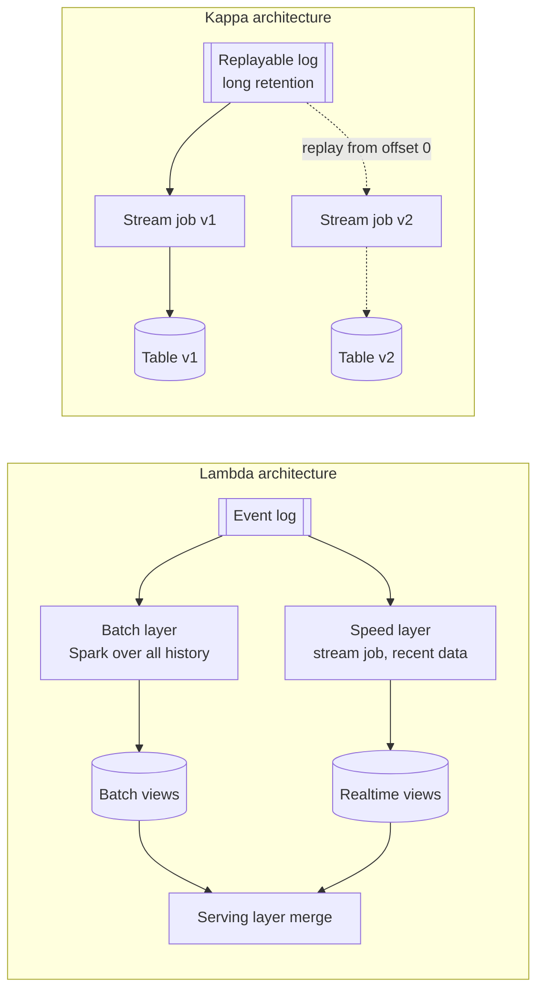

**Reading the diagram.** In *Lambda*, the same *event log* feeds a *batch layer* that recomputes *batch views* from all history every few hours and a *speed layer* that maintains *realtime views* for data the last batch run has not covered; the *serving layer* answers queries by merging both. In *Kappa*, one *stream job* consumes a *replayable log*; to change logic, *job v2* replays the log from the start (dotted, asynchronous) into a new table, and readers switch once it catches up. Storage boundaries: Lambda keeps the master dataset in a distributed file system or object store; Kappa needs the log itself (Chapter 31) or tiered storage behind it to hold history. Failure points: in Lambda, divergent logic between layers; in Kappa, replay too slow to be practical. Scaling: Kappa reprocessing scales with replay parallelism, which is bounded by the log's partition count.

Replay speed decides whether Kappa is practical. Reprocessing 30 days of events at an average of 100,000 events/s means $2.6 \times 10^{11}$ events; with 200 parallel tasks at 50,000 events/s each (10 million events/s), replay takes $2.6 \times 10^{11} / 10^{7} = 26{,}000$ s, about 7.2 hours, which is acceptable for a logic change but not for an urgent fix.

::: industry
**Summingbird at Twitter and Kappa at LinkedIn.** Twitter built Summingbird to reduce Lambda's double implementation: one Scala program is compiled to both a Hadoop batch job and a Storm streaming job, with results merged at query time [Boykin et al. 2014]. Kreps, then at LinkedIn, proposed instead reprocessing by replaying Kafka into a new job instance, which became known as the Kappa architecture [Kreps 2014].
*Evidence: Primary* — [Boykin et al. 2014; Kreps 2014]
:::

**Table 29.2 — Lambda and Kappa compared.**

| Aspect | Lambda | Kappa |
|---|---|---|
| What it is | Batch layer plus speed layer, merged at serving | One stream path; reprocess by replay |
| Code paths | Two, kept semantically equal | One |
| Correctness source | Batch recomputation heals stream errors | Exactly-once stream engine with event time |
| History store | Files or objects (cheap, columnar) | Log with long retention or tiered storage |
| Reprocessing | Rerun batch job | Replay log into a new job version |
| Operational complexity | High: two systems, merge logic | Medium: one system, replay capacity |
| Choose when | Heavy historical recomputation; stream engine cannot be trusted | Logic fits streaming; log retains enough history |

In practice many teams now run a hybrid: one engine (Spark or Flink, or Beam over either) with shared code, writing streaming results into lakehouse tables that batch jobs also read and backfill (Chapters 61–62).

## 29.11 Batch versus stream; Spark versus Flink

Batch and streaming are two points on one spectrum: a batch job is a stream job over a bounded input whose watermark jumps to infinity at the end. The Dataflow Model and Flink both treat them this way; Spark Structured Streaming does the reverse, running a stream as a series of small incremental batch queries [Armbrust et al. 2018].

**Table 29.3 — Batch versus stream processing.**

| Aspect | Batch | Stream |
|---|---|---|
| What it is | Computation over a bounded, complete dataset | Continuous computation over an unbounded dataset |
| How it works | Read all input, stage by stage, write output | Long-running operators, state, watermarks, checkpoints |
| Advantages | Simple reasoning, easy reruns, cheap per byte | Seconds of freshness, incremental cost |
| Disadvantages | Hours of latency; recomputes unchanged data | Completeness is a heuristic; state and late data to manage |
| Performance | Throughput-optimized, minutes to hours | Latency of milliseconds to seconds |
| Operational complexity | Scheduler, retries, backfills | 24×7 on-call, state migrations, lag monitoring |
| Cost | Pay per run; can use spot capacity | Always-on resources |
| Use cases | Reports, model training sets, backfills, index builds | Fraud, alerting, live features, dashboards |
| Choose when | Freshness of an hour or more is acceptable | Value decays within minutes |

**Table 29.4 — Apache Spark versus Apache Flink (as of 2026).**

| Aspect | Spark (incl. Structured Streaming) | Flink |
|---|---|---|
| What it is | Batch-first engine with SQL, ML and streaming | Stream-first engine; batch as bounded streams |
| How it works | Stages of tasks; streaming as micro-batches, plus experimental continuous mode | Pipelined long-running operators; continuous record flow |
| Advantages | Best-in-class batch SQL (Catalyst, AQE), huge ecosystem, Python support | Low latency, rich event-time and state APIs, large state on RocksDB |
| Disadvantages | Micro-batch latency floor; less flexible custom state and timers | Smaller batch and Python ecosystem; more operational tuning |
| Performance | Micro-batch latency of about 100 ms and up, exactly-once; continuous mode about 1 ms, at-least-once | Milliseconds, exactly-once state |
| Operational complexity | Lower for batch; streaming state stores simpler | Higher: checkpoints, savepoints, state backends |
| Cost | Efficient for large scans; can stop between runs | Always-on clusters sized for peak plus recovery headroom |
| Use cases | ETL, analytics, feature backfills, ML preprocessing | Fraud, CEP, real-time features, streaming ETL |
| Choose when | Batch dominates, latency of seconds is fine | Sub-second latency or complex event-time state |

The micro-batch and continuous-mode figures are from the Spark documentation [Apache Spark Docs: Structured Streaming]. **Apache Beam** sits above both: a pipeline written once with the Dataflow Model's windowing, triggers and accumulation runs on a chosen **runner** (Google Cloud Dataflow, Flink, Spark), trading some engine-specific features for portability. Chapter 61 uses Beam and Spark for ML data pipelines.

## 29.12 Summary and revision notes

::: summary
- **Batch** processes bounded, immutable inputs for throughput; rerunning a task is always safe. Scan time is $D/(Nb)$: shrink $D$ (columnar, pruning) before adding nodes.
- **MapReduce**: map → partition → sort/spill → shuffle → merge → reduce. A combiner pre-aggregates associative, commutative operations and can cut shuffle volume by 100×. Failures are handled by re-executing tasks; backup tasks tame stragglers, which appear in almost every large job ($1-(1-p)^n$).
- **Joins**: sort-merge shuffles both sides; broadcast copies the small side to every task and wins while $|S| < |L|/(N-1)$ and $|S|$ fits in memory.
- **Spark**: RDD lineage replaces replication; narrow dependencies pipeline within a stage, wide dependencies end it with a shuffle. Cache reused data. DataFrames let Catalyst prune, push down and choose joins; Tungsten generates code; AQE re-plans at shuffle boundaries (coalesce, switch to broadcast, split skew).
- **Shuffle** cost is set by the tightest of NIC, rack uplink and local disk; a 10 TB shuffle on 100 nodes needs about 100 s at best. A hot key with fraction $f$ slows a stage by $fP$; salt hot keys and aggregate in two stages.
- **Locality** mattered when networks were slow; with fast fabrics and object stores, compute and storage are disaggregated.
- **Streams**: group by event time; windows are tumbling, sliding or session; watermarks trade latency ($\delta$) against late data ($\propto e^{-\delta/\mu}$); triggers and accumulation modes say when and how results are emitted; allowed lateness bounds state.
- **Flink**: JobManager and TaskManagers; keyed state in key groups; RocksDB for large state; asynchronous barrier snapshots give exactly-once state; savepoints enable upgrades and rescaling. Checkpoint interval trades overhead against catch-up time and sink latency.
- **Lambda** duplicates logic for freshness plus correctness; **Kappa** reprocesses by replay. Spark leads for batch, Flink for low-latency stateful streaming; Beam provides portability.
:::

## 29.13 Knowledge checkpoint

1. Why do immutable inputs make batch fault tolerance simple?
2. List the steps between a map function's output and a reduce function's input.
3. When may the reduce function be used as a combiner?
4. Why must a completed map task be rerun when its node dies, but not a completed reduce task?
5. A phase has 2,000 tasks and each is a straggler with probability 0.0005. What is the chance of at least one straggler?
6. Using the join-cost formula, should you broadcast a 1 GB table to 200 executors when the other side is 500 GB?
7. What is the difference between a narrow and a wide dependency, and why does it define stage boundaries?
8. What three things can Adaptive Query Execution change at run time?
9. A hot key carries 10% of rows over 400 partitions. What is the skew ratio, and what is it with a salt of 20?
10. Why did data locality matter less in 2026 than in 2004?
11. Define event time, processing time and watermark.
12. For $\mu = 3$ s, $W = 60$ s and $\delta = 6$ s, what fraction of events misses its window?
13. What do allowed lateness and side outputs each protect against?
14. Why does a two-input Flink operator align barriers, and what do unaligned checkpoints change?
15. Why does a longer checkpoint interval increase end-to-end latency with a transactional sink?
16. What is the main cost of Lambda that Kappa removes, and what does Kappa require instead?

<details><summary>Answers</summary>

1. A task's output depends only on its input, so rerunning it gives the same result; no undo or coordination is needed.
2. Partitioning by key, buffering, sorting by (partition, key), optional combining, spilling and merging on the map side; fetching (shuffle) and merge-sorting on the reduce side.
3. When the operation is associative and commutative and its input and output types match, so applying it zero or more times to partial groups does not change the result.
4. Map output is on the node's unreplicated local disk; reduce output is committed to the replicated file system.
5. $1 - e^{-2{,}000 \times 0.0005} = 1 - e^{-1} = 0.63$.
6. Broadcast moves $1 \times 199 = 199$ GB; shuffle moves about $501 \times 0.995 = 499$ GB. Broadcast is cheaper if 1 GB fits comfortably in each executor's memory.
7. Narrow: each parent partition feeds at most one child partition, so operators pipeline in one task. Wide: a child needs many parents, requiring a shuffle and a barrier, so the scheduler starts a new stage.
8. It coalesces small shuffle partitions, converts a sort-merge join to a broadcast join, and splits skewed join partitions.
9. $0.1 \times 400 + 0.9 = 40.9$; with salt 20: $40/20 + 0.9 = 2.9$.
10. NIC and fabric bandwidth grew to rival local disks, and object stores decoupled storage from compute; columnar reads reduce bytes either way.
11. Event time: when the event happened. Processing time: when the system observes it. Watermark: an assertion that no events with earlier event time are expected.
12. $(3/60)\, e^{-2} (1 - e^{-20}) = 0.05 \times 0.135 = 0.68\%$.
13. Allowed lateness bounds state retention while still updating results for moderately late data; side outputs keep events that arrive later still from being silently lost.
14. So that the snapshot reflects exactly the records before the barrier on every input. Unaligned checkpoints let barriers overtake buffered records and save in-flight data, avoiding long alignment under backpressure.
15. The sink commits its transaction only when a checkpoint completes, so output becomes visible once per interval.
16. Lambda maintains the same logic in two systems; Kappa needs a correct stream engine and a log retaining enough history to replay fast enough.
</details>

## 29.14 Interview questions

### Basic

**Q1. Explain MapReduce with word count.** **Answer.** Map emits `(word, 1)` per word; a combiner sums locally; pairs are hash-partitioned by word, sorted and shuffled so every count for a word reaches one reducer, which sums them and writes the result. Failed tasks rerun because inputs are immutable.

**Q2. Why is Spark faster than MapReduce for iterative jobs?** **Answer.** MapReduce writes each job's output to replicated storage and rereads it; Spark keeps reused datasets in memory, pipelines narrow transformations within a stage, and recovers lost partitions from lineage rather than replicas. Catalyst and code generation add CPU efficiency for DataFrames.

### Intermediate

**Q3. A Spark job's last task runs for an hour while others take a minute. Diagnose and fix.** **Answer.** Check the stage's task-duration and shuffle-read-size distributions. If one task reads far more data, it is key skew: find hot keys by sampling, filter junk keys, enable AQE skew-join handling, or salt and aggregate in two stages; broadcast the small side if one exists. If sizes are equal, it is a straggling node: enable speculation and check that machine.

**Q4. Design per-minute click counts per page from mobile clients with delayed uploads.** **Answer.** Key by page, one-minute tumbling event-time windows, a bounded-out-of-orderness watermark (for example 10 s from measured delay), allowed lateness of hours with accumulating late firings upserted by (page, window), a side output for later events, a nightly batch reconciliation if needed, Kafka source with checkpointed offsets, and an idempotent or transactional sink.

### Advanced

**Q5. How does Flink provide exactly-once results end to end with Kafka?** **Answer.** Sources store Kafka offsets in checkpoints; barriers create consistent snapshots of all operator state; on failure, state and offsets roll back together. The Kafka sink writes inside a transaction per checkpoint, pre-commits on the barrier, and commits when the checkpoint completes; consumers read with `read_committed`. External side effects outside this protocol still need idempotency keys.

**Q6. Estimate the shuffle time of a 20 TB join on 200 nodes with 25 Gb/s NICs, 10 racks and 4:1 oversubscription.** **Answer.** NIC: 100 GB per node at 2.19 GB/s ≈ 46 s. Uplinks: 20 racks × … no, 10 racks; cross-rack $20 \times 0.9 = 18$ TB, 1.8 TB per rack through $20 \times 3.125/4 = 15.6$ GB/s ≈ 115 s. Disk (2 GB/s): 200 GB per node ≈ 100 s. Bound ≈ 2 minutes; expect 4–6 minutes. Then question the shuffle: can one side be broadcast or pre-bucketed?
