# Chapter 30 — Messaging Fundamentals

> **Level:** 2 · **Track:** A (Traditional) · **Estimated reading time:** 2.5 h

Until now most of the services in this book have talked to each other the way people talk on the phone: one calls, the other answers, and both must be present at the same moment. This chapter introduces the alternative, the way people use a postbox. A **message broker** sits between services and holds messages until the receiver is ready, so the sender can carry on without waiting and without even knowing who will read what it sent. That single change — putting durable storage between two services — buys availability, absorbs load spikes and lets one event feed many consumers. It also brings new problems that you must design for explicitly: duplicates, reordering, messages that can never be processed, and backlogs that take hours to drain.

The running example is PhotoShare (Chapter 1). When a user uploads a photo, PhotoShare must store it, generate thumbnails, run content moderation, update the search index, notify followers and record analytics. You will see what happens when those steps are chained synchronously, then rebuild the pipeline with queues and topics, size its consumers, choose a broker, and handle the failures that messaging introduces. Kafka is introduced only briefly here; its internals are the subject of Chapter 31, and the patterns built on top of messaging (transactional outbox, sagas, CQRS, event sourcing) are the subject of Chapter 32.

## 30.1 Learning objectives

After this chapter you should be able to:

- Explain temporal coupling and compute the availability of a synchronous call chain versus a queue-decoupled design.
- Describe point-to-point queues, competing consumers, acknowledgments and visibility timeouts, and size a consumer fleet with Little's Law.
- Calculate backlog drain time after an outage and choose a visibility timeout from processing-time percentiles.
- Distinguish publish/subscribe from queues, durable from ephemeral subscriptions, and estimate fan-out cost.
- Distinguish events, commands and messages, and event notification from event-carried state transfer.
- Explain the models of RabbitMQ (exchanges, bindings, quorum queues, streams), Amazon SQS and SNS (standard and FIFO, message groups), Google Cloud Pub/Sub and Apache Pulsar (brokers over BookKeeper).
- Define at-most-once, at-least-once and effectively-once delivery, and trace where duplicates come from.
- Explain per-key ordering, what breaks it, and the throughput limit it imposes.
- Design retries, poison-message handling and dead-letter queues with redrive and alerting, and implement them in a small tested queue.
- Choose between Kafka, RabbitMQ, SQS and Pulsar for a given workload.

## 30.2 Prerequisites

- Availability arithmetic for series and parallel components — §4.14 (the sync-versus-async comparison is a series calculation).
- Queueing and Little's Law — §4.10–§4.11 (consumer sizing and backlog latency).
- HTTP and RPC request/response — §8.6 and §8.8 (the synchronous baseline that messaging replaces).
- Timeouts, retries with backoff and jitter — §22.11–§22.12 (consumers retry too).
- Backpressure — §22.10 (what a bounded system does when consumers fall behind; owned there).
- Idempotency keys — §22.15 (the consumer-side defense against duplicates; owned there).
- Raft consensus — §26.7 (how replicated queues such as RabbitMQ quorum queues stay durable and available).
- Units: **KB/MB/GB** are powers of ten; a "30-day month" is 43,200 minutes.

## 30.3 Synchronous vs asynchronous communication

### 30.3.1 Temporal coupling

::: definition
**Definition — Synchronous communication.** An interaction in which the sender waits for the receiver to process a request and return a response before it continues; both parties must be running and reachable at the same time.
:::

::: definition
**Definition — Asynchronous (message-based) communication.** An interaction in which the sender hands a **message** to an intermediary — a **message broker** — and continues without waiting for the receiver to process it. The broker stores the message until a receiver takes it, so sender and receiver need not be available at the same time.
:::

#### First-principles explanation

A phone call needs both people on the line. If your friend is in a meeting, the call fails and you must try again later. A letter does not: you drop it in a postbox, the postal service keeps it, and your friend reads it when they get home. The postal service has removed **temporal coupling** — the requirement that both parties be available at the same moment.

Eugster et al. identify three kinds of decoupling that a messaging intermediary can provide [Eugster et al. 2003]:

1. **Time decoupling.** Sender and receiver need not be running at the same time; the broker stores messages in between.
2. **Space decoupling.** The sender need not know who, or how many, the receivers are; it addresses a queue or topic, not a host.
3. **Synchronization decoupling.** The sender is not blocked while the message is processed, and the receiver is notified (or polls) in its own thread of control.

An HTTP call provides none of these. A queue provides all three.

#### Why does this exist?

Three engineering problems drive services toward messaging:

1. **Availability multiplication.** A chain of synchronous calls is up only if *every* link is up, so availability falls with every hop (formula below).
2. **Load mismatch.** Producers are bursty (a celebrity posts and a million followers react); consumers have a fixed capacity. A queue is a buffer that lets consumers work at their own steady rate while the backlog absorbs the burst.
3. **Latency of slow, non-essential work.** A user uploading a photo needs to know it was stored, not that thumbnails exist in five sizes and every follower has been notified. Moving the slow work out of the request path cuts user-visible latency.

#### How it works internally

1. The producer serializes the work as a message (a payload plus headers such as an ID, type and timestamp).
2. It sends the message to the broker and waits only for the broker's acknowledgment that the message is durably stored — typically a few milliseconds.
3. The producer returns to its own client ("upload accepted").
4. Later — milliseconds or hours — a consumer retrieves the message, processes it and **acknowledges** it, after which the broker deletes it or marks it consumed.

#### Architecture diagram

**Figure 30.1 — PhotoShare upload: synchronous chain versus queue-decoupled.**

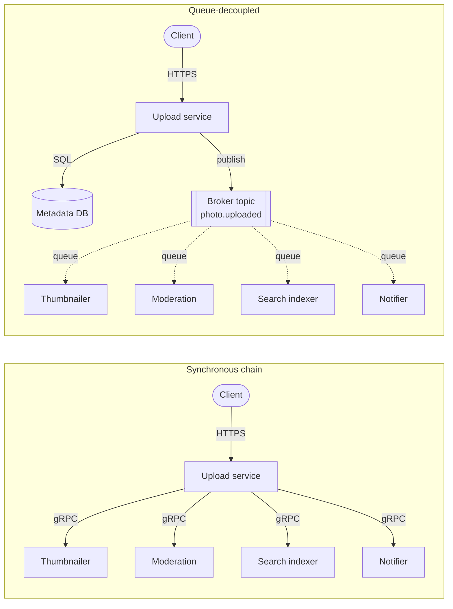

**Reading the diagram.** In the top half, the client's HTTPS request reaches the upload service, which makes four synchronous gRPC calls (solid arrows) before it can answer; the client waits for the slowest call, and a failure of any of the four services fails the upload. In the bottom half, the upload service does two synchronous things — writes the photo's metadata to its database (the storage boundary) and publishes one `photo.uploaded` message to the broker — then answers the client. Each downstream service consumes from its own queue asynchronously (dotted arrows) at its own pace. Failure points move: a downstream outage now delays its work instead of failing uploads, while the broker becomes a new critical component that must itself be replicated. Scaling is independent: the thumbnailer can run 50 consumers while the notifier runs 5.

#### Mathematical foundations

::: formula
**Availability of synchronous and queue-decoupled paths (independent failures)**

$$A_{\text{sync}} = \prod_{i=1}^{n} A_i \qquad A_{\text{async}} = A_{\text{front}} \times A_{\text{broker}} \times \prod_{j \in \text{sync deps}} A_j$$

| Symbol | Meaning | Units |
|---|---|---|
| $A_{\text{sync}}$ | Availability of a request that synchronously requires all $n$ services | dimensionless |
| $A_i$ | Availability of service $i$ on the synchronous path | dimensionless |
| $n$ | Number of services on the synchronous path, including the front service | count |
| $A_{\text{async}}$ | Availability of *accepting* the request when the other work is queued | dimensionless |
| $A_{\text{front}}$ | Availability of the service that receives the client request | dimensionless |
| $A_{\text{broker}}$ | Availability of the broker for publishing | dimensionless |
| $A_j$ | Availability of each dependency that must still be called synchronously | dimensionless |
:::

With $n$ identical services this is simply $A^n$: availability decays geometrically with chain length. The asynchronous formula measures something different and weaker — that the request was *accepted* durably. The queued work completes later provided each consumer recovers before the broker's retention period expires.

::: example
**Worked example — How much downtime does decoupling remove?** Every PhotoShare service has $A = 0.999$; the broker has $A_{\text{broker}} = 0.9999$. Use a 30-day month of 43,200 minutes.

1. Fully synchronous (upload service plus four downstream calls, $n = 5$): $A_{\text{sync}} = 0.999^5 = 0.99501$. Unavailable fraction $0.00499$, so $0.00499 \times 43{,}200 \approx 216$ minutes (3.6 hours) per month of failed uploads.
2. Ten services in the chain: $0.999^{10} = 0.99004$, about 430 minutes (7.2 hours) per month.
3. Hybrid: the upload service still writes synchronously to its metadata database ($A = 0.999$) and publishes to the broker: $0.999 \times 0.999 \times 0.9999 = 0.99790$, about 91 minutes per month.
4. Front service plus broker only: $0.999 \times 0.9999 = 0.99890$, about 48 minutes per month.

**Interpretation.** Removing four synchronous dependencies cuts failed-upload time from about 216 to about 91 minutes per month, and adding services downstream no longer costs any user-facing availability. **Engineering implication.** Keep on the synchronous path only what the client must know before it continues (here: "your photo is stored"), and make the broker more available than the services it decouples, or it becomes the new weakest link.
:::

#### Advantages and disadvantages

**Table 30.1 — Synchronous versus asynchronous communication.**

| Aspect | Synchronous (RPC, HTTP) | Asynchronous (broker) |
|---|---|---|
| Coupling | Time, space and synchronization | None of the three |
| Availability | Product of the chain | Front service × broker |
| User latency | Sum or max of calls | Publish time (a few ms) |
| Result to caller | Immediate, including errors | Later, via another message or polling |
| Load spikes | Must be served or rejected now | Buffered as backlog |
| Debugging | One trace, one stack | Distributed, needs correlation IDs |
| Consistency | Read-your-writes is easy | Downstream state lags (eventual consistency) |
| New failure modes | Timeouts, cascades | Duplicates, reordering, poison messages, backlog |

Asynchrony is not free. The caller cannot get an answer, so anything the user must see immediately — a payment authorization, a login, a search result — stays synchronous. Downstream data is stale for as long as the backlog takes to drain, and the system's behavior is spread across many processes connected only by messages, which makes it harder to follow (tracing across brokers is covered in §40.6).

#### Failure scenarios

**Table 30.2 — Failure scenarios: synchronous versus asynchronous.**

| What goes wrong | Why | Detection | Recovery | Prevention |
|---|---|---|---|---|
| Cascading timeouts in a call chain | One slow service holds every caller's threads | Rising p99, thread-pool saturation | Shed load, open circuit breakers (§22.13) | Shorter chains, deadlines, queue non-essential work |
| Broker outage | The new single dependency fails | Publish errors and latency | Fail over to replicas; buffer locally briefly | Replicated broker, multi-zone deployment |
| Silent backlog growth | Consumers slower than producers | Queue depth and age of oldest message | Scale consumers; drain | Alert on message age, autoscale on lag |
| User sees stale data | Work still queued | Complaints, read-after-write checks | Show "processing" state | Design the UI for eventual consistency |

::: mistake
**"Asynchronous means faster."** Publishing returns sooner, but the *work* takes at least as long — plus queueing time. If the user needs the result to continue, making the call asynchronous only moves the wait into polling. Use messaging for work whose result the caller does not need before it continues.
:::

::: mistake
**"Async calls with callbacks are messaging."** A non-blocking HTTP client (`async`/`await`) removes synchronization coupling inside one process, but the receiver must still be up at that moment. Only a durable intermediary removes time coupling.
:::

## 30.4 Message queues

### 30.4.1 Point-to-point channels and competing consumers

::: definition
**Definition — Message queue (point-to-point channel).** A broker-managed, durable buffer of messages in which each message is delivered to, and processed by, exactly one of the queue's consumers; once a consumer acknowledges a message, the broker removes it [Hohpe and Woolf 2003].
:::

::: definition
**Definition — Competing consumers.** A pattern in which several consumer processes read from the same queue concurrently, each message going to whichever consumer takes it first, so that adding consumers raises throughput [Hohpe and Woolf 2003].
:::

#### First-principles explanation

Think of the ticket rail in a restaurant kitchen. Waiters clip orders to the rail; any free cook takes the next ticket; when the dish leaves the pass, the ticket is spiked and discarded. No order is cooked twice, and when the dinner rush arrives the manager adds cooks, not waiters. The rail is the queue, the cooks are competing consumers, and spiking the ticket is the acknowledgment.

The essential property is **destructive, shared consumption**: a message is work to be done once, by someone. That makes queues the right tool for *tasks* — resize this image, send this email, charge this order — and the wrong tool when several independent parties each need their own copy (§30.5).

#### How it works internally

1. **Send.** The producer sends a message; the broker persists it (usually replicated across nodes or availability zones) and confirms.
2. **Receive.** A consumer asks for up to $b$ messages. Brokers either **push** messages to subscribed consumers up to a **prefetch** limit (RabbitMQ) or let consumers **pull** with long polling (SQS waits up to 20 seconds for a message to arrive rather than returning empty).
3. **Lease.** The broker does not delete a delivered message. It marks it **in flight** — invisible to other consumers — for a lease period: the **visibility timeout** in SQS, the **ack deadline** in Google Cloud Pub/Sub. RabbitMQ instead keeps a delivered message unacknowledged for as long as the consumer's channel stays open, and requeues it if the channel or connection closes.
4. **Process.** The consumer does the work.
5. **Acknowledge.** The consumer tells the broker it is done (SQS `DeleteMessage` with the delivery's **receipt handle**; AMQP `basic.ack`; Pub/Sub `acknowledge`). Only now is the message removed.
6. **Redeliver on failure.** If the consumer crashes, or the lease expires before the acknowledgment, the message becomes visible again and another consumer receives it. A consumer can also **negatively acknowledge** (`basic.nack`, or setting the SQS visibility timeout to zero) to release it immediately.

Acknowledging *after* processing is what makes a queue reliable: a crash at any point before step 5 leads to redelivery rather than loss. It is also why every queue that never loses messages can deliver one twice (§30.8).

#### Architecture diagram

**Figure 30.2 — A point-to-point queue with competing consumers.**

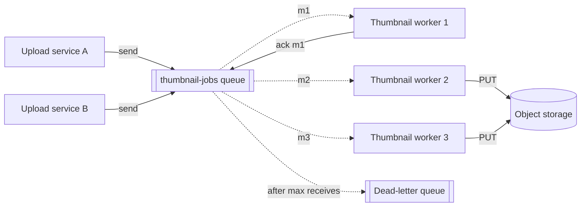

**Reading the diagram.** Two upload-service instances send jobs to one queue (solid arrows: the send is a synchronous call to the broker). The queue delivers each message to exactly one of three workers (dotted: delivery is asynchronous and decoupled in time). Each worker writes thumbnails to object storage (the storage boundary outside the broker) and then acknowledges, which deletes the message; worker 1's acknowledgment is drawn as an example. A message whose processing keeps failing is moved to a dead-letter queue after a maximum number of deliveries (§30.11). Failure points: a worker crash leaves its message in flight until the lease expires; a broker-node failure is covered by replication inside the broker. Scaling: add workers until the queue's own throughput or the downstream storage becomes the limit.

### 30.4.2 Acknowledgments and the visibility timeout

**Figure 30.3 — The visibility timeout: success, crash and redelivery.**

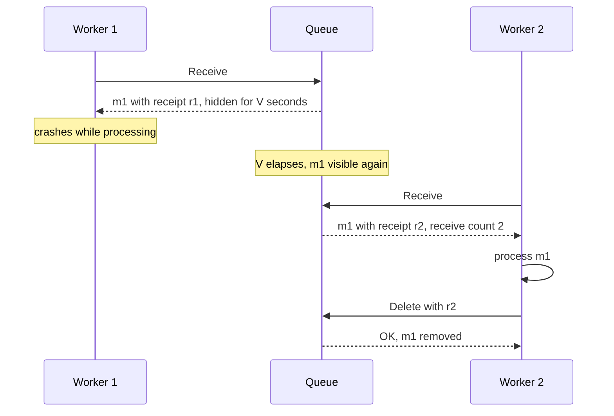

**Reading the diagram.** Worker 1 receives message m1 with receipt r1, and the queue hides m1 for $V$ seconds. Worker 1 crashes before acknowledging, so nothing happens until the timeout elapses; m1 then becomes visible and worker 2 receives it with a *new* receipt r2 and a receive count of 2. Worker 2 processes it and deletes it using r2. All calls are synchronous request/response between worker and queue; the redelivery itself is time-driven. The failure point to notice is the gap: m1 waited a full $V$ before anyone retried it. Had worker 1 merely been slow rather than dead, both workers would have processed m1 — a duplicate.

The visibility timeout is therefore a trade-off with no free setting. Too short, and slow-but-healthy consumers lose their lease and the message is processed twice. Too long, and a crash delays the retry by the full timeout. Long-running consumers escape the dilemma with a **heartbeat**: start with a modest timeout and periodically extend it while work progresses (SQS `ChangeMessageVisibility`; Pub/Sub `modifyAckDeadline`, which its client libraries do automatically). As of 2026, SQS defaults to 30 seconds and allows 0 seconds to 12 hours [AWS Docs: SQS]; Pub/Sub defaults to 10 seconds and allows up to 600 seconds per extension [Google Cloud Docs: Pub/Sub]; RabbitMQ closes a channel whose delivery stays unacknowledged longer than its consumer timeout (30 minutes by default) and requeues its messages [RabbitMQ Docs: Confirms].

::: formula
**Visibility-timeout sizing**

$$V \ge b \cdot S_{\text{tail}} + \delta$$

| Symbol | Meaning | Units |
|---|---|---|
| $V$ | Visibility timeout (lease length) | s |
| $b$ | Messages received per batch and processed sequentially under one lease | messages |
| $S_{\text{tail}}$ | High-percentile (for example p99.9) processing time per message | s |
| $\delta$ | Margin for acknowledgment latency, pauses and retries inside processing | s |
:::

::: example
**Worked example — Sizing the thumbnail queue's timeout.** Workers receive batches of $b = 10$ messages and process them one after another. Measured processing time per message: p50 0.4 s, p99.9 2.5 s. Allow $\delta = 10$ s.

1. Worst plausible batch: $10 \times 2.5 = 25$ s.
2. $V \ge 25 + 10 = 35$ s; round to 40 s.
3. The default of 30 s would expire during an unlucky batch and cause the last few messages to be processed twice.
4. Crash cost: a dead worker's 10 messages reappear only after up to 40 s.
5. Alternative: receive one message at a time ($b = 1$) with $V = 15$ s, or keep $b = 10$ with $V = 30$ s and extend the lease after each message.

**Interpretation.** The timeout must cover the *batch*, not the average message. **Engineering implication.** Size $V$ from tail latency and batch size; when processing time is unbounded (video transcoding), use heartbeats rather than an hours-long timeout that would make crash recovery equally slow.
:::

### 30.4.3 Sizing consumers and draining backlogs

How many consumers does a queue need? Little's Law (§4.11) answers directly: the number of messages being processed at once equals the arrival rate multiplied by the processing time.

::: formula
**Consumer count from throughput (Little's Law)**

$$N = \left\lceil \frac{\lambda \cdot S}{k \cdot \rho} \right\rceil$$

| Symbol | Meaning | Units |
|---|---|---|
| $N$ | Number of consumer instances | instances |
| $\lambda$ | Average arrival rate of messages | messages/s |
| $S$ | Mean processing time per message, including acknowledgment | s |
| $\lambda S$ | Average messages in processing (Little's $L$) | messages |
| $k$ | Concurrent messages per instance (threads, coroutines or prefetch) | messages |
| $\rho$ | Target utilization of each processing slot | dimensionless (0–1) |
:::

::: example
**Worked example — Thumbnail workers.** PhotoShare receives $\lambda = 2{,}000$ uploads per second at peak; generating thumbnails takes $S = 150$ ms; each worker instance runs $k = 10$ concurrent jobs; target utilization $\rho = 0.7$.

1. Messages in processing: $L = \lambda S = 2{,}000 \times 0.15 = 300$.
2. Slots needed at 70% utilization: $300 / 0.7 = 428.6$.
3. Instances: $428.6 / 10 = 42.9$, so $N = 43$.
4. Capacity of 43 instances: $\mu = N k / S = 43 \times 10 / 0.15 = 2{,}867$ messages/s.

**Interpretation.** About 43 instances keep pace with peak with 30% headroom. **Engineering implication.** Headroom is not only for spikes; it sets how quickly you recover from a backlog, as the next formula shows. Re-derive $N$ whenever $S$ changes — a slower downstream store raises $S$ and silently raises $N$.
:::

When consumers stop — a bad deploy, a downstream outage — producers keep sending and the backlog grows at rate $\lambda$. When consumers return, they drain it only with their *surplus* capacity.

::: formula
**Backlog drain time**

$$T_{\text{drain}} = \frac{B}{\mu - \lambda}, \qquad \mu = \frac{N k}{S}, \qquad B = \lambda \cdot T_{\text{out}}$$

| Symbol | Meaning | Units |
|---|---|---|
| $T_{\text{drain}}$ | Time to return to a near-empty queue | s |
| $B$ | Backlog when consumers resume | messages |
| $T_{\text{out}}$ | Duration of the consumer outage | s |
| $\mu$ | Maximum consumer throughput | messages/s |
| $\lambda$ | Arrival rate during the drain | messages/s |
:::

::: example
**Worked example — Recovering from a 30-minute outage.** Thumbnail workers are down for $T_{\text{out}} = 1{,}800$ s while uploads continue at $\lambda = 2{,}000$/s.

1. Backlog: $B = 2{,}000 \times 1{,}800 = 3.6$ million messages.
2. With 43 instances, $\mu = 2{,}867$/s; surplus $= 867$/s; $T_{\text{drain}} = 3.6 \times 10^6 / 867 \approx 4{,}150$ s $\approx 69$ minutes.
3. Autoscaling to 100 instances: $\mu = 100 \times 10 / 0.15 = 6{,}667$/s; surplus $4{,}667$/s; $T_{\text{drain}} \approx 771$ s $\approx 13$ minutes — if object storage can absorb 6,667 writes per second.
4. Age of the oldest message when workers resume: 30 minutes. With Little's Law (§4.11.2), a queue depth of 3.6 million at 2,867/s means a new message waits about $3.6 \times 10^6 / 2{,}867 \approx 21$ minutes.

**Interpretation.** A 30-minute outage costs more than an hour of stale thumbnails at normal headroom. **Engineering implication.** Alert on the **age of the oldest message** (SQS exposes `ApproximateAgeOfOldestMessage`), not just depth; autoscale consumers on backlog per instance; and check that retention (4 days by default in SQS, up to 14 [AWS Docs: SQS]) comfortably exceeds the longest outage you can imagine.
:::

::: industry
**Slack's job queue.** Slack runs much of its asynchronous work (message fan-out, link unfurling, notifications) through a job queue originally built on Redis. Slack's engineers describe an incident in which a database slowdown made jobs run slower, the backlog grew until Redis ran out of memory, and the queue could no longer accept or hand out jobs. They responded by putting Kafka in front of Redis as a durable, disk-backed buffer, so that a backlog grows on disk rather than in a memory-bound store [Slack Engineering 2020].
*Evidence: Primary* — [Slack Engineering 2020]
:::

#### Failure scenarios

**Table 30.3 — Failure scenarios: queues and consumers.**

| What goes wrong | Why | Detection | Recovery | Prevention |
|---|---|---|---|---|
| Duplicate processing | Lease expired while a slow consumer still worked | Same message ID processed twice | Idempotent consumer absorbs it | Size $V$ from tail latency; heartbeat |
| Messages stuck for minutes | Consumer crashed holding a large prefetch or batch | Age of oldest message jumps by $V$ | Wait for lease expiry | Small batches; health-checked consumers |
| Backlog never drains | $\mu \le \lambda$ after a slowdown | Depth rising steadily | Scale out; shed optional work | Headroom; autoscaling on age |
| Downstream overload during drain | Many consumers hammer the database | DB latency and errors | Cap consumer concurrency | Rate-limit consumers (§22.10) |
| Broker memory exhaustion | Unbounded in-memory backlog | Broker memory alarms | Block publishers, add storage | Disk-backed queues; length limits |

::: mistake
**"Acknowledge as soon as you receive."** Acknowledging before processing turns a reliable queue into an at-most-once one: if the consumer crashes after the acknowledgment, the work is lost. Acknowledge after the side effects are durable.
:::

## 30.5 Publish/subscribe

### 30.5.1 Topics, subscriptions and fan-out

::: definition
**Definition — Publish/subscribe (pub/sub).** A messaging style in which a publisher sends a message to a named **topic** without knowing its receivers, and the broker delivers a copy to every **subscription** registered on that topic [Hohpe and Woolf 2003; Eugster et al. 2003].
:::

#### First-principles explanation

A queue is a ticket rail: each ticket is cooked once. A topic is a newspaper: every subscriber gets their own copy, and the newsroom neither knows nor cares how many there are. Adding a subscriber requires no change to the publisher — which is the point. When PhotoShare later adds a "memories" feature that needs every upload, the team creates a new subscription; the upload service is untouched. Inside a single process the same idea is the Observer pattern (§37.8), which is synchronous and keeps no messages; Table 37.1 compares the two.

The two styles compose. Each *subscription* usually behaves like a queue, with its own competing consumers, acknowledgments and backlog. Fan-out happens between subscriptions; load balancing happens within one.

#### How it works internally

1. Subscribers register subscriptions on the topic, optionally with a **filter** (for example, only messages whose attribute `type = "video"`).
2. The publisher sends a message to the topic; the broker stores it once or per subscription, depending on the design.
3. The broker delivers a copy to every matching subscription. Each subscription tracks its own acknowledgments, so a slow subscriber's backlog never delays a fast one.

**Figure 30.4 — Fan-out from one topic to independent subscriptions (SNS to SQS).**

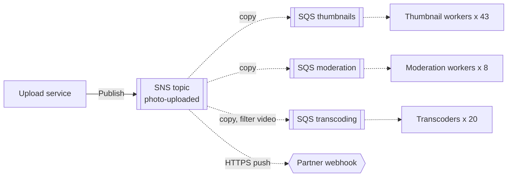

**Reading the diagram.** The upload service publishes once to an SNS topic (a synchronous API call). SNS copies the message asynchronously to three SQS queues and one external HTTPS endpoint; the transcoding subscription carries a filter, so it receives only videos. Each SQS queue is a durable storage boundary with its own pool of competing consumers. Failure points: a dead moderation fleet grows only the moderation queue; an unreachable webhook is retried by SNS under its delivery policy and can be given its own dead-letter queue. Scaling: subscriptions and their consumer pools grow independently, which is why this **topic-to-queue fan-out** is the standard AWS pattern [AWS Docs: SNS].

### 30.5.2 Durable and ephemeral subscriptions

::: definition
**Definition — Durable subscription.** A subscription whose messages the broker retains while the subscriber is disconnected, so the subscriber receives everything published since it subscribed, within the retention period. An **ephemeral** (non-durable) subscription exists only while the subscriber is connected; messages published while it is away are never delivered to it.
:::

Hohpe and Woolf call the first a **Durable Subscriber**. Use durable subscriptions for business work that must not be skipped (search indexing, billing) and ephemeral ones where missed messages are worthless after a few seconds (live cursor positions, cache-invalidation hints that are also covered by TTLs, dashboards). An exclusive, auto-delete RabbitMQ queue bound to a fanout exchange, a Redis Pub/Sub channel and an SNS-to-HTTP push to a server that is down are all ephemeral in effect; an SQS queue subscribed to SNS, a Pub/Sub subscription and a Pulsar subscription cursor are durable.

Durability has a cost: a subscriber that disappears keeps accumulating messages until retention expires. Abandoned durable subscriptions are a classic source of storage alarms.

::: formula
**Fan-out delivery rate, egress and orphaned backlog**

$$D = \lambda \cdot N_s, \qquad E = \lambda \cdot s \cdot N_s, \qquad B_{\text{orphan}} = \lambda \cdot s \cdot T_{\text{away}}$$

| Symbol | Meaning | Units |
|---|---|---|
| $D$ | Deliveries the broker performs | deliveries/s |
| $\lambda$ | Publish rate | messages/s |
| $N_s$ | Number of subscriptions (after filtering) | count |
| $E$ | Broker egress | bytes/s |
| $s$ | Mean message size | bytes |
| $B_{\text{orphan}}$ | Storage held for one disconnected durable subscriber | bytes |
| $T_{\text{away}}$ | Time the subscriber has been away | s |
:::

::: example
**Worked example — PhotoShare event fan-out.** The platform publishes $\lambda = 5{,}000$ events/s of $s = 2$ KB each to a topic with $N_s = 12$ subscriptions.

1. Deliveries: $5{,}000 \times 12 = 60{,}000$ per second, about 5.2 billion per day — and per-request pricing applies to each.
2. Egress: $5{,}000 \times 2{,}000 \times 12 = 120$ MB/s, close to 1 Gb/s.
3. One subscriber's service is turned off for 6 hours: $5{,}000 \times 21{,}600 = 108$ million messages, $216$ GB retained for it alone.

**Interpretation.** Each subscription multiplies delivery and egress cost, and an unattended durable subscription grows by hundreds of gigabytes per day. **Engineering implication.** Filter at the broker so subscribers receive only what they need, treat subscriptions as owned resources with alarms on backlog age, and delete subscriptions whose consumers are retired.
:::

::: mistake
**"Pub/sub replaces queues."** Pub/sub decides *who* gets a copy; queues decide *how* one subscriber shares work among its instances. Nearly every production pub/sub system has a queue (or queue-like subscription) at each leaf.
:::

## 30.6 Event-driven architecture

### 30.6.1 Events, commands and messages

::: definition
**Definition — Message, command, event.** A **message** is the transport unit a broker carries: headers plus a payload. A **command** is a message that asks one specific receiver to do something ("ResizePhoto"); it may be refused. An **event** is a message stating a fact that has already happened ("PhotoUploaded"); it cannot be refused, only reacted to, and its publisher does not know who reacts [Hohpe and Woolf 2003].
:::

The distinction is about **direction of knowledge**. A command couples the sender to the receiver's capability: the upload service must know that a thumbnailer exists and what it needs. An event inverts that: the upload service announces what happened, and the thumbnailer decides to care. **Event-driven architecture (EDA)** is a style in which services communicate mainly by publishing and reacting to events, so that new behavior is added by adding subscribers rather than changing publishers. Its architectural treatment is in §33.8; this section covers the messaging mechanics.

**Table 30.4 — Commands versus events.**

| Property | Command | Event |
|---|---|---|
| Grammar | Imperative: `ChargeCard` | Past tense: `CardCharged` |
| Receivers | Exactly one logical receiver | Zero or more unknown subscribers |
| Channel | Queue (point-to-point) | Topic (pub/sub) |
| Can be rejected? | Yes, with a reply or failure | No; it already happened |
| Coupling | Sender knows receiver's capability | Publisher knows only its own facts |
| Typical use | Delegating a task | Announcing a state change |

### 30.6.2 Event notification versus event-carried state transfer

Fowler distinguishes patterns that all get called "event-driven" [Fowler 2017]. Two concern us here (event sourcing and CQRS are in §32.3–§32.4):

- **Event notification.** The event says *that* something changed and carries little more than an identifier: `{type: "PhotoUploaded", photoId: 981}`. Subscribers that need details call back to the publisher's API.
- **Event-carried state transfer.** The event carries the state subscribers need: `{type: "PhotoUploaded", photoId: 981, ownerId: 7, url: "...", width: 4032, tags: [...]}`. Subscribers keep their own local copy and never call back.

**Figure 30.5 — Event notification (with callback) versus event-carried state transfer.**

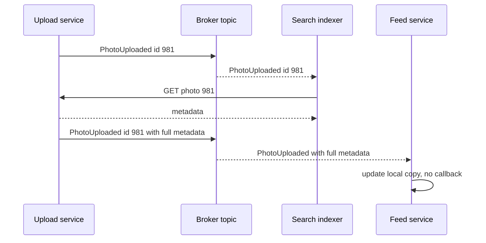

**Reading the diagram.** In the first exchange (event notification), the upload service publishes a thin event; the broker delivers it asynchronously to the search indexer, which makes a synchronous HTTP call back to the upload service for details. The upload service is therefore still on the indexer's critical path, and a burst of events becomes a burst of callbacks. In the second exchange (event-carried state transfer), the event carries the metadata; the feed service updates its own storage without calling back. Failure points: the callback path fails when the upload service is down; the fat-event path fails when subscribers depend on fields the publisher later changes. Scaling: fat events remove callback load but enlarge every message and every subscriber's storage.

**Choose** event notification when payloads are large or sensitive, when subscribers need the *current* state rather than the state at event time, or when few subscribers need details. **Choose** event-carried state transfer when many subscribers need the same data, when you want subscribers to keep working while the publisher is down, and when the data is small. In both cases the event schema is a public API: version it, add fields compatibly, and validate it with a schema registry (§8.9.3 covers schema evolution and compatibility). The CNCF **CloudEvents** specification standardizes common envelope attributes (`id`, `source`, `type`, `time`, `subject`) so events can cross brokers and organizations [CNCF CloudEvents 2019].

::: mistake
**"Events should be named after what the receiver must do."** `SendWelcomeEmail` published to a topic is a command in disguise; the publisher still knows its receiver. Name events after facts in the publisher's own domain (`AccountCreated`) and let the email service decide.
:::

## 30.7 Event brokers

The ideas so far are broker-neutral. Real brokers package them differently, and the packaging decides what is easy. This section describes four widely used brokers as of 2026; Kafka, the fifth, is introduced in §30.12 and covered fully in Chapter 31. Product limits change often, so treat every number here as "as of 2026" and confirm it in current documentation before relying on it.

### 30.7.1 RabbitMQ and the AMQP 0-9-1 model

RabbitMQ is an open-source broker, written in Erlang, that implements the **AMQP 0-9-1** protocol (and, since RabbitMQ 4.0, AMQP 1.0 natively, plus MQTT and STOMP). Its central idea is that producers never write to queues directly. They publish to an **exchange** with a **routing key**; the exchange routes copies to every queue whose **binding** matches; consumers read from queues [RabbitMQ Docs: AMQP Concepts]. Routing is therefore configuration, not code.

**Table 30.5 — RabbitMQ exchange types.**

| Exchange type | Routing rule | Typical use |
|---|---|---|
| Direct | Binding key equals routing key exactly | Task queues by job type; the default exchange routes to the queue named by the key |
| Topic | Pattern over dot-separated words: `*` matches one word, `#` matches zero or more | `photo.*.uploaded`, `audit.#` |
| Fanout | Ignores the key; copies to every bound queue | Broadcast to all subscribers |
| Headers | Matches message header values (`x-match` all or any) | Routing on several attributes |

**Figure 30.6 — The AMQP 0-9-1 model: exchanges, bindings and queues.**

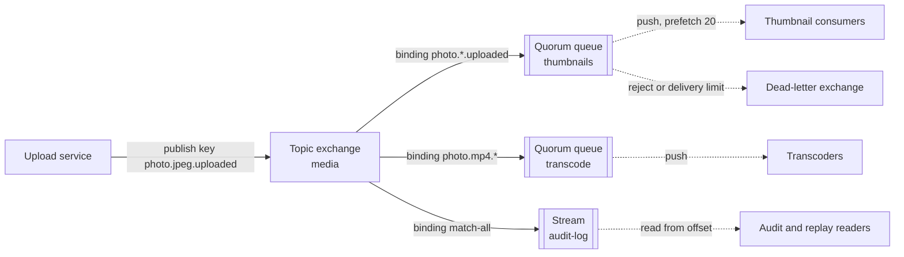

**Reading the diagram.** The upload service publishes over AMQP to the `media` topic exchange with routing key `photo.jpeg.uploaded`. The exchange evaluates each binding: the key matches `photo.*.uploaded` and the match-all binding `#`, so copies go to the `thumbnails` quorum queue and the `audit-log` stream but not to `transcode`. Consumers receive from queues asynchronously; RabbitMQ pushes up to the **prefetch** count of unacknowledged messages per consumer (set with `basic.qos`). Storage lives in queues and streams, not exchanges. Messages rejected without requeue, expired, or over a delivery limit are republished to a **dead-letter exchange** (§30.11). Failure points: publishing to an exchange with no matching binding silently drops the message unless the publisher sets the `mandatory` flag or the exchange has an alternate exchange. Scaling: one queue's throughput is bounded by the node hosting its leader, so high throughput comes from many queues spread across nodes.

**Reliability on both sides.** **Publisher confirms** make the broker acknowledge each published message once it is safely stored (for quorum queues, once a majority of replicas has it); without them a publisher cannot know whether a message survived a broker crash. **Consumer acknowledgments** (`basic.ack`, `basic.nack`, `basic.reject`) work as in §30.4 [RabbitMQ Docs: Confirms].

**Queue types.** RabbitMQ offers three, as of 2026:

1. **Classic queues** — a single node's queue, now unreplicated: classic queue mirroring was deprecated and then removed in RabbitMQ 4.0.
2. **Quorum queues** — replicated with Raft (§26.7) across, typically, three or five nodes. A publish is confirmed when a majority stores it, and a leader failure elects a new leader without losing confirmed messages. Quorum queues track a per-message delivery count and support a **delivery limit**, after which a message is dead-lettered or dropped [RabbitMQ Docs: Quorum Queues]. They are the recommended type for data that must survive node failures.
3. **Streams** — introduced in RabbitMQ 3.9, an append-only, replicated log in which consuming does *not* remove messages. Consumers attach at an offset (first, last, next, or a timestamp), several consumers can read the same data independently, and retention is by size or age. **Super streams** partition one logical stream across several streams [RabbitMQ Docs: Streams]. Streams bring Kafka-like replay to RabbitMQ.

### 30.7.2 Amazon SQS and SNS

**Amazon SQS** is a fully managed queue service: there are no brokers to run, and you pay per request. It offers two queue types [AWS Docs: SQS]:

- **Standard queues** — at-least-once delivery, *best-effort* ordering, and a nearly unlimited number of API calls per second. Occasionally a message is delivered twice or out of order.
- **FIFO queues** — strict ordering *within a message group* and deduplication of sends: a message sent again with the same **deduplication ID** (or the same body, with content-based deduplication) within a 5-minute interval is accepted but not enqueued twice. Throughput is quota-limited (300 API calls per second per action without batching in the basic mode; much higher in high-throughput mode, varying by region).

The key FIFO concept is the **message group ID**. Messages with the same group ID are delivered in order and *one batch at a time*: while any message of a group is in flight, SQS returns no later message from that group. Different groups proceed in parallel, so the group ID is both the unit of ordering and the unit of parallelism.

**Figure 30.7 — SQS FIFO message groups: ordered within a group, parallel across groups.**

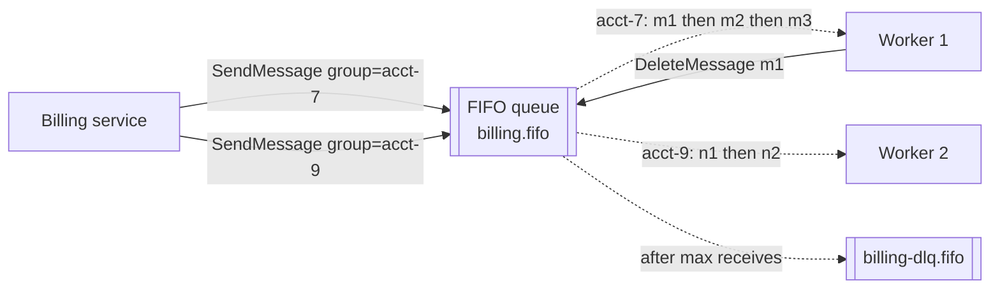

**Reading the diagram.** The billing service sends messages with a group ID per account. SQS hands account 7's messages to worker 1 strictly in order, releasing m2 only after m1 is deleted or its visibility timeout expires; account 9's messages flow to worker 2 in parallel. All calls are synchronous HTTPS API calls; delivery is pull-based. Storage is inside SQS, replicated across availability zones. Failure points: a message that keeps failing blocks *its group* (head-of-line blocking) until it moves to the FIFO dead-letter queue; a hot group is limited to one consumer's speed (§30.9). Scaling: more groups, not more workers, is what raises a FIFO queue's parallelism.

Other SQS behaviors worth knowing: long polling up to 20 s per `ReceiveMessage`; batches of up to 10 messages per call; per-message delays up to 15 minutes; retention from 60 s to 14 days; a **redrive policy** with `maxReceiveCount` that moves a message to a dead-letter queue (§30.11); and, since 2025, *fair queues*, in which standard queues use the message group ID to stop one noisy tenant's backlog from delaying the others [AWS Docs: SQS].

**Amazon SNS** is the managed pub/sub companion: a topic delivers to SQS queues, AWS Lambda functions, HTTP/S endpoints, email, SMS and mobile push. Subscriptions can carry **filter policies** on message attributes or payload fields, and each subscription can have its own dead-letter queue for deliveries that exhaust their retries. **SNS FIFO topics** preserve per-group order and deduplication when fanning out to SQS queues [AWS Docs: SNS]. SNS-to-SQS fan-out (Figure 30.4) is the AWS idiom for "publish once, many durable consumers".

::: industry
**Amazon SQS.** SQS became generally available in 2006 and is one of the oldest AWS services. Its design choice — a standard queue that gives up strict ordering and exactly-once delivery in exchange for essentially unlimited scale — pushed a generation of engineers to write idempotent consumers, and the later FIFO type made the ordering-versus-throughput trade-off an explicit per-queue choice [AWS Docs: SQS].
*Evidence: Primary* — [AWS Docs: SQS]
:::

### 30.7.3 Google Cloud Pub/Sub

Google Cloud Pub/Sub is a global, fully managed service that unifies topics and queues in one model: a **topic** fans out to any number of **subscriptions**, and each subscription is a durable queue shared by its subscribers [Google Cloud Docs: Pub/Sub].

**Figure 30.8 — Google Cloud Pub/Sub: topics, subscriptions and delivery modes.**

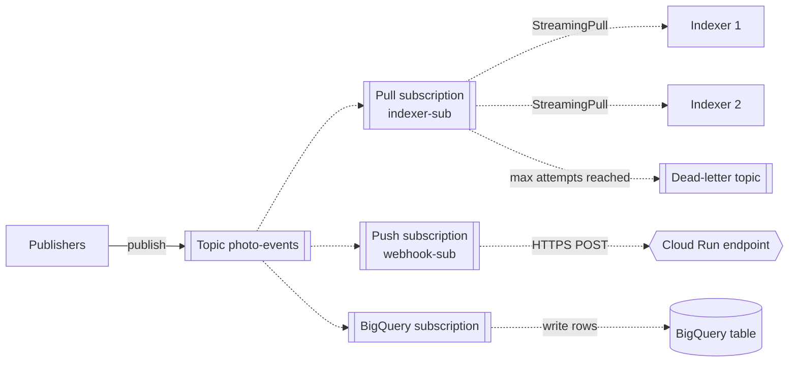

**Reading the diagram.** Publishers send to a topic; every message is copied to all three subscriptions (fan-out). The indexer subscription is **pull**: two indexer instances hold StreamingPull connections and share its messages (competing consumers). The webhook subscription is **push**: Pub/Sub POSTs each message over HTTPS and treats a success status as the acknowledgment. The **BigQuery subscription** writes messages directly into a table, a storage boundary with no consumer code. All delivery is asynchronous; each subscription keeps its own unacknowledged backlog. Failure points: a message that is not acknowledged within the ack deadline is redelivered; after a configured number of attempts it goes to a dead-letter topic. Scaling is automatic; the main levers are the number of subscriber instances and flow-control settings.

Features as of 2026: an ack deadline from 10 s (default) to 600 s, extended automatically by client libraries; retention of unacknowledged messages up to 7 days per subscription and, optionally, up to 31 days on the topic; **seek** to a timestamp or snapshot for replay; **ordering keys**, which deliver messages with the same key in publish order when the subscription enables ordering; **exactly-once delivery** for pull subscriptions within a region, which guarantees that a successfully acknowledged message is not redelivered; **dead-letter topics** with 5–100 maximum delivery attempts; and retry policies with exponential backoff [Google Cloud Docs: Pub/Sub].

### 30.7.4 Apache Pulsar

Apache Pulsar, created at Yahoo and an Apache top-level project since 2018, separates **serving** from **storage** [Apache Pulsar Docs]:

- **Brokers** are stateless. Each topic is owned by one broker at a time, which accepts publishes, dispatches to consumers and caches recent entries.
- **Apache BookKeeper** stores the data. A topic is a sequence of **ledgers** (segments); each ledger is written to an **ensemble** of $E$ storage nodes called **bookies**, with each entry written to $Q_w$ of them and acknowledged after $Q_a$ confirm (for example $E = 3$, $Q_w = 3$, $Q_a = 2$). When a ledger closes, a new one may be placed on different bookies [Junqueira et al. 2013].
- A **metadata store** (ZooKeeper, or alternatives in newer releases) holds topic ownership and ledger lists.

**Figure 30.9 — Pulsar: stateless brokers over BookKeeper segment storage.**

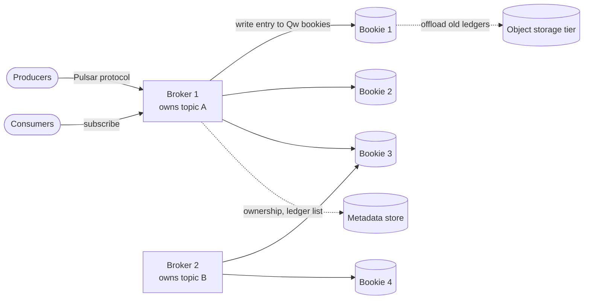

**Reading the diagram.** Producers and consumers connect to the broker that owns their topic. Broker 1 writes each entry synchronously to $Q_w$ bookies and confirms to the producer after $Q_a$ acknowledgments; topic B's ledgers sit on a different set of bookies. Ownership and ledger metadata live in the metadata store (dotted: read and updated asynchronously relative to the data path). Sealed ledgers can be offloaded to object storage (**tiered storage**). Failure points: if broker 1 dies, another broker takes ownership of topic A in seconds without copying data, because the data is in BookKeeper; if a bookie dies, its ledgers are re-replicated from the surviving copies. Scaling: add brokers for serving capacity and bookies for storage independently.

Pulsar supports both queueing and streaming through **subscription types**: *exclusive* and *failover* (one active consumer, ordered, stream-like), *shared* (competing consumers, queue-like) and *key_shared* (competing consumers with per-key ordering). Each subscription is a durable **cursor** over the topic, with individual acknowledgments, negative acknowledgments, a redelivery count, retry-letter and dead-letter topics in the clients, and built-in geo-replication between clusters [Apache Pulsar Docs].

::: industry
**DistributedLog at Twitter.** Twitter built DistributedLog, a replicated log service on BookKeeper, to serve as durable storage for its messaging and database replication workloads; the design segments each log into BookKeeper ledgers so that serving and storage scale separately — the same architecture Pulsar uses [Guo et al. 2017].
*Evidence: Primary* — [Guo et al. 2017]
:::

## 30.8 Delivery guarantees

::: definition
**Definition — Delivery guarantees.** **At-most-once**: each message is processed zero or one times; failures lose messages but never duplicate them. **At-least-once**: each message is processed one or more times; failures cause duplicates but never loss. **Exactly-once** (more precisely **effectively-once**): the *observable effect* of processing is as if each message were processed exactly once, even though delivery may happen more than once.
:::

The guarantee is decided by **when the consumer acknowledges relative to its side effect**, and by whether the producer retries sends:

- Acknowledge, then process → at-most-once. A crash between the two loses the message.
- Process, then acknowledge → at-least-once. A crash between the two causes redelivery of a message whose effect already happened.
- Process idempotently, then acknowledge → effectively-once. Redeliveries happen, but the second processing changes nothing.

There is no fourth option in which the broker alone delivers each message exactly once to an arbitrary side effect: the consumer's write to its database and its acknowledgment to the broker are two different systems, and one can succeed while the other fails (the two generals problem, §24.3.3). "Exactly-once" features narrow the window rather than close it.

### 30.8.1 Where duplicates come from

**Figure 30.10 — Three sources of duplicates.**

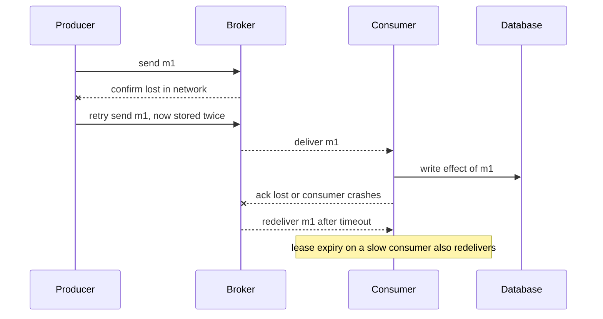

**Reading the diagram.** First, the *producer* sends m1, the broker stores it, but the confirmation is lost; the producer cannot distinguish this from a lost send, retries, and the broker stores a second copy. Second, the *consumer* writes m1's effect to its database, then crashes or loses the acknowledgment; the broker redelivers m1 after the visibility timeout. Third (the note), a lease that expires while a slow consumer is still working hands the message to a second consumer (Figure 30.3). Solid arrows are synchronous calls; crossed arrows are failed messages. The storage boundary that matters is the consumer's database: it already holds m1's effect when the duplicate arrives. Rebalancing in partitioned logs is a fourth source (Chapter 31).

::: formula
**Expected duplicates under at-least-once delivery**

$$E[\text{deliveries}] = \frac{1}{1 - p}, \qquad r_{\text{dup}} = \lambda \cdot \frac{p}{1 - p}$$

| Symbol | Meaning | Units |
|---|---|---|
| $p$ | Probability that a processed delivery is not successfully acknowledged (crash, lost ack, lease expiry), independent per attempt | dimensionless |
| $E[\text{deliveries}]$ | Mean deliveries per message until one is acknowledged | deliveries |
| $\lambda$ | Message rate | messages/s |
| $r_{\text{dup}}$ | Rate of duplicate processings | duplicates/s |
:::

::: example
**Worked example — How rare is rare?** A notification consumer handles $\lambda = 10{,}000$ messages/s; one delivery in a thousand ends without an effective acknowledgment ($p = 0.001$).

1. $E[\text{deliveries}] = 1 / 0.999 = 1.001$.
2. $r_{\text{dup}} = 10{,}000 \times 0.001 / 0.999 \approx 10$ duplicates per second.
3. Per day: $10 \times 86{,}400 \approx 864{,}000$ duplicate notifications.

**Interpretation.** A 0.1% failure rate sounds negligible but produces nearly a million duplicates a day at this scale. **Engineering implication.** Every at-least-once consumer must be idempotent: record processed message IDs (or business keys) in the same transaction as the effect, or make the effect naturally idempotent (an upsert, a "set status to SHIPPED"). The full design — key scope, storage, retention and concurrency — is in §22.15; consumer patterns are in §32.10.
:::

**Table 30.6 — Delivery guarantees compared.**

| Guarantee | Mechanism | Loses messages? | Duplicates? | Use for |
|---|---|---|---|---|
| At-most-once | Ack before processing; no producer retries | Yes, on failure | No | Metrics samples, live presence |
| At-least-once | Ack after processing; producer retries | No | Yes, on failure | The default for business work |
| Effectively-once | At-least-once plus idempotent or transactional processing | No | Delivered, but without repeated effect | Payments, inventory, counters |

Broker features help at specific boundaries: SQS FIFO deduplicates *sends* within 5 minutes; Pub/Sub exactly-once delivery prevents redelivery after a successful acknowledgment; Kafka's idempotent producer and transactions make read-process-write *within Kafka* atomic (§31.11). None of them can make your consumer's call to a payment provider or an email service happen once; only idempotency at that boundary can, and §32.9 discusses the limits [Kleppmann 2017, ch. 11; Helland 2007].

::: mistake
**"We use a broker with exactly-once delivery, so our consumer need not be idempotent."** Broker-level guarantees stop at the broker. A consumer that sends an email and then crashes before acknowledging will send it again on redelivery, whatever the broker promised.
:::

## 30.9 Ordering

::: definition
**Definition — Message ordering.** **Global (total) ordering**: all consumers observe all messages in one sequence. **Per-key (partial) ordering**: messages that share a key — an account, an order, a device — are processed in send order, while messages with different keys may be processed in any relative order.
:::

Global ordering requires a single sequence and, in effect, a single consumer at a time: its throughput is that of one consumer. Almost no business process needs it. What it needs is per-key ordering: `OrderPlaced` before `OrderCancelled` *for the same order*. Brokers express the key differently — the SQS FIFO message group ID, the Pub/Sub ordering key, the Pulsar key in a key_shared subscription, the Kafka partition key (§31.5) — but the guarantee is the same: same key, same lane, one at a time.

### 30.9.1 What breaks ordering

Even a broker that stores messages in order can deliver them out of order to your code:

1. **Parallel consumers.** With competing consumers, m1 goes to a slow worker and m2 to a fast one; m2's effect lands first.
2. **Retries and redelivery.** m1 fails and is redelivered after its visibility timeout, by which time m2 has been processed. Kleppmann notes that combining load balancing with redelivery inevitably reorders messages [Kleppmann 2017, ch. 11].
3. **Producer retries.** The producer sends m1, the confirmation times out, it sends m2, then retries m1: the broker now holds m2 before m1. (Kafka's idempotent producer prevents this within a partition; §31.6.)
4. **Multiple producers.** Two instances publishing events for the same key have no common clock; "send order" is undefined (§24.9).
5. **Dead-lettering.** A message moved to the DLQ and redriven later lands behind newer messages for its key.

**Figure 30.11 — How parallel consumers and redelivery reorder messages for one key.**

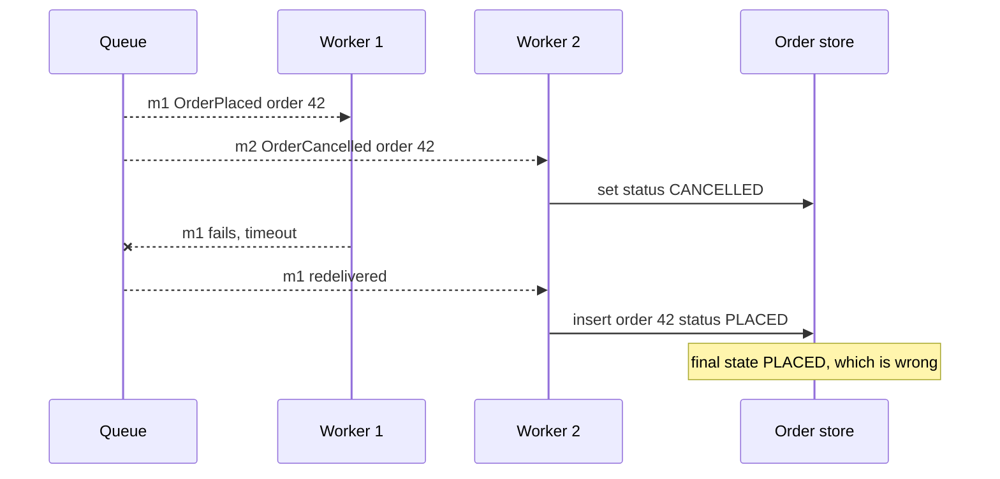

**Reading the diagram.** Both messages concern order 42 but go to different workers. Worker 2 applies the cancellation first; worker 1's attempt at m1 fails, and m1 is redelivered after the cancellation, so the order ends up "PLACED". Deliveries are asynchronous; writes to the order store (the storage boundary) are synchronous. Fixes: route both messages through one ordered lane (same group or partition key), or make the consumer **order-tolerant** — store a per-order version or sequence number and reject updates older than the stored one, which also defends against the other causes above.

::: formula
**Throughput limit of per-key ordering**

$$X_{\text{key}} \le \frac{1}{S}, \qquad X_{\text{total}} \le \frac{\min(G, c)}{S}$$

| Symbol | Meaning | Units |
|---|---|---|
| $X_{\text{key}}$ | Maximum processing rate for one key (group) | messages/s |
| $S$ | Mean processing time per message | s |
| $X_{\text{total}}$ | Maximum processing rate for the queue | messages/s |
| $G$ | Number of keys with messages waiting | count |
| $c$ | Total consumer slots (instances × concurrency) | count |
:::

::: example
**Worked example — A hot account in a FIFO queue.** Billing events are grouped by account; $S = 50$ ms; there are $c = 200$ consumer slots and thousands of active accounts.

1. Per account: $X_{\text{key}} \le 1/0.05 = 20$ messages/s.
2. Queue: $X_{\text{total}} \le 200 / 0.05 = 4{,}000$ messages/s.
3. One large customer sends 50 messages/s. Its backlog grows by $50 - 20 = 30$ per second: after 10 minutes, 18,000 messages, which take $18{,}000 / 20 = 900$ s to process even after the burst stops.

**Interpretation.** Ordering turns a hot key into a single-threaded bottleneck that no amount of consumer scaling fixes. **Engineering implication.** Choose the narrowest key that preserves the invariant you need (order ID rather than customer ID), reduce $S$ for hot keys (batch updates per key), and monitor backlog per key or group, not only per queue.
:::

::: mistake
**"A FIFO queue guarantees the database sees updates in order."** It guarantees *delivery* order per group. If your consumer hands messages to a thread pool, or performs writes asynchronously, it reintroduces the reordering the broker removed.
:::

## 30.10 Retries and poison messages

::: definition
**Definition — Poison message.** A message that fails processing every time it is delivered — because it is malformed, refers to data that does not exist, or triggers a bug — and that, if redelivered indefinitely, wastes consumer capacity and (in ordered lanes) blocks every message behind it.
:::

Consumer failures come in two kinds, and they need opposite treatment. **Transient** failures — a downstream timeout, a throttled API, a database failover — succeed if you wait and retry. **Permanent** failures — a corrupt JPEG, a schema violation, a reference to a deleted user — fail identically on every attempt. A good consumer retries the first kind with backoff and stops retrying the second kind quickly.

1. **Classify the error.** Treat validation and parsing errors as permanent: send the message to the dead-letter queue (or an "invalid message channel" [Hohpe and Woolf 2003]) on the first attempt. Treat timeouts, 429s and 5xx responses as transient.
2. **Back off.** Retrying a transient failure immediately just repeats it, and a fleet of consumers retrying together hammers the recovering dependency. Use exponential backoff with jitter (§22.12). Brokers provide the delay in different ways: change the message's visibility timeout to the backoff delay (SQS), negatively acknowledge with a retry policy (Pub/Sub, Pulsar), or republish to delay or retry topics (the common Kafka pattern, below).
3. **Cap attempts.** A **maximum receive count** (SQS `maxReceiveCount`, the quorum-queue delivery limit, Pub/Sub maximum delivery attempts, Pulsar `maxRedeliverCount`) bounds the damage. After it, the broker moves the message to a dead-letter queue (§30.11).

**Figure 30.12 — Lifecycle of a message with retries and a delivery limit.**

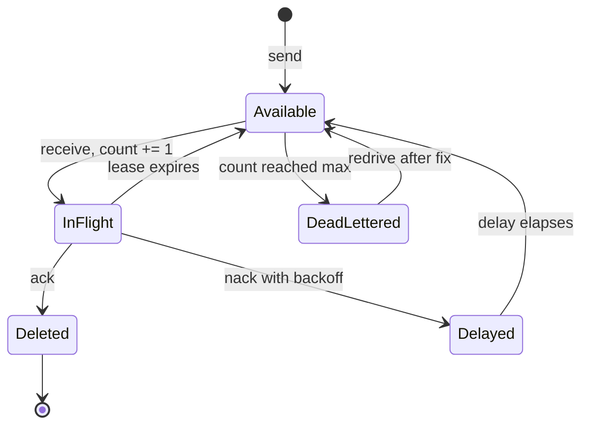

**Reading the diagram.** A sent message is *Available*. Each receive makes it *InFlight* and increments its receive count. An acknowledgment deletes it. A negative acknowledgment with a backoff, or a visibility change, makes it *Delayed*; a lease that expires without an ack makes it *Available* again immediately. When an available message has already been received the maximum number of times, the broker moves it to the dead-letter queue instead of delivering it. A redrive returns it to *Available*, usually with a reset count. All transitions occur inside the broker's storage; the failure points are the two paths back to *Available*, which are where duplicates and reordering arise.

::: formula
**Time and work before a poison message is dead-lettered**

$$T_{\text{DLQ}} \approx \sum_{k=1}^{R} \left(S_k + d_k\right), \qquad W_{\text{wasted}} = R \cdot \bar{S}$$

| Symbol | Meaning | Units |
|---|---|---|
| $T_{\text{DLQ}}$ | Time from first delivery until the message reaches the DLQ | s |
| $R$ | Maximum receive count (delivery limit) | deliveries |
| $S_k$ | Time attempt $k$ runs before failing (up to the visibility timeout if the consumer hangs or crashes) | s |
| $d_k$ | Delay before the next delivery (backoff; 0 if the lease simply expires) | s |
| $W_{\text{wasted}}$ | Consumer time spent on the message | slot-seconds |
| $\bar{S}$ | Mean time per failed attempt | s |
:::

::: example
**Worked example — A corrupt video in a FIFO lane.** The transcoding queue has visibility timeout $V = 60$ s and $R = 5$. A corrupt video makes the transcoder hang until its lease expires.

1. Each attempt costs the full lease: $S_k = 60$ s, $d_k = 0$. $T_{\text{DLQ}} \approx 5 \times 60 = 300$ s.
2. If the consumer instead detects the failure in 2 s and nacks with exponential backoff of 10, 20, 40, 80 and 160 s: $T_{\text{DLQ}} \approx 5 \times 2 + 310 = 320$ s — similar time, but only 10 s of consumer work instead of 300 s.
3. In a FIFO queue grouped by user, that user's other uploads wait behind the poison message for the whole 5 minutes.

**Interpretation.** Retries cost time and capacity, and in ordered lanes they cost *other messages'* latency. **Engineering implication.** Fail fast on permanent errors; use backoff for transient ones; keep $R$ small (3–5) for ordered queues and larger (10–20) for unordered queues whose dependencies have longer outages. RabbitMQ 4.0 made a delivery limit of 20 the default for quorum queues for exactly this reason [RabbitMQ Docs: Quorum Queues].
:::

::: industry
**Retry topics at Uber.** Uber's engineers describe a Kafka-based design in which a consumer that fails a message publishes it to a sequence of **retry topics** with increasing delays, each consumed by a retry consumer that waits until the message's delay has elapsed, and finally to a **dead-letter topic** for manual inspection. Failed messages therefore do not block the main topic's partitions, and the main consumers keep processing new messages [Xia 2018].
*Evidence: Primary* — [Xia 2018]
:::

::: mistake
**"Infinite retries guarantee eventual success."** They guarantee eventual success only for transient errors. For poison messages they guarantee wasted capacity forever and, in ordered lanes, a permanent stall.
:::

## 30.11 Dead-letter queues

### 30.11.1 Redrive, alerting and replay

::: definition
**Definition — Dead-letter queue (DLQ).** A separate queue or topic to which a broker or consumer moves messages that cannot be processed (delivery limit exceeded, rejected as invalid, expired), preserving them for inspection and later reprocessing instead of losing or endlessly retrying them [Hohpe and Woolf 2003, "Dead Letter Channel"].
:::

A DLQ is a hospital ward, not a graveyard. Its purpose is to get sick messages out of the way of healthy ones while keeping them safe until someone diagnoses and fixes the cause. That gives it three operational duties:

1. **Alerting.** Any message in a DLQ means something is broken. Alert on DLQ depth greater than zero (or on its rate of arrival for noisy domains) and on the age of its oldest message. A DLQ nobody watches converts errors into silent data loss, delayed by the retention period.
2. **Diagnosis.** Keep enough context to understand the failure: the original queue, the receive count, the timestamps and, ideally, the last error. RabbitMQ adds an `x-death` header recording the reason and source queue; Pulsar and Kafka retry patterns add headers; with SQS, consumers should log the error with the message ID before giving up.
3. **Redrive and replay.** After the bug is fixed or the missing data exists, move messages back to the source queue (SQS offers a managed DLQ redrive that moves messages back with a configurable rate; Pub/Sub messages can be republished from the dead-letter subscription; RabbitMQ messages can be shovelled back). Redriven messages arrive *behind* newer messages for the same key, so the consumer must tolerate reordering (§30.9). Retention matters: a message moved from a standard SQS queue keeps its original enqueue timestamp in the DLQ, so set the DLQ's retention longer than the source queue's [AWS Docs: SQS].

**Figure 30.13 — Retry, dead-letter and redrive flow.**

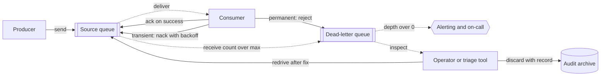

**Reading the diagram.** Messages flow from producer to source queue to consumer. The consumer acknowledges successes, negatively acknowledges transient failures with a backoff delay, and rejects permanent failures straight to the DLQ; the broker itself moves messages that exceed the receive count. The DLQ triggers an alert asynchronously and is inspected by an operator or triage tool, which either redrives messages to the source queue after a fix or discards them with a record in an audit archive (the storage boundary for deliberate drops). Failure points: an unmonitored DLQ, a DLQ with shorter retention than the source, and a redrive that re-poisons the consumer because the fix was not deployed. Scaling: redrive at a controlled rate so the backlog does not overload downstream services.

### 30.11.2 A runnable in-memory queue with visibility timeout and DLQ

The following program implements the mechanics of this chapter in about 100 lines plus tests: competing consumers, leases, receipts, acknowledgments, heartbeats, backoff via visibility changes, a maximum receive count, a dead-letter queue and redrive. It uses a fake clock so the tests can "wait" instantly. Run it with `python3`; it prints `all queue tests passed`.

```python
"""In-memory queue with visibility timeout, acks, redelivery and a dead-letter queue."""
import heapq
import itertools
from dataclasses import dataclass


class FakeClock:
    """A controllable clock so tests can 'wait' without sleeping."""
    def __init__(self):
        self.now = 0.0

    def __call__(self):
        return self.now

    def advance(self, seconds):
        self.now += seconds


@dataclass
class _Message:
    id: int
    body: str
    receive_count: int = 0
    receipt: str = ""      # receipt of the latest delivery; "" = never delivered
    version: int = 0       # bumps on every reschedule; stale heap entries are skipped


@dataclass(frozen=True)
class Delivery:
    receipt: str
    body: str
    receive_count: int


class StaleReceipt(Exception):
    """The message was acked already or redelivered under a newer receipt."""


class InMemoryQueue:
    def __init__(self, clock, visibility_timeout=30.0, max_receive_count=None, dlq=None):
        if max_receive_count is not None and dlq is None:
            raise ValueError("max_receive_count needs a dead-letter queue")
        self.clock, self.vt = clock, visibility_timeout
        self.max_receive_count, self.dlq = max_receive_count, dlq
        self._msgs = {}        # id -> _Message, for every message not yet acked
        self._heap = []        # (visible_at, seq, id, version): who becomes visible when
        self._seq = itertools.count()
        self._ids = itertools.count(1)

    def _make_visible_at(self, msg, t):
        msg.version += 1
        heapq.heappush(self._heap, (t, next(self._seq), msg.id, msg.version))

    def send(self, body, delay=0.0):
        msg = _Message(next(self._ids), body)
        self._msgs[msg.id] = msg
        self._make_visible_at(msg, self.clock() + delay)
        return msg.id

    def receive(self, max_messages=1):
        now, out = self.clock(), []
        while self._heap and self._heap[0][0] <= now and len(out) < max_messages:
            _, _, mid, version = heapq.heappop(self._heap)
            msg = self._msgs.get(mid)
            if msg is None or msg.version != version:
                continue                                  # acked or rescheduled
            if self.max_receive_count and msg.receive_count >= self.max_receive_count:
                del self._msgs[mid]                       # poison: move, don't deliver
                self.dlq.send(msg.body)
                continue
            msg.receive_count += 1
            msg.receipt = f"{mid}:{msg.receive_count}"    # new receipt per delivery
            self._make_visible_at(msg, now + self.vt)     # in flight until then
            out.append(Delivery(msg.receipt, msg.body, msg.receive_count))
        return out

    def _current(self, receipt):
        msg = self._msgs.get(int(receipt.split(":")[0]))
        if msg is None or msg.receipt != receipt:
            raise StaleReceipt(receipt)
        return msg

    def ack(self, receipt):
        del self._msgs[self._current(receipt).id]

    def change_visibility(self, receipt, timeout):
        """Extend a lease (heartbeat) or, with a delay, schedule a retry (nack)."""
        self._make_visible_at(self._current(receipt), self.clock() + timeout)

    def depth(self):
        return len(self._msgs)


def redrive(dlq, target, limit=None):
    """Move messages from a dead-letter queue back to a source queue."""
    moved = 0
    while limit is None or moved < limit:
        batch = dlq.receive(1)
        if not batch:
            return moved
        target.send(batch[0].body)
        dlq.ack(batch[0].receipt)
        moved += 1
    return moved


def test_queue():
    clock = FakeClock()
    dlq = InMemoryQueue(clock, visibility_timeout=60)
    q = InMemoryQueue(clock, visibility_timeout=30, max_receive_count=3, dlq=dlq)

    # 1. Competing consumers get different messages; ack deletes.
    q.send("resize 1"); q.send("resize 2")
    a, b = q.receive(1)[0], q.receive(1)[0]
    assert (a.body, b.body) == ("resize 1", "resize 2") and q.receive(1) == []
    q.ack(a.receipt); q.ack(b.receipt)
    assert q.depth() == 0

    # 2. A crash (no ack) hides the message until the timeout, then redelivers it.
    q.send("thumb 9")
    first = q.receive()[0]
    clock.advance(29); assert q.receive() == []
    clock.advance(1); second = q.receive()[0]
    assert second.body == "thumb 9" and second.receive_count == 2
    try:
        q.ack(first.receipt); raise AssertionError("stale receipt accepted")
    except StaleReceipt:
        pass                                      # the slow worker's ack is refused
    q.ack(second.receipt)

    # 3. A heartbeat keeps a long job invisible; a nack with delay is a backoff retry.
    q.send("transcode")
    d = q.receive()[0]
    for _ in range(4):
        clock.advance(20); q.change_visibility(d.receipt, 30)
        assert q.receive() == []
    q.change_visibility(d.receipt, 5)             # failed: retry in 5 s
    clock.advance(4); assert q.receive() == []
    clock.advance(1); d = q.receive()[0]; q.ack(d.receipt)

    # 4. A poison message moves to the DLQ on the receive after the 3rd delivery.
    q.send("corrupt.jpg")
    for attempt in (1, 2, 3):
        d = q.receive()[0]
        assert d.receive_count == attempt
        clock.advance(30)                         # consumer crashes each time
    assert q.receive() == [] and q.depth() == 0 and dlq.depth() == 1

    # 5. After a fix, redrive puts it back on the source queue.
    assert redrive(dlq, q) == 1 and dlq.depth() == 0
    d = q.receive()[0]
    assert d.body == "corrupt.jpg" and d.receive_count == 1
    q.ack(d.receipt)
    print("all queue tests passed")


if __name__ == "__main__":
    test_queue()
```

What to notice:

- **One heap for all timing.** Newly sent, delayed, and in-flight messages all sit in the heap keyed by the time they become visible. A redelivery is not a special code path: an in-flight message whose lease expires simply reaches the top of the heap again.
- **Lazy invalidation.** Acknowledging or rescheduling does not search the heap; it bumps the message's `version` (or deletes it), and `receive` skips heap entries whose version no longer matches.
- **A new receipt per delivery.** `ack` and `change_visibility` require the *latest* receipt, so a slow worker whose lease expired cannot delete a message that another worker now holds. (SQS has a weaker rule — a delete with an old receipt handle may succeed without deleting the message — so do not rely on stale handles there either.)
- **Dead-lettering happens on receive.** As in SQS, a message is moved when it becomes available after its last permitted delivery, not at the moment of failure.
- **What it leaves out:** durability, replication, per-group ordering and concurrency control. Adding a `group_id` that blocks later messages of a group while one is in flight is practical exercise 1.

::: recommendation
**DLQ checklist.** One DLQ per source queue (or per subscription), of the same type (FIFO for FIFO). Retention longer than the source's. An alert on depth greater than zero routed to the owning team. A runbook for triage, redrive and discard. A rate-limited redrive tool. A dashboard of DLQ arrivals by error class, because a sudden spike usually means a bad deploy rather than bad messages.
:::

## 30.12 Kafka vs RabbitMQ (and SQS, Pulsar)

### 30.12.1 Queues versus logs

Brokers fall into two families [Kleppmann 2017, ch. 11]. **Queue-style brokers** (RabbitMQ classic and quorum queues, SQS) track each message individually and delete it once acknowledged; consumers share work message by message, and replay is impossible once a message is gone. **Log-based brokers** (Kafka, Pulsar, RabbitMQ streams) append messages to a partitioned, retained log; a consumer is just a position (an **offset**) in each partition, so many consumer groups can read the same data independently and any of them can rewind and replay. Parallelism in a log is per partition: within a consumer group each partition is read by one consumer, which gives per-partition ordering for free but means a slow message holds up its whole partition.

**Apache Kafka**, created at LinkedIn [Kreps et al. 2011], is the dominant log-based broker. As of 2026 Kafka 4.x runs without ZooKeeper (metadata is managed by its own Raft-based KRaft quorum), and **share groups** (KIP-932, "Queues for Kafka"), introduced in the 4.x line, add queue-style consumption with per-message acknowledgment and delivery counts on top of the log. Chapter 31 covers partitions, replication, offsets, transactions and performance.

**Table 30.7 — Kafka, RabbitMQ, SQS and Pulsar compared (as of 2026).**

| | Kafka | RabbitMQ | Amazon SQS (+ SNS) | Apache Pulsar |
|---|---|---|---|---|
| What it is | Distributed, partitioned, replicated log | General-purpose broker with flexible routing | Fully managed queue (and topic) service | Log-based broker with separate storage layer |
| How it works | Append to partitions; consumers track offsets | Exchanges route to queues; per-message acks; quorum queues use Raft | HTTPS API; leases via visibility timeout | Stateless brokers over BookKeeper ledgers; durable cursors |
| Advantages | Very high throughput, replay, many independent readers, stream processing ecosystem | Rich routing, per-message acks, priorities, low latency, many protocols | No operations, elastic scale, pay per use, DLQ and redrive built in | Queue and stream semantics, independent scaling of serving and storage, geo-replication, tiered storage |
| Disadvantages | Per-partition head-of-line blocking; partition count limits parallelism; no per-message retry (until share groups) | Per-queue throughput bound by one node; large backlogs are costly; replay only with streams | AWS only; standard queues unordered and duplicate-prone; FIFO throughput quotas | Most moving parts (brokers, bookies, metadata store); smaller ecosystem |
| Performance | Hundreds of MB/s per broker with batching; latency from milliseconds | Low-millisecond latency; tens of thousands of msg/s per queue (order of magnitude) | Effectively unlimited for standard; per-group serial for FIFO; tens of ms per call | Comparable to Kafka; low publish latency |
| Operational complexity | Medium–high (fewer parts since KRaft) | Medium | Very low | High |
| Cost | Infrastructure, or managed services | Infrastructure, or managed services | Per request and per GB; cheap at low volume, can be costly at sustained high volume | Infrastructure, or managed services |
| Use cases | Event streaming, CDC, logs and metrics pipelines, event sourcing | Task queues, RPC over messaging, complex routing | Decoupling AWS services, job queues, fan-out | Multi-tenant platforms, mixed queue and stream workloads, geo-distributed messaging |
| Choose when | You need retention, replay and many consumers of the same high-volume stream | You need per-message routing, acks and priorities on moderate volume | You are on AWS and want zero broker operations | You need both semantics, multi-tenancy or geo-replication and can operate it |

Performance figures are orders of magnitude, not benchmarks: real numbers depend on message size, batching, replication, acknowledgment settings and hardware, so measure your own workload. Google Cloud Pub/Sub sits in the same niche on Google Cloud as SQS plus SNS on AWS, with fan-out and per-subscription queues in one service.

::: recommendation
**A default decision path.** Start with the question "does more than one consumer need the *same* data, now or later?" If yes, or if you need replay, use a log (Kafka, Pulsar, RabbitMQ streams, or Pub/Sub with retention). If no, and the work is a task to be done once, use a queue (SQS, RabbitMQ quorum queues). Then let operations decide: on a cloud provider with no platform team, prefer the managed service; at sustained high volume with a platform team, self-managed or managed Kafka is usually cheaper per message.
:::

::: mistake
**"Kafka is a faster RabbitMQ."** They answer different questions. Kafka retains an ordered log that many readers replay; RabbitMQ routes and tracks individual messages until each is acknowledged. Using Kafka as a task queue with slow, variable jobs suffers head-of-line blocking per partition; using RabbitMQ classic queues as a long-term event archive suffers memory and disk pressure.
:::

## 30.13 Summary and revision notes

::: summary
- A **broker** removes time, space and synchronization coupling. A synchronous chain's availability is $\prod A_i$ ($0.999^5 \approx 99.5\%$); a queued design's is front service × broker. Keep synchronous only what the caller needs now.
- **Queues** deliver each message to one of many **competing consumers**. Messages are leased (visibility timeout, ack deadline) and deleted on **acknowledgment**; size the lease as $b \cdot S_{\text{tail}} + \delta$ or use heartbeats.
- Size consumers with Little's Law, $N = \lceil \lambda S / (k\rho) \rceil$; backlogs drain at the surplus, $B/(\mu - \lambda)$. Alert on the age of the oldest message.
- **Pub/sub** copies each message to every subscription; each subscription is usually a queue. Durable subscriptions retain messages while consumers are away and cost storage when abandoned.
- **Commands** ask one receiver to act; **events** state facts to unknown subscribers. Event notification is thin and invites callbacks; event-carried state transfer is fat and self-sufficient.
- **RabbitMQ**: exchanges (direct, topic, fanout, headers), bindings, quorum queues (Raft), streams. **SQS**: standard (at-least-once, best-effort order) or FIFO (message groups, 5-minute deduplication). **Pub/Sub**: topics, pull/push/BigQuery subscriptions, ordering keys, exactly-once delivery. **Pulsar**: stateless brokers over BookKeeper ledgers, four subscription types.
- Delivery: at-most-once (ack first), at-least-once (ack after), effectively-once (at-least-once + idempotent processing, §22.15). Duplicates come from producer retries, lost acks and expired leases; at 0.1% they are $\lambda p/(1-p)$ per second.
- Ordering is per key; parallel consumers, redelivery, producer retries and redrive break it. One key processes at most $1/S$ messages per second.
- Classify failures; back off transient ones; cap deliveries; dead-letter poison messages; alert on any DLQ depth; redrive after the fix.
- Queues (RabbitMQ, SQS) track messages; logs (Kafka, Pulsar, RabbitMQ streams) retain and replay them.
:::

## 30.14 Knowledge checkpoint

1. Name the three kinds of decoupling a broker provides.
2. Six services each with availability 0.998 are called in series. What is the chain's availability?
3. What happens to an SQS message whose consumer crashes before deleting it?
4. A queue receives 1,200 messages/s, processing takes 250 ms, each consumer runs 8 concurrent jobs at 75% target utilization. How many consumers?
5. Those consumers stop for 20 minutes, and capacity after restart is 1,800 messages/s. How long does draining take?
6. What is the difference between a durable and an ephemeral subscription?
7. Is `ResizeThumbnail` an event or a command? Why?
8. In a RabbitMQ topic exchange, does the routing key `photo.png.uploaded` match `photo.#` and `*.uploaded`?
9. Which three mechanisms produce duplicates in an at-least-once system?
10. Why does an SQS FIFO queue's parallelism depend on the number of message groups?
11. A poison message hangs its consumer until a 45 s lease expires, with a maximum receive count of 4. Roughly when does it reach the DLQ?
12. Why should a DLQ's retention exceed its source queue's?

<details><summary>Answers</summary>

1. Time, space and synchronization decoupling [Eugster et al. 2003].
2. $0.998^6 \approx 0.988$, about 8.6 hours of unavailability per 30-day month.
3. It stays invisible until the visibility timeout expires, then becomes visible and is redelivered with an incremented receive count.
4. $L = 1{,}200 \times 0.25 = 300$; $300 / (8 \times 0.75) = 50$ consumers.
5. $B = 1{,}200 \times 1{,}200 = 1.44$ million; surplus $600$/s; $T = 2{,}400$ s = 40 minutes.
6. A durable subscription retains messages while the subscriber is disconnected; an ephemeral one exists only while it is connected, so messages sent in between are lost to it.
7. A command: it is imperative and addressed to a receiver with a known capability. The event would be `PhotoUploaded`.
8. Yes to `photo.#` (`#` matches zero or more words). No to `*.uploaded`: `*` matches exactly one word, but the key has three.
9. Producer retries after a lost confirm; a consumer crash or lost acknowledgment after the side effect; a lease expiring while a slow consumer still works.
10. Messages of one group are delivered one batch at a time, in order; only different groups can be processed concurrently.
11. About $4 \times 45 = 180$ s after the first delivery, when it next becomes available.
12. Because the message's age may count from its original enqueue time; a shorter DLQ retention can delete it before anyone inspects it.
</details>

## 30.15 Interview questions

### Basic

**Q1. When would you use a message queue instead of a synchronous API call?** **Answer.** When the caller does not need the result to continue (sending email, generating thumbnails), when the receiver may be down or slower than the producer, or when bursts must be smoothed. Keep it synchronous when the user needs the answer now (authorization, search). Mention the availability product, backlog monitoring and idempotent consumers.

**Q2. Explain the visibility timeout.** **Answer.** A received message is hidden for a lease period rather than deleted. If the consumer deletes it in time, it is gone; if not, it reappears for another consumer. Too short causes duplicates for slow consumers; too long delays recovery after crashes; heartbeats extend the lease for long jobs.

### Intermediate

**Q3. Your queue's depth has grown for an hour. Walk through the diagnosis.** **Answer.** Compare arrival and completion rates; check consumer count, errors and processing time per message (a slow dependency raises $S$ and so the required $N$); look for poison messages consuming retries and for a hot key in ordered lanes; check DLQ arrivals. Mitigate by scaling consumers within downstream limits, shedding optional work, and fixing the cause; estimate drain time with $B/(\mu-\lambda)$.

**Q4. How do you guarantee an order is never charged twice when payment requests arrive by queue?** **Answer.** Accept that delivery is at-least-once. Give each request an idempotency key (order ID plus attempt), record it in the same transaction as the charge record, and pass it to the payment provider's idempotency API; on redelivery, look up the stored outcome and acknowledge. Order-sensitive steps go through a per-order lane or check a version number.

### Advanced

**Q5. Design the messaging for PhotoShare's upload pipeline at 2,000 uploads/s.** **Answer.** The upload service writes metadata and publishes `PhotoUploaded` (event-carried state: IDs, URLs, type) to a topic, ideally via an outbox (§32.5). Subscriptions per consumer: thumbnails (about 43 workers, $V = 40$ s), moderation, search, notifications (video-only filter for transcoding). At-least-once with idempotent writes keyed by photo ID. Per-photo ordering is unnecessary except for edits and deletes, which carry versions. Retries with backoff, $R = 5$, a DLQ per subscription with alerts, autoscaling on age of oldest message, retention of days.

**Q6. Kafka or RabbitMQ for a job system with jobs lasting 100 ms to 30 minutes?** **Answer.** Highly variable job lengths suit per-message leasing: RabbitMQ quorum queues (low prefetch, per-message acks, delivery limit, DLX) or SQS with heartbeats. In classic Kafka consumer groups a 30-minute job blocks its partition, and parallelism is capped by partitions; share groups or a separate job queue fed from Kafka avoid that. Choose Kafka if the same events also feed analytics and need replay.

## 30.16 Practical exercises

1. Add FIFO message groups to the in-memory queue: while any message of a group is in flight, `receive` must skip later messages of that group. Test that two groups proceed in parallel and that a poison message blocks only its group until dead-lettered.
2. Write a consumer loop around the queue that classifies errors as transient or permanent, retries transient ones with full-jitter backoff via `change_visibility`, and rejects permanent ones to the DLQ.
3. Simulate 2,000 messages/s with exponentially distributed processing times and measure duplicate rates for visibility timeouts of 1, 2 and 5 times the mean batch time.
4. Set up RabbitMQ locally with a topic exchange, a quorum queue with a delivery limit of 3 and a dead-letter exchange; send a message the consumer always rejects and inspect its `x-death` header.

## 30.17 Design challenges

1. **Order notifications for a marketplace.** 20,000 order events per second at peak feed email, SMS, push, analytics and a partner webhook. Choose broker, topology, delivery guarantee, ordering key, retry and DLQ policy, and size each consumer pool.
2. **Migrating from synchronous to asynchronous.** A checkout makes seven synchronous calls with 99.9% availability each. Decide which calls stay synchronous, compute the new availability, and design how the user learns of failures that now happen after checkout returns.

## 30.18 References

1. Amazon Web Services. *Amazon Simple Queue Service Developer Guide* (visibility timeout, FIFO queues, dead-letter queues and redrive, quotas). https://docs.aws.amazon.com/AWSSimpleQueueService/latest/SQSDeveloperGuide/ [AWS Docs: SQS]
2. Amazon Web Services. *Amazon Simple Notification Service Developer Guide* (fan-out, filter policies, FIFO topics). https://docs.aws.amazon.com/sns/latest/dg/ [AWS Docs: SNS]
3. Apache Software Foundation. *Apache Pulsar Documentation: Architecture Overview; Messaging Concepts*. https://pulsar.apache.org/docs/ [Apache Pulsar Docs]
4. CNCF. *CloudEvents Specification v1.0*. 2019. https://cloudevents.io/ [CNCF CloudEvents 2019]
5. Eugster, P. T., Felber, P. A., Guerraoui, R., Kermarrec, A.-M. "The Many Faces of Publish/Subscribe." *ACM Computing Surveys* 35(2):114–131, 2003.
6. Fowler, M. "What do you mean by 'Event-Driven'?" martinfowler.com, 2017. https://martinfowler.com/articles/201701-event-driven.html
7. Google Cloud. *Pub/Sub Documentation* (subscriptions, ack deadlines, ordering, exactly-once delivery, dead-letter topics). https://cloud.google.com/pubsub/docs [Google Cloud Docs: Pub/Sub]
8. Guo, S., Dhamankar, R., Stewart, L. "DistributedLog: A High Performance Replicated Log Service." *IEEE ICDE*, 2017.
9. Helland, P. "Life beyond Distributed Transactions: an Apostate's Opinion." *CIDR*, 2007.
10. Hohpe, G., Woolf, B. *Enterprise Integration Patterns: Designing, Building, and Deploying Messaging Solutions*. Addison-Wesley, 2003.
11. Junqueira, F. P., Kelly, I., Reed, B. "Durability with BookKeeper." *ACM SIGOPS Operating Systems Review* 47(1), 2013.
12. Kleppmann, M. *Designing Data-Intensive Applications*, ch. 11. O'Reilly Media, 2017.
13. Kreps, J., Narkhede, N., Rao, J. "Kafka: A Distributed Messaging System for Log Processing." *NetDB Workshop*, 2011.
14. RabbitMQ. *AMQP 0-9-1 Model Explained*. https://www.rabbitmq.com/tutorials/amqp-concepts [RabbitMQ Docs: AMQP Concepts]
15. RabbitMQ. *Consumer Acknowledgements and Publisher Confirms*. https://www.rabbitmq.com/docs/confirms [RabbitMQ Docs: Confirms]
16. RabbitMQ. *Quorum Queues*. https://www.rabbitmq.com/docs/quorum-queues [RabbitMQ Docs: Quorum Queues]
17. RabbitMQ. *Streams and Super Streams*. https://www.rabbitmq.com/docs/streams [RabbitMQ Docs: Streams]
18. Slack Engineering. "Scaling Slack's Job Queue." Slack Engineering Blog, 2020. https://slack.engineering/scaling-slacks-job-queue/ [Slack Engineering 2020]
19. Xia, N. "Building Reliable Reprocessing and Dead Letter Queues with Apache Kafka." Uber Engineering Blog, 2018. [Xia 2018]
20. Apache Kafka. "KIP-932: Queues for Kafka." Kafka Improvement Proposals. https://cwiki.apache.org/confluence/display/KAFKA/KIP-932%3A+Queues+for+Kafka

## 30.19 Open verification items

- SQS figures as of 2026: FIFO quotas (300 calls/s basic; high-throughput mode by region); "fair queues" for standard queues (2025); DLQ enqueue-timestamp behavior for standard versus FIFO queues.
- RabbitMQ 4.0: removal of classic queue mirroring; default quorum-queue delivery limit of 20; consumer timeout default of 30 minutes.
- Pub/Sub limits: ack deadline 10–600 s; 7-day subscription and 31-day topic retention; 5–100 delivery attempts.
- Slack (2020): incident details (Redis memory exhaustion) and URL; Uber (Xia 2018) URL.
- KIP-932 share-group status in Kafka 4.x releases.
- Pulsar metadata-store alternatives (etcd, Oxia) by release.
