# Chapter 31 — Kafka Deep Dive

> **Level:** 3 · **Track:** A (Traditional) · **Estimated reading time:** 3 h

Chapter 30 introduced queues, publish/subscribe and delivery guarantees in general terms. This chapter takes one system apart: **Apache Kafka**, the distributed log built at LinkedIn in 2010–2011 that now sits at the center of most large event-driven architectures. Kafka is not "a queue with extra features" but a replicated, partitioned, append-only log, and nearly every behavior you will meet (per-partition ordering, consumers that rewind, durability that depends on three settings, exactly-once that stops at Kafka's edge) follows from that decision. You will follow a record from the producer's batch buffer to a consumer's committed offset and size partitions, disks and brokers with real arithmetic. Version-specific facts are stated **as of 2026** (Kafka 4.x).

## 31.1 Learning objectives

After this chapter you should be able to:

- Explain the log abstraction and why a shared, ordered, replayable log simplifies data integration.
- Describe a Kafka cluster in KRaft mode, the role of the controller quorum, and why ZooKeeper mode was removed.
- Size a topic's partition count from target throughput, and calculate how many keys move when the partition count changes.
- Configure a producer for throughput (batching, compression) and safety (`acks`, idempotence, in-flight limits), and explain each trade-off.
- Explain consumer groups, partition assignment, offsets and commit strategies, and derive at-least-once or at-most-once behavior from commit timing.
- Trace replication with ISR, log end offset, high watermark and leader epochs; choose `min.insync.replicas`; and explain what unclean leader election costs.
- Choose between time/size retention and log compaction.
- Explain Kafka transactions and `read_committed`, and state precisely where exactly-once ends.
- Compare eager, cooperative and KIP-848 rebalancing.
- Explain Kafka's throughput (sequential I/O, page cache, zero-copy, end-to-end batching) and estimate broker count, disk capacity, lag drain time and end-to-end latency.
- Place Kafka Streams, Kafka Connect and tiered storage in an architecture, and monitor a cluster.

## 31.2 Prerequisites

- Log-structured storage and compaction — §13.7 and §13.9 (a Kafka partition is a log-structured file set).
- Page cache, `mmap` and `fsync` — §6.6.6 and §6.14.3 (Kafka delegates caching and flushing to the OS).
- Sequential versus random I/O — §5.6 (the root of Kafka's speed).
- Hash partitioning and hot partitions — §14.6 and §14.10.
- Raft, ZooKeeper and fencing tokens — §26.7, §26.8 and §26.13 (KRaft, leader epochs and producer epochs are all fencing schemes).
- Primary–backup replication and failover — §27.4 and §27.11 (Kafka's ISR replication is a variant).
- Two-phase commit — §28.4 (Kafka transactions use it, §28.4.8).
- Idempotency keys and backpressure — §22.15 and §22.10.
- Messaging vocabulary — Chapter 30 (queues, pub/sub, delivery guarantees, ordering, dead-letter queues).
- Units: **KB/MB/GB/TB** are powers of ten in all estimates; **KiB/MiB/GiB** appear only where Kafka's defaults are powers of two (for example, 1 GiB segments). Network speeds are in bits per second: 25 Gb/s = 3.125 GB/s.

## 31.3 The log abstraction

### 31.3.1 What a log is

::: definition
**Definition — Log.** An append-only, totally ordered sequence of records. Each record is assigned a monotonically increasing integer position called its **offset** when it is appended. Records are never modified in place; readers read sequentially from any offset they choose.
:::

#### First-principles explanation

Think of a ship's logbook. Entries are written one after another, each line gets the next number, nobody erases a line, and anyone can read from line 1 or from line 9,000. Two readers can be at different places in the book at the same time without disturbing each other or the writer. If a reader loses its place, it only needs to remember one number.

A database's write-ahead log (§13.5) is a log hidden inside one machine; Raft's replicated log (§26.7) is a log copied across machines to agree on an order. Kafka exposes the same structure to applications, partitions it for scale and replicates it for durability.

#### Why does this exist?

At LinkedIn around 2010, dozens of systems needed the same data: page views, profile updates and metrics flowed into Hadoop, search indexes, the social graph, monitoring and recommendation services. Each pair of systems had its own custom pipeline, so $N$ sources and $M$ destinations needed up to $N \times M$ integrations, each with its own failure modes. Existing message brokers kept messages in memory, deleted them once consumed, and handled neither the volume (billions of events per day) nor slow batch consumers such as Hadoop that read once an hour [Kreps et al. 2011].

Jay Kreps's 2013 essay "The Log" argued for a single abstraction: put every change into an ordered log and let every system **subscribe** at its own pace [Kreps 2013]. Integrations fall from $N \times M$ to $N + M$; a new consumer can **replay** history to build its own copy; a slow consumer does not slow the producer, because the log holds data on disk. And because the order is fixed, two consumers that apply the same log reach the same state: **state machine replication** (§26.3.2) applied to whole data systems.

#### How it works internally

1. A producer appends a record; the log assigns the next offset (0, 1, 2, …).
2. The record is stored durably and becomes visible to readers.
3. Each consumer keeps its own **position**: the offset of the next record it will read.
4. Records are deleted only by a **retention policy** (age, size or compaction, §31.10), never because they were read.

**Figure 31.1 — One log, one writer position, many independent readers.**

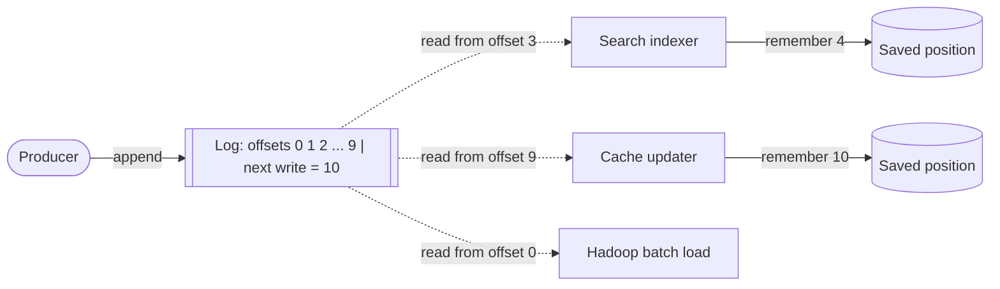

**Reading the diagram.** The *producer* appends synchronously to the end of the *log*; the next write will get offset 10. Three consumers read asynchronously (dotted arrows) at different positions: the *search indexer* is at offset 3, the *cache updater* is fully caught up, and the *Hadoop batch load* is replaying from the beginning. Each consumer stores only one number, its position, in its own storage boundary. Failure points: a crashed consumer restarts from its saved position and loses nothing; if retention deletes offsets a consumer has not yet read, that consumer has fallen too far behind. Scaling: readers are independent, so adding a reader costs read bandwidth but no coordination with the writer.

**Figure 31.2 — Point-to-point integration versus a central log.**

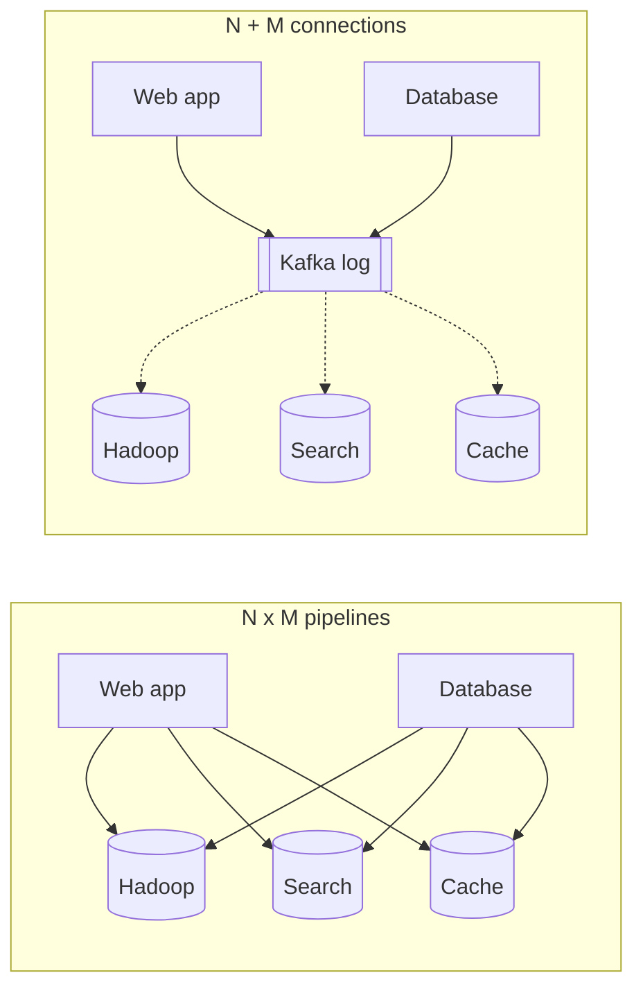

**Reading the diagram.** On the left, every source has a custom pipeline to every destination: six links, each a separate failure point and format. On the right, sources write once to the *Kafka log* and destinations subscribe asynchronously, so a new destination adds one link and can backfill by replaying. The log is a storage boundary decoupling producers and consumers in time and speed; it is also the new single failure point, which is why the rest of the chapter replicates and partitions it.

::: industry
**LinkedIn's activity pipeline.** Kafka was built at LinkedIn to collect user activity events and operational metrics for both online consumers and offline Hadoop loads, replacing per-system pipelines. The original design deliberately used a pull model, stored messages in segment files on disk, kept no per-message acknowledgement state on the broker (consumers track offsets), and relied on the OS page cache [Kreps et al. 2011]. Later work added intra-cluster replication and described its design and LinkedIn's production use [Wang et al. 2015].
*Evidence: Primary* — [Kreps et al. 2011]; [Wang et al. 2015]
:::

#### Common misconceptions

::: mistake
**"Kafka is a queue, so a message disappears once read."** In a classic queue (§30.4) consumption deletes the message. In Kafka, reading only advances that consumer's offset; the record stays until retention removes it, and other consumer groups read it independently. This is why Kafka can replay, and also why "who has processed what" is the consumer's responsibility (§31.8). Kafka 4.x adds share groups for queue-like consumption (§31.7.4), but the log underneath is unchanged.
:::

## 31.4 Brokers and clusters: ZooKeeper mode versus KRaft

### 31.4.1 Brokers, controllers and metadata

::: definition
**Definition — Broker and controller.** A **broker** is a Kafka server process that stores partition replicas and serves produce and fetch requests. The **controller** is the component that owns cluster **metadata** (which brokers are alive, which topics and partitions exist, which replica leads each partition, and the in-sync replica sets) and makes decisions such as leader election when a broker fails.
:::

#### First-principles explanation

A cluster is like a library with many branches, each storing some books (partitions). Someone must keep the catalog of which branch holds the authoritative copy of each book and who takes over when a branch closes. That is the controller, and because the catalog must never have two conflicting versions, the controller itself is a consensus problem (Chapter 26).

#### Why does this exist? From ZooKeeper to KRaft

From 2011 until 2022, Kafka stored its metadata in **Apache ZooKeeper** (§26.8). One broker won an election in ZooKeeper to become the controller; it read all metadata from ZooKeeper, made decisions, wrote them back, and pushed them to other brokers with RPCs. This had three costs that grew with scale [KIP-500]:

1. **Two systems to operate**, each with its own configuration, security, monitoring and upgrades.
2. **Slow controller failover.** A new controller had to load every partition's state from ZooKeeper before acting, so recovery time grew linearly with partition count, capping cluster size.
3. **Divergence.** Brokers held cached metadata updated by RPC, which could disagree with ZooKeeper.

**KIP-500** proposed replacing ZooKeeper with a **self-managed metadata quorum** that stores metadata as a Kafka log replicated with a Raft variant. The result, **KRaft** (Kafka Raft), was marked production-ready in Kafka 3.3 (2022); ZooKeeper mode was deprecated in 3.5, and **Kafka 4.0 (March 2025) removed ZooKeeper mode entirely**. As of 2026, every supported Kafka release runs only in KRaft mode, and a ZooKeeper-based cluster must first migrate to KRaft on a 3.x bridge release before upgrading to 4.x [Apache Kafka 4.0 Release Notes].

#### How it works internally

1. A small set of **controller nodes** (typically 3 or 5) forms a Raft quorum (§26.7). Their elected Raft leader is the **active controller**; the others are hot standbys.
2. All metadata changes (topic creation, partition reassignment, leader changes, ISR changes, broker registrations, configuration) are appended as records to a single-partition internal log, `__cluster_metadata`. A change is committed when a majority of controllers has it.
3. **Brokers** fetch the metadata log from the active controller exactly as followers fetch a partition, and apply records to an in-memory metadata image. Every broker therefore sees the same ordered history; a lagging broker knows exactly how far behind it is (its metadata offset).
4. Brokers **register** with the controller and send **heartbeats**. A broker that stops heartbeating is **fenced**: the controller moves leadership of its partitions to other in-sync replicas by writing new leader records.
5. The quorum takes periodic **snapshots** of the metadata image so the log can be truncated, like Raft snapshotting (§26.7.8).
6. If the active controller fails, a standby that *already has the metadata in memory* becomes Raft leader, so failover no longer reloads state and clusters can hold far more partitions.

Development setups may run broker and controller in one process (**combined mode**); production usually runs dedicated controllers.

**Figure 31.3 — A KRaft cluster: controller quorum and brokers.**

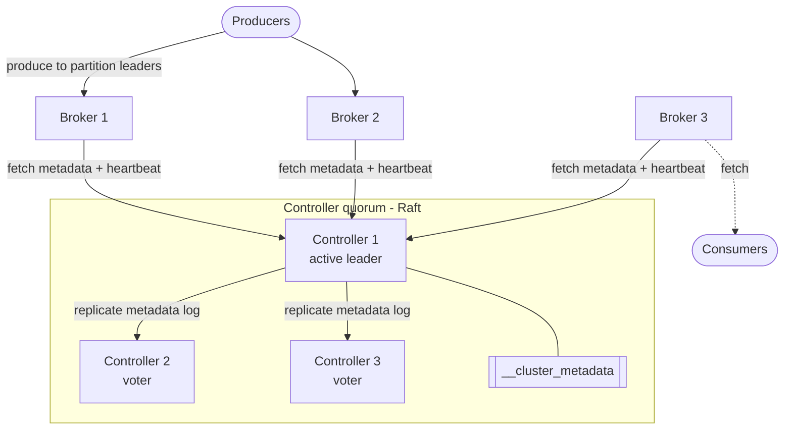

**Reading the diagram.** The *controller quorum* replicates `__cluster_metadata` from the active controller to two voters; a record commits when two of three have it, so one controller may fail. *Brokers* pull metadata and send heartbeats over TCP; each request is synchronous, but propagation is eventually consistent, measured by each broker's metadata offset. *Producers* and *consumers* talk only to brokers. Failure points: losing a controller majority stops metadata changes (no elections, no new topics) while existing leaders keep serving; losing a broker triggers leader moves. Scaling: add brokers for capacity; controllers stay at 3 or 5.

#### Alternatives and trade-offs

**Table 31.1 — ZooKeeper mode versus KRaft (as of 2026).**

| Aspect | ZooKeeper mode (removed in 4.0) | KRaft mode |
|---|---|---|
| Metadata store | External ZooKeeper ensemble | Internal `__cluster_metadata` log, Raft quorum |
| Systems to operate | Two | One |
| Controller failover | Reload all metadata from ZooKeeper; grows with partitions | Standby already has metadata in memory |
| Metadata propagation | Controller RPCs to brokers | Brokers fetch an ordered log |
| Partition scale | Limited by controller reload time | Much higher (KIP-500 targeted millions) |
| Status | Deprecated 3.5; removed 4.0 (2025) | Only mode in 4.x |

#### Failure scenarios

| What goes wrong | Why | Detection | Recovery | Prevention |
|---|---|---|---|---|
| Two of three controllers down | Quorum lost | `ActiveControllerCount` = 0 cluster-wide | Restore a majority | Spread controllers across zones; use 5 for two-failure tolerance |
| Broker isolated from controller but serving clients | Network partition | Broker fenced; clients get `NOT_LEADER` | Clients refresh metadata and move to new leaders | Leader epochs (§31.9.4) reject the stale leader's replication |
| Controllers co-located with overloaded brokers | Combined mode in production | Metadata commit latency rises | Separate roles | Dedicated controller nodes |

::: mistake
**"KRaft means Kafka partitions are replicated with Raft."** Only the *metadata* log uses Raft. Ordinary partitions still use the leader–follower ISR protocol of §31.9, which commits when all in-sync replicas have a record rather than when a majority does. The two protocols make different trade-offs, compared in Table 31.4.
:::

## 31.5 Topics and partitions

### 31.5.1 Topics, partitions and records

::: definition
**Definition — Topic, partition and record.** A **topic** is a named category of records (for example `orders`). A topic is split into **partitions**, each an independent, ordered, replicated log with its own offsets starting at 0. A **record** carries an optional **key**, a **value** (opaque bytes), a **timestamp** and optional **headers**. Kafka guarantees order *within* a partition, not across partitions of a topic.
:::

#### First-principles explanation

One logbook can be served only as fast as one machine allows, so Kafka gives a topic many logbooks (partitions) on different brokers, written and read in parallel. The price is that there is no order across them: record 5 in partition 0 and record 5 in partition 1 have no "before" relationship. Two events that must stay ordered (an order's "created" before its "paid") must land in the same partition, which is what the record key is for.

#### How it works internally: segments and indexes

A partition is a directory on the broker's disk, named `<topic>-<partition>` (for example `orders-3/`). Inside, the log is split into **segments**, so old data can be deleted a file at a time:

1. **`.log` files** hold record batches in append order. Each file is named after its **base offset**, the first offset it contains, padded to 20 digits: `00000000000000000000.log`, `00000000000000368769.log`.
2. Only the newest segment, the **active segment**, receives appends. It is **rolled** (closed and a new one opened) when it reaches `segment.bytes` (default 1 GiB) or `segment.ms` (default 7 days).
3. **`.index` files** are **sparse** maps from offset to byte position in the `.log` file. Kafka adds an entry roughly every `index.interval.bytes` (default 4,096 bytes) of appended data, so the index is small enough to memory-map.
4. **`.timeindex` files** map timestamps to offsets, which lets a consumer start "from 09:00 yesterday".
5. **`.txnindex` files** record aborted transactions (§31.11), and a `leader-epoch-checkpoint` file records where each leader epoch began (§31.9.4).

To read offset 368,800, the broker (a) binary-searches the segment list by base offset and picks `00000000000000368769.log`, (b) binary-searches that segment's `.index` for the largest indexed offset ≤ 368,800, and (c) scans forward from that byte position, at most about 4 KB. A lookup is therefore two in-memory binary searches and one short sequential read, regardless of how large the partition is.

Records are written in **record batches**: a header (base offset, count, producer ID and sequence, CRC, compression codec, timestamps) followed by records whose offsets and timestamps are stored as small deltas. The broker validates the batch and assigns offsets but stores the producer's (possibly compressed) bytes as they arrived. Batches are the unit of compression, replication and transfer, which matters for performance (§31.13).

**Figure 31.4 — A partition on disk: segments and sparse indexes.**

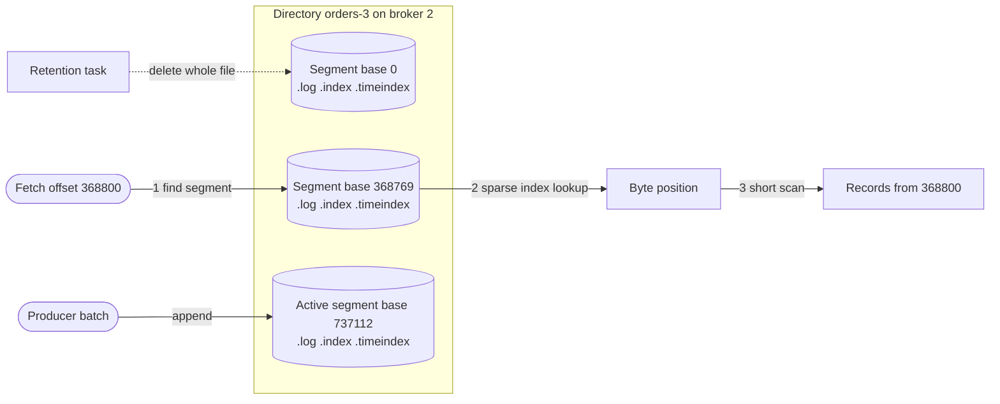

**Reading the diagram.** Only the *active segment* receives appends. A *fetch* for offset 368,800 picks the segment by base offset, uses the sparse *index* to find a nearby byte position, then scans a few kilobytes. The *retention task* runs asynchronously and deletes whole closed segments. The storage boundary is the local file system and page cache. Failure points: a torn final batch after a crash is detected by CRC and truncated; indexes can be rebuilt from the log. Scaling: smaller segments allow finer deletion but more open files.

### 31.5.2 Choosing the number of partitions

#### Why does this exist?

Partitions are Kafka's unit of parallelism. A partition is written by one leader and, within a consumer group, read by at most one consumer (§31.7). So the partition count sets the ceiling on both write and read parallelism for a topic. Too few partitions and you cannot scale consumers; too many and you pay in open files, memory for batches, replication traffic, longer leader elections after a broker failure, and more work for the controller.

#### Mathematical foundations

::: formula
**Partition count from target throughput**

$$P = \left\lceil h \cdot \max\left(\frac{T}{t_p}, \frac{T}{t_c}\right)\right\rceil$$

| Symbol | Meaning | Units |
|---|---|---|
| $P$ | Number of partitions for the topic | count |
| $T$ | Target peak throughput of the topic | MB/s |
| $t_p$ | Measured producer throughput into one partition | MB/s per partition |
| $t_c$ | Measured throughput of one consumer instance on one partition, including its processing | MB/s per partition |
| $h$ | Headroom factor for growth and uneven keys (≥ 1) | dimensionless |
:::

This rule of thumb comes from Kafka's committers [Rao 2015]: measure what one partition can do on the produce side and on the consume side, and provision for the slower of the two. The consumer side is usually the binding constraint because consumers do real work (database writes, enrichment calls), while a broker can append to one partition at tens of MB/s.

::: example
**Worked example — Partitions for an order-events topic.** Peak traffic is 50,000 events/s at 2 KB each, so $T = 100$ MB/s. A load test shows a producer can push $t_p = 20$ MB/s into one partition, and one consumer instance, which writes each event to a database, sustains $t_c = 4$ MB/s. You want headroom $h = 1.5$ for two years of growth.

1. Producer bound: $T / t_p = 100 / 20 = 5$ partitions.
2. Consumer bound: $T / t_c = 100 / 4 = 25$ partitions.
3. Take the maximum, 25, and apply headroom: $1.5 \times 25 = 37.5$, so $P = 38$.
4. Round to a number with many divisors so consumer counts divide evenly: 40 or 48. Choose 48 (divisible by 2, 3, 4, 6, 8, 12, 16, 24).

**Interpretation.** The consumer side needs five times as many partitions as the producer side. With 48 partitions you can run up to 48 consumer instances; a 49th would sit idle. **Engineering implication.** Set the partition count for keyed topics at creation with headroom, because increasing it later breaks key-to-partition mapping (§31.5.3). For unkeyed topics you can add partitions later with little harm.
:::

::: warning
**Do not over-partition.** Each partition replica is a set of open files, an entry in every broker's metadata image, a slot in leader elections and a separate producer batch. Thousands of partitions per broker are routine, but a topic with 10,000 partitions at 1 MB/s total produces tiny batches, poor compression and higher end-to-end latency, because each partition gets one record every few seconds [Rao 2015].
:::

### 31.5.3 Keys, hashing and ordering

#### How it works internally

The producer chooses the partition for each record:

1. If the application names a partition explicitly, use it.
2. If the record has a **key**, the default partitioner computes `toPositive(murmur2(keyBytes)) % numPartitions`: a 32-bit MurmurHash2 of the serialized key bytes, with the sign bit cleared, modulo the partition count.
3. If the key is null, the **sticky partitioner** fills a batch for one partition and then switches to another, rather than spraying single records across all partitions (KIP-480, refined in KIP-794 to favor partitions on less loaded brokers). This produces fuller batches and lower latency than round-robin.

Because the same key always hashes to the same partition (while the count is fixed), all events for `customer-42` are totally ordered relative to each other. This is the basis of per-entity ordering in Kafka.

**Figure 31.5 — Key-to-partition hashing, and what changes when partitions are added.**

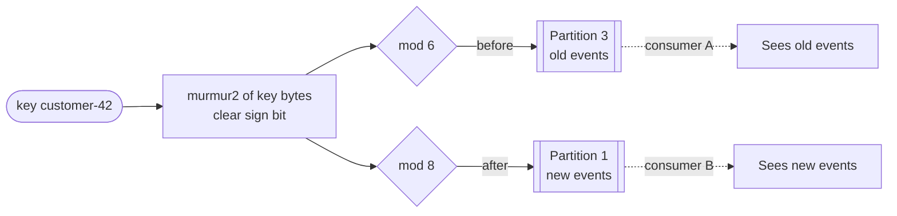

**Reading the diagram.** The producer hashes the key `customer-42` and takes the result modulo the partition count. With 6 partitions the key maps to partition 3; after the topic grows to 8 partitions the same key maps to partition 1 (the code below computes both). Old events stay in partition 3 and new ones go to partition 1, read asynchronously by possibly different consumers, so a consumer may process a new "paid" event before an old "created" event still waiting in partition 3. The failure point is the moment of the partition change; the storage boundary is unaffected because Kafka never moves existing records between partitions.

#### Mathematical foundations

::: formula
**Fraction of keys that move when the partition count changes (hash mod $P$)**

$$F_{\text{move}} = 1 - \frac{\min(P, P')}{\operatorname{lcm}(P, P')}$$

| Symbol | Meaning | Units |
|---|---|---|
| $F_{\text{move}}$ | Fraction of keys whose partition changes | fraction |
| $P$ | Old partition count | count |
| $P'$ | New partition count | count |
| $\operatorname{lcm}$ | Least common multiple | count |
:::

Why: a key stays put when $h \bmod P = h \bmod P' = a$. Then $h - a$ is divisible by both counts, so $h \equiv a \pmod{\operatorname{lcm}(P,P')}$ with $a < \min(P,P')$. Exactly $\min(P,P')$ of every $\operatorname{lcm}(P,P')$ hash values stay, assuming a uniform hash.

::: example
**Worked example — Growing from 6 to 8, 12 and 13 partitions.**

1. $6 \to 8$: $\operatorname{lcm} = 24$, $\min = 6$, so $F = 1 - 6/24 = 0.75$. Three-quarters of keys move.
2. $6 \to 12$: $\operatorname{lcm} = 12$, $F = 1 - 6/12 = 0.50$. Doubling is the friendliest change: each old partition splits into two.
3. $12 \to 13$: $\operatorname{lcm} = 156$, $F = 1 - 12/156 = 0.923$. Adding "just one" partition moves 92% of keys.

**Interpretation.** Unlike consistent hashing (§14.8), `hash mod P` remaps most keys on almost any change. **Engineering implication.** For keyed topics, either over-provision at creation, or migrate by creating a new topic with the new count, dual-writing or replaying into it, and cutting consumers over once the old topic has drained.
:::

#### Code example

The following runnable port of Kafka's default partitioner is checked against test vectors from Kafka's own unit tests and measures the moved fractions above on 100,000 keys.

```python
"""Kafka's default key partitioner: murmur2(key) & 0x7fffffff, mod partitions."""

M32 = 0xFFFFFFFF


def murmur2(data: bytes) -> int:
    """Port of org.apache.kafka.common.utils.Utils.murmur2; returns a signed int32."""
    m, r = 0x5BD1E995, 24
    h = (0x9747B28C ^ len(data)) & M32
    n4 = len(data) // 4
    for i in range(n4):
        k = int.from_bytes(data[4 * i:4 * i + 4], "little")
        k = (k * m) & M32
        k ^= k >> r
        k = (k * m) & M32
        h = (h * m) & M32
        h ^= k
    tail = data[4 * n4:]
    if len(tail) == 3:
        h ^= tail[2] << 16
    if len(tail) >= 2:
        h ^= tail[1] << 8
    if len(tail) >= 1:
        h ^= tail[0]
        h = (h * m) & M32
    h ^= h >> 13
    h = (h * m) & M32
    h ^= h >> 15
    return h - (1 << 32) if h & 0x80000000 else h


def partition_for(key: str, num_partitions: int) -> int:
    return (murmur2(key.encode()) & 0x7FFFFFFF) % num_partitions


# Test vectors from Kafka's own unit tests.
assert murmur2(b"21") == -973932308
assert murmur2(b"foobar") == -790332482
assert murmur2(b"a-little-bit-long-string") == -985981536
assert murmur2(b"a-little-bit-longer-string") == -1486304829
assert murmur2(b"lkjh234lh9fiuh90y23oiuhsafujhadof229phr9h19h89h8") == -58897971
assert murmur2(b"abc") == 479470107

keys = [f"customer-{i}" for i in range(100_000)]
for old, new in [(6, 8), (6, 12), (12, 13)]:
    moved = sum(partition_for(k, old) != partition_for(k, new) for k in keys)
    print(f"{old:>2} -> {new:>2} partitions: {moved / len(keys):.1%} of keys change partition")
print("customer-42 ->", partition_for("customer-42", 6), "with 6,",
      partition_for("customer-42", 8), "with 8")
```

Output:

```text
 6 ->  8 partitions: 75.1% of keys change partition
 6 -> 12 partitions: 49.9% of keys change partition
12 -> 13 partitions: 92.3% of keys change partition
customer-42 -> 3 with 6, 1 with 8
```

What to notice:

- Java's `int` arithmetic wraps at 32 bits; masking with `M32` after each multiplication reproduces it, and the asserts prove the port matches Kafka.
- Kafka clears the sign bit rather than taking `abs()`, because `abs(Integer.MIN_VALUE)` is still negative in Java.
- The measured fractions match the formula: 75%, 50% and 92%.
- Every client must use the same hash. Some non-Java clients (for example, librdkafka-based ones) default to a different hash unless configured for murmur2.

#### Failure scenarios

| What goes wrong | Why | Detection | Recovery | Prevention |
|---|---|---|---|---|
| Hot partition | One key (a celebrity, a big tenant) dominates | Per-partition bytes-in skew; one consumer lags | Split the key (salting, §14.10) if order allows | Choose keys with many distinct, balanced values |
| Out-of-order events after scaling | Partition count changed on a keyed topic | Consumers see "paid" before "created" | Reprocess from a new topic | Fix the count at creation; migrate via a new topic |
| Mixed-language producers disagree | Different default hash functions | Same key in two partitions | Re-key | Configure all clients for murmur2 |

## 31.6 Producers

### 31.6.1 Batching and compression

#### How it works internally

A producer is not a thin RPC client. Calling `send()` only serializes the record, picks a partition and appends it to an in-memory **record accumulator**; a background **sender thread** later ships whole batches.

1. `send()` serializes key and value, runs the partitioner (§31.5.3) and appends the record to the open batch for that partition. It returns a future immediately.
2. A batch becomes sendable when it reaches `batch.size` bytes (default 16,384) or when it has waited `linger.ms` (default 5 ms as of Kafka 4.0; 0 before 4.0, KIP-1030).
3. The sender groups ready batches by destination broker into one produce request per broker, so one network round trip carries batches for many partitions.
4. Each batch is compressed as a unit with `compression.type` (`none`, `gzip`, `snappy`, `lz4` or `zstd`). Compressing 16 records of similar JSON together gives far better ratios than compressing each alone.
5. If `buffer.memory` (default 32 MiB) fills because brokers are slow, `send()` blocks for up to `max.block.ms`: built-in backpressure (§22.10).

**Figure 31.6 — Inside the producer: accumulator, sender and per-broker requests.**

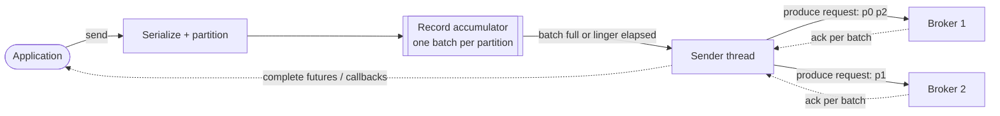

**Reading the diagram.** The application thread only serializes and appends to the *accumulator* (memory, not disk). The *sender thread* drains full or expired batches and sends one produce request per broker over TCP, each carrying batches for the partitions that broker leads. Acknowledgements return asynchronously and complete the futures. Failure points: a full accumulator blocks `send()`; a failed request is retried by the sender (§31.6.3). Scaling: larger batches and compression raise throughput per request at the cost of up to `linger.ms` of extra latency.

#### Mathematical foundations

::: formula
**Records per batch and time to fill a batch**

$$n_{\text{batch}} = \min\left(\lambda_p \cdot \ell,\ \frac{B}{s}\right), \qquad t_{\text{fill}} = \min\left(\ell,\ \frac{B}{s \cdot \lambda_p}\right)$$

| Symbol | Meaning | Units |
|---|---|---|
| $n_{\text{batch}}$ | Records per batch sent | records |
| $\lambda_p$ | Record rate into one partition from one producer | records/s |
| $\ell$ | `linger.ms` | s |
| $B$ | `batch.size` | bytes |
| $s$ | Average serialized record size | bytes |
| $t_{\text{fill}}$ | Time a batch waits before it is sendable | s |
:::

::: example
**Worked example — Is `linger.ms` or `batch.size` the limit?** A producer writes 48,000 records/s of $s = 500$ B spread over 48 partitions, so $\lambda_p = 1{,}000$ records/s per partition. Defaults: $\ell = 5$ ms, $B = 16{,}384$ B.

1. Linger bound: $1{,}000 \times 0.005 = 5$ records per batch.
2. Size bound: $16{,}384 / 500 = 32$ records.
3. $n_{\text{batch}} = \min(5, 32) = 5$ records (2.5 KB); $t_{\text{fill}} = 5$ ms. Linger is the limit.
4. Batches per second: $48{,}000 / 5 = 9{,}600$ batches/s.
5. Raise $\ell$ to 20 ms: $n = \min(20, 32) = 20$ records; batches fall to 2,400/s, a 4× cut in per-batch overhead, at the cost of up to 15 ms more latency.

**Interpretation.** At moderate rates per partition, `linger.ms` decides batch size; `batch.size` matters only for hot partitions. **Engineering implication.** Fewer partitions per producer, or a larger linger, gives bigger batches, better compression and fewer requests. Latency-critical paths keep linger small and accept the overhead.
:::

### 31.6.2 Acknowledgements: `acks=0`, `1` and `all`

The `acks` setting decides when the leader answers the producer:

**Table 31.2 — Producer acknowledgement modes.**

| Setting | Leader replies when | Latency | Loss window |
|---|---|---|---|
| `acks=0` | Never; producer does not wait | Lowest | Any network or broker failure; no retries possible |
| `acks=1` | Leader has appended to its log (page cache) | Low | Leader dies before followers copy the record |
| `acks=all` (`-1`) | Every replica currently in the ISR has the record | Higher (one follower fetch round trip) | None for committed records while one ISR replica survives; needs `min.insync.replicas` (§31.9.3) |

Since Kafka 3.0 the producer defaults are `acks=all` and `enable.idempotence=true` (KIP-679). Note that "has the record" means *in memory or the page cache* of each replica, not fsynced to disk; Kafka's durability comes from copies on several machines, not from flushing one disk (§31.13).

### 31.6.3 Retries, idempotence and ordering

#### Why does this exist?

Networks lose acknowledgements. If the broker appended a batch but the reply was lost, the producer retries and the batch is written twice. Retries also threaten ordering: with several requests in flight, batch 1 can fail and be retried after batch 2 succeeds, reversing them.

#### How it works internally

The **idempotent producer** (KIP-98) applies the idempotency-key idea of §22.15 inside Kafka:

1. On start-up the producer obtains a **producer ID (PID)** and an **epoch** from a broker.
2. Every batch carries the PID, epoch and a **sequence number** per partition, starting at 0 and increasing by the record count.
3. The partition leader remembers, for each PID, the sequence numbers of the last five batches it appended. A batch whose sequence it has already seen is acknowledged again but **not** appended (duplicate). A batch with a gap (sequence too high) is rejected with `OutOfOrderSequenceException` so the producer can resend in order.
4. With idempotence on, up to `max.in.flight.requests.per.connection` = 5 requests may be outstanding and ordering is still preserved, because the leader accepts batches only in sequence order. Without idempotence, preserving order under retries requires `max.in.flight.requests.per.connection=1`, which caps throughput at one batch per round trip.
5. Retries continue until `delivery.timeout.ms` (default 120 s) expires.

**Figure 31.7 — Idempotent producer: a lost acknowledgement does not create a duplicate.**

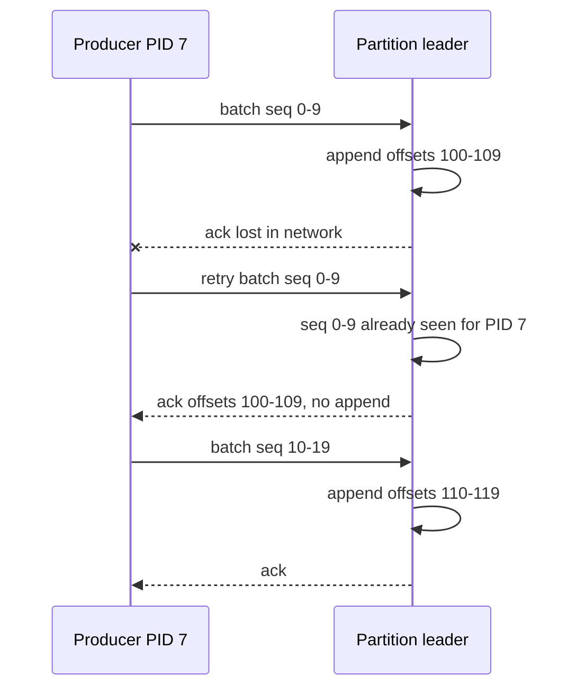

**Reading the diagram.** The producer sends a batch tagged with PID 7 and sequences 0–9; the leader appends it, but the acknowledgement is lost. The retry carries the *same* PID and sequences, so the leader recognizes the duplicate and returns the original offsets without appending. The next batch continues at sequence 10. All calls are synchronous request/response over TCP. Limits: deduplication is per PID and per partition, and a PID is new each time the producer restarts unless it uses a `transactional.id` (§31.11), so idempotence protects against retries inside one producer session, not against an application that crashes and re-sends.

::: mistake
**"Idempotent producer means exactly-once."** It removes duplicates caused by the producer's own retries to one partition during one session. It does not deduplicate an application that restarts and re-sends, does not make a consumer's processing idempotent, and does not make writes to several partitions atomic. Those need transactions (§31.11) and idempotent consumers (§32.10).
:::

## 31.7 Consumers and consumer groups

### 31.7.1 The pull model and the poll loop

Kafka consumers **pull** ("partition 3 from offset 5,120"), so each goes at its own speed, batch jobs read in large chunks, and backpressure is automatic [Kreps et al. 2011]. On an idle topic a fetch waits at the broker until `fetch.min.bytes` (default 1 byte) arrive or `fetch.max.wait.ms` (default 500 ms) passes. The application loops: `poll()` returns up to `max.poll.records` (default 500), it processes them, and polls again [Shapira et al. 2021].

### 31.7.2 Consumer groups and partition assignment

::: definition
**Definition — Consumer group.** A set of consumer instances sharing a `group.id` that divide a topic's partitions among themselves so that **each partition is consumed by exactly one member** at a time. Different groups consume the same topic independently, each with its own offsets.
:::

#### First-principles explanation

A consumer group is a team sharing a pile of logbooks: each logbook is given to one team member, so no entry is read twice within the team and entries in one logbook stay in order. A second team (another group) gets its own copies of the bookmarks and reads the same logbooks independently. Within a group Kafka behaves like a queue (work is divided); across groups it behaves like publish/subscribe (everyone gets everything), which is how one system provides both models of §30.4–§30.5.

#### How it works internally

1. Each group has a **group coordinator**: the broker leading the partition of the internal `__consumer_offsets` topic that `hash(group.id)` maps to.
2. Members join the group and heartbeat to the coordinator. A member is considered dead if no heartbeat arrives within `session.timeout.ms` (default 45 s), or if it fails to call `poll()` within `max.poll.interval.ms` (default 5 minutes), which catches a consumer stuck in processing.
3. When membership or the topic's partitions change, the group **rebalances**: partitions are reassigned by an **assignor** (range, round-robin, sticky or cooperative-sticky). §31.12 covers the protocols.
4. Each member fetches its assigned partitions from their leaders (or, with rack-aware **follower fetching**, KIP-392, from a replica in its own availability zone to avoid cross-zone transfer charges).

**Figure 31.8 — Two consumer groups reading one four-partition topic.**

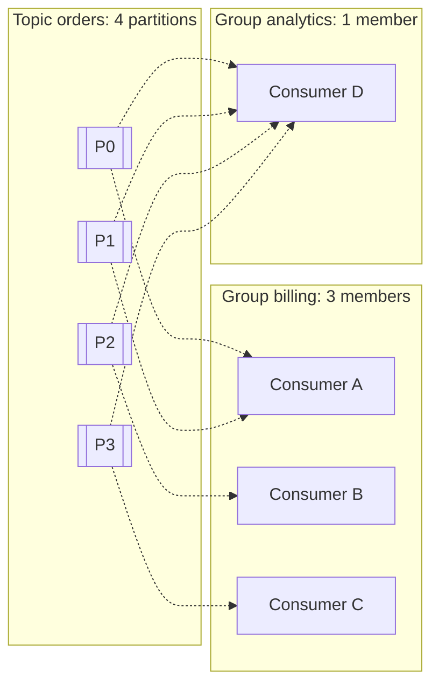

**Reading the diagram.** The *billing* group's three members share four partitions: A owns two, B and C one each. The *analytics* group's single member reads all four independently, with its own offsets. Arrows are asynchronous pull fetches. Failure point: if B crashes, P2 is unconsumed by billing until a rebalance gives it to A or C. Scaling: billing can use at most four members.

### 31.7.3 Parallelism ceiling and consumer lag

The **parallelism ceiling** of a group is the partition count: with $P$ partitions, at most $P$ members do work. If processing is the bottleneck and members are already at $P$, the options are more partitions (with the key-remapping cost of §31.5.3), faster processing per record, or concurrency *inside* a member (for example a thread pool keyed by record key to keep per-key order).

::: definition
**Definition — Consumer lag.** For one partition, lag = **log end offset** (or high watermark) minus the group's **committed offset**: the number of records written but not yet processed by the group. Group lag is the sum over partitions.
:::

::: formula
**Lag drain time**

$$t_{\text{drain}} = \frac{L}{\mu - \lambda} \quad (\mu > \lambda)$$

| Symbol | Meaning | Units |
|---|---|---|
| $t_{\text{drain}}$ | Time for lag to return to about zero | s |
| $L$ | Current lag | records |
| $\mu$ | Aggregate consumption rate of the group | records/s |
| $\lambda$ | Current production rate | records/s |
:::

::: example
**Worked example — Recovering from a 20-minute consumer outage.** Producers write $\lambda = 40{,}000$ records/s. The consumer group was down for 20 minutes, so $L = 40{,}000 \times 1{,}200 = 48{,}000{,}000$ records. Twelve members each process 5,000 records/s, so $\mu = 60{,}000$ records/s.

1. Net drain rate: $\mu - \lambda = 20{,}000$ records/s.
2. $t_{\text{drain}} = 48{,}000{,}000 / 20{,}000 = 2{,}400$ s = 40 minutes.
3. If the topic has 24 partitions, scaling to 24 members gives $\mu = 120{,}000$: $48 \times 10^6 / 80{,}000 = 600$ s = 10 minutes.
4. With 12 partitions, extra members are idle and recovery stays at 40 minutes.

**Interpretation.** A 20-minute outage costs 40 minutes of staleness after recovery unless spare capacity exists, and spare consumers help only up to the partition count. **Engineering implication.** Provision consumers for roughly 1.5–2× peak and partitions for the scaled-up count; alert on lag *in seconds* (lag ÷ production rate), which is what users feel, rather than in records. Also check retention: if lag ever exceeds retention, records are deleted before they are read.
:::

### 31.7.4 Share groups (queues for Kafka)

Consumer groups tie parallelism to partitions and order per partition. Some workloads, such as a pool of workers processing independent jobs, want queue semantics instead: many workers on one partition, per-record acknowledgement and redelivery. **KIP-932** adds **share groups**, in which records of a partition are handed to several consumers with per-record acquisition locks and delivery counts. Share groups arrived as early access in Kafka 4.0 and were still maturing through the 4.x line as of 2026; check your version's documentation before relying on them.

## 31.8 Offsets

### 31.8.1 Where offsets live

A consumer group's progress is a map from partition to **committed offset**, by convention the offset of the *next* record to read. Since Kafka 0.9 these commits are records in the internal topic **`__consumer_offsets`** (50 partitions by default, replicated, **compacted** so only the latest commit per group and partition survives, §31.10). Storing offsets in a Kafka log makes commits a cheap append and lets the coordinator rebuild its cache by reading the partition after failover. When a group has no committed offset (or the committed offset has been deleted by retention), `auto.offset.reset` decides where to start: `latest` (the default), `earliest` or `none` (fail).

### 31.8.2 Commit strategies and delivery semantics

The moment of the commit relative to processing decides the delivery guarantee (§30.8):

- **Commit after processing → at-least-once.** If the consumer crashes after processing but before committing, the next owner of the partition reprocesses those records. Duplicates are possible; loss is not.
- **Commit before processing → at-most-once.** If the consumer crashes after committing but before processing, those records are skipped. Loss is possible; duplicates are not.

**Figure 31.9 — Commit timing decides duplicates or loss.**

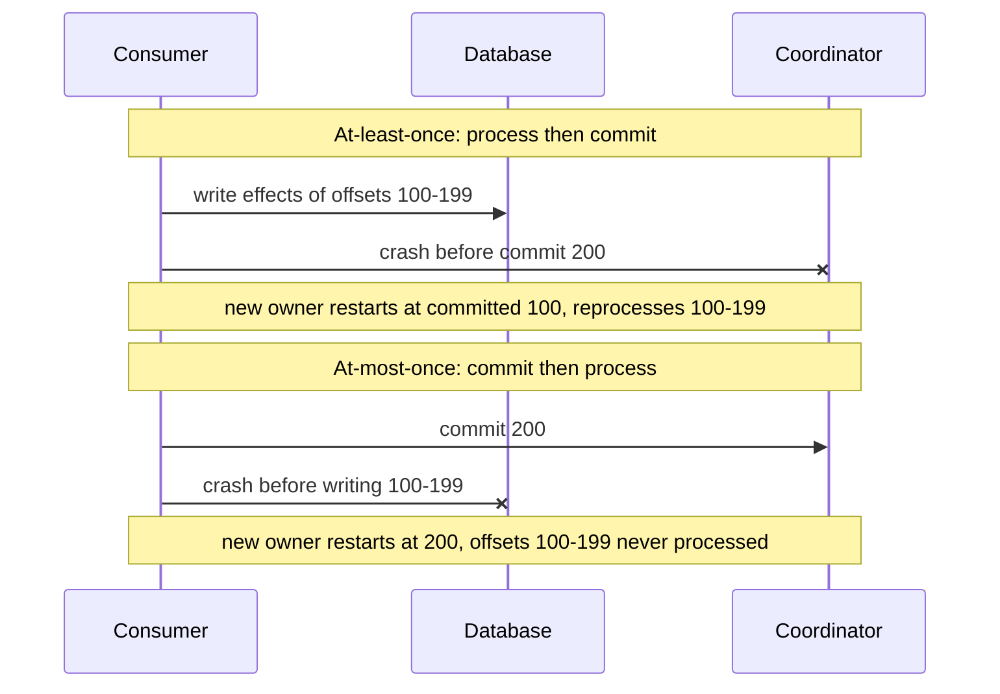

**Reading the diagram.** Upper half: effects reach the *database* first, the crash prevents the commit, and the new owner reprocesses 100–199, duplicating effects unless writes are idempotent. Lower half: the commit reaches the *coordinator* first, the crash prevents processing, and the new owner starts at 200, silently losing 100–199. Both calls are synchronous; the failure point is the gap between two writes to different storage systems, which cannot be atomic without transactions or an idempotent sink.

**Table 31.3 — Offset commit strategies.**

| Strategy | How | Guarantee | Cost | Use when |
|---|---|---|---|---|
| Auto commit | Default; commits polled position every 5 s inside `poll()` | At-least-once if processing finishes before the next `poll()`; at-most-once if handed off asynchronously | Up to 5 s reprocessed after a crash | Simple, idempotent processing |
| Synchronous commit | `commitSync()` after processing | At-least-once; blocks until acknowledged | One round trip per commit; lower throughput | Correctness first, moderate rate |
| Asynchronous commit | `commitAsync()` | At-least-once; failures not retried (could overwrite a newer offset) | Non-blocking | High throughput; `commitSync()` on shutdown and revocation |
| Offsets stored with results | Write offset in the same database transaction as the output; seek on start-up | Effectively-once for that sink | Requires transactional sink | Database sinks needing no duplicates |
| Kafka transactions | `sendOffsetsToTransaction()` (§31.11) | Exactly-once for Kafka-to-Kafka | Transaction overhead | Read-process-write pipelines |

::: recommendation
**Default to at-least-once with idempotent processing.** Disable auto commit for anything non-trivial, commit after processing (synchronously every few hundred records, or asynchronously with a final synchronous commit), and make the processing idempotent with an idempotency key or upsert (§22.15, §32.10). At-most-once is acceptable only for data where loss is cheaper than duplicates, such as some metrics.
:::

## 31.9 Replication, ISR and leader election

### 31.9.1 Leaders, followers and the in-sync replica set

::: definition
**Definition — ISR, LEO and high watermark.** Each partition has a **replication factor** (RF) of replicas on different brokers; one is the **leader**, which handles all writes, and the others are **followers**, which fetch from the leader. The **in-sync replica set (ISR)** is the leader plus the followers that have fully caught up within `replica.lag.time.max.ms` (default 30 s). Each replica's **log end offset (LEO)** is the offset its next appended record will get. The **high watermark (HW)** is the offset below which every ISR member has the record; records below the HW are **committed** and are the only ones consumers can read.
:::

#### How it works internally

1. The leader appends a producer batch, advancing its LEO.
2. Each follower sends fetch requests (the same API consumers use) with its own LEO. The leader returns new records and learns from the fetch offset how far each follower has got.
3. The leader advances the HW to the minimum LEO across the ISR, and tells followers the new HW in the next fetch response; followers' HWs therefore lag the leader's by one fetch round.
4. An `acks=all` produce request waits in a holding area ("purgatory") until the HW passes its last offset, then the leader acknowledges.
5. A follower that has not caught up for `replica.lag.time.max.ms` is removed from the ISR (ISR **shrink**); it rejoins (ISR **expand**) when it catches up again. The leader records ISR changes through the controller.

::: formula
**High watermark**

$$\text{HW} = \min_{r \in \text{ISR}} \text{LEO}_r$$

| Symbol | Meaning | Units |
|---|---|---|
| $\text{HW}$ | High watermark: first offset not yet committed | offset |
| $\text{LEO}_r$ | Log end offset of replica $r$ | offset |
| $\text{ISR}$ | Current in-sync replica set, including the leader | set of replicas |
:::

::: example
**Worked example — What a consumer can see.** RF = 3. The leader's LEO is 1,050, follower F1's is 1,048, follower F2's is 1,020, and all three are in the ISR.

1. HW = min(1,050, 1,048, 1,020) = 1,020. Consumers can read offsets up to 1,019.
2. An `acks=all` producer whose batch ended at offset 1,049 is still waiting.
3. F2 has been behind for 35 s, exceeding the 30 s limit, so the leader shrinks the ISR to {leader, F1}. HW jumps to min(1,050, 1,048) = 1,048, and requests up to 1,047 are acknowledged.

**Interpretation.** A slow follower holds back both visibility and `acks=all` latency until it is dropped; dropping it trades redundancy for progress. **Engineering implication.** Alert on ISR shrink rate and under-replicated partitions (§31.15), because a partition running with ISR = {leader} has no redundancy even though writes still succeed (unless `min.insync.replicas` stops them).
:::

**Figure 31.10 — Replica state on one partition with RF = 3.**

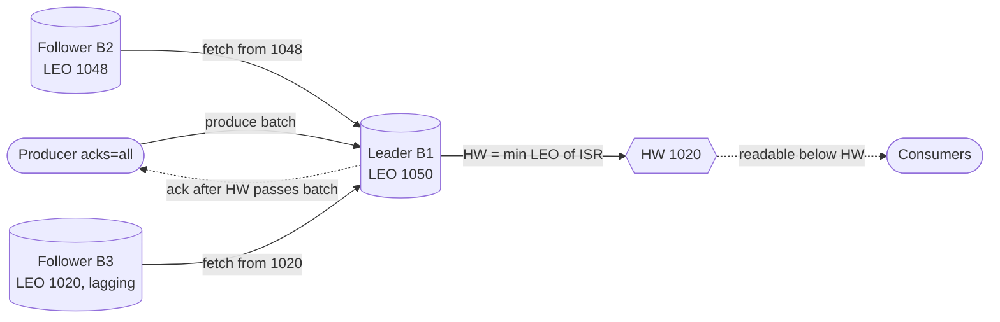

**Reading the diagram.** The *producer* writes to the *leader* on broker B1. *Followers* pull with fetches carrying their LEOs, so replication is asynchronous to the write, but the `acks=all` acknowledgement waits until the *HW* passes the batch. *Consumers* read only below the HW, never seeing records that could vanish in a failover. Each replica is a separate broker disk. Failure points: lagging B3 holds back the HW until removed from the ISR; leader failure triggers election (§31.9.3). Scaling: replication traffic is (RF − 1) times produce traffic.

### 31.9.2 Kafka's ISR versus majority quorums

**Table 31.4 — ISR replication versus a Raft-style majority quorum.**

| Aspect | Kafka ISR (data partitions) | Majority quorum (Raft, KRaft metadata) |
|---|---|---|
| Commit rule | All current ISR members have the record | A majority has the record |
| Replicas to tolerate $f$ failures without losing committed data | $f + 1$ | $2f + 1$ |
| Effect of one slow replica | Holds commits until dropped from ISR (up to 30 s) | None; the majority proceeds |
| Who decides membership | External controller (itself a Raft quorum) | The protocol itself |

The ISR design needs fewer copies for the same data safety, because it waits for every in-sync replica, and it relies on the controller to make ISR changes and leader choices consistent [Wang et al. 2015]. The price is sensitivity to slow followers, bounded by the lag timeout.

### 31.9.3 Leader election, `min.insync.replicas` and unclean election

When a leader's broker is fenced, the controller picks a new leader **from the ISR**, which by definition holds every committed record, increments the partition's **leader epoch**, and records the change in the metadata log. Brokers and clients learn the new leader from metadata. Two settings decide the durability/availability trade-off:

- **`min.insync.replicas`** (topic or broker setting, default 1): an `acks=all` write is rejected with `NOT_ENOUGH_REPLICAS` if the ISR is smaller than this. With RF = 3 and `min.insync.replicas=2`, every acknowledged record is on at least two brokers.
- **`unclean.leader.election.enable`** (default false): if no ISR member is alive, an out-of-sync replica may become leader. The partition comes back online, but every record it lacks, including acknowledged ones, is lost and later truncated from returning replicas.

#### Mathematical foundations

::: formula
**Write unavailability of one partition (independent broker failures)**

$$U_w = \sum_{k = R - m + 1}^{R} \binom{R}{k} q^k (1 - q)^{R - k}$$

| Symbol | Meaning | Units |
|---|---|---|
| $U_w$ | Probability that fewer than $m$ replicas are up, so `acks=all` writes are refused | probability |
| $R$ | Replication factor | count |
| $m$ | `min.insync.replicas` | count |
| $q$ | Probability that a given broker is unavailable at a random moment | probability |
| $k$ | Number of unavailable replicas | count |
:::

The formula optimistically treats "up" as "in sync". Committed data survives as long as at least one ISR replica survives, so data loss on clean election requires all $R$ replicas of the ISR to fail.

::: example
**Worked example — RF = 3 with `min.insync.replicas` of 1, 2 and 3.** Assume each broker is unavailable with $q = 0.01$ (about 7 hours a month, including rolling restarts).

1. $m = 2$: writes stop when 2 or 3 replicas are down. $U_w = 3q^2(1-q) + q^3 = 3(0.0001)(0.99) + 0.000001 = 0.000298$, about 0.03% of the time.
2. $m = 3$: writes stop when any replica is down. $U_w = 1 - 0.99^3 = 0.0297$, about 3%, which means every rolling restart blocks writes.
3. $m = 1$: writes stop only when all are down, $q^3 = 10^{-6}$, but an acknowledged write may exist on only one broker; if that broker's disk dies before followers catch up, the record is gone.
4. With $m = 2$ the cluster tolerates one broker failure with no write impact and no committed-data loss; with two failures writes stop but committed data is intact on the survivor.

**Interpretation.** RF = 3, `min.insync.replicas=2`, `acks=all` is the standard durability configuration because it survives a single failure (including planned restarts) with neither loss nor downtime. **Engineering implication.** RF = 3 with $m = 3$ is a common mistake; it converts every restart into an outage. Spread replicas across racks or availability zones with `broker.rack` so one zone failure removes only one replica.
:::

**Table 31.5 — Durability configurations (RF = 3).**

| `acks` | `min.insync.replicas` | Unclean election | Acknowledged data lost when | Writes stop when |
|---|---|---|---|---|
| 1 | any | false | Leader dies before followers fetch | Leader unavailable (until re-election) |
| all | 1 | false | ISR shrank to leader alone, then leader's disk lost | All replicas down |
| all | 2 | false | Two brokers holding the record both lost | Two replicas down |
| all | 2 | true | Out-of-sync replica elected after ISR loss | Rarely; availability favored |

### 31.9.4 Leader epochs and log truncation

After a leader change, a follower may hold records the new leader never received; those records were never committed and must be removed. Early Kafka truncated each follower to its own high watermark, but because followers learn the HW one fetch late, two failures in quick succession could truncate committed records or leave replicas with divergent logs [KIP-101]. Since Kafka 0.11 each record batch carries its **leader epoch**, every replica records the start offset of each epoch, and a follower asks the new leader "where did epoch $e$ end?" (`OffsetsForLeaderEpoch`). It truncates exactly to that point and then fetches. Leader epochs are fencing tokens (§26.13): a deposed leader with an old epoch cannot get its stale records accepted, and clients include the epoch in fetch requests to detect stale leaders.

**Figure 31.11 — Leader failure with `acks=1`: an acknowledged record disappears.**

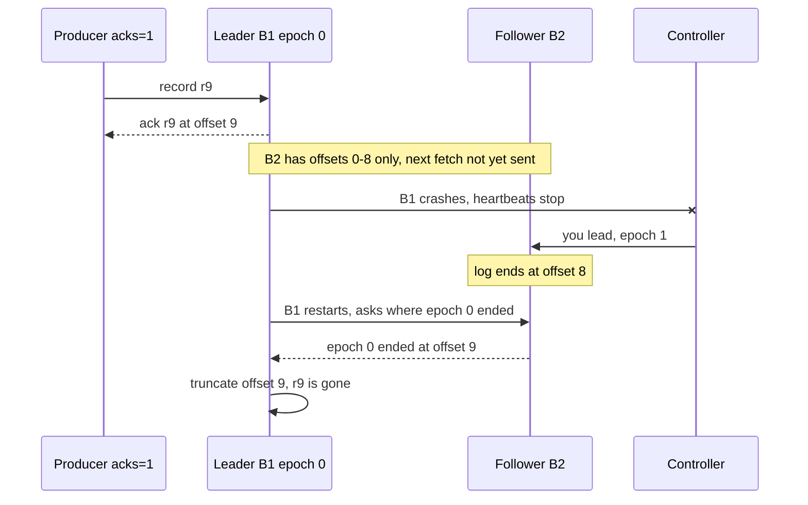

**Reading the diagram.** With `acks=1` the *leader* acknowledges r9 as soon as it is in its own log. Before the *follower* fetches it, B1 crashes; the *controller* detects missing heartbeats and makes B2 leader in epoch 1. When B1 returns, the leader-epoch exchange tells it that epoch 0 ended at offset 9 on the new leader, so it truncates its own r9. The producer was told r9 succeeded, yet no replica has it. With `acks=all`, the leader would not have acknowledged r9 until B2 had it, so the producer would have retried instead.

### 31.9.5 A runnable replication simulation

The program below models one partition with RF = 3. One record is produced per tick; followers fetch every few ticks; the leader shrinks the ISR when a follower lags too long, computes the HW, and fails at the end. It reports acknowledged records that the new leader does not have.

```python
"""Toy Kafka partition: leader, followers, ISR, high watermark, leader epochs.

Compares acks=1 and acks=all under leader failure. One record is produced per
tick; followers copy from the leader every `fetch_every` ticks.
"""


class NotEnoughReplicas(Exception):
    pass


class Replica:
    def __init__(self, rid, fetch_every):
        self.rid, self.fetch_every = rid, fetch_every   # fetch_every=0 means down
        self.log = []               # list of (leader_epoch, value); index = offset
        self.caught_up_at = 0       # last tick this follower matched the leader

    @property
    def leo(self):                  # log end offset: next offset to be written
        return len(self.log)


class Partition:
    def __init__(self, fetch_every=(1, 3, 3), min_insync=1, lag_max=4, unclean=False):
        self.r = {i: Replica(i, f) for i, f in enumerate(fetch_every)}
        self.leader, self.epoch, self.tick = 0, 0, 0
        self.isr = set(self.r)
        self.hw = 0                 # offsets below hw are committed and readable
        self.min_insync, self.lag_max, self.unclean = min_insync, lag_max, unclean

    def produce(self, value, acks):
        if acks == "all" and len(self.isr) < self.min_insync:
            raise NotEnoughReplicas(f"ISR={sorted(self.isr)}")
        self.r[self.leader].log.append((self.epoch, value))
        return self.r[self.leader].leo - 1

    def step(self):
        """Advance one tick: followers fetch, ISR shrinks or grows, HW moves."""
        self.tick += 1
        lead = self.r[self.leader]
        for f in self.r.values():
            if f.rid == self.leader or f.fetch_every == 0:
                if f.fetch_every == 0:
                    self.isr.discard(f.rid)          # a dead broker leaves the ISR
                continue
            if self.tick % f.fetch_every == 0:
                f.log = f.log + lead.log[f.leo:]     # fetch everything new
            if f.leo == lead.leo:
                f.caught_up_at = self.tick
                self.isr.add(f.rid)
            elif self.tick - f.caught_up_at > self.lag_max:
                self.isr.discard(f.rid)              # like replica.lag.time.max.ms
        self.hw = min(self.r[i].leo for i in self.isr)

    def is_acked(self, offset, acks):
        if acks == "1":
            return True                              # leader appended it: ack sent
        # every ISR member has it, and the ISR is still large enough
        return offset < self.hw and len(self.isr) >= self.min_insync

    def fail_leader(self):
        old = self.leader
        self.r[old].fetch_every = 0
        self.isr.discard(old)
        live = [i for i in self.r if self.r[i].fetch_every > 0]
        candidates = [i for i in self.isr if i in live]
        if not candidates:
            if not self.unclean:
                raise RuntimeError("no live ISR member: partition OFFLINE")
            candidates = live                        # unclean leader election
        self.leader = max(candidates, key=lambda i: self.r[i].leo)
        self.epoch += 1
        for i in live:                               # followers truncate to the new
            self.r[i].log = list(self.r[self.leader].log)   # leader's log
        self.isr = set(candidates)
        return old


def run(title, acks, n=10, **cfg):
    print(title)
    p = Partition(**cfg)
    acked, pending = [], []
    for t in range(n):
        try:
            pending.append((p.produce(f"r{t}", acks), f"r{t}"))
        except NotEnoughReplicas as e:
            print(f"  t={t}: write r{t} REJECTED, {e}")
        p.step()
        acked += [v for off, v in pending if p.is_acked(off, acks)]
        pending = [(off, v) for off, v in pending if not p.is_acked(off, acks)]
    print(f"  before crash: leader LEO={p.r[p.leader].leo} HW={p.hw} ISR={sorted(p.isr)}")
    try:
        old = p.fail_leader()
    except RuntimeError as e:
        print(f"  acked={len(acked)} unacked(retry)={len(pending)}; leader crashed: {e}")
        return
    kept = {v for _, v in p.r[p.leader].log}
    lost = [v for v in acked if v not in kept]
    print(f"  leader {old} crashed -> new leader {p.leader}, epoch {p.epoch}, "
          f"log has {len(kept)} records")
    print(f"  acked={len(acked)} unacked(retry)={len(pending)} "
          f"ACKED BUT LOST={len(lost)} {lost}")


if __name__ == "__main__":
    run("A: acks=1", "1", fetch_every=(1, 3, 3))
    run("B: acks=all, min.insync.replicas=2", "all", fetch_every=(1, 3, 3), min_insync=2)
    run("C: acks=all, min.insync=1, followers stalled, unclean election on", "all",
        fetch_every=(1, 50, 0), min_insync=1, unclean=True)
    run("D: same stall, min.insync.replicas=2", "all",
        fetch_every=(1, 50, 0), min_insync=2)
```

Output:

```text
A: acks=1
  before crash: leader LEO=10 HW=9 ISR=[0, 1, 2]
  leader 0 crashed -> new leader 1, epoch 1, log has 9 records
  acked=10 unacked(retry)=0 ACKED BUT LOST=1 ['r9']
B: acks=all, min.insync.replicas=2
  before crash: leader LEO=10 HW=9 ISR=[0, 1, 2]
  leader 0 crashed -> new leader 1, epoch 1, log has 9 records
  acked=9 unacked(retry)=1 ACKED BUT LOST=0 []
C: acks=all, min.insync=1, followers stalled, unclean election on
  before crash: leader LEO=10 HW=10 ISR=[0]
  leader 0 crashed -> new leader 1, epoch 1, log has 0 records
  acked=10 unacked(retry)=0 ACKED BUT LOST=10 ['r0', 'r1', 'r2', 'r3', 'r4', 'r5', 'r6', 'r7', 'r8', 'r9']
D: same stall, min.insync.replicas=2
  t=5: write r5 REJECTED, ISR=[0]
  t=6: write r6 REJECTED, ISR=[0]
  t=7: write r7 REJECTED, ISR=[0]
  t=8: write r8 REJECTED, ISR=[0]
  t=9: write r9 REJECTED, ISR=[0]
  before crash: leader LEO=5 HW=5 ISR=[0]
  acked=0 unacked(retry)=5; leader crashed: no live ISR member: partition OFFLINE
```

What to notice:

- **A versus B** share replication timing. With `acks=1`, r9 was acknowledged from the leader's log alone and vanished in the failover (Figure 31.11). With `acks=all`, r9 was never acknowledged, so the producer retries it against the new leader; nothing acknowledged is lost.
- **C** shows `acks=all` alone is not enough: the ISR shrank to the leader, so "all ISR members" meant one broker, and unclean election then promoted an empty replica, losing ten acknowledged records.
- **D** adds `min.insync.replicas=2`: writes are refused once the ISR shrinks, and the partition goes offline rather than losing data. Availability is traded for durability.
- The model omits HW propagation delay, retries and timeouts, but its safety argument is the one Kafka makes.

## 31.10 Retention and log compaction

### 31.10.1 Time and size retention

With `cleanup.policy=delete` (the default), a partition keeps data for `retention.ms` (default 7 days) and, optionally, up to `retention.bytes` per partition (default unlimited). A background task deletes **whole closed segments** whose newest record is older than the limit, or the oldest segments when the partition exceeds the size limit. Because the active segment is never deleted, a low-traffic partition can hold data longer than `retention.ms` until its segment rolls. Retention is independent of consumption: Kafka deletes unread data on schedule and keeps read data until then.

### 31.10.2 Log compaction

::: definition
**Definition — Log compaction.** A retention policy (`cleanup.policy=compact`) that keeps **at least the latest record for each key** and discards older records with the same key, so the partition converges to a snapshot of the latest value per key while preserving the offsets and order of the records that remain. A record with a null value, a **tombstone**, marks a key as deleted and is itself removed after `delete.retention.ms` (default 24 hours).
:::

#### First-principles explanation

A phone book printed yearly does not list every address a person has ever had, only the current one; but if you photocopy it each day you can still rebuild today's town. A compacted topic is that phone book: it is the **changelog** of a table, and replaying it from offset 0 rebuilds the table's latest state, however long the topic has existed. This is the same idea as log-structured merge compaction (§13.9), applied to a replicated, readable log.

#### How it works internally

1. The log has a **clean** part (already compacted) and a **dirty** part (written since the last pass). The cleaner runs on a partition when the dirty fraction exceeds `min.cleanable.dirty.ratio` (default 0.5).
2. A cleaner thread scans the dirty part and builds an in-memory map from key to its latest offset.
3. It recopies the clean and dirty segments, keeping a record only if its offset is the latest for its key, and swaps in the new segments. Offsets are not renumbered, so the compacted log has gaps.
4. The active segment is never compacted, so recent history is always complete.
5. Tombstones survive long enough (`delete.retention.ms`) for consumers that are replaying to see the deletion, then disappear.

**Figure 31.12 — Compaction keeps the latest value per key.**

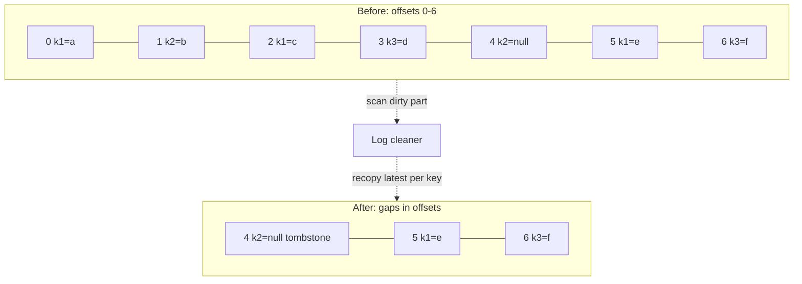

**Reading the diagram.** Before compaction, keys k1, k2 and k3 have several versions. The *log cleaner* runs asynchronously and keeps only the latest record per key: k1 = e at offset 5, k3 = f at offset 6, and the tombstone for k2 at offset 4, which will itself be removed after `delete.retention.ms`. Offsets 0–3 are gone but the survivors keep their original offsets and order. Failure points: a consumer that replays slower than `delete.retention.ms` can miss a tombstone and keep a deleted key; compaction needs disk headroom for recopying. Scaling: cleaner threads and their memory bound how fast large compacted topics converge.

**Table 31.6 — Delete versus compact retention.**

| | `delete` | `compact` | `compact,delete` |
|---|---|---|---|
| Keeps | Everything for a time or size window | Latest record per key, forever | Latest per key, within a time window |
| Typical use | Event streams, logs, clickstream | Changelogs, `__consumer_offsets`, Kafka Streams state, CDC snapshots | Latest-state caches that may expire |
| Rebuild state by replay | Only within the window | Always | Within the window |

::: industry
**The New York Times publishing pipeline.** The Times described storing every published asset since 1851 in a single-partition, log-compacted Kafka topic used as the source of truth; services such as search and personalization build their own views by replaying it from the beginning, and new derived systems are created by replay rather than by bulk export. The single partition preserves a total order of edits across assets.
*Evidence: Primary* — [Svingen 2017]
:::

::: mistake
**"Compaction makes Kafka a database."** A compacted topic has no secondary indexes, no point reads by key (only sequential scans), and keeps several versions until the cleaner runs. It is a durable changelog from which a database, cache or Kafka Streams state store is built.
:::

## 31.11 Delivery semantics and transactions

### 31.11.1 From at-least-once to exactly-once

Kafka offers all three guarantees of §30.8: at-most-once (commit before processing, or `acks=0`), at-least-once (the default: retries plus commit after processing), and **exactly-once semantics (EOS)**, which Kafka defines narrowly: in a **read-process-write** pipeline from Kafka topics to Kafka topics, each input record's effects (output records *and* the input offset commit) appear exactly once, even across producer retries and application crashes [KIP-98]. Exactly-once delivery over a network is impossible in general; what Kafka provides is effectively-once *processing* by making the output and the offset commit atomic.

### 31.11.2 How transactions work

1. The application sets a stable **`transactional.id`** (for example, `billing-processor-7`). On `initTransactions()`, the **transaction coordinator** (the broker leading the partition of `__transaction_state` chosen by hashing the id) returns the producer ID and bumps its **epoch**. Any older instance with the same id now has a stale epoch and is **fenced**: its writes and commits are rejected. This is how a zombie, a paused instance whose replacement has already started, is stopped.
2. `beginTransaction()` starts a transaction locally. Before the first write to each partition, the producer registers that partition with the coordinator.
3. The producer writes output records normally (idempotently). They are in the logs but marked as belonging to an open transaction.
4. `sendOffsetsToTransaction()` adds the consumed input offsets to the same transaction, as writes to `__consumer_offsets`.
5. `commitTransaction()` runs two-phase commit (§28.4.8): the coordinator writes `PREPARE_COMMIT` to its log (the commit point), writes a **commit marker** (a control record) into every involved partition, then writes `COMPLETE_COMMIT`. Aborts write abort markers instead.
6. Consumers with `isolation.level=read_committed` read only up to the **last stable offset (LSO)**, the first offset of any still-open transaction, and skip records of aborted transactions using the `.txnindex`. The default, `read_uncommitted`, returns everything.

**Figure 31.13 — A read-process-write transaction.**

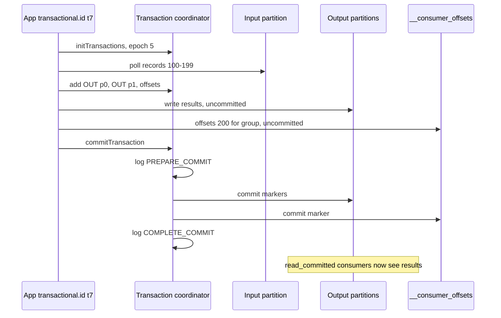

**Reading the diagram.** Outputs and input offsets are written inside one transaction with synchronous calls; the coordinator's replicated `__transaction_state` log records the decision. Once `PREPARE_COMMIT` is durable the transaction commits even if the coordinator crashes, because its successor replays the log and finishes the markers. If the application crashes first, the transaction is aborted (on timeout, `transaction.timeout.ms`, default 60 s, or when the restarted instance calls `initTransactions()`); `read_committed` consumers never see the partial output, and the restart resumes from the last committed offsets.

### 31.11.3 Limits of exactly-once

::: warning
**Exactly-once stops at Kafka's boundary.** Transactions cover records written to Kafka and offsets committed to Kafka. They do not cover a database write, an email, a payment API call or any other side effect inside the processing step; if the application crashes after calling the payment API but before committing, the retry calls it again. For external sinks you need idempotent writes, offsets stored atomically with the output, or a transactional outbox and CDC; §32.9 examines these limits and §32.10 the idempotent-consumer pattern. Transactions also add latency (a commit every interval) and `read_committed` consumers wait for the slowest open transaction, which a hung producer can hold for up to `transaction.timeout.ms`.
:::

Kafka Streams enables this machinery with one setting, `processing.guarantee=exactly_once_v2`, committing by default every 100 ms under EOS. Stream processors such as Flink achieve the same end-to-end effect by tying Kafka transactions to their checkpoints (§29.9.2).

## 31.12 Rebalancing protocols

A **rebalance** reassigns partitions when a member joins, leaves, crashes or misses `max.poll.interval.ms`, or when partitions are added. Its cost is a gap in consumption and, if offsets were not committed, reprocessing.

1. **Eager rebalancing (classic protocol).** Every member revokes *all* its partitions, rejoins, the group leader (a client) computes a new assignment, and members resume. The whole group stops even if only one partition moves: "stop the world".
2. **Cooperative incremental rebalancing (KIP-429, Kafka 2.4).** With the `CooperativeStickyAssignor`, members keep partitions that are not moving; only partitions that change owner are revoked, over two shorter rounds. Most members never stop.
3. **Static membership (KIP-345, Kafka 2.3).** A member with a fixed `group.instance.id` that restarts within `session.timeout.ms` gets its old partitions back without any rebalance, which makes rolling deployments cheap.
4. **Next-generation consumer rebalance protocol (KIP-848).** The group coordinator on the broker, not a client leader, computes assignments and drives them incrementally through ordinary heartbeats; there is no group-wide synchronization barrier, so one member's slow join cannot stall the others. KIP-848 reached general availability in Kafka 4.0 and is enabled on brokers by default; as of 2026 Java consumers opt in with `group.protocol=consumer`.

**Figure 31.14 — Eager versus cooperative rebalancing when consumer C joins.**

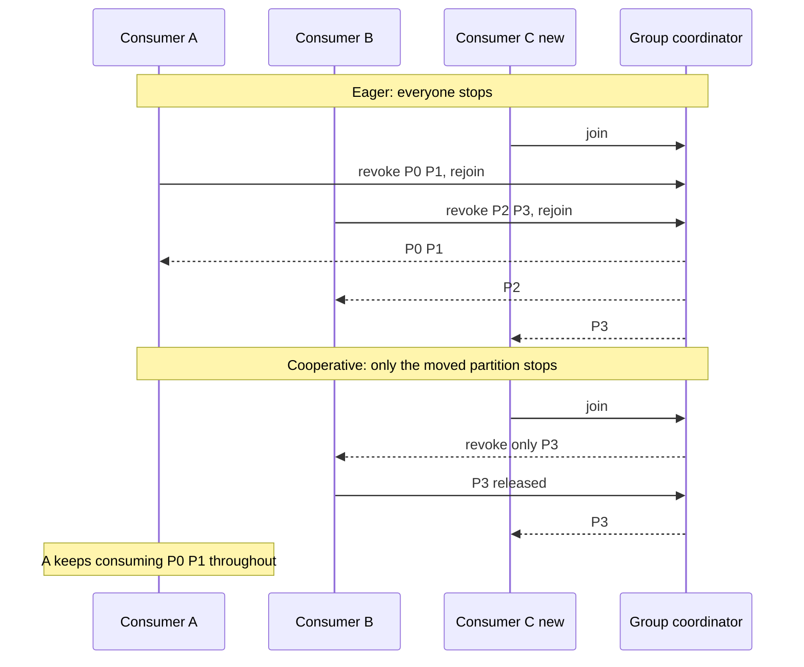

**Reading the diagram.** In the eager half, C's arrival forces A and B to give up all four partitions, so nothing is consumed until the new assignment arrives. In the cooperative half, the coordinator asks only B to release P3, then assigns it to C; A never pauses and B pauses only P3. All messages are synchronous group-protocol calls. Failure point: one member slow to rejoin stretches an eager rebalance for the whole group, a cost that grows with group size.

**Table 31.7 — Rebalance protocols (as of 2026).**

| Protocol | Who assigns | Pause during rebalance | Since |
|---|---|---|---|
| Eager (range, round-robin, sticky) | Client group leader | Whole group | Early versions |
| Cooperative sticky | Client group leader | Only moved partitions | 2.4 |
| Static membership (add-on) | Either | None on quick restart | 2.3 |
| KIP-848 consumer protocol | Broker coordinator | Only moved partitions, no global barrier | GA in 4.0 |

::: recommendation
**Reduce rebalances before speeding them up.** Keep processing per `poll()` well under `max.poll.interval.ms` (lower `max.poll.records` if needed), use static membership for stateful or slow-starting consumers, commit offsets in the partition-revoked callback, and use a cooperative or KIP-848 protocol.
:::

## 31.13 Performance

### 31.13.1 Why Kafka is fast

Kafka's throughput comes from a few hardware facts (Chapter 5) applied consistently [Apache Kafka Docs: Design]:

1. **Sequential I/O.** Appends and most reads are sequential, which disks and SSDs serve far faster than random access (§5.6).
2. **The page cache.** Brokers write to the OS page cache rather than a JVM-heap cache and let the kernel flush (§6.6.6); consumers near the head read from memory. This avoids double caching and garbage-collection pressure and survives broker restarts. Kafka does not `fsync` each write by default; durability comes from replication.
3. **Zero-copy transfer.** For plaintext connections the broker uses `sendfile` to move bytes from the page cache to the socket without user-space copies. TLS requires encryption in user space, which loses this (kernel TLS recovers part of it).
4. **End-to-end batching.** The producer's compressed batch is stored, replicated and sent to consumers as-is, so per-record costs are paid once per batch.

**Figure 31.15 — Read path with and without zero-copy.**

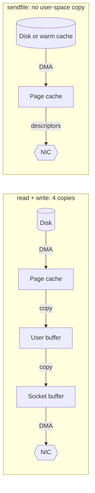

**Reading the diagram.** In the classic path, data crosses the kernel–user boundary twice, costing CPU copies and system calls. With `sendfile`, the kernel hands page-cache pages straight to the network card, so the broker's CPU barely touches the bytes. Both serve the same synchronous fetch. Failure point: a consumer reading old data causes disk reads that evict hot pages. Scaling: consumers of recent data are served from memory at network speed.

### 31.13.2 Sizing brokers for throughput

::: formula
**Brokers needed for network and disk throughput**

$$N = \left\lceil \max\left( \frac{W R}{u\,D_b},\ \frac{W (R - 1 + F)}{u\,E_b} \right) \right\rceil$$

| Symbol | Meaning | Units |
|---|---|---|
| $N$ | Brokers needed | count |
| $W$ | Total produce throughput into the cluster (after compression) | MB/s |
| $R$ | Replication factor | count |
| $F$ | Number of consumer groups reading each record from brokers (fan-out) | count |
| $D_b$ | Sustained disk write throughput per broker | MB/s |
| $E_b$ | Network egress capacity per broker | MB/s |
| $u$ | Target utilization (headroom for failures and catch-up) | fraction |
:::

Each byte is written to disk $R$ times and leaves brokers $R - 1$ times for replication plus $F$ times for consumers. Network ingress ($W R$) is usually smaller than egress.

::: example
**Worked example — A 400 MB/s cluster.** $W = 400$ MB/s, $R = 3$, $F = 4$ consumer groups, each broker has $D_b = 1{,}000$ MB/s of disk write and a 25 Gb/s NIC ($E_b = 3{,}125$ MB/s), and you target $u = 0.5$ so a failed broker's load fits on the rest.

1. Disk: $400 \times 3 = 1{,}200$ MB/s cluster-wide; $1{,}200 / (0.5 \times 1{,}000) = 2.4$.
2. Egress: $400 \times (3 - 1 + 4) = 2{,}400$ MB/s; $2{,}400 / (0.5 \times 3{,}125) = 1.54$.
3. $N = \lceil 2.4 \rceil = 3$ brokers for throughput.
4. Storage (§31.15) and partition counts often require more; take the largest requirement.

**Interpretation.** At this scale disk writes, not the network, set the minimum, and consumers that read from the page cache add egress but almost no disk reads. **Engineering implication.** A lagging consumer that reads from disk adds disk *reads* not in this formula; keep headroom, or use tiered storage so historical reads come from object storage.
:::

### 31.13.3 End-to-end latency budget

::: formula
**Produce-to-consume latency**

$$T_{e2e} = t_{\text{linger}} + t_{\text{send}} + t_{\text{append}} + t_{\text{repl}} + t_{\text{fetch}} + t_{\text{proc}}$$

| Symbol | Meaning | Units |
|---|---|---|
| $t_{\text{linger}}$ | Time a record waits in the producer batch (≤ `linger.ms`) | ms |
| $t_{\text{send}}$ | Network transfer to the leader | ms |
| $t_{\text{append}}$ | Leader validation and append to page cache | ms |
| $t_{\text{repl}}$ | Time until followers fetch it and the HW advances | ms |
| $t_{\text{fetch}}$ | Consumer fetch wait and transfer after the record is committed | ms |
| $t_{\text{proc}}$ | Consumer processing before the effect is visible | ms |
:::

::: example
**Worked example — Budgeting a 50 ms p99 target.** Within one region (round trips about 1 ms; cross-zone about 1–2 ms):

1. $t_{\text{linger}} = 5$ ms (default linger at low load).
2. $t_{\text{send}} = 1$ ms; $t_{\text{append}} = 1$ ms.
3. $t_{\text{repl}}$: followers fetch continuously across zones, typically 2–5 ms; at p99 under load, 10 ms.
4. $t_{\text{fetch}}$: a waiting consumer fetch returns as soon as data is committed, about 2 ms.
5. $t_{\text{proc}} = 10$ ms (one database write).
6. Total p99 estimate: $5 + 1 + 1 + 10 + 2 + 10 = 29$ ms, inside 50 ms with 21 ms to spare.

**Interpretation.** Replication and processing dominate, not disk. Consumers see records only after the HW advances, so with `acks=1` the *producer* is acknowledged sooner but the *consumer* still waits for replication. **Engineering implication.** If p99 is too high, check for slow followers holding back the HW, garbage-collection pauses, `read_committed` waiting on open transactions, and consumer lag, which adds queueing delay far larger than any term above.
:::

::: industry
**"2 million writes per second on three cheap machines."** A 2014 LinkedIn benchmark of Kafka on three commodity brokers reported about two million small-record writes per second with replication, and showed throughput staying flat as stored data grew, because reads and writes remain sequential and unaffected by log size [Kreps 2014]. The exact numbers depend on 2014 hardware and versions; the scaling argument is what transfers.
*Evidence: Primary* — [Kreps 2014]
:::

## 31.14 Kafka Streams and Kafka Connect

### 31.14.1 Kafka Streams

**Kafka Streams** is a Java library (not a cluster) for stream processing on Kafka. Its two core abstractions express the **stream–table duality**:

- A **KStream** is an unbounded sequence of independent events ("order 17 was paid").
- A **KTable** is a changelog interpreted as a table: each record is an upsert for its key, and a tombstone deletes it. Aggregating a KStream produces a KTable; reading a KTable's changes produces a KStream. A **GlobalKTable** is replicated in full to every instance for joins without repartitioning.

Stateful operations (aggregations, joins, windows, §29.8) keep **state stores**, by default embedded RocksDB instances (§13.14.2) on the instance's local disk. Every store write is also sent to a compacted **changelog topic**, so when an instance dies, another rebuilds the store by replaying the changelog; **standby replicas** (`num.standby.replicas`) keep warm copies to shorten that recovery. Re-keying a stream writes it through an internal **repartition topic** so records with the new key meet in one partition. Scaling is by partitions: each input partition becomes a **task**, and tasks are spread over instances using the consumer-group protocol.

### 31.14.2 Kafka Connect and Debezium

**Kafka Connect** is a framework for moving data between Kafka and other systems without custom code. A cluster of **workers** runs **connectors**, each split into **tasks**. **Source connectors** read from an external system into topics; **sink connectors** write topics to an external system. **Converters** serialize data (JSON, Avro or Protobuf, often with a schema registry), **single message transforms** make light per-record changes, and sink errors can be routed to a dead-letter topic (§30.11). In distributed mode, connector configurations, source offsets and status live in three internal compacted topics, so workers are stateless and restartable.

**Debezium** is a family of source connectors for **change data capture (CDC)**: it reads a database's own replication log (PostgreSQL logical decoding of the WAL, the MySQL binlog), takes an initial snapshot, then emits one event per committed row change, typically to a topic per table keyed by primary key [Debezium Docs]. Chapter 32 builds the transactional outbox and CDC patterns on it (§32.5–§32.6).

**Figure 31.16 — Connect, Streams and CDC around one cluster.**

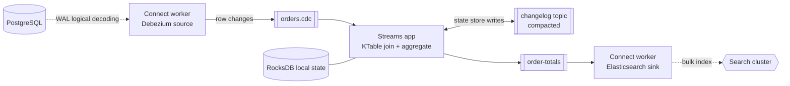

**Reading the diagram.** A *Debezium* source connector tails PostgreSQL's WAL asynchronously and publishes row changes to `orders.cdc`. A *Kafka Streams* application joins and aggregates them, keeping state in local *RocksDB* backed by a compacted *changelog topic*, and writes results to `order-totals`. A *sink connector* bulk-indexes those into a search cluster. Failure points: a dead Streams instance's tasks move elsewhere and restore state from the changelog; a sink outage builds lag but loses nothing within retention. Scaling: add workers or instances up to the partition counts.

## 31.15 Operating Kafka

### 31.15.1 What to monitor

**Table 31.8 — Core health signals.**

| Signal | Healthy value | What it means when wrong |
|---|---|---|
| `UnderReplicatedPartitions` | 0 | Followers lagging or a broker down; redundancy reduced |
| `UnderMinIsrPartitionCount` | 0 | `acks=all` writes are being refused for those partitions |
| `OfflinePartitionsCount` | 0 | No leader: partitions unavailable |
| `ActiveControllerCount` | 1 across the cluster | 0 means the KRaft quorum has no leader |
| ISR shrink/expand rate | Near 0 | Flapping followers: network, disk or GC problems |
| Consumer lag (records and seconds) | Bounded, not growing | Consumers too slow or stuck (§31.7.3) |
| Produce/fetch request latency p99 | Stable | Disk saturation, page-cache misses, overloaded broker |

Routine operations include **partition reassignment** (moving replicas to new brokers, throttled so replication does not starve clients), **rolling restarts** with controlled leadership transfer, **quotas** per client to stop one tenant saturating a broker, and automated balancing tools such as LinkedIn's Cruise Control.

### 31.15.2 Capacity planning for disk

::: formula
**Local disk required for retention**

$$S = \frac{W \cdot t_{\text{ret}} \cdot R}{u}$$

| Symbol | Meaning | Units |
|---|---|---|
| $S$ | Total provisioned broker disk | bytes |
| $W$ | Average produce throughput after compression | bytes/s |
| $t_{\text{ret}}$ | Retention period | s |
| $R$ | Replication factor | count |
| $u$ | Maximum safe disk utilization | fraction |
:::

::: example
**Worked example — Seven days at 200 MB/s.** $W = 200$ MB/s average, $t_{\text{ret}} = 7$ days $= 604{,}800$ s, $R = 3$, $u = 0.7$.

1. One copy: $200 \times 10^6 \times 604{,}800 = 1.2096 \times 10^{14}$ B = 121 TB.
2. Three replicas: 363 TB.
3. Divide by 0.7: $S \approx 518$ TB.
4. With 12 TB usable per broker: $518 / 12 = 43.2$, so 44 brokers, far more than the 3 that throughput needed (§31.13.2).
5. With **tiered storage** keeping 1 day locally: local $= 200 \times 10^6 \times 86{,}400 \times 3 / 0.7 = 74$ TB (7 brokers), plus 121 TB of one logical copy in object storage, whose durability is the object store's.

**Interpretation.** Retention, not throughput, sized this cluster. **Engineering implication.** Long retention on broker disks couples storage to compute; tiered storage decouples them and makes broker replacement and rebalancing faster because there is less local data to copy.
:::

### 31.15.3 Tiered storage (KIP-405)

With **tiered storage**, closed segments are copied to a remote store (typically object storage) through a pluggable `RemoteStorageManager`, and deleted locally after `local.retention.ms`; the topic's `retention.ms` still governs total retention. Consumers reading old offsets are served transparently from the remote tier, at higher latency. Tiered storage was early access in Kafka 3.6 and declared production-ready in 3.9 (2024) [KIP-405]; as of 2026 it requires a third-party or vendor plugin for the specific object store.

#### Failure scenarios

| What goes wrong | Why | Detection | Recovery | Prevention |
|---|---|---|---|---|
| Disk fills on a broker | Retention too long, skewed partitions | Disk usage alerts | Shorten retention, reassign partitions | Formula above with $u \le 0.7$; tiered storage |
| Lag grows without bound | Consumers slower than producers, or a poison record | Lag in seconds rising | Scale consumers, skip or dead-letter the record | Capacity headroom; DLQ handling (§30.11) |
| Under-min-ISR during maintenance | Two brokers restarted at once | `UnderMinIsrPartitionCount` > 0 | Bring brokers back | Restart one broker at a time; wait for ISR to recover |
| Cross-zone transfer cost spike | Consumers fetch from leaders in other zones | Cloud bill, network metrics | Enable follower fetching (KIP-392) | Rack-aware placement and clients |

## 31.16 Summary and revision notes

::: summary
- Kafka is a **partitioned, replicated, append-only log**. Consumers track their own offsets, so reading does not delete, many groups read independently, and history can be replayed (§31.3).
- **KRaft** stores metadata in a Raft-replicated `__cluster_metadata` log; ZooKeeper mode was removed in Kafka 4.0 (2025). Data partitions still use ISR replication (§31.4).
- Order holds **within a partition only**. Keys pick partitions by `murmur2 mod P`; changing $P$ moves $1 - \min(P,P')/\operatorname{lcm}(P,P')$ of keys, so size keyed topics up front: $P = \lceil h \max(T/t_p, T/t_c) \rceil$ (§31.5).
- Producers batch by `linger.ms` and `batch.size`, compress per batch, and default to `acks=all` with idempotence (PID + sequence numbers, ordering preserved with up to 5 in-flight requests) (§31.6).
- A consumer group gives each partition to one member; parallelism ≤ partitions; lag drains in $L/(\mu - \lambda)$ (§31.7).
- Commit after processing = at-least-once; commit before = at-most-once; offsets live in compacted `__consumer_offsets` (§31.8).
- HW = min LEO over the ISR; consumers read below it. RF = 3, `min.insync.replicas=2`, `acks=all`, unclean election off survives one failure with no loss and no write outage. Leader epochs fence stale leaders and make truncation safe (§31.9).
- Retention deletes whole segments by time or size; compaction keeps the latest value per key and turns a topic into a changelog (§31.10).
- Transactions (2PC through a coordinator, fenced by `transactional.id` epochs, read via `read_committed`) give exactly-once for Kafka-to-Kafka read-process-write only (§31.11).
- Cooperative rebalancing, static membership and KIP-848 (GA in 4.0) cut rebalance pauses (§31.12).
- Speed comes from sequential I/O, the page cache, `sendfile` zero-copy and end-to-end batching; size brokers by disk, egress and especially retention: $S = W t_{\text{ret}} R / u$; tiered storage decouples retention from broker disks (§31.13–§31.15).
:::

## 31.17 Knowledge checkpoint

1. Why can a Kafka consumer replay data that a classic queue consumer cannot?
2. What problem with ZooKeeper-mode controller failover did KRaft solve?
3. How does a broker find offset 368,800 in a partition with many segments?
4. A keyed topic grows from 10 to 15 partitions. What fraction of keys move?
5. With `linger.ms=5` and 400 records/s into a partition, how many records are in each batch?
6. Why does an idempotent producer preserve order with five requests in flight?
7. A group has 8 members and the topic has 6 partitions. What happens?
8. Which commit timing gives at-most-once delivery, and why?
9. Leader LEO 500, follower LEOs 480 and 470, all in the ISR. What is the HW, and what can consumers read?
10. Why is RF = 3 with `min.insync.replicas=3` a poor choice?
11. What does unclean leader election trade?
12. What does a tombstone do in a compacted topic, and why is it kept for a while?
13. What exactly does Kafka's exactly-once guarantee cover?
14. Why does TLS reduce Kafka's zero-copy benefit?
15. Retention 3 days, 50 MB/s, RF = 3, $u = 0.75$: how much disk?

<details><summary>Answers</summary>

1. Reading only advances the consumer's own offset; records remain until retention removes them, so any consumer can seek back.
2. A new controller had to reload all metadata from ZooKeeper, taking time proportional to partition count; KRaft standbys already hold the metadata log in memory.
3. Binary-search segments by base offset, binary-search that segment's sparse `.index`, then scan forward a few kilobytes.
4. $\operatorname{lcm}(10,15) = 30$, $\min = 10$: $1 - 10/30 = 2/3 \approx 67\%$.
5. $400 \times 0.005 = 2$ records (assuming they fit in `batch.size`).
6. The leader accepts batches only in sequence order per producer and partition; an out-of-order batch is rejected and resent.
7. Six members get one partition each; two are idle standbys.
8. Commit before processing: a crash after the commit skips the uncommitted work, losing it but never duplicating it.
9. HW = 470; consumers read offsets 0–469.
10. Any single broker outage, including a rolling restart, shrinks the ISR below 3 and blocks `acks=all` writes.
11. It restores availability by electing an out-of-sync replica, losing acknowledged records that replica lacked.
12. It marks the key deleted; it is retained for `delete.retention.ms` so consumers replaying the log see the deletion before it disappears.
13. Atomic output to Kafka topics plus input offset commits in a read-process-write pipeline, seen by `read_committed` consumers; not external side effects.
14. Data must be encrypted in user space, so the kernel cannot send page-cache pages directly to the socket.
15. $50 \times 10^6 \times 259{,}200 \times 3 / 0.75 = 5.18 \times 10^{13}$ B ≈ 52 TB.
</details>

## 31.18 Interview questions

### Basic

**Q1. How does Kafka guarantee ordering?** **Answer.** Only within a partition: the leader assigns increasing offsets and consumers read in offset order. Records that must stay ordered share a key so they hash to one partition. There is no order across partitions, and changing the partition count breaks per-key order for in-flight data.

**Q2. What is a consumer group?** **Answer.** Consumers sharing a `group.id` that divide partitions so each partition has one owner; different groups read independently. Parallelism is capped by partition count.

### Intermediate

**Q3. Configure a topic so an acknowledged write survives any single broker failure without making writes unavailable.** **Answer.** RF = 3 across three racks or zones, `min.insync.replicas=2`, producer `acks=all` with idempotence, unclean leader election disabled. One failure leaves two in-sync replicas, so writes continue and every acknowledged record is on at least two brokers.

**Q4. Consumer lag is growing after a deploy. How do you diagnose it?** **Answer.** Check whether lag grows on all partitions (throughput: processing slowed, too few consumers, downstream database slow) or a few (hot key, poison record, stuck consumer). Look for frequent rebalances (processing exceeding `max.poll.interval.ms`), compare production rate with consumption rate, compute drain time, and scale consumers only up to the partition count.

### Advanced

**Q5. Design exactly-once processing from a Kafka topic into PostgreSQL.** **Answer.** Kafka transactions do not cover PostgreSQL. Either write results and the consumed offset in one PostgreSQL transaction and seek to the stored offset on start-up, or make writes idempotent (upsert keyed by event ID or a processed-events table) with at-least-once commits. Mention zombie consumers after rebalance: the database transaction or a fencing check on partition ownership must reject stale writers.

**Q6. Why does Kafka use ISR replication for data but Raft for metadata?** **Answer.** ISR commits when all in-sync replicas have a record, tolerating $f$ failures with $f+1$ copies, which halves storage relative to majority quorums for large data volumes; it relies on an external authority to manage ISR membership and elections. That authority must itself be consistent without external help, so the metadata quorum uses Raft, where majority commit needs no outside arbiter and slow members do not block progress.

## 31.19 Practical exercises

1. Run the simulation of §31.9.5 with `fetch_every=(1, 1, 1)` and `acks=1`. Is anything lost? Explain why the loss window depends on replication lag.
2. Extend the simulation with HW propagation delay: followers learn the HW one fetch later. Construct a double failure that loses committed data if followers truncate to their own HW, then fix it with leader-epoch truncation.
3. Using the partitioner code, measure per-partition counts for 1,000,000 keys of the form `tenant-<n>` with 48 partitions, then for keys where 5% of traffic is one tenant. Compute the hottest partition's share.
4. Write a consumer loop (pseudo-code) that commits asynchronously during normal operation and synchronously on revocation and shutdown.
5. Size a cluster for 1 GB/s, 3-day retention, RF = 3, 5 consumer groups, 20 TB disks and 25 Gb/s NICs, using the formulas of §31.13.2 and §31.15.2.

## 31.20 Design challenges

1. **Order event backbone.** Design topics, keys, partition counts and durability settings for an e-commerce platform with 30,000 orders/s at peak, per-order ordering, a 30-day replay requirement and consumers for billing, search and analytics. Justify each number and plan how to grow partitions in two years.
2. **Multi-region log.** Two regions must both consume all orders, and the platform must survive a region loss with at most 5 seconds of data loss. Compare stretched clusters with asynchronous cross-cluster replication, and state the recovery point and recovery time of each.
3. **Changelog-backed cache.** Replace nightly cache rebuilds with a compacted topic fed by CDC. Specify tombstone handling, bootstrap time for a new cache node, and how consumers detect that they have caught up.

## 31.21 References

1. Kreps, J., Narkhede, N., Rao, J. *Kafka: a Distributed Messaging System for Log Processing*. NetDB Workshop, 2011.
2. Kreps, J. *The Log: What every software engineer should know about real-time data's unifying abstraction*. LinkedIn Engineering blog, 2013. https://engineering.linkedin.com/distributed-systems/log-what-every-software-engineer-should-know-about-real-time-datas-unifying
3. Wang, G., Koshy, J., Subramanian, S., Paramasivam, K., Zadeh, M., Narkhede, N., Rao, J., Kreps, J., Stein, J. *Building a Replicated Logging System with Apache Kafka*. Proceedings of the VLDB Endowment 8(12), 2015.
4. Shapira, G., Palino, T., Sivaram, R., Petty, K. *Kafka: The Definitive Guide*, 2nd ed. O'Reilly Media, 2021.
5. Apache Software Foundation. *Apache Kafka Documentation* (Design, Replication, Configuration, Operations). Accessed 2026. https://kafka.apache.org/documentation/
6. Apache Software Foundation. *Apache Kafka 4.0.0 Release Announcement and Upgrade Notes*. March 2025. https://kafka.apache.org/blog
7. Apache Kafka. *KIP-500: Replace ZooKeeper with a Self-Managed Metadata Quorum*. https://cwiki.apache.org/confluence/display/KAFKA/KIP-500%3A+Replace+ZooKeeper+with+a+Self-Managed+Metadata+Quorum
8. Apache Kafka. *KIP-98: Exactly Once Delivery and Transactional Messaging*. 2017. https://cwiki.apache.org/confluence/display/KAFKA/KIP-98+-+Exactly+Once+Delivery+and+Transactional+Messaging
9. Apache Kafka. *KIP-101: Alter Replication Protocol to use Leader Epoch rather than High Watermark for Truncation*. 2017. https://cwiki.apache.org/confluence/display/KAFKA/
10. Apache Kafka. *KIP-405: Kafka Tiered Storage*. https://cwiki.apache.org/confluence/display/KAFKA/KIP-405%3A+Kafka+Tiered+Storage
11. Apache Kafka. *KIP-848: The Next Generation of the Consumer Rebalance Protocol*. https://cwiki.apache.org/confluence/display/KAFKA/
12. Apache Kafka. *KIP-345 (static membership), KIP-392 (follower fetching), KIP-429 (incremental cooperative rebalancing), KIP-480 and KIP-794 (sticky partitioner), KIP-679 (producer safety defaults), KIP-932 (queues for Kafka), KIP-1030 (default value changes in 4.0)*. https://cwiki.apache.org/confluence/display/KAFKA/Kafka+Improvement+Proposals
13. Rao, J. *How to choose the number of topics/partitions in a Kafka cluster?* Confluent blog, 2015.
14. Kreps, J. *Benchmarking Apache Kafka: 2 Million Writes Per Second (On Three Cheap Machines)*. LinkedIn Engineering blog, 2014.
15. Svingen, B. *Publishing with Apache Kafka at The New York Times*. Confluent blog, 2017.
16. Debezium Project. *Debezium Documentation*. Accessed 2026. https://debezium.io/documentation/

## 31.22 Open verification items

- Exact Kafka release for each status as of 2026: KRaft production-ready 3.3, ZooKeeper deprecated 3.5, removed 4.0 (March 2025); KIP-848 GA in 4.0 with client opt-in via `group.protocol=consumer`; tiered storage production-ready in 3.9.
- KIP-932 share groups: maturity level in the current 4.x release.
- Defaults quoted: `linger.ms` 5 ms (4.0, KIP-1030), `session.timeout.ms` 45 s, `replica.lag.time.max.ms` 30 s, `__consumer_offsets` 50 partitions, Streams EOS commit interval 100 ms.
- Kreps 2014 benchmark figures and Svingen 2017 details (single-partition compacted topic) against the original posts.
- Exact URLs for KIP-101, KIP-848 and the 4.0 release announcement.
- The brief listed *Kafka: The Definitive Guide* (2nd ed.) as Narkhede, Shapira and Palino; the 2021 edition's authors are Shapira, Palino, Sivaram and Petty (Narkhede co-authored the 2017 first edition).
