# Chapter 32 — Event-Driven Architecture Patterns

> **Level:** 3–4 · **Track:** A (Traditional) · **Estimated reading time:** 5 h

Chapter 30 introduced messages, brokers and delivery guarantees, and Chapter 31 showed how Kafka stores events in a replicated, partitioned log. This chapter is about what you *build* with those tools when a business process spans several services, each owning its own database. Four problems recur. How do you record what happened so that you can rebuild, audit and re-interpret it later (event sourcing)? How do you serve queries that the write model answers badly (CQRS)? How do you change a database *and* tell the world about it without losing or inventing events (the transactional outbox and change data capture)? And how do you keep a multi-step business transaction correct when 2PC is not an option (sagas, choreography, orchestration and workflow engines)?

Underneath all four sits one uncomfortable fact: messages are delivered at least once, so every consumer must be safe to run twice. Sections 32.9 and 32.10 make that precise. The running example is the online shop of Chapter 11, now split into order, inventory, payment and shipping services; it is *illustrative*, not a description of any real company. Two-phase commit is Chapter 28's subject; API idempotency keys are owned by §22.15 and only applied here.

**Figure 32.1 — How the patterns in this chapter fit together.**

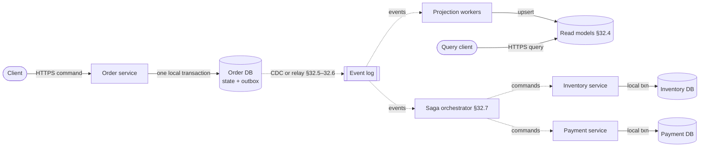

**Reading the diagram.** The only synchronous write a user waits for is the order service's local transaction, which stores the new state and, in the same transaction, an outbox row (or, with event sourcing, the events themselves). Everything after that is asynchronous (dotted arrows): a relay or change data capture (CDC) process copies committed events to the event log; projection workers build read models; a saga orchestrator sends commands to the inventory and payment services, each of which commits locally. Each database is a separate storage boundary, and no transaction spans two of them. Failure points: the relay, the log, each consumer and each service can crash between any two steps, so every arrow is retried and every receiver deduplicates. Scaling is per component: partition the log by order ID, run more projection workers per partition, and shard the orchestrator by saga ID.

## 32.1 Learning objectives

After this chapter you should be able to:

- Design an event-sourced aggregate with optimistic concurrency, snapshots and schema upcasting, and estimate its replay time.
- Explain how event sourcing interacts with the GDPR right to erasure and apply crypto-shredding.
- Build CQRS read models from an event stream, estimate projection lag, and say when CQRS is not worth it.
- Show with a failure sequence why dual writes lose or invent events, and implement a transactional outbox with a polling or log-tailing relay.
- Describe how log-based change data capture (Debezium) snapshots and streams a database, and the role of a schema registry.
- Design a saga with compensating, pivot and retriable steps, analyze a failure at each step, and choose countermeasures for its missing isolation.
- Compare choreography and orchestration, and decide when a workflow engine (Temporal, Step Functions) beats a hand-rolled saga.
- State precisely what "exactly-once" means in Kafka and why end-to-end effectively-once needs idempotent consumers.

## 32.2 Prerequisites

- Messages, events versus commands, delivery guarantees and dead-letter queues — Chapter 30 (this chapter assumes at-least-once delivery).
- Kafka partitions, offsets, idempotent producers and transactions — §31.5–§31.11 (the event log underneath most examples).
- Local transactions, isolation anomalies and the write-ahead log — §11.11–§11.15 and §13.5 (the outbox and CDC rely on them).
- Logical replication — §14.4 (CDC is a consumer of it).
- Two-phase commit and the saga preview — §28.4 and §28.6 (sagas are the alternative to 2PC).
- Idempotency keys — §22.15 (owned there; applied to consumers here).
- The end-to-end argument — §24.14 (why exactly-once must be finished by the application).

## 32.3 Event sourcing

### 32.3.1 Storing facts instead of current state

::: definition
**Definition — Event sourcing.** A persistence pattern in which the system of record for an entity is the append-only, ordered sequence of **domain events** that changed it (`AccountOpened`, `MoneyDeposited`, ...). Current state is not stored as truth; it is derived by replaying the events, a **left fold** of a pure function `apply(state, event)` over the sequence [Fowler 2005].
:::

#### First-principles explanation

An accountant never erases a ledger line. If a payment was booked wrongly, a correcting entry is added, and the balance is the sum of all lines. A bank statement is a *view* computed from the ledger. Event sourcing applies the same discipline to software: instead of `UPDATE accounts SET balance = 4000`, you append `MoneyWithdrawn{amount: 1000}`, and the balance is whatever the events add up to.

#### Why does this exist?

A conventional table that is updated in place answers "what is true now?" and forgets "how did we get here?". Many domains need the second question: auditors, fraud analysts, customer-support agents ("why was I charged twice?"), and engineers who want to build a *new* view of old data, such as "average time from cart to checkout last year", without having logged it in advance. With state-oriented storage, history survives only if someone remembered to write an audit table, and audit tables drift from the truth because they are a second write. With event sourcing the history *is* the truth, so it cannot drift. Other benefits follow: temporal queries ("the balance on 31 March"), debugging by replaying production events, and natural integration, because the events can be published to other services.

#### How it works internally

1. **Streams and aggregates.** Events are grouped into **streams**, one per **aggregate**: a cluster of objects that is a consistency boundary, such as one account or one order (a term from domain-driven design). An invariant ("balance never negative") is enforced inside one aggregate; nothing is atomic across aggregates.
2. **Command handling.** A command (`Withdraw 4,000`) loads the aggregate by replaying its stream, validates the command against current state, and, if valid, produces new events. The command can be rejected; an event cannot, because it describes something that already happened.
3. **Optimistic concurrency.** The append carries the **expected version**, the stream length the handler saw. If another writer appended in between, the store refuses the append and the handler reloads and retries. This is the event-store equivalent of a compare-and-set, and it serializes writes per aggregate without locks.
4. **The event store.** Any durable, ordered, append-only storage works: a relational table with a unique key on `(stream_id, version)`, a purpose-built store such as EventStoreDB, or a log. Kafka is a poor fit as the *only* store, because it has no per-key expected-version append and loading one aggregate means scanning a partition; it is an excellent transport for the events afterwards [Kleppmann 2017, ch. 11].
5. **Projections.** Subscribers fold events into read-optimized views (§32.4), each tracking a **checkpoint**, the global position of the last event it applied.

**Figure 32.2 — The write path of an event-sourced service.**

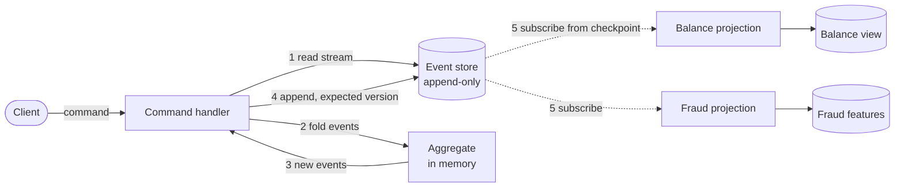

**Reading the diagram.** Steps 1–4 are synchronous and run inside the command handler; the aggregate exists only in memory, rebuilt from the event store for each command (or cached). The append in step 4 is the single atomic write and the commit point; an expected-version mismatch fails it and the handler retries from step 1. Step 5 is asynchronous: each projection pulls events after its own checkpoint and updates its own store, so views lag the event store and can be deleted and rebuilt. Failure points: a crash before step 4 loses nothing (no event was recorded, the client retries with an idempotency key, §22.15); a projection crash leaves its view stale until it resumes from its checkpoint. Scaling: streams partition naturally by aggregate ID; projections scale by partitioning the event feed.

### 32.3.2 Rebuilding state and snapshots

Replaying a stream of a few dozen events is cheap. Long-lived aggregates (a merchant account with millions of transactions) and full projection rebuilds are not. A **snapshot** stores the aggregate's state at version $v$; loading reads the latest snapshot and replays only events after $v$. A snapshot is a cache: it can be deleted and recomputed, and it must record the schema version of the state it holds, because changing the `apply` logic invalidates old snapshots.

**Figure 32.3 — Loading an aggregate from a snapshot plus its tail.**

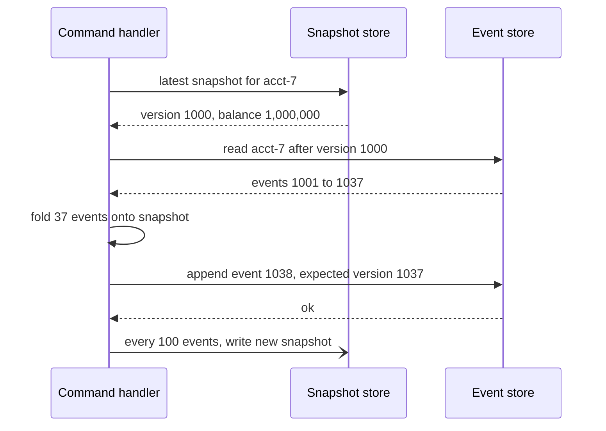

**Reading the diagram.** Both stores are durable storage boundaries; they may be two tables in one database. The handler reads synchronously from both, folds at most one snapshot interval of events, and appends with the expected version. Writing the snapshot is asynchronous and optional (the half-arrow): if it fails or the process crashes, the next load simply replays more events. The failure to watch is a stale snapshot built with an older `apply` function; version the snapshot schema and discard mismatches. Snapshot frequency trades storage and write work against load latency.

#### Mathematical foundations

::: formula
**Replay time with and without snapshots**

$$T_{\text{full}} = \frac{N}{r} \qquad\qquad T_{\text{snap}} \approx t_s + \frac{S}{2r}$$

| Symbol | Meaning | Units |
|---|---|---|
| $N$ | Events in the stream (or in the whole store, for a projection rebuild) | events |
| $r$ | Replay throughput: events read and applied per second | events/s |
| $S$ | Snapshot interval; on average $S/2$ events follow the latest snapshot | events |
| $t_s$ | Time to read and deserialize one snapshot | s |
| $T_{\text{full}}, T_{\text{snap}}$ | Time to rebuild state from scratch or from a snapshot | s |
:::

::: example
**Worked example — A busy merchant account and a full rebuild.**

1. A merchant account has $N = 50{,}000$ events; the handler replays $r = 20{,}000$ events/s. $T_{\text{full}} = 50{,}000 / 20{,}000 = 2.5$ s per command, unacceptable for a payment API.
2. Snapshot every $S = 500$ events with $t_s = 2$ ms: $T_{\text{snap}} = 0.002 + 250 / 20{,}000 = 0.002 + 0.0125 = 14.5$ ms.
3. A new fraud projection must process the whole store: $N = 2 \times 10^9$ events at $r = 100{,}000$ events/s gives $T_{\text{full}} = 20{,}000$ s $\approx 5.6$ h on one worker. With 16 partitions processed in parallel at the same per-worker rate, about 21 minutes.

Interpretation: snapshots turn per-command cost from $O(N)$ into $O(S)$; they do nothing for projection rebuilds, which need parallelism. Engineering implication: snapshot long-lived aggregates (or, better, model them so streams stay short, for example one stream per merchant per day), and design projections to be partitionable from the start.
:::

### 32.3.3 Code example: an event-sourced account with snapshots

The program below implements an event store with expected-version appends, an account aggregate, a repository that snapshots every $S$ events, and an upcaster for an old event schema (§32.3.4).

```python
"""Event-sourced bank account with optimistic concurrency, snapshots and upcasting.

The event store is append-only. Account state is never stored directly: it is
rebuilt by replaying events, optionally starting from a snapshot.
Run it directly with python3 to execute the tests.
"""
import unittest


class ConcurrencyError(Exception):
    """Another writer appended to the stream since we loaded it."""


class EventStore:
    def __init__(self):
        self.streams = {}    # stream_id -> list of event dicts (version = index + 1)
        self.snapshots = {}  # stream_id -> (version, state dict)
        self.reads = 0       # events read from storage, to measure replay cost

    def append(self, stream_id, events, expected_version):
        stream = self.streams.setdefault(stream_id, [])
        if len(stream) != expected_version:          # optimistic concurrency check
            raise ConcurrencyError(f"{stream_id}: expected {expected_version}, at {len(stream)}")
        stream.extend(events)
        return len(stream)

    def read(self, stream_id, after_version=0):
        events = self.streams.get(stream_id, [])[after_version:]
        self.reads += len(events)
        return [upcast(e) for e in events]           # old shapes are upgraded on read


def upcast(event):
    """Schema v1 (no "schema" field) stored float dollars; v2 stores integer cents."""
    if "schema" not in event and "amount" in event:
        event = {"type": event["type"], "schema": 2,
                 "amount_cents": round(event["amount"] * 100)}
    return event                                     # a new dict: storage is untouched


class InsufficientFunds(Exception):
    pass


class Account:
    """Aggregate: decides with current state, records decisions as events."""

    def __init__(self, account_id):
        self.id, self.version = account_id, 0
        self.balance_cents, self.opened = 0, False
        self.pending = []                            # new events not yet saved

    # --- state transitions: pure functions of (state, event) ---
    def apply(self, event):
        kind = event["type"]
        if kind == "AccountOpened":
            self.opened = True
        elif kind == "MoneyDeposited":
            self.balance_cents += event["amount_cents"]
        elif kind == "MoneyWithdrawn":
            self.balance_cents -= event["amount_cents"]
        self.version += 1

    # --- commands: validate, then emit events ---
    def _emit(self, event):
        event["schema"] = 2
        self.apply(event)
        self.pending.append(event)

    def open(self):
        if self.opened:
            raise ValueError("already open")
        self._emit({"type": "AccountOpened"})

    def deposit(self, cents):
        self._emit({"type": "MoneyDeposited", "amount_cents": cents})

    def withdraw(self, cents):
        if cents > self.balance_cents:
            raise InsufficientFunds(f"balance {self.balance_cents}, asked {cents}")
        self._emit({"type": "MoneyWithdrawn", "amount_cents": cents})

    def snapshot(self):
        return {"balance_cents": self.balance_cents, "opened": self.opened}


class Repository:
    def __init__(self, store, snapshot_every=None):
        self.store, self.every = store, snapshot_every

    def load(self, account_id):
        acct, start = Account(account_id), 0
        if self.every and account_id in self.store.snapshots:
            start, state = self.store.snapshots[account_id]
            acct.balance_cents, acct.opened = state["balance_cents"], state["opened"]
            acct.version = start
        for event in self.store.read(account_id, after_version=start):
            acct.apply(event)
        return acct

    def save(self, acct):
        expected = acct.version - len(acct.pending)
        new_version = self.store.append(acct.id, acct.pending, expected)
        acct.pending = []
        if self.every and new_version // self.every > expected // self.every:
            self.store.snapshots[acct.id] = (new_version, acct.snapshot())


class Tests(unittest.TestCase):
    def history(self, repo, n):
        acct = repo.load("acct-7")
        acct.open()
        repo.save(acct)
        for _ in range(n):
            acct = repo.load("acct-7")
            acct.deposit(1_000)
            repo.save(acct)

    def test_snapshot_and_full_replay_agree(self):
        store = EventStore()
        self.history(Repository(store, snapshot_every=100), 1_000)
        full = Repository(store).load("acct-7")              # no snapshots
        fast = Repository(store, snapshot_every=100).load("acct-7")
        self.assertEqual((full.balance_cents, full.version), (fast.balance_cents, fast.version))
        self.assertEqual(full.balance_cents, 1_000_000)

    def test_snapshot_bounds_replay_cost(self):
        store = EventStore()
        repo = Repository(store, snapshot_every=100)
        self.history(repo, 1_000)
        store.reads = 0
        repo.load("acct-7")
        self.assertLess(store.reads, 100)                    # only the tail after the snapshot
        store.reads = 0
        Repository(store).load("acct-7")
        self.assertEqual(store.reads, 1_001)

    def test_concurrent_writers_conflict(self):
        repo = Repository(EventStore())
        a = repo.load("acct-7"); a.open(); a.deposit(5_000); repo.save(a)
        teller, atm = repo.load("acct-7"), repo.load("acct-7")
        teller.withdraw(4_000); atm.withdraw(4_000)          # each sees 5,000
        repo.save(teller)
        with self.assertRaises(ConcurrencyError):            # the ATM must reload and retry
            repo.save(atm)
        retry = repo.load("acct-7")
        with self.assertRaises(InsufficientFunds):           # invariant holds after reload
            retry.withdraw(4_000)

    def test_v1_events_are_upcast_on_read(self):
        store = EventStore()
        store.streams["acct-9"] = [{"type": "AccountOpened"},
                                   {"type": "MoneyDeposited", "amount": 12.34}]  # v1, 2019
        acct = Repository(store).load("acct-9")
        self.assertEqual(acct.balance_cents, 1_234)
        self.assertNotIn("schema", store.streams["acct-9"][1])  # history is immutable


if __name__ == "__main__":
    unittest.main(verbosity=1)
```

Output (Python 3.13; the timing varies):

```text
....
----------------------------------------------------------------------
Ran 4 tests in 0.041s

OK
```

What to notice:

- `apply` never validates and never fails; validation lives in the command methods. Replaying history must always succeed, even for events that today's rules would reject.
- `test_concurrent_writers_conflict` is the lost-update anomaly of §11.13 prevented by the expected version: both writers saw 5,000, only the first append wins, and the reloaded second writer is refused by the invariant.
- With a snapshot every 100 events, loading reads 1 event instead of 1,001. The snapshot is written *after* the append succeeds, so it never contains uncommitted state.
- The upcaster converts the stored v1 event into a new dictionary on every read; the stored history is never rewritten.

### 32.3.4 Schema evolution and upcasting

Events are kept for years, but the code that reads them changes weekly. A message schema in Chapter 30 must survive only until its consumers drain the queue; an event schema must survive forever. Every change must therefore be **backward compatible for readers**: the current code must understand every version ever written.

**Table 32.1 — Strategies for evolving event schemas.**

| Strategy | How it works | Use when | Cost |
|---|---|---|---|
| Additive change | Add optional fields with defaults; never rename or retype | Most changes | Lowest; enforce with a schema registry (§32.6.3) |
| Weak schema | Readers map JSON by name and ignore unknown fields | Polyglot consumers | Silent misreads if meaning changes |
| Upcasting | A function converts version $k$ to $k+1$ at read time; chain them | Renames, unit changes, splits | Every read pays the conversion; chains grow |
| New event type | `OrderShippedV2` alongside the old type | Meaning changed | Every consumer handles both forever |
| Copy-and-transform migration | Write a new store with converted events, switch over | Accumulated upcasters slow reads | A large batch job; history now differs from what was originally written |

Young's guidance is to prefer additive changes and upcasting, and to treat rewriting history as a last resort, because the event log is also an audit record [Young 2017].

### 32.3.5 Deletion, the GDPR and crypto-shredding

Immutability collides with law. The EU General Data Protection Regulation gives people a **right to erasure** (Article 17) of their personal data in many circumstances [EU 2016/679]. An append-only store that holds `CustomerRegistered{name, email}` cannot simply delete it, and neither can the Kafka topics, backups and projections that copied it.

Three techniques, usually combined:

1. **Keep personal data out of events.** Events carry an opaque `customer_id`; the name and address live in a mutable store that can delete rows. This is the cleanest answer but not always possible (a shipping event needs an address).
2. **Crypto-shredding.** Encrypt each data subject's personal fields with a per-subject key held in a key store. To erase, delete the key: every copy of the ciphertext, in every log, backup and replica, becomes unreadable at once.
3. **Compaction or rewriting** for systems where events can be replaced, such as a Kafka compacted topic with a tombstone (§31.10). This removes data only where compaction reaches; backups still need handling.

**Figure 32.4 — Crypto-shredding personal fields in an event store.**

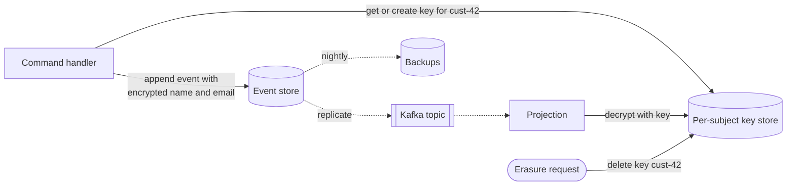

**Reading the diagram.** Only the key store is mutable and deletable; the event store, the Kafka topic and the backups hold ciphertext. Writes and decrypting reads call the key store synchronously; replication and backup are asynchronous copies. After the erasure request deletes the key, projections replaying old events receive a "key not found" error and must render the fields as erased rather than fail. Failure points: the key store becomes a critical dependency on every read and write (cache keys with a short TTL, and replicate the key store), and a key leaked before deletion defeats the scheme. Scaling: one key per subject means millions of keys, so use envelope encryption with a key-management service.

::: warning
**Warning — Crypto-shredding is an argument, not a guarantee.** Whether deleting a key satisfies erasure under a particular regulator's reading is a legal question; non-personal fields (amounts, timestamps) remain and may still identify someone in combination. Involve your privacy counsel, and keep personal data out of events where you can.
:::

### 32.3.6 Trade-offs, industry use and failure scenarios

::: industry
**LMAX exchange — event sourcing in memory.** LMAX's retail trading platform runs its business logic on a single thread over in-memory state. Every input event is journaled and replicated before processing, and state is recovered after a restart by loading a nightly snapshot and replaying the journal. Fowler reports the business logic processor handling about six million orders per second, possible because no business step waits on a database.
*Evidence: Primary* — [Fowler 2011a]
:::

**Advantages.** A complete, trustworthy audit trail; the ability to build new read models from old history; temporal queries; replay for debugging; natural event publication; append-only writes that are cheap and contention-free across aggregates.

**Disadvantages.** A steep learning curve; eventual consistency for every read model; schema evolution forever; hard deletion; no ad hoc queries against the event store; and aggregate boundaries that are expensive to change once events exist.

**Table 32.2 — Event sourcing failure scenarios.**

| What goes wrong | Why | Detection | Recovery | Prevention |
|---|---|---|---|---|
| Lost update | Append without expected version | Invariant violations in reconciliation | Compensating events | Always append with expected version |
| Replay crashes on old event | `apply` validates, or code dropped an old type | Rebuild jobs fail | Hotfix the upcaster, replay | Never validate in `apply`; replay tests over production samples |
| Stale or corrupt snapshot | Snapshot written by older logic | Snapshot-vs-replay comparison | Delete snapshots, rebuild | Version snapshots; sample-verify against full replay |
| Commands slow down over time | Streams grow without bound | Load latency vs stream length | Add snapshots | Short-lived streams; "closing the books" events |
| Projection serves wrong data | Bug in projection code | Diffs against a rebuilt view | Fix and rebuild from position 0 | Blue-green projections |

::: mistake
**Common misconception — "Event sourcing means using Kafka as the database."** Event sourcing needs per-aggregate reads and expected-version appends; a Kafka topic offers neither directly. Store events in a database or event store and *publish* them to Kafka (§32.5, §32.6).
:::

::: mistake
**Common misconception — "Every service should be event sourced."** Most CRUD data (user preferences, product descriptions) gains nothing from history and pays every cost above. Use event sourcing for the few aggregates where history *is* the business: ledgers, orders, inventory movements.
:::

## 32.4 CQRS

### 32.4.1 Separating the write model from read models

::: definition
**Definition — Command Query Responsibility Segregation (CQRS).** An architecture that uses one model to process commands (writes that enforce invariants) and one or more separate models to answer queries, each read model shaped for the queries it serves and typically updated asynchronously from the write side's events [Young 2010; Fowler 2011b].
:::

#### First-principles explanation

A restaurant kitchen works from order tickets organized for cooking; the front-of-house display shows "table 12: mains in 5 minutes", organized for waiters. Nobody makes the chefs rearrange tickets to answer waiters' questions; a runner copies the relevant facts to the display. CQRS gives the "runner" a name: a **projection** that copies facts from the write model into views built for readers.

#### Why does this exist?

One schema rarely serves both sides well. The order write model is normalized around invariants (an order, its lines, a version column). The queries are varied: "a customer's last 20 orders with product images" (a document per customer), "full-text search over orders" (Chapter 16), "revenue per region per hour" (a column store). Forcing all of them through one schema means heavy joins on the write database and indexes that slow every write. Read and write load also scale differently: shops commonly serve tens to hundreds of reads per write. Bertrand Meyer's **command–query separation** applied the idea to methods; Young applied it to whole models [Young 2010].

#### How it works internally

1. Commands go to the write model, which validates them and commits state changes (and, in an event-sourced system, events).
2. Each change is published as an event, through the event store's subscription, an outbox (§32.5) or CDC (§32.6).
3. A **projection** consumes events in order per aggregate and updates its read store with idempotent upserts, recording its checkpoint in the *same* transaction as the update, so a restart neither skips nor double-applies an event.
4. Queries read only from read stores. Each store can be a different technology.
5. To add or fix a view, deploy a new projection that starts from position 0 (or from a snapshot of the source data), let it catch up, then switch readers to it (**blue-green projection**).

CQRS does not require event sourcing, and event sourcing does not strictly require CQRS, but they are usually paired: an event store cannot answer "orders over \$100 last week", so event-sourced systems almost always need projections.

**Figure 32.5 — CQRS with three read models.**

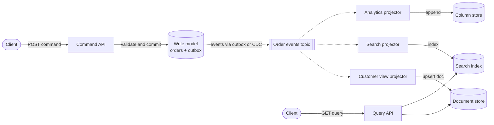

**Reading the diagram.** The command side (top left) is synchronous and strongly consistent within one database. The event topic decouples it from three projectors, each consuming at its own pace (dotted arrows) and writing to its own storage boundary. The query API reads only read models, so a query never touches the write database. Failure points: a projector that falls behind serves stale data; a projector bug corrupts only its own view, which can be rebuilt from the topic. Scaling: read models are replicated and scaled independently, and projectors scale by topic partition (§31.5).

### 32.4.2 Eventual consistency of reads

Every read model lags the write model by the **projection lag**: the time from commit to visibility in the view. In steady state it is the sum of relay or CDC delay, broker latency and projector processing, typically tens to hundreds of milliseconds. After an outage or a deploy pause it can be minutes.

The classic symptom is **read-your-writes** failure: a customer places an order, is redirected to "My orders", and the list does not show it. Remedies, cheapest first:

- Return the new state in the command response and render it on the client.
- Return the write's **position** (log offset or version) and have the query API wait until the projection's checkpoint passes it, with a timeout (a *consistency token*).
- Route that user's reads to the write model for a few seconds after a write.
- Show the item as "processing" in the UI, which is honest and often sufficient.

::: formula
**Catch-up time of a lagging projection**

$$T_{\text{catch}} = \frac{\lambda D}{\mu - \lambda} \qquad (\mu > \lambda)$$

| Symbol | Meaning | Units |
|---|---|---|
| $\lambda$ | Event arrival rate on the source topic | events/s |
| $\mu$ | Maximum processing rate of the projection | events/s |
| $D$ | Duration of the pause or outage | s |
| $\lambda D$ | Backlog accumulated during the pause | events |
| $T_{\text{catch}}$ | Time after resuming until lag returns to steady state | s |
:::

::: example
**Worked example — A projector paused by a bad deploy.**

1. The order topic carries $\lambda = 2{,}000$ events/s. A projector with capacity $\mu = 5{,}000$ events/s is stopped for $D = 10$ min $= 600$ s.
2. Backlog: $2{,}000 \times 600 = 1{,}200{,}000$ events.
3. It drains at the spare rate $\mu - \lambda = 3{,}000$ events/s: $T_{\text{catch}} = 1{,}200{,}000 / 3{,}000 = 400$ s, almost 7 minutes, so total staleness peaks at about 17 minutes.
4. If peak traffic reaches $\lambda = 4{,}500$ events/s, the spare rate is 500 events/s and the same backlog takes 40 minutes.

Interpretation: catch-up time explodes as $\lambda$ approaches $\mu$, the same $1/(1-\rho)$ shape as queueing delay (§4.10). Engineering implication: provision projectors at two to three times peak rate, alert on lag measured in *time* (age of the oldest unapplied event), not only in events, and check that topic retention far exceeds the longest outage you plan to survive.
:::

### 32.4.3 When not to use CQRS

Fowler's own warning is that CQRS adds risky complexity and suits only specific parts of a system [Fowler 2011b].

**Table 32.3 — When CQRS pays off.**

| Use CQRS when | Avoid it when |
|---|---|
| Read shapes differ sharply from the write model (search, feeds, analytics) | Reads are CRUD views of the same rows |
| Read and write loads differ by orders of magnitude | One database with a few indexes and replicas meets the load (§14.4) |
| You already publish events (event sourcing, outbox) | Users must always see their writes immediately and you cannot add consistency tokens |
| Several teams need different views of the same facts | The team has no experience operating asynchronous pipelines |

::: mistake
**Common misconception — "CQRS means two databases."** The essence is two *models*. A materialized view or a read replica with denormalized tables inside the same database is a legitimate, much simpler CQRS. Separate stores are a later step, taken when the view needs a different technology.
:::

## 32.5 Transactional outbox

### 32.5.1 The dual-write problem

A service that changes its database and must tell other services faces two independent systems, the database and the broker, with no shared transaction. Writing to both from application code is a **dual write**, and every ordering of the two writes has a failure window.

**Figure 32.6 — Two ways a dual write goes wrong.**

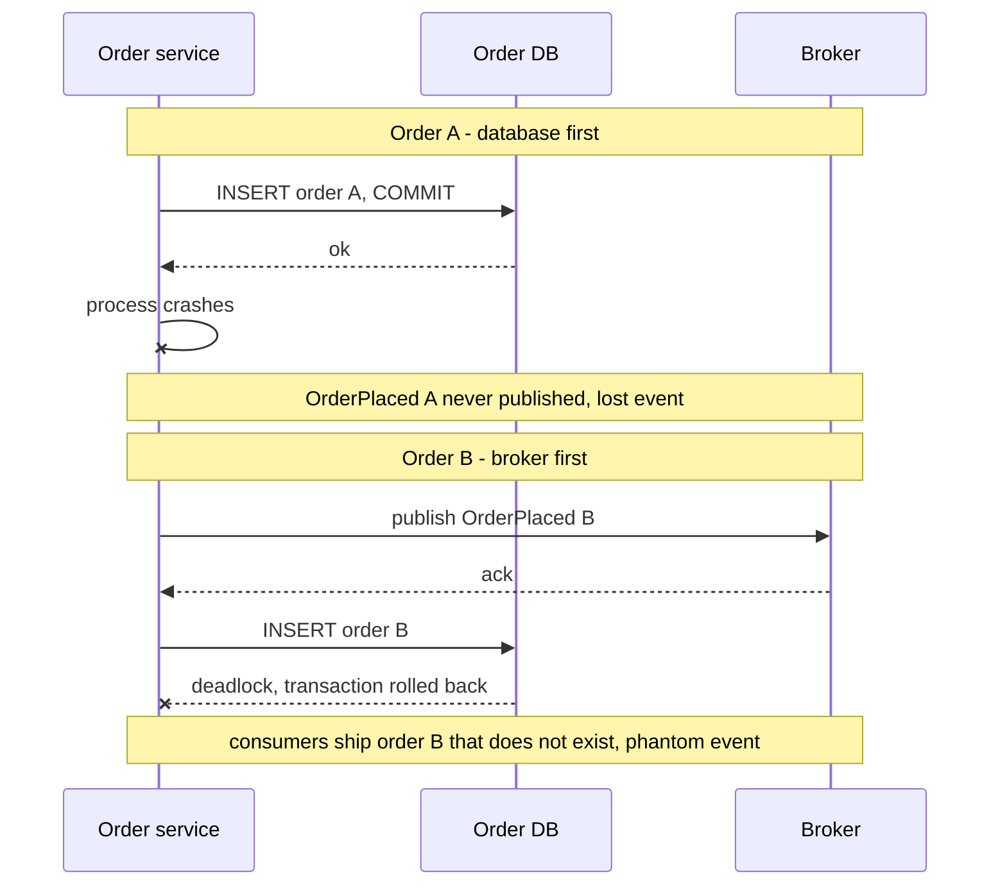

**Reading the diagram.** Both scenarios use synchronous calls to two storage boundaries. In the first, the database commits and the process dies before publishing: the order exists but no consumer ever hears of it, so it is never shipped. In the second, the broker accepts the event and the database then rolls back: consumers act on a **phantom event**. Retrying does not close either window, because the crash can happen during the retry too; even a successful publish can time out and be retried, producing a duplicate. Scaling makes it worse: at 1,000 orders/s, a failure window hit once per million writes occurs about 86 times a day.

Distributed transactions (XA, §28.4.6) could commit both, but most brokers do not support XA, and 2PC couples the service's availability to the broker's. The outbox removes the second write instead.

### 32.5.2 The outbox table and the relay

::: definition
**Definition — Transactional outbox.** A pattern in which a service writes the events it wants to publish into an **outbox table** in its own database, in the same local transaction as the state change, and a separate **message relay** later reads committed outbox rows and publishes them to the broker, retrying until the broker acknowledges [Richardson 2018].
:::

The local transaction makes "state changed" and "event recorded" atomic: both commit or neither does. The relay then turns "recorded" into "published" with at-least-once delivery. A crash anywhere loses nothing (the row is durable) and invents nothing (rolled-back transactions leave no row). The remaining imperfection is duplicates, when the relay publishes and crashes before marking the row, which idempotent consumers absorb (§32.10).

```sql
CREATE TABLE outbox (
  id            BIGSERIAL PRIMARY KEY,         -- relay order
  event_id      UUID NOT NULL UNIQUE,          -- consumers deduplicate on this
  aggregate_id  TEXT NOT NULL,                 -- becomes the Kafka message key
  event_type    TEXT NOT NULL,
  payload       JSONB NOT NULL,
  created_at    TIMESTAMPTZ NOT NULL DEFAULT now(),
  published_at  TIMESTAMPTZ                    -- NULL until the relay publishes
);
CREATE INDEX outbox_unpublished ON outbox (id) WHERE published_at IS NULL;

BEGIN;
INSERT INTO orders (id, customer_id, status, total_cents) VALUES ('o-981', 'c-42', 'PLACED', 4599);
INSERT INTO outbox (event_id, aggregate_id, event_type, payload)
  VALUES (gen_random_uuid(), 'o-981', 'OrderPlaced', '{"order_id": "o-981", "total_cents": 4599}');
COMMIT;
```

What to notice: the partial index keeps the relay's scan cheap even when the table holds millions of published rows; `aggregate_id` becomes the message key so all events of one order land in one partition (§31.5); `gen_random_uuid()` is built into PostgreSQL 13 and later. Delete published rows in batches, or drop time-based partitions, to keep the table small.

**Figure 32.7 — Outbox with a relay, polling or log-tailing.**

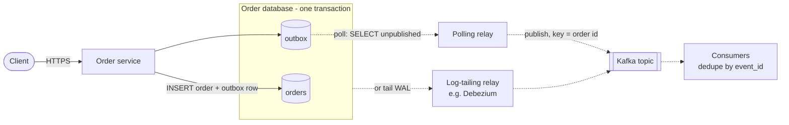

**Reading the diagram.** The client waits only for the single local transaction inside the database boundary. A relay, either a polling process or a log-tailing CDC connector (choose one), copies committed rows to Kafka asynchronously, keyed by order ID. Failure points: the relay can crash after publishing and before recording progress, so the broker can receive duplicates; consumers therefore deduplicate by `event_id`. If the relay is down, events wait safely in the table and their latency grows; nothing is lost. Scaling: one relay per database (or per outbox partition) with leader election so that two relays do not race (§26.5, §26.11).

### 32.5.3 Polling versus log-tailing relays

**Table 32.4 — Polling versus log-tailing relays.**

| | Polling publisher | Log-tailing (CDC) relay |
|---|---|---|
| How it works | `SELECT ... WHERE published_at IS NULL ORDER BY id LIMIT n`, publish, then `UPDATE` | Reads committed outbox inserts from the WAL or binlog (§32.6) |
| Latency | Poll interval / 2 plus cycle time when idle | Tens of milliseconds |
| Database load | A query every interval plus an update per batch | Reads the log; no queries on the table |
| Ordering | By `id`; but sequence values are assigned at insert, not commit, so a concurrent slower transaction can commit a lower `id` after the relay has passed it | Commit order, exactly as the database applied it |
| Operational complexity | Low: a small process | Higher: replication slots, connectors, CDC monitoring |
| Choose when | Moderate volume, simplicity first | High volume, strict ordering, many tables |

The polling ordering trap deserves emphasis. If transaction T1 takes `id = 100` and T2 takes `id = 101`, but T2 commits first, a relay that remembers "last published id = 101" will never see 100. The schema above avoids that by selecting on `published_at IS NULL` instead of a high-water mark; per-aggregate order still holds when each aggregate's writes are serialized (row lock or version check), because its later event cannot commit before its earlier one. Log tailing avoids the issue entirely.

::: formula
**Polling relay throughput and added latency**

$$X = \frac{B}{t_q + B\,t_p + t_m} \qquad\qquad L_{\text{relay}} \approx \frac{I}{2} + t_q + B\,t_p + t_m$$

| Symbol | Meaning | Units |
|---|---|---|
| $B$ | Batch size: rows fetched per cycle | events |
| $t_q$ | Time to query the batch | s |
| $t_p$ | Amortized publish time per event (pipelined, batched sends) | s/event |
| $t_m$ | Time to mark the batch published | s |
| $I$ | Polling interval when the outbox is empty | s |
| $X$ | Maximum relay throughput | events/s |
| $L_{\text{relay}}$ | Typical extra delivery latency at low load | s |
:::

::: example
**Worked example — Sizing one relay for 5,000 events/s.**

1. Batched, pipelined sends: $B = 500$, $t_q = 4$ ms, $t_p = 0.04$ ms ($500 \times 0.04 = 20$ ms per batch), $t_m = 6$ ms. Cycle $= 4 + 20 + 6 = 30$ ms; $X = 500 / 0.030 \approx 16{,}700$ events/s, over three times the required rate.
2. Naive relay that sends each event synchronously and waits for `acks=all` at $t_p = 2$ ms: cycle $= 4 + 1{,}000 + 6 = 1{,}010$ ms; $X \approx 495$ events/s, ten times too slow.
3. Latency at low load with $I = 100$ ms: $L \approx 50 + 30 = 80$ ms.

Interpretation: batching dominates relay throughput, and the poll interval dominates its latency. Engineering implication: send asynchronously with the producer's batching and wait for all acknowledgments before marking the batch; if 80 ms of extra latency is too much, poll more often (more load) or switch to log tailing.
:::

### 32.5.4 Code example: dual writes versus the outbox under crashes

The simulation injects crashes, with probability 5 % at each marked point, into the order service, the broker, the relay and the consumer. Durable objects (database, broker log, the consumer's dedup table and offset) survive; a crash only aborts the current call.

```python
"""Dual writes versus the transactional outbox, under randomly injected crashes.

The database and the broker log are durable; process memory is not. A Crash
can strike the order service, the relay or the consumer at any marked point.
Run it directly with python3 to execute the tests.
"""
import random
import unittest


class Crash(Exception):
    """The current process died at an injected crash point."""


class Chaos:
    def __init__(self, seed, p):
        self.rng, self.p = random.Random(seed), p

    def point(self, name):
        if self.rng.random() < self.p:
            raise Crash(name)


class Database:
    """Durable tables. transaction() applies all of its writes or none."""

    def __init__(self):
        self.orders, self.outbox, self.next_id = {}, [], 1

    def transaction(self, order_id, status, event=None):
        if self.orders.get(order_id) == status:
            return                                  # natural idempotency: already done
        self.orders[order_id] = status
        if event is not None:                       # same transaction as the state change
            self.outbox.append(dict(event, id=self.next_id, published=False))
            self.next_id += 1


class Broker:
    """An append-only log. A crash may strike after the append but before the ack."""

    def __init__(self, chaos):
        self.log, self.chaos = [], chaos

    def publish(self, event):
        self.chaos.point("before append")
        self.log.append({k: event[k] for k in ("event_id", "order_id", "type")})
        self.chaos.point("after append, before ack")


def event_for(order_id, status):
    kind = {"PLACED": "OrderPlaced", "PAID": "OrderPaid"}[status]
    return {"event_id": f"{order_id}:{kind}", "order_id": order_id, "type": kind}


# ---------- Version 1: dual write (two systems, no atomicity between them) ----------
def dual_write(db, broker, chaos, order_id, status, db_first=True):
    event = event_for(order_id, status)
    if db_first:
        db.transaction(order_id, status)
        chaos.point("between the two writes")       # crash here: lost event
        broker.publish(event)
    else:
        broker.publish(event)
        chaos.point("between the two writes")       # crash here: phantom event
        db.transaction(order_id, status)


# ---------- Version 2: transactional outbox plus a relay ----------
def write_with_outbox(db, chaos, order_id, status):
    chaos.point("before commit")
    db.transaction(order_id, status, event_for(order_id, status))


def relay_once(db, broker, chaos, batch=5):
    """Polling relay: publish unpublished rows in id order, then mark them."""
    rows = [r for r in db.outbox if not r["published"]][:batch]
    for row in rows:
        broker.publish(row)
        chaos.point("after publish, before mark")   # crash here: duplicate later
        row["published"] = True


class Consumer:
    """Idempotent consumer: the dedup record and the effect commit together."""

    def __init__(self, chaos):
        self.offset, self.seen, self.applied, self.chaos = 0, set(), [], chaos

    def poll(self, broker):
        while self.offset < len(broker.log):
            msg = broker.log[self.offset]
            if msg["event_id"] not in self.seen:    # one local transaction:
                self.seen.add(msg["event_id"])      #   dedup row + business effect
                self.applied.append((msg["order_id"], msg["type"]))
            self.chaos.point("after effect, before offset commit")
            self.offset += 1


def survive(fn, *args):
    try:
        fn(*args)
    except Crash:
        pass                                        # the process restarts; memory is gone


def run_outbox(seed, orders=200, p=0.05):
    chaos = Chaos(seed, p)
    db, broker, consumer = Database(), Broker(chaos), Consumer(chaos)
    for oid in range(orders):
        survive(write_with_outbox, db, chaos, oid, "PLACED")
        if oid in db.orders:
            survive(write_with_outbox, db, chaos, oid, "PAID")
        if chaos.rng.random() < 0.3:
            survive(relay_once, db, broker, chaos)
            survive(consumer.poll, broker)
    while any(not r["published"] for r in db.outbox) or consumer.offset < len(broker.log):
        survive(relay_once, db, broker, chaos)      # eventually every row is published
        survive(consumer.poll, broker)
    return db, broker, consumer


def run_dual_write(seed, db_first, orders=200, p=0.05):
    chaos = Chaos(seed, p)
    db, broker = Database(), Broker(chaos)
    for oid in range(orders):
        survive(dual_write, db, broker, chaos, oid, "PLACED", db_first)
    published = {m["order_id"] for m in broker.log}
    lost = set(db.orders) - published
    phantom = published - set(db.orders)
    return lost, phantom


class Tests(unittest.TestCase):
    def test_dual_write_db_first_loses_events(self):
        lost, _ = run_dual_write(seed=1, db_first=True)
        self.assertGreater(len(lost), 0)

    def test_dual_write_broker_first_creates_phantoms(self):
        _, phantom = run_dual_write(seed=1, db_first=False)
        self.assertGreater(len(phantom), 0)

    def test_outbox_no_lost_or_phantom_events(self):
        for seed in range(50):
            db, broker, consumer = run_outbox(seed)
            expected = {(oid, event_for(oid, s)["type"])
                        for oid, final in db.orders.items()
                        for s in (("PLACED", "PAID") if final == "PAID" else ("PLACED",))}
            self.assertEqual(set(consumer.applied), expected)          # nothing lost or invented
            self.assertEqual(len(consumer.applied), len(expected))     # each effect exactly once

    def test_outbox_duplicates_reach_broker_but_not_effects(self):
        db, broker, consumer = run_outbox(seed=3)
        self.assertGreater(len(broker.log), len(consumer.applied))     # at-least-once delivery

    def test_per_order_event_order_is_preserved(self):
        for seed in range(50):
            _, _, consumer = run_outbox(seed)
            first = {}
            for i, (oid, kind) in enumerate(consumer.applied):
                first.setdefault((oid, kind), i)
            for (oid, kind), i in first.items():
                if kind == "OrderPaid":
                    self.assertLess(first[(oid, "OrderPlaced")], i)


if __name__ == "__main__":
    unittest.main(verbosity=1)
```

Output (Python 3.13; the timing varies):

```text
.....
----------------------------------------------------------------------
Ran 5 tests in 0.332s

OK
```

What to notice:

- With seed 1, each dual-write variant fails about 22 times in 200 orders: database-first loses events, broker-first invents them. No retry inside `dual_write` could fix this, because the crash ends the process that would retry.
- In `run_outbox`, across 50 seeds and about 2,000 crash opportunities each, the set of effects equals the set of committed state changes. Seed 3 puts 428 messages on the broker for 385 effects: duplicates are real and harmless.
- `Database.transaction` is naturally idempotent (setting a status that is already set does nothing), so a client that retries after an ambiguous failure does not create a second order or a second outbox row (§22.15).
- The consumer's `seen` set, `applied` list and `offset` model durable state in the consumer's own database. Because the dedup record commits with the effect, the crash between effect and offset commit only causes a redelivery that is skipped.
- Per-order ordering holds because the relay always republishes from the oldest unpublished row; a relay that skipped a failed row and continued would break it.

**Table 32.5 — Outbox failure scenarios.**

| What goes wrong | Why | Detection | Recovery | Prevention |
|---|---|---|---|---|
| Duplicate events | Relay crashed between publish and mark | Consumer dedup hit rate | None needed if consumers are idempotent | Unique `event_id`; idempotent consumers (§32.10) |
| Growing delivery latency | Relay down or slower than the write rate | Age of oldest unpublished row | Restart or scale the relay | Alert on outbox age; $X$ sized above peak |
| Skipped events | High-water-mark polling past an uncommitted lower `id` | Gaps in per-aggregate sequence numbers | Republish from the gap | Select on `published_at IS NULL`, or tail the log |
| Two relays publish out of order | No single-writer guarantee | Out-of-order sequence numbers at consumers | Consumers reorder or reject by version | Leader election with fencing |
| Outbox table bloat | Published rows never deleted | Table size, slow relay queries | Batch delete, vacuum | Time-partitioned outbox with partition drops |

## 32.6 Change data capture

### 32.6.1 Reading the database's own log

::: definition
**Definition — Change data capture (CDC).** Extracting every committed insert, update and delete from a database, in commit order, as a stream of change events that other systems consume. **Log-based CDC** reads the database's replication log (PostgreSQL's write-ahead log via logical decoding, MySQL's binary log) rather than querying tables.
:::

#### First-principles explanation

A database already keeps a diary of every change, because it needs one for crash recovery and replication (§13.5, §14.4). CDC asks the database for a copy of that diary, decoded into rows. Since the diary contains only committed changes in the order they were applied, anything built from it agrees with the database by construction.

#### Why does this exist?

Search indexes, caches, data warehouses and other services all need to know when data changes. The alternatives are worse: dual writes from application code (§32.5.1); periodic queries on an `updated_at` column, which miss hard deletes, miss intermediate states and load the database; or database triggers, which add latency to every transaction. Log-based CDC has none of these problems, and it captures changes made by *any* writer, including batch jobs and manual fixes that bypass the application [Kleppmann 2017, ch. 11]. LinkedIn's Databus, an early large-scale CDC system, was built for exactly this purpose: keeping search indexes, caches and replicas consistent with the primary databases [Das et al. 2012].

#### How it works internally

1. **Enable a logical log.** PostgreSQL needs `wal_level = logical` and a **replication slot**, which records how far the consumer has read and makes the server retain WAL until then. MySQL needs the binary log in `ROW` format, so each event carries row images rather than SQL statements.
2. **Initial snapshot.** The connector reads existing table contents in a consistent snapshot and notes the log position at which the snapshot was taken.
3. **Streaming.** It then reads the log from that position onward, decoding each change into an event with the row *before* and *after* the change, the operation (`c`reate, `u`pdate, `d`elete, or `r`ead for snapshot rows) and source metadata such as the log position and commit timestamp.
4. **Publishing.** Events go to a topic per table, keyed by primary key, so all changes to one row stay ordered in one partition. A delete is followed by a **tombstone** (null value) so that log compaction can eventually remove the key (§31.10).
5. **Progress.** The connector periodically records the last log position it published. After a crash it resumes from there, so events after the last recorded position are published again: delivery is at-least-once.

### 32.6.2 Debezium architecture

Debezium is an open-source CDC platform built as a set of Kafka Connect source connectors (§31.14), one per database type; it can also run standalone as Debezium Server for non-Kafka destinations [Debezium Docs].

**Figure 32.8 — Debezium capturing PostgreSQL changes into Kafka.**

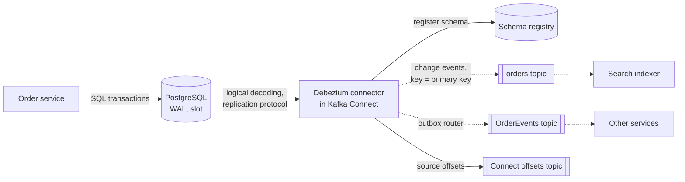

**Reading the diagram.** The application writes only to PostgreSQL. The connector streams decoded WAL records over PostgreSQL's replication protocol (asynchronous), registers each record schema with a schema registry, and publishes change events keyed by primary key. Rows of the outbox table can be routed by Debezium's outbox event router to per-aggregate topics, which is how §32.5's log-tailing relay is usually built. Progress (the last WAL position) is stored in Kafka Connect's offsets topic. Failure points: if the connector is down, the replication slot forces PostgreSQL to keep WAL, which can fill the disk; after a restart, events since the last stored offset are re-sent. Scaling: one connector task per database (the log is a single ordered stream), with throughput limited by WAL decoding, and many independent consumers downstream.

**Snapshot plus stream, without stopping the world.** A naive initial snapshot of a large table takes hours and holds a long transaction open. Netflix's DBLog showed how to interleave chunked table reads with log streaming using low and high **watermarks** written to the log, so that a chunk's rows are reconciled with concurrent changes and snapshots can be paused, resumed or re-run for one table [Andreakis and Papapanagiotou 2020]. Debezium's **incremental snapshots**, triggered through a signaling table, use the same idea [Debezium Docs].

::: warning
**Warning — An abandoned replication slot fills the disk.** A PostgreSQL slot whose consumer has stopped retains WAL indefinitely. Monitor slot lag in bytes (`pg_replication_slots`), alert well before disk exhaustion, and on PostgreSQL 13 and later set `max_slot_wal_keep_size` to cap retention, accepting that the connector then needs a fresh snapshot.
:::

### 32.6.3 Schema registry and evolution

A CDC topic exposes your table schema to every consumer, which turns a column rename into a cross-team breaking change. A **schema registry** stores each version of a topic's schema (Avro, Protobuf or JSON Schema); producers register a schema and embed its ID in each message, and consumers fetch the schema by ID to decode. The registry enforces a **compatibility mode** at registration: *backward* (new readers can read old data; Confluent Schema Registry's default), *forward* (old readers can read new data), *full* (both), with *transitive* variants that check against all earlier versions rather than only the previous one [Confluent Docs: Schema Registry]. For event streams that are replayed from the beginning, as in §32.3.4, use a transitive mode.

::: recommendation
**Recommendation — Do not publish your tables as your API.** Raw CDC events couple consumers to internal column names and normalization. For integration between teams, publish deliberate domain events through an outbox (routed by CDC if you like) and keep raw table CDC for derived data you own: caches, search indexes, the warehouse.
:::

::: industry
**Netflix DBLog.** Netflix needed to keep many derived stores, such as search indexes, in sync with MySQL and PostgreSQL sources, including full re-syncs without pausing writes. DBLog streams the transaction log and interleaves chunked selects bounded by watermarks, so dumps can be triggered at any time per table. Trade-off: the connector must write watermark rows into the source database.
*Evidence: Primary* — [Andreakis and Papapanagiotou 2020]
:::

| What goes wrong | Why | Detection | Recovery | Prevention |
|---|---|---|---|---|
| Source disk fills | Stalled slot retains WAL | Slot lag bytes | Restart connector or drop slot and re-snapshot | `max_slot_wal_keep_size`, alerts |
| Consumers break on deploy | Column renamed or retyped | Deserialization errors | Roll back schema; upcast | Registry compatibility checks in CI |
| Missing intermediate states | Query-based polling instead of log | Audits | Switch to log-based CDC | Log-based CDC |
| Duplicates after restart | Offsets stored periodically | Dedup counters | None if idempotent | Idempotent sinks keyed by primary key and log position |

## 32.7 The saga pattern

### 32.7.1 Long-lived transactions without distributed locks

Section 28.6 previewed the saga. This section owns the deep treatment.

::: definition
**Definition — Saga.** A long-lived transaction (LLT) written as a sequence of local transactions $T_1, \dots, T_n$, each of which commits independently and releases its resources, where each $T_i$ (except possibly the last) has a **compensating transaction** $C_i$. The system guarantees that either $T_1, T_2, \dots, T_n$ executes, or $T_1, \dots, T_j, C_j, \dots, C_1$ executes for some $j < n$ [Garcia-Molina and Salem 1987].
:::

#### First-principles explanation

Booking a trip with a hotel, a flight and a car is a saga. You book the hotel, then the flight; if no car is available, you cancel the flight and the hotel. Nobody locks the hotel's whole reservation system while you shop for cars, and nobody expects the cancellation to erase the booking from history: you get a cancellation record and perhaps a fee. That is **semantic atomicity**: the end state is "all done" or "equivalently undone" by the business's definition.

#### Why does this exist?

Garcia-Molina and Salem observed in 1987 that long-lived transactions, which hold locks for minutes or hours, delay every other transaction that touches the same data and are more likely to abort. Their proposal was to break an LLT into ordinary transactions that may interleave with others, and to undo committed work with application-defined compensations rather than rollbacks [Garcia-Molina and Salem 1987]. Microservices recreate the same problem at a larger scale: each service owns its database, external APIs (payment providers) cannot join a 2PC, and a coordinator that blocks while holding locks across services (§28.4.3) couples their availability. Helland argued that at scale, applications must live without distributed transactions and coordinate entities through messages, tentative operations and confirmations or cancellations [Helland 2007]; the saga is the standard shape for that.

#### How it works internally

Richardson classifies saga steps into three kinds, which determine how failures are handled [Richardson 2018]:

1. **Compensatable transactions** come before the point of no return and have a compensation (create order → reject order; reserve stock → release stock).
2. The **pivot transaction** is the go/no-go step. If it commits, the saga will complete; if it fails, the saga compensates. It is often the step that cannot be undone or is the most likely to fail, such as charging a card.
3. **Retriable transactions** follow the pivot and are guaranteed to succeed eventually if retried (approve order, notify shipping). They never compensate; they retry forward.

Compensations must themselves be idempotent and retriable until they succeed, because the saga has no other way out. Garcia-Molina and Salem call undoing **backward recovery**; with save points, a saga can also use **forward recovery**, retrying from the last save point instead of compensating.

### 32.7.2 Worked example: order, inventory and payment

The shop's checkout saga has four steps. Table 32.6 lists each step and what happens if it fails.

**Table 32.6 — The checkout saga and a failure at each step.**

| Step | Service | Action | Kind | Compensation | If this step fails |
|---|---|---|---|---|---|
| $T_1$ | Order | Create order in `PENDING` | Compensatable | $C_1$: set `REJECTED` | Validation error to client; nothing to undo |
| $T_2$ | Inventory | Reserve 2 units | Compensatable | $C_2$: release reservation | Out of stock: run $C_1$ |
| $T_3$ | Payment | Charge card \$300 | Pivot | (refund only by a new business process) | Declined: run $C_2$, then $C_1$ |
| $T_4$ | Order | Set `APPROVED`, emit `OrderApproved` | Retriable | — | Retry until it succeeds; never compensate |
| — | Orchestrator | Crash between any two steps | — | — | Resume from the saga log; steps are idempotent |
| — | Any | Compensation $C_i$ fails transiently | — | — | Retry $C_i$; after a limit, alert a human |

**Figure 32.9 — State machine of the checkout saga orchestrator.**

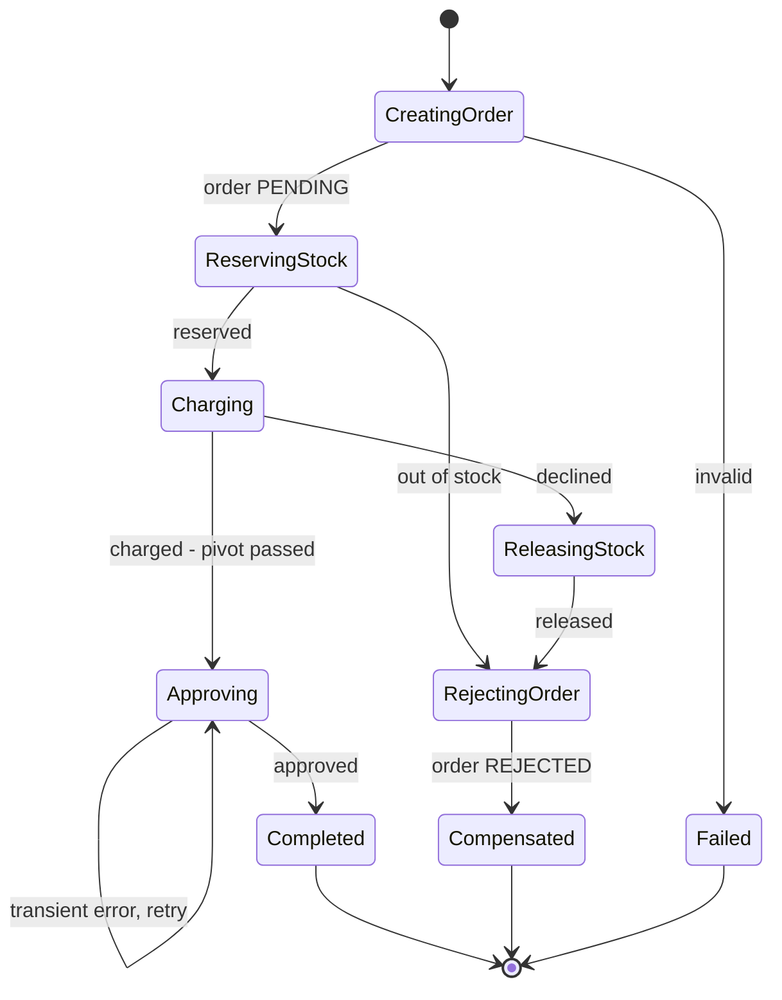

**Reading the diagram.** Each state is persisted in the orchestrator's saga log (a table in its own database) before the next command is sent, so a restarted orchestrator re-enters the same state and re-sends the same command; the receiving services deduplicate by saga ID. Transitions are triggered by asynchronous replies from the order, inventory and payment services. The left branch (before `Charging` succeeds) is backward recovery through compensations in reverse order; after the pivot the only exit is forward, with retries. Failure points: a compensation that keeps failing leaves the saga stuck in `ReleasingStock` or `RejectingOrder`, which must raise an alert. Scaling: sagas are independent, so partition the saga log by saga ID across orchestrator instances.

**Figure 32.10 — The card is declined: compensation in reverse order.**

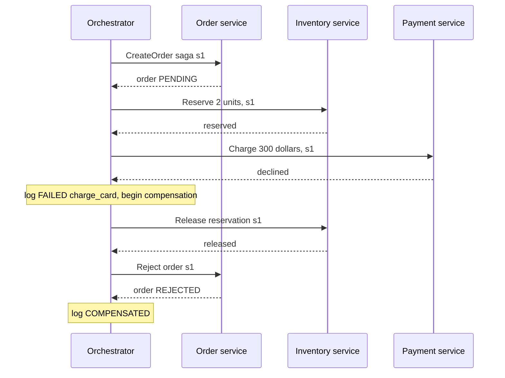

**Reading the diagram.** Each arrow is a command or a reply, usually sent as messages through a broker with the request–reply pattern, so the whole exchange is asynchronous even though it reads like calls. Each service runs one local transaction per command and stores the saga ID to make retries idempotent. The orchestrator writes a log record after every reply. Between "reserved" and "released", two units are invisible to other shoppers, an intermediate state that a saga cannot hide (§32.7.3). If the orchestrator crashes after logging the failure, it restarts compensation from the log; if the inventory service is down, the release is retried until it succeeds.

### 32.7.3 Living without isolation

A saga is ACD without I: atomic in the semantic sense, consistent within each service, durable, but not isolated. Other transactions see its intermediate states, which causes three anomalies: **lost updates** (another saga overwrites a change, and a compensation later overwrites theirs), **dirty reads** (a reader sees stock reserved by a saga that will be compensated) and **fuzzy reads** (two steps of one saga read different versions of the same data). Richardson collects countermeasures, drawing on Frank and Zahle's work on semantic ACID properties in multidatabases [Richardson 2018; Frank and Zahle 1998].

**Table 32.7 — Countermeasures for the lack of isolation.**

| Countermeasure | How it works | Checkout example |
|---|---|---|
| Semantic lock | A compensatable step sets an application-level flag (`*_PENDING`) that other requests check | Cancelling an order in `PENDING` is refused or queued until the saga ends |
| Commutative updates | Design operations so their order does not matter | `reserve(+2)` and `release(-2)` as deltas, not "set stock = 8" |
| Pessimistic view | Reorder steps so that risky reads happen in retriable steps | Increase a loyalty balance only after the pivot |
| Reread value | Reread data before overwriting and abort if it changed (optimistic locking) | Approve only if order version is unchanged |
| Version file | Record operations so out-of-order arrivals can be reordered | Payment service tolerates `Cancel` arriving before `Authorize` |
| By value | Choose the mechanism by business risk | High-value orders use a 2PC-backed path or manual review |

::: concept
**Key insight — Reservations are the saga-friendly form of locking.** "Reserve 2 units for 15 minutes" is a semantic lock with a timeout, held in business data rather than in a database lock manager. It survives crashes, is visible to other users ("2 left, 1 in someone's cart"), and expires on its own if a saga dies. Helland's tentative operations followed by confirmation or cancellation are the same idea [Helland 2007].
:::

### 32.7.4 Code example: an orchestrated saga with compensation

```python
"""An orchestrated order saga: order -> inventory -> payment, with compensation.

Each service owns its data and exposes idempotent operations keyed by saga ID.
The orchestrator persists its progress in a durable saga log, so a crashed
orchestrator resumes where it stopped. Run with python3 to execute the tests.
"""
import unittest


class Crash(Exception):
    """The orchestrator process died."""


class Rejected(Exception):
    """A business failure: the step cannot succeed, so the saga must compensate."""


class Unavailable(Exception):
    """A transient failure: retry the same step later."""


class Orders:
    def __init__(self):
        self.status = {}

    def create(self, saga):                         # T1, compensatable
        self.status.setdefault(saga, "PENDING")     # PENDING is the semantic lock

    def reject(self, saga):                         # C1
        self.status[saga] = "REJECTED"

    def approve(self, saga):                        # T4, retriable
        self.status[saga] = "APPROVED"


class Inventory:
    def __init__(self, stock):
        self.stock, self.reserved = stock, {}

    def reserve(self, saga, qty):                   # T2, compensatable
        if saga in self.reserved:
            return                                  # duplicate request: already done
        if qty > self.stock:
            raise Rejected("out of stock")
        self.stock -= qty
        self.reserved[saga] = qty

    def release(self, saga, qty):                   # C2
        self.stock += self.reserved.pop(saga, 0)    # no-op if never reserved or released


class Payments:
    def __init__(self, limit):
        self.limit, self.charges = limit, {}

    def charge(self, saga, cents):                  # T3, the pivot transaction
        if saga in self.charges:
            return
        if cents > self.limit:
            raise Rejected("card declined")
        self.charges[saga] = cents


class Orchestrator:
    def __init__(self, orders, inventory, payments, log, crash_after=None, flaky=0):
        self.o, self.i, self.p, self.log = orders, inventory, payments, log
        self.crash_after, self.flaky = crash_after, flaky   # fault injection
        self.steps = [   # (name, action, compensation); None = nothing to undo
            ("create_order", lambda s, c: self.o.create(s), lambda s, c: self.o.reject(s)),
            ("reserve_stock", lambda s, c: self.i.reserve(s, c["qty"]),
             lambda s, c: self.i.release(s, c["qty"])),
            ("charge_card", lambda s, c: self.p.charge(s, c["cents"]), None),   # pivot
            ("approve_order", self.approve, None),                             # retriable
        ]
        self.pivot = 2

    def approve(self, saga, cmd):
        if self.flaky:
            self.flaky -= 1
            raise Unavailable("order service down")
        self.o.approve(saga)

    def record(self, saga, entry):
        self.log.setdefault(saga, []).append(entry)  # durable, written before moving on
        if entry == self.crash_after:
            raise Crash(entry)

    def run(self, saga, cmd):
        """Start or resume a saga. Safe to call again after a crash."""
        entries = self.log.get(saga, [])
        if "COMPLETED" in entries or "COMPENSATED" in entries:
            return entries[-1]
        if any(e.startswith("FAILED") for e in entries):
            return self.compensate(saga, cmd)
        done = sum(1 for e in entries if e.startswith("DONE"))
        for k in range(done, len(self.steps)):
            name, action, _ = self.steps[k]
            while True:
                try:
                    action(saga, cmd)                 # idempotent, so re-running is safe
                    break
                except Unavailable:
                    if k < self.pivot:                # before the pivot: give up and undo
                        self.record(saga, f"FAILED {name}")
                        return self.compensate(saga, cmd)
                    continue                          # after the pivot: retry until it works
                except Rejected:
                    self.record(saga, f"FAILED {name}")
                    return self.compensate(saga, cmd)
            self.record(saga, f"DONE {name}")
        self.record(saga, "COMPLETED")
        return "COMPLETED"

    def compensate(self, saga, cmd):
        done = [e[5:] for e in self.log[saga] if e.startswith("DONE")]
        undone = {e[5:] for e in self.log[saga] if e.startswith("UNDO")}
        for name, _, comp in reversed(self.steps):
            if name in done and name not in undone and comp:
                comp(saga, cmd)                       # idempotent compensation
                self.record(saga, f"UNDO {name}")
        self.record(saga, "COMPENSATED")
        return "COMPENSATED"


def world(stock=10, limit=50_000):
    return Orders(), Inventory(stock), Payments(limit), {}


class Tests(unittest.TestCase):
    CMD = {"qty": 2, "cents": 30_000}

    def test_happy_path(self):
        o, i, p, log = world()
        self.assertEqual(Orchestrator(o, i, p, log).run("s1", self.CMD), "COMPLETED")
        self.assertEqual((o.status["s1"], i.stock, p.charges["s1"]), ("APPROVED", 8, 30_000))

    def test_out_of_stock_rejects_order(self):
        o, i, p, log = world(stock=1)
        self.assertEqual(Orchestrator(o, i, p, log).run("s1", self.CMD), "COMPENSATED")
        self.assertEqual((o.status["s1"], i.stock, p.charges), ("REJECTED", 1, {}))

    def test_card_declined_releases_stock_then_rejects(self):
        o, i, p, log = world(limit=10_000)
        self.assertEqual(Orchestrator(o, i, p, log).run("s1", self.CMD), "COMPENSATED")
        self.assertEqual((o.status["s1"], i.stock, p.charges), ("REJECTED", 10, {}))
        self.assertEqual(log["s1"][-3:], ["UNDO reserve_stock", "UNDO create_order", "COMPENSATED"])

    def test_failure_after_pivot_is_retried_forward(self):
        o, i, p, log = world()
        self.assertEqual(Orchestrator(o, i, p, log, flaky=3).run("s1", self.CMD), "COMPLETED")
        self.assertEqual((o.status["s1"], i.stock), ("APPROVED", 8))

    def test_crash_at_every_point_then_resume(self):
        points = ["DONE create_order", "DONE reserve_stock", "DONE charge_card",
                  "DONE approve_order", "COMPLETED"]
        for point in points:
            o, i, p, log = world()
            with self.assertRaises(Crash):
                Orchestrator(o, i, p, log, crash_after=point).run("s1", self.CMD)
            self.assertEqual(Orchestrator(o, i, p, log).run("s1", self.CMD), "COMPLETED")
            self.assertEqual((i.stock, len(p.charges)), (8, 1), point)   # nothing doubled

    def test_step_executed_but_not_logged_is_not_doubled(self):
        o, i, p, log = world()
        with self.assertRaises(Crash):
            Orchestrator(o, i, p, log, crash_after="DONE create_order").run("s1", self.CMD)
        i.reserve("s1", 2)        # the next step ran, but the crash hit before its DONE record
        self.assertEqual(Orchestrator(o, i, p, log).run("s1", self.CMD), "COMPLETED")
        self.assertEqual(i.stock, 8)

    def test_crash_during_compensation_then_resume(self):
        o, i, p, log = world(limit=10_000)
        with self.assertRaises(Crash):
            Orchestrator(o, i, p, log, crash_after="UNDO reserve_stock").run("s1", self.CMD)
        self.assertEqual(Orchestrator(o, i, p, log).run("s1", self.CMD), "COMPENSATED")
        self.assertEqual((o.status["s1"], i.stock), ("REJECTED", 10))


if __name__ == "__main__":
    unittest.main(verbosity=1)
```

Output (Python 3.13; the timing varies):

```text
.......
----------------------------------------------------------------------
Ran 7 tests in 0.001s

OK
```

What to notice:

- `record` writes to the saga log *before* the orchestrator moves on, and `run` reconstructs its position from the log alone. That is what lets `test_crash_at_every_point_then_resume` kill the orchestrator after every step and still finish with exactly one reservation and one charge.
- `test_step_executed_but_not_logged_is_not_doubled` covers the other crash window: the action ran but its `DONE` record did not. The re-sent `reserve` is a no-op because the inventory service deduplicates by saga ID.
- `Unavailable` after the pivot is retried forever; a `Rejected` before the pivot triggers compensation in reverse order. A real orchestrator would back off between retries (§22.12) and alert after a limit.
- `release` and `reject` tolerate being called twice or for work that never happened, so a crash during compensation is also recoverable (`test_crash_during_compensation_then_resume`).
- The order's `PENDING` status is the semantic lock of Table 32.7.

### 32.7.5 Failure scenarios and misconceptions

| What goes wrong | Why | Detection | Recovery | Prevention |
|---|---|---|---|---|
| Double charge or double reservation | Retried step not idempotent | Reconciliation between services | Refund, release | Idempotency by saga ID in every participant |
| Saga stuck in compensation | Compensation fails permanently (e.g. refund rejected) | Saga age by state | Human workflow | Design compensations that cannot fail for business reasons |
| Compensation runs before the action | Messages reordered; action arrives after cancel | Orphaned reservations | Timeout-based cleanup | Participants record "cancelled" tombstones for the saga ID |
| Oversold stock | Dirty read of uncommitted reservations | Negative stock alarms | Back-order process | Semantic locks, commutative updates |
| Lost saga | Orchestrator state only in memory | Orders stuck in `PENDING` | Sweep and resume | Persist the saga log before each command |

::: mistake
**Common misconception — "Compensation is rollback."** A rollback makes it as if nothing happened; a compensation is a new transaction that others can observe, which may itself have effects (a refund email, a fee). Some actions have no compensation at all (an email sent, a parcel dispatched); place them after the pivot.
:::

::: mistake
**Common misconception — "A saga gives the same guarantees as a distributed transaction, just faster."** It gives semantic atomicity and eventual consistency without isolation. If an invariant must never be visibly violated, even briefly, keep the data in one database (§28.11).
:::

## 32.8 Choreography versus orchestration

A saga needs something to decide which step runs next. There are two styles.

::: definition
**Definition — Choreography and orchestration.** In **choreography**, each service reacts to other services' events and publishes its own; the saga's control flow is distributed across the participants and exists nowhere as one piece of code. In **orchestration**, a dedicated **orchestrator** sends commands to participants, receives their replies and decides the next step; the control flow lives in one place [Richardson 2018].
:::

The analogy is a dance troupe versus an orchestra. Dancers who know their cues need no conductor, which works beautifully for four dancers and becomes chaos for forty. An orchestra has a conductor who is a single point of control, and of failure, but anyone can read the score.

**Figure 32.11 — The checkout saga by choreography.**

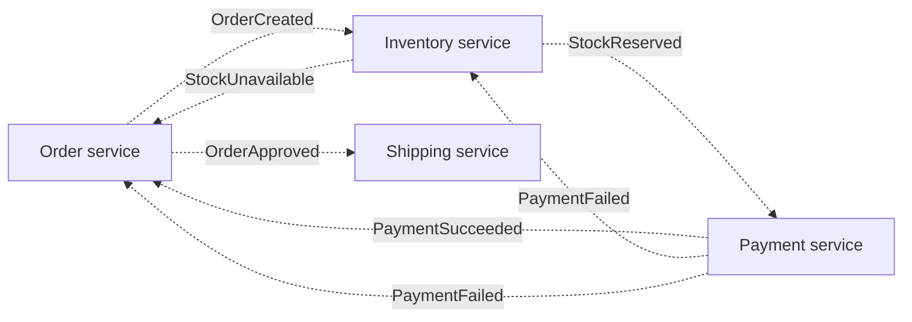

**Reading the diagram.** Every arrow is an asynchronous event published to the broker (omitted for clarity) through each service's outbox; no service calls another. Each service subscribes to the events it cares about: inventory reacts to `OrderCreated` and to `PaymentFailed` (its compensation trigger), and the order service reacts to the final outcome. Each service keeps its own saga state in its own database. Failure points: a lost subscription or a consumer bug silently stalls a saga, and nobody owns the end-to-end view; cyclic dependencies (order ↔ payment) make deploys and schema changes harder. Scaling is excellent, since there is no central component.

**Figure 32.12 — The same saga by orchestration.**

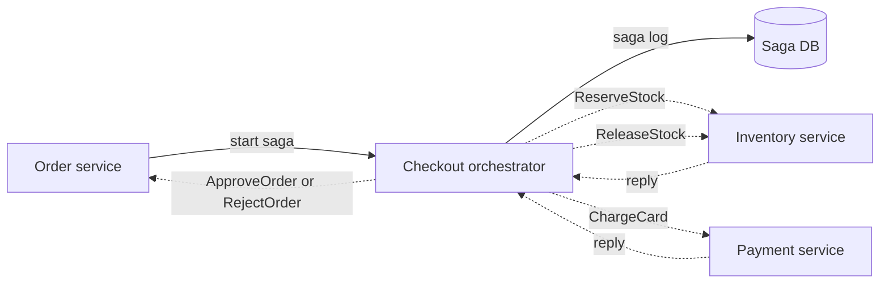

**Reading the diagram.** The orchestrator persists its state in its own database (synchronous, solid arrow) and exchanges asynchronous commands and replies with participants over request and reply channels. Participants know nothing about the saga; they expose commands such as `ReserveStock` and `ReleaseStock`. Failure points: the orchestrator is a central dependency, so it must be stateless apart from the saga log and run as several instances; a slow participant delays only the sagas waiting on it. Scaling: partition sagas by ID across orchestrator instances.

**Table 32.10 — Choreography versus orchestration.**

| | Choreography | Orchestration |
|---|---|---|
| What it is | Services react to each other's events | A coordinator issues commands |
| Coupling | Each service knows which events to react to | Participants know nothing of the flow; orchestrator knows all |
| Visibility | Flow is implicit; needs tracing (§40.6) to reconstruct | Flow is explicit in one place; saga state is queryable |
| Adding a step | Change several services | Change the orchestrator |
| Failure handling | Compensation logic scattered across services | Centralized, testable |
| Single point of failure | None | The orchestrator, mitigated by replication |
| Risk | Cyclic dependencies, "event spaghetti" | Orchestrator accumulating business logic |
| Choose when | 2–4 steps, stable flow, autonomous teams | Many steps, branching, timeouts, compliance audits |

::: recommendation
**Recommendation — Choreograph between domains, orchestrate within a process.** Broadcast facts (`OrderPlaced`) by choreography so other domains (analytics, loyalty, email) can subscribe without coordination. Model a business process with compensations and deadlines, such as checkout or loan approval, as an orchestrated saga, preferably on a workflow engine (§32.11). Keep business rules in participants; the orchestrator should sequence, not compute.
:::

::: industry
**Netflix Conductor.** Netflix's content and media-processing pipelines grew into flows that were hard to follow when implemented as peer-to-peer events. Netflix built Conductor, a JSON-defined workflow orchestrator with a central server that schedules tasks onto worker queues and tracks every execution's state, and open-sourced it in 2016. The stated motivations were visibility into flows, the ability to pause, resume and restart them, and reuse of workers across flows.
*Evidence: Primary* — [Netflix Technology Blog 2016]
:::

## 32.9 Exactly-once processing and its limits

The phrase "exactly-once" causes more confusion than any other in messaging. Be precise about *what* happens exactly once, and *where*.

- **Exactly-once delivery** over an unreliable network is impossible. A sender that gets no acknowledgment cannot know whether the message arrived (the two generals problem, §24.3.3), so it must either resend (risking duplicates) or not (risking loss).
- **Exactly-once processing**, better called **effectively-once**, is achievable: a message may be delivered and processed several times, but its *effect* on state is applied once. By the end-to-end argument (§24.14), only the endpoint that owns the state can guarantee this, with at-least-once delivery plus deduplication or idempotence.

$$\text{effectively-once} = \text{at-least-once delivery} + \text{idempotent effect}$$

### 32.9.1 What Kafka's exactly-once semantics cover

Kafka's exactly-once semantics (EOS) combine three mechanisms [Kafka KIP-98 2017; §31.11]:

1. **Idempotent producer.** The broker assigns a producer ID, and the producer numbers each batch per partition; the broker discards a retried batch whose sequence number it has already written. This removes duplicates caused by producer retries, within one producer session.
2. **Transactions.** A transactional producer writes to several partitions *and* commits the consumer's input offsets in one atomic transaction (`sendOffsetsToTransaction`), using the replicated transaction coordinator described in §28.4.8.
3. **`read_committed` consumers** see only committed transactional data.

Together these make a **consume–transform–produce** loop inside Kafka effectively-once: input offsets and outputs commit together, so a crash replays input but aborted outputs are never seen. Kafka Streams enables this with `processing.guarantee=exactly_once_v2`.

**Figure 32.13 — The boundary of Kafka's exactly-once guarantee.**

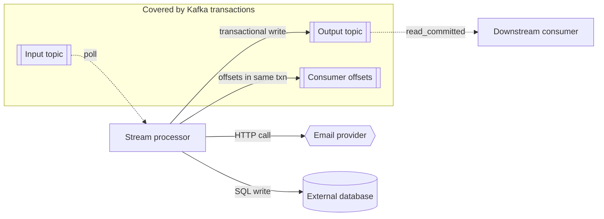

**Reading the diagram.** Everything inside the subgraph lives in Kafka and commits atomically: the output records and the input offsets. A crash before commit aborts both, and the replayed input produces the same outputs again, which `read_committed` consumers see once. The two arrows leaving the boundary are outside the guarantee: if the processor sends an email or writes a database row and then crashes before committing, the replay sends the email again. Failure points therefore cluster at external side effects. Scaling: transactions add a few milliseconds per commit, amortized by committing every 100 ms or so rather than per record.

**Table 32.11 — What Kafka exactly-once does and does not cover.**

| Covered | Not covered |
|---|---|
| Duplicates from producer retries (idempotent producer) | A producer application that restarts and resends with a new producer ID, unless it uses a stable `transactional.id` |
| Atomic writes to several partitions | Writes to databases, caches, search indexes, HTTP APIs |
| Atomic commit of outputs with input offsets | Consumers using `read_uncommitted` |
| Kafka Streams state stores (changelog topics) | Side effects in user code: emails, payments, logs |

::: mistake
**Common misconception — "We enabled Kafka EOS, so our payment consumer is exactly-once."** EOS ends where Kafka ends. A consumer that charges a card through an API and commits its offset afterwards will charge twice after a crash between the two. Pass an idempotency key derived from the event ID to the provider (§22.15), or record the charge and the offset in one database transaction (§32.10).
:::

## 32.10 Idempotent consumers

::: definition
**Definition — Idempotent consumer.** A message consumer whose effect on state is the same whether a given message is processed once or many times, achieved either because the operation is naturally idempotent or because the consumer detects and skips messages it has already processed.
:::

Section 22.15 owns idempotency keys for APIs; consumers use the same idea with the **event ID** as the key. Three techniques cover nearly every case.

**Table 32.12 — Idempotent consumer techniques.**

| Technique | How it works | Strength | Limitation |
|---|---|---|---|
| Natural idempotency | Operation is idempotent by nature: `SET status = 'SHIPPED'`, upsert by key, add to a set | No extra state | Not available for increments, sends, charges |
| Dedup table | `INSERT INTO processed(event_id)` in the same transaction as the effect; a unique-key conflict means "already done" | Works for any effect in the same database | Storage grows with rate × window; useless if the effect is outside that database |
| Versioned (conditional) writes | Store the last applied version per entity; apply only if `event.version > stored.version` | Constant storage per entity; also rejects reordered stale events | Needs a per-entity monotonic version from the producer |

**Figure 32.14 — A consumer that deduplicates in the same transaction as its effect.**

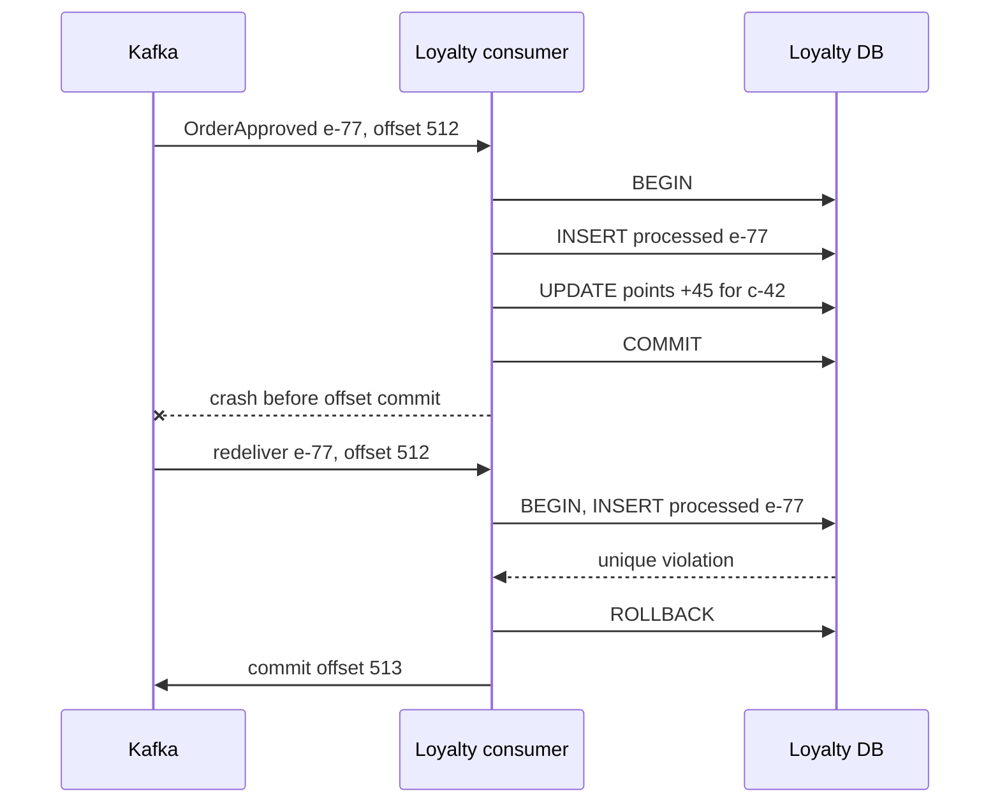

**Reading the diagram.** The broker delivers at least once; the consumer's database is the storage boundary where deduplication happens. The dedup row and the points increment commit in one local transaction, so they cannot diverge. The crash after commit but before the offset commit causes redelivery, and the unique key on `event_id` turns the duplicate into a no-op. Failure points: an effect outside the database (an email) cannot join this transaction and needs a downstream idempotency key or an outbox. Scaling: partition the dedup table with the consumer's data and expire old rows.

An alternative is to store the consumer's **offset** in the same database as the effect (and seek to it on startup), which deduplicates without per-message rows, provided one consumer owns each partition.

::: formula
**Storage needed by a dedup table**

$$S = \lambda \times W \times b$$

| Symbol | Meaning | Units |
|---|---|---|
| $\lambda$ | Messages consumed per second | messages/s |
| $W$ | Dedup window: how long an ID must be remembered | s |
| $b$ | Bytes per dedup row including index overhead | bytes |
| $S$ | Storage required | bytes |
:::

::: example
**Worked example — How long to remember event IDs.**

1. The loyalty consumer handles $\lambda = 5{,}000$ messages/s. Redeliveries normally arrive within minutes, but a replay from a backup may resend a week of events, so $W = 7$ days $= 604{,}800$ s.
2. Rows: $5{,}000 \times 604{,}800 = 3.024 \times 10^9$. At $b = 60$ bytes (16-byte UUID, timestamp, B-tree overhead): $S \approx 1.8 \times 10^{11}$ bytes $\approx 181$ GB (decimal).
3. With $W = 24$ h: $5{,}000 \times 86{,}400 \times 60 \approx 26$ GB.

Interpretation: a long window is expensive. Engineering implication: partition the dedup table by day and drop old partitions; or switch to versioned writes, which need one row per *entity* (a few million customers, a few hundred megabytes) and remember forever.
:::

::: mistake
**Common misconception — "Checking whether we processed the message, then processing it, is idempotent."** A check followed by a separate write is a race: two redeliveries processed concurrently both pass the check. The dedup insert must be atomic with the effect, enforced by a unique constraint.
:::

## 32.11 Workflow engines

### 32.11.1 Durable execution

The orchestrator in §32.7.4 is about 60 lines of saga logic, and a production version needs much more: timers ("cancel the reservation if unpaid in 15 minutes"), backoff, versioning while thousands of sagas are in flight, visibility ("where is order 981?"), and a scalable, replicated saga log. **Workflow engines** package all of it.

::: definition
**Definition — Durable execution.** A programming model in which a function's progress is persisted by an engine as it runs, so that the function survives process crashes, deploys and arbitrarily long waits and continues exactly where it left off, as if the process had never died [Temporal Docs].
:::

#### How Temporal works internally

Temporal, a fork of Uber's Cadence by Cadence's original authors, implements durable execution with **event-history replay** [Temporal Docs].

1. **Workflow code** is ordinary code (Go, Java, Python, TypeScript, .NET and others) that orchestrates; **activities** are functions that do the side-effecting work (call the payment API, write a database).
2. The Temporal service stores, for each workflow execution, an append-only **event history**: `WorkflowExecutionStarted`, `ActivityTaskScheduled`, `ActivityTaskCompleted` with its result, `TimerFired`, and so on.
3. **Workers** in your own deployment poll **task queues**. When a workflow needs to make progress, a worker runs the workflow code until it blocks on an activity or timer, and returns the resulting **commands** ("schedule activity `charge_card`"), which the service records as events.
4. If the worker crashes or evicts the workflow from its cache, any other worker **replays** the history: it re-runs the workflow code from the start, and whenever the code asks for an activity that the history says already completed, the SDK returns the recorded result instead of executing it. The code reaches the same point with the same local variables, then continues.
5. Activities run at least once and are retried per a **retry policy** (initial interval, backoff coefficient, maximum interval, maximum attempts, non-retryable error types) bounded by timeouts: *Start-To-Close* (one attempt), *Schedule-To-Close* (all attempts) and *Heartbeat* (liveness of long activities). So activities must be idempotent (§32.10).

**Figure 32.15 — A Temporal worker crashes and another worker replays the history.**

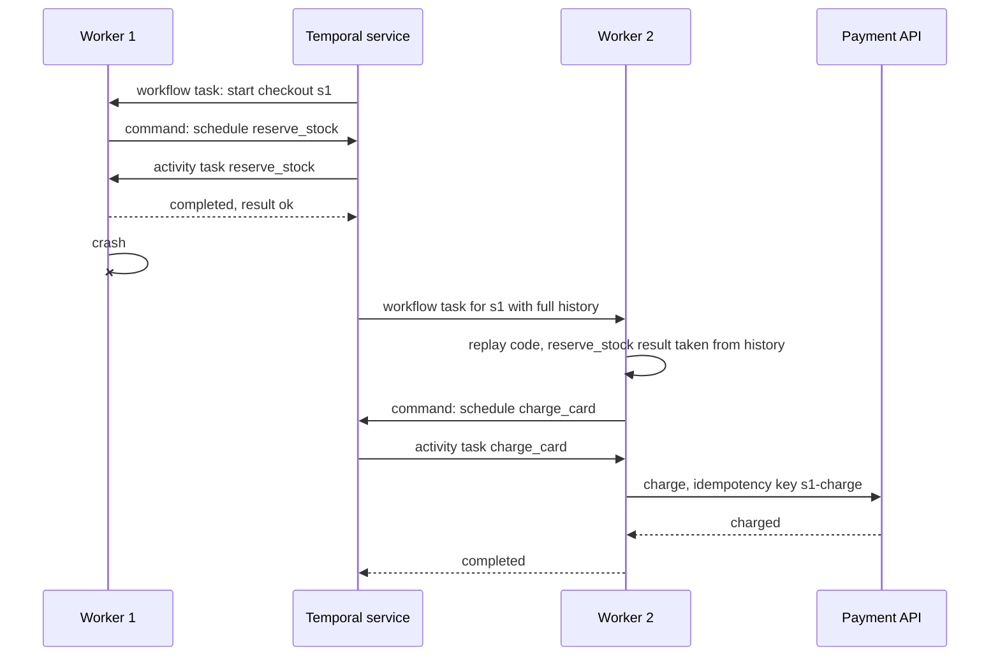

**Reading the diagram.** The Temporal service owns durable state (the history, in its own replicated database); workers are stateless and in the application's network, connected over gRPC long polls. Workflow tasks run deterministic orchestration code; activity tasks perform side effects. When worker 1 crashes, worker 2 receives the history and replays: `reserve_stock` is *not* executed again because its completion is recorded. The failure point that remains is an activity that crashes after calling the payment API but before reporting completion; it will be retried, which is why the call carries an idempotency key. Scaling: add workers per task queue; the service shards histories by workflow ID.

#### The determinism constraint

Replay works only if the workflow code, given the same history, issues the same commands in the same order. Workflow code must therefore not read the wall clock, generate random numbers, call the network or the file system, use threads, or iterate over unordered collections in ways that change between runs; SDKs provide deterministic substitutes (`workflow.now()`, deterministic random, durable timers). Changing workflow code while executions are in flight needs explicit **versioning** (a patch marker that lets old executions follow the old branch), or old histories will fail to replay with a *non-determinism error*. Histories also have size limits, so a workflow that loops indefinitely periodically starts a fresh execution with **Continue-As-New**.

The checkout saga as a Temporal workflow in Python:

```python
# illustrative: needs the temporalio package, a Temporal service and a worker
from datetime import timedelta

from temporalio import workflow
from temporalio.common import RetryPolicy
from temporalio.exceptions import ActivityError

with workflow.unsafe.imports_passed_through():
    from shop.activities import (approve_order, charge_card, create_order,
                                 reject_order, release_stock, reserve_stock)

STEP = dict(start_to_close_timeout=timedelta(seconds=30),
            retry_policy=RetryPolicy(maximum_attempts=3))       # then give up and compensate
FOREVER = dict(start_to_close_timeout=timedelta(seconds=30),
               retry_policy=RetryPolicy(maximum_interval=timedelta(minutes=5)))  # no attempt cap


@workflow.defn
class CheckoutWorkflow:
    @workflow.run
    async def run(self, order: dict) -> str:
        await workflow.execute_activity(create_order, order, **STEP)
        undo = []
        try:
            await workflow.execute_activity(reserve_stock, order, **STEP)
            undo.append(release_stock)
            await workflow.execute_activity(charge_card, order, **STEP)      # pivot
        except ActivityError:
            for compensation in reversed(undo):
                await workflow.execute_activity(compensation, order, **FOREVER)
            await workflow.execute_activity(reject_order, order, **FOREVER)
            return "COMPENSATED"
        await workflow.execute_activity(approve_order, order, **FOREVER)    # retriable
        return "COMPLETED"
```

What to notice: compensation is a `try`/`except` with a list of undo steps, readable top to bottom; the pivot and retriable distinctions of §32.7 become retry policies (`STEP` gives up after three attempts, `FOREVER` never does); there is no saga log in user code, because the engine's event history is the saga log.

### 32.11.2 AWS Step Functions

AWS Step Functions defines workflows as state machines in the JSON-based **Amazon States Language** (ASL): `Task`, `Choice`, `Parallel`, `Map`, `Wait`, `Pass`, `Succeed` and `Fail` states, with `Retry` and `Catch` fields on tasks [AWS Docs: Step Functions]. **Standard workflows** run for up to one year with exactly-once execution of each state transition and are priced per transition; **Express workflows** run for up to five minutes with at-least-once (asynchronous) or at-most-once (synchronous) semantics and are priced per request and duration, suiting high-volume event processing (as of 2026).

```json
{
  "Comment": "Checkout saga: compensate before the pivot, retry after it",
  "StartAt": "CreateOrder",
  "States": {
    "CreateOrder": {
      "Type": "Task",
      "Resource": "arn:aws:lambda:us-east-1:123456789012:function:create-order",
      "Next": "ReserveStock"
    },
    "ReserveStock": {
      "Type": "Task",
      "Resource": "arn:aws:lambda:us-east-1:123456789012:function:reserve-stock",
      "Retry": [{"ErrorEquals": ["States.Timeout"], "IntervalSeconds": 1, "MaxAttempts": 3, "BackoffRate": 2.0}],
      "Catch": [{"ErrorEquals": ["States.ALL"], "ResultPath": "$.error", "Next": "RejectOrder"}],
      "Next": "ChargeCard"
    },
    "ChargeCard": {
      "Type": "Task",
      "Resource": "arn:aws:lambda:us-east-1:123456789012:function:charge-card",
      "Catch": [{"ErrorEquals": ["States.ALL"], "ResultPath": "$.error", "Next": "ReleaseStock"}],
      "Next": "ApproveOrder"
    },
    "ApproveOrder": {
      "Type": "Task",
      "Resource": "arn:aws:lambda:us-east-1:123456789012:function:approve-order",
      "Retry": [{"ErrorEquals": ["States.ALL"], "IntervalSeconds": 2, "MaxAttempts": 20, "BackoffRate": 2.0}],
      "End": true
    },
    "ReleaseStock": {
      "Type": "Task",
      "Resource": "arn:aws:lambda:us-east-1:123456789012:function:release-stock",
      "Retry": [{"ErrorEquals": ["States.ALL"], "IntervalSeconds": 2, "MaxAttempts": 20, "BackoffRate": 2.0}],
      "Next": "RejectOrder"
    },
    "RejectOrder": {
      "Type": "Task",
      "Resource": "arn:aws:lambda:us-east-1:123456789012:function:reject-order",
      "Retry": [{"ErrorEquals": ["States.ALL"], "IntervalSeconds": 2, "MaxAttempts": 20, "BackoffRate": 2.0}],
      "Next": "OrderRejected"
    },
    "OrderRejected": {"Type": "Fail", "Error": "OrderRejected", "Cause": "Saga compensated"}
  }
}
```

What to notice: `Catch` routes a failure before the pivot into the compensation chain (`ReleaseStock` → `RejectOrder`); states after the pivot and all compensations use generous `Retry` blocks instead of `Catch`; `ResultPath` keeps the original input so compensations still know the order. Each Task invocation is at-least-once from the function's point of view, so the functions must be idempotent.

### 32.11.3 When to use an engine

**Table 32.13 — Hand-rolled saga versus workflow engine.**

| | Hand-rolled (saga table + messages) | Temporal or Cadence | AWS Step Functions |
|---|---|---|---|
| How it works | Your orchestrator, your saga log, your timers | Code-first durable execution with history replay | JSON state machine, managed service |
| Advantages | No new infrastructure; full control | Arbitrary logic in a real language; timers, signals, versioning, visibility | Fully managed; deep AWS integrations; visual console |
| Disadvantages | You rebuild retries, timers, visibility, versioning | Operate a cluster (or buy the cloud service); determinism discipline | AWS lock-in; complex logic awkward in JSON; per-transition cost |
| Performance | As fast as your broker | Tens of milliseconds per step | Tens of milliseconds per transition; Express faster |
| Choose when | 2–3 steps, no timers, team already runs a broker | Many long-running processes, complex branching, multi-cloud | Serverless AWS workloads, simple to moderate flows |

::: recommendation
**Recommendation — Count your sagas' features, not their steps.** Once a process needs two of {timers longer than a request, human approval, more than four steps, versioned rollouts while instances are in flight, an operator UI to find and repair stuck instances}, a workflow engine is cheaper than building those features yourself.
:::

::: industry
**Uber Cadence and Temporal.** Cadence was built at Uber to run long-lived, fault-tolerant business workflows as code and was open-sourced; its original creators later forked it as Temporal and founded a company around it. The core design, event-history replay with deterministic workflow code and retried idempotent activities, is shared by both.
*Evidence: Primary* — [Temporal Docs]
:::

::: mistake
**Common misconception — "A workflow engine gives exactly-once side effects."** It gives exactly-once *workflow progress*: each step's completion is recorded once and never replayed. The activity itself is at-least-once, so a payment activity still needs an idempotency key.
:::

