# Chapter 33 — Architecture Patterns

> **Level:** 2 · **Track:** A (Traditional) · **Estimated reading time:** 2.5 h

An **architecture pattern** (or **architectural style**) is a reusable answer to the question "how should the parts of this system be arranged, and how may they depend on each other?" Each pattern trades some properties for others: a monolith buys simplicity with coupling, microservices buy team independence with network calls, cells buy a small blast radius with duplicated infrastructure. None is best in general. This chapter shows eleven patterns on one running example, **Folio**, a fictional online bookstore that sells books from a catalog, takes payments through an external payment provider, reserves inventory, ships parcels and emails customers. You will see Folio drawn in each style, so the differences are about structure rather than about the problem. Chapter 34 then goes deep on microservices and domain-driven design.

## 33.1 Learning objectives

After this chapter you should be able to:

- Distinguish logical layers from physical tiers, strict from relaxed layering, and recognize the architecture sinkhole anti-pattern.
- State the real benefits of a monolith and quantify how deployment coupling grows with the number of teams.
- Design a modular monolith with explicit module interfaces and mechanically enforced dependency rules.
- Contrast service-oriented architecture (SOA) with microservices, and place event-driven architecture among the styles.
- Explain serverless execution, cold starts and concurrency, and compute the break-even request rate against always-on servers.
- Implement a port and two adapters in Python and test the domain core with a fake.
- Explain the dependency rule of clean architecture and relate hexagonal, onion and clean architecture.
- Size cells, compute blast radius, and calculate shuffle-sharding overlap probabilities.
- Choose between monolith, modular monolith and microservices using team size, deployment frequency, domain maturity and Conway's law.

## 33.2 Prerequisites

- Decomposition, components and weighted decision matrices — §2.3 and §2.8 (patterns are pre-packaged decompositions).
- Availability in series and parallel — §4.14.2 (why network hops reduce availability).
- Little's Law — §4.11 (serverless concurrency).
- Combinations and probability — §4.6 (shuffle-sharding arithmetic).
- Stateless services and the scale cube — §18.5 and §18.10 (cells are Z-axis splits).
- Bulkheads — §22.14 (cells are bulkheads for whole stacks).
- Messaging and events — §30.3–§30.6 (event-driven architecture in brief).

## 33.3 Layered architecture

### 33.3.1 Layers, tiers and the flow of a request

::: definition
**Definition — Layered architecture.** A style that organizes code into horizontal **layers**, each with one kind of responsibility (presentation, business logic, persistence), where each layer may depend only on layers below it. A **tier** is a *physical* deployment boundary (browser, application server, database server); an **n-tier architecture** maps layers onto separately deployed tiers.
:::

#### First-principles explanation

Think of a restaurant. The waiter takes orders and presents dishes but never cooks. The kitchen applies the recipes but never talks to diners. The storeroom keeps ingredients but has no idea what a recipe is. Each group can be trained, replaced or reorganized without retraining the others, because each talks only to its neighbor through a narrow interface: an order ticket, a requisition slip. Software layers apply the same idea. The **presentation layer** renders pages and parses requests; the **business layer** (also called the service or domain layer) enforces rules such as "you cannot order more copies than are in stock"; the **persistence layer** turns objects into SQL; the **database** stores rows.

#### Why does this exist?

Layering was the default enterprise style from the 1990s because it matched how organizations were staffed: UI developers, back-end developers and database administrators. It gives **separation of concerns** (a page designer does not need SQL), **layers of isolation** (replacing the persistence technology touches one layer), and a structure every new hire already recognizes [Richards and Ford 2020]. It is also the natural starting point of most web frameworks, whose project templates already contain `controllers`, `services` and `repositories` folders.

#### How it works internally

1. A browser sends `POST /orders` to the presentation layer, which validates the input format and converts it into a call such as `order_service.place(isbn, qty)`.
2. The business layer checks stock, computes the price, applies discounts and decides whether the order is valid.
3. The persistence layer converts the decision into SQL statements, inside a transaction.
4. The database executes the statements; the result returns upward through the same layers.

Layers may be **closed** or **open**. A closed layer must be passed through: presentation may call business but not persistence. An open layer may be skipped. **Strict layering** makes every layer closed; **relaxed layering** opens some, typically a shared "utilities" or persistence layer, so upper layers can reach it directly [Richards and Ford 2020; Bass et al. 2021].

**Figure 33.1 — Folio as a strict layered application deployed on three tiers.**

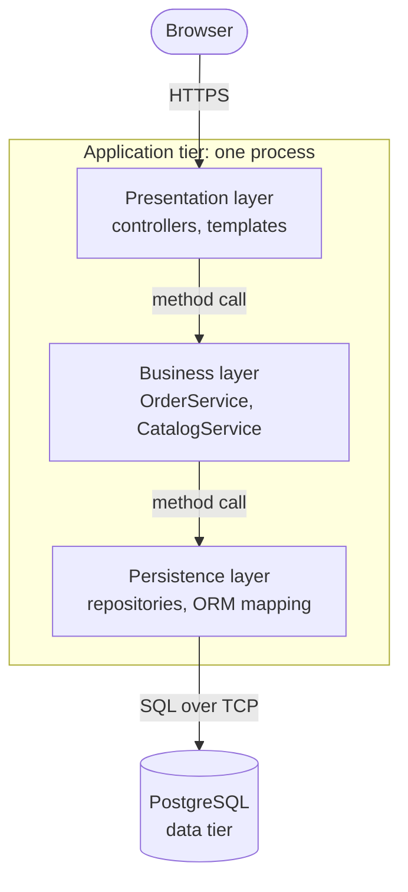

**Reading the diagram.** The browser is the client tier; it sends HTTPS requests to the application tier. Inside that one process, three logical layers call each other synchronously with ordinary method calls (solid arrows), always downward: no layer knows about the one above it. Only the persistence layer crosses the storage boundary, speaking SQL over TCP to PostgreSQL in the separate data tier. Failure points are the application process (a crash takes all three layers with it) and the database (every request depends on it). The application tier scales by running identical copies behind a load balancer (§18.4); the data tier scales with replicas and partitioning (Chapter 14). Note that the three layers are not three deployments: layers are logical, tiers are physical.

### 33.3.2 Strict versus relaxed layering and the sinkhole anti-pattern

Strict layering maximizes isolation: if every query must go through the business layer, then replacing the ORM touches only persistence, and every rule is enforced in one place. Its cost is boilerplate. Consider Folio's "show book details" page. The controller calls `CatalogService.get_book(isbn)`, which does nothing but call `BookRepository.find(isbn)`, which runs one `SELECT`. The business layer adds no logic; it only forwards. This is the **architecture sinkhole anti-pattern**: requests that fall through layers without any processing [Richards and Ford 2020]. Each pass-through costs code, a mapping between nearly identical objects, and a test, and multiplies the files you touch for a small change.

Every layered system has *some* sinkholes; simple reads are pass-throughs by nature. Richards suggests an 80–20 heuristic: if roughly 20% of requests are sinkholes that is normal, but if most are, the layering is not paying for itself, and you should either open the layer for those paths or choose a different style [Richards 2015]. Opening a layer is a deliberate trade: the presentation layer now depends on persistence directly, so a persistence change can break the UI.

**Figure 33.2 — Strict layering, relaxed layering and a sinkhole path.**

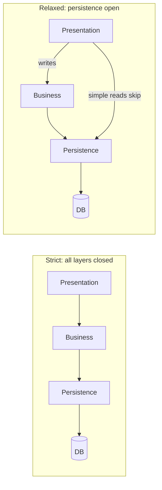

**Reading the diagram.** On the left, every request traverses each layer in order; for a book-detail read the business layer only forwards the call, which is the sinkhole. On the right, the persistence layer is marked open: writes still go through the business layer, where rules live, while simple reads skip it. All calls are synchronous in-process calls; the only storage boundary is the database. The relaxed variant has one more dependency edge (presentation to persistence), which is the failure point to watch: a schema change can now break pages directly. Neither variant changes how the system scales; layering is a code-organization decision.

#### Advantages and disadvantages

Layering is easy to understand, matches framework conventions, isolates technology choices, and lets specialists work in parallel. Its central weakness is that it partitions code by *technical* role rather than by *business domain*. Adding "audiobook" as a new product format at Folio touches a template, a controller, a service, a repository and a migration: one feature, five layers, often several teams. Richards and Ford call this **technical partitioning**, as opposed to **domain partitioning**, where code is grouped by business capability (catalog, ordering, shipping) [Richards and Ford 2020]. Most of the remaining patterns in this chapter are, in one way or another, domain-partitioned. Layering also says nothing about deployment, fault isolation or scaling: a layered application is usually a monolith (§33.4).

#### Failure scenarios

**Table 33.1 — Layered architecture failure scenarios.**

| What goes wrong | Why | Detection | Recovery | Prevention |
|---|---|---|---|---|
| Business rules leak into controllers or SQL | Deadline pressure; open layers | Same rule implemented twice; inconsistent behavior | Move logic into the business layer | Code review rule; architecture tests |
| Sinkhole bloat | Strict layering applied to CRUD paths | Most service methods are one-line forwards | Open the layer for reads | Apply the 80–20 check during design |
| Lower layer depends upward | Callback or import "just this once" | Import cycle between packages | Invert with an interface (§36.7) | Automated dependency checks (§33.5) |
| Schema change breaks every layer | Database types used as domain objects | Large diffs for small schema changes | Introduce mapping at the persistence boundary | Keep persistence types inside persistence |

::: mistake
**"Layered means n-tier."** Three layers can run in one process on one machine, and a three-tier deployment can contain a single tangled layer. Layers describe code dependencies; tiers describe where processes run. Say which one you mean in a design review.
:::

## 33.4 Monolithic architecture

### 33.4.1 What a monolith is, and what it is good at

::: definition
**Definition — Monolith.** A system whose functionality is built, tested and deployed as **one deployable unit**, typically one process image running as identical replicas and backed by one shared database. "Monolith" describes the *deployment* unit; it says nothing about whether the code inside is well structured.
:::

#### First-principles explanation

A monolith is a single building that houses every department of a company. Walking from sales to accounting takes seconds, everyone shares one mailroom, and renovating means closing the whole building for a weekend. For a company of twenty people this is the best possible arrangement; for twenty thousand it becomes a problem. The same is true of code. Folio's first version is one Python or Java application containing catalog, cart, ordering, payments and shipping code, deployed as one artifact.

#### Why does this exist?

The monolith is not a mistake that later styles corrected; it is the default because its benefits are large and immediate. Stated honestly:

- **Calls are cheap and reliable.** An in-process function call costs nanoseconds and cannot time out. A call over the network within a datacenter costs roughly 0.5 ms round trip and can fail in ways an in-process call cannot (§24.5).
- **Transactions are easy.** Placing an order, decrementing stock and recording a payment intent can share one ACID transaction (§11.12). Across services, the same operation needs a saga (§32.7).
- **Refactoring is cheap.** Renaming a function or moving a field is an IDE operation checked by the compiler or test suite, not a versioned API migration across teams.
- **Operations are simple.** One build pipeline, one deployment, one log stream, one stack trace that shows the whole request.
- **It scales further than people expect.** A stateless monolith scales horizontally behind a load balancer exactly as a stateless microservice does (§18.4–§18.5).

Fowler's "MonolithFirst" argues that almost all successful microservice systems he had seen started as monoliths that were split later, and that projects started as microservices often ran into trouble, because the right service boundaries are only visible once the domain is understood [Fowler 2015].

#### How it works internally

**Figure 33.3 — Folio deployed as a monolith.**

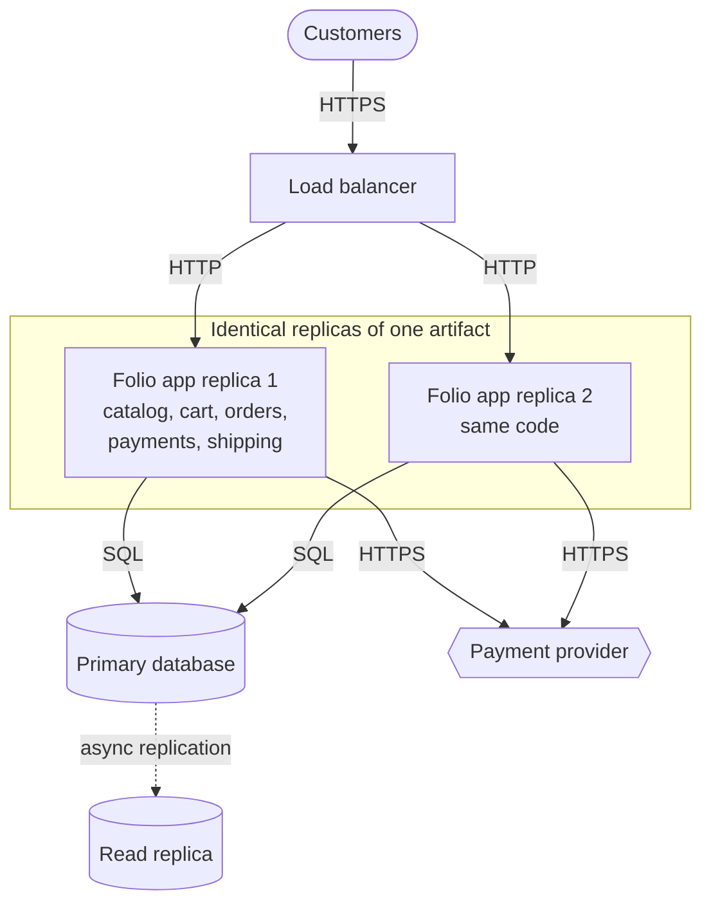

**Reading the diagram.** Customers reach a load balancer over HTTPS, which spreads synchronous HTTP requests across identical replicas of one artifact; every replica contains every feature. All replicas share one primary database (the storage boundary), which streams changes asynchronously (dotted arrow) to a read replica for reporting and failover. The payment provider is an external system called synchronously. Failure points: a bug that crashes the process crashes every feature on that replica at once, and the primary database is shared by all features. Scaling is by adding replicas (all features scale together) and by database replicas; you cannot scale only the catalog.

### 33.4.2 The cost: deployment coupling

The monolith's costs grow with the number of people working in it rather than with traffic. Every change, from every team, ships in the same artifact. If any one change is bad, the release is held or rolled back for everyone. This is **deployment coupling**.

#### Mathematical foundations

::: formula
**Probability that a coupled release is clean**

$$P_{\text{clean}} = (1-p)^{m}, \qquad m = T \times c$$

| Symbol | Meaning | Units |
|---|---|---|
| $P_{\text{clean}}$ | Probability a release contains no release-blocking defect | probability (0–1) |
| $p$ | Probability that one change contains a release-blocking defect (assumed independent) | probability |
| $m$ | Number of changes bundled in one release | changes |
| $T$ | Number of teams contributing to the release | teams |
| $c$ | Changes per team per release | changes/team |
:::

::: example
**Worked example — Folio's release train at 12 teams.** Folio has grown to $T = 12$ teams, each landing $c = 4$ changes into a weekly release; historically $p = 1\%$ of changes contain a defect serious enough to stop a release.

1. Changes per release: $m = 12 \times 4 = 48$.
2. $P_{\text{clean}} = 0.99^{48} = e^{48 \ln 0.99} = e^{48 \times (-0.01005)} = e^{-0.4824} \approx 0.617$.
3. So about 38% of weekly releases are held or rolled back, and when that happens all 12 teams wait.
4. If each team deployed its own unit with its own 4 changes: $0.99^{4} \approx 0.961$. Only 4% of releases fail, and a failure delays one team.

**Interpretation.** Coupling turns one team's defect into everyone's delay; the clean-release probability decays exponentially in the number of teams. **Engineering implication.** Before splitting the deployment, attack $p$ and $c$: better tests lower $p$, and deploying smaller batches more often lowers $c$. With $c = 1$ (continuous deployment of single changes) the 12-team monolith ships clean $0.99^{12} \approx 0.886$ of the time and a failure blocks only the next change. When neither lever is enough, independent deployment units (§33.7) remove the coupling.
:::

#### Real-world industry applications

::: industry
**Stack Overflow.** Stack Overflow has publicly described serving its question-and-answer sites from a monolithic .NET application on a small fleet of web servers, with heavy caching and a large SQL Server installation, rather than from many services. The design works because the team is small relative to traffic, the domain is stable, and the database is tuned and scaled vertically [Craver 2016].
*Evidence: Primary* — [Craver 2016]
:::

#### Advantages and disadvantages

Beyond deployment coupling, a monolith has three structural costs. **Scaling granularity**: a memory-hungry recommendation feature forces every replica to be sized for it. **Fault isolation**: a memory leak in shipping-label generation exhausts the heap of the process that also serves checkout. **Technology lock-in**: every module uses the same language, runtime and library versions; upgrading the framework is an all-or-nothing project. Build and test times also grow with the code base, which slows every team's feedback loop.

**Table 33.2 — Monolith failure scenarios.**

| What goes wrong | Why | Detection | Recovery | Prevention |
|---|---|---|---|---|
| One feature's leak crashes all features | Shared process and heap | Memory alarms; correlated errors on unrelated pages | Roll back; restart replicas | Resource limits per worker pool; bulkheads (§22.14) |
| Release train blocked | Deployment coupling | Release failure rate rises with team count | Revert offending change | Feature flags (§43.7), smaller batches |
| "Big ball of mud" | No enforced internal boundaries | Every change touches many packages | Modularize incrementally | Modular monolith (§33.5) |
| Shared database hot spot | All features share one primary | Lock waits, CPU saturation on primary | Read replicas, caching | Per-module schemas; later partitioning |

::: mistake
**"A monolith is a big ball of mud."** Foote and Yoder's **big ball of mud** is code without structure [Foote and Yoder 1997]. A monolith is a deployment choice. A well-modularized monolith can be cleaner than a set of microservices whose boundaries cut through the domain.
:::

#### When the monolith is right

Choose a monolith when the team fits in one or two groups that can coordinate in a single stand-up (very roughly, up to 10–20 engineers), when the domain is new and its boundaries will move, when strong consistency across features matters, and when there is no platform team to run service infrastructure. That describes most new products.

## 33.5 Modular monolith

### 33.5.1 Domain modules inside one deployable

::: definition
**Definition — Modular monolith.** A monolith whose code is divided into **modules** aligned with business domains, where each module exposes a small **public interface**, hides its internals and data, and may depend only on an explicitly declared, acyclic set of other modules. Boundaries are enforced by tooling, not just convention.
:::

#### First-principles explanation

Return to the single building. A modular monolith keeps one building but gives each department a locked suite with a reception desk. Other departments may leave requests at the desk (the public interface); they may not walk into the filing room (internal classes and tables). You keep the short walking distance, and you gain the ability to reorganize a suite without the rest of the building noticing. If a department later moves to its own building (a separate service), its reception desk becomes its API.

#### Why does this exist?

It captures most of the monolith's operational simplicity and most of the microservices' maintainability. The idea is old: Parnas argued in 1972 that modules should be chosen to hide design decisions likely to change ("information hiding"), not to mirror steps of processing [Parnas 1972]. The modular monolith applies that rule at the level of business domains, which is why Chapter 2 chose it for QuickBite v1 (§2.8.1).

#### How it works internally

1. **Partition by domain.** Folio's modules are Catalog, Inventory, Ordering, Payments, Shipping and Notifications. Each owns a package or directory.
2. **Publish a narrow interface.** Each module exposes an `api` package (functions, data-transfer objects, events). Everything else is internal.
3. **Own your data.** Each module owns its tables, ideally in its own database schema. No module joins another module's tables; it calls the other module's interface instead. This is the rule that makes later extraction possible.
4. **Declare dependencies.** A configuration lists which modules each module may use; the graph must be acyclic.
5. **Enforce mechanically.** A build step fails on any import that crosses a boundary illegally. Tools include ArchUnit (Java), Spring Modulith, the Java Platform Module System, `internal` packages in Go and .NET, import-linter (Python) and Packwerk (Ruby).
6. **Decouple with in-process events where order does not matter.** Ordering publishes `OrderPlaced`; Notifications subscribes. Same process, no broker, but the dependency points the right way.

**Figure 33.4 — Folio as a modular monolith with declared, acyclic dependencies.**

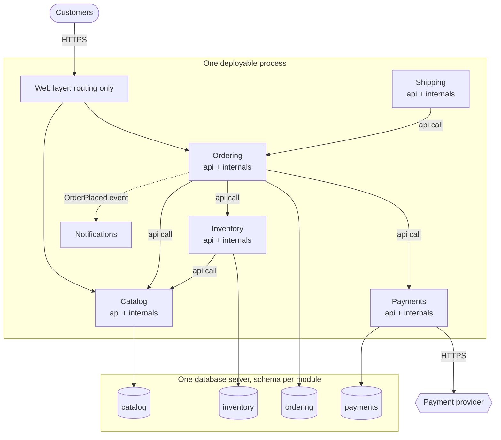

**Reading the diagram.** All modules run in one process; solid arrows are synchronous in-process calls through each target's public `api`, and every arrow appears in the declared dependency list. The dotted arrow is an in-process event: Ordering does not depend on Notifications, so adding a new subscriber needs no change to Ordering. The storage boundary is one database server divided into schemas, each touched by exactly one module; there are no cross-schema joins. The graph has no cycles: Shipping depends on Ordering, never the reverse. Failure points remain those of a monolith (shared process, shared database server). Scaling is still whole-process, but any module whose interface is clean, Payments for example, can be extracted to its own service by replacing its in-process `api` with a network client (§34.13).

#### Code example

The enforcement step is simple enough to write yourself. This sketch parses Python imports and checks them against declared dependencies; production teams use import-linter or an equivalent, but the logic is the same.

```python
"""Fail the build when a module imports another module's internals or an undeclared module."""
import ast

# Declared dependencies of Folio's modules (must form a DAG).
ALLOWED = {
    "catalog": set(),
    "inventory": {"catalog"},
    "ordering": {"catalog", "inventory", "payments"},
    "payments": set(),
    "shipping": {"ordering"},
}

# A tiny in-memory "source tree": path -> code.
SOURCES = {
    "ordering/service.py": "from catalog.api import get_price\n"
                           "from inventory.api import reserve\n",
    "shipping/service.py": "from ordering.api import order_details\n"
                           "from ordering.models import OrderRow\n",      # reaches into internals
    "inventory/service.py": "import shipping.api\n",                     # undeclared dependency
}


def imported_modules(code: str):
    for node in ast.walk(ast.parse(code)):
        if isinstance(node, ast.Import):
            yield from (alias.name for alias in node.names)
        elif isinstance(node, ast.ImportFrom) and node.module:
            yield node.module


def violations(sources, allowed):
    for path, code in sources.items():
        owner = path.split("/")[0]
        for name in imported_modules(code):
            target, _, sub = name.partition(".")
            if target == owner or target not in allowed:
                continue                                  # own code or third-party library
            if target not in allowed[owner]:
                yield f"{path}: '{owner}' may not depend on '{target}'"
            elif sub != "api":
                yield f"{path}: '{name}' is internal to '{target}'; use '{target}.api'"


for v in violations(SOURCES, ALLOWED):
    print("VIOLATION", v)
```

Output:

```text
VIOLATION shipping/service.py: 'ordering.models' is internal to 'ordering'; use 'ordering.api'
VIOLATION inventory/service.py: 'inventory' may not depend on 'shipping'
```

What to notice:

- Two rules cover most erosion: *only declared dependencies* and *only through `api`*. Ordering's imports pass both.
- The check reads source, not running code, so it runs in seconds in continuous integration and fails the pull request before the coupling exists.
- Imports of names outside `ALLOWED` (standard library, third-party packages) are ignored; a fuller tool would also check that `ALLOWED` itself is acyclic.

#### Real-world industry applications

::: industry
**Shopify's modular monolith.** Shopify has written publicly about its large Ruby on Rails monolith. Rather than splitting it into microservices, Shopify reorganized the code into components aligned with business domains, each with a public interface, and built tooling to detect references that cross component boundaries; it later open-sourced Packwerk, a static-analysis tool for enforcing such boundaries in Rails applications [Westeinde 2019; Shopify Packwerk]. The stated motivation was developer productivity: keeping the benefits of one code base and one deployment while making ownership and boundaries explicit.
*Evidence: Primary* — [Westeinde 2019], [Shopify Packwerk]
:::

#### Advantages and disadvantages

A modular monolith keeps in-process calls, single deployment and the option of ACID transactions (used sparingly, since cross-module transactions are coupling). It localizes change, makes ownership visible, and makes later extraction a mechanical step. It does *not* fix deployment coupling, scaling granularity or fault isolation; those still require separate processes. Its main risk is erosion: without enforcement, boundaries decay one "temporary" import at a time.

**Table 33.3 — Modular monolith failure scenarios.**

| What goes wrong | Why | Detection | Recovery | Prevention |
|---|---|---|---|---|
| Boundary erosion | Unchecked imports of internals | Dependency-graph diff in CI | Refactor to use `api` | Fail the build on violations |
| Cross-module SQL joins | Shared database makes it easy | Query log shows tables of two modules | Replace with interface call or read model | Schema-per-module with restricted grants |
| Dependency cycle | Two modules call each other | Cycle detection in CI | Extract shared concept or invert via event | Acyclic dependency rule |
| Wrong boundaries | Modules chosen by technical layer | Features always touch many modules | Re-partition by domain (§34.4) | Domain analysis before coding |

## 33.6 Service-oriented architecture

### 33.6.1 Services, the enterprise service bus and the reuse goal

::: definition
**Definition — Service-oriented architecture (SOA).** An enterprise integration style, prominent from roughly 2000 to 2010, in which business capabilities are exposed as coarse-grained, reusable **services** with formal contracts, typically SOAP web services described in WSDL, connected through an **enterprise service bus (ESB)** that routes, transforms and orchestrates messages between them.
:::

#### First-principles explanation

Picture a large company whose departments each bought their own software: an ERP for inventory, a CRM for customers, a mainframe for billing. SOA is the attempt to make these systems talk through a common switchboard. Each system wraps its capability in a service ("get customer", "reserve stock"), and the switchboard (the ESB) knows who to call, how to translate one system's message format into another's, and in what sequence to call several services to complete a business process.

#### Why does this exist?

SOA answered an integration problem, not a scaling problem. Enterprises had dozens of incompatible applications and point-to-point integrations growing as $n(n-1)/2$; with 30 systems that is up to 435 links. A bus reduces each system to one connection. The second goal was **reuse**: build "customer service" once and have every application call it.

#### How it works internally

1. Each provider publishes a contract (WSDL) and, in the original vision, registers it in a directory (UDDI).
2. Consumers send SOAP messages to the ESB, not to providers.
3. The ESB performs **protocol mediation** (HTTP to message queue to mainframe), **transformation** (into a **canonical data model** shared by the enterprise), **routing** and often **orchestration** of multistep processes, sometimes expressed in BPEL.
4. Cross-cutting policies (security, reliable messaging, transactions) are standardized by the WS-* specifications.

**Figure 33.5 — Folio integrated in the SOA style through an ESB.**

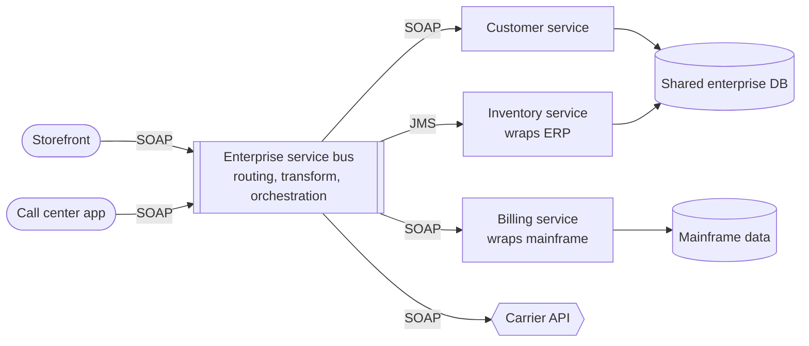

**Reading the diagram.** Two consumer applications send SOAP messages to the ESB, drawn as a message channel because it is middleware. The bus translates each request into the canonical model and calls providers with whatever protocol they speak: SOAP for the customer service, a JMS queue for the ERP wrapper, SOAP for billing and the carrier. Calls are mostly synchronous request–response, though JMS legs may be asynchronous. Two services share an enterprise database, a common SOA pattern that couples them at the storage boundary. The ESB is the obvious failure point and bottleneck: every interaction passes through it, and every change to routing or transformation is made by the team that owns it. Scaling means scaling the bus product, usually vertically.

### 33.6.2 SOA versus microservices

Microservices share SOA's core idea of independently useful services with contracts, and Lewis and Fowler describe them partly by contrast: **"smart endpoints and dumb pipes"** instead of a smart bus, decentralized data instead of shared databases, and decentralized governance instead of an enterprise architecture board [Lewis and Fowler 2014]. Table 33.4 summarizes the contrast.

**Table 33.4 — SOA (ESB era) compared with microservices.**

| Dimension | SOA (ESB era) | Microservices |
|---|---|---|
| Primary goal | Integrate existing enterprise applications; reuse | Independent change and deployment of one product's parts |
| Scope | Enterprise-wide | One application or product line |
| Communication | Smart pipe (ESB) with routing and transformation | Dumb pipes (HTTP, gRPC, a log or broker); logic in endpoints |
| Data | Often shared enterprise databases; canonical model | Database per service; each service owns its model |
| Contracts | SOAP, WSDL, WS-* standards | REST/JSON, gRPC/protobuf, event schemas |
| Governance | Central architecture board and ESB team | Team-owned services within platform guardrails |
| Granularity | Coarse (a whole ERP capability) | Smaller (one bounded context, Ch 34) |
| Typical failure | ESB becomes bottleneck and change queue | Distributed monolith; operational sprawl (§34.14) |

::: warning
**The ESB recreates Conway's problem.** When all routing and transformation logic lives in the bus, every cross-team change queues behind the bus team. The architecture's coupling point becomes an organizational bottleneck. Microservices moved that logic back into the services, at the price of each team handling more operations itself.
:::

## 33.7 Microservices (overview)

### 33.7.1 Independently deployable services

::: definition
**Definition — Microservices.** An architectural style that builds one application as a suite of small services, each running in its own process, owning its own data, communicating over lightweight network mechanisms, built around a business capability, and **independently deployable** by the team that owns it [Lewis and Fowler 2014].
:::

#### First-principles explanation and why it exists

Return to the building analogy: microservices give each department its own building with its own mailroom and its own front door. Departments renovate whenever they like, but every interaction becomes a letter rather than a walk down the corridor. The style exists because, beyond a certain number of teams, the coordination cost of one deployable (§33.4.2) exceeds the cost of distribution. Removing deployment coupling, scaling hot services independently, isolating failures to one process and allowing different technologies per service are the benefits.

**Figure 33.6 — Folio as microservices.**

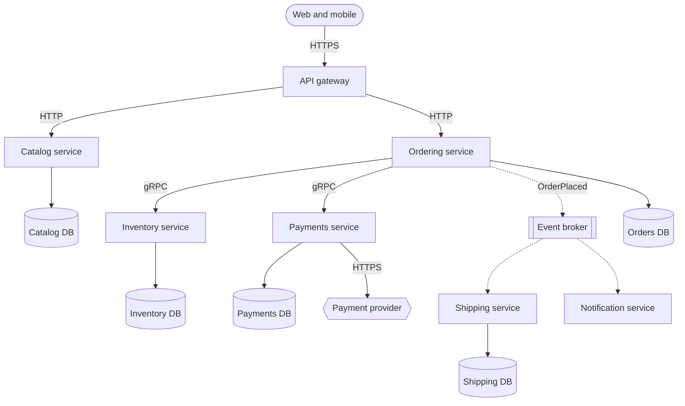

**Reading the diagram.** Clients call an API gateway over HTTPS (§34.6), which routes to catalog and ordering. Ordering calls inventory and payments synchronously over gRPC, so a checkout depends on all three being up; it also publishes an `OrderPlaced` event asynchronously to a broker, from which shipping and notifications consume at their own pace. Each service has its own database, so there are five storage boundaries and no shared tables; consistency between them is eventual or coordinated by a saga (§32.7). Failure points multiply: any network hop can time out, and the broker is shared infrastructure. Each service scales independently, so the catalog can run 40 replicas while payments runs 3.

#### The price in numbers

Distribution has a measurable cost. If checkout makes three sequential synchronous calls and each callee is available 99.9% of the time, the chain's availability is at most $0.999^{3} \approx 0.997$ (§4.14.2), and each hop adds roughly 0.5–1 ms of network latency plus serialization, against nanoseconds for an in-process call. Data that was joined in SQL must now be fetched from two services or replicated by events. Each service needs a pipeline, dashboards, alerts and on-call ownership. Chapter 34 covers how to choose boundaries, communicate, own data and migrate; the comparison and decision framework are in §33.13.

::: mistake
**"Microservices are about small code size."** The defining property is independent deployability by an owning team, not lines of code. A tiny service that must be deployed in lockstep with three others is part of a **distributed monolith** (§34.14): all the costs of distribution and none of the benefits.
:::

## 33.8 Event-driven architecture (overview)

::: definition
**Definition — Event-driven architecture (EDA).** A style in which components communicate mainly by producing and consuming **events**, immutable records of facts that happened ("OrderPlaced"), through a broker or log, so that producers do not know which consumers exist or when they will run.
:::

Think of a newspaper: the publisher prints the news once and has no idea who reads it or when. Contrast a phone call, where the caller waits for the callee to answer. EDA exists to decouple components in **time** (the consumer may be down when the event is published) and in **knowledge** (adding a consumer does not change the producer). Richards and Ford distinguish two topologies [Richards and Ford 2020]: in the **broker topology**, components react to each other's events with no central coordinator (choreography); in the **mediator topology**, an orchestrator receives an initiating event and directs the steps (orchestration). Chapter 32 compares the two in depth (§32.8).

**Figure 33.7 — Folio's order flow, event-driven with a broker topology.**

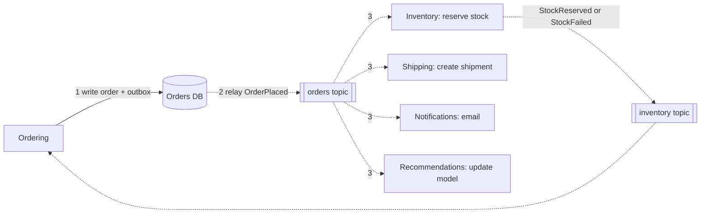

**Reading the diagram.** Ordering writes the order and an outbox row in one local transaction (§32.5), then a relay publishes `OrderPlaced` to the orders topic; everything after step 1 is asynchronous (dotted arrows). Four consumers each react independently; recommendations was added last without changing ordering. Inventory reports success or failure on its own topic, which ordering consumes to confirm or cancel the order, a choreographed saga (§32.7). Storage boundaries are each component's own store plus the broker's durable log (Chapter 31). Failure points: a slow consumer builds lag but does not slow ordering; a poison message needs a dead-letter queue (§30.11); duplicates require idempotent consumers (§32.10). The topic scales by partitions, consumers by consumer-group size.

EDA's advantages are loose coupling, natural buffering of load spikes, easy extension and an audit trail of facts. Its costs are eventual consistency (the customer may see "order received" before stock is confirmed), harder debugging because no single stack trace shows the whole flow (distributed tracing, §40.6, becomes necessary), and the need to reason about ordering, duplicates and schema evolution. EDA combines with any deployment style: a modular monolith can use in-process events (§33.5), and microservices commonly use a broker. Chapters 30–32 own the details.

## 33.9 Serverless architecture

### 33.9.1 Functions, managed services and scale to zero

::: definition
**Definition — Serverless.** An architecture built from **functions as a service (FaaS)**, short-lived functions that the platform runs in response to events, combined with **managed services** (databases, queues, object storage, authentication) that the provider operates, such that the team provisions no servers, capacity scales automatically including **to zero**, and billing is per request and per unit of execution time rather than per running machine [Jonas et al. 2019].
:::

#### First-principles explanation

Owning servers is like owning a car: you pay for it whether it is parked or driving. Serverless is a taxi: you pay per trip, someone else maintains the vehicle, and at 2 a.m. when nobody travels you pay nothing. Taxis are cheaper for occasional trips and far more expensive for a daily 100 km commute, and you wait for one to arrive. The same three facts, per-use pricing, no maintenance and a wait, define serverless.

#### Why does this exist?

Most services are idle most of the time, yet a server must be sized for peak and kept running. FaaS removes capacity planning, patching and idle cost, and makes event wiring trivial: "run this function when a file lands in this bucket". The Berkeley view of serverless argued that it does for cloud programming what high-level languages did for assembly, by hiding resource management [Jonas et al. 2019].

#### How it works internally

1. An event arrives: an HTTP request through an API gateway, a message on a queue, an object upload.
2. The platform looks for an idle, already initialized **execution environment** (a lightweight sandbox; AWS Lambda uses Firecracker microVMs, Chapter 48) for that function version.
3. If one exists, it runs the handler immediately: a **warm start**.
4. If none exists, the platform performs a **cold start**: allocate a sandbox, download the code package or image, start the language runtime, and run the function's initialization code (imports, SDK clients, database connections). Only then does the handler run.
5. Each environment processes one request at a time on AWS Lambda; concurrent requests need concurrent environments. By Little's Law (§4.11), concurrency = arrival rate × duration, so 200 RPS at 100 ms needs about $200 \times 0.1 = 20$ environments.
6. Environments idle for a while are reclaimed, so traffic that pauses produces cold starts again.

**Figure 33.8 — Folio's order path built serverless.**

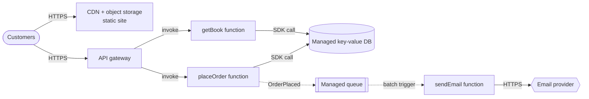

**Reading the diagram.** Static pages come from a CDN backed by object storage. API calls go through a managed API gateway, which invokes functions synchronously; `placeOrder` and `getBook` call a managed key-value database through the provider's SDK. `placeOrder` also enqueues a message (dotted, asynchronous), and the queue triggers `sendEmail` in batches. Every box except the functions is a managed service; the storage boundaries are the database and the queue. Failure points: cold starts add latency on the synchronous path; account-level concurrency limits can throttle all functions at once; downstream systems that are not elastic (a relational database with a connection limit) can be overwhelmed when functions scale out. Scaling is automatic per request up to those limits.

**Figure 33.9 — A cold start compared with a warm start.**

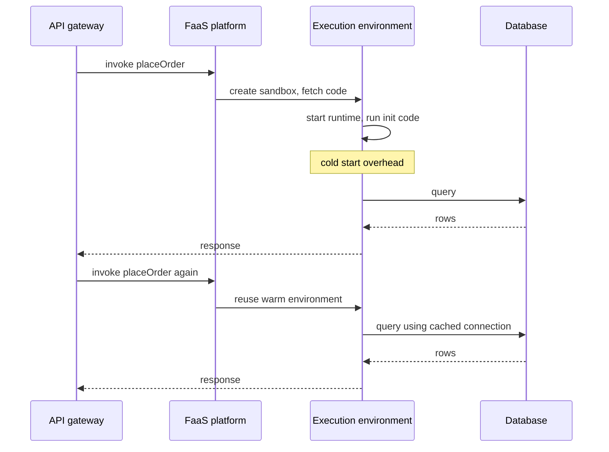

**Reading the diagram.** The first invocation finds no idle environment, so the platform creates a sandbox, fetches code and starts the runtime; the function's initialization code then runs before the handler. All calls shown are synchronous. The second invocation, arriving while the environment is still alive, skips straight to the handler and reuses objects created during initialization, such as database connections. The failure point is the cold path: if initialization is slow or a dependency is unreachable, the first request in each new environment pays for it. Scaling out creates more environments, so a burst produces a burst of cold starts.

### 33.9.2 Cold starts

Cold-start time depends mostly on package size, runtime and initialization work. As of 2026, small functions in interpreted runtimes commonly cold-start in a few hundred milliseconds, while large JVM functions with heavy frameworks can take seconds; warm invocations add only milliseconds of platform overhead. Mitigations, in order of preference: keep packages small and initialization lazy; choose a fast-starting runtime for latency-sensitive paths; use **provisioned concurrency** (pre-initialized environments, billed while idle); use snapshot-based start (AWS Lambda SnapStart restores a snapshot of an initialized environment); and keep cold starts off the critical path by putting asynchronous work behind queues. "Keep-warm" pings are a weak workaround: they keep one environment warm, not the twenty a burst needs. Chapter 48 covers the internals.

### 33.9.3 The cost model and the break-even point

#### Mathematical foundations

::: formula
**Serverless versus always-on monthly cost**

$$C_{\text{FaaS}} = R \,\bigl(c_{\text{req}} + M \, D \, c_{\text{GBs}}\bigr), \qquad C_{\text{srv}} = n \, c_{\text{inst}}, \qquad R^{*} = \frac{C_{\text{srv}}}{c_{\text{req}} + M \, D \, c_{\text{GBs}}}$$

| Symbol | Meaning | Units |
|---|---|---|
| $C_{\text{FaaS}}$ | Monthly cost of the functions | \$/month |
| $R$ | Invocations per month | requests/month |
| $c_{\text{req}}$ | Per-request charges (function, plus gateway if used) | \$/request |
| $M$ | Memory allocated to the function | GB |
| $D$ | Billed duration per invocation | s |
| $c_{\text{GBs}}$ | Price per GB-second of execution | \$/GB-s |
| $C_{\text{srv}}$ | Monthly cost of always-on servers | \$/month |
| $n$ | Number of always-on instances (including redundancy) | instances |
| $c_{\text{inst}}$ | Monthly price of one instance | \$/instance-month |
| $R^{*}$ | Break-even invocations per month | requests/month |
:::

::: example
**Worked example — Folio's `getBook` API.** Prices (AWS Lambda x86 list prices in us-east-1, as of 2026 [AWS Lambda Pricing]; verify for your region): $c_{\text{GBs}} = \$0.0000166667$, function requests \$0.20 per million so $c_{\text{req}} = \$2 \times 10^{-7}$. The function uses $M = 0.5$ GB and $D = 0.1$ s. The always-on alternative is $n = 2$ small instances (two for availability) at an illustrative \$60/month each, so $C_{\text{srv}} = \$120$. Assume two instances can carry the load in question. Free tiers are ignored.

1. GB-seconds per invocation: $0.5 \times 0.1 = 0.05$ GB-s.
2. Compute cost per invocation: $0.05 \times 0.0000166667 = \$8.33 \times 10^{-7}$.
3. Total per invocation: $8.33 \times 10^{-7} + 2.0 \times 10^{-7} = \$1.033 \times 10^{-6}$.
4. Break-even: $R^{*} = 120 / (1.033 \times 10^{-6}) \approx 116$ million invocations per month.
5. As an average rate over a 30-day month ($2.592 \times 10^{6}$ s): $116 \times 10^{6} / 2.592 \times 10^{6} \approx 45$ RPS.
6. Add an API gateway at an illustrative \$1.00 per million requests: per invocation $\$2.033 \times 10^{-6}$, so $R^{*} \approx 59$ million per month, about 23 RPS.
7. Check two points. At 10 RPS average (25.9 million/month) with the gateway: $25.9 \times 10^{6} \times 2.033 \times 10^{-6} \approx \$53$, cheaper than \$120. At 200 RPS (518 million/month): about \$1,054, nearly nine times the servers' cost.

**Interpretation.** Below roughly 20–45 RPS of *average* load, serverless is cheaper; above it, always-on capacity wins, and the gap widens linearly. Spiky traffic favors serverless because servers must be sized for the peak while functions bill only the average. **Engineering implication.** Compute $R^{*}$ with your real duration and memory, and remember the omitted terms on both sides: engineer time to operate servers (favoring serverless) and per-request charges of other managed services, data transfer and logging (often favoring servers at high volume). Re-run the numbers as traffic grows.
:::

#### Real-world industry applications

::: industry
**Prime Video's audio/video monitoring service.** Amazon's Prime Video team described a stream-quality monitoring tool first built as distributed components orchestrated by AWS Step Functions with Lambda functions passing frames through object storage. At high volume, per-transition orchestration charges and storage round trips dominated cost and limited scale. The team moved the components into a single process running on containers, passing data in memory, and reported infrastructure cost falling by about 90% [Kolny 2023]. The lesson is the cost model above: a fine-grained serverless design suited a low-volume start, and a consolidated always-on design suited sustained high volume.
*Evidence: Primary* — [Kolny 2023]
:::

#### Advantages, disadvantages and failure scenarios

Serverless removes server operations, scales automatically, costs nothing when idle and suits event glue, spiky APIs, scheduled jobs and prototypes. Its disadvantages are cold-start latency, execution limits (for example, a 15-minute maximum duration on AWS Lambda, as of 2026), no local state between invocations, provider lock-in through event formats and managed services, harder local testing, and costs that exceed servers at sustained load.

**Table 33.5 — Serverless failure scenarios.**

| What goes wrong | Why | Detection | Recovery | Prevention |
|---|---|---|---|---|
| p99 latency spikes after quiet periods | Cold starts | Init-duration metric; p99 vs p50 gap | Provisioned concurrency on hot paths | Small packages; lazy init; async paths |
| Database connection exhaustion | Hundreds of environments each open connections | DB connection count at limit | Throttle function concurrency | Connection proxy; reserved concurrency |
| Throttling of unrelated functions | Shared account concurrency limit | Throttle metrics across functions | Raise or partition limits | Reserved concurrency per critical function |
| Runaway bill | Recursive trigger or retry loop | Cost and invocation anomaly alerts | Disable trigger | Guard against self-triggering; budgets |
| Duplicate side effects | At-least-once event delivery and retries | Duplicate emails or charges | Compensate | Idempotency keys (§22.15) |

## 33.10 Hexagonal architecture (ports and adapters)

### 33.10.1 Ports, adapters and a technology-free core

::: definition
**Definition — Hexagonal architecture (ports and adapters).** A style, described by Alistair Cockburn, in which the application's core logic interacts with the outside world only through **ports**, interfaces defined by and in the language of the core, and each external technology (web framework, database, message broker, test harness) connects through an **adapter** that implements or calls a port [Cockburn 2005]. **Driving (primary) ports** are how the outside asks the application to do something; **driven (secondary) ports** are how the application asks the outside for something.
:::

#### First-principles explanation

A laptop has a USB-C port. The laptop's designers defined what the port expects; they did not design your monitor, charger or keyboard. Each device connects through a cable or dongle that adapts it to the port. You can test the laptop with a cheap test fixture plugged into the same port, and you can switch monitor brands without opening the laptop. In software, the core is the laptop, interfaces such as `OrderRepository` are the ports, and `SqliteOrderRepository` or `InMemoryOrderRepository` are the dongles.

#### Why does this exist?

Cockburn's motivation was that business logic kept leaking into user-interface code and depending directly on databases, so it could not be tested automatically or driven by anything except the UI. His goal was an application that can be driven equally by users, programs, automated tests or batch scripts, and developed and tested in isolation from its eventual devices and databases [Cockburn 2005]. The hexagon shape has no meaning beyond leaving room to draw several ports; the point is that there is an inside and an outside instead of a top and a bottom. Unlike layering, where business logic depends downward on persistence, here persistence depends inward on an interface the core owns: this is the dependency inversion principle (§36.7) applied to a whole application.

#### How it works internally

1. The core defines use cases (driving ports) such as `PlaceOrder`, and the interfaces it needs (driven ports) such as `OrderRepository` and `PaymentGateway`. The core imports no framework or database library.
2. Driving adapters (an HTTP controller, a CLI command, a message consumer, a test) translate an external request into a call on a driving port.
3. Driven adapters (a SQL repository, a payment-provider client, a fake) implement driven ports.
4. A **composition root**, usually `main`, constructs the adapters and injects them into the core (dependency injection, §37.14).

**Figure 33.10 — Folio's ordering core with ports and adapters.**

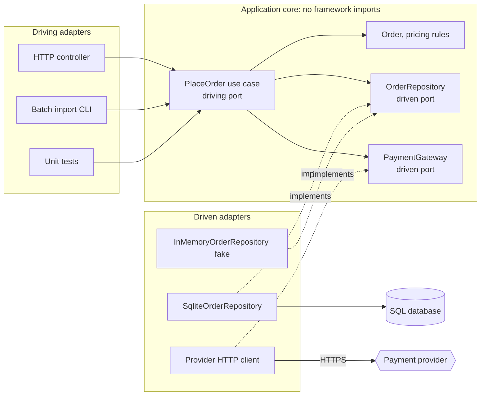

**Reading the diagram.** On the left, three driving adapters call the same use case synchronously; the core does not know which one is calling. Inside the core, the use case applies domain rules and calls two driven ports, which are interfaces. On the right, adapters implement those ports; the dotted "implements" edges are source-code dependencies pointing *into* the core, not runtime calls. Only the SQL adapter crosses the storage boundary and only the provider client crosses the network to the payment provider, so those are the failure points; the core itself has none beyond its own logic. Scaling is unaffected: hexagonal architecture is a code structure that can live inside a monolith, a microservice or a function.

#### Code example

The program below shows the core with one driven port, two adapters (SQLite and an in-memory fake) and one contract test suite that runs against both. It uses only the standard library; run it with `python3`.

```python
"""Folio checkout in ports-and-adapters style (single file for teaching)."""
import sqlite3
import unittest
from dataclasses import dataclass
from typing import Optional, Protocol


# ---------- Domain core: no imports from frameworks or databases ----------
@dataclass(frozen=True)
class Order:
    order_id: str
    isbn: str
    quantity: int
    total_cents: int


class OutOfStock(Exception):
    pass


class OrderRepository(Protocol):          # a driven (secondary) port
    def stock_of(self, isbn: str) -> int: ...
    def price_of(self, isbn: str) -> int: ...
    def save(self, order: Order) -> None: ...   # must also decrement stock
    def find(self, order_id: str) -> Optional[Order]: ...


class PlaceOrder:                          # a use case; its method is the driving port
    def __init__(self, repo: OrderRepository) -> None:
        self.repo = repo

    def __call__(self, order_id: str, isbn: str, quantity: int) -> Order:
        if quantity <= 0:
            raise ValueError("quantity must be positive")
        if self.repo.stock_of(isbn) < quantity:
            raise OutOfStock(isbn)
        order = Order(order_id, isbn, quantity, self.repo.price_of(isbn) * quantity)
        self.repo.save(order)
        return order


# ---------- Adapter 1: SQLite (production-like) ----------
class SqliteOrderRepository:
    def __init__(self, conn: sqlite3.Connection) -> None:
        self.conn = conn
        conn.execute("CREATE TABLE IF NOT EXISTS books"
                     "(isbn TEXT PRIMARY KEY, price_cents INT, stock INT)")
        conn.execute("CREATE TABLE IF NOT EXISTS orders"
                     "(id TEXT PRIMARY KEY, isbn TEXT, qty INT, total INT)")

    def add_book(self, isbn: str, price_cents: int, stock: int) -> None:
        self.conn.execute("INSERT INTO books VALUES (?, ?, ?)", (isbn, price_cents, stock))

    def stock_of(self, isbn: str) -> int:
        row = self.conn.execute("SELECT stock FROM books WHERE isbn=?", (isbn,)).fetchone()
        return row[0] if row else 0

    def price_of(self, isbn: str) -> int:
        return self.conn.execute("SELECT price_cents FROM books WHERE isbn=?",
                                 (isbn,)).fetchone()[0]

    def save(self, order: Order) -> None:
        with self.conn:                    # one ACID transaction
            cur = self.conn.execute(
                "UPDATE books SET stock = stock - ? WHERE isbn=? AND stock >= ?",
                (order.quantity, order.isbn, order.quantity))
            if cur.rowcount != 1:
                raise OutOfStock(order.isbn)
            self.conn.execute("INSERT INTO orders VALUES (?, ?, ?, ?)",
                              (order.order_id, order.isbn, order.quantity, order.total_cents))

    def find(self, order_id: str) -> Optional[Order]:
        row = self.conn.execute("SELECT id, isbn, qty, total FROM orders WHERE id=?",
                                (order_id,)).fetchone()
        return Order(*row) if row else None


# ---------- Adapter 2: in-memory fake (for tests and local runs) ----------
class InMemoryOrderRepository:
    def __init__(self) -> None:
        self.books: dict[str, list[int]] = {}   # isbn -> [price_cents, stock]
        self.orders: dict[str, Order] = {}

    def add_book(self, isbn: str, price_cents: int, stock: int) -> None:
        self.books[isbn] = [price_cents, stock]

    def stock_of(self, isbn: str) -> int:
        return self.books.get(isbn, [0, 0])[1]

    def price_of(self, isbn: str) -> int:
        return self.books[isbn][0]

    def save(self, order: Order) -> None:
        if self.books[order.isbn][1] < order.quantity:
            raise OutOfStock(order.isbn)
        self.books[order.isbn][1] -= order.quantity
        self.orders[order.order_id] = order

    def find(self, order_id: str) -> Optional[Order]:
        return self.orders.get(order_id)


# ---------- Tests: the same contract runs against both adapters ----------
class PlaceOrderContract:
    def make_repo(self):
        raise NotImplementedError

    def setUp(self):
        self.repo = self.make_repo()
        self.repo.add_book("978-0", price_cents=2500, stock=3)
        self.place = PlaceOrder(self.repo)

    def test_places_order_and_decrements_stock(self):
        order = self.place("o-1", "978-0", 2)
        self.assertEqual(order.total_cents, 5000)
        self.assertEqual(self.repo.stock_of("978-0"), 1)
        self.assertEqual(self.repo.find("o-1"), order)

    def test_rejects_when_out_of_stock(self):
        with self.assertRaises(OutOfStock):
            self.place("o-2", "978-0", 4)
        self.assertIsNone(self.repo.find("o-2"))


class TestWithFake(PlaceOrderContract, unittest.TestCase):
    def make_repo(self):
        return InMemoryOrderRepository()


class TestWithSqlite(PlaceOrderContract, unittest.TestCase):
    def make_repo(self):
        return SqliteOrderRepository(sqlite3.connect(":memory:"))


if __name__ == "__main__":
    unittest.main(verbosity=2)
```

Running it prints four passing tests: two against the fake, two against SQLite.

What to notice:

- `PlaceOrder` imports nothing from `sqlite3`; it depends only on the `OrderRepository` protocol. The port is defined by what the core needs, in the core's vocabulary (`stock_of`, `save`), not by what SQL offers.
- The two adapters differ completely inside, yet both satisfy the same port. The SQLite adapter uses a conditional `UPDATE ... WHERE stock >= ?` inside a transaction, so a concurrent order cannot oversell; the fake checks in memory.
- The **contract test** (`PlaceOrderContract`) is written once and run against each adapter. This is what makes a fake trustworthy: if the fake ever behaves differently from the real adapter, the SQLite run of the same test catches it.
- Tests of the use case through the fake need no database and run in milliseconds, so business rules can be tested exhaustively; the slower SQLite run is reserved for the adapter contract.

#### Advantages, disadvantages and misconceptions

Hexagonal architecture makes the core testable, keeps technology decisions reversible, and lets new delivery mechanisms (a queue consumer next to an HTTP API) reuse the same use cases. Its costs are indirection and mapping code; for a thin CRUD service whose "logic" is the SQL itself, ports add ceremony without benefit, the sinkhole of §33.3.2 in another form.

::: mistake
**"Every class needs an interface."** Ports are needed at the boundary to things that are slow, nondeterministic, external or likely to change: databases, networks, clocks, randomness. Domain classes inside the core call each other directly. Wrapping everything in interfaces adds cost and hides the real boundaries.
:::

## 33.11 Clean architecture

### 33.11.1 The dependency rule

::: definition
**Definition — Clean architecture.** Robert C. Martin's synthesis of hexagonal, onion and similar architectures, drawn as concentric circles: **entities** (enterprise business rules) at the center, then **use cases** (application business rules), then **interface adapters** (controllers, presenters, gateways), then **frameworks and drivers** (web, database, devices) at the edge, governed by one **dependency rule**: source-code dependencies point only inward [Martin 2017].
:::

#### First-principles explanation and why it exists

Imagine the policies of a bank written down in a rulebook. The rulebook does not mention which brand of teller software the branches use; the teller software is written to follow the rulebook. If the software changes, the rulebook does not. Martin's argument is that the most stable, most valuable code (business rules) should not depend on the most volatile code (frameworks, UI, database drivers), so the details plug into the policy, never the reverse. When data must flow outward, for example a use case presenting results, the inner circle defines an interface (an output port) that the outer circle implements: control flows outward while the source-code dependency still points inward.

**Figure 33.11 — Clean architecture's circles for Folio, with the dependency rule.**

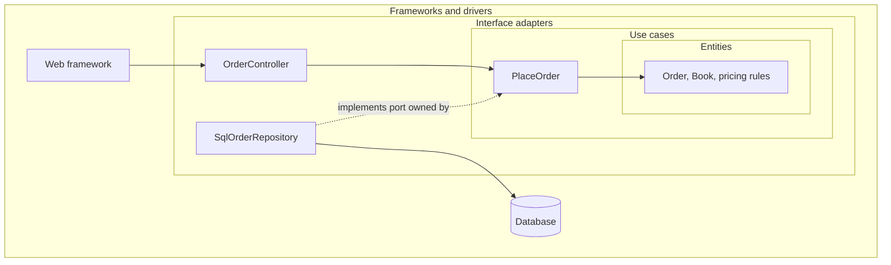

**Reading the diagram.** Nested boxes are the circles: entities innermost, then use cases, interface adapters and frameworks. Every solid arrow is a synchronous call that also points inward as a source dependency: the web framework calls the controller, the controller calls the use case, and the use case uses entities. The repository is the interesting edge: at run time the use case calls it, but in source code the repository implements a port owned by the use-case circle (dotted arrow), so the dependency still points inward. The database is the only storage boundary and sits at the outermost circle with other details. Failure points and scaling are those of whatever deployment hosts the code.

### 33.11.2 Onion, hexagonal and clean compared

Jeffrey Palermo's **onion architecture** (2008) makes the same move with different labels: the domain model at the center, then domain services, then application services, with UI, infrastructure and tests in the outer ring, and all coupling toward the center [Palermo 2008]. Table 33.6 relates the three.

**Table 33.6 — Hexagonal, onion and clean architecture.**

| Aspect | Hexagonal (2005) | Onion (2008) | Clean (2012 blog, 2017 book) |
|---|---|---|---|
| Central metaphor | Inside versus outside, ports | Concentric rings | Concentric circles |
| Prescribes inner structure | No; "the application" | Domain model, domain services, application services | Entities, use cases |
| Key rule | Core talks to outside only via ports | Coupling toward the center | Dependencies point inward only |
| Emphasis | Symmetry of driving and driven sides; testability | Domain model at center; infrastructure outermost | Policy versus detail; use cases as first-class |

All three are applications of dependency inversion around a technology-free core; they differ in vocabulary and in how much inner layering they prescribe. In practice, the decisions that matter are the same: which interfaces the core owns, and where the composition root lives.

::: warning
**Ceremony is a real cost.** Clean architecture applied literally to a small CRUD service produces request models, response models, presenters and mappers for data that passes through unchanged. Use the full structure where business rules are rich and long-lived; use a thin hexagonal boundary, or plain layering, where they are not.
:::

## 33.12 Cell-based architecture

### 33.12.1 Cells, the cell router and blast radius

::: definition
**Definition — Cell-based architecture.** A style in which a workload is deployed as multiple independent, complete copies called **cells**, each with its own compute and data and each serving a fixed subset of customers (or other partition key), placed behind a thin **cell router** that sends each request to its customer's cell. Cells share nothing at run time, so a failure, bad deployment or poison request affects only one cell. The fraction of customers affected by a failure is its **blast radius** [AWS 2023].
:::

#### First-principles explanation

A ship is divided into watertight compartments so that a hole floods one compartment rather than sinking the vessel. Bulkheads (§22.14) apply that idea to thread pools inside one service. Cells apply it to the entire stack: load balancer, services, caches, queues and databases are all duplicated per compartment. Every architecture so far, even microservices, has shared components whose failure affects every customer: the one orders database, the one broker. Cells remove that sharing.

#### Why does this exist?

At large scale the dominant causes of outages are not hardware failures, which redundancy handles, but correlated failures: a bad configuration push, a software bug triggered by one customer's unusual request, a capacity overload. Redundant replicas of the same code share the same bug, and a load balancer will happily send a crashing "poison pill" request to every replica in turn until all are down. Cells limit such events to one partition of customers, and they bound the size of each copy, so a cell's maximum load can be tested in advance instead of being discovered in production [AWS 2023].

#### How it works internally

1. **Choose a partition key**: usually the customer or tenant ID; for Folio's marketplace, the seller account.
2. **Size cells** to a fixed maximum (customers, requests per second, data volume) that you have load-tested. Grow by adding cells, not by growing cells.
3. **Route**: the cell router looks up the key in a mapping table (cached aggressively) and forwards the request. The router must be the simplest, most reliable component in the system; it contains no business logic.
4. **Control plane**: a separate service places new customers into cells, provisions new cells and migrates customers between cells. Its failure must not stop the data plane from serving.
5. **Deploy in waves**: release to one cell, watch, then progressively more. The first wave's exposure equals one cell's blast radius.
6. **Handle what cannot be partitioned** (global search, cross-customer analytics) with separate, asynchronously fed systems.

**Figure 33.12 — Folio's seller platform as cells behind a cell router.**

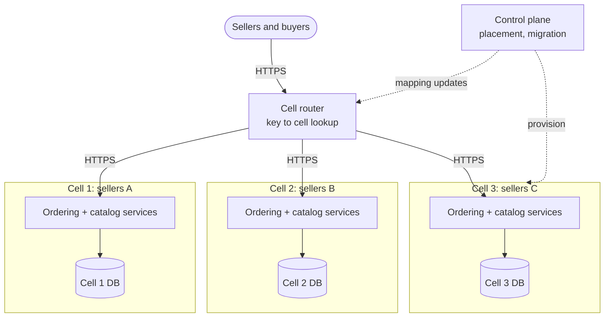

**Reading the diagram.** The router receives every request over HTTPS, maps the seller ID to a cell and forwards the request synchronously; it holds no other logic. Each cell is a complete stack with its own services and its own database, so there are as many storage boundaries as cells and no shared data path between them. The control plane updates the router's mapping and provisions cells asynchronously (dotted); if it fails, routing continues from the cached mapping, a property called **static stability** [Weiss and Furr 2020]. Failure points: a fault inside a cell stays inside it; the router is the one shared component and must be kept minimal and redundant. Scaling is by adding cells; a single customer larger than a cell is the main limit.

#### Mathematical foundations

::: formula
**Blast radius of a cell failure**

$$B = \frac{1}{N_c}, \qquad N_c = \left\lceil \frac{U}{u_{\max}} \right\rceil$$

| Symbol | Meaning | Units |
|---|---|---|
| $B$ | Fraction of customers affected when one cell fails (customers evenly spread) | fraction |
| $N_c$ | Number of cells | cells |
| $U$ | Total customers | customers |
| $u_{\max}$ | Tested maximum customers per cell | customers/cell |
:::

::: example
**Worked example — Sizing Folio's seller cells.** Folio has $U = 1{,}000{,}000$ sellers and has load-tested one cell up to $u_{\max} = 50{,}000$ sellers.

1. $N_c = \lceil 1{,}000{,}000 / 50{,}000 \rceil = 20$ cells.
2. $B = 1/20 = 5\%$: a poison-pill request or bad deploy that crashes one cell affects 50,000 sellers instead of 1,000,000.
3. Deployment waves of 1, 2, 4, 8 and 5 cells expose 5%, then 10%, 20%, 40% and 25% of sellers at each stage; a defect caught in wave 1 touches 5%.
4. Cost check: if each cell carries a fixed overhead of, say, 3 instances for redundancy and control functions, 20 cells carry 60 instances of overhead against perhaps 2 or 3 for an unpartitioned design.

**Interpretation.** Blast radius falls as $1/N_c$, but per-cell fixed cost rises linearly in $N_c$. **Engineering implication.** Choose $u_{\max}$ from load tests and business tolerance for a partial outage, not as small as possible; make each cell large enough that its fixed overhead is a small fraction of its useful capacity.
:::

### 33.12.2 Shuffle sharding

Cells give each customer exactly one compartment. **Shuffle sharding** does better for stateless fleets: assign each customer a random *combination* of $k$ workers out of $N$, so that two customers rarely share the same full set [MacCárthaigh 2019]. If one customer's requests crash workers, only that customer's $k$ workers are hit, and another customer is fully cut off only if its entire combination is contained in the failed set; any customer with at least one healthy worker continues, provided clients retry on another worker in their shard.

**Figure 33.13 — Shuffle sharding: eight workers, two per customer.**

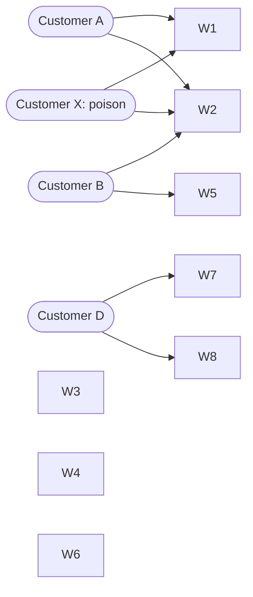

**Reading the diagram.** Eight stateless workers serve all customers; each customer's requests may go only to its two assigned workers, chosen at random when the customer is onboarded and resolved by the router. Calls are synchronous. Customer X sends requests that crash workers, taking out W1 and W2. Customer A, whose shard is exactly {W1, W2}, loses service. Customer B shares only W2, so its retries succeed on W5. Customer D shares nothing and is unaffected. There is no storage boundary here (workers are stateless); the failure point is the overlap between shards, and capacity scales by adding workers, which also increases the number of possible combinations.

::: formula
**Shuffle-sharding overlap**

$$S = \binom{N}{k}, \qquad P(\text{overlap} = j) = \frac{\binom{k}{j}\binom{N-k}{k-j}}{\binom{N}{k}}, \qquad P(\text{full overlap}) = \frac{1}{\binom{N}{k}}$$

| Symbol | Meaning | Units |
|---|---|---|
| $N$ | Workers in the fleet | workers |
| $k$ | Shard size: workers assigned to each customer | workers |
| $S$ | Number of distinct shards (combinations) | count |
| $j$ | Workers that another customer shares with the failed shard | workers |
| $P(\text{overlap} = j)$ | Probability a random other customer shares exactly $j$ workers | probability |
:::

::: example
**Worked example — Isolation from a poison customer.**

*Small fleet, $N = 8$, $k = 2$.*

1. $S = \binom{8}{2} = 28$ combinations.
2. Full overlap (all of another customer's workers fail): $1/28 \approx 3.6\%$ of customers. Compare a design without sharding, where all workers serve everyone and the poison request eventually crashes all eight: 100%.
3. No overlap: $\binom{6}{2}/28 = 15/28 \approx 53.6\%$ unaffected; the remaining $12/28 \approx 42.9\%$ share one worker and survive by retrying on their other worker.

*Larger fleet, $N = 100$, $k = 5$, 10,000 customers.*

1. $S = \binom{100}{5} = 75{,}287{,}520$.
2. Full overlap: $1/S \approx 1.3 \times 10^{-8}$; expected fully affected customers among the other 9,999: $9{,}999 \times 1.3 \times 10^{-8} \approx 0.0001$.
3. Overlap of 3 or more workers (at most 2 of 5 left): $P(3) + P(4) + P(5) = 5.93 \times 10^{-4} + 6.3 \times 10^{-6} + 1.3 \times 10^{-8} \approx 6.0 \times 10^{-4}$, about 6 customers, who keep service at reduced capacity.
4. $P(0) = \binom{95}{5}/\binom{100}{5} \approx 77.0\%$ share no worker at all.

**Interpretation.** With the same 100 workers, 20 cells of 5 would put each customer in one of 20 compartments, so a poison customer fully affects 5% of the others; shuffle sharding makes full overlap a one-in-75-million event. **Engineering implication.** Shuffle sharding needs clients or routers that retry across the shard and workers that are interchangeable; for stateful partitions holding a customer's data, use cells, and combine the two by shuffle sharding within or across cells.
:::

#### Real-world industry applications

::: industry
**AWS cells and shuffle sharding.** AWS's Well-Architected guidance describes cell-based architecture, including cell routers, cell sizing, placement and migration, as a way to reduce the scope of impact of failures [AWS 2023], and its Builders' Library describes shuffle sharding with the eight-worker, two-per-customer illustration used above [MacCárthaigh 2019]. Route 53 is described as using shuffle sharding to assign name servers to hosted zones.
*Evidence: Primary* — [AWS 2023], [MacCárthaigh 2019]
:::

**Table 33.7 — Cell-based architecture failure scenarios.**

| What goes wrong | Why | Detection | Recovery | Prevention |
|---|---|---|---|---|
| Router outage takes down all cells | Router is the one shared component | Global error rate, all cells healthy | Fail over router; serve from cached map | Minimal router logic; static stability |
| Hot customer outgrows its cell | Uneven customer sizes | Cell nearing tested limits | Migrate customer to a larger or dedicated cell | Placement by size; per-customer quotas |
| Same bug in every cell | Simultaneous global deploy | Errors rise in all cells together | Roll back | Wave deployments, one cell first |
| Cross-cell dependency appears | Shared service added "temporarily" | Dependency map shows shared component | Duplicate it per cell | Review rule: cells share nothing in the data plane |

Chapter 44 extends cells across regions, and Chapter 47 treats tenant placement and isolation levels.

## 33.13 Monolith versus microservices

### 33.13.1 Side-by-side comparison

Table 33.8 compares the three deployment styles that most teams actually choose between. Serverless and cells are orthogonal: a modular monolith can run in cells, and microservices can be built from functions.

**Table 33.8 — Monolith, modular monolith and microservices.**

| Row | Monolith | Modular monolith | Microservices |
|---|---|---|---|
| What it is | One deployable, unstructured or layered inside | One deployable, domain modules with enforced boundaries | Many independently deployable services |
| How it works | In-process calls, one shared database | In-process calls through module APIs; schema per module | Network calls and events; database per service |
| Advantages | Simplest to build, debug and deploy; ACID everywhere | Monolith's simplicity plus clear ownership and cheap extraction | Independent deploys, scaling, failure isolation, technology choice |
| Disadvantages | Coupling grows with team count; erosion | Deployment and scaling still coupled | Network failures, distributed data, sagas, operational load |
| Performance | Nanosecond calls; joins in SQL | Same as monolith | ~0.5–1 ms per hop; fan-out tail latency (§4.8.4) |
| Operational complexity | Low: one pipeline, one service | Low, plus boundary tooling | High: per-service pipelines, tracing, discovery, on-call |
| Cost | Lowest at small scale | Low | Higher baseline (platform, per-service overhead) |
| Use cases | Early products; small teams; stable small domains | Most products up to several teams | Many teams; heterogeneous scaling or isolation needs |
| Choose when | One team; domain still moving | 2–8 teams sharing one release; boundaries known | Release coordination is the bottleneck and a platform exists |

### 33.13.2 Conway's law and the cost of coordination

Conway observed that organizations which design systems are constrained to produce designs that copy their communication structures [Conway 1968]. The practical reading is that architecture and team structure must match: if Ordering and Inventory are separate services owned by one team, they will be changed together and drift into a distributed monolith; if one module is owned by three teams, it will grow three internal sub-architectures. The **inverse Conway maneuver** designs team boundaries first, so that the desired architecture is the one the organization naturally produces [Skelton and Pais 2019].

#### Mathematical foundations

::: formula
**Communication paths among teams**

$$L_{\text{all}} = \frac{T(T-1)}{2}, \qquad L_{\text{declared}} = \frac{T \, \bar{d}}{2}$$

| Symbol | Meaning | Units |
|---|---|---|
| $L_{\text{all}}$ | Pairwise coordination paths when every team may need every other | paths |
| $T$ | Number of teams | teams |
| $L_{\text{declared}}$ | Paths when teams coordinate only along declared module or service dependencies | paths |
| $\bar{d}$ | Average number of neighbor teams per team in the dependency graph | teams |
:::

::: example
**Worked example — Folio at 3 and 12 teams.**

1. At $T = 3$: $L_{\text{all}} = 3 \times 2 / 2 = 3$ paths. Everyone can attend one planning meeting; a monolith is fine.
2. At $T = 12$ with one shared code base and release: $L_{\text{all}} = 12 \times 11 / 2 = 66$ paths.
3. At $T = 12$ with enforced boundaries where each team depends on about $\bar{d} = 2$ others: $L_{\text{declared}} = 12 \times 2 / 2 = 12$ paths, an 82% reduction.

**Interpretation.** Coordination grows quadratically with team count unless the architecture limits who must talk to whom. **Engineering implication.** Module boundaries (§33.5) already cut $L$ from 66 to 12 for code changes; independent deployment (§33.7) additionally removes the release-train coupling of §33.4.2. Split deployments when that second effect is what is hurting.
:::

### 33.13.3 A decision framework

Use four questions, in order. Each has a measurable signal.

1. **Team size and structure.** One or two teams: monolith or modular monolith. More teams than can share one release without regular blocking (from §33.4.2, release failure rates above roughly 20–30%, or queues to merge): consider independent deployment for the teams most blocked.
2. **Deployment frequency.** If teams want to deploy several times a day and the shared pipeline or test suite takes hours, independent deployables help. If the business releases monthly, they do not.
3. **Domain maturity.** If boundaries are still moving (a new product, frequent changes that touch many modules), keep them in-process where moving a boundary is a refactor. Extract only modules whose interfaces have been stable for months [Fowler 2015; Newman 2019].
4. **Heterogeneous runtime needs.** If one part needs very different scaling, technology, security isolation or availability (Folio's search indexing, payment-card handling), extract *that part* first.

Fowler's "MonolithFirst" and Tilkov's counterargument "Don't start with a monolith" (both 2015) disagree mainly on question 3: Tilkov argues that when the domain is well understood, for example a rewrite of an existing system, starting with separate services avoids a costly later split [Fowler 2015; Tilkov 2015].

**Figure 33.14 — Choosing a deployment style.**

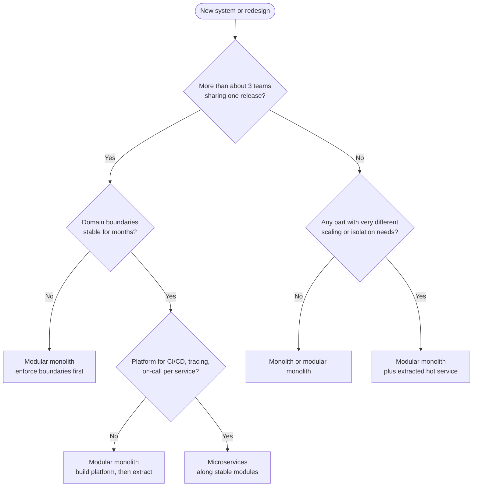

**Reading the diagram.** Decision diamonds are evaluated top to bottom; each answer leads to the next question or to a recommendation. The first split is organizational: few teams lead to a monolith or modular monolith, with a hybrid when one component has distinct runtime needs (as QuickBite's location service did in §2.8.1). Many teams lead to microservices only when boundaries are stable and a platform exists; otherwise the answer is still a modular monolith, with extraction deferred. There are no runtime components, protocols or storage boundaries here; the failure point the chart guards against is the premature split, and "scaling" means revisiting the chart as teams and traffic grow.

#### Real-world industry applications

::: industry
**Segment's return to a monolith.** Segment described splitting its event-delivery destinations into well over a hundred separate services, one per destination, each with its own queue. Shared-library versions drifted across services, operational load grew with each new destination, and a small team could not keep them all healthy. Segment consolidated the destinations into a single service with a shared test suite and reported large gains in developer productivity [Noonan 2018]. The case illustrates the decision framework: service count far exceeded team count, so the coordination microservices remove was not the problem they had.
*Evidence: Primary* — [Noonan 2018]
:::

::: recommendation
**Default path for a new product.** Start with a modular monolith with enforced boundaries and per-module schemas. Instrument release failure rate, lead time and cross-module change frequency. Extract a module into a service when a measured signal (blocked releases, a scaling or isolation need) justifies the operational cost, and use the strangler fig pattern for the extraction (§34.13).
:::

::: mistake
**"Microservices are what large companies use, so they are more scalable."** Request throughput scales by replication in every style. Microservices scale *organizations*, by letting many teams deploy independently, and permit per-component scaling. A 10-engineer team adopting them pays the costs without the organizational benefit.
:::

## 33.14 Summary and revision notes

::: summary
- **Layered**: horizontal technical layers; layers are logical, tiers physical. Strict layering isolates, relaxed layering opens chosen layers; most requests passing through without logic is the **sinkhole** anti-pattern. Layering is technical partitioning, so one feature touches every layer.
- **Monolith**: one deployable. Real benefits: in-process calls, ACID transactions, easy refactoring, simple operations. Main cost is **deployment coupling**: $P_{\text{clean}} = (1-p)^{Tc}$ falls exponentially with team count.
- **Modular monolith**: domain modules, public `api`, schema per module, acyclic declared dependencies, enforced in CI. Keeps the monolith's simplicity; makes extraction cheap.
- **SOA**: enterprise integration through a smart ESB and canonical model; microservices invert it to smart endpoints, dumb pipes and database per service.
- **Microservices**: independently deployable, team-owned services; pay in network hops, distributed data and operations (Ch 34).
- **Event-driven**: producers emit facts; consumers react asynchronously; broker versus mediator topology; eventual consistency (Ch 30–32).
- **Serverless**: FaaS plus managed services; scale to zero; cold starts; concurrency = rate × duration. Break-even $R^{*} = C_{\text{srv}}/(c_{\text{req}} + MDc_{\text{GBs}})$, about 23–45 RPS in the worked example.
- **Hexagonal**: the core owns ports; adapters implement them; test the core with fakes validated by contract tests. **Clean**: dependencies point inward only; onion, hexagonal and clean are variants of dependency inversion.
- **Cells**: complete independent stacks per customer partition behind a thin router; blast radius $1/N_c$; deploy in waves. **Shuffle sharding**: full-overlap probability $1/\binom{N}{k}$.
- **Choosing**: Conway's law; coordination paths $T(T-1)/2$; default to a modular monolith and extract on measured signals.
:::

## 33.15 Knowledge checkpoint

1. What is the difference between a layer and a tier?
2. Define the architecture sinkhole anti-pattern and give one remedy.
3. Why does layered architecture make adding a new product type expensive?
4. A release bundles 30 changes, each with a 2% chance of a blocking defect. What is the probability the release is clean?
5. Name the two rules a modular-monolith boundary checker enforces.
6. What does "smart endpoints and dumb pipes" contrast with?
7. A function receives 300 RPS and runs for 200 ms. How many concurrent execution environments does it need?
8. Using the worked-example prices, what is the per-invocation cost of a 1 GB, 250 ms function without a gateway?
9. In hexagonal architecture, what is the difference between a driving and a driven port?
10. Why should a fake adapter be run through the same contract tests as the real adapter?
11. State the dependency rule. How does a use case send data outward without violating it?
12. A service has 2,000,000 customers and a tested cell size of 80,000. How many cells, and what is the blast radius?
13. With $N = 10$ workers and $k = 3$, what fraction of customers share all three workers with a poison customer?
14. How many coordination paths do 8 teams have if every team may need every other?

<details><summary>Answers</summary>

1. A layer is a logical grouping of code by responsibility; a tier is a physical deployment boundary where a process runs. Several layers can share one tier.
2. Requests that pass through layers without any processing. Open the layer for those paths, or adopt a style with less ceremony where most operations are simple.
3. Code is partitioned by technical role, so a new domain concept needs changes in the presentation, business and persistence layers and the schema, often owned by different people.
4. $0.98^{30} = e^{30 \ln 0.98} = e^{-0.606} \approx 0.545$.
5. A module may depend only on its declared modules, and only through their public `api`.
6. SOA's enterprise service bus, which contains routing, transformation and orchestration logic in the middleware.
7. $300 \times 0.2 = 60$ environments (Little's Law).
8. $1 \times 0.25 = 0.25$ GB-s; $0.25 \times 0.0000166667 = \$4.17 \times 10^{-6}$; plus $\$2 \times 10^{-7}$ gives about $\$4.37 \times 10^{-6}$.
9. A driving port is how external actors invoke the application (its use cases); a driven port is how the application calls external resources (repositories, gateways). Driving adapters call the core; driven adapters are called by it.
10. To prove the fake behaves like the real adapter; otherwise fast tests may pass against behavior production never exhibits.
11. Source-code dependencies point only inward. The inner circle defines an output interface that an outer-circle presenter or gateway implements, so control flows outward while the dependency points inward.
12. $\lceil 2{,}000{,}000/80{,}000 \rceil = 25$ cells; blast radius $1/25 = 4\%$.
13. $1/\binom{10}{3} = 1/120 \approx 0.83\%$.
14. $8 \times 7/2 = 28$.
</details>

## 33.16 Interview questions

### Basic

**Q1. When is a monolith the right choice?** **Answer.** When one or two teams own the product, the domain is still being discovered, strong consistency across features matters and there is no platform for running many services. It offers in-process calls, ACID transactions, easy refactoring and simple operations. Structure it as a modular monolith so that extraction stays possible.

**Q2. What is hexagonal architecture?** **Answer.** The core defines ports, interfaces in its own vocabulary, for use cases it offers and resources it needs. Adapters connect technologies: HTTP controllers drive the core, SQL repositories and API clients implement driven ports. The core imports no framework, so it can be tested with fakes and its technologies replaced.

### Intermediate

**Q3. Your 15-team organization ships one monolith weekly and half the releases are delayed. What do you do?** **Answer.** Measure first: change failure rate, batch size, pipeline duration and which modules cause holds. Reduce $p$ with better tests and $c$ with smaller, more frequent deploys and feature flags. Enforce module boundaries and per-module schemas. Then extract the modules whose teams are most blocked and whose interfaces are stable, one at a time with the strangler fig pattern, on a platform providing pipelines, tracing and on-call tooling.

**Q4. Should an API with 5 RPS average and 500 RPS spikes be serverless?** **Answer.** Likely yes. At 5 RPS average, serverless costs a fraction of the break-even (about 23–45 RPS in the chapter's example), while servers would be sized for 500 RPS. Check cold-start impact on the latency SLO during spikes, concurrency limits ($500 \times$ duration environments), and whether downstream databases can absorb connection bursts; add provisioned concurrency or a connection proxy if not.

### Advanced

**Q5. Design fault isolation for a multi-tenant API where one tenant's malformed request has crashed the whole fleet.** **Answer.** Explain that redundancy fails because every replica runs the same code and retries spread the poison request. Partition into cells with a thin, statically stable router and tested cell size; blast radius is $1/N_c$. Within cells, shuffle-shard stateless workers so full overlap is $1/\binom{N}{k}$. Add per-tenant quotas, wave deployments, and quarantine of request signatures that crash workers.

**Q6. Contrast SOA, microservices and cells.** **Answer.** SOA integrates enterprise applications through a smart ESB and canonical model, centralizing logic and governance. Microservices split one product by business capability into independently deployable services with their own data and dumb pipes, optimizing team autonomy. Cells duplicate an entire stack, monolith or microservices, per customer partition to limit blast radius. They answer integration, organizational and fault-isolation problems respectively and can be combined.

## 33.17 Practical exercises

1. Extend the boundary checker to detect cycles in `ALLOWED` and to read real files from a directory tree; run it on a project you know.
2. Add a `PaymentGateway` driven port to the hexagonal example with a fake that can be told to decline, and test that a declined payment leaves stock unchanged in both repository adapters.
3. Write a script that computes $R^{*}$ for memory sizes from 128 MB to 2 GB and durations from 20 ms to 1 s, and plot the break-even RPS.
4. Simulate shuffle sharding: assign 10,000 customers random 5-of-100 shards, fail one shard, and compare the measured overlap distribution with the hypergeometric formula.

## 33.18 Design challenges

1. **Folio's growth plan.** Folio has 6 engineers today and expects 60 in three years, in eight countries with data-residency rules. Propose an architecture for year one and the measured triggers for each later step (module extraction, cells per country), with an ADR (§2.12.4) for each.
2. **Serverless or containers for image processing.** Folio generates cover thumbnails: 2 million uploads a month, bursty around publisher catalog drops, 1.5 GB memory and 3 s per image. Compare serverless and always-on costs, latency and failure handling, and recommend a design.

## 33.19 References

1. Amazon Web Services. *AWS Lambda Pricing* and *AWS Lambda Developer Guide* (execution environment lifecycle, provisioned concurrency, SnapStart, quotas). Accessed 2026. https://aws.amazon.com/lambda/pricing/ (AWS Lambda Pricing)
2. Amazon Web Services. *Reducing the Scope of Impact with Cell-Based Architecture*. AWS Well-Architected whitepaper, 2023. (AWS 2023)
3. Bass, L., Clements, P., Kazman, R. *Software Architecture in Practice*, 4th ed. Addison-Wesley, 2021.
4. Cockburn, A. "Hexagonal Architecture." alistair.cockburn.us, 2005. https://alistair.cockburn.us/hexagonal-architecture/
5. Conway, M. E. "How Do Committees Invent?" *Datamation* 14(4), 1968.
6. Craver, N. "Stack Overflow: The Architecture – 2016 Edition." nickcraver.com, 2016.
7. Foote, B., Yoder, J. "Big Ball of Mud." *Pattern Languages of Programs (PLoP)*, 1997.
8. Fowler, M. "MonolithFirst." martinfowler.com, 2015. https://martinfowler.com/bliki/MonolithFirst.html
9. Jonas, E., et al. "Cloud Programming Simplified: A Berkeley View on Serverless Computing." Technical Report UCB/EECS-2019-3, University of California, Berkeley, 2019. arXiv:1902.03383.
10. Kolny, M. "Scaling up the Prime Video audio/video monitoring service and reducing costs by 90%." Prime Video Tech blog, 2023.
11. Lewis, J., Fowler, M. "Microservices: a definition of this new architectural term." martinfowler.com, 2014. https://martinfowler.com/articles/microservices.html
12. MacCárthaigh, C. "Workload isolation using shuffle-sharding." *Amazon Builders' Library*, 2019. https://aws.amazon.com/builders-library/workload-isolation-using-shuffle-sharding/
13. Martin, R. C. "The Clean Architecture." The Clean Code Blog, 2012. https://blog.cleancoder.com/uncle-bob/2012/08/13/the-clean-architecture.html
14. Martin, R. C. *Clean Architecture: A Craftsman's Guide to Software Structure and Design*. Prentice Hall, 2017.
15. Newman, S. *Monolith to Microservices: Evolutionary Patterns to Transform Your Monolith*. O'Reilly Media, 2019.
16. Noonan, A. "Goodbye Microservices: From 100s of problem children to 1 superstar." Segment Engineering Blog, 2018.
17. Palermo, J. "The Onion Architecture: part 1." jeffreypalermo.com, 2008.
18. Parnas, D. L. "On the Criteria To Be Used in Decomposing Systems into Modules." *Communications of the ACM* 15(12):1053–1058, 1972.
19. Richards, M. *Software Architecture Patterns*. O'Reilly Media, 2015.
20. Richards, M., Ford, N. *Fundamentals of Software Architecture: An Engineering Approach*. O'Reilly Media, 2020.
21. Shopify. *Packwerk*: a Ruby gem for enforcing boundaries and modularization in Rails applications. GitHub repository. https://github.com/Shopify/packwerk (Shopify Packwerk)
22. Skelton, M., Pais, M. *Team Topologies: Organizing Business and Technology Teams for Fast Flow*. IT Revolution, 2019.
23. Tilkov, S. "Don't start with a monolith." martinfowler.com, 2015. https://martinfowler.com/articles/dont-start-monolith.html
24. Weiss, B., Furr, M. "Static stability using Availability Zones." *Amazon Builders' Library*, 2020.
25. Westeinde, K. "Deconstructing the Monolith: Designing Software that Maximizes Developer Productivity." Shopify Engineering blog, 2019.

## 33.20 Open verification items

- AWS Lambda prices (\$0.0000166667 per GB-s, \$0.20 per million requests, x86, us-east-1), 15-minute maximum duration, one-request-per-environment concurrency model, and whether initialization (INIT) time is billed for all functions, as of 2026.
- API gateway price of about \$1.00 per million requests (HTTP APIs) used as illustrative, as of 2026.
- Richards's 80–20 sinkhole heuristic: confirm it appears in Richards 2015 (and/or Richards and Ford 2020).
- Kolny 2023: exact title, "over 90%" figure and current URL (the post may have moved).
- Noonan 2018: exact title and the number of destination services ("well over a hundred").
- Westeinde 2019 exact title; Packwerk's description and current status of its privacy checks.
- Route 53 use of shuffle sharding as described in MacCárthaigh 2019; the brief attributed the shuffle-sharding article to Brooker, but the Builders' Library byline is believed to be Colm MacCárthaigh (consistent with Ch 18).
- Exact title and year of the AWS cell-based architecture whitepaper.
- Cockburn and Palermo URLs.
