# Chapter 34 — Microservices

> **Level:** 3 · **Track:** A (Traditional) · **Estimated reading time:** 6 h

Chapter 33 placed microservices among the architecture styles. This chapter is about doing microservices well, and about recognizing when not to. Most microservice failures come from where the lines are drawn, not from the technology. Split a system along the wrong seams and every feature needs five teams, every release needs a coordinated deploy, and every request crosses a dozen network hops. Split it along the right seams and teams ship independently, failures stay contained, and each part scales on its own.

The chapter has three parts. **Boundaries**: cohesion, change coupling, team ownership and domain-driven design. **Plumbing**: gateways, backends for frontends, discovery, communication, contract testing, tracing and service meshes, each with its latency and cost arithmetic. **Data and change**: database-per-service, independent deployment, monolith migration and anti-patterns. QuickBite, the food-delivery platform of Chapter 2, is the running example.

## 34.1 Learning objectives

After this chapter you should be able to:

- Choose service boundaries using cohesion, change coupling, team ownership and sizing heuristics.
- Apply entities, value objects, aggregates and domain events, and size an aggregate with a contention estimate.
- Draw a context map and implement an anticorruption layer.
- Place an API gateway and backends for frontends, and compute the latency saved by aggregating calls.
- Compare client-side and server-side discovery and compute a registry's stale-endpoint window.
- Choose synchronous or asynchronous communication, version APIs and write a consumer-driven contract test.
- Explain trace context propagation and service-mesh data and control planes, including ambient mode, and estimate mesh overhead.
- Apply database-per-service, and query across services with API composition or CQRS views.
- Plan a strangler-fig migration and diagnose anti-patterns, including the $A^n$ availability of call chains.

## 34.2 Prerequisites

- Monolith, modular monolith and microservices overview — §33.4, §33.5, §33.7.
- Conway's law and the QuickBite decomposition — §1.4, §2.3.
- Fan-out tail latency and series availability — §4.8.4, §4.14.2.
- REST, gRPC and API versioning — §8.6, §8.8, §8.15.
- Client-side load balancing — §19.10.
- Timeouts, retries, circuit breakers and idempotency — §22.11–§22.15.
- Messaging, outbox and sagas — Chapters 30 and 32 (summarized here, not repeated).

## 34.3 Service boundaries

### 34.3.1 What a microservice is

::: definition
**Definition — Microservice.** A service built around one business capability, owned by one team, deployable independently, and the sole owner of its data, which others reach only through its API or events. Lewis and Fowler describe the style as "an approach to developing a single application as a suite of small services, each running in its own process and communicating with lightweight mechanisms," built around business capabilities and independently deployable [Lewis and Fowler 2014].
:::

#### First-principles explanation

A large restaurant kitchen is divided into **stations**: grill, sauce, pastry. Each has its own staff, tools and ingredients, and stations communicate through one fixed protocol, the ticket. The pastry chef can change suppliers without asking the grill. The division is by *outcome* (desserts), not by *activity* (one person chops for everyone), because outcomes change together: a new dessert touches only pastry. A microservice is a station: it owns an outcome, its data and its team, and others reach it only through its API.

#### Why does this exist?

A monolith shares one codebase, one deployable and one database. Beyond a few dozen engineers this causes **release coupling** (every change waits for the slowest change in the deploy), **scaling coupling** (the hottest component forces the whole application to scale) and **failure coupling** (a reporting job's memory leak takes down checkout). Microservices trade these for distributed-systems pains. Newman's summary: microservices buy options, chiefly independent deployability, at a substantial cost in complexity [Newman 2021].

### 34.3.2 Cohesion and coupling at service scale

::: definition
**Definition — Cohesion and coupling (service level).** **Cohesion** is the degree to which code inside one service changes together for the same reasons. **Coupling** is the degree to which a change in one service forces a change, redeploy or coordinated release in another. Newman's shorthand: "the code that changes together, stays together" [Newman 2021].
:::

Newman orders coupling from mild to damaging: **domain** coupling (A uses B's capability; unavoidable), **temporal** coupling (B must be up now; removed by events, §34.8), **pass-through** coupling (A carries data only because C needs it), **common** coupling (shared data) and **content** coupling (A changes B's database directly, the worst) [Newman 2021].

#### How it works internally: measuring change coupling

Version-control history records which code changes together: every commit touching two modules is evidence that they change for the same reason. Tornhill popularized mining such change-coupling metrics from Git [Tornhill 2015].

::: formula
**Change coupling between two modules (Jaccard index of co-changes)**

$$C(A,B) = \frac{n_{AB}}{n_A + n_B - n_{AB}}$$

| Symbol | Meaning | Units |
|---|---|---|
| $n_A$ | Number of commits (or pull requests) that touch module $A$ in the window | commits |
| $n_B$ | Number of commits that touch module $B$ in the window | commits |
| $n_{AB}$ | Number of commits that touch both $A$ and $B$ | commits |
| $C(A,B)$ | Fraction of all changes to either module that touched both; 0 = independent, 1 = always together | dimensionless |
:::

::: example
**Worked example — Should QuickBite's payment code be its own service?** In six months of monolith history, 120 pull requests touched `ordering`, 80 touched `payments` and 60 touched both; 90 touched `catalog`, of which 6 also touched `ordering`.

1. Ordering–payments: $C = 60 / (120 + 80 - 60) = 60 / 140 = 0.43$.
2. Ordering–catalog: $C = 6 / (120 + 90 - 6) = 6 / 204 = 0.029$.

**Interpretation.** As separate services, ordering and payments would need cross-team coordination on 43% of their changes; ordering and catalog on 3%. **Engineering implication.** Extract catalog first. Before splitting payments, inspect the 60 shared pull requests and redesign the interface (for example a `PaymentAuthorized` event) until the co-change disappears; otherwise you build a distributed monolith (§34.14). Treat $C > 0.2$ as a prompt to investigate, not a rule.
:::

### 34.3.3 Team ownership and Conway's law

Conway observed that systems copy the communication structure of the organizations that build them [Conway 1968] (§1.4). The **inverse Conway maneuver** shapes teams first so the desired architecture is the natural outcome. Skelton and Pais add that a service should fit within one **stream-aligned team's** cognitive load [Skelton and Pais 2019]. Practical rules: one owning team per service (a team may own several); a change in one business capability should land in one team; and teams with high communication cost (time zones, companies) need stable, documented interfaces between them.

**Figure 34.1 — Two ways to split QuickBite: by technical layer and by business capability.**

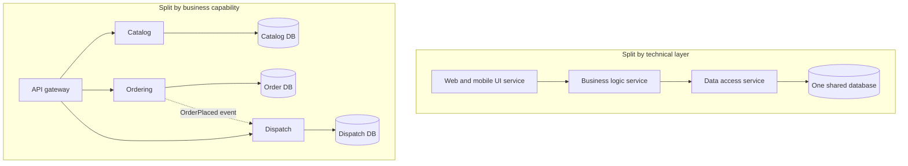

**Reading the diagram.** The top split follows technical layers: UI, logic and data-access services call each other synchronously over one shared database, so a feature such as "scheduled orders" changes all three services and the schema, every request crosses two extra hops, and each service is a single failure point for every capability. The bottom split follows capabilities: the gateway routes each request to one service (synchronous HTTPS or gRPC), each service owns its database (separate storage boundaries), and ordering informs dispatch asynchronously with an `OrderPlaced` event (dotted), so a dispatch outage does not block ordering. Each capability scales independently: read-heavy catalog adds replicas and caches; dispatch scales with courier activity.

### 34.3.4 Sizing heuristics

Size follows from boundaries, not lines of code. Each heuristic below is a test you can apply to a proposed boundary.

**Table 34.1 — Service sizing heuristics.**

| Heuristic | The test | Too big when | Too small when |
|---|---|---|---|
| Business capability | Nameable in two or three business words? | Name needs "and" | Name is a verb on another's noun ("order-validator") |
| Team ownership | One stream-aligned team can own it? | Several teams commit weekly | One team owns twenty services |
| Change coupling | Changes usually stay inside? | Many unrelated reasons to change | Most changes also change a neighbor |
| Data ownership | Owns its data outright? | Unrelated tables with separate invariants | Needs another service's data on every request |
| Transaction boundary | Invariants enforced inside? | — | An invariant spans it and a neighbor, forcing sagas |
| Independent deployability | Ships on its own schedule? | Blocked by unrelated work inside | Always deploys with a neighbor |

The most important row is the **transaction boundary**: if two candidates must change state atomically for a business rule to hold, they belong together, because splitting them turns one local transaction into a saga with compensations (§32.7).

::: recommendation
**Recommendation — Start coarse, split on evidence.** Begin with a modular monolith (§33.5) or a few coarse services. Split when there is a concrete reason (team boundary, scaling profile, failure isolation, release cadence) and history shows low change coupling. Merging services later costs far more than splitting a well-modularized module.
:::

::: mistake
**Common misconception — "Micro means small, so smaller is better."** *Micro* refers to scope of responsibility. A service that is too small moves its complexity into the network: more calls, failure modes, versioned interfaces and pipelines. Fowler's "Microservice Premium" argues that the style carries a fixed productivity cost that pays off only above a certain system complexity [Fowler 2015].
:::

## 34.4 Domain-driven design

Domain-driven design (DDD) is the most widely used discipline for finding and modelling business capabilities. Evans wrote it for complicated domains such as shipping and banking, a decade before microservices [Evans 2003]. **Strategic design** divides a domain into models and relates them (§34.5); **tactical design** builds one model well (this section).

::: definition
**Definition — Domain-driven design (DDD).** An approach that places a model of the business domain, built jointly by developers and domain experts, at the center of the design, expresses it directly in code, and divides large domains into explicitly bounded models [Evans 2003; Vernon 2013].
:::

### 34.4.1 Ubiquitous language

Ask three people at QuickBite what an "order" is. Support means the thing a customer complains about, refund included; restaurant operations means a ticket the kitchen accepts; finance means a settlement line that is final 14 days after delivery. Code serving all three with one `Order` class becomes a 4,000-line class with 60 nullable fields.

::: definition
**Definition — Ubiquitous language.** A rigorous vocabulary built by developers and domain experts for one model and used consistently in conversation, tests and code, so that each term means exactly one thing within that model [Evans 2003].
:::

The language is ubiquitous *within a boundary*. In ordering, `Order.accept()` means the restaurant confirmed it can cook; finance has no `accept`, only `Settlement.finalize()`. When code says `status = 3` and the business says "accepted", translation happens in people's heads and fails silently.

### 34.4.2 Entities and value objects

::: definition
**Definition — Entity and value object.** An **entity** has a continuous identity that persists as its attributes change: two orders for the same pizza are two orders. A **value object** is defined entirely by its attributes, has no identity and is usually immutable: `Money(24.50, "USD")`, `Address` [Evans 2003].
:::

Prefer value objects. A bare `float` loses its currency and precision; a `Money` value object that refuses negative amounts makes whole classes of bugs impossible to write.

### 34.4.3 Aggregates and consistency boundaries

::: definition
**Definition — Aggregate.** A cluster of entities and value objects treated as one unit for data changes, with one **root** entity. Outside objects reference only the root, every change goes through it, and it enforces the aggregate's **invariants**. One transaction modifies one aggregate [Evans 2003; Vernon 2013].
:::

In a large object graph any code can change anything, so nobody can say which rules hold, and locking the whole graph does not scale. An aggregate draws a small boundary around exactly the data one invariant needs: consistency is immediate inside (one ACID transaction) and eventual across boundaries (via domain events). Vernon's rules: model true invariants in consistency boundaries; design small aggregates; reference other aggregates by identity; use eventual consistency outside the boundary [Vernon 2013].

**Figure 34.2 — The QuickBite `Order` aggregate.**

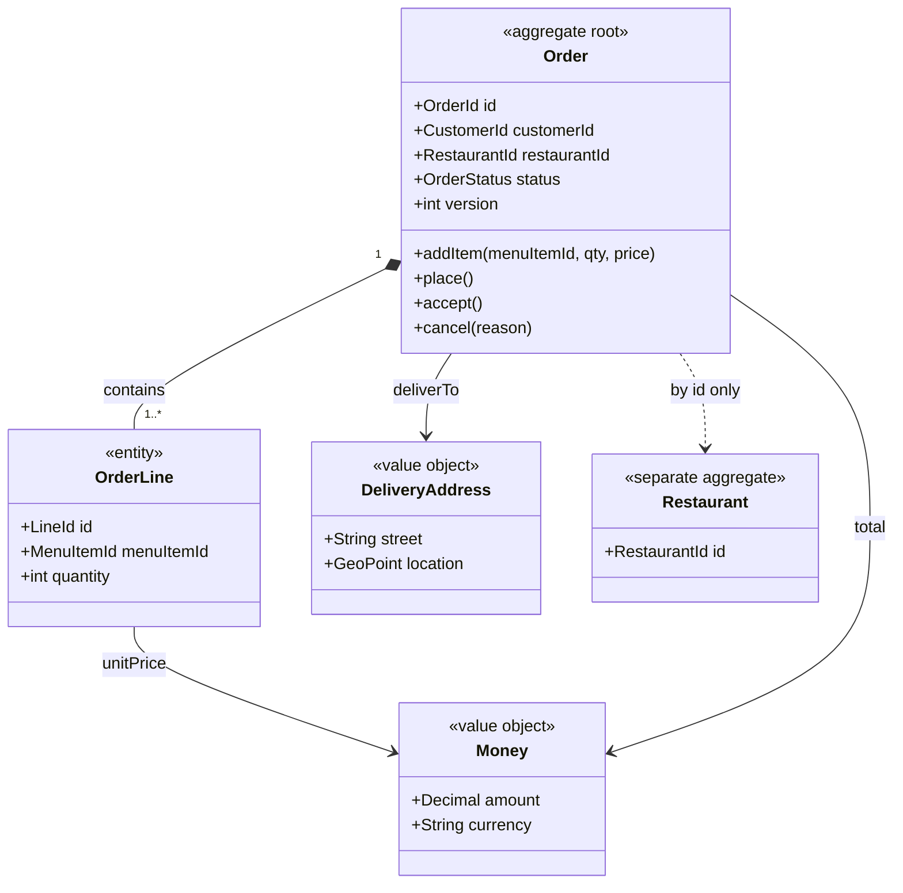

**Reading the diagram.** The `Order` root is the only entry point; `OrderLine` entities live and die with it (composition). `Money` and `DeliveryAddress` are immutable value objects. `Restaurant` is a separate aggregate referenced only by identifier (dotted), so loading an order never loads a menu, and the two are stored and locked separately. The root enforces invariants such as "total equals the sum of lines". The `version` field supports optimistic concurrency: a write commits only if the version is unchanged since the read. The aggregate is the unit of storage, locking and partitioning (all its data shares the `OrderId` key).

#### Mathematical foundations: how big may an aggregate be?

::: formula
**Optimistic-concurrency conflict probability for one aggregate**

$$P_{\text{conflict}} = 1 - e^{-\lambda w}$$

| Symbol | Meaning | Units |
|---|---|---|
| $\lambda$ | Rate of *other* writes to the same aggregate (Poisson assumption) | writes/s |
| $w$ | Read-modify-write window of one transaction (read version to commit) | s |
| $P_{\text{conflict}}$ | Probability that at least one other write commits inside the window, so this write must retry | dimensionless |
:::

::: example
**Worked example — A restaurant aggregate versus an order aggregate.** A first design made `Restaurant` one aggregate containing all active orders, to enforce "at most 30 open orders" in one transaction. At the Friday peak a busy restaurant receives $\lambda = 2$ writes/s; each command takes $w = 100$ ms from read to commit.

1. Big aggregate: $\lambda w = 0.2$; $P = 1 - e^{-0.2} = 0.181$. About 18% of writes retry, and retries raise $\lambda$ further.
2. Order as its own aggregate: about 4 updates over a 40-minute life, $\lambda \approx 4 / 2{,}400 = 0.00167$ writes/s; $P \approx 0.00017$, one write in 6,000.

**Interpretation.** Splitting cut conflicts about 1,000-fold. **Engineering implication.** The capacity rule becomes an eventually consistent counter fed by `OrderPlaced` events, or a tiny `KitchenCapacity` aggregate. Ask the business whether 31 open orders for a few seconds is truly unacceptable; the answer decides the boundary.
:::

### 34.4.4 Domain events

::: definition
**Definition — Domain event.** An immutable record of something domain experts care about that happened, named in the past tense (`OrderPlaced`, `CourierAssigned`), carrying the identifiers and facts its consumers need [Evans 2003; Vernon 2013].
:::

Inside a service, aggregates record events that handlers apply to other aggregates after commit. Across services, the same events go to a broker (Chapter 30), published reliably with the **transactional outbox**: the event row is written in the same local transaction as the aggregate change and relayed afterwards (§32.5). An *event* states a fact; a *command* asks for something and may be refused (§30.6).

::: mistake
**Common misconception — "DDD means repositories and factories."** Most of DDD's value is strategic: finding boundaries and naming things in the business's language. A codebase full of `OrderRepository` classes that still has one "order" model for support, kitchen and finance has adopted the vocabulary without the design. Evans reserves the full investment for the **core domain**, the part that differentiates the business [Evans 2003].
:::

## 34.5 Bounded contexts and context maps

### 34.5.1 Bounded contexts

::: definition
**Definition — Bounded context.** An explicit boundary (in code, data and team ownership) within which one domain model and its ubiquitous language apply consistently. The same word may mean different things in different contexts [Evans 2003].
:::

A "ticket" means different things at a railway station, in a police car and in a sprint backlog; nobody is confused because each word lives in a context. QuickBite's order therefore becomes several models keyed by a shared `order_id`: in **Ordering**, lines, a status machine and a total; in **Kitchen**, a `Ticket` with a promised-ready time; in **Delivery**, pickup, drop-off and courier; in **Billing**, a `Charge` and later a `Settlement`. Single enterprise-wide models, the goal of 1990s data modelling, became so general that they served nobody; bounded contexts make the translation between legitimate models explicit.

::: concept
**Concept — A bounded context is the best first candidate for a service boundary.** It already has high cohesion and a deliberately narrow interface. Newman recommends contexts as the starting point: one context may later become several services, but a service should rarely span two contexts [Newman 2021].
:::

### 34.5.2 Context maps

A **context map** shows the bounded contexts and their relationships. Each relationship pattern describes both an integration style and a team relationship: **upstream** contexts influence **downstream** ones [Evans 2003; Vernon 2013].

**Table 34.2 — Context-map relationship patterns.**

| Pattern | What it is | Choose when | Risk |
|---|---|---|---|
| Shared kernel | Small, jointly owned subset of the model | Two closely cooperating teams | Kernel grows into shared-library coupling |
| Customer–supplier | Upstream plans for downstream's needs | Teams with aligned goals | Supplier overwhelmed by customers |
| Conformist | Downstream adopts upstream's model | Upstream is large or external and acceptable | Upstream model distorts downstream |
| Anticorruption layer | Downstream translates upstream's model into its own | Upstream is legacy, poor or external | Translation code to maintain |
| Open host service | Upstream offers one stable protocol for all | Many consumers | Protocol must evolve compatibly |
| Published language | Documented shared exchange format | Many parties exchange data | Format governance |
| Separate ways | No integration | Integration costs more than it returns | Duplicated effort |
| Partnership | Two teams coordinate releases | Jointly delivered capability | Coupled release cadence |

**Figure 34.3 — QuickBite context map.**


**Reading the diagram.** Arrows run from upstream to downstream and are labelled with the pattern; this models influence and translation, not request direction. Catalog's **open host service** publishes a menu schema that Ordering consumes. Ordering is a **supplier** to Delivery and Kitchen, which consume its events asynchronously. Billing receives order events through Ordering's open host service and shields itself from the payment provider with an **anticorruption layer**; Kitchen does the same for many restaurant point-of-sale systems. Delivery is **conformist** toward the maps provider, whose geometry types are acceptable. Identity and Ordering share a tiny **kernel**. Each box is a storage and ownership boundary. Failure points: Kitchen's ACL must stop malformed POS data; a maps model change forces Delivery to change. Each context scales independently.

### 34.5.3 The anticorruption layer in code

::: definition
**Definition — Anticorruption layer (ACL).** A layer owned by a downstream context that translates between an upstream model and its own, so the upstream's concepts, codes and quirks never appear in the downstream model [Evans 2003].
:::

The payment provider speaks in statuses such as `AUTHORISED`, `CAPTURED`, `REFUSED` and `PENDING_3DS`, numeric refusal codes and string amounts in minor units. Billing knows three outcomes: authorized, declined (with a business reason) and "customer must act". The ACL below is the only code that knows the provider's vocabulary.

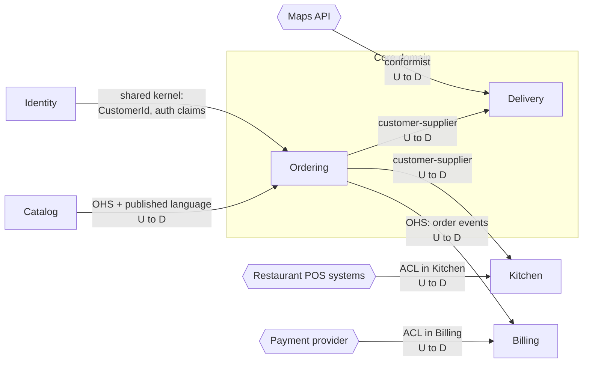

Running it with `python3` prints:

```python
from dataclasses import dataclass
from decimal import Decimal
from enum import Enum


# ---- Billing context: the model we want to protect ------------------------
@dataclass(frozen=True)
class Money:                      # value object: equality by value, immutable
    amount: Decimal
    currency: str

    def __post_init__(self):
        if self.amount < 0 or len(self.currency) != 3:
            raise ValueError(f"invalid money {self.amount} {self.currency}")


class DeclineReason(Enum):
    INSUFFICIENT_FUNDS = "insufficient_funds"
    CARD_EXPIRED = "card_expired"
    SUSPECTED_FRAUD = "suspected_fraud"
    OTHER = "other"


@dataclass(frozen=True)
class PaymentAuthorized:
    order_id: str
    amount: Money
    provider_ref: str


@dataclass(frozen=True)
class PaymentDeclined:
    order_id: str
    reason: DeclineReason


@dataclass(frozen=True)
class PaymentNeedsCustomerAction:  # e.g. a 3-D Secure challenge
    order_id: str
    redirect_url: str


# ---- Anticorruption layer: the only code that knows the provider's model --
MINOR_UNITS = {"USD": 2, "EUR": 2, "JPY": 0}
DECLINE_CODES = {"51": DeclineReason.INSUFFICIENT_FUNDS,
                 "54": DeclineReason.CARD_EXPIRED,
                 "59": DeclineReason.SUSPECTED_FRAUD}


class ProviderTranslationError(Exception):
    pass


def translate(raw: dict):
    """Map one provider response (their language) to one domain outcome."""
    order_id = raw.get("merchant_reference")
    if not order_id:
        raise ProviderTranslationError("missing merchant_reference")
    status = raw.get("status", "").upper()
    if status in ("AUTHORISED", "CAPTURED"):          # two words, one meaning
        cur = raw["currency"].upper()
        if cur not in MINOR_UNITS:
            raise ProviderTranslationError(f"unsupported currency {cur}")
        amount = Decimal(int(raw["amount_minor"])).scaleb(-MINOR_UNITS[cur])
        return PaymentAuthorized(order_id, Money(amount, cur), raw["psp_ref"])
    if status == "REFUSED":
        reason = DECLINE_CODES.get(str(raw.get("refusal_code")), DeclineReason.OTHER)
        return PaymentDeclined(order_id, reason)
    if status == "PENDING_3DS":
        return PaymentNeedsCustomerAction(order_id, raw["action"]["url"])
    raise ProviderTranslationError(f"unknown provider status {status!r}")


# ---- Tests ------------------------------------------------------------------
if __name__ == "__main__":
    ok = translate({"merchant_reference": "ord-17", "status": "Authorised",
                    "amount_minor": "2450", "currency": "usd", "psp_ref": "PSP9"})
    assert ok == PaymentAuthorized("ord-17", Money(Decimal("24.50"), "USD"), "PSP9")

    yen = translate({"merchant_reference": "ord-18", "status": "CAPTURED",
                     "amount_minor": "1500", "currency": "JPY", "psp_ref": "PSP10"})
    assert yen.amount == Money(Decimal("1500"), "JPY")

    assert translate({"merchant_reference": "ord-19", "status": "REFUSED",
                      "refusal_code": 51}).reason is DeclineReason.INSUFFICIENT_FUNDS
    assert translate({"merchant_reference": "ord-20", "status": "REFUSED",
                      "refusal_code": "99"}).reason is DeclineReason.OTHER

    action = translate({"merchant_reference": "ord-21", "status": "PENDING_3DS",
                        "action": {"url": "https://psp.example/3ds/abc"}})
    assert isinstance(action, PaymentNeedsCustomerAction)

    for bad in ({"status": "AUTHORISED"},
                {"merchant_reference": "ord-22", "status": "PARTIALLY_AUTHORISED"}):
        try:
            translate(bad)
            raise AssertionError("expected ProviderTranslationError")
        except ProviderTranslationError as e:
            print("rejected:", e)
    print("all ACL tests passed")
```

What to notice:

- **Two upstream words, one meaning.** `AUTHORISED` and `CAPTURED` both become `PaymentAuthorized`.
- **Units are translated at the edge.** The currency's exponent is applied, so a yen amount is not divided by 100.
- **Unknown codes are mapped deliberately.** An unknown refusal code safely becomes `OTHER`, but an unknown *status* raises, because guessing whether money moved is never safe; route it to a dead-letter queue and alert (§30.11).
- **Isolation.** When the provider changes, one file and its tests change, not Billing's model.

### 34.5.4 Event storming

::: definition
**Definition — Event storming.** A collaborative workshop technique created by Alberto Brandolini in which domain experts and developers place domain events (past tense, on sticky notes) along a timeline, then add commands, actors, policies ("whenever X, then Y"), external systems and hotspots (open questions), and group the result into aggregates and candidate bounded contexts [Brandolini: Introducing EventStorming].
:::

#### How it works internally

1. **Chaotic exploration.** Everyone writes the events they know and sticks them roughly in time order.
2. **Enforce the timeline.** Sort, remove duplicates and mark disagreements as **hotspots**; disagreements reveal where one word has two meanings.
3. **Add causes.** For each event, add the command and actor, policy or external system that caused it.
4. **Find aggregates and boundaries.** Group commands around what decides whether they are allowed (aggregates); draw lines where the language or the owning department changes (candidate contexts).

**Figure 34.4 — Event-storming output for QuickBite's order flow (simplified).**

```text
rejected: missing merchant_reference
rejected: unknown provider status 'PARTIALLY_AUTHORISED'
all ACL tests passed
```

**Reading the diagram.** This is a modelling artifact: arrows show causality, not network calls. Stadiums are actors, parallelograms commands, rectangles domain events and hexagons policies. A customer's *Place order* produces `OrderPlaced`; a policy reacts with *Authorize payment*, and so on. The dotted arrow marks a human waiting step, where latency and timeouts will appear in the system. The vocabulary shifts around `PaymentAuthorized` (Billing), at "ticket" (Kitchen) and at "courier" (Delivery): these are the candidate boundaries of Figure 34.3. The final hotspot (support says delivery, finance says 14 days later) becomes a design decision instead of a production bug.

#### Failure scenarios

| What goes wrong | Why | Detection | Recovery | Prevention |
|---|---|---|---|---|
| Upstream model leaks downstream | Accidental conformist | Upstream codes in downstream domain classes | Introduce an ACL | Decide each relationship explicitly |
| Shared kernel grows | Convenient home for common code | Kernel changes in most releases | Move code to owners | Kernel limited to identifiers and stable values |
| ACL silently mistranslates | Unknown codes mapped to defaults | "Declined: other" spikes | Fix mapping; replay dead letters | Fail loudly on unknown statuses |

## 34.6 API gateways and backends for frontends

### 34.6.1 The API gateway

::: definition
**Definition — API gateway.** A reverse proxy (§7.12) that is the single entry point for external clients into a set of services. It routes each request to the right service and applies cross-cutting **edge concerns** once: TLS termination, authentication, coarse authorization, rate limiting and quotas, request validation, response caching, protocol translation and, sometimes, aggregation of several service calls into one response [Richardson 2018].
:::

#### First-principles explanation

A large hotel has one front desk. Guests do not wander the corridors looking for housekeeping, the restaurant and the concierge; they ask the desk, which checks who they are, knows where everything is and forwards the request. The desk also enforces house rules (no visitors after midnight) in one place instead of on every floor. Without it, every department would need its own security guard.

#### Why does this exist?

Without a gateway, a mobile app would need to know the address of every service, every service would need to validate tokens and enforce rate limits itself (in every language the company uses), and every internal refactoring (splitting a service in two) would break published clients. The gateway decouples the **external API**, which must be stable for years because old app versions never die (§8.4.3), from the **internal topology**, which should be free to change weekly.

#### How it works internally

1. **Terminate TLS** and parse the HTTP request.
2. **Authenticate**: validate the access token (for example a JWT's signature and expiry, §8.13) or exchange an opaque token with the identity service, and attach a verified identity header for downstream services.
3. **Apply policies**: rate limits per API key or user (Chapter 22), request size limits, schema validation, IP allow lists.
4. **Route**: match host, path, method and headers to a route; resolve the target service through service discovery (§34.7); pick an instance (§19.10).
5. **Optionally aggregate**: call several services and merge the results (or leave this to a BFF, §34.6.2).
6. **Observe**: start or continue a trace (§34.9), emit access logs and metrics, and add a request ID.

Products include Kong, Envoy-based gateways, NGINX, Apigee, AWS API Gateway and the Kubernetes Gateway API implementations (§42.10). The gateway itself should hold no business state; it scales horizontally behind an L4 load balancer and is often deployed per region.

::: warning
**Warning — The gateway is not a place for business logic.** Every team needs to change routes and policies, so a gateway that accumulates business rules becomes a shared monolith that every release passes through, owned by one overloaded platform team. Keep business logic in services; keep the gateway configuration declarative and owned per route by the team behind it. Lewis and Fowler's phrase for the principle is "smart endpoints and dumb pipes" [Lewis and Fowler 2014].
:::

### 34.6.2 Backends for frontends (BFF)

::: definition
**Definition — Backend for frontend (BFF).** A server-side component dedicated to one kind of user interface (for example iOS, Android, web or a partner API), owned by or closely aligned with the team that builds that interface, which aggregates and reshapes calls to downstream services into exactly the API that interface needs [Newman 2015].
:::

#### Why does this exist?

One general-purpose API for every client serves none of them well. The mobile home screen needs 6 fields from 5 services in one round trip over a cellular network; the web dashboard needs 40 fields and can make several calls; a partner integration needs a stable, versioned, documented contract. A single gateway that tries to serve all three accumulates conditional logic for each, and every UI change needs the gateway team. A BFF per client type lets each UI team shape its own backend.

#### Origins, cited carefully

The idea has two well-documented roots. At **Netflix**, the API team redesigned its API around 2012 so that device-specific "adapter" code, written by the teams that built each device's user interface, ran on the server and called a set of general-purpose backend services; each device could then fetch exactly what its screens needed in one request [Jacobson 2012]. At **SoundCloud**, engineers built per-client backends during the company's move from a monolith to services, starting around 2013; Lukasz Plotnicki described the approach, and Sam Newman, who interviewed SoundCloud engineers, named and popularized it as the "Backends For Frontends" pattern in 2015 [Plotnicki 2015; Newman 2015]. Phil Calçado, then at SoundCloud, is widely credited with the name; see the open verification items.

**Figure 34.5 — Edge gateway with one BFF per client type.**


**Reading the diagram.** All three client types reach one edge gateway over HTTPS; the gateway terminates TLS, authenticates and rate-limits, then routes by host or path prefix to a BFF over HTTP/2 inside the network. Each BFF calls domain services synchronously over gRPC and merges their responses into a client-shaped payload; the Mobile BFF, for example, builds the home screen from catalog, ordering and delivery in one client round trip. Each domain service owns its database; BFFs own no business data (at most a cache), so they scale horizontally. Failure points: a BFF fans out to several services, so its availability and tail latency are bounded by its dependencies (§34.8.3); it needs timeouts, partial responses and fallbacks (Chapter 22). Scaling: the gateway scales with total traffic, each BFF with its client's traffic.

#### Mathematical foundations: why aggregation near the services pays off

::: formula
**Latency of sequential and parallel call sequences**

$$L_{\text{seq}} = \sum_{i=1}^{n} \left(R_i + s_i\right) \qquad L_{\text{par}} = \max_{i} \left(R_i + s_i\right)$$

| Symbol | Meaning | Units |
|---|---|---|
| $n$ | Number of calls needed to build one response | calls |
| $R_i$ | Network round-trip time of call $i$ (including connection reuse) | ms |
| $s_i$ | Server processing time of call $i$ | ms |
| $L_{\text{seq}}$ | Total latency when each call waits for the previous one | ms |
| $L_{\text{par}}$ | Total latency when independent calls run concurrently | ms |
:::

::: example
**Worked example — The QuickBite home screen over a mobile network.** The home screen needs 8 calls (profile, address, nearby restaurants, promotions, active order, courier position, recommendations, unread messages). Each call takes $s = 20$ ms in its service. The phone's round trip to the gateway is $R_{\text{mobile}} = 100$ ms; inside the datacenter a call costs $R_{\text{dc}} = 1$ ms.

1. Phone calls each service in sequence: $L = 8 \times (100 + 20) = 960$ ms.
2. Phone fires all 8 in parallel: $L \approx 100 + 20 = 120$ ms in theory, but mobile radios, HTTP/2 stream limits and dependent calls (recommendations need the address) push this up, and battery cost rises; in practice apps get two or three dependency "waves", about $3 \times 120 = 360$ ms.
3. BFF, one phone round trip, BFF calls the 8 services sequentially: $L = 100 + 8 \times (1 + 20) = 100 + 168 = 268$ ms.
4. BFF calls in three dependency waves of parallel calls: $L = 100 + 3 \times (1 + 20) = 163$ ms.

**Interpretation.** Moving aggregation from the phone to a BFF one network hop from the services saves about 0.8 s against the naive design and 0.2 s against the best realistic client design, because expensive round trips are paid once and cheap ones are paid many times. **Engineering implication.** Put aggregation where round trips are cheapest, and inside the BFF run independent calls in parallel. But parallel fan-out is exposed to the slowest dependency (§34.8.3), so give every call a deadline and return partial results when non-essential calls (recommendations, promotions) are late.
:::

::: industry
**Netflix Zuul.** Netflix built Zuul as the edge gateway in front of its streaming API, handling routing, authentication, traffic shaping and resilience at the edge, and rewrote it in 2016 as Zuul 2 on an asynchronous, non-blocking Netty core to handle large numbers of persistent connections [Netflix Technology Blog 2016]. The device-specific adapters of the 2012 API redesign sat behind it.
*Evidence: Primary* — [Netflix Technology Blog 2016; Jacobson 2012]
:::

#### Alternatives and trade-offs

**Table 34.3 — Gateway, BFF and GraphQL compared.**

| | Single API gateway | Gateway + BFF per client | GraphQL federation (§8.7) |
|---|---|---|---|
| What it is | One edge proxy, one public API | Thin edge plus a backend per client type | One graph schema composed from service subgraphs |
| Advantages | Simple; one place for policy | Each UI team shapes its API; fewer round trips | Clients choose fields; one endpoint |
| Disadvantages | Becomes a bottleneck of conditional logic | Duplication across BFFs; more deployables | Query cost control; caching is harder; resolver fan-out |
| Choose when | Few client types, similar needs | Several client types with different needs and teams | Many clients with varied, evolving data needs |

The main risk of BFFs is **duplication**: the same "is this restaurant open?" logic implemented in three BFFs, slowly diverging. The fix is to push domain logic down into the owning service and keep BFFs to aggregation and presentation.

## 34.7 Service discovery

### 34.7.1 The problem

In a monolith, a function call needs no address. In a microservice system, the Ordering service must find a healthy instance of Payment, and that set changes constantly: autoscaling adds instances, deploys replace them, nodes fail, and in containers each instance gets a new IP address every time it starts. Hard-coded addresses or hand-edited configuration files cannot keep up.

::: definition
**Definition — Service discovery.** The mechanism by which a client finds the current network locations of healthy instances of a service. It has two parts: a **service registry**, a database of service instances and their locations and health; and a **lookup** path, by which a client (client-side discovery) or a router (server-side discovery) queries the registry [Richardson 2018].
:::

#### First-principles explanation

A phone directory works if people rarely move. A hospital switchboard is different: doctors move between wards all day, so each one checks in at the switchboard when arriving at a ward and checks out when leaving, and the operator connects callers to wherever the doctor is now. If a doctor forgets to check out, callers are put through to an empty room until someone notices. Service discovery is the switchboard; registration is checking in; health checks are how the operator notices the empty room.

### 34.7.2 Registration and health

Instances get into the registry in one of two ways:

1. **Self-registration.** The instance registers itself on start-up and sends periodic heartbeats; it deregisters on graceful shutdown. If heartbeats stop, the registry expires the entry after a lease. Netflix Eureka works this way [Netflix Eureka Docs].
2. **Third-party registration.** A platform component observes instances and registers them: the Kubernetes control plane maintains **EndpointSlices** for each Service from the pods matching its selector, and includes only pods whose **readiness probe** is passing [Kubernetes Docs: Services; Kubernetes Docs: Probes]. Consul agents running on each node register local services and run their health checks [HashiCorp Consul Docs].

Health integration is what makes a registry useful. A registry listing dead instances is worse than none, because it directs traffic to them confidently. Distinguish (§19.5): **liveness** (should the process be restarted?), **readiness** (should it receive traffic now?) and **passive** health, in which clients or proxies eject an instance after observing consecutive errors (Envoy calls this outlier detection).

### 34.7.3 Client-side versus server-side discovery

**Figure 34.6 — Client-side and server-side service discovery.**

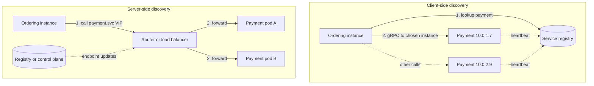

**Reading the diagram.** In client-side discovery (top), the Ordering instance queries the registry (a replicated store, the storage boundary), caches the instance list and chooses an instance itself with a client-side balancing policy (§19.10), then calls it directly over gRPC; instances keep their registration alive with asynchronous heartbeats (dotted). In server-side discovery (bottom), Ordering calls one stable name or virtual IP; a router (an L4 or L7 load balancer, `kube-proxy` rules or a sidecar proxy) looks up endpoints pushed to it asynchronously by the registry or control plane and forwards the request. Failure points: in both designs a stale entry sends traffic to a dead instance until the entry expires or the caller ejects it; in the server-side design the router is an extra hop and must itself be redundant. Scaling: the registry is read-heavy and serves cached lookups, so it scales with replicas; clients should keep working with their last-known list if the registry is unreachable.

**Table 34.4 — Client-side versus server-side discovery.**

| | Client-side | Server-side |
|---|---|---|
| How it works | Client queries registry, balances itself | Client calls a stable name; a router resolves and balances |
| Advantages | No extra hop; per-request balancing; rich policies | Clients stay simple and language-agnostic |
| Disadvantages | Discovery logic in every language's client library | Extra hop or proxy; router must be highly available |
| Examples | Eureka with a client library; gRPC name resolvers; Consul API lookups | Kubernetes Services and DNS; AWS load balancers; mesh sidecars |
| Choose when | One or two languages, latency-sensitive internal RPC | Polyglot fleet, platform-managed infrastructure |

A service mesh (§34.10) blurs the line: the sidecar proxy does client-side balancing on the caller's behalf, so the application sees server-side simplicity while traffic still goes directly from caller to instance.

### 34.7.4 Registries: Consul, Eureka and Kubernetes DNS

- **Consul** (HashiCorp) keeps its catalog in a set of server nodes replicated with Raft (§26.7), so catalog writes are strongly consistent; agents on each node run health checks and use gossip for membership. Clients query through an HTTP API or a DNS interface (names such as `payment.service.consul`), and only instances passing their checks are returned [HashiCorp Consul Docs].
- **Eureka** (Netflix OSS) deliberately favors availability: its servers replicate registrations to each other asynchronously, clients cache the full registry and keep using it if Eureka is unreachable, and in **self-preservation mode** Eureka stops expiring instances when heartbeats drop suddenly, on the theory that a network problem is more likely than mass death. It is an AP design in the CAP sense (§25.8): better to return possibly stale instances than none [Netflix Eureka Docs].
- **Kubernetes DNS.** Each Service gets a DNS name `<service>.<namespace>.svc.cluster.local`, served by CoreDNS from the API server's state. A normal Service resolves to one stable virtual IP, and `kube-proxy` rules on each node spread connections across ready pods; a **headless** Service (no cluster IP) resolves to the pod IPs themselves, which suits client-side balancing such as gRPC's [Kubernetes Docs: DNS for Services and Pods].

::: warning
**Warning — DNS caching defeats fast discovery.** Plain DNS discovery is only as fresh as the TTL, and some clients cache longer than the TTL (older JVM configurations cached forever by default when a security manager was installed). Long-lived connections are worse: a gRPC client that resolved a headless Service once keeps its connections to the old pods until they close. Use short TTLs, connection maximum ages, or a discovery API that pushes updates.
:::

#### Mathematical foundations: how long does a dead instance keep receiving traffic?

::: formula
**Stale-endpoint window and failed requests**

$$T_{\text{stale}} \le k \cdot h + t_{\text{prop}} + t_{\text{cache}} \qquad F \approx \frac{\lambda}{m} \cdot T_{\text{stale}} \cdot (1 - q)$$

| Symbol | Meaning | Units |
|---|---|---|
| $h$ | Heartbeat or health-check interval | s |
| $k$ | Consecutive missed checks before the instance is removed | count |
| $t_{\text{prop}}$ | Time for the registry change to reach clients or routers | s |
| $t_{\text{cache}}$ | Maximum additional client cache age | s |
| $T_{\text{stale}}$ | Worst-case time a dead instance stays in some client's list | s |
| $\lambda$ | Total request rate to the service | requests/s |
| $m$ | Number of instances (traffic share of the dead one is $1/m$) | count |
| $q$ | Fraction of failed calls rescued by a retry on another instance or by passive ejection | dimensionless |
| $F$ | Requests that fail during the window | requests |
:::

::: example
**Worked example — A Payment instance dies abruptly.** Payment receives $\lambda = 2{,}000$ requests/s spread over $m = 20$ instances. Option A: self-registration with $h = 10$ s, $k = 3$, propagation 2 s and client caches refreshed every 30 s. Option B: Kubernetes with readiness `periodSeconds: 10`, `failureThreshold: 3` (the defaults), endpoint propagation about 2 s, no extra client cache, plus passive outlier detection in the caller's proxy.

1. Option A window: $T = 3 \times 10 + 2 + 30 = 62$ s.
2. Traffic to the dead instance: $2{,}000 / 20 = 100$ requests/s; without retries ($q = 0$): $F = 100 \times 62 = 6{,}200$ failed requests.
3. Option B readiness window: $T = 3 \times 10 + 2 = 32$ s; $F = 3{,}200$ without retries. (For an abrupt crash, Kubernetes also notices the pod or node failure, often faster than the probe path.)
4. Add passive ejection after 5 consecutive errors per caller, and one retry on another instance for idempotent calls: most failed calls are retried successfully ($q \approx 0.99$), and each of, say, 50 caller instances ejects the dead endpoint after about 5 errors. Failed requests fall to roughly $6{,}200 \times 0.01 \approx 62$ in option A.

**Interpretation.** The registry alone leaves tens of seconds of failures because detection is periodic and clients cache. **Engineering implication.** Do not rely on the registry for fast failure handling. Combine it with passive ejection and bounded retries of idempotent calls (§22.12, §22.15), and shorten detection only as far as false positives allow: a 1 s check with $k = 1$ would eject healthy instances during every garbage-collection pause.
:::

::: industry
**Eureka at Netflix.** Netflix built Eureka for its AWS deployment, where instance IPs changed constantly and the AWS load balancers of the time were unsuited to mid-tier service-to-service traffic. The design choice to favor availability over consistency, with client-side caching and self-preservation, reflected the view that during a network problem a possibly stale list is better than no list [Netflix Eureka Docs].
*Evidence: Primary* — [Netflix Eureka Docs]
:::

#### Failure scenarios

| What goes wrong | Why | Detection | Recovery | Prevention |
|---|---|---|---|---|
| Traffic to dead instances | Stale registry or client caches | Connection errors to specific IPs | Passive ejection; retry elsewhere | Short leases; push-based updates; outlier detection |
| Registry outage | Registry cluster loses quorum or is overloaded | Lookup errors; registration failures | Clients use cached lists | Replicated registry; clients must tolerate registry absence |
| Mass self-deregistration | Health check depends on a shared downstream (database) that is down | All instances unhealthy at once; zero endpoints | Fail open: keep last endpoints when all are unhealthy | Readiness checks test the instance, not its dependencies (§19.5.2) |
| New instance gets traffic before warm-up | Registered before ready | Error spike after each deploy | Readiness gates | Register only after readiness; slow-start weighting |

## 34.8 Inter-service communication

### 34.8.1 Synchronous versus asynchronous

Every interaction between services is either a request that waits for an answer or a message that does not. Chapter 30 treats the mechanics; here the question is which to choose for a given pair of services.

::: definition
**Definition — Synchronous and asynchronous inter-service communication.** In **synchronous** communication the caller sends a request (REST over HTTP, gRPC) and blocks, or at least cannot complete its own work, until it receives a response; caller and callee must both be available at the same time. In **asynchronous** communication the sender publishes a message (an event or command) to a broker or log and continues; the receiver processes it later, so the two need not be available simultaneously (§30.3).
:::

**Figure 34.7 — Placing an order: synchronous chain versus event-driven flow.**

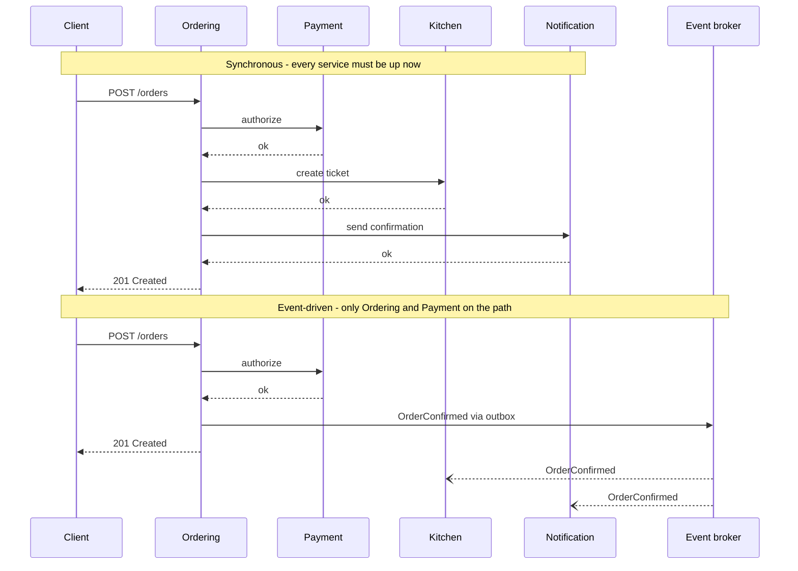

**Reading the diagram.** In the first half, Ordering calls Payment, Kitchen and Notification synchronously in sequence; the client's response waits for all three, so latencies add and the request fails if any of the four services is down or slow. In the second half, Ordering keeps only the payment authorization on the synchronous path (the customer genuinely needs to know whether the card worked), commits the order and an outbox row in one local transaction (§32.5), and returns. A relay publishes `OrderConfirmed` to the broker, the durable storage boundary between services, and Kitchen and Notification consume it asynchronously (open arrowheads) at their own pace; if Notification is down for ten minutes, confirmations are late but orders still succeed. The cost is eventual consistency: for a moment the order exists but the kitchen has not seen it, and failures after the response must be handled by retries, dead-letter queues and, where business steps can fail, sagas (§32.7). Scaling: the broker absorbs bursts, so Kitchen and Notification scale on their own backlog.

**Table 34.5 — Choosing a communication style.**

| | Synchronous (REST, gRPC) | Asynchronous (events, commands via broker) |
|---|---|---|
| Use for | Queries; commands whose result the caller needs now | Propagating facts; work the caller need not wait for |
| Advantages | Simple mental model; immediate errors | Temporal decoupling; load leveling; easy fan-out to new consumers |
| Disadvantages | Availability and latency compound along chains | Eventual consistency; harder debugging; ordering and duplicates |
| Failure handling | Timeouts, retries, circuit breakers (Chapter 22) | Retries, idempotent consumers, dead-letter queues (§30.10–30.11, §32.10) |
| Typical protocols | HTTP/JSON at the edge; gRPC/Protobuf internally | Kafka, RabbitMQ, SQS/SNS, Pub/Sub (Chapters 30–31) |

REST over HTTP/JSON is the common choice at the edge and for public APIs, where readability and tooling matter. **gRPC** over HTTP/2 with Protocol Buffers (§8.8) is common between internal services: binary encoding, generated client stubs in many languages, streaming, and deadline propagation built in. For async, the deciding factors are replay and ordering needs (a log such as Kafka) versus per-message routing and work queues (a broker such as RabbitMQ; §30.12).

::: recommendation
**Recommendation — Keep one synchronous call on the critical path where you can.** Ask of each synchronous call: does the caller need the answer *before it can respond to its own caller*? If not, publish an event. If it needs data rather than an action (a restaurant's name to show on an order), consider keeping a local, event-fed copy of that data (§34.11.3) instead of calling on every request.
:::

### 34.8.2 Chatty calls

A design that was a cheap function call in a monolith can be an expensive pattern across a network: the **N+1 call problem**. QuickBite's order-history page shows the last 50 orders. A naive Ordering service, having moved menu data to Catalog, calls Catalog once per order line to fetch item names.

::: example
**Worked example — Chatty versus batched calls inside the datacenter.** Each call to Catalog costs a round trip of $R = 0.5$ ms plus $s = 2$ ms of processing; a batched call for many items costs $R = 0.5$ ms plus $s = 5$ ms. The page shows 50 orders averaging 3 lines each: 150 lines.

1. One call per line, sequential: $L = 150 \times (0.5 + 2) = 375$ ms (formula of §34.6.2).
2. One call per line, 10 concurrent: about $\lceil 150 / 10 \rceil \times 2.5 = 15 \times 2.5 = 37.5$ ms, but now Catalog receives 150 calls per page view; at 200 page views/s that is 30,000 RPS on Catalog for this one page.
3. One batched call `GetItems(ids)`: $L = 0.5 + 5 = 5.5$ ms and 200 RPS on Catalog.
4. Local copy of item names kept current by `MenuItemChanged` events: about 0 ms of network and 0 RPS on Catalog at read time.

**Interpretation.** The batched call is 68 times faster than the naive loop and puts 150 times less load on Catalog. **Engineering implication.** Design inter-service APIs for the caller's access pattern: batch lookups, coarse-grained operations, and pagination. If a page needs dozens of calls to one service, either the API is too fine-grained or the boundary is in the wrong place.
:::

### 34.8.3 Fan-out and tail latency

A BFF or composer that calls $N$ services in parallel waits for the slowest. Section 4.8.4 derived the law: if each dependency is fast with probability $p$, all $N$ are fast with probability $p^N$.

::: example
**Worked example — The home-screen fan-out.** The Mobile BFF of §34.6 calls 6 services in parallel, each with p99 = 50 ms, and waits for all.

1. $P(\text{all six} \le 50 \text{ ms}) = 0.99^6 = 0.9415$.
2. So about $1 - 0.9415 = 5.9\%$ of home-screen requests wait longer than 50 ms for at least one dependency: the BFF's p94 is roughly the dependencies' p99.
3. At 100-way fan-out the same arithmetic gives $0.99^{100} = 0.366$, the *Tail at Scale* example of §4.8.4.

**Interpretation.** Each additional parallel dependency moves the overall tail toward the dependencies' tails. **Engineering implication.** Give each dependency call a deadline below the page budget, mark which calls are optional and render without them when late, and consider hedged requests for idempotent reads (§23.6). Fewer dependencies per request is the most effective fix.
:::

### 34.8.4 API versioning across services

Independent deployability requires that a provider can change without all its consumers changing at the same moment. The rules of §8.15 apply between services with one twist: you usually know (or can find out) every internal consumer, so you can verify compatibility before deploying.

1. **Make additive, backward-compatible changes by default.** Add optional fields; never remove or rename a field, change its type or tighten validation in place. Consumers should be **tolerant readers** that ignore unknown fields [Fowler 2011: TolerantReader]. Protobuf supports this directly: new fields get new tag numbers, removed tags are marked `reserved` so they are never reused.
2. **Use expand and contract for breaking changes.** Add the new field or endpoint (expand), migrate consumers, observe that the old one has no traffic, then remove it (contract). Each step is a separate, independently deployable release.
3. **Version explicitly only when needed.** A major version in the path (`/v2/payments`) or package (`payments.v2`) lets old and new coexist; run both until traffic to the old one stops. Each live version is code to maintain, so keep at most two.
4. **Version events too.** Event schemas outlive code: a consumer may replay last year's events. Use a schema registry with compatibility rules (for example Avro or Protobuf with backward-compatibility checks) and add an event version field (§8.9, §30.6).

### 34.8.5 Contract testing with consumer-driven contracts

#### Why does this exist?

How do you know that deploying Payment version 42 will not break Ordering? End-to-end tests that deploy every service together are slow, flaky and need every team's code in one environment, which reintroduces the coordination microservices were meant to remove. Unit tests with hand-written mocks are fast but test the consumer against the consumer's *assumptions* about the provider, which drift silently.

::: definition
**Definition — Consumer-driven contract (CDC).** A specification of the requests a consumer sends to a provider and the parts of the responses it relies on, written by the consumer (usually generated by the consumer's tests). The provider runs every consumer's contract against its real implementation in its own build, so a provider change that breaks any consumer fails the provider's pipeline before deployment [Robinson 2006; Pact Docs].
:::

#### How it works internally

1. **Consumer test.** Ordering's tests describe each interaction ("given payment p-1 is authorized, `GET /payments/p-1` returns 200 with a `status` string and an integer `amount.minor`") and run Ordering's real client code against a mock provider generated from that description. The run produces a **contract** (a *pact* file in Pact's terminology).
2. **Publish.** The contract is published to a **broker** tagged with the consumer's version and branch or environment.
3. **Provider verification.** Payment's CI fetches every contract in which Payment is the provider, sets up each **provider state** ("payment p-1 is authorized") and replays each request against the real Payment service, checking that the response satisfies the contract. Matching is by *shape* where the consumer said so: any string for `status`, not the literal example.
4. **Deployment gate.** Before deploying either side to an environment, the pipeline asks the broker whether this version is verified against the versions currently deployed there (Pact's `can-i-deploy` command) [Pact Docs].

**Figure 34.8 — Consumer-driven contract testing workflow.**

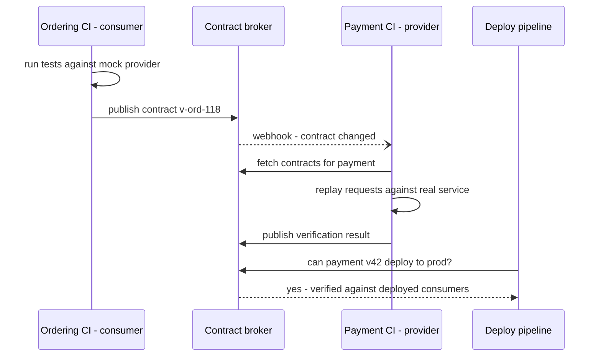

**Reading the diagram.** The consumer's CI generates and publishes the contract (synchronous calls to the broker); the broker notifies the provider's CI asynchronously with a webhook; the provider's CI verifies the contract against the real service with its own test data and publishes the result. The broker is the storage boundary: it records which consumer versions are verified against which provider versions and which versions are deployed where. The deploy pipeline queries that matrix before each deployment. Failure points: a contract that over-specifies (exact values instead of types) fails on harmless changes, and a contract that under-specifies misses real breakage; the broker itself becomes a release dependency and needs to be available. Scaling: verification cost grows with the number of consumer–provider pairs, not the number of services squared, because only real interactions are tested.

#### Code example

The program below builds a tiny CDC framework in about 60 lines to show the mechanism (Pact provides the same ideas with many more matchers, HTTP mock servers, message contracts and a broker). The consumer's test produces a contract; the provider verifies it. Version 1 of the provider passes even though it returns extra fields; version 2 renames `status` to `state` in a "harmless refactoring" and the provider's own build fails.

```python
import json

# ---- A tiny consumer-driven contract library (the idea behind Pact) --------
def like(example):
    """Matcher: any value of the same type as the example is acceptable."""
    return {"$like": example}


def matches(expected, actual, path="body"):
    """Return a list of mismatches; extra fields in `actual` are allowed."""
    if isinstance(expected, dict) and "$like" in expected:
        ex = expected["$like"]
        return [] if type(actual) is type(ex) else [f"{path}: expected {type(ex).__name__}, got {actual!r}"]
    if isinstance(expected, dict):
        if not isinstance(actual, dict):
            return [f"{path}: expected object"]
        errs = []
        for key, sub in expected.items():
            if key not in actual:
                errs.append(f"{path}.{key}: missing")
            else:
                errs += matches(sub, actual[key], f"{path}.{key}")
        return errs
    return [] if expected == actual else [f"{path}: expected {expected!r}, got {actual!r}"]


def example_of(expected):
    """Turn matchers back into a concrete example response for the mock."""
    if isinstance(expected, dict) and "$like" in expected:
        return expected["$like"]
    if isinstance(expected, dict):
        return {k: example_of(v) for k, v in expected.items()}
    return expected


class Contract:
    def __init__(self, consumer, provider):
        self.doc = {"consumer": consumer, "provider": provider, "interactions": []}

    def given(self, state, request, response):
        self.doc["interactions"].append(
            {"state": state, "request": request, "response": response})

    def mock_provider(self, request):
        for i in self.doc["interactions"]:
            if i["request"] == request:
                r = i["response"]
                return r["status"], example_of(r["body"])
        raise AssertionError(f"unexpected request {request}")


def verify(contract_json, provider_handler, set_state):
    """Provider side: replay every interaction against the real handler."""
    failures = []
    for i in json.loads(contract_json)["interactions"]:
        set_state(i["state"])
        status, body = provider_handler(i["request"])
        if status != i["response"]["status"]:
            failures.append(f"[{i['state']}] status {status} != {i['response']['status']}")
        failures += [f"[{i['state']}] {m}" for m in matches(i["response"]["body"], body)]
    return failures


# ---- Consumer side (Ordering service) ---------------------------------------
def fetch_payment_status(http_get, payment_id):     # the consumer's real code
    status, body = http_get({"method": "GET", "path": f"/payments/{payment_id}"})
    if status == 404:
        return None
    return body["status"], body["amount"]["minor"]


contract = Contract("order-service", "payment-service")
contract.given("payment p-1 is authorized",
               {"method": "GET", "path": "/payments/p-1"},
               {"status": 200, "body": {"id": "p-1", "status": like("AUTHORIZED"),
                                        "amount": {"minor": like(2450),
                                                   "currency": like("USD")}}})
contract.given("payment p-404 does not exist",
               {"method": "GET", "path": "/payments/p-404"},
               {"status": 404, "body": {}})

# Consumer test runs against the mock built from the contract, then publishes it.
assert fetch_payment_status(contract.mock_provider, "p-1") == ("AUTHORIZED", 2450)
assert fetch_payment_status(contract.mock_provider, "p-404") is None
published = json.dumps(contract.doc)               # would go to a contract broker


# ---- Provider side (Payment service), two versions --------------------------
DB = {}

def set_state(state):
    DB.clear()
    if state == "payment p-1 is authorized":
        DB["p-1"] = {"status": "AUTHORIZED", "minor": 9900, "currency": "EUR"}

def handler_v1(req):
    pid = req["path"].rsplit("/", 1)[1]
    if pid not in DB:
        return 404, {}
    p = DB[pid]
    return 200, {"id": pid, "status": p["status"], "created_at": "2026-10-30T12:00:00Z",
                 "amount": {"minor": p["minor"], "currency": p["currency"]}}

def handler_v2(req):                     # a refactor renames status -> state
    status, body = handler_v1(req)
    if status == 200:
        body["state"] = body.pop("status")
    return status, body

print("v1 failures:", verify(published, handler_v1, set_state))
print("v2 failures:", verify(published, handler_v2, set_state))
assert verify(published, handler_v1, set_state) == []
assert verify(published, handler_v2, set_state) == [
    "[payment p-1 is authorized] body.status: missing"]
print("contract tests behave as expected")
```

Running it with `python3` prints:

```text
v1 failures: []
v2 failures: ['[payment p-1 is authorized] body.status: missing']
contract tests behave as expected
```

What to notice:

- **The consumer's real client code is exercised.** `fetch_payment_status` runs against a mock derived from the contract, so the contract cannot claim something the client does not actually use.
- **Matching by type, not value.** The provider returns 9900 EUR while the consumer's example said 2450 USD; verification passes because the consumer declared `like(...)`. Over-specified literal values are the most common cause of brittle contracts.
- **Extra fields are allowed.** `created_at` does not break the contract: the consumer is a tolerant reader. Only what the consumer relies on is checked.
- **Provider states make verification repeatable.** `set_state` seeds the provider's data for each interaction, so the provider tests its real handler without the consumer's environment.
- **The breaking change is caught in the provider's build.** The renamed field fails Payment's CI with a message naming the consumer's expectation, before anything is deployed.

::: mistake
**Common misconception — "Contract tests replace functional tests of the provider."** A contract checks the *shape* of the interaction the consumer relies on, not that the provider's business logic is right. A contract will happily pass if Payment returns `AUTHORIZED` for a card that should be declined. Keep the provider's own functional tests; use contracts to replace most cross-service end-to-end tests, not unit tests [Pact Docs].
:::

## 34.9 Distributed tracing (introduction)

In a monolith, a slow request leaves one stack trace in one log. In QuickBite, a slow "place order" request passes through the gateway, the Mobile BFF, Ordering, Payment, an external provider and the outbox relay; each writes its own logs on different machines, with different clocks. Which of them made it slow? Distributed tracing answers that question. This section introduces the concepts needed for the rest of the chapter; Chapter 40 (§40.6–§40.7) covers sampling strategies, storage, OpenTelemetry and analysis in depth.

::: definition
**Definition — Trace, span and context propagation.** A **trace** is the record of one request's path through a distributed system, identified by a globally unique **trace ID**. It is a tree of **spans**; each span records one unit of work (an inbound request, an outbound call, a database query) with its service, operation name, start time, duration, status and attributes, plus its own span ID and its **parent span ID**. **Context propagation** is the passing of the trace ID and current span ID from caller to callee with each request (in HTTP headers or message metadata), so the callee's spans join the same trace [Sigelman et al. 2010; W3C Trace Context].
:::

#### Why does this exist?

Google's Dapper paper describes the problem that motivated it: a web search touches many services written by different teams, and engineers could not tell which service caused a slow query, or even which services a query had touched. Dapper's design goals were low overhead, application-level transparency (instrumentation in shared RPC and threading libraries rather than in every application) and ubiquitous deployment; it sampled requests (the first production version used a uniform sampling probability of 1/1024) to keep overhead and storage manageable [Sigelman et al. 2010].

**Figure 34.9 — A trace of "place order" as a span tree.**

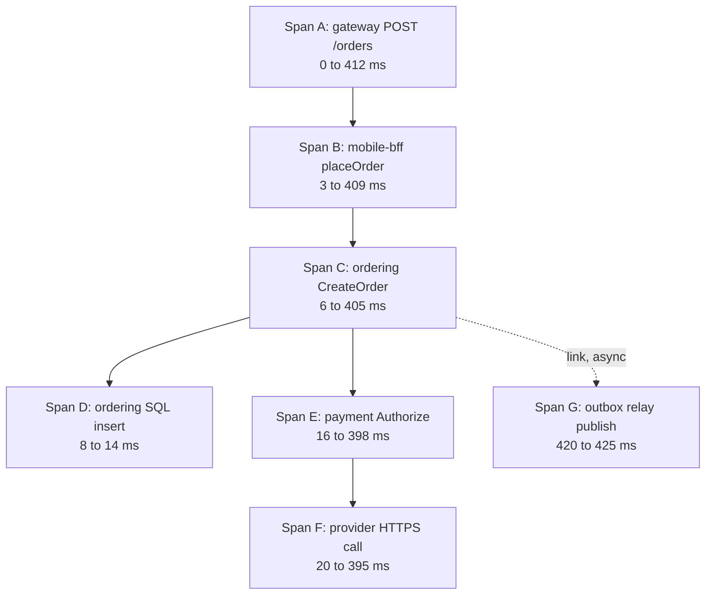

**Reading the diagram.** Each box is a span, and each solid arrow points from parent to child; all spans share one trace ID, and the times are offsets from the start of the root span. Reading the durations shows where time went: span F, the external payment provider's HTTPS call, takes 375 ms of the 412 ms total, so tuning Ordering's SQL (6 ms) would not help. Span G runs after the response was sent (it starts at 420 ms), because the event is published asynchronously by the outbox relay; it is connected by a **span link** (dotted), not as a child, since it is not part of the request's critical path. Storage boundary: each service exports spans asynchronously to a collector and trace store, never on the request path. Failure points: a service that does not propagate the context breaks the tree into separate traces. Scaling: storing every span of every request is expensive, so traces are sampled (Chapter 40).

#### How it works internally

1. The first instrumented component (often the gateway) receives a request without trace context, creates a trace ID and a root span, and makes a sampling decision.
2. On every outbound call it injects the context. The W3C Trace Context standard defines the `traceparent` header, which carries a version, the 16-byte trace ID, the 8-byte parent span ID and flags including "sampled", for example `traceparent: 00-4bf92f3577b34da6a3ce929d0e0e4736-00f067aa0ba902b7-01` [W3C Trace Context].
3. The callee extracts the context, creates a child span with the received span ID as its parent, and repeats for its own outbound calls. For messages, the context travels in message headers, and consumers usually start a new span linked to the producer's.
4. Each process exports finished spans asynchronously (batched, in the background) to a collector; a backend assembles spans by trace ID and shows the tree and timeline.

::: warning
**Warning — Propagation is only as good as the weakest hop.** A trace breaks at any service, thread pool, queue or proxy that drops the headers. Use the shared instrumentation of your framework or OpenTelemetry's libraries (§40.7) rather than hand-copying headers, and test propagation through asynchronous paths. A service mesh can emit spans for each hop but cannot by itself connect an inbound request to the outbound calls the application makes; the application must still forward the context headers [Istio Docs: Distributed Tracing].
:::

## 34.10 Service mesh

### 34.10.1 What a mesh is and why it exists

By now each inter-service call needs: discovery and load balancing (§34.7), timeouts, retries with budgets and circuit breaking (Chapter 22), mutual TLS for identity and encryption (§10.10.2), metrics and trace spans (§34.9), and traffic control for canaries (§34.12). Implementing all of that in a library is possible, and Netflix's Java libraries did exactly that, but it ties the features to one language and requires every service to upgrade the library to get a fix. A **service mesh** moves these features out of the application into infrastructure.

::: definition
**Definition — Service mesh.** A dedicated infrastructure layer that handles service-to-service communication. Its **data plane** is a set of proxies through which all service traffic passes (one per workload instance as a **sidecar**, or shared per node); its **control plane** configures those proxies, distributes certificates and collects their state. It provides traffic management, security (mutual TLS, authorization policy) and telemetry without application code changes [Istio Docs: Architecture; Linkerd Docs: Architecture].
:::

#### First-principles explanation

Think of an embassy. Diplomats (services) want to talk to other embassies; they do not personally check credentials, encrypt messages, keep logs or reroute around closed borders. Each embassy has a communications office (the sidecar) that does all of this for every message, following rules set by the foreign ministry (the control plane), which can change the rules for every office at once. The diplomat just speaks to the office down the hall.

#### How it works internally

1. **Interception.** When a pod starts, the mesh injects a proxy container and programs the pod's network rules (iptables or a CNI plugin) so that all inbound and outbound TCP traffic passes through the proxy. The application still connects to `payment:8080` in plain text; the proxy intercepts it.
2. **Outbound.** The caller's sidecar resolves the destination from the endpoints the control plane gave it, chooses an instance (§19.10), opens or reuses an mTLS connection to the destination's sidecar, applies timeouts and retry policy, and records metrics and a span.
3. **Inbound.** The callee's sidecar terminates mTLS, verifies the caller's workload identity from its certificate (for example a SPIFFE ID, §10.10.2), enforces authorization policy ("only `ordering` may call `POST /charge`") and forwards to the application on localhost.
4. **Control plane.** It watches the platform (Kubernetes services, endpoints, mesh policy resources), translates them into proxy configuration and pushes it, in Istio's case over Envoy's xDS APIs; it also acts as a certificate authority, issuing short-lived workload certificates and rotating them automatically [Istio Docs: Architecture].

**Figure 34.10 — Sidecar service mesh: data plane and control plane.**

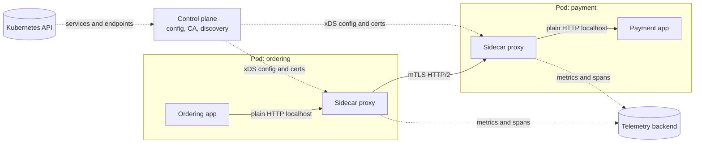

**Reading the diagram.** The Ordering application sends a plain request to localhost, where its sidecar intercepts it; the sidecar sends it over mutual TLS (HTTP/2) to the Payment pod's sidecar, which checks the caller's identity and policy and passes the request to the Payment application on localhost. Solid arrows are the synchronous request path: one logical call now crosses two proxies. Dotted arrows are asynchronous control and telemetry traffic: the control plane reads services and endpoints from the Kubernetes API (a storage boundary), and pushes configuration and certificates to every proxy; proxies export metrics and spans. Failure points: if the control plane is down, proxies keep running with their last configuration and certificates until those expire, so new deploys and certificate rotation stop but traffic continues; a misconfiguration pushed by the control plane can affect every service at once. Scaling: the data plane grows with the number of pods (one proxy each), and the control plane's push cost grows with the number of proxies times the size of their configuration, which is why meshes let you scope which services each proxy needs to know about.

### 34.10.2 Features

- **Mutual TLS everywhere** with automatic certificate issuance and rotation, plus identity-based authorization policies. This is often the main reason organizations adopt a mesh, because it delivers zero-trust service-to-service security (§10.10.2) without changing applications.
- **Traffic management.** Retries, timeouts, circuit breaking and outlier detection configured per route; **traffic shifting** by weight (send 5% of traffic to `payment` v2, §34.12), header-based routing and mirroring (sending a copy of live traffic to a new version and discarding its responses).
- **Telemetry.** Uniform golden-signal metrics (request rate, errors, latency) for every service pair, access logs and spans for each hop, regardless of language.

::: warning
**Warning — Mesh retries multiply with application retries.** If the application retries 3 times and its sidecar also retries 3 times, the destination can see 9 attempts per request, and more down a chain (§22.12.3). Decide which layer retries, usually the mesh with a retry budget, and turn off the other.
:::

### 34.10.3 Istio, Linkerd and sidecarless (ambient) mode

**Istio** uses Envoy as its sidecar proxy and `istiod` as its control plane. **Linkerd** uses its own lightweight proxy written in Rust (`linkerd2-proxy`), designed specifically as a sidecar for meshing, with an emphasis on simplicity and low resource use [Linkerd Docs: Architecture]. Both provide automatic mTLS, retries, timeouts, traffic splitting and golden metrics; Istio offers the larger feature set and more configuration surface.

The sidecar model has costs: one proxy per pod (memory and CPU multiplied by the number of pods), two proxy traversals per call, pod restarts to upgrade the proxy, and start-up ordering problems (the application starting before its sidecar is ready). This led to **sidecarless** designs. As of 2026, Istio's **ambient mode**, which became generally available in Istio 1.24 in November 2024, splits the data plane into two layers [Istio Blog 2024]:

1. **ztunnel** (zero-trust tunnel), a lightweight per-node proxy written in Rust, which provides L4 features: mTLS, workload identity, L4 authorization and TCP telemetry for all pods on its node.
2. **Waypoint proxies**, Envoy-based proxies deployed per namespace or per service only where L7 features (HTTP routing, retries, L7 authorization) are needed.

Linkerd, as of 2026, continues to use the sidecar model. Other sidecarless approaches implement parts of the data plane in the kernel with eBPF (for example Cilium's service mesh). Check current documentation before choosing, because this area changes quickly.

**Figure 34.11 — Istio ambient mode: per-node ztunnel with an optional waypoint.**

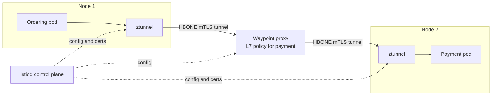

**Reading the diagram.** Application pods contain no proxy. Traffic from the Ordering pod is redirected to the ztunnel on its node, which encrypts it with mutual TLS inside an HTTP-based tunnel (HBONE) and, because the Payment service has L7 policy configured, sends it to Payment's waypoint proxy; the waypoint applies HTTP routing, retries and L7 authorization and forwards it through Node 2's ztunnel to the Payment pod. Without L7 policy the waypoint is skipped and traffic goes ztunnel to ztunnel. The control plane configures all three asynchronously (dotted). Failure points: a ztunnel failure affects every pod on its node, a larger blast radius than one sidecar; the waypoint is a shared hop that must be scaled and made redundant. Scaling: proxy count grows with nodes rather than pods, and L7 cost is paid only by services that need it.

#### Mathematical foundations: what does the mesh cost?

::: formula
**Mesh latency and resource overhead**

$$\Delta L_{\text{chain}} \approx h \cdot \delta_{\text{hop}} \qquad C_{\text{CPU}} = \frac{\Lambda \cdot x}{1{,}000} \cdot c \qquad M = P \cdot m$$

| Symbol | Meaning | Units |
|---|---|---|
| $h$ | Number of sequential service-to-service hops on the request path | hops |
| $\delta_{\text{hop}}$ | Latency added per hop by the proxies on that hop (two sidecars, or two ztunnels) | ms |
| $\Delta L_{\text{chain}}$ | Added latency along the chain (an approximation: percentiles do not add exactly) | ms |
| $\Lambda$ | Total internal service-to-service request rate | requests/s |
| $x$ | Proxies traversed per call (2 for sidecar-to-sidecar) | count |
| $c$ | Proxy CPU per 1,000 requests/s | vCPU |
| $C_{\text{CPU}}$ | Fleet-wide CPU spent in proxies | vCPU |
| $P$ | Number of proxies (pods for sidecars, nodes for ztunnels) | count |
| $m$ | Memory per proxy | MB |
| $M$ | Fleet-wide proxy memory | MB |
:::

::: example
**Worked example — Meshing QuickBite.** QuickBite runs 400 pods on 40 nodes; internal traffic is $\Lambda = 20{,}000$ requests/s; the longest synchronous path has $h = 4$ hops. Istio's published measurements (1 KB HTTP requests, specific hardware, mutual TLS on; as of 2026, check current values) report that the two sidecars on a hop add about 0.18 ms at p90 and 0.25 ms at p99; in ambient mode the two ztunnels add about 0.17 ms at p90 and 0.20 ms at p99; one sidecar with two worker threads uses about 0.20 vCPU and 60 MB per 1,000 requests/s, and a ztunnel about 0.06 vCPU and 12 MB [Istio Docs: Performance and Scalability].

1. Sidecar latency along the longest path: $\Delta L \approx 4 \times 0.25 = 1.0$ ms at p99.
2. Sidecar CPU: $C = (20{,}000 \times 2 / 1{,}000) \times 0.20 = 40 \times 0.20 = 8$ vCPU.
3. Sidecar memory: $M = 400 \times 60 = 24{,}000$ MB = 24 GB (the measured 60 MB is under load; idle sidecars use less, and memory grows with configuration size).
4. Ambient L4 only: CPU $= 40 \times 0.06 = 2.4$ vCPU; memory $= 40$ ztunnels $\times 12$ MB $= 480$ MB; latency $\approx 4 \times 0.20 = 0.8$ ms at p99. Add waypoints only for services that need L7 policy.

**Interpretation.** For a request whose budget is 300 ms, about 1 ms of added p99 is negligible; for an in-memory cache path with a 2 ms budget it is half the budget. The resource cost of sidecars, 8 vCPU and 24 GB here, is roughly two or three extra nodes. **Engineering implication.** The mesh is affordable for typical request/response services and expensive for very high-rate, low-latency internal paths; ambient mode reduces the fixed per-pod memory cost most. Measure on your own hardware and payloads before deciding; vendor numbers are best cases.
:::

#### Advantages and disadvantages

**Advantages.** Uniform mTLS and identity-based policy without code changes; consistent retries, timeouts and telemetry across languages; traffic shifting for safe releases; one place to change communication policy.

**Disadvantages.** A complex distributed system of its own to operate, upgrade and debug; latency and resource overhead; configuration errors with fleet-wide blast radius; a learning curve; and duplication with library features (retries, balancing) that must be reconciled.

::: recommendation
**Recommendation — Adopt a mesh for a specific problem.** Good reasons: you must encrypt and authenticate all service-to-service traffic, you run many languages and need uniform telemetry and traffic policy, or you need fine-grained traffic shifting. Weak reasons: "we have microservices, so we need a mesh." With ten services in one language, a well-configured RPC library is simpler.
:::

## 34.11 Data ownership and database-per-service

### 34.11.1 Database-per-service and the shared-database anti-pattern

::: definition
**Definition — Database-per-service.** Each service's persistent data is private to that service and reachable by others only through its API or published events. The service may use its own database server, its own schema on a shared server, or private tables, provided no other service reads or writes them [Richardson 2018].
:::

The opposite is the **shared database**: several services read and write the same tables. It looks efficient, since joins are free and there is one source of truth, but it is content coupling (§34.3.2) at scale. Nobody can change a column without finding every service that uses it; one service's heavy query slows the others; and invariants are enforced by whichever service wrote last. The schema becomes the real, unversioned API of the system.

**Figure 34.12 — Shared database versus database-per-service with an event-fed read model.**

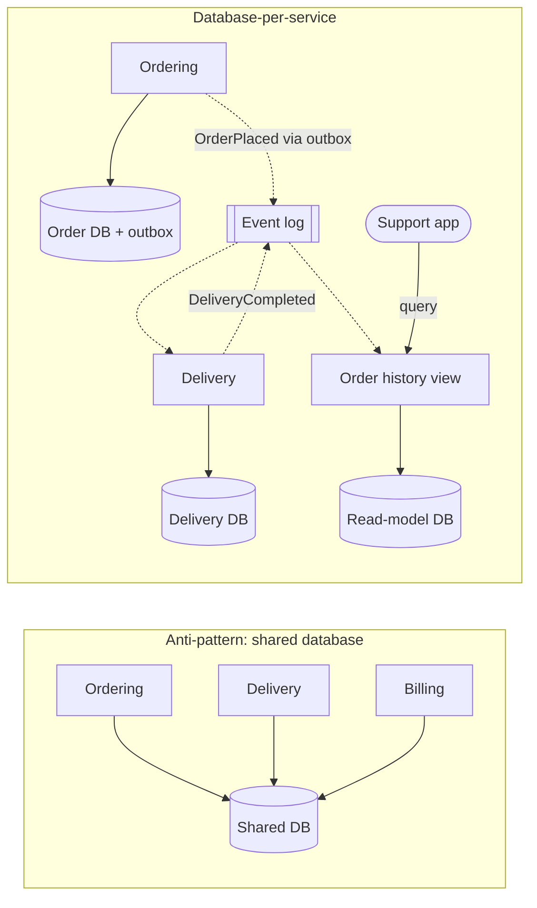

**Reading the diagram.** On the left, three services share one database: there is one storage boundary for three owners, every table is a shared interface, and a lock or slow query from one service hurts all three. On the right, each service writes only its own database. Ordering commits an order and an outbox row in one local transaction, and a relay publishes `OrderPlaced` to the event log asynchronously (dotted). Delivery keeps the order fields it needs in its own database. An **order history view** service consumes events from both Ordering and Delivery into a denormalized read model that the support app queries synchronously. Failure points: if the event log or relay stops, copies go stale but nothing fails outright; consumers must be idempotent because delivery is at least once (§32.10). Scaling: each database is sized for its own load, and the read model can be rebuilt by replaying the log.

### 34.11.2 Replicating data with events

When Delivery needs the customer's address and the restaurant's location, it does not call Ordering for every courier assignment. It keeps a local copy, updated from events. Rules for doing so safely:

1. **One owner per fact.** Ordering owns the order address; Delivery's copy is a cache that it never edits.
2. **Publish reliably.** Use the transactional outbox or change data capture (§32.5–§32.6) so the database and the event log cannot disagree.
3. **Consume idempotently and in order per key.** Partition events by aggregate ID so all events for one order arrive in order (§31.5), and ignore events whose version is not newer than the copy's.
4. **Carry enough state.** "Event-carried state transfer" puts the changed fields in the event so consumers need not call back.

Cross-service invariants then become **sagas**: a sequence of local transactions with compensations (refund the payment if no courier can be found), coordinated by choreography or an orchestrator. Chapter 32 owns that topic (§32.7–§32.8).

### 34.11.3 Querying across services

A support agent wants "all orders for customer X in the last month, with delivery times and refund status": data owned by three services. Two patterns exist [Richardson 2018]:

- **API composition.** A composer (a BFF or query service) calls each owner and joins in memory. Simple and always fresh, but its latency is that of the slowest owner, its availability is the product of the owners' (§34.14.4), and large joins (all orders with any refund) need inefficient fan-out.
- **CQRS view.** A dedicated read model, fed by events from the owners, stores the pre-joined answer (Figure 34.12). Queries are fast and independent of the owners' availability, at the cost of replication lag (typically under a second to seconds) and another datastore to run (§32.4).

**Table 34.6 — Querying across services.**

| | API composition | CQRS view |
|---|---|---|
| Freshness | Current | Lags by the replication delay |
| Latency | Slowest owner plus composition | One local query |
| Availability | Product of owners' availability | Independent of owners at read time |
| Complexity | Low | Event handling, idempotency, rebuilds |
| Choose when | Few owners, small result sets | Frequent queries, joins across many owners, search |

::: mistake
**Common misconception — "Database-per-service means one database server per service."** It means private *ownership*. Several services may share a managed database cluster with separate schemas and credentials, which is often the cost-effective start, as long as no service can read another's schema. Enforce the boundary with database permissions, not with good intentions.
:::

## 34.12 Deployment strategies

The defining property of a microservice is that it can be deployed alone. Chapter 43 covers rolling, blue–green and canary deployments and feature flags in depth (§43.4–§43.7); this section lists what microservices add.

1. **One pipeline per service.** Each service builds, tests (including contract verification, §34.8.5) and deploys from its own pipeline, without waiting for other services.
2. **Backward and forward compatibility at every step.** During a rolling deploy, old and new versions of a service run side by side, and consumers on either side may be old or new. Every API, event and schema change therefore uses expand and contract (§34.8.4); database changes too (§43.13).
3. **Progressive delivery.** Shift a small share of traffic to the new version (with a mesh, by weight, §34.10.2), compare its error rate and latency with the old version, and roll forward or back automatically.
4. **Decouple deploy from release.** Ship code dark behind a feature flag, then enable it gradually.

::: warning
**Warning — The lockstep release is a symptom.** If a release plan says "deploy Payment v42, then Ordering v118, then Billing v77 within the same hour", the services are not independently deployable. Find the incompatible change and split it into compatible steps.
:::

## 34.13 Migration from a monolith

### 34.13.1 The strangler fig pattern

::: definition
**Definition — Strangler fig application.** A migration strategy in which a new system is grown around the edges of an old one, taking over one capability at a time while the old system keeps running, until the old system can be retired. Fowler named it after strangler fig vines, which grow around a host tree until they stand on their own [Fowler 2004].
:::

#### Why does this exist?

The alternative, a "big bang" rewrite, stops feature delivery for months or years, must reproduce every undocumented behavior of the old system, and delivers no value until the end. Incremental migration delivers value early, can be paused at any point, and keeps the old system as a fallback.

#### How it works internally

1. **Put a routing layer in front** of the monolith (a reverse proxy or the API gateway); initially it sends everything to the monolith.
2. **Pick a capability** with low change coupling to the rest (§34.3.2), clear data ownership and real value from extraction.
3. **Build it as a service**, with its own data. Synchronize data during the transition, for example with change data capture from the monolith's tables.
4. **Redirect traffic** for that capability's routes to the new service, gradually (by percentage or by customer), with the ability to switch back.
5. **Remove the dead code** from the monolith, then repeat.

**Figure 34.13 — Strangler fig: extracting Catalog from the QuickBite monolith.**

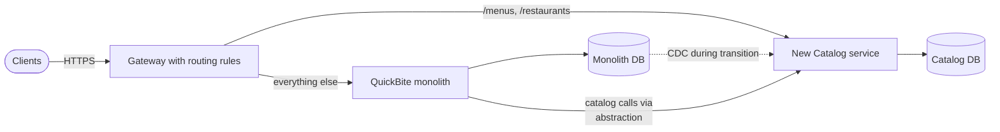

**Reading the diagram.** All clients reach the gateway over HTTPS; routing rules send catalog paths to the new Catalog service and everything else to the monolith (synchronous). During the transition, change data capture streams menu changes still written by old monolith screens into Catalog's database (dotted, asynchronous), and monolith code that needs menu data calls Catalog through an internal abstraction instead of its own tables. Two storage boundaries now exist, and for a period the monolith database remains the source of truth for some fields, so ownership must be explicit per field. Failure points: the routing layer (must be redundant), the CDC pipeline (lag shows stale menus) and divergent behavior between old and new code. Scaling: Catalog now scales independently with read traffic.

### 34.13.2 Branch by abstraction and parallel run

Routing works at the edge. Functionality deep inside the monolith, called by other monolith code, needs **branch by abstraction**: introduce an interface in front of the existing implementation, move all callers to the interface, build the new implementation (a client to the new service) behind it, switch with a flag, then delete the old implementation [Fowler 2014: BranchByAbstraction; Newman 2019]. All of this happens on the main branch with no long-lived feature branch.

For risky logic (pricing, payments), use a **parallel run**: call both old and new implementations, return the old result to the user, and compare the results, logging any differences. GitHub's Scientist library automates this for code paths inside an application [GitHub Scientist]. Only when differences are rare and understood do you switch to the new implementation as the source of truth. Make sure only one side has side effects (only one sends the email or charges the card).

### 34.13.3 A worked migration plan

**Table 34.7 — Migrating QuickBite's monolith over about four quarters (illustrative).**

| Phase | Step | Exit criterion |
|---|---|---|
| 0 | Gateway in front of monolith; tracing and per-route metrics; modularize code by context | All traffic via gateway; module dependencies mapped |
| 1 | Extract Notification (async, low coupling) via `OrderPlaced` events from an outbox | Monolith no longer sends messages |
| 2 | Extract Catalog with CDC sync and route-by-route redirection | Catalog DB is source of truth; monolith reads via API |
| 3 | Extract Delivery; parallel-run courier assignment for two weeks | Assignment differences below 0.1%, all explained |
| 4 | Extract Payment behind branch by abstraction; ACL for provider | Payment tables removed from monolith DB |
| 5 | Remaining Ordering core stays a well-modularized service | Decide on evidence whether to split further |

The order follows the change-coupling data: the least coupled, lowest-risk capabilities first, so the team learns the platform (pipelines, discovery, tracing) on cheap mistakes. Payment comes late because it has high coupling with Ordering ($C = 0.43$ in §34.3.2). Phase 5 is a legitimate end state: nothing requires the core to be split.

::: industry
**Shopify's modular monolith.** Shopify chose not to split its large Ruby on Rails monolith into microservices, and instead enforced component boundaries inside it, with tooling that detects violations of the declared dependencies between components [Westeinde 2019]. This captures much of the boundary benefit without the network.
*Evidence: Primary* — [Westeinde 2019]
:::

## 34.14 Anti-patterns

### 34.14.1 The distributed monolith

::: definition
**Definition — Distributed monolith.** A system deployed as multiple services that cannot be changed, deployed or operated independently: services share databases, must be released together, or call each other synchronously so tightly that one failure stops all of them. It has the costs of distribution and the coupling of a monolith [Newman 2021].
:::

Symptoms: coordinated releases (§34.12), a shared database (§34.11), long synchronous call chains, and a single change touching many repositories. The cause is almost always boundaries drawn without regard to cohesion, often by technical layer (Figure 34.1) or by noun ("Customer service", "Product service") instead of by capability.

### 34.14.2 Nanoservices and shared-library coupling

**Nanoservices** are services so fine-grained that the network and operational overhead outweighs their function: a service per database table, or per function. Each adds a pipeline, an on-call surface, a versioned API and network hops.

**Shared-library coupling** occurs when services share a library containing domain model classes or business logic. Updating the library forces every service to rebuild and redeploy, often in lockstep, and the library's model becomes a hidden shared kernel. Sharing infrastructure libraries (logging, tracing, an RPC client) is fine if versions can differ between services; sharing domain models is not.

### 34.14.3 Synchronous call chains

::: formula
**Availability and latency of a synchronous call chain**

$$A_{\text{chain}} = \prod_{i=1}^{n} A_i = A^n \ \ \text{(equal services)} \qquad L_{\text{chain}} = \sum_{i=1}^{n} \left(R_i + s_i\right)$$

| Symbol | Meaning | Units |
|---|---|---|
| $n$ | Number of services that must all succeed for the request | count |
| $A_i$ | Availability of service $i$ (independent failures assumed) | dimensionless |
| $A_{\text{chain}}$ | Availability of the request path | dimensionless |
| $R_i$, $s_i$ | Round-trip and processing time of hop $i$ | ms |
| $L_{\text{chain}}$ | End-to-end latency of the chain | ms |
:::

::: example
**Worked example — QuickBite checkout as a chain.** Each service is 99.9% available. A distributed-monolith checkout calls gateway → BFF → Ordering → Pricing → Payment, five in sequence. Over a 30-day month (720 hours):

1. Five in series: $A = 0.999^5 = 0.99501$; unavailability $0.00499 \times 720 = 3.59$ hours/month.
2. Ten in series (add Inventory, Promotions, Kitchen, Notification, Loyalty synchronously): $A = 0.999^{10} = 0.99004$; $0.00996 \times 720 = 7.17$ hours/month.
3. Redesign with three services on the critical path (gateway, Ordering, Payment) and the rest asynchronous: $A = 0.999^3 = 0.99700$; 2.16 hours/month.
4. Latency at 0.5 ms network, 0.25 ms mesh and 10 ms processing per hop: ten hops cost $10 \times 10.75 = 107.5$ ms; three cost 32.25 ms.

**Interpretation.** Every synchronous dependency multiplies in its unavailability: ten 99.9% services give barely two nines. Retries help only against transient faults, and correlated failures (a shared database or cluster) make reality worse than the independence assumption. **Engineering implication.** Count the services on each critical path and keep it short; move non-essential work to events; and for remaining synchronous calls use timeouts, fallbacks and circuit breakers (Chapter 22) so a non-essential dependency degrades the response instead of failing it.
:::

**Figure 34.14 — Shortening the critical path.**

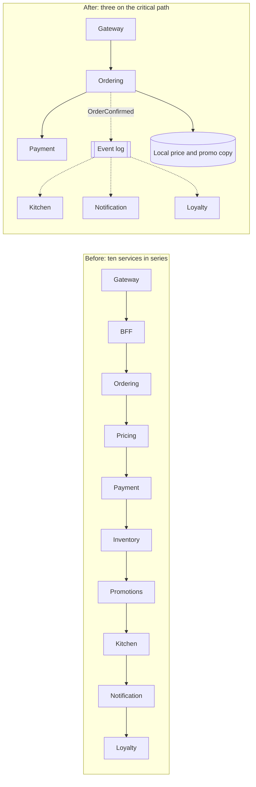

**Reading the diagram.** Before, ten synchronous calls must all succeed in order; any failure fails checkout, and latency is the sum of all hops. After, only the gateway, Ordering and Payment are on the synchronous path. Pricing and promotion rules are replicated into a local copy that Ordering reads (a storage boundary inside Ordering, fed by events). Kitchen, Notification and Loyalty consume `OrderConfirmed` asynchronously from the event log. Inventory is checked from a local, event-fed availability copy (not shown). Failure points shrink to three services plus the outbox relay, whose failure delays but does not lose events. Scaling: asynchronous consumers scale on backlog.

::: industry
**Two public reversals.** Segment described consolidating more than a hundred destination microservices back into a single service after the operational cost of many tiny services, shared-library versions and per-service queues outgrew the benefit [Noonan 2018]. Amazon Prime Video's monitoring team reported cutting infrastructure cost by about 90% by moving an audio/video quality-inspection workload from distributed serverless components to a single process, because passing frames between components dominated the cost [Kolny 2023]. Neither is an argument against services in general; both show granularity chosen without regard to the data flow.
*Evidence: Primary* — [Noonan 2018; Kolny 2023]
:::

**Table 34.8 — Anti-patterns at a glance.**

| Anti-pattern | Symptom | Fix |
|---|---|---|
| Distributed monolith | Lockstep releases | Re-cut boundaries by capability and change coupling; expand and contract |
| Shared database | Schema changes need many teams | Database-per-service; events; CQRS views |
| Nanoservices | More services than engineers | Merge into capability-sized services |
| Shared domain library | Library bump forces fleet redeploy | Share only infrastructure; each context owns its model |
| Long synchronous chains | $A^n$ availability; summed latency | Events, local copies, fewer hops |
| Gateway with business logic | Every change goes through the platform team | Move logic into services or BFFs |

## 34.15 Summary and revision notes

::: summary
- A microservice is built around one business capability, owned by one team, independently deployable and the sole owner of its data. Its main benefit is independent change; its main cost is distribution.
- Choose boundaries by cohesion and change coupling ($C = n_{AB}/(n_A + n_B - n_{AB})$ from version history), team ownership and transaction boundaries, not by technical layer or size.
- DDD supplies the model: ubiquitous language, entities, value objects, small aggregates (one transaction, one aggregate; conflict probability $1 - e^{-\lambda w}$) and domain events.
- Bounded contexts are the best first service boundaries. Context maps make relationships explicit; an anticorruption layer keeps foreign models out. Event storming finds the boundaries.
- An API gateway handles edge concerns; BFFs shape APIs per client and save expensive round trips. Keep business logic out of both.
- Service discovery combines a registry, health checks and client-side or server-side lookup. Stale entries persist for about $k \cdot h + t_{\text{prop}} + t_{\text{cache}}$, so add passive ejection and retries.
- Prefer one synchronous call on the critical path and events elsewhere; batch chatty calls; fan-out exposes you to $p^N$ tails; version with expand and contract; verify compatibility with consumer-driven contracts.
- Tracing links spans across services by propagating trace context; Chapter 40 goes deeper.
- A service mesh moves mTLS, retries and telemetry into proxies; sidecars add roughly 0.2–0.25 ms per hop and per-pod memory; Istio's ambient mode (GA in 1.24) uses per-node ztunnels and optional waypoints.
- Database-per-service is mandatory; share data by events, query with API composition or CQRS views, and keep invariants inside one service or use sagas.
- Migrate with the strangler fig, branch by abstraction and parallel run, least-coupled capabilities first.
- The distributed monolith is the main failure mode; synchronous chains have availability $A^n$.
:::

## 34.16 Knowledge checkpoint

1. State four properties of a microservice.
2. Modules A and B were touched by 50 and 40 commits, 30 of them shared. Compute $C(A,B)$ and interpret it.
3. Why is content coupling worse than domain coupling?
4. Distinguish an entity from a value object, with one QuickBite example of each.
5. An aggregate receives 5 writes/s from others and each write takes 40 ms. What is the conflict probability?
6. What is the difference between a conformist relationship and an anticorruption layer?
7. Why should an unknown payment status raise an error in an ACL while an unknown decline code may map to a default?
8. A mobile screen needs 5 sequential calls, mobile RTT 80 ms, service time 10 ms, datacenter RTT 1 ms. Compare direct calls with a BFF calling sequentially.
9. Why does Eureka keep possibly stale instances during a heartbeat drop?
10. Health checks every 5 s, 3 misses, 1 s propagation, 10 s client cache: what is the stale window?
11. What does a consumer-driven contract check, and what does it not check?
12. What does the `traceparent` header carry?
13. Name the two layers of Istio ambient mode and what each handles.
14. With 300 pods, 60 MB per sidecar and 15,000 internal requests/s at 0.2 vCPU per 1,000 requests/s per proxy, estimate sidecar memory and CPU.
15. When would you choose a CQRS view over API composition?
16. What is the availability of eight services in series at 99.95% each, and the monthly downtime?

<details><summary>Answers</summary>

1. Built around one business capability; owned by one team; independently deployable; sole owner of its data.
2. $30/(50 + 40 - 30) = 0.5$: half of all changes to either touch both; they probably belong together or need a better interface.
3. Content coupling lets another service change your internal state directly, so you can no longer enforce invariants or change your schema; domain coupling only uses your published API.
4. An entity has identity over time (an `Order`); a value object is defined by its attributes and immutable (`Money`).
5. $1 - e^{-5 \times 0.04} = 1 - e^{-0.2} = 0.181$.
6. A conformist adopts the upstream model unchanged; an ACL translates it into the downstream's own model.
7. Mapping an unknown decline code to `OTHER` still declines the order safely; guessing whether an unknown status means money moved could ship unpaid orders or double-charge.
8. Direct: $5 \times 90 = 450$ ms. BFF: $80 + 5 \times 11 = 135$ ms.
9. A sudden drop in heartbeats is more likely a network problem than mass failure; a stale list is better than none (availability over consistency).
10. $3 \times 5 + 1 + 10 = 26$ s.
11. It checks that the provider still satisfies the request and response shapes the consumer relies on; it does not check business correctness.
12. A version, the trace ID, the parent span ID and trace flags such as sampled.
13. ztunnel, a per-node L4 proxy for mTLS, identity and L4 policy; waypoint proxies for L7 routing, retries and policy where needed.
14. Memory $300 \times 60 = 18{,}000$ MB = 18 GB; CPU $(15{,}000 \times 2/1{,}000) \times 0.2 = 6$ vCPU.
15. When the query is frequent, joins many owners or needs search or aggregation, and seconds of staleness are acceptable.
16. $0.9995^8 = 0.99601$; about $0.004 \times 720 = 2.87$ hours per month.

</details>

## 34.17 Interview questions

### Basic

**Q1. How do you decide service boundaries?**
**Answer.** Start from business capabilities and bounded contexts, found with event storming. Check that each candidate has one owning team, keeps its invariants inside one transaction and has low change coupling with its neighbors (measured from history). Prefer coarse services first and split on evidence such as different scaling or release needs.

**Q2. What does an API gateway do, and what should it not do?**
**Answer.** It is the single entry point: TLS termination, authentication, rate limiting, routing, observability and sometimes aggregation. It should not contain business logic, which would make it a shared monolith that every team must change.

### Intermediate

**Q3. Orders, payments and inventory each have their own database. How do you place an order consistently?**
**Answer.** Keep payment authorization synchronous if the customer needs the result, and make the overall flow a saga: each service commits locally and publishes events through an outbox; failures trigger compensations (release stock, refund). Consumers are idempotent. Explain the accepted intermediate states and how the UI shows them.

**Q4. How do you prevent a provider change from breaking consumers without end-to-end test environments?**
**Answer.** Consumer-driven contracts: consumers generate contracts from their tests and publish them to a broker; the provider verifies all of them in CI using provider states; deployment is gated on verification against the versions in the target environment. Combine with additive changes, tolerant readers and expand and contract.

### Advanced

**Q5. Should we adopt a service mesh?**
**Answer.** Identify the problem: uniform mTLS and identity-based policy, polyglot telemetry and traffic shifting are good reasons. Quantify cost: about 0.2–0.25 ms per hop at p99 for two proxies, CPU proportional to internal traffic, memory per pod for sidecars. Consider ambient mode to cut per-pod cost, and plan for control-plane operations, upgrades and retry duplication with libraries.

**Q6. A company has 120 services, releases need coordination and incidents cascade. Diagnose and plan.**
**Answer.** Likely a distributed monolith. Measure change coupling between services, map synchronous critical paths and compute their $A^n$, and find shared databases and shared domain libraries. Merge strongly coupled services, move non-essential calls to events with local copies, introduce contract testing and expand-and-contract, and set ownership so each service has one team. Track deploy independence and critical-path length as metrics.

## 34.18 Practical exercises

1. Compute change coupling for every pair of top-level directories in a repository you know, using `git log --name-only`; list the five most coupled pairs.
2. Extend the ACL of §34.5.3 with a refund response and outbound translation of a `ChargeRequest`; add tests.
3. Extend the contract library of §34.8.5 with an array matcher (`each_like`) and a message (event) contract.
4. Simulate the stale-endpoint window of §34.7.4 with 20 instances, one crash and passive ejection after 5 errors; compare failures with and without retries.
5. Draw QuickBite's context map for a new "group ordering" feature and state each relationship pattern.

## 34.19 Design challenges

1. **Ride-hailing decomposition.** Propose bounded contexts, a context map and the synchronous critical path for "request a ride"; compute its availability at 99.9% per service.
2. **Strangling a billing monolith.** Plan a four-phase migration of invoicing out of a 15-year-old ERP, with ACLs, CDC and a parallel run; define exit criteria per phase.
3. **Mesh or library.** A trading platform has a 2 ms internal latency budget across 3 hops and 40,000 requests/s. Decide between sidecars, ambient mode and an RPC library, with numbers.

## 34.20 References

1. Evans, E. *Domain-Driven Design: Tackling Complexity in the Heart of Software*. Addison-Wesley, 2003.
2. Vernon, V. *Implementing Domain-Driven Design*. Addison-Wesley, 2013.
3. Newman, S. *Building Microservices: Designing Fine-Grained Systems*, 2nd ed. O'Reilly, 2021.
4. Newman, S. *Monolith to Microservices*. O'Reilly, 2019.
5. Richardson, C. *Microservices Patterns*. Manning, 2018.
6. Lewis, J., Fowler, M. *Microservices: a definition of this new architectural term*. martinfowler.com, 2014. https://martinfowler.com/articles/microservices.html
7. Fowler, M. *StranglerFigApplication*. martinfowler.com, 2004. https://martinfowler.com/bliki/StranglerFigApplication.html
8. Fowler, M. *BranchByAbstraction*. martinfowler.com, 2014. https://martinfowler.com/bliki/BranchByAbstraction.html
9. Fowler, M. *TolerantReader*. martinfowler.com, 2011. https://martinfowler.com/bliki/TolerantReader.html
10. Fowler, M. *MicroservicePremium*. martinfowler.com, 2015. https://martinfowler.com/bliki/MicroservicePremium.html
11. Conway, M. E. *How Do Committees Invent?* Datamation 14(4), 1968.
12. Skelton, M., Pais, M. *Team Topologies*. IT Revolution, 2019.
13. Tornhill, A. *Your Code as a Crime Scene*. Pragmatic Bookshelf, 2015.
14. Brandolini, A. *Introducing EventStorming*. Leanpub. https://leanpub.com/introducing_eventstorming
15. Newman, S. *Pattern: Backends For Frontends*. samnewman.io, 2015. https://samnewman.io/patterns/architectural/bff/
16. Plotnicki, L. *BFF @ SoundCloud*. ThoughtWorks Insights, 2015. https://www.thoughtworks.com/insights/blog/bff-soundcloud
17. Jacobson, D. *Embracing the Differences: Inside the Netflix API Redesign*. Netflix Technology Blog, 2012.
18. Netflix Technology Blog. *Zuul 2: The Netflix Journey to Asynchronous, Non-Blocking Systems*. 2016.
19. Netflix. *Eureka* (wiki and documentation). https://github.com/Netflix/eureka/wiki
20. HashiCorp. *Consul Documentation: Service discovery; health checks*. https://developer.hashicorp.com/consul/docs
21. Kubernetes. *Documentation: Services; DNS for Services and Pods; Liveness, Readiness and Startup Probes*. https://kubernetes.io/docs/
22. Robinson, I. *Consumer-Driven Contracts: A Service Evolution Pattern*. martinfowler.com, 2006. https://martinfowler.com/articles/consumerDrivenContracts.html
23. Pact Foundation. *Pact Documentation* (consumer tests, provider verification, provider states, can-i-deploy). https://docs.pact.io/
24. Sigelman, B. H., et al. *Dapper, a Large-Scale Distributed Systems Tracing Infrastructure*. Google Technical Report dapper-2010-1, 2010.
25. W3C. *Trace Context* (Recommendation). https://www.w3.org/TR/trace-context/
26. Istio. *Documentation: Architecture; Distributed Tracing; Performance and Scalability*. https://istio.io/latest/docs/
27. Istio. *Fast, Secure, and Simple: Istio's Ambient Mode Reaches General Availability in v1.24*. Istio Blog, 2024. https://istio.io/blog/2024/ambient-reaches-ga/
28. Linkerd. *Documentation: Architecture*. https://linkerd.io/2/reference/architecture/
29. Westeinde, K. *Deconstructing the Monolith: Designing Software that Maximizes Developer Productivity*. Shopify Engineering, 2019.
30. GitHub. *Scientist: a Ruby library for carefully refactoring critical paths*. https://github.com/github/scientist
31. Noonan, A. *Goodbye Microservices: From 100s of problem children to 1 superstar*. Segment Engineering Blog, 2018.
32. Kolny, M. *Scaling up the Prime Video audio/video monitoring service and reducing costs by 90%*. Prime Video Tech Blog, 2023.

## 34.21 Open verification items

- Origin of the "BFF" name (Phil Calçado at SoundCloud) and exact dates of Plotnicki 2015 and Newman 2015.
- Netflix API redesign (Jacobson 2012) and Zuul 2 post (2016): titles and dates.
- Dapper's first production sampling rate of 1/1024.
- Istio performance figures quoted in §34.10.3 (1.21, 1.22 and 1.24 measurements) for the current release.
- Linkerd remaining sidecar-only as of 2026.
- Eureka default lease intervals and self-preservation behavior in current releases.
- Author attribution of the Prime Video 2023 post.
