# Chapter 34 — Microservices

> **Level:** 3 · **Track:** A (Traditional) · **Estimated reading time:** 6 h

Chapter 33 placed microservices among the architecture styles and compared them with the monolith and the modular monolith. This chapter is about doing microservices well, and about recognizing when not to. Most microservice failures come from where the lines are drawn, not from the technology. Split a system along the wrong seams and every feature needs five teams, every release needs a coordinated deploy, and every user request crosses a dozen network hops, each of which can fail. Split it along the right seams and teams ship independently, failures stay contained, and each part scales on its own.

The chapter has three parts. The first is about **boundaries**: how to choose them (cohesion, change coupling, team ownership) and the modelling discipline that helps most, domain-driven design, with its aggregates, bounded contexts and context maps. The second is about **plumbing**: API gateways and backends for frontends, service discovery, synchronous and asynchronous communication, contract testing, tracing and service meshes, each with its latency and cost arithmetic. The third is about **data and change**: database-per-service, querying across services, independent deployment, migrating a monolith with the strangler fig pattern, and the anti-patterns, above all the distributed monolith. QuickBite, the food-delivery platform from Chapter 2, is the running example throughout.

## 34.1 Learning objectives

After this chapter you should be able to:

- Define a microservice and choose service boundaries using cohesion, change coupling, team ownership and explicit sizing heuristics.
- Apply the tactical patterns of domain-driven design (entities, value objects, aggregates, domain events) and size an aggregate using a contention estimate.
- Draw a context map using shared kernel, customer–supplier, conformist, anticorruption layer and open host service relationships, and implement an anticorruption layer.
- Place an API gateway and backends for frontends, and compute the latency saved by aggregating chatty calls.
- Compare client-side and server-side service discovery and compute the stale-endpoint window of a registry.
- Choose between synchronous and asynchronous communication, version APIs across services and write a consumer-driven contract test.
- Explain traces, spans and context propagation, and the data plane and control plane of a service mesh, including sidecarless (ambient) mode, and estimate mesh overhead per hop.
- Apply database-per-service, replicate data with events and query across services with API composition or CQRS views.
- Plan a monolith migration with the strangler fig, branch by abstraction and parallel run, and diagnose the distributed monolith and other anti-patterns, including the $A^n$ availability of a synchronous call chain.

## 34.2 Prerequisites

- Monolith, modular monolith and the microservices overview — §33.4, §33.5 and §33.7 (this chapter assumes you know why a team might split a monolith at all).
- Conway's law and the QuickBite decomposition — §1.4 and §2.3 (the running example).
- Percentiles and fan-out amplification — §4.8 (fan-out tail latency is reused in §34.8).
- Series availability — §4.14.2 (the $A^n$ law is applied to call chains in §34.14).
- REST, gRPC and API versioning — §8.6, §8.8 and §8.15 (inter-service calls use these protocols).
- Client-side load balancing — §19.10 (service discovery feeds it).
- Timeouts, retries, circuit breakers and idempotency — §22.11–§22.15 (every inter-service call needs them).
- Messaging, the transactional outbox and sagas — Chapters 30 and 32 (cross-service consistency is built from them; summarized here, not repeated).

## 34.3 Service boundaries

### 34.3.1 What a microservice is

::: definition
**Definition — Microservice.** A service (a deployable unit with an API) that is built around one business capability, owned by one team, deployable independently of other services, and the sole owner of its data, which other services reach only through its API or the events it publishes. Lewis and Fowler describe the **microservice architectural style** as "an approach to developing a single application as a suite of small services, each running in its own process and communicating with lightweight mechanisms," built around business capabilities and independently deployable by fully automated machinery [Lewis and Fowler 2014].
:::

#### First-principles explanation

Think of a restaurant kitchen. A small kitchen has one cook who does everything; that is a monolith, and it works well while the menu is short. A large kitchen is divided into **stations**: grill, sauce, pastry, cold starters. Each station has its own staff, tools and ingredients, and stations talk to each other through a small, fixed protocol: the ticket from the pass. The pastry chef can rearrange the pastry station, change suppliers or hire a new assistant without asking the grill. The division is not by *activity* (one person chops for everyone, another fries for everyone) but by *outcome* (desserts, grilled meat), because outcomes change together: a new dessert touches only the pastry station.

Microservices make the same cut in software. A service is a station: it owns an outcome, its own data (ingredients) and its own team, and others reach it only through its API (the ticket).

#### Why does this exist?

A monolith shares three things across the whole organization: one codebase, one deployable and one database. Below roughly a few dozen engineers that sharing is cheap and powerful. Beyond it, three pains appear. **Release coupling**: every change waits for the slowest change in the same deploy. **Scaling coupling**: the component with the heaviest load forces the whole application to scale. **Failure coupling**: a memory leak in a reporting job takes down checkout. Microservices trade those pains for distributed-systems pains (network failures, eventual consistency, operational load). The trade is worth making only when the first set hurts more than the second. Newman's summary is that microservices buy **options**, chiefly independent deployability, at a substantial cost in complexity [Newman 2021].

### 34.3.2 Cohesion and coupling at service scale

The two forces that decide a good boundary are the same ones that decide a good class (§35.10), applied at the scale of teams and deployables.

::: definition
**Definition — Cohesion and coupling (service level).** **Cohesion** is the degree to which the code inside one service changes together for the same reasons. **Coupling** is the degree to which a change in one service forces a change, a redeploy or a coordinated release in another. A good boundary maximizes cohesion inside and minimizes coupling across. Newman's shorthand: "the code that changes together, stays together" [Newman 2021].
:::

Coupling comes in several forms, from mildest to most damaging [Newman 2021]:

1. **Domain coupling.** Service A calls service B because it needs B's capability (Order needs Payment to charge). Unavoidable; keep the interface small.
2. **Temporal coupling.** A needs B to be *up right now* to finish its work. Synchronous calls create it; asynchronous events remove it (§34.8).
3. **Pass-through coupling.** A passes data to B only because C, further down, needs it, so a change in C's needs changes A's interface.
4. **Common coupling.** Several services read and write the same shared data, for example a shared table (§34.11).
5. **Content coupling.** A reaches into B's internals, typically B's database, and changes its state directly. The worst form: B can no longer reason about its own data.

#### How it works internally: measuring change coupling

You do not have to guess which code changes together. Version-control history records it. Every commit (or merged pull request) that touches files in two candidate modules is evidence that they change for the same reason. Tornhill's work on behavioral code analysis popularized mining these **change-coupling** (or "temporal coupling") metrics from Git history to find hidden dependencies [Tornhill 2015].

::: formula
**Change coupling between two modules (Jaccard index of co-changes)**

$$C(A,B) = \frac{n_{AB}}{n_A + n_B - n_{AB}}$$

| Symbol | Meaning | Units |
|---|---|---|
| $n_A$ | Number of commits (or pull requests) that touch module $A$ in the window | commits |
| $n_B$ | Number of commits that touch module $B$ in the window | commits |
| $n_{AB}$ | Number of commits that touch both $A$ and $B$ | commits |
| $C(A,B)$ | Fraction of all changes to either module that touched both; 0 = independent, 1 = always together | dimensionless |
:::

::: example
**Worked example — Should QuickBite's payment code be its own service?** Over the last six months of QuickBite's monolith history, 120 merged pull requests touched the `ordering` package, 80 touched `payments` and 60 touched both. For comparison, 90 touched `catalog` and only 6 touched both `ordering` and `catalog`.

1. Ordering–payments: $C = 60 / (120 + 80 - 60) = 60 / 140 = 0.43$.
2. Ordering–catalog: $C = 6 / (120 + 90 - 6) = 6 / 204 = 0.029$.

**Interpretation.** Almost half of all changes to ordering or payments touch both. If they were separate services owned by different teams, 43% of their changes would need cross-team coordination and probably a coordinated release. Ordering and catalog, by contrast, change together only 3% of the time; a boundary between them is cheap.

**Engineering implication.** Extract catalog first. Before splitting payments from ordering, inspect the 60 co-changing pull requests: if most are about one concept (for example "payment status shown on the order"), redesign the interface (an event `PaymentAuthorized` that ordering consumes) so the co-change disappears. Splitting first and fixing later produces a distributed monolith (§34.14). Treat a threshold such as $C > 0.2$ as a prompt for investigation, not as a rule.
:::

### 34.3.3 Team ownership and Conway's law

Conway observed that a system's structure tends to copy the communication structure of the organization that builds it [Conway 1968] (§1.4). Microservices make this deliberate: the **inverse Conway maneuver** shapes the teams first so the architecture you want is the one the organization naturally produces. Skelton and Pais formalize the team side: a **stream-aligned team** owns a flow of business change end to end, and a service boundary should fit within one team's **cognitive load**, the amount of domain and technology it can hold in its head [Skelton and Pais 2019].

The practical rules that follow:

1. **One owning team per service.** A team may own several services; a service never has two owning teams. Shared ownership means nobody can make a breaking decision, so nothing changes, or everybody can, so everything breaks.
2. **A change in business capability should land in one team.** If adding "schedule an order for later" needs the ordering, payment, dispatch and notification teams to change code in lockstep, the boundaries cut across the capability.
3. **Boundaries follow communication cost.** Teams in different time zones or different companies need stable, well-documented interfaces between them; teams in one room can afford a chattier relationship.

**Figure 34.1 — Two ways to split QuickBite: by technical layer and by business capability.**

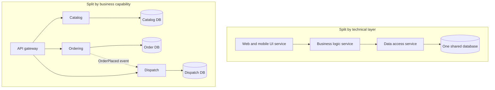

**Reading the diagram.** The top split follows technical layers: a UI service calls a business-logic service over synchronous RPC, which calls a data-access service, which owns one shared database. A feature such as "scheduled orders" changes all three services and the schema, so every feature is a coordinated three-team release, and every request crosses two extra network hops; any of the three is a single failure point for every capability. The bottom split follows business capabilities: the gateway routes each request to one service (solid arrows, synchronous HTTPS or gRPC), each service owns its own database (a separate storage boundary), and ordering informs dispatch asynchronously through an `OrderPlaced` event (dotted arrow), so a dispatch outage does not block ordering. Each capability scales independently; catalog, which is read-heavy, can run many replicas and a cache while dispatch scales with courier activity. "Scheduled orders" now changes mostly the ordering service.

### 34.3.4 Sizing heuristics

"How big should a microservice be?" has no numeric answer in lines of code. Size follows from boundaries, not the reverse. The heuristics below are what practitioners actually use; each is a test you can apply to a proposed boundary.

**Table 34.1 — Service sizing heuristics.**

| Heuristic | The test | Too big when | Too small when |
|---|---|---|---|
| Business capability | Can you name the capability in two or three words of business language? | The name needs "and" ("orders and payments and refunds") | The name is a verb on someone else's noun ("order-validator") |
| Team ownership | Can one stream-aligned team own it? | More than one team commits weekly | One team owns twenty services and runs out of on-call capacity |
| Change coupling | Do changes usually stay inside it? | Many unrelated reasons to change | Most changes also change a neighbor ($C$ high, §34.3.2) |
| Data ownership | Does it own its data outright? | Holds unrelated tables with separate invariants | Needs another service's data for every request |
| Transaction boundary | Are its invariants enforced inside it? | — | A business invariant spans it and a neighbor, forcing a saga for every write |
| Independent deployability | Can it ship on its own schedule? | Its deploy is blocked by unrelated work inside it | Its deploy always needs a neighbor's deploy |
| Rewrite size | Could the team rewrite it in a few weeks? | Rewrite would take quarters | — |

The last row is an old rule of thumb (a service small enough that a team could rewrite it in about two weeks is often quoted in microservice talks). Treat it as a smell detector, not a target. The most important row is the **transaction boundary**: if two candidate services must change state atomically for a business rule to hold, they belong together, because splitting them turns one local transaction into a saga with compensations (§32.7) for every write.

::: recommendation
**Recommendation — Start coarse, split on evidence.** Begin with a modular monolith (§33.5) or a few coarse services aligned with clear capabilities. Split a module out when you have a concrete reason: a team boundary, a different scaling profile, a different failure-isolation need or a different release cadence, and when history shows low change coupling. Merging two services later is far more expensive than splitting a well-modularized module.
:::

::: mistake
**Common misconception — "Micro means small, so smaller is better."** The *micro* is about scope of responsibility, not lines of code. A service that is too small moves its complexity into the network: more calls, more failure modes, more versioned interfaces, more deploy pipelines. Fowler's "Microservice Premium" essay makes the point that the style carries a fixed productivity cost that pays off only above a certain system complexity [Fowler 2015].
:::

#### Failure scenarios

| What goes wrong | Why | Detection | Recovery | Prevention |
|---|---|---|---|---|
| Every feature needs several teams | Boundaries cut across capabilities (layered split) | Cross-team pull requests; high $C$ between services | Merge or re-cut services along capabilities | Boundary review with change-coupling data before splitting |
| One service has three owning teams | Shared "platform" service accreting features | Commit authors from many teams | Split by capability or assign one owner | One owning team per service, written down in a service catalog |
| Services owned by nobody | Reorganization left orphans | No on-call rotation; stale dependencies | Assign or retire | Ownership metadata required in the deploy pipeline |

## 34.4 Domain-driven design

Section 34.3 said "split by business capability". Domain-driven design (DDD) is the most widely used discipline for finding and modelling those capabilities. It predates microservices by a decade: Evans wrote it to help teams build software for complicated domains such as shipping, banking and insurance [Evans 2003]. It splits into **strategic design** (how to divide a large domain into models and how those models relate; §34.5) and **tactical design** (how to build one model well; this section).

::: definition
**Definition — Domain-driven design (DDD).** An approach to software development that places a model of the business domain, built and refined jointly by developers and domain experts, at the center of the design, expresses that model directly in code, and divides large domains into explicitly bounded models [Evans 2003; Vernon 2013].
:::

### 34.4.1 Ubiquitous language

#### First-principles explanation

Ask three people at QuickBite what an "order" is. The customer-support lead says it is the thing a customer complains about, including its refund. The restaurant-operations manager says it is a ticket the kitchen accepts or rejects. The finance analyst says it is a line on a settlement report that is final 14 days after delivery. All three are right, and code that tries to serve all three with one `Order` class becomes a 4,000-line class with 60 nullable fields.

::: definition
**Definition — Ubiquitous language.** A shared, rigorous vocabulary built by developers and domain experts for one model, used consistently in conversation, documents, tests and code (class, method and event names), so that a term means exactly one thing within that model [Evans 2003].
:::

The language is "ubiquitous" *within a boundary*, not across the company. In the ordering model, `Order.accept()` means the restaurant has confirmed it can cook the order; in the finance model there is no `accept` at all, only `Settlement.finalize()`. When a developer says "the order is accepted" and the restaurant manager hears the same thing, a whole class of bugs disappears. When code uses `status = 3` and the business says "accepted", the translation happens in people's heads and fails silently.

### 34.4.2 Entities and value objects

::: definition
**Definition — Entity.** A domain object defined by a continuous **identity** that persists through changes to its attributes. Two entities with the same attributes but different identities are different (two orders for the same pizza at the same price are still two orders) [Evans 2003].
:::

::: definition
**Definition — Value object.** A domain object defined entirely by its attributes, with no identity of its own; it is usually immutable, and two value objects with equal attributes are interchangeable. Examples: `Money(24.50, "USD")`, `Address`, `TimeWindow` [Evans 2003].
:::

Value objects are underrated. Most bugs in money-handling code come from passing around a bare `float` that has lost its currency and precision. A `Money` value object that refuses negative amounts and carries its currency makes those bugs impossible to write. Prefer value objects; promote something to an entity only when the business genuinely tracks its identity over time.

### 34.4.3 Aggregates and consistency boundaries

::: definition
**Definition — Aggregate.** A cluster of entities and value objects treated as one unit for data changes. Each aggregate has one **root** entity; outside objects may hold references only to the root, and every change to anything inside goes through the root, which enforces the aggregate's **invariants** (business rules that must always hold). One transaction modifies one aggregate [Evans 2003; Vernon 2013].
:::

#### Why does this exist?

In a large object graph, every object can reach every other, and any code path can change anything. Then nobody can say which rules hold after a transaction, and locking the whole graph to keep them true does not scale. The aggregate draws a small boundary around exactly the data that one invariant needs. Inside the boundary, consistency is immediate (one ACID transaction). Across boundaries, consistency is eventual, achieved with domain events.

Vernon condenses aggregate design into four rules [Vernon 2013]:

1. **Model true invariants in consistency boundaries.** Put inside the aggregate only what *must* be consistent at the end of every transaction.
2. **Design small aggregates.** Large aggregates load slowly, lock widely and conflict often.
3. **Reference other aggregates by identity.** An `Order` holds `restaurant_id`, not a `Restaurant` object.
4. **Use eventual consistency outside the boundary.** When one aggregate's change must affect another, publish a domain event and update the other in a separate transaction.

**Figure 34.2 — The QuickBite `Order` aggregate.**

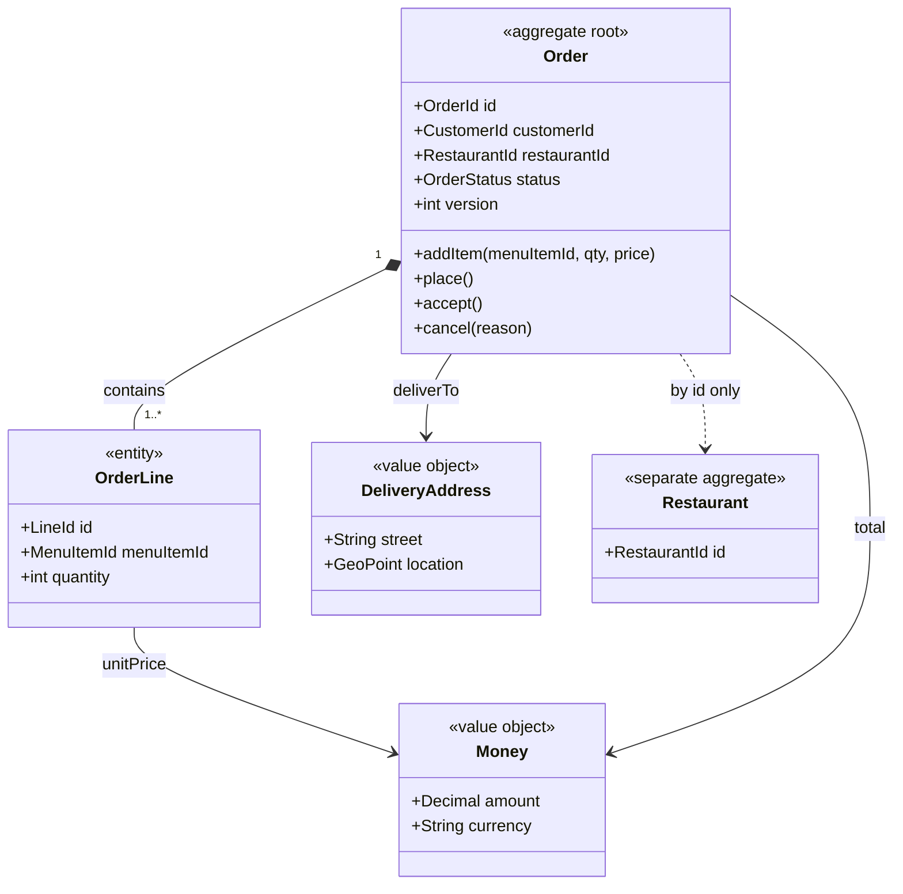

**Reading the diagram.** The `Order` root is the only entry point; `OrderLine` entities live and die with it (composition, filled diamond). `Money` and `DeliveryAddress` are immutable value objects. `Restaurant` is a different aggregate, referenced only by its identifier (dotted dependency), so loading an order never loads a restaurant's menu, and the two are stored and locked separately. The root enforces invariants such as "the total equals the sum of lines" and "no lines may be added after `place()`". The `version` field supports optimistic concurrency: a write succeeds only if the version has not changed since the read, so two concurrent writers to the same order cannot both win. The aggregate is the unit of storage (one row plus child rows, or one document), the unit of locking and the natural unit of partitioning, since all its data shares the `OrderId` key.

#### Mathematical foundations: how big may an aggregate be?

A bigger aggregate means more writers compete for the same version number. If writes to one aggregate arrive as a Poisson process, the chance that another write lands while yours is in flight grows quickly with the write rate.

::: formula
**Optimistic-concurrency conflict probability for one aggregate**

$$P_{\text{conflict}} = 1 - e^{-\lambda w}$$

| Symbol | Meaning | Units |
|---|---|---|
| $\lambda$ | Rate of *other* writes to the same aggregate (Poisson assumption) | writes/s |
| $w$ | Read-modify-write window of one transaction (read version to commit) | s |
| $P_{\text{conflict}}$ | Probability that at least one other write commits inside the window, so this write must retry | dimensionless |
:::

::: example
**Worked example — A restaurant aggregate versus an order aggregate.** A first QuickBite design modelled `Restaurant` as one aggregate that also contained all of the restaurant's active orders, so "the kitchen may not exceed 30 open orders" could be checked in one transaction. At the Friday peak a busy restaurant receives about $\lambda = 2$ writes/s across its orders (new orders, accepts, ready, picked up). Each command takes $w = 100$ ms from read to commit.

1. Big aggregate: $\lambda w = 2 \times 0.1 = 0.2$; $P = 1 - e^{-0.2} = 0.181$. About 18% of writes conflict and retry, and retries add load, raising $\lambda$ further.
2. Order as its own aggregate: one order sees about 4 updates over a 40-minute life, so $\lambda \approx 4 / 2{,}400 = 0.00167$ writes/s. $\lambda w = 0.000167$; $P \approx 0.00017$, about one write in 6,000.

**Interpretation.** Splitting the aggregate reduced conflicts by about a factor of 1,000. **Engineering implication.** The capacity rule moves out of the big aggregate: accept it as an eventually consistent check (a per-restaurant counter updated from `OrderPlaced` events, with a small allowed overshoot), or keep a tiny `KitchenCapacity` aggregate holding only the counter. Ask the business whether 31 open orders for a few seconds is truly unacceptable; usually it is not, and the answer decides the aggregate boundary.
:::

### 34.4.4 Domain events

::: definition
**Definition — Domain event.** A record of something that happened in the domain that domain experts care about, named in the past tense in the ubiquitous language (`OrderPlaced`, `PaymentAuthorized`, `CourierAssigned`), immutable, and carrying the identifiers and facts needed by those who react to it [Evans 2003; Vernon 2013].
:::

Domain events are the glue between aggregates and, at a larger scale, between services. Inside a service, an aggregate records events as it changes; after the transaction commits, they are dispatched to handlers that update other aggregates. Across services, the same events are published to a message broker (Chapter 30) and consumed by other bounded contexts. Publishing reliably needs the **transactional outbox**: the event is written to an outbox table in the same local transaction as the aggregate change, and a relay publishes it afterwards, so the state change and the event cannot diverge (§32.5). Note the vocabulary of §30.6: an *event* states a fact ("order placed"); a *command* asks for something ("place order") and may be refused.

::: mistake
**Common misconception — "DDD means using entities, repositories and factories."** The tactical patterns are the visible part, but most of DDD's value is strategic: finding the boundaries between models and naming things in the business's language. A codebase full of `OrderRepository` and `OrderFactory` classes that still has one model of "order" for support, kitchen and finance has adopted the vocabulary without the design. Conversely, a small CRUD service with no complicated invariants gains little from tactical DDD; Evans himself reserves the full investment for the **core domain**, the part of the business that differentiates it [Evans 2003].
:::

## 34.5 Bounded contexts and context maps

### 34.5.1 Bounded contexts

::: definition
**Definition — Bounded context.** An explicit boundary (in code, data and team ownership) within which one domain model and its ubiquitous language apply consistently. The same word may mean different things in different bounded contexts, and each context keeps its own model of shared concepts [Evans 2003].
:::

#### First-principles explanation

A "ticket" means one thing at a railway station, another in a police car and a third in a software team's backlog. Nobody is confused, because each word lives inside a context: the station, the patrol, the sprint. Software gets confused because a single codebase tries to be all three places at once. A bounded context gives each meaning its own place.

QuickBite's "order" therefore becomes several models. In the **Ordering** context, an order has lines, a status machine and a total. In **Kitchen** (restaurant operations), the same real-world order is a `Ticket` with preparation steps and a promised-ready time. In **Delivery**, it is a `Delivery` with pickup and drop-off points and a courier. In **Billing**, it is a `Charge` and later a `Settlement`. Each context stores only the attributes it needs, keyed by a shared `order_id`.

#### Why does this exist?

One unified enterprise model was the goal of 1990s enterprise data modelling, and it routinely failed: the model became so general that it served nobody, and every change needed agreement from every department. Bounded contexts accept that large organizations have several legitimate models and make the translation between them explicit instead of accidental.

::: concept
**Concept — A bounded context is the best first candidate for a service boundary.** A bounded context already has high cohesion (one model, one language) and a deliberately narrow interface to its neighbors, which are exactly the properties a microservice needs. Newman recommends bounded contexts as the starting point for service boundaries, noting that one context may later be split into several services, but a service should rarely span two contexts [Newman 2021].
:::

### 34.5.2 Context maps

A **context map** is a diagram and a description of the bounded contexts in a system and the relationships between them. Evans named the recurring relationship patterns; Vernon and later Evans's own reference added a few [Evans 2003; Vernon 2013]. Each pattern describes both a technical integration style and a *team* relationship, because who must adapt to whom is a political as well as a technical question. In the patterns, **upstream** (U) contexts influence **downstream** (D) contexts: changes flow down.

**Table 34.2 — Context-map relationship patterns.**

| Pattern | What it is | Team relationship | Choose when | Risk |
|---|---|---|---|---|
| Shared kernel | Two contexts share a small, explicitly agreed subset of the model (code or schema) | Tight cooperation; changes need both teams' consent | Two teams work closely on genuinely shared concepts | The kernel grows; becomes a shared library coupling (§34.14) |
| Customer–supplier | Upstream supplier plans its work to meet downstream customers' needs | Downstream has a voice in upstream's priorities | Teams in one organization with aligned goals | Supplier overwhelmed by many customers |
| Conformist | Downstream adopts upstream's model as is | Downstream has no influence | Upstream is large or external and its model is acceptable | Upstream's model leaks into and distorts downstream |
| Anticorruption layer (ACL) | Downstream builds a translation layer that converts upstream's model into its own | Downstream protects itself unilaterally | Upstream model is poor, legacy or external | Translation code to maintain |
| Open host service (OHS) | Upstream offers a well-defined, stable protocol for all consumers | Upstream serves many downstreams uniformly | Many consumers; avoid one-off integrations | Protocol must evolve compatibly |
| Published language | A documented shared exchange format, often paired with OHS (e.g. a schema in a registry) | Neutral | Many parties exchange data | Format governance |
| Separate ways | No integration; contexts duplicate what they need | None | Integration cost exceeds benefit | Duplicated effort |
| Partnership | Two teams succeed or fail together and coordinate releases | Mutual dependency | Short-lived, jointly delivered capabilities | Coupled release cadence |

**Figure 34.3 — QuickBite context map.**

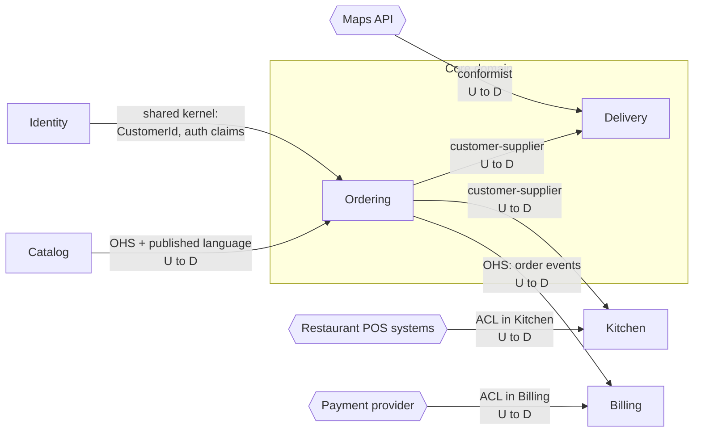

**Reading the diagram.** Every arrow points from an upstream context to a downstream one and is labelled with the relationship pattern; this is a model of influence and translation, not of request direction. Catalog exposes an **open host service** with a published menu schema that Ordering consumes. Ordering is a **supplier** to Delivery and Kitchen, which consume its order events asynchronously and can negotiate what those events carry. Billing receives order events through Ordering's open host service and protects itself from the external payment provider's model with an **anticorruption layer**; Kitchen does the same for dozens of different restaurant point-of-sale systems. Delivery is **conformist** toward the maps provider: its geometry types are acceptable, and translating them would buy nothing. Identity and Ordering share a tiny **kernel** (identifier types and token claims). Each box is a storage and ownership boundary. Failure points: Kitchen's ACL is where malformed POS data must be stopped; if the maps provider changes its model, Delivery changes too, which is the accepted price of conformity. Scaling: each context scales independently; the core domain (Ordering, Delivery) gets the most modelling investment.

### 34.5.3 The anticorruption layer in code

::: definition
**Definition — Anticorruption layer (ACL).** A layer owned by a downstream context that translates between an upstream system's model and its own, in both directions if needed, so that the upstream's concepts, codes and quirks never appear in the downstream model. It usually combines a facade, adapters and translators [Evans 2003].
:::

QuickBite's Billing context receives payment-provider responses. The provider's world has statuses such as `AUTHORISED`, `CAPTURED`, `REFUSED` and `PENDING_3DS`, numeric refusal codes, amounts as strings in minor units, and lower-case currency codes. None of that should leak into Billing's model, which knows three outcomes: authorized, declined (with a business reason) and "customer must act". The ACL below is the only code that knows the provider's vocabulary.

```python
from dataclasses import dataclass
from decimal import Decimal
from enum import Enum


# ---- Billing context: the model we want to protect ------------------------
@dataclass(frozen=True)
class Money:                      # value object: equality by value, immutable
    amount: Decimal
    currency: str

    def __post_init__(self):
        if self.amount < 0 or len(self.currency) != 3:
            raise ValueError(f"invalid money {self.amount} {self.currency}")


class DeclineReason(Enum):
    INSUFFICIENT_FUNDS = "insufficient_funds"
    CARD_EXPIRED = "card_expired"
    SUSPECTED_FRAUD = "suspected_fraud"
    OTHER = "other"


@dataclass(frozen=True)
class PaymentAuthorized:
    order_id: str
    amount: Money
    provider_ref: str


@dataclass(frozen=True)
class PaymentDeclined:
    order_id: str
    reason: DeclineReason


@dataclass(frozen=True)
class PaymentNeedsCustomerAction:  # e.g. a 3-D Secure challenge
    order_id: str
    redirect_url: str


# ---- Anticorruption layer: the only code that knows the provider's model --
MINOR_UNITS = {"USD": 2, "EUR": 2, "JPY": 0}
DECLINE_CODES = {"51": DeclineReason.INSUFFICIENT_FUNDS,
                 "54": DeclineReason.CARD_EXPIRED,
                 "59": DeclineReason.SUSPECTED_FRAUD}


class ProviderTranslationError(Exception):
    pass


def translate(raw: dict):
    """Map one provider response (their language) to one domain outcome."""
    order_id = raw.get("merchant_reference")
    if not order_id:
        raise ProviderTranslationError("missing merchant_reference")
    status = raw.get("status", "").upper()
    if status in ("AUTHORISED", "CAPTURED"):          # two words, one meaning
        cur = raw["currency"].upper()
        if cur not in MINOR_UNITS:
            raise ProviderTranslationError(f"unsupported currency {cur}")
        amount = Decimal(int(raw["amount_minor"])).scaleb(-MINOR_UNITS[cur])
        return PaymentAuthorized(order_id, Money(amount, cur), raw["psp_ref"])
    if status == "REFUSED":
        reason = DECLINE_CODES.get(str(raw.get("refusal_code")), DeclineReason.OTHER)
        return PaymentDeclined(order_id, reason)
    if status == "PENDING_3DS":
        return PaymentNeedsCustomerAction(order_id, raw["action"]["url"])
    raise ProviderTranslationError(f"unknown provider status {status!r}")


# ---- Tests ------------------------------------------------------------------
if __name__ == "__main__":
    ok = translate({"merchant_reference": "ord-17", "status": "Authorised",
                    "amount_minor": "2450", "currency": "usd", "psp_ref": "PSP9"})
    assert ok == PaymentAuthorized("ord-17", Money(Decimal("24.50"), "USD"), "PSP9")

    yen = translate({"merchant_reference": "ord-18", "status": "CAPTURED",
                     "amount_minor": "1500", "currency": "JPY", "psp_ref": "PSP10"})
    assert yen.amount == Money(Decimal("1500"), "JPY")

    assert translate({"merchant_reference": "ord-19", "status": "REFUSED",
                      "refusal_code": 51}).reason is DeclineReason.INSUFFICIENT_FUNDS
    assert translate({"merchant_reference": "ord-20", "status": "REFUSED",
                      "refusal_code": "99"}).reason is DeclineReason.OTHER

    action = translate({"merchant_reference": "ord-21", "status": "PENDING_3DS",
                        "action": {"url": "https://psp.example/3ds/abc"}})
    assert isinstance(action, PaymentNeedsCustomerAction)

    for bad in ({"status": "AUTHORISED"},
                {"merchant_reference": "ord-22", "status": "PARTIALLY_AUTHORISED"}):
        try:
            translate(bad)
            raise AssertionError("expected ProviderTranslationError")
        except ProviderTranslationError as e:
            print("rejected:", e)
    print("all ACL tests passed")
```

Running it with `python3` prints:

```text
rejected: missing merchant_reference
rejected: unknown provider status 'PARTIALLY_AUTHORISED'
all ACL tests passed
```

What to notice:

- **Two upstream words, one domain meaning.** `AUTHORISED` and `CAPTURED` both become `PaymentAuthorized`; Billing never learns the provider's British spelling or its capture lifecycle.
- **Units are translated at the edge.** Minor units become a `Decimal` with the currency's exponent (two digits for USD, zero for JPY), so a yen amount is not silently divided by 100.
- **Unknown codes are mapped deliberately.** An unknown refusal code becomes `OTHER` (safe: the order is still declined), but an unknown *status* raises an error, because guessing whether money moved is never safe. The error should go to a dead-letter queue and an alert (§30.11), not be swallowed.
- **The layer is easy to test in isolation.** When the provider adds a field or a status, one file and its tests change; the Billing model does not.

### 34.5.4 Event storming

::: definition
**Definition — Event storming.** A collaborative workshop technique, created by Alberto Brandolini, in which domain experts and developers model a business process by placing domain events (orange sticky notes, past tense) on a long timeline, then adding the commands that cause them, the actors who issue commands, policies ("whenever X, then Y"), external systems, read models and hotspots (open questions), and finally grouping the result into aggregates and candidate bounded contexts [Brandolini: Introducing EventStorming].
:::

#### How it works internally

1. **Chaotic exploration.** Everyone writes the domain events they know, in the past tense, and sticks them on the wall roughly in time order. No discussion of correctness yet.
2. **Enforce the timeline.** The group sorts events into one consistent timeline, removes duplicates and marks disagreements as **hotspots** (pink notes). Disagreements are the most valuable output: they show where people use the same word differently.
3. **Add commands, actors and policies.** For each event, ask what caused it: a command issued by an actor, a reaction by a policy to an earlier event, or an external system.
4. **Find aggregates.** Group commands and events around the thing that must decide whether the command is allowed: that thing is an aggregate.
5. **Draw boundaries.** Where the language changes, or where a group of events is owned by a different department, draw a line. These lines are candidate bounded contexts.

**Figure 34.4 — Event-storming output for QuickBite's order flow (simplified).**

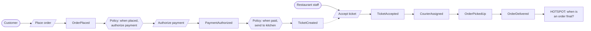

**Reading the diagram.** This is a modelling artifact, not a runtime diagram, so the arrows show causality, not network calls; the book's shapes are reused loosely: stadiums are actors, parallelograms are commands, rectangles are domain events and hexagons are policies. Reading left to right: a customer issues *Place order*, which produces `OrderPlaced`; a policy reacts by issuing *Authorize payment*; and so on. The dotted arrow marks a human waiting step (staff see the ticket and decide), which is where latency and timeouts will appear in the system. The vocabulary shifts at three points: payment terms appear around `PaymentAuthorized` (Billing), "ticket" replaces "order" around the kitchen (Kitchen), and "courier" and "pickup" appear later (Delivery). Those shifts are the candidate bounded-context boundaries of Figure 34.3. The final hotspot shows a genuine disagreement (support says delivery, finance says 14 days later), which becomes a design decision instead of a production bug.

::: industry
**Event storming in practice.** Brandolini developed event storming as a lightweight alternative to long requirements workshops, and it has become a common way for teams adopting DDD and microservices to discover bounded contexts; Newman and Vernon both discuss it as a discovery technique [Brandolini: Introducing EventStorming; Newman 2021]. A typical "big picture" session runs for a few hours to a day with a long paper roll and a mix of domain experts and engineers. Its main output is shared understanding plus a list of hotspots, not a finished design.
*Evidence: Secondary* — [Brandolini: Introducing EventStorming; Newman 2021]
:::

#### Failure scenarios

| What goes wrong | Why | Detection | Recovery | Prevention |
|---|---|---|---|---|
| Upstream model leaks downstream | Conformist by accident; no ACL | Upstream field names and codes appear in downstream domain classes | Introduce an ACL; migrate callers behind it | Decide each relationship on the context map explicitly |
| Shared kernel keeps growing | Convenient place to put common code | Kernel changes in most releases of both teams | Shrink the kernel; move code into owners | Kernel limited to identifiers and stable value types |
| ACL silently mistranslates | Unknown codes mapped to a default | Business metrics drift (e.g. payments "declined: other" spike) | Fix mapping; replay dead-lettered messages | Fail loudly on unknown statuses; alert on default-mapped codes |
| Contexts drawn around data, not language | "Customer service" owning a customer table for everyone | Every context calls it for every request | Re-cut by capability; replicate needed fields via events | Event storming before drawing boundaries |

## 34.6 API gateways and backends for frontends

### 34.6.1 The API gateway

::: definition
**Definition — API gateway.** A reverse proxy (§7.12) that is the single entry point for external clients into a set of services. It routes each request to the right service and applies cross-cutting **edge concerns** once: TLS termination, authentication, coarse authorization, rate limiting and quotas, request validation, response caching, protocol translation and, sometimes, aggregation of several service calls into one response [Richardson 2018].
:::

#### First-principles explanation

A large hotel has one front desk. Guests do not wander the corridors looking for housekeeping, the restaurant and the concierge; they ask the desk, which checks who they are, knows where everything is and forwards the request. The desk also enforces house rules (no visitors after midnight) in one place instead of on every floor. Without it, every department would need its own security guard.

#### Why does this exist?

Without a gateway, a mobile app would need to know the address of every service, every service would need to validate tokens and enforce rate limits itself (in every language the company uses), and every internal refactoring (splitting a service in two) would break published clients. The gateway decouples the **external API**, which must be stable for years because old app versions never die (§8.4.3), from the **internal topology**, which should be free to change weekly.

#### How it works internally

1. **Terminate TLS** and parse the HTTP request.
2. **Authenticate**: validate the access token (for example a JWT's signature and expiry, §8.13) or exchange an opaque token with the identity service, and attach a verified identity header for downstream services.
3. **Apply policies**: rate limits per API key or user (Chapter 22), request size limits, schema validation, IP allow lists.
4. **Route**: match host, path, method and headers to a route; resolve the target service through service discovery (§34.7); pick an instance (§19.10).
5. **Optionally aggregate**: call several services and merge the results (or leave this to a BFF, §34.6.2).
6. **Observe**: start or continue a trace (§34.9), emit access logs and metrics, and add a request ID.

Products include Kong, Envoy-based gateways, NGINX, Apigee, AWS API Gateway and the Kubernetes Gateway API implementations (§42.10). The gateway itself should hold no business state; it scales horizontally behind an L4 load balancer and is often deployed per region.

::: warning
**Warning — The gateway is not a place for business logic.** Every team needs to change routes and policies, so a gateway that accumulates business rules becomes a shared monolith that every release passes through, owned by one overloaded platform team. Keep business logic in services; keep the gateway configuration declarative and owned per route by the team behind it. Lewis and Fowler's phrase for the principle is "smart endpoints and dumb pipes" [Lewis and Fowler 2014].
:::

### 34.6.2 Backends for frontends (BFF)

::: definition
**Definition — Backend for frontend (BFF).** A server-side component dedicated to one kind of user interface (for example iOS, Android, web or a partner API), owned by or closely aligned with the team that builds that interface, which aggregates and reshapes calls to downstream services into exactly the API that interface needs [Newman 2015].
:::

#### Why does this exist?

One general-purpose API for every client serves none of them well. The mobile home screen needs 6 fields from 5 services in one round trip over a cellular network; the web dashboard needs 40 fields and can make several calls; a partner integration needs a stable, versioned, documented contract. A single gateway that tries to serve all three accumulates conditional logic for each, and every UI change needs the gateway team. A BFF per client type lets each UI team shape its own backend.

#### Origins, cited carefully

The idea has two well-documented roots. At **Netflix**, the API team redesigned its API around 2012 so that device-specific "adapter" code, written by the teams that built each device's user interface, ran on the server and called a set of general-purpose backend services; each device could then fetch exactly what its screens needed in one request [Jacobson 2012]. At **SoundCloud**, engineers built per-client backends during the company's move from a monolith to services, starting around 2013; Lukasz Plotnicki described the approach, and Sam Newman, who interviewed SoundCloud engineers, named and popularized it as the "Backends For Frontends" pattern in 2015 [Plotnicki 2015; Newman 2015]. Phil Calçado, then at SoundCloud, is widely credited with the name; see the open verification items.

**Figure 34.5 — Edge gateway with one BFF per client type.**

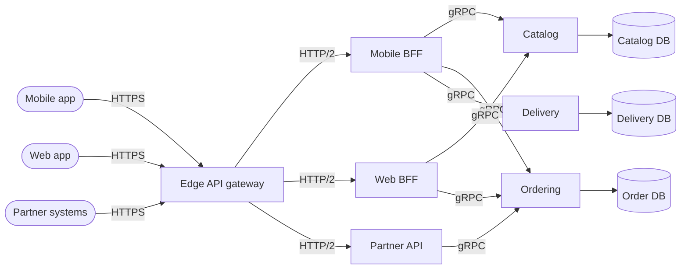

**Reading the diagram.** All three client types reach one edge gateway over HTTPS; the gateway terminates TLS, authenticates and rate-limits, then routes by host or path prefix to a BFF over HTTP/2 inside the network. Each BFF calls domain services synchronously over gRPC and merges their responses into a client-shaped payload; the Mobile BFF, for example, builds the home screen from catalog, ordering and delivery in one client round trip. Each domain service owns its database; BFFs own no business data (at most a cache), so they scale horizontally. Failure points: a BFF fans out to several services, so its availability and tail latency are bounded by its dependencies (§34.8.3); it needs timeouts, partial responses and fallbacks (Chapter 22). Scaling: the gateway scales with total traffic, each BFF with its client's traffic.

#### Mathematical foundations: why aggregation near the services pays off

::: formula
**Latency of sequential and parallel call sequences**

$$L_{\text{seq}} = \sum_{i=1}^{n} \left(R_i + s_i\right) \qquad L_{\text{par}} = \max_{i} \left(R_i + s_i\right)$$

| Symbol | Meaning | Units |
|---|---|---|
| $n$ | Number of calls needed to build one response | calls |
| $R_i$ | Network round-trip time of call $i$ (including connection reuse) | ms |
| $s_i$ | Server processing time of call $i$ | ms |
| $L_{\text{seq}}$ | Total latency when each call waits for the previous one | ms |
| $L_{\text{par}}$ | Total latency when independent calls run concurrently | ms |
:::

::: example
**Worked example — The QuickBite home screen over a mobile network.** The home screen needs 8 calls (profile, address, nearby restaurants, promotions, active order, courier position, recommendations, unread messages). Each call takes $s = 20$ ms in its service. The phone's round trip to the gateway is $R_{\text{mobile}} = 100$ ms; inside the datacenter a call costs $R_{\text{dc}} = 1$ ms.

1. Phone calls each service in sequence: $L = 8 \times (100 + 20) = 960$ ms.
2. Phone fires all 8 in parallel: $L \approx 100 + 20 = 120$ ms in theory, but mobile radios, HTTP/2 stream limits and dependent calls (recommendations need the address) push this up, and battery cost rises; in practice apps get two or three dependency "waves", about $3 \times 120 = 360$ ms.
3. BFF, one phone round trip, BFF calls the 8 services sequentially: $L = 100 + 8 \times (1 + 20) = 100 + 168 = 268$ ms.
4. BFF calls in three dependency waves of parallel calls: $L = 100 + 3 \times (1 + 20) = 163$ ms.

**Interpretation.** Moving aggregation from the phone to a BFF one network hop from the services saves about 0.8 s against the naive design and 0.2 s against the best realistic client design, because expensive round trips are paid once and cheap ones are paid many times. **Engineering implication.** Put aggregation where round trips are cheapest, and inside the BFF run independent calls in parallel. But parallel fan-out is exposed to the slowest dependency (§34.8.3), so give every call a deadline and return partial results when non-essential calls (recommendations, promotions) are late.
:::

::: industry
**Netflix Zuul.** Netflix built Zuul as the edge gateway in front of its streaming API, handling routing, authentication, traffic shaping and resilience at the edge, and rewrote it in 2016 as Zuul 2 on an asynchronous, non-blocking Netty core to handle large numbers of persistent connections [Netflix Technology Blog 2016]. The device-specific adapters of the 2012 API redesign sat behind it.
*Evidence: Primary* — [Netflix Technology Blog 2016; Jacobson 2012]
:::

#### Alternatives and trade-offs

**Table 34.3 — Gateway, BFF and GraphQL compared.**

| | Single API gateway | Gateway + BFF per client | GraphQL federation (§8.7) |
|---|---|---|---|
| What it is | One edge proxy, one public API | Thin edge plus a backend per client type | One graph schema composed from service subgraphs |
| Advantages | Simple; one place for policy | Each UI team shapes its API; fewer round trips | Clients choose fields; one endpoint |
| Disadvantages | Becomes a bottleneck of conditional logic | Duplication across BFFs; more deployables | Query cost control; caching is harder; resolver fan-out |
| Choose when | Few client types, similar needs | Several client types with different needs and teams | Many clients with varied, evolving data needs |

The main risk of BFFs is **duplication**: the same "is this restaurant open?" logic implemented in three BFFs, slowly diverging. The fix is to push domain logic down into the owning service and keep BFFs to aggregation and presentation.

## 34.7 Service discovery

### 34.7.1 The problem

In a monolith, a function call needs no address. In a microservice system, the Ordering service must find a healthy instance of Payment, and that set changes constantly: autoscaling adds instances, deploys replace them, nodes fail, and in containers each instance gets a new IP address every time it starts. Hard-coded addresses or hand-edited configuration files cannot keep up.

::: definition
**Definition — Service discovery.** The mechanism by which a client finds the current network locations of healthy instances of a service. It has two parts: a **service registry**, a database of service instances and their locations and health; and a **lookup** path, by which a client (client-side discovery) or a router (server-side discovery) queries the registry [Richardson 2018].
:::

#### First-principles explanation

A phone directory works if people rarely move. A hospital switchboard is different: doctors move between wards all day, so each one checks in at the switchboard when arriving at a ward and checks out when leaving, and the operator connects callers to wherever the doctor is now. If a doctor forgets to check out, callers are put through to an empty room until someone notices. Service discovery is the switchboard; registration is checking in; health checks are how the operator notices the empty room.

### 34.7.2 Registration and health

Instances get into the registry in one of two ways:

1. **Self-registration.** The instance registers itself on start-up and sends periodic heartbeats; it deregisters on graceful shutdown. If heartbeats stop, the registry expires the entry after a lease. Netflix Eureka works this way [Netflix Eureka Docs].
2. **Third-party registration.** A platform component observes instances and registers them: the Kubernetes control plane maintains **EndpointSlices** for each Service from the pods matching its selector, and includes only pods whose **readiness probe** is passing [Kubernetes Docs: Services; Kubernetes Docs: Probes]. Consul agents running on each node register local services and run their health checks [HashiCorp Consul Docs].

Health integration is what makes a registry useful. A registry listing dead instances is worse than none, because it directs traffic to them confidently. Distinguish (§19.5): **liveness** (should the process be restarted?), **readiness** (should it receive traffic now?) and **passive** health, in which clients or proxies eject an instance after observing consecutive errors (Envoy calls this outlier detection).

### 34.7.3 Client-side versus server-side discovery

**Figure 34.6 — Client-side and server-side service discovery.**

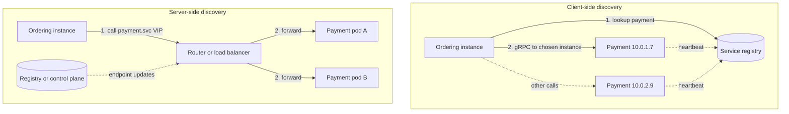

**Reading the diagram.** In client-side discovery (top), the Ordering instance queries the registry (a replicated store, the storage boundary), caches the instance list and chooses an instance itself with a client-side balancing policy (§19.10), then calls it directly over gRPC; instances keep their registration alive with asynchronous heartbeats (dotted). In server-side discovery (bottom), Ordering calls one stable name or virtual IP; a router (an L4 or L7 load balancer, `kube-proxy` rules or a sidecar proxy) looks up endpoints pushed to it asynchronously by the registry or control plane and forwards the request. Failure points: in both designs a stale entry sends traffic to a dead instance until the entry expires or the caller ejects it; in the server-side design the router is an extra hop and must itself be redundant. Scaling: the registry is read-heavy and serves cached lookups, so it scales with replicas; clients should keep working with their last-known list if the registry is unreachable.

**Table 34.4 — Client-side versus server-side discovery.**

| | Client-side | Server-side |
|---|---|---|
| How it works | Client queries registry, balances itself | Client calls a stable name; a router resolves and balances |
| Advantages | No extra hop; per-request balancing; rich policies | Clients stay simple and language-agnostic |
| Disadvantages | Discovery logic in every language's client library | Extra hop or proxy; router must be highly available |
| Examples | Eureka with a client library; gRPC name resolvers; Consul API lookups | Kubernetes Services and DNS; AWS load balancers; mesh sidecars |
| Choose when | One or two languages, latency-sensitive internal RPC | Polyglot fleet, platform-managed infrastructure |

A service mesh (§34.10) blurs the line: the sidecar proxy does client-side balancing on the caller's behalf, so the application sees server-side simplicity while traffic still goes directly from caller to instance.

### 34.7.4 Registries: Consul, Eureka and Kubernetes DNS

- **Consul** (HashiCorp) keeps its catalog in a set of server nodes replicated with Raft (§26.7), so catalog writes are strongly consistent; agents on each node run health checks and use gossip for membership. Clients query through an HTTP API or a DNS interface (names such as `payment.service.consul`), and only instances passing their checks are returned [HashiCorp Consul Docs].
- **Eureka** (Netflix OSS) deliberately favors availability: its servers replicate registrations to each other asynchronously, clients cache the full registry and keep using it if Eureka is unreachable, and in **self-preservation mode** Eureka stops expiring instances when heartbeats drop suddenly, on the theory that a network problem is more likely than mass death. It is an AP design in the CAP sense (§25.8): better to return possibly stale instances than none [Netflix Eureka Docs].
- **Kubernetes DNS.** Each Service gets a DNS name `<service>.<namespace>.svc.cluster.local`, served by CoreDNS from the API server's state. A normal Service resolves to one stable virtual IP, and `kube-proxy` rules on each node spread connections across ready pods; a **headless** Service (no cluster IP) resolves to the pod IPs themselves, which suits client-side balancing such as gRPC's [Kubernetes Docs: DNS for Services and Pods].

::: warning
**Warning — DNS caching defeats fast discovery.** Plain DNS discovery is only as fresh as the TTL, and some clients cache longer than the TTL (older JVM configurations cached forever by default when a security manager was installed). Long-lived connections are worse: a gRPC client that resolved a headless Service once keeps its connections to the old pods until they close. Use short TTLs, connection maximum ages, or a discovery API that pushes updates.
:::

#### Mathematical foundations: how long does a dead instance keep receiving traffic?

::: formula
**Stale-endpoint window and failed requests**

$$T_{\text{stale}} \le k \cdot h + t_{\text{prop}} + t_{\text{cache}} \qquad F \approx \frac{\lambda}{m} \cdot T_{\text{stale}} \cdot (1 - q)$$

| Symbol | Meaning | Units |
|---|---|---|
| $h$ | Heartbeat or health-check interval | s |
| $k$ | Consecutive missed checks before the instance is removed | count |
| $t_{\text{prop}}$ | Time for the registry change to reach clients or routers | s |
| $t_{\text{cache}}$ | Maximum additional client cache age | s |
| $T_{\text{stale}}$ | Worst-case time a dead instance stays in some client's list | s |
| $\lambda$ | Total request rate to the service | requests/s |
| $m$ | Number of instances (traffic share of the dead one is $1/m$) | count |
| $q$ | Fraction of failed calls rescued by a retry on another instance or by passive ejection | dimensionless |
| $F$ | Requests that fail during the window | requests |
:::

::: example
**Worked example — A Payment instance dies abruptly.** Payment receives $\lambda = 2{,}000$ requests/s spread over $m = 20$ instances. Option A: self-registration with $h = 10$ s, $k = 3$, propagation 2 s and client caches refreshed every 30 s. Option B: Kubernetes with readiness `periodSeconds: 10`, `failureThreshold: 3` (the defaults), endpoint propagation about 2 s, no extra client cache, plus passive outlier detection in the caller's proxy.

1. Option A window: $T = 3 \times 10 + 2 + 30 = 62$ s.
2. Traffic to the dead instance: $2{,}000 / 20 = 100$ requests/s; without retries ($q = 0$): $F = 100 \times 62 = 6{,}200$ failed requests.
3. Option B readiness window: $T = 3 \times 10 + 2 = 32$ s; $F = 3{,}200$ without retries. (For an abrupt crash, Kubernetes also notices the pod or node failure, often faster than the probe path.)
4. Add passive ejection after 5 consecutive errors per caller, and one retry on another instance for idempotent calls: most failed calls are retried successfully ($q \approx 0.99$), and each of, say, 50 caller instances ejects the dead endpoint after about 5 errors. Failed requests fall to roughly $6{,}200 \times 0.01 \approx 62$ in option A.

**Interpretation.** The registry alone leaves tens of seconds of failures because detection is periodic and clients cache. **Engineering implication.** Do not rely on the registry for fast failure handling. Combine it with passive ejection and bounded retries of idempotent calls (§22.12, §22.15), and shorten detection only as far as false positives allow: a 1 s check with $k = 1$ would eject healthy instances during every garbage-collection pause.
:::

::: industry
**Eureka at Netflix.** Netflix built Eureka for its AWS deployment, where instance IPs changed constantly and the AWS load balancers of the time were unsuited to mid-tier service-to-service traffic. The design choice to favor availability over consistency, with client-side caching and self-preservation, reflected the view that during a network problem a possibly stale list is better than no list [Netflix Eureka Docs].
*Evidence: Primary* — [Netflix Eureka Docs]
:::

#### Failure scenarios

| What goes wrong | Why | Detection | Recovery | Prevention |
|---|---|---|---|---|
| Traffic to dead instances | Stale registry or client caches | Connection errors to specific IPs | Passive ejection; retry elsewhere | Short leases; push-based updates; outlier detection |
| Registry outage | Registry cluster loses quorum or is overloaded | Lookup errors; registration failures | Clients use cached lists | Replicated registry; clients must tolerate registry absence |
| Mass self-deregistration | Health check depends on a shared downstream (database) that is down | All instances unhealthy at once; zero endpoints | Fail open: keep last endpoints when all are unhealthy | Readiness checks test the instance, not its dependencies (§19.5.2) |
| New instance gets traffic before warm-up | Registered before ready | Error spike after each deploy | Readiness gates | Register only after readiness; slow-start weighting |

## 34.8 Inter-service communication

### 34.8.1 Synchronous versus asynchronous

Every interaction between services is either a request that waits for an answer or a message that does not. Chapter 30 treats the mechanics; here the question is which to choose for a given pair of services.

::: definition
**Definition — Synchronous and asynchronous inter-service communication.** In **synchronous** communication the caller sends a request (REST over HTTP, gRPC) and blocks, or at least cannot complete its own work, until it receives a response; caller and callee must both be available at the same time. In **asynchronous** communication the sender publishes a message (an event or command) to a broker or log and continues; the receiver processes it later, so the two need not be available simultaneously (§30.3).
:::

**Figure 34.7 — Placing an order: synchronous chain versus event-driven flow.**

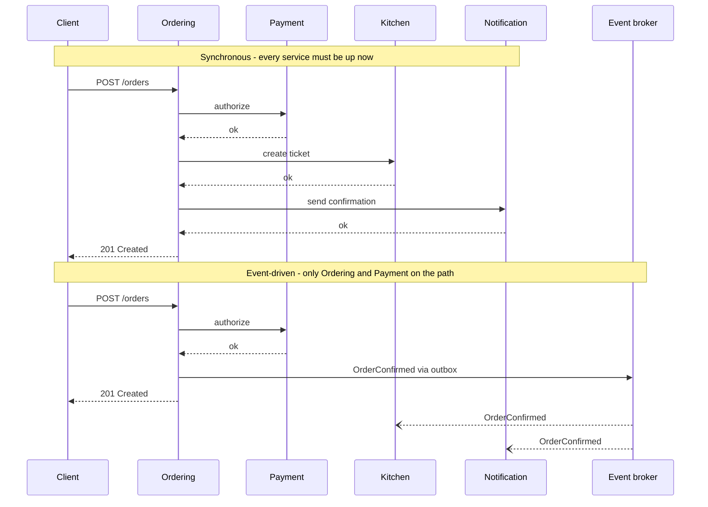

**Reading the diagram.** In the first half, Ordering calls Payment, Kitchen and Notification synchronously in sequence; the client's response waits for all three, so latencies add and the request fails if any of the four services is down or slow. In the second half, Ordering keeps only the payment authorization on the synchronous path (the customer genuinely needs to know whether the card worked), commits the order and an outbox row in one local transaction (§32.5), and returns. A relay publishes `OrderConfirmed` to the broker, the durable storage boundary between services, and Kitchen and Notification consume it asynchronously (open arrowheads) at their own pace; if Notification is down for ten minutes, confirmations are late but orders still succeed. The cost is eventual consistency: for a moment the order exists but the kitchen has not seen it, and failures after the response must be handled by retries, dead-letter queues and, where business steps can fail, sagas (§32.7). Scaling: the broker absorbs bursts, so Kitchen and Notification scale on their own backlog.

**Table 34.5 — Choosing a communication style.**

| | Synchronous (REST, gRPC) | Asynchronous (events, commands via broker) |
|---|---|---|
| Use for | Queries; commands whose result the caller needs now | Propagating facts; work the caller need not wait for |
| Advantages | Simple mental model; immediate errors | Temporal decoupling; load leveling; easy fan-out to new consumers |
| Disadvantages | Availability and latency compound along chains | Eventual consistency; harder debugging; ordering and duplicates |
| Failure handling | Timeouts, retries, circuit breakers (Chapter 22) | Retries, idempotent consumers, dead-letter queues (§30.10–30.11, §32.10) |
| Typical protocols | HTTP/JSON at the edge; gRPC/Protobuf internally | Kafka, RabbitMQ, SQS/SNS, Pub/Sub (Chapters 30–31) |

REST over HTTP/JSON is the common choice at the edge and for public APIs, where readability and tooling matter. **gRPC** over HTTP/2 with Protocol Buffers (§8.8) is common between internal services: binary encoding, generated client stubs in many languages, streaming, and deadline propagation built in. For async, the deciding factors are replay and ordering needs (a log such as Kafka) versus per-message routing and work queues (a broker such as RabbitMQ; §30.12).

::: recommendation
**Recommendation — Keep one synchronous call on the critical path where you can.** Ask of each synchronous call: does the caller need the answer *before it can respond to its own caller*? If not, publish an event. If it needs data rather than an action (a restaurant's name to show on an order), consider keeping a local, event-fed copy of that data (§34.11.3) instead of calling on every request.
:::

### 34.8.2 Chatty calls

A design that was a cheap function call in a monolith can be an expensive pattern across a network: the **N+1 call problem**. QuickBite's order-history page shows the last 50 orders. A naive Ordering service, having moved menu data to Catalog, calls Catalog once per order line to fetch item names.

::: example
**Worked example — Chatty versus batched calls inside the datacenter.** Each call to Catalog costs a round trip of $R = 0.5$ ms plus $s = 2$ ms of processing; a batched call for many items costs $R = 0.5$ ms plus $s = 5$ ms. The page shows 50 orders averaging 3 lines each: 150 lines.

1. One call per line, sequential: $L = 150 \times (0.5 + 2) = 375$ ms (formula of §34.6.2).
2. One call per line, 10 concurrent: about $\lceil 150 / 10 \rceil \times 2.5 = 15 \times 2.5 = 37.5$ ms, but now Catalog receives 150 calls per page view; at 200 page views/s that is 30,000 RPS on Catalog for this one page.
3. One batched call `GetItems(ids)`: $L = 0.5 + 5 = 5.5$ ms and 200 RPS on Catalog.
4. Local copy of item names kept current by `MenuItemChanged` events: about 0 ms of network and 0 RPS on Catalog at read time.

**Interpretation.** The batched call is 68 times faster than the naive loop and puts 150 times less load on Catalog. **Engineering implication.** Design inter-service APIs for the caller's access pattern: batch lookups, coarse-grained operations, and pagination. If a page needs dozens of calls to one service, either the API is too fine-grained or the boundary is in the wrong place.
:::

### 34.8.3 Fan-out and tail latency

A BFF or composer that calls $N$ services in parallel waits for the slowest. Section 4.8.4 derived the law: if each dependency is fast with probability $p$, all $N$ are fast with probability $p^N$.

::: example
**Worked example — The home-screen fan-out.** The Mobile BFF of §34.6 calls 6 services in parallel, each with p99 = 50 ms, and waits for all.

1. $P(\text{all six} \le 50 \text{ ms}) = 0.99^6 = 0.9415$.
2. So about $1 - 0.9415 = 5.9\%$ of home-screen requests wait longer than 50 ms for at least one dependency: the BFF's p94 is roughly the dependencies' p99.
3. At 100-way fan-out the same arithmetic gives $0.99^{100} = 0.366$, the *Tail at Scale* example of §4.8.4.

**Interpretation.** Each additional parallel dependency moves the overall tail toward the dependencies' tails. **Engineering implication.** Give each dependency call a deadline below the page budget, mark which calls are optional and render without them when late, and consider hedged requests for idempotent reads (§23.6). Fewer dependencies per request is the most effective fix.
:::

### 34.8.4 API versioning across services

Independent deployability requires that a provider can change without all its consumers changing at the same moment. The rules of §8.15 apply between services with one twist: you usually know (or can find out) every internal consumer, so you can verify compatibility before deploying.

1. **Make additive, backward-compatible changes by default.** Add optional fields; never remove or rename a field, change its type or tighten validation in place. Consumers should be **tolerant readers** that ignore unknown fields [Fowler 2011: TolerantReader]. Protobuf supports this directly: new fields get new tag numbers, removed tags are marked `reserved` so they are never reused.
2. **Use expand and contract for breaking changes.** Add the new field or endpoint (expand), migrate consumers, observe that the old one has no traffic, then remove it (contract). Each step is a separate, independently deployable release.
3. **Version explicitly only when needed.** A major version in the path (`/v2/payments`) or package (`payments.v2`) lets old and new coexist; run both until traffic to the old one stops. Each live version is code to maintain, so keep at most two.
4. **Version events too.** Event schemas outlive code: a consumer may replay last year's events. Use a schema registry with compatibility rules (for example Avro or Protobuf with backward-compatibility checks) and add an event version field (§8.9, §30.6).

### 34.8.5 Contract testing with consumer-driven contracts

#### Why does this exist?

How do you know that deploying Payment version 42 will not break Ordering? End-to-end tests that deploy every service together are slow, flaky and need every team's code in one environment, which reintroduces the coordination microservices were meant to remove. Unit tests with hand-written mocks are fast but test the consumer against the consumer's *assumptions* about the provider, which drift silently.

::: definition
**Definition — Consumer-driven contract (CDC).** A specification of the requests a consumer sends to a provider and the parts of the responses it relies on, written by the consumer (usually generated by the consumer's tests). The provider runs every consumer's contract against its real implementation in its own build, so a provider change that breaks any consumer fails the provider's pipeline before deployment [Robinson 2006; Pact Docs].
:::

#### How it works internally

1. **Consumer test.** Ordering's tests describe each interaction ("given payment p-1 is authorized, `GET /payments/p-1` returns 200 with a `status` string and an integer `amount.minor`") and run Ordering's real client code against a mock provider generated from that description. The run produces a **contract** (a *pact* file in Pact's terminology).
2. **Publish.** The contract is published to a **broker** tagged with the consumer's version and branch or environment.
3. **Provider verification.** Payment's CI fetches every contract in which Payment is the provider, sets up each **provider state** ("payment p-1 is authorized") and replays each request against the real Payment service, checking that the response satisfies the contract. Matching is by *shape* where the consumer said so: any string for `status`, not the literal example.
4. **Deployment gate.** Before deploying either side to an environment, the pipeline asks the broker whether this version is verified against the versions currently deployed there (Pact's `can-i-deploy` command) [Pact Docs].

**Figure 34.8 — Consumer-driven contract testing workflow.**

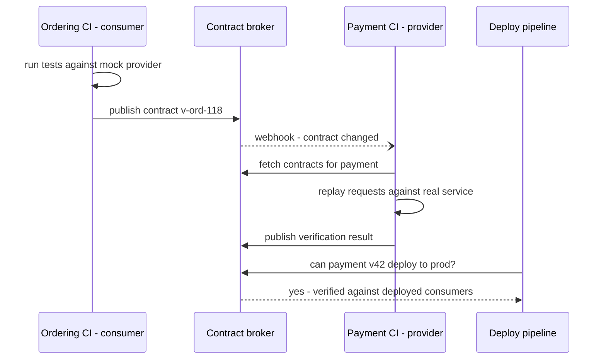

**Reading the diagram.** The consumer's CI generates and publishes the contract (synchronous calls to the broker); the broker notifies the provider's CI asynchronously with a webhook; the provider's CI verifies the contract against the real service with its own test data and publishes the result. The broker is the storage boundary: it records which consumer versions are verified against which provider versions and which versions are deployed where. The deploy pipeline queries that matrix before each deployment. Failure points: a contract that over-specifies (exact values instead of types) fails on harmless changes, and a contract that under-specifies misses real breakage; the broker itself becomes a release dependency and needs to be available. Scaling: verification cost grows with the number of consumer–provider pairs, not the number of services squared, because only real interactions are tested.

#### Code example

The program below builds a tiny CDC framework in about 60 lines to show the mechanism (Pact provides the same ideas with many more matchers, HTTP mock servers, message contracts and a broker). The consumer's test produces a contract; the provider verifies it. Version 1 of the provider passes even though it returns extra fields; version 2 renames `status` to `state` in a "harmless refactoring" and the provider's own build fails.

```python
import json

# ---- A tiny consumer-driven contract library (the idea behind Pact) --------
def like(example):
    """Matcher: any value of the same type as the example is acceptable."""
    return {"$like": example}


def matches(expected, actual, path="body"):
    """Return a list of mismatches; extra fields in `actual` are allowed."""
    if isinstance(expected, dict) and "$like" in expected:
        ex = expected["$like"]
        return [] if type(actual) is type(ex) else [f"{path}: expected {type(ex).__name__}, got {actual!r}"]
    if isinstance(expected, dict):
        if not isinstance(actual, dict):
            return [f"{path}: expected object"]
        errs = []
        for key, sub in expected.items():
            if key not in actual:
                errs.append(f"{path}.{key}: missing")
            else:
                errs += matches(sub, actual[key], f"{path}.{key}")
        return errs
    return [] if expected == actual else [f"{path}: expected {expected!r}, got {actual!r}"]


def example_of(expected):
    """Turn matchers back into a concrete example response for the mock."""
    if isinstance(expected, dict) and "$like" in expected:
        return expected["$like"]
    if isinstance(expected, dict):
        return {k: example_of(v) for k, v in expected.items()}
    return expected


class Contract:
    def __init__(self, consumer, provider):
        self.doc = {"consumer": consumer, "provider": provider, "interactions": []}

    def given(self, state, request, response):
        self.doc["interactions"].append(
            {"state": state, "request": request, "response": response})

    def mock_provider(self, request):
        for i in self.doc["interactions"]:
            if i["request"] == request:
                r = i["response"]
                return r["status"], example_of(r["body"])
        raise AssertionError(f"unexpected request {request}")


def verify(contract_json, provider_handler, set_state):
    """Provider side: replay every interaction against the real handler."""
    failures = []
    for i in json.loads(contract_json)["interactions"]:
        set_state(i["state"])
        status, body = provider_handler(i["request"])
        if status != i["response"]["status"]:
            failures.append(f"[{i['state']}] status {status} != {i['response']['status']}")
        failures += [f"[{i['state']}] {m}" for m in matches(i["response"]["body"], body)]
    return failures


# ---- Consumer side (Ordering service) ---------------------------------------
def fetch_payment_status(http_get, payment_id):     # the consumer's real code
    status, body = http_get({"method": "GET", "path": f"/payments/{payment_id}"})
    if status == 404:
        return None
    return body["status"], body["amount"]["minor"]


contract = Contract("order-service", "payment-service")
contract.given("payment p-1 is authorized",
               {"method": "GET", "path": "/payments/p-1"},
               {"status": 200, "body": {"id": "p-1", "status": like("AUTHORIZED"),
                                        "amount": {"minor": like(2450),
                                                   "currency": like("USD")}}})
contract.given("payment p-404 does not exist",
               {"method": "GET", "path": "/payments/p-404"},
               {"status": 404, "body": {}})

# Consumer test runs against the mock built from the contract, then publishes it.
assert fetch_payment_status(contract.mock_provider, "p-1") == ("AUTHORIZED", 2450)
assert fetch_payment_status(contract.mock_provider, "p-404") is None
published = json.dumps(contract.doc)               # would go to a contract broker


# ---- Provider side (Payment service), two versions --------------------------
DB = {}

def set_state(state):
    DB.clear()
    if state == "payment p-1 is authorized":
        DB["p-1"] = {"status": "AUTHORIZED", "minor": 9900, "currency": "EUR"}

def handler_v1(req):
    pid = req["path"].rsplit("/", 1)[1]
    if pid not in DB:
        return 404, {}
    p = DB[pid]
    return 200, {"id": pid, "status": p["status"], "created_at": "2026-10-30T12:00:00Z",
                 "amount": {"minor": p["minor"], "currency": p["currency"]}}

def handler_v2(req):                     # a refactor renames status -> state
    status, body = handler_v1(req)
    if status == 200:
        body["state"] = body.pop("status")
    return status, body

print("v1 failures:", verify(published, handler_v1, set_state))
print("v2 failures:", verify(published, handler_v2, set_state))
assert verify(published, handler_v1, set_state) == []
assert verify(published, handler_v2, set_state) == [
    "[payment p-1 is authorized] body.status: missing"]
print("contract tests behave as expected")
```

Running it with `python3` prints:

```text
v1 failures: []
v2 failures: ['[payment p-1 is authorized] body.status: missing']
contract tests behave as expected
```

What to notice:

- **The consumer's real client code is exercised.** `fetch_payment_status` runs against a mock derived from the contract, so the contract cannot claim something the client does not actually use.
- **Matching by type, not value.** The provider returns 9900 EUR while the consumer's example said 2450 USD; verification passes because the consumer declared `like(...)`. Over-specified literal values are the most common cause of brittle contracts.
- **Extra fields are allowed.** `created_at` does not break the contract: the consumer is a tolerant reader. Only what the consumer relies on is checked.
- **Provider states make verification repeatable.** `set_state` seeds the provider's data for each interaction, so the provider tests its real handler without the consumer's environment.
- **The breaking change is caught in the provider's build.** The renamed field fails Payment's CI with a message naming the consumer's expectation, before anything is deployed.

::: mistake
**Common misconception — "Contract tests replace functional tests of the provider."** A contract checks the *shape* of the interaction the consumer relies on, not that the provider's business logic is right. A contract will happily pass if Payment returns `AUTHORIZED` for a card that should be declined. Keep the provider's own functional tests; use contracts to replace most cross-service end-to-end tests, not unit tests [Pact Docs].
:::

## 34.9 Distributed tracing (introduction)

In a monolith, a slow request leaves one stack trace in one log. In QuickBite, a slow "place order" request passes through the gateway, the Mobile BFF, Ordering, Payment, an external provider and the outbox relay; each writes its own logs on different machines, with different clocks. Which of them made it slow? Distributed tracing answers that question. This section introduces the concepts needed for the rest of the chapter; Chapter 40 (§40.6–§40.7) covers sampling strategies, storage, OpenTelemetry and analysis in depth.

::: definition
**Definition — Trace, span and context propagation.** A **trace** is the record of one request's path through a distributed system, identified by a globally unique **trace ID**. It is a tree of **spans**; each span records one unit of work (an inbound request, an outbound call, a database query) with its service, operation name, start time, duration, status and attributes, plus its own span ID and its **parent span ID**. **Context propagation** is the passing of the trace ID and current span ID from caller to callee with each request (in HTTP headers or message metadata), so the callee's spans join the same trace [Sigelman et al. 2010; W3C Trace Context].
:::

#### Why does this exist?

Google's Dapper paper describes the problem that motivated it: a web search touches many services written by different teams, and engineers could not tell which service caused a slow query, or even which services a query had touched. Dapper's design goals were low overhead, application-level transparency (instrumentation in shared RPC and threading libraries rather than in every application) and ubiquitous deployment; it sampled requests (the first production version used a uniform sampling probability of 1/1024) to keep overhead and storage manageable [Sigelman et al. 2010].

**Figure 34.9 — A trace of "place order" as a span tree.**

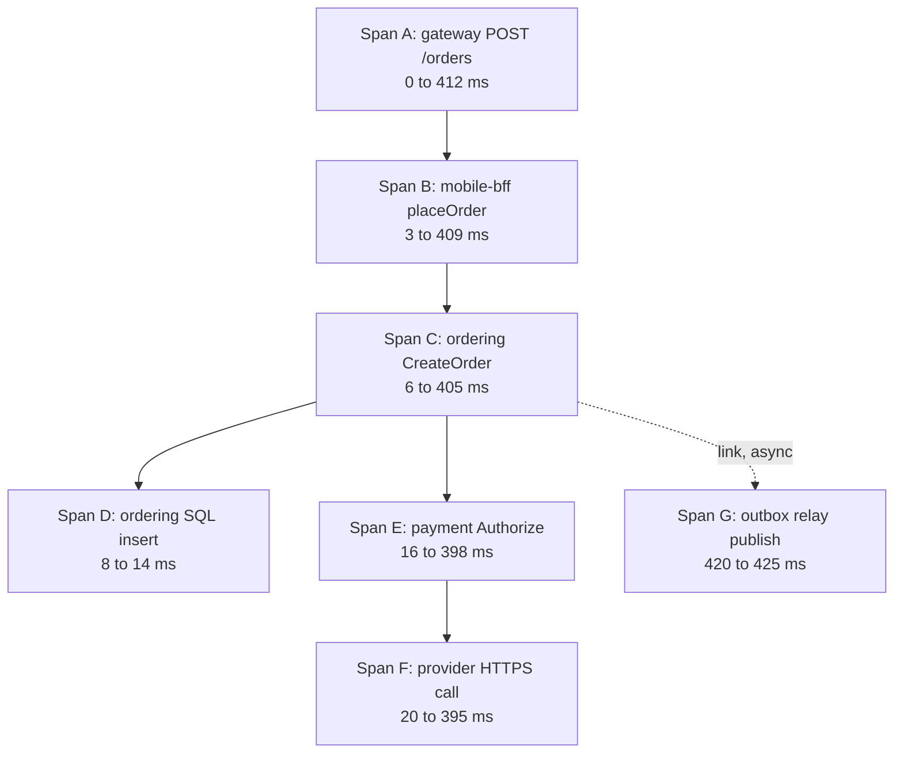

**Reading the diagram.** Each box is a span, and each solid arrow points from parent to child; all spans share one trace ID, and the times are offsets from the start of the root span. Reading the durations shows where time went: span F, the external payment provider's HTTPS call, takes 375 ms of the 412 ms total, so tuning Ordering's SQL (6 ms) would not help. Span G runs after the response was sent (it starts at 420 ms), because the event is published asynchronously by the outbox relay; it is connected by a **span link** (dotted), not as a child, since it is not part of the request's critical path. Storage boundary: each service exports spans asynchronously to a collector and trace store, never on the request path. Failure points: a service that does not propagate the context breaks the tree into separate traces. Scaling: storing every span of every request is expensive, so traces are sampled (Chapter 40).

#### How it works internally

1. The first instrumented component (often the gateway) receives a request without trace context, creates a trace ID and a root span, and makes a sampling decision.
2. On every outbound call it injects the context. The W3C Trace Context standard defines the `traceparent` header, which carries a version, the 16-byte trace ID, the 8-byte parent span ID and flags including "sampled", for example `traceparent: 00-4bf92f3577b34da6a3ce929d0e0e4736-00f067aa0ba902b7-01` [W3C Trace Context].
3. The callee extracts the context, creates a child span with the received span ID as its parent, and repeats for its own outbound calls. For messages, the context travels in message headers, and consumers usually start a new span linked to the producer's.
4. Each process exports finished spans asynchronously (batched, in the background) to a collector; a backend assembles spans by trace ID and shows the tree and timeline.

::: warning
**Warning — Propagation is only as good as the weakest hop.** A trace breaks at any service, thread pool, queue or proxy that drops the headers. Use the shared instrumentation of your framework or OpenTelemetry's libraries (§40.7) rather than hand-copying headers, and test propagation through asynchronous paths. A service mesh can emit spans for each hop but cannot by itself connect an inbound request to the outbound calls the application makes; the application must still forward the context headers [Istio Docs: Distributed Tracing].
:::

## 34.10 Service mesh

### 34.10.1 What a mesh is and why it exists

By now each inter-service call needs: discovery and load balancing (§34.7), timeouts, retries with budgets and circuit breaking (Chapter 22), mutual TLS for identity and encryption (§10.10.2), metrics and trace spans (§34.9), and traffic control for canaries (§34.12). Implementing all of that in a library is possible, and Netflix's Java libraries did exactly that, but it ties the features to one language and requires every service to upgrade the library to get a fix. A **service mesh** moves these features out of the application into infrastructure.

::: definition
**Definition — Service mesh.** A dedicated infrastructure layer that handles service-to-service communication. Its **data plane** is a set of proxies through which all service traffic passes (one per workload instance as a **sidecar**, or shared per node); its **control plane** configures those proxies, distributes certificates and collects their state. It provides traffic management, security (mutual TLS, authorization policy) and telemetry without application code changes [Istio Docs: Architecture; Linkerd Docs: Architecture].
:::

#### First-principles explanation

Think of an embassy. Diplomats (services) want to talk to other embassies; they do not personally check credentials, encrypt messages, keep logs or reroute around closed borders. Each embassy has a communications office (the sidecar) that does all of this for every message, following rules set by the foreign ministry (the control plane), which can change the rules for every office at once. The diplomat just speaks to the office down the hall.

#### How it works internally

1. **Interception.** When a pod starts, the mesh injects a proxy container and programs the pod's network rules (iptables or a CNI plugin) so that all inbound and outbound TCP traffic passes through the proxy. The application still connects to `payment:8080` in plain text; the proxy intercepts it.
2. **Outbound.** The caller's sidecar resolves the destination from the endpoints the control plane gave it, chooses an instance (§19.10), opens or reuses an mTLS connection to the destination's sidecar, applies timeouts and retry policy, and records metrics and a span.
3. **Inbound.** The callee's sidecar terminates mTLS, verifies the caller's workload identity from its certificate (for example a SPIFFE ID, §10.10.2), enforces authorization policy ("only `ordering` may call `POST /charge`") and forwards to the application on localhost.
4. **Control plane.** It watches the platform (Kubernetes services, endpoints, mesh policy resources), translates them into proxy configuration and pushes it, in Istio's case over Envoy's xDS APIs; it also acts as a certificate authority, issuing short-lived workload certificates and rotating them automatically [Istio Docs: Architecture].

**Figure 34.10 — Sidecar service mesh: data plane and control plane.**

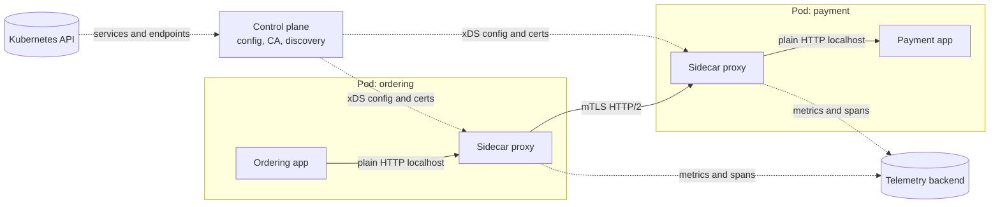

**Reading the diagram.** The Ordering application sends a plain request to localhost, where its sidecar intercepts it; the sidecar sends it over mutual TLS (HTTP/2) to the Payment pod's sidecar, which checks the caller's identity and policy and passes the request to the Payment application on localhost. Solid arrows are the synchronous request path: one logical call now crosses two proxies. Dotted arrows are asynchronous control and telemetry traffic: the control plane reads services and endpoints from the Kubernetes API (a storage boundary), and pushes configuration and certificates to every proxy; proxies export metrics and spans. Failure points: if the control plane is down, proxies keep running with their last configuration and certificates until those expire, so new deploys and certificate rotation stop but traffic continues; a misconfiguration pushed by the control plane can affect every service at once. Scaling: the data plane grows with the number of pods (one proxy each), and the control plane's push cost grows with the number of proxies times the size of their configuration, which is why meshes let you scope which services each proxy needs to know about.

### 34.10.2 Features

- **Mutual TLS everywhere** with automatic certificate issuance and rotation, plus identity-based authorization policies. This is often the main reason organizations adopt a mesh, because it delivers zero-trust service-to-service security (§10.10.2) without changing applications.
- **Traffic management.** Retries, timeouts, circuit breaking and outlier detection configured per route; **traffic shifting** by weight (send 5% of traffic to `payment` v2, §34.12), header-based routing and mirroring (sending a copy of live traffic to a new version and discarding its responses).
- **Telemetry.** Uniform golden-signal metrics (request rate, errors, latency) for every service pair, access logs and spans for each hop, regardless of language.

::: warning
**Warning — Mesh retries multiply with application retries.** If the application retries 3 times and its sidecar also retries 3 times, the destination can see 9 attempts per request, and more down a chain (§22.12.3). Decide which layer retries, usually the mesh with a retry budget, and turn off the other.
:::

### 34.10.3 Istio, Linkerd and sidecarless (ambient) mode

**Istio** uses Envoy as its sidecar proxy and `istiod` as its control plane. **Linkerd** uses its own lightweight proxy written in Rust (`linkerd2-proxy`), designed specifically as a sidecar for meshing, with an emphasis on simplicity and low resource use [Linkerd Docs: Architecture]. Both provide automatic mTLS, retries, timeouts, traffic splitting and golden metrics; Istio offers the larger feature set and more configuration surface.

The sidecar model has costs: one proxy per pod (memory and CPU multiplied by the number of pods), two proxy traversals per call, pod restarts to upgrade the proxy, and start-up ordering problems (the application starting before its sidecar is ready). This led to **sidecarless** designs. As of 2026, Istio's **ambient mode**, which became generally available in Istio 1.24 in November 2024, splits the data plane into two layers [Istio Blog 2024]:

1. **ztunnel** (zero-trust tunnel), a lightweight per-node proxy written in Rust, which provides L4 features: mTLS, workload identity, L4 authorization and TCP telemetry for all pods on its node.
2. **Waypoint proxies**, Envoy-based proxies deployed per namespace or per service only where L7 features (HTTP routing, retries, L7 authorization) are needed.

Linkerd, as of 2026, continues to use the sidecar model. Other sidecarless approaches implement parts of the data plane in the kernel with eBPF (for example Cilium's service mesh). Check current documentation before choosing, because this area changes quickly.

**Figure 34.11 — Istio ambient mode: per-node ztunnel with an optional waypoint.**

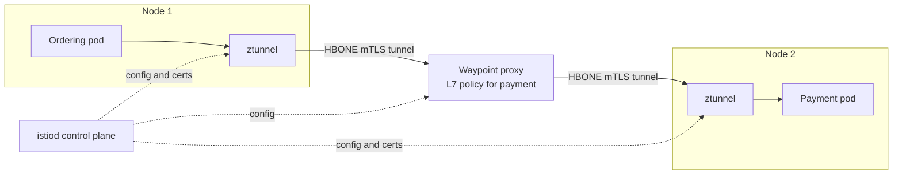

**Reading the diagram.** Application pods contain no proxy. Traffic from the Ordering pod is redirected to the ztunnel on its node, which encrypts it with mutual TLS inside an HTTP-based tunnel (HBONE) and, because the Payment service has L7 policy configured, sends it to Payment's waypoint proxy; the waypoint applies HTTP routing, retries and L7 authorization and forwards it through Node 2's ztunnel to the Payment pod. Without L7 policy the waypoint is skipped and traffic goes ztunnel to ztunnel. The control plane configures all three asynchronously (dotted). Failure points: a ztunnel failure affects every pod on its node, a larger blast radius than one sidecar; the waypoint is a shared hop that must be scaled and made redundant. Scaling: proxy count grows with nodes rather than pods, and L7 cost is paid only by services that need it.

#### Mathematical foundations: what does the mesh cost?

::: formula
**Mesh latency and resource overhead**

$$\Delta L_{\text{chain}} \approx h \cdot \delta_{\text{hop}} \qquad C_{\text{CPU}} = \frac{\Lambda \cdot x}{1{,}000} \cdot c \qquad M = P \cdot m$$

| Symbol | Meaning | Units |
|---|---|---|
| $h$ | Number of sequential service-to-service hops on the request path | hops |
| $\delta_{\text{hop}}$ | Latency added per hop by the proxies on that hop (two sidecars, or two ztunnels) | ms |
| $\Delta L_{\text{chain}}$ | Added latency along the chain (an approximation: percentiles do not add exactly) | ms |
| $\Lambda$ | Total internal service-to-service request rate | requests/s |
| $x$ | Proxies traversed per call (2 for sidecar-to-sidecar) | count |
| $c$ | Proxy CPU per 1,000 requests/s | vCPU |
| $C_{\text{CPU}}$ | Fleet-wide CPU spent in proxies | vCPU |
| $P$ | Number of proxies (pods for sidecars, nodes for ztunnels) | count |
| $m$ | Memory per proxy | MB |
| $M$ | Fleet-wide proxy memory | MB |
:::

::: example
**Worked example — Meshing QuickBite.** QuickBite runs 400 pods on 40 nodes; internal traffic is $\Lambda = 20{,}000$ requests/s; the longest synchronous path has $h = 4$ hops. Istio's published measurements (1 KB HTTP requests, specific hardware, mutual TLS on; as of 2026, check current values) report that the two sidecars on a hop add about 0.18 ms at p90 and 0.25 ms at p99; in ambient mode the two ztunnels add about 0.17 ms at p90 and 0.20 ms at p99; one sidecar with two worker threads uses about 0.20 vCPU and 60 MB per 1,000 requests/s, and a ztunnel about 0.06 vCPU and 12 MB [Istio Docs: Performance and Scalability].

1. Sidecar latency along the longest path: $\Delta L \approx 4 \times 0.25 = 1.0$ ms at p99.
2. Sidecar CPU: $C = (20{,}000 \times 2 / 1{,}000) \times 0.20 = 40 \times 0.20 = 8$ vCPU.
3. Sidecar memory: $M = 400 \times 60 = 24{,}000$ MB = 24 GB (the measured 60 MB is under load; idle sidecars use less, and memory grows with configuration size).
4. Ambient L4 only: CPU $= 40 \times 0.06 = 2.4$ vCPU; memory $= 40$ ztunnels $\times 12$ MB $= 480$ MB; latency $\approx 4 \times 0.20 = 0.8$ ms at p99. Add waypoints only for services that need L7 policy.

**Interpretation.** For a request whose budget is 300 ms, about 1 ms of added p99 is negligible; for an in-memory cache path with a 2 ms budget it is half the budget. The resource cost of sidecars, 8 vCPU and 24 GB here, is roughly two or three extra nodes. **Engineering implication.** The mesh is affordable for typical request/response services and expensive for very high-rate, low-latency internal paths; ambient mode reduces the fixed per-pod memory cost most. Measure on your own hardware and payloads before deciding; vendor numbers are best cases.
:::

#### Advantages and disadvantages

**Advantages.** Uniform mTLS and identity-based policy without code changes; consistent retries, timeouts and telemetry across languages; traffic shifting for safe releases; one place to change communication policy.

**Disadvantages.** A complex distributed system of its own to operate, upgrade and debug; latency and resource overhead; configuration errors with fleet-wide blast radius; a learning curve; and duplication with library features (retries, balancing) that must be reconciled.

::: recommendation
**Recommendation — Adopt a mesh for a specific problem.** Good reasons: you must encrypt and authenticate all service-to-service traffic, you run many languages and need uniform telemetry and traffic policy, or you need fine-grained traffic shifting. Weak reasons: "we have microservices, so we need a mesh." With ten services in one language, a well-configured RPC library is simpler.
:::

