# Chapter 35 — Object-Oriented Design

> **Level:** 1–2 · **Track:** A (Traditional) · **Estimated reading time:** 5 h

The high-level design decides which services exist and how they talk (§1.5); the low-level design decides what happens *inside* one service. Object-oriented design is the most common vocabulary for that inside view. It answers a practical question: how do you arrange thousands of lines of code so that a rule lives in one place, a change touches few files, and a mistake is caught where it happens?

This chapter builds that vocabulary from variables, functions and loops alone, using one running example: the checkout of a small online shop. You start with a product and a cart, protect the cart's rules, add kinds of products, discount rules and payment methods, untangle a hierarchy that grows out of control, write down each class's promises, and measure how well the pieces fit. Every idea is shown in Python and Java side by side; all programs were run (Python 3.13, Java 21).

## 35.1 Learning objectives

After this chapter you should be able to:

- Write classes whose constructors reject invalid state, and distinguish identity from equality.
- Protect invariants with encapsulation, avoid setter-driven designs, and apply "tell, don't ask".
- Use inheritance and overriding, and demonstrate the fragile base class problem.
- Explain dynamic dispatch, duck typing and simple generics.
- Choose between an abstract class and an interface.
- Refactor an inheritance hierarchy into composition and quantify the saving.
- Write preconditions, postconditions and invariants, and explain why a subclass may not strengthen a precondition.
- Classify coupling and cohesion, compute LCOM1, and apply the Law of Demeter.
- Recognize the anemic domain model, the god class and deep hierarchies.

## 35.2 Prerequisites

- Basic programming: variables, functions, `if`, loops, lists and dictionaries.
- High-level vs low-level design — §1.5 (this chapter is the toolbox for low-level design).

SOLID is Ch 36, design patterns Ch 37, and UML notation and full low-level design exercises Ch 38. The class diagrams here use a few Mermaid symbols, explained as they appear.

## 35.3 Classes and objects

### 35.3.1 State plus behavior

::: definition
**Definition — Object.** A value in a running program that bundles **state** (data, stored in **attributes** or **fields**) with **behavior** (functions that operate on that data, called **methods**). Each object has its own copy of the state.
:::

::: definition
**Definition — Class.** A template that describes the attributes and methods every object of a kind will have. Creating an object from a class is called **instantiation**; the object is an **instance** of the class.
:::

#### First-principles explanation

A blank paper order form is printed once; every filled-in copy is separate. A class is the blank form; an object is a filled-in copy that also carries the instructions for working with its contents: a cart object knows how to add an item and total itself.

Without objects, you keep data in a dictionary and write free-standing functions such as `cart_add(cart_dict, product, 2)`. That works until another team writes `cart_dict["items"].append(...)` directly, skipping the rules. Objects put the data and the sanctioned ways of changing it in one place.

#### Why does this exist?

Programs model things that have data and rules: a cart has lines, and quantities must be positive. When data and rules live in different files, someone eventually changes the data without the rules. Classes (Simula 67, then Smalltalk, C++, Java, Python) keep them together.

#### How it works internally

1. The class definition is loaded once and holds the method code shared by all instances.
2. Calling the class (`Product(...)`, Java `new Product(...)`) allocates memory for a new object.
3. The **constructor** (`__init__`, or Java's method named after the class) puts the object into a valid starting state, or refuses by raising an exception.
4. `obj.method(args)` runs the method with `obj` passed implicitly (`self` in Python, `this` in Java), so it works on *that* object's state.
5. When nothing refers to the object any more, the garbage collector reclaims it.

#### Architecture diagram

**Figure 35.1 — The first shop model: products in a cart.**

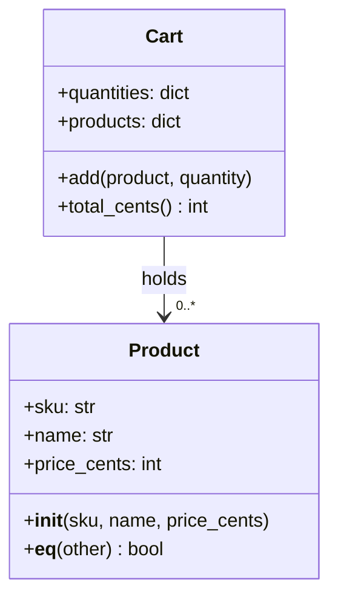

**Reading the diagram.**

- **Components.** Each box is a class: name, then attributes (state), then methods (behavior). `+` means public.
- **Direction.** `Cart` refers to zero or more (`0..*`) products; a product knows nothing about carts.
- **Sync/async and storage.** Synchronous in-process calls; objects live in memory only.
- **Failure points.** Every attribute is public, so any code can set `price_cents` to −5 after construction. The constructor protects only the moment of creation; §35.4 fixes this.
- **Scaling.** A new field is added in one class and every instance gets it.

#### Code example

Prices are stored as integer cents, never floating point, because `0.1 + 0.2` is not exactly `0.3` in binary floating point and money must add up exactly.

```python
class Product:
    """Something the shop sells. Two products are equal if their SKUs match."""

    def __init__(self, sku, name, price_cents):
        if not sku:
            raise ValueError("sku must be non-empty")
        if price_cents < 0:
            raise ValueError("price_cents must be >= 0")
        self.sku = sku                  # state: three attributes
        self.name = name
        self.price_cents = price_cents

    def __eq__(self, other):            # equality: "same SKU"
        return isinstance(other, Product) and self.sku == other.sku

    def __hash__(self):                 # equal objects must hash equally
        return hash(self.sku)


class Cart:
    """A shopping cart. Each cart is a distinct thing, even if two hold the same items."""

    def __init__(self):
        self.quantities = {}            # sku -> quantity
        self.products = {}              # sku -> Product

    def add(self, product, quantity=1): # behavior
        self.products[product.sku] = product
        self.quantities[product.sku] = self.quantities.get(product.sku, 0) + quantity

    def total_cents(self):
        return sum(self.products[s].price_cents * q for s, q in self.quantities.items())


mug_a = Product("SKU-MUG", "Mug", 1299)
mug_b = Product("SKU-MUG", "Mug", 1299)
print(mug_a == mug_b, mug_a is mug_b)        # True False

cart1, cart2 = Cart(), Cart()
cart1.add(mug_a, 2)
cart2.add(mug_b, 2)
print(cart1.total_cents())                   # 2598
print(cart1 == cart2, cart1 is cart2)        # False False

try:
    Product("SKU-BAD", "Broken", -5)
except ValueError as e:
    print("rejected:", e)                    # rejected: price_cents must be >= 0
```

```java
import java.util.LinkedHashMap;
import java.util.Map;

final class Product {
    final String sku;                          // state: three fields
    final String name;
    final long priceCents;

    Product(String sku, String name, long priceCents) {   // constructor
        if (sku == null || sku.isEmpty())
            throw new IllegalArgumentException("sku must be non-empty");
        if (priceCents < 0)
            throw new IllegalArgumentException("priceCents must be >= 0");
        this.sku = sku;
        this.name = name;
        this.priceCents = priceCents;
    }

    @Override public boolean equals(Object o) {          // equality: "same SKU"
        return o instanceof Product other && sku.equals(other.sku);
    }

    @Override public int hashCode() {                    // equal objects, equal hashes
        return sku.hashCode();
    }
}

class Cart {
    final Map<String, Integer> quantities = new LinkedHashMap<>();
    final Map<String, Product> products = new LinkedHashMap<>();

    void add(Product product, int quantity) {            // behavior
        products.put(product.sku, product);
        quantities.merge(product.sku, quantity, Integer::sum);
    }

    long totalCents() {
        long total = 0;
        for (var e : quantities.entrySet())
            total += products.get(e.getKey()).priceCents * e.getValue();
        return total;
    }
}

class Main {
    public static void main(String[] args) {
        Product mugA = new Product("SKU-MUG", "Mug", 1299);
        Product mugB = new Product("SKU-MUG", "Mug", 1299);
        System.out.println(mugA.equals(mugB) + " " + (mugA == mugB));     // true false

        Cart cart1 = new Cart(), cart2 = new Cart();
        cart1.add(mugA, 2);
        cart2.add(mugB, 2);
        System.out.println(cart1.totalCents());                           // 2598
        System.out.println(cart1.equals(cart2) + " " + (cart1 == cart2)); // false false

        try {
            new Product("SKU-BAD", "Broken", -5);
        } catch (IllegalArgumentException e) {
            System.out.println("rejected: " + e.getMessage());
        }
    }
}
```

What to notice:

- The constructor is the gatekeeper: an invalid `Product` is never created.
- Python creates attributes on first assignment; Java declares typed fields up front, and `final` means "assigned once".
- `mug_a == mug_b` is `True` because `Product` defines equality by SKU. `cart1 == cart2` is `False` even though both carts hold the same items, because `Cart` does not define equality and falls back to identity.

### 35.3.2 Identity versus equality

::: definition
**Definition — Identity and equality.** **Identity** asks "are these the same object in memory?" (Python `is`, Java `==` on references). **Equality** asks "do these objects represent the same value by a rule the class defines?" (Python `==` via `__eq__`, Java `equals`). Unless a class overrides equality, both languages default to identity.
:::

Two copies of the same banknote are interchangeable; two customers named "Ada Lopez" are not. A **value object** (a price, an address) is defined by its attributes, so equality compares attributes and the object is usually immutable. An **entity** (a customer, an order, a cart) has an identity that persists while its attributes change; two carts with the same contents are still two carts.

**Table 35.1 — Identity and equality in Python and Java.**

| Question | Python | Java | Default if not overridden |
|---|---|---|---|
| Same object? | `a is b` | `a == b` (references) | — |
| Same value? | `a == b` → `__eq__` | `a.equals(b)` | Identity |
| Hash consistent with equality | `__hash__` | `hashCode()` | Identity-based |
| Typical value object | `@dataclass(frozen=True)` | `record` | — |

The rule that trips people up: **equal objects must have equal hashes**. Hash tables find a bucket by hash, then compare with equality. Override `equals` without `hashCode` in Java and a `HashSet` can hold "duplicates" [Bloch 2018, Items 10–11]. Python defining `__eq__` without `__hash__` makes instances unhashable, a loud `TypeError` instead of a silent duplicate.

#### Failure scenarios

**Table 35.2 — Failure scenarios for classes, constructors and equality.**

| What goes wrong | Why | Detection | Recovery | Prevention |
|---|---|---|---|---|
| Duplicate products in a set | `equals` overridden, `hashCode` not | Set size larger than expected | Add `hashCode` from the same fields | Records/dataclasses generate both |
| Object found then "lost" in a map | Mutable field used in the hash changed after insertion | Lookups return `None` for present keys | Remove and reinsert | Hash only immutable fields |
| Invalid object deep in the system | Constructor accepted bad input | Errors far from the cause | Fix the creating code | Validate in the constructor |

::: mistake
**Misconception — "Objects are just dictionaries with functions attached."** Mechanically, a Python object nearly is one. The design point is different: a class decides *which* changes to its state are allowed. A dictionary allows every change, which is why the rules end up scattered across the code that uses it.
:::

## 35.4 Encapsulation

### 35.4.1 Invariants and information hiding

::: definition
**Definition — Encapsulation.** Keeping an object's state private and allowing it to change only through the object's own methods, so the object can guarantee its own rules. **Information hiding** [Parnas 1972] is the broader design principle behind it: each module hides a design decision that is likely to change (a data layout, an algorithm) behind an interface that is not.
:::

::: definition
**Definition — Class invariant.** A condition on an object's state that is true whenever no method of the object is running: after the constructor finishes and after every public method returns.
:::

#### First-principles explanation

A bank teller sits behind a counter. You cannot walk into the vault and take money; you ask the teller, who checks your balance first. The counter is encapsulation. The rule "no account goes below zero" is an invariant, and it holds precisely because every withdrawal goes through the teller. If one side door lets people into the vault, the rule is no longer something the bank can promise; it becomes something every visitor must remember.

In the cart of Figure 35.1, `quantities` is a public dictionary. Any code can write `cart.quantities["SKU-MUG"] = -3`. The cart cannot promise anything about its own contents, so every function that reads the cart must defend itself. That cost is paid over and over, in every caller, and the one caller that forgets causes the bug.

#### Why does this exist?

Two reasons, one about correctness and one about change.

1. **Correctness.** An invariant that any code can break is not an invariant. If the only way to change quantities is `add` and `remove`, then checking the rule in those two methods proves it for the whole program.
2. **Change.** If callers read `cart.quantities` directly, you can never change how quantities are stored (a dict today, a list of line objects tomorrow, a database row later) without editing every caller. Parnas's argument in 1972 was exactly this: decompose a system by the decisions likely to change, and hide each one.

#### How it works internally

- **Java** enforces access in the compiler: `private` members are visible only inside the class, package-private (no modifier) inside the package, `protected` to subclasses and the package, `public` everywhere.
- **Python** has no enforced privacy. A single leading underscore (`_lines`) is a convention meaning "internal; do not touch". A double underscore (`__lines`) triggers **name mangling** to `_Cart__lines`, which prevents accidental clashes in subclasses but does not stop a determined caller. Python relies on convention and code review.
- In both languages the stronger tool is **immutability**: an object whose state cannot change after construction cannot have its invariants broken later. Python's `@dataclass(frozen=True)` and Java's `record` produce such objects cheaply.
- When a method must return internal data, return a **copy** or a **read-only view**, never the internal collection itself.

#### Architecture diagram

**Figure 35.2 — The encapsulated cart.**

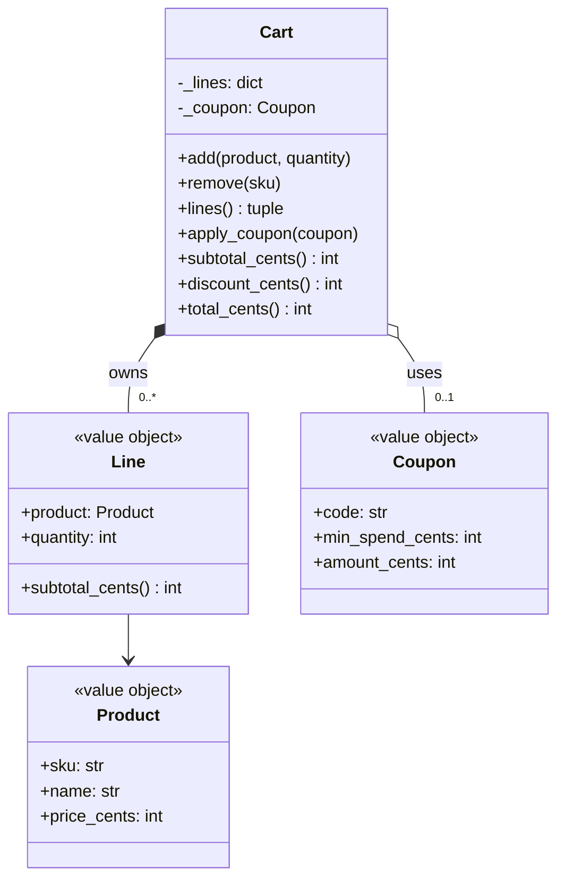

**Reading the diagram.**

- **Components.** `Cart` is the entity that enforces the rules. `Line`, `Coupon` and `Product` are immutable value objects (the `<<value object>>` label is a free-text stereotype).
- **Visibility.** `-` marks private members. Nothing outside `Cart` can reach `_lines` or `_coupon`; the only doors are the seven public methods.
- **Relationships.** The filled diamond (`*--`) means the cart *owns* its lines: lines are created and discarded by the cart. The hollow diamond (`o--`) means the cart *uses* a coupon that exists independently. Ch 38 covers these symbols in depth.
- **Sync/async and storage.** All calls are synchronous and in memory.
- **Failure points.** The invariants can now be broken only by a bug inside `Cart` itself, which is one class to test. `lines()` returns an immutable snapshot, so a caller cannot use it as a side door.
- **Scaling.** The internal dictionary could become a database-backed store without changing any caller, because callers only see methods.

#### Code example

```python
from dataclasses import dataclass

MAX_QTY_PER_LINE = 10


@dataclass(frozen=True)
class Product:
    sku: str
    name: str
    price_cents: int


@dataclass(frozen=True)
class Line:                               # immutable: safe to hand out
    product: Product
    quantity: int

    def subtotal_cents(self):
        return self.product.price_cents * self.quantity


@dataclass(frozen=True)
class Coupon:
    code: str
    min_spend_cents: int
    amount_cents: int


class Cart:
    """Invariants:
    1. every line has 1 <= quantity <= MAX_QTY_PER_LINE
    2. 0 <= total_cents() <= subtotal_cents()
    """

    def __init__(self):
        self._lines = {}                  # sku -> Line; underscore = "private, keep out"
        self._coupon = None

    def add(self, product, quantity=1):
        if quantity < 1:
            raise ValueError("quantity must be >= 1")
        current = self._lines.get(product.sku)
        new_qty = quantity + (current.quantity if current else 0)
        if new_qty > MAX_QTY_PER_LINE:
            raise ValueError(f"at most {MAX_QTY_PER_LINE} of {product.sku} per order")
        self._lines[product.sku] = Line(product, new_qty)

    def remove(self, sku):
        self._lines.pop(sku, None)

    def lines(self):
        return tuple(self._lines.values())    # a read-only snapshot, not the dict itself

    def apply_coupon(self, coupon):           # "tell": the cart decides
        self._coupon = coupon

    def subtotal_cents(self):
        return sum(line.subtotal_cents() for line in self._lines.values())

    def discount_cents(self):
        subtotal = self.subtotal_cents()
        if self._coupon is None or subtotal < self._coupon.min_spend_cents:
            return 0
        return min(self._coupon.amount_cents, subtotal)

    def total_cents(self):
        return self.subtotal_cents() - self.discount_cents()


mug = Product("SKU-MUG", "Mug", 1299)
tea = Product("SKU-TEA", "Green tea", 2450)
cart = Cart()
cart.add(mug, 2)
cart.add(tea, 1)
cart.apply_coupon(Coupon("SAVE5", min_spend_cents=5000, amount_cents=500))
print(cart.subtotal_cents(), cart.discount_cents(), cart.total_cents())  # 5048 500 4548

cart.remove("SKU-TEA")                    # subtotal drops below the minimum spend...
print(cart.subtotal_cents(), cart.discount_cents(), cart.total_cents())  # 2598 0 2598

for bad in (lambda: cart.add(mug, 0), lambda: cart.add(mug, 9)):
    try:
        bad()
    except ValueError as e:
        print("rejected:", e)
try:
    cart.lines()[0].quantity = 1000       # the snapshot cannot be used to break the cart
except Exception as e:
    print("rejected:", type(e).__name__)  # rejected: FrozenInstanceError
```

```java
import java.util.LinkedHashMap;
import java.util.List;
import java.util.Map;

record Product(String sku, String name, long priceCents) {}

record Line(Product product, int quantity) {          // records are immutable
    long subtotalCents() { return product.priceCents() * quantity; }
}

record Coupon(String code, long minSpendCents, long amountCents) {}

/** Invariants: 1 <= quantity <= MAX_QTY_PER_LINE for every line;
 *  0 <= totalCents() <= subtotalCents(). */
class Cart {
    static final int MAX_QTY_PER_LINE = 10;
    private final Map<String, Line> lines = new LinkedHashMap<>();
    private Coupon coupon;                            // null when none applied

    void add(Product product, int quantity) {
        if (quantity < 1)
            throw new IllegalArgumentException("quantity must be >= 1");
        Line current = lines.get(product.sku());
        int newQty = quantity + (current == null ? 0 : current.quantity());
        if (newQty > MAX_QTY_PER_LINE)
            throw new IllegalArgumentException(
                "at most " + MAX_QTY_PER_LINE + " of " + product.sku() + " per order");
        lines.put(product.sku(), new Line(product, newQty));
    }

    void remove(String sku) { lines.remove(sku); }

    List<Line> lines() { return List.copyOf(lines.values()); }   // unmodifiable copy

    void applyCoupon(Coupon coupon) { this.coupon = coupon; }    // "tell"

    long subtotalCents() {
        long sum = 0;
        for (Line l : lines.values()) sum += l.subtotalCents();
        return sum;
    }

    long discountCents() {
        long subtotal = subtotalCents();
        if (coupon == null || subtotal < coupon.minSpendCents()) return 0;
        return Math.min(coupon.amountCents(), subtotal);
    }

    long totalCents() { return subtotalCents() - discountCents(); }
}

class Main {
    public static void main(String[] args) {
        Product mug = new Product("SKU-MUG", "Mug", 1299);
        Product tea = new Product("SKU-TEA", "Green tea", 2450);
        Cart cart = new Cart();
        cart.add(mug, 2);
        cart.add(tea, 1);
        cart.applyCoupon(new Coupon("SAVE5", 5000, 500));
        System.out.println(cart.subtotalCents() + " " + cart.discountCents() + " " + cart.totalCents());
        cart.remove("SKU-TEA");
        System.out.println(cart.subtotalCents() + " " + cart.discountCents() + " " + cart.totalCents());
        try {
            cart.add(mug, 9);
        } catch (IllegalArgumentException e) {
            System.out.println("rejected: " + e.getMessage());
        }
        try {
            cart.lines().clear();
        } catch (UnsupportedOperationException e) {
            System.out.println("rejected: " + e.getClass().getSimpleName());
        }
    }
}
```

What to notice:

- The cart stores no `total` field. The total is *derived* from the lines and the coupon each time it is asked for, so it can never disagree with them. When the tea is removed, the subtotal falls to 2,598 cents, below the 5,000-cent minimum, and the discount disappears automatically. A stored total updated through a setter would have kept the stale 500-cent discount.
- Both invariants are enforced in exactly one place. Adding 9 more mugs to a line that already has 2 is refused because 11 > 10.
- `lines()` returns a tuple of frozen dataclasses in Python and `List.copyOf` of records in Java. A caller can read everything and change nothing.

### 35.4.2 Getters and setters: the pitfalls

A **getter** returns a field (`get_price()`), a **setter** assigns one (`set_price(x)`). Many beginners are taught to make every field private and generate a getter and setter for each. That satisfies the letter of encapsulation and defeats its purpose: a public setter for every field is a public field with extra typing. Three specific problems follow.

1. **Setters bypass invariants.** `cart.set_total(0)` or `line.set_quantity(-3)` lets callers put the object into a state no business rule permits. If a field may change, expose a method named after the business operation (`apply_coupon`, `remove`), which can check the rule.
2. **Getters leak representation.** `get_lines()` returning the internal mutable list is a side door: `cart.get_lines().clear()` empties the cart without going through any method. Bloch's example is a `Period` class whose start and end are mutable `java.util.Date` objects: a caller who keeps a reference can move the end before the start. His remedy is **defensive copying** of mutable inputs and outputs [Bloch 2018, Item 50].
3. **Getters invite logic to move outside.** If every caller can read `quantity`, `price` and `coupon`, every caller starts computing totals itself, and the discount rule ends up copied into the checkout page, the email template and the invoice generator.

Getters are not forbidden. Read-only access to immutable values (`product.sku`, `line.quantity` on a frozen `Line`) is harmless and often necessary for display. The test is whether the caller then *makes a decision* the object should have made.

### 35.4.3 Tell, don't ask

::: concept
**Tell, don't ask.** Rather than asking an object for its data and deciding what to do with it, tell the object what you want and let it decide [Fowler 2013, "TellDontAsk"]. The rule that uses the data then lives with the data.
:::

```python
# Asking: the caller pulls data out and makes the decision.   # illustrative
if cart.subtotal_cents() >= 5000:
    cart.discount_cents = 500          # requires a writable field; the rule is now out here

# Telling: the cart owns the rule.
cart.apply_coupon(Coupon("SAVE5", min_spend_cents=5000, amount_cents=500))
```

```java
// Asking (illustrative): the rule lives in the caller and needs a setter.
if (cart.subtotalCents() >= 5000) cart.setDiscountCents(500);

// Telling: the cart owns the rule.
cart.applyCoupon(new Coupon("SAVE5", 5000, 500));
```

The asking version has two defects visible in §35.4.1's run: the cart needs a writable discount field, and when the tea is later removed nobody re-checks the minimum spend. The telling version re-evaluates the rule every time because the rule is inside the cart.

#### Real-world industry applications

::: industry
**`java.util.Date` versus `java.time`.** `java.util.Date` is mutable: a class that stores a `Date` passed by a caller, or returns its own `Date` from a getter, can have its state changed from outside, which is why *Effective Java* uses it as the example for defensive copying. The `java.time` API introduced in Java 8 (JSR 310) made its date and time classes immutable and documents them as thread-safe, which removes the need for defensive copies entirely.
*Evidence: Primary* — [Bloch 2018, Items 17 and 50]; [Oracle: java.time package documentation]
:::

#### Advantages and disadvantages

- **Advantages.** Invariants are checked in one place; internal representation can change without touching callers; immutable values can be shared freely, including across threads.
- **Disadvantages.** More methods to design up front; immutable objects require creating new objects for each change (cheap for small values, a real cost for large collections updated often); Python's privacy depends on discipline.

#### Failure scenarios

**Table 35.3 — Failure scenarios for encapsulation.**

| What goes wrong | Why | Detection | Recovery | Prevention |
|---|---|---|---|---|
| Negative quantity reaches the invoice | Public field or setter | Data-quality checks, customer complaint | Correct data, add the check | Business-named methods with validation |
| Cart emptied by a report job | Getter returned the internal list | Hard to trace "spooky" changes | Return a copy | Copies or read-only views |
| Stale discount after item removal | Derived value stored and set from outside | Totals disagree with lines | Recompute | Derive, don't store |
| Same rule implemented three ways | Callers ask and decide | Inconsistent totals across pages | Move the rule into the class | Tell, don't ask |

::: mistake
**Misconception — "Private fields plus getters and setters equals encapsulation."** Encapsulation is about who is allowed to make which state changes. A setter for every field hands that decision back to every caller. Ask instead: which *operations* does the business allow on this object? Expose those.
:::

## 35.5 Inheritance

### 35.5.1 Is-a relationships and method overriding

::: definition
**Definition — Inheritance.** A mechanism by which a class (the **subclass**, **child** or **derived class**) is defined as an extension of another (the **superclass**, **parent** or **base class**). The subclass automatically has the parent's attributes and methods, may add new ones, and may **override** inherited methods by providing its own version with the same name and parameters.
:::

#### First-principles explanation

The shop now sells two kinds of product. A mug is physical: it has a weight and costs money to ship. An e-book is digital: it has a download link and ships for free. Both still have a SKU, a name and a price, and both appear in carts and invoices.

You could copy the `Product` class twice and edit each copy. Then a bug fix to price formatting must be made twice, and someone will forget one. Inheritance lets you say "a physical product *is a* product, plus a weight and its own shipping rule." The shared part is written once in the parent; each child states only what differs.

The test for using inheritance is the **is-a** test applied to *behavior*, not to everyday language. "A physical product is a product" passes: everything the code does with a product (show it, price it, ship it) makes sense for a physical product. Section 35.9 makes this precise.

#### Why does this exist?

Inheritance solves two problems at once, and the second is the important one.

1. **Reuse.** Shared code lives in the parent.
2. **Substitutability.** Code written for `Product` works unchanged for every subclass, including subclasses written years later. The checkout that sums `p.shipping_cents()` over a cart never needs to know that e-books exist. This is what makes polymorphism (§35.6) possible.

The GoF authors call inheritance-for-reuse **white-box reuse**, because the subclass sees the parent's internals, and warn that "inheritance breaks encapsulation" for exactly that reason [Gamma et al. 1994, ch. 1]. Section 35.5.2 shows how.

#### How it works internally

1. The subclass declaration names its parent: `class PhysicalProduct(Product)` in Python, `class PhysicalProduct extends Product` in Java. Java allows one parent class; Python allows several (multiple inheritance), resolved by a fixed order called the method resolution order.
2. The subclass constructor must initialize the parent's part first by calling `super().__init__(...)` (Python) or `super(...)` (Java, which must be the first statement).
3. When code calls `p.shipping_cents()`, the runtime looks for `shipping_cents` in the object's actual class first, then in its parent, and so on up the chain. The first match runs. That lookup is what lets an override replace inherited behavior.
4. An override can still call the parent's version with `super().describe()` / `super.describe()` to extend rather than replace it.
5. Java's `@Override` annotation asks the compiler to confirm that a parent method with that signature exists, which catches typos that would otherwise silently create a new, never-called method.

#### Architecture diagram

**Figure 35.3 — Products by inheritance.**

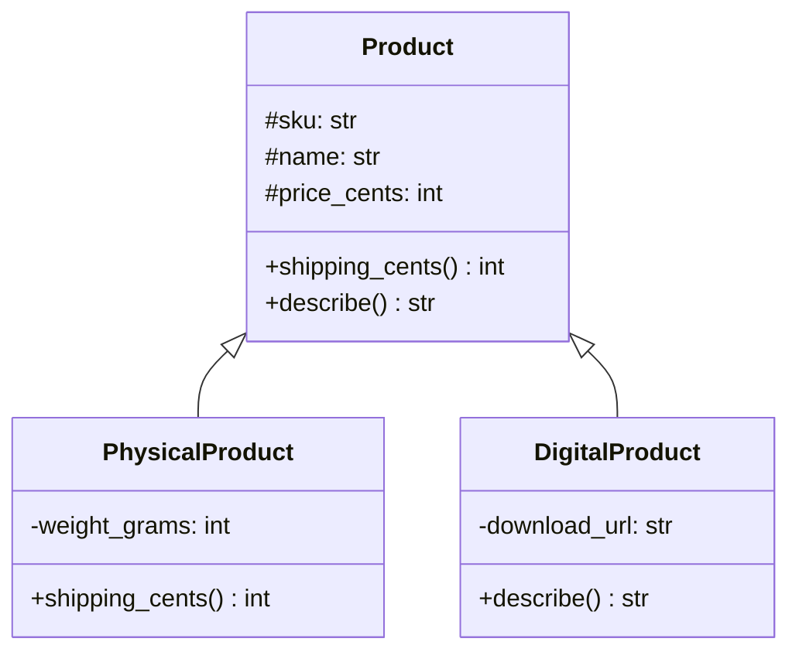

**Reading the diagram.**

- **Components.** `Product` is the parent. `PhysicalProduct` adds a weight and overrides `shipping_cents`; `DigitalProduct` adds a download URL and overrides `describe`.
- **Relationship and direction.** The hollow-triangle arrow (`<|--`) points from child to parent and reads "is a". Children depend on the parent; the parent does not know its children.
- **Visibility.** `#` means protected: visible to subclasses. That visibility is the white-box coupling the GoF warn about.
- **Sync/async and storage.** Synchronous in-process calls; no storage.
- **Failure points.** Every change to `Product` reaches both children. A new parent method that assumes "all products have a weight" breaks `DigitalProduct` silently.
- **Scaling.** A third kind of product (a gift card, a subscription) is one new subclass, as long as it genuinely behaves like a product. Variation along a *second* dimension is a different story (§35.8).

#### Code example

Shipping is 399 cents plus 50 cents per started 100 g. The mug weighs 350 g, which starts 4 blocks of 100 g, so shipping is $399 + 4 \times 50 = 599$ cents.

```python
class Product:
    def __init__(self, sku, name, price_cents):
        self.sku = sku
        self.name = name
        self.price_cents = price_cents

    def shipping_cents(self):
        return 0                                  # default: nothing to ship

    def describe(self):
        return f"{self.name} ({self.price_cents / 100:.2f})"


class PhysicalProduct(Product):                   # PhysicalProduct IS-A Product
    BASE_CENTS = 399
    CENTS_PER_100G = 50

    def __init__(self, sku, name, price_cents, weight_grams):
        super().__init__(sku, name, price_cents)  # let the parent set up its part
        self.weight_grams = weight_grams

    def shipping_cents(self):                     # override
        hundreds = -(-self.weight_grams // 100)   # ceiling division
        return self.BASE_CENTS + self.CENTS_PER_100G * hundreds


class DigitalProduct(Product):
    def __init__(self, sku, name, price_cents, download_url):
        super().__init__(sku, name, price_cents)
        self.download_url = download_url

    def describe(self):                           # override and extend
        return super().describe() + " [download]"


items = [PhysicalProduct("SKU-MUG", "Mug", 1299, weight_grams=350),
         DigitalProduct("SKU-EBOOK", "Tea guide", 899, "https://example.com/dl/42")]
for p in items:
    print(p.describe(), p.shipping_cents())
# Mug (12.99) 599
# Tea guide (8.99) [download] 0
```

```java
import java.util.List;

class Product {
    protected final String sku;
    protected final String name;
    protected final long priceCents;

    Product(String sku, String name, long priceCents) {
        this.sku = sku;
        this.name = name;
        this.priceCents = priceCents;
    }

    long shippingCents() { return 0; }                       // default

    String describe() {
        return String.format("%s (%.2f)", name, priceCents / 100.0);
    }
}

class PhysicalProduct extends Product {                       // IS-A Product
    static final long BASE_CENTS = 399, CENTS_PER_100G = 50;
    private final int weightGrams;

    PhysicalProduct(String sku, String name, long priceCents, int weightGrams) {
        super(sku, name, priceCents);                         // parent's constructor first
        this.weightGrams = weightGrams;
    }

    @Override long shippingCents() {                          // override
        long hundreds = (weightGrams + 99) / 100;             // ceiling division
        return BASE_CENTS + CENTS_PER_100G * hundreds;
    }
}

class DigitalProduct extends Product {
    private final String downloadUrl;

    DigitalProduct(String sku, String name, long priceCents, String downloadUrl) {
        super(sku, name, priceCents);
        this.downloadUrl = downloadUrl;
    }

    @Override String describe() { return super.describe() + " [download]"; }
}

class Main {
    public static void main(String[] args) {
        List<Product> items = List.of(
            new PhysicalProduct("SKU-MUG", "Mug", 1299, 350),
            new DigitalProduct("SKU-EBOOK", "Tea guide", 899, "https://example.com/dl/42"));
        for (Product p : items)
            System.out.println(p.describe() + " " + p.shippingCents());
    }
}
```

What to notice:

- The loop is written against `Product` and never checks which kind it has; each object answers `shipping_cents()` its own way.
- `DigitalProduct.describe` extends the parent's result with `super()`, so the price format is still defined once.
- The parent's default `shipping_cents` returns 0. That is a design decision with a cost: a future physical subclass that forgets to override silently ships for free. §35.7 shows how an abstract method turns that silent bug into an error.

### 35.5.2 The fragile base class problem

::: definition
**Definition — Fragile base class problem.** A change to a base class that is correct on its own breaks subclasses, because the subclasses depend on implementation details of the base (which methods call which) that were never part of its documented interface.
:::

#### First-principles explanation

The analytics team wants to count every item a shopper ever puts into a cart, including items later removed. They subclass `Cart` and override both ways of adding items to increment a counter. Nobody told them that the cart's `add_all` is implemented by calling `add` once per item. The count comes out doubled.

This is the shop version of Bloch's `InstrumentedHashSet`, which overrides `add` and `addAll` on a `HashSet` and reports 6 additions after adding 3 elements, because `HashSet.addAll` is implemented on top of `add` [Bloch 2018, Item 18].

**Figure 35.4 — How self-use double-counts in the subclass.**

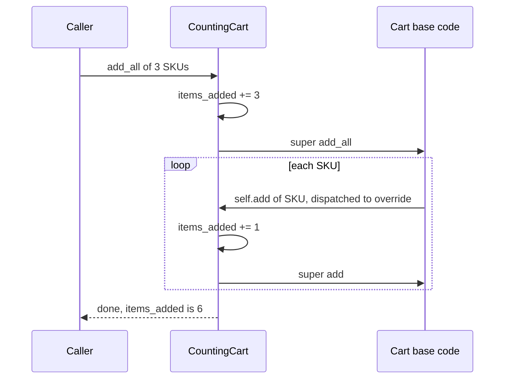

**Reading the diagram.**

- **Components.** One object, two layers of code: the `CountingCart` overrides and the inherited `Cart` methods. `Caller` is the analytics test.
- **Direction and sync.** Every arrow is a synchronous method call on the *same* object. The crucial arrow is `Base->>CC`: when base code calls `self.add`, dynamic dispatch (§35.6) sends the call to the subclass override, not to the base `add`.
- **Storage.** None; the counter is an in-memory field.
- **Failure point.** The base class's *internal* call from `add_all` to `add` is the hidden dependency. It is not in any documentation, yet the subclass's correctness depends on it.
- **Scaling the problem.** Every subclass of `Cart` written by any team inherits the same exposure. The more subclasses exist, the harder it becomes to change `Cart`'s internals at all.

```python
class Cart:
    def __init__(self):
        self._quantities = {}

    def add(self, sku, quantity=1):
        self._quantities[sku] = self._quantities.get(sku, 0) + quantity

    def add_all(self, skus):
        for sku in skus:
            self.add(sku)            # self-use: add_all is built on add (undocumented)


class CountingCart(Cart):
    """Counts every item a shopper ever puts in the cart, for analytics."""

    def __init__(self):
        super().__init__()
        self.items_added = 0

    def add(self, sku, quantity=1):
        self.items_added += quantity
        super().add(sku, quantity)

    def add_all(self, skus):
        self.items_added += len(skus)
        super().add_all(skus)        # ...which calls self.add, which counts again


cart = CountingCart()
cart.add_all(["SKU-MUG", "SKU-TEA", "SKU-PEN"])
print(cart.items_added)              # 6, not 3
```

```java
import java.util.HashMap;
import java.util.List;
import java.util.Map;

class Cart {
    private final Map<String, Integer> quantities = new HashMap<>();

    void add(String sku, int quantity) {
        quantities.merge(sku, quantity, Integer::sum);
    }

    void addAll(List<String> skus) {
        for (String sku : skus) add(sku, 1);       // self-use (undocumented)
    }
}

class CountingCart extends Cart {
    int itemsAdded = 0;

    @Override void add(String sku, int quantity) {
        itemsAdded += quantity;
        super.add(sku, quantity);
    }

    @Override void addAll(List<String> skus) {
        itemsAdded += skus.size();
        super.addAll(skus);                        // calls this.add(...) again
    }
}

class Main {
    public static void main(String[] args) {
        CountingCart cart = new CountingCart();
        cart.addAll(List.of("SKU-MUG", "SKU-TEA", "SKU-PEN"));
        System.out.println(cart.itemsAdded);       // 6, not 3
    }
}
```

The obvious patch, removing the `add_all` override from `CountingCart`, makes the count right *today*. Now suppose the cart team later rewrites `add_all` to update the dictionary directly, for speed. That change is correct for `Cart` and passes all of `Cart`'s tests, and `CountingCart` silently starts *under*counting. Either way, the subclass's correctness is tied to a private implementation choice in the parent. That is the fragility. The fix, composition with forwarding, is in §35.8.

Bloch's guidance is to "design and document for inheritance or else prohibit it" [Bloch 2018, Item 19]: either document which overridable methods each method calls ("self-use"), or make the class `final` (Java) so nobody can subclass it. Python has no `final` for classes at run time, though `typing.final` lets type checkers flag subclassing.

#### Real-world industry applications

::: industry
**`java.util.Stack` and `java.util.Properties`.** In the Java platform libraries, `Stack` extends `Vector` and `Properties` extends `Hashtable`. A stack is not a vector, yet because of inheritance every `Stack` exposes `Vector`'s methods for inserting at arbitrary positions, which breaks the last-in, first-out guarantee. `Properties` is meant to hold strings, but the inherited `Hashtable.put` accepts any object. Bloch cites both as violations of the is-a test that cannot be fixed without breaking compatibility; the `Stack` API documentation itself now recommends the `Deque` interface instead.
*Evidence: Primary* — [Bloch 2018, Item 18]; [Oracle: java.util.Stack API documentation]
:::

#### Advantages and disadvantages

- **Advantages.** Little code for genuine is-a variations; substitutability enables polymorphism; overriding with `super` lets a child extend parent behavior.
- **Disadvantages.** Subclasses are coupled to the parent's implementation (white-box reuse); the relationship is fixed at compile time; Java allows only one parent; deep hierarchies make it hard to know which method actually runs.

#### Failure scenarios

**Table 35.4 — Failure scenarios for inheritance.**

| What goes wrong | Why | Detection | Recovery | Prevention |
|---|---|---|---|---|
| Counts doubled or missing | Fragile base class self-use | Metrics disagree with source data | Switch subclass to composition | Document self-use or make classes `final` |
| Subclass exposes forbidden operations | Inherited methods break child's rules (Stack/Vector) | Misuse in code review or production | Hide behind a wrapper | Apply the behavioral is-a test |
| Override never called | Typo in method name | Feature silently missing | Rename | `@Override` in Java, tests |
| New physical product ships free | Default implementation inherited silently | Revenue leak in reports | Add override | Abstract method instead of default |

::: mistake
**Misconception — "Inheritance is mainly for code reuse."** Reuse is the weakest reason to inherit; a helper object reused by composition gives the same reuse without the coupling. Inherit when callers need to treat the child *as* the parent, and when the child keeps every promise the parent makes (§35.9).
:::

## 35.6 Polymorphism

### 35.6.1 Subtype polymorphism and dynamic dispatch

::: definition
**Definition — Polymorphism.** The ability of one piece of code to work with values of different types. **Subtype polymorphism** means code written against a type also works with any of its subtypes, and each object responds to a method call with its own implementation. **Dynamic dispatch** is the run-time mechanism that picks which implementation runs, based on the object's actual class rather than the declared type of the variable.
:::

#### First-principles explanation

A shop assistant says "Please pay" to each customer in the queue. One taps a card, one hands over cash, one scans a phone. The assistant's instruction is the same; each customer carries it out their own way, and the assistant does not need a rule book listing every payment method that exists. If a new method appears next year, the assistant's instruction does not change.

The shop's marketing team invents discount rules every month: 10% off everything, 5 off orders over 50, buy two mugs get one free. Without polymorphism the checkout grows a chain of `if rule.kind == "percent": ... elif rule.kind == "fixed": ...`, and every new rule means editing the checkout and retesting all the old branches. With polymorphism, each rule is an object with a `discount_cents(lines)` method, and the checkout just calls it.

#### Why does this exist?

To let the set of variations grow without editing the code that uses them. The checkout that picks the best discount is written once and stays closed to change while new rules are added. Ch 36 names this the Open/Closed Principle (§36.4); polymorphism is the mechanism that makes it achievable.

#### How it works internally

1. **Java (static types, virtual methods).** Each class has a **method table** (often called a vtable): an array of pointers to the code for each overridable method. Every object holds a pointer to its class. A call `rule.discountCents(lines)` compiles to "load the object's class, load the entry for `discountCents`, jump to it": a couple of memory loads and an indirect jump. For interface calls the JVM uses a similar lookup. Just-in-time compilers observe that a given call site usually sees one or two classes and inline those directly, so the overhead is usually negligible in practice.
2. **Python (dynamic types).** `rule.discount_cents` looks up the name at run time: first in the object's own attribute dictionary, then in its class and the class's parents in method-resolution order. There is no requirement that the classes share a parent at all.
3. **Static versus dynamic type.** In Java, `DiscountRule rule = new PercentOff(10);` has static type `DiscountRule` (what the compiler checks) and dynamic type `PercentOff` (what actually runs). The compiler only lets you call methods `DiscountRule` declares; the runtime decides whose code runs.

#### Architecture diagram

**Figure 35.5 — Discount rules behind one interface.**

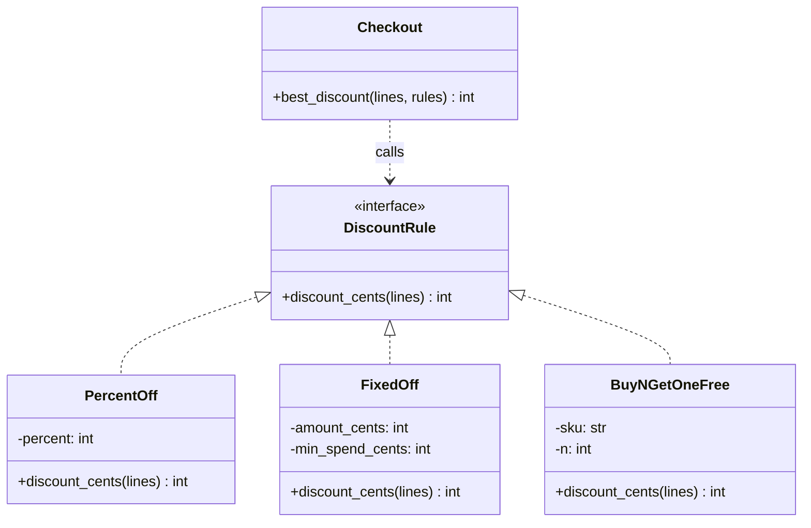

**Reading the diagram.**

- **Components.** `DiscountRule` is an interface: a list of methods with no implementation. Three classes implement it. `Checkout` uses rules.
- **Relationships.** The dotted line with a hollow triangle (`<|..`) means "implements". The dotted arrow from `Checkout` means "depends on": the checkout knows only the interface, never the concrete classes.
- **Direction and sync.** Calls flow from `Checkout` to whichever rule objects it is handed, synchronously, through dynamic dispatch.
- **Storage.** None here; in production the rule *parameters* (percentages, thresholds) would come from a database or configuration, and a factory would build the objects (Ch 37).
- **Failure points.** A rule that returns a negative number or more than the subtotal would corrupt totals; the cart's invariant (§35.4) caps the discount, and §35.9 writes that expectation down as a postcondition.
- **Scaling.** A fourth rule is a new class; `Checkout` and its tests do not change.

#### Code example

The cart has 3 mugs at 1,299 and 1 tea at 2,450: subtotal $3 \times 1299 + 2450 = 6{,}347$ cents. Ten percent is 634 cents (integer division rounds down), the fixed rule gives 500, and "buy 2, get 1 free" on mugs gives one free mug, 1,299. The best is 1,299.

```python
from dataclasses import dataclass
from typing import Protocol


@dataclass(frozen=True)
class Line:
    sku: str
    unit_cents: int
    quantity: int


class DiscountRule(Protocol):                     # optional: documents the expected shape
    def discount_cents(self, lines: list[Line]) -> int: ...


class PercentOff:
    def __init__(self, percent):
        self.percent = percent

    def discount_cents(self, lines):
        subtotal = sum(l.unit_cents * l.quantity for l in lines)
        return subtotal * self.percent // 100


class FixedOff:
    def __init__(self, amount_cents, min_spend_cents):
        self.amount_cents = amount_cents
        self.min_spend_cents = min_spend_cents

    def discount_cents(self, lines):
        subtotal = sum(l.unit_cents * l.quantity for l in lines)
        return self.amount_cents if subtotal >= self.min_spend_cents else 0


class BuyNGetOneFree:
    def __init__(self, sku, n):
        self.sku, self.n = sku, n

    def discount_cents(self, lines):
        return sum((l.quantity // (self.n + 1)) * l.unit_cents
                   for l in lines if l.sku == self.sku)


def best_discount(lines, rules):
    # One call site, many behaviors: which discount_cents runs depends on the object.
    return max((rule.discount_cents(lines) for rule in rules), default=0)


lines = [Line("SKU-MUG", 1299, 3), Line("SKU-TEA", 2450, 1)]   # subtotal 6347
rules = [PercentOff(10), FixedOff(500, 5000), BuyNGetOneFree("SKU-MUG", 2)]
for r in rules:
    print(type(r).__name__, r.discount_cents(lines))
print("best:", best_discount(lines, rules))
# PercentOff 634 / FixedOff 500 / BuyNGetOneFree 1299 / best: 1299
```

```java
import java.util.List;

record Line(String sku, long unitCents, int quantity) {}

interface DiscountRule {
    long discountCents(List<Line> lines);
}

final class PercentOff implements DiscountRule {
    private final int percent;
    PercentOff(int percent) { this.percent = percent; }

    @Override public long discountCents(List<Line> lines) {
        long subtotal = 0;
        for (Line l : lines) subtotal += l.unitCents() * l.quantity();
        return subtotal * percent / 100;
    }
}

final class FixedOff implements DiscountRule {
    private final long amountCents, minSpendCents;
    FixedOff(long amountCents, long minSpendCents) {
        this.amountCents = amountCents;
        this.minSpendCents = minSpendCents;
    }

    @Override public long discountCents(List<Line> lines) {
        long subtotal = 0;
        for (Line l : lines) subtotal += l.unitCents() * l.quantity();
        return subtotal >= minSpendCents ? amountCents : 0;
    }
}

final class BuyNGetOneFree implements DiscountRule {
    private final String sku;
    private final int n;
    BuyNGetOneFree(String sku, int n) { this.sku = sku; this.n = n; }

    @Override public long discountCents(List<Line> lines) {
        long free = 0;
        for (Line l : lines)
            if (l.sku().equals(sku)) free += (l.quantity() / (n + 1)) * l.unitCents();
        return free;
    }
}

class Main {
    static long bestDiscount(List<Line> lines, List<DiscountRule> rules) {
        long best = 0;
        for (DiscountRule rule : rules)                    // dynamic dispatch here
            best = Math.max(best, rule.discountCents(lines));
        return best;
    }

    public static void main(String[] args) {
        List<Line> lines = List.of(new Line("SKU-MUG", 1299, 3), new Line("SKU-TEA", 2450, 1));
        List<DiscountRule> rules = List.of(
            new PercentOff(10), new FixedOff(500, 5000), new BuyNGetOneFree("SKU-MUG", 2));
        for (DiscountRule r : rules)
            System.out.println(r.getClass().getSimpleName() + " " + r.discountCents(lines));
        System.out.println("best: " + bestDiscount(lines, rules));
    }
}
```

What to notice:

- `best_discount` / `bestDiscount` contains no `if` on the rule's kind. Adding a fourth rule touches no existing code.
- In Python the three classes share no parent. `best_discount` works because each object *has* a `discount_cents` method. That is duck typing (§35.6.2). The `Protocol` class is optional documentation that type checkers can verify.
- In Java the classes must declare `implements DiscountRule`; without it, the compiler refuses to put them in a `List<DiscountRule>`.

### 35.6.2 Duck typing

::: definition
**Definition — Duck typing.** A style of polymorphism in which an object is acceptable wherever it supports the operations actually used, regardless of its declared class ("if it walks like a duck and quacks like a duck"). Checking happens when the method is called. **Structural typing** is the static version: a type checker accepts an object if its shape matches a declared protocol.
:::

Duck typing makes Python code short and flexible: any object with a `discount_cents(lines)` method is a discount rule, including a test double written in three lines. The price is that mistakes surface late. Pass an object without the method and you get `AttributeError` when the line runs, perhaps in production on the first Black Friday that uses that rule. Python's `typing.Protocol` [PEP 544] recovers much of the safety: a static checker such as mypy verifies, before the program runs, that every object passed where a `DiscountRule` is expected has a compatible method, without forcing the classes to inherit anything. Java takes the opposite default: **nominal typing**, where a class is a `DiscountRule` only if it says so.

### 35.6.3 Parametric polymorphism (generics), briefly

A third kind of polymorphism works over *types themselves*. The function "return the cheapest item in a list" is the same whether the list holds products or shipping options. **Parametric polymorphism**, called **generics** in Java and Python, lets you write it once with a type parameter `T` and still have the type checker know that a list of products gives back a product.

```python
from typing import Protocol, TypeVar


class Priced(Protocol):
    @property
    def price_cents(self) -> int: ...


T = TypeVar("T", bound=Priced)


def cheapest(items: list[T]) -> T:
    """Works for a list of any priced type and returns that same type."""
    if not items:
        raise ValueError("items must be non-empty")
    return min(items, key=lambda item: item.price_cents)


class Product:
    def __init__(self, sku, price_cents):
        self.sku, self.price_cents = sku, price_cents


class ShippingOption:
    def __init__(self, carrier, price_cents):
        self.carrier, self.price_cents = carrier, price_cents


print(cheapest([Product("SKU-MUG", 1299), Product("SKU-PEN", 250)]).sku)       # SKU-PEN
print(cheapest([ShippingOption("PostCo", 599), ShippingOption("FastCo", 999)]).carrier)  # PostCo
```

```java
import java.util.List;

interface Priced { long priceCents(); }

record Product(String sku, long priceCents) implements Priced {}
record ShippingOption(String carrier, long priceCents) implements Priced {}

class Main {
    // <T extends Priced>: any type T, as long as it is Priced. Returns that same T.
    static <T extends Priced> T cheapest(List<T> items) {
        if (items.isEmpty()) throw new IllegalArgumentException("items must be non-empty");
        T best = items.get(0);
        for (T item : items)
            if (item.priceCents() < best.priceCents()) best = item;
        return best;
    }

    public static void main(String[] args) {
        Product p = cheapest(List.of(new Product("SKU-MUG", 1299), new Product("SKU-PEN", 250)));
        ShippingOption s = cheapest(List.of(new ShippingOption("PostCo", 599),
                                            new ShippingOption("FastCo", 999)));
        System.out.println(p.sku() + " " + s.carrier());   // no casts needed
    }
}
```

What to notice: the **bound** (`bound=Priced`, `T extends Priced`) restricts `T` to types that have a price, so the body may call `price_cents`. Java checks generics at compile time and then erases them; Python's type hints are checked only by external tools and ignored at run time.

**Table 35.5 — Kinds of polymorphism.**

| Kind | What varies | Mechanism | Checked | Example in this chapter |
|---|---|---|---|---|
| Subtype | Behavior per subclass | Overriding + dynamic dispatch | Compile time (Java) | `DiscountRule` implementations |
| Duck / structural | Any object with the right methods | Run-time lookup; `Protocol` for static check | Run time (Python), optional static | Python discount rules |
| Parametric (generics) | Element type | Type parameters | Compile time / type checker | `cheapest(List<T>)` |
| Ad hoc (overloading) | Argument types | Same name, different parameter lists | Compile time (Java) | Not used; mention only |

The classification follows Cardelli and Wegner [Cardelli & Wegner 1985], who distinguish *universal* polymorphism (parametric and subtype) from *ad hoc* polymorphism (overloading and coercion).

#### Advantages and disadvantages

- **Advantages.** New variants without editing callers; callers are simpler and testable with fakes; behavior can be chosen at run time from configuration.
- **Disadvantages.** Reading a call site no longer tells you which code runs; you must know which objects flow there. Too many tiny polymorphic classes for variations that never change is over-engineering. Duck typing defers errors to run time.

#### Alternatives and trade-offs

For a *closed* set of variants that rarely grows but gains new *operations* often (for example, the fixed set of order states), a `match`/`switch` over a sealed set of types can be clearer than spreading each operation across classes. Java 21's sealed interfaces with pattern-matching `switch` make the compiler check that every case is handled. Rule of thumb: if new *kinds* arrive often, use polymorphism; if new *operations* arrive often over a fixed set of kinds, a checked `switch` is a reasonable choice.

::: mistake
**Misconception — "Polymorphism means using inheritance."** Subtype polymorphism needs a shared *type*, which in Java can be an interface with no inherited code at all, and in Python need not be declared. The behavior-sharing part of inheritance is a separate, optional, and riskier feature.
:::

## 35.7 Abstraction

### 35.7.1 Abstract classes and interfaces

::: definition
**Definition — Abstraction.** Representing something by the operations that matter to its users while leaving out the details of how they are carried out. In code, an **abstract class** is a class that cannot be instantiated and may contain both implemented methods and **abstract methods** (declared, with no body) that subclasses must implement. An **interface** declares a set of methods a type promises to provide; in Java it has no instance state, and since Java 8 it may include `default` method bodies built only on its other methods.
:::

#### First-principles explanation

A car's pedals and steering wheel are an abstraction: you drive a petrol car and an electric car the same way, and the dashboard does not explain combustion or battery chemistry. Checkout code needs the same thing for payments. It needs to say "charge 25.98 to this payment method" and get a receipt. Whether that means talking to a card processor or deducting from a gift-card balance is a detail the checkout should not see.

Two kinds of shared things appear when you design payment methods. Some things are *common work*: every payment must check that the amount is positive and below a fraud limit, and must record what was charged. Other things are *capabilities* that only some methods have: a card payment can be refunded, but in this shop a gift card cannot. Common work with one varying step fits an abstract class. A capability that cuts across unrelated classes fits an interface.

#### Why does this exist?

- To **force** subclasses to supply the varying part. An abstract method turns "forgot to override" (the free-shipping bug of §35.5.1) into an error at class definition (Java) or instantiation (Python).
- To let callers depend on a **stable, small surface**. "Program to an interface, not an implementation" is the first of the two principles the GoF state in their introduction [Gamma et al. 1994, ch. 1].
- To let one class play **several roles**. Java permits one parent class but any number of interfaces.

#### How it works internally

- **Python.** Inherit from `abc.ABC` and mark methods with `@abstractmethod`. Calling the class raises `TypeError` while any abstract method is unimplemented. An "interface" in Python is just an abstract class with only abstract methods, or a `typing.Protocol` for structural checking.
- **Java.** `abstract class` cannot be instantiated with `new`; `abstract` methods have no body. `interface` methods are implicitly public and abstract unless marked `default` or `static`. A class `extends` one class and `implements` any number of interfaces.
- The common pattern below, where the parent fixes the order of steps in a `final` method and leaves one step abstract, is called the Template Method pattern (Ch 37, §37.15).

#### Architecture diagram

**Figure 35.6 — Payment methods: an abstract class plus a capability interface.**

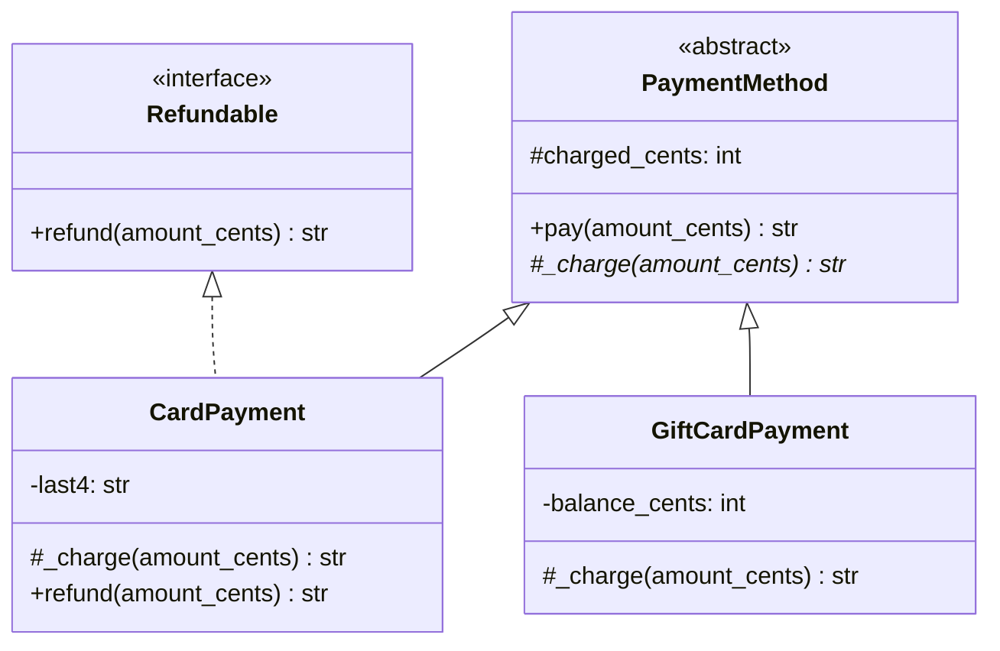

**Reading the diagram.**

- **Components.** `PaymentMethod` is abstract (it cannot be created on its own); the `*` after `_charge` marks it abstract. `Refundable` is an interface. `CardPayment` is both a payment method and refundable; `GiftCardPayment` is only a payment method.
- **Relationships.** Solid triangles (`<|--`) are inheritance of a class; dotted triangles (`<|..`) are implementation of an interface.
- **Direction and sync.** Checkout code calls `pay` (synchronous); `pay` calls the subclass's `_charge`. In production `_charge` would make a network call to a payment provider, which is the slow and failure-prone step.
- **Storage.** `charged_cents` and `balance_cents` are in memory here; real balances live in a database or the provider.
- **Failure points.** `pay` updates `charged_cents` only after `_charge` succeeds, so a declined charge leaves no trace. A real system must also handle "charged but the response was lost", which needs idempotency keys (§22.15).
- **Scaling.** A new payment method is one subclass; a new capability (say `SupportsInstallments`) is one interface that any subset of methods can implement.

#### Code example

```python
from abc import ABC, abstractmethod


class Refundable(ABC):
    """Interface: a pure promise, no state."""
    @abstractmethod
    def refund(self, amount_cents): ...


class PaymentMethod(ABC):
    """Abstract class: shared state and shared steps, one step left open."""
    MAX_CHARGE_CENTS = 500_000

    def __init__(self):
        self.charged_cents = 0                       # shared state

    def pay(self, amount_cents):                     # shared, fixed algorithm
        if not 0 < amount_cents <= self.MAX_CHARGE_CENTS:
            raise ValueError("amount out of range")
        receipt = self._charge(amount_cents)         # the varying step
        self.charged_cents += amount_cents
        return receipt

    @abstractmethod
    def _charge(self, amount_cents): ...             # subclasses must supply this


class CardPayment(PaymentMethod, Refundable):
    def __init__(self, last4):
        super().__init__()
        self.last4 = last4

    def _charge(self, amount_cents):
        return f"card ...{self.last4} charged {amount_cents}"

    def refund(self, amount_cents):
        if amount_cents > self.charged_cents:
            raise ValueError("cannot refund more than was charged")
        self.charged_cents -= amount_cents
        return f"card ...{self.last4} refunded {amount_cents}"


class GiftCardPayment(PaymentMethod):              # not Refundable in this shop
    def __init__(self, balance_cents):
        super().__init__()
        self.balance_cents = balance_cents

    def _charge(self, amount_cents):
        if amount_cents > self.balance_cents:
            raise ValueError("insufficient gift-card balance")
        self.balance_cents -= amount_cents
        return f"gift card charged {amount_cents}, {self.balance_cents} left"


for method in (CardPayment("4242"), GiftCardPayment(3000)):
    print(method.pay(2598))
    if isinstance(method, Refundable):
        print(method.refund(1299))

try:
    PaymentMethod()
except TypeError as e:
    print("TypeError:", e)
# card ...4242 charged 2598
# card ...4242 refunded 1299
# gift card charged 2598, 402 left
# TypeError: Can't instantiate abstract class PaymentMethod without an implementation
#            for abstract method '_charge'
```

```java
interface Refundable {                                   // pure promise, no state
    String refund(long amountCents);
}

abstract class PaymentMethod {                           // shared state + steps
    static final long MAX_CHARGE_CENTS = 500_000;
    protected long chargedCents = 0;

    final String pay(long amountCents) {                 // final: subclasses can't change it
        if (amountCents <= 0 || amountCents > MAX_CHARGE_CENTS)
            throw new IllegalArgumentException("amount out of range");
        String receipt = charge(amountCents);            // the varying step
        chargedCents += amountCents;
        return receipt;
    }

    protected abstract String charge(long amountCents);  // subclasses must supply this
}

final class CardPayment extends PaymentMethod implements Refundable {
    private final String last4;
    CardPayment(String last4) { this.last4 = last4; }

    @Override protected String charge(long amountCents) {
        return "card ..." + last4 + " charged " + amountCents;
    }

    @Override public String refund(long amountCents) {
        if (amountCents > chargedCents)
            throw new IllegalArgumentException("cannot refund more than was charged");
        chargedCents -= amountCents;
        return "card ..." + last4 + " refunded " + amountCents;
    }
}

final class GiftCardPayment extends PaymentMethod {
    private long balanceCents;
    GiftCardPayment(long balanceCents) { this.balanceCents = balanceCents; }

    @Override protected String charge(long amountCents) {
        if (amountCents > balanceCents)
            throw new IllegalArgumentException("insufficient gift-card balance");
        balanceCents -= amountCents;
        return "gift card charged " + amountCents + ", " + balanceCents + " left";
    }
}

class Main {
    public static void main(String[] args) {
        PaymentMethod[] methods = { new CardPayment("4242"), new GiftCardPayment(3000) };
        for (PaymentMethod m : methods) {
            System.out.println(m.pay(2598));
            if (m instanceof Refundable r) System.out.println(r.refund(1299));
        }
        // new PaymentMethod();  // compile error: PaymentMethod is abstract
    }
}
```

What to notice:

- `pay` is `final` in Java, so no subclass can skip the amount check. Python cannot enforce that; a convention and code review must.
- The `isinstance` / `instanceof Refundable` check asks about a *capability*, not a concrete class. Checking `isinstance(m, CardPayment)` would have to be edited for every new refundable method.
- The abstract class carries shared *state* (`charged_cents`). That is the main thing a Java interface cannot do.

**Table 35.6 — Abstract class versus interface.**

| Aspect | Abstract class | Interface |
|---|---|---|
| What it is | Partially implemented parent | A named set of operations |
| How it works | `extends` / inherit; abstract methods filled in by children | `implements` (Java); ABC or `Protocol` (Python) |
| Instance state | Yes | No (Java); by convention none (Python) |
| How many per class | One (Java); several (Python) | Many |
| Advantages | Shares code and state; can fix the algorithm with `final` | Loose coupling; unrelated classes can share a role; easy to fake in tests |
| Disadvantages | Couples children to parent internals; uses the single parent slot (Java) | Cannot hold state; adding a method breaks implementers unless it has a `default` |
| Choose when | Closely related variants share real work and state | You need a role or capability, or you are defining a boundary between modules |

Bloch's advice combines the two: define the type as an interface, and optionally provide an abstract **skeletal implementation** class that implementers may extend for convenience [Bloch 2018, Item 20]. The Java collections follow this design.

#### Real-world industry applications

::: industry
**Java collections and Python's `collections.abc`.** The Java collections framework defines types as interfaces (`List`, `Set`, `Map`) and supplies skeletal abstract classes (`AbstractList`, `AbstractMap`) so that a new implementation writes only a few primitive methods. Python's `collections.abc` module does the same with abstract base classes: a class that subclasses `collections.abc.Sequence` and implements `__getitem__` and `__len__` receives `__contains__`, `__iter__`, `index` and `count` as mixin methods.
*Evidence: Primary* — [Bloch 2018, Item 20]; [Python docs: collections.abc]
:::

::: mistake
**Misconception — "Abstraction means adding interfaces everywhere."** An interface with exactly one implementation and no test fake, introduced "for flexibility", is a cost with no benefit yet. Abstract at the points where variation is real or expected (payment providers, discount rules, storage), and keep the rest concrete.
:::

## 35.8 Composition over inheritance

### 35.8.1 Has-a relationships and delegation

::: definition
**Definition — Composition and delegation.** **Composition** builds an object out of other objects that it holds in its fields (a **has-a** relationship). **Delegation** is the object forwarding part of its work to one of those parts by calling the part's methods. "Favor object composition over class inheritance" is the second principle stated in the GoF introduction [Gamma et al. 1994, ch. 1].
:::

#### First-principles explanation

A desktop computer is not a "keyboard-mouse-monitor"; it *has* a keyboard, a mouse and a monitor, connected through standard plugs. You can swap the keyboard for a different one without rebuilding the computer. Inheritance is like casting the keyboard into the case: the parts are fused at manufacture.

The shop's orders now vary in two independent ways. Shipping can be standard (free over 50, else 4.99) or express (12.99). Packaging can be a plain box or gift wrap (3.50). With inheritance, every *combination* needs its own subclass: `StandardPlainOrder`, `StandardGiftOrder`, `ExpressPlainOrder`, `ExpressGiftOrder`. Add a third shipping option (pickup) and you need two more; add a third packaging (eco box) and the grid grows again. And a customer who upgrades to express after placing the order cannot change the class of an existing object.

#### Why does this exist?

Inheritance is a compile-time, single-axis, white-box relationship. Real requirements vary along several axes at once, change at run time, and come from teams who should not have to read each other's internals. Composition answers all three: each axis becomes a separate part behind a small interface; parts can be replaced at run time; and the whole knows each part only through its public methods (**black-box reuse** in GoF terms).

#### How it works internally

1. Identify each independent axis of variation (shipping, packaging).
2. For each axis, define a small interface (`ShippingPolicy.cost_cents(subtotal)`, `Packaging.cost_cents()`) and one class per variant.
3. Give the whole (`Order`) one field per axis, set in the constructor.
4. Implement the whole's methods by **delegating** to the parts.
5. To change behavior at run time, replace a part (`order.upgrade_shipping(ExpressShipping())`).

#### Architecture diagram

**Figure 35.7 — Before: one subclass per combination.**

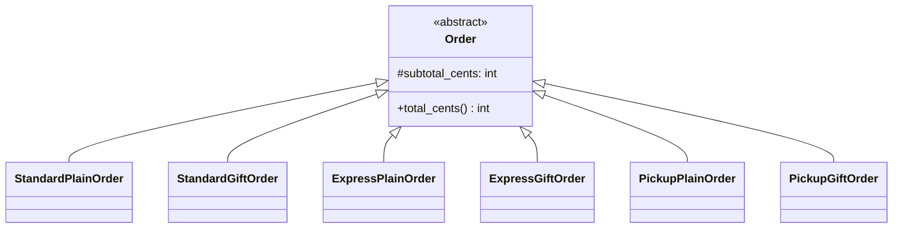

**Reading the diagram.**

- **Components.** One abstract `Order` and six concrete subclasses, one per (shipping, packaging) pair for 3 shipping options and 2 packagings.
- **Relationships and direction.** All arrows are inheritance pointing to the parent.
- **Sync/async and storage.** In-process only.
- **Failure points.** The gift-wrap price is duplicated in three subclasses and the express rule in two; a price change must be made in several places, and missing one gives inconsistent totals. An order cannot switch shipping after creation.
- **Scaling.** The number of classes grows as the *product* of the options per axis (formula below). This is the "class explosion" that composition removes.

**Figure 35.8 — After: an order composed of a shipping policy and a packaging.**

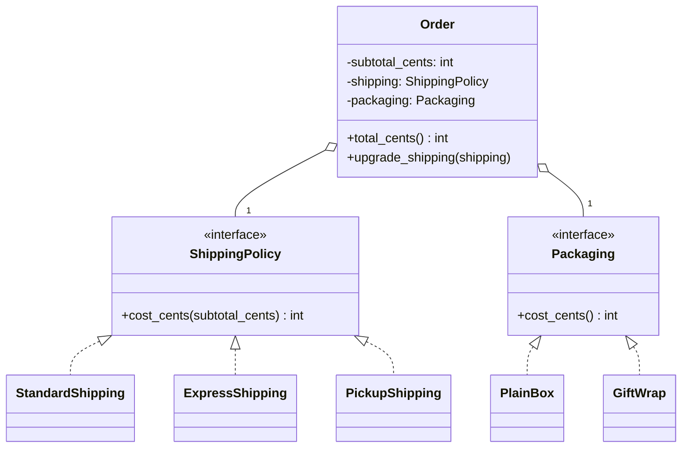

**Reading the diagram.**

- **Components.** `Order` holds one `ShippingPolicy` and one `Packaging`. Each axis has its own small family of classes.
- **Relationships.** Hollow diamonds (`o--`) mean "has a"; dotted triangles mean "implements". `Order` depends only on the two interfaces.
- **Direction and sync.** `Order.total_cents()` synchronously calls `shipping.cost_cents(...)` and `packaging.cost_cents()`, then adds the results: delegation.
- **Storage.** In memory; in a database the order row would store the chosen shipping and packaging *codes*, and a factory would rebuild the objects on load (Ch 37).
- **Failure points.** Each price rule now exists once. The remaining risk is a missing part (a `None` shipping policy), which the constructor should reject.
- **Scaling.** A new shipping option is one class; the order and packaging code do not change. Classes grow as the *sum* of options.

#### Mathematical foundations

::: formula
**Class count: inheritance per combination versus composition per axis**

$$N_{\text{inherit}} = \prod_{i=1}^{a} k_i \qquad N_{\text{compose}} = 1 + \sum_{i=1}^{a} k_i$$

| Symbol | Meaning | Units |
|---|---|---|
| $a$ | Number of independent axes of variation | count |
| $k_i$ | Number of options on axis $i$ | count |
| $N_{\text{inherit}}$ | Concrete subclasses needed to cover every combination | classes |
| $N_{\text{compose}}$ | Classes needed with composition: one whole plus one class per option | classes |
:::

::: example
**Worked example — Adding payment timing as a third axis.**

1. Current axes: shipping has $k_1 = 3$ options (standard, express, pickup), packaging $k_2 = 2$ (plain, gift).
2. Inheritance: $N = 3 \times 2 = 6$ subclasses. Composition: $N = 1 + 3 + 2 = 6$ classes. At this size the two are equal in class count; composition already wins on duplication and run-time change.
3. The business adds payment timing with $k_3 = 3$ options (pay now, pay on delivery, pay in installments) and an eco box as a third packaging, so $k_2 = 3$.
4. Inheritance: $N = 3 \times 3 \times 3 = 27$ subclasses. Composition: $N = 1 + 3 + 3 + 3 = 10$ classes.
5. One more shipping option ($k_1 = 4$): inheritance needs $4 \times 3 \times 3 = 36$, that is 9 *new* classes; composition needs 11, that is 1 new class.

**Interpretation.** With one axis, inheritance and composition cost the same. Each additional independent axis multiplies the inheritance count but only adds to the composition count.

**Engineering implication.** As soon as you notice a second independent axis of variation, stop subclassing along it. The moment to refactor is when $N_{\text{inherit}}$ is still small, before callers depend on dozens of combination classes.
:::

#### Code example

The same file also fixes the fragile `CountingCart` of §35.5.2. Instead of *being* a cart, it *has* a cart and forwards to it. Bloch calls this a **wrapper class** with **forwarding** methods [Bloch 2018, Item 18]. Because the inner cart's `add_all` calls the inner cart's own `add`, never the wrapper's, the count is right, and it stays right whatever the cart team does with `add_all` internally.

```python
# --- Parts: each varies independently -------------------------------------
class StandardShipping:
    def cost_cents(self, subtotal_cents):
        return 0 if subtotal_cents >= 5000 else 499

class ExpressShipping:
    def cost_cents(self, subtotal_cents):
        return 1299

class PlainBox:
    def cost_cents(self):
        return 0

class GiftWrap:
    def __init__(self, message):
        self.message = message
    def cost_cents(self):
        return 350


# --- The whole: an Order HAS-A shipping policy and HAS-A packaging --------
class Order:
    def __init__(self, subtotal_cents, shipping, packaging):
        self.subtotal_cents = subtotal_cents
        self.shipping = shipping
        self.packaging = packaging

    def total_cents(self):                       # delegation: ask the parts
        return (self.subtotal_cents
                + self.shipping.cost_cents(self.subtotal_cents)
                + self.packaging.cost_cents())

    def upgrade_shipping(self, shipping):        # behavior can change at run time
        self.shipping = shipping


order = Order(4200, StandardShipping(), GiftWrap("Happy birthday!"))
print(order.total_cents())                       # 4200 + 499 + 350 = 5049
order.upgrade_shipping(ExpressShipping())
print(order.total_cents())                       # 4200 + 1299 + 350 = 5849


# --- Fixing the fragile CountingCart with a wrapper -----------------------
class Cart:
    def __init__(self):
        self._quantities = {}
    def add(self, sku, quantity=1):
        self._quantities[sku] = self._quantities.get(sku, 0) + quantity
    def add_all(self, skus):
        for sku in skus:
            self.add(sku)
    def quantity_of(self, sku):
        return self._quantities.get(sku, 0)

class CountingCart:                              # HAS-A Cart, not IS-A Cart
    def __init__(self, inner):
        self._inner = inner
        self.items_added = 0
    def add(self, sku, quantity=1):
        self.items_added += quantity
        self._inner.add(sku, quantity)           # forward
    def add_all(self, skus):
        self.items_added += len(skus)
        self._inner.add_all(skus)                # inner calls ITS add, not ours
    def quantity_of(self, sku):
        return self._inner.quantity_of(sku)

cart = CountingCart(Cart())
cart.add_all(["SKU-MUG", "SKU-TEA", "SKU-PEN"])
print(cart.items_added)                          # 3
```

```java
import java.util.HashMap;
import java.util.List;
import java.util.Map;

interface ShippingPolicy { long costCents(long subtotalCents); }
interface Packaging { long costCents(); }

final class StandardShipping implements ShippingPolicy {
    public long costCents(long subtotalCents) { return subtotalCents >= 5000 ? 0 : 499; }
}
final class ExpressShipping implements ShippingPolicy {
    public long costCents(long subtotalCents) { return 1299; }
}
final class PlainBox implements Packaging {
    public long costCents() { return 0; }
}
record GiftWrap(String message) implements Packaging {
    public long costCents() { return 350; }
}

final class Order {
    private final long subtotalCents;
    private ShippingPolicy shipping;                 // HAS-A
    private final Packaging packaging;               // HAS-A

    Order(long subtotalCents, ShippingPolicy shipping, Packaging packaging) {
        this.subtotalCents = subtotalCents;
        this.shipping = shipping;
        this.packaging = packaging;
    }

    long totalCents() {                              // delegation
        return subtotalCents + shipping.costCents(subtotalCents) + packaging.costCents();
    }

    void upgradeShipping(ShippingPolicy shipping) { this.shipping = shipping; }
}

// Wrapper (forwarding) version of CountingCart.
interface CartOps {
    void add(String sku, int quantity);
    void addAll(List<String> skus);
    int quantityOf(String sku);
}

final class Cart implements CartOps {
    private final Map<String, Integer> quantities = new HashMap<>();
    public void add(String sku, int quantity) { quantities.merge(sku, quantity, Integer::sum); }
    public void addAll(List<String> skus) { for (String s : skus) add(s, 1); }
    public int quantityOf(String sku) { return quantities.getOrDefault(sku, 0); }
}

final class CountingCart implements CartOps {      // HAS-A CartOps
    private final CartOps inner;
    int itemsAdded = 0;
    CountingCart(CartOps inner) { this.inner = inner; }

    public void add(String sku, int quantity) { itemsAdded += quantity; inner.add(sku, quantity); }
    public void addAll(List<String> skus) { itemsAdded += skus.size(); inner.addAll(skus); }
    public int quantityOf(String sku) { return inner.quantityOf(sku); }
}

class Main {
    public static void main(String[] args) {
        Order order = new Order(4200, new StandardShipping(), new GiftWrap("Happy birthday!"));
        System.out.println(order.totalCents());          // 5049
        order.upgradeShipping(new ExpressShipping());
        System.out.println(order.totalCents());          // 5849

        CountingCart cart = new CountingCart(new Cart());
        cart.addAll(List.of("SKU-MUG", "SKU-TEA", "SKU-PEN"));
        System.out.println(cart.itemsAdded);             // 3
        System.out.println(new Order(6000, new StandardShipping(), new PlainBox()).totalCents()); // 6000
    }
}
```

What to notice:

- `upgrade_shipping` changes behavior of an existing order. With inheritance you would have to create a new object of a different class and copy every field.
- The wrapper implements the same `CartOps` interface as `Cart`, so callers cannot tell it apart; it is substitutable without inheriting any code. The cost is boilerplate: one forwarding method per interface method.
- `Order` uses the parts only through their methods, so the shipping team can change how `StandardShipping` computes its price without the order team noticing.

**Table 35.7 — Inheritance versus composition.**

| Aspect | Inheritance (is-a) | Composition (has-a) |
|---|---|---|
| What it is | Child class extends parent | Object holds parts and delegates |
| How it works | Method lookup up the class chain | Explicit calls to fields |
| Advantages | Little code for true subtypes; substitutability | Independent axes; run-time change; black-box reuse |
| Disadvantages | White-box coupling; fixed at compile time; class explosion | Forwarding boilerplate; more objects to wire together |
| Performance | One dispatch | One extra call per delegation (usually inlined by the JIT) |
| Operational complexity | Low at first, rises with depth | Moderate and stays flat |
| Choose when | Child keeps every promise of the parent and there is one axis | Several axes, run-time choice, or reuse across team boundaries |

#### Real-world industry applications

::: industry
**Java collection wrappers.** `Collections.unmodifiableList`, `Collections.synchronizedList` and `Collections.checkedList` each return a wrapper that holds the original list and forwards calls, adding read-only behavior, locking or type checks. Because they compose rather than subclass, each works with *any* `List` implementation and the three can be stacked, which subclassing `ArrayList` could not achieve.
*Evidence: Primary* — [Oracle: java.util.Collections API documentation]; [Bloch 2018, Item 18]
:::

::: industry
**Shop order variants.** The order refactor above, from six combination subclasses to an order composed of a shipping policy and a packaging, is a teaching example for this chapter's running domain, not a description of any particular company's system.
*Evidence: Illustrative* — hypothetical design.
:::

#### Failure scenarios

**Table 35.8 — Failure scenarios when moving to composition.**

| What goes wrong | Why | Detection | Recovery | Prevention |
|---|---|---|---|---|
| `None`/`null` part causes crash at checkout | Part not supplied | Error on first total | Supply a default part | Validate parts in the constructor |
| Wrapper forgets a newly added method | Interface grew, wrapper not updated | Compile error (Java); `AttributeError` (Python) | Add the forwarder | Keep interfaces small; tests on wrappers |
| Identity checks fail | Wrapper is a different object than the wrapped one | `is`/`==` comparisons false | Compare by ID | Do not rely on identity across wrappers |
| Too many tiny objects | Composition applied where nothing varies | Hard-to-follow wiring code | Inline unused parts | Compose along *real* axes only |

::: mistake
**Misconception — "Composition over inheritance means never inherit."** The GoF principle says *favor*, not *forbid*. Implementing an interface, extending an abstract class designed for extension, and true is-a subtypes with one axis of variation are all fine. Composition is the default when you are unsure, because it is easier to change later.
:::

## 35.9 Interfaces and contracts

### 35.9.1 Design by contract

::: definition
**Definition — Design by contract.** A method of specifying software in which each routine states a **precondition** (what must be true when it is called: the caller's obligation), a **postcondition** (what it guarantees when it returns: the supplier's obligation), and each class states an **invariant** (what is true of every instance between calls). The approach, and the term, come from Bertrand Meyer and the Eiffel language [Meyer 1997].
:::

#### First-principles explanation

A courier company's terms read: "If the parcel weighs at most 30 kg and is properly addressed, we deliver it within two days." The first half is the customer's obligation (precondition); the second half is the courier's promise (postcondition). If you send a 40 kg parcel, the courier owes you nothing, and it does not need to have a plan for 40 kg parcels. Both sides know where responsibility lies, so neither checks everything twice.

Method signatures alone are a weak interface. `reserve(sku: str, quantity: int)` tells you the types but not that `quantity` must be positive, that you cannot reserve more than is available, or that available stock goes down by exactly `quantity` afterwards. A contract makes those rules part of the interface, so that the caller, the implementer and the tests agree on them.

#### Why does this exist?

Meyer's argument [Meyer 1997] targets two failure modes. Without contracts, either nobody checks (and bad inputs corrupt state far from the cause) or everybody checks ("defensive programming" everywhere), which bloats code and still leaves gaps because each layer guesses differently. A contract assigns each check to exactly one side. It also gives inheritance a precise meaning: a subclass must honor the contract of its parent, which is the idea Liskov and Wing later formalized as **behavioral subtyping** [Liskov & Wing 1994] and which Ch 36 develops as the Liskov Substitution Principle (§36.5).

#### How it works internally

1. **Preconditions** are checked on entry. In public APIs, check them explicitly and fail fast with a clear exception: `ValueError` in Python, `IllegalArgumentException` (or `NullPointerException` via `Objects.requireNonNull`) in Java [Bloch 2018, Item 49].
2. **Postconditions** describe the result in terms of the inputs and the *old* state. Capture the old value before the change and assert the relation after it.
3. **Invariants** are checked at the end of the constructor and of every public method that changes state.
4. **Assertions** (`assert` in both languages) document and check internal conditions. They can be switched off: Python skips them under `python -O`, and Java runs them only when the JVM is started with `-ea`. Therefore never put a check that must always run, such as validating user input, in an `assert`.
5. **Contracts and inheritance (Meyer's rule).** A redefined method in a subclass may **weaken** (accept more than) the precondition and **strengthen** (promise more than) the postcondition, never the reverse, and it must preserve the parent's invariant. Eiffel enforces this with `require else` and `ensure then`.

#### Architecture diagram

**Figure 35.9 — The inventory contract and a subclass that breaks it.**

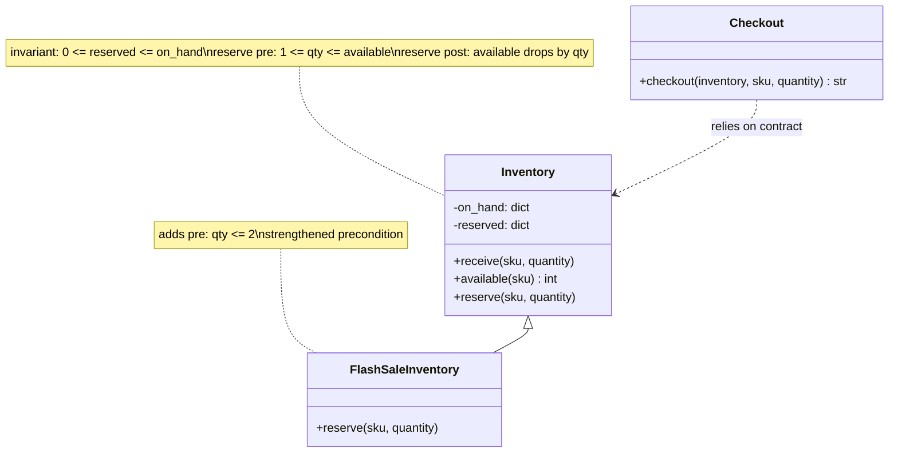

**Reading the diagram.**

- **Components.** `Inventory` tracks stock on hand and stock reserved for unpaid orders. `FlashSaleInventory` is a subclass. `Checkout` is client code.
- **Notes.** The notes record the contract: one invariant, plus the precondition and postcondition of `reserve`. The subclass note shows the extra condition it adds.
- **Direction and sync.** `Checkout` calls `available` then `reserve` synchronously. It was written against `Inventory`'s contract and is handed a `FlashSaleInventory` at run time.
- **Storage.** In memory here. In production the counts live in a database, and the "check then reserve" pair must be atomic, for example a single `UPDATE ... WHERE available >= qty` (Ch 11), or two concurrent checkouts can both pass the check.
- **Failure point.** The subclass rejects a call the parent's contract allows. `Checkout` checked the parent's precondition, so from its point of view the failure is impossible, and it has no handling for it.
- **Scaling.** Contracts scale with the team: every new caller and every new subclass can be checked against the same written rules.

#### Code example

```python
class Inventory:
    """Stock for each SKU.
    Class invariant: for every SKU, 0 <= reserved <= on_hand.
    """

    def __init__(self):
        self._on_hand = {}
        self._reserved = {}

    def receive(self, sku, quantity):
        # Precondition (caller's duty): quantity >= 1
        if quantity < 1:
            raise ValueError("precondition: quantity >= 1")
        self._on_hand[sku] = self._on_hand.get(sku, 0) + quantity
        self._reserved.setdefault(sku, 0)
        self._check_invariant(sku)

    def available(self, sku):
        return self._on_hand.get(sku, 0) - self._reserved.get(sku, 0)

    def reserve(self, sku, quantity):
        # Preconditions (caller's duty)
        if quantity < 1:
            raise ValueError("precondition: quantity >= 1")
        if quantity > self.available(sku):
            raise ValueError("precondition: quantity <= available(sku)")
        old_available = self.available(sku)

        self._reserved[sku] += quantity

        # Postcondition (supplier's promise) and invariant
        assert self.available(sku) == old_available - quantity, "postcondition"
        self._check_invariant(sku)

    def _check_invariant(self, sku):
        assert 0 <= self._reserved.get(sku, 0) <= self._on_hand.get(sku, 0), "invariant"


inv = Inventory()
inv.receive("SKU-MUG", 5)
inv.reserve("SKU-MUG", 3)
print(inv.available("SKU-MUG"))           # 2
try:
    inv.reserve("SKU-MUG", 3)             # caller broke the precondition
except ValueError as e:
    print("refused:", e)


class FlashSaleInventory(Inventory):
    """BAD subclass: strengthens the precondition (max 2 per reservation)."""
    def reserve(self, sku, quantity):
        if quantity > 2:
            raise ValueError("flash sale: at most 2 per reservation")
        super().reserve(sku, quantity)


def checkout(inventory, sku, quantity):  # written against Inventory's contract
    if quantity <= inventory.available(sku):
        inventory.reserve(sku, quantity)  # contract says this cannot fail
        return "reserved"
    return "out of stock"


for cls in (Inventory, FlashSaleInventory):
    store = cls()
    store.receive("SKU-TEA", 10)
    try:
        print(cls.__name__, checkout(store, "SKU-TEA", 4))
    except ValueError as e:
        print(cls.__name__, "surprise:", e)
# 2
# refused: precondition: quantity <= available(sku)
# Inventory reserved
# FlashSaleInventory surprise: flash sale: at most 2 per reservation
```

```java
import java.util.HashMap;
import java.util.Map;

/** Class invariant: for every SKU, 0 <= reserved <= onHand. */
class Inventory {
    private final Map<String, Integer> onHand = new HashMap<>();
    private final Map<String, Integer> reserved = new HashMap<>();

    /** @pre quantity >= 1 */
    void receive(String sku, int quantity) {
        if (quantity < 1) throw new IllegalArgumentException("precondition: quantity >= 1");
        onHand.merge(sku, quantity, Integer::sum);
        reserved.putIfAbsent(sku, 0);
        assert invariantHolds(sku) : "invariant";
    }

    int available(String sku) {
        return onHand.getOrDefault(sku, 0) - reserved.getOrDefault(sku, 0);
    }

    /** @pre 1 <= quantity <= available(sku)
     *  @post available(sku) == old available(sku) - quantity */
    void reserve(String sku, int quantity) {
        if (quantity < 1)
            throw new IllegalArgumentException("precondition: quantity >= 1");
        if (quantity > available(sku))
            throw new IllegalArgumentException("precondition: quantity <= available(sku)");
        int oldAvailable = available(sku);

        reserved.merge(sku, quantity, Integer::sum);

        assert available(sku) == oldAvailable - quantity : "postcondition";
        assert invariantHolds(sku) : "invariant";
    }

    private boolean invariantHolds(String sku) {
        int r = reserved.getOrDefault(sku, 0);
        return 0 <= r && r <= onHand.getOrDefault(sku, 0);
    }
}

/** BAD subclass: strengthens the precondition. */
class FlashSaleInventory extends Inventory {
    @Override void reserve(String sku, int quantity) {
        if (quantity > 2) throw new IllegalArgumentException("flash sale: at most 2 per reservation");
        super.reserve(sku, quantity);
    }
}

class Main {
    static String checkout(Inventory inventory, String sku, int quantity) {
        if (quantity <= inventory.available(sku)) {
            inventory.reserve(sku, quantity);     // the contract says this cannot fail
            return "reserved";
        }
        return "out of stock";
    }

    public static void main(String[] args) {
        Inventory inv = new Inventory();
        inv.receive("SKU-MUG", 5);
        inv.reserve("SKU-MUG", 3);
        System.out.println(inv.available("SKU-MUG"));                  // 2
        try {
            inv.reserve("SKU-MUG", 3);
        } catch (IllegalArgumentException e) {
            System.out.println("refused: " + e.getMessage());
        }
        for (Inventory store : new Inventory[] { new Inventory(), new FlashSaleInventory() }) {
            store.receive("SKU-TEA", 10);
            String name = store.getClass().getSimpleName();
            try {
                System.out.println(name + " " + checkout(store, "SKU-TEA", 4));
            } catch (IllegalArgumentException e) {
                System.out.println(name + " surprise: " + e.getMessage());
            }
        }
    }
}
```

What to notice:

- Preconditions are explicit `if` checks that always run; postconditions and invariants use `assert`, which documents intent and runs in tests (`-ea` was set when this Java was run).
- The postcondition refers to the *old* value of `available`, captured before the change. Eiffel has an `old` keyword for this; in Python and Java you save it in a local variable.
- `FlashSaleInventory` compiles, passes its own unit tests, and still breaks `checkout`. Type systems check method *signatures*; only the contract (and tests written against it) catches the change in *behavior*. A correct design would make the flash-sale limit part of the base contract (for example, `max_per_reservation(sku)` that callers can query) rather than a hidden extra rule.

#### Real-world industry applications

::: industry
**Eiffel and mainstream languages.** Eiffel builds contracts into the language: `require` clauses, `ensure` clauses with `old`, and class `invariant` sections, monitored at run time according to a compilation setting, and inherited automatically by subclasses. Mainstream languages approximate this with conventions: Java documents preconditions in Javadoc and checks them with exceptions or `Objects.requireNonNull`, and uses `assert` for internal conditions that are disabled by default in production.
*Evidence: Primary* — [Meyer 1997]; [Bloch 2018, Item 49]
:::

#### Failure scenarios

**Table 35.9 — Failure scenarios for contracts.**

| What goes wrong | Why | Detection | Recovery | Prevention |
|---|---|---|---|---|
| Subclass rejects valid calls | Strengthened precondition | Unhandled exception in client code | Move rule into the base contract | Meyer's rule; contract tests run against every subclass |
| Input validation silently off in production | Validation written with `assert` | Bad data in production | Replace with explicit checks | `assert` only for internal conditions |
| Overselling under load | Check-then-act across two calls, not atomic | Negative stock in reports | Compensate (cancel, refund) | Atomic conditional update in the store |
| Each layer re-validates differently | No written contract | Conflicting error messages | Document and centralize | One owner per check |

::: mistake
**Misconception — "A subclass that adds a safety check is always safer."** Adding a check to the *precondition* is exactly what breaks substitutability: callers that obey the parent's contract now fail. Extra checks on *outputs* (a stronger postcondition) are safe; extra demands on *inputs* are not.
:::

## 35.10 Cohesion and coupling

### 35.10.1 Two measures of a good module

::: definition
**Definition — Cohesion and coupling.** **Cohesion** is how strongly the elements inside one module (here, one class) belong together: whether they serve a single purpose. **Coupling** is how strongly one module depends on others: how much it must know about them, and how likely a change in one is to force a change in the other. Good designs have **high cohesion and low coupling**. Both terms come from structured design [Stevens, Myers & Constantine 1974].
:::

#### First-principles explanation

A well-run kitchen has stations: one cook does sauces, another grills. Everything at the sauce station is about sauces (high cohesion). The grill cook needs only "two portions of pepper sauce, please", not the recipe (low coupling). Now imagine one cook who does sauces, the accounts and the window cleaning, and a grill cook who walks over and adjusts the sauce burner directly. Any change to either person's routine breaks the other.

Every principle in this chapter so far is a way to get one or both properties. Encapsulation lowers coupling (callers know only methods). Tell, don't ask raises cohesion (rules sit with their data). Composition lowers coupling (black-box parts). Contracts make the remaining coupling explicit.

#### Why does this exist?

Stevens, Myers and Constantine observed in 1974 that the cost of changing a program depends on how far a change spreads. If modules are cohesive, a change in requirements maps to a change in one module. If they are loosely coupled, the change stops there. Their paper and the later book by Yourdon and Constantine [Yourdon & Constantine 1979] ranked kinds of coupling and cohesion from worst to best, and these rankings are still the standard vocabulary.

#### How it works internally: kinds of coupling

**Table 35.10 — Kinds of coupling, from tightest (worst) to loosest (best), with shop examples.**

| Kind | What it means | Shop example | Fix |
|---|---|---|---|
| Content | One module reads or changes another's internals | Report job edits `cart._lines` directly | Encapsulate (§35.4) |
| Common | Modules share global mutable data | Every module reads a global `CURRENT_DISCOUNT` | Pass values; one owner |
| External | Modules share an externally imposed format or device | Two classes parse the same payment-provider file layout | One adapter owns the format |
| Control | One module passes a flag that steers the other's logic | `total(cart, mode="gift")` with branches inside | Polymorphism or separate methods |
| Stamp | A whole structure is passed when only part is used | `shipping_cost(order)` reads only the weight | Pass what is needed |
| Data | Only needed elementary data passed as parameters | `shipping_cost(weight_grams)` | — |
| Message | Modules interact only by calling public methods | `order.settle()` | — (object-oriented ideal) |

Message coupling is not in the 1974 paper; it is commonly added at the loose end for object-oriented systems. **Inheritance** is another strong form of coupling not in the original list: a subclass depends on its parent's implementation (§35.5.2). Coupling is not bad in itself: a system with no coupling does nothing. The goal is that each dependency is *necessary*, *narrow* and *visible*.

#### How it works internally: kinds of cohesion

**Table 35.11 — Kinds of cohesion, from weakest to strongest.**

| Kind | Elements are grouped because... | Shop example |
|---|---|---|
| Coincidental | No real reason | `ShopUtils` with `format_price`, `send_sms`, `parse_csv` |
| Logical | They do the same *kind* of thing | `Validators` for carts, emails and addresses |
| Temporal | They run at the same time | `on_startup()` that loads config, warms cache, opens logs |
| Procedural | They run in a fixed sequence | `checkout_steps()` mixing pricing, stock and email |
| Communicational | They work on the same data | Methods that all read the order record |
| Sequential | The output of one is the input of the next | Price → apply discount → add tax |
| Functional | All contribute to one well-defined task | `Cart`: manage lines and compute totals |

#### Mathematical foundations: the LCOM intuition

You can approximate cohesion mechanically. If the methods of a class use disjoint sets of fields, the class is probably several classes glued together. Chidamber and Kemerer turned this into a metric, **Lack of Cohesion in Methods** [Chidamber & Kemerer 1994].

::: formula
**LCOM1 (Chidamber–Kemerer lack of cohesion in methods)**

$$\text{LCOM} = \begin{cases} |P| - |Q| & \text{if } |P| > |Q| \\ 0 & \text{otherwise} \end{cases}$$

| Symbol | Meaning | Units |
|---|---|---|
| $m$ | Number of methods in the class | count |
| $I_j$ | Set of instance fields used by method $j$ | set of fields |
| $P$ | Pairs of methods $(j, k)$ with $I_j \cap I_k = \emptyset$ (share no field) | pairs |
| $Q$ | Pairs of methods with $I_j \cap I_k \neq \emptyset$ (share at least one field) | pairs |
| $\lvert P\rvert + \lvert Q\rvert$ | Total method pairs, $m(m-1)/2$ | pairs |
| LCOM | Lack of cohesion; 0 is best, larger is worse | pairs |
:::

A related variant, often called **LCOM4** (attributed to Hitz and Montazeri), counts the **connected components** of the graph in which methods are linked when they share a field. One component means one responsibility; three components suggest three classes.

::: example
**Worked example — A `CheckoutManager` god class.**

The class has six methods with these field uses: `add_item` {lines}; `subtotal` {lines}; `apply_coupon` {coupon, lines}; `send_receipt` {smtp, email_template}; `render_invoice` {pdf_engine, email_template}; `log_event` {logger}.

1. Total pairs: $m(m-1)/2 = 6 \times 5 / 2 = 15$.
2. Pairs that share a field ($Q$): add_item–subtotal, add_item–apply_coupon, subtotal–apply_coupon (all share `lines`), send_receipt–render_invoice (share `email_template`). $|Q| = 4$.
3. Pairs that share nothing: $|P| = 15 - 4 = 11$.
4. $\text{LCOM} = 11 - 4 = 7$.
5. Connected components: {add_item, subtotal, apply_coupon}, {send_receipt, render_invoice}, {log_event}: three.
6. After splitting out the cart methods into `Cart`: 3 methods, 3 pairs, all sharing `lines`, so $|P| = 0$, $|Q| = 3$ and LCOM $= 0$.

**Interpretation.** An LCOM of 7 on a six-method class means most pairs of methods have nothing to do with each other; the three components name the classes hiding inside: `Cart`, a receipt/invoice sender, and a logger that should be injected rather than owned.

**Engineering implication.** Use LCOM as a *pointer* to classes worth reading, not as a target to optimize. It ignores methods that call each other, treats getters as tiny methods that inflate $P$, and varies between tools that use different LCOM definitions. A high value plus a vague class name (`Manager`, `Helper`, `Utils`) is a strong signal.
:::

The calculation is mechanical, so here it is as a short script (Python only, since it is a measuring tool rather than an object-oriented construct):

```python
from itertools import combinations


def lcom1(uses):
    """Chidamber-Kemerer LCOM: uses maps method name -> set of attributes it touches."""
    p = q = 0
    for a, b in combinations(uses, 2):
        if uses[a] & uses[b]:
            q += 1                      # pair shares at least one attribute
        else:
            p += 1                      # pair shares nothing
    return max(p - q, 0), p, q


def components(uses):
    """Groups of methods linked by shared attributes (the LCOM4 intuition)."""
    groups = []
    for method, attrs in uses.items():
        merged = [g for g in groups if g[1] & attrs]
        names, fields = {method}, set(attrs)
        for g in merged:
            names |= g[0]
            fields |= g[1]
            groups.remove(g)
        groups.append((names, fields))
    return [sorted(g[0]) for g in groups]


checkout_manager = {
    "add_item":       {"lines"},
    "subtotal":       {"lines"},
    "apply_coupon":   {"coupon", "lines"},
    "send_receipt":   {"smtp", "email_template"},
    "render_invoice": {"pdf_engine", "email_template"},
    "log_event":      {"logger"},
}
print(lcom1(checkout_manager))          # (7, 11, 4)
for group in components(checkout_manager):
    print(group)
# ['add_item', 'apply_coupon', 'subtotal']
# ['render_invoice', 'send_receipt']
# ['log_event']

cart = {k: v for k, v in checkout_manager.items() if k in ("add_item", "subtotal", "apply_coupon")}
print(lcom1(cart))                      # (0, 0, 3)
```

**Figure 35.10 — Splitting a low-cohesion class along its LCOM components.**

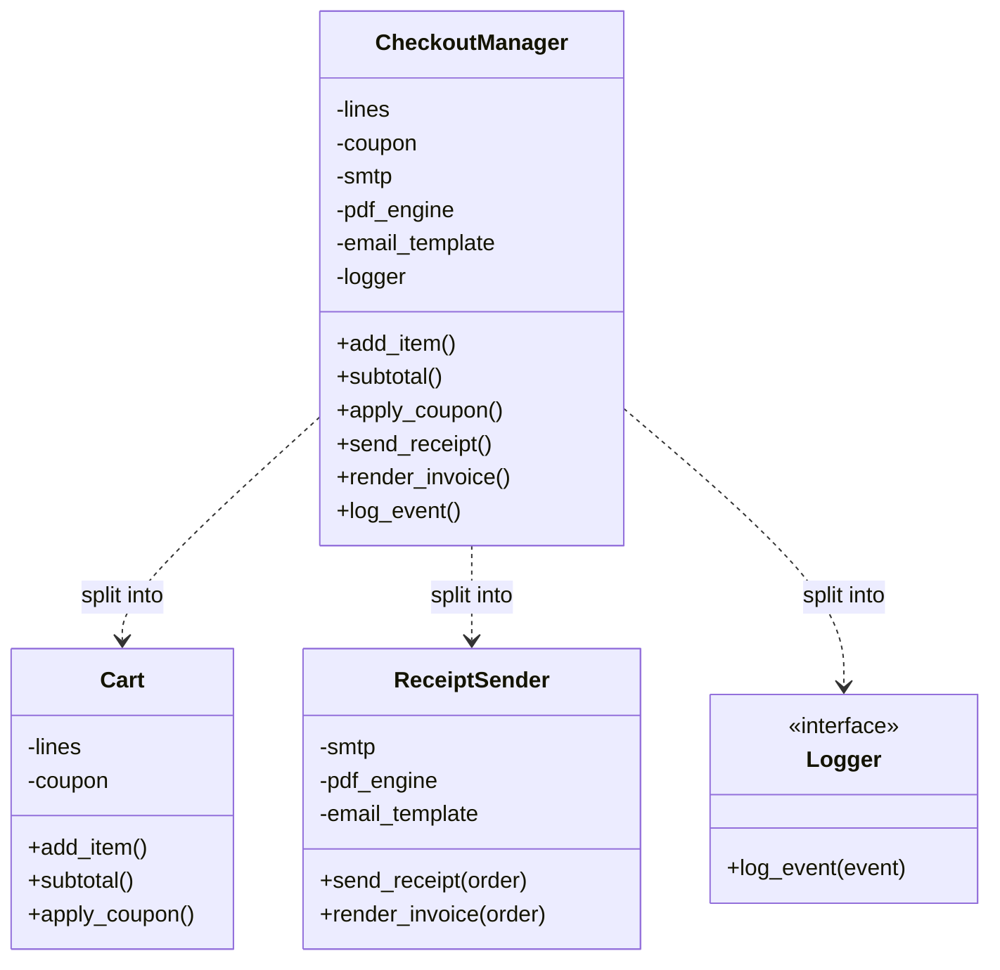

**Reading the diagram.**

- **Components.** Left: the original god class with six fields and six unrelated methods. Right: three classes, one per connected component found by the script.
- **Relationships.** The dotted "split into" arrows show the refactoring, not run-time calls. After the split, an order-placement service would call `Cart` for totals and `ReceiptSender` after payment, and receive a `Logger` from outside.
- **Sync/async.** Sending a receipt is a natural candidate for asynchronous processing via a queue (Ch 30), which is only easy once it is its own class.
- **Storage.** `Cart` state goes to the cart store; `ReceiptSender` is stateless apart from its configuration.
- **Failure points.** In the god class, an SMTP outage can fail a method that also holds cart state; after the split, a receipt failure cannot corrupt the cart.
- **Scaling.** Each new class can change, be tested and, in a service architecture, be deployed independently.

### 35.10.2 The Law of Demeter

::: definition
**Definition — Law of Demeter (object form).** A method `M` of an object `O` should call methods only on: `O` itself; `M`'s parameters; objects `M` creates; and `O`'s own fields (its direct parts) [Lieberherr & Holland 1989]. Informally: "talk only to your immediate friends", or "use only one dot" (excluding fluent builders and value-object chains).
:::

#### First-principles explanation

When you pay in a shop, the cashier asks you to pay. The cashier does not reach into your bag, open your wallet, take out a card and swipe it. If you change wallets, or pay by phone, the cashier's procedure does not change. Code like `order.customer.wallet.balance_cents -= total` is the cashier rummaging in your bag: the checkout now depends on `Order` having a customer, the customer having a wallet, and the wallet storing its balance in a field called `balance_cents`. Three classes' internals, one line. Martin calls such chains **train wrecks** [Martin 2008, ch. 6].

#### Why does this exist?

The Law of Demeter was formulated in the late 1980s by Karl Lieberherr's Demeter project at Northeastern University as a style rule that limits how much of the object structure any one method knows. Each method that obeys it depends only on its immediate neighbors, so a change to one class's structure affects only that class's neighbors. It is the object-level form of low coupling, and it pushes you towards tell, don't ask: instead of reaching through objects, you add a method to the nearest one.

#### Architecture diagram

**Figure 35.11 — Reaching through objects versus talking to neighbors.**

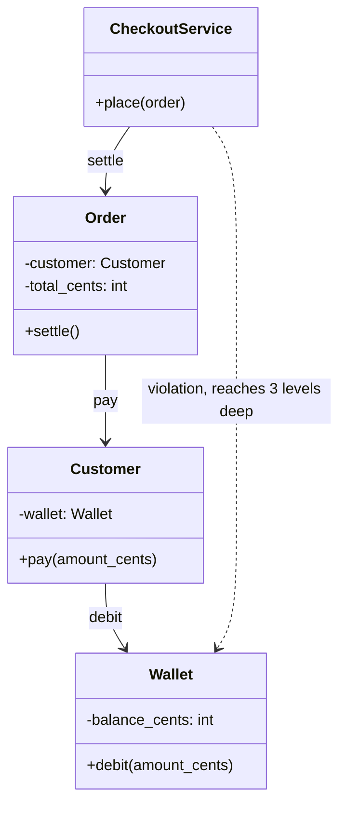

**Reading the diagram.**

- **Components.** A checkout service, an order, the customer who placed it and the customer's wallet.
- **Direction and sync.** Solid arrows are the compliant path: each object calls only its direct part, synchronously. The dotted arrow is the train-wreck dependency that compliant code removes.
- **Storage.** The wallet balance would be persisted by the payment component; only `Wallet` knows its representation.
- **Failure points.** With the violation, a change to `Wallet` (say, balances move to an external provider) breaks `CheckoutService`. With the compliant design, only `Customer` might change.
- **Scaling.** Adding a second way to pay (a company account) changes `Customer.pay`, not every caller.

#### Code example

```python
class Wallet:
    def __init__(self, balance_cents):
        self._balance_cents = balance_cents

    def debit(self, amount_cents):
        if amount_cents > self._balance_cents:
            raise ValueError("insufficient funds")
        self._balance_cents -= amount_cents

    def balance_cents(self):
        return self._balance_cents


class Customer:
    def __init__(self, name, wallet):
        self.name = name
        self._wallet = wallet

    def pay(self, amount_cents):                  # Customer talks to its own part
        self._wallet.debit(amount_cents)


class Order:
    def __init__(self, customer, total_cents):
        self._customer = customer
        self._total_cents = total_cents
        self.paid = False

    def settle(self):                             # Order talks to its own part
        self._customer.pay(self._total_cents)
        self.paid = True


# Violates the Law of Demeter: the checkout reaches through three objects.
#   order.customer.wallet.balance_cents -= order.total_cents
# Follows it: the checkout talks only to the order.
wallet = Wallet(10_000)
order = Order(Customer("Ada", wallet), 4548)
order.settle()
print(order.paid, wallet.balance_cents())         # True 5452
```

```java
final class Wallet {
    private long balanceCents;
    Wallet(long balanceCents) { this.balanceCents = balanceCents; }

    void debit(long amountCents) {
        if (amountCents > balanceCents) throw new IllegalStateException("insufficient funds");
        balanceCents -= amountCents;
    }
    long balanceCents() { return balanceCents; }
}

final class Customer {
    private final String name;
    private final Wallet wallet;
    Customer(String name, Wallet wallet) { this.name = name; this.wallet = wallet; }

    String name() { return name; }
    void pay(long amountCents) { wallet.debit(amountCents); }   // talks to its own field
}

final class Order {
    private final Customer customer;
    private final long totalCents;
    private boolean paid = false;
    Order(Customer customer, long totalCents) { this.customer = customer; this.totalCents = totalCents; }

    void settle() { customer.pay(totalCents); paid = true; }    // talks to its own field
    boolean isPaid() { return paid; }
}

class Main {
    public static void main(String[] args) {
        // Violation (would need getters all the way down):
        //   order.getCustomer().getWallet().debit(order.getTotalCents());
        Wallet wallet = new Wallet(10_000);
        Order order = new Order(new Customer("Ada", wallet), 4548);
        order.settle();
        System.out.println(order.isPaid() + " " + wallet.balanceCents());   // true 5452
    }
}
```

What to notice:

- Each method calls only its own fields: `Order.settle` → `customer.pay`; `Customer.pay` → `wallet.debit`. No class knows the structure two levels away.
- The cost is small **wrapper methods** (`Customer.pay`). If a class accumulates dozens of pass-through methods, that is a sign the caller needs a different object, not that the law should be broken.
- The law is about *objects with behavior*. Chaining over data or fluent APIs (`text.strip().lower()`, a stream pipeline) returns new values rather than reaching into structure, and is not a violation in spirit.

#### Real-world industry applications

::: industry
**Demeter project.** The Law of Demeter was developed in the Demeter project on adaptive software at Northeastern University and published as a style rule with a formal statement and examples of mechanically transforming non-compliant programs into compliant ones. The authors present it as a heuristic that limits the spread of change, not an absolute law, and discuss the trade-off of extra wrapper methods.
*Evidence: Primary* — [Lieberherr & Holland 1989]
:::

#### Failure scenarios

**Table 35.12 — Failure scenarios from poor cohesion and coupling.**

| What goes wrong | Why | Detection | Recovery | Prevention |
|---|---|---|---|---|
| Small change touches 15 files | High coupling (content, common, control) | Large diffs for small features; merge conflicts | Introduce interfaces and owners | Message/data coupling; Law of Demeter |
| SMTP outage blocks cart updates | Low cohesion: unrelated duties in one class | Incident shows unrelated failure | Split class | Review LCOM components and class names |
| Refactoring `Wallet` breaks checkout | Train-wreck chains | Compile errors far away | Add delegating methods | One-dot rule for behavior objects |
| Global discount flag changed by a test leaks into others | Common coupling | Flaky tests | Pass configuration explicitly | No global mutable state |

::: mistake
**Misconception — "Low coupling means fewer classes."** Merging classes reduces the number of dependencies *between classes* by hiding them inside one class, where they become low cohesion instead. The goal is the right boundaries: each class cohesive, each dependency narrow.
:::

## 35.11 Common mistakes

The previous sections each ended with a misconception about one idea. Three mistakes combine several ideas and are the ones reviewers and interviewers look for first.

::: mistake
**Anemic domain model.** Classes such as `Order`, `Cart` and `Customer` hold only fields with getters and setters, and all the rules live in "service" classes (`OrderService.calculateTotal(order)`, `CartService.applyCoupon(cart, coupon)`). It looks object-oriented but is procedural code with data structures: every invariant is enforced, or not, by whichever service touches the data, and the same rule is reimplemented in several services. Fowler named it an anti-pattern because it pays the cost of a domain model without the benefit [Fowler 2003]. **Fix:** move each rule next to the data it governs (tell, don't ask, §35.4.3); keep services for coordinating several objects and for infrastructure such as transactions. **Caveat:** for simple create-read-update-delete screens with almost no rules, plain data records and a thin service are a reasonable, honest choice.
:::

::: mistake
**God class.** One class, often named `Manager`, `Processor`, `Helper` or after the whole application, accumulates most of the system's behavior and data: thousands of lines, dozens of fields, and imports from every package. Riel's design heuristics warn against such classes and recommend distributing system intelligence evenly across top-level classes [Riel 1996]. Symptoms: high LCOM with several connected components (§35.10.1), most commits touch it, and its tests are slow and brittle. **Fix:** split along the components that LCOM reveals, starting with the least coupled group; move behavior to the classes whose data it uses.
:::

::: mistake
**Deep inheritance hierarchies.** `Product → ShippableProduct → FragileShippableProduct → FragileShippableImportedProduct → ...`. Each level adds coupling to every level above it (§35.5.2), a reader must open five files to know what one method does, and new requirements that cut across the hierarchy ("imported but not fragile") cause the class explosion of §35.8. Chidamber and Kemerer's depth-of-inheritance-tree metric was proposed partly because deeper classes are harder to predict [Chidamber & Kemerer 1994]. **Fix:** keep hierarchies shallow (one or two levels below an interface or abstract class is typical), turn independent axes into composed parts, and use interfaces for capabilities.
:::

**Table 35.13 — Common mistakes at a glance.**

| Mistake | Quick test | First fix |
|---|---|---|
| Anemic domain model | Do the entity classes have any methods besides getters and setters? | Move one rule into its entity |
| God class | Can you describe the class in one sentence without "and"? | Split along LCOM components |
| Deep hierarchy | More than two or three levels of concrete classes? | Extract an axis into a composed part |
| Setter for every field | Can a caller break an invariant with one call? | Replace setters with business operations |
| Inheritance for reuse only | Would callers ever use the child *as* the parent? | Delegate to a helper object |

## 35.12 Summary and revision notes

::: summary
- **Objects** bundle state and behavior; a **class** is their template. Constructors must leave objects valid or refuse to create them. **Identity** (`is`, Java `==`) differs from **equality** (`==`/`__eq__`, `equals`); override equality and hashing together, value equality for value objects, identity for entities.
- **Encapsulation** protects **invariants** and hides decisions likely to change [Parnas 1972]. Expose business operations, not setters; return copies or immutable views; derive values instead of storing them; **tell, don't ask**.
- **Inheritance** models behavioral is-a and enables substitutability, but is white-box reuse: the **fragile base class problem** means subclasses depend on parent internals (`CountingCart` counted 6 instead of 3). Design and document for inheritance, or prohibit it.
- **Polymorphism**: one call, many behaviors. Subtype polymorphism uses **dynamic dispatch**; Python also allows **duck typing**, checkable with `Protocol`; **generics** abstract over element types.
- **Abstraction**: abstract classes share state and steps and force subclasses to fill gaps; interfaces declare roles and allow many per class. Program to an interface.
- **Composition over inheritance**: one composed part per axis of variation turns $\prod k_i$ subclasses into $1 + \sum k_i$ classes (27 vs 10 for three axes of three) and allows run-time change. Wrappers with forwarding fix fragile subclasses.
- **Design by contract**: preconditions (caller's duty), postconditions (supplier's promise), invariants. Subclasses may weaken preconditions and strengthen postconditions, never the reverse (preview of §36.5).
- **High cohesion, low coupling**. Prefer data and message coupling; LCOM1 $= \max(|P|-|Q|, 0)$ and connected components point at classes to split. **Law of Demeter**: talk only to your immediate friends.
- Watch for the **anemic domain model**, the **god class** and **deep hierarchies**.
:::

## 35.13 Knowledge checkpoint

1. What is the difference between a class and an object?
2. Two `Product` objects have the same SKU. Under the design of §35.3, what do `a == b` and `a is b` return, and why?
3. Why must `hashCode` change whenever you override `equals` in Java?
4. Name two ways a getter can break encapsulation.
5. In §35.4, why does the cart not store a `total` field?
6. What exactly goes wrong in the `CountingCart` subclass, and why is removing its `add_all` override not a real fix?
7. What is dynamic dispatch? What decides which method runs?
8. How does duck typing differ from Java's interfaces, and what does `typing.Protocol` add?
9. Give one thing an abstract class can do that a Java interface cannot, and one thing an interface can do that an abstract class cannot.
10. A design has 4 shipping options, 3 packagings and 2 payment timings. How many classes does inheritance-per-combination need, and how many does composition need?
11. State Meyer's rule for preconditions and postconditions in a subclass.
12. Why should user-input validation not be written with `assert`?
13. Rank data, control and content coupling from best to worst.
14. Compute LCOM1 for a class with 4 methods in which exactly one pair shares a field.
15. Rewrite `order.get_customer().get_address().get_city()` used to compute shipping so that it obeys the Law of Demeter.

<details>
<summary>Answers</summary>

1. A class is the template (fields and methods); an object is one instance with its own state, created from the class.
2. `a == b` is `True` because `Product.__eq__` compares SKUs; `a is b` is `False` because they are two distinct objects in memory.
3. Hash-based collections find a bucket by hash first; equal objects with different hashes land in different buckets, so lookups fail and sets hold duplicates.
4. Returning an internal mutable collection (callers can modify it), and exposing data that lets callers make decisions the object should make (logic leaks out).
5. The total is derived from lines and coupon; storing it would let it disagree with them, for example keeping a discount after an item removal drops the subtotal below the minimum.
6. `add_all` counts 3, then the base `add_all` calls the overridden `add` 3 times, counting 3 more: 6. Removing the override relies on the base still calling `add`; if the base changes, the count becomes wrong again.
7. Choosing the method implementation at run time from the object's actual class, not the variable's declared type.
8. Duck typing accepts any object that has the methods used, checked when called; Java requires an explicit `implements`. `Protocol` lets a static checker verify the shape before running, without inheritance.
9. Abstract class: hold instance state (or a `final` template method using it). Interface: be implemented by a class that already extends another class (many interfaces per class).
10. Inheritance: $4 \times 3 \times 2 = 24$. Composition: $1 + 4 + 3 + 2 = 10$.
11. A redefinition may only weaken the precondition and only strengthen the postcondition, and must keep the class invariant.
12. Assertions can be disabled (`python -O`, Java without `-ea`), so the check would silently disappear in production.
13. Data (best), control, content (worst).
14. 6 pairs; $|Q| = 1$, $|P| = 5$; LCOM $= 5 - 1 = 4$.
15. Add `order.shipping_city()` (which asks `customer.shipping_city()`, which asks its address), or better, tell: `order.shipping_cost(rate_table)`.

</details>

## 35.14 Interview questions

### Basic

**Q1. What are the four pillars of object-oriented programming, and how do they relate?**
**Answer.** Encapsulation (an object guards its state and invariants), abstraction (callers see what an object does, not how), inheritance (a class extends another, sharing code and type), and polymorphism (one call, behavior chosen by the object). Encapsulation and abstraction create boundaries; polymorphism lets you vary what is behind a boundary; inheritance is one way, and often not the best way, to get polymorphism. Mention that composition and interfaces deliver polymorphism with less coupling.

**Q2. When would you use an abstract class rather than an interface?**
**Answer.** An abstract class when closely related variants share real state and an algorithm whose order must be fixed, such as `PaymentMethod.pay` validating, charging and recording. An interface for a role or capability that unrelated classes can play (`Refundable`), for module boundaries, and whenever a class may need several roles. A common combination is an interface for the type plus an optional skeletal abstract class.

**Q3. Why are public setters for every field considered poor design?**
**Answer.** They let any caller put the object in a state the business rules forbid and spread the rules across callers. Replace them with operations named after business actions that check invariants (`apply_coupon`, `remove`), keep immutable values immutable, and derive computed values.

### Intermediate

**Q4. "Favor composition over inheritance." When is inheritance still the right choice?**
**Answer.** When the child is a behavioral subtype (keeps every promise of the parent), there is a single axis of variation, the parent was designed and documented for extension, and both are maintained together. Implementing an interface is always fine. Otherwise, compose: separate axes into parts, delegate, and swap parts at run time. Quantify: $\prod k_i$ versus $1 + \sum k_i$ classes.

**Q5. Explain the fragile base class problem with an example and two remedies.**
**Answer.** A subclass overrides `add` and `add_all` to count items; the base `add_all` internally calls `add`, so items are counted twice. Change the base and the subclass breaks the other way. Remedies: wrap instead of extend (forwarding wrapper implementing the same interface), or have the base class document its self-use or be declared `final`.

**Q6. Implement `equals` for a `Money(amount_cents, currency)` value object. What must you remember?**
**Answer.** Compare both fields; handle `null` and other types; override `hashCode` with the same fields; make the class immutable so the hash cannot change while it is in a set; keep equality reflexive, symmetric and transitive (be careful with subclasses adding fields, which is why value classes are usually `final` or records).

### Advanced

**Q7. Design the classes for a shop checkout that supports multiple discount rules, payment methods and shipping options.**
**Answer.** `Cart` (entity) owns immutable `Line`s and enforces quantity invariants; `Product` and `Money` are value objects. `DiscountRule` interface with one class per rule; a pricing component picks or stacks rules with a cap at the subtotal. `ShippingPolicy` and `Packaging` as composed parts of `Order`. `PaymentMethod` abstract class with a fixed `pay` template and a `Refundable` capability interface. `Inventory` with a written contract for `reserve`, implemented atomically in storage. Walk through one checkout with a sequence of calls, then discuss extension (new rule = new class), testing (fakes for payment) and failure handling (payment timeouts need idempotency, §22.15).

**Q8. Is a `Square` a `Rectangle`?**
**Answer.** Mathematically yes; behaviorally only if rectangles are immutable. If `Rectangle` has `set_width` with the postcondition "width changes, height unchanged", a `Square` must change both, which weakens the postcondition, so code written for rectangles breaks. Options: make shapes immutable, give them a common `Shape` interface without setters, or do not relate them. This is the behavioral subtyping idea of Liskov and Wing, developed in §36.5.

**Q9. You inherit a 6,000-line `OrderManager`. How do you approach it?**
**Answer.** Add characterization tests around current behavior first. Map which methods use which fields (LCOM components) and which callers use which methods. Extract the most independent component first behind an interface, delegate from the old class so callers keep working, and repeat. Move rules into the entities they govern. Track size, coupling and change frequency to show progress, and avoid a big-bang rewrite.

## 35.15 Practical exercises

1. **Money value object.** Write `Money(amount_cents, currency)` in Python (frozen dataclass) and Java (record) with addition that refuses mixed currencies. Show that equal values hash equally and work as set elements.
2. **Break and fix encapsulation.** Change §35.4's `lines()` to return the internal dictionary, write a caller that breaks invariant 1, then restore the snapshot and show the caller now fails.
3. **Fragile base, other direction.** Remove `add_all` from `CountingCart` (§35.5.2), confirm the count is 3, then rewrite the base `add_all` to update the dictionary directly and show the count becomes 0 for `add_all`. Then switch to the wrapper of §35.8 and repeat.
4. **A fourth discount.** Add `CategoryPercentOff` to §35.6 without editing `best_discount`. Then add a rule that stacks discounts but caps the total at the subtotal.
5. **Contract tests.** Write one test function that takes any `Inventory` and checks the `reserve` contract; run it against both classes of §35.9.
6. **Measure cohesion.** Run the LCOM script on a class from a codebase you know, by listing methods and the fields each uses. Do the components suggest a split?

## 35.16 Design challenges

1. **Library loans.** Design classes for a library that lends books, e-books and DVDs with different loan periods and late fees, and members with different borrowing limits. Identify axes of variation, decide inheritance versus composition, write the contract of `lend(item, member)`, and draw a class diagram.
2. **Notification system.** Orders must notify customers by email, SMS or push, in several languages, with immediate or daily-digest timing. Show the class explosion an inheritance design would cause, compute it, and give a composed design.
3. **Refactor a god class.** Given a `CheckoutManager` with pricing, stock reservation, payment, receipts and analytics, propose the target classes, the order of extraction, how callers keep working during the change, and how you would measure that cohesion improved.

## 35.17 References

1. Bloch, J. *Effective Java*, 3rd ed. Addison-Wesley, 2018.
2. Cardelli, L., Wegner, P. "On Understanding Types, Data Abstraction, and Polymorphism." *ACM Computing Surveys* 17(4):471–522, 1985.
3. Chidamber, S. R., Kemerer, C. F. "A Metrics Suite for Object Oriented Design." *IEEE Transactions on Software Engineering* 20(6):476–493, 1994.
4. Fowler, M. "AnemicDomainModel." martinfowler.com (bliki), 2003. https://martinfowler.com/bliki/AnemicDomainModel.html
5. Fowler, M. "TellDontAsk." martinfowler.com (bliki), 2013. https://martinfowler.com/bliki/TellDontAsk.html
6. Gamma, E., Helm, R., Johnson, R., Vlissides, J. *Design Patterns: Elements of Reusable Object-Oriented Software*, ch. 1 "Introduction". Addison-Wesley, 1994.
7. Hitz, M., Montazeri, B. "Measuring Coupling and Cohesion in Object-Oriented Systems." *Proceedings of the International Symposium on Applied Corporate Computing*, 1995.
8. Levkivskyi, I., Lehtosalo, J., Langa, Ł. *PEP 544 — Protocols: Structural Subtyping (Static Duck Typing)*. Python Software Foundation, 2017. https://peps.python.org/pep-0544/
9. Lieberherr, K. J., Holland, I. M. "Assuring Good Style for Object-Oriented Programs." *IEEE Software* 6(5):38–48, 1989.
10. Liskov, B. H., Wing, J. M. "A Behavioral Notion of Subtyping." *ACM Transactions on Programming Languages and Systems* 16(6):1811–1841, 1994.
11. Martin, R. C. *Clean Code: A Handbook of Agile Software Craftsmanship*. Prentice Hall, 2008.
12. Meyer, B. *Object-Oriented Software Construction*, 2nd ed. Prentice Hall, 1997.
13. Oracle. *Java SE 21 API documentation*: `java.util.Stack`, `java.util.Collections`, `java.time` package. https://docs.oracle.com/en/java/javase/21/docs/api/
14. Parnas, D. L. "On the Criteria To Be Used in Decomposing Systems into Modules." *Communications of the ACM* 15(12):1053–1058, 1972.
15. Python Software Foundation. *Python 3 documentation*: `abc` and `collections.abc` modules. https://docs.python.org/3/library/collections.abc.html
16. Riel, A. J. *Object-Oriented Design Heuristics*. Addison-Wesley, 1996.
17. Stevens, W. P., Myers, G. J., Constantine, L. L. "Structured Design." *IBM Systems Journal* 13(2):115–139, 1974.
18. Yourdon, E., Constantine, L. L. *Structured Design: Fundamentals of a Discipline of Computer Program and Systems Design*. Prentice Hall, 1979.

## 35.18 Open verification items

- Exact list and ordering of coupling kinds in Stevens, Myers & Constantine (1974) versus later refinements (Myers 1975; Yourdon & Constantine 1979); Table 35.10 uses the commonly taught seven-level ordering, with message coupling as a later addition.
- Publication venue of Hitz & Montazeri (1995) for LCOM4.
- Publication years of Fowler's "TellDontAsk" (believed 2013) and "AnemicDomainModel" (believed 2003) bliki entries.
- Item numbers cited from *Effective Java*, 3rd ed. (10–11, 17–20, 49–50): confirm against the printed edition.
