# Chapter 36 — SOLID Principles

> **Level:** 2 · **Track:** A (Traditional) · **Estimated reading time:** 4 h

Chapter 35 gave you the raw materials of object-oriented design: classes, encapsulation, inheritance, polymorphism, interfaces, cohesion and coupling. Those tools say what you *can* build. They do not say which of the many possible arrangements will still be pleasant to change in two years, when the tax rules have changed three times, marketing has rewritten every email, and the payment provider has been replaced. **SOLID** is a set of five design principles that answer that question at the level of classes and modules. Robert C. Martin collected and named them in the late 1990s and early 2000s [Martin 2002]; the acronym itself came later.

| Letter | Principle | One-line test |
|---|---|---|
| S | Single Responsibility | Does this module answer to exactly one group of people? |
| O | Open/Closed | Can I add the next expected variant without editing working code? |
| L | Liskov Substitution | Can every subtype be used wherever its base type is expected, without surprises? |
| I | Interface Segregation | Does each client depend only on the methods it calls? |
| D | Dependency Inversion | Does policy code depend on abstractions that it owns, not on concrete details? |

All five serve one goal: to **limit how far a change spreads**. A design in which one business decision touches one module, which is recompiled, retested and redeployed alone, is cheap to change. A design in which every change ripples through ten files owned by four teams is expensive, slow and fragile. SOLID gives you five specific ways to stop the ripple.

The chapter uses one running example throughout: the **order billing and notification module** of an online shop. When a customer places an order, the module computes an invoice (merchandise, gift-wrap fees, sales tax), stores the order, charges the customer's card and tells the customer, by email, SMS, push notification or webhook. You will see a version of this module that violates each principle, the specific pain that violation causes, the refactor, and the result in Python and Java. The final section lifts the principles from classes to components and services, and shows when applying them does more harm than good.

## 36.1 Learning objectives

After this chapter you should be able to:

- State each SOLID principle precisely, including its original source, and explain the problem it solves in terms of change and dependency.
- Identify the **actors** behind a class and split it so that each module answers to one actor.
- Distinguish Meyer's inheritance-based open–closed principle from Martin's abstraction-based version, and use strategy-style polymorphism to add variants without editing existing code.
- Apply the Liskov–Wing rules (preconditions may be weakened, postconditions strengthened, invariants and history preserved) to decide whether a subtype is safe, and write a reusable contract test.
- Split a fat interface into role interfaces and explain the effect on coupling, rebuilds and stubs.
- Explain dependency inversion, dependency injection and inversion of control as three different ideas, and use fakes to test policy code without networks or databases.
- Map SOLID to component and service boundaries, compute Martin's instability and abstractness metrics, and recognize when an abstraction is needless.
- Discuss SOLID trade-offs fluently in a low-level design interview.

## 36.2 Prerequisites

- Classes, encapsulation and interfaces — §35.3, §35.4, §35.9 (every principle is about how classes and interfaces are arranged).
- Inheritance and polymorphism — §35.5, §35.6 (open/closed and Liskov substitution are rules for using them safely).
- Composition over inheritance — §35.8 (most refactors in this chapter replace inheritance with composition).
- Cohesion and coupling — §35.10 (single responsibility is a sharpened definition of cohesion; dependency inversion manages coupling).
- Optional: layered and hexagonal architecture — §33.3, §33.10 (needed only for §36.8).

**Figure 36.1 — The running example and where each principle acts.**

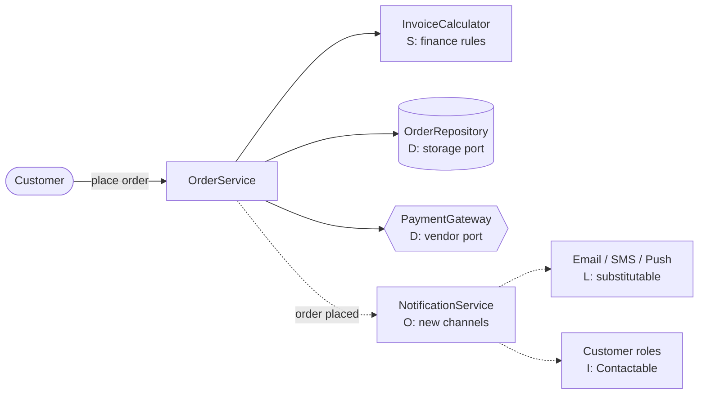

**Reading the diagram.** The customer (stadium) places an order through `OrderService`, the coordinating class. Solid arrows are synchronous calls made while the customer waits: computing the invoice, storing the order (cylinder, the storage boundary) and charging the card through an external payment provider (hexagon, the main failure point outside your control). Dotted arrows are asynchronous: notification happens after the order is committed, so a slow SMS provider cannot block checkout. Each box is labeled with the principle that shapes it: the **S**ingle-responsibility split isolates finance rules; the **O**pen/closed notification service gains channels without edits; the channel implementations must be **L**iskov-substitutable; customers are seen through narrow **I**nterface-segregated roles; and storage and payments sit behind **D**ependency-inverted ports, which is also what lets each part scale or be replaced independently.

## 36.3 Single Responsibility Principle

### 36.3.1 Definition: one reason to change means one actor

::: definition
**Definition — Single Responsibility Principle (SRP).** A module should be responsible to one, and only one, **actor**, where an actor is a group of people (a role, a team, a stakeholder) who request changes to the module for the same reasons [Martin 2017]. The earlier formulation is "a class should have only one reason to change" [Martin 2002].
:::

The name misleads almost everyone. "Single responsibility" sounds like "a class should do one thing", which is a different and older rule about functions. A class can do many things (validate, compute, round, format a number) and still have one responsibility, because all of those things change for the same reason. Martin made this explicit in a 2014 essay: the principle is about *people*, and its practical form is "gather together the things that change for the same reasons; separate those things that change for different reasons" [Martin 2014].

#### First-principles explanation

Think of a shared kitchen notice board. If the cleaning rota, the menu and the fire-safety instructions are written on one sheet of paper, then every time the chef reprints the menu there is a chance the fire-safety section is lost or garbled, and the safety officer never asked for anything to change. Three people with unrelated concerns edit one artifact. Give each concern its own sheet and each person can change their sheet without touching anyone else's.

Code behaves the same way. Each line in a source file was written to satisfy someone. When two groups of people with different priorities edit the same class, three things go wrong. Their changes **collide** (merge conflicts, contested reviews). One group's change **breaks** behavior the other group relies on, often through shared helper code. And every change to the class forces **retesting and redeployment** of behavior that did not change.

#### Why does this exist?

The idea predates the name. Parnas argued in 1972 that a system should be split into modules so that each hides one design decision likely to change, rather than one step in a processing flowchart [Parnas 1972]. Cohesion (§35.10) captured "things in this module belong together". SRP sharpens cohesion by giving a test you can actually apply: *list the people who would ask for this code to change*. If the list has more than one entry with different motives, the module has more than one responsibility.

#### How it works internally

Applying SRP is a four-step procedure:

1. **List the operations** of the class.
2. **Name the actor** for each operation: who would file the ticket that changes it? Use roles (finance, customer communications, operations), not individuals.
3. **Look for shared code** used by operations with different actors. That is where accidental coupling hides.
4. **Split by actor**, give each part its own data or value objects, and, if callers want a single entry point, add a thin **facade** that sequences the parts but contains no business rule.

### 36.3.2 The violation: one class, three actors

Here is the first version of the billing module. One class computes the total, writes the receipt and saves the order.

**Figure 36.2 — Before SRP: one class answers to three actors.**

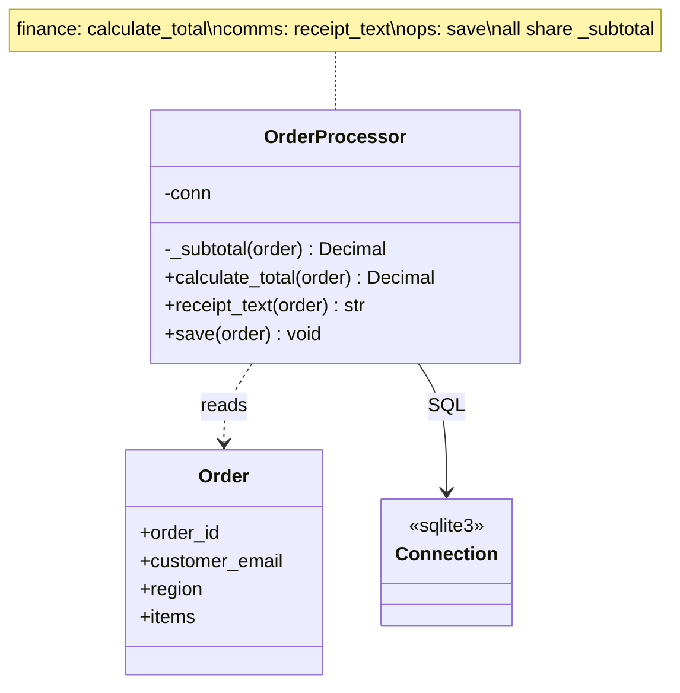

**Reading the diagram.** One class, `OrderProcessor`, holds a database connection and depends on the `Order` data class (dashed arrow, a usage dependency) and on a SQL connection (solid arrow, an association). Calls are synchronous, in-process method calls. The note lists which actor owns which method. The failure point is the private helper `_subtotal`, which all three public methods use: it is the one place where finance, communications and operations code meet. The storage boundary (the SQL connection) is inside the same class as the tax rules, so a schema change and a tax change produce edits to the same file. This class can only scale by deploying everything together.

```python
from dataclasses import dataclass, field
from decimal import Decimal, ROUND_HALF_UP
import sqlite3

@dataclass
class LineItem:
    sku: str
    unit_price: Decimal
    quantity: int
    gift_wrap: bool = False

@dataclass
class Order:
    order_id: str
    customer_email: str
    region: str
    items: list[LineItem] = field(default_factory=list)

TAX_RATES = {"CA": Decimal("0.0725"), "NY": Decimal("0.04")}
GIFT_WRAP_FEE = Decimal("4.00")

class OrderProcessor:
    """Before SRP: finance, customer comms and operations all edit this class."""

    def __init__(self, conn: sqlite3.Connection):
        self.conn = conn
        conn.execute("CREATE TABLE IF NOT EXISTS orders "
                     "(id TEXT PRIMARY KEY, email TEXT, total TEXT)")

    def _subtotal(self, order: Order) -> Decimal:      # shared helper
        total = Decimal("0")
        for item in order.items:
            total += item.unit_price * item.quantity
            if item.gift_wrap:
                total += GIFT_WRAP_FEE
        return total

    # Actor 1 -- finance: tax and fee policy
    def calculate_total(self, order: Order) -> Decimal:
        sub = self._subtotal(order)
        tax = (sub * TAX_RATES[order.region]).quantize(Decimal("0.01"), ROUND_HALF_UP)
        return sub + tax

    # Actor 2 -- customer communications: receipt wording and layout
    def receipt_text(self, order: Order) -> str:
        return (f"Order {order.order_id}: items {self._subtotal(order):.2f}, "
                f"total due {self.calculate_total(order):.2f}")

    # Actor 3 -- operations: schema and storage
    def save(self, order: Order) -> None:
        self.conn.execute("INSERT INTO orders VALUES (?, ?, ?)",
                          (order.order_id, order.customer_email,
                           str(self.calculate_total(order))))

if __name__ == "__main__":
    order = Order("A-1001", "ana@example.com", "CA",
                  [LineItem("MUG", Decimal("20.00"), 2, gift_wrap=True)])
    processor = OrderProcessor(sqlite3.connect(":memory:"))
    processor.save(order)
    print(processor.receipt_text(order))
    # Order A-1001: items 44.00, total due 47.19
```

What to notice:

- `_subtotal` mixes two concepts: the merchandise value and the gift-wrap fee. Both the tax computation and the receipt rely on it.
- The receipt calls `calculate_total`, so receipt wording now depends on tax policy.
- The class creates its own table. A database migration and a tax change land in the same file and the same deployment.

::: example
**Worked example — How a finance change breaks the receipt.** Finance learns that in its main state gift wrapping should not be taxed. A developer on the finance team edits `_subtotal` to return only merchandise, and adds the wrap fee after tax in `calculate_total`. For order A-1001 (two mugs at \$20.00, one gift-wrapped line, California rate 7.25%):

1. Before the change: subtotal = 2 × 20.00 + 4.00 = 44.00; tax = 44.00 × 0.0725 = 3.19; total = 47.19. Receipt: "items 44.00, total due 47.19". The \$3.19 difference is tax, as the customer expects.
2. After the change: `_subtotal` = 40.00; tax = 40.00 × 0.0725 = 2.90; total = 40.00 + 2.90 + 4.00 = 46.90. Receipt: "items 40.00, total due 46.90".
3. The customer now sees \$6.90 between "items" and "total" with no explanation of the \$4.00 wrap fee. Nobody on the communications team changed anything; their tests (if they exist) assert wording, not arithmetic.

**Interpretation.** The finance change was correct for finance, and the defect landed in another actor's output through a shared helper. **Engineering implication.** Shared code between actors is not reuse; it is accidental coupling. Two pieces of code that look identical today but change for different reasons should be allowed to diverge.
:::

**Figure 36.3 — Actors map to methods; shared code couples them.**

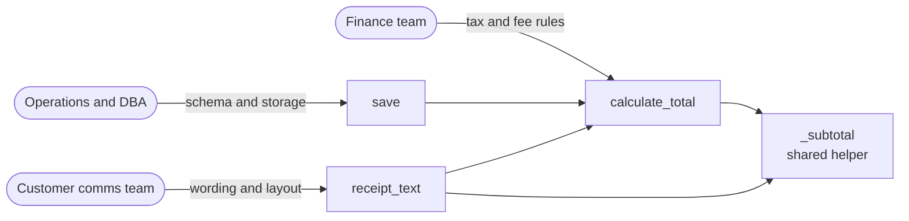

**Reading the diagram.** Stadium shapes are the three actors; rectangles are methods of the single class. The arrows from actors are change requests, not runtime calls; the arrows between methods are synchronous in-process calls. Follow the arrows into `_subtotal`: a change requested by finance reaches the receipt (via `_subtotal` and `calculate_total`) and the stored total (via `calculate_total`). This is the failure point SRP targets. The diagram also shows why "split it into smaller methods" does not help: the methods are already small; what matters is that their *change paths* converge. There is no storage boundary shown because the problem is entirely in code ownership.

### 36.3.3 The refactor: split by actor

The refactor creates one class per actor and a value object, `Invoice`, that carries finance's result to the others so nobody recomputes it.

**Figure 36.4 — After SRP: one class per actor, coordinated by a facade.**

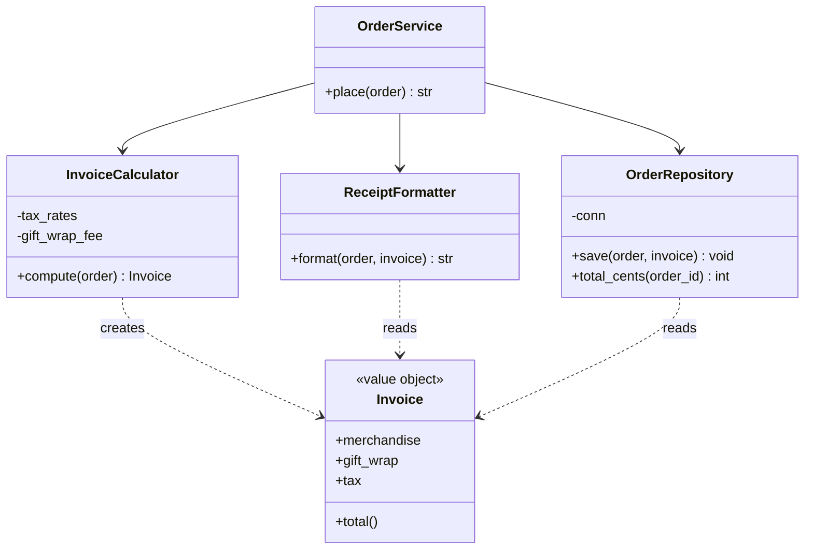

**Reading the diagram.** `OrderService` is a facade: it holds references (solid arrows) to three collaborators and calls them synchronously in sequence. Each collaborator answers to one actor: `InvoiceCalculator` to finance, `ReceiptFormatter` to communications, `OrderRepository` to operations. The immutable `Invoice` value object (dashed arrows, usage) is created only by the calculator and read by the others, so the arithmetic exists in exactly one place. The storage boundary is now confined to `OrderRepository`; a schema migration touches only that class. Failure points are isolated too: a formatting bug cannot change a stored total. Each class can be tested, reviewed and, in a larger system, deployed by the team that owns it.

#### Code example

```python
from dataclasses import dataclass
from decimal import Decimal, ROUND_HALF_UP
import sqlite3

CENT = Decimal("0.01")

@dataclass(frozen=True)
class LineItem:
    sku: str
    unit_price: Decimal
    quantity: int
    gift_wrap: bool = False

@dataclass(frozen=True)
class Order:
    order_id: str
    customer_email: str
    region: str
    items: tuple[LineItem, ...]

@dataclass(frozen=True)
class Invoice:                       # value object passed between the parts
    merchandise: Decimal
    gift_wrap: Decimal
    tax: Decimal

    @property
    def total(self) -> Decimal:
        return self.merchandise + self.gift_wrap + self.tax

class InvoiceCalculator:
    """Answers to finance. Changes only when tax or fee policy changes."""

    def __init__(self, tax_rates: dict[str, Decimal], gift_wrap_fee: Decimal,
                 tax_gift_wrap: bool):
        self.tax_rates = tax_rates
        self.gift_wrap_fee = gift_wrap_fee
        self.tax_gift_wrap = tax_gift_wrap

    def compute(self, order: Order) -> Invoice:
        merchandise = sum((i.unit_price * i.quantity for i in order.items), Decimal("0"))
        wraps = self.gift_wrap_fee * sum(1 for i in order.items if i.gift_wrap)
        taxable = merchandise + (wraps if self.tax_gift_wrap else Decimal("0"))
        tax = (taxable * self.tax_rates[order.region]).quantize(CENT, ROUND_HALF_UP)
        return Invoice(merchandise, wraps, tax)

class ReceiptFormatter:
    """Answers to customer communications. Changes when wording or layout changes."""

    def format(self, order: Order, invoice: Invoice) -> str:
        lines = [f"Order {order.order_id}",
                 f"  Merchandise {invoice.merchandise:>8.2f}"]
        if invoice.gift_wrap:
            lines.append(f"  Gift wrap   {invoice.gift_wrap:>8.2f}")
        lines.append(f"  Tax         {invoice.tax:>8.2f}")
        lines.append(f"  Total       {invoice.total:>8.2f}")
        return "\n".join(lines)

class OrderRepository:
    """Answers to operations. Changes when schema or storage changes."""

    def __init__(self, conn: sqlite3.Connection):
        self.conn = conn
        conn.execute("CREATE TABLE IF NOT EXISTS orders "
                     "(id TEXT PRIMARY KEY, email TEXT, total_cents INTEGER)")

    def save(self, order: Order, invoice: Invoice) -> None:
        self.conn.execute("INSERT INTO orders VALUES (?, ?, ?)",
                          (order.order_id, order.customer_email,
                           int(invoice.total * 100)))

    def total_cents(self, order_id: str) -> int:
        row = self.conn.execute("SELECT total_cents FROM orders WHERE id = ?",
                                (order_id,)).fetchone()
        return row[0]

class OrderService:
    """Facade: sequences the three parts; owns no business rule itself."""

    def __init__(self, calculator: InvoiceCalculator, formatter: ReceiptFormatter,
                 repository: OrderRepository):
        self.calculator, self.formatter, self.repository = calculator, formatter, repository

    def place(self, order: Order) -> str:
        invoice = self.calculator.compute(order)
        self.repository.save(order, invoice)
        return self.formatter.format(order, invoice)

if __name__ == "__main__":
    order = Order("A-1001", "ana@example.com", "CA",
                  (LineItem("MUG", Decimal("20.00"), 2, gift_wrap=True),))
    rates = {"CA": Decimal("0.0725"), "NY": Decimal("0.04")}
    for tax_wrap in (True, False):           # finance flips one policy flag
        repo = OrderRepository(sqlite3.connect(":memory:"))
        service = OrderService(InvoiceCalculator(rates, Decimal("4.00"), tax_wrap),
                               ReceiptFormatter(), repo)
        print(f"tax_gift_wrap={tax_wrap}")
        print(service.place(order))
        print("  stored cents:", repo.total_cents("A-1001"))
# Output (abridged): Tax 3.19, Total 47.19, stored 4719; then Tax 2.90, Total 46.90, stored 4690
```

What to notice:

- Finance's policy change is now one constructor argument in one class. The receipt shows a separate gift-wrap line, so it reconciles in both cases (40.00 + 4.00 + 2.90 = 46.90).
- `Invoice` is frozen. Communications and operations read finance's numbers; they cannot alter them.
- The repository stores integer cents, an operations decision invisible to the other two classes.
- `OrderService` contains no `if`, no arithmetic and no SQL. A facade that starts accumulating rules is a sign that a fourth actor has appeared.

The same design in Java (compiled and run with `javac`/`java` 21):

```java
// File: SrpAfter.java  (Java 17+)
import java.math.BigDecimal;
import java.math.RoundingMode;
import java.util.HashMap;
import java.util.List;
import java.util.Map;

public class SrpAfter {
    record LineItem(String sku, BigDecimal unitPrice, int quantity, boolean giftWrap) {}
    record Order(String orderId, String customerEmail, String region, List<LineItem> items) {}
    record Invoice(BigDecimal merchandise, BigDecimal giftWrap, BigDecimal tax) {
        BigDecimal total() { return merchandise.add(giftWrap).add(tax); }
    }

    /** Answers to finance. */
    static final class InvoiceCalculator {
        private final Map<String, BigDecimal> taxRates;
        private final BigDecimal giftWrapFee;
        private final boolean taxGiftWrap;
        InvoiceCalculator(Map<String, BigDecimal> taxRates, BigDecimal giftWrapFee, boolean taxGiftWrap) {
            this.taxRates = taxRates; this.giftWrapFee = giftWrapFee; this.taxGiftWrap = taxGiftWrap;
        }
        Invoice compute(Order order) {
            BigDecimal merchandise = BigDecimal.ZERO, wraps = BigDecimal.ZERO;
            for (LineItem i : order.items()) {
                merchandise = merchandise.add(i.unitPrice().multiply(BigDecimal.valueOf(i.quantity())));
                if (i.giftWrap()) wraps = wraps.add(giftWrapFee);
            }
            BigDecimal taxable = taxGiftWrap ? merchandise.add(wraps) : merchandise;
            BigDecimal tax = taxable.multiply(taxRates.get(order.region()))
                                    .setScale(2, RoundingMode.HALF_UP);
            return new Invoice(merchandise, wraps, tax);
        }
    }

    /** Answers to customer communications. */
    static final class ReceiptFormatter {
        String format(Order order, Invoice inv) {
            StringBuilder sb = new StringBuilder("Order " + order.orderId() + "\n");
            sb.append(String.format("  Merchandise %8.2f%n", inv.merchandise()));
            if (inv.giftWrap().signum() > 0) sb.append(String.format("  Gift wrap   %8.2f%n", inv.giftWrap()));
            sb.append(String.format("  Tax         %8.2f%n", inv.tax()));
            sb.append(String.format("  Total       %8.2f", inv.total()));
            return sb.toString();
        }
    }

    /** Answers to operations. An in-memory map stands in for the database. */
    static final class OrderRepository {
        private final Map<String, Long> totalCents = new HashMap<>();
        void save(Order order, Invoice inv) {
            totalCents.put(order.orderId(), inv.total().movePointRight(2).longValueExact());
        }
        long totalCents(String orderId) { return totalCents.get(orderId); }
    }

    /** Facade: sequences the parts, owns no rule. */
    static final class OrderService {
        private final InvoiceCalculator calculator;
        private final ReceiptFormatter formatter;
        private final OrderRepository repository;
        OrderService(InvoiceCalculator c, ReceiptFormatter f, OrderRepository r) {
            calculator = c; formatter = f; repository = r;
        }
        String place(Order order) {
            Invoice invoice = calculator.compute(order);
            repository.save(order, invoice);
            return formatter.format(order, invoice);
        }
    }

    public static void main(String[] args) {
        Order order = new Order("A-1001", "ana@example.com", "CA",
                List.of(new LineItem("MUG", new BigDecimal("20.00"), 2, true)));
        Map<String, BigDecimal> rates = Map.of("CA", new BigDecimal("0.0725"), "NY", new BigDecimal("0.04"));
        for (boolean taxWrap : new boolean[] {true, false}) {
            OrderRepository repo = new OrderRepository();
            OrderService service = new OrderService(
                    new InvoiceCalculator(rates, new BigDecimal("4.00"), taxWrap), new ReceiptFormatter(), repo);
            System.out.println("taxGiftWrap=" + taxWrap + "\n" + service.place(order));
            System.out.println("  stored cents: " + repo.totalCents("A-1001"));
        }
    }
}
```

What to notice:

- Records give immutable value objects for free; `BigDecimal` with an explicit `RoundingMode` avoids binary floating-point error in money (never use `double` for currency).
- `movePointRight(2).longValueExact()` throws if the total somehow had fractions of a cent, turning a silent rounding bug into a loud failure at the storage boundary.

#### Real-world industry applications

::: industry
**`java.util.Date` and its successors.** Java 1.0's `Date` combined three responsibilities: representing an instant, interpreting it as calendar fields (year, month, day) and parsing strings. JDK 1.1 deprecated the calendar-field and parsing methods in favor of `Calendar` and `DateFormat`, and Java 8's `java.time` package (JSR 310) separated the concepts further into `Instant`, `LocalDate`, `ZonedDateTime` and `DateTimeFormatter`. Each type now changes for one kind of reason: time-zone rules, calendar arithmetic or text formats. The cost was a long migration and two generations of deprecated API.
*Evidence: Primary* — [Oracle Java SE API: java.util.Date; java.time]
:::

#### Advantages and disadvantages

The benefits are fewer merge conflicts between teams, defects that stay inside one actor's code, smaller test surfaces and the freedom to deploy one part without the others. The costs are more classes, more names to learn and a coordination layer (the facade) that newcomers must find. Splitting too early is also a cost: if you guess the actors wrong, you create seams in the wrong places and must move code across them later.

**Table 36.1 — SRP failure scenarios.**

| What goes wrong | Why | Detection | Recovery | Prevention |
|---|---|---|---|---|
| One team's change breaks another's output | Shared helper across actors | Cross-team bug reports; tests in an unrelated area fail | Duplicate the helper per actor, then let copies diverge | Map actors before extracting "common" code |
| Constant merge conflicts on one file | Several teams edit one class | Version-control history: many authors, unrelated commits | Split by actor behind a facade | Review ownership in design reviews |
| Over-split code: one change touches six classes | Split by technical step, not by actor | Every feature ticket edits the same cluster of files | Merge classes that always change together | Split only along observed reasons to change |

#### Common misconceptions

::: mistake
**"SRP means a class should do only one thing."** That rule applies to functions. A class may do many related things. SRP asks *who* requests changes, and a 300-line class that only finance ever changes satisfies it better than five 60-line classes that every ticket touches together.
:::

::: mistake
**"Duplicated code always violates DRY, so merge it."** Two blocks that look the same but answer to different actors are *accidental* duplicates. Merging them creates the coupling in the worked example above. Merge only when the code represents the same knowledge and will change for the same reason.
:::

::: tip
**SRP in LLD interviews.** When you sketch classes for a parking lot or a billing system, name the actor behind each class out loud ("pricing changes when the business changes rates; the ticket printer changes when the hardware changes"). Interviewers listen for *reasons to change*, not class counts. If asked to "add a feature", show that it lands in one class.
:::

## 36.4 Open/Closed Principle

### 36.4.1 Definition: Meyer's version and Martin's version

::: definition
**Definition — Open/Closed Principle (OCP).** Software entities (classes, modules, functions) should be **open for extension** but **closed for modification**: you should be able to add new behavior by adding new code, without editing code that already works and is already depended upon [Martin 2002]. The principle was first stated by Bertrand Meyer [Meyer 1988].
:::

The two halves sound contradictory until you see what each refers to. "Closed" refers to the existing source: its text, its tests, its users. "Open" refers to the set of behaviors the system can exhibit. The trick that reconciles them is an **abstraction** that stays fixed while the number of implementations behind it grows.

Meyer and Martin used different tricks, and interviewers sometimes ask about the difference.

**Table 36.2 — Meyer's and Martin's open–closed principles.**

| Aspect | Meyer (1988, 1997) | Martin (1996, 2002) |
|---|---|---|
| Problem | A published library module must stay stable for its users, yet keep evolving | Client code must not be edited every time a new variant appears |
| "Closed" means | The module has a stable, well-defined interface and is available for use by other modules | The client's source is not edited when variants are added |
| "Open" means | The module can still be extended, for example with new features or fields | New behavior can be added by writing new classes |
| Mechanism | Implementation inheritance: a subclass reuses and extends the frozen original | Abstract interfaces and polymorphism: clients depend on an interface; variants implement it |
| Typical risk | Deep, fragile inheritance trees | Speculative interfaces nobody extends |

Meyer's setting was library engineering: once a class is compiled, documented and used by others, you do not edit it; you inherit from it and add to the subclass [Meyer 1997]. Martin kept the goal but moved the mechanism to abstraction: the client depends on an interface, and new implementations plug in behind it. Martin's version dominates current practice, partly because implementation inheritance creates the substitution problems of §36.5. Larman later restated the same idea as **protected variations**: identify points of predicted variation and wrap a stable interface around them [Larman 2001].

#### First-principles explanation

A wall socket is open/closed. The socket (the interface) was fixed decades ago; lamps, chargers and kettles that did not exist when it was installed plug into it without anyone rewiring the house. The house is closed for modification and open for extension *along one axis*: things that use the standard plug. It is not open along other axes. A device needing three-phase power still requires an electrician. Every OCP design is like this: closed against the kinds of change you anticipated, and open only along those axes.

#### Why does this exist?

Editing working code is risky in proportion to how many things depend on it. Each edit can break existing behavior, forces re-review and retesting, and, in compiled languages, recompiles and redeploys every dependent module. When the same `if/elif` chain over a "type" field appears in five places, adding one new type means five coordinated edits; missing one is a production bug. OCP replaces "find every place that switches on type" with "add one class".

#### How it works internally

1. **Find the axis of variation**: the thing that keeps changing (channels, tax regimes, discount rules, file formats).
2. **Define an abstraction** that captures what clients need from every variant, in the client's vocabulary.
3. **Move each variant** into its own class implementing the abstraction (the Strategy pattern, §37.7).
4. **Make clients depend only on the abstraction**, and select variants in one place: a registry, a configuration file or a composition root.
5. **Add new variants as new classes**; existing code is untouched.

Martin calls the choice of axis **strategic closure**: no design is closed against every change, so you choose the changes you expect and close against those [Martin 2002].

### 36.4.2 The violation: a switch on channel

After the SRP refactor, the shop adds a notification step. The first version switches on a channel string.

**Figure 36.5 — Before OCP: one method knows every channel.**

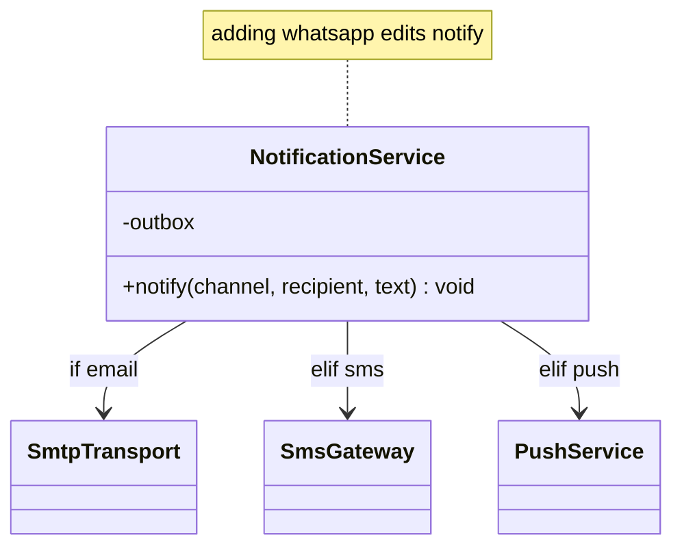

**Reading the diagram.** A single class holds direct, synchronous references to three transports and chooses among them with a conditional; the edge labels show the branch that selects each one. Every transport is a failure point the service must know about, and every new transport adds an edge *and* an edit to `notify`. The class's tests must cover all branches, so a change for WhatsApp re-runs and re-reviews email and SMS logic. In a compiled language, the service and everything that depends on it are rebuilt for each new channel.

```python
class NotificationService:
    """Before OCP: every new channel means editing this method."""

    def __init__(self, outbox: list):
        self.outbox = outbox                  # stands in for real transports

    def notify(self, channel: str, recipient: str, text: str) -> None:
        if channel == "email":
            self.outbox.append(("smtp", recipient, f"Subject: Your order\n\n{text}"))
        elif channel == "sms":
            self.outbox.append(("sms-gateway", recipient, text[:160]))
        elif channel == "push":
            self.outbox.append(("push", recipient, text[:100]))
        else:
            raise ValueError(f"unknown channel: {channel}")

if __name__ == "__main__":
    outbox = []
    service = NotificationService(outbox)
    service.notify("sms", "+15550100", "Order A-1001 shipped")
    try:
        service.notify("whatsapp", "+15550100", "Order A-1001 shipped")
    except ValueError as err:
        print("cannot extend without editing:", err)
```

What to notice:

- The only way to add a channel is to edit `notify`, a method every order flows through.
- `text[:160]` silently truncates SMS messages. Keep that line in mind; it returns as a Liskov violation in §36.5.

### 36.4.3 The refactor: depend on a Notifier abstraction

**Figure 36.6 — After OCP: the service depends on an abstraction; channels plug in.**

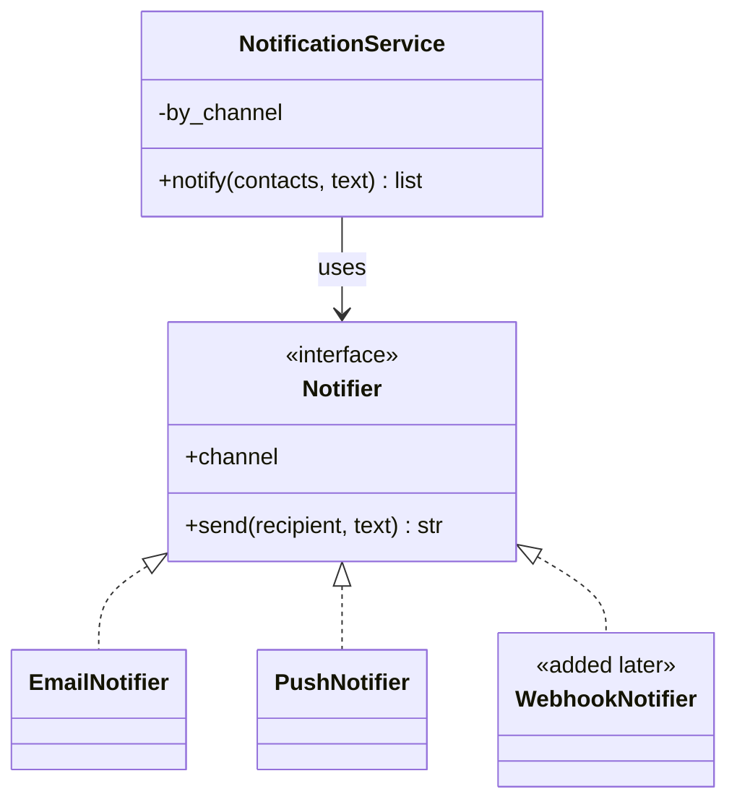

**Reading the diagram.** `NotificationService` holds a map from channel name to `Notifier` (solid arrow) and calls `send` synchronously through the interface. Three classes implement the interface (dashed arrows with hollow triangles, realization). `WebhookNotifier` was added months later in a new module; no arrow into or out of the service changed. Failure handling is now per implementation: a webhook timeout lives in `WebhookNotifier`. The service never imports a transport, so adding channels does not rebuild or retest it, and channels can be deployed or disabled independently through configuration. In production, `notify` would usually run asynchronously from a queue (Chapter 30), which Figure 36.1 shows as the dotted path.

#### Code example

```python
import itertools
from typing import Protocol

class Notifier(Protocol):
    """The stable abstraction. Contract: send() delivers the full text and
    returns a non-empty message id; it raises only for an invalid recipient."""
    channel: str
    def send(self, recipient: str, text: str) -> str: ...

_ids = itertools.count(1)

class EmailNotifier:
    channel = "email"
    def __init__(self, outbox: list):
        self.outbox = outbox
    def send(self, recipient: str, text: str) -> str:
        msg_id = f"em-{next(_ids)}"
        self.outbox.append((msg_id, recipient, f"Subject: Your order\n\n{text}"))
        return msg_id

class PushNotifier:
    channel = "push"
    def __init__(self, outbox: list):
        self.outbox = outbox
    def send(self, recipient: str, text: str) -> str:
        msg_id = f"pu-{next(_ids)}"
        self.outbox.append((msg_id, recipient, text))
        return msg_id

class NotificationService:
    """Closed for modification: knows only the Notifier abstraction."""

    def __init__(self, notifiers: list[Notifier]):
        self._by_channel = {n.channel: n for n in notifiers}

    def notify(self, contacts: dict[str, str], text: str) -> list[str]:
        """contacts maps channel -> address, in the customer's preference order."""
        sent = []
        for channel, address in contacts.items():
            notifier = self._by_channel.get(channel)
            if notifier is not None:          # unknown channels are skipped
                sent.append(notifier.send(address, text))
        return sent

# ---- Extension added months later, in a new module: no existing line edited ----
class WebhookNotifier:
    channel = "webhook"
    def __init__(self, outbox: list):
        self.outbox = outbox
    def send(self, recipient: str, text: str) -> str:
        msg_id = f"wh-{next(_ids)}"
        self.outbox.append((msg_id, recipient, {"event": "order.updated", "text": text}))
        return msg_id

if __name__ == "__main__":
    outbox: list = []
    service = NotificationService([EmailNotifier(outbox), PushNotifier(outbox),
                                   WebhookNotifier(outbox)])   # composition root
    ids = service.notify({"email": "ana@example.com",
                          "webhook": "https://erp.example.com/hooks/orders",
                          "fax": "+15550199"}, "Order A-1001 shipped")
    print(ids)            # ['em-1', 'wh-2']  (no fax notifier registered)
```

What to notice:

- `typing.Protocol` gives **structural** typing: `WebhookNotifier` never names `Notifier`, yet a type checker accepts it because it has the right members [PEP 544].
- The docstring on `Notifier` states a **contract**, not just a signature. OCP only works if every implementation honors it, which is exactly the subject of §36.5.
- The list passed to the constructor is the single point where variants are chosen. Moving it to configuration makes the system extensible without a code change at all.

```java
// File: OcpAfter.java  (Java 17+)
import java.util.ArrayList;
import java.util.LinkedHashMap;
import java.util.List;
import java.util.Map;
import java.util.function.Function;
import java.util.stream.Collectors;

public class OcpAfter {
    /** Stable abstraction: deliver the full text, return a non-empty message id. */
    interface Notifier {
        String channel();
        String send(String recipient, String text);
    }

    static final List<String> OUTBOX = new ArrayList<>();   // stands in for transports

    static final class EmailNotifier implements Notifier {
        public String channel() { return "email"; }
        public String send(String to, String text) {
            OUTBOX.add("smtp to=" + to + " | Subject: Your order | " + text);
            return "em-" + OUTBOX.size();
        }
    }

    static final class PushNotifier implements Notifier {
        public String channel() { return "push"; }
        public String send(String deviceToken, String text) {
            OUTBOX.add("push to=" + deviceToken + " | " + text);
            return "pu-" + OUTBOX.size();
        }
    }

    /** Closed for modification: depends only on Notifier. */
    static final class NotificationService {
        private final Map<String, Notifier> byChannel;
        NotificationService(List<Notifier> notifiers) {
            byChannel = notifiers.stream().collect(Collectors.toMap(Notifier::channel, Function.identity()));
        }
        List<String> notify(Map<String, String> contacts, String text) {
            List<String> ids = new ArrayList<>();
            contacts.forEach((channel, address) -> {
                Notifier n = byChannel.get(channel);
                if (n != null) ids.add(n.send(address, text));
            });
            return ids;
        }
    }

    // ---- Extension added later: a new class, no edits above this line ----
    static final class WebhookNotifier implements Notifier {
        public String channel() { return "webhook"; }
        public String send(String url, String text) {
            OUTBOX.add("POST " + url + " | {\"event\":\"order.updated\",\"text\":\"" + text + "\"}");
            return "wh-" + OUTBOX.size();
        }
    }

    public static void main(String[] args) {
        NotificationService service = new NotificationService(
                List.of(new EmailNotifier(), new PushNotifier(), new WebhookNotifier()));
        Map<String, String> contacts = new LinkedHashMap<>();
        contacts.put("email", "ana@example.com");
        contacts.put("webhook", "https://erp.example.com/hooks/orders");
        contacts.put("fax", "+15550199");                      // no notifier: skipped
        System.out.println(service.notify(contacts, "Order A-1001 shipped"));   // [em-1, wh-2]
    }
}
```

What to notice: in Java the abstraction is nominal (`implements Notifier`), so the compiler rejects a class that forgets a method. A `LinkedHashMap` preserves the customer's preference order. In a real codebase, `java.util.ServiceLoader` can discover `Notifier` implementations on the class path, so even the composition root need not change.

#### Real-world industry applications

::: industry
**Linux virtual file system.** The Linux kernel's VFS layer calls file systems through tables of function pointers (`struct file_operations`, `struct inode_operations` and others). System-call code such as `read` and `write` dispatches through these tables and does not name ext4, XFS or NFS. A new file system is added by providing new operation tables and registering the file-system type, without editing the system-call layer. This is OCP in C, where an operations struct plays the role of an interface.
*Evidence: Primary* — [Linux kernel docs: Overview of the Linux Virtual File System]
:::

#### Advantages, disadvantages and alternatives

OCP cuts the cost of the *expected* change to "write one class and register it", keeps existing tests valid and allows separate teams to own variants. It costs indirection (a reader must find which implementation runs) and an up-front guess about the axis of change. A wrong guess is worse than no guess: the abstraction resists the change that actually arrives. Note too that polymorphism makes adding *types* cheap but adding *operations* expensive: a new method on `Notifier` must be implemented by every channel. If your system mostly gains operations over a fixed set of types, a `match` statement or the Visitor pattern can be the more open design. This tension is known as the expression problem.

**Table 36.3 — OCP failure scenarios.**

| What goes wrong | Why | Detection | Recovery | Prevention |
|---|---|---|---|---|
| New variant needs edits in five places | Type switches duplicated across clients | Feature diffs touch many files with the same `if` chain | Replace the switch with polymorphism or a registry | One place selects variants |
| Abstraction cannot express the new variant | Wrong axis of closure | The new class needs flags or downcasts | Redesign the interface with the new knowledge | Close only after two or three real variants exist |
| Indirection without benefit | Interface added for a variant that never came | Interfaces with exactly one implementation for years | Inline the interface | Apply YAGNI (§36.8.3) |

#### Common misconceptions

::: mistake
**"Closed for modification means never edit the class."** Bug fixes, refactors and changes along an axis you did not anticipate are edited normally. OCP is about the *anticipated* kind of change being additive.
:::

::: tip
**OCP in LLD interviews.** When the interviewer says "now add a new vehicle type / payment method / pricing rule", the answer they hope for is "that is one new class implementing `X`; nothing else changes". Design your first class diagram so that the obvious extension follows that path, and say which axis you have chosen to keep open.
:::

## 36.5 Liskov Substitution Principle

### 36.5.1 Definition: behavioral subtyping

::: definition
**Definition — Liskov Substitution Principle (LSP).** Subtypes must be substitutable for their base types [Martin 2002]. More precisely, S is a **behavioral subtype** of T if every property you can prove about objects of type T, using T's specification, also holds for objects of type S [Liskov and Wing 1994].
:::

Barbara Liskov introduced the idea in her 1987 OOPSLA keynote, "Data Abstraction and Hierarchy", as a substitution property: if for each object o1 of type S there is an object o2 of type T such that, for all programs P defined in terms of T, the behavior of P is unchanged when o1 is substituted for o2, then S is a subtype of T [Liskov 1987]. Liskov and Wing's 1994 paper turned this into checkable rules for preconditions, postconditions, invariants and the history of an object [Liskov and Wing 1994]. Martin's one-line version is the one engineers quote.

#### First-principles explanation

A car-rental company promises "a mid-size car with an automatic gearbox". You are handed a different model from the one in the brochure, and that is fine: it is a substitute. It would not be fine to be handed a car that only starts if you phone the depot first (a stronger *precondition*), or one whose fuel gauge reads full when the tank is half empty (a weaker *postcondition*). Substitution is about the *promise*, not about what the thing looks like.

The compiler checks only the shape: method names and parameter types. LSP is about the behavior those signatures promise. A subclass that compiles can still break every caller.

#### Why does this exist?

Polymorphism is the engine of OCP: clients call `notifier.send(...)` without knowing which class runs. That only works if every implementation keeps the promises the client relies on. If one subtype behaves differently, the client must find out which type it holds (`isinstance` checks, `instanceof` casts, special cases) and OCP collapses, because each new subtype now needs a client edit. LSP is the condition that keeps polymorphism safe.

#### How it works internally: the Liskov–Wing rules

::: formula
**Behavioral subtyping rules for a method m of base type T overridden in subtype S**

$$\text{Pre}_T(m) \Rightarrow \text{Pre}_S(m) \qquad \text{Post}_S(m) \Rightarrow \text{Post}_T(m) \qquad \text{Inv}_S \Rightarrow \text{Inv}_T$$

| Symbol | Meaning | Units |
|---|---|---|
| $\text{Pre}_T(m)$ | Precondition: what the caller must guarantee before calling m on a T | predicate (true/false) |
| $\text{Pre}_S(m)$ | Precondition of the overriding method in S | predicate |
| $\text{Post}_T(m)$ | Postcondition: what m guarantees on return, per T's specification | predicate |
| $\text{Post}_S(m)$ | Postcondition of the overriding method in S | predicate |
| $\text{Inv}_T$, $\text{Inv}_S$ | Invariants: properties true of every T (or S) object between calls | predicate |
| $\Rightarrow$ | Logical implication: whenever the left side is true, the right side must be true | — |
:::

Read the rules as: a subtype may **accept more** (weaker precondition) and **promise more** (stronger postcondition), never accept less or promise less; it must keep the base type's invariants; and, the **history constraint**, it must not allow state changes that the base type's methods could not produce. A further rule follows from the postcondition rule: a subtype must not throw exceptions that the base contract does not allow, because an unexpected exception is a broken promise.

::: example
**Worked example — Checking two SMS notifiers against the Notifier contract.** The `Notifier` contract says: precondition, the text has 1 to 1,600 characters; postcondition, the full text is delivered and a non-empty id is returned. A single SMS holds at most 160 GSM-7 characters; a message split into concatenated parts holds 153 characters per part, because each part carries a small header that reassembles the message on the handset.

1. `StrictSmsNotifier` rejects text longer than 160. Take a 320-character receipt. $\text{Pre}_T$: 1 ≤ 320 ≤ 1,600 is true. $\text{Pre}_S$: 320 ≤ 160 is false. True ⇒ false is false, so the precondition rule fails: the subtype **strengthened** the precondition.
2. `TruncatingSmsNotifier` sends `text[:160]`. Preconditions match, but for 320 characters it delivers 160. $\text{Post}_S$ ("first 160 characters delivered") does not imply $\text{Post}_T$ ("all 320 delivered"), so the postcondition rule fails: the subtype **weakened** the postcondition.
3. `SegmentingSmsNotifier` splits long text into 153-character parts: ⌈320 / 153⌉ = ⌈2.09⌉ = 3 parts (153 + 153 + 14 = 320 characters). At the contract maximum, ⌈1,600 / 153⌉ = ⌈10.46⌉ = 11 parts. Both rules hold.

**Interpretation.** The strict notifier fails loudly at run time; the truncating one fails silently, which is worse, because customers receive half a receipt and no alert fires. **Engineering implication.** The base contract's limit of 1,600 characters is itself a design decision: a contract of 10,000 characters would force ⌈10,000 / 153⌉ = 66 SMS parts per message, which no business would pay for. Choose base-type preconditions that every reasonable implementation can honor.
:::

### 36.5.2 The classic violation: Square extends Rectangle

Geometry says every square is a rectangle. Code says otherwise when `Rectangle` has independent setters.

**Figure 36.7 — Rectangle and Square, before and after.**

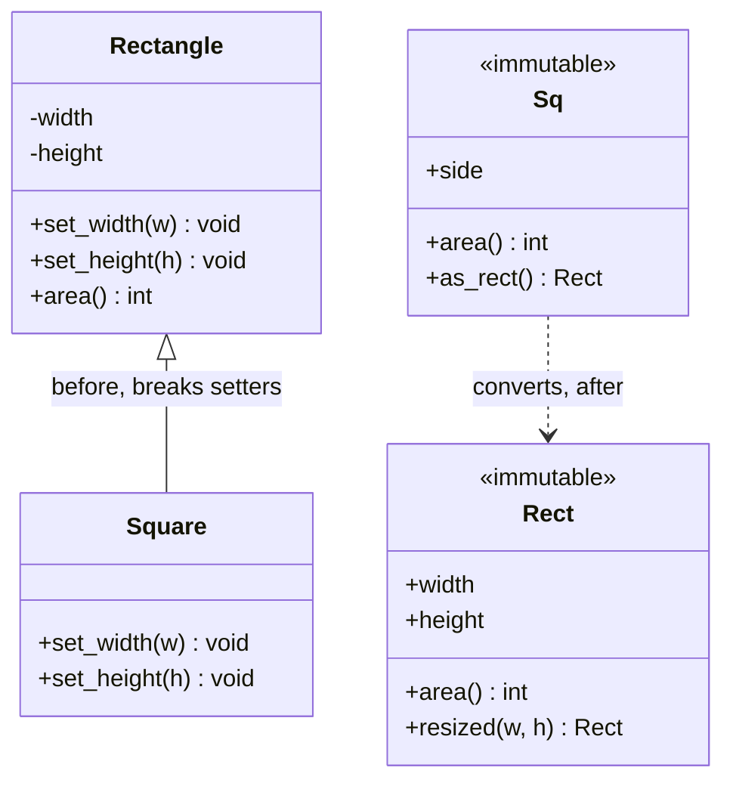

**Reading the diagram.** On the left, `Square` inherits from the mutable `Rectangle` (solid line, hollow triangle) and overrides both setters to keep its sides equal. That override breaks the base postcondition "`set_width` leaves the height unchanged", which is the failure point. On the right, the refactored types are immutable: no method mutates an object, so there is no setter whose postcondition a square could violate. `Sq` relates to `Rect` by conversion (dashed arrow), not inheritance; in Python an immutable `Square(Rectangle)` subclass is also safe, as the code shows. All calls are synchronous and in-memory; there is no storage boundary.

```python
class Rectangle:
    def __init__(self, width: int, height: int):
        self._w, self._h = width, height
    def set_width(self, w: int) -> None:
        self._w = w
    def set_height(self, h: int) -> None:
        self._h = h
    def area(self) -> int:
        return self._w * self._h

class Square(Rectangle):
    """'A square is a rectangle' -- true in geometry, false for this contract."""
    def __init__(self, side: int):
        super().__init__(side, side)
    def set_width(self, w: int) -> None:
        self._w = self._h = w             # keeps the square invariant ...
    def set_height(self, h: int) -> None:
        self._w = self._h = h             # ... by breaking Rectangle's postcondition

def resize_banner(r: Rectangle) -> int:
    """A client written against Rectangle's documented behavior."""
    r.set_width(5)
    r.set_height(4)
    assert r.area() == 20, f"expected area 20, got {r.area()}"
    return r.area()

for shape in (Rectangle(1, 1), Square(1)):
    try:
        print(type(shape).__name__, "area", resize_banner(shape))
    except AssertionError as err:
        print(type(shape).__name__, "breaks the client:", err)
# Rectangle area 20
# Square breaks the client: expected area 20, got 16
```

The fix is to remove the operation that cannot be honored. With immutable values, a square really is a rectangle, because nothing can try to stretch it in place:

```python
from dataclasses import dataclass

@dataclass(frozen=True)
class Rectangle:
    width: int
    height: int
    def area(self) -> int:
        return self.width * self.height
    def resized(self, width: int, height: int) -> "Rectangle":
        """Postcondition: returns a Rectangle with exactly these sides."""
        return Rectangle(width, height)

class Square(Rectangle):
    """Safe now: no operation lets a Square stop being square."""
    def __init__(self, side: int):
        super().__init__(side, side)
    @property
    def side(self) -> int:
        return self.width

def resize_banner(r: Rectangle) -> int:
    resized = r.resized(5, 4)
    assert resized.area() == 20
    return resized.area()

for shape in (Rectangle(1, 1), Square(1)):
    print(type(shape).__name__, "->", resize_banner(shape), "| original area", shape.area())
# Rectangle -> 20 | original area 1
# Square -> 20 | original area 1
```

What to notice:

- The violation is not in `Square` alone or in `resize_banner` alone; it is in the *relationship*. LSP is a property of a subtype *with respect to a contract and its clients*.
- `resized` returns a plain `Rectangle`, so its postcondition ("a rectangle with these sides") holds for squares too.
- This is the history constraint at work: a mutable rectangle can reach states (width ≠ height) that a square must never reach, so a mutable square cannot be its subtype.

```java
// File: LspShapes.java  (Java 17+)
public class LspShapes {
    // ----- Before: mutable Rectangle with a Square subclass -----
    static class Rectangle {
        protected int width, height;
        Rectangle(int w, int h) { width = w; height = h; }
        void setWidth(int w) { width = w; }     // postcondition: height unchanged
        void setHeight(int h) { height = h; }   // postcondition: width unchanged
        int area() { return width * height; }
    }
    static class Square extends Rectangle {
        Square(int side) { super(side, side); }
        @Override void setWidth(int w) { width = height = w; }
        @Override void setHeight(int h) { width = height = h; }
    }
    static int resizeBanner(Rectangle r) {
        r.setWidth(5);
        r.setHeight(4);
        return r.area();                        // the client expects 20
    }

    // ----- After: immutable value types; "resizing" returns a new Rectangle -----
    record Rect(int width, int height) {
        int area() { return width * height; }
        Rect resized(int w, int h) { return new Rect(w, h); }
    }
    record Sq(int side) {
        int area() { return side * side; }
        Rect asRect() { return new Rect(side, side); }   // conversion, not subtyping
    }

    public static void main(String[] args) {
        System.out.println("Rectangle: " + resizeBanner(new Rectangle(1, 1)));                     // 20
        System.out.println("Square:    " + resizeBanner(new Square(1)) + "  <- LSP violation");   // 16
        System.out.println("After, Rect: " + new Rect(1, 1).resized(5, 4).area());               // 20
        System.out.println("After, Sq:   " + new Sq(1).asRect().resized(5, 4).area());           // 20
    }
}
```

What to notice: Java records are implicitly `final`, so the Java fix uses conversion (`asRect`) instead of inheritance. Both are valid; the point is that no type promises behavior it cannot keep.

### 36.5.3 The running example: substitutable notifiers and contract tests

The `text[:160]` line from §36.4.2 is a real LSP bug. Once channels become `Notifier` implementations, an SMS notifier that truncates or rejects long messages breaks the `NotificationService`, which was written against the contract "full text delivered".

**Figure 36.8 — A strengthened precondition fails at run time.**

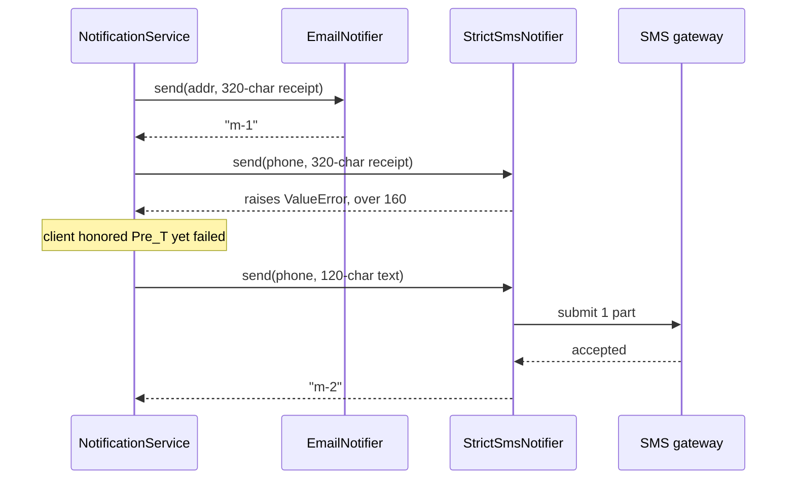

**Reading the diagram.** All calls are synchronous. The service sends the same valid 320-character receipt through two implementations of the same interface. The email notifier returns an id; the strict SMS notifier raises before contacting the external gateway, so the failure point is the subtype, not the network. The service did nothing wrong: it satisfied the base precondition. The only way the service could avoid this is to check the concrete type or the text length per channel, which reintroduces the switch that OCP removed. A short message works, which is why such bugs often pass casual testing and surface only with long receipts in production.

The defense is a **contract test**: one test function, written against the base type, run against every implementation. It turns LSP from a design-review opinion into a failing build.

**Figure 36.9 — After LSP: every notifier passes one contract test.**

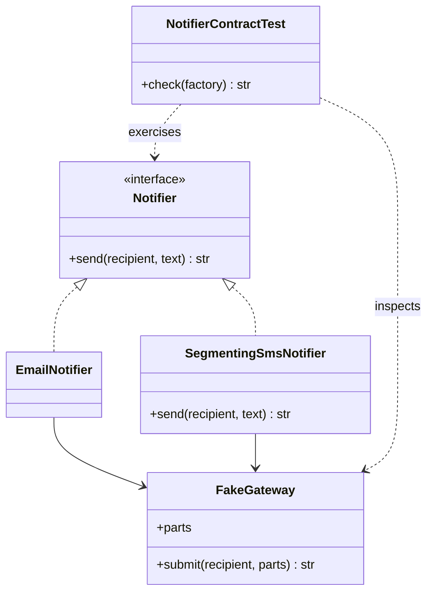

**Reading the diagram.** Both notifiers realize `Notifier` and send through a gateway; in tests the gateway is a `FakeGateway` that records the parts submitted under each message id (the in-memory stand-in for the external SMS or SMTP provider). The contract test depends only on the interface and the fake (dashed arrows): it constructs each implementation through a factory, sends texts at the boundary lengths, and checks the postcondition by reassembling the parts. Adding a new channel means adding one line to the list of implementations under test. The fake removes the network failure point from unit tests, so the test is fast and deterministic.

```python
import itertools
from typing import Callable, Protocol

MAX_TEXT = 1600          # Notifier contract: accept any text of 1..1,600 characters
SMS_SINGLE, SMS_SEGMENT = 160, 153   # GSM-7 limits: one SMS; one concatenated part

class FakeGateway:
    """Test double for a transport: records the parts sent under each message id."""
    def __init__(self):
        self.parts: dict[str, list[str]] = {}
        self._ids = itertools.count(1)
    def submit(self, recipient: str, parts: list[str]) -> str:
        msg_id = f"m-{next(self._ids)}"
        self.parts[msg_id] = parts
        return msg_id

class Notifier(Protocol):
    channel: str
    def send(self, recipient: str, text: str) -> str: ...

class EmailNotifier:
    channel = "email"
    def __init__(self, gw: FakeGateway): self.gw = gw
    def send(self, recipient, text):
        return self.gw.submit(recipient, [text])

class StrictSmsNotifier:                  # VIOLATION: strengthens the precondition
    channel = "sms"
    def __init__(self, gw: FakeGateway): self.gw = gw
    def send(self, recipient, text):
        if len(text) > SMS_SINGLE:
            raise ValueError("SMS text limited to 160 characters")
        return self.gw.submit(recipient, [text])

class TruncatingSmsNotifier:              # VIOLATION: weakens the postcondition
    channel = "sms"
    def __init__(self, gw: FakeGateway): self.gw = gw
    def send(self, recipient, text):
        return self.gw.submit(recipient, [text[:SMS_SINGLE]])

class SegmentingSmsNotifier:              # honors the contract
    channel = "sms"
    def __init__(self, gw: FakeGateway): self.gw = gw
    def send(self, recipient, text):
        if len(text) <= SMS_SINGLE:
            parts = [text]
        else:
            parts = [text[i:i + SMS_SEGMENT] for i in range(0, len(text), SMS_SEGMENT)]
        return self.gw.submit(recipient, parts)

def check_notifier_contract(make: Callable[[FakeGateway], Notifier]) -> str:
    """One contract test, run against every implementation of Notifier."""
    gw = FakeGateway()
    notifier = make(gw)
    for length in (1, 160, 161, 320, MAX_TEXT):
        text = ("Order A-1001 update. " * 80)[:length]
        try:
            msg_id = notifier.send("+15550100", text)
        except Exception as err:
            return f"FAIL len={length}: raised {err!r}"
        if not msg_id:
            return f"FAIL len={length}: empty message id"
        if "".join(gw.parts[msg_id]) != text:
            return f"FAIL len={length}: text altered in transit"
    return "PASS"

for cls in (EmailNotifier, StrictSmsNotifier, TruncatingSmsNotifier, SegmentingSmsNotifier):
    print(f"{cls.__name__:<22} {check_notifier_contract(cls)}")

gw = FakeGateway()
mid = SegmentingSmsNotifier(gw).send("+15550100", "x" * 320)
print("320 chars ->", len(gw.parts[mid]), "segments")
# EmailNotifier          PASS
# StrictSmsNotifier      FAIL len=161: raised ValueError('SMS text limited to 160 characters')
# TruncatingSmsNotifier  FAIL len=161: text altered in transit
# SegmentingSmsNotifier  PASS
# 320 chars -> 3 segments
```

What to notice:

- The test probes the **boundaries** of the precondition (1, 160, 161 and 1,600 characters), where subtypes usually diverge.
- The postcondition is checked through the fake gateway, not by trusting the return value.
- In Python, a contract test is often written as a test base class or a parametrized test; in Java, as an abstract JUnit class that each implementation's test extends.

```java
// File: LspNotifiers.java  (Java 17+)
import java.util.ArrayList;
import java.util.HashMap;
import java.util.List;
import java.util.Map;
import java.util.function.Function;

public class LspNotifiers {
    static final int MAX_TEXT = 1600, SMS_SINGLE = 160, SMS_SEGMENT = 153;

    /** Test double for a transport: records the parts sent per message id. */
    static final class FakeGateway {
        final Map<String, List<String>> parts = new HashMap<>();
        String submit(String recipient, List<String> p) {
            String id = "m-" + (parts.size() + 1);
            parts.put(id, p);
            return id;
        }
    }

    /** Contract: for 1 <= text.length() <= 1600, delivers the full text and
     *  returns a non-empty id. Throws only for an invalid recipient. */
    interface Notifier { String send(String recipient, String text); }

    record StrictSms(FakeGateway gw) implements Notifier {       // strengthens precondition
        public String send(String to, String text) {
            if (text.length() > SMS_SINGLE) throw new IllegalArgumentException("SMS limited to 160 chars");
            return gw.submit(to, List.of(text));
        }
    }
    record TruncatingSms(FakeGateway gw) implements Notifier {   // weakens postcondition
        public String send(String to, String text) {
            return gw.submit(to, List.of(text.substring(0, Math.min(text.length(), SMS_SINGLE))));
        }
    }
    record SegmentingSms(FakeGateway gw) implements Notifier {   // honors the contract
        public String send(String to, String text) {
            List<String> p = new ArrayList<>();
            if (text.length() <= SMS_SINGLE) p.add(text);
            else for (int i = 0; i < text.length(); i += SMS_SEGMENT)
                p.add(text.substring(i, Math.min(text.length(), i + SMS_SEGMENT)));
            return gw.submit(to, p);
        }
    }

    /** One contract test, reused for every implementation. */
    static String checkContract(Function<FakeGateway, Notifier> factory) {
        FakeGateway gw = new FakeGateway();
        Notifier n = factory.apply(gw);
        for (int len : new int[] {1, 160, 161, 320, MAX_TEXT}) {
            String text = "x".repeat(len);
            String id;
            try { id = n.send("+15550100", text); }
            catch (RuntimeException e) { return "FAIL len=" + len + ": threw " + e.getMessage(); }
            if (id == null || id.isEmpty()) return "FAIL len=" + len + ": empty id";
            if (!String.join("", gw.parts.get(id)).equals(text)) return "FAIL len=" + len + ": text altered";
        }
        return "PASS";
    }

    public static void main(String[] args) {
        System.out.println("StrictSms     " + checkContract(StrictSms::new));      // FAIL len=161: threw ...
        System.out.println("TruncatingSms " + checkContract(TruncatingSms::new));  // FAIL len=161: text altered
        System.out.println("SegmentingSms " + checkContract(SegmentingSms::new));  // PASS
    }
}
```

#### Real-world industry applications

::: industry
**`java.sql.Timestamp` extends `java.util.Date`.** `Timestamp` adds nanosecond precision to `Date`. Its own documentation warns that `Timestamp.equals(Object)` is not symmetric with `Date.equals(Object)`, that `hashCode` uses only the underlying `Date` part, and that code should not treat `Timestamp` values generically as `Date` instances, because the inheritance "denotes implementation inheritance, and not type inheritance". A `HashSet<Date>` holding a mix of both can therefore contain values that compare unequal one way and equal the other. This is an LSP violation that the platform documents rather than fixes, for compatibility.
*Evidence: Primary* — [Oracle Java SE API: java.sql.Timestamp]
:::

::: industry
**`Stack` extends `Vector`; `Properties` extends `Hashtable`.** Bloch cites both as cases where inheritance exposed operations that break the subclass's intended abstraction: a `Stack` lets callers insert into the middle, and a `Properties` object, meant to hold string keys and values, accepts arbitrary objects through inherited `put`, after which some of its own methods no longer work as documented [Bloch 2018].
*Evidence: Primary* — [Bloch 2018], Item 18
:::

#### Advantages and disadvantages

LSP lets clients be written once against an abstraction, keeps OCP's promise of "add a class, edit nothing", and makes contract tests reusable. Its cost is discipline: base types need written contracts (docstrings, Javadoc, types), and some intuitive "is-a" hierarchies must be abandoned for composition (§35.8). Over-strict contracts can also make legitimate implementations impossible; a contract must describe what clients need, not every detail of the first implementation.

**Table 36.4 — LSP failure scenarios.**

| What goes wrong | Why | Detection | Recovery | Prevention |
|---|---|---|---|---|
| Client crashes with a new subtype | Strengthened precondition or new exception type | Exceptions only for certain implementations | Make the subtype accept the base input, or change the hierarchy | Contract tests at precondition boundaries |
| Silent data loss (truncation, rounding) | Weakened postcondition | Reconciliation or customer reports; no error logs | Restore the full postcondition | Contract tests that verify outputs, not just "no exception" |
| `isinstance`/`instanceof` checks spread in clients | Subtypes differ in behavior | Code search for type checks on an abstraction | Split the abstraction or fix the subtype | Treat type checks on an interface as a review flag |
| Mutable subtype of an immutable type | History constraint violated | Values change under a cache or a map key | Make the subtype immutable or stop subclassing | Do not subclass value types |

#### Common misconceptions

::: mistake
**"If it type-checks, it is substitutable."** Type checkers verify signatures. LSP is about behavior: preconditions, postconditions, invariants and exceptions. `Square` type-checks perfectly.
:::

::: mistake
**"Throwing `NotImplementedError` or `UnsupportedOperationException` is a fine way to say a subtype cannot do something."** It is fine only if the base contract allows it (Java's collections document some operations as optional, §36.6.4). Otherwise it is a strengthened precondition, and usually a sign that the interface is too fat, which is the next principle.
:::

::: tip
**LSP in LLD interviews.** Expect "is a square a rectangle?" or "should `ElectricCar` extend `Car` if `refuel()` exists?". Answer with contracts: state the base method's precondition and postcondition, show the client that breaks, then offer the fix (immutability, a narrower base type, or composition). Mention contract tests to show you know how teams enforce it.
:::

## 36.6 Interface Segregation Principle

### 36.6.1 Definition: clients own the shape of their interfaces

::: definition
**Definition — Interface Segregation Principle (ISP).** Clients should not be forced to depend on methods that they do not use [Martin 2002]. A **fat interface** serves many kinds of client; a **role interface** describes what one kind of client needs from its collaborator [Fowler 2006].
:::

#### First-principles explanation

A restaurant's full menu has 120 dishes; the dessert menu has eight. A guest who only wants dessert can use either, but a dessert menu reprinted every time the kitchen changes a starter would be odd, and a printer who must typeset all 120 dishes to produce eight is wasting work. In code, depending on an interface means depending on *all* of its methods: their signatures, their parameter types, and every change to them. If a client uses one method of eight, seven-eighths of its dependency is pure risk.

#### Why does this exist?

Martin reports that ISP emerged from consulting work on a printer system at Xerox in which a single large `Job` class served printing, stapling and other tasks; every change to it forced long rebuilds of unrelated code [Martin 2002]. In C++ and Java, a change to an interface's signature recompiles every module that imports it. In dynamic languages the rebuild cost disappears, but two other costs remain. **Implementers** of a fat interface must provide every method, so classes that cannot honor some of them write stubs that throw, which is an LSP violation in waiting. **Readers** cannot tell from a parameter type which of the many methods a function will actually call.

#### How it works internally

1. For each interface, list its **clients** and the methods each one calls.
2. Group methods by client role (notification needs contact details; billing needs charging).
3. Define one **role interface** per group, named after the role, not the implementer.
4. Let implementers implement several role interfaces; a class can still be "fat" internally.
5. Change each client's parameter types to the narrowest role it needs.

### 36.6.2 The violation: a fat CustomerAccount

**Figure 36.10 — Before ISP: three clients depend on one fat interface.**

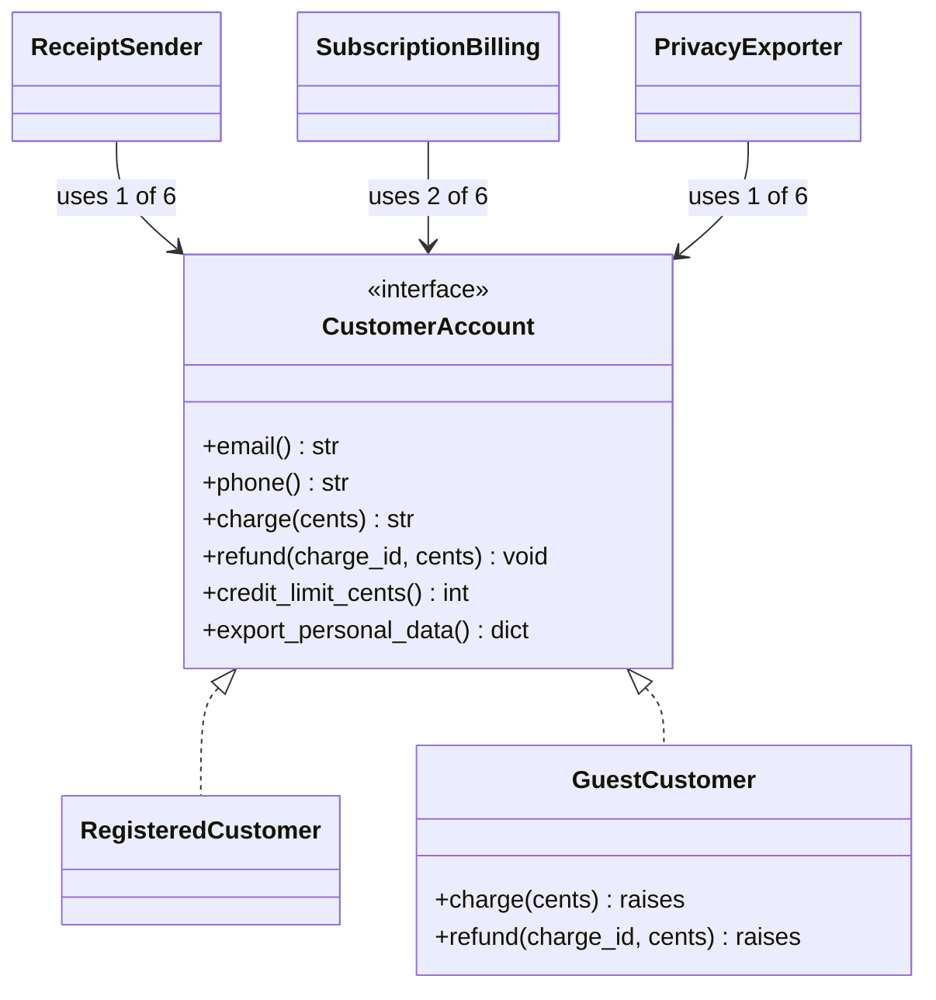

**Reading the diagram.** Three clients hold synchronous references to the same six-method interface, though each uses one or two methods (edge labels). Two classes implement it; `GuestCustomer` cannot charge (guests pay once at checkout and have no stored card), so it implements `charge` and `refund` by raising. That stub is the failure point: `SubscriptionBilling` accepts any `CustomerAccount`, so the type system lets a guest reach the code that charges. Any change to billing signatures also ripples to `ReceiptSender` and `PrivacyExporter`, which never call them; in Java, all three are recompiled.

```python
from abc import ABC, abstractmethod

class CustomerAccount(ABC):
    """Fat interface: every client depends on all six methods."""
    @abstractmethod
    def email(self) -> str: ...
    @abstractmethod
    def phone(self) -> str | None: ...
    @abstractmethod
    def charge(self, cents: int) -> str: ...
    @abstractmethod
    def refund(self, charge_id: str, cents: int) -> None: ...
    @abstractmethod
    def credit_limit_cents(self) -> int: ...
    @abstractmethod
    def export_personal_data(self) -> dict: ...

class GuestCustomer(CustomerAccount):
    """A guest has no stored card, yet must implement billing methods."""
    def __init__(self, email: str):
        self._email = email
    def email(self): return self._email
    def phone(self): return None
    def charge(self, cents): raise NotImplementedError("guest has no stored card")
    def refund(self, charge_id, cents): raise NotImplementedError("guest has no stored card")
    def credit_limit_cents(self): return 0
    def export_personal_data(self): return {"email": self._email}

def send_receipt(account: CustomerAccount, text: str) -> str:
    return f"to={account.email()} body={text}"     # uses 1 of 6 methods

def bill_monthly_subscriptions(accounts: list[CustomerAccount]) -> None:
    for acct in accounts:
        acct.charge(999)                          # the type checker says this is fine

guest = GuestCustomer("guest@example.com")
print(send_receipt(guest, "Order A-1002 confirmed"))
try:
    bill_monthly_subscriptions([guest])
except NotImplementedError as err:
    print("runtime failure:", err)               # runtime failure: guest has no stored card
```

What to notice: the error that a type checker could have caught is deferred to run time, inside a monthly batch job, because the interface claims every account can be charged.

### 36.6.3 The refactor: role interfaces

**Figure 36.11 — After ISP: each client depends on one role.**

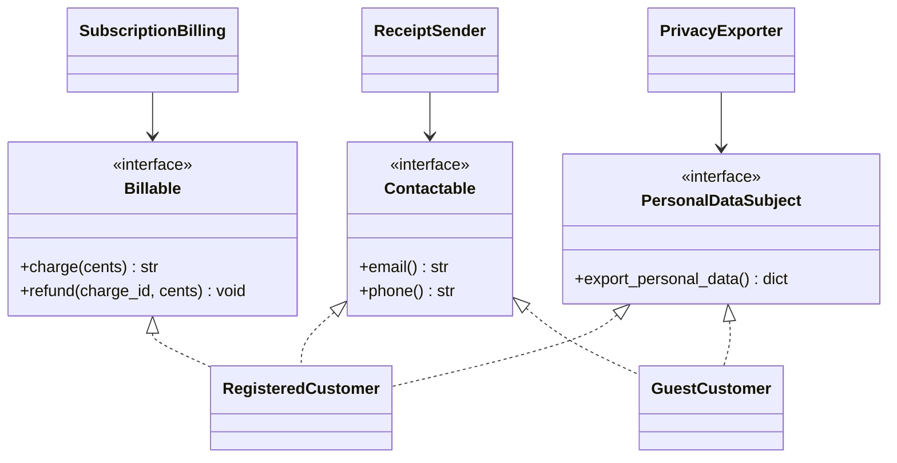

**Reading the diagram.** The fat interface is replaced by three role interfaces, each named for what a client needs. `RegisteredCustomer` realizes all three; `GuestCustomer` realizes only the two it can honor, so it has no stubs. Each client's synchronous dependency now points at one small interface: a change to `Billable` cannot affect `ReceiptSender`. The failure point of Figure 36.10 disappears at compile or type-check time, because a guest is not a `Billable` and cannot be passed to `SubscriptionBilling`. Implementations are free to be large; segregation is about what clients *see*.

```python
from typing import Protocol, runtime_checkable

@runtime_checkable
class Contactable(Protocol):          # role used by notifications
    def email(self) -> str: ...
    def phone(self) -> str | None: ...

@runtime_checkable
class Billable(Protocol):             # role used by billing
    def charge(self, cents: int) -> str: ...
    def refund(self, charge_id: str, cents: int) -> None: ...

@runtime_checkable
class PersonalDataSubject(Protocol):  # role used by privacy tooling
    def export_personal_data(self) -> dict: ...

class RegisteredCustomer:             # plays all three roles
    def __init__(self, email: str, phone: str, card_token: str):
        self._email, self._phone, self._card = email, phone, card_token
        self._charges: dict[str, int] = {}
    def email(self): return self._email
    def phone(self): return self._phone
    def charge(self, cents):
        charge_id = f"ch-{len(self._charges) + 1}"
        self._charges[charge_id] = cents
        return charge_id
    def refund(self, charge_id, cents):
        if cents > self._charges.get(charge_id, 0):
            raise ValueError("refund exceeds captured amount")
        self._charges[charge_id] -= cents
    def export_personal_data(self):
        return {"email": self._email, "phone": self._phone, "charges": dict(self._charges)}

class GuestCustomer:                  # plays only the roles it can honor
    def __init__(self, email: str):
        self._email = email
    def email(self): return self._email
    def phone(self): return None
    def export_personal_data(self): return {"email": self._email}

def send_receipt(who: Contactable, text: str) -> str:
    return f"to={who.email()} body={text}"

def bill_monthly_subscriptions(accounts: list[Billable]) -> list[str]:
    return [acct.charge(999) for acct in accounts]

def export_all(subjects: list[PersonalDataSubject]) -> list[dict]:
    return [s.export_personal_data() for s in subjects]

ana = RegisteredCustomer("ana@example.com", "+15550100", "tok_visa")
guest = GuestCustomer("guest@example.com")
print(send_receipt(guest, "Order A-1002 confirmed"))
print(bill_monthly_subscriptions([ana]))      # a guest here is a type-checker error
print(export_all([ana, guest]))
print("guest is Billable?", isinstance(guest, Billable))   # False
```

What to notice:

- Neither customer class names a protocol; conformance is structural. A static checker such as mypy reports `bill_monthly_subscriptions([guest])` as an error.
- `@runtime_checkable` lets `isinstance` test conformance, but it checks only that the methods *exist*, not their signatures or behavior.
- The implementation of `RegisteredCustomer` is unchanged in size. ISP is about the *client side* of the dependency.

```java
// File: IspAfter.java  (Java 17+)
import java.util.ArrayList;
import java.util.List;
import java.util.Map;
import java.util.Optional;

public class IspAfter {
    interface Contactable { String email(); Optional<String> phone(); }
    interface Billable { String charge(long cents); void refund(String chargeId, long cents); }
    interface PersonalDataSubject { Map<String, String> exportPersonalData(); }

    static final class RegisteredCustomer implements Contactable, Billable, PersonalDataSubject {
        private final String email, phone;
        private final List<Long> charges = new ArrayList<>();
        RegisteredCustomer(String email, String phone) { this.email = email; this.phone = phone; }
        public String email() { return email; }
        public Optional<String> phone() { return Optional.of(phone); }
        public String charge(long cents) { charges.add(cents); return "ch-" + charges.size(); }
        public void refund(String chargeId, long cents) {
            int idx = Integer.parseInt(chargeId.substring(3)) - 1;
            if (cents > charges.get(idx)) throw new IllegalArgumentException("refund exceeds capture");
            charges.set(idx, charges.get(idx) - cents);
        }
        public Map<String, String> exportPersonalData() {
            return Map.of("email", email, "phone", phone, "charges", charges.toString());
        }
    }

    /** Implements only the roles it can honor: no stubs, no UnsupportedOperationException. */
    static final class GuestCustomer implements Contactable, PersonalDataSubject {
        private final String email;
        GuestCustomer(String email) { this.email = email; }
        public String email() { return email; }
        public Optional<String> phone() { return Optional.empty(); }
        public Map<String, String> exportPersonalData() { return Map.of("email", email); }
    }

    // Each client names only the role it uses.
    static String sendReceipt(Contactable who, String text) { return "to=" + who.email() + " body=" + text; }
    static List<String> billMonthly(List<? extends Billable> accounts) {
        List<String> ids = new ArrayList<>();
        for (Billable b : accounts) ids.add(b.charge(999));
        return ids;
    }

    public static void main(String[] args) {
        RegisteredCustomer ana = new RegisteredCustomer("ana@example.com", "+15550100");
        GuestCustomer guest = new GuestCustomer("guest@example.com");
        System.out.println(sendReceipt(guest, "Order A-1002 confirmed"));
        System.out.println(billMonthly(List.of(ana)));                 // [ch-1]
        // billMonthly(List.of(guest));   // does not compile: GuestCustomer is not Billable
        List<PersonalDataSubject> subjects = List.of(ana, guest);
        subjects.forEach(s -> System.out.println(s.exportPersonalData().get("email")));
    }
}
```

What to notice: the commented-out line is the payoff. The defect from the "before" version is now a compile error, found in seconds rather than in a monthly batch run.

### 36.6.4 Industry practice, trade-offs and misconceptions

::: industry
**Python's `collections.abc` versus Java's optional operations.** Python defines many small abstract base classes (`Sized`, `Iterable`, `Container`, `Collection`, `Sequence`, `MutableSequence`, `Mapping`), and functions such as `len()` need only the one-method `Sized` role. Java's collections framework went the other way for simplicity: `List` includes mutators such as `add`, and immutable or fixed-size implementations throw `UnsupportedOperationException`, which the Javadoc marks as "optional operations". Oracle's design FAQ explains the trade-off: separate interfaces for every combination of modifiable, fixed-size and append-only would have multiplied the number of interfaces. Java accepted a weaker static guarantee in exchange for a small API.
*Evidence: Primary* — [Python docs: collections.abc]; [Oracle: Java Collections API Design FAQ]
:::

ISP's benefits are narrower blast radius for interface changes, no stub methods, clearer function signatures and errors moved from run time to type-check time. Its cost is more interface names, and the Java collections case shows the limit: if every client needs a slightly different subset, segregating perfectly produces a combinatorial explosion. Segregate along *roles that real clients play*, not along every possible subset.

**Table 36.5 — ISP failure scenarios.**

| What goes wrong | Why | Detection | Recovery | Prevention |
|---|---|---|---|---|
| Implementers write throwing stubs | Interface bundles capabilities not all implementers have | Search for `NotImplementedError`/`UnsupportedOperationException` in implementations | Extract role interfaces | Design interfaces from client needs |
| Unrelated clients rebuild on every change | Fat interface in a compiled language | Build graph shows wide fan-out from one interface | Split by client role | Keep interfaces in the client's package (§36.7) |
| Dozens of one-method interfaces nobody can navigate | Segregation by every subset | Interfaces with one client and one implementer | Merge interfaces that always travel together | Segregate by real roles |

::: mistake
**"ISP means every interface should have one method."** It means each *client* should see only what it uses. A five-method interface used in full by every client is perfectly segregated.
:::

::: tip
**ISP in LLD interviews.** In a vending machine or parking lot, a single `Machine` or `ParkingLot` interface with admin, payment and display methods is a red flag. Split it into roles such as `PaymentAcceptor`, `InventoryAdmin` and `Display`, and say which client uses which. Interviewers often follow up with "where do the interfaces live?", which leads to dependency inversion.
:::

## 36.7 Dependency Inversion Principle

### 36.7.1 Definition: policy should not depend on detail

::: definition
**Definition — Dependency Inversion Principle (DIP).** (a) High-level modules should not depend on low-level modules; both should depend on abstractions. (b) Abstractions should not depend on details; details should depend on abstractions [Martin 2002]. **High-level** modules hold policy: the business rules that justify the system (checkout, invoicing). **Low-level** modules hold detail: mechanisms that could be swapped without changing the business (a payment vendor's SDK, SMTP, SQL).
:::

#### First-principles explanation

A company writes a job description ("must hold a forklift licence, work night shifts") and then hires someone who fits it. It does not rewrite its operations manual around whichever person it happened to hire. The job description is the abstraction, written in the company's terms and owned by the company; candidates conform to it. If the company instead wrote its procedures around one employee's personal habits, it could never replace that person.

In naive layered code the arrows run the other way: checkout imports the payment vendor's client, so checkout's source code names the vendor, its data shapes and its error codes. Every vendor change ripples upward into the business rules.

#### Why does this exist?

Source-code dependencies point the same way as control flow by default: if A calls B, A imports B. That makes the most important code (policy) depend on the most volatile code (vendors, frameworks, databases). DIP breaks that coupling by inserting an interface between them and, crucially, **placing the interface on the policy side**. Control still flows from checkout to the vendor at run time, but the source-code dependency now points from the vendor adapter *toward* checkout. That reversal is the "inversion".

#### How it works internally

1. Identify policy code and the details it calls.
2. Define, **in the policy module**, an interface expressing what policy needs in its own vocabulary (`PaymentGateway.charge` returns a `ChargeResult`, not the vendor's JSON).
3. Write an **adapter** in a detail module that implements the interface by calling the vendor.
4. Give policy its collaborators from outside (dependency injection, §36.7.4), assembled in one **composition root**.
5. In tests, implement the same interfaces with **fakes**.

### 36.7.2 The violation: checkout constructs its details

**Figure 36.12 — Before DIP: policy depends on concrete details.**

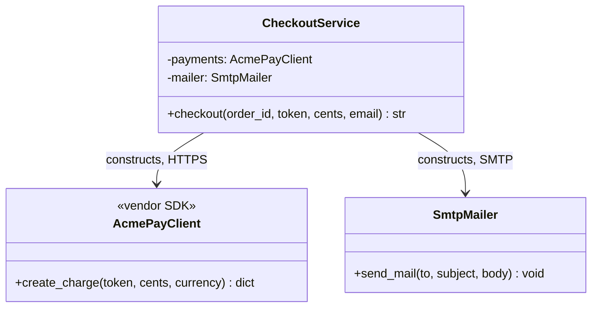

**Reading the diagram.** The high-level `CheckoutService` creates and holds its two low-level collaborators (solid arrows): a vendor SDK that charges cards over HTTPS and an SMTP mailer. Both calls are synchronous. Both collaborators are external failure points, and the service cannot run, even in a unit test, without reaching them. The vendor's response shape (a dictionary with a `status` field) is visible inside the business rule, so switching to a second payment provider means editing checkout itself. Every arrow points from policy to detail.

```python
class AcmePayClient:                       # low-level detail: a vendor SDK
    def create_charge(self, card_token: str, amount_cents: int,
                      currency: str = "usd") -> dict:
        print(f"[HTTPS api.acmepay.example] charge {amount_cents} {currency}")
        return {"id": "ch_1", "status": "succeeded"}

class SmtpMailer:                          # low-level detail: a mail transport
    def __init__(self, host: str = "smtp.internal", port: int = 587):
        self.host, self.port = host, port
    def send_mail(self, to: str, subject: str, body: str) -> None:
        print(f"[SMTP {self.host}:{self.port}] to={to} subject={subject}")

class CheckoutService:                     # high-level policy
    def __init__(self):
        self.payments = AcmePayClient()    # policy constructs and names details
        self.mailer = SmtpMailer()

    def checkout(self, order_id: str, card_token: str, amount_cents: int,
                 email: str) -> str:
        result = self.payments.create_charge(card_token, amount_cents)
        if result["status"] != "succeeded":          # vendor vocabulary leaks in
            raise RuntimeError("payment declined")
        self.mailer.send_mail(email, "Order confirmed", f"Order {order_id} is paid")
        return result["id"]

print(CheckoutService().checkout("A-1001", "tok_visa", 4719, "ana@example.com"))
```

What to notice: to test the decline path you would need a real card that the vendor declines, or a patching library that rewrites `AcmePayClient` at run time. Both are signs that the dependency points the wrong way.

### 36.7.3 The refactor: ports owned by policy

**Figure 36.13 — After DIP: interfaces live with policy; adapters point inward.**

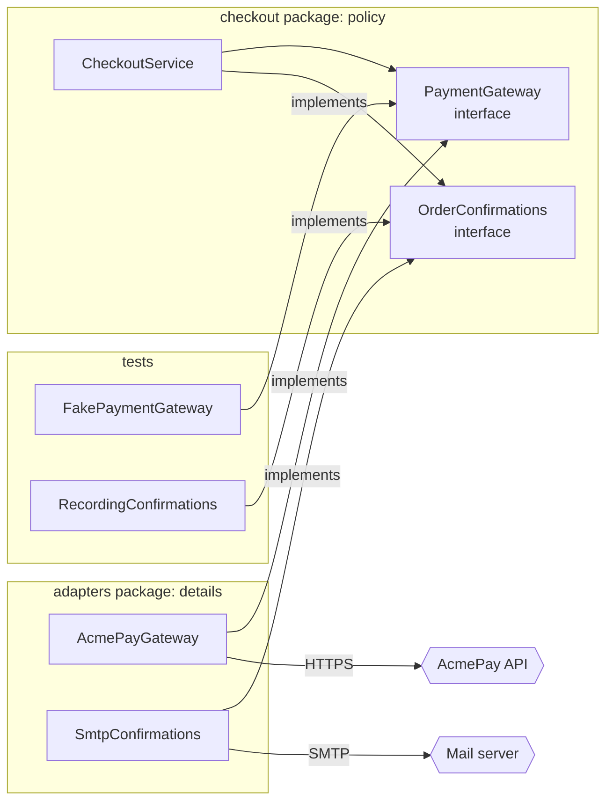

**Reading the diagram.** Arrows are source-code dependencies, which is what DIP is about. Inside the `checkout` package, the service depends only on two interfaces that the package itself defines. Both the production adapters and the test fakes depend *inward* on those interfaces; nothing in `checkout` names an adapter. Only adapters cross the system boundary to the external vendor and mail server (hexagons, the failure points), over HTTPS and SMTP. At run time, calls still flow synchronously from the service through an interface to an adapter; only the compile-time direction is inverted. The `checkout` package can be built and tested with no network, and a second payment vendor is a new adapter, deployable without touching policy.

#### Code example

```python
from dataclasses import dataclass, field
from typing import Protocol

# ---------- checkout: high-level policy. It OWNS the ports it needs. ----------
@dataclass(frozen=True)
class ChargeResult:
    ok: bool
    charge_id: str = ""
    reason: str = ""

class PaymentGateway(Protocol):            # port, named in checkout's language
    def charge(self, card_token: str, cents: int) -> ChargeResult: ...

class OrderConfirmations(Protocol):        # port
    def confirm(self, email: str, order_id: str) -> None: ...

class PaymentDeclined(Exception):
    pass

class CheckoutService:
    def __init__(self, payments: PaymentGateway, confirmations: OrderConfirmations):
        self.payments = payments           # injected through the constructor
        self.confirmations = confirmations

    def checkout(self, order_id: str, card_token: str, cents: int, email: str) -> str:
        result = self.payments.charge(card_token, cents)
        if not result.ok:
            raise PaymentDeclined(result.reason)
        self.confirmations.confirm(email, order_id)
        return result.charge_id

# ---------- adapters: low-level details. They depend on checkout's ports. ----------
class AcmePayClient:                       # vendor SDK (stand-in)
    def create_charge(self, card_token, amount_cents, currency="usd") -> dict:
        return {"id": "ch_1", "status": "succeeded"}

class AcmePayGateway:                      # implements PaymentGateway
    def __init__(self, client: AcmePayClient):
        self.client = client
    def charge(self, card_token, cents):
        raw = self.client.create_charge(card_token, cents)
        if raw["status"] == "succeeded":
            return ChargeResult(True, charge_id=raw["id"])
        return ChargeResult(False, reason=raw.get("failure_code", "unknown"))

class SmtpConfirmations:                   # implements OrderConfirmations
    def __init__(self, host: str):
        self.host = host
    def confirm(self, email, order_id):
        print(f"[SMTP {self.host}] to={email} Order {order_id} is paid")

def build_checkout() -> CheckoutService:   # composition root: the only place
    return CheckoutService(AcmePayGateway(AcmePayClient()),   # that names details
                           SmtpConfirmations("smtp.internal"))

# ---------- tests: fakes implement the same ports; no network, no mocks library ----------
@dataclass
class FakePaymentGateway:
    declined_tokens: set = field(default_factory=set)
    charges: list = field(default_factory=list)
    def charge(self, card_token, cents):
        if card_token in self.declined_tokens:
            return ChargeResult(False, reason="card_declined")
        self.charges.append((card_token, cents))
        return ChargeResult(True, charge_id=f"fake-{len(self.charges)}")

@dataclass
class RecordingConfirmations:
    sent: list = field(default_factory=list)
    def confirm(self, email, order_id):
        self.sent.append((email, order_id))

def test_successful_checkout_charges_once_and_confirms():
    pay, mail = FakePaymentGateway(), RecordingConfirmations()
    charge_id = CheckoutService(pay, mail).checkout("A-1", "tok_ok", 4719, "a@x.com")
    assert charge_id == "fake-1"
    assert pay.charges == [("tok_ok", 4719)]
    assert mail.sent == [("a@x.com", "A-1")]

def test_declined_card_sends_no_confirmation():
    pay, mail = FakePaymentGateway(declined_tokens={"tok_bad"}), RecordingConfirmations()
    try:
        CheckoutService(pay, mail).checkout("A-2", "tok_bad", 1000, "b@x.com")
        raise AssertionError("expected PaymentDeclined")
    except PaymentDeclined as err:
        assert str(err) == "card_declined"
    assert mail.sent == []

test_successful_checkout_charges_once_and_confirms()
test_declined_card_sends_no_confirmation()
print("tests passed")
print("production wiring:", build_checkout().checkout("A-3", "tok_visa", 4719, "ana@example.com"))
```

What to notice:

- `ChargeResult` and `PaymentDeclined` are checkout's vocabulary. The vendor's `"succeeded"` string appears only in the adapter.
- The decline test, which was hard to write before, is now four lines. A **fake** is a working, simplified implementation (here, an in-memory list); a **mock** is an object pre-programmed with expected calls [Meszaros 2007]. Fakes of owned interfaces tend to produce tests that survive refactoring, because they check outcomes rather than call sequences.
- `build_checkout` is the only function that knows concrete classes. Everything else receives its collaborators.

```java
// File: DipAfter.java  (Java 17+)
import java.util.ArrayList;
import java.util.List;
import java.util.Set;

public class DipAfter {
    // ---------- checkout (policy): owns its ports ----------
    record ChargeResult(boolean ok, String chargeId, String reason) {}
    interface PaymentGateway { ChargeResult charge(String cardToken, long cents); }
    interface OrderConfirmations { void confirm(String email, String orderId); }
    static final class PaymentDeclined extends RuntimeException {
        PaymentDeclined(String reason) { super(reason); }
    }

    static final class CheckoutService {
        private final PaymentGateway payments;
        private final OrderConfirmations confirmations;
        CheckoutService(PaymentGateway payments, OrderConfirmations confirmations) {   // constructor injection
            this.payments = payments; this.confirmations = confirmations;
        }
        String checkout(String orderId, String cardToken, long cents, String email) {
            ChargeResult r = payments.charge(cardToken, cents);
            if (!r.ok()) throw new PaymentDeclined(r.reason());
            confirmations.confirm(email, orderId);
            return r.chargeId();
        }
    }

    // ---------- adapters (details): depend on checkout's ports ----------
    static final class AcmePayGateway implements PaymentGateway {
        public ChargeResult charge(String token, long cents) {
            // A real adapter would call the vendor SDK here and translate its response.
            return new ChargeResult(true, "ch_1", "");
        }
    }
    static final class SmtpConfirmations implements OrderConfirmations {
        public void confirm(String email, String orderId) {
            System.out.println("[SMTP] to=" + email + " Order " + orderId + " is paid");
        }
    }

    // ---------- test fakes ----------
    static final class FakePaymentGateway implements PaymentGateway {
        final Set<String> declined; final List<Long> charges = new ArrayList<>();
        FakePaymentGateway(Set<String> declined) { this.declined = declined; }
        public ChargeResult charge(String token, long cents) {
            if (declined.contains(token)) return new ChargeResult(false, "", "card_declined");
            charges.add(cents);
            return new ChargeResult(true, "fake-" + charges.size(), "");
        }
    }
    static final class RecordingConfirmations implements OrderConfirmations {
        final List<String> sent = new ArrayList<>();
        public void confirm(String email, String orderId) { sent.add(email + ":" + orderId); }
    }

    static void check(boolean cond, String msg) { if (!cond) throw new AssertionError(msg); }

    public static void main(String[] args) {
        // Unit tests with fakes
        FakePaymentGateway pay = new FakePaymentGateway(Set.of("tok_bad"));
        RecordingConfirmations mail = new RecordingConfirmations();
        CheckoutService svc = new CheckoutService(pay, mail);
        check(svc.checkout("A-1", "tok_ok", 4719, "a@x.com").equals("fake-1"), "charge id");
        check(mail.sent.equals(List.of("a@x.com:A-1")), "confirmation sent");
        try { svc.checkout("A-2", "tok_bad", 1000, "b@x.com"); check(false, "expected decline"); }
        catch (PaymentDeclined e) { check(e.getMessage().equals("card_declined"), "reason"); }
        check(mail.sent.size() == 1, "no confirmation after decline");
        System.out.println("tests passed");

        // Composition root: the only place that names concrete classes
        CheckoutService prod = new CheckoutService(new AcmePayGateway(), new SmtpConfirmations());
        System.out.println(prod.checkout("A-3", "tok_visa", 4719, "ana@example.com"));
    }
}
```

What to notice: in a real project the interfaces and `CheckoutService` sit in one Java package or module, the adapters in another that `requires` it, and the fakes under `src/test`. In production code you would write these checks as JUnit tests; a plain `main` keeps the example self-contained.

### 36.7.4 DI, DIP and IoC are three different things

The three terms are often used interchangeably. They are related but distinct.

**Table 36.6 — Dependency inversion, dependency injection and inversion of control.**

| Term | What it is | Question it answers | Example |
|---|---|---|---|
| Dependency Inversion Principle (DIP) | A design principle about the *direction of source-code dependencies* | Which module owns the interface, and which way do imports point? | `checkout` defines `PaymentGateway`; the adapter imports it |
| Dependency injection (DI) | A *technique*: an object receives its collaborators from outside instead of constructing them | Who creates the collaborators? | `CheckoutService(payments, confirmations)` |
| Inversion of control (IoC) | A broad *property of frameworks*: the framework calls your code, not the reverse | Who owns the main loop? | A web framework calls your handler; a test runner calls your tests |

Fowler's 2004 article explains why he and others coined "dependency injection": "inversion of control" was too generic, since every framework inverts control, and the specific pattern being described was supplying dependencies to an object from outside [Fowler 2004]. He describes constructor injection, setter injection and interface injection, and compares injection with the **service locator** alternative, in which an object asks a registry for its dependencies. A service locator hides dependencies inside method bodies; constructor injection makes them visible in the signature, which is why it is the common default.

**Figure 36.14 — How DIP, DI and IoC relate.**

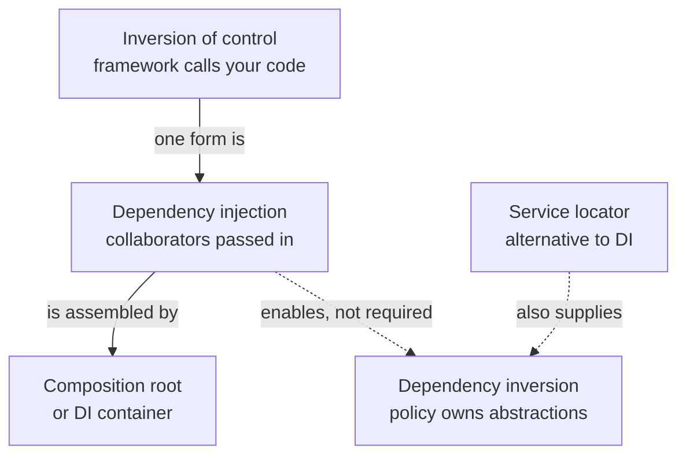

**Reading the diagram.** Read solid arrows as "is a kind of" or "is done by", and dotted arrows as "can support". Inversion of control is the broadest idea; dependency injection is one form of it, in which a composition root (hand-written, as in `build_checkout`, or a container such as Spring or Guice) creates objects and passes them in. DI makes DIP convenient, but you can inject a concrete class (DI without DIP), and you can satisfy DIP with a service locator (DIP without DI). The failure point in practice is a DI container used without DIP: every class is injected, yet the injected types are concrete vendor classes, so policy is still coupled to detail.

#### Real-world industry applications

::: industry
**JDBC and SLF4J.** Java application code programs against `java.sql.Connection` and related interfaces defined by the platform; vendors ship drivers that implement them, and since JDBC 4.0 `DriverManager` discovers drivers through `ServiceLoader`, so the application's source never names the database vendor. SLF4J does the same for logging: libraries depend on the `org.slf4j.Logger` API, and the deployer chooses the logging backend at deployment time. In both cases the abstraction is owned by the client side (the platform or the facade), and the details depend on it.
*Evidence: Primary* — [Oracle Java SE API: java.sql.DriverManager, java.util.ServiceLoader]; [SLF4J manual]
:::

#### Advantages, disadvantages and failure scenarios

DIP makes policy testable in milliseconds, lets you replace vendors and databases by writing adapters, and keeps business rules readable in business terms. It costs an interface and an adapter per external dependency, plus a composition root to maintain. Interfaces that merely mirror one vendor's SDK method for method give the cost without the benefit, because a second vendor will not fit them.

**Table 36.7 — DIP failure scenarios.**

| What goes wrong | Why | Detection | Recovery | Prevention |
|---|---|---|---|---|
| Swapping vendors requires editing business rules | Policy imports the SDK or its data types | Import graph: core package imports vendor package | Introduce a port in the core; move vendor code to an adapter | Architecture tests that forbid core-to-adapter imports |
| Interface changes whenever the vendor changes | Interface owned by, or copied from, the detail | Port signatures use vendor types or names | Rewrite the port in domain vocabulary | Define ports from the policy's needs |
| Tests pass but production fails | Fake diverges from the real adapter's behavior | Bugs found only in integration | Run the same contract tests (§36.5.3) on fake and real adapter | Contract-test every fake |

::: mistake
**"Using a DI container means the code follows DIP."** A container only wires objects. If `CheckoutService` is injected with an `AcmePayClient`, the dependency still points from policy to detail. DIP is about *which module owns the abstraction*.
:::

::: tip
**DIP in LLD interviews.** When you introduce a repository or gateway interface, say who owns it ("the domain layer defines `OrderRepository`; the Postgres adapter implements it") and how you would test the domain with an in-memory fake. Distinguishing DI from DIP in one sentence is a common senior-level signal.
:::
