# Chapter 37 — Design Patterns

> **Level:** 2 · **Track:** A (Traditional) · **Estimated reading time:** 3.5 h

A carpenter who has built a hundred staircases does not reinvent the stringer, the tread and the riser each time. They recognize the problem ("connect two floors safely in this much space"), recall a solution shape that has worked before, and adapt it to the room. Software has the same kind of recurring problems: "create the right object without hard-coding its class", "add retries to a client without editing it", "let five subsystems react when an order is placed". A **design pattern** is a named, reusable solution shape for one of these problems. This chapter catalogs the patterns that keep appearing in the code behind large systems, shows each one in runnable Python, and connects each to the system-level idea it foreshadows: Observer to publish/subscribe, Proxy to API gateways and sidecars, Chain of Responsibility to middleware, producer–consumer to message queues.

::: definition
**Definition — Design pattern.** A named description of a recurring design problem, the core of a solution (a set of collaborating classes or functions and their responsibilities), and the trade-offs of applying it. A pattern is a template you adapt, not a library you import [Gamma et al. 1994].
:::

The canonical catalog is the "Gang of Four" (GoF) book, which grouped 23 patterns into three families [Gamma et al. 1994]: **creational** patterns (how objects are made: Factory Method, Abstract Factory, Builder, Singleton, Prototype), **structural** patterns (how objects are composed: Adapter, Decorator, Proxy, Facade, Composite, Bridge, Flyweight) and **behavioral** patterns (how objects divide work and communicate: Strategy, Observer, Command, State, Template Method, Chain of Responsibility and others). Two further families matter for system design: **enterprise** patterns such as Repository [Fowler 2002] and Dependency Injection [Fowler 2004], and **concurrency** patterns such as producer–consumer and thread pools [Schmidt et al. 2000; Goetz et al. 2006].

::: concept
**Patterns depend on the language.** The GoF book was written for C++ and Smalltalk. In a language with first-class functions, modules and duck typing, several patterns shrink: a Strategy becomes a function argument, a Singleton becomes a module, a Command becomes a closure. Norvig observed in 1996 that most GoF patterns are simpler or invisible in dynamic languages [Norvig 1996]. This chapter shows the classic structure first, because interviewers and Java codebases use it, and then the idiomatic Python form.
:::

Every pattern below uses the same compact structure: intent, the problem it solves in a real system, the structure as a Mermaid class diagram, a Python implementation (all run under Python 3.13), a short Java sketch only where Java adds something language-specific, when to use and when not, related patterns, and one interview question. Most examples share one running system: the order service of an online store, which takes orders, charges payments, sends notifications and talks to cloud storage.

## 37.1 Learning objectives

After this chapter you should be able to:

- State the intent, structure and trade-offs of the Factory, Abstract Factory, Builder, Singleton, Strategy, Observer, Adapter, Decorator, Proxy, Command, Repository, State, Template Method and Chain of Responsibility patterns, and draw each as a class diagram.
- Implement each pattern in idiomatic Python and recognize where a function, module or closure replaces a class hierarchy.
- Explain why Singleton is often an anti-pattern, write a thread-safe variant, and explain why a "singleton" in a 50-pod deployment is really 50 objects.
- Distinguish the GoF Decorator from the Python `@decorator` syntax, and Adapter from Decorator from Proxy.
- Apply constructor injection and a composition root, and relate them to the Dependency Inversion Principle (§36.7).
- Build producer–consumer pipelines, thread pools and futures, size a thread pool with the utilization formula, and explain why double-checked locking is broken without a memory-model guarantee.
- Choose a pattern for a stated problem and name the trade-off you accept.

## 37.2 Prerequisites

- Classes, interfaces, polymorphism and composition over inheritance — §35.3–§35.9 (every pattern here is built from them).
- Cohesion and coupling — §35.10 (most patterns trade a little indirection for lower coupling).
- SOLID principles, especially Open/Closed (§36.4) and Dependency Inversion (§36.7) — patterns are the concrete mechanisms that realize them.
- Threads, locks, condition variables and read-write locks — §6.3, §6.9–§6.10 (needed for Singleton thread safety and §37.16).
- Little's Law — §4.11 (used to size thread pools).

## 37.3 Factory

Creating an object with `EmailNotifier()` is the simplest thing in programming, and it is also a hidden decision: the calling code now knows, and depends on, one concrete class. When the choice of class depends on configuration, input or environment, that decision should live in exactly one place. Factories put it there.

### 37.3.1 Simple factory

#### Intent

::: definition
**Definition — Simple factory.** A function or static method that takes a description of what is wanted (a string, an enum, a config value) and returns an instance of the matching concrete class, behind a common interface. It is an idiom rather than a GoF pattern, but it is the most common factory in practice.
:::

#### Problem it solves

The order service sends notifications by email, SMS or push, and the channel comes from each user's preferences. Without a factory, every call site contains the same `if channel == "email": ... elif ...` chain, and adding WhatsApp means editing all of them. With a factory, call sites ask for "a notifier for this channel" and only the factory knows the mapping.

#### Structure

**Figure 37.1 — Simple factory for notifiers.**

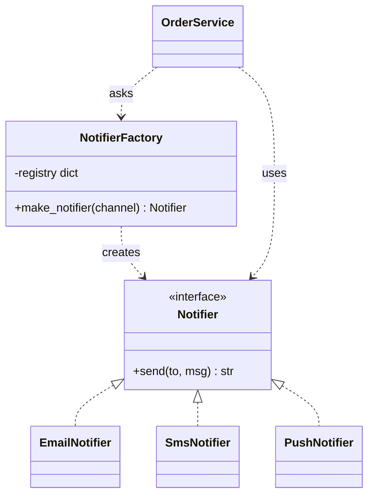

**Reading the diagram.** `Notifier` is the interface every channel implements; the three concrete classes realize it (dotted arrows with hollow heads). `NotifierFactory` owns a registry from channel name to class and is the only component that names concrete classes. `OrderService` depends on the factory and on the interface, never on a concrete notifier. All calls are synchronous, in-process method calls. The registry is the only state, held in memory. The failure point is an unknown channel name, which the factory should reject loudly rather than return `None`. Adding a channel extends the registry without touching callers, which is the Open/Closed Principle (§36.4) in action.

### 37.3.2 Factory method

#### Intent

::: definition
**Definition — Factory method.** A method declared in a base class that returns a product through an interface, which subclasses override to decide which concrete product to create. The base class's other methods use the product without knowing its class [Gamma et al. 1994].
:::

#### Problem it solves

A framework defines the workflow and lets applications supply the parts. An alerting framework's `AlertJob.run()` always formats a message and sends it, but a paging job must use SMS and a daily digest job must use email. The base class cannot know which; the subclass can. Real frameworks are full of factory methods: Python's `socketserver` and `unittest` let subclasses decide the handler or test objects the framework creates, and Java's `Collection.iterator()` lets each collection return its own iterator class.

#### Structure

**Figure 37.2 — Factory method.**

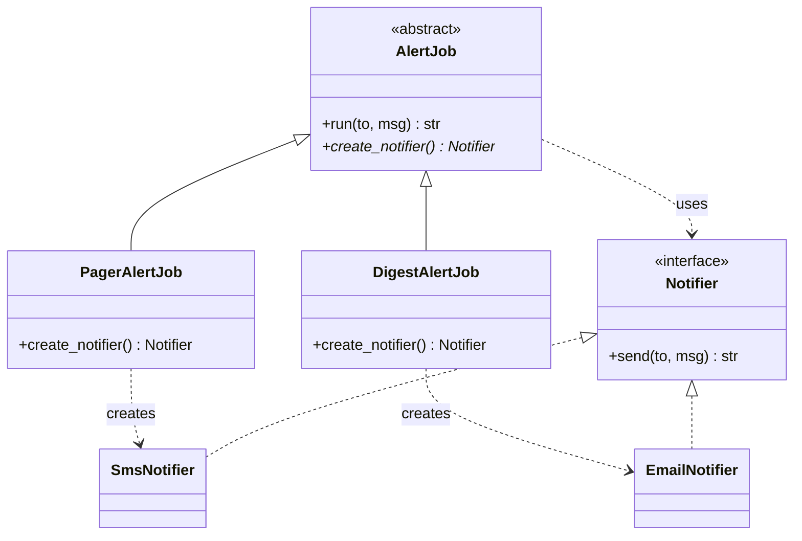

**Reading the diagram.** The abstract creator `AlertJob` defines `run()`, which calls the abstract `create_notifier()` (the asterisk marks it abstract). Each concrete creator overrides that one method and names one concrete product. Control flows downward through inheritance (solid arrows with hollow heads) and the creation dependency points from each subclass to its product. Everything is synchronous and in-process; no state is stored beyond the objects themselves. The design scales by adding a creator subclass per product variant, which is also its weakness: two independent variation axes (channel and urgency, say) multiply subclasses, and composition (Strategy, §37.7, or injection, §37.14) is then the better tool.

#### Python implementation

```python
from abc import ABC, abstractmethod


class Notifier(ABC):
    @abstractmethod
    def send(self, to: str, msg: str) -> str: ...


class EmailNotifier(Notifier):
    def send(self, to, msg):
        return f"email to {to}: {msg}"


class SmsNotifier(Notifier):
    def send(self, to, msg):
        return f"sms to {to}: {msg[:160]}"          # SMS segments are 160 chars


class PushNotifier(Notifier):
    def send(self, to, msg):
        return f"push to {to}: {msg}"


# --- Simple factory: one place owns the "which class?" decision ---
_REGISTRY: dict[str, type[Notifier]] = {
    "email": EmailNotifier, "sms": SmsNotifier, "push": PushNotifier,
}


def make_notifier(channel: str) -> Notifier:
    try:
        return _REGISTRY[channel]()
    except KeyError:
        raise ValueError(f"unknown channel {channel!r}") from None


# --- Factory method: subclasses decide what the base class creates ---
class AlertJob(ABC):
    @abstractmethod
    def create_notifier(self) -> Notifier: ...      # the factory method

    def run(self, to: str, msg: str) -> str:        # fixed workflow uses it
        return self.create_notifier().send(to, f"[ALERT] {msg}")


class PagerAlertJob(AlertJob):
    def create_notifier(self):
        return SmsNotifier()


class DigestAlertJob(AlertJob):
    def create_notifier(self):
        return EmailNotifier()


if __name__ == "__main__":
    print(make_notifier("push").send("user-42", "Order shipped"))
    for job in (PagerAlertJob(), DigestAlertJob()):
        print(job.run("oncall", "p99 latency above SLO"))
    try:
        make_notifier("fax")
    except ValueError as e:
        print("rejected:", e)
```

Output:

```text
push to user-42: Order shipped
sms to oncall: [ALERT] p99 latency above SLO
email to oncall: [ALERT] p99 latency above SLO
rejected: unknown channel 'fax'
```

What to notice:

- The registry is a dictionary of classes. In Python, classes are objects, so a simple factory needs no `if` chain and plugins can register themselves at import time.
- The factory fails loudly on unknown input. A factory that returns `None` moves the crash to a distant call site.
- `AlertJob.run()` never names a concrete class; only the one-line overrides do.

#### When to use and when not

Use a simple factory when the concrete class is chosen at run time from data (config, a request field, a feature flag). Use a factory method when a base class or framework owns a workflow and subclasses supply a part. Do not add a factory when there is only one implementation and no realistic second one: `Thing()` is clearer than `ThingFactory.create()`. In Python, passing a class or a callable (`notifier_cls=SmsNotifier`) often replaces a factory-method hierarchy.

#### Related patterns

Abstract Factory (§37.4) is a set of factory methods for a family of products. Template Method (§37.15.2) is the general form of "base class owns the workflow". Dependency injection (§37.14) usually decides which factory is used.

#### Interview question

::: tip
**Q.** What is the difference between a simple factory and the factory method pattern? **A.** A simple factory is one function that maps a parameter to a concrete class; callers pass data in. A factory method is an overridable method in a class hierarchy; the subclass, not a parameter, decides the product, and the base class's own logic uses it. The first centralizes a run-time choice; the second lets a framework defer a decision to its extensions.
:::

## 37.4 Abstract factory

### Intent

::: definition
**Definition — Abstract factory.** An interface for creating a *family* of related objects (for example a blob store and a work queue) without naming their concrete classes, so that a client receives products that are guaranteed to belong together [Gamma et al. 1994].
:::

### Problem it solves

The order service stores invoices as blobs and enqueues work for a background worker. In production it uses a cloud object store and a cloud queue; in unit tests it uses in-memory fakes; on a laptop it uses the local disk. Mixing families (a disk blob store with a cloud queue whose workers cannot read the disk) is a bug that type checks cannot catch unless the families are created together. An abstract factory makes "which environment am I in?" one decision, made once, at startup. Portable libraries use the same idea: Java's `javax.xml.parsers.DocumentBuilderFactory` hides which XML parser implementation is installed.

### Structure

**Figure 37.3 — Abstract factory for infrastructure families.**

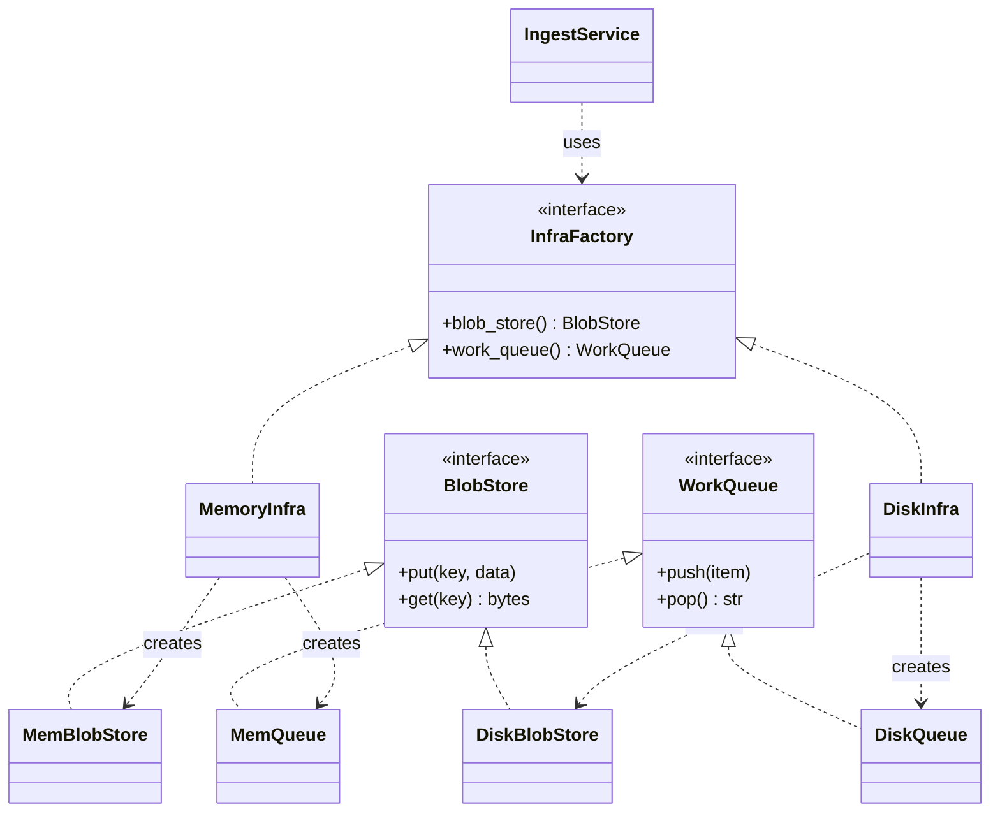

**Reading the diagram.** There are two product interfaces (`BlobStore`, `WorkQueue`) and one factory interface with one creation method per product. Each concrete factory creates one consistent family: `MemoryInfra` creates the in-memory store and queue, `DiskInfra` the file-based ones. `IngestService` depends only on the three interfaces. Calls are synchronous and in-process here; in production the products would wrap network clients, and the storage boundary would sit behind `BlobStore.put` and `WorkQueue.push`, which are the failure points (timeouts, throttling). Adding a family (a cloud one) is easy; adding a product type (a cache) is hard, because every factory must change.

### Python implementation

```python
import os
import tempfile
from abc import ABC, abstractmethod
from collections import deque


class BlobStore(ABC):
    @abstractmethod
    def put(self, key: str, data: bytes) -> None: ...
    @abstractmethod
    def get(self, key: str) -> bytes: ...


class WorkQueue(ABC):
    @abstractmethod
    def push(self, item: str) -> None: ...
    @abstractmethod
    def pop(self) -> str | None: ...


class InfraFactory(ABC):
    @abstractmethod
    def blob_store(self) -> BlobStore: ...
    @abstractmethod
    def work_queue(self) -> WorkQueue: ...


# Family 1: in-memory, for unit tests
class MemBlobStore(BlobStore):
    def __init__(self): self._d: dict[str, bytes] = {}
    def put(self, key, data): self._d[key] = data
    def get(self, key): return self._d[key]


class MemQueue(WorkQueue):
    def __init__(self): self._q: deque[str] = deque()
    def push(self, item): self._q.append(item)
    def pop(self): return self._q.popleft() if self._q else None


class MemoryInfra(InfraFactory):
    def blob_store(self): return MemBlobStore()
    def work_queue(self): return MemQueue()


# Family 2: local disk, for a developer laptop
class DiskBlobStore(BlobStore):
    def __init__(self, root): self.root = root
    def put(self, key, data):
        with open(os.path.join(self.root, key), "wb") as f:
            f.write(data)
    def get(self, key):
        with open(os.path.join(self.root, key), "rb") as f:
            return f.read()


class DiskQueue(WorkQueue):
    def __init__(self, root):
        self.path, self.read_pos = os.path.join(root, "queue.log"), 0
    def push(self, item):
        with open(self.path, "a") as f:
            f.write(item + "\n")
    def pop(self):
        if not os.path.exists(self.path):
            return None
        with open(self.path) as f:
            lines = f.read().splitlines()
        if self.read_pos >= len(lines):
            return None
        self.read_pos += 1
        return lines[self.read_pos - 1]


class DiskInfra(InfraFactory):
    def __init__(self): self.root = tempfile.mkdtemp()
    def blob_store(self): return DiskBlobStore(self.root)
    def work_queue(self): return DiskQueue(self.root)


def ingest(infra: InfraFactory, name: str, payload: bytes) -> str:
    store, queue = infra.blob_store(), infra.work_queue()   # one consistent family
    store.put(name, payload)
    queue.push(name)
    key = queue.pop()
    return f"{type(infra).__name__}: {key} -> {store.get(key)!r}"


if __name__ == "__main__":
    factories = {"test": MemoryInfra, "dev": DiskInfra}
    for env in ("test", "dev"):
        print(ingest(factories[env](), "invoice-17.txt", b"total=4999"))
```

Output:

```text
MemoryInfra: invoice-17.txt -> b'total=4999'
DiskInfra: invoice-17.txt -> b'total=4999'
```

What to notice:

- `ingest` is written once and runs unchanged against both families; the environment is chosen in one dictionary lookup at the top.
- The factory guarantees compatibility: `DiskQueue` items name files that `DiskBlobStore` can read.
- The cost is many small classes. In Python you can often replace the factory class with a small dataclass of two callables, or a module per environment.

### When to use and when not

Use an abstract factory when you have several product types that must vary together (per cloud, per database vendor, per UI theme, per test versus production). Do not use it when products vary independently, when there is only one family, or when you expect to add product types frequently, since each new product forces a change to every factory.

### Related patterns

Each creation method is a factory method (§37.3.2). Concrete factories are often configured by dependency injection (§37.14) and are sometimes, unwisely, made singletons (§37.6). Hexagonal architecture (§33.10) generalizes the idea: ports are the product interfaces and each environment supplies adapters.

### Interview question

::: tip
**Q.** Your service must run on two cloud providers. How would you keep provider-specific code out of business logic? **A.** Define ports for each capability (blob storage, queue, secrets) and one abstract factory per provider that builds a consistent set of adapters. Business logic receives the factory or the built adapters via constructor injection; provider choice is made once in the composition root from configuration. Contract tests run against every family. Accept that new capabilities require changes to every provider's factory.
:::

## 37.5 Builder

### Intent

::: definition
**Definition — Builder.** A separate object that assembles a complex product step by step, validates the combination of choices, and returns a finished (ideally immutable) product from a final `build()` call [Gamma et al. 1994; Bloch 2018].
:::

### Problem it solves

An outbound HTTP request in the order service has a method, URL, headers, an optional body, a timeout and a retry count, and some combinations are invalid: a `GET` with a body, a timeout of 0, or a retried `POST` without an idempotency key (which risks charging a customer twice, §22.15). A constructor with eight positional arguments is unreadable, and setters on a mutable object allow half-built requests to escape. A builder collects choices fluently, checks cross-field rules once, and emits a frozen object. Real APIs use exactly this shape: Java 11's `HttpRequest.newBuilder()`, and the `newBuilder()` methods that Protocol Buffers generates for every Java message class.

### Structure

**Figure 37.4 — Builder producing an immutable request.**

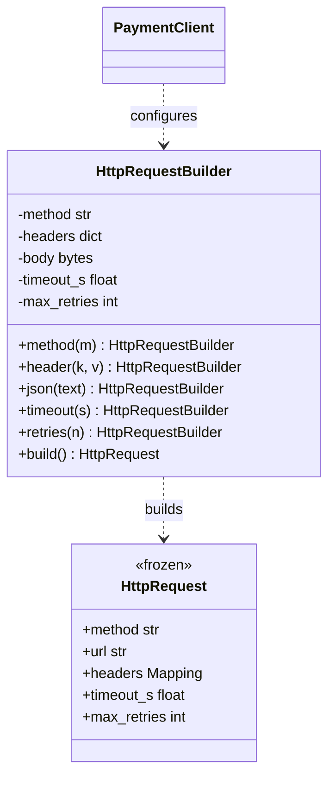

**Reading the diagram.** The client (`PaymentClient`) talks only to the mutable builder, whose setters each return the builder so calls chain. `build()` is the single validation point and the only path to the immutable `HttpRequest`. Everything is synchronous and in memory; no I/O happens until a transport later sends the product. The failure point is `build()`, which raises on an invalid combination, so an invalid request can never exist. Immutable products are safe to share across threads and to cache.

### Python implementation

```python
from dataclasses import dataclass
from types import MappingProxyType


@dataclass(frozen=True)
class HttpRequest:
    method: str
    url: str
    headers: MappingProxyType
    body: bytes | None
    timeout_s: float
    max_retries: int


class HttpRequestBuilder:
    def __init__(self, url: str):
        self._url, self._method = url, "GET"
        self._headers: dict[str, str] = {}
        self._body: bytes | None = None
        self._timeout_s, self._max_retries = 2.0, 0

    def method(self, m):   self._method = m.upper(); return self
    def header(self, k, v): self._headers[k.lower()] = v; return self
    def timeout(self, s):  self._timeout_s = s; return self
    def retries(self, n):  self._max_retries = n; return self

    def json(self, text: str):
        self._body = text.encode()
        return self.header("Content-Type", "application/json")

    def build(self) -> HttpRequest:
        if self._body is not None and self._method in ("GET", "HEAD"):
            raise ValueError(f"{self._method} must not carry a body")
        if self._max_retries and self._method == "POST" \
                and "idempotency-key" not in self._headers:
            raise ValueError("retried POST needs an Idempotency-Key header")
        if not 0 < self._timeout_s <= 30:
            raise ValueError("timeout must be in (0, 30] seconds")
        return HttpRequest(self._method, self._url,
                           MappingProxyType(dict(self._headers)),  # read-only copy
                           self._body, self._timeout_s, self._max_retries)


if __name__ == "__main__":
    req = (HttpRequestBuilder("https://payments.internal/charges")
           .method("post").json('{"amount": 4999}')
           .header("Idempotency-Key", "order-17-charge").timeout(0.5).retries(3)
           .build())
    print(req.method, req.timeout_s, req.max_retries, dict(req.headers))
    try:
        HttpRequestBuilder("https://payments.internal/charges").method("POST").retries(3).build()
    except ValueError as e:
        print("rejected:", e)
```

Output:

```text
POST 0.5 3 {'content-type': 'application/json', 'idempotency-key': 'order-17-charge'}
rejected: retried POST needs an Idempotency-Key header
```

What to notice:

- Cross-field rules (retries require an idempotency key) live in `build()`, the one place that sees all fields together.
- The product is frozen and its headers are a read-only `MappingProxyType` copy, so later builder calls cannot mutate a request already in flight.

### Java sketch

Python has keyword arguments with defaults, so `HttpRequest(url=..., timeout_s=0.5)` already reads well; a builder earns its keep mainly for cross-field validation. Java has no named or default parameters, so constructors with many parameters ("telescoping constructors") are common, and the static nested Builder is the standard cure [Bloch 2018]:

```java
public final class RequestSpec {
    private final String url, method;
    private final int timeoutMs, maxRetries;

    private RequestSpec(Builder b) {                       // only the builder can construct
        url = b.url; method = b.method; timeoutMs = b.timeoutMs; maxRetries = b.maxRetries;
    }
    public static Builder newBuilder(String url) { return new Builder(url); }

    public static final class Builder {
        private final String url;
        private String method = "GET";
        private int timeoutMs = 2000, maxRetries = 0;
        private Builder(String url) { this.url = url; }
        public Builder method(String m)     { method = m; return this; }
        public Builder timeoutMs(int t)     { timeoutMs = t; return this; }
        public Builder maxRetries(int n)    { maxRetries = n; return this; }
        public RequestSpec build() {
            if (timeoutMs <= 0) throw new IllegalStateException("timeout must be positive");
            return new RequestSpec(this);
        }
    }
}
// RequestSpec r = RequestSpec.newBuilder("https://api.example.com/orders")
//                            .method("POST").timeoutMs(500).maxRetries(3).build();
```

### When to use and when not

Use a builder for objects with many optional parts, cross-field invariants, or a need for immutability after construction (requests, queries, configuration, test fixtures). Do not use one for objects with two or three fields; in Python, a frozen dataclass with keyword arguments and a `__post_init__` check is usually enough.

### Related patterns

Abstract Factory (§37.4) returns a product in one call; Builder assembles one in steps. A builder is often created by a factory method (`newBuilder()`). Test-data builders are a common use in tests of Repository-based code (§37.13).

### Interview question

::: tip
**Q.** Why make the built object immutable? **A.** Immutability means validation in `build()` holds forever: no later setter can break an invariant. Immutable objects can be shared between threads without locks, used as cache keys and dictionary keys, and retried safely because the request that is retried is exactly the one that was validated.
:::

## 37.6 Singleton

### Intent

::: definition
**Definition — Singleton.** A class that guarantees it has exactly one instance within a scope and provides a global access point to it [Gamma et al. 1994]. The scope is almost always one process, a fact that matters greatly in distributed systems.
:::

### Problem it solves

Some resources should exist once per process: a metrics registry that aggregates counters before export, a connection pool, a configuration object loaded at startup, the logging hierarchy. Creating a second connection pool by accident doubles database connections; two metrics registries split counters so dashboards undercount. Python's `logging.getLogger(name)` returns the same logger object for the same name every time, which is a registry of singletons keyed by name.

### Structure

**Figure 37.5 — Singleton with lazy, thread-safe creation.**

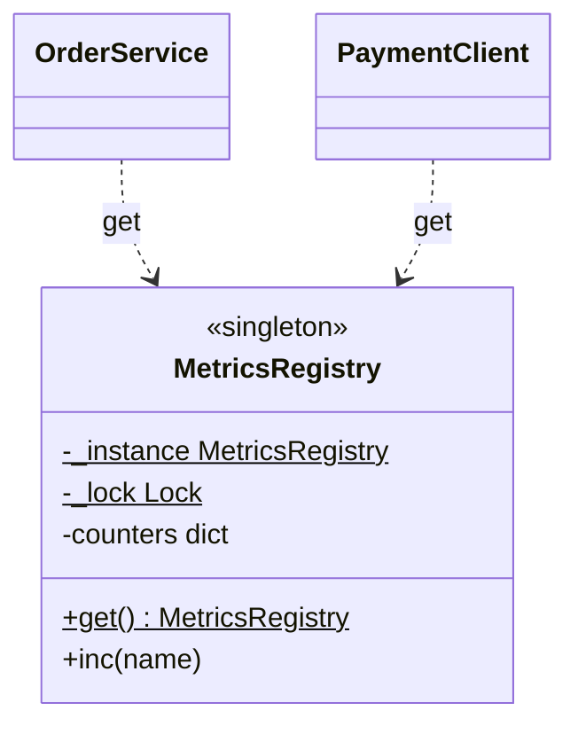

**Reading the diagram.** `MetricsRegistry` holds a class-level (static, underlined `$`) reference to its only instance and a lock that guards first creation. Any component calls the static `get()` and receives the same object, synchronously and in-process. The state (counters) lives in that process's memory only. The failure points are a race during first creation (two threads both see "no instance"), hidden coupling (callers do not declare the dependency, so tests cannot substitute it), and shared mutable state that every caller can corrupt. It does not scale across processes: each process has its own.

### Python implementation

```python
import json
import sys
import threading
import time


class NaiveRegistry:
    _instance, created = None, 0

    @classmethod
    def get(cls):
        if cls._instance is None:           # check ...
            time.sleep(0.05)                # slow initialization widens the window
            cls.created += 1
            cls._instance = cls()           # ... then act: not atomic
        return cls._instance


class SafeRegistry:
    _instance, created = None, 0
    _lock = threading.Lock()

    @classmethod
    def get(cls):
        if cls._instance is None:           # fast path: no lock after creation
            with cls._lock:
                if cls._instance is None:   # re-check while holding the lock
                    time.sleep(0.05)
                    cls.created += 1
                    cls._instance = cls()
        return cls._instance


def hammer(getter, n_threads=8):
    barrier = threading.Barrier(n_threads)   # release all threads at once
    def worker():
        barrier.wait()
        getter()
    threads = [threading.Thread(target=worker) for _ in range(n_threads)]
    for t in threads: t.start()
    for t in threads: t.join()


if __name__ == "__main__":
    hammer(NaiveRegistry.get)
    hammer(SafeRegistry.get)
    print("naive instances created:", NaiveRegistry.created)
    print("safe instances created: ", SafeRegistry.created)
    # The idiomatic Python singleton is a module: imports are cached.
    import json as again
    print("module is cached:", again is json is sys.modules["json"])
```

Output (the naive count can vary between runs; it was 8 in every run we tried):

```text
naive instances created: 8
safe instances created:  1
module is cached: True
```

What to notice:

- Check-then-act without a lock is a race condition (§6.9): all eight threads saw `None` before any assigned.
- The safe version re-checks under the lock. In CPython this double-check is correct because an object is fully built before the assignment publishes it; the same code in Java needs `volatile` (§37.16.5).
- A **module-level singleton** is the Python idiom: put `registry = MetricsRegistry()` in `metrics.py`, and every `import metrics` returns the module object cached in `sys.modules`. Import itself is protected by the interpreter's import lock.

### Java sketch

Java offers two idioms that use language guarantees instead of hand-written locking. An `enum` with one constant is serialization-safe and reflection-safe [Bloch 2018]; the **initialization-on-demand holder** relies on the JVM's guarantee that class initialization is lazy and thread-safe:

```java
public enum MetricsRegistry {
    INSTANCE;
    private final java.util.concurrent.ConcurrentHashMap<String, Long> counters =
        new java.util.concurrent.ConcurrentHashMap<>();
    public void inc(String name) { counters.merge(name, 1L, Long::sum); }
}

final class AppConfig {
    private AppConfig() { /* read files, environment */ }
    private static final class Holder { static final AppConfig INSTANCE = new AppConfig(); }
    static AppConfig get() { return Holder.INSTANCE; }   // Holder initialized on first call
}
```

### When to use and when not

Singleton is often an **anti-pattern** because it is a global variable with a class around it. It hides dependencies (a function's signature does not reveal that it writes metrics), makes tests order-dependent (state leaks from one test to the next), prevents running two configurations side by side, and invites lock contention on a hot shared object. Prefer creating one instance in the composition root and passing it in (§37.14); you keep "exactly one" by construction and gain testability. Reserve true singletons for stateless or effectively immutable process-wide facilities (logging, a metrics registry), and give them a reset hook for tests.

::: mistake
**Mistake — "A singleton guarantees one instance in the system."** It guarantees one per process (per class loader in Java). An order service running 50 pods with 4 worker processes each has 200 "singleton" connection pools; at 10 connections each, that is 2,000 database connections, which can exhaust a PostgreSQL server configured for a few hundred. A system-wide single instance (one scheduler, one leader) needs leader election and leases (§26.5, §26.11), not a class pattern.
:::

### Related patterns

Dependency injection (§37.14) is the usual replacement. Abstract factories and registries are sometimes singletons. Double-checked locking (§37.16.5) is the classic lazy-initialization idiom and its classic bug.

### Interview question

::: tip
**Q.** How would you make a singleton testable? **A.** Stop calling `get()` from business code. Create the instance once at startup and inject it through constructors; tests then pass a fake. If legacy code must call a global accessor, provide a test-only `reset()` or an override hook, and keep the singleton's state immutable or behind a narrow interface.
:::

## 37.7 Strategy

### Intent

::: definition
**Definition — Strategy.** A family of interchangeable algorithms, each behind a common interface, so that a client can be configured with one at run time without changing its code [Gamma et al. 1994].
:::

### Problem it solves

The order service retries calls to the payment provider. Which backoff policy is right depends on the dependency: a fixed delay for an internal cache, exponential backoff with **full jitter** for a shared external API, where synchronized retries from thousands of clients would otherwise arrive in waves (§22.12) [Brooker 2015]. Hard-coding the policy in the retry loop means editing and retesting the loop for every new policy. Strategy separates "when to retry" (the client's job) from "how long to wait" (the policy). The standard library is full of strategies: the `key=` argument of Python's `sorted`, Java's `Comparator`, and pluggable load-balancing policies (Chapter 19).

### Structure

**Figure 37.6 — Strategy for retry backoff.**

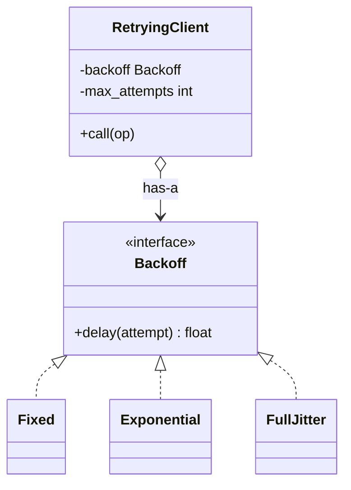

**Reading the diagram.** `RetryingClient` (the context) holds a reference to one `Backoff` (aggregation, hollow diamond) and asks it for a delay after each failure. Three concrete strategies implement the same one-method interface. The call to the strategy is synchronous and in-process; the expensive, failure-prone call is the remote operation the client wraps. Strategies here are stateless except for the random generator, so one instance can be shared by many clients. Adding a policy adds a class (or function) and touches nothing else.

### Python implementation

In Python a one-method interface is just a callable, so strategies are functions.

```python
import random
from typing import Callable

Backoff = Callable[[int], float]      # attempt number (0-based) -> seconds to wait


def fixed(delay: float) -> Backoff:
    return lambda attempt: delay


def exponential(base: float, cap: float) -> Backoff:
    return lambda attempt: min(cap, base * 2 ** attempt)


def full_jitter(base: float, cap: float, rng: random.Random) -> Backoff:
    return lambda attempt: rng.uniform(0, min(cap, base * 2 ** attempt))


class RetryingClient:
    def __init__(self, backoff: Backoff, max_attempts: int = 5):
        self.backoff, self.max_attempts = backoff, max_attempts

    def call(self, op, sleep=lambda s: None):
        waits = []
        for attempt in range(self.max_attempts):
            try:
                return op(), waits
            except ConnectionError:
                wait = self.backoff(attempt)
                waits.append(round(wait, 3))
                sleep(wait)                     # injected so the demo runs instantly
        raise TimeoutError(f"gave up after {self.max_attempts} attempts; waits={waits}")


def flaky(fail_times: int):
    state = {"n": 0}
    def op():
        state["n"] += 1
        if state["n"] <= fail_times:
            raise ConnectionError("503")
        return "charged"
    return op


if __name__ == "__main__":
    rng = random.Random(7)
    for name, policy in [("fixed", fixed(0.2)),
                         ("exponential", exponential(0.1, 2.0)),
                         ("full jitter", full_jitter(0.1, 2.0, rng))]:
        result, waits = RetryingClient(policy).call(flaky(fail_times=4))
        print(f"{name:12} {result} after waits {waits}")
```

Output:

```text
fixed        charged after waits [0.2, 0.2, 0.2, 0.2]
exponential  charged after waits [0.1, 0.2, 0.4, 0.8]
full jitter  charged after waits [0.032, 0.03, 0.26, 0.058]
```

What to notice:

- The retry loop never changes; swapping a closure changes the policy.
- Closures capture configuration (`base`, `cap`, `rng`), which is all a strategy object's fields would do.
- Injecting `sleep` and a seeded `rng` makes time-dependent code deterministic in tests, a small taste of §37.14.

### When to use and when not

Use Strategy when several algorithms solve the same problem and the choice depends on configuration, data or tenant (pricing rules, compression codecs, eviction policies, load-balancing algorithms). Do not use it for a choice that never varies, and do not build a class hierarchy in Python when a function argument suffices.

### Related patterns

State (§37.15.1) has the same structure, but the state object changes itself; a strategy is chosen from outside. Template Method (§37.15.2) varies steps by inheritance; Strategy varies them by composition. Decorator (§37.10) adds behavior around a call; Strategy replaces the algorithm inside.

### Interview question

::: tip
**Q.** How does Strategy relate to the Open/Closed Principle? **A.** The context is closed for modification and open for extension: new behavior arrives as a new strategy, not as another `elif` in the context. The choice of strategy moves to configuration or the composition root, and each strategy can be unit-tested in isolation.
:::

## 37.8 Observer

### Intent

::: definition
**Definition — Observer.** A one-to-many dependency in which a **subject** keeps a list of **observers** and notifies each of them when its state changes, so that the subject does not depend on what the observers do [Gamma et al. 1994].
:::

### Problem it solves

When an order is placed, the store must send a receipt, reserve stock and record analytics, and next quarter it will also award loyalty points. If `place_order()` calls each of these directly, the order module imports every other module, and adding loyalty means editing checkout. With Observer, checkout announces "an order was placed" and each interested module subscribes. GUI toolkits (button click listeners), Java's `PropertyChangeListener`, and Kubernetes client informers with registered event handlers all follow this shape.

### Structure

**Figure 37.7 — Observer for order events.**

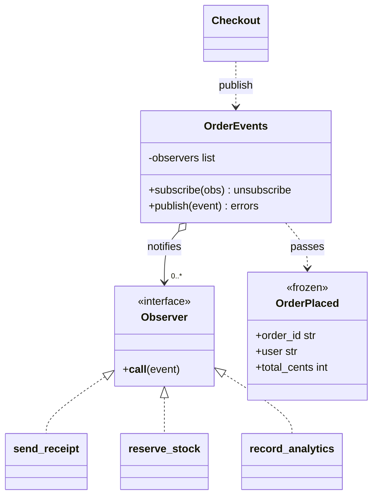

**Reading the diagram.** `Checkout` publishes an immutable `OrderPlaced` event to the subject, `OrderEvents`, which holds zero or more observers and calls each in turn. In the classic pattern every call is synchronous and in-process, so checkout's latency includes every observer's latency and an observer that blocks blocks checkout. The subscriber list is in-memory state; it is lost on restart, and so is any event being delivered when the process crashes. Failure points are a throwing observer (must be isolated) and a slow one (must be moved off the request path). Scaling beyond one process is where the pattern becomes publish/subscribe through a broker.

### Python implementation

```python
from dataclasses import dataclass
from typing import Callable


@dataclass(frozen=True)
class OrderPlaced:
    order_id: str
    user: str
    total_cents: int


Observer = Callable[[OrderPlaced], None]


class OrderEvents:                                   # the subject
    def __init__(self):
        self._observers: list[Observer] = []

    def subscribe(self, obs: Observer) -> Callable[[], None]:
        self._observers.append(obs)
        return lambda: self._observers.remove(obs)   # caller keeps the unsubscribe handle

    def publish(self, event: OrderPlaced) -> list[str]:
        errors = []
        for obs in list(self._observers):            # copy: observers may unsubscribe
            try:
                obs(event)
            except Exception as e:                   # isolate a failing observer
                errors.append(f"{obs.__name__}: {e}")
        return errors


log = []
def send_receipt(e):     log.append(f"receipt to {e.user}")
def record_analytics(e): log.append(f"analytics +{e.total_cents}")
def reserve_stock(e):
    if e.order_id == "o-2":
        raise RuntimeError("warehouse timeout")
    log.append(f"stock reserved for {e.order_id}")


if __name__ == "__main__":
    events = OrderEvents()
    events.subscribe(send_receipt)
    events.subscribe(reserve_stock)
    stop_analytics = events.subscribe(record_analytics)
    print(events.publish(OrderPlaced("o-1", "ana", 4999)), log)
    log.clear(); stop_analytics()
    print(events.publish(OrderPlaced("o-2", "ben", 1999)), log)
```

Output:

```text
[] ['receipt to ana', 'stock reserved for o-1', 'analytics +4999']
['reserve_stock: warehouse timeout'] ['receipt to ben']
```

What to notice:

- A failing observer is reported but does not stop the receipt from being sent; without the `try`, one bug in analytics would break checkout.
- `subscribe` returns an unsubscribe handle. Forgotten subscriptions are a classic memory leak (the "lapsed listener" problem): the subject keeps dead observers alive. `weakref.WeakMethod` is the Python remedy for bound methods.
- Observers run in subscription order and synchronously. Code must not depend on that order.

### Observer and publish/subscribe

Observer is publish/subscribe inside one process. Chapter 30 (§30.5) takes the idea across the network.

**Table 37.1 — Observer versus broker-based publish/subscribe.**

| Aspect | Observer (in-process) | Publish/subscribe (§30.5) |
|---|---|---|
| Coupling | Subject holds observer references | Publisher knows only a topic |
| Timing | Synchronous, same call stack | Asynchronous; subscribers may be offline |
| Durability | None; lost on crash | Broker persists messages |
| Failure isolation | Manual (`try` per observer) | Process boundary; retries, dead-letter queues (§30.11) |
| Latency | Microseconds | Milliseconds |
| Choose when | Same deployable, same transaction | Different services, independent scaling |

A common production arrangement uses both: an in-process observer writes the event to an outbox table in the same database transaction, and a relay publishes it to the broker (the transactional outbox, §32.5).

### When to use and when not

Use Observer when one change must trigger an open-ended set of reactions inside a process (UI updates, cache invalidation, domain events). Do not use it when the reactions must be atomic with the change and failure must roll it back (call them directly in the transaction), or when observers live in other services (use a broker).

### Related patterns

Mediator centralizes many-to-many communication; Observer distributes one-to-many. Command (§37.12) objects are often what gets queued when observers become asynchronous. Publish/subscribe (§30.5) and event-driven architecture (§30.6) are the distributed forms.

### Interview question

::: tip
**Q.** A slow analytics observer is adding 300 ms to checkout. What do you do? **A.** Take it off the request path: have the observer enqueue the event (an in-process queue drained by a worker, or a broker topic) and return immediately. If the event must not be lost, write it to an outbox in the order's transaction. Then decide the delivery guarantee (at-least-once plus an idempotent consumer is typical, §30.8).
:::

## 37.9 Adapter

### Intent

::: definition
**Definition — Adapter.** A wrapper that converts the interface of an existing class into the interface its clients expect, so that classes with incompatible interfaces can work together [Gamma et al. 1994].
:::

### Problem it solves

The order service defines its own `PaymentGateway.charge(amount, currency, token)` port, returning a `ChargeResult`. The acquiring bank's SDK, which you cannot modify, exposes `make_payment(amount_cents, card_token, currency_code)` and returns a dictionary of status codes. An adapter translates units (decimal to integer cents), argument order and error conventions in one class, so neither side changes. SLF4J's bindings, which route one logging API to Logback, Log4j or `java.util.logging`, are adapters, as are JDBC drivers that present each database's wire protocol through one Java interface.

### Structure

**Figure 37.8 — Object adapter for a legacy payment SDK.**

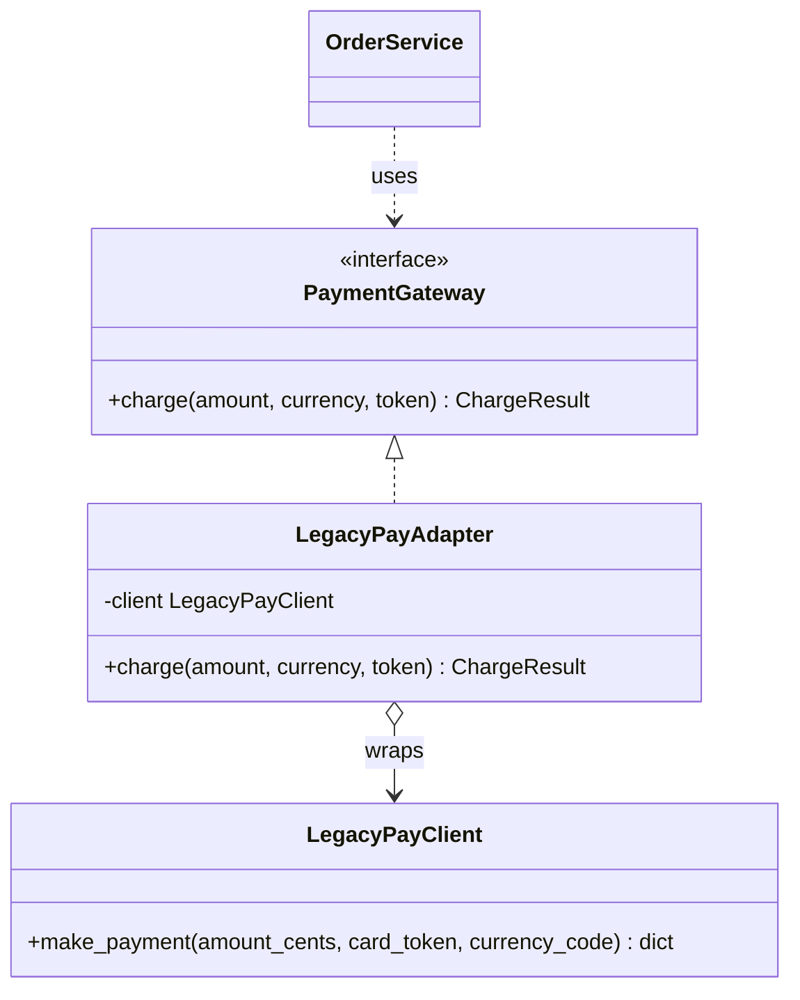

**Reading the diagram.** `OrderService` depends on its own interface (the **target**). `LegacyPayAdapter` implements the target and holds the third-party **adaptee**, translating every call. Calls are synchronous; the adaptee call crosses the network to the payment processor, so it is the failure point (timeouts, declines, malformed responses), and the adapter is where vendor error codes become your domain's results. The adapter holds no state of its own. Swapping vendors means writing a new adapter, not editing the service.

### Python implementation

```python
from abc import ABC, abstractmethod
from dataclasses import dataclass
from decimal import Decimal


class LegacyPayClient:                       # third-party SDK: cannot be changed
    def make_payment(self, amount_cents, card_token, currency_code):
        if card_token.startswith("tok_bad"):
            return {"status_code": 402, "err": "card_declined"}
        return {"status_code": 200, "txn": f"T-{amount_cents}-{currency_code}"}


@dataclass(frozen=True)
class ChargeResult:
    ok: bool
    reference: str


class PaymentGateway(ABC):                   # our port (the target interface)
    @abstractmethod
    def charge(self, amount: Decimal, currency: str, token: str) -> ChargeResult: ...


class LegacyPayAdapter(PaymentGateway):
    def __init__(self, client: LegacyPayClient):
        self._client = client

    def charge(self, amount, currency, token):
        cents = int((amount * 100).to_integral_value())     # Decimal -> integer cents
        resp = self._client.make_payment(cents, token, currency.upper())
        if resp["status_code"] == 200:
            return ChargeResult(True, resp["txn"])
        return ChargeResult(False, resp.get("err", f"http {resp['status_code']}"))


if __name__ == "__main__":
    gateway: PaymentGateway = LegacyPayAdapter(LegacyPayClient())
    print(gateway.charge(Decimal("49.99"), "usd", "tok_visa"))
    print(gateway.charge(Decimal("19.99"), "eur", "tok_bad_cvc"))
```

Output:

```text
ChargeResult(ok=True, reference='T-4999-USD')
ChargeResult(ok=False, reference='card_declined')
```

What to notice:

- All translation lives in one place: unit conversion, argument order, casing, and error codes become domain values.
- Money uses `Decimal`; converting a binary float like `49.99` to cents can be off by one.
- Tests of `OrderService` use a fake `PaymentGateway`; only the adapter's own tests touch the SDK.

### When to use and when not

Use an adapter at every boundary with code you do not own (vendor SDKs, legacy modules, another team's API) and when migrating between implementations. Do not use one to paper over your own inconsistent interfaces; fix those instead. An adapter that grows business logic has become a service and should be named and tested as one.

### Related patterns

Decorator (§37.10) keeps the interface and adds behavior; Adapter changes the interface. Facade simplifies a whole subsystem behind a new, smaller interface. Hexagonal architecture (§33.10) is named "ports and adapters" after this pattern, and the anti-corruption layer of domain-driven design (§34.5) is an adapter at a bounded-context boundary.

### Interview question

::: tip
**Q.** What is the difference between an object adapter and a class adapter? **A.** An object adapter holds an instance of the adaptee and delegates (composition); it works with any subclass of the adaptee and is the norm in Python and Java. A class adapter inherits from both the target and the adaptee (multiple inheritance in C++, or extending the adaptee class while implementing the target interface in Java); it can override adaptee behavior but couples you to one concrete class.
:::

## 37.10 Decorator

### Intent

::: definition
**Definition — Decorator (GoF).** An object that implements the same interface as the object it wraps, forwards calls to it, and adds behavior before or after them, so responsibilities can be added at run time and stacked in any order without subclassing [Gamma et al. 1994].
:::

### Problem it solves

The order service reads prices from a database-backed `PriceSource`. Some deployments need a cache, all need retries on transient errors, and some need metrics. Subclassing gives a class per combination (`CachingRetryingMetricsDbPriceSource`): with three optional behaviors that is $2^3 = 8$ classes. Decorators give three small wrappers that compose. Java's I/O library is the textbook case: `new BufferedInputStream(new GZIPInputStream(new FileInputStream(f)))` stacks buffering and decompression on a file stream, and Python's `io` module layers a `TextIOWrapper` over a `BufferedReader` over a raw `FileIO` in the same way.

### Structure

**Figure 37.9 — Decorators stacked around a price source.**

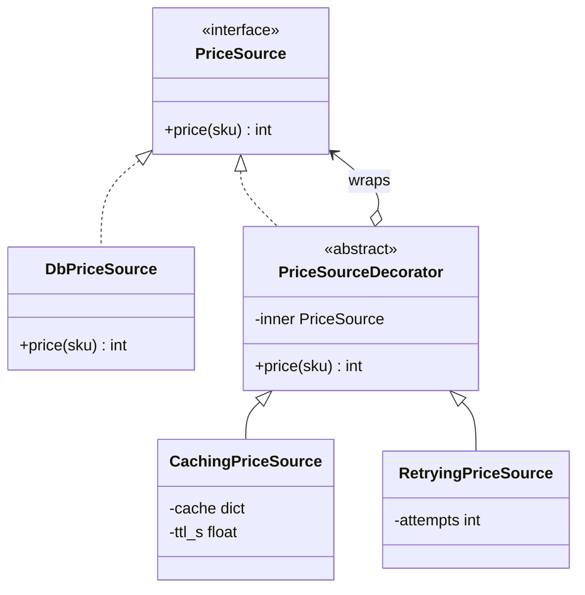

**Reading the diagram.** Every decorator *is a* `PriceSource` and *has a* `PriceSource`; that double relationship is what lets wrappers nest to any depth. A call enters the outermost decorator and flows inward to `DbPriceSource`, the only component that crosses the storage boundary; results flow back out. Everything is synchronous. The cache holds in-process state with a TTL (stale reads are the trade-off, §20.8). Failure points: the database call, which the retry wrapper absorbs for transient errors, and the stacking order, which changes behavior (a cache outside the retry hides retries on hits; inside, it does not).

### Python implementation

```python
import functools
import time
from abc import ABC, abstractmethod


class PriceSource(ABC):
    @abstractmethod
    def price(self, sku: str) -> int: ...


class DbPriceSource(PriceSource):
    def __init__(self, failures_before_success=1):
        self.calls, self._fail = 0, failures_before_success
    def price(self, sku):
        self.calls += 1
        if self._fail:
            self._fail -= 1
            raise ConnectionError("db connection reset")
        return {"A1": 1999, "B2": 4999}[sku]


class CachingPriceSource(PriceSource):            # GoF decorator 1
    def __init__(self, inner, ttl_s=60.0, clock=time.monotonic):
        self._inner, self._ttl, self._clock, self._cache = inner, ttl_s, clock, {}
    def price(self, sku):
        hit = self._cache.get(sku)
        if hit and self._clock() - hit[1] < self._ttl:
            return hit[0]
        value = self._inner.price(sku)
        self._cache[sku] = (value, self._clock())
        return value


class RetryingPriceSource(PriceSource):           # GoF decorator 2
    def __init__(self, inner, attempts=3):
        self._inner, self._attempts = inner, attempts
    def price(self, sku):
        for i in range(self._attempts):
            try:
                return self._inner.price(sku)
            except ConnectionError:
                if i == self._attempts - 1:
                    raise


# Python's @decorator syntax: wraps a *function* at definition time.
def timed(fn):
    @functools.wraps(fn)                          # keep name, docstring
    def wrapper(*args, **kwargs):
        start = time.perf_counter()
        try:
            return fn(*args, **kwargs)
        finally:
            wrapper.last_ms = (time.perf_counter() - start) * 1000
    return wrapper


@timed
def quote(source: PriceSource, sku: str, qty: int) -> int:
    return source.price(sku) * qty


if __name__ == "__main__":
    db = DbPriceSource()
    source = CachingPriceSource(RetryingPriceSource(db))     # stack at run time
    print(quote(source, "B2", 2), quote(source, "B2", 1), "db calls:", db.calls)
    print(quote.__name__, f"{quote.last_ms:.3f} ms" if quote.last_ms < 5 else "slow")
```

Output (the time varies by machine):

```text
9998 4999 db calls: 2
quote 0.002 ms
```

What to notice:

- Two database calls: the first failed and was retried; the second quote was a cache hit.
- The stack is built at run time from configuration; no class names the combination.
- `@timed` is Python syntax for `quote = timed(quote)`. `functools.wraps` copies `__name__` and `__doc__`, without which logs and tracebacks name every function `wrapper`.

::: warning
**Python decorators are not the GoF Decorator.** The GoF pattern wraps an *object* at run time behind the *same interface*. Python's `@decorator` (PEP 318) is syntax that passes a function or class to another callable at *definition time* and rebinds the name to whatever it returns [PEP 318]. It can implement a GoF-style wrapper for a function (`@functools.lru_cache`, a retry decorator), but it is equally used for registration (`@app.route("/orders")` adds a URL mapping and returns the function unchanged), for `@property`, and for class transformations (`@dataclass`), none of which is the GoF pattern. Ask "does this wrap an object and keep its interface?"
:::

### When to use and when not

Use decorators for cross-cutting concerns that you want to combine freely: caching, retries, metrics, logging, authorization, compression, rate limiting. Do not use them when the wrapped interface is wide (every method must be forwarded; Python's `__getattr__` helps but hides the contract), when order-dependent stacks become hard to reason about, or when identity matters (`wrapped is not inner`).

### Related patterns

Proxy (§37.11) has the same structure but controls access rather than adding features. Adapter (§37.9) changes the interface. Chain of Responsibility (§37.15.3) is a decorator stack expressed as a pipeline; HTTP middleware is both.

### Interview question

::: tip
**Q.** Design a client library that supports optional caching, retries and circuit breaking. **A.** Define one client interface; implement the network client; implement each concern as a decorator of that interface; build the stack in a factory from configuration. Document the order: retry inside the circuit breaker so an open circuit stops retries (§22.13), cache outermost so hits avoid both.
:::

## 37.11 Proxy

### Intent

::: definition
**Definition — Proxy.** A surrogate that implements the same interface as a real subject and controls access to it [Gamma et al. 1994]. A **virtual proxy** delays creating an expensive object until first use; a **protection proxy** checks permissions before forwarding; a **remote proxy** (a stub) makes an object in another address space look local.
:::

### Problem it solves

The invoice service is expensive to start (it loads templates and opens a connection pool) but most requests never need it; a virtual proxy defers that cost. Only users with the billing role may read invoices; a protection proxy enforces that at one choke point. In a microservice deployment the invoice service runs elsewhere; a remote proxy (a gRPC or REST client stub) lets callers write `invoices.get_invoice("o-17")`. Hibernate's lazy-loaded entity proxies, Spring's AOP proxies for `@Transactional` methods, and every generated gRPC client stub are proxies [Spring Docs].

### Structure

**Figure 37.10 — Virtual, protection and remote proxies.**

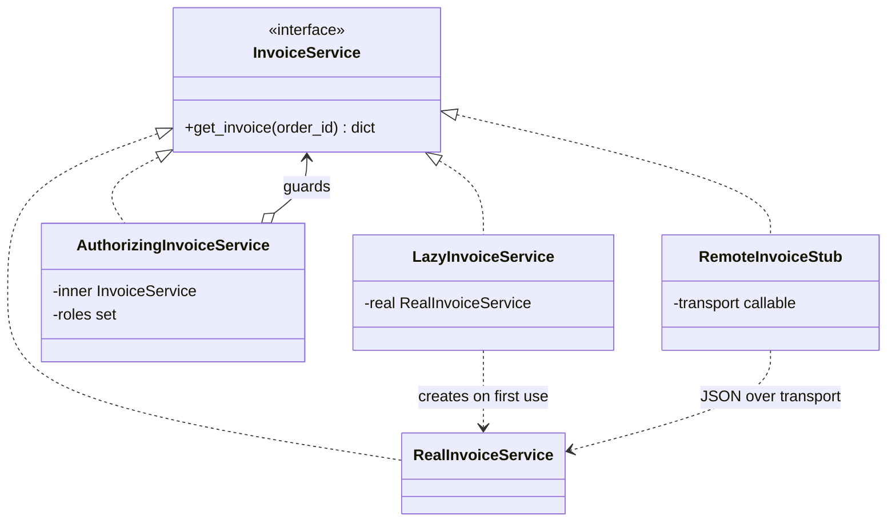

**Reading the diagram.** All four classes share one interface, so a client cannot tell which it holds. The virtual proxy creates the real subject on first call and caches it. The protection proxy wraps any `InvoiceService` and refuses calls that fail its check. The remote stub serializes the call, sends it over a transport (HTTP or gRPC in production; a function here), and deserializes the reply; that edge crosses a process and network boundary, so it adds latency (~0.5 ms in a datacenter at best) and new failure modes (timeouts, partial failure, retries). Scaling the remote side happens behind the stub (load balancing, §19).

### Python implementation

```python
import json
from abc import ABC, abstractmethod


class InvoiceService(ABC):
    @abstractmethod
    def get_invoice(self, order_id: str) -> dict: ...


class RealInvoiceService(InvoiceService):
    def __init__(self):
        print("  (expensive init: templates loaded, DB pool opened)")
        self._db = {"o-17": {"order_id": "o-17", "total_cents": 4999}}
    def get_invoice(self, order_id):
        return self._db[order_id]


class LazyInvoiceService(InvoiceService):            # virtual proxy
    def __init__(self):
        self._real = None
    def get_invoice(self, order_id):
        if self._real is None:
            self._real = RealInvoiceService()
        return self._real.get_invoice(order_id)


class AuthorizingInvoiceService(InvoiceService):     # protection proxy
    def __init__(self, inner: InvoiceService, roles: set[str]):
        self._inner, self._roles = inner, roles
    def get_invoice(self, order_id):
        if "billing" not in self._roles:
            raise PermissionError("billing role required")
        return self._inner.get_invoice(order_id)


class RemoteInvoiceStub(InvoiceService):             # remote proxy (client stub)
    def __init__(self, transport):
        self._send = transport
    def get_invoice(self, order_id):
        reply = json.loads(self._send(json.dumps(
            {"method": "get_invoice", "args": [order_id]})))
        if "error" in reply:
            raise RuntimeError(reply["error"])
        return reply["result"]


def make_server(impl: InvoiceService):               # server skeleton
    allowed = {"get_invoice"}                        # never dispatch arbitrary names
    def handle(wire: str) -> str:
        req = json.loads(wire)
        try:
            if req["method"] not in allowed:
                raise ValueError("no such method")
            return json.dumps({"result": getattr(impl, req["method"])(*req["args"])})
        except Exception as e:
            return json.dumps({"error": repr(e)})
    return handle


if __name__ == "__main__":
    lazy = LazyInvoiceService()
    print("proxy created; nothing loaded yet")
    print(lazy.get_invoice("o-17"))
    try:
        AuthorizingInvoiceService(lazy, {"support"}).get_invoice("o-17")
    except PermissionError as e:
        print("denied:", e)
    stub = RemoteInvoiceStub(make_server(lazy))
    print(stub.get_invoice("o-17"))
    try:
        stub.get_invoice("o-99")
    except RuntimeError as e:
        print("remote error:", e)
```

Output:

```text
proxy created; nothing loaded yet
  (expensive init: templates loaded, DB pool opened)
{'order_id': 'o-17', 'total_cents': 4999}
denied: billing role required
{'order_id': 'o-17', 'total_cents': 4999}
remote error: KeyError('o-99')
```

What to notice:

- The expensive initialization ran once, on first use, not at construction.
- The remote stub changes failure semantics: a `KeyError` on the server becomes a `RuntimeError` carrying a string. Remote proxies cannot fully hide the network, which is the first fallacy of distributed computing (§24.5).
- The skeleton dispatches only allowed method names. Dispatching any name from the wire is a remote-code-execution hole.

### Java sketch

Java can generate proxies at run time for any interface with `java.lang.reflect.Proxy`, which is how frameworks add transactions, security checks and tracing without hand-written wrapper classes:

```java
import java.lang.reflect.Proxy;

interface Invoices { String get(String orderId); }

class Proxies {
    @SuppressWarnings("unchecked")
    static <T> T timed(T target, Class<T> iface) {
        return (T) Proxy.newProxyInstance(iface.getClassLoader(), new Class<?>[]{iface},
            (proxy, method, args) -> {
                long t0 = System.nanoTime();
                try { return method.invoke(target, args); }
                finally { System.out.printf("%s took %d us%n", method.getName(),
                                            (System.nanoTime() - t0) / 1000); }
            });
    }
}
// Invoices inv = Proxies.timed(orderId -> "invoice " + orderId, Invoices.class);
```

### Proxies at the system level

The same three roles reappear as infrastructure. A reverse proxy (§7.12) and an API gateway (§34.6) are protection proxies for whole services: they authenticate, authorize and rate-limit before forwarding. A service-mesh sidecar such as Envoy (§34.10) is a remote proxy deployed next to each service: the application talks to `localhost`, and the sidecar handles discovery, TLS, retries and telemetry. Content delivery networks (Chapter 21) act as caching proxies.

**Table 37.2 — Four wrappers that look alike.**

| Pattern | Interface seen by client | Purpose | Typical example |
|---|---|---|---|
| Adapter | Different from the wrapped object | Make incompatible interfaces fit | Vendor SDK behind your port |
| Decorator | Same | Add behavior, stackable | Caching, retries, buffering |
| Proxy | Same | Control access: lazy, permission, remote | Lazy entity, auth check, RPC stub |
| Facade | New, simpler | Hide a subsystem | One `checkout()` over five services |

### When to use and when not

Use a proxy when access needs control: deferred creation of something expensive, a permission check at one point, a remote object, or a smart reference that counts or logs. Avoid remote proxies that make chatty remote calls look like cheap local ones; design coarse-grained remote interfaces instead.

### Related patterns

Decorator (§37.10) is structurally identical; the difference is intent. Adapter changes the interface. API gateways and sidecars are proxies at deployment scale.

### Interview question

::: tip
**Q.** Why are lazy-loading ORM proxies a common source of performance bugs? **A.** Each proxy triggers a query on first access, so iterating 100 orders and touching each order's lazily loaded customer issues 1 + 100 queries (the N+1 problem). The proxy hides the I/O. Fix it with eager fetching or a join for that query, and detect it by counting queries per request in tests.
:::

## 37.12 Command

### Intent

::: definition
**Definition — Command.** An object that encapsulates a request (the operation and its arguments) so that it can be stored, passed around, queued, logged, replayed and undone [Gamma et al. 1994]. In this book's terminology a command is a request to do something, as opposed to an event, a fact that has happened.
:::

### Problem it solves

A shopping cart editor needs undo and redo. A background job system needs to put "send receipt for order 17" on a queue and run it later on another machine. An audit log needs a durable record of every requested change. All three need the request itself to be a value, not just a method call that vanishes once made. Java's `Runnable` and `Callable` passed to an executor, Celery tasks, and the operations in a write-ahead log are commands.

### Structure

**Figure 37.11 — Command with undo/redo history.**

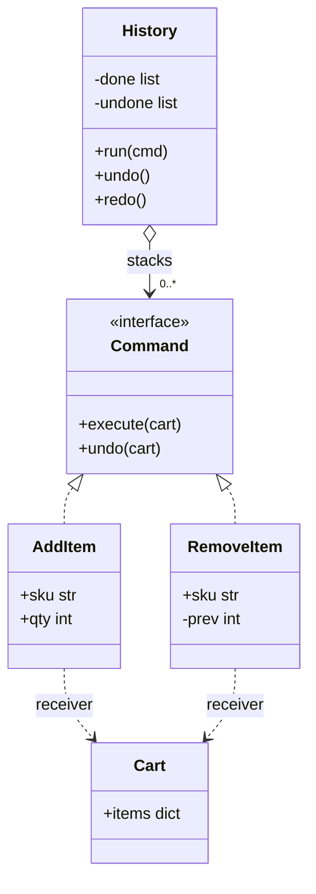

**Reading the diagram.** The **invoker** (`History`) runs commands and keeps two stacks. Each concrete command knows its **receiver** (`Cart`) and how to reverse itself; `RemoveItem` stores the quantity it removed so that undo can restore it. Calls are synchronous here, but because a command is a value it can cross an asynchronous boundary: serialize it, put it on a queue, execute it on a worker. State lives in the receiver and, for undo, in the history stacks; those stacks are in memory unless you persist them. Failure points: a command whose undo is not the exact inverse, and a queued command executed twice (make handlers idempotent, §32.10).

### Python implementation

```python
import json
from abc import ABC, abstractmethod
from dataclasses import asdict, dataclass, field


class Cart:
    def __init__(self):
        self.items: dict[str, int] = {}


class Command(ABC):
    @abstractmethod
    def execute(self, cart: Cart) -> None: ...
    @abstractmethod
    def undo(self, cart: Cart) -> None: ...


@dataclass
class AddItem(Command):
    sku: str
    qty: int
    def execute(self, cart):
        cart.items[self.sku] = cart.items.get(self.sku, 0) + self.qty
    def undo(self, cart):
        left = cart.items[self.sku] - self.qty
        if left:
            cart.items[self.sku] = left
        else:
            del cart.items[self.sku]


@dataclass
class RemoveItem(Command):
    sku: str
    _prev: int = field(default=0, repr=False)   # captured for undo
    def execute(self, cart):
        self._prev = cart.items.pop(self.sku, 0)
    def undo(self, cart):
        if self._prev:
            cart.items[self.sku] = self._prev


class History:                                   # the invoker
    def __init__(self, cart):
        self.cart, self._done, self._undone = cart, [], []
    def run(self, cmd):
        cmd.execute(self.cart); self._done.append(cmd); self._undone.clear()
    def undo(self):
        if self._done:
            cmd = self._done.pop(); cmd.undo(self.cart); self._undone.append(cmd)
    def redo(self):
        if self._undone:
            cmd = self._undone.pop(); cmd.execute(self.cart); self._done.append(cmd)


TYPES = {"AddItem": AddItem, "RemoveItem": RemoveItem}

def to_message(cmd: Command) -> str:             # commands are values: serialize them
    data = {k: v for k, v in asdict(cmd).items() if not k.startswith("_")}
    return json.dumps({"type": type(cmd).__name__, **data})

def from_message(text: str) -> Command:
    data = json.loads(text)
    return TYPES[data.pop("type")](**data)


if __name__ == "__main__":
    h = History(Cart())
    for cmd in (AddItem("A1", 2), AddItem("B2", 1), RemoveItem("A1")):
        h.run(cmd)
    print("after 3 commands:", h.cart.items)
    h.undo(); h.undo()
    print("after 2 undos:   ", h.cart.items)
    h.redo()
    print("after redo:      ", h.cart.items)

    queue = [to_message(c) for c in (AddItem("A1", 2), RemoveItem("A1"), AddItem("C3", 5))]
    print("queued:", queue[0])
    replica = Cart()
    for msg in queue:                            # a worker replays the queue
        from_message(msg).execute(replica)
    print("replayed cart:   ", replica.items)
```

Output:

```text
after 3 commands: {'B2': 1}
after 2 undos:    {'A1': 2}
after redo:       {'A1': 2, 'B2': 1}
queued: {"type": "AddItem", "sku": "A1", "qty": 2}
replayed cart:    {'C3': 5}
```

What to notice:

- Running a new command clears the redo stack; otherwise redo would reapply a change on top of a different history.
- `RemoveItem` captures the state it destroys (a small memento) so undo is exact.
- Serialized commands are messages: a queue of them is a job queue, and a durable, ordered log of them is a replay log, the core idea behind write-ahead logs and, with events instead of commands, event sourcing (§32.3).

### When to use and when not

Use Command for undo/redo, job queues, scheduled or retried work, macro recording, transactional scripts that must be logged before execution, and any API where the caller and executor are separated in time or space. In Python, a closure or `functools.partial` is enough when you only need deferred execution; reach for command classes when you need undo, serialization or introspection.

### Related patterns

Memento stores the state that undo restores. Strategy (§37.7) varies *how* something is done; Command captures *what* to do. Producer–consumer (§37.16.1) and message queues (§30.4) transport commands. CQRS (§32.4) separates command handling from queries.

### Interview question

::: tip
**Q.** How would you implement undo for operations that call external systems, such as "send email"? **A.** You cannot unsend an email, so undo must be a compensating action (send a correction) or the operation must be delayed until undo is no longer possible (an "undo send" window that queues the command and executes it after 10 s). The same reasoning drives compensating transactions in sagas (§32.7).
:::

## 37.13 Repository

### Intent

::: definition
**Definition — Repository.** An object that mediates between the domain model and data storage, presenting stored aggregates as an in-memory collection with methods such as `add`, `get` and domain-specific finders, so that domain code never sees SQL, ORM sessions or storage APIs [Fowler 2002; Evans 2003].
:::

### Problem it solves

If `OrderService.place()` builds SQL strings, then every business rule test needs a database, the service cannot move from PostgreSQL to DynamoDB without rewriting business logic, and query code is scattered. A repository gives the domain one interface (`OrderRepository`) expressed in domain terms ("orders for this user"), with a database implementation for production and an in-memory one for fast tests. Spring Data generates repository implementations from interfaces such as `interface OrderRepository extends CrudRepository<Order, Long>` [Spring Data Docs].

### Structure

**Figure 37.12 — Repository with interchangeable storage.**

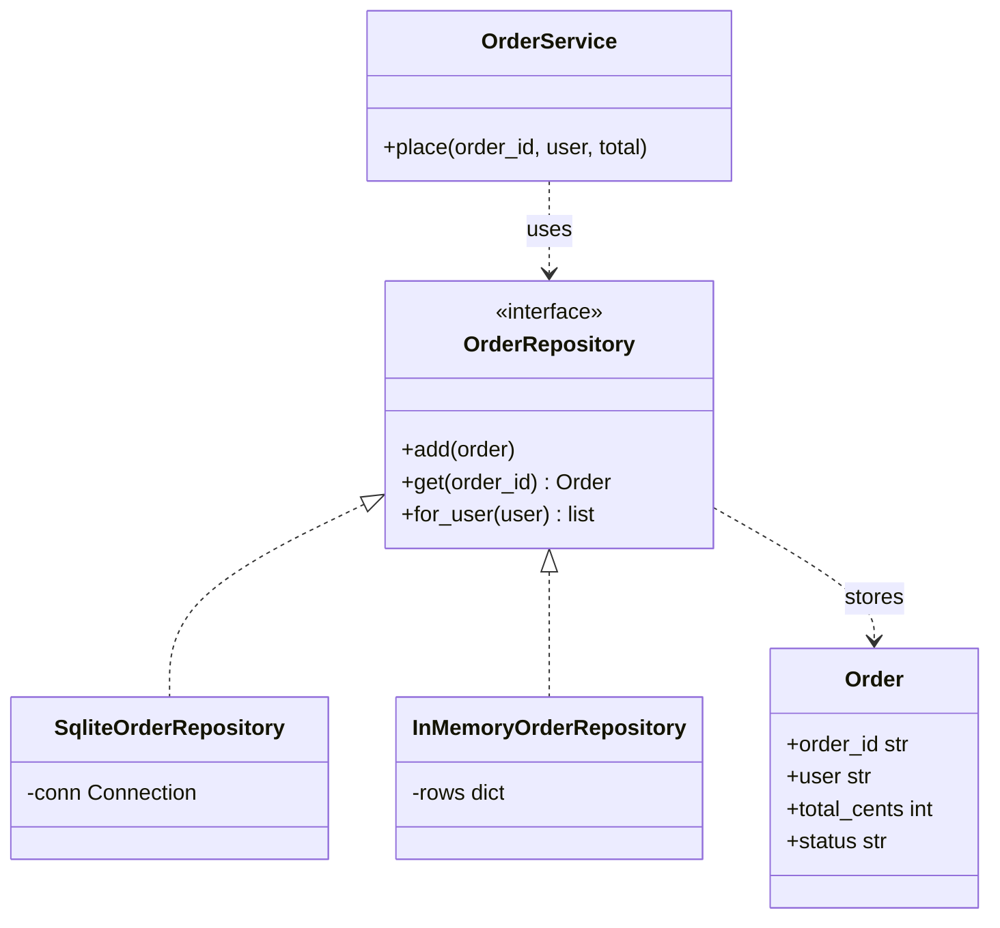

**Reading the diagram.** `OrderService` depends on the `OrderRepository` interface and on the domain object `Order`, nothing else. Two implementations sit behind the interface: the SQLite one crosses the storage boundary (SQL over a database connection; in production a network hop to a database server, where timeouts and constraint violations occur) and the in-memory one keeps rows in a dictionary for tests. Calls are synchronous. Scaling concerns such as read replicas, partitioning (Chapter 14) and caching can be hidden inside an implementation without changing the service.

### Python implementation

```python
import sqlite3
from abc import ABC, abstractmethod
from dataclasses import dataclass


@dataclass(frozen=True)
class Order:
    order_id: str
    user: str
    total_cents: int
    status: str = "PENDING"


class OrderRepository(ABC):
    @abstractmethod
    def add(self, order: Order) -> None: ...
    @abstractmethod
    def get(self, order_id: str) -> Order | None: ...
    @abstractmethod
    def for_user(self, user: str) -> list[Order]: ...


class InMemoryOrderRepository(OrderRepository):
    def __init__(self): self._rows: dict[str, Order] = {}
    def add(self, order): self._rows[order.order_id] = order
    def get(self, order_id): return self._rows.get(order_id)
    def for_user(self, user):
        return sorted((o for o in self._rows.values() if o.user == user),
                      key=lambda o: o.order_id)


class SqliteOrderRepository(OrderRepository):
    def __init__(self, conn: sqlite3.Connection):
        self._conn = conn
        conn.execute("CREATE TABLE IF NOT EXISTS orders (order_id TEXT PRIMARY KEY, "
                     "user TEXT NOT NULL, total_cents INTEGER NOT NULL, status TEXT NOT NULL)")
        conn.execute("CREATE INDEX IF NOT EXISTS orders_user ON orders(user)")
    def add(self, order):
        with self._conn:                                     # one transaction
            self._conn.execute("INSERT OR REPLACE INTO orders VALUES (?, ?, ?, ?)",
                               (order.order_id, order.user, order.total_cents, order.status))
    def get(self, order_id):
        row = self._conn.execute("SELECT * FROM orders WHERE order_id = ?",
                                 (order_id,)).fetchone()
        return Order(*row) if row else None
    def for_user(self, user):
        rows = self._conn.execute("SELECT * FROM orders WHERE user = ? ORDER BY order_id",
                                  (user,)).fetchall()
        return [Order(*r) for r in rows]


class OrderService:
    def __init__(self, repo: OrderRepository):
        self._repo = repo
    def place(self, order_id, user, total_cents):
        if total_cents <= 0:
            raise ValueError("total must be positive")
        if self._repo.get(order_id):
            return "duplicate"                               # idempotent retry
        self._repo.add(Order(order_id, user, total_cents))
        return "placed"


def contract_test(repo: OrderRepository) -> str:             # same test, every implementation
    svc = OrderService(repo)
    assert svc.place("o-1", "ana", 4999) == "placed"
    assert svc.place("o-1", "ana", 4999) == "duplicate"
    svc.place("o-2", "ana", 1999); svc.place("o-3", "ben", 500)
    assert [o.order_id for o in repo.for_user("ana")] == ["o-1", "o-2"]
    assert repo.get("o-9") is None
    return f"{type(repo).__name__}: contract passed"


if __name__ == "__main__":
    print(contract_test(InMemoryOrderRepository()))
    print(contract_test(SqliteOrderRepository(sqlite3.connect(":memory:"))))
```

Output:

```text
InMemoryOrderRepository: contract passed
SqliteOrderRepository: contract passed
```

What to notice:

- `OrderService` contains the business rules and no SQL; it runs against either implementation.
- One **contract test** runs against every implementation. This is what keeps the in-memory fake honest; a fake that drifts from the real repository makes tests pass while production fails.
- Queries use placeholders (`?`), never string formatting, which prevents SQL injection (Chapter 10).

### When to use and when not

Use a repository per **aggregate** (a cluster of objects changed together, such as an order and its lines, §34.4) when domain logic is rich enough to be worth testing without a database. Avoid a generic `Repository<T>` with `find_by_anything(**filters)`: it leaks query concerns back into the domain and becomes a weak ORM. For reporting and read-heavy screens, query the database directly or use a separate read model (CQRS, §32.4); forcing analytics through aggregate repositories causes N+1 queries.

### Related patterns

Unit of Work tracks changes across repositories and commits them in one transaction [Fowler 2002]. Data Mapper and Active Record are the alternatives Fowler catalogs for mapping objects to tables. Adapter (§37.9): a repository implementation is an adapter from a domain port to a storage technology. Dependency injection (§37.14) supplies the right implementation.

### Interview question

::: tip
**Q.** Is a repository just a DAO? **A.** A data access object is organized around tables and storage operations; a repository is organized around domain aggregates and speaks the domain's language (`orders.for_user(ana)` rather than `select(table="orders", where=...)`). In small systems they converge. The distinction matters when one aggregate spans several tables or stores: the repository hides that, a DAO usually does not.
:::

## 37.14 Dependency injection

### Intent

::: definition
**Definition — Dependency injection (DI).** A technique in which an object receives the objects it depends on (its dependencies) from outside, typically through its constructor, instead of creating or looking them up itself. The code that creates and connects all objects is the **composition root** [Fowler 2004].
:::

### Problem it solves

An `OrderService` that calls `PostgresOrderRepository()`, `VendorPayClient()` and `datetime.now()` inside its methods cannot be tested without a database, a payment sandbox and a frozen clock, and it cannot be reconfigured without editing it. The Dependency Inversion Principle (§36.7) says high-level policy should depend on abstractions; DI is the mechanism that hands the concrete implementations of those abstractions in. Fowler named the pattern in 2004 to distinguish it from the broader term "inversion of control", and contrasted it with the **Service Locator**, in which objects ask a global registry for dependencies [Fowler 2004].

### Structure

**Figure 37.13 — Constructor injection with a composition root.**

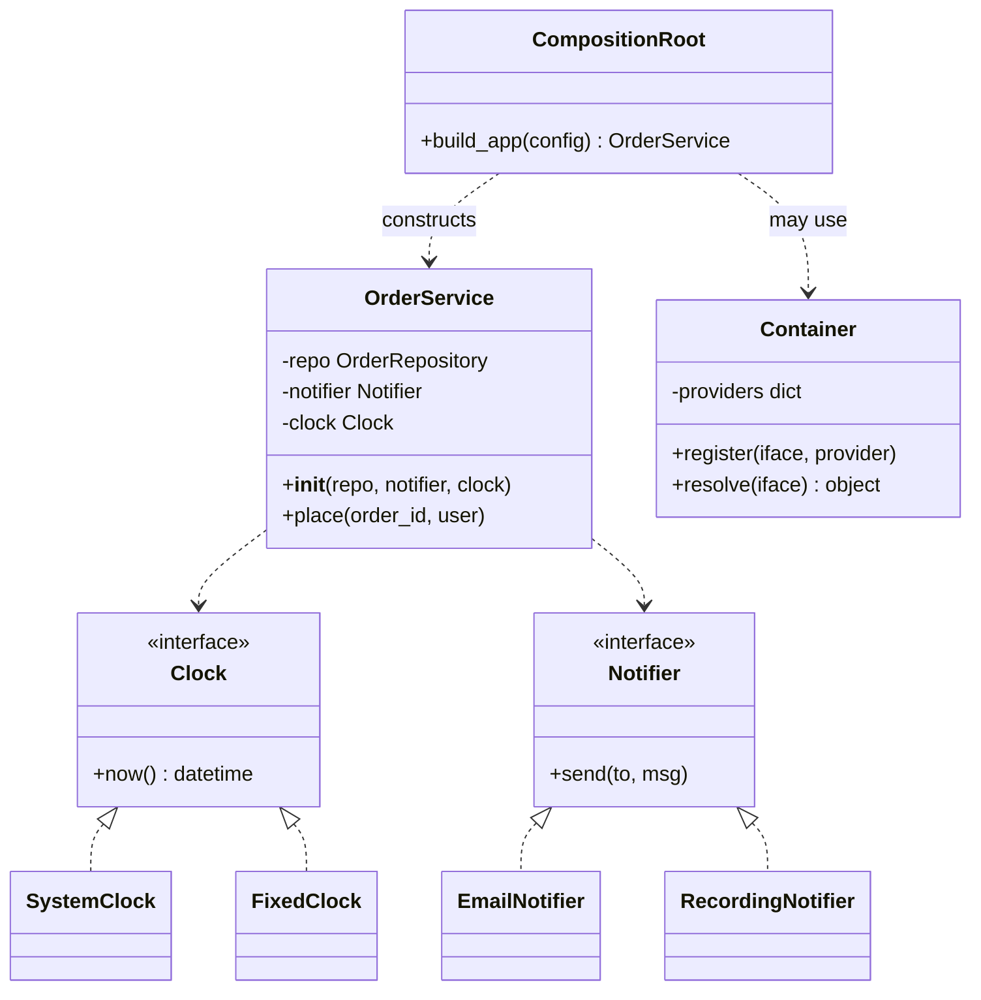

**Reading the diagram.** `OrderService` declares its dependencies as constructor parameters typed by interfaces and never constructs them. The composition root, at the program's entry point (`main`, the web app factory, the test fixture), chooses implementations: `SystemClock` and `EmailNotifier` in production, `FixedClock` and `RecordingNotifier` in tests. A container is optional automation of that wiring. Wiring happens once at startup, synchronously; the failure point moves there too, which is good: a missing dependency fails at boot rather than on the first request at 3 a.m.

### Python implementation

```python
from abc import ABC, abstractmethod
from datetime import datetime, timezone
from typing import get_type_hints
import inspect


class Clock(ABC):
    @abstractmethod
    def now(self) -> datetime: ...

class Notifier(ABC):
    @abstractmethod
    def send(self, to: str, msg: str) -> None: ...

class SystemClock(Clock):
    def now(self): return datetime.now(timezone.utc)

class FixedClock(Clock):
    def __init__(self): self._t = datetime(2026, 1, 1, 9, 0, tzinfo=timezone.utc)
    def now(self): return self._t

class RecordingNotifier(Notifier):
    def __init__(self): self.sent = []
    def send(self, to, msg): self.sent.append((to, msg))


class OrderService:
    def __init__(self, notifier: Notifier, clock: Clock):    # constructor injection
        self._notifier, self._clock = notifier, clock
    def place(self, order_id: str, user: str) -> str:
        stamp = self._clock.now().isoformat()
        self._notifier.send(user, f"order {order_id} placed at {stamp}")
        return stamp


class Container:                                   # a minimal auto-wiring container
    def __init__(self):
        self._providers, self._instances = {}, {}
    def register(self, iface, impl):
        self._providers[iface] = impl
    def resolve(self, iface):
        if iface not in self._instances:           # one instance per container
            impl = self._providers.get(iface, iface)
            hints = get_type_hints(impl.__init__) if inspect.isclass(impl) else {}
            deps = {n: self.resolve(t) for n, t in hints.items() if n != "return"}
            self._instances[iface] = impl(**deps)
        return self._instances[iface]


if __name__ == "__main__":
    # 1. Test: wire by hand with fakes -- no framework needed.
    notifier = RecordingNotifier()
    OrderService(notifier, FixedClock()).place("o-17", "ana")
    print(notifier.sent)
    # 2. Container: same graph, wired from registrations.
    c = Container()
    c.register(Notifier, RecordingNotifier)
    c.register(Clock, FixedClock)
    svc = c.resolve(OrderService)
    svc.place("o-18", "ben")
    print(c.resolve(Notifier).sent, c.resolve(Notifier) is c.resolve(Notifier))
```

Output:

```text
[('ana', 'order o-17 placed at 2026-01-01T09:00:00+00:00')]
[('ben', 'order o-18 placed at 2026-01-01T09:00:00+00:00')] True
```

What to notice:

- The test needs no mocking library: fakes are ordinary classes passed to the constructor.
- The container reads constructor type hints, resolves each recursively, and caches instances; that cache gives you "one per application" without a Singleton class (§37.6).
- The container is the only code that knows concrete classes. Business code never calls `resolve`; if it did, the container would degrade into a service locator with hidden dependencies.

### Java and frameworks

In Java, DI containers are the norm: Spring and Guice build the object graph from annotations or configuration, and Spring recommends constructor injection for required dependencies, which keeps fields `final` and objects complete after construction [Spring Docs]. Python services more often wire by hand in the composition root or use framework hooks such as FastAPI's `Depends`. Either way the principle is the same; a container is a convenience, not the pattern.

### When to use and when not

Use constructor injection by default for anything with I/O, time, randomness or configuration, which is what tests need to control. Prefer constructor injection over setter injection (objects are never half-built) and over field injection (dependencies stay visible in the signature). A constructor with eight parameters is a design smell revealing a class with too many responsibilities (§36.3), not a reason to switch to a locator. Do not inject value objects or pure utilities.

### Related patterns

Factory (§37.3) and Abstract Factory (§37.4) are often what you inject when an object must create things later. Service Locator is the alternative Fowler contrasts it with. Strategy (§37.7) and Repository (§37.13) are the most commonly injected roles.

### Interview question

::: tip
**Q.** What is the difference between dependency injection and the Dependency Inversion Principle? **A.** Dependency inversion is a design principle: high-level modules and low-level modules should both depend on abstractions, and the abstraction is owned by the high-level side (§36.7). Dependency injection is a technique for supplying concrete implementations from outside. You can inject concrete classes (DI without inversion) or depend on abstractions but look them up from a global (inversion without injection); good designs do both.
:::

