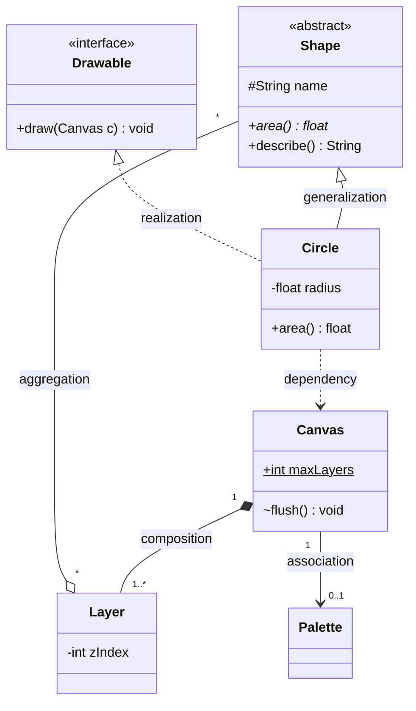
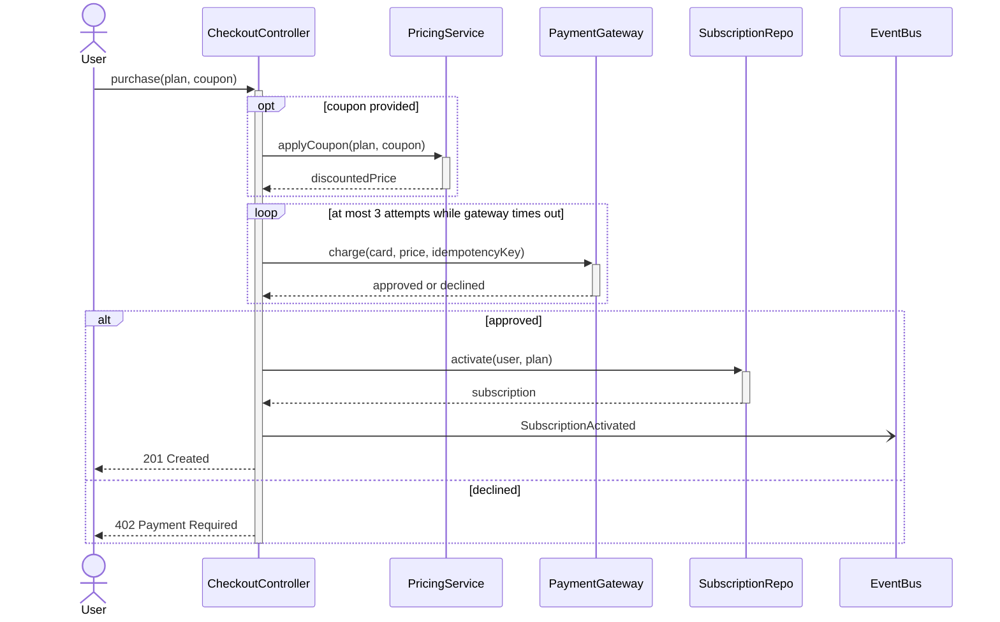
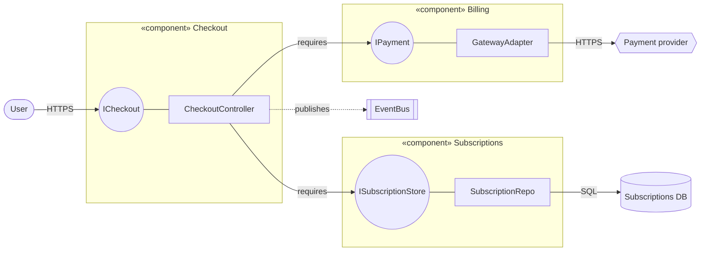
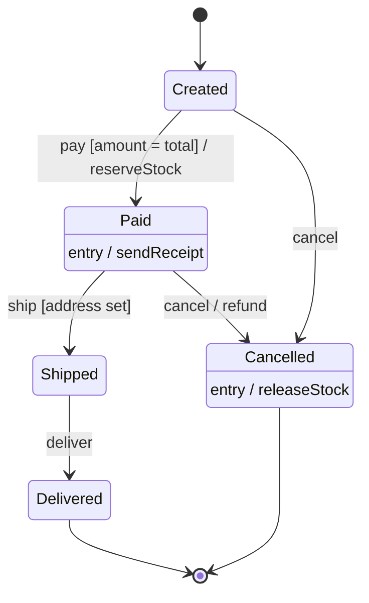
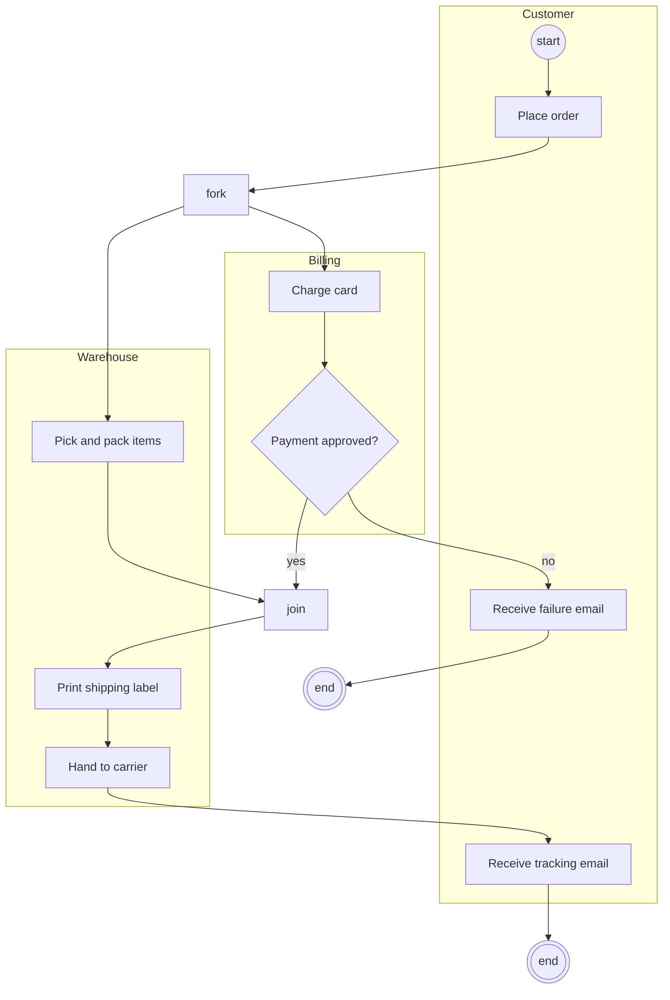
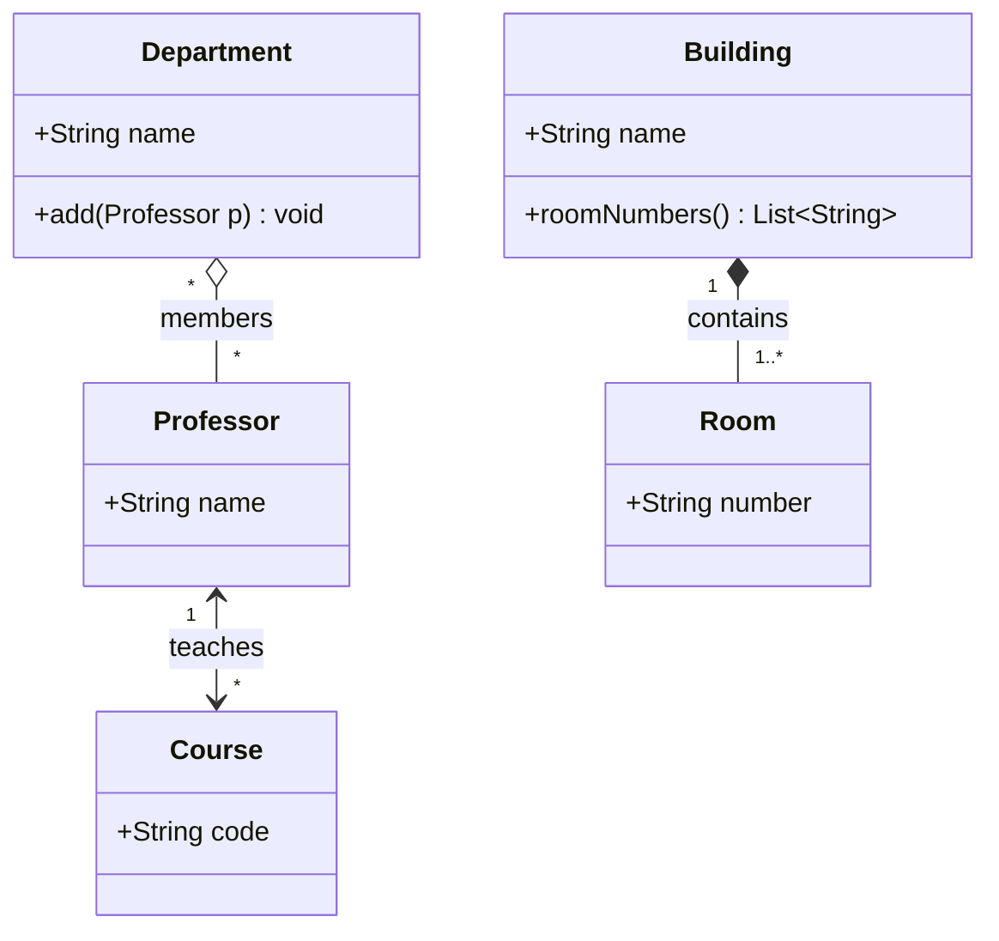
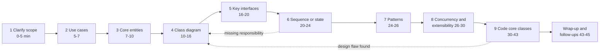

# Chapter 38 — UML and Low-Level Design

> **Level:** 2–3 · **Track:** A (Traditional) · **Estimated reading time:** 4 h

Chapters 35–37 gave you the vocabulary of object-oriented design: classes and interfaces, the SOLID principles, and the Gang of Four patterns. This chapter teaches you to *draw* a design so that other engineers can check it in minutes, and then to *produce* one under interview conditions. The first half covers the five Unified Modeling Language (UML) diagrams that working engineers actually use (class, sequence, component, state and activity) and the relationships between objects that trip people up most often. The second half is a method for low-level design (LLD) interviews and eight fully worked exercises, from the parking lot to a chess move validator, each with requirements, diagrams, runnable Python, the patterns used and the follow-up questions an interviewer is likely to ask.

Throughout, the diagrams are written in Mermaid, a text-based diagram language. Mermaid's class, sequence and state diagrams are close to UML notation; it has no component or activity diagram, so those two are drawn as flowcharts that approximate UML, and the text says so each time.

## 38.1 Learning objectives

After this chapter you should be able to:

- Read and draw UML class diagrams with correct visibility, multiplicity and the six relationship kinds (association, aggregation, composition, generalization, realization, dependency).
- Draw sequence diagrams with lifelines, activations, synchronous and asynchronous messages, and `alt`/`opt`/`loop` fragments for a real request flow.
- Draw component, state machine and activity diagrams, and choose the right diagram for a given question.
- Decide between association, aggregation and composition, and between modeling something as an attribute or as a relationship, and express each choice in code.
- Run a 45-minute LLD interview using a nine-step method, and self-assess against a rubric.
- Design, diagram and implement eight classic LLD problems with thread safety and extension points, and defend the patterns you chose.

## 38.2 Prerequisites

- Classes, encapsulation, inheritance, polymorphism and composition over inheritance — Chapter 35 (UML class diagrams are a notation for exactly these ideas).
- SOLID principles — Chapter 36 (every design review in §38.10 is argued in SOLID terms).
- Design patterns, especially Strategy (§37.7), Observer (§37.8), Decorator (§37.10), Factory (§37.3), State (§37.15) and the concurrency patterns of §37.16 — the exercises apply them.
- Mutexes, race conditions and lock striping — §6.9–§6.10 (thread safety in the exercises).
- Token bucket — §22.4 (the rate limiter exercise wraps it in a class design without re-deriving it).
- LRU and TTL as cache policies — §20.8–§20.9 (the LRU and key-value store exercises implement them).
- Optimistic concurrency — §11.15.3 (the key-value store's transactions use it).

## 38.3 Class diagrams

### 38.3.1 What UML is and why it exists

::: definition
**Definition — Unified Modeling Language (UML).** A general-purpose graphical language for specifying, visualizing and documenting software systems, standardized by the Object Management Group (OMG). The current version, UML 2.5.1 (December 2017), defines 14 diagram types divided into *structure* diagrams (what the system is made of) and *behavior* diagrams (what it does over time) [OMG 2017].
:::

#### First-principles explanation

An architect does not hand a builder a written essay about a house; they hand over a floor plan, an elevation and a wiring diagram, each answering one question with conventions every builder already knows. A solid wall line, a door arc and a socket symbol mean the same thing on every plan. UML plays that role for object-oriented software: a hollow triangle always means "is a kind of", a filled diamond always means "owns and controls the lifetime of". Once both people know the conventions, a picture of 12 classes conveys in 30 seconds what 300 lines of code take 10 minutes to reveal.

#### Why does this exist?

By the early 1990s there were dozens of competing object-oriented notations. Grady Booch, James Rumbaugh and Ivar Jacobson merged their methods at Rational Software, and OMG adopted the result as UML 1.1 in 1997. UML 2.0 (2005) reworked sequence and activity diagrams substantially, and 2.5 (2015) simplified the specification without changing most notation [OMG 2017; Fowler 2003].

Fowler distinguishes three ways people use UML: as a **sketch** (informal, partial diagrams to communicate an idea), as a **blueprint** (complete diagrams that a programmer implements) and as a **programming language** (diagrams compiled to code) [Fowler 2003]. Almost all industry use, and all interview use, is sketching. The goal is not to satisfy the 790-page specification; it is to make the important decisions visible and unambiguous. This chapter follows the standard notation where it matters (relationships, multiplicity, message kinds) and relaxes it where it does not (exact fonts, every adornment).

**Table 38.1 — The 14 UML 2.5.1 diagram types and how often you need them.**

| Family | Diagram | Answers the question | Use in practice |
|---|---|---|---|
| Structure | Class | What types exist and how are they related? | Daily; every LLD interview |
| Structure | Object | What does one snapshot of instances look like? | Occasionally, to explain a tricky class diagram |
| Structure | Package | How is the code grouped into modules? | Occasionally |
| Structure | Component | Which replaceable parts provide and require which interfaces? | Architecture reviews (§38.5) |
| Structure | Composite structure | What is inside one class at run time? | Rare |
| Structure | Deployment | Which artifacts run on which nodes? | Usually replaced by infrastructure diagrams |
| Structure | Profile | How is UML itself extended? | Tool builders only |
| Behavior | Use case | Which actors want which goals? | Requirements; often a bullet list instead |
| Behavior | Activity | What is the workflow, including parallel steps? | Business processes, pipelines (§38.7) |
| Behavior | State machine | How does one object react to events over its lifetime? | Lifecycles, protocols (§38.6) |
| Interaction | Sequence | Who calls whom, in what order? | Daily; every LLD interview (§38.4) |
| Interaction | Communication | Same as sequence, laid out by links | Rare |
| Interaction | Timing | How do states change against a time axis? | Hardware, real-time systems |
| Interaction | Interaction overview | How do several interactions combine? | Rare |

The three interaction diagrams are a sub-family of behavior diagrams, so the split is 7 structure and 7 behavior diagrams. Five of them (class, sequence, component, state machine, activity) cover nearly everything you will draw.

### 38.3.2 Classes, visibility and multiplicity

::: definition
**Definition — Class diagram.** A structure diagram showing classifiers (classes, interfaces, enumerations), their **attributes** and **operations**, and the **relationships** among them. A class is drawn as a box with up to three compartments: name, attributes, operations.
:::

#### How it works internally

Each attribute is written `visibility name : Type [multiplicity] = default`, and each operation `visibility name(parameter : Type) : ReturnType`. Mermaid uses the Java-like order `Type name` and `name() ReturnType`, which is also common in hand-drawn sketches; either is fine as long as it is consistent. Abstract classes and operations are written in *italics*; static members are <u>underlined</u>. Stereotypes in guillemets such as «interface», «abstract» or «enumeration» classify a box.

**Multiplicity** says how many instances may be at the far end of a relationship (or in a multi-valued attribute). It is written as `lower..upper`, where `*` means "unbounded".

**Table 38.2 — Class diagram notation: visibility, multiplicity and adornments.**

| Notation | Meaning | Python convention | Mermaid syntax |
|---|---|---|---|
| `+` | Public: visible to everyone | `name` | `+name` |
| `-` | Private: visible only inside the class | `_name` (or `__name`) | `-name` |
| `#` | Protected: visible to the class and subclasses | `_name` by convention | `#name` |
| `~` | Package: visible inside the same package or module | module-level, not exported | `~name` |
| *italic* | Abstract class or operation | `ABC`, `@abstractmethod` | `<<abstract>>`, `method()*` |
| <u>underline</u> | Static (class-level) member | class attribute, `@staticmethod` | `name$` |
| `1` | Exactly one | required reference | `"1"` |
| `0..1` | Zero or one (optional) | `X \| None` | `"0..1"` |
| `*` or `0..*` | Zero or more | `list[X]`, `dict[K, X]` | `"*"` |
| `1..*` | One or more | non-empty collection, checked in `__init__` | `"1..*"` |
| `2..4` | A bounded range | collection with a validated size | `"2..4"` |

::: mistake
**Mistake — putting multiplicity at the wrong end.** In `Order "1" --> "1..*" LineItem`, the `1..*` sits next to `LineItem` and is read from the *Order's* point of view: "an order has one or more line items". Students often read it the other way round. Read every association twice, once from each end: "each order has 1..* line items; each line item belongs to exactly 1 order."
:::

### 38.3.3 The six relationships

Relationships carry most of the meaning in a class diagram. UML defines more, but six cover practically every design.

**Table 38.3 — The six class relationships.**

| Relationship | Line and end symbol | Meaning | Typical code | Mermaid |
|---|---|---|---|---|
| Association | Solid line; open arrowhead for navigability | A structural, lasting link: one object holds a reference to the other | Field `self.owner: Customer` | `A --> B` |
| Aggregation | Solid line, hollow diamond at the whole | Whole–part where the part can be shared and outlives the whole | Field holding objects created elsewhere | `Whole o-- Part` |
| Composition | Solid line, filled diamond at the whole | Whole–part with exclusive ownership; parts die with the whole | Whole creates parts privately | `Whole *-- Part` |
| Generalization (inheritance) | Solid line, hollow triangle at the parent | "Is a kind of"; subclass inherits and may override | `class Car(Vehicle)` | `Parent <\|-- Child` |
| Realization | Dashed line, hollow triangle at the interface | A class implements an interface's contract | `class S3Store(BlobStore)` with ABC | `Interface <\|.. Impl` |
| Dependency | Dashed line, open arrowhead | Transient use: a parameter, local variable or return type | `def render(self, c: Canvas)` | `A ..> B` |

The relationships form a scale of coupling strength. From weakest to strongest: dependency (uses it for one call), association (remembers it), aggregation (contains it, shared), composition (owns it exclusively), and generalization (*is* it — the strongest coupling of all, which is why §35.8 recommends composition over inheritance). Realization couples only to a contract, so it is the relationship that the Dependency Inversion Principle (§36.7) wants you to draw most often.

**Figure 38.1 — Class diagram notation: visibility, multiplicity and the six relationships.**



**Reading the diagram.** `Shape` is an abstract class (stereotype and the `*` on `area()` mark it abstract) with a protected `name`; `Circle` inherits from it (solid line, hollow triangle at `Shape`) and also realizes the `Drawable` interface (dashed line, hollow triangle). A `Canvas` *composes* one or more `Layer`s (filled diamond at `Canvas`): layers are created by the canvas and deleted with it. Each `Layer` *aggregates* any number of shapes (hollow diamond), and one shape can appear on several layers, so it is shared. The canvas has a navigable *association* to an optional `Palette` (arrow toward `Palette`, multiplicity `0..1`). `Circle` merely *depends* on `Canvas` (dashed arrow): it receives one as a parameter in `draw` and does not keep it. The static `maxLayers` and package-visible `flush()` show the remaining adornments. The diagram has no run-time direction or storage; it is a static map of compile-time coupling. If you change `Canvas`, every class with an arrow pointing at it (here `Circle`) may need to change, which is how a class diagram exposes change impact.

#### Common misconceptions

::: mistake
**Mistake — drawing every class and every getter.** A class diagram that lists 40 classes with all their accessors hides the five decisions that matter. Show the classes that participate in the problem, the operations that define their responsibilities, and every relationship with multiplicity. Omit getters, setters and obvious constructors.
:::

::: mistake
**Mistake — using inheritance for roles.** `Librarian extends Member` looks natural until a librarian borrows a book under a different policy or a member becomes a librarian on Tuesday. Roles that an object can gain or lose are associations to a `Role` object (or a Strategy, §37.7), not subclasses. Generalization is for permanent "kind of" relationships that pass the Liskov test (§36.5).
:::

::: industry
**Diagrams as code on GitHub.** Since February 2022 GitHub renders Mermaid code blocks in Markdown files, issues and pull requests, so class and sequence diagrams can live in the repository next to the code and be reviewed as text diffs [GitHub 2022]. This is the main reason many teams moved from drawing tools to text-based UML sketches: a diagram that is versioned with the code is far more likely to be kept current.
*Evidence: Primary* — [GitHub 2022]
:::

## 38.4 Sequence diagrams

### 38.4.1 Lifelines, messages and fragments

::: definition
**Definition — Sequence diagram.** An interaction diagram that shows objects or participants as vertical **lifelines** and the **messages** they exchange as horizontal arrows ordered top to bottom in time. **Execution specifications** (activation bars) show when a participant is busy, and **combined fragments** (`alt`, `opt`, `loop`, `par` and others) show conditional, optional, repeated and parallel behavior [OMG 2017].
:::

#### First-principles explanation

A class diagram is a cast list; a sequence diagram is the script of one scene. It answers "when the user clicks *Buy*, who calls whom, in what order, and what comes back?" Time flows downward, so you can read the diagram like a story. It is the diagram that most often reveals a missing responsibility: if no lifeline can answer a message, a class is missing; if one lifeline receives every message, you have found a God object.

#### How it works internally

1. Place participants left to right in the order they first act; put the initiator (an actor) on the far left.
2. Draw each message as an arrow from caller to callee, labeled with the operation and key arguments.
3. A **synchronous** message (solid line, filled arrowhead) blocks the caller until the reply; a **reply** is a dashed line with an open arrowhead; an **asynchronous** message (solid line, open arrowhead) lets the caller continue immediately.
4. Activate the callee (a thin bar) while it is processing; nested bars show nested calls.
5. Wrap conditional or repeated sections in combined fragments, each labeled with its operator and a guard in square brackets.

**Table 38.4 — Sequence diagram elements and their Mermaid syntax.**

| Element | UML notation | Meaning | Mermaid |
|---|---|---|---|
| Lifeline | Box with a dashed vertical line | One participant for the scene's duration | `participant X` / `actor U` |
| Execution (activation) | Thin bar on the lifeline | Participant is executing | `->>+` and `-->>-`, or `activate X` |
| Synchronous message | Solid line, filled arrowhead | Caller waits for the reply | `A->>B: op()` |
| Reply | Dashed line, open arrowhead | Return value | `B-->>A: result` |
| Asynchronous message | Solid line, open arrowhead | Fire and forget | `A-)B: event` |
| `alt` fragment | Box split by dashed lines, one guard per part | If/else: exactly one operand runs | `alt ... else ... end` |
| `opt` fragment | Box with one guard | If without else | `opt ... end` |
| `loop` fragment | Box with a guard or bounds | Repeat while the guard holds | `loop ... end` |
| `par` fragment | Box split into concurrent operands | Operands run in parallel | `par ... and ... end` |
| `break` / `critical` | Labeled box | Exit the enclosing interaction / atomic region | `break ... end`, `critical ... end` |

UML 2.5.1 defines twelve interaction operators (also `seq`, `strict`, `neg`, `assert`, `ignore` and `consider`), but the six above appear in nearly every real diagram.

**Figure 38.2 — Sequence diagram for a PhotoShare Pro purchase with opt, loop and alt fragments.**



**Reading the diagram.** The *User* (an actor) synchronously calls `purchase` on the *CheckoutController*, which stays active for the whole scene. The `opt` fragment runs only when a coupon is supplied: the *PricingService* returns a discounted price. The `loop` fragment retries the *PaymentGateway* charge up to three times on timeout; the idempotency key makes those retries safe (§22.15), which is the most important detail an interviewer will probe. The `alt` fragment splits on the result: on approval the controller persists the subscription through the *SubscriptionRepo* (the storage boundary) and publishes `SubscriptionActivated` *asynchronously* to the *EventBus* (open arrowhead: it does not wait), then replies 201; on decline it replies 402. Failure points are visible as lifelines that can be slow: the external gateway and the repository. Scaling is not shown in a sequence diagram; it describes one request.

::: tip
**Tip — draw the unhappy path.** Interviewers rarely ask about the path where everything works. One `alt` for "declined" and one `loop` or `break` for "timeout" show that you think about failure, and they take ten seconds to draw.
:::

::: mistake
**Mistake — one sequence diagram for the whole system.** A sequence diagram should cover one use case, one scenario, ideally fewer than 10 lifelines and 25 messages. If it is larger, split it by use case or replace a group of lifelines with one participant ("PaymentSubsystem") and draw that separately.
:::

## 38.5 Component diagrams

### 38.5.1 Components and interfaces

::: definition
**Definition — Component diagram.** A structure diagram that shows **components** (modular, replaceable units that encapsulate their contents) and the **interfaces** they *provide* (offer to others, drawn as a "lollipop" circle) and *require* (need from others, drawn as a "socket" half-circle), connected by **assembly connectors** that wire a required interface to a matching provided one [OMG 2017].
:::

#### First-principles explanation

Think of household appliances and wall sockets. The kettle requires "230 V, type G plug"; the wall provides it. You can replace the kettle with any other appliance that requires the same socket, and you can rewire the house without touching the kettle. A component diagram draws software at that granularity: modules, libraries or services, and only the contracts between them, not their internal classes.

#### Why does this exist?

A class diagram of a 200-class system is unreadable, and a deployment diagram shows machines, not responsibilities. The component diagram sits between them: it shows which parts can be built, tested and replaced independently, which is exactly the question behind modular monoliths (§33.5), hexagonal architecture's ports and adapters (§33.10) and the Dependency Inversion Principle at the architecture level (§36.8).

Mermaid has no component diagram, so Figure 38.3 approximates UML notation with a flowchart: each `subgraph` is a component, circle nodes are provided interfaces, and edges labeled "requires" are required interfaces wired by an assembly connector.

**Figure 38.3 — Component view of the PhotoShare Pro checkout (flowchart approximation of UML component notation).**



**Reading the diagram.** Three components appear as boxes. *Checkout* provides the `ICheckout` interface (circle) to the user over HTTPS and *requires* two interfaces: `IPayment`, provided by the *Billing* component, and `ISubscriptionStore`, provided by *Subscriptions*. The "requires" edges are the assembly connectors. Checkout depends only on the interface circles, never on `GatewayAdapter` or `SubscriptionRepo` directly, so either can be replaced (a different payment provider, a different database) without touching Checkout. Solid edges are synchronous calls; the dotted edge to the *EventBus* is asynchronous publication. Storage and external boundaries are the subscriptions database and the external payment provider, which are also the main failure points. Scaling: each component could be deployed as its own service later, and the interfaces become the service APIs.

::: recommendation
**Recommendation — name interfaces after the client's need.** `IPayment` with `charge()` and `refund()` describes what Checkout needs; `IStripeClient` describes one vendor's implementation and leaks it into every client. Interfaces owned by the client side are the core of Dependency Inversion (§36.7).
:::

## 38.6 State diagrams

### 38.6.1 States, transitions, guards and actions

::: definition
**Definition — State machine diagram.** A behavior diagram that shows the **states** one object (or protocol) can be in and the **transitions** between them. A transition is labeled `trigger [guard] / effect`: the **trigger** is the event, the **guard** a Boolean condition that must be true for the transition to fire, and the **effect** an action executed during the transition. A state may declare **entry**, **exit** and **do** behaviors, run on entering, on leaving, and while inside the state [OMG 2017].
:::

#### First-principles explanation

A traffic light is a state machine: three states, one event (a timer tick) and a fixed order. A pressed pedestrian button is a guard: "on tick, *if* someone is waiting, go to red". Business objects behave the same way. An order cannot be shipped before it is paid; a refund only makes sense for a paid order. Writing these rules as a diagram makes every illegal combination obvious: if there is no arrow labeled `ship` out of `Created`, shipping an unpaid order is impossible by construction.

#### How it works internally

1. A filled circle (the **initial pseudostate**) points to the first state; a bullseye is a **final state**.
2. When an event arrives, the machine looks for a transition out of the current state with that trigger.
3. If the guard is false (or no transition matches), the event is ignored or rejected, and the state does not change.
4. Otherwise it runs the current state's exit behavior, then the transition's effect, then the target state's entry behavior.
5. **Composite states** nest a sub-machine (for example, `Shipped` containing `InTransit` and `OutForDelivery`), and a **choice pseudostate** (a diamond) branches on guards after a single trigger.

**Figure 38.4 — State machine for an order, with guards, effects and entry actions.**



**Reading the diagram.** An order starts in *Created*. The `pay` event moves it to *Paid* only if the guard `amount = total` holds; the transition's effect reserves stock, and entering *Paid* sends a receipt. From *Paid* it can be shipped (guarded by a known address) or cancelled, and cancellation from *Paid* has a refund effect that cancellation from *Created* does not need. Entering *Cancelled* always releases stock. *Delivered* and *Cancelled* lead to the final state. Any event without an outgoing arrow is illegal in that state, so "cancel a delivered order" is rejected. There is no network or storage in this diagram; in a real system the state is persisted with the order, and every transition should be a single atomic update (for example `UPDATE ... SET state = 'PAID' WHERE id = ? AND state = 'CREATED'`) so that two concurrent events cannot both fire from the same state.

#### Code example

A transition table maps directly from the diagram to code, which keeps them in sync:

```python
from enum import Enum, auto


class S(Enum):
    CREATED = auto()
    PAID = auto()
    SHIPPED = auto()
    DELIVERED = auto()
    CANCELLED = auto()


class Order:
    # (state, event) -> (guard, next_state, effect); a guard of None means "always"
    TRANSITIONS = {
        (S.CREATED, "pay"):     (lambda o, amt: amt == o.total, S.PAID, "reserve_stock"),
        (S.CREATED, "cancel"):  (None, S.CANCELLED, None),
        (S.PAID, "ship"):       (lambda o, _: o.address is not None, S.SHIPPED, None),
        (S.PAID, "cancel"):     (None, S.CANCELLED, "refund"),
        (S.SHIPPED, "deliver"): (None, S.DELIVERED, None),
    }
    ENTRY = {S.PAID: "send_receipt", S.CANCELLED: "release_stock"}

    def __init__(self, total, address=None):
        self.state, self.total, self.address, self.log = S.CREATED, total, address, []

    def fire(self, event, arg=None):
        rule = self.TRANSITIONS.get((self.state, event))
        if rule is None:
            raise ValueError(f"event {event!r} not allowed in {self.state.name}")
        guard, target, effect = rule
        if guard is not None and not guard(self, arg):
            return False                       # guard false: no transition, state unchanged
        if effect:
            self.log.append(effect)            # transition effect runs first...
        self.state = target
        if target in self.ENTRY:
            self.log.append(self.ENTRY[target])  # ...then the target's entry action
        return True


if __name__ == "__main__":
    o = Order(total=50, address="1 Main St")
    assert o.fire("pay", 40) is False and o.state is S.CREATED   # guard rejects
    assert o.fire("pay", 50) and o.state is S.PAID
    assert o.fire("ship") and o.fire("deliver")
    try:
        o.fire("cancel")
    except ValueError as e:
        print("rejected:", e)
    print(o.state.name, o.log)
```

Output: `rejected: event 'cancel' not allowed in DELIVERED`, then `DELIVERED ['reserve_stock', 'send_receipt']`.

What to notice:

- Each row of `TRANSITIONS` is one arrow of Figure 38.4, so reviewing the table against the diagram is mechanical.
- A false guard returns `False` without changing state; an event with no arrow raises. Distinguishing "not now" from "never in this state" helps callers respond correctly.
- The order of actions (exit, transition effect, entry) follows UML's run-to-completion semantics. For behavior that differs a lot per state, the State pattern (§37.15 and the vending machine in §38.10.4) replaces the table with one class per state.

## 38.7 Activity diagrams

### 38.7.1 Actions, forks, joins and swimlanes

::: definition
**Definition — Activity diagram.** A behavior diagram that models a workflow as **actions** connected by **control flows**, with **decision** and **merge** nodes for branching, **fork** and **join** bars for concurrency, and **activity partitions** (swimlanes) that assign actions to the participant responsible for them. Its semantics are based on tokens flowing through the graph, similar to a Petri net [OMG 2017].
:::

#### First-principles explanation

A state diagram follows one object through its life; an activity diagram follows a piece of work through an organization. A recipe is an activity diagram: "boil water" and "chop vegetables" can happen in parallel (fork), both must finish before "add vegetables" (join), and "if the sauce is thick, add water" is a decision. Swimlanes add *who*: the chef chops, the kitchen porter boils.

#### How it works internally

1. An initial node emits one token. Actions run when a token arrives and pass it on when they finish.
2. A **decision** sends the token down exactly one outgoing edge whose guard is true; a **merge** joins alternative paths without waiting.
3. A **fork** copies the token onto every outgoing edge, so those branches run concurrently. A **join** waits until a token has arrived on every incoming edge, then emits one.
4. An **activity final** node ends the whole activity; a **flow final** ends only the branch that reaches it.

Confusing a merge with a join is the classic error: a join after a decision waits forever for the branch that was never taken.

Mermaid has no activity diagram, so Figure 38.5 approximates UML notation with a flowchart: subgraphs are swimlanes, nodes labeled *fork* and *join* stand for the UML bars, and the circles are the initial and final nodes.

**Figure 38.5 — Activity diagram for order fulfilment with swimlanes, fork and join (flowchart approximation of UML).**



**Reading the diagram.** Three swimlanes assign responsibility: *Customer*, *Billing* and *Warehouse*. After the customer places the order, the fork starts two concurrent branches: billing charges the card while the warehouse picks and packs. The join waits for both: shipping must not start before payment is approved *and* the parcel is packed. If payment is declined, the decision routes to a failure email and an end node. A strict UML reading notes a subtle bug the diagram exposes: on the decline path the picked items are never returned to the shelf, and the join is never satisfied, so the warehouse branch is left dangling. A real design adds a compensating "restock items" action, which is the same reasoning as a saga's compensation (§32.7). Activity diagrams show no storage or protocols; they show ordering and concurrency, which is where workflow bugs hide.

**Table 38.5 — Choosing a diagram for the question being asked.**

| Question | Diagram | Why not the others |
|---|---|---|
| What types exist and how are they coupled? | Class | Behavior diagrams hide structure |
| What happens, in what order, for one request? | Sequence | Class diagrams have no time axis |
| What are the replaceable parts and their contracts? | Component | Class diagrams are too fine-grained |
| Which events are legal for one object, and when? | State machine | Sequence diagrams show one path, not all legal ones |
| What is the workflow across roles, with parallel steps? | Activity | Sequence diagrams make parallelism and roles awkward |
| What does the data model look like in the database? | Entity-relationship (§11.17) | UML class diagrams can do it, but ER notation is the database convention |

## 38.8 Object relationships in depth

### 38.8.1 Association, aggregation and composition

All three are structural links between objects that persist beyond a single method call; they differ in *ownership* and *lifetime*.

::: definition
**Definition — Association, aggregation, composition.** An **association** is a structural relationship in which instances of one class hold links to instances of another. **Aggregation** (UML "shared aggregation") is an association marked as whole–part, in which a part may be shared by several wholes and exists independently of them. **Composition** (UML "composite aggregation") is a whole–part association in which each part belongs to at most one whole at a time, and the whole is responsible for the part's existence: if the composite is deleted, its parts are deleted with it [OMG 2017].
:::

#### First-principles explanation

Three tests settle almost every case:

1. **Lifetime test.** If the whole is destroyed, must the part be destroyed too? A room cannot exist without its building: composition. A professor does not vanish when a department closes: not composition.
2. **Sharing test.** Can the part belong to two wholes at once? A professor can be in two departments: aggregation or plain association. A room is in exactly one building: composition.
3. **Creation test.** Who creates the part? If only the whole creates it and nobody outside holds a reference, it is composition. If the part is created elsewhere and handed in, it is aggregation or association.

#### Why does this matter?

The distinction decides concrete code questions: who constructs the object, whether it can be passed to the outside, whether deleting the parent must cascade (in the database, `ON DELETE CASCADE` for composition, a nullable foreign key or a join table for association), and whether the parent may expose its parts or only copies.

**Figure 38.6 — Association, aggregation and composition in one model.**



**Reading the diagram.** *Professor–Course* is a bidirectional **association** (arrowheads at both ends): each course has exactly one lecturer and a professor teaches any number of courses, and both sides can navigate to the other. *Department–Professor* is **aggregation** (hollow diamond at the department): professors are members of departments, may belong to several (multiplicity `*` at the department end), and outlive any department. *Building–Room* is **composition** (filled diamond): a room belongs to exactly one building and is created and destroyed with it. In storage terms the composition maps to a `rooms` table with a non-null `building_id` and `ON DELETE CASCADE`; the aggregation maps to a join table `department_members`. The failure point the diagram highlights is the bidirectional association: two references must be kept consistent, which is a frequent source of bugs.

#### Code example

```python
from __future__ import annotations


class Professor:
    """Association: a Professor knows Courses and each Course knows its Professor."""
    def __init__(self, name: str):
        self.name = name
        self.courses: list[Course] = []


class Course:
    def __init__(self, code: str, lecturer: Professor):
        self.code = code
        self.lecturer = lecturer          # association end, multiplicity 1
        lecturer.courses.append(self)     # keep both ends consistent


class Department:
    """Aggregation: professors are shared and outlive the department."""
    def __init__(self, name: str):
        self.name = name
        self.members: list[Professor] = []

    def add(self, p: Professor) -> None:
        self.members.append(p)           # the Professor was created elsewhere


class Room:
    def __init__(self, number: str):
        self.number = number


class Building:
    """Composition: the Building creates its Rooms; they never escape it."""
    def __init__(self, name: str, room_count: int):
        self.name = name
        self._rooms = [Room(f"{name}-{i}") for i in range(1, room_count + 1)]

    def room_numbers(self) -> list[str]:
        return [r.number for r in self._rooms]   # expose values, not the parts


if __name__ == "__main__":
    ada = Professor("Ada")
    db = Course("CS145", ada)
    cs, math = Department("CS"), Department("Math")
    cs.add(ada); math.add(ada)                   # one part, two wholes: shared
    del cs                                       # the department goes away...
    print(ada.name, [c.code for c in ada.courses], len(math.members))  # ...Ada does not
    hall = Building("Gates", 3)
    print(hall.room_numbers())
```

Output: `Ada ['CS145'] 1`, then `['Gates-1', 'Gates-2', 'Gates-3']`.

What to notice:

- Composition is expressed by *who creates* (`Building.__init__`) and *what escapes* (`room_numbers` returns strings, not `Room` objects). In a garbage-collected language nothing is "deleted"; composition means exclusive ownership and encapsulation.
- The bidirectional association needs code to keep both ends in sync (`lecturer.courses.append(self)`). Prefer one-directional associations unless both directions are genuinely navigated.
- Aggregation looks identical to association in code. The only difference is intent, documented by the diamond.

**Table 38.6 — Association, aggregation and composition compared.**

| Aspect | Association | Aggregation | Composition |
|---|---|---|---|
| What it is | A lasting link between peers | Whole–part, shared part | Whole–part, exclusive part |
| Part lifetime | Independent | Independent | Bound to the whole |
| Part shared? | Yes | Yes | No (one whole at a time) |
| Who creates the part | Anyone | Usually outside the whole | The whole |
| UML symbol | Plain line or arrow | Hollow diamond at whole | Filled diamond at whole |
| Database mapping | Foreign key or join table | Join table, no cascade | Child table, `ON DELETE CASCADE` |
| Example | `Course` → `Professor` | `Playlist` ◇ `Song` | `Order` ◆ `LineItem` |
| Choose when | Objects collaborate as peers | You want to stress "collection of" without ownership | Part has no meaning outside the whole |

::: note
**Note — aggregation is controversial.** UML 2.5.1 itself says that the precise semantics of shared aggregation vary by application area and modeler [OMG 2017]. Fowler recommends ignoring aggregation altogether and quotes Jim Rumbaugh describing it as a "modeling placebo" [Fowler 2003]. In interviews, use composition when ownership matters and a plain association otherwise; if you draw a hollow diamond, be ready to say exactly what it adds.
:::

### 38.8.2 Attribute or relationship?

UML treats an attribute and a navigable association as two notations for the same thing: a property of the class [OMG 2017; Fowler 2003]. `Order` with an attribute `customer : Customer` means the same as a line from `Order` to `Customer`. The choice is about what you want the reader to notice.

1. **Value types are attributes.** Primitive values, enums, dates, and small immutable *value objects* such as `Money`, `Address` or `Coordinates` have no identity of their own (two `Money(5, "USD")` are interchangeable). Write them inside the box.
2. **Entities are relationships.** Classes with identity and their own lifecycle (`Customer`, `Product`, `ParkingSpot`) get a line, so multiplicity and ownership are visible.
3. **Relationships with data become classes.** If the link itself has properties, such as a student's grade in a course or a member's due date for a book, promote the link to an *association class* (`Enrollment`, `Loan`). In code it is always a class; in the database it is the join table.
4. **Collections of entities are always lines.** `items : List<LineItem>` hides the multiplicity and the composition that a filled diamond with `1..*` shows.

::: mistake
**Mistake — foreign keys in the class diagram.** Writing `customerId : int` in `Order` copies the relational schema into the object model and hides the relationship. In a class diagram, draw the association; the identifier is a persistence detail that belongs in the entity-relationship diagram (§11.17).
:::

## 38.9 The LLD interview method

### 38.9.1 What is being tested

::: definition
**Definition — Low-level design (LLD) interview.** A 45–60-minute interview in which you design the classes, interfaces, relationships and key algorithms of a single component or small application (a parking lot, an LRU cache, a rate limiter), usually ending with working or near-working code for the core classes. It is also called an *object-oriented design* or *machine coding* interview. It contrasts with the high-level design interview (§1.5, Chapter 87), which designs a distributed system out of services and data stores.
:::

The interviewer is assessing whether you can turn a vague request into a clean object model, apply the principles of Chapters 35–37 without over-engineering, write correct code, and reason about concurrency and change. There is no single right answer; there are defensible and indefensible ones.

### 38.9.2 The nine steps

1. **Clarify requirements and scope (3–5 min).** Ask who the users are, which features are in scope, the scale (one lot or a chain of 500; one process or many), and what must *not* be built. Write the agreed functional requirements as a numbered list and two or three non-functional ones (thread safety, extensibility, latency).
2. **List use cases (2 min).** Actor plus verb: "driver parks vehicle", "attendant views free spots". Each later sequence diagram corresponds to one use case.
3. **Identify core entities (3 min).** Underline nouns in the requirements and keep those with behavior or identity. Discard synonyms and pure attributes (a "license plate" is an attribute of `Vehicle`, not a class).
4. **Draw relationships as a class diagram (5–7 min).** Add multiplicities and choose composition, association or inheritance deliberately (§38.8). Keep it to the 6–12 classes that matter.
5. **Define key interfaces (3–5 min).** Write the signatures of the public operations and the interfaces at variation points (allocation strategy, fee policy, storage). This is where Dependency Inversion (§36.7) shows.
6. **Sequence the main flows (3–5 min).** One sequence diagram (or a state diagram if the problem is lifecycle-heavy, such as a vending machine) for the most important use case. It validates the class diagram: every message must land on a class that owns that responsibility.
7. **Name the patterns you applied (2 min).** Strategy, State, Observer, Factory, Singleton: say *why* each earns its place and which change it absorbs. Do not add patterns to collect them.
8. **Address concurrency and extensibility (3–5 min).** Identify the shared mutable state, the critical sections and the lock granularity; then walk through two likely changes (a new vehicle type, a new pricing rule) and show which classes change.
9. **Code the core classes (12–15 min).** Write the domain model, the main operation end to end, and one test or driver that exercises it. Prefer correct and readable over complete.

**Figure 38.7 — The LLD interview method with a 45-minute time budget.**



**Reading the diagram.** The nine steps run left to right, each with a cumulative time window for a 45-minute slot. The solid arrows are the normal order. The two dotted arrows are feedback loops: drawing the sequence diagram often reveals a responsibility with no owner, and coding often reveals a flaw in the class diagram; in both cases you return briefly to step 4 and say so aloud, which interviewers read as a strength, not a weakness. The main failure points are the two ends: spending 15 minutes on requirements (no time to code) or starting to code at minute 3 (no design to discuss). For a 60-minute slot, scale steps 4 and 9 most.

**Table 38.7 — Time budget for a 45-minute LLD interview.**

| Minutes | Step | Output on the whiteboard or editor | Typical mistake |
|---|---|---|---|
| 0–5 | Clarify requirements | Numbered FR list, 2–3 NFRs, out-of-scope list | Assuming scope silently |
| 5–7 | Use cases | 4–6 "actor verbs object" lines | Skipping, then forgetting a flow |
| 7–10 | Core entities | 6–12 nouns with one-line responsibilities | Making every noun a class |
| 10–16 | Class diagram | Classes, relationships, multiplicities | Inheritance everywhere |
| 16–20 | Key interfaces | Signatures of public operations and strategies | Getters and setters only |
| 20–24 | Sequence or state diagram | One main flow including one failure branch | Drawing every flow |
| 24–26 | Patterns | 2–4 named patterns with the reason for each | Pattern bingo |
| 26–30 | Concurrency and extensibility | Shared state, lock scope, two change scenarios | "Add a lock" with no scope |
| 30–43 | Code | Core classes, main operation, a driver or test | Boilerplate first, logic last |
| 43–45 | Wrap-up | Known limitations and next steps | Silence |

### 38.9.3 How you are evaluated

**Table 38.8 — LLD interview rubric.**

| Dimension | Below the bar | Meets the bar | Strong |
|---|---|---|---|
| Requirements | Starts designing immediately | Clarifies scope and lists FRs | Also surfaces NFRs, edge cases and explicit non-goals |
| Object model | God class or anemic data bags | Cohesive classes, sensible relationships | Clear ownership, value objects vs entities, justified multiplicities |
| Principles | Tight coupling to concrete classes | Interfaces at obvious variation points | Explains each choice in SOLID terms and avoids speculative generality |
| Patterns | None, or applied for their own sake | Appropriate pattern for the main variation | Names alternatives and why they lost |
| Code | Does not run or is mostly scaffolding | Core flow works, readable names | Runs, includes a test, handles failures and edge cases |
| Concurrency | Not considered | Identifies shared state and locks it | Discusses granularity, contention and atomic operations |
| Extensibility | Change requires editing many classes | One or two classes per change | Walks through concrete changes and their blast radius |
| Communication | Silent or unstructured | Explains while working | Drives the session, checks in, manages time |

Calibrate by level: a junior candidate who meets the bar on the first five rows usually passes; a senior candidate is expected to be strong on concurrency and extensibility and to lead the discussion.

::: tip
**Tip — say the trade-off, then pick.** "I could model vehicle types with inheritance or with a `size` enum. Since the only difference is which spots fit, I'll use the enum and avoid a class hierarchy with no behavior." That sentence earns more credit than either choice alone.
:::

**Table 38.9 — Failure scenarios in an LLD interview.**

| What goes wrong | Why | Detection | Recovery | Prevention |
|---|---|---|---|---|
| No code at minute 40 | Requirements and diagrams expanded to fill the time | Clock check at minute 25 shows step 6 unfinished | Code the single main operation; describe the rest | Announce the time plan at the start |
| Class explosion (20+ classes) | Every noun became a class; inheritance for each variant | Diagram no longer fits; many classes without behavior | Collapse variants into enums or strategies | Keep only nouns with behavior or identity |
| Interviewer asks for a change and many classes must change | Concrete dependencies, switch statements on type | Walking through the change touches 4+ classes | Introduce an interface at that variation point | Ask "what will change?" during step 5 |
| Race condition pointed out | Shared mutable state with check-then-act | Two threads can both see a spot as free | Wrap check and act in one critical section | List shared state explicitly in step 8 |
| Code does not run | Untested edge case or typo | Interviewer traces an example | Walk through a small example by hand | Write a 5-line driver early and grow it |

