# Chapter 38 — UML and Low-Level Design

> **Level:** 2–3 · **Track:** A (Traditional) · **Estimated reading time:** 4 h

Chapters 35–37 gave you the vocabulary of object-oriented design: classes and interfaces, the SOLID principles, and the Gang of Four patterns. This chapter teaches you to *draw* a design so that other engineers can check it in minutes, and then to *produce* one under interview conditions. The first half covers the five Unified Modeling Language (UML) diagrams that working engineers actually use (class, sequence, component, state and activity) and the relationships between objects that trip people up most often. The second half is a method for low-level design (LLD) interviews and eight fully worked exercises, from the parking lot to a chess move validator, each with requirements, diagrams, runnable Python, the patterns used and the follow-up questions an interviewer is likely to ask.

Throughout, the diagrams are written in Mermaid, a text-based diagram language. Mermaid's class, sequence and state diagrams are close to UML notation; it has no component or activity diagram, so those two are drawn as flowcharts that approximate UML, and the text says so each time.

## 38.1 Learning objectives

After this chapter you should be able to:

- Read and draw UML class diagrams with correct visibility, multiplicity and the six relationship kinds (association, aggregation, composition, generalization, realization, dependency).
- Draw sequence diagrams with lifelines, activations, synchronous and asynchronous messages, and `alt`/`opt`/`loop` fragments for a real request flow.
- Draw component, state machine and activity diagrams, and choose the right diagram for a given question.
- Decide between association, aggregation and composition, and between modeling something as an attribute or as a relationship, and express each choice in code.
- Run a 45-minute LLD interview using a nine-step method, and self-assess against a rubric.
- Design, diagram and implement eight classic LLD problems with thread safety and extension points, and defend the patterns you chose.

## 38.2 Prerequisites

- Classes, encapsulation, inheritance, polymorphism and composition over inheritance — Chapter 35 (UML class diagrams are a notation for exactly these ideas).
- SOLID principles — Chapter 36 (every design review in §38.10 is argued in SOLID terms).
- Design patterns, especially Strategy (§37.7), Observer (§37.8), Decorator (§37.10), Factory (§37.3), State (§37.15) and the concurrency patterns of §37.16 — the exercises apply them.
- Mutexes, race conditions and lock striping — §6.9–§6.10 (thread safety in the exercises).
- Token bucket — §22.4 (the rate limiter exercise wraps it in a class design without re-deriving it).
- LRU and TTL as cache policies — §20.8–§20.9 (the LRU and key-value store exercises implement them).
- Optimistic concurrency — §11.15.3 (the key-value store's transactions use it).

## 38.3 Class diagrams

### 38.3.1 What UML is and why it exists

::: definition
**Definition — Unified Modeling Language (UML).** A general-purpose graphical language for specifying, visualizing and documenting software systems, standardized by the Object Management Group (OMG). The current version, UML 2.5.1 (December 2017), defines 14 diagram types divided into *structure* diagrams (what the system is made of) and *behavior* diagrams (what it does over time) [OMG 2017].
:::

#### First-principles explanation

An architect does not hand a builder a written essay about a house; they hand over a floor plan, an elevation and a wiring diagram, each answering one question with conventions every builder already knows. A solid wall line, a door arc and a socket symbol mean the same thing on every plan. UML plays that role for object-oriented software: a hollow triangle always means "is a kind of", a filled diamond always means "owns and controls the lifetime of". Once both people know the conventions, a picture of 12 classes conveys in 30 seconds what 300 lines of code take 10 minutes to reveal.

#### Why does this exist?

By the early 1990s there were dozens of competing object-oriented notations. Grady Booch, James Rumbaugh and Ivar Jacobson merged their methods at Rational Software, and OMG adopted the result as UML 1.1 in 1997. UML 2.0 (2005) reworked sequence and activity diagrams substantially, and 2.5 (2015) simplified the specification without changing most notation [OMG 2017; Fowler 2003].

Fowler distinguishes three ways people use UML: as a **sketch** (informal, partial diagrams to communicate an idea), as a **blueprint** (complete diagrams that a programmer implements) and as a **programming language** (diagrams compiled to code) [Fowler 2003]. Almost all industry use, and all interview use, is sketching. The goal is not to satisfy the 790-page specification; it is to make the important decisions visible and unambiguous. This chapter follows the standard notation where it matters (relationships, multiplicity, message kinds) and relaxes it where it does not (exact fonts, every adornment).

**Table 38.1 — The 14 UML 2.5.1 diagram types and how often you need them.**

| Family | Diagram | Answers the question | Use in practice |
|---|---|---|---|
| Structure | Class | What types exist and how are they related? | Daily; every LLD interview |
| Structure | Object | What does one snapshot of instances look like? | Occasionally, to explain a tricky class diagram |
| Structure | Package | How is the code grouped into modules? | Occasionally |
| Structure | Component | Which replaceable parts provide and require which interfaces? | Architecture reviews (§38.5) |
| Structure | Composite structure | What is inside one class at run time? | Rare |
| Structure | Deployment | Which artifacts run on which nodes? | Usually replaced by infrastructure diagrams |
| Structure | Profile | How is UML itself extended? | Tool builders only |
| Behavior | Use case | Which actors want which goals? | Requirements; often a bullet list instead |
| Behavior | Activity | What is the workflow, including parallel steps? | Business processes, pipelines (§38.7) |
| Behavior | State machine | How does one object react to events over its lifetime? | Lifecycles, protocols (§38.6) |
| Interaction | Sequence | Who calls whom, in what order? | Daily; every LLD interview (§38.4) |
| Interaction | Communication | Same as sequence, laid out by links | Rare |
| Interaction | Timing | How do states change against a time axis? | Hardware, real-time systems |
| Interaction | Interaction overview | How do several interactions combine? | Rare |

The three interaction diagrams are a sub-family of behavior diagrams, so the split is 7 structure and 7 behavior diagrams. Five of them (class, sequence, component, state machine, activity) cover nearly everything you will draw.

### 38.3.2 Classes, visibility and multiplicity

::: definition
**Definition — Class diagram.** A structure diagram showing classifiers (classes, interfaces, enumerations), their **attributes** and **operations**, and the **relationships** among them. A class is drawn as a box with up to three compartments: name, attributes, operations.
:::

#### How it works internally

Each attribute is written `visibility name : Type [multiplicity] = default`, and each operation `visibility name(parameter : Type) : ReturnType`. Mermaid uses the Java-like order `Type name` and `name() ReturnType`, which is also common in hand-drawn sketches; either is fine as long as it is consistent. Abstract classes and operations are written in *italics*; static members are <u>underlined</u>. Stereotypes in guillemets such as «interface», «abstract» or «enumeration» classify a box.

**Multiplicity** says how many instances may be at the far end of a relationship (or in a multi-valued attribute). It is written as `lower..upper`, where `*` means "unbounded".

**Table 38.2 — Class diagram notation: visibility, multiplicity and adornments.**

| Notation | Meaning | Python convention | Mermaid syntax |
|---|---|---|---|
| `+` | Public: visible to everyone | `name` | `+name` |
| `-` | Private: visible only inside the class | `_name` (or `__name`) | `-name` |
| `#` | Protected: visible to the class and subclasses | `_name` by convention | `#name` |
| `~` | Package: visible inside the same package or module | module-level, not exported | `~name` |
| *italic* | Abstract class or operation | `ABC`, `@abstractmethod` | `<<abstract>>`, `method()*` |
| <u>underline</u> | Static (class-level) member | class attribute, `@staticmethod` | `name$` |
| `1` | Exactly one | required reference | `"1"` |
| `0..1` | Zero or one (optional) | `X \| None` | `"0..1"` |
| `*` or `0..*` | Zero or more | `list[X]`, `dict[K, X]` | `"*"` |
| `1..*` | One or more | non-empty collection, checked in `__init__` | `"1..*"` |
| `2..4` | A bounded range | collection with a validated size | `"2..4"` |

::: mistake
**Mistake — putting multiplicity at the wrong end.** In `Order "1" --> "1..*" LineItem`, the `1..*` sits next to `LineItem` and is read from the *Order's* point of view: "an order has one or more line items". Students often read it the other way round. Read every association twice, once from each end: "each order has 1..* line items; each line item belongs to exactly 1 order."
:::

### 38.3.3 The six relationships

Relationships carry most of the meaning in a class diagram. UML defines more, but six cover practically every design.

**Table 38.3 — The six class relationships.**

| Relationship | Line and end symbol | Meaning | Typical code | Mermaid |
|---|---|---|---|---|
| Association | Solid line; open arrowhead for navigability | A structural, lasting link: one object holds a reference to the other | Field `self.owner: Customer` | `A --> B` |
| Aggregation | Solid line, hollow diamond at the whole | Whole–part where the part can be shared and outlives the whole | Field holding objects created elsewhere | `Whole o-- Part` |
| Composition | Solid line, filled diamond at the whole | Whole–part with exclusive ownership; parts die with the whole | Whole creates parts privately | `Whole *-- Part` |
| Generalization (inheritance) | Solid line, hollow triangle at the parent | "Is a kind of"; subclass inherits and may override | `class Car(Vehicle)` | `Parent <\|-- Child` |
| Realization | Dashed line, hollow triangle at the interface | A class implements an interface's contract | `class S3Store(BlobStore)` with ABC | `Interface <\|.. Impl` |
| Dependency | Dashed line, open arrowhead | Transient use: a parameter, local variable or return type | `def render(self, c: Canvas)` | `A ..> B` |

The relationships form a scale of coupling strength. From weakest to strongest: dependency (uses it for one call), association (remembers it), aggregation (contains it, shared), composition (owns it exclusively), and generalization (*is* it — the strongest coupling of all, which is why §35.8 recommends composition over inheritance). Realization couples only to a contract, so it is the relationship that the Dependency Inversion Principle (§36.7) wants you to draw most often.

**Figure 38.1 — Class diagram notation: visibility, multiplicity and the six relationships.**

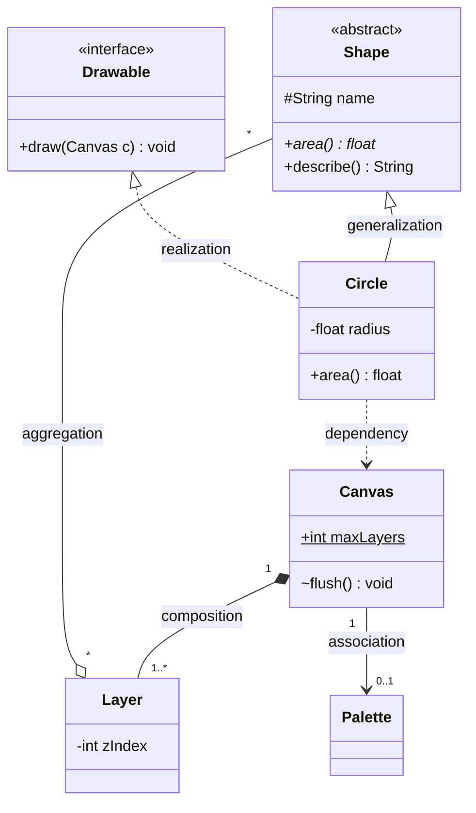

**Reading the diagram.** `Shape` is an abstract class (stereotype and the `*` on `area()` mark it abstract) with a protected `name`; `Circle` inherits from it (solid line, hollow triangle at `Shape`) and also realizes the `Drawable` interface (dashed line, hollow triangle). A `Canvas` *composes* one or more `Layer`s (filled diamond at `Canvas`): layers are created by the canvas and deleted with it. Each `Layer` *aggregates* any number of shapes (hollow diamond), and one shape can appear on several layers, so it is shared. The canvas has a navigable *association* to an optional `Palette` (arrow toward `Palette`, multiplicity `0..1`). `Circle` merely *depends* on `Canvas` (dashed arrow): it receives one as a parameter in `draw` and does not keep it. The static `maxLayers` and package-visible `flush()` show the remaining adornments. The diagram has no run-time direction or storage; it is a static map of compile-time coupling. If you change `Canvas`, every class with an arrow pointing at it (here `Circle`) may need to change, which is how a class diagram exposes change impact.

#### Common misconceptions

::: mistake
**Mistake — drawing every class and every getter.** A class diagram that lists 40 classes with all their accessors hides the five decisions that matter. Show the classes that participate in the problem, the operations that define their responsibilities, and every relationship with multiplicity. Omit getters, setters and obvious constructors.
:::

::: mistake
**Mistake — using inheritance for roles.** `Librarian extends Member` looks natural until a librarian borrows a book under a different policy or a member becomes a librarian on Tuesday. Roles that an object can gain or lose are associations to a `Role` object (or a Strategy, §37.7), not subclasses. Generalization is for permanent "kind of" relationships that pass the Liskov test (§36.5).
:::

::: industry
**Diagrams as code on GitHub.** Since February 2022 GitHub renders Mermaid code blocks in Markdown files, issues and pull requests, so class and sequence diagrams can live in the repository next to the code and be reviewed as text diffs [GitHub 2022]. This is the main reason many teams moved from drawing tools to text-based UML sketches: a diagram that is versioned with the code is far more likely to be kept current.
*Evidence: Primary* — [GitHub 2022]
:::

## 38.4 Sequence diagrams

### 38.4.1 Lifelines, messages and fragments

::: definition
**Definition — Sequence diagram.** An interaction diagram that shows objects or participants as vertical **lifelines** and the **messages** they exchange as horizontal arrows ordered top to bottom in time. **Execution specifications** (activation bars) show when a participant is busy, and **combined fragments** (`alt`, `opt`, `loop`, `par` and others) show conditional, optional, repeated and parallel behavior [OMG 2017].
:::

#### First-principles explanation

A class diagram is a cast list; a sequence diagram is the script of one scene. It answers "when the user clicks *Buy*, who calls whom, in what order, and what comes back?" Time flows downward, so you can read the diagram like a story. It is the diagram that most often reveals a missing responsibility: if no lifeline can answer a message, a class is missing; if one lifeline receives every message, you have found a God object.

#### How it works internally

1. Place participants left to right in the order they first act; put the initiator (an actor) on the far left.
2. Draw each message as an arrow from caller to callee, labeled with the operation and key arguments.
3. A **synchronous** message (solid line, filled arrowhead) blocks the caller until the reply; a **reply** is a dashed line with an open arrowhead; an **asynchronous** message (solid line, open arrowhead) lets the caller continue immediately.
4. Activate the callee (a thin bar) while it is processing; nested bars show nested calls.
5. Wrap conditional or repeated sections in combined fragments, each labeled with its operator and a guard in square brackets.

**Table 38.4 — Sequence diagram elements and their Mermaid syntax.**

| Element | UML notation | Meaning | Mermaid |
|---|---|---|---|
| Lifeline | Box with a dashed vertical line | One participant for the scene's duration | `participant X` / `actor U` |
| Execution (activation) | Thin bar on the lifeline | Participant is executing | `->>+` and `-->>-`, or `activate X` |
| Synchronous message | Solid line, filled arrowhead | Caller waits for the reply | `A->>B: op()` |
| Reply | Dashed line, open arrowhead | Return value | `B-->>A: result` |
| Asynchronous message | Solid line, open arrowhead | Fire and forget | `A-)B: event` |
| `alt` fragment | Box split by dashed lines, one guard per part | If/else: exactly one operand runs | `alt ... else ... end` |
| `opt` fragment | Box with one guard | If without else | `opt ... end` |
| `loop` fragment | Box with a guard or bounds | Repeat while the guard holds | `loop ... end` |
| `par` fragment | Box split into concurrent operands | Operands run in parallel | `par ... and ... end` |
| `break` / `critical` | Labeled box | Exit the enclosing interaction / atomic region | `break ... end`, `critical ... end` |

UML 2.5.1 defines twelve interaction operators (also `seq`, `strict`, `neg`, `assert`, `ignore` and `consider`), but the six above appear in nearly every real diagram.

**Figure 38.2 — Sequence diagram for a PhotoShare Pro purchase with opt, loop and alt fragments.**

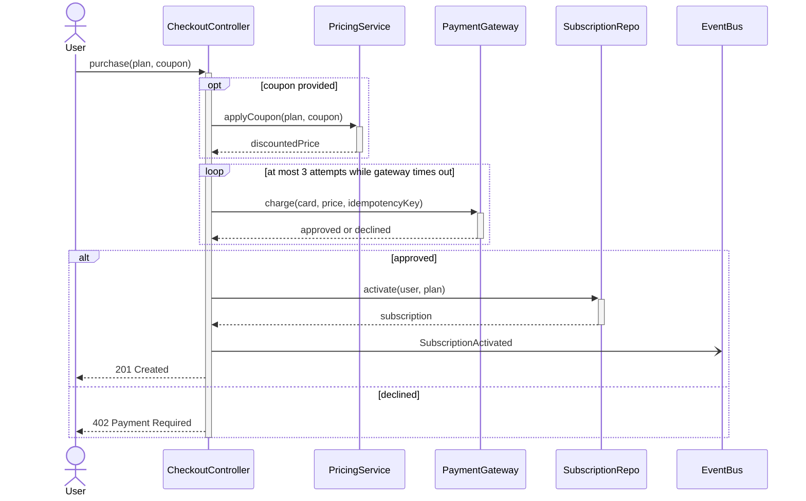

**Reading the diagram.** The *User* (an actor) synchronously calls `purchase` on the *CheckoutController*, which stays active for the whole scene. The `opt` fragment runs only when a coupon is supplied: the *PricingService* returns a discounted price. The `loop` fragment retries the *PaymentGateway* charge up to three times on timeout; the idempotency key makes those retries safe (§22.15), which is the most important detail an interviewer will probe. The `alt` fragment splits on the result: on approval the controller persists the subscription through the *SubscriptionRepo* (the storage boundary) and publishes `SubscriptionActivated` *asynchronously* to the *EventBus* (open arrowhead: it does not wait), then replies 201; on decline it replies 402. Failure points are visible as lifelines that can be slow: the external gateway and the repository. Scaling is not shown in a sequence diagram; it describes one request.

::: tip
**Tip — draw the unhappy path.** Interviewers rarely ask about the path where everything works. One `alt` for "declined" and one `loop` or `break` for "timeout" show that you think about failure, and they take ten seconds to draw.
:::

::: mistake
**Mistake — one sequence diagram for the whole system.** A sequence diagram should cover one use case, one scenario, ideally fewer than 10 lifelines and 25 messages. If it is larger, split it by use case or replace a group of lifelines with one participant ("PaymentSubsystem") and draw that separately.
:::

## 38.5 Component diagrams

### 38.5.1 Components and interfaces

::: definition
**Definition — Component diagram.** A structure diagram that shows **components** (modular, replaceable units that encapsulate their contents) and the **interfaces** they *provide* (offer to others, drawn as a "lollipop" circle) and *require* (need from others, drawn as a "socket" half-circle), connected by **assembly connectors** that wire a required interface to a matching provided one [OMG 2017].
:::

#### First-principles explanation

Think of household appliances and wall sockets. The kettle requires "230 V, type G plug"; the wall provides it. You can replace the kettle with any other appliance that requires the same socket, and you can rewire the house without touching the kettle. A component diagram draws software at that granularity: modules, libraries or services, and only the contracts between them, not their internal classes.

#### Why does this exist?

A class diagram of a 200-class system is unreadable, and a deployment diagram shows machines, not responsibilities. The component diagram sits between them: it shows which parts can be built, tested and replaced independently, which is exactly the question behind modular monoliths (§33.5), hexagonal architecture's ports and adapters (§33.10) and the Dependency Inversion Principle at the architecture level (§36.8).

Mermaid has no component diagram, so Figure 38.3 approximates UML notation with a flowchart: each `subgraph` is a component, circle nodes are provided interfaces, and edges labeled "requires" are required interfaces wired by an assembly connector.

**Figure 38.3 — Component view of the PhotoShare Pro checkout (flowchart approximation of UML component notation).**


**Reading the diagram.** Three components appear as boxes. *Checkout* provides the `ICheckout` interface (circle) to the user over HTTPS and *requires* two interfaces: `IPayment`, provided by the *Billing* component, and `ISubscriptionStore`, provided by *Subscriptions*. The "requires" edges are the assembly connectors. Checkout depends only on the interface circles, never on `GatewayAdapter` or `SubscriptionRepo` directly, so either can be replaced (a different payment provider, a different database) without touching Checkout. Solid edges are synchronous calls; the dotted edge to the *EventBus* is asynchronous publication. Storage and external boundaries are the subscriptions database and the external payment provider, which are also the main failure points. Scaling: each component could be deployed as its own service later, and the interfaces become the service APIs.

::: recommendation
**Recommendation — name interfaces after the client's need.** `IPayment` with `charge()` and `refund()` describes what Checkout needs; `IStripeClient` describes one vendor's implementation and leaks it into every client. Interfaces owned by the client side are the core of Dependency Inversion (§36.7).
:::

## 38.6 State diagrams

### 38.6.1 States, transitions, guards and actions

::: definition
**Definition — State machine diagram.** A behavior diagram that shows the **states** one object (or protocol) can be in and the **transitions** between them. A transition is labeled `trigger [guard] / effect`: the **trigger** is the event, the **guard** a Boolean condition that must be true for the transition to fire, and the **effect** an action executed during the transition. A state may declare **entry**, **exit** and **do** behaviors, run on entering, on leaving, and while inside the state [OMG 2017].
:::

#### First-principles explanation

A traffic light is a state machine: three states, one event (a timer tick) and a fixed order. A pressed pedestrian button is a guard: "on tick, *if* someone is waiting, go to red". Business objects behave the same way. An order cannot be shipped before it is paid; a refund only makes sense for a paid order. Writing these rules as a diagram makes every illegal combination obvious: if there is no arrow labeled `ship` out of `Created`, shipping an unpaid order is impossible by construction.

#### How it works internally

1. A filled circle (the **initial pseudostate**) points to the first state; a bullseye is a **final state**.
2. When an event arrives, the machine looks for a transition out of the current state with that trigger.
3. If the guard is false (or no transition matches), the event is ignored or rejected, and the state does not change.
4. Otherwise it runs the current state's exit behavior, then the transition's effect, then the target state's entry behavior.
5. **Composite states** nest a sub-machine (for example, `Shipped` containing `InTransit` and `OutForDelivery`), and a **choice pseudostate** (a diamond) branches on guards after a single trigger.

**Figure 38.4 — State machine for an order, with guards, effects and entry actions.**

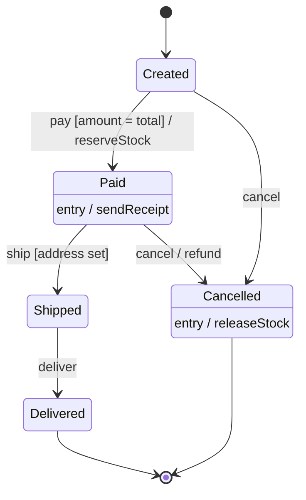

**Reading the diagram.** An order starts in *Created*. The `pay` event moves it to *Paid* only if the guard `amount = total` holds; the transition's effect reserves stock, and entering *Paid* sends a receipt. From *Paid* it can be shipped (guarded by a known address) or cancelled, and cancellation from *Paid* has a refund effect that cancellation from *Created* does not need. Entering *Cancelled* always releases stock. *Delivered* and *Cancelled* lead to the final state. Any event without an outgoing arrow is illegal in that state, so "cancel a delivered order" is rejected. There is no network or storage in this diagram; in a real system the state is persisted with the order, and every transition should be a single atomic update (for example `UPDATE ... SET state = 'PAID' WHERE id = ? AND state = 'CREATED'`) so that two concurrent events cannot both fire from the same state.

#### Code example

A transition table maps directly from the diagram to code, which keeps them in sync:

```python
from enum import Enum, auto


class S(Enum):
    CREATED = auto()
    PAID = auto()
    SHIPPED = auto()
    DELIVERED = auto()
    CANCELLED = auto()


class Order:
    # (state, event) -> (guard, next_state, effect); a guard of None means "always"
    TRANSITIONS = {
        (S.CREATED, "pay"):     (lambda o, amt: amt == o.total, S.PAID, "reserve_stock"),
        (S.CREATED, "cancel"):  (None, S.CANCELLED, None),
        (S.PAID, "ship"):       (lambda o, _: o.address is not None, S.SHIPPED, None),
        (S.PAID, "cancel"):     (None, S.CANCELLED, "refund"),
        (S.SHIPPED, "deliver"): (None, S.DELIVERED, None),
    }
    ENTRY = {S.PAID: "send_receipt", S.CANCELLED: "release_stock"}

    def __init__(self, total, address=None):
        self.state, self.total, self.address, self.log = S.CREATED, total, address, []

    def fire(self, event, arg=None):
        rule = self.TRANSITIONS.get((self.state, event))
        if rule is None:
            raise ValueError(f"event {event!r} not allowed in {self.state.name}")
        guard, target, effect = rule
        if guard is not None and not guard(self, arg):
            return False                       # guard false: no transition, state unchanged
        if effect:
            self.log.append(effect)            # transition effect runs first...
        self.state = target
        if target in self.ENTRY:
            self.log.append(self.ENTRY[target])  # ...then the target's entry action
        return True


if __name__ == "__main__":
    o = Order(total=50, address="1 Main St")
    assert o.fire("pay", 40) is False and o.state is S.CREATED   # guard rejects
    assert o.fire("pay", 50) and o.state is S.PAID
    assert o.fire("ship") and o.fire("deliver")
    try:
        o.fire("cancel")
    except ValueError as e:
        print("rejected:", e)
    print(o.state.name, o.log)
```

Output: `rejected: event 'cancel' not allowed in DELIVERED`, then `DELIVERED ['reserve_stock', 'send_receipt']`.

What to notice:

- Each row of `TRANSITIONS` is one arrow of Figure 38.4, so reviewing the table against the diagram is mechanical.
- A false guard returns `False` without changing state; an event with no arrow raises. Distinguishing "not now" from "never in this state" helps callers respond correctly.
- The order of actions (exit, transition effect, entry) follows UML's run-to-completion semantics. For behavior that differs a lot per state, the State pattern (§37.15 and the vending machine in §38.10.4) replaces the table with one class per state.

## 38.7 Activity diagrams

### 38.7.1 Actions, forks, joins and swimlanes

::: definition
**Definition — Activity diagram.** A behavior diagram that models a workflow as **actions** connected by **control flows**, with **decision** and **merge** nodes for branching, **fork** and **join** bars for concurrency, and **activity partitions** (swimlanes) that assign actions to the participant responsible for them. Its semantics are based on tokens flowing through the graph, similar to a Petri net [OMG 2017].
:::

#### First-principles explanation

A state diagram follows one object through its life; an activity diagram follows a piece of work through an organization. A recipe is an activity diagram: "boil water" and "chop vegetables" can happen in parallel (fork), both must finish before "add vegetables" (join), and "if the sauce is thick, add water" is a decision. Swimlanes add *who*: the chef chops, the kitchen porter boils.

#### How it works internally

1. An initial node emits one token. Actions run when a token arrives and pass it on when they finish.
2. A **decision** sends the token down exactly one outgoing edge whose guard is true; a **merge** joins alternative paths without waiting.
3. A **fork** copies the token onto every outgoing edge, so those branches run concurrently. A **join** waits until a token has arrived on every incoming edge, then emits one.
4. An **activity final** node ends the whole activity; a **flow final** ends only the branch that reaches it.

Confusing a merge with a join is the classic error: a join after a decision waits forever for the branch that was never taken.

Mermaid has no activity diagram, so Figure 38.5 approximates UML notation with a flowchart: subgraphs are swimlanes, nodes labeled *fork* and *join* stand for the UML bars, and the circles are the initial and final nodes.

**Figure 38.5 — Activity diagram for order fulfilment with swimlanes, fork and join (flowchart approximation of UML).**

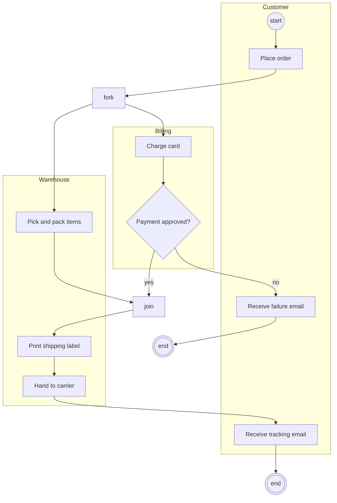

**Reading the diagram.** Three swimlanes assign responsibility: *Customer*, *Billing* and *Warehouse*. After the customer places the order, the fork starts two concurrent branches: billing charges the card while the warehouse picks and packs. The join waits for both: shipping must not start before payment is approved *and* the parcel is packed. If payment is declined, the decision routes to a failure email and an end node. A strict UML reading notes a subtle bug the diagram exposes: on the decline path the picked items are never returned to the shelf, and the join is never satisfied, so the warehouse branch is left dangling. A real design adds a compensating "restock items" action, which is the same reasoning as a saga's compensation (§32.7). Activity diagrams show no storage or protocols; they show ordering and concurrency, which is where workflow bugs hide.

**Table 38.5 — Choosing a diagram for the question being asked.**

| Question | Diagram | Why not the others |
|---|---|---|
| What types exist and how are they coupled? | Class | Behavior diagrams hide structure |
| What happens, in what order, for one request? | Sequence | Class diagrams have no time axis |
| What are the replaceable parts and their contracts? | Component | Class diagrams are too fine-grained |
| Which events are legal for one object, and when? | State machine | Sequence diagrams show one path, not all legal ones |
| What is the workflow across roles, with parallel steps? | Activity | Sequence diagrams make parallelism and roles awkward |
| What does the data model look like in the database? | Entity-relationship (§11.17) | UML class diagrams can do it, but ER notation is the database convention |

## 38.8 Object relationships in depth

### 38.8.1 Association, aggregation and composition

All three are structural links between objects that persist beyond a single method call; they differ in *ownership* and *lifetime*.

::: definition
**Definition — Association, aggregation, composition.** An **association** is a structural relationship in which instances of one class hold links to instances of another. **Aggregation** (UML "shared aggregation") is an association marked as whole–part, in which a part may be shared by several wholes and exists independently of them. **Composition** (UML "composite aggregation") is a whole–part association in which each part belongs to at most one whole at a time, and the whole is responsible for the part's existence: if the composite is deleted, its parts are deleted with it [OMG 2017].
:::

#### First-principles explanation

Three tests settle almost every case:

1. **Lifetime test.** If the whole is destroyed, must the part be destroyed too? A room cannot exist without its building: composition. A professor does not vanish when a department closes: not composition.
2. **Sharing test.** Can the part belong to two wholes at once? A professor can be in two departments: aggregation or plain association. A room is in exactly one building: composition.
3. **Creation test.** Who creates the part? If only the whole creates it and nobody outside holds a reference, it is composition. If the part is created elsewhere and handed in, it is aggregation or association.

#### Why does this matter?

The distinction decides concrete code questions: who constructs the object, whether it can be passed to the outside, whether deleting the parent must cascade (in the database, `ON DELETE CASCADE` for composition, a nullable foreign key or a join table for association), and whether the parent may expose its parts or only copies.

**Figure 38.6 — Association, aggregation and composition in one model.**

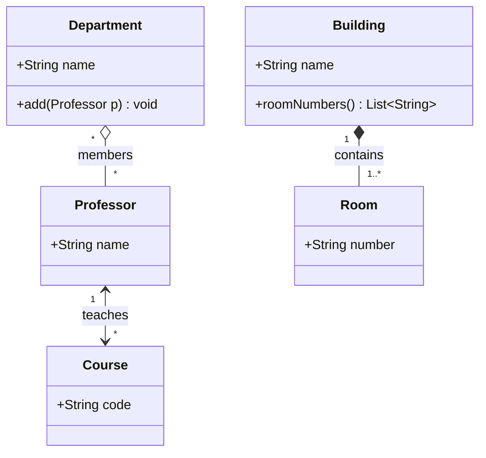

**Reading the diagram.** *Professor–Course* is a bidirectional **association** (arrowheads at both ends): each course has exactly one lecturer and a professor teaches any number of courses, and both sides can navigate to the other. *Department–Professor* is **aggregation** (hollow diamond at the department): professors are members of departments, may belong to several (multiplicity `*` at the department end), and outlive any department. *Building–Room* is **composition** (filled diamond): a room belongs to exactly one building and is created and destroyed with it. In storage terms the composition maps to a `rooms` table with a non-null `building_id` and `ON DELETE CASCADE`; the aggregation maps to a join table `department_members`. The failure point the diagram highlights is the bidirectional association: two references must be kept consistent, which is a frequent source of bugs.

#### Code example

```python
from __future__ import annotations


class Professor:
    """Association: a Professor knows Courses and each Course knows its Professor."""
    def __init__(self, name: str):
        self.name = name
        self.courses: list[Course] = []


class Course:
    def __init__(self, code: str, lecturer: Professor):
        self.code = code
        self.lecturer = lecturer          # association end, multiplicity 1
        lecturer.courses.append(self)     # keep both ends consistent


class Department:
    """Aggregation: professors are shared and outlive the department."""
    def __init__(self, name: str):
        self.name = name
        self.members: list[Professor] = []

    def add(self, p: Professor) -> None:
        self.members.append(p)           # the Professor was created elsewhere


class Room:
    def __init__(self, number: str):
        self.number = number


class Building:
    """Composition: the Building creates its Rooms; they never escape it."""
    def __init__(self, name: str, room_count: int):
        self.name = name
        self._rooms = [Room(f"{name}-{i}") for i in range(1, room_count + 1)]

    def room_numbers(self) -> list[str]:
        return [r.number for r in self._rooms]   # expose values, not the parts


if __name__ == "__main__":
    ada = Professor("Ada")
    db = Course("CS145", ada)
    cs, math = Department("CS"), Department("Math")
    cs.add(ada); math.add(ada)                   # one part, two wholes: shared
    del cs                                       # the department goes away...
    print(ada.name, [c.code for c in ada.courses], len(math.members))  # ...Ada does not
    hall = Building("Gates", 3)
    print(hall.room_numbers())
```

Output: `Ada ['CS145'] 1`, then `['Gates-1', 'Gates-2', 'Gates-3']`.

What to notice:

- Composition is expressed by *who creates* (`Building.__init__`) and *what escapes* (`room_numbers` returns strings, not `Room` objects). In a garbage-collected language nothing is "deleted"; composition means exclusive ownership and encapsulation.
- The bidirectional association needs code to keep both ends in sync (`lecturer.courses.append(self)`). Prefer one-directional associations unless both directions are genuinely navigated.
- Aggregation looks identical to association in code. The only difference is intent, documented by the diamond.

**Table 38.6 — Association, aggregation and composition compared.**

| Aspect | Association | Aggregation | Composition |
|---|---|---|---|
| What it is | A lasting link between peers | Whole–part, shared part | Whole–part, exclusive part |
| Part lifetime | Independent | Independent | Bound to the whole |
| Part shared? | Yes | Yes | No (one whole at a time) |
| Who creates the part | Anyone | Usually outside the whole | The whole |
| UML symbol | Plain line or arrow | Hollow diamond at whole | Filled diamond at whole |
| Database mapping | Foreign key or join table | Join table, no cascade | Child table, `ON DELETE CASCADE` |
| Example | `Course` → `Professor` | `Playlist` ◇ `Song` | `Order` ◆ `LineItem` |
| Choose when | Objects collaborate as peers | You want to stress "collection of" without ownership | Part has no meaning outside the whole |

::: note
**Note — aggregation is controversial.** UML 2.5.1 itself says that the precise semantics of shared aggregation vary by application area and modeler [OMG 2017]. Fowler recommends ignoring aggregation altogether and quotes Jim Rumbaugh describing it as a "modeling placebo" [Fowler 2003]. In interviews, use composition when ownership matters and a plain association otherwise; if you draw a hollow diamond, be ready to say exactly what it adds.
:::

### 38.8.2 Attribute or relationship?

UML treats an attribute and a navigable association as two notations for the same thing: a property of the class [OMG 2017; Fowler 2003]. `Order` with an attribute `customer : Customer` means the same as a line from `Order` to `Customer`. The choice is about what you want the reader to notice.

1. **Value types are attributes.** Primitive values, enums, dates, and small immutable *value objects* such as `Money`, `Address` or `Coordinates` have no identity of their own (two `Money(5, "USD")` are interchangeable). Write them inside the box.
2. **Entities are relationships.** Classes with identity and their own lifecycle (`Customer`, `Product`, `ParkingSpot`) get a line, so multiplicity and ownership are visible.
3. **Relationships with data become classes.** If the link itself has properties, such as a student's grade in a course or a member's due date for a book, promote the link to an *association class* (`Enrollment`, `Loan`). In code it is always a class; in the database it is the join table.
4. **Collections of entities are always lines.** `items : List<LineItem>` hides the multiplicity and the composition that a filled diamond with `1..*` shows.

::: mistake
**Mistake — foreign keys in the class diagram.** Writing `customerId : int` in `Order` copies the relational schema into the object model and hides the relationship. In a class diagram, draw the association; the identifier is a persistence detail that belongs in the entity-relationship diagram (§11.17).
:::

## 38.9 The LLD interview method

### 38.9.1 What is being tested

::: definition
**Definition — Low-level design (LLD) interview.** A 45–60-minute interview in which you design the classes, interfaces, relationships and key algorithms of a single component or small application (a parking lot, an LRU cache, a rate limiter), usually ending with working or near-working code for the core classes. It is also called an *object-oriented design* or *machine coding* interview. It contrasts with the high-level design interview (§1.5, Chapter 87), which designs a distributed system out of services and data stores.
:::

The interviewer is assessing whether you can turn a vague request into a clean object model, apply the principles of Chapters 35–37 without over-engineering, write correct code, and reason about concurrency and change. There is no single right answer; there are defensible and indefensible ones.

### 38.9.2 The nine steps

1. **Clarify requirements and scope (3–5 min).** Ask who the users are, which features are in scope, the scale (one lot or a chain of 500; one process or many), and what must *not* be built. Write the agreed functional requirements as a numbered list and two or three non-functional ones (thread safety, extensibility, latency).
2. **List use cases (2 min).** Actor plus verb: "driver parks vehicle", "attendant views free spots". Each later sequence diagram corresponds to one use case.
3. **Identify core entities (3 min).** Underline nouns in the requirements and keep those with behavior or identity. Discard synonyms and pure attributes (a "license plate" is an attribute of `Vehicle`, not a class).
4. **Draw relationships as a class diagram (5–7 min).** Add multiplicities and choose composition, association or inheritance deliberately (§38.8). Keep it to the 6–12 classes that matter.
5. **Define key interfaces (3–5 min).** Write the signatures of the public operations and the interfaces at variation points (allocation strategy, fee policy, storage). This is where Dependency Inversion (§36.7) shows.
6. **Sequence the main flows (3–5 min).** One sequence diagram (or a state diagram if the problem is lifecycle-heavy, such as a vending machine) for the most important use case. It validates the class diagram: every message must land on a class that owns that responsibility.
7. **Name the patterns you applied (2 min).** Strategy, State, Observer, Factory, Singleton: say *why* each earns its place and which change it absorbs. Do not add patterns to collect them.
8. **Address concurrency and extensibility (3–5 min).** Identify the shared mutable state, the critical sections and the lock granularity; then walk through two likely changes (a new vehicle type, a new pricing rule) and show which classes change.
9. **Code the core classes (12–15 min).** Write the domain model, the main operation end to end, and one test or driver that exercises it. Prefer correct and readable over complete.

**Figure 38.7 — The LLD interview method with a 45-minute time budget.**

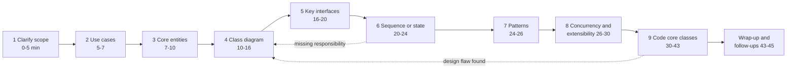

**Reading the diagram.** The nine steps run left to right, each with a cumulative time window for a 45-minute slot. The solid arrows are the normal order. The two dotted arrows are feedback loops: drawing the sequence diagram often reveals a responsibility with no owner, and coding often reveals a flaw in the class diagram; in both cases you return briefly to step 4 and say so aloud, which interviewers read as a strength, not a weakness. The main failure points are the two ends: spending 15 minutes on requirements (no time to code) or starting to code at minute 3 (no design to discuss). For a 60-minute slot, scale steps 4 and 9 most.

**Table 38.7 — Time budget for a 45-minute LLD interview.**

| Minutes | Step | Output on the whiteboard or editor | Typical mistake |
|---|---|---|---|
| 0–5 | Clarify requirements | Numbered FR list, 2–3 NFRs, out-of-scope list | Assuming scope silently |
| 5–7 | Use cases | 4–6 "actor verbs object" lines | Skipping, then forgetting a flow |
| 7–10 | Core entities | 6–12 nouns with one-line responsibilities | Making every noun a class |
| 10–16 | Class diagram | Classes, relationships, multiplicities | Inheritance everywhere |
| 16–20 | Key interfaces | Signatures of public operations and strategies | Getters and setters only |
| 20–24 | Sequence or state diagram | One main flow including one failure branch | Drawing every flow |
| 24–26 | Patterns | 2–4 named patterns with the reason for each | Pattern bingo |
| 26–30 | Concurrency and extensibility | Shared state, lock scope, two change scenarios | "Add a lock" with no scope |
| 30–43 | Code | Core classes, main operation, a driver or test | Boilerplate first, logic last |
| 43–45 | Wrap-up | Known limitations and next steps | Silence |

### 38.9.3 How you are evaluated

**Table 38.8 — LLD interview rubric.**

| Dimension | Below the bar | Meets the bar | Strong |
|---|---|---|---|
| Requirements | Starts designing immediately | Clarifies scope and lists FRs | Also surfaces NFRs, edge cases and explicit non-goals |
| Object model | God class or anemic data bags | Cohesive classes, sensible relationships | Clear ownership, value objects vs entities, justified multiplicities |
| Principles | Tight coupling to concrete classes | Interfaces at obvious variation points | Explains each choice in SOLID terms and avoids speculative generality |
| Patterns | None, or applied for their own sake | Appropriate pattern for the main variation | Names alternatives and why they lost |
| Code | Does not run or is mostly scaffolding | Core flow works, readable names | Runs, includes a test, handles failures and edge cases |
| Concurrency | Not considered | Identifies shared state and locks it | Discusses granularity, contention and atomic operations |
| Extensibility | Change requires editing many classes | One or two classes per change | Walks through concrete changes and their blast radius |
| Communication | Silent or unstructured | Explains while working | Drives the session, checks in, manages time |

Calibrate by level: a junior candidate who meets the bar on the first five rows usually passes; a senior candidate is expected to be strong on concurrency and extensibility and to lead the discussion.

::: tip
**Tip — say the trade-off, then pick.** "I could model vehicle types with inheritance or with a `size` enum. Since the only difference is which spots fit, I'll use the enum and avoid a class hierarchy with no behavior." That sentence earns more credit than either choice alone.
:::

**Table 38.9 — Failure scenarios in an LLD interview.**

| What goes wrong | Why | Detection | Recovery | Prevention |
|---|---|---|---|---|
| No code at minute 40 | Requirements and diagrams expanded to fill the time | Clock check at minute 25 shows step 6 unfinished | Code the single main operation; describe the rest | Announce the time plan at the start |
| Class explosion (20+ classes) | Every noun became a class; inheritance for each variant | Diagram no longer fits; many classes without behavior | Collapse variants into enums or strategies | Keep only nouns with behavior or identity |
| Interviewer asks for a change and many classes must change | Concrete dependencies, switch statements on type | Walking through the change touches 4+ classes | Introduce an interface at that variation point | Ask "what will change?" during step 5 |
| Race condition pointed out | Shared mutable state with check-then-act | Two threads can both see a spot as free | Wrap check and act in one critical section | List shared state explicitly in step 8 |
| Code does not run | Untested edge case or typo | Interviewer traces an example | Walk through a small example by hand | Write a 5-line driver early and grow it |

## 38.10 LLD exercises

Each exercise follows the method of §38.9: requirements, a class diagram, one sequence or state diagram, runnable core code (tested with `python3`), the patterns used, and the extensions and follow-up questions interviewers ask. Exercises 1–4 are worked in full; 5–8 are more compact and focus on the one design decision that makes each problem interesting. All designs run in a single process; turning one into a distributed service is a high-level design question (Part X).

**Table 38.10 — The eight exercises at a glance.**

| # | Problem | Core design decision | Main patterns | Concurrency concern |
|---|---|---|---|---|
| 1 | Parking lot | Spot allocation and pricing as pluggable policies | Strategy, Facade | Two cars claiming one spot |
| 2 | Elevator system | Dispatch policy separate from car state machine | Strategy, State machine | Hall calls from many panels |
| 3 | LRU cache | Hash map plus doubly linked list for O(1) | Interface + implementation | `get` mutates recency order |
| 4 | Vending machine | Behavior varies by state | State | Events during dispensing |
| 5 | Library system | Title versus physical copy; holds queue | Observer | Two members, one copy |
| 6 | Rate limiter | Algorithm behind an interface | Strategy, Decorator, Factory | Per-key atomic update |
| 7 | Key-value store | TTL expiry and nested transactions | Command-like write buffers | Commit atomicity, conflicts |
| 8 | Chess | Legal-move validation in layers | Polymorphism, Template-like hierarchy | Usually single-threaded |

### 38.10.1 Exercise 1: Parking lot

#### Requirements

Clarified with the interviewer:

1. A lot has several levels; each level has spots of three sizes: small (motorcycles), medium (cars) and large (vans and buses).
2. A vehicle may park in a spot of its size or larger. Choose the smallest fitting size first, then the lowest level, then the lowest spot number.
3. Entry issues a ticket; exit computes a fee from the vehicle size and the duration: an hourly rate with a daily cap.
4. Report "full" when no suitable spot exists. One vehicle (plate) cannot be parked twice.
5. Non-functional: thread safe (several gates operate concurrently); new allocation rules and pricing rules must not require changes to `ParkingLot`.

Out of scope: payment processing, reservations, physical sensors.

**Figure 38.8 — Parking lot class diagram.**

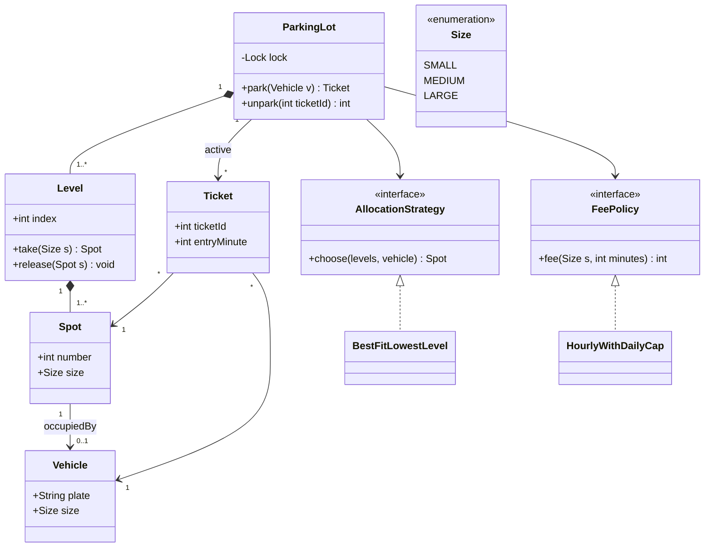

**Reading the diagram.** `ParkingLot` *composes* its levels and each `Level` composes its spots: they are created with the lot and meaningless without it. Vehicles and tickets are associations: a vehicle exists before and after parking. Each spot is occupied by at most one vehicle (`0..1`). The two interfaces are the variation points named in requirement 5: `AllocationStrategy` decides *which* spot, `FeePolicy` decides *how much*; the lot depends only on the interfaces (Dependency Inversion, §36.7). Vehicle kinds are a `Size` enumeration, not a subclass hierarchy, because the only behavior that differs is which spots fit. The single lock in `ParkingLot` is the concurrency boundary; there is no storage boundary in this in-memory design.

**Figure 38.9 — Sequence diagram for parking a vehicle.**

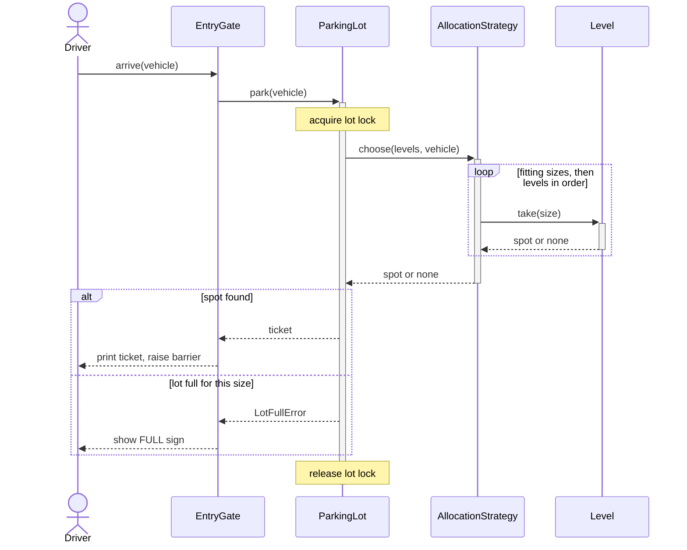

**Reading the diagram.** The entry gate calls `park` synchronously. The lot takes its lock *before* asking the strategy, so the search and the claim of the spot form one critical section: two gates cannot both receive the last medium spot. The strategy loops over fitting sizes and levels, asking each level to `take` a spot (a heap pop, which both finds and removes it). The `alt` fragment covers success (ticket printed) and the full case. The failure point is the lock: a strategy that does slow work (a database call, say) would serialize all gates, so strategies must be fast and in-memory. Scaling to a chain of lots means one `ParkingLot` per site, not one lock for all.

#### Mathematical foundations

::: formula
**Formula 38.1 — Parking fee with an hourly rate and a daily cap**

$$F(t) = \left\lfloor \frac{t}{1440} \right\rfloor C + \min\!\left(C,\; r\left\lceil \frac{t \bmod 1440}{60} \right\rceil\right)$$

| Symbol | Meaning | Units |
|---|---|---|
| $F(t)$ | Fee charged at exit | dollars |
| $t$ | Parked duration | minutes |
| $r$ | Hourly rate for the vehicle size; each started hour is charged in full | dollars/hour |
| $C$ | Daily cap for the vehicle size, charged for each full 24 hours | dollars/day |
| $1440$ | Minutes in a day | minutes |
:::

::: example
**Worked example — three exits.** Rates: car $r = 4$, $C = 30$; van $r = 8$, $C = 60$.

1. Car, $t = 130$ min: full days $\lfloor 130/1440 \rfloor = 0$; started hours $\lceil 130/60 \rceil = 3$; $F = \min(30, 4 \times 3) = \$12$.
2. Car, $t = 540$ min: $\lceil 540/60 \rceil = 9$ hours; $4 \times 9 = 36 > 30$, so $F = \$30$.
3. Van, $t = 1{,}565$ min: one full day ($\$60$) plus $1{,}565 - 1{,}440 = 125$ min; $\lceil 125/60 \rceil = 3$ hours; $\min(60, 8 \times 3) = 24$; $F = 60 + 24 = \$84$.

**Interpretation.** For cars the cap binds once $4h > 30$, that is from the 8th started hour (any stay over 420 minutes). **Engineering implication.** Pricing rules change often (weekend rates, grace periods, event pricing). Because they live behind `FeePolicy`, each new rule is a new class tested in isolation, and `ParkingLot` does not change (Open/Closed, §36.4). The code below reproduces all three numbers.
:::

#### Code

```python
from __future__ import annotations

import heapq
import itertools
import math
import threading
from abc import ABC, abstractmethod
from dataclasses import dataclass
from enum import IntEnum


class Size(IntEnum):
    SMALL = 1    # motorcycle
    MEDIUM = 2   # car
    LARGE = 3    # van or bus


@dataclass(frozen=True)
class Vehicle:
    plate: str
    size: Size


@dataclass
class Spot:
    level: int
    number: int
    size: Size
    vehicle: Vehicle | None = None


@dataclass(frozen=True)
class Ticket:
    ticket_id: int
    vehicle: Vehicle
    spot: Spot
    entry_minute: int


class Level:
    """Owns its spots (composition) and a min-heap of free spot numbers per size."""
    def __init__(self, index: int, counts: dict[Size, int]):
        self.index, self.spots = index, []
        self._free: dict[Size, list[int]] = {s: [] for s in Size}
        for size, count in counts.items():
            for _ in range(count):
                n = len(self.spots)
                self.spots.append(Spot(index, n, size))
                heapq.heappush(self._free[size], n)

    def take(self, size: Size) -> Spot | None:
        return self.spots[heapq.heappop(self._free[size])] if self._free[size] else None

    def release(self, spot: Spot) -> None:
        heapq.heappush(self._free[spot.size], spot.number)

    def free_count(self, size: Size) -> int:
        return len(self._free[size])


class AllocationStrategy(ABC):                      # Strategy pattern
    @abstractmethod
    def choose(self, levels: list[Level], vehicle: Vehicle) -> Spot | None: ...


class BestFitLowestLevel(AllocationStrategy):
    """Smallest spot size that fits, then lowest level, then lowest spot number."""
    def choose(self, levels, vehicle):
        for size in (s for s in Size if s >= vehicle.size):
            for level in levels:
                if (spot := level.take(size)) is not None:
                    return spot
        return None


class FeePolicy(ABC):                               # Strategy pattern
    @abstractmethod
    def fee(self, size: Size, minutes: int) -> int: ...


class HourlyWithDailyCap(FeePolicy):
    RATES = {Size.SMALL: (2, 15), Size.MEDIUM: (4, 30), Size.LARGE: (8, 60)}  # $/h, $/day cap

    def fee(self, size, minutes):
        rate, cap = self.RATES[size]
        days, rest = divmod(minutes, 24 * 60)
        return days * cap + min(cap, rate * math.ceil(rest / 60))


class LotFullError(Exception):
    pass


class ParkingLot:                                    # Facade over levels, strategy, fees
    def __init__(self, levels, strategy: AllocationStrategy, fees: FeePolicy, clock):
        self.levels, self.strategy, self.fees, self.clock = levels, strategy, fees, clock
        self._lock = threading.Lock()                # guards spots, tickets and plates
        self._tickets: dict[int, Ticket] = {}
        self._plates: set[str] = set()
        self._ids = itertools.count(1)

    def park(self, vehicle: Vehicle) -> Ticket:
        with self._lock:
            if vehicle.plate in self._plates:
                raise ValueError(f"{vehicle.plate} is already parked")
            spot = self.strategy.choose(self.levels, vehicle)
            if spot is None:
                raise LotFullError(f"no spot for {vehicle.size.name}")
            spot.vehicle = vehicle
            ticket = Ticket(next(self._ids), vehicle, spot, self.clock())
            self._tickets[ticket.ticket_id] = ticket
            self._plates.add(vehicle.plate)
            return ticket

    def unpark(self, ticket_id: int) -> int:
        with self._lock:
            ticket = self._tickets.pop(ticket_id)    # KeyError: unknown or already used
            ticket.spot.vehicle = None
            self.levels[ticket.spot.level].release(ticket.spot)
            self._plates.discard(ticket.vehicle.plate)
            minutes = self.clock() - ticket.entry_minute
            return self.fees.fee(ticket.vehicle.size, minutes)


if __name__ == "__main__":
    now = [0]                                        # fake clock in minutes
    lot = ParkingLot([Level(0, {Size.SMALL: 1, Size.MEDIUM: 2, Size.LARGE: 1}),
                      Level(1, {Size.MEDIUM: 2, Size.LARGE: 1})],
                     BestFitLowestLevel(), HourlyWithDailyCap(), lambda: now[0])
    moto = lot.park(Vehicle("M-1", Size.SMALL))
    cars = [lot.park(Vehicle(f"C-{i}", Size.MEDIUM)) for i in range(3)]
    print([(t.spot.level, t.spot.number, t.spot.size.name) for t in [moto, *cars]])
    vans = [lot.park(Vehicle(f"V-{i}", Size.LARGE)) for i in range(2)]
    try:
        lot.park(Vehicle("V-9", Size.LARGE))
    except LotFullError as e:
        print("rejected:", e)
    now[0] = 130
    print("car, 130 min:", lot.unpark(cars[0].ticket_id))          # ceil(130/60)=3 h -> $12
    now[0] = 540
    print("car, 540 min:", lot.unpark(cars[1].ticket_id))          # 9 h -> $36 -> cap $30
    now[0] = 1565
    print("van, 1565 min:", lot.unpark(vans[0].ticket_id))         # 1 day $60 + 3 h $24
    car = lot.park(Vehicle("C-7", Size.MEDIUM))                     # reuses lowest free spot
    print("C-7 ->", car.spot.level, car.spot.number)

    # Concurrency check: 50 threads race for 10 medium spots; exactly 10 must win.
    big = ParkingLot([Level(0, {Size.MEDIUM: 10})], BestFitLowestLevel(),
                     HourlyWithDailyCap(), lambda: 0)
    wins = []
    def attempt(i):
        try:
            wins.append(big.park(Vehicle(f"T-{i}", Size.MEDIUM)).spot.number)
        except LotFullError:
            pass
    threads = [threading.Thread(target=attempt, args=(i,)) for i in range(50)]
    for t in threads: t.start()
    for t in threads: t.join()
    assert sorted(wins) == list(range(10)), wins
    print("concurrent winners:", len(wins))
```

Output:

```text
[(0, 0, 'SMALL'), (0, 1, 'MEDIUM'), (0, 2, 'MEDIUM'), (1, 0, 'MEDIUM')]
rejected: no spot for LARGE
car, 130 min: 12
car, 540 min: 30
van, 1565 min: 84
C-7 -> 0 1
concurrent winners: 10
```

What to notice:

- Each level keeps a min-heap of free spot numbers per size, so finding *and* claiming a spot is $O(\log n)$ per level instead of a linear scan of all spots; with $S$ sizes and $L$ levels the search is $O(SL\log n)$, which is constant for a fixed building.
- The check ("is there a free spot?") and the act ("mark it occupied") happen under one lock. Splitting them is the classic check-then-act race (§6.9); the 50-thread test would then occasionally hand one spot to two cars.
- Time comes from an injected `clock`, so fees are testable without waiting hours; tickets are single-use because `unpark` pops them.

#### Patterns used

**Strategy** for allocation and pricing (§37.7); **Facade**: `ParkingLot` is the only class the gates talk to; **composition** for lot–level–spot ownership; value objects (`Vehicle`, `Ticket`) are immutable dataclasses.

#### Extensions and follow-up questions

- *Electric-vehicle spots with chargers?* Add a `features` set to `Spot` and a strategy that prefers matching features; nothing else changes.
- *Reduce lock contention with 20 gates?* Lock per level and let the strategy try levels in a gate-specific order; or keep free counts per level in atomics and lock only the chosen level. Measure first: at a few cars per second, one lock is not a bottleneck.
- *Display free spots per level in real time?* Have `ParkingLot` publish `SpotTaken`/`SpotFreed` events to display boards (Observer, §37.8).
- *Lost ticket?* Look up the active ticket by plate (the `_plates` set becomes a plate→ticket map) and charge per policy.
- *Multiple lots across a city?* That becomes a high-level design: a reservation service with a database per region; the LLD here is the per-lot component.

### 38.10.2 Exercise 2: Elevator system

#### Requirements

1. A building has $N$ floors and $M$ cars. Passengers press *hall calls* (floor plus direction) on each floor and *car calls* (destination) inside a car.
2. A dispatcher assigns each hall call to one car; the policy must be replaceable.
3. Each car serves its stops using the LOOK policy: keep moving in the current direction while stops remain ahead, then reverse; idle when there are no stops.
4. A car in maintenance is not dispatched.
5. Non-functional: hall calls arrive concurrently from many panels; the simulation must be deterministic for tests.

Out of scope: weight sensors, door obstruction, fire mode, energy optimization (all good follow-ups).

**Figure 38.10 — Elevator system class diagram.**

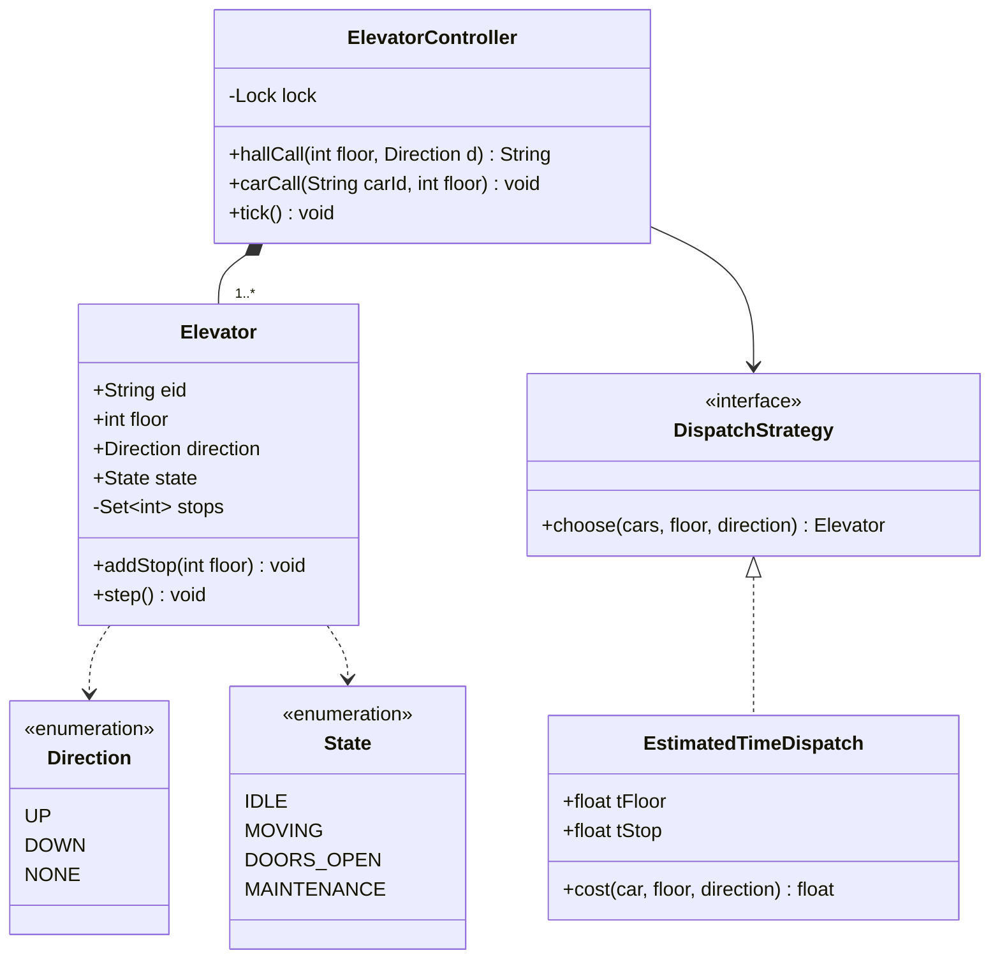

**Reading the diagram.** The `ElevatorController` composes the cars and owns the lock that serializes calls and ticks. *Which car* is decided by a `DispatchStrategy` (here `EstimatedTimeDispatch`); *how a car moves* is the car's own state machine (`step`). Keeping the two separate means you can swap in zoning or destination dispatch without touching car movement, and you can test each in isolation. A car's pending work is a set of stop floors. There is no storage boundary; the real-world failure points are a car that stops responding (mark it `MAINTENANCE` so the dispatcher skips it) and the controller itself, which in a real building has a hardware fallback.

**Figure 38.11 — State machine of one elevator car.**

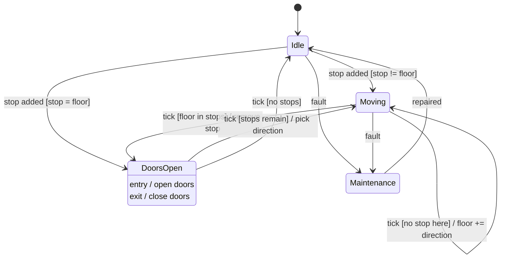

**Reading the diagram.** A car starts *Idle*. When a stop is added it either opens its doors (the stop is the current floor) or starts *Moving*. Each tick while moving it either advances one floor or, if the current floor is a stop, removes the stop and enters *DoorsOpen*, whose entry action opens the doors and exit action closes them. Leaving *DoorsOpen* it re-applies LOOK: continue if stops remain, otherwise go *Idle*. A fault from *Idle* or *Moving* sends the car to *Maintenance* until repaired. There is deliberately no transition from *DoorsOpen* to *Moving* without passing the exit action, so a car can never move with open doors, the most important safety property in the whole design. In the code below, the guards are checked in `step()`, and the timed ticks are deterministic so tests do not depend on wall-clock time.

#### Mathematical foundations

::: formula
**Formula 38.2 — Estimated time for car $e$ to reach a hall call $r$**

$$T(e, r) = d \cdot t_{\text{floor}} + s \cdot t_{\text{stop}}, \qquad
d = \begin{cases} |f_e - f_r| & \text{if } e \text{ is idle, or } f_r \text{ is ahead and } e \text{ moves in the call's direction} \\ |f_e - f_x| + |f_x - f_r| & \text{otherwise} \end{cases}$$

| Symbol | Meaning | Units |
|---|---|---|
| $T(e, r)$ | Estimated time until car $e$ arrives at the caller | s |
| $f_e$, $f_r$ | Current floor of the car; floor of the call | floor index |
| $f_x$ | Farthest pending stop in the car's current direction (where it will turn around) | floor index |
| $d$ | Floors the car travels before reaching the caller | floors |
| $s$ | Pending stops on that path before the caller | stops |
| $t_{\text{floor}}$ | Travel time per floor | s/floor |
| $t_{\text{stop}}$ | Time lost per intermediate stop (decelerate, doors, accelerate) | s/stop |
:::

::: example
**Worked example — hall call at floor 7 going up.** $t_{\text{floor}} = 2$ s, $t_{\text{stop}} = 10$ s. Three cars:

1. Car A at floor 3, moving up, stops {5, 9}. The call is ahead and in A's direction: $d = |3 - 7| = 4$; stops before 7: {5}, $s = 1$. $T = 4 \times 2 + 1 \times 10 = 18$ s.
2. Car B at floor 10, moving down, stop {2}. B moves *toward* floor 7 but in the wrong direction, so it finishes its sweep first: $f_x = 2$, $d = |10 - 2| + |2 - 7| = 8 + 5 = 13$; $s = 1$ (floor 2). $T = 13 \times 2 + 10 = 36$ s.
3. Car C idle at floor 1: $d = 6$, $s = 0$, $T = 6 \times 2 = 12$ s.

The dispatcher picks C (12 s), even though A is closer (4 floors versus 6). **Interpretation.** Stops cost more than distance: one stop (10 s) equals five floors of travel. **Engineering implication.** "Nearest car" is the wrong heuristic; minimize estimated arrival time instead, and keep the policy behind an interface, because real buildings tune $t_{\text{stop}}$ and add penalties (for example for a car that is nearly full).
:::

#### Code

```python
from __future__ import annotations

import threading
from abc import ABC, abstractmethod
from enum import Enum


class Direction(Enum):
    UP = 1
    DOWN = -1
    NONE = 0


class State(Enum):
    IDLE = "idle"
    MOVING = "moving"
    DOORS_OPEN = "doors_open"
    MAINTENANCE = "maintenance"


class Elevator:
    """One car. step() advances one tick: move one floor, or open/close doors."""
    def __init__(self, eid: str, floor: int = 0):
        self.eid, self.floor = eid, floor
        self.direction, self.state = Direction.NONE, State.IDLE
        self.stops: set[int] = set()
        self.served: list[int] = []

    def add_stop(self, floor: int) -> None:
        self.stops.add(floor)

    def stops_ahead(self) -> list[int]:
        d = self.direction.value
        return [s for s in self.stops if d and (s - self.floor) * d > 0]

    def _pick_direction(self) -> None:          # LOOK: keep going while work lies ahead
        if self.stops_ahead():
            return
        if not self.stops:
            self.direction = Direction.NONE
            return
        nearest = min(self.stops, key=lambda s: abs(s - self.floor))
        self.direction = Direction.UP if nearest > self.floor else Direction.DOWN

    def step(self) -> None:
        if self.state is State.MAINTENANCE:
            return
        if self.state is State.DOORS_OPEN:      # doors close after one tick of dwell
            self._pick_direction()
            self.state = State.MOVING if self.stops else State.IDLE
            return
        if self.floor in self.stops:            # arrived at a stop: open doors
            self.stops.discard(self.floor)
            self.served.append(self.floor)
            self.state = State.DOORS_OPEN
            return
        self._pick_direction()
        if self.direction is Direction.NONE:
            self.state = State.IDLE
            return
        self.floor += self.direction.value
        self.state = State.MOVING


class DispatchStrategy(ABC):                      # Strategy pattern
    @abstractmethod
    def choose(self, cars: list[Elevator], floor: int, direction: Direction) -> Elevator: ...


class EstimatedTimeDispatch(DispatchStrategy):
    """Pick the car with the lowest estimated time to reach the caller (Formula 38.2)."""
    def __init__(self, t_floor: float = 2.0, t_stop: float = 10.0):
        self.t_floor, self.t_stop = t_floor, t_stop

    def cost(self, car: Elevator, floor: int, direction: Direction) -> float:
        d = car.direction.value
        between = lambda a, b: [s for s in car.stops if min(a, b) <= s <= max(a, b) and s != floor]
        on_the_way = car.direction is Direction.NONE or (
            (floor - car.floor) * d >= 0 and car.direction is direction)
        if on_the_way:
            dist = abs(car.floor - floor)
            stops = between(car.floor, floor)
        else:                                     # finish this sweep, then come back
            far = max(car.stops_ahead(), key=lambda s: abs(s - car.floor), default=car.floor)
            dist = abs(car.floor - far) + abs(far - floor)
            stops = set(between(car.floor, far)) | set(between(far, floor))
        return dist * self.t_floor + len(stops) * self.t_stop

    def choose(self, cars, floor, direction):
        candidates = [c for c in cars if c.state is not State.MAINTENANCE]
        return min(candidates, key=lambda c: (self.cost(c, floor, direction), c.eid))


class ElevatorController:
    def __init__(self, cars: list[Elevator], strategy: DispatchStrategy):
        self.cars = {c.eid: c for c in cars}
        self.strategy = strategy
        self._lock = threading.Lock()             # hall calls arrive from many panels

    def hall_call(self, floor: int, direction: Direction) -> str:
        with self._lock:
            car = self.strategy.choose(list(self.cars.values()), floor, direction)
            car.add_stop(floor)
            return car.eid

    def car_call(self, eid: str, floor: int) -> None:
        with self._lock:
            self.cars[eid].add_stop(floor)

    def tick(self) -> None:
        with self._lock:
            for car in self.cars.values():
                car.step()


if __name__ == "__main__":
    a, b, c = Elevator("A", 3), Elevator("B", 10), Elevator("C", 1)
    a.direction, a.stops = Direction.UP, {5, 9}
    b.direction, b.stops = Direction.DOWN, {2}
    strat = EstimatedTimeDispatch()
    costs = {car.eid: strat.cost(car, 7, Direction.UP) for car in (a, b, c)}
    print("costs for hall call 7 UP:", costs)
    assert costs == {"A": 18.0, "B": 36.0, "C": 12.0}

    ctl = ElevatorController([a, b, c], strat)
    print("assigned to:", ctl.hall_call(7, Direction.UP))
    ctl.car_call("A", 2)                          # 2 is behind A: served on the way back
    for _ in range(40):
        ctl.tick()
    print({car.eid: car.served for car in (a, b, c)})
    assert a.served == [5, 9, 2] and b.served == [2] and c.served == [7]
```

Output:

```text
costs for hall call 7 UP: {'A': 18.0, 'B': 36.0, 'C': 12.0}
assigned to: C
{'A': [5, 9, 2], 'B': [2], 'C': [7]}
```

What to notice:

- Car A receives a car call for floor 2 while moving up; LOOK finishes the upward sweep (5, 9) before reversing, which is why it serves `[5, 9, 2]` rather than turning back immediately.
- `cost()` implements Formula 38.2 directly, so the worked example doubles as a unit test.
- The controller lock covers both dispatch and ticks, so a hall call can never be assigned on the basis of a car's half-updated state.

#### Patterns used

**Strategy** for dispatch; an explicit **state machine** for each car (an enum plus guarded transitions in `step`; with more states and per-state behavior, refactor to the State pattern of §38.10.4); **composition** of cars in the controller.

#### Extensions and follow-up questions

- *Hall calls should only be served by a car going the same way.* Store stops as `(floor, direction)` and let a car skip opposite-direction hall stops on the current sweep.
- *Peak-hour zoning.* A `ZonedDispatch` strategy assigns cars to floor bands at 08:30–09:30; select the strategy by time of day (a strategy that delegates to others).
- *Destination dispatch* (passengers enter their destination in the lobby): the dispatcher now sees both ends of each trip and can group passengers by destination; the car model is unchanged.
- *Starvation:* a call that is always outbid by newer calls. Add an age term to the cost or a maximum wait that forces assignment.
- *Real-time control:* replace the discrete tick with an event-driven controller (arrival sensors), keeping the same state machine.

### 38.10.3 Exercise 3: LRU cache

#### Requirements

1. `get(key)` returns the value or a miss; `put(key, value)` inserts or updates.
2. Fixed capacity $n$; when full, `put` of a new key evicts the **least recently used** entry. Both reads and writes count as use.
3. Both operations in $O(1)$ time.
4. Thread safe; expose hit, miss and eviction counts.

The policy itself and its hit-ratio behavior are covered in §20.9; here the question is the data structure and the class design.

#### Why a hash map plus a doubly linked list

A hash map alone gives $O(1)$ lookup but no order. A list alone keeps order but finding a key is $O(n)$. Combined, the map stores `key → node` and the list keeps nodes in recency order: on each access you unlink the node (constant time, because a *doubly* linked node knows its predecessor) and move it to the front; to evict you remove the node before the tail. Two **sentinel** nodes at head and tail remove every empty-list special case.

**Figure 38.12 — LRU cache class diagram.**

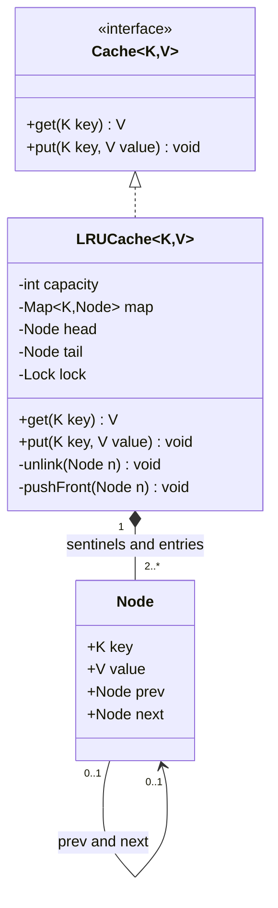

**Reading the diagram.** Clients depend on the generic `Cache` interface, so an LFU or TinyLFU implementation (§20.9.3) can replace the LRU without changing them. `LRUCache` composes its nodes (at least the two sentinels, hence `2..*`); nodes are never handed out. Each node links to its neighbors in both directions, which is what makes unlinking $O(1)$. The private `unlink` and `pushFront` are the only list operations, and both assume the lock is held. The single lock is the concurrency boundary; there is no storage boundary, since the cache is in memory.

**Figure 38.13 — Sequence diagram for get and put, including eviction.**

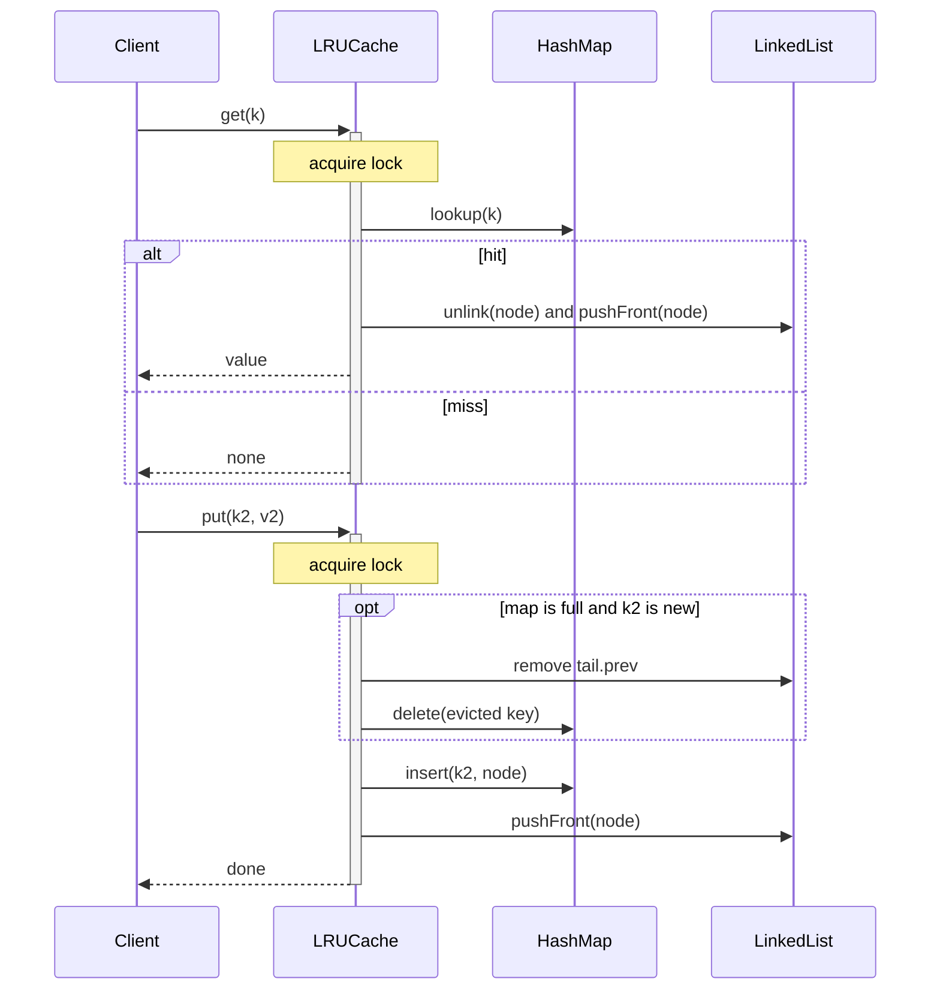

**Reading the diagram.** `get` takes the lock, looks the key up in the map and, on a hit, moves the node to the front before returning; a miss changes nothing. `put` of a new key into a full cache first evicts the node before the tail sentinel and deletes its key from the map, then inserts and links the new node. All calls are synchronous and in memory. The failure point the diagram makes visible: `get` *writes* to the list, so it needs the same exclusive lock as `put`; a read-write lock that lets readers share would corrupt the list.

#### Code

```python
from __future__ import annotations

import threading
from abc import ABC, abstractmethod
from typing import Generic, Hashable, Optional, TypeVar

K = TypeVar("K", bound=Hashable)
V = TypeVar("V")


class Cache(ABC, Generic[K, V]):                    # the interface clients depend on
    @abstractmethod
    def get(self, key: K) -> Optional[V]: ...
    @abstractmethod
    def put(self, key: K, value: V) -> None: ...


class _Node:
    __slots__ = ("key", "value", "prev", "next")

    def __init__(self, key=None, value=None):
        self.key, self.value = key, value
        self.prev: _Node | None = None
        self.next: _Node | None = None


class LRUCache(Cache[K, V]):
    """Hash map for O(1) lookup + doubly linked list for O(1) recency updates.
    Order: head.next is most recently used, tail.prev is least recently used."""

    def __init__(self, capacity: int):
        if capacity <= 0:
            raise ValueError("capacity must be positive")
        self.capacity = capacity
        self._map: dict[K, _Node] = {}
        self._head, self._tail = _Node(), _Node()   # sentinels: no None checks at the ends
        self._head.next, self._tail.prev = self._tail, self._head
        self._lock = threading.Lock()                # get() mutates order, so it locks too
        self.hits = self.misses = self.evictions = 0

    # -- list primitives, each O(1); callers hold the lock --
    def _unlink(self, node: _Node) -> None:
        node.prev.next, node.next.prev = node.next, node.prev

    def _push_front(self, node: _Node) -> None:
        node.prev, node.next = self._head, self._head.next
        self._head.next.prev = node
        self._head.next = node

    def get(self, key):
        with self._lock:
            node = self._map.get(key)
            if node is None:
                self.misses += 1
                return None
            self._unlink(node)
            self._push_front(node)                   # mark as most recently used
            self.hits += 1
            return node.value

    def put(self, key, value):
        with self._lock:
            node = self._map.get(key)
            if node is not None:                     # update in place, refresh recency
                node.value = value
                self._unlink(node)
                self._push_front(node)
                return
            if len(self._map) == self.capacity:      # evict the least recently used
                lru = self._tail.prev
                self._unlink(lru)
                del self._map[lru.key]
                self.evictions += 1
            node = _Node(key, value)
            self._map[key] = node
            self._push_front(node)

    def keys_mru_to_lru(self) -> list:
        with self._lock:
            out, n = [], self._head.next
            while n is not self._tail:
                out.append(n.key)
                n = n.next
            return out


if __name__ == "__main__":
    c = LRUCache[str, int](3)
    for k, v in [("a", 1), ("b", 2), ("c", 3)]:
        c.put(k, v)
    c.get("a")                                       # a becomes most recent
    c.put("d", 4)                                    # evicts b, the least recent
    print(c.keys_mru_to_lru(), c.get("b"))
    assert c.keys_mru_to_lru() == ["d", "a", "c"] and c.get("b") is None

    # Stress: 8 threads x 20,000 mixed operations; invariants must hold afterwards.
    import random
    big = LRUCache[int, int](100)
    def worker(seed):
        rng = random.Random(seed)
        for _ in range(20_000):
            k = rng.randrange(300)
            if rng.random() < 0.7:
                big.get(k)
            else:
                big.put(k, k * k)
    ts = [threading.Thread(target=worker, args=(s,)) for s in range(8)]
    for t in ts: t.start()
    for t in ts: t.join()
    order = big.keys_mru_to_lru()
    assert len(order) == len(big._map) == 100 and set(order) == set(big._map)
    assert all(big._map[k].value == k * k for k in order)
    total = big.hits + big.misses
    print(f"ops={total} hit ratio={big.hits / total:.2f} evictions={big.evictions}")
```

Output: `['d', 'a', 'c'] None`, then a line such as `ops=111952 hit ratio=0.33 evictions=32220` (`ops` counts only the `get` calls, about 70% of the 160,000 operations; the exact numbers vary with thread scheduling, while the invariants are asserted).

What to notice:

- Every operation does a constant number of map operations and pointer swaps: $O(1)$ time. Memory is one node per entry plus a map slot, roughly 100–200 bytes of overhead per entry in CPython, which matters when $n$ reaches millions.
- The stress test checks *structural* invariants after 160,000 concurrent operations: the list and the map hold the same 100 keys and every value is intact. Without the lock, two threads can interleave the pointer assignments of `_unlink` and `_push_front` and lose or duplicate nodes; CPython's global interpreter lock makes this rare but does not prevent it, and free-threaded builds make it likely.
- The hit ratio of about 0.33 is what theory predicts for uniformly random keys: capacity 100 over 300 keys. Real workloads are skewed and do much better (§20.3.3).

#### Concurrency options

One lock serializes all operations, which is fine up to a few million operations per second in a compiled language and far beyond what one CPython process can issue. Beyond that, **lock striping** splits the cache into $k$ independent LRU segments keyed by `hash(key) mod k`, each with its own lock (approximate global LRU, near-linear scaling). Libraries such as Caffeine avoid locking on reads entirely by recording accesses in buffers and replaying them under a lock in batches. Neither changes the class design: both are new implementations of `Cache`.

::: industry
**Standard-library LRU implementations.** CPython's `functools.lru_cache` (pure-Python fallback in `Lib/functools.py`) uses exactly this structure: a dictionary from key to link and a circular doubly linked list with a root sentinel, guarded by a lock. Java's `LinkedHashMap` constructed with `accessOrder = true` maintains entries in access order, and its documentation recommends overriding `removeEldestEntry` to build an LRU cache.
*Evidence: Primary* — [Python Software Foundation: functools source; Oracle: LinkedHashMap]
:::

#### Extensions and follow-up questions

- *Use `OrderedDict`?* Yes in production Python (`move_to_end`, `popitem(last=False)`); the interviewer usually wants the underlying structure first.
- *Add TTL.* Store an expiry in each node and treat expired entries as misses (lazy expiry); combine with Exercise 7's sweeper.
- *Evict by size in bytes rather than count.* Track a running byte total and evict from the tail until the new entry fits.
- *Prevent one scan from flushing the cache.* Segmented LRU or W-TinyLFU (§20.9.3), behind the same interface.

### 38.10.4 Exercise 4: Vending machine

#### Requirements

1. Customers insert coins (5, 10, 25 and 100 cents), select a product by slot code, receive the product and change, or cancel for a full refund.
2. A selection fails with a clear message if the slot is empty, the balance is short, or the machine cannot make change.
3. While the motor is dispensing, all input is rejected; when every slot is empty the machine is *sold out*.
4. Extensible: adding a state (for example *maintenance*) must not require editing every method of the machine.

The fourth requirement is the reason for the **State pattern** (§37.15). Behavior depends heavily on state, and the naive implementation, one `if state == ...` chain in every method, grows with states × events and scatters each state's rules across the class.

**Figure 38.14 — Vending machine class diagram (State pattern).**

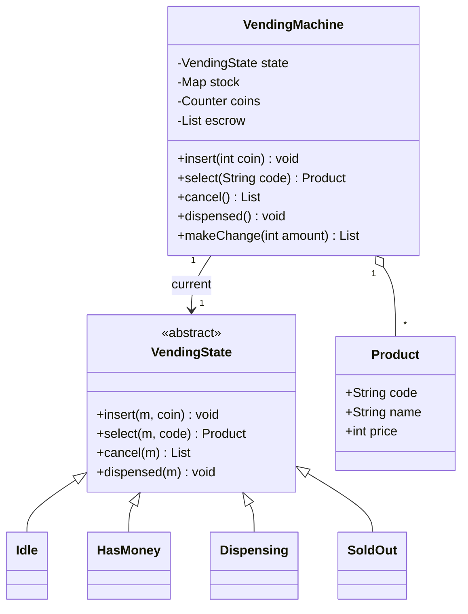

**Reading the diagram.** `VendingMachine` is the pattern's *Context*: its public methods forward every event to the current `VendingState` object. The abstract state rejects every event by default; each concrete state overrides only the events that are legal in it and decides the next state. Adding *Maintenance* means one new subclass and the transitions into it. Products are aggregated (the catalog is configured from outside). The coin box and escrow (coins inserted for the current purchase) are the machine's money state, and keeping escrow separate from the coin box is what makes `cancel` a simple refund.

**Figure 38.15 — Vending machine state diagram.**

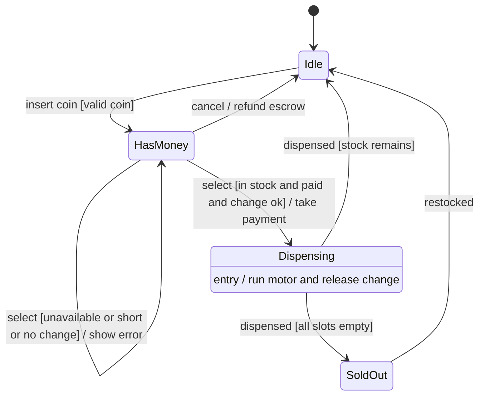

**Reading the diagram.** From *Idle*, a valid coin moves the machine to *HasMoney*, where more coins accumulate. A selection that fails one of its guards leaves the state unchanged and shows an error; a successful one takes payment and enters *Dispensing*, whose entry action drives the motor and returns change. Only the `dispensed` event from the motor sensor leaves *Dispensing*, so coins or selections made mid-vend are rejected. When the last item is sold the machine goes to *SoldOut* until restocked. The failure point is the motor: if `dispensed` never arrives, the machine is stuck, so a real controller adds a timeout transition to a *Fault* state with a refund.

#### Code

```python
from __future__ import annotations

from abc import ABC
from collections import Counter
from dataclasses import dataclass

COINS = (100, 25, 10, 5)                             # cents, largest first


class InvalidAction(Exception):
    pass


@dataclass(frozen=True)
class Product:
    code: str
    name: str
    price: int                                       # cents


class VendingState(ABC):
    """Every event is rejected unless a concrete state overrides it."""
    name = "abstract"

    def insert(self, m: "VendingMachine", coin: int) -> None:
        raise InvalidAction(f"cannot insert coins while {self.name}")

    def select(self, m: "VendingMachine", code: str):
        raise InvalidAction(f"cannot select while {self.name}")

    def cancel(self, m: "VendingMachine") -> list[int]:
        raise InvalidAction(f"cannot cancel while {self.name}")

    def dispensed(self, m: "VendingMachine") -> None:
        raise InvalidAction(f"nothing is being dispensed while {self.name}")


class Idle(VendingState):
    name = "idle"

    def insert(self, m, coin):
        m.accept(coin)
        m.state = HasMoney()

    def cancel(self, m):
        return []


class HasMoney(VendingState):
    name = "has_money"

    def insert(self, m, coin):
        m.accept(coin)

    def select(self, m, code):
        product = m.products.get(code)
        if product is None or m.stock[code] == 0:
            raise InvalidAction(f"{code} unavailable")
        if m.balance < product.price:
            raise InvalidAction(f"insert {product.price - m.balance} more cents")
        change = m.make_change(m.balance - product.price)
        if change is None:
            raise InvalidAction("cannot make change; press cancel")
        m.complete_sale(code, change)
        m.state = Dispensing()
        return product, change

    def cancel(self, m):
        refund, m.escrow = m.escrow, []
        m.state = Idle()
        return refund


class Dispensing(VendingState):
    name = "dispensing"

    def dispensed(self, m):                          # event from the motor sensor
        m.state = SoldOut() if sum(m.stock.values()) == 0 else Idle()


class SoldOut(VendingState):
    name = "sold_out"

    def cancel(self, m):
        return []


class VendingMachine:                                # the Context of the State pattern
    def __init__(self, products: list[Product], stock: dict[str, int], coins: Counter):
        self.products = {p.code: p for p in products}
        self.stock, self.coins = dict(stock), Counter(coins)
        self.escrow: list[int] = []
        self.state: VendingState = Idle() if sum(self.stock.values()) else SoldOut()

    # Public API: each call is delegated to the current state object.
    def insert(self, coin): self.state.insert(self, coin)
    def select(self, code): return self.state.select(self, code)
    def cancel(self): return self.state.cancel(self)
    def dispensed(self): self.state.dispensed(self)

    @property
    def balance(self) -> int:
        return sum(self.escrow)

    def accept(self, coin: int) -> None:
        if coin not in COINS:
            raise InvalidAction(f"rejected coin {coin}")
        self.escrow.append(coin)

    def make_change(self, amount: int) -> list[int] | None:
        available = self.coins + Counter(self.escrow)    # inserted coins can be reused
        out = []
        for coin in COINS:
            n = min(amount // coin, available[coin])
            out += [coin] * n
            amount -= n * coin
        return out if amount == 0 else None

    def complete_sale(self, code: str, change: list[int]) -> None:
        self.coins += Counter(self.escrow)
        self.coins -= Counter(change)
        self.escrow = []
        self.stock[code] -= 1


if __name__ == "__main__":
    vm = VendingMachine([Product("A1", "Water", 65), Product("B2", "Chips", 150)],
                        {"A1": 1, "B2": 0}, Counter({25: 2, 10: 2, 5: 2}))
    for action in (lambda: vm.select("A1"), lambda: vm.dispensed()):
        try:
            action()
        except InvalidAction as e:
            print("idle:", e)
    vm.insert(100)
    print("balance", vm.balance, "state", vm.state.name)
    try:
        vm.select("B2")
    except InvalidAction as e:
        print("has_money:", e)
    product, change = vm.select("A1")                # 100 - 65 = 35 -> 25 + 10
    print(product.name, "change", change, "state", vm.state.name)
    try:
        vm.insert(25)
    except InvalidAction as e:
        print("dispensing:", e)
    vm.dispensed()
    print("state", vm.state.name, "coin box", dict(vm.coins))
    assert change == [25, 10] and vm.state.name == "sold_out"
```

Output:

```text
idle: cannot select while idle
idle: nothing is being dispensed while idle
balance 100 state has_money
has_money: B2 unavailable
Water change [25, 10] state dispensing
dispensing: cannot insert coins while dispensing
state sold_out coin box {25: 1, 10: 1, 5: 2, 100: 1}
```

What to notice:

- `VendingMachine` contains no conditionals on state; each rule lives in exactly one state class (Single Responsibility per state, Open/Closed for new states).
- `make_change` may use the coins just inserted, which matters when the coin box is nearly empty.
- Greedy change-making is optimal for unlimited US-style coins but can fail with *limited* coins: to return 30 cents from {one 25, three 10s}, greedy takes the 25 and then cannot make 5, although 10 + 10 + 10 works. A dynamic-programming search over available counts fixes it; the interface does not change.

#### Patterns used

**State** (§37.15) for behavior by state; the machine is the Context; states are stateless and could be shared singletons.

#### Extensions and follow-up questions

- *Card payments?* A `PaymentMethod` strategy; the *HasMoney* state becomes *Authorized* for cards.
- *Concurrency?* A physical machine has one user, but its controller receives events from buttons, the coin mechanism and the motor; serialize them through one event queue rather than locks in every state.
- *Remote telemetry and restocking alerts?* Observer on stock changes.
- *Why not the transition table of §38.6?* A table suits uniform behavior; the State pattern suits states with substantially different logic. Both are defensible; say which and why.

